# Anesthesia and the Renal and Genitourinary Systems

<!-- PDF page 1 -->

DANIEL GAINSBURG, ANUP PAMNANI, and VINOD MALHOTRA

### KEY POINTS

- Innervation of the intra- abdominal components of the genitourinary system—the kidney and the ureter—is primarily thoracolumbar (T8–L2). The nerve supply of the pelvic organs—the bladder, prostate, seminal vesicles, and urethra—is primarily lumbosacral with some lower thoracic input.

- The spinal level of pain conduction for the external genitourinary organs is S2–4, except for the testes (T10–L1).

- The kidneys receive 15% to 25% of the total cardiac output, with most of this blood directed to the renal cortex. Renal medullary papillae are more vulnerable to ischemic insults. Kidneys successfully autoregulate their blood flow between 60 and 160 mm Hg mean arterial pressures.

- The glomerular filtration rate (GFR) is the best measure of glomerular function. Creatinine clearance is a good measure of the GFR; urine output is not.

- Hypervolemia, acidemia, hyperkalemia, cardiorespiratory dysfunction, anemia, and bleeding disturbances are manifestations of chronic renal failure.

- Serum creatinine, most commonly used as a marker of renal function, has several limitations. Newer biomarkers, such as serum cystatin C, are better and earlier measures of acute kidney injury and the risk of end- stage renal disease, as well as related mortality.

- Although renal transplantation reverses most of the abnormalities associated with end- stage renal disease, dialysis improves only some and introduces additional complications.

- Extracorporeal shock wave lithotripsy (ESWL) historically caused significant physiologic changes related to immersion in a water bath, but newer generations have eliminated the water bath and hence those risks. Shock waves can cause clinically insignificant dysrhythmias. Pregnancy and untreated bleeding disorders are contraindications to ESWL.

- For patients presenting with renal tumors, 5% to 10% of the tumors extend into the renal vein, inferior vena cava, and right atrium. Complications ranging from circulatory failure to embolization of tumor may occur during surgical resection. Cardiopulmonary bypass may be necessary for tumors invading major vessels.

- Several approaches to prostate resection have had significant impact on anesthesia and perioperative management. Newer techniques such as laser prostatectomy have replaced transurethral resection of the prostate (TURP), making TURP syndrome a rare event. TURP syndrome is a constellation of symptoms caused by the absorption of hypotonic bladder irrigants. Cardiovascular and neurologic changes result due to hypoosmolality, hyponatremia, hyperglycinemia, hyperammonemia, and hypervolemia.

- Radical prostatectomy may cause significant blood loss, and intraoperative venous air emboli can occur. Regional anesthesia with spontaneous ventilation is associated with less blood loss than general anesthesia and intermittent positive pressure ventilation. Other advantages of epidural anesthesia include a decreased incidence of deep vein thrombosis and the initiation of preemptive analgesia. Whether outcomes are dependent on the choice of anesthesia is not clear.

- Robotic radical prostatectomy is associated with reduced blood loss and postoperative pain compared with open radical prostatectomy. Anesthetic concerns are related to steep head- down tilt and pneumoperitoneum and include hypercarbia, hypoxemia, increased intraocular and intracranial pressures, decreased perfusion pressure to lower extremities, and positional injuries.

- Laparoscopic surgery in urology frequently requires insufflation of carbon dioxide into the retroperitoneal space. In lengthy procedures, pneumomediastinum and subcutaneous emphysema of the head and neck may occur.

- Anesthetic concerns of robotic- assisted surgery include the length of surgical time, intravenous fluid management, pneumoperitoneum, and positioning. The most frequent reported complications are peripheral neuropathies, corneal abrasions, vascular complications (including compartment syndrome, rhabdomyolysis, and thromboembolic disease), and the effects of edema.

- Postoperative renal dysfunction after genitourinary procedures can occur due to a variety of causes including significant hemorrhage, large intraoperative fluid shifts, nephrotoxic medications or post- renal urinary retention or obstruction.

<!-- PDF page 2 -->

Patients requiring anesthesia for renal and genitourinary surgery are frequently at the extremes of age. In addition to the physiologic changes of aging in older patients, concomitant cardiovascular and respiratory comorbidity is common. A medical history, physical examination, and appropriate laboratory tests are necessary to evaluate concomitant or comorbid conditions that can have impact on perioperative management. In addition, for pediatric patients, a careful history should be taken to exclude other associated non- urologic congenital lesions.

Urologic procedures are performed mostly on the kidneys, adrenals, ureters, urinary bladder, prostate, urethra, penis, scrotum, testis, and spermatic cord. Because their sensory nerve supply is primarily thoracolumbar and sacral outflow (Table 55.1), these structures are well adapted for regional anesthesia.

## Innervation of the Genitourinary System

The parts of the genitourinary system that are in the abdomen receive their nerve supply from the autonomic nervous system by means of sympathetic and parasympathetic pathways. The pelvic urinary organs and genitalia are supplied by somatic and autonomic nerves. Table 55.1 summarizes the pain conduction pathways and spinal levels of the genitourinary system.

### KIDNEY AND ABDOMINAL URETER

Sympathetic nerves to the kidney originate as preganglionic fibers from the eighth thoracic through the first lumbar segments and converge at the celiac plexus and aorticorenal ganglia (Fig. 55.1). Postganglionic fibers to the kidney arise mainly from the celiac and aorticorenal ganglia. Some sympathetic fibers may reach the kidney via the splanchnic nerves. Parasympathetic input is from the vagus nerve.1 Sympathetic fibers to the ureter originate from the 10th thoracic through the second lumbar segments and synapse with postganglionic fibers in the aorticorenal and superior and inferior hypogastric plexuses. Parasympathetic input is from the second through fourth sacral spinal segments.1 Nociceptive fibers travel along the sympathetics to the same spinal segments. Pain from the kidney and ureter is referred mainly to the somatic distribution of the 10th thoracic through the second lumbar segments – the lower part of the back, flank, ilioinguinal region, and scrotum or labia. Effective neural block of these segments is necessary to provide adequate analgesia or anesthesia.

### BLADDER AND URETHRA

Sympathetic nerves to the bladder and urethra originate from the 11th thoracic to the second lumbar segments, travel through the superior hypogastric plexus, and supply the bladder through the right and the left hypogastric nerves.2 Parasympathetic nerves arise from the second through the fourth sacral segments and form the pelvic parasympathetic plexus, which is joined by the hypogastric plexus. Vesical branches proceed toward the bladder base, where they provide the nerve supply to the bladder and

**Table 55.1** Pain Conduction Pathways and Spinal Segment Projection of Pain of the Genitourinary System

|**Organ**|**Sympathetics,** **Spinal Segments**|**Parasympathetics**|**Spinal Levels of** **Pain Conduction**|
|---|---|---|---|
|Kidney|T8–L1|CN X (vagus)|T10–L1|
|Ureter|T10–L2|S2–4|T10–L2|
|Bladder|T11–L2|S2–4|T11–L2 (dome), S2–4 (neck)|
|Prostate|T11–L2|S2–4|T11–L2, S2–4|
|Penis|L1 and L2|S2–4|S2–4|
|Scrotum|NS|NS|S2–4|
|Testes|T10–L2|NS|T10–L1|

_NS_ , not significant for nociceptive function.

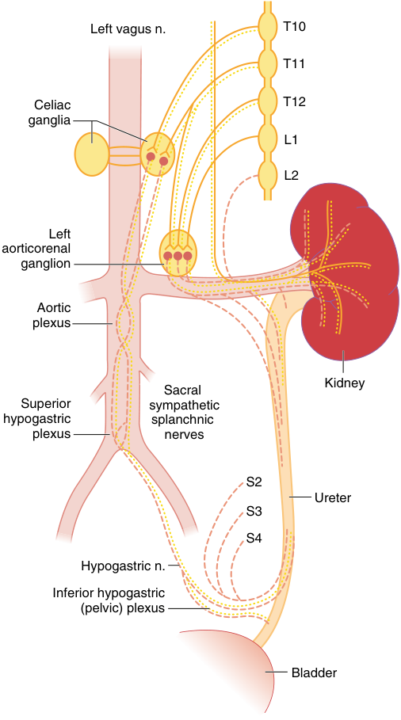

Left vagus n. T10 T11 Celiac T12 ganglia L1 L2 Left aorticorenal ganglion Aortic plexus Sacral  Kidney Superior sympathetic hypogastric splanchnic plexus nerves S2 Ureter S3 S4 Hypogastric n. Inferior hypogastric (pelvic) plexus Bladder 

**Fig. 55.1 Autonomic and sensory innervation of the kidney and ureters.** _Solid lines_ indicate preganglionic fibers; _dashed lines_ indicate postganglionic fibers; and _dotted lines_ indicate sensory fibers. (From Gee WF, Ansell JF. Pelvic and perineal pain of urologic origin. In: Bonica JJ, ed. _The Management of Pain_ . 2nd ed. Philadelphia: Lea & Febiger; 1990:1368–1378.)

::: details 原始表格與符號（PDF 第 2 頁）

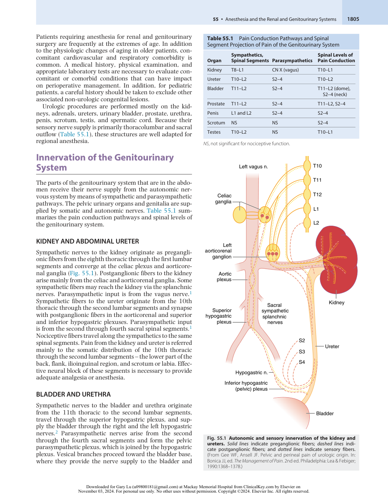

:::

<!-- PDF page 3 -->

proximal part of the urethra (Fig. 55.2). Parasympathetic fibers are the main motor supply to the bladder (except for the trigone) and far outnumber sympathetic fibers in the bladder.2

The afferents carrying sensations of stretch and fullness of the bladder are parasympathetic, whereas pain, touch, and temperature sensations are carried by sympathetic nerves. Sympathetic fibers are predominantly α- adrenergic in the bladder base and urethra, and β- adrenergic in the bladder dome and lateral wall. Knowledge of these aspects of neuroanatomy is important to appreciate the pharmacologic effects on the urologic system of neural ablation or regional block and drugs with adrenergic or cholinergic effects.2

### PROSTATE AND PROSTATIC URETHRA

The prostate and the prostatic urethra receive sympathetic and parasympathetic supply from the prostatic plexus arising from the pelvic parasympathetic plexus, which is joined by the hypogastric plexus. The spinal origin of the nerve supply is primarily lumbosacral (see Fig. 55.2).2

### PENIS AND SCROTUM

The autonomic supply to the penile urethra and the cavernous tissue comes from the prostatic plexus. Somatic fibers from the pudendal nerve (S2–4) supply the external sphincter. The dorsal nerve of the penis, the first branch of the

pudendal nerve, is its main sensory supply. The scrotum is innervated anteriorly by the ilioinguinal and genitofemoral nerves (L1 and L2) and posteriorly by perineal branches of the pudendal nerve (S2 and S4).2

### TESTES

The testes descend from their intra- abdominal location to the scrotum during fetal development. Because they share their embryologic origin with the kidney, their nerve supply is similar to that of the kidney and upper part of the ureter and extends up to the T10 spinal segment.2

## Renal Blood Flow

The kidneys receive approximately 15% to 25% of total cardiac output, or 1 to 1.25 L/min of blood, through the renal arteries, depending on the state of the body. Most of the blood is received by the renal cortex, with only 5% of cardiac output flowing through the renal medulla, which makes the renal papillae vulnerable to ischemic insults. Renal blood flow is regulated by various mechanisms that control the activity of vascular smooth muscle and alter vascular resistance. Sympathetic tone of renal vessels increases during exercise to shunt renal blood flow to exercising skeletal muscle; similarly, renal blood vessels relax during the resting condition of the body. Sympathetic

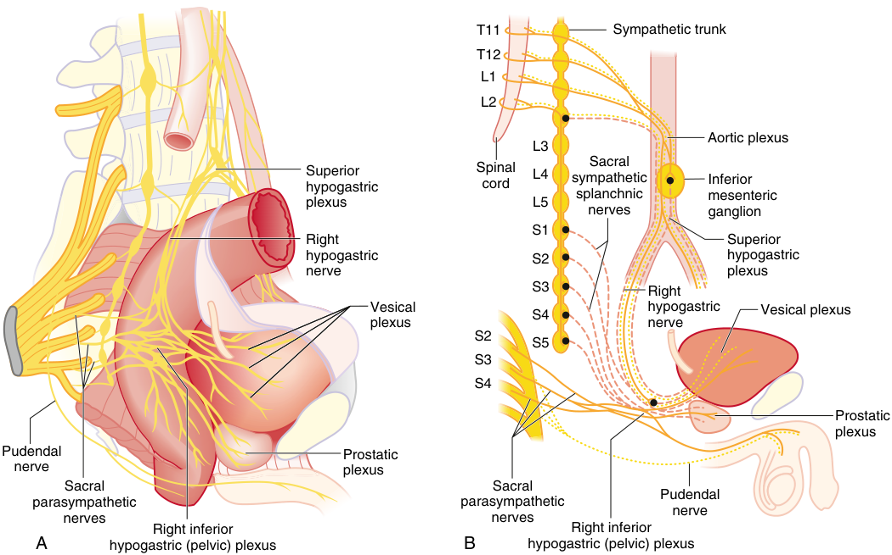

T11 Sympathetic trunk T12 L1 L2 Aortic plexus L3 Sacral Superior hypogastric Spinalcord L4 sympathetic Inferior splanchnic mesenteric plexus L5 nerves ganglion S1 Right Superior hypogastric S2 hypogastric nerve plexus S3 Right Vesical  S4 hypogastric Vesical plexus plexus nerve S2 S5 S3 S4 Prostatic plexus Pudendal Prostatic nerve plexus Sacral Sacral Pudendal parasympathetic parasympathetic nerve nerves nerves Right inferior Right inferior A hypogastric (pelvic) plexus B hypogastric (pelvic) plexus 

**Fig. 55.2** (A) Nerve supply of the urinary bladder and prostate showing the relationship of the various nerve structures to the large intestine and their distribution in the bladder and prostate. (B) Schematic illustration showing the segmental nerve supply to the bladder, penis, and scrotum. _Solid lines_ indicate preganglionic fibers; _dashed lines_ indicate postganglionic fibers; and _dotted lines_ indicate sensory fibers. (From Gee WF, Ansell JF. Pelvic and perineal pain of urologic origin. In: Bonica JJ, ed. _The Management of Pain_ . 2nd ed. Philadelphia: Lea & Febiger; 1990:1368–1378.)

<!-- PDF page 4 -->

stimulation resulting from surgery can increase vascular resistance and reduce renal blood flow, whereas anesthetics may reduce renal blood flow by decreasing cardiac output.

Glomerular capillaries separate afferent arterioles from efferent arterioles. Glomerular capillaries are high- pressure systems, whereas peritubular capillaries are low- pressure systems. Consequently, the glomerular capillaries are a fluid- filtering system, whereas the peritubular capillaries are a fluid- absorbing system. The vasa recta, a specialized portion of peritubular capillaries formed from efferent arterioles, are important in the formation of concentrated urine by a countercurrent mechanism. An intrinsic mechanism that causes vasodilation and vasoconstriction of renal afferent arterioles regulates the autoregulation of renal blood flow. Autoregulation maintains mean arterial pressure between 60 mm Hg and 160 mm Hg in intact and denervated kidneys.3 A decrease in mean arterial pressure also decreases renal blood flow and eventually affects the glomerular filtration rate (GFR) when the pressure decreases to less than 60 mm Hg. A persistently low mean arterial pressure affects renal blood flow but does not affect the GFR because of the intrinsic mechanism of autoregulation (Fig. 55.3).

Although knowledge of neuroanatomy and renal blood flow is essential to provide adequate anesthesia, a thorough understanding of renal physiology and pharmacology is equally important. Genitourinary surgical patients frequently have mechanical or functional renal disease. Anesthetics and surgery can significantly alter renal function. Conversely, renal dysfunction significantly affects the pharmacokinetics and pharmacodynamics of anesthetics and adjuvant drugs. Evaluation of a patient with renal disease is discussed later in this chapter.

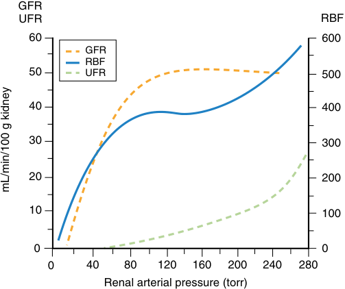

GFR UFR RBF 60 600 GFR RBF 50 UFR 500 40 400 30 300 20 200 10 100 0 0 0 40 80 120 160 200 240 280 Renal arterial pressure (torr) mL/min/100 g kidney 

**Fig. 55.3 Autoregulation of renal blood flow (RBF) and the glomerular filtration rate (GFR).** The relationships between RBF, GFR, and urine flow rate (UFR) and mean renal arterial pressure in dogs are shown as renal arterial pressure is varied from 20 to 280 mm Hg. Autoregulation of RBF and GFR is observed between approximately 80 and 180 mm Hg. (Redrawn from Hemmings HC. Anesthetics, adjuvants and drugs and the kidney. In: Malhotra V, ed. _Anesthesia for Renal and Genitourinary Surgery_ . New York: McGraw- Hill; 1996;18.)

## Anesthesia for Patients with Renal Disease

### EVALUATION OF RENAL FUNCTION

Renal disease can be discovered incidentally during a routine medical evaluation, or patients may exhibit evidence of renal dysfunction, such as hypertension, edema, nausea, and hematuria. The initial approach in both situations should be to assess the cause and severity of renal abnormalities. In all cases, this evaluation includes (1) an estimation of disease duration, (2) a careful urinalysis, and (3) an assessment of the GFR. The history and physical examination, although equally important, are variable among renal syndromes; specific symptoms and signs are discussed in sections on each disease entity. Further diagnostic categorization is based on anatomic distribution: prerenal disease, postrenal disease, and intrinsic renal disease. Intrinsic renal disease can be divided further into glomerular, tubular, interstitial, and vascular abnormalities. Laboratory tests useful in evaluating renal function are described next (Table 55.2).

**Table 55.2** Commonly Ordered Renal Function Tests

|**Test Name**|**Reference Range**|**Units**|
|---|---|---|
|Urea nitrogen|5–25|mg/dL|
|Creatinine|0.5–1.5|mg/dL|
|Sodium|133–147|mmol/L|
|Potassium|3.2–5.2|mmol/L|
|Chloride|94–110|mmol/L|
|CO2|22–32|mmol/L|
|Uric acid|2.5–7.5|mg/dL|
|Calcium|8.5–10.5|mg/dL|
|Phosphorus|2.2–4.2|mg/dL|
|**Urinalysis, routine**|||
|Color|Straw- amber||
|Appearance|Clear- hazy||
|Protein|0|mg/dL|
|Blood|Negative||
|Glucose|0|mg/dL|
|Ketones|0|mg/dL|
|pH|4.5–8.0||
|Specific gravity|1.002–1.030||
|Bilirubin|Negative||
|**Urinalysis, microscopic**|||
|Red blood cells|0–3|per high- power field|
|White blood cells|0–5|per high- power field|
|Casts|0–2|per low- power field|

From Miller ED Jr. Understanding renal function and its preoperative evaluation. In: Malhotra V, ed. _Anesthesia for Renal and Genitourinary Surgery_ . New York: McGraw- Hill; 1996:9.

::: details 原始表格與符號（PDF 第 4 頁）

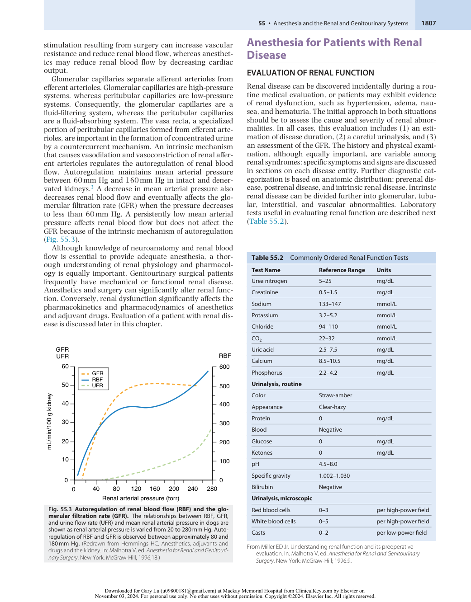

:::

<!-- PDF page 5 -->

### GLOMERULAR FUNCTION

### Glomerular Filtration Rate

The GFR is the best measure of glomerular function. Normal GFR is approximately 125 mL/min. However, manifestations of reduced GFR are not seen until the GFR has decreased to 50% of normal. When GFR decreases to 30% of normal, a stage of moderate renal insufficiency ensues. Patients with this level of reduction in GFR generally remain asymptomatic with only biochemical evidence of a decline in GFR (i.e., an increase in serum concentrations of urea and creatinine). Further careful assessment often reveals other abnormalities, such as nocturia, anemia, loss of energy, decreasing appetite, and abnormalities in calcium and phosphorus metabolism.

As the GFR decreases further, a stage of severe renal insufficiency begins. This stage is characterized by profound clinical manifestations of uremia and biochemical abnormalities, such as acidemia; volume overload; and neurologic, cardiac, and respiratory manifestations. At the stages of mild and moderate renal insufficiency, intercurrent clinical stress may compromise renal function further and induce signs and symptoms of overt uremia. When the GFR is 5% to 10% of normal, the patient is characterized as having end- stage renal disease (ESRD). As a result, renal replacement therapy becomes essential for both quality of life and survival (Table 55.3).

### Blood Urea Nitrogen

The blood urea nitrogen (BUN) concentration is not a direct correlate of reduced GFR. BUN is influenced by nonrenal variables, such as exercise, bleeding, steroids, and massive tissue breakdown. Most important, the BUN is not elevated until the GFR is reduced to almost 75% of normal.1

### Creatinine and Creatinine Clearance

Measurements of creatinine provide valuable information regarding general kidney function. Creatinine in serum results from turnover of muscle tissue and depends on daily dietary intake of protein. Normal values are 0.5 to 1.5 mg/100 mL; values of 0.5 to 1 mg/100 mL are present during pregnancy. Creatinine is freely filtered at the glomerulus, and apart from an almost negligible increase in content because of secretion in the distal nephron, it is neither reabsorbed nor secreted. Serum creatinine measurements reflect glomerular function (Fig. 55.4),4 and creatinine clearance is a specific measure of GFR. Creatinine clearance can be calculated by the following formula derived by Cockcroft–Gault that accounts for age- related decreases in GFR, body weight, and sex:

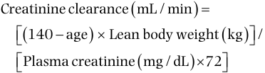

Creatinine clearance  mL / min    140  age   Lean body weight  kg  /  Plasma creatinine  mg / dL  72  

This value should be multiplied by 0.85 for women because a lower fraction of body weight is composed of muscle.

Because there is such a wide range in normal values, a 50% increase in serum creatinine concentration, indicative of a 50% reduction in GFR, may go undetected unless baseline values are known. In addition, demographic factors such as old age, male sex, and non- White populations may have higher acute kidney injury (AKI) risk at higher levels of estimated GFR. Excretion of drugs dependent on glomerular filtration may be significantly decreased despite what might seem to be only slightly elevated serum creatinine values (1.5–2.5 mg/100 mL). The serum creatinine concentration and clearance are better indicators of general

**Table 55.3** Clinical Abnormalities in Chronic Renal Failure and Their Response to Dialysis and Erythropoietin Treatment

|**Improved by Dialysis**|**Improved by Adding** **Erythropoietin**|**Variable Response**|**Not Improved**|**Develop After Dialysis** **Therapy**|
|---|---|---|---|---|
|Volume expansion and contraction Hypernatremia and hyponatremia Hyperkalemia and hypokalemia Metabolic acidosis Hyperphosphatemia Hypocalcemia Vitamin D–deficient osteomalacia Carbohydrate intolerance Hypothermia Asterixis Muscular irritability Myoclonus Coma|Fatigue Impaired mentation Lethargy Pallor Anemia Bleeding diathesis|Secondary hyperparathyroidism Hyperuricemia Hypertriglyceridemia Protein- calorie malnutrition Headache Peripheral neuropathy Restless legs syndrome Paralysis Seizures Myopathy Arterial hypertension Cardiomyopathy Accelerated atherosclerosis Vascular calcification Hyperpigmentation Peptic ulcer|Increased lipoprotein level Decreased high- density lipoprotein level Impaired growth and development Infertility and sexual dysfunction Amenorrhea Sleep disorders Pruritus Lymphocytopenia Splenomegaly and hypersplenism|Adynamic osteomalacia β2- Microglobulinemia Muscle cramps Dialysis dysequilibrium syndrome Hypotension and arrhythmias Hepatitis Idiopathic ascites Peritonitis Leukopenia Hypocomplementemia|
|Congestive heart failure or pulmonary edema Pericarditis Uremic lung Ecchymoses Uremic frost Anorexia Nausea and vomiting Uremic fetor Gastroenteritis||Gastrointestinal bleeding Increased susceptibility to infection|||

::: details 原始表格與符號（PDF 第 5 頁）

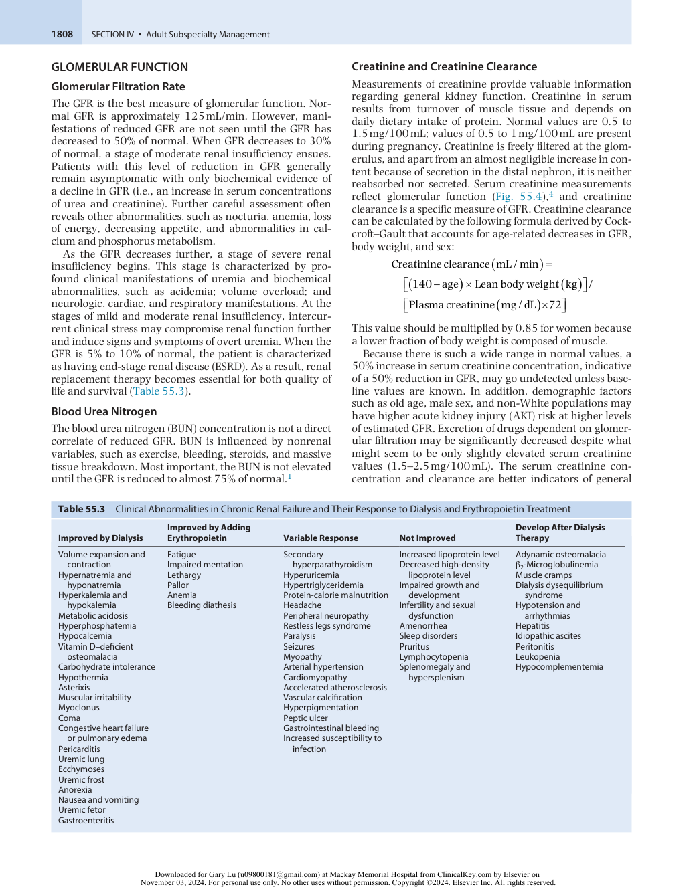

:::

<!-- PDF page 6 -->

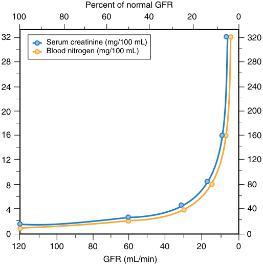

Percent of normal GFR 100 80 60 40 20 0 32 320 Serum creatinine (mg/100 mL) Blood nitrogen (mg/100 mL) 28 280 24 240 20 200 16 160 12 120 8 80 4 40 0 0 120 100 80 60 40 20 0 GFR (mL/min) 

**Fig. 55.4 Theoretic relationship between blood urea nitrogen and creatinine versus glomerular filtration rate (GFR).** (Redrawn from Kassirer JP. Clinical evaluation of kidney function- glomerular function. _N Engl J Med_ . 1971;285:385.)

### Box 55.1 Conditions Affecting Blood Urea Nitrogen Independently of Glomerular Filtration Rate

**Table 55.4** Conditions Affecting Serum Creatinine Independently of Glomerular Filtration Rate

|**Condition**|**Mechanism**|
|---|---|
|**CONDITIONS CAUSING ELEVA**|**TION**|
|Ketoacidosis|Noncreatinine chromogen|
|Cephalothin, cefoxitin|Noncreatinine chromogen|
|Flucytosine|Noncreatinine chromogen|
|Other drugs – aspirin, cimetidine, probenecid, trimethoprim|Inhibition of tubular creatinine secretion|
|**CONDITIONS CAUSING DECRE**|**ASE**|
|Advanced age|Physiologic decrease in muscle mass|
|Cachexia|Pathologic decrease in muscle mass|
|Liver disease|Decreased hepatic creatine synthesis and cachexia|

number of moles of solute [osmoles] per kilogram of solvent) is a similar, more specific test. Excretion of concentrated urine (specific gravity, 1.030; 1050 mOsm/kg) is indicative of excellent tubular function, whereas a urinary osmolality fixed at that of plasma (specific gravity 1.010; 290 mOsm/ kg) indicates renal disease. The urinary dilution mechanism persists after concentrating defects are present, so a urinary osmolality of 50 to 100 mOsm/kg still may be consistent with advanced renal disease.

### Protein

### Increased Blood Urea Nitrogen

- Reduced effective circulating blood volume (prerenal azotemia)

- Catabolic states (gastrointestinal bleeding, corticosteroid use)

- High- protein diets

- Tetracycline

### Decreased Blood Urea Nitrogen

Patients without renal disease can excrete 150 mg of protein per day; greater amounts may be present after strenuous exercise or after standing for several hours. Massive proteinuria (i.e., >750 mg/day) usually indicates severe glomerular damage.

### Glucose

- Liver disease

- Malnutrition

- Sickle cell anemia

- Syndrome of inappropriate secretion of antidiuretic hormone

kidney function and GFR than are similar measurements of urea nitrogen (Box 55.1). However, there are disease states in which even the serum creatinine can be affected independent of the GFR (Table 55.4). The main limitation of current GFR estimates is the greater inaccuracy in populations without known chronic kidney disease than in those with the disease. Nonetheless, current GFR estimates facilitate detection, evaluation, and management of the disease, and they should result in improved patient care and better clinical outcomes.5

### TUBULAR FUNCTION

### Concentration

Urinary specific gravity is an index of the kidney’s concentrating ability, specifically renal tubular function. Determination of urinary osmolality (i.e., measurement of the

Glucose is freely filtered at the glomerulus and is subsequently reabsorbed in the proximal tubule. Glycosuria signifies that the ability of the renal tubules to reabsorb glucose has been exceeded by an abnormally heavy glucose load and is usually indicative of diabetes mellitus. Glycosuria also may be present in hospitalized patients without diabetes who are receiving intravenous glucose infusions.

### ADDITIONAL DIAGNOSTIC TESTS

### Urinalysis and Appearance

Gross and microscopic observations of urine and its sediment, along with determination of urinary pH, specific gravity, protein content, and glucose content, are two of the most readily available, inexpensive, and informative laboratory tests. The gross appearance of urine may indicate the presence of bleeding or infection in the genitourinary tract. Microscopic examination of urinary sediment may reveal casts, bacteria, and various cell forms, supplying diagnostic information in patients with renal disease.

::: details 原始表格與符號（PDF 第 6 頁）

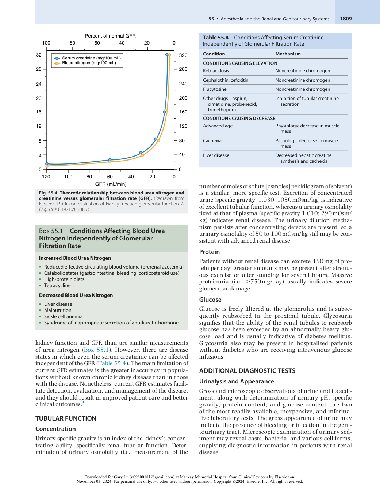

:::

<!-- PDF page 7 -->

### Urine and Serum Electrolytes

Sodium, potassium, chloride, and bicarbonate concentrations should be determined if impairment in renal function is suspected. However, the results of these tests usually remain normal until significant renal dysfunction is present; hyperkalemia does not occur until patients are uremic. Measuring urinary sodium or chloride excretion is especially useful when attempting to differentiate between causes of hyponatremia, as seen in volume contraction (whether a decrease in total circulatory volume or a decrease in effective arterial blood volume), versus conditions associated with increased salt loss, such as the syndrome of inappropriate secretion of antidiuretic hormone, salt- losing nephropathy, or adrenal insufficiency.6 If significant renal disease is present, patients consuming a diet high in animal protein may develop metabolic acidosis.

### Novel Biomarkers of Renal Function

Although serum creatinine is most commonly used as a marker of GFR and hence renal function, it has some limitations in that it is influenced by nonrenal factors such as age, sex, muscle mass and metabolism, diet, and hydration. Furthermore, creatinine levels may take several hours or days to reach a steady state to accurately reflect the GFR as indicator of renal function in AKI. Several new markers of renal function have been identified. Serum cystatin C, a ubiquitous protein that is exclusively excreted by glomerular filtration, is less influenced by variations in muscle mass and nutrition than is creatinine. It may better predict risk of death and ESRD across diverse populations.7

Other novel biomarkers such as _N_ - acetyl- β- d- glucosaminidase, kidney injury molecule- 1, interleukin18, uromodulin, and microRNA are also showing promise at early detection of kidney injury. These biomarkers may have a future role in reducing morbidity and mortality associated with kidney injury in the perioperative setting.8

### Electrocardiogram

The electrocardiogram reflects the toxic effects of potassium excess more closely than determination of the serum potassium concentration.

### Imaging Studies

**Renal Ultrasound.** Ultrasound is the most frequently used diagnostic examination for the evaluation of the kidneys and urinary tract. It is noninvasive, uses no ionizing radiation, and requires minimal patient preparation. It is the first- line examination in patients with renal dysfunction for assessing kidney size and the presence or absence of hydronephrosis and obstruction. It can be used to assess the vasculature of native and transplanted kidneys. Ultrasound is also used to evaluate renal structure and to characterize renal masses.9

### Computed Tomography Scan of Kidneys. A stone proto-

col computed tomography (CT) scan of the kidneys, ureter, and bladder has become the study of choice for the detection of kidney stones because of its ability to detect stones of all kinds, including uric acid stones and non- obstructing stones in the ureter. Even in areas in which ultrasound is the first- line imaging modality, CT offers a complementary and sometimes superior means of imaging. Masses in the

kidney can be evaluated using either contrast- enhanced CT or renal ultrasound.9

**Computed Tomography Angiography.** CT angiography is used for the evaluation of renal artery stenosis and is emerging rapidly as a useful diagnostic tool. Although it is comparable with magnetic resonance angiography (MRA) as a noninvasive study, it requires the use of iodinated contrast material, which may cause contrast media–induced nephropathy.9

### Magnetic Resonance Imaging with Magnetic Reso-

**nance Angiography.** Magnetic resonance imaging allows for detailed tissue characterization of the kidney and surrounding structures. It is a good alternative to contrastenhanced CT, especially in patients who cannot tolerate iodinated contrast material and in patients for whom reduction of radiation exposure is desired, such as pregnant women and children. Gadolinium, a paramagnetic intravenous contrast agent, is used routinely in magnetic resonance angiography (MRA) because it improves lesion detection and diagnostic accuracy. It is generally well tolerated with a good safety profile. However, nephrogenic systemic fibrosis, a rare, multiorgan, fibrosing condition for which there is no known effective treatment, has been recognized to occur in patients with moderate to severe renal disease.9

### IMPORTANT PATHOPHYSIOLOGIC MANIFESTATIONS OF CHRONIC RENAL FAILURE

### Hypervolemia

Total body contents of sodium and water are increased in chronic renal failure (CRF),6 although this increase might not be clinically apparent until the GFR is reduced to very low levels. Weight gain is usually associated with volume expansion and is offset by the concomitant loss of lean body mass. The combination of loop diuretics with metolazone, which acts by inhibiting the Na- Cl cotransporter of the distal convoluted tubule, can overcome diuretic resistance.

### Acidemia

Although urine can be acidified normally in most patients with CRF, these patients have a reduced ability to produce ammonia. In the early stages, the accompanying organic anions are excreted in urine, and the metabolic acidosis is of the non–anion gap variety. With advanced renal failure, a large “anion gap” can develop (to approximately 20 mmol/L), however, with a reciprocal decrease in plasma bicarbonate ion (HCO3– ) concentration. This acidemia is usually corrected by hemodialysis. Although acidemia is well compensated in moderate CRF, patients can become acidemic and hyperkalemic10 in the postoperative period (Table 55.5).

### Hyperkalemia

The approximate daily filtered load of potassium (K+ ) is 700 mmol. Most of this filtered load is reabsorbed in tubule segments, and most of the K+ excreted in the final urine reflects events governing K+ handling at the level of the cortical collecting tubule and beyond. K+ excretion in the gastrointestinal tract is increased in patients with CRF. However, hyperkalemia may be precipitated in numerous

<!-- PDF page 8 -->

**Table 55.5** Metabolic Acidosis in Chronic Renal Failure

||**PaCO2 (mm Hg)**|**pH**|**HCO3**−**(mEq/L)**|**K**+**(mEq/L)**|
|---|---|---|---|---|
|Preoperative|32|7.32|17|5|
|Intraoperative|40|7.25|18|5.3|
|Postoperative|44|7.21|19|5.6|
||48|7.18|19|5.9|

_HCO3_&#95;–&#95; , bicarbonate ion; _PaCO2_ , arterial partial pressure of carbon dioxide. The patient is a 36- year- old man with severe diabetic nephropathy and end- stage renal failure undergoing cadaver renal transplantation. Preoperatively, the patient has a chronic metabolic acidosis (HCO3− , 17 mEq/L) with partial respiratory compensation (PaCO2, 32 mm Hg; pH 7.32). Potassium is high normal at 5 mEq/L. Intraoperatively, he is given “standard” mechanical minute ventilation, and with “normal” PaCO2 (40 mm Hg), the metabolic acidosis is unmasked (pH 7.25), and potassium increases to 5.3 mEq/L. His trachea is extubated at the end of the procedure, but graft function is sluggish, and the metabolic acidosis remains unchanged. With residual opioid- induced narcosis, moderate CO2 retention occurs (PaCO2, 44 mm Hg and 48 mm Hg), pH decreases further to 7.18, and a dangerous degree of hyperkalemia develops (K+ , 5.9 mEq/L).

clinical situations, including protein catabolism, hemolysis, hemorrhage, transfusion of stored red blood cells, metabolic acidosis, and exposure to various medications that inhibit K+ entry into cells or K+ secretion in the distal nephron.

### Cardiac and Pulmonary Manifestations

Hypertension is a common complication of CRF and ESRD. Because hypervolemia is the major cause of hypertension in uremia, normotension is usually restored using diuretics in predialysis patients or by dialysis in ESRD patients. However, despite therapy, patients remain hypertensive due to activation of the renin–angiotensin system and autonomic factor. Patients generally have left ventricular hypertrophy and accelerated atherosclerosis (due to disordered glucose and fat metabolism). Pericarditis can be observed, though most commonly in patients who have not been undergoing dialysis; patients with CRF who undergo regular dialysis rarely developed pericarditis. Pulmonary edema and restrictive pulmonary dysfunction are a common feature of patients in renal failure. Hypervolemia, heart failure, decreased serum oncotic pressure, and increased pulmonary capillary permeability contribute to the development of pulmonary edema. Diuretic therapy or dialysis can be effectively used to treat pulmonary congestion and edema due to excess intravascular volume.11

### Hematologic Manifestations

CRF usually causes a normochromic, normocytic anemia. Anemia is generally observed when the GFR decreases to less than 30 mL/min and is due to insufficient production of erythropoietin by the diseased kidneys. Other factors are iron deficiency, either related to or independent of blood loss from repeated laboratory testing, blood retention in the dialyzer, or gastrointestinal bleeding.12 Treatment of anemia with iron, darbepoetin alfa, and human recombinant erythropoietin (Table 55.6) restores a normal hematocrit and avoids repetitive red blood cell transfusions, reduces the requirement for hospitalization, and decreases cardiovascular mortality by approximately 30%.13

Prolongation of the bleeding time because of decreased activity of platelet factor 3, abnormal platelet aggregation and adhesiveness, and impaired prothrombin consumption contribute to clotting defects. The abnormality in platelet factor 3 can be corrected with dialysis, although prolongation of the bleeding time can be observed even in well- dialyzed patients. Abnormal bleeding times and coagulopathy in patients with renal failure may be managed

**Table 55.6** Management Guidelines for Correction of Anemia of Chronic Renal Disease

|**Erythropoietin**||
|---|---|
|Starting dosage|50–150 U/kg per week IV or SC (once, twice, or three times per week)|
|Target hemoglobin|11–12 g/dL|
|Optimal rate of correction|Increase hemoglobin by 1–2 g/dL over 4 wk|
|**Darbepoetin Alfa**||
|Starting dosage|0.45 mg/kg administered as single IV or SC injection once weekly|
||0.75 mg/kg administered as a single IV or SC injection once every 2 wk|
|Target hemoglobin|12 g/dL|
|Optimal rate of correction|Increase hemoglobin by 1–2 g/dL over 4- wk period|
|**Iron**||
|Monitor iron stores by TSat If patient is iron- deficient (T administer iron, 50–100 m indices are still low, repea If iron indices are normal bu administer IV iron as outli and ferritin. Withhold iron therapy when g/L)|and serum ferritin i Sat &lt;20%; serum ferritin &lt;100 g/L), g IV twice per week for 5 wk; if iron t the same course t hemoglobin is still inadequate, ned above; monitor hemoglobin, TSat, TSat >50% or ferritin >800 ng/mL (>800|

_IV_ , intravenous; _SC_ , subcutaneous; _TSat_ , percent transferrin saturation.

with desmopressin, cryoprecipitate, conjugated estrogens, blood transfusions, and erythropoietin use.

### EFFECTS OF DRUGS IN PATIENTS WITH REDUCED RENAL FUNCTION

Most anesthetic drugs are weak electrolytes and are lipid soluble in the un- ionized state; they are extensively reabsorbed by renal tubular cells. Termination of their action does not depend on renal excretion; redistribution and metabolism produce this effect. After biotransformation, these drugs are excreted in urine as water- soluble, polar forms of the parent compound. They are usually pharmacologically inactive, and their retention is harmless. Drugs with prominent central and peripheral nervous system activity in this category include most narcotics, barbiturates, phenothiazines,

::: details 原始表格與符號（PDF 第 8 頁）

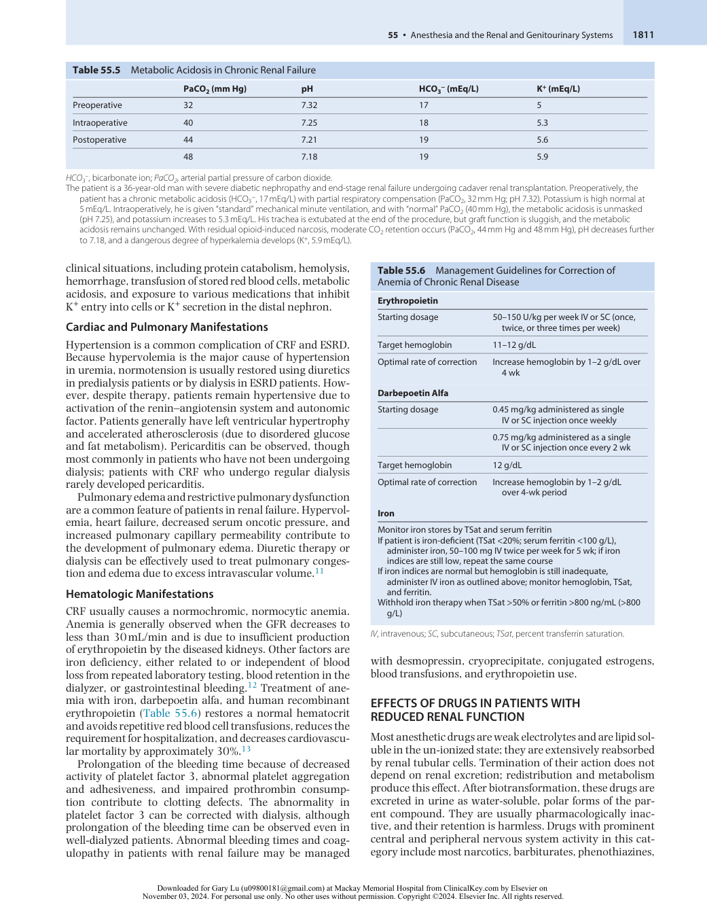

:::

<!-- PDF page 9 -->

**Table 55.7** Drugs Used or Encountered in Anesthesia Practice that Significantly Depend on Renal Elimination

|**Completely Dependent**|**Partially Dependent**|
|---|---|
|Digoxin, inotropes (used frequently; monitoring of blood levels indicated in chronic renal failure)|Intravenous anesthetics – barbiturates|
|Others – aminoglycosides, vancomycin, cephalosporins, and penicillins|Muscle relaxants – pancuronium|
||Anticholinergics – atropine, glycopyrrolate|
||Cholinesterase inhibitors – neostigmine, edrophonium|
||Others – milrinone, hydralazine, cycloserine, sulfonamides, and chlorpropamide|

patients have impaired renal function.18 An increased clinical effect is likely with alfentanil in renal failure because of a decreased initial volume of distribution and an increased free fraction of alfentanil.19 However, no delay in recovery after alfentanil administration should be expected. Neither the pharmacokinetics nor the pharmacodynamics of remifentanil are altered by impaired renal function.20 Hydromorphone, as the parent drug, does not substantially accumulate in hemodialysis patients. Conversely, an active metabolite, hydromorphone- 3- glucuronide, quickly accumulates between dialysis treatments but seems to be effectively removed during hemodialysis.21 With careful monitoring, hydromorphone can be used safely in patients who require dialysis. However, it should be used with caution in patients with a GFR less than 30 mL/min and who have yet to start dialysis or who have withdrawn from dialysis.

### Inhaled Anesthetics

butyrophenone derivatives, benzodiazepines, ketamine, and local anesthetics. However, several drugs are lipid insoluble or are highly ionized in the physiologic pH range and are eliminated unchanged in urine. Their duration of action may be extended in patients with impaired renal function. Drugs in this category include muscle relaxants, cholinesterase inhibitors, thiazide diuretics, digoxin, and many antibiotics (Table 55.7).14

### Opioids

Renal failure has implications of major clinical importance with respect to the metabolism and excretion of morphine and meperidine. For the fentanyl congeners, the clinical importance of renal failure is less marked.15

Morphine is an opioid with active metabolites that depend on renal clearance mechanisms for elimination. Morphine is principally metabolized by conjugation in the liver, and the water- soluble glucuronides (morphine- 3- glucuronide and morphine- 6- glucuronide) are excreted via the kidney. The kidney also plays a role in the conjugation of morphine, accounting for nearly 40% of its metabolism.16 Patients with renal failure can develop high levels of morphine- 6- glucuronide and life- threatening respiratory depression. In view of these changes induced by renal failure, alternatives to morphine should be considered in patients with severely altered renal clearance mechanisms.15

The clinical pharmacology of meperidine is also significantly altered by renal failure. Normeperidine, the chief metabolite, has analgesic and central nervous system (CNS) excitatory effects. Because the active metabolites are subject to renal excretion, this potential CNS toxicity secondary to normeperidine accumulation is especially a concern in patients in renal failure.17

As a result, meperidine should not be avoided in patients with renal insufficiency.

The clinical pharmacology of the fentanyl congeners is not grossly altered by renal failure, although a decrease in plasma protein binding potentially can alter the free fraction of the fentanyl class of opioids.15 As with fentanyl, sufentanil pharmacokinetics are not altered in any consistent fashion by renal disease, although greater variability exists in the clearance and elimination half- life of sufentanil when

All inhaled anesthetics are biotransformed to some extent, with the nonvolatile products of metabolism eliminated almost entirely by the kidney.22 Reversal of the CNS effects of inhaled anesthetics depends on pulmonary excretion; therefore, impaired kidney function would not alter the response to these anesthetics. From the viewpoint of selecting an anesthetic that would not be harmful to patients with mild or moderate impairment of renal function, all the modern potent inhaled vapor anesthetics are acceptable. Fluoride levels after isoflurane increase by only 3 to 5 μM and by only 1 to 2 μM after halothane23,24 ; therefore, these anesthetics have no nephrotoxic potential.

Desflurane and sevoflurane, two newer inhaled anesthetics, are remarkably different from each other with respect to their molecular stability and biotransformation. Desflurane is highly stable and resists degradation by soda lime25 and the liver. The mean inorganic fluoride concentration after 1 minimum alveolar concentration (MAC)- hour exposure to desflurane was less than 1 μM.26 The safety of desflurane in renal failure patients has been confirmed. In addition, more sensitive indices of renal function—urine retinol- binding protein and β- _N_ - acetylglucosaminidase—showed no evidence of renal damage. Prolonged exposure to desflurane (7 MAC- hours) has been associated with normal renal function.27

Sevoflurane is not very stable. Soda lime causes it to decompose,28 and it is biotransformed by the liver. Plasma inorganic fluoride concentrations approaching nephrotoxic levels (50 μmol/L)29 have been reported after prolonged inhalation of sevoflurane. However, no evidence of gross changes in renal function has been found in humans.30 Data also suggest that sevoflurane can safely be delivered at fresh gas flows as low as 1 L/min without significant production of a breakdown product named compound A (fluoromethyl- 2,2- difluoro- 1- [trifluoromethyl] vinyl ether), which is considered potentially nephrotoxic.31

Inhaled anesthetics cause a transient reversible depression in renal function. GFR, renal blood flow, urine output, and urinary excretion of sodium are decreased (Table 55.8). Probable mechanisms include loss of renal autoregulation, activation of neurohumoral factors (e.g., antidiuretic hormone, vasopressin, renin), and neuroendocrine responses. Although most inhaled anesthetics have been shown to

::: details 原始表格與符號（PDF 第 9 頁）

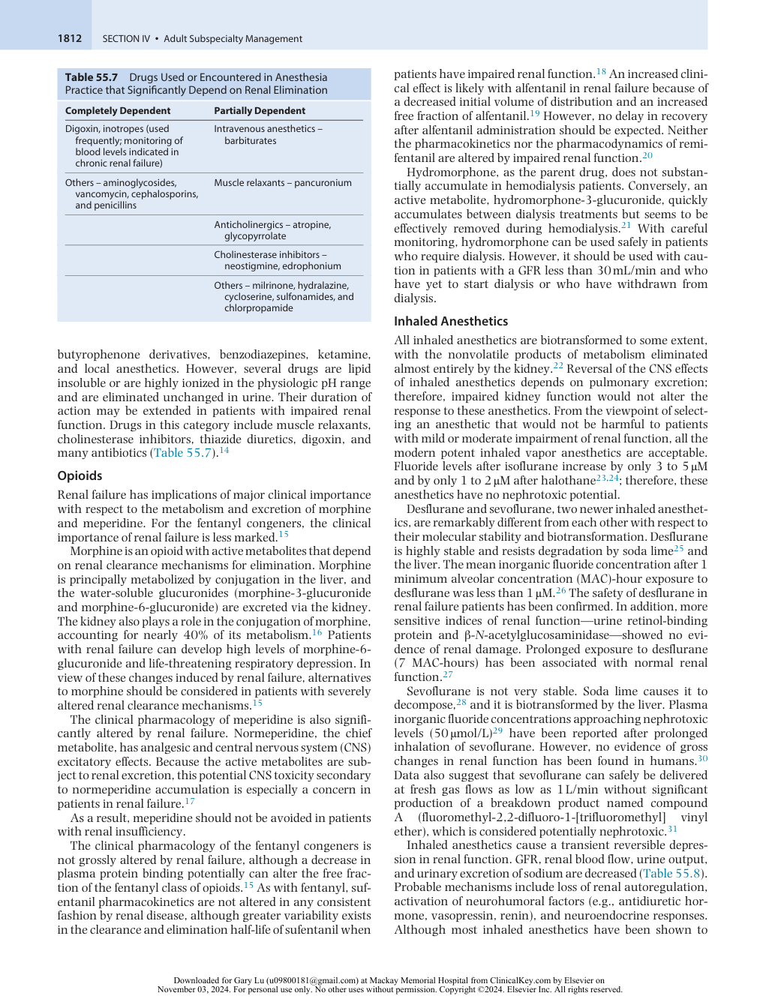

:::

<!-- PDF page 10 -->

**Table 55.8** Effects of Various Anesthetics on Renal Function

||**RBF**|**GFR**|**Urine Output**|**Urine Solutes**|
|---|---|---|---|---|
|General anesthesia|↓|↓|↓|↓|
|**Intravenous anesthetics**|||||
|Thiopental|↔|↓|↓|↓|
|Midazolam|↔|↔|↓|↔|
|Fentanyl (high dose)|↔|↔|↔|↔|
|**Inhaled anesthetics**|||||
|Halothane|↔|↓|↓|↓|
|Isoflurane, enflurane|↔↓|↓↓|↓↓|↓↓|
|PEEP Isoflurane|↓↔|↓↓|↓↓|o↓|
|Regional anesthesia PEEP|↓|↓|↓|o|
|Epidural (with epinephrine) Regional anesthesia|↓|↓|↓|o|
|Epidural (without epinephrine) Epidural (with epinephrine)|↔↓|↔↓|↔↓|oo|
|Spinal epidural (without epinephrine)|↔↔|↔↔|↔↔|oo|
|Spinal|↔|↔|↔|o|

_GFR_ , glomerular filtration rate; _PEEP_ , positive end- expiratory pressure; _RBF_ , renal blood flow; ↔, no significant change; _o,_ significant data; ↓, decrease. Although conflicting reports of anesthetic effects on RBF have been reported because of different investigative methods, the current literature seems to support these data. From Hemmings HC Jr. Anesthetics, adjuvant drugs and the kidney. In: Malhotra V, ed. _Anesthesia for Renal and Genitourinary Surgery_ , New York: McGraw- Hill: 1996;20.

reduce GFR and urinary excretion of sodium, studies examining their effects on renal blood flow have yielded conflicting results, which can be explained by differences in experimental methodology. Data suggest that renal blood flow is maintained with halothane, isoflurane, and desflurane32,33 but that it is decreased with sevoflurane.34

### Intravenous Anesthetics

Reversal of CNS effects after the administration of ultrashort- acting barbiturates such as thiopental and methohexital occurs because of redistribution, and hepatic metabolism is the sole route of elimination of these drugs. Thiopental is 75% to 85% bound to albumin,35 the concentration of which may be markedly reduced in uremia. Because it is a highly bound drug, reduced binding permits a greater proportion of an administered dose of thiopental to reach receptor sites. In addition, thiopental is a weak acid, with its p _K_ a in the physiologic range; acidosis results in more un- ionized, nonbound, active thiopental. In combination, these changes produce an increase in the free fraction of thiopental from 15% in normal patients to 28% in patients with CRF. With thiopental metabolism essentially unchanged in renal disease, the dose to produce and maintain anesthesia should be reduced.36 The same considerations are true for methohexital, although metabolism plays a slightly greater part in the termination of its therapeutic effect.37

Propofol does not adversely affect renal function as reflected by measurements of creatinine concentration. Prolonged infusions of propofol may result in the excretion of green urine because of the presence of phenolic metabolites in the urine. This discoloration does not affect renal function. Urate excretion is increased after the administration

of propofol and is usually manifested as cloudy urine when urate crystallizes under conditions of low pH and temperature.38

There are no reports of the disposition of narcotics and tranquilizers when used in large dosage for anesthesia in uremic patients. These drugs are extensively metabolized before excretion; therefore, they should not have a particularly prolonged effect. The benzodiazepines, especially diazepam,14 typically have a long half- life and tend to accumulate in renal dysfunction. However, remimazolam, a novel intravenous short- acting sedative indicated for procedures under 30 minutes, is not affected by any degree of renal impairment. This is because it is primarily degraded by tissue specific esterases, which makes it a promising short- term sedative in patients with renal impairment.39

Because of the greater ease of reversibility of the potent inhaled anesthetics versus intravenous drugs, inhaled anesthetics may offer some advantages for the induction of general anesthesia in uremic patients.

### Muscle Relaxants and Their Antagonists

Succinylcholine has been used without difficulty in patients with decreased or absent renal function. Its metabolism is catalyzed by pseudocholinesterase to yield the nontoxic end products succinic acid and choline. The metabolic precursor of these two compounds, succinylmonocholine, is excreted by the kidneys. Large doses of succinylcholine, which might result from prolonged infusion, should be avoided in patients with renal failure. Although pseudocholinesterase levels are reduced in uremia,40 these reductions are insufficient and cause a prolonged block. Hemodialysis has been reported to have no effect on cholinesterase levels.41

::: details 原始表格與符號（PDF 第 10 頁）

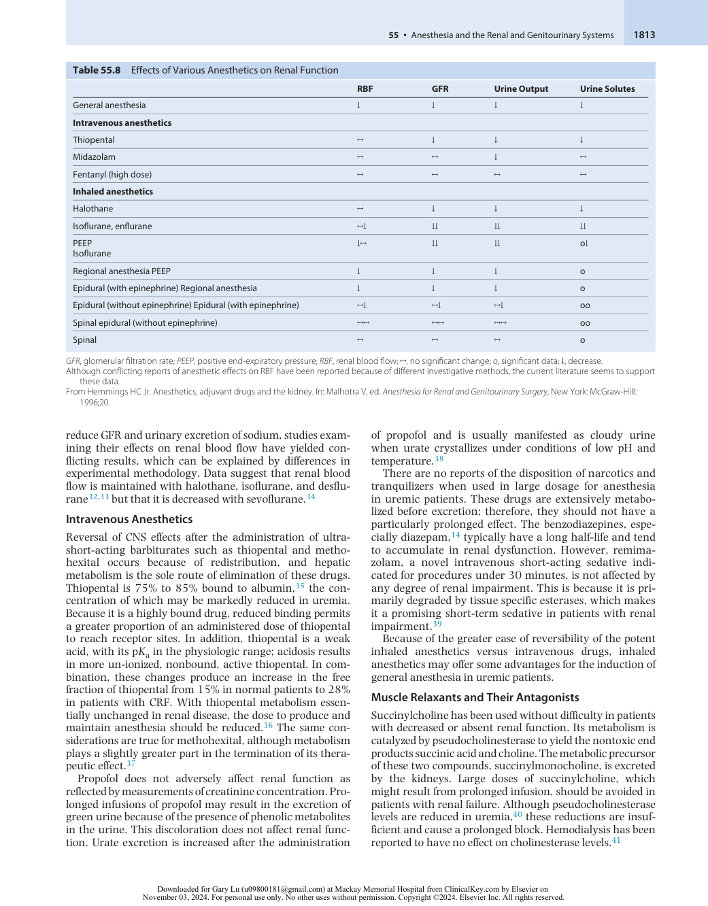

:::

<!-- PDF page 11 -->

**Table 55.9** Pharmacokinetics Data for Nondepolarizing Muscle Relaxants in Normal and Anephric Patients

|**Drug**|**Patients Studied**|**Elimination Half- Life (h)**|**Clearance (mL/kg/min)**|**Volume of Distribution (L/kg)**|
|---|---|---|---|---|
|Vecuronium|Normal|0.9|5.3|0.20|
||Anephric|1.4|3.1|0.24|
|Atracurium|Normal|0.3|6.1|0.18|
||Anephric|0.4|6.7|0.22|
|Pancuronium|Normal|1.7|1|0.14|
||Anephric|8.2|0.3|0.14|
|Rocuronium|Normal|0.71|2.9|0.207|
||Anephric|0.97|2.9|0.264|
|Cisatracurium|Normal|—|5.2|0.031|
||Anephric|—|—|—|
|Mivacurium|Normal|0.03|106|0.278|
||Anephric|0.06|80|0.478|

One significant effect of succinylcholine when administered to a patient with renal failure is its effect on serum potassium. Administration of succinylcholine causes a rapid, transient increase of 0.5 mEq/L in the serum potassium concentration. In traumatized, burned, or neurologically injured patients, the increase may be 5 to 7 mEq/L, probably because of denervation supersensitivity of the muscle membrane to succinylcholine and to acetylcholine,42 which can result in cardiovascular collapse. Likewise, an exaggerated increase in serum potassium could be particularly dangerous in uremic patients with hyperkalemia; therefore, the use of succinylcholine is inadvisable, unless the patient has undergone dialysis within 24 hours before surgery. If the patient has recently undergone dialysis or has normal serum potassium, the use of succinylcholine is safe in the absence of other contraindications to the medication.

The disposition of nondepolarizing muscle relaxants in patients with renal failure has been well studied. Renal failure influences the pharmacology of nondepolarizing muscle relaxants by producing either decreased elimination of the drug or its metabolites by the kidney or decreased activity of enzymes that metabolize the drug, such as in the case of mivacurium (Table 55.9). Consequently, the duration of action of muscle relaxants may be prolonged in patients with renal failure.

Approximately 40% to 50% of a long- acting nondepolarizing muscle relaxant, pancuronium, is excreted in urine. A portion of this excretion occurs after biotransformation to the less active metabolite 3- hydroxypancuronium.43 Pancuronium has a prolonged terminal elimination half- life in patients with reduced renal function (see Table 55.9)44 ; fortunately pancuronium has been replaced by other nondepolarizing muscle relaxants such as atracurium and vecuronium. Atracurium is degraded by enzymatic ester hydrolysis and nonenzymatic alkaline degradation (Hofmann elimination) to inactive products that are not dependent on renal excretion for termination of action.45 Predictably, their terminal elimination half- life and indices of neuromuscular blockade (onset, duration, and recovery) are the same in patients with normal and absent renal function.46

Unlike atracurium, approximately 30% of a dose of vecuronium is eliminated by the kidneys. Lynam and

colleagues47 found that the duration of neuromuscular blockade after the administration of vecuronium was longer in patients with renal failure than in patients with normal renal function (99 vs. 54 minutes) because of a longer elimination half- life (83 vs. 52 minutes) and lower plasma clearance (3.1 mL/kg/min vs. 5.3 mL/kg/min). The impact of other drug interactions on metabolism and clearance of these drugs has also been studied. For example, the interaction between the solvent of cyclosporine with atracurium and vecuronium has been reported, with the action of these muscle relaxants potentiated in cats,48 but it is unknown whether such potentiation also occurs in human renal transplant recipients.

Cisatracurium is the single _cis_ isomer of atracurium. Organ- independent mechanisms (Hofmann elimination) account for 77% of the total clearance of cisatracurium. Because renal excretion accounts for only 16% of the elimination of cisatracurium, renal failure should have little effect on its duration of action.46

The short- acting drug mivacurium is metabolized by plasma pseudocholinesterase. Its effect has been shown to be lengthened by 10 to 15 minutes in patients with ESRD, most likely because of a decrease in plasma cholinesterase activity in these patients associated with uremia or hemodialysis49,50 and there is a decrease in the mivacurium requirement by infusion in anephric patients.50

Rocuronium is an aminosteroid nondepolarizing muscle relaxant. The elimination half- life of rocuronium is increased in renal failure because of an increase in the volume of distribution with no change in clearance. This explanation might account for a longer duration of action in anephric patients, although its clinical significance is uncertain.51

Pharmacokinetic data for the cholinesterase inhibitors neostigmine, pyridostigmine, and edrophonium for normal, anephric, and renal transplant patients are presented in Table 55.10; there are no major differences among the three drugs.52–54 Renal excretion is of major importance for the elimination of all three reversal drugs, with approximately 50% of neostigmine and 70% of pyridostigmine and edrophonium excreted in urine. Excretion of all the cholinesterase inhibitors is delayed in patients with impaired renal function to the same or perhaps to a slightly greater extent than is elimination of muscle relaxants. Reappearance of

::: details 原始表格與符號（PDF 第 11 頁）

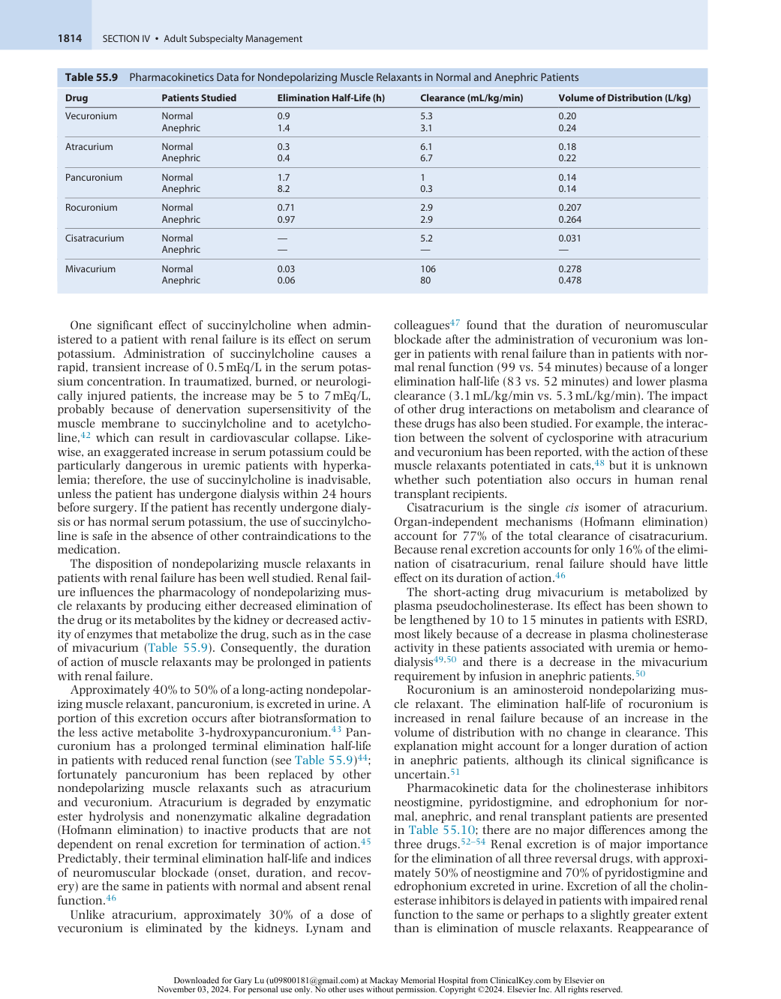

:::

<!-- PDF page 12 -->

**Table 55.10** Pharmacokinetics Data for Cholinesterase Inhibitors in Normal, Anephric, and Renal Transplant Patients

|**Drug**|**Patients Studied**|**Elimination Half- Life (h)**|**Clearance (mL/kg/min)**|**Volume of Distribution (L/kg)**|
|---|---|---|---|---|
|Neostigmine|Normal|1.3|8.4|0.7|
||Anephric|3*|3.9*|0.8|
||Renal transplant|1.7|9.4|1.1|
|Pyridostigmine|Normal|1.9|8.6|1.1|
||Anephric|6.3*|2.1*|1|
||Renal transplant|1.4|10.8|1|
|Edrophonium|Normal|1.9|8.2|0.9|
||Anephric|3.6*|2.7*|0.7|
||Renal transplant|1.4|9.9|0.9|

* _P_ &lt; .05 vs. normal.

neuromuscular blockade after pharmacologic reversal of neuromuscular blockade in a patient with renal failure is, in most cases, due to some other cause. Table 55.10 contains data indicating that the pharmacokinetics of all the cholinesterase inhibitors is similar in healthy patients and in patients with well- functioning newly transplanted kidneys.

Sugammadex, a newer reversal drug, is a cyclodextrin molecule that inactivates aminosteroidal neuromuscular blockers, such as vecuronium and rocuronium, by selectively binding to them. The resultant sugammadex–neuromuscular blocker complex is excreted by the kidney. In patients with severe renal impairment, these cyclodextrin complexes can accumulate. Although sugammadex can effectively reverse neuromuscular blockade in these patients, the effect of prolonged exposure to sugammadex is unclear. There are insufficient data at this time to recommend the routine administration of sugammadex to patients with severe renal impairment.55 There are also data to suggest that sugammadex complexes can be effectively dialyzed using high- flux hemodialysis.56

### Vasopressors and Antihypertensive Drugs

Patients with severe renal disease are frequently given antihypertensive and other cardiovascular medications. More than 90% of the thiazides57 and 70% of furosemide58 are excreted by the kidneys, and they have prolonged durations of action in patients with abnormal or absent renal function. Propranolol is almost completely metabolized in the liver,59 and esmolol is biodegraded by esterases in the cytosol of red blood cells60 ; therefore, their effects are not prolonged in patients with abnormal or absent renal function. The calcium channel–blocking agents nifedipine, verapamil, and diltiazem are extensively metabolized in the liver to pharmacologically inert products; they can be administered in usual doses to patients with renal insufficiency.61 Nitroglycerin can be useful because it is metabolized rapidly, with less than 1% excreted unchanged in urine.62

Sodium nitroprusside has had a resurgence in use since its initial introduction as a hypotensive drug in the 1920s. Cyanide is an intermediate in the metabolism of sodium nitroprusside, with thiocyanate being the final metabolic product. Although cyanide toxicity as a complication of sodium nitroprusside therapy is well described, it is less well appreciated that thiocyanate is also potentially toxic. The half- life of thiocyanate is normally more than 4 days, and it is prolonged in patients with renal failure. Hypoxia, nausea, tinnitus, muscle spasm, disorientation, and psychosis

have been reported when thiocyanate levels are more than 10 mg/100 mL.63 Sodium nitroprusside is less desirable for prolonged administration than either trimethaphan or nitroglycerin.

Hydralazine is slower acting than the other three drugs discussed previously. Its action is terminated by hydroxylation and subsequent glucuronidation in the liver, with approximately 15% excreted unchanged in urine.64 The elimination half- life of hydralazine is prolonged in patients with uremia; therefore caution is required when it is administered.65 After a single intravenous dose of 0.5 mg/kg of labetalol, the volume of distribution, clearance, and elimination half- life were similar in patients with ESRD and in healthy volunteers.66

If administration of a vasopressor is necessary, a direct α- adrenergic- stimulating drug such as phenylephrine would be effective. This type of vasopressor causes the greatest interference with renal circulation. Although β- adrenergicstimulating drugs such as isoproterenol maintain heart and brain perfusion without renal vasoconstriction, they also increase myocardial irritability. When possible, it is best to substitute simple measures such as blood volume expansion for drug therapy.

### ACUTE KIDNEY INJURY AND HEMODIALYSIS

Although often considered a discrete syndrome, AKI represents a diverse array of pathophysiologic processes of varied severity and cause. These include decreases in GFR as the result of disruption of normal renal perfusion without causing parenchymal injury; partial or complete obstruction to urinary flow; and a spectrum of processes with characteristic patterns of glomerular, interstitial, tubular, or vascular parenchymal injury. AKI- precipitating events are quite often multifactorial and occur in a heterogeneous patient population.67 Authors have used terms such as renal insufficiency, renal dysfunction, acute renal failure, and renal failure requiring dialysis somewhat interchangeably. Parameters used to define these terms include (Fig. 55.5) absolute and percentage changes in creatinine values, absolute and percentage changes in estimated GFRs, and reduction in output.68 The incidence of AKI depends on the type of surgery and preexisting kidney function (Box 55.2 and Table 55.11).

In cardiac surgery, incidence is between 7.7% and 11.4%69 when defined broadly, whereas frequency of AKI requiring dialysis is generally lower, ranging between less

::: details 原始表格與符號（PDF 第 12 頁）

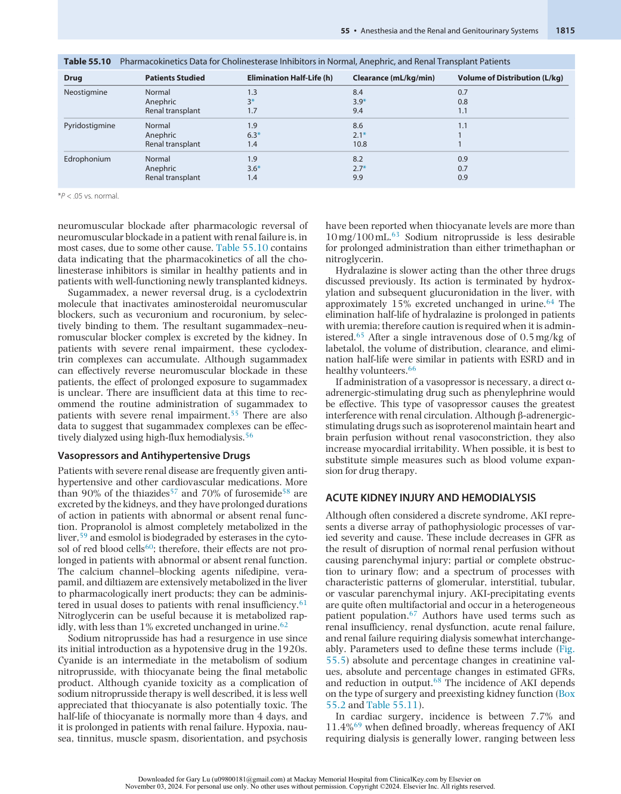

:::

<!-- PDF page 13 -->

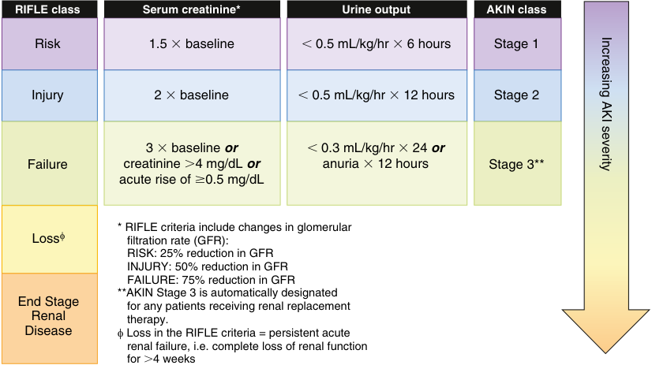

RIFLE class Serum creatinine* Urine output AKIN class Risk 1.5 � baseline � 0.5 mL/kg/hr � 6 hours Stage 1 Injury 2 � baseline � 0.5 mL/kg/hr � 12 hours Stage 2 3 � baseline  or � 0.3 mL/kg/hr � 24  or Failure creatinine �4 mg/dL  or anuria � 12 hours Stage 3** acute rise of �0.5 mg/dL * RIFLE criteria include changes in glomerular Loss ë    filtration rate (GFR):    RISK: 25% reduction in GFR    INJURY: 50% reduction in GFR    FAILURE: 75% reduction in GFR **AKIN Stage 3 is automatically designated End Stage    for any patients receiving renal replacement Renal    therapy. Disease ë Loss in the RIFLE criteria = persistent acute    renal failure, i.e. complete loss of renal function    for �4 weeks Increasing AKI severity 

**Fig. 55.5 Parameters used to define acute kidney injury (AKI).** (From Mehta RL, Kellum JA, Shah SV, et al. Acute Kidney Injury Network: report of an initiative to improve outcomes in kidney injury. _Crit Care_ . 2007;11:R31.)

### Box 55.2 Risk Factors for Development of Postoperative Acute Kidney Injury

### Preoperative Factors

- Preoperative renal dysfunction

- Increasing age

- Heart disease (ischemic or congestive)

- Smoking

In noncardiac surgery, several independent risk factors for AKI have been identified by Kheterpal and co- workers73 : age, emergent surgery, liver disease, body mass index (BMI), high- risk surgery, peripheral vascular disease, and chronic obstructive pulmonary disease (requiring chronic bronchodilator therapy). Based on incremental score, the frequency of renal failure increased, ranging between 0.3% and 4.5%, respectively.

- Diabetes mellitus

- American Society of Anesthesiologists Physical Status classification 4 or 5

### Intraoperative Factors

- Emergency surgery or intraperitoneal, intrathoracic, suprainguinal vascular surgeries

- Erythrocyte transfusion

- Inotrope use

- Aortic cross- clamp time

- Cardiopulmonary bypass: furosemide use, urine output, need for a new pump run

### Postoperative Factors

- Erythrocyte transfusion

- Vasoconstrictor use

- Diuretic use

- Antiarrhythmic drug use

- Data from Abelha FJ, Botelho M, Fernandes V, et al. Determinants of postoperative acute kidney injury. _Crit Care_ . 2009;13:R19; Parolari A, Pesce LL, Pacini D, et al. Risk factors for perioperative acute kidney injury after adult cardiac surgery: role of perioperative management. _Ann Thorac Surg_ . 2012;93:584–591.

than 1% and 5%. In gastric bypass surgery, the incidence is 8.5%,70 and after aortic aneurysm surgery, it is approximately 15% to 16%.71 Similarly, liver transplant is also associated with a high frequency of AKI. It is reported that 48% to 94%72 of patients suffer from acute worsening renal function after liver transplantation.

### PERIOPERATIVE MANAGEMENT OF PATIENTS WITH ACUTE KIDNEY INJURY

Although many factors have been shown to contribute to AKI in surgical patients, there are few interventions to prevent AKI and no obvious cure for perioperative renal injury. A complete review of such interventions is beyond the scope of this chapter; however, some deserve mention.

### Dialysis

Dialysis may not decrease perioperative AKI; however, it can treat the associated acidosis, hyperkalemia, and hypervolemia. For certain surgeries, such as aortic, dialysis actually reduces 30- day mortality rates in patients who develop loss of renal function. As many as 75% of these survivors regain kidney function and become independent of dialysis.74

### Nondialytic Management

Optimal therapy for renal dysfunction has not been established, and it is not clear whether interventions such as angiotensin-converting enzyme (ACE) inhibitor therapy or diuretic therapy prevent decline in kidney function around the time of surgery.69

Normal hemodynamic variables probably should be preserved during the operative period to prevent AKI. In addition, scavengers of oxygen free radicals such as mannitol and _N_ - acetylcysteine have been given to prevent ischemia– reperfusion injury. However, studies implementing these strategies have failed to show benefit in reduction of AKI in

::: warning 符號需核對
此頁有符號無法完整擷取，請展開下方原始頁面核對。
:::

::: details 原始表格與符號（PDF 第 13 頁）

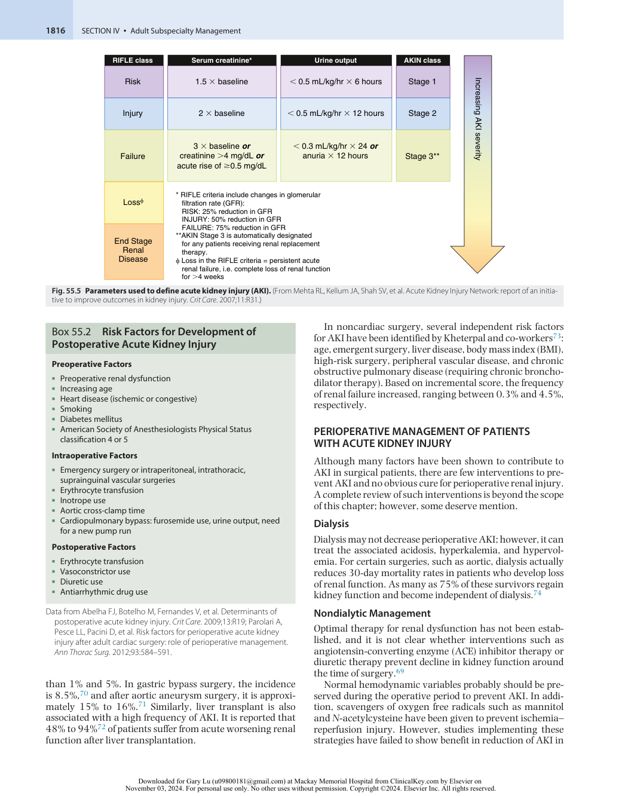

:::

<!-- PDF page 14 -->

**Table 55.11** Common Causes of Postoperative Decreased Urine Output and Acute Kidney Injury

|||**SITE OF DEFECT**||
|---|---|---|---|
||**Prerenal**|**Renal**|**Postrenal**|
|Differential diagnoses|Hypotension Absolute Relative|Acute tubular necrosis Ischemia–reperfusion Radiocontrast|Urinary catheter obstruction Catheter kinking Debris|
||Hypovolemia|Acute interstitial nephritis|Prostatic hypertrophy|
||Absolute Relative (e.g., IAH)||Bladder spasm Urinary retention|

From Chenitz KB, Lane- Fall MB. Postoperative oliguria. _Anesth Clin_ . 2012;513–526.

cardiac surgery patients. For years, mannitol was administered before aortic clamping, especially prior to the application of a suprarenal cross- clamp during abdominal aortic aneurysm. Clinical trials thus far have failed to demonstrate that this approach reduces the incidence of renal failure in this population of patients.75

Both dopamine and atrial natriuretic peptide initially showed promise in the prevention of AKI because of their vasoactive effects leading to increased renal blood flow. Studies have shown neither dopamine76 nor atrial natriuretic peptide77 to be associated with improved mortality. Use of fenoldopam, a selective renal dopamine receptor agonist, has been shown to reduce postoperative AKI; however, it has not been associated with a reduction in the need for renal replacement therapy or hospital mortality.78

## Renal and Genitourinary Procedures

### TRANSURETHRAL RESECTION OF THE PROSTATE

Transurethral resection of the prostate (TURP) is associated with a particular set of concerns with anesthetic implications. These issues must be considered when choosing an anesthetic technique, along with the usual considerations, such as the general health of the patient, the length of the procedure, and patient and surgeon preferences.

### Pathophysiology of Prostate Hyperplasia

The prostatic gland is often described as a walnut- sized organ at the base of the bladder. There are three major areas – the fibromuscular stroma that surrounds the gland and two glandular zones termed central and peripheral. There is also a smaller, approximately 5% of the normal prostate, glandular region that surrounds the prostatic urethra designated as the transition zone, which is the primary site of benign prostatic hyperplasia (BPH). Nodular expansion of this area causes compression of the urethra along with the associated partial bladder outlet obstruction in men.79 The prostate is rich in blood supply with vessels penetrating the prostatic capsule and branching within the gland. There are also large venous sinuses adjacent to the capsule.80 The prevalence of BPH increases precipitously from the fourth decade of life, peaking at 88% of men in their 80s.81

### Surgical Procedures

TURP has long been considered the “gold standard” for the surgical treatment of BPH. Over the past several decades,

the number of monopolar TURP (M- TURP) procedures performed annually in the United States has steadily declined secondary to advances in medical management, alpha blockers, and 5α-reductase inhibitors; the introduction of newer surgical treatment modalities, bipolar TURP (B- TURP), laser TURP (L- TURP), microwave ablation, and aquablation; and the development of patient care guidelines.82–84

The TURP procedure is performed by inserting a resectoscope through the urethra and resecting or vaporizing prostatic tissue in an orderly fashion. This can be accomplished using one of several techniques: M- TURP or B- TURP using an electrically powered cutting–coagulating metal loop, holmium laser enucleation of the prostate (HoLEP), bipolar plasma vaporization, or laser  vaporization.85–87 A recently introduced novel technique is aquablation, a minimally invasive water ablation technique combining image guidance and robotics with a high- velocity saline stream for targeted and heat- free removal of prostatic tissue.83 During resection, care must be taken not to violate the prostatic capsule. If the capsule is violated, large amounts of irrigation fluid may be absorbed into the circulation via the periprostatic or retroperitoneal spaces. If perforation is suspected, the procedure should be quickly terminated, and hemostasis should be established.88

Bleeding during M- TURP is common but is usually easily controlled. Arterial bleeding is controlled by electrocoagulation; however, when large venous sinuses are opened, hemostasis becomes difficult. If bleeding becomes uncontrollable, the procedure should be terminated as quickly as possible, and a Foley catheter should be passed into the bladder and traction applied. Excessive bleeding requiring transfusion occurs in approximately 2.5% of M- TURP procedures.89

### Irrigation Solutions

Ideally, an irrigation solution for use during TURP should be isotonic, nonhemolytic, electrically inert, transparent, nonmetabolized, nontoxic, rapidly excreted, easily sterilized, and inexpensive.90,91 Such a solution does not exist. Initially, the solution of choice for M- TURP was distilled water because it is electrically inert, transparent, and inexpensive, but it is extremely hypotonic. When absorbed into the circulation, it causes massive hemolysis, hyponatremia, renal failure, and CNS symptoms.92 Solutions of normal saline or Ringer lactate are isosmotic and are tolerated if absorbed into the circulation but are highly ionized and would cause dispersion of the high- frequency current from the M- TURP resecting loop. These issues led to the use of nearly isotonic

::: details 原始表格與符號（PDF 第 14 頁）

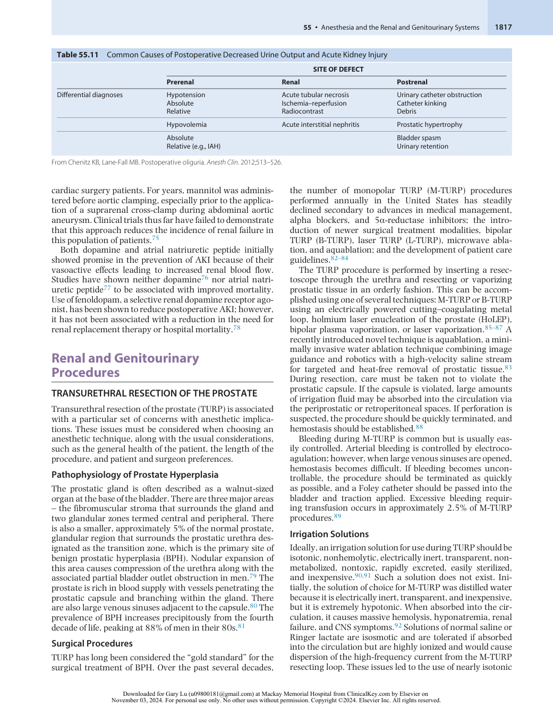

:::

<!-- PDF page 15 -->

**Table 55.12** Osmolality of Irrigation Solutions Used for Transurethral Resection of the Prostate

|**Solution**|**Osmolality (mOsm/kg)**|
|---|---|
|Glycine, 1.2%|175|
|Glycine, 1.5%|220|
|Cytal (see text)|178|
|Sorbital, 3.5%|165|
|Mannitol, 5%|275|
|Glucose, 2.5%|139|
|Urea, 1%|167|
|Distilled water|0|

irrigation solutions, such as glycine, Cytal (a combination of 2.7% sorbitol and 0.54% mannitol), sorbital, mannitol, glucose, and urea (Table 55.12). These solutions allow for electrocautery and are moderately hypotonic to maintain transparency.93,94

Although these irrigation solutions cause no significant hemolysis, excessive absorption can lead to several perioperative complications, such as circulatory overload, pulmonary edema, and hyponatremia. In addition, the solutes can have adverse effects: glycine can cause cardiac, neurologic, and retinal effects; mannitol rapidly expands the blood volume and can cause pulmonary edema in cardiac compromised patients; sorbital is metabolized to fructose and lactate and may cause hyperglycemia and/or lactic acidosis; and glucose can cause severe hyperglycemia in diabetic patients.

Replacement of distilled water with nearly isosmotic solutions has eliminated hemolysis and its sequelae as a complication of M- TURP. The incidence of severe CNS symptoms associated with severe hyponatremia, such as seizures and coma, has been reduced. However, the other major complication associated with the absorption of large volumes of irrigation solutions, overhydration, still is present. The use of normal saline as the bladder irrigation solution with the newer surgical techniques has eliminated the risks of dilutional hyponatremia and TURP syndrome.

### Anesthetic Considerations for Transurethral Resection of the Prostate

Spinal anesthesia is considered the anesthetic technique of choice when traditional M- TURP is performed.95 Spinal anesthesia provides adequate anesthesia for the patient with relaxation of the pelvic floor and perineum for the surgeon. Cardiac morbidity and mortality after M- TURP were similar for general or regional96 ; however, spinal anesthesia has the advantage of allowing the patient to remain awake and enables the anesthesiologist to recognize the early signs and symptoms (e.g., mental status changes) of TURP syndrome or the extravasation of irrigating solution. Restlessness and confusion are early signs of hyponatremia and/or serum hypoosmolality and generally not signs of inadequate anesthesia. The continued administration of sedatives or the induction of general anesthesia might mask severe complications of TURP syndrome and even lead to death.97

A sensory level of T10 provides satisfactory regional anesthesia for TURP by achieving an anesthetic block level that interrupts sensory transmission from the prostate and bladder neck; in addition, this sensory level eliminates the uncomfortable sensation of bladder distention. Higher sensory levels might mask the symptoms (abdominal or shoulder pain and/or nausea and vomiting) of accidental perforation of the bladder or prostatic capsule in the awake patient.94

Spinal anesthesia has a few advantages over epidural anesthesia for TURP. It is technically easier to perform in elderly patients. The incomplete block of the sacral nerves, which provide sensory innervation to the prostate, bladder neck, and penis, occasionally occurs with epidural anesthesia and is usually avoided with spinal anesthesia. However, if a regional technique cannot be performed because of technical difficulty, concerns of sacral nerve coverage, coagulation status, and/or patient refusal, then general anesthesia will be required.

Controversy exists on whether regional or general anesthetic techniques influence blood loss during TURP. Some studies have reported decreased bleeding under regional anesthesia,98–100 whereas others found no significant difference between the techniques.101–104 Taking into consideration the studies that observed decreased bleeding with regional anesthesia, the authors have postulated that regional anesthesia reduces blood loss not only by decreasing systemic blood loss but also by decreasing central and peripheral venous pressures. However, spinal anesthesia, by reducing central venous pressure (CVP), may allow for greater absorption of irrigating solution compared to general anesthesia.105 Additional factors that influence blood loss during TURP are the vascularity and size of the gland, the duration of the procedure, the number of sinuses opened during resection, and the presence of infection and prostatic inflammation from repeated or recent catheterizations.89,95

Anesthetic considerations for TURP should also include positioning. TURP is usually performed in the lithotomy position with a slight Trendelenburg tilt. This positioning results in changes in pulmonary blood volume; a decrease in pulmonary compliance; a cephalad shift of the diaphragm; and a decrease in lung volumes such as residual volume, functional residual volume, tidal volume, and vital capacity. Cardiac preload may also increase. Nerve injuries to the common peroneal, sciatic, and femoral nerves may occur.106

### Morbidity and Mortality After Transurethral Resection of the Prostate

Patients presenting for TURP are often elderly and tend to have coexisting diseases. With a reported 30- day mortality rate associated with M- TURP to be between 0.2% and 0.8%, the common causes of death include pulmonary edema, renal failure, and myocardial infarction.95,107 Historically, mortality rates were reported to be similar in patients receiving regional anesthesia or general anesthesia.108 However, in a large analysis, using a database from the American College of Surgeons National Surgical Quality Improvement Program (ACS- NSQIP) covering a six year period from 2010 to 2016 of 28,486 patients undergoing TURP, compared the 30- day mortality outcomes of patients receiving neuraxial (epidural or spinal) vs. general

::: details 原始表格與符號（PDF 第 15 頁）

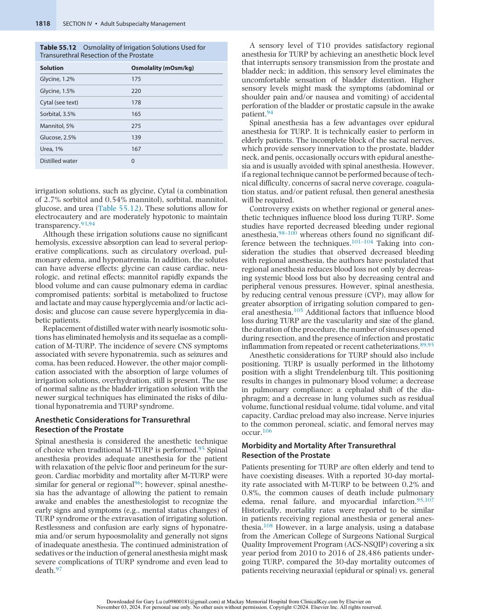

:::

<!-- PDF page 16 -->

anesthesia (endotracheal or laryngeal mask airway); overall mortality was below 1%, with neuraxial being associated with a lower risk than general anesthesia within 30 days of surgery. Neuraxial was also shown to have a lower risk of postoperative complications including sepsis and reoperation, although the risk of urinary tract infections was 1.6% higher in the neuraxial versus the general cohort (2.5 vs. 0.9%).109

In one study of 3885 patients the postoperative morbidity rate was noted to be 18%, with increased postoperative morbidity seen in patients with acute urinary retention, gland size greater than 45 g, resection exceeding 90 minutes, and age older than 80 years.95 In a large analysis of 31,813 patients queried from ACS- NSQIP covering a ten year period from 2006 to 2016 evaluating the impact of surgical time on complications after TURP, the authors found that the overall complication rate was 9.0% and increased significantly with longer operative times. The risk for sepsis or septic shock, deep vein thrombosis (DVT) or pulmonary embolism (PE), transfusion, and reoperation increased for durations greater than 120 minutes with the safest being performed under 90 minutes.110

The most concerning complication of M- TURP is TURP syndrome. This syndrome has a multifactorial pathophysiologic presentation and is essentially an iatrogenic form of water intoxication caused by a combination of excessive absorption of irrigating solution and the resulting hyponatremia.111 Large studies have reported an incidence rate of mild to moderate TURP syndrome of between 0.78% and 1.4%.112,113 However, a mortality rate as high as 25% has been reported for severe TURP syndrome (serum sodium concentration &lt;120 mEq/L).114

Another concern, because many of the patients for TURP are elderly, is the incidence of postoperative cognitive dysfunction. In a small prospective study comparing spinal anesthesia with intravenous sedation to general anesthesia in elderly TURP patients, significant reduction in cognitive function was noted in both groups after 6 hours, with no difference in perioperative mental function between the groups at any time or even after 30 days.115

### Complications of Transurethral Resection of the Prostate

**Absorption of Irrigating Solution.** In almost every TURP procedure, irrigating solution is absorbed through opened prostatic venous sinuses. Several factors govern the amount and rate of absorption: (1) the height of the irrigating solution above the surgical table, which affects hydrostatic pressure; (2) the amount of distention of the bladder; (3) the extent of opened venous sinuses; and (4) the length of surgical resection time.116 On average, 10 to 30 mL of fluid is absorbed per minute of resection time, with the possibility of 6 to 8 L absorbed in procedures lasting up to 2 hours. Whether patients experience complications because of absorption of irrigating solution depends on the amount and type of fluid absorbed.117,118

### Excessive Circulatory Volume, Hyponatremia, and

**Hypoosmolarity.** The rapid volume expansion that occurs with excessive absorption of irrigation fluid leads to circulatory overload. Initially, hypertension and bradycardia may be observed, and in patients with compromised cardiac

function, this could progress to pulmonary edema and eventually cardiac arrest.119 After the initial hypertensive stage, a period of prolonged hypotension may follow. One suggested mechanism is the combination of hypertension and hyponatremia, which causes a net water flux along osmotic and hydrostatic pressure gradients out of the intravascular space into the pulmonary interstitium, causing pulmonary edema and hypovolemic shock.120–122 In addition, the release of endotoxins into the circulation with the associated metabolic acidosis also causes hypotension.123,124 Whether symptoms of circulatory overload occur in a given patient depends on the patient’s cardiovascular status, the amount and rapidity of absorption of irrigating fluid, and the extent of surgical blood loss.118

The severity of symptoms of hyponatremia correlate with the rate by which serum sodium concentration falls. Acute changes in serum sodium levels are more concerning than chronic hyponatremia.125 Additionally, it is often impossible to separate symptoms of cardiovascular compromise caused by hyponatremia from those secondary to circulatory overload. CNS symptoms and cardiovascular effects are observed with acute decreases in serum sodium levels to less than 120 mEq/L. At first, one may observe restlessness and confusion, and with continuing decreases in serum sodium levels this may progress to loss of consciousness and seizures (&lt;110 mEq/L). Hypotension, pulmonary edema, and congestive heart failure may also occur at serum sodium levels of less than 120 mEq/L, along with electrocardiogram changes (widened QRS complexes, ventricular ectopy, and ST segment increases) observed at levels less than 115 mEq/L. Eventually at levels near 100 mEq/L, respiratory and cardiac arrest may occur.126

The classic CNS signs of TURP syndrome are thought to be not caused by hyponatremia itself but are due to the acute serum hypoosmolality that allows the shift of intravascular fluid into the brain and consequent cerebral edema. With the advent of modern nonelectrolyte irrigating solutions, the incidence of severe CNS complications has been reduced; however, CNS disturbances can still occur secondary to severe hyponatremia.117,118

**Glycine Toxicity.** Glycine is a nonessential amino acid and when absorbed in significant amounts may cause neurologic and cardiac effects. Glycine has been implicated as the probable cause of transient blindness in TURP patients. Centrally acting mechanisms, such as cerebral edema, may also cause visual impairment, but normal pupillary light reflexes are retained. In TURP patients with transient blindness, the pupils are sluggish or nonreactive, suggesting a retinal effect. Glycine is an inhibitory neurotransmitter of the retina, and in one investigation, prolongation of visual evoked potentials along with deterioration of vision was observed after absorption of a few hundred milliliters of 1.5% glycine irrigation.127 Glycine has also been shown to have subacute effects on the myocardium with the appearance of T- wave depressions or inversions on electrocardiography; and creatine kinase MB (CK-MB) isoenzymes may be elevated in some patients, without meeting criteria for myocardial infarction, for up 24 hours after surgery.128

**Ammonia Toxicity.** Because glycine is metabolized in the liver into ammonia, absorption of glycine may result in CNS

<!-- PDF page 17 -->

toxicity. The early signs of ammonia toxicity, nausea and vomiting, usually occur within 1 hour after surgery. CNS signs and symptoms are observed when serum concentrations of ammonia are greater than 100 μmol/L.1 With higher levels, patients may lapse into a coma lasting from 10 to 12 hours and awaken after levels decrease to less than 150 μmol/L.129,130

**Bladder Perforation.** Inadvertent perforation of the bladder during TURP is another common complication, with a reported incidence of approximately 1% and with most perforations occurring retroperitoneally.131 The usual cause is surgical instrumentation or overextension of the bladder with irrigating solution. An early sign of perforation, often overlooked, is a decrease in the return of irrigating solution. Eventually, a significant volume of fluid accumulates in the abdomen, causing distention: conscious patients with a regional anesthetic may complain of abdominal pain and/ or experience nausea and vomiting. With intraperitoneal perforations, symptoms are similar and develop sooner, and a patient may complain of severe shoulder pain secondary to diaphragmatic irritation. Intraperitoneal perforations are treated with either open surgical repair or percutaneous drainage of the abdomen.

**Transient Bacteremia and Septicemia.** The prostate harbors a variety of bacteria, which can be a source of perioperative bacteremia via opened prostatic venous sinuses. The presence of an indwelling catheter will further increase this risk. Therefore the prophylactic administration of antibiotics in patients is recommended for TURP procedures. The bacteremia is usually transient, symptomless, and easily treated with common antibiotic combinations; however, 6% to 7% of these patients may develop septicemia.95

**Hypothermia.** Using room temperature irrigating solutions may cause shivering and hypothermia in patients undergoing TURP procedures. This may be especially noticeable in older populations who have a reduced thermoregulatory capacity.132 Warming the irrigation solutions will decrease heat loss and shivering. Concerns that these warmed solutions may cause increased bleeding secondary to vasodilation has not been shown to be clinically significant.133

**Bleeding and Coagulopathy.** Estimates of blood loss during TURP are frequently inaccurate secondary to the mixing of blood with large volumes of irrigating solution. Thus, careful monitoring of the patient’s vital signs and serial hematocrits should be used to assess blood loss and the need for transfusion.

Abnormal bleeding after TURP occurs in less than 1% of cases. Possible causes include dilution of platelets (dilutional

thrombocytopenia) and coagulation factors secondary to the absorption of large volumes of irrigating solutions, as well as systemic coagulopathy. In these patients, systemic coagulopathy is caused by either primary fibrinolysis or disseminated intravascular coagulopathy. In primary fibrinolysis, the prostate releases a plasminogen activator that converts plasminogen into plasmin, which then increases bleeding via fibrinolysis. If primary fibrinolysis is suspected, treatment is with ε-aminocaproic acid given intravenously in a dose of 4 to 5 g during the first hour, followed by an infusion of 1 g/h. Some clinicians believe that the systemic absorption of resected prostatic tissue, which is rich in thromboplastin, will trigger the onset of disseminated intravascular coagulopathy. Treatment is supportive, with administration of intravenous fluid and blood products as required.

**Treatment of Transurethral Resection of Prostate Syndrome.** TURP syndrome may occur as early as a few minutes after the start of the procedure and as late as several hours after completion. A high index of awareness of the signs and symptoms (Table 55.13) must be present among the surgical team. Initially, based on the patient’s symptomatology, supplemental oxygenation, ventilation, and cardiovascular support should be provided; concomitantly, other treatable conditions such as hypercarbia, hypoglycemia and diabetic coma, or drug interactions should be considered. If TURP syndrome is suspected, blood samples should be drawn for analysis of electrolytes, glucose, and arterial blood gases and a 12- lead electrocardiogram should be obtained. Furthermore, the surgeon should terminate the procedure as rapidly as possible.94

Treatment of hyponatremia and volume overload is guided by the severity of the patient’s symptoms. If the serum sodium level is greater than 120 mEq/L and the patient’s symptoms are mild, then fluid restriction and the administration of a loop diuretic, usually furosemide, will usually return the serum sodium to normal levels.

In severe cases of TURP syndrome accompanied by a serum sodium less than 120 mEq/L, treatment with intravenous hypertonic saline (3% sodium chloride) should be considered. Cerebral edema and central pontine myelinolysis have been associated with rapid correction of hyponatremia with hypertonic saline.134,135

Another recently suggested practice to treat the hyponatremia associated with TURP syndrome is to prevent hyponatremia from occurring by preemptively giving patients a single 15- mg oral dose of the aquaretic drug tolvaptan two hours before surgery, particularly if the surgery is expected to be long or combined with another cystoscopic procedure. Tolvaptan has been used to treat hyponatremia in patients with cirrhosis, congestive heart failure, and syndrome of

**Table 55.13** Signs and Symptoms of Transurethral Resection of the Prostate Syndrome

|**Cardiovascular and Respiratory**|**Central Nervous System**|**Metabolic**|**Other**|
|---|---|---|---|
|Hypertension Bradyarrhythmias, tachyarrhythmias Congestive heart failure Pulmonary edema and hypoxemia Myocardial infarction Hypotension|Agitation/confusion Seizures Coma Visual disturbances (blindness)|Hyponatremia Hyperglycinemia Hyperammonemia|Hypoosmolality Hemolysis Acute renal failure|

::: details 原始表格與符號（PDF 第 17 頁）

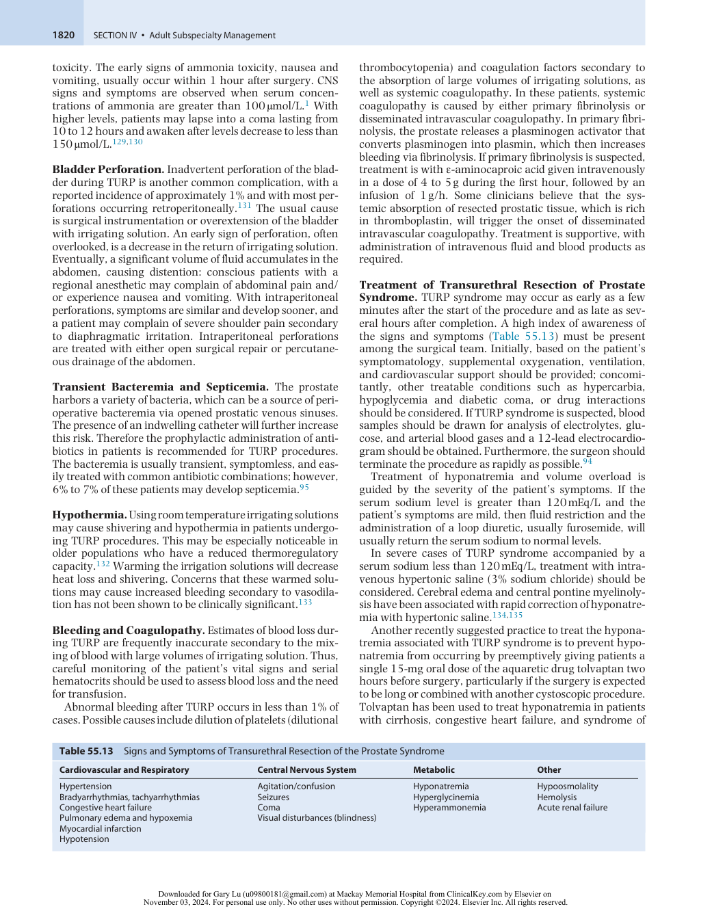

:::

<!-- PDF page 18 -->

inappropriate antidiuretic hormone. It is a selective, competitive vasopressin receptor V2 antagonist that results in decreased water reabsorption by the kidneys; therefore, causing an increase in free water excretion, decreasing water retention and plasma volume, which allows serum sodium to rise toward normal concentration.136

### LASER RESECTION, PLASMA VAPORIZATION, MICROWAVE ABLATION, AND AQUABLATION OF THE PROSTATE

To reduce perioperative morbidity, the urologic community has developed surgical alternatives to the classic TURP and M- TURP. The main advantage of these newer technologies is the use of physiologic saline instead of hypoosmolar irrigating solutions, such as glycine, which avoids the potential of dilutional hyponatremia and the development of TURP syndrome. However, the possibility of volume overload is still present, as well as hyperchloremic metabolic acidosis with decreased level of consciousness and hypotension.137

Other advantages observed with these recent surgical modalities are a reduction of intraoperative and postoperative bleeding, less absorption of irrigation fluid, and decreased hospital length of stay. Although spinal anesthesia is the preferred anesthetic for TURP and M- TURP because it allows one to monitor mental status, these newer techniques enable the anesthesiologist to tailor the anesthetic management based upon the patient’s medical condition and preference. In addition, patients may be taking anticoagulation medications or have coagulation disorders that may preclude the use of spinal anesthesia or undergoing the classic or M- TURP procedure.

Laser resection of the prostate (L- TURP) has become an increasingly common choice for the treatment of BPH. L- TURP delivers light energy that, depending upon the temperature the prostatic tissue is heated to, will determine whether the tissue is coagulated or vaporized. HoLEP has been suggested as the new gold standard for surgical treatment of BPH.138,139

Holmium:yttrium- aluminum- garnet laser is a solidstate, high- powered, pulsed laser that emits light at a wavelength of 2140 nm with precise cutting capabilities. Prostatic tissue is vaporized, and the resulting heat dissipation coagulates small to medium blood vessels. This technique allows the retrograde resection of entire prostatic lobes from the capsule, which are then pushed into the bladder and removed with a soft tissue morcellator. HoLEP can be used safely on patients with larger prostatic glands, greater than 70 to 100 g, with similar outcomes as patients undergoing open prostatectomy.139 When compared with traditional M- TURP, HoLEP is associated with lower transfusion rates, catheterization time, and shorter hospital stays.140–143

Another advancement in laser therapy for BPH is the development of the photoselective vaporization of prostate (PVP) technique. The initial 80- watt KTP (potassium- titanyl- phosphate) laser is a high- powered neodymium:yttium- aluminum- garnet laser that passes a beam through a KTP crystal, which halves the wavelength to 532 nm and doubles the frequency of light. The 532- nm wavelength is selectively absorbed by hemoglobin

and blood- rich tissue, poorly absorbed by water, and vaporizes prostatic tissue with minimal dissipation of energy to surrounding tissues. Higher- powered, 120- and 180- watt systems have been introduced that use a lithium triborate crystal that allow for faster vaporization and coagulation of prostatic tissue.144

This yields an almost bloodless field, faster hemostatic closure of the venous sinuses, and reduced absorption of irrigation fluid. Several studies have shown that PVP is safe and effective in patients at high risk of discontinuing their anticoagulation therapy for the procedure.145–147 Potential complications of PVP include capsular perforation, dysuria, and infection (secondary to necrotic tissue that occurs with coagulation). When compared with M- TURP, reoperation rates were higher for PVP for residual adenoma but decreased with the 180- watt powered systems.147

A nonlaser advancement in the surgical treatment of BPH is the bipolar plasma vaporization of prostate technique. The design of this bipolar system incorporates both the active and return poles on the same electrode; consequently, in contrast to a monopolar system, energy does not transverse the patient’s body toward a return electrode pad, but instead it remains at the site of prostate vaporization. The plasma vaporization system produces a plasma corona on the surface of a spherical shaped (described as mushroom- or button- like) tipped bipolar electrode. This electrode generates a thin layer of highly ionized particles as it glides over the prostatic tissue without making direct tissue contact, produces minimal heat, and concomitantly vaporizes and coagulates the tissue. The plasma field vaporizes a limited layer of prostate cells with significantly reduced bleeding.148,149

Transurethral microwave thermotherapy (TUMT) of the prostate is considered an effective alternative to M- TURP that has fewer major complications and can be performed as a minimally invasive office- based procedure under local or sacral block. TUMT heats prostatic tissue via a specialized catheter to a temperature between 45°C and 65°C. Although TUMT is less effective than M- TURP in reducing urinary flow long term, it is an alternative consideration for elderly or high- risk patients.150

The newest modality to surgically treat BPH is aquablation, a minimally invasive high- velocity saline ablation technique combining ultrasonic image guidance and robotics for the targeted and heat- free removal of prostatic tissue under general anesthesia. Using the ultrasonic image, the area of the prostate to be resected is mapped and the system generates and adjusts the level of saline pressure for the controlled ablation of the prostate tissue. Directed cautery of the resected area for hemostasis is then performed using either monopolar or bipolar techniques. In initial small studies of this technique, perioperative changes in serum sodium or hematocrit were not significant. Because the resection time is approximately 5 minutes and overall procedure time is 45 minutes, compared with other techniques with longer operative times, this technique may have an improved safety profile. Surgical mapping enables preservation of the bladder neck and tissue surrounding the verumontanum and therefore preservation of normal sexual function. Further clinical studies are needed to validate this new technology.151

<!-- PDF page 19 -->

### URETEROSCOPIC LITHOTRIPSY AND PERCUTANEOUS NEPHROLITHOTRIPSY

Nephrolithiasis is a common and costly disease with a reported prevalence of 8.8% in the United States.152 Although most patients with renal system stones are conservatively managed, those with more complex calculi will require surgical treatment. The most commonly used surgical modalities are ureteroscopy (URS) and percutaneous nephrolithotomy (PCNL). The choice of treatment is guided by the size and location of the stone within the renal system. URS is recommended in symptomatic patients with smaller non–lower pole renal stones and/or middle or distal ureteral calculi. It has a greater stone- free rate after a single procedure when compared with extracorporeal shock wave lithotripsy (ESWL). In symptomatic (flank pain) patients with a renal stone burden greater than 20 mm or with lower renal pole calculi greater than 10 mm, PCNL should be the treatment of choice. PCNL with higher stone burdens and lower renal pole stones has a higher stone- free rate but carries greater morbidity.153

The advent of small- diameter, flexible ureteroscopes and the miniaturization of electrohydraulic lithotripsy (EHL) probes, especially laser fibers, have changed the anesthetic concerns associated with this procedure. Initially, URS was performed with larger, rigid instruments requiring ureteral dilation necessitating the patient to undergo a general or regional anesthetic for these procedures. The presumed advantage of these techniques is that they would prevent patient movement, therefore decreasing the risk of ureteral trauma. Although the use of a general or regional anesthetic is still common, studies have shown that URS can be safely and efficiently performed under local or intravenous sedation.154–156

EHL uses a flexible probe inserted through the ureteroscope to deliver a high- voltage spark between two electrodes generating a spherical hydraulic shock wave and the formation of a cavitation bubble near the stone to be fragmented. EHL can be performed in a normal saline solution, therefore avoiding the risks of irrigating the urinary track with a hypotonic solution. The major concern of EHL is its ability to damage the ureteral mucosa that could lead to the possibility of ureteral perforation. Laser lithotripsy uses a holmium:YAG flexible laser fiber through the ureteroscope to vaporize the stone via a photothermal mechanism. The holmium laser technique is safer and more efficient than EHL because it can be used in closer proximity to the ureteral wall without causing mucosal harm. In addition, it produces significantly smaller stone fragments.154

PCNL is the preferred modality for the treatment of large (>20 mm) or complex stones. Contraindications to PCNL include patients with uncorrected coagulopathy and active, untreated urinary tract infections. With the fragmentation of stones, bacteria and bacterial endotoxins may be released, which place the patient at risk for septic complications. To reduce this risk, broad- spectrum antibiotics should be given perioperatively to these patients. Renal access is obtained under fluoroscopic or ultrasonic guidance with the placement of a sheath through which a rigid or flexible nephroscope is inserted. Stone removal then may be achieved by a variety of endoscopic techniques. Commonly, PCNL is performed in the prone position under general anesthesia,

although regional anesthesia and local anesthesia with sedation have been successfully used.154 Supine positioning may be used, but results in a smaller surgical field, collapse of the renal collecting system, and increased difficulty in upper pole calyceal puncture.157 Besides the typical anesthetic concerns, including those related to prone positioning, PCNL has certain additional risks. Pleural injuries, including pneumothorax and hydrothorax; hypothermia secondary to the large amounts of fluid administered to the patient during nephroscopy; and acute anemia from bleeding or dilution may occur. Careful monitoring of the patient’s pulmonary status (airway pressures, end- tidal CO2, and O2 saturation), hemodynamics, and temperature may alert one to these potential complications.

### EXTRACORPOREAL SHOCK WAVE LITHOTRIPSY

ESWL is an alternative treatment for the disintegration of renal stones in the non–lower pole of the kidney and the upper part of the ureter. Although ESWL was considered the treatment of choice for these types of stones, it has been surpassed in the United States by URS.158 In symptomatic patients with stone burdens smaller than 20 mm, ESWL is still an effective treatment; however, when compared with URS, it is associated with a higher likelihood of repeat procedures. Therefore, to optimize stone- free rates, successful treatment with ESWL depends upon several factors: obesity, skin- to- stone distance, collecting system anatomy, stone composition, and stone density/ attenuation.153 The original first- generation lithotripter (Dornier HM- 3) required immersion of the patient into a water bath, which could result in significant effects in the cardiovascular and respiratory systems (Box 55.3). Newer generations of lithotripters use less power and have eliminated the water bath; therefore, the efficiency of stone fragmentation is decreased, resulting in higher retreatment rates.159

Lithotripters generate repetitive high- energy shock waves through the water density of the patient’s tissues, which are focused on the stone, causing it to fragment. The original first- generation lithotripter utilized an electrohydraulic shock wave generated by an electrode (or spark plug) placed in a water bath. This spark caused an explosive vaporization of water resulting in the rapid expansion and collapse of gas bubbles that generate a pressure wave, which is then focused using a metal ellipsoid onto the stone. Newer generations use piezoelectric crystals or electromagnetic generators to produce these shock waves along with

### Box 55.3 Changes on Immersion During Lithotripsy

|Cardiovascular|Increased|Central blood volume|
|---|---|---|
||Increased|Central venous pressure|
||Increased|Pulmonary artery pressure|
|Respiratory|Increased|Pulmonary blood flow|
||Decreased|Vital capacity|
||Decreased|Functional residual capacity|
||Decreased|Tidal volume|
||Increased|Respiratory rate|

::: details 原始表格與符號（PDF 第 19 頁）

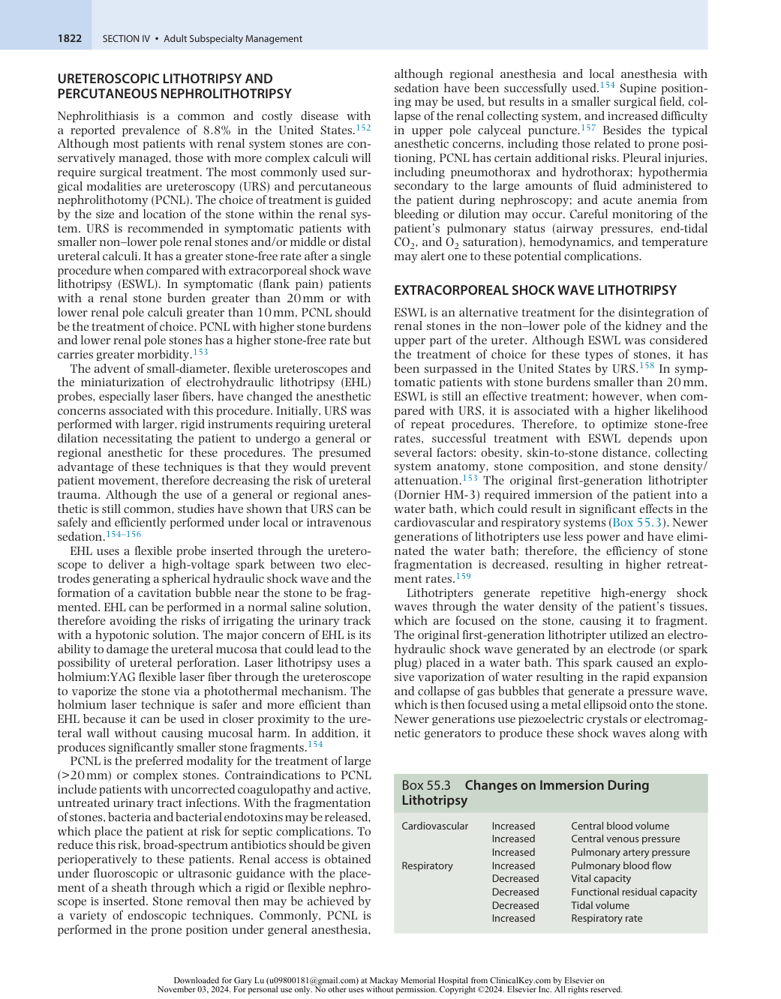

:::

<!-- PDF page 20 -->

water- filled cones or cushions, or silicone membranes and/ or gel, for air- free coupling of the generated shock wave to the patient.160

### Biomechanical Effects of Shock Wave Therapy

For ESWL shock waves to be effective, there should be no movement of stones during treatment. Otherwise, treatment time will be prolonged, while shock wave generation is suspended, until the stone returns or is retargeted to the treatment focal zone; or if shocks are continued, adjoining tissues may become injured from the energy of the shock waves. Using controlled ventilation during a general anesthetic may cause stone excursion to surpass 60 mm. Spontaneous ventilation has been observed to displace stones over 12 mm, whereas in patients with adequate sedation, stone excursion is limited to approximately 5 mm.160

For effective stone disintegration, shock waves should reach the stone unimpeded. The flank area should be kept free of any medium that would provide an interface for the dissipation of shock wave energy. Nephrostomy dressings should be removed, and the nephrostomy catheter should be taped clear of the blast path. Although shock waves pass through most tissues relatively unimpeded, they do cause tissue injury, the extent of which depends on the tissue exposed and the shock wave energy at the tissue level. Skin bruising and flank ecchymoses can occur at the entry site. Painful hematoma in the flank muscles may also occur. Hematuria is almost always present at the end of the procedure and results from shock wave–induced endothelial injury to the kidney and ureter. Adequate hydration is necessary to prevent clot retention.

Shock wave–induced cardiac dysrhythmias have been observed occasionally in patients receiving ESWL. These dysrhythmic episodes do not seem to be of any clinical significance for the most part. Some of these dysrhythmias may be due to mechanical stress on the conduction system exerted by the shock waves. The intricate grounding system of the lithotripter ensures that any current- induced dysrhythmias are unlikely. Artifacts on the electrocardiogram also are common. Artifacts and dysrhythmias usually disappear when the lithotripsy is stopped.161

### Anesthetic Choices for Lithotripsy

Historically, anesthetic regimens used successfully for immersion lithotripsy included general anesthesia, epidural anesthesia, spinal anesthesia, flank infiltration with or without intercostal blocks, and analgesia–sedation, including patient- controlled analgesia.162–169 With the newer generations of lithotripters, most analgesia–sedation combinations are adequate. Even patient- controlled analgesia with alfentanil and a combination of propofol and alfentanil has been used.170,171 Many centers routinely use general anesthesia with short- acting inhaled or intravenous anesthetics and use laryngeal mask airway for ventilation.

### Newer Generations of Lithotripters

Newer generations of lithotripters have no water bath, use fluoroscopy and/or ultrasonography to visualize and target the stone, and tend to use multifunctional tables that allow other procedures, such as cystoscopy and stent placement, to be accomplished without moving the patient off the table. The shock waves are tightly focused; therefore, they cause

less pain at the entry site, and intravenous analgesia–sedation is the mainstay of anesthesia with these newer lithotripters. Other incidental interventions, such as cystoscopy, stone manipulation, or stent placement, may alter anesthetic requirements. Because these newer lithotripters have a much smaller focal zone for the shock waves, it is essential that adequate analgesia and sedation be provided so that stone excursion with respiration is limited to the focal zone.

### Contraindications

Pregnancy, active urinary tract infection, and untreated bleeding disorders are the major contraindications to lithotripsy. Women of childbearing age must have a pregnancy test that is documented to be negative before lithotripsy. Standard tests of coagulation, such as the platelet count, prothrombin time, and partial thromboplastin time, should be obtained as indicated by medical history. Pacemakers, automatic implanted cardioverter–defibrillators (AICDs), abdominal aortic aneurysm, orthopedic prostheses, and obesity are no longer considered contraindications.

Patients with pacemakers can be treated safely if the pacemaker is pectorally placed and the following precautions are observed.172–174 Pacemaker programmability should be established before the treatment, and the pacemaker should be switched to a nondemand mode in case the shock waves interfere with pacemaker function. Alternative means of pacing should be available. Although most pacemakers located pectorally are at a safe distance from the blast path, some may be damaged. Weber and coworkers172 examined 43 different pacemakers and found that three were affected. Dual- chamber pacemakers tend to be more sensitive to interference. Treatment should be started at a low-energy level and gradually increased while observing pacemaker function.

Manufacturers of AICDs and lithotripters have considered an AICD a contraindication for lithotripsy; however, patients with AICDs have been treated successfully with lithotripsy.173 AICD devices should be shut off immediately before lithotripsy, with an alternative means of defibrillating available, and then reactivated immediately after treatment.175

Patients with small aortic aneurysms have been treated safely, provided that the stone is not close to the aneurysm. Orthopedic prostheses, such as hip prostheses and even Harrington rods, are not a problem if they are not in the blast path, which is usually the case. Positioning of obese patients may be problematic at times. Not only do extremely obese patients present anesthetic challenges related to obesity, but also focusing of the stone may be extremely difficult in the very obese. It is prudent for focusing of the stone to be attempted before administering any anesthetic in this highrisk population.

### HIGH- INTENSITY FOCUSED ULTRASOUND (HIFU) FOR PROSTATE CANCER

Within the United States it is estimated in 2022 there will be 268,490 new cases of prostate cancer, which comprises 14% of all new cancer cases.176 Treatment modalities, historically, have included radical prostatectomy (either open or robotic- assisted) and/or radiation therapy (RT), but have the possibility of damaging surrounding tissue and nerves

<!-- PDF page 21 -->

causing urinary incontinence, sexual dysfunction, and bowel injuries.177 HIFU uses high- intensity ultrasound that is generated by a transducer that is placed inside a body cavity and is focused onto the cancer lesion. This application of energy within the prostatic tissue causes coagulative necroses with injuries to the surrounding structures reduced. HIFU may be considered in patients with serious concomitant medical conditions or prior therapies that preclude them from undergoing major surgery or RT.178 Depending upon the type of equipment used the patient is positioned in either dorsal lithotomy or right lateral decubitus. While either general or spinal anesthesia may be used, many urologists prefer general with neuromuscular paralysis to enable precision of device calibration and treatment secondary to the lack of patient movement during the procedure.179

### OPEN RADICAL SURGERY IN UROLOGY

Radical surgery is the excision of a tumor or diseased organ and possibly adjacent structures, along with their blood supply and lymphatic drainage. These procedures are generally performed for patients with malignant rather than benign disease and may be lengthy with sudden and significant blood loss. Although the trend over the past decades has been from open to laparoscopic or robotic- assisted approaches, there are still cases where major open urologic procedures are indicated.

### Radical Nephrectomy

The most common malignancy of the kidney is renal cell carcinoma, comprising 80% to 85% of all solid renal masses.180 Because renal cell carcinoma is refractory to chemotherapy and radiation therapy, surgical resection or ablation can offer curative treatment of localized disease (Box 55.4). The procedure involves removal of the kidney, the ipsilateral adrenal gland, perinephric fat, and the surrounding fascia. Recently, resection of the ipsilateral adrenal gland has been reserved for patients with large upper- pole lesions or when the adrenal gland is enlarged or appears abnormal.181 Partial nephrectomy (nephron- sparing surgery) is considered for patients with a solitary functional kidney, small lesions, or bilateral tumors or for patients with increased risk because of other diseases, such as diabetes or hypertension.182,183 Nephron- sparing surgery in the treatment

### Box 55.4 Anesthetic Implications of Radical Nephrectomy for Tumors

- 85%–90% are for renal cell cancer

- 5%–10% extension to the inferior vena cava and right atrium

- Large- bore intravenous access, A- line, internal jugular vein line (preferably on left side if inferior vena cava is involved)

- Paraneoplastic syndrome

- Hypercalcemia, eosinophilia; increased prolactin, erythropoietin, and glucocorticoids

- Occurs more frequently in men than women

- Chronic smoking history usually associated

- Coronary artery disease, chronic obstructive pulmonary disease

- Renal failure

of renal cell carcinoma has been shown to have an equal curative potential as radical nephrectomy.184

With radical nephrectomy, significant cardiorespiratory changes attendant to the flank position are a concern. Respiratory changes include decreases in thoracic compliance, tidal volume, vital capacity, and functional residual capacity. Dependent atelectasis is common and can lead to hypoxemia. Pneumothorax may occur and can have significant respiratory and hemodynamic consequences intraoperatively. It is common to see a decrease in blood pressure when the kidney rest is raised. This decrease is usually due to compression of the inferior vena cava. In addition, hepatic encroachment on the vena cava and mediastinal shift may reduce venous return and stroke volume further. Cervical plexus, brachial plexus, and common peroneal neuropathies can occur because of stretch or compression of nerves in the lateral position.

In 5% to 10% of patients with renal cell carcinoma, the tumor extends into the renal vein and the inferior vena cava and right atrium. Tumor extension into the inferior vena cava and atrium occurs more frequently with rightsided renal cell carcinoma. Several problems can occur in these patients, ranging from circulatory failure because of complete occlusion of the vena cava by tumor to acute pulmonary embolization of tumor fragments during surgery. To operate on these patients safely, the extent of the lesion must be defined preoperatively. Cardiopulmonary bypass may be required to facilitate removal of the tumor and reduce the risk of embolization. For patients with tumor invasion into the vena cava, measurement of filling pressures using a central venous catheter might not reflect intravascular volume accurately, because venous return through the inferior vena cava can be impaired by thrombus; hence, intraoperative transesophageal echocardiography may be of value.185 A decrease in venous return also predisposes the patient to hypotension during induction of anesthesia. Venous obstruction can lead to dilation of the epidural veins and the development of abdominal wall and retroperitoneal collaterals. The emphasis should center on appropriate preoperative preparation, which is possible only when the full extent of the lesion has been defined.186

### Radical Cystectomy

Bladder cancer is the fourth most common cancer in men and 12th in women in the United States.187 Radical cystectomy with regional pelvic lymph node dissection is the surgical treatment of choice for the management of nonmetastatic muscle- invasive bladder cancer and the highest- risk non- muscle- invasive bladder cancer. Radical cystectomy with urinary diversion is considered one of the most complex urologic procedures and involves removal of the entire bladder, the distal ureters, and lymph nodes, as well as the prostate, and seminal vesicles in men or urethra, adjacent vagina, and uterus in women. For urinary diversion, either an orthotopic neobladder or ileal conduit are commonly created.188 This procedure is associated with significant morbidity and prolonged hospital stays. One large study looking at a data registry in England of 2537 patients with an open radical cystectomy over a 2- year period (2014–2015) reported a median blood loss of 500 to 1000 mL with a transfusion rate of 21.8%.189 In the Surveillance, Epidemiology, and End Results- Medicare

<!-- PDF page 22 -->

database of 5207 patients who underwent radical cystectomy between 1991 and 2009, mortality at 30 days in patients older than 65 years was 5.2%.190 Complications of this procedure include urinary extravasation, intestinal anastomotic leaks, postoperative ileus, postoperative infections, and venothromboembolism. Enhanced recovery after surgery (ERAS) protocols have shown improved emotional and physical recovery.191 In addition, patients given alvimopan, a peripherally acting μ- opioid receptor antagonist, showed significantly quicker bowel recovery.192

As with any major operation with the potential for significant blood loss, adequate intravenous access and placement of an arterial line are essential. General endotracheal anesthesia is indicated with consideration of a general/ epidural technique for postoperative analgesia and/or the use of ERAS protocols for these procedures. The volume of urinary output cannot be used as a measure of fluid status due to its absence; however, the operative team can observe whether urine flow is noted at the clipped ends of the ureters. Blood lactate levels can be monitored to determine adequate organ perfusion. Placement of a central venous line for resuscitative purposes might be considered when there is anticipation of major blood loss.193 The implementation of ERAS protocols for open radical cystectomy with urinary diversion has demonstrated expedited bowel function recovery and shortened hospital stays without an increase in hospital readmission rates.194

### Radical Prostatectomy

Prostate cancer is the most commonly diagnosed cancer in men and the second leading cause of cancer death of men in the United States.187 Localized prostate cancer is treated by either radiation therapy or radical prostatectomy (Box 55.5). Radical prostatectomy has become more commonly performed because of routine prostate- specific antigen testing in men older than 50 years and popularization of the nerve- sparing surgery to reduce the risk of impotence. Although originally described in 1905 via the

### Box 55.5 Anesthetic Implications of Radical Prostatectomy

- Disease of the elderly

- Coronary artery disease, chronic obstructive pulmonary disease, and renal dysfunction

- Significant blood loss

- Wide- bore intravenous access and invasive monitoring

- Acute normovolemic hemodilution versus autologous blood donation

- Hyperextended position

- Nerve injuries, soft tissue injury, joint dislocations

- Venous air embolism

- Anesthetic management

- Benefits of regional anesthesia versus general anesthesia debated

- Not known to influence mortality

- Epidural anesthesia with spontaneous ventilation decreases blood loss

- General or combined anesthesia with intermittent positive pressure ventilation increases blood loss

transperineal approach, the retropubic approach is currently more commonly performed. The prostate, the ejaculatory ducts, the seminal vesicles, and part of the bladder neck are removed along with the pelvic lymph nodes.

Traditionally, the procedure was performed by open laparotomy, but robotic- assisted surgery is replacing that technique with increasing frequency. A potential intraoperative problem with open radical prostatectomy is hemorrhage and rapid blood loss requiring blood transfusion; therefore, large-bore intravenous access is recommended. Autologous predonation, preoperative recombinant erythropoietin therapy, intraoperative isovolemic hemodilution, and blood cell salvage are commonly practiced to reduce the patient’s exposure to allogeneic blood. Early postoperative complications, including deep vein thrombosis, pulmonary embolism, hematoma, seroma, and wound infection, occur in 0.5% to 2% of cases.195 Late complications include incontinence, impotence, and bladder neck contracture.196 Patients undergoing radical prostatectomy are placed supine in Trendelenburg position with the back extended, which places the pubis above the head. Air embolism from the prostatic fossa caused by a gravitational gradient between the prostatic veins and the heart has been reported.197

### Comparison of Anesthetic Techniques for Radical

**Prostatectomy.** Epidural anesthesia, spinal anesthesia, general anesthesia, and combined epidural and general anesthesia have been used for this surgery. For the epidural component of combined techniques, a thoracic or a lumbar approach to catheter placement has been used, and spontaneous ventilation or intermittent positive pressure ventilation (IPPV) has been used for the general anesthesia component. Many investigators have reported their findings in comparing the four anesthetic techniques for radical retropubic prostatectomy,198–201 and certain trends emerge.

Intraoperative blood loss is significantly decreased if epidural anesthesia or a combined epidural and general anesthetic with spontaneous ventilation is used. In one study, blood loss in the general anesthesia and the combined anesthesia group with IPPV was significantly more than in the epidural anesthesia group, despite little difference in arterial pressure among the three groups.198 It was postulated that the increased venous pressure due to IPPV was the most likely cause of increased bleeding in the general and the combined anesthesia groups during radical prostatectomy. Previous studies have shown that central and peripheral venous pressures are lower in patients during spontaneous ventilation under epidural anesthesia or combined epidural–general anesthesia than in patients receiving IPPV during general anesthesia.202 Epidural anesthesia alone or in combination with a general anesthetic decreases the risk of thromboembolism,203 decreases postoperative pain and analgesic requirements,204 and speeds recovery of bowel function. The length of stay and the cost of hospitalization can be decreased with the judicial use of epidural anesthesia and adherence to established clinical pathways.205,206 In one study, 80% of patients were satisfactorily discharged after 1 day and the mean length of stay was 1.34 days.207

<!-- PDF page 23 -->

Possible differences in patient outcome with general versus epidural anesthesia are not clear. Local practices are therefore based on the preferences of the urologist, anesthesiologist, and patient.

### POLYCYSTIC KIDNEY DISEASE

Polycystic kidney disease is most often inherited in an autosomal dominant manner, can lead to massive enlargement of the kidneys, and is the fourth leading cause of ESRD, occurring during or after the sixth decade of life, in the United States. Autosomal dominant polycystic kidney disease (ADPKD) is a multisystem disorder that presents with several renal (hypertension; pain caused by infection, hemorrhage, cyst rupture, nephrolithiasis, or compression; and decreased GFR) and extrarenal (cystic involvement of other organs: liver, pancreas, seminal vesicles; intracranial aneurysms; and cardiac involvement along with valvular heart diseases) manifestations. Treatment therapies are directed toward reducing the morbidity and mortality of the complications of the disease. In patients with rapidly progressive disease leading to ESRD; tolvaptan, a vasopressin V2 receptor antagonist, has shown promise in slowing the decline of renal function, but may cause an increase in liver enzyme concentrations; therefore careful monitoring is required. For control of hypertension ACE inhibitors and angiotensin receptor blocker (ARB) antagonists have been found superior in individuals with preserved renal function. Many patients will have significant pain associated with the polycystic kidney. The control of flank pain is generally achieved using conservative pain management methods, after excluding causes such as infection, stone, or tumor. These include nonopioid agents, avoiding longterm use of nephrotoxic combination agents. Narcotic analgesics should only be used for acute episodes to avoid dependence; tricyclic antidepressants can be helpful, as they are in chronic pain syndromes; and splanchnic nerve blocks with local anesthetics and/or steroids can provide longer-term pain relief.208,209

When conservative management measures fail, alternatives include cyst aspiration, sclerosing agents, and surgery. For patients with ADPKD with many large cysts contributing to pain, chronic infections, bleeding, symptomatic stones, suspected malignancy and/or have progressed to ESRD with insufficient space for graft placement, a laparoscopic nephrectomy may be helpful. For patients under consideration for renal transplant, in addition to routine evaluation before surgery, screening for extrarenal manifestations including cystic liver involvement and intracranial aneurysms should be performed.208

### ROBOTIC AND LAPAROSCOPIC SURGERY IN UROLOGY

The advantages of laparoscopic surgery over conventional open surgery, including decreased hospital stay, improved visualization, decreased blood loss, expedited recovery time, reduced postoperative pain, and improved cosmetic outcomes, have been well described. The introduction of robotic- assisted surgery offers further enhancements of control and mobility to the surgeon but with increased cost and controversy over whether there is a clear benefit

regarding reduction in morbidity and mortality compared with laparoscopic techniques.210 The use of robots in urologic surgery has been extended to radical prostatectomy, radical cystectomy, pyeloplasty, and renal and adrenal surgery in adults and children.

Anesthetic concerns of robotic- assisted surgery include the length of surgical time, intravenous fluid management, and positioning. The most frequent reported complications, including those related to positioning, include peripheral neuropathies, corneal abrasions, vascular complications including compartment syndrome, rhabdomyolysis, thromboembolic disease, and the effects of edema.211 In addition, significant anesthetic concerns for urologic minimally invasive surgeries surround the physiologic effects of pneumoperitoneum, the use of lateral decubitus, and steep head-down tilt (SHDT) positions, as well as restricted access secondary to the robot and the robotic arms and extensions over the patient.

Although all the conventional complications and concerns associated with laparoscopy and robotic- assisted procedures are applicable to urologic procedures, two unique problems are identified. First, because the urogenital system is mainly retroperitoneal, the large retroperitoneal space and its communications with the thorax and subcutaneous tissue are exposed to the insufflated carbon dioxide. Significant subcutaneous emphysema (SCE) can occur in these patients and may extend all the way up to the head and neck. In a retrospective study of 229 patients undergoing robotic- assisted radical prostatectomy the incidence of SCE was higher in patients with BMI &lt;25 kg/m2 or with sustained pressure of end-tidal carbon dioxide (PETCO2) of 46 mm Hg or greater during surgery.212 The upper airway is at risk for compromise in the most severe cases of SCE because of pharyngeal swelling secondary to submucosal carbon dioxide. This complication should be kept in mind before attempting extubation of the trachea in these patients. Second, the procedures can be lengthy, allowing for sufficient absorption of carbon dioxide to result in acidemia and marked acidosis. Because of significant increases in intra- abdominal and intrathoracic pressure because of insufflated carbon dioxide, use of SHDT position in some cases, and the long duration of procedures, general anesthesia with controlled ventilation may be the method of choice. Despite adequate intravascular hydration, intraoperative oliguria may occur and can be followed by diuresis in the immediate postoperative period. Increased perirenal pressure exerted by the insufflated gas in the retroperitoneal space causes an increase in renal vascular resistance with direct compression of the renal parenchyma and renal vein. This causes a release of renin and aldosterone, along with antidiuretic hormone, which temporarily decreases renal blood flow, renal function, and urinary output.213

Ventilatory and respiratory concerns of pneumoperitoneum include decreased compliance, increased airway pressures, and increased ventilation–perfusion mismatch. Application of positive end- expiratory pressure improves oxygenation in these patients.214 Hypercapnia develops within 15 to 30 minutes of carbon dioxide insufflation with resultant hypercarbia, acidosis, tachycardia, dysrhythmias, and other deleterious hemodynamic and CNS effects.215 Increase in mechanical ventilation can obviate these changes in most patients, and most healthy patients

<!-- PDF page 24 -->

### Box 55.6 Pneumoperitoneum- Related Physiologic Changes

|INCREASED|DECREASED|
|---|---|
|Systemic vascular resistance|Cardiac output|
|Blood pressure|Functional residual capacity|
|Peak airway pressure|Lung compliance l|
|Ventilation–perfusion mismatch|Renal blood flow i|
|Intracranial pressure|Glomerular filtration rate Splanchnic blood flow|

tolerate the changes even though they are clinically significant. Extraperitoneal insufflation of carbon dioxide is associated with larger increases in arterial PCO2 than in intraperitoneal insufflation.216 Hemodynamic changes observed during initiation of pneumoperitoneum (Box 55.6) include increased systemic vascular resistance and mean arterial pressure. These changes are caused by increased intra- abdominal pressure compressing the aorta and increasing afterload.217 Cardiac output has been observed to decrease with insufflation.218,219 Variable changes in heart rate have been reported. Reflex bradycardia has been observed to occur with establishment of pneumoperitoneum probably related to peritoneal stretch and vagal stimulation.220

### Robotic- Assisted Radical Prostatectomy

Robotic- assisted radical prostatectomy (RARP) has become the second most performed robotic- assisted surgical procedure worldwide.221 Anesthetic concerns are primarily related to the use of pneumoperitoneum in the steep Trendelenburg position. For RARP the patient is placed in either the dorsal lithotomy or supine position, arms tucked at the side of the table, and drapes placed over the patient which limits the anesthesiologist’s ability to access the patient. Pneumoperitoneum is initiated, and the patient is then placed in a 30- to 45- degree Trendelenburg position. With limited access to the patient after draping, intravascular lines, monitors, and patient protective devices need to be placed and secured beforehand. Once the robot is positioned over the patient with its arms attached (docked) to the ports, movement of the patient and/or cardiopulmonary resuscitative measures cannot be performed unless the robot is first undocked.222 Patient movement during the surgery could result in visceral or vascular injury. Constant assessment of the degree of muscle relaxation intraoperatively is recommended. Because of the limited access and duration of the procedure, careful attention should also be given to pressure areas of the arms and legs to avoid ulnar neuropathy and lateral femoral cutaneous nerve injury.217

Physiologic changes resulting from SHDT position include hemodynamic effects such as decreased perfusion pressure of lower extremities, increased mean arterial pressure at the circle of Willis, increased central blood volume, decreased cardiac output, and a decreased perfusion of vital organs in a normovolemic patient. Increased myocardial oxygen consumption, ischemia, dysrhythmias, and decreased oxygen delivery are potential risks in patients with cardiac disease. Despite an observed twofold

to threefold increase of right- and left- sided filling pressures in American Society of Anes thesiologists’ (ASA) I and II patients during RARP, Lestar and colleagues223 observed no significant changes in cardiac performance. Respiratory effects of SHDT including decreased compliance, reduced vital capacity and functional residual capacity, 20% decrease in lung volumes, and ventilation– perfusion mismatch compound the effects of pneumoperitoneum. Pulmonary congestion and edema have been reported in susceptible patients. Facial, pharyngeal, and laryngeal edema may also occur with the SHDT position. Chemosis (conjunctival edema) is common in RARP but is usually self- limiting once the patient is taken out of the steep Trendelenburg position. If facial and/or conjunctival edema is noted at the end of the procedure, the anesthesiologist should have a high index of suspicion for the presence of laryngeal edema. If present, tracheal extubation may have to be delayed to allow the edema to resolve. A transient increase in serum creatinine secondary to pneumoperitoneum during robotic prostatectomy has been reported.224 In the Trendelenburg position, patients with a history of reflux have an increased risk of regurgitation of gastric contents and aspiration.

Other significant effects of SHDT include increased intracranial pressure, increased intraocular pressure (IOP), venous air embolism, brachial plexopathy, arthralgias, compartment syndrome, and finger injuries. Perioperative assessment of the function of a patient with a ventriculoperitoneal shunt scheduled for any laparoscopic procedure is recommended.225 Issues arising from increased intracranial pressure or consequences of a malfunctioning shunt with pneumoperitoneum in SHDT position need to be recognized. Kalmar and associates concluded patients overall clinically tolerated the influence of prolonged SHDT position with CO2 pneumoperitoneum on cardiovascular, cerebrovascular (including cerebral perfusion pressure and oxygenation), and respiratory homeostasis during robotic prostatectomy.226

Significant increases in IOP have been reported in robotic prostatectomy with the steep Trendelenburg position, but the clinical significance is unknown.227 However, of concern are patients with primary open angle glaucoma who have decreased outflow through the trabecular network, which causes increased IOP. Two patients with severe glaucoma were advised against proceeding with a RARP in the steep Trendelenburg position and instead opted for open radical prostatectomies in the supine position.228 However, another patient with severe glaucoma undergoing RARP was treated intraoperatively with acetazolamide and mannitol to manage the increase in IOP.229 In addition, there are reports of at least six cases of postoperative visual loss secondary to ischemic optic neuropathy following radical prostatectomy: three open and three robotic- assisted prostatectomies.230 Limiting time in the steep Trendelenburg position and reducing the volume of intravenous fluids administered may decrease the risk of this devastating complication.231

With the exception of one study, the literature suggests that compared with retropubic radical prostatectomy, RARP is associated with a reduction in blood loss.232 Mild to moderate pain is expected postoperatively, and low pain scores of 0 to 4 have been reported after retropubic radical prostatectomy and RARP using preemptive analgesia with

::: details 原始表格與符號（PDF 第 24 頁）

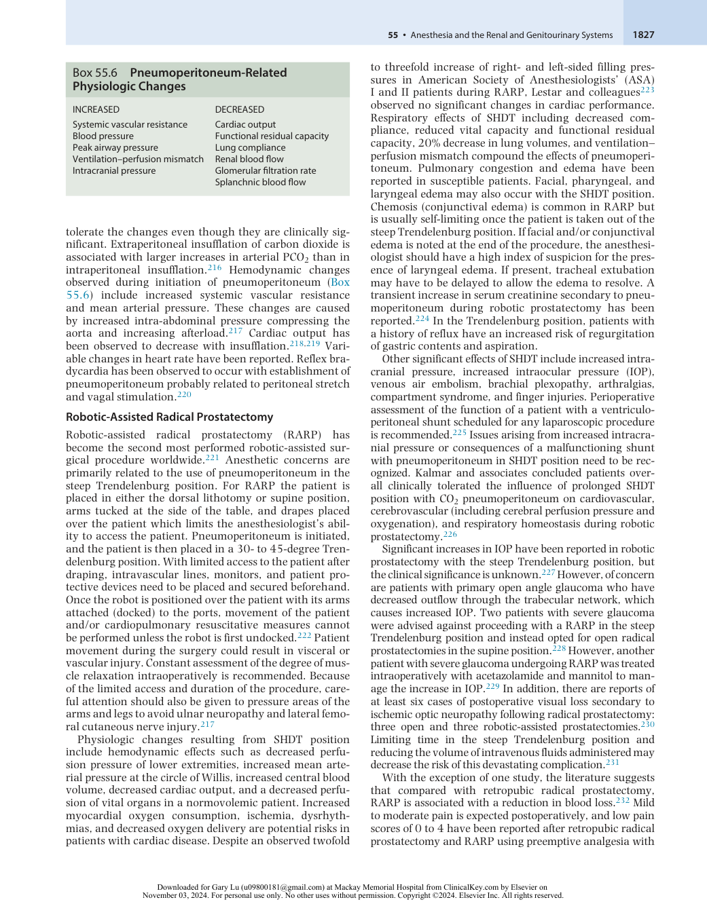

:::

<!-- PDF page 25 -->

ketorolac given intraoperatively combined with rescue opiate or nonopiate analgesia.233 Most patients are discharged home the day after surgery.

### Robotic- Assisted Radical Cystectomy With Diversion

The ensuing popularity of robotic- assisted urologic procedures over the past few decades also gave rise to the first robotic- assisted radical cystectomy (RARC) with extracorporeal or intracorporeal neobladder formation as first described in 2003.234,235 Since 2003 the use of RARC has increased substantially in the United States and globally, but there is controversy regarding the safety, efficacy, and cost-effectiveness of the robotic approach.236 A metaanalysis of four randomized controlled trials comparing RARC with extracorporeal urinary diversion with open radical cystectomy concluded that blood loss and wound complications were significantly lower in the RARC group; however, operating time was significantly longer with use of the robot. Nevertheless, there was no significant difference between RARC and open radical cystectomy in perioperative morbidity, length of stay, positive surgical margin, lymph node yield, and positive lymph node status.237 Another meta- analysis of eight studies comparing outcomes of intracorporeal RARC to open radical cystectomy found no significant differences in length of stay, positive surgical margins, or minor complications; however, RARC was associated with lower estimated blood loss, blood transfusion rates, and major (Clavien–Dindo grades III–IV) complication rates, but longer operative time when compared to the open technique.238 In a multicenter, retrospective review comparing RARC with extracorporeal to intracorporeal urinary diversion, the 90- day overall complication rate was not significantly different, but the incidence of gastrointestinal and infectious complications was significantly lower in patients in the intracorporeal group.239 The intracorporeal technique has several advantages in that the bowel stays inside the abdomen, no hypothermia or loss of fluids via osmosis occurs, and there is decreased bleeding, decreased need for ureteral dissection, and decreased traction on the bowel and ureters.240 The implementation of ERAS protocols has been shown to reduce the length of stay of patients undergoing RARC with intracorporeal urinary diversion.241,242 Previously it was stated that the robotic approach may minimize complications, however oncologic outcome had not improved over the past three decades, and surgical technique was assessed to be unlikely to improve survival outcomes243 ; but in a recent population- based cohort study in Sweden of 3169 patients comparing RARC with intracorporeal urinary diversion versus open radical cystectomy, patients who underwent intracorporeal RARC had a higher overall survival rate but no difference in the cancer- specific mortality, fewer high- grade complications, and more advantageous perioperative outcomes than the open group.244

As in RARP, the anesthetic concerns of RARC include management of SHDT and pneumoperitoneum with the patient in either the dorsal lithotomy or supine position, along with limited access to the patient. Epidural analgesia is generally not necessary, because RARC patients have reduced postoperative pain and early mobilization is encouraged. Although the usual intraoperative concerns

of preventing hypothermia, hypoxemia, and hypovolemia while avoiding overhydration are present, there is the additional goal of avoiding opioid- based analgesics and their effects on bowel recovery.245 The implementation of ERAS protocols helps to achieve the goal of limiting the use of postoperative opioids. In one study performed at a medical center with extensive experience in urologic surgery, 100 patients who underwent RARC with urinary diversion experienced operative times ranging from 4 to 12.9 hours, depending on the type of urinary diversion performed, and with reported blood losses of up to 1400 mL.241 As a consequence, because these surgeries may be lengthy with the possibility of substantial blood loss, adequate intravenous access along with insertion of an arterial pressure line is recommended. Arterial blood gases may be obtained at regular intervals to assess the presence of either respiratory and/or metabolic acidosis. With long CO2 insufflation times, respiratory acidosis can occur and management should be guided based on assessment of end- tidal carbon dioxide values in tandem with PaCO2. In addition, metabolic acidosis may occur (secondary to fluid restrictions) before and during the procedure and hypothermia, as a result of heat loss due to lengthy operative times or the insufflation of cold CO2 gas.246 Another controversial concern is whether the use of total intravenous (TIVA) versus volatile inhalational (VIA) anesthetics affects the distant recurrence of bladder cancer in patients undergoing RARC. In a retrospective study of 231 patients over a six- year period (2014–2020), distant recurrence occurred in only 8.7% of the TIVA patients versus 26.7% of the VIA patients.247 Larger prospective studies are needed to show whether anesthetic type influences cancer recurrence.

### Laparoscopic Nephrectomy

Laparoscopic nephrectomy is commonly used for radical and living donor nephrectomy. For radical nephrectomy, studies suggest that there are no significant differences in oncologic outcomes between open and laparoscopic procedures, although the laparoscopic technique, as discussed earlier, has the advantages of decreased morbidity, blood loss, postoperative analgesic requirements, and hospital length of stay.248,249 In a large retrospective study of 23,753 patients from 2003 to 2015 comparing perioperative outcomes of robotic- assisted to laparoscopic radical nephrectomies for patients with renal masses, there were no differences in the rates of major complications or blood transfusions. However, the use of robotic- assisted nephrectomy increased over the course of the study, from 1.5% to 27% of cases by 2015; and was associated with prolonged operating times and higher hospital costs when compared with laparoscopic surgery.250

Two laparoscopic approaches are commonly used for nephrectomies: transperitoneal or retroperitoneal. The primary advantage of the transperitoneal laparoscopic approach is the greater working space offered for large renal tumors (≥10 cm),251 whereas the retroperitoneal approach avoids transabdominal fatty tissue and allows for limited dissection of the kidney with direct access to the renal hilum.252 The lateral or semilateral decubitus position with some degree of flexion, along with use of a cushioned beanbag, pillows, and axillary roll, is usually used for these procedures. Besides the usual possible complications from

<!-- PDF page 26 -->

laparoscopic surgery (e.g., positioning injuries, subcutaneous emphysema, and CO2 emboli), the occurrence of rhabdomyolysis is a concern after laparoscopic nephrectomy. Risk factors include prolonged surgical time, high BMI, volume depletion, and use of the lateral decubitus position. Limiting the amount of flexion has been recommended to decrease the incidence of this complication.253 Anesthetic considerations, other than the previously discussed physiologic effects of pneumoperitoneum, include adequate intravenous access, whereas insertion of an arterial line, CVP catheter, and/or transesophageal echocardiography may be reserved for selected high- risk patients.

### Robotic- Assisted Partial Nephrectomy

Partial nephrectomy is the standard for the treatment of small renal masses (&lt;4 cm) for the reasons previously discussed (see Radical Nephrectomy, above).254 Surgical excision of these tumors has progressed from open radical nephrectomy to laparoscopic partial nephrectomy (LPN) and robotic partial nephrectomy (RPN). RPN has become the preferred technique because the learning curve for RPN is estimated to be 25 cases when compared with more than 200 cases for LPN.255 Both LPN and RPN require the temporary clamping of the renal hilum to improve surgical visibility and reduce blood loss; however, to prevent AKI the warm ischemia time related to clamping should not exceed 30 minutes.256,257 In a meta- analysis of 23 studies including 2240 patients, RPN when compared with LPN was found to have a lower conversion rate to open or radical surgery, a better postoperative estimated GFR, shorter warm ischemia time, lower estimated blood loss, and shorter length of hospital stay.258,259

Anesthetic concerns for RPN, as in laparoscopic nephrectomy, involve proper positioning and the use of pneumoperitoneum. To allow for unhindered robotic arm movement, the patient is placed in the lateral decubitus position, brought toward the edge of the operating table, and flexed approximately 15 degrees at the kidney.260 Of concern with partial nephrectomy, there is a decrease in the number of functioning nephrons causing hyperfiltration of the remaining glomeruli. This increase in load to the remaining glomeruli leads to an increase in intraglomerular pressure, causing injury to the kidneys in the short and long term. A retrospective study of AKI after partial nephrectomy found that the higher the intraoperative fluid administration, the greater the drop in the GFR postoperatively. RPN was found to be more tolerant of fluid administration than open or LPN. The authors postulated that the precision of the robot allows minimal handling of the remainder of the renal tissue, and this may confer protection. Therefore, judicious fluid administration is recommended during partial nephrectomy.261

## Postoperative Management of the Patient with Renal Disease

### MANAGEMENT OF RENAL DYSFUNCTION

Etiology, and therefore management, of renal dysfunction in the postoperative period can broadly be categorized into similar categories as in the preoperative period: prerenal causes, exacerbation of underlying intrinsic disease or comorbid disease, and postrenal causes.

Risk factors for prerenal causes of AKI include major surgical procedures, large shifts in volume, significant bleeding, or intraperitoneal surgical insults that can compromise renal blood flow. In the postoperative period, in these patients, ensuring adequate renal perfusion is critical to minimizing renal dysfunction. Postoperative fluids to correct intraoperative volume loss, blood transfusion to compensate for intraoperative hemorrhage, and vasopressors to maintain adequate MAP are critical to correct for any prerenal causes of potential kidney injury that might have arisen during the surgical procedure.262

Patients with preexisting comorbidities such as diabetes and heart failure or with underlying chronic kidney disease are at particularly high risk of renal dysfunction in the postoperative period as well. Medications such as contrast media, nephrotoxic antibiotics, and nonsteroidal anti-inflammatory drugs (NSAIDs) can exacerbate underlying kidney disease. Avoidance of these medications in the postoperative period, if feasible, is critical to minimizing renal dysfunction.263

Evaluation of renal dysfunction in the postoperative period should always include an assessment for postrenal causes of acute kidney injury as well. Postoperative urinary retention is a frequent cause of failure to void after surgery. It can be minimized by early ambulation, minimizing the use of opiates by using adjunct medications and techniques as well as the use of alpha blockers.264 Catheterization may be necessary in patients who are persistently anuric in the postoperative period. Additionally, urinary catheters placed in the operating room should be examined and flushed to ensure there are no kinks, clots, or other obstructions.

Specific to renal compromise, meperidine and morphine should be avoided due to accumulation of renal- excreted metabolites including normeperidine and morphine3- glucuronide, which lower the seizure threshold, and morphine- 6- glucuronide, which maintains activity at the μ- opioid receptor and can accumulate to toxic levels if insufficient renal clearance. Gabapentinoids, if used, are renally excreted and must be dose adjusted based on creatinine clearance. The antiprostaglandin effect of NSAIDs can decrease renal blood flow or increase bleeding risk in susceptible patients.

### POSTOPERATIVE CARE AFTER GENITOURINARY SURGERY

### Inflammatory Pain

Pain after urogenital surgery is similar to other postoperative pain, occurring as a direct result of surgical manipulation and trauma. Acute pain is most commonly inflammatory and related to incision, retraction, and suturing. Mediators of inflammation are local and systemic, including bradykinins, serotonin, prostaglandins, histamine, leukotrienes, and cytokines.265 Pain is worst in the first few days following surgery and generally improves rapidly with tissue healing.

### Postoperative Urinary Retention

Particularly regarding urologic surgery, postoperative urinary retention (POUR) should be considered as a source of postoperative pain. Evaluation may be difficult due to neuraxial or regional block, residual effects of general anesthesia,

<!-- PDF page 27 -->

or the diffuse nature of visceral pain. Risk factors include male sex; duration of surgery; amount of intravenous fluid given; concurrent neurologic disease; perineal surgery; use of anticholinergics, beta blockers, or adrenergic agents; and neuraxial local anesthetic or opioids.266 Opioids, particularly via the neuraxial route, can result in urinary retention. In addition, high clinical suspicion is merited if pain is accompanied by signs of disparate autonomic changes, such as bradycardia and hypotension. Left untreated, POUR can result in bladder distention and adverse effects on long- term urodynamics. Prompt diagnosis, either clinically or via ultrasound, and bladder catheterization if indicated (postvoid residual >600 mL) can prevent sequelae.

### Enhanced Recovery After Urologic Surgery (ERAS)

Urologic procedures such as radical cystectomy or radical prostatectomy were traditionally large blood- loss procedures with prolonged recoveries and significant associated postoperative pain. As a result, most pain management algorithms included neuraxial and regional blocks and minimized use of NSAIDs to decrease bleeding risks. Indeed, various studies have demonstrated the successful use of epidural anesthesia267 or rectal sheath catheters268 in open radical cystectomy. However, with a move toward laparoscopic and robotic- assisted techniques, these procedures have become less invasive, and the focus has shifted to early mobilization, recovery, and hospital discharge.

Over the past several years, significant awareness has arisen of reducing opioid use while in the hospital and at discharge by limiting patients’ prescriptions. Approximately 60% of the opioids prescribed by urologists go unused.269 Studies of urologic procedures have shown that reducing or avoiding opiate use is associated with fewer complications and shorter hospital stays.270–274 These goals are often packaged as part of a perioperative ERAS or nonopioid perioperative pain management protocol. The primary goal of these protocols is the use of multimodal analgesia to minimize opioid use and side effects, primarily ileus. Prior to ERAS implementation, postoperative ileus, or lack of gastrointestinal motility, was the most common cause for prolonged hospitalization and readmission, occurring in 12% to 25% of patients after radical cystectomy.275 To promote early mobilization, most protocols currently advocate the use of perioperative intravenous or orally administered acetaminophen (paracetamol) and of NSAIDs for breakthrough pain; as well as the possible inclusion of gabapentinoids,276 though the routine use of gabapentinoids has been challenged in a large systematic review and meta- analysis,277 and/or the use of single- shot neuraxial or regional techniques in place of epidural catheters.278–281

### Chronic Postsurgical Pain

In most cases, postoperative pain resolves quickly, over days to weeks, and can be managed with oral opioid or nonopioid analgesics; however, for some patients, gastrointestinal, respiratory, or cognitive side effects may prohibit their effective use. Furthermore, a subset of patients develop chronic postsurgical pain (CPSP), defined by the International Association for the Study of Pain as postoperative pain lasting more than 2 months and not explained by preexisting pain or ongoing trauma.282 Risk factors for CPSP are well described across many types of surgery and

the incidence can be high, with 20% to 50% of patients reporting persistent chronic pain of any type and 2% to 10% reporting severe disabling pain that ranks from 5 to 10 on the pain intensity numeric rating scale.283 The biggest predictor of CPSP is poorly controlled acute postoperative pain,284 which has led to a focus on the immediate perioperative period.

### Acknowledgment

The authors, editors, and publisher thank Drs. Vijeyandra Sudheendra and Jerome O’Hara for their contribution to the prior editions of this chapter. They have served as a foundation for the current chapter.

### Complete references available online at expertconsult.com.

### References

1.  Palmer DA, Moinzadeh A. In: Partin AW, et al., ed. _Campbell- WalshWein Urology_ . 12th ed. Elsevier; 2021:1370.

2.  Kavoussi PK. In: Partin AW, et al., ed. _Campbell- Walsh- Wein Urology_ . 12th ed. Elsevier; 2021:1370.

3.  Hemmings HC. In: Malhotra V, ed. _Anesthesia for Renal and Genitourinary Surgery_ . McGraw- Hill; 1996:18.

4.  Kassirer JP. _N Engl J Med_ . 1971;285:385.

5.  Stevens LA, et al. _N Engl J Med_ . 2006;354:2473.

6.  Landry DW. In: Goldman L, Schafer AI, eds. _Goldman- Cecil Textbook of Medicine_ . 26th ed. Elsevier; 2020:700.

7.  Inker LA, et al. _N Engl J Med_ . 2021;385(19):1737.

8.  Wen Y, et al. _Crit Rev Clin Lab Sci_ . 2021;58(5):354.

9.  Pasquini L, et al. _CNS Drugs_ . 2018;32(3):229.

10.  Elkington JR, et al. _Am J Med_ . 1960;29:554.

11.  Stafford- Smith M, et al. In: Barash PG, et al., ed. _Clinical Anesthesia_ . 8th ed. Lippincott; 2017:1400.

12.  Mann JF. _Nephrol Dial Transplant_ . 1999;14:29.

13.  Winearls CG. _Nephrol Dial Transplant_ . 1998;13:3.

14.  Prescot LF. _Br J Anaesth_ . 1972;44:246.

15.  Davies G, et al. _Clin Pharmacokinet_ . 1996;31:410.

16.  Mazoit JX, et al. _Clin Pharmacol Ther_ . 1990;48:613.

17.  Schochet RB, et al. _J Intensive Care Med_ . 1988;3:246.

18.  Davis PJ, et al. _Anesth Analg_ . 1988;67:268.

19.  Chauvin M, et al. _Anesth Analg_ . 1987;66:53.

20.  Murphy EJ. _Anaesth Intensive Care_ . 2005;33:311.

21.  Koncicki HM, et al. _Semin Dial_ . 2015;28:384.

22.  Mazze RI. _Br J Anaesth_ . 1985;56:275.

23.  Mazze RI, et al. _Anesthesiology_ . 1974;40:536.

24.  Mazze RI, et al. _Anesthesiology_ . 1984;60:161.

25.  Eger EI. _Anesth Analg_ . 1987;66:983.

26.  Jones RM, et al. _Br J Anaesth_ . 1990;64:482.

27.  Weiskopf RB, et al. _Anesth Analg_ . 1992;74:570.

28.  Hanaki C, et al. _Hiroshima J Med Sci_ . 1987;36:61.

29.  Kobayashi Y, et al. _Anesthesiology_ . 1991;75:A348.

30.  Holaday DA, et al. _Anesthesiology_ . 1981;54:100.

31.  Kobayashi S, et al. _J Clin Anesth_ . 2003;15(1):33.

32.  Priano LL. _Anesthesiology_ . 1985;63:357.

33.  Merin RG, et al. _Anesthesiology_ . 1991;74:568.

34.  Cook TL, et al. _Anesthesiology_ . 1975;43:70.

35.  Ghoneim MM, et al. _Anesthesiology_ . 1976;45:635.

36.  Burch PG, et al. _Clin Pharmacol Ther_ . 1982;32:212.

37.  Hudson RJ, et al. _Anesthesiology_ . 1983;59:215.

38.  Masuda A, et al. _Anesth Analg_ . 1997;85:144.

39.  Lee A, et al. _Drugs_ . 2021;81(10):1193.

40.  Thomas JL, et al. _Anesth Analg_ . 1970;49:323.

41.  Ryan DW. _Br J Anaesth_ . 1977;49:945.

42.  Gronert GA, et al. _Anesthesiology_ . 1975;43:89.

43.  Stanski DR, et al. _Drugs Disposition in Anesthesia_ . Grune & Stratton; 1982.

44.  McLeod K, et al. _Br J Anaesth_ . 1976;48:341.

45.  Hughes R, et al. _Br J Anaesth_ . 1981;53:31.

46.  Fisher DM. _Anesth Analg_ . 1996;83:901.

47.  Lynam DP, et al. _Anesthesiology_ . 1988;69:227.

48.  Gramstad L, et al. _Br J Anaesth_ . 1986;58:1149.

<!-- PDF page 28 -->

49.  Cook DR, et al. _Br J Anaesth_ . 1992;69:580.

50.  Phillips BJ, et al. _Br J Anaesth_ . 1992;69:492.

51.  Szenohradsky J, et al. _Anesthesiology_ . 1992;77:899.

52.  Cronnelly R, et al. _Anesthesiology_ . 1979;51:222.

53.  Cronnelly R, et al. _Clin Pharmacol Ther_ . 1980;28:78.

54.  Morris RB, et al. _Br J Anaesth_ . 1981;53:1311.

55.  Min KC, et al. _Int J Clin Pharmacol Ther_ . 2017;55(9):746.

56.  Kim YS, et al. _Medicina (Kaunas)_ . 2021;57(11):1259.

57.  Beermann B, et al. _Clin Pharmacol Ther_ . 1976;19:531.

58.  Smith DE, et al. _J Pharmacokinet Biopharm_ . 1979;7:265.

59.  Kornhauser DM, et al. _Clin Pharmacol Ther_ . 1978;23:165.

60.  Wiest D. _Clin Pharmacokinet_ . 1995;28:190.

61.  Henry PD. _Am J Cardiol_ . 1980;46:1047.

62.  Neurath GB, et al. _Arzneimittelforschung_ . 1977;27:416.

63.  Smith RP. _Proc Soc Exp Biol Med_ . 1973;142:1041.

64.  Talseth T. _Eur J Clin Pharmacol_ . 1976;10:395.

65.  Talseth T. _Eur J Clin Pharmacol_ . 1976;10:311.

66.  Luke DR, et al. _Ther Drug Monit_ . 1992;14:203.

67.  Okusa MD, Portilla D. In: Yu AS, et al., ed. _Brenner and Rector’s the Kidney_ . 11th ed. Elsevier; 2020:906.

68.  Josephs SA, et al. _Int Anesthesiol Clin_ . 2009;47:89.

69.  Thakar CV, et al. _J Am Soc Nephrol_ . 2005;16:162.

70.  Thakar CV, et al. _Clin J Am Soc Nephrol_ . 2007;2:426.

71.  Barratt J, et al. _Eur J Vasc Endovasc Surg_ . 2000;20:163.

72.  Yalavarthy R, et al. _Hemodial Int_ . 2007;11(suppl 3):S7.

73.  Kheterpal S, et al. _Anesthesiology_ . 2007;107:892.

74.  Gordon AC, et al. _Br J Surg_ . 1994;81:836.

75.  Hersey P, et al. _Interact Cardiovasc Thorac Surg_ . 2008;7:906.

76.  Freidrich JO, et al. _Ann Intern Med_ . 2005;142:510.

77.  Nigwekar SU, et al. _Clin J Am Soc Nephrol_ . 2009;4:261.

78.  Gillies MA, et al. _Crit Care_ . 2015;19:449.

79.  Aaron L, et al. _Urol Clin N Am_ . 2016;43:279.

80.  Azar I. In: Malhotra V, ed. _Anesthesia for Renal and Genitourinary Surgery_ . McGraw- Hill; 1996:93.

81.  Roehrborn CG, et al. In: Partin AW, et al., ed. _Campbell- Walsh- Wein Urology_ . 12th ed. Elsevier; 2021:3305.

82.  Lepor H. _Rev Urol_ . 2011;13:20.

83.  Gilling P, et al. _BJU Int_ . 2015;117:923.

84.  McConnell JD, et al. _Benign Prostatic Hyperplasia: Diagnosis and Treatment, Clinical Practice Guideline_ . Agency for Health Care Policy and Research; 1994:94–0582.

85.  Michalak J, et al. _Am J Clin Urol_ . 2015;3:36.

86.  Hoffman RM, et al. _Cochrane Database Syst Rev_ . 2012;9:CD004135.

87.  Bucuras V, et al. _Ther Adv Urol_ . 2011;3:257.

88.  Helo S, et al. In: Partin AW, et al., ed. _Campbell- Walsh- Wein Urology_ . 12th ed. Elsevier; 2021:3403.

89.  Hatch PD. _Anesth Intensive Care_ . 1987;15:203.

90.  Jensen V. _Can J Anaesth_ . 1991;38:90.

91.  Madsen PO, et al. _Invest Urol_ . 1965;3:122.

92.  Marx GF, et al. _Anesthesiology_ . 1962;23:802.

93.  Issa MM, et al. _Urology_ . 2004;64:298.

94.  Gainsburg DN. In: Silverstein JH, et al., ed. _Geriatric Anesthesiology_ . 2nd ed. Springer; 2008:368.

95.  Mebust WK, et al. _J Urol_ . 1989;141:243.

96.  Edwards ND, et al. _Br J Anaesth_ . 1995;74:368.

97.  Aasheim GM. _Can Anaesth Soc J_ . 1973;20:274.

98.  Abrams PH, et al. _Anaesthesia_ . 1982;37:71.

99.  Mackenzie AR. _Scot Med J_ . 1990;35:99. 14.

100.  Madsen RE, et al. _Anesth Analg_ . 1967;46:330.

101.  McGowan SW, et al. _Anaesthesia_ . 1980;35:847.

102.  Nielsen KK, et al. _Int Urol Nephrol_ . 1987;19:287.

103.  Fraser I, et al. _Br J Urol_ . 1984;56:399.

104.  Slade N, et al. _Br J Urol_ . 1964;36:399.

105.  Gehring H, et al. _Acta Anaesthesiol Scand_ . 1999;43:458.

106.  Malhotra V. _Anesthesiol Clin North Am_ . 2000;18:883.

107.  Melchior J, et al. _J Urol_ . 1974;112:634.

108.  Cullen DJ, et al. _Ann Surg_ . 1994;220:3.

109.  Darwish O, et al. _Urology_ . 2021;157:274.

110.  Riedinger CB, et al. _Prostate Cancer Prostatic Dis_ . 2019;22:303.

111.  Hawary A, et al. _J Endourol_ . 2009;23:2013.

112.  Zepnick H, et al. _(Ger) Akuelle Urol._ 2009;39:369.

113.  Reich O, et al. _J Urol_ . 2008;180:246.

114.  Hahn RG. _Br J Urol_ . 1997;79:669.

115.  Chung FF, et al. _Can J Anaesth_ . 1989;36:382.

116.  Rao PN. _Br J Urol_ . 1987;60:93.

117.  Hahn RG. _Reg Anesth Pain Med_ . 1998;23:115.

118.  Gravenstein D. _Anesth Analg_ . 1997;84:438.

119.  Hahn RG. _Acta Anaesthesiol Scand_ . 1991;35:557.

120.  Harrison RH, et al. _J Urol_ . 1956;75:95.

121.  Hahn RG. _Br J Urol_ . 1989;64:500.

122.  Ceccarelli FE, et al. _J Urol_ . 1961;85:75.

123.  Sohn MH, et al. _Br J Urol_ . 1993;72:605.

124.  Hahn RG. _Eur J Anaesthesiol_ . 1992;9:1.

125.  Osborn DE, et al. _Br Med J_ . 1980;281:1549.

126.  Henderson DJ, et al. _Urology_ . 1980;15:267.

127.  Hahn RG, et al. _Acta Anaesthesiol Scand_ . 1995;39:214.

128.  Hahn RG, et al. _Acta Anaesthesiol Scand_ . 1994;38:550.

129.  Roesch RP, et al. _Anesthesiology_ . 1983;58:577.

130.  Hoekstra PT, et al. _J Urol_ . 1983;130:704.

131.  Holtgrewe HL, et al. _J Urol_ . 1962;87:450.

132.  Allen TD. _J Urol_ . 1973;110:433.

133.  Heathcote PS, et al. _Br J Urol_ . 1986;58:669.

134.  Gravenstein D. _Anesth Analg_ . 1997;84:438.

135.  Malhotra V. _Anesthesiol Clin North Am_ . 2000;18:883.

136.  Singh DK, et al. _Indian J Clin Anaesth_ . 2021;8(2):321.

137.  Okuma N, et al. _JA Clin Rep_ . 2022;8(1):1.

138.  Hanson RA, et al. _Anesth Analg_ . 2007;105:475.

139.  Elzayat EA, et al. _Urology_ . 2005;66(suppl 5A):108.

140.  Gupta N. _BJU Int_ . 2006;97:85.

141.  Kuntz RM, et al. _J Urol_ . 2004;172:1012.

142.  Montorsi F, et al. _J Urol_ . 2004;172:1926.

143.  Tan A, et al. _J Urol_ . 2003;170:1270.

144.  Muir G, et al. _Eur Urol_ . 2008;7(suppl):370.

145.  Sandhu JS, et al. _J Endourol_ . 2005;19:1196.

146.  Chung DE, et al. _J Urol_ . 2011;186:977.

147.  Lee DJ, et al. _Urology_ . 2016;91:167.

148.  Issa MM. _J Endourol_ . 2008;22(8):1587.

149.  Delongchamps NB, et al. _Can J Urol_ . 2011;18:6007.

150.  Djavan B, et al. _Curr Opin Urol_ . 2012;22(1):16.

151.  Gilling P, et al. _J Urol_ . 2017;197:1565.

152.  Scales CD, et al. _Eur Urol_ . 2012;62:160.

153.  Assimos D, et al. _J Urol_ . 2016;196:1161.

154.  Matlaga BR, et al. In: Partin AW, et al., ed. _Campbell- Walsh- Wein Urology_ . 12th ed. Elsevier; 2021:2094.

155.  Cybulski PA, et al. _Urol Clin North Am_ . 2004;31:43.

156.  Park HK, et al. _Eur Urol_ . 2004;45:670.

157.  Rosette J, et al. _Eur Urol_ . 2008;54:1262.

158.  Oberlin DT, et al. _J Urol_ . 2015;193:880.

159.  Bierkens AF, et al. _J Urol_ . 1992;148:1052.

160.  Lucas SD, et al. In: Gainsburg DM, et al., ed. _Anesthesia for Urologic Surgery_ . Springer; 2014:75.

161.  Zanetti G, et al. _J Endourol_ . 1999;13:409.

162.  Malhotra V, et al. _Anesth Analg_ . 1987;66:85.

163.  Abbott MA, et al. _Anaesthesia_ . 1985;40:1065.

164.  Monk TG, et al. _Anesthesiology_ . 1991;74:1023.

165.  Monk TG, et al. _Anesth Analg_ . 1991;72:616.

166.  Gissen D, et al. _Reg Anesth_ . 1988;3:40.

167.  Coloma M, et al. _Anesth Analg_ . 2000;91:92.

168.  Basar H, et al. _J Endourol_ . 2003;17:3.

169.  Richardson MG, et al. _Anesth Analg_ . 1998;86:1214.

170.  Coleman SA, et al. _Pain_ . 1993;52:372.

171.  Tailly GG, et al. _J Endourol_ . 2001;15:465.

172.  Weber W, et al. _Anesth Analg_ . 1988;67:S251.

173.  Cooper D, et al. _Pacing Clin Electrophysiol_ . 1988;11:1607.

174.  Vassolas G, et al. _Pacing Clin Electrophysiol_ . 1993;16:1245.

175.  Chung MK, et al. _Clin Electrophysiol_ . 1999;22:738.

176.  SEER Cancer Stat Facts: Prostate Cancer. https://seer.cancer.gov/sta tfacts/html/prost.html.

177.  Sanda MG, et al. _N Engl J Med_ . 2008;358(12):1250.

178.  Napoli A, et al. _Expet Rev Med Dev_ . 2020;17(5):427.

179.  Abrams LR, et al. _J Endourol_ . 2021;35(S2):S24.

180.  Belibi FA, et al. _Clin Med Rev Oncol_ . 2010;2:4.

181.  Shalev M, et al. _J Urol_ . 1995;152:1415.

182.  Uzzo R, et al. _J Urol_ . 2001;166:6.

183.  Ghavamian R, et al. _Curr Urol Rep_ . 2001;2:34.

184.  Nguyen C, et al. _Urol Clin N Am_ . 2008;35:645.

185.  O’Hara JF, et al. _J Cardiothorac Vasc Anesth_ . 1999;13:69.

186.  Shah N. In: Malhotra V, ed. _Anesthesia for Renal and Genitourinary Surgery_ . McGraw- Hill; 1996:197.

187.  Siegel RL, et al. _J Clin Oncol_ . 2018;68:7.

<!-- PDF page 29 -->

188.  Witjes JA, et al. _Eur Urol_ . 2017;71:462. 189.  Jefferies ER, et al. _BJU Int_ . 2018;121:880. 190.  Schiffmann J, et al. _Eur J Surg Oncol_ . 2014;40:1738. 191.  Karl A, et al. _J Urol_ . 2014;191:335. 192.  Lee CT, et al. _Eur Urol_ . 2014;66:265.

193.  Berrigan MJ, et al. In: Gainsburg DM, et al., ed. _Anesthesia for Urologic Surgery_ . Springer; 2014:197.

194.  Daneshmand S, et al. _J Urol_ . 2014;192:50.

195.  Monk TG. In: Malhotra V, ed. _Anesthesia for Renal and Genitourinary Surgery_ . McGraw- Hill; 1996:177.

196.  Catalona WJ. _Cancer_ . 1995;75:1903.

197.  Albin MS, et al. _Anesth Analg_ . 1992;74:151.

198.  Malhotra V, et al. _Anesthesiology_ . 1994;81(3A):973.

199.  Malhotra V, et al. _Acta Anaesthesiol Scand_ . 1994;38(suppl):76. 200.  Shir Y, et al. _Anesthesiology_ . 1994;80:49.

201.  Heller AR, et al. _Anaesthetist_ . 2000;49:949.

202.  Modig J, et al. _Eur J Anaesthesiol_ . 1987;4:345. 203.  Rodgers A, et al. _BMJ_ . 2000;321:1493.

204.  Gottschalk A, et al. _JAMA_ . 1998;279:1076.

205.  Worwag E, et al. _Anesth Analg_ . 1998;87:62. 206.  Kirsh EJ, et al. _Urology_ . 1998;56:101.

207.  Hara I, et al. _J Urol_ . 2003;169:2045.

208.  Colbert G, et al. _Disease- a- Month_ . 2020;66(5):100887.

209.  Harris PC, et al. In: Adam MP, et al, eds. _GeneReviews®_ [Internet]. University of Washington, Seattle; 1993.

210.  Wright JD. _JAMA_ . 2017;318:1545.

211.  Maerz DA, et al. _Br J Anaesth_ . 2017;118:492.

212.  Yamamoto W, et al. _J Clin Med_ . 2021;10:2985.

213.  Vasdev N, et al. _Rev Urol_ . 2014;16:1. 214.  Meininger D, et al. _Acta Anaesthesiol Scand_ . 2005;49:778.

215.  Meininger D, et al. _World J Surg_ . 2002;26:1423.

216.  Meininger D, et al. _Surg Endosc_ . 2004;18:829.

217.  O’Malley C, et al. _Anesthesiol Clin N Am_ . 2001;1:1.

218.  Danic MJ, et al. _J Robotic Surg_ . 2007;1:119.

219.  Falabella A, et al. _Int J Med Robot Comput Assist Surg_ . 2007;3:312. 220.  Gainsburg DM, et al. _J Soc Laparoendosc Surg_ . 2010;14:1.

221.  Intuitive Surgical, Inc. Sunnyvale, Ca, USA: _Annual Report_ ; 2016. 222.  Baltayian S. _J Robotic Surg_ . 2008;2:59.

223.  Lestar M, et al. _Anesth Analg_ . 2011;113(5):1069. 224.  Cho JE, et al. _Urology_ . 2009;73:1056.

225.  Ravaoherisoa J, et al. _Br J Anaesth_ . 2004;92:434. 226.  Kalmar AF, et al. _Br J Anaesth_ . 2010;104(4):433.

227.  Awad H, et al. _Anesth Analg_ . 2009;109(2):473. 228.  Awad H, et al. _Anesthesiology_ . 2013;119:954.

229.  Lee M, et al. _AA Case Rep_ . 2016;6:19.

230.  Lee L. _ASA Newsl_ . 2011;75(2):26. 231.  Kan KM, et al. _Minerva Anestesiol_ . 2015;81:557. 232.  Farnham SB, et al. _Urology_ . 2006;67:360. 233.  Webster T, et al. _J Urol_ . 2005;174:912. 234.  Menon M, et al. _BJU Int_ . 2003;92:232. 235.  Beecken WD, et al. _Eur Urol_ . 2003;44(3):337.

236.  Hu JC, et al. _Eur Urol_ . 2016;70:195.

237.  Tan WS, et al. _PLoS One_ . 2016;11:e0166221.

238.  Zhou N, et al. _Int J Surg_ . 2021;94:106137.

239.  Ahmed K, et al. _Eur Urol_ . 2014;65:340.

240.  Tyritzia SI, et al. _Int J Urol_ . 2018;25(3):187.

241.  Collins JW, et al. _Scand J Urol_ . 2016;50(1):39.

242.  Dason D, et al. _Curr Urol Rep_ . 2018;19(5):28.

243.  Zehnder P, et al. _BJU Int_ . 2013;112:E51.

244.  Mortezavi A, et al. _JAMA Netw Open_ . 2022;5(4):e228959.

245.  Collins JW, et al. _Eur Urol_ . 2016;70:649.

246.  Oksar M, et al. _Braz J Anesthesiol_ . 2014;64:109.

247.  Pfail J, et al. _Urol Oncol_ . 2021;39(4):233.e1.

248.  Dunn MD, et al. _J Urol_ . 2000;164(4):1153.

249.  Permpongkosol S, et al. _J Urol_ . 2005;174(4 pt 1):1222.

250.  Jeong IG, et al. _JAMA_ . 2017;318(16):1561.

251.  Verhoest G, et al. _Clin Genitourin Cancer_ . 2016;14(4):e335.

252.  Naghiyev R, et al. _Turk J Urol_ . 2017;43(3):319.

253.  Irvine J, et al. _Nephrology_ . 2006;11(4):282.

254.  MacLennan S, et al. _Eur Urol_ . 2012;61:972.

255.  Pierorazio PM, et al. _Urology_ . 2011;78:813.

256.  Porpiglia F, et al. _Eur Urol_ . 2007;52(4):1170.

257.  Desai MM, et al. _BJU Int_ . 2005;95(3):377.

258.  Choi JE, et al. _Eur Urol_ . 2015;67:891.

259.  Porpiglia F, et al. _Urology_ . 2016;89:45.

260.  Chang C, et al. _J Endourol_ . 2014;28(6):631.

261.  Rajan S, et al. _Br J Anaesth_ . 2016;116:70.

262.  Vaara ST, et al. _Curr Opin Crit Care_ . 2017;23(5):440. 263.  Bellomo R, et al. _Lancet_ . 2012;380:756.

264.  Clancy C, et al. _Am J Surg_ . 2018;216(2):337.

265.  Beilin B, et al. _Anesthesiology_ . 2003;98:151. 266.  Baldini G, et al. _Anesthesiology_ . 2009;110(5):1139. 267.  Maffezzini M, et al. _Surg Oncol_ . 2008;17:41.

268.  Daneshmand S, et al. _J Urol_ . 2014;192:50.

269.  Theisen K, et al. _BJU Int_ . 2018;122:754.

270.  Saidian A, et al. _Surg Clin North Am_ . 2018;98:1265.

271.  Townsend WB, et al. _Urology_ . 2020;143:186.

272.  Audenet F, et al. _Urol Oncol_ . 2019;37(5):300.e17. 273.  Pfail JL, et al. _Urol Oncol_ . 2021;39(7):436.e9.

274.  Lin C, et al. _J Int Med Res_ . 2019;47:114.

275.  Chang SS, et al. _J Urol_ . 2002;167(1):208.

276.  Azhar RA, et al. _Eur Urol_ . 2016;70(1):176.

277.  Verret, et al. _Anesthesiology_ . 2020;133(2):265.

278.  Collins JW, et al. _Eur Urol_ . 2016;70(4):649.

279.  Shim JW, et al. _BMC Urol_ . 2021;21(1):30.

280.  Lai R, et al. _Trials_ . 2021;22(1):840.

281.  Covotta M, et al. _Pain Med_ . 2020;21(2):378.

282.  Macrae WA, et al. In: Crombie IK, et al., ed. _Epidemiology of Pain_ . IASP Press; 1999:125.

283.  Schug SA, et al. _IASP Pain Clinical Updates_ . 2011;19(1):1.

284.  Kehlet H, et al. _Lancet_ . 2006;367:1618.

<!-- PDF page 30 -->

### References

1.  Palmer DA, Moinzadeh A. Surgical, radiographic and endoscopic anatomy of the retroperitoneum. In: Partin AW, Dmochowski MD, Kavoussi LR, Peters CA, eds. _Campbell- Walsh- Wein Urology_ . 12th ed. Philadelaphia: Elsevier; 2021:1370–1389.

2.  Kavoussi PK. Surgical, radiographic and endoscopic anatomy of the male reproductive system. In: Partin AW, Dmochowski MD, Kavoussi LR, Peters CA, eds. _Campbell- Walsh- Wein Urology_ . 12th ed. Philadelaphia: Elsevier; 2021:1370–1389.

3.  Hemmings HC. Anesthesia, adjuvant drugs and the kidney. In: Malhotra V, ed. _Anesthesia for Renal and Genitourinary Surgery_ . New York: McGraw- Hill; 1996:18.

4.  Kassirer JP. Clinical evaluation of kidney function – glomerular function. _N Engl J Med_ . 1971;285:385.

5.  Stevens LA, Coresh J, Greene T, Levey AS. Assessing kidney function – measured and estimated glomerular filtration rate. _N Engl J Med_ . 2006;354:2473–2483.

6.  Landry DW, Bazari H. Approach to the patient with renal disease. In: Goldman L, Schafer AI, eds. _Goldman- Cecil Textbook of Medicine_ . 26th ed. New York: Elsevier; 2020:700–709.

7.  Inker LA, Eneanya ND, Coresh J, et al. New creatinine- and cystatin c- based equations to estimate GFR without race. _N Engl J Med_ . 2021;385(19):1737–1749.

8.  Wen Y, Parikh CR. Current concepts and advances in biomarkers of acute kidney injury. _Crit Rev Clin Lab Sci_ . 2021;58(5):354–368.

9.  Pasquini L, Napolitano A, Visconti E, et al. Gadolinium- based contrast agent- related toxicities. _CNS Drugs_ . 2018;32(3):229–240.

10.  Elkington JR, Huth EJ, Webster GD, et al. The renal excretion of hydrogen ion in renal tubular acidosis, I: quantitative assessment of the response to ammonium chloride as an acid load. _Am J Med_ . 1960;29:554.

11.  Stafford- Smith M, Sandler A, Privratsky JR, Kuhn C. The renal system and anesthesia for urologic surgery. In: Barash PG, Cullen BF, Stoelting RK, et al., eds. _Clinical Anesthesia_ . 8th ed. Philadelphia: Lippincott; 2017:1400–1440.

12.  Mann JF. What are the short- term and long- term consequences of anaemia in CRF patients? _Nephrol Dial Transplant_ . 1999;14:29–36.

13.  Winearls CG. Recombinant human erythropoietin: 10 years of clinical experience. _Nephrol Dial Transplant_ . 1998;13:3–8.

14.  Prescot LF. Mechanisms of renal excretion of drugs (with special reference to drugs used by anesthesiologists). _Br J Anaesth_ . 1972;44:246.

15.  Davies G, Kingswood C, Street M. Pharmacokinetics of opioids in renal dysfunction. _Clin Pharmacokinet_ . 1996;31:410–422.

16.  Mazoit JX, Sandouk P, Scherrmann JM, Roche A. Extrahepatic metabolism of morphine occurs in humans. _Clin Pharmacol Ther_ . 1990;48:613–618.

17.  Schochet RB, Murray GB. Neuropsychiatric toxicity of meperidine. _J Intensive Care Med_ . 1988;3:246.

18.  Davis PJ, Stiller RL, Cook DR. Pharmacokinetics of sufentanil in adolescent patients with chronic renal failure. _Anesth Analg_ . 1988;67:268–271.

19.  Chauvin M, Lebrault C, Levron JC, Duvaldestin P. Pharmacokinetics of alfentanil in chronic renal failure. _Anesth Analg_ . 1987;66:53– 56.

20.  Murphy EJ. Acute pain management pharmacology for the patient with concurrent renal or hepatic disease. _Anaesth Intensive Care_ . 2005;33:311–322.

21.  Koncicki HM, Brennan F, Vinen K, Davison SN. An approach to pain management in end stage renal disease: considerations for general management and intradialytic symptoms. _Semin Dial_ . 2015;28:384–391.

22.  Mazze RI. Metabolism of the inhaled anaesthetics: implications of enzyme induction. _Br J Anaesth_ . 1985;56:275.

23.  Mazze RI, Cousins MJ, Barr GA. Renal effects and metabolism of isoflurane in man. _Anesthesiology_ . 1974;40:536.

24.  Mazze RI, Sievenpiper TS, Stevenson J. Renal effects of enflurane and halothane in patients with abnormal renal function. _Anesthesiology_ . 1984;60:161.

25.  Eger EI. Stability of I- 653 in soda- lime. _Anesth Analg_ . 1987;66:983.

26.  Jones RM, Koblin DD, Cashman JN, et al. Biotransformation and hepato- renal function in volunteers after exposure to desflurane (I653). _Br J Anaesth_ . 1990;64:482.

27.  Weiskopf RB, Eger EI, Ionescu P, et al. Desflurane does not produce hepatic or renal injury in human volunteers. _Anesth Analg_ . 1992;74:570.

28.  Hanaki C, Fujii K, Mono M, Tashima T. Decomposition of sevoflurane by soda- lime. _Hiroshima J Med Sci_ . 1987;36:61.

29.  Kobayashi Y, Ochiai R, Takeda J, et al. Serum and urinary inorganic fluoride levels after prolonged inhalation of sevoflurane in man. _Anesthesiology_ . 1991;75:A348.

30.  Holaday DA, Smith FR. Clinical characteristics and biotransformation of sevoflurane in healthy human volunteers. _Anesthesiology_ . 1981;54:100.

31.  Kobayashi S, Bito H, Obata Y, et al. Compound A concentration in the circle absorber system during low- flow sevoflurane anesthesia: comparison of Drägersorb Free, Amsorb, and Sodasorb II. _J Clin Anesth_ . 2003;15(1):33–37.

32.  Priano LL. Effect of halothane on renal hemodynamics during normovolemia and hemorrhagic hypovolemia. _Anesthesiology_ . 1985;63:357.

33.  Merin RG, Bernard JM, Doursout MR. Comparison of the effects of isoflurane and desflurane on cardiovascular dynamics and regional blood flow in the chronically instrumented dog. _Anesthesiology_ . 1991;74:568.

34.  Cook TL, Beppu WJ, Hitt BA, et al. Renal effects and metabolism of sevoflurane in Fischer 344 rats. _Anesthesiology_ . 1975;43:70.

35.  Ghoneim MM, Pandya HB, Kelley SE, et al. Binding of thiopental to plasma proteins: effects on distribution in the brain and heart. _Anesthesiology_ . 1976;45:635.

36.  Burch PG, Stanski DR. Decreased protein binding and thiopental kinetics. _Clin Pharmacol Ther_ . 1982;32:212.

37.  Hudson RJ, Stanski DR, Burch PG. Pharmacokinetics of methohexital and thiopental in surgical patients. _Anesthesiology_ . 1983;59:215.

38.  Masuda A, Asahi T, Sakamaki M, et al. Uric acid excretion increases during propofol anesthesia. _Anesth Analg_ . 1997;85:144–148.

39.  Lee A, Shirley M. Remimazolam: a review in procedural sedation. _Drugs_ . 2021;81(10):1193–1201.

40.  Thomas JL, Holmes JH. Effect of hemodialysis on plasma cholinesterase. _Anesth Analg_ . 1970;49:323.

41.  Ryan DW. Preoperative serum cholinesterase concentration in chronic renal failure. _Br J Anaesth_ . 1977;49:945.

42.  Gronert GA, Theye RA. Pathophysiology of hyperkalemia induced by succinylcholine. _Anesthesiology_ . 1975;43:89.

43.  Stanski DR, Watkins WD. _Drugs Disposition in Anesthesia_ . Orlando, FL: Grune & Stratton; 1982.

44.  McLeod K, Watson MJ, Rawlins MD. Pharmacokinetics of pancuronium in patients with normal and impaired renal function. _Br J Anaesth_ . 1976;48:341.

45.  Hughes R, Chapple DJ. The pharmacology of atracurium: a new competitive neuromuscular blocking agent. _Br J Anaesth_ . 1981;53:31.

46.  Fisher DM. Almost) everything you learned about pharmacokinetics was (somewhat) wrong. _Anesth Analg_ . 1996;83:901–903.

47.  Lynam DP, Cronnelly R, Castagnoli KP, et al. The pharmacodynamics and pharmacokinetics of vecuronium in patients anesthetized with isoflurane with normal renal function or with renal failure. _Anesthesiology_ . 1988;69:227.

48.  Gramstad L, Gjerlow JA, Hysing ES, Rugstad HE. Interaction of cyclosporin and its solvent, Cremophor, with atracurium and vecuronium: studies in the cat. _Br J Anaesth_ . 1986;58:1149.

49.  Cook DR, Freeman JA, Lai AA, et al. Pharmacokinetics of mivacurium in normal patients and in those with hepatic or renal failure. _Br J Anaesth_ . 1992;69:580.

50.  Phillips BJ, Hunter JM. Use of mivacurium chloride by constant infusion in the anephric patient. _Br J Anaesth_ . 1992;69:492.

51.  Szenohradsky J, Fisher DM, Segredo V, et al. Pharmacokinetics of rocuronium bromide (ORG 9426) in patients with normal renal function or patients undergoing cadaver renal transplantation. _Anesthesiology_ . 1992;77:899.

52.  Cronnelly R, Stanski DR, Miller RD, et al. Renal function and the pharmacokinetics of neostigmine in anesthetized man. _Anesthesiology_ . 1979;51:222.

53.  Cronnelly R, Stanski DR, Miller RD, et al. Pyridostigmine kinetics with and without renal function. _Clin Pharmacol Ther_ . 1980;28:78.

54.  Morris RB, Cronnelly R, Miller RD, et al. Pharmacokinetics of edrophonium in anephric and renal transplant patients. _Br J Anaesth_ . 1981;53:1311.

<!-- PDF page 31 -->

55.  Min KC, Lasseter KC, Marbury TC, et al. Pharmacokinetics of sugammadex in subjects with moderate and severe renal impairment. _Int J Clin Pharmacol Ther_ . 2017;55(9):746–752.

56.  Kim YS, Lim BG, Won YJ, et al. Efficacy and safety of sugammadex for the reversal of rocuronium- induced neuromuscular blockade in patients with end- stage renal disease: a systematic review and metaanalysis. _Medicina (Kaunas)._ 2021;57(11):1259.

57.  Beermann B, Groschineky- Grind M, Rosen A. Absorption, metabolism and excretion of hydrochlorothiazide. _Clin Pharmacol Ther_ . 1976;19:531.

58.  Smith DE, Brater DC, Lin ET, et al. Attenuation of furosemide diuretic effect by indomethacin: pharmacokinetics evaluation. _J Pharmacokinet Biopharm_ . 1979;7:265.

59.  Kornhauser DM, Wood AJJ, Vesta RE, et al. Biological determinants of propranolol disposition in man. _Clin Pharmacol Ther_ . 1978;23:165.

60.  Wiest D. Esmolol. A review of its therapeutic efficacy and pharmacokinetic characteristics. _Clin Pharmacokinet_ . 1995;28:190–202.

61.  Henry PD. Comparative pharmacology of calcium antagonists: nifedipine, verapamil and diltiazem. _Am J Cardiol_ . 1980;46:1047.

62.  Neurath GB, Dunger M. Blood levels of the metabolites of glyceryl trinitrate and pentaerythritol tetranitrate after administration of a two- step preparation. _Arzneimittelforschung_ . 1977;27:416.

63.  Smith RP. Cyanate and thiocyanate: acute toxicity. _Proc Soc Exp Biol Med_ . 1973;142:1041.

64.  Talseth T. Studies on hydralazine, III: bioavailability of hydralazine in man. _Eur J Clin Pharmacol_ . 1976;10:395.

65.  Talseth T. Studies on hydralazine, II: elimination rate and steady state concentration in patients with impaired renal function. _Eur J Clin Pharmacol_ . 1976;10:311–317.

66.  Luke DR, Awni WM, Halstemson CE, et al. Bioavailabilty of labetalol in patients with end- stage renal disease. _Ther Drug Monit_ . 1992;14:203–208.

67.  Okusa MD, Portilla D. Pathophysiology of acute kidney injury. In: Yu AS, Chertow GM, Luyckx VA, et al., eds. _Brenner and Rector’s the Kidney_ . 11th ed. Philadephia: Elsevier; 2020:906–939.

68.  Josephs SA, Thakar CV. Perioperative risk assessment, prevention, and treatment of acute kidney injury. _Int Anesthesiol Clin_ . 2009;47:89.

69.  Thakar CV, Arrigain S, Worley S, et al. A clinical score to predict acute renal failure after cardiac surgery. _J Am Soc Nephrol_ . 2005;16:162–168.

70.  Thakar CV, Kharat V, Blanck S, et al. Acute kidney injury after gastric bypass surgery. _Clin J Am Soc Nephrol_ . 2007;2:426–430.

71.  Barratt J, Parajasingam R, Sayers RD, et al. Risks and outcomes of acute renal failure following surgical repair of ruptured abdominal aortic aneurysms. _Eur J Vasc Endovasc Surg_ . 2000;20:163–168.

72.  Yalavarthy R, Edelstein CL, Teitelbaum I. Acute renal failure and chronic kidney disease following liver transplantation. _Hemodial Int_ . 2007;11(suppl 3):S7–S12.

73.  Kheterpal S, Tremper KK, Englesbe MJ, et al. Predictors of postoperative acute renal failure after noncardiac surgery in patients with previously normal renal function. _Anesthesiology_ . 2007;107:892–902.

74.  Gordon AC, Pryn S, Collin J, et al. Outcome in patients who require renal support after surgery for ruptured abdominal aortic aneurysm. _Br J Surg_ . 1994;81:836–838.

75.  Hersey P, Poullis M. Does the administration of mannitol prevent renal failure in open abdominal aortic aneurysm surgery? _Interact Cardiovasc Thorac Surg_ . 2008;7:906–909.

76.  Freidrich JO, Adhikari N, Herridge MS, et al. Meta- analysis: low dose dopamine increases urine output but does not prevent renal dysfunction or death. _Ann Intern Med_ . 2005;142:510–524.

77.  Nigwekar SU, Navaneethan SD, Parikh CR, et al. Atrial natriuretic peptide for management of kidney injury: a systematic review and meta analysis. _Clin J Am Soc Nephrol_ . 2009;4:261–272.

78.  Gillies MA, Kakar V, Parker RJ, et al. Fenoldopam to prevent acute kidney injury after major surgery – a systematic review and metaanalysis. _Crit Care_ . 2015;19:449.

79.  Aaron L, Franco OE, Hayward SW. Review of prostate anatomy and embryology and the etiology of benign prostatic hyperplasia. _Urol Clin N Am_ . 2016;43:279–288.

80.  Azar I. Transurethral resection of prostate. In: Malhotra V, ed. _Anesthesia for Renal and Genitourinary Surgery_ . New York: McGraw- Hill; 1996:93–109.

81.  Roehrborn CG, Strand DW. Benign prostatic hyperplasia: etiology, pathophysiology, epidemiology, and natural history. In: Partin AW,

- Dmochowski MD, Kavoussi LR, Peters CA, eds. _Campbell- Walsh- Wein Urology_ . 12th ed. Philadelaphia: Elsevier; 2021:3305–3342.

- 82.  Lepor H. Medical treatment of benign prostatic hyperplasia. _Rev Urol_ . 2011;13:20–33.

83.  Gilling P, Reuther R, Kahokehr A, Fraundorfer M. Aquablation – image- guided robot- assisted waterjet ablation of the prostate: initial clinical experience. _BJU Int_ . 2015;117:923–929.

84.  McConnell JD, Barry MD, Bruskewitz RC, et al. _Benign Prostatic Hyperplasia: Diagnosis and Treatment, Clinical Practice Guideline_ . Rockville: Agency for Health Care Policy and Research; 1994:94– 0582.

85.  Michalak J, Tzou D, Funk J. HoLEP: the gold standard for the surgical management of BPH in the 21st century. _Am J Clin Urol_ . 2015;3:36– 42.

86.  Hoffman RM, Monga M, Elliott SP, et al. Microwave thermotherapy for benign prostatic hyperplasia. _Cochrane Database Syst Rev_ . 2012;9: CD004135.

87.  Bucuras V, Barden R. Bipolar vaporization of the prostate: is it ready for the primetime? _Ther Adv Urol_ . 2011;3:257–261.

88.  Helo S, Weeliver RC, McVary KT. Minimally invasive and endoscopic management of benign prostatic hyperplasia. In: Partin AW, Dmochowski MD, Kavoussi LR, Peters CA, eds. _Campbell- Walsh- Wein Urology_ . 12th ed. Philadelaphia: Elsevier; 2021:3403–3448.

89.  Hatch PD. Surgical and anaesthetic considerations in transurethral resection of the prostate. _Anesth Intensive Care_ . 1987;15:203–211.

90.  Jensen V. The TURP syndrome. _Can J Anaesth_ . 1991;38:90–96.

91.  Madsen PO, Madsen RE. Clinical and experimental evaluation of different irrigating fluids for transurethral surgery. _Invest Urol_ . 1965;3:122–129.

92.  Marx GF, Orkin LR. Complications associated with transurethral surgery. _Anesthesiology_ . 1962;23:802–813.

93.  Issa MM, Young MR, Bullock AR, et al. Dilutional hyponatremia of TURP syndrome: a historical event in the 21st century. _Urology_ . 2004;64:298–301.

94.  Gainsburg DN. Transurethral prostatectomy syndrome and other complications of urological procedures. In: Silverstein JH, Rooke AG, Reves JG, Mcleskey CH, eds. _Geriatric Anesthesiology_ . 2nd ed. New York: Springer; 2008:368–377.

95.  Mebust WK, Holtgrewe HL, Cockett ATK, et al. Transurethral prostatectomy: immediate and postoperative complications – cooperative study of 13 participating institutions evaluating 3885 patients. _J Urol_ . 1989;141:243–247.

96.  Edwards ND, Callaghan LC, White T, Reilly CS. Perioperative myocardial ischaemia in patients undergoing transurethral surgery: a pilot study comparing general with spinal anaesthesia. _Br J Anaesth_ . 1995;74:368–372.

97.  Aasheim GM. Hyponatremia during transurethral surgery. _Can Anaesth Soc J_ . 1973;20:274–280.

98.  Abrams PH, Shah PJR, Bryning K, et al. Blood loss during transurethral resection of the prostate. _Anaesthesia_ . 1982;37:71–73.

99.  Mackenzie AR. Influence of anesthesia on blood loss in transurethral prostatectomy. _Scot Med J_ . 1990;35(99):14–16.

100.  Madsen RE, Madsen PO. Influence of anesthesia form on blood loss in transurethral prostatectomy. _Anesth Analg_ . 1967;46:330–332.

101.  McGowan SW, Smith GFN. Anaesthesia for transurethral prostatectomy. _Anaesthesia_ . 1980;35:847–853.

102.  Nielsen KK, Andersen K, Asbjorn J, et al. Blood loss in transurethral prostatectomy: epidural versus general anesthesia. _Int Urol Nephrol_ . 1987;19:287–292.

103.  Fraser I, Scott M, Campbell I, et al. Routine cross- matching is not necessary for a transurethral resection of the prostate. _Br J Urol_ . 1984;56:399–405.

104.  Slade N, Andrews GL, Tovey GH, et al. Blood loss in prostatic surgery. _Br J Urol_ . 1964;36:399–405.

105.  Gehring H, Nahm W, Baerwald J, et al. Irrigation fluid absorption during transurethral resection of the prostate: spinal vs. general anesthesia. _Acta Anaesthesiol Scand_ . 1999;43:458–463.

106.  Malhotra V. Transurethral resection of the prostate. _Anesthesiol Clin North Am_ . 2000;18:883–897.

107.  Melchior J, Valk WL, Foret JD, et al. Transurethral prostatectomy: computerized analysis of 2223 consecutive cases. _J Urol_ . 1974;112:634–642.

108.  Cullen DJ, Apolone G, Greenfield S, et al. ASA physical status and age predict morbidity after three surgical procedures. _Ann Surg_ . 1994;220:3.

<!-- PDF page 32 -->

109.  Darwish O, Lutwick E, Dalimov Z, et al. Neuraxial vs general anesthesia: 30- day mortality outcomes following transurethral resection of prostate. _Urology_ . 2021;157:274–279.

110.  Riedinger CB, Fantus RJ, Matulewicz RS, et al. The impact of surgical duration on complications after transurethral resection of the prostate: an analysis of NSQIP data. _Prostate Cancer Prostatic Dis_ . 2019;22:303–308.

111.  Hawary A, Mukhtar K, Sinclair A, Pearce I. Transurethral resection of the prostate syndrome: almost gone but not forgotten. _J Endourol_ . 2009;23:2013–2020.

112.  Zepnick H, Steinbach F, Schuster F. Value of transurethral resection of the prostate (TURP) for treatment of symptomatic benign prostatic obstruction (BFO): an analysis of efficiency and complications in 1015 cases. _(Ger) Akuelle Urol._ 2009;39:369–372.

113.  Reich O, Gratzke C, Bachmann A, et al. Morbidity, mortality and early outcome of transurethral resection of the prostate: a prospective multicenter evaluation of 10,654 patients. _J Urol_ . 2008;180:246– 249.

114.  Hahn RG. Irrigating fluids in endoscopic surgery. _Br J Urol_ . 1997;79:669–680.

115.  Chung FF, Chung A, Meier RH, et al. Comparison of perioperative mental function after general anaesthesia and spinal anaesthesia with intravenous sedation. _Can J Anaesth_ . 1989;36:382–387.

116.  Rao PN. Fluid absorption during urological endoscopy. _Br J Urol_ . 1987;60:93–99.

117.  Hahn RG. The transurethral resection syndrome – not yet a finished story. _Reg Anesth Pain Med_ . 1998;23:115–118.

118.  Gravenstein D. Transurethral resection of prostate (TURP) syndrome: a review of pathophysiology and management. _Anesth Analg_ . 1997;84:438–446.

119.  Hahn RG. The transurethral resection syndrome. _Acta Anaesthesiol Scand_ . 1991;35:557–567.

120.  Harrison RH, Boren JS, Robison JR. Dilutional hyponatremic shock: another concept of the transurethral prostatic resection reaction. _J Urol_ . 1956;75:95–110.

121.  Hahn RG. Acid phosphatase levels in serum during transurethral prostatectomy. _Br J Urol_ . 1989;64:500–503.

122.  Ceccarelli FE, Mantell LK. Studies on fluid and electrolyte alterations during transurethral prostatectomy. _J Urol_ . 1961;85:75–82.

123.  Sohn MH, Vogt C, Heinen G, et al. Fluid absorption and circulating endotoxins during transurethral resection of the prostate. _Br J Urol_ . 1993;72:605–610.

124.  Hahn RG. Acid–base status following glycine absorption in transurethral surgery. _Eur J Anaesthesiol_ . 1992;9:1–5.

125.  Osborn DE, Rao PN, Green MJ, et al. Fluid absorption during transurethral resection. _Br Med J_ . 1980;281:1549–1550.

126.  Henderson DJ, Middleton RG. Coma from hyponatremia following transurethral resection of the prostate. _Urology_ . 1980;15:267–271.

127.  Hahn RG, Andersson T, Sikk M. Eye symptoms, visual evoked potentials and EEG during intravenous infusion of glycine. _Acta Anaesthesiol Scand_ . 1995;39:214–219.

128.  Hahn RG, Essen P. ECG and cardiac enzymes after glycine absorption in transurethral prostatic resection. _Acta Anaesthesiol Scand_ . 1994;38:550–556.

129.  Roesch RP, Stoelting RK, Lingemam JE, et al. Ammonia toxicity resulting from glycine absorption during a transurethral resection of prostate. _Anesthesiology_ . 1983;58:577–579.

130.  Hoekstra PT, Kahnoski R, McCamish MA, et al. Transurethral prostatic resection syndrome – a new perspective: encephalopathy with associated hyperammonemia. _J Urol_ . 1983;130:704–707.

131.  Holtgrewe HL, Valk WL. Factors influencing the mortality and morbidity of transurethral prostatectomy: a study of 2015 cases. _J Urol_ . 1962;87:450–459.

132.  Allen TD. Body temperature changes during prostatic resection as related to the temperature of the irrigating solution. _J Urol_ . 1973;110:433–435.

133.  Heathcote PS, Dyer PM. The effect of warm irrigation on blood loss during transurethral prostatectomy under spinal anesthesia. _Br J Urol_ . 1986;58:669–691.

134.  Gravenstein D. Transurethral resection of prostate (TURP) syndrome: a review of pathophysiology and management. _Anesth Analg_ . 1997;84:438–446.

135.  Malhotra V. Transurethral resection of the prostate. _Anesthesiol Clin North Am_ . 2000;18:883–897.

136.  Singh DK, Baj BB, Goyal V, Jethava D. The role of tolvaptan in prevention of hyponatremia in patients undergoing transurethral resection of prostate surgery- A randomized double blind study. _Indian J Clin Anaesth_ . 2021;8(2):321–325.

137.  Okuma N, Hino H, Kuroki M, et al. Symptomatic absorption of normal saline during transurethral resection of the prostate: a case report. _JA Clin Rep_ . 2022;8(1):1–4.

138.  Hanson RA, Zornow NH, Conlin MJ, Brambrink AM. Laser resection of the prostate: implications for anesthesia. _Anesth Analg_ . 2007;105:475–479.

139.  Elzayat EA, Habib EI, Elhilahi MM. Holmium laser enucleation of the prostate: a size- independent new “gold standard.” _Urology_ . 2005;66(suppl 5A):108–113.

140.  Gupta N. Comparison of standard transurethral resection, transurethral vapour resection and holmium laser enucleation of the prostate for managing benign prostatic hyperplasia of >40g. _BJU Int_ . 2006;97:85–89.

141.  Kuntz RM, Ahyai S, Lehrich K, Fayad A. Transurethral holmium laser enucleation of the prostate versus transurethral electrocautery resection of the prostate: a randomized prospective trial in 200 patients. _J Urol_ . 2004;172:1012–1016.

142.  Montorsi F, Naspro R, Salonia A, et al. Holmium laser enucleation versus transurethral resection of the prostate: results from a 2- center, prospective, randomized trial in patients with obstructive benign prostatic hyperplasia. _J Urol_ . 2004;172:1926–1929.

143.  Tan A, Gilling P, Kennett K, et al. A randomized trial comparing holmium laser enucleation of the prostate with transurethral resection of the prostate for the treatment of bladder outlet obstruction secondary to benign prostatic hyperplasia in large glands (40 to 200 grams). _J Urol_ . 2003;170:1270–1274.

144.  Muir G, Sancha FG, Bachmann A, et al. Techniques and training with Greenlight HPS 120- W laser therapy of the prostate: position paper. _Eur Urol_ . 2008;7(suppl):370–377.

145.  Sandhu JS, Ng CK, Gonzalez RR, et al. Photoselective laser vaporization prostatectomy in men receiving anticoagulants. _J Endourol_ . 2005;19:1196–1198.

146.  Chung DE, Wysock JS, Lee RK, et al. Outcomes and complications after 532 nm laser prostatectomy in anticoagulated patients with benign prostatic hyperplasia. _J Urol_ . 2011;186:977–981.

147.  Lee DJ, Rieken M, Halpern J. Laser vaporization of the prostate with the 180- W XPS- Greenlight laser in patients with ongoing platelet aggregation and oral anticoagulation. _Urology_ . 2016;91:167–173.

148.  Issa MM. Technological advances in transurethral resection of the prostate: bipolar versus monopolar TURP. _J Endourol_ . 2008;22(8):1587–1595.

149.  Delongchamps NB, Robert G, de la Taille A, et al. Surgical management of BPH in patients on oral anticoagulation: transurethral bipolar plasma vaporization in saline versus transurethral monopolar resection of prostate. _Can J Urol_ . 2011;18:6007–6012.

150.  Djavan B, Kazzazi A, Bostanci Y. Revival of thermotherapy for benign prostatic hyperplasia. _Curr Opin Urol_ . 2012;22(1):16–21.

151.  Gilling P, Anderson P, Tan A. Aquablation of the prostate for symptomatic benign prostatic hyperplasia: 1- year results. _J Urol_ . 2017;197:1565–1572.

152.  Scales CD, Smith AC, Hanley JM, et al. Prevalence of kidney stones in the United States. _Eur Urol_ . 2012;62:160–165.

153.  Assimos D, Krambeck A, Miller NL, et al. Surgical management of stones: American Urological Association/Endourological Society guideline, Part II. _J Urol_ . 2016;196:1161–1169.

154.  Matlaga BR, Krambeck AE. Surgical management of upper urinary tract calculi. In: Partin AW, Dmochowski MD, Kavoussi LR, Peters CA, eds. _Campbell- Walsh- Wein Urology_ . 12th ed. Philadelaphia: Elsevier; 2021:2094–2113.

155.  Cybulski PA, Joo H, D’A Honey RJ. Ureteroscopy: anesthetic considerations. _Urol Clin North Am_ . 2004;31:43–47.

156.  Park HK, Paick SH, Oh SJ, et al. Ureteroscopic lithotripsy under local anesthesia: analysis of the effectiveness and patient tolerability. _Eur Urol_ . 2004;45:670–673.

157.  Rosette J, Tsakiris P, Ferrandino MN, et al. Beyond prone position in percutaneous nephrolithotomy: a comprehensive review. _Eur Urol_ . 2008;54:1262–1269.

158.  Oberlin DT, Flum AS, Bachrach L, et al. Contemporary surgical trends in the management of upper tract calculi. _J Urol_ . 2015;193:880– 884.

<!-- PDF page 33 -->

159.  Bierkens AF, Hendrikx AJM, de Kort VJW, et al. Efficacy of second generation lithotriptors: a multicenter comparative study of 2,206 extracorporeal shock wave lithotripsy treatments with the Siemens Lithostar, Dornier HM4, Wolf Piezolith 2300, Direx Tripter X- 1 and Breakstone lithotripters. _J Urol_ . 1992;148:1052–1056.

160.  Lucas SD, Zheng G, Gravenstein D. Extracorporeal shock wave therapy and percutaneous nephrolithotripsy. In: Gainsburg DM, Bryson EO, Frost EAM, eds. _Anesthesia for Urologic Surgery_ . New York: Springer; 2014:75–91.

161.  Zanetti G, Ostini F, Montanari E, et al. Cardiac dysrhythmias induced by extracorporeal shockwave lithotripsy. _J Endourol_ . 1999;13:409– 412.

162.  Malhotra V, Long CW, Meister MJ. Intercostal blocks with local in ltration anesthesia for extracorporeal shock wave lithotripsy. _Anesth Analg_ . 1987;66:85–88.

163.  Abbott MA, Samuel JR, Webb DR. Anaesthesia for extracorporeal shock wave lithotripsy. _Anaesthesia_ . 1985;40:1065–1072.

164.  Monk TG, Rater JM, White PF. Comparison of alfentanil and ketamine infusions in combination with midazolam for outpatient lithotripsy. _Anesthesiology_ . 1991;74:1023–1028.

165.  Monk TG, Boure B, White PF, et al. Comparison of intravenous sedative- analgesic techniques for outpatient immersion lithotripsy. _Anesth Analg_ . 1991;72:616–621.

166.  Gissen D, Naroll M, Katz RL. Epidural fentanyl for extracorporeal shock wave lithotripsy. _Reg Anesth_ . 1988;3:40.

167.  Coloma M, Chiu JW, White PF, et al. Fast- tracking after immersion lithotripsy: general anesthesia versus monitored anesthesia care. _Anesth Analg_ . 2000;91:92–96.

168.  Basar H, Yilmaz E, Ozcan S, et al. Four analgesic techniques for shockwave lithotripsy: eutectic mixture local anesthetic is a good alternative. _J Endourol_ . 2003;17:3–6.

169.  Richardson MG, Dooley JW. The effects of general versus epidural anesthesia for outpatient extracorporeal shock wave lithotripsy. _Anesth Analg_ . 1998;86:1214–1218.

170.  Coleman SA, Davies JB. Alfentanil for extracorporeal shock wave lithotripsy. _Pain_ . 1993;52:372–373.

171.  Tailly GG, Marcelo JB, Schneider IA, et al. Patient- controlled analgesia during SWL treatments. _J Endourol_ . 2001;15:465–471.

172.  Weber W, Back P, Wildgans H, et al. Anesthetic considerations in patients with cardiac pacemakers undergoing extracorporeal shock wave lithotripsy. _Anesth Analg_ . 1988;67:S251.

173.  Cooper D, Wilkoff B, Masterson M, et al. Effects of extracorporeal shock wave lithotripsy on cardiac pacemakers and its safety in patients with implanted cardiac pacemakers. _Pacing Clin Electrophysiol_ . 1988;11:1607–1616.

174.  Vassolas G, Roth RA, Venditti Jr FJ. Effect of extracorporeal shock wave lithotripsy on implantable cardioverter defibrillators. _Pacing Clin Electrophysiol_ . 1993;16:1245–1248.

175.  Chung MK, Streem SB, Ching E, et al. Effects of extracorporeal shock wave lithotripsy on tiered implantable cardioverter debrillators. _Pacing Clin Electrophysiol_ . 1999;22:738–742.

176.  SEER Cancer Stat Facts: Prostate Cancer. National Cancer Institute. Bethesda, MD. https://seer.cancer.gov/statfacts/html/prost.html.

177.  Sanda MG, Dunn RL, Michalski J, et al. Quality of life and satisfaction with outcome among prostate- cancer survivors. _N Engl J Med_ . 2008;358(12):1250–1261.

178.  Napoli A, Alfieri G, Scipione R, et al. High- intensity focused ultrasound for prostate cancer. _Expet Rev Med Dev_ . 2020;17:427–433.

179.  Abrams LR, Koch MO, Bahler CD. Focal high- intensity focused ultrasound ablation of the prostate. _J Endourol_ . 2021;35(S2):S24–S32.

180.  Belibi FA, Edelstein CL. Metastatic renal cancer: what role for everolimus? _Clin Med Rev Oncol_ . 2010;2:4.

181.  Shalev M, Cipolla B, Guille F, et al. Is ipsilateral adrenalectomy a necessary component of radical nephrectomy? _J Urol_ . 1995;152:1415.

182.  Uzzo R, Novick A. Nephron sparing surgery for renal tumors: indications, techniques and outcomes. _J Urol_ . 2001;166:6–18.

183.  Ghavamian R, Zincke H. Nephron sparing surgery. _Curr Urol Rep_ . 2001;2:34–39.

184.  Nguyen C, Campbell S, Novick A. Choice of operation for clinically localized renal tumor. _Urol Clin N Am_ . 2008;35:645–655.

185.  O’Hara JF, Sprung J, Whalley D, et al. Transesophageal echocardiography in monitoring of intrapulmonary embolism during inferior vena cava tumor resection. _J Cardiothorac Vasc Anesth_ . 1999;13:69– 71.

186.  Shah N. Radical cystectomy, radical nephrectomy and retroperitoneal lymph node dissection. In: Malhotra V, ed. _Anesthesia for Renal and Genitourinary Surgery_ . New York: McGraw- Hill; 1996:197–226.

187.  Siegel RL, Miller KD, Jemal A. Cancer statistics, 2018. _J Clin Oncol_ . 2018;68:7–30.

188.  Witjes JA, Lebret T, Comperat E, et al. Updated 2016 EAU guidelines on muscle- invasive and metastatic bladder cancer. _Eur Urol_ . 2017;71:462–475.

189.  Jefferies ER, Cresswell J, McGrath JS, et al. Open radical cystectomy in England: the current standard of care – an analysis of the British Association of Urological Surgeons (BAUS) cystectomy audit and Hospital Episodes Statistics (HES) data. _BJU Int_ . 2018;121:880–885.

190.  Schiffmann J, Gandaglia G, Larcher A, et al. Contemporary 90- day mortality rates after radical cystectomy in the elderly. _Eur J Surg Oncol_ . 2014;40:1738–1745.

191.  Karl A, Buchner A, Becker A, et al. A new concept for early recovery after surgery for patients undergoing radical cystectomy for bladder cancer: results of a prospective randomized study. _J Urol_ . 2014;191:335–340.

192.  Lee CT, Chang SS, Kamat AM, et al. Alvimopan accelerates gastrointestinal recovery after radical cystectomy: a multicenter randomized placebo- controlled trial. _Eur Urol_ . 2014;66:265–272.

193.  Berrigan MJ, Sherman ML. Open urologic procedures: radical cystectomy with diversion, radical prostatectomy, and radical nephrectomy anesthetic considerations. In: Gainsburg DM, Bryson EO, Frost EAM, eds. _Anesthesia for Urologic Surgery_ . New York: Springer; 2014:197–214.

194.  Daneshmand S, Ahmadi H, Schuckman AK, et al. Enhanced recovery protocol after radical cystectomy foe bladder cancer. _J Urol_ . 2014;192:50–56.

195.  Monk TG. Cancer of the prostate and radical prostatectomy. In: Malhotra V, ed. _Anesthesia for Renal and Genitourinary Surgery_ . New York: McGraw- Hill; 1996:177–195.

196.  Catalona WJ. Surgical management of prostate cancer: contemporary results with anatomic surgical prostatectomy. _Cancer_ . 1995;75:1903.

197.  Albin MS, Ritter RR, Reinhart R, et al. Venous air embolism during radical retropubic prostatectomy. _Anesth Analg_ . 1992;74:151–153.

198.  Malhotra V, Stout R, Girardi SC. A comparison of epidural anesthesia, general anesthesia and combined epidural- general anesthesia for radical prostatectomy. _Anesthesiology_ . 1994;81(3A):973.

199.  Malhotra V, Stout R. Epidural vs. general anesthesia for radical prostatectomy. _Acta Anaesthesiol Scand_ . 1994;38(suppl):76.

200.  Shir Y, Raja SN, Frank SM, et al. The effect of epidural versus general anesthesia on postoperative pain and analgesic requirements in patients undergoing radical prostatectomy. _Anesthesiology_ . 1994;80:49–56.

201.  Heller AR, Litz RJ, Djonlagic I, et al. Combined anesthesia with catheter: a retrospective analysis of the perioperative course in patients undergoing radical prostatectomy. _Anaesthetist_ . 2000;49:949–959.

202.  Modig J, Karlstrom G. Intra and post- operative blood loss and haemodynamics in total hip replacement when performed under lumbar versus general anaesthesia. _Eur J Anaesthesiol_ . 1987;4:345–355.

203.  Rodgers A, Walker N, Schub S, et al. Reduction of postoperative mortality and morbidity with epidural or spinal anaesthesia: results from overview of randomized trials. _BMJ_ . 2000;321:1493.

204.  Gottschalk A, Smith DS, Jobes DR, et al. Preemptive epidural analgesia and recovery from radical prostatectomy. _JAMA_ . 1998;279:1076–1082.

205.  Worwag E, Chodak GW. Overnight hospitalization after radical prostatectomy: the impact of two clinical pathways on patient satisfaction, length of hospitalization, and morbidity. _Anesth Analg_ . 1998;87:62–67.

206.  Kirsh EJ, Worwag E, Sinner M, Chodak GW. Using the outcome data and patient satisfaction surveys to develop policies regarding minimum length of hospitalization after radical prostatectomy. _Urology_ . 1998;56:101–106.

207.  Hara I, Kawabata G, Miyake H, et al. Comparison of quality of life following laparoscopic and open prostatectomy for prostate cancer. _J Urol_ . 2003;169:2045–2048.

208.  Colbert G, Elrggal M, Gaur L, Lema E. Update and review of adult polycystic kidney disease. _Disease- a- Month_ . 2020;66(5):100887.

209.  Harris PC, Torres VE. Polycystic kidney disease, autosomal dominant. 2002 Jan 10 [Updated 2018 Jul 19]. In: Adam MP, Everman

<!-- PDF page 34 -->

DB, Mirzaa GM, et al, eds. _GeneReviews®_ [Internet]. Seattle (WA): University of Washington, Seattle; 1993–2022.

210.  Wright JD. Robotic- assisted surgery balancing evidence and implementation. _JAMA_ . 2017;318:1545–1547.

211.  Maerz DA, Beck LN, Sim AJ, Gainsburg DM. Complications of robotic- assisted laparoscopic surgery distant from the surgical site. _Br J Anaesth_ . 2017;118:492–503.

212.  Yamamoto W, Nishihara T, Takeuchi M, et al. Independent predicting factors for subcutaneous emphysema associated with robotic- assisted laparoscopic radical prostatectomy: a retrospective single- center study. _J Clin Med_ . 2021;10:2985.

213.  Vasdev N, Poon AS, Gowrie- Mohan S, et al. The physiologic and anesthetic considerations in elderly patients undergoing robotic renal surgery. _Rev Urol_ . 2014;16:1–9.

214.  Meininger D, Byhahn C, Mierdi S, et al. Positive end- expiratory pressure improves arterial oxygenation during prolonged pneumoperitoneum. _Acta Anaesthesiol Scand_ . 2005;49:778–783.

215.  Meininger D, Byhahn C, Bueck M, et al. Effects of prolonged pneumoperitoneum on hemodynamics and acid- base balance during totally endoscopic robot- assisted radical prostatectomies. _World J Surg_ . 2002;26:1423–1427.

216.  Meininger D, Byhahn C, Wolfram M, et al. Prolonged intraperitoneal vs extraperitoneal insufflation of carbon dioxide in patients undergoing totally endoscopic robot- assisted radical prostatectomy. _Surg Endosc_ . 2004;18:829–833.

217.  O’Malley C, Cunningham AJ. Physiologic changes during laparoscopy. _Anesthesiol Clin N Am_ . 2001;1:1–18.

218.  Danic MJ, Chow M, Gayload A, Bhandari A, et al. Anesthesia consideration for robotic- assisted laparoscopic prostatectomy: a review of 1500 cases. _J Robotic Surg_ . 2007;1:119–123.

219.  Falabella A, Moore- Jeffries E, Sullivan MJ, et al. Cardiac function during steep Trendelenburg position and CO2 pneumoperitoneum for robotic- assisted prostatectomy: a transoesophageal Doppler probe study. _Int J Med Robot Comput Assist Surg_ . 2007;3:312–315.

220.  Gainsburg DM, Wax D, Reich DL, et al. Intraoperative management of robotic- assisted versus open radical prostatectomy. _J Soc Laparoendosc Surg_ . 2010;14:1–5.

221.  Intuitive Surgical, Inc. Sunnyvale, Ca, USA: _Annual Report_ ; 2016.

222.  Baltayian S. A brief review: anesthesia for robotic surgery. _J Robotic Surg_ . 2008;2:59–66.

223.  Lestar M, Gunnarsson L, Lagerstrand L, et al. Hemodynamic perturbations during robot- assisted laparoscopic radical prostatectomy in 45° Trendelenburg position. _Anesth Analg_ . 2011;113(5):1069– 1075.

224.  Cho JE, Shim JK, Chang JH, et al. Effect of nicardipine on renal function after robot- assisted laparoscopic radical prostatectomy. _Urology_ . 2009;73:1056–1060.

225.  Ravaoherisoa J, Meyer P, Afriat R, et al. Laparoscopic surgery in a patient with ventriculoperitoneal shunt: monitoring of shunt function with transcranial Doppler. _Br J Anaesth_ . 2004;92:434–437.

226.  Kalmar AF, Foubert L, Hendrickx JF, et al. Influence of steep Trendelenburg position and CO(2) pneumoperitoneum on cardiovascular, cerebrovascular, and respiratory homeostasis during robotic prostatectomy. _Br J Anaesth_ . 2010;104(4):433–439.

227.  Awad H, Santilli S, Ohr M, et al. The effects of steep Trendelenburg positioning on intraocular pressure during robotic radical prostatectomy. _Anesth Analg_ . 2009;109(2):473–478.

228.  Awad H, Malik OS, Cloud AR, Weber PA. Robotic surgeries in patients with advanced glaucoma. _Anesthesiology_ . 2013;119:954.

229.  Lee M, Dallas R, Daniel D, Cotter F. Intraoperative management of increased intraocular pressure in a patient with glaucoma undergoing robotic prostatectomy in the Trendelenburg position. _AA Case Rep_ . 2016;6:19–21.

230.  Lee L. Visual loss, venous congestion and robotic prostatectomies. _ASA Newsl_ . 2011;75(2):26–27.

231.  Kan KM, Brown SE, Gainsburg DM. Ocular complications in roboticassisted prostatectomy: a review of pathophysiology and prevention. _Minerva Anestesiol_ . 2015;81:557–566.

232.  Farnham SB, Webster TM, Herrell SD, et al. Intraoperative blood loss and transfusion requirements for robotic assisted radical prostatectomy vs. radical retropubic prostatectomy. _Urology_ . 2006;67:360– 363.

233.  Webster T, Herrell S, Chang S, et al. Robotic assisted laparoscopic retropubic radical prostatectomy: a prospective assessment of postoperative pain. _J Urol_ . 2005;174:912–914.

234.  Menon M, Hemal AK, Tewari A, et al. Nerve- sparing robotassisted radical cystoprostatectomy and urinary diversion. _BJU Int_ . 2003;92:232–236.

235.  Beecken W- D, Wolfram M, Engl T, et al. Robotic- assisted laparoscopic radical cystectomy and intra- abdominal formation of an orthotopic ileal neobladder. _Eur Urol_ . 2003;44(3):337–339.

236.  Hu JC, Chughtai B, O’Malley P, et al. Perioperative outcomes, health care costs, and survival after robotic- assisted versus open radical cystectomy: a National Comparative Effectiveness Study. _Eur Urol_ . 2016;70:195–202.

237.  Tan WS, Khetrapal P, Tan WP, et al. Robotic assisted radical cystectomy with extracorporeal urinary diversion does not show a benefit over open radical cystectomy: a systematic review and meta- analysis of randomised controlled trials. _PLoS One_ . 2016;11:e0166221.

238.  Zhou N, Tian F, Feng Y, et al. Perioperative outcomes of intracorporeal robot- assisted radical cystectomy versus open radical cystectomy: a systematic review and meta- analysis of comparative studies. _Int J Surg_ . 2021;94:106137.

239.  Ahmed K, Khan SA, Hayn MH, et al. Analysis of intracorporeal compared with extracorporeal urinary diversion after robot- assisted radical cystectomy: results from the International Robotic Cystectomy Consortium. _Eur Urol_ . 2014;65:340–347.

240.  Tyritzia SI, Wiklund NP. Is the open cystectomy era over? An update on the available evidence. _Int J Urol_ . 2018;25(3):187–195.

241.  Collins JW, Adding C, Hosseini A, et al. Introducing an enhanced recovery programme to an established totally intracorporeal robotassisted radical cystectomy service. _Scand J Urol_ . 2016;50(1):39–46.

242.  Dason D, Goh AC. Updates on robotic intracorpeal urinary diversions. _Curr Urol Rep_ . 2018;19(5):28.

243.  Zehnder P, Studer UE, Skinner EC, et al. Unaltered oncological outcomes of radical cystectomy with extended lymphadenectomy over three decades. _BJU Int_ . 2013;112:E51–E58.

244.  Mortezavi A, Crippa A, Kotopouli M, et al. Association of open vs robot- assisted radical cystectomy with mortality and perioperative outcomes among patients with bladder cancer in Sweden. _JAMA Netw Open_ . 2022;5(4):e228959.

245.  Collins JW, Patel H, Addind C, et al. Enhanced recovery after robotassisted radical cystectomy: EAU Robotic Urology Section Scientific Working Group consensus view. _Eur Urol_ . 2016;70:649–660.

246.  Oksar M, Akbulut Z, Ocal H, et al. Anesthetic considerations for robotic cystectomy: a prospective study. _Braz J Anesthesiol_ . 2014;64:109–115.

247.  Pfail J, Katims A, Gul Z, et al. Can anesthetics affect bladder cancer recurrence? Total intravenous versus volatile anesthesia in patients undergoing robot- assisted radical cystectomy: a single institution retrospective analysis. _Urol Oncol_ . 2021;39(4):233:e1–233.e8.

248.  Dunn MD, Portis AJ, Shalhav AL, et al. Laparoscopic versus open radical nephrectomy: a 9- year experience. _J Urol_ . 2000;164(4):1153– 1159.

249.  Permpongkosol S, Chan DY, Link RE, et al. Long- term survival analysis after laparoscopic radical nephrectomy. _J Urol_ . 2005;174(4 pt 1):1222–1225.

250.  Jeong IG, Khandwala YS, Kim JH, et al. Association of robotic- assisted vs laparoscopic radical nephrectomy with perioperative outcomes and health care costs, 2003 to 2015. _JAMA_ . 2017;318(16):1561– 1568.

251.  Verhoest G, Couapel JP, Oger E, et al. Safety and feasibility of laparoscopic nephrectomy for big tumors (≥10 cm): a retrospective multicentric study. _Clin Genitourin Cancer_ . 2016;14(4):e335–e340.

252.  Naghiyev R, Imamverdiyev S, Efendiyev E, Sanli O. Laparoscopic transperitoneal and retroperitoneal simple nephrectomy: the impact of etiological factors of the results of surgical treatment. _Turk J Urol_ . 2017;43(3):319–324.

253.  Irvine J, Aho T, Davidson P, Searle M. Rhabdomyolysis following laparoscopic radical nephrectomy: a case to heighten awareness. _Nephrology_ . 2006;11(4):282–284.

254.  MacLennan S, Imamura M, Lapitan MC, et al. Systematic review of oncological outcomes following surgical management of localised renal cancer. _Eur Urol_ . 2012;61:972–993.

255.  Pierorazio PM, Patel HD, Feng T, et al. Robotic- assisted versus traditional laparoscopic partial nephrectomy: comparison of outcomes and evaluation of learning curve. _Urology_ . 2011;78:813–819.

256.  Porpiglia F, Renard J, Billia M, et al. Is renal warm ischemia over 30 minutes during laparoscopic partial nephrectomy possible? One- year results of a prospective study. _Eur Urol_ . 2007;52(4):1170–1178.

<!-- PDF page 35 -->

257.  Desai MM, Gill IS, Ramani AP, et al. The impact of warm ischaemia on renal function after laparoscopic partial nephrectomy. _BJU Int_ . 2005;95(3):377–383.

258.  Choi JE, You JH, Kim DK, et al. Comparison of perioperative outcomes between robotic and laparoscopic partial nephrectomy: a systematic review and meta- analysis. _Eur Urol_ . 2015;67:891–901.

259.  Porpiglia F, Mari A, Bertolo R, et al. Partial nephrectomy in clinical T1b renal tumors: multicenter comparative study of open, laparoscopic and robot- assisted approach (the RECORd Project). _Urology_ . 2016;89:45–53.

260.  Chang C, Steinberg Z, Shah A, Gundeti MS. Patient positioning and port placement for robot- assisted surgery. _J Endourol_ . 2014;28(6):631–638.

261.  Rajan S, Babazade R, Govindarajan SR, et al. Perioperative factors associated with acute kidney injury after partial nephrectomy. _Br J Anaesth_ . 2016;116:70–76.

262.  Vaara ST, Bellomo R. Postoperative renal dysfunction after noncardiac surgery. _Curr Opin Crit Care_ . 2017;23(5):440–446.

263.  Bellomo R, Kellum JA, Ronco C. Acute kidney injury. _Lancet_ . 2012;380:756–766.

264.  Clancy C, Coffey JC, O’Riordain MG, Burke JP. A meta- analysis of the efficacy of prophylactic alpha- blockade for the prevention of urinary retention following primary unilateral inguinal hernia repair. _Am J Surg_ . 2018;216(2):337–341.

265.  Beilin B, Bessler H, Mayburd E, et al. Effects of preemptive analgesia on pain and cytokine production in the postoperative period. _Anesthesiology_ . 2003;98:151–155.

266.  Baldini G, Bagry H, Aprikian A, Carli F. Postoperative urinary retention: anesthetic and perioperative considerations. _Anesthesiology_ . 2009;110(5):1139–1157.

267.  Maffezzini M, Campodonico F, Canepa G, et al. Current perioperative management of radical cystectomy with intestinal urinary reconstruction for muscle- invasive bladder cancer and reduction of the incidence of postoperative ileus. _Surg Oncol_ . 2008;17:41–48.

268.  Daneshmand S, Ahmadi H, Schuckman AK, et al. Enhanced recovery protocol after radical cystectomy for bladder cancer. _J Urol_ . 2014;192:50–55.

269.  Theisen K, Jacobs B, Macleod L, Davies B. The United States opioid epidemic: a review of the surgeon’s contribution to it and health policy initiatives. _BJU Int_ . 2018;122:754–759.

270.  Saidian A, Nix JW. Enhanced recovery after surgery: urology. _Surg Clin North Am_ . 2018;98:1265–1274.

271.  Townsend WB, Worrilow WM, Robinson MM, et al. Implementation of a dedicated enhanced recovery after surgery (ERAS) program for radical cystectomy patients is associated with decreased

postoperative inpatient opioid usage and pain scores. _Urology_ . 2020;143:186–193.

272.  Audenet F, Attalla K, Giordano M, et al. Prospective implementation of a nonopioid protocol for patients undergoing robot- assisted radical cystectomy with extracorporeal urinary diversion. _Urol Oncol_ . 2019;37(5):300.e17–300.e23.

273.  Pfail JL, Garden EB, Gul Z, et al. Implementation of a nonopioid protocol following robot- assisted radical cystectomy with intracorporeal urinary diversion. _Urol Oncol_ . 2021;39(7):436.e9–436.e16.

274.  Lin C, Wan F, Lu Y, et al. Enhanced recovery after surgery protocol for prostate cancer patients undergoing laparoscopic radical prostatectomy. _J Int Med Res_ . 2019;47:114–121.

275.  Chang SS, Baumgartner RG, Wells N, et al. Causes of increased hospital stay after radical cystectomy in a clinical pathway setting. _J Urol_ . 2002;167(1):208–211.

276.  Azhar RA, Bochner B, Catto J, et al. Enhanced recovery after urological surgery: a contemporary systematic review of outcomes, key elements, and research needs. _Eur Urol_ . 2016;70(1):176–187.

277.  Verret M, Lauzier F, Zarychanski R, et al. Perioperative use of gabapentinoids for the management of postoperative acute pain: a systematic review and meta- analysis. _Anesthesiology_ . 2020;133(2):265–279.

278.  Collins JW, Patel H, Adding C, Annerstedt M. Enhanced recovery after robot- assisted radical cystectomy: EAU Robotic Urology Section Scientific Working Group consensus view. _Eur Urol_ . 2016;70(4): 649–660.

279.  Shim JW, Cho YJ, Moon HW, et al. Analgesic efficacy of intrathecal morphine and bupivacaine during the early postoperative period in patients who underwent robotic- assisted laparoscopic prostatectomy: a prospective randomized controlled study. _BMC Urol_ . 2021;21(1):30.

280.  Lai R, Luo Q, Lai J, et al. Ultrasound- guided quadratus lumborum block for perioperative analgesia in robot- assisted partial nephrectomy: a randomized controlled trial. _Trials_ . 2021;22(1):840.

281.  Covotta M, Claroni C, Costantini M, et al. The effects of ultrasoundguided transversus abdominis plane block on acute and chronic postsurgical pain after robotic partial nephrectomy: a prospective randomized clinical trial. _Pain Med_ . 2020;21(2):378–386.

282.  Macrae WA, Davies HTO. Chronic postsurgical pain. In: Crombie IK, Linton S, Croft P, et al., eds. _Epidemiology of Pain_ . Seattle: IASP Press; 1999:125–142.

283.  Schug SA, Pogatzki- Zahn EM. Chronic pain after surgery or injury. _IASP Pain Clinical Updates_ . 2011;19(1):1–5.

284.  Kehlet H, Jensen TS, Woolf CJ. Persistent postsurgical pain: risk factors and prevention. _Lancet_ . 2006;367:1618–1625.
