# Anesthesia for Abdominal Organ Transplantation

<!-- PDF page 1 -->

CHRISTOPHER WRAY, BROCK ANDREATTA, and DIETER ADELMANN

|**KEY POINTS**|ᑏOutcomes in abdominal organ transplant patients continue to improve due to improved organ preservation and surgical and anesthetic management. ᑏKidney and liver transplantation has expanded globally; active transplant programs exist in all regions of the world. ᑏOrgan demand remains greater than organ supply secondary to evolving end organ disease patterns in solid organ transplant candidates. ᑏNovel methods have emerged to expand donor pools including use of living organ donation, extended criteria donors, and machine perfusion preservation techniques. ᑏOrgan allocation policies are often regulated on a national or multinational level; many liver transplant allocation systems are based on the Model for End- Stage Liver Disease (MELD) score. ᑏSolid organ transplant candidates are now older and have a higher prevalence of chronic diseases than previously documented. ᑏCardiovascular disease has a significant impact on solid organ transplant candidates; preoperative detection and treatment of cardiovascular disease is a crucial pretransplant step. ᑏKnowledge of the multiorgan pathophysiology of end- stage renal, liver, and intestinal failure and of advanced diabetes is necessary for the anesthetic management of solid organ transplant patients. ᑏIntraoperative management strategies for kidney transplant include maintenance of renal perfusion pressure and prevention of early postoperative complications. ᑏIntraoperative management strategies for liver transplant include the use of dedicated anesthetic teams, massive transfusion protocols, coagulation assessment, and advanced hemodynamic monitoring. ᑏPancreas transplantation provides definitive treatment for patients with diabetes mellitus and may include combined kidney transplantation in diabetic patients with renal failure. ᑏThe perioperative management of pancreas transplant requires close monitoring of blood glucose levels. ᑏIntestinal and multivisceral transplants are definitive treatment options for patients with bowel motility disorders, desmoid tumors, or parenteral nutrition (PN)- related liver disease. ᑏTransplant recipients are at risk for immunosuppression- related sequelae including infection, malignancy, and cardiovascular disease. ᑏThe COVID- 19 pandemic had a significant impact on solid organ transplantation on a global level; transplant candidates and recipients are more adversely affected by COVID- 19 disease compared to the general population.|
|---|---|

Solid organ transplantation continues to evolve because of significant improvements in surgical techniques, anesthetic management, and organ procurement and preservation. Abdominal organ transplantation procedures are now commonly performed as life- saving therapies and, for many patients, result in significant improvement in quality of life. The most performed solid abdominal organ transplants include kidney and liver transplantation both in the United States and worldwide. In addition, pancreas transplant has become a viable option for select patients with severe diabetes and intestinal transplant provides the possibility of definitive therapy for adults and children with selected causes of intestinal failure. Posttransplant outcomes have also

continued to improve since the initial introduction of kidney and liver transplantation. Posttransplant survival continues to increase because of breakthroughs in surgical and anesthetic technique, advances in immunosuppression, and developments in specialized perioperative care of transplant patients. As abdominal organ transplantation advances have taken place, the demographics of transplant patients have changed, allowing older patients who have higher rates of end organ disease to receive solid donor organs. In addition, solid organ transplant is increasingly available to patients who previously had contraindications or were rejected as candidates for transplant, particularly for recipients of advanced age or those with significant comorbidities.

::: details 原始表格與符號（PDF 第 1 頁）

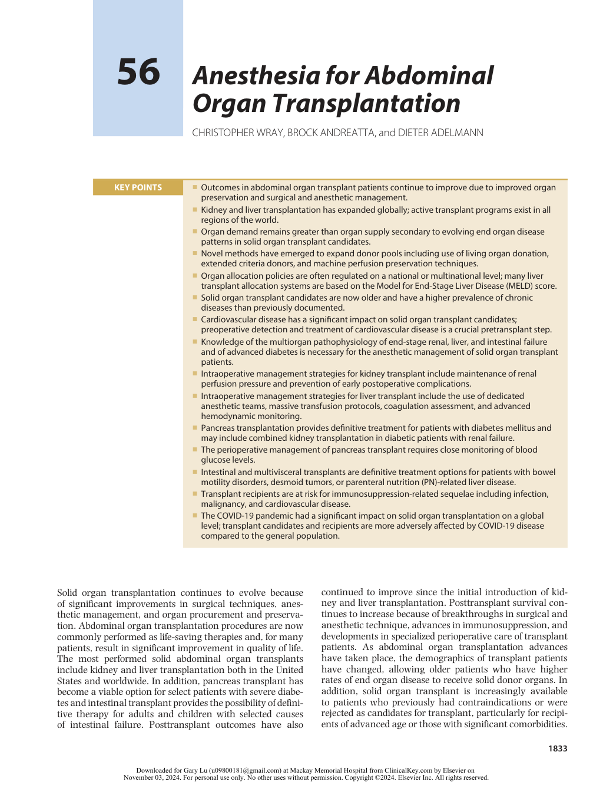

:::

<!-- PDF page 2 -->

Globally, there were over 100,000 kidney transplants and over 35,000 liver transplants performed in 2019. Worldwide transplant activity in 2019 is estimated to have increased by 5% over 2018; similar yearly increases have occurred over the previous five years (Fig. 56.1).1 Transplant volumes have increased annually in the United States as well. There were 24,274 kidney transplants and 8897 liver transplants performed in the United States in 2019. Kidney transplant volumes have increased by 41% and liver transplants by 37% since 2010.2 In the United States and worldwide, the kidney is the most transplanted organ, followed by the liver (Fig. 56.2).

Despite the steady increase in solid organ transplant volume and the introduction of transplant programs in many developing nations, the number of patients who could

benefit from transplantation far exceeds those who are able to receive an organ. The imbalance between graft supply and demand is a major factor limiting organ transplantation in all regions of the world. To address the increasing need, the expansion of living organ donation continues to grow. Breakthroughs in surgical technique have allowed for the widespread implementation of successful living donor liver transplantation, particularly in many Asian nations. Novel organ sharing “chains” for living unrelated kidney donation have been developed in the United States and in Europe to expand recipient access to organs. Other strategies to increase organ donation include the use of extended criteria donors, split- liver donation, and the development of machine perfusion technology that allows for the salvage and transplantation of deceased liver grafts that historically

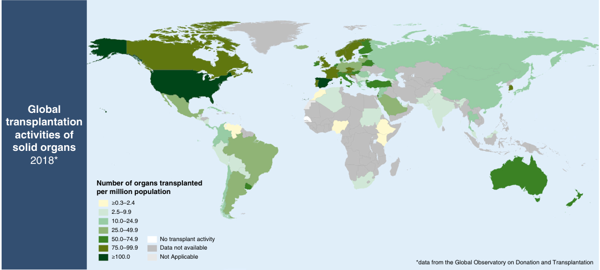

Global transplantation activities of solid organs 2018* Number of organs transplanted per million population ≥0.3–2.4 2.5–9.9 10.0–24.9 25.0–49.9 50.0–74.9 No transplant activity 75.0–99.9 Data not available ≥100.0 Not Applicable *data from the Global Observatory on Donation and Transplantation 

**Fig. 56.1 Global solid organ transplant activity, 2018.** (From Global Observatory on Donation and Transplantation (GODT): http://www.transplantobservatory.org/global- report- 2018/)

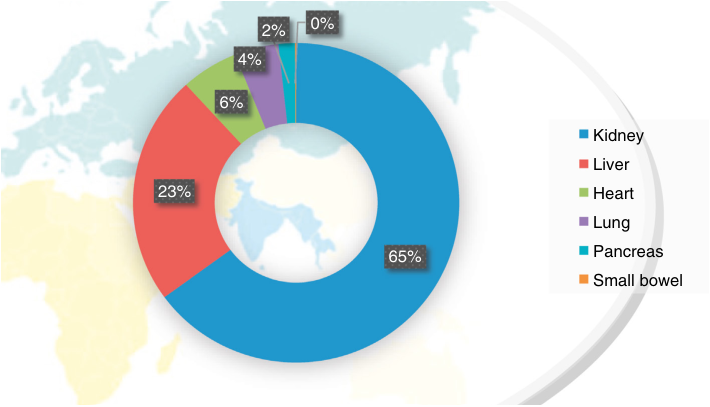

0% 2% 4% 6% Kidney Liver 23% Heart Lung 65% Pancreas Small bowel 

**Fig. 56.2 Global transplants by organ, 2017.** (From Global Observatory on Donation and Transplantation (GODT): http://www.transplant- observatory.org/down load/2017- activity- data- report/)

<!-- PDF page 3 -->

have been considered inappropriate for transplantation due to poor quality.3 Organ donation topics are discussed in detail elsewhere in this chapter.

The evaluation of patients for transplantation varies among countries, regions, and transplant centers. However, the central goals for transplantation are similar regardless of country, center, or organ. These include (1) that transplantation is appropriately indicated for the management of end organ failure, (2) that comorbidities do not preclude transplantation, and (3) that there are adequate resources to support the recovery and long- term health maintenance of the transplant recipient. Transplant centers typically maintain a dedicated multidisciplinary selection committee that includes nephrologists and/or hepatologists/gastroenterologists, transplant surgeons, psychiatrists, dietitians, social workers, transplant coordinators, and additional consultants as indicated. Anesthesiologists are important consultants as part of the selection discussion, providing valuable input regarding the selection of transplant candidates as well as helping define the preoperative evaluation and management for high- risk candidates. At many centers, dedicated transplant anesthesia teams contribute to the preoperative evaluation for candidates with significant cardiovascular or respiratory comorbidities, poor nutritional or functional status, multiorgan failure, limited vascular access, or known anesthetic risks.

The success of organ transplantation relies heavily on a highly specialized team approach that includes the organ procurement organization, transplant coordinators, nurses, physicians, and allied health care providers. Throughout the world, transplant centers often rely on specialized anesthesia teams highly trained in the perioperative management of solid organ transplant patients, particularly for liver and multivisceral transplantation. In addition, many academic anesthesia departments with experienced transplant anesthesia divisions have developed liver transplant anesthesia fellowships dedicated to the training of future transplant anesthesiologists.

Transplant may be denied to candidates deemed to have an excessive risk for posttransplant mortality. The concept of transplant futility attempts to address prohibitive transplant risk. Despite significant debate, there is no consensus regarding the definition of futile transplant.4,5 Although there are some conditions that are universally considered contraindications to transplant such as metastatic cancer, uncontrolled intracranial hypertension, and active untreated infection, the determination of a candidate that is deemed too sick for transplant is a major clinical challenge. Recent publications have addressed conditions that may be considered contraindications to transplant, particularly in critically ill candidates.6–8 Pretransplant conditions highly associated with critical illness such as significant pulmonary support, vasopressors, or dialysis may be reasons to deny transplant. Additional chronic comorbidities may exacerbate the risk of transplant to a level that may be unacceptable to some centers. Cardiovascular comorbidities have received significant attention in transplant candidates; the pretransplant evaluation is focused on the detection and treatment of advanced cardiac conditions that may impact both perioperative and late posttransplant outcomes. Cardiac conditions that may exclude candidacy include severe obstructive coronary artery disease (CAD), severe valvular

abnormalities, left or right ventricular dysfunction, major arrhythmias, and advanced pulmonary hypertension. Psychosocial contraindications include alcohol or recreational drug use and the lack of social support, which might preclude long- term compliance with immunosuppression and appropriate medical follow- up. Age alone is generally not a contraindication; however, a combination of increased age and comorbidities may exclude transplant in the older patient.

Finally, the COVID- 19 pandemic had a major impact on transplantation across the world. The early phase of the pandemic resulted in significant decreases in transplant activity, particularly in the first half of the year 2020. In addition to disruption in the complex health care systems necessary for successful transplantation, COVID- 19 had an additional negative impact on both deceased and living organ donation. Severe manifestations of COVID- 19 disproportionately affect patients with multiple comorbidities. Patients with end organ disease awaiting transplant and immunocompromised transplant recipients are equally at risk. Despite this unprecedented challenge, organ transplant networks and transplant institutions rapidly adjusted to this new health care climate. In some nations, early declines in transplant volumes were overcome by increased activity after the first wave of the pandemic.9 In the United States, total kidney transplants in 2020 declined by only 2.5% compared to 2019. Remarkably, total liver transplants slightly increased in 2020.10 European transplant activity was more severely impacted; total organ donation decreased by 18.2% and all transplants decreased by 12.5% within the Eurotransplant region in 2020.11 Some nations suffered severe disruptions in transplantation despite low COVID infection rates; Argentina, Chile, and Japan reported greater than 50% decreases in total transplant activity in 2020.12 Fortunately, transplant volumes in 2021 appear to have recovered to higher rates than in 2020, according to early data.13–15 Transplant programs have significantly adapted to the COVID- 19 pandemic in a relatively short period. Emerging therapies and vaccines will likely play important roles in organ transplant patients. However, given the spread of new variants and rapid changes in regional infection rates, the COVID- 19 pandemic remains a challenge to the future of solid organ transplantation. This chapter reviews the anesthetic considerations for kidney, liver, pancreas, intestinal, and multivisceral transplantation in adults. The care of pediatric patients is described elsewhere in this text, as is the management of heart and lung transplantation.

## Kidney Transplantation

Successful kidney transplantation was initially performed in the 1950s. However, widespread kidney transplantation for renal failure did not take place until the 1970s. Advances in tissue typing, immunosuppression, and surgical technique for both living related and cadaveric kidney transplant led to improvements in graft and patient survival. Kidney transplant is the most common organ transplant surgery and is performed on a worldwide level. Kidney transplant programs are active throughout Europe, North America, South America, Asia, and in many developing countries.

<!-- PDF page 4 -->

As of 2019 there were 113 countries with reported kidney transplant centers.16 There are differences in the distribution of living versus cadaveric donor organs between regions and countries due to many factors. Nevertheless, 72% of the countries that have active kidney transplant programs report performing both living related and cadaveric donor services.16 Despite the growth in kidney transplant programs, global disparities in access exist. Cultural, religious, and educational factors impact organ donation. Developing nations especially face challenges related to costs, infrastructure, and patient access to health care.17

### TRENDS IN KIDNEY TRANSPLANTATION

The demographics of kidney transplant patients have changed over the past 30 years, reflecting changes in endstage renal disease (ESRD) patterns and the impact of aging populations. Diabetes and hypertension are the two most common etiologies of ESRD in the United States18 The overall prevalence of ESRD in the United States has continued to increase, likely due to the increased prevalence of diabetes in the general population.19 ESRD continues to increase on a global level as well. Reported incidences of ESRD vary between countries for many reasons including differences in ESRD etiology. Management of ESRD has also evolved. For example, economic development generally improves access to renal replacement therapy which not only improves clinical care but also allows patients requiring transplantation to be better prepared for the surgical procedure. Economic advancement is also correlated with increasing rates of diabetes, hypertension, and obesity as well as a growing elderly population at risk for ESRD. Overall, the global prevalence of ESRD requiring renal replacement therapy is expected to double by 2030.20 Further growth of kidney transplantation programs and other advances in care will be necessary to meet the challenge of this global increase in ESRD.

In the United States, after many years of stagnant growth, the total number of kidney transplants increased yearly between 2015 and 2019.21 In 2019 a total of 24,273 kidney transplants were performed, the highest yearly number to date (Fig. 56.3). Throughout this period, yearly increases in kidney transplants kept pace with steady annual increases in waiting list additions. Many factors have contributed to this increase in kidney transplant volume including increased recovery of organs from high- risk and older donors and recent changes in allocation policies.21,22

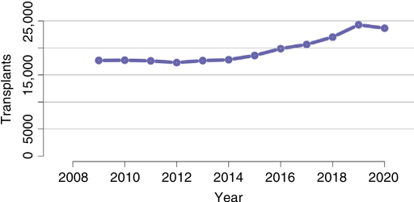

2008 2010 2012 2014 2016 2018 2020 Year 25,000 Transplants 15,000 5000 0 

**Fig. 56.3 United States kidney transplantation trends, 2008–2020.** (From Lentine KL. OPTN/SRTR 2020 Annual Data Report: Kidney. _Am J Transplant_ . 2022;22(Suppl 2):21–136.)

Living kidney donation contributed as well. Living donation steadily increased from 2017 to 2019, with a peak of 6867 living donor transplants performed in 2019.21

Kidney transplant is considered the best available and definitive treatment for patients with ESRD; it provides improved patient survival and quality of life compared to long- term dialysis.23 In addition, kidney transplantation patients have good long- term outcomes. One- year deceased donor graft survival rates are over 90% in the United States, Europe, Canada, and Australia/New Zealand.24 Long- term graft survival continues to improve as well. Current graft survival half- lives are expected to be greater than 11 years for deceased donor grafts and greater than 19 years for living donor grafts.25 Improvements in surgical technique, organ procurement, immunosuppression, and posttransplant surveillance have contributed to the ongoing success of kidney transplant. Despite this, a significant portion of kidney transplant candidates are removed from transplant lists because they are determined to be too ill for transplant. For all patients waitlisted in the United States in 2016, 20.1% were removed from the waitlist and 6.8% died.21 Older candidates with multiple chronic comorbidities are at risk for waitlist removal due to progression of comorbid conditions. Although pretransplant mortality continues to decrease in the United States, kidney transplant candidates may wait many years before receiving a deceased donor transplant. Of all patients waitlisted in 2016, 36.5% of these patients were still waitlisted in 2019.21

As previously discussed, the global COVID- 19 pandemic had a significant impact on transplant activity. In the United States, the total number of kidney transplants performed in 2020 decreased to 23,642. This decrease was directly due to a COVID- related decrease in living donation.18 Waitlist mortality increased in 2020 after yearly decreases over the previous eight years, likely reflecting the impact of COVID- 19 on an immunocompromised, chronically ill patient population. Although reported graft failure in the United States was stable for the year 2020, one- year posttransplant mortality was slightly higher than in previous years, again likely reflecting the impact of COVID- 19 on early posttransplant outcomes. An international study of 12 transplant centers found a high rate of early mortality (32%) in kidney transplant patients hospitalized with COVID- 19.26 In general, these patients were older and had high rates of comorbid conditions. Overall, the mortality rate in kidney transplant patients was much higher than COVID- 19 mortality rates in the general population.

### ORGAN MATCHING AND ALLOCATION

Organ matching for all solid organ transplants, including kidney transplants, involves several steps to determine compatibility between donor and recipient. ABO blood group matching is determined for all donors and recipients. Before the transplant surgery, a cross- match is performed by mixing recipient blood with donor blood cells. This crossmatch is performed to identify any recipient antibodies that are reactive against donor antigens. Histocompatibility matching is an important part of the organ matching process as well. This involves a comparison of the human leukocyte antigen (HLA) profile of the recipient with the HLA profile of the donor. For all potential recipients awaiting a

<!-- PDF page 5 -->

deceased donor, their HLA profile is compared to the donor profile and an appropriate donor–recipient pairing is made based on the best match. For living donors, HLA matching is performed well in advance of the surgery.

Organ allocation for kidney transplant is generally based on national or multinational processes that are governed by transplant organizations. There is no international consensus regarding how organ allocation is determined, resulting in differences in allocation policies between organizations and countries. Organ allocation policies regulate the distribution of deceased donor organs; living organ donation is usually directed to known recipients. In the United States, kidney allocation policies were initially created in 1984. All organ transplants in the United States are administered by the Organ Procurement and Transplantation Network (OPTN) and are continually reviewed by the United Network for Organ Sharing (UNOS) to assure fairness and to address disparities in access to organs. Historically, this kidney allocation policy relied on regional waitlists that prioritized patients primarily by waitlist duration. Multiple revisions to this system have been implemented to improve access to organs using a points system based on factors such as age, duration on dialysis, geographic location, blood type, HLA sensitization, and medical urgency.27 Follow- up analyses have demonstrated improved access to deceased kidney transplant in the United States for patient groups with known disparities to transplant access such as African American and Hispanic candidates and highly HLA- sensitized candidates.28,29

Kidney allocation policies in the United Kingdom, first implemented in 1989, were mainly based on HLA matching. Points- based revisions adopted in 2006 were designed to improve inequities to organ access. These revisions included non- HLA factors such as waitlist time and geographic location. Similar to the United States, United Kingdom allocation policy revisions have improved access to kidney transplant for ethnic minority patients and highly sensitized patients.30

In contrast to the United States and the United Kingdom, Eurotransplant is a consortium of European countries that pools donor organs for a centralized recipient list. Implemented in 1996, the Eurotransplant Kidney Allocation system is a points- based allocation system that remains in current use. Adaptations to this system include policies for certain patient subgroups, including a program for kidney allocation for seniors.31 Scandiatransplant, a similar consortium of Nordic countries, allocates organs between member nations using HLA- based criteria. Other European countries manage kidney transplant allocation on a national level. Spain, with the highest organ donation rate of any European country, relies mainly on local allocation criteria.30

Cultural and religious differences and barriers to organ donation impact organ distribution and transplantation in many parts of the world. Many Asian countries have developed large living related kidney transplant programs to provide wide access to transplant for patients with ESRD. National organ sharing networks exist in most developed Asian nations, and governmental policies designed to increase deceased organ donation have been implemented in many Asian nations as well.32–34 Kidney transplant in developing countries relies heavily on living donation, although patient access to living donor transplant is limited by many financial and logistical challenges. Some developing countries will perform deceased donor kidney transplant and use

regional and national waitlist systems to allocate organs. Successful kidney transplant programs are active in many middle- and low- income countries including South Africa, Sudan, Kenya, the Philippines, Pakistan, and Iran.35

Living kidney donation is a successful strategy for increasing organ access for ESRD patients. In addition to living related and unrelated donation to directed donors, welldeveloped kidney exchange strategies have been developed in the United States and other developed countries for living donation chains to nondirected donor–recipient pairs. Exchange living kidney donation has been successfully applied in many developing nations as well. The concept of a global kidney donation exchange to increase access to living organs across international borders has been proposed although many logistic issues will impact a multinational approach to organ allocation and access.36

### INDICATIONS FOR KIDNEY TRANSPLANTATION

Kidney transplantation is indicated in patients with a wide variety of ESRD etiologies. Glomerular disease, congenital diseases, and polycystic kidney disease are the most common indications in younger patients. However, hypertension and diabetes are the most common indications for kidney transplantation in the United States, reflecting an aging population with an increasing prevalence of diabetes. The average age of waitlisted patients in the United States has continued to increase over the past 10 years.18 Diabetes remains the leading cause of ESRD in the United States, representing 38% of all waitlisted candidates in 2020 (Fig. 56.4). Although kidney transplant outcomes continue to improve, late allograft failure remains a long- term concern in kidney transplant recipients and is an increasingly common indication for transplantation. Long- term allograft failure requiring dialysis or retransplant has been documented in 14% of kidney transplant recipients.37 In the United States, the proportion of waitlist patients with a history of prior transplant has been slowly decreasing since 2010. Other countries have reported higher proportions of waitlisted candidates with allograft failure, as high as 27.9% awaiting retransplantation.38

### PATHOPHYSIOLOGY OF END- STAGE RENAL DISEASE

The final progression of chronic kidney disease (CKD) is the development of ESRD, when renal function is

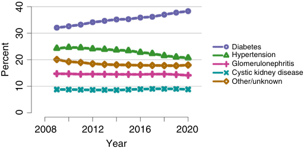

Diabetes Hypertension Glomerulonephritis Cystic kidney disease Other/unknown 2008 2012 2016 2020 Year 40 30 20 Percent 10 0 

**Fig. 56.4 Distribution of adults awaiting kidney transplant in United States 2008–2020 by diagnosis.** (From Lentine KL. OPTN/SRTR 2020 Annual Data Report: Kidney. _Am J Transplant_ . 2022;22(Suppl 2):21–136.)

<!-- PDF page 6 -->

irreversibly impaired. All essential functions of the kidney including regulation of plasma electrolytes, maintenance of fluid volumes, elimination of nitrogenous wastes and drugs, synthesis of erythropoietin, and adjustment of plasma pH are affected. Clinical manifestations of uremia occur with significant declines in glomerular filtration rate (GFR) and urine production. ESRD affects nearly every organ system and has a major impact on mortality. After the development of ESRD, some form of renal replacement therapy is required. ESRD has a significant burden on global health. In 2016, CKD was listed as the 13th most common cause of mortality and is projected to increase in the future.39 Despite the clinical benefits of dialysis, the mortality risk for ESRD increases with duration of dialysis. As a result, there is a significant benefit for ESRD patients to receive kidney transplant; transplant recipients have an overall greater survival versus long- term dialysis patients.40

ESRD results in abnormalities of intravascular and extravascular volumes, acid–base balance, and electrolyte homeostasis. Uremia and oliguria result in expansion of extracellular fluid volume. Clinically, patients present with edema, hypertension, and signs and symptoms of volume overload. Electrolyte disorders of sodium, calcium, magnesium, and phosphate may result in bone metabolism abnormalities, hyperparathyroidism, and vascular calcifications. Acute hyperkalemia is the most critical electrolyte abnormality due to the impact of increased potassium levels on the myocardium. Failure of the renal elimination of organic acids results in the development of an anion- gap metabolic acidosis.

ESRD has significant chronic effects on the cardiovascular system. Cardiovascular disease is the most common cause of morbidity and mortality in patients with ESRD, accounting for 35% to 40% of all deaths in patients receiving hemodialysis.41 The risk of cardiac mortality increases as renal failure progresses.42 ESRD is an independent risk factor for the development of atherosclerosis. The risk of underlying obstructive CAD is higher in patients with ESRD compared to the general population and may be even greater in patients with hypertension and diabetes.43 Hypertension is one of the most common etiologies of ESRD. However, regardless of etiology, hypertension universally develops in patients with ESRD due to hyperreninemia, hypervolemia, and renal vasculature changes. Concentric left ventricular hypertrophy with diastolic dysfunction typically develops as renal function diminishes and is the most common cardiac abnormality in ESRD patients.44 Patients with ESRD are at risk for diastolic congestive heart failure, especially in the setting of increased intravascular volume. Dilated cardiomyopathy with systolic heart failure may also occur in patients with ESRD. Heart failure has been documented in nearly 40% patients on hemodialysis.45 The cardiorenal syndrome, a complex process involving reciprocal decline in both renal and cardiac function, may impact patients with ESRD as well. A recent change in the classification of the cardiorenal syndrome based on pathophysiologic differences has been proposed.46 Renal transplantation can have favorable benefits to the cardiovascular system. Improvements in systolic dysfunction and reversal of left ventricular hypertrophy have been documented after kidney transplant.47,48

Pericardial disease is common in patients with uremia. A spectrum of pericardial diseases may manifest in ESRD patients including uremic pericarditis, pericardial effusion with tamponade, and constrictive pericarditis. Early dialysis initiation and improvements in dialysis techniques have reduced the incidence of ESRD- related pericardial disease.49 Primary or secondary arrhythmias may occur in ESRD due to underlying cardiac disease and/or electrolyte disturbances. Atrial fibrillation is the most common arrythmia in adults and occurs in up to 32% of patients with ESRD.50 Stroke is of significant concern in ESRD due to the associated risk of atherosclerosis; ESRD patients with atrial fibrillation may be at an even higher risk. There is no current consensus regarding anticoagulation in patients with atrial fibrillation and ESRD. ESRD patients have a documented increased risk of major bleeding with anticoagulation; therefore treatment dilemmas in these patients are common.51

Typical hematologic and hemostatic abnormalities are ubiquitous in ESRD. A normochromic, normocytic anemia occurs due to lack of erythropoietin and may be exacerbated by iron deficiency, chronic inflammation, and bone marrow fibrosis. Erythropoiesis- stimulating agents and iron are standard therapies for ESRD patients; near- normal hematocrit levels are commonly maintained.52 Abnormal hemostasis occurs in ESRD patients due to alterations of platelet‐dependent mechanisms. Decreases in the production of von Willebrand factor and factor VIII are implicated in this process. Platelet dysfunction and other underlying factors result in a significantly increased risk for major bleeding events in ESRD patients compared to the general population.53 Conversely, ESRD patients may develop a hypercoagulable state due to a complex hemostatic process involving imbalances in fibrinogen and antithrombin levels, acquired thrombophilic factors, and endothelial alterations. The risk of venous thromboembolism is significantly increased in ESRD patients compared to the general population and may present clinically as pulmonary embolism or thrombosis of arteriovenous fistulas.54 Many of the hemostatic abnormalities of ESRD have been shown to resolve after kidney transplantation.55

ESRD commonly impacts upper gastrointestinal function resulting in nausea, vomiting, abdominal pain, and decreased appetite. ESRD produces a gastropathy that results in decreased gastric emptying at a significantly higher rate compared to the general population.56 The presence of diabetes and obesity may further impair gastric emptying. ESRD patients with symptomatic dyspepsia have been shown to have particularly prolonged gastric emptying times.57

Central and peripheral nervous system abnormalities may occur in ESRD due to a complex process involving accumulation of uremic toxins and changes in the blood– brain barrier. Clinically, a spectrum of acute and chronic disorders ranging from subtle cognitive impairment to overt neurologic dysfunction may occur in ESRD patients. Severe acute manifestations of ESRD such as asterixis, seizures, and decreased mental status are uncommon in ESRD patients with regular dialysis. However, peripheral neuropathy and autonomic dysfunction are common findings in ESRD patients; these may be even more prevalent in diabetic patients. Autonomic neuropathy occurs in up to 50% of ESRD patients and manifests with orthostatic

<!-- PDF page 7 -->

hypotension and cardiac arrhythmias.58 Many of the neurologic manifestations of ESRD may be reversed with kidney transplantation.59

### ANESTHESIA FOR KIDNEY TRANSPLANTATION: PREOPERATIVE EVALUATION

Prior to listing for kidney transplant, patients typically undergo a detailed pretransplant evaluation to determine their fitness for transplantation and to assess for the likelihood of long- term survival following transplantation. At many centers, a multidisciplinary committee directs this process. Following this initial evaluation, patients may remain on transplant lists for many years. Living donor kidney transplants are scheduled in advance, allowing for an additional preoperative assessment before surgery. However, cadaveric kidney transplantation is an urgent procedure since the ideal cold ischemia goal for the kidney is under 24 hours.

Kidney transplant candidates have a high prevalence of cardiac disease; the preoperative cardiac evaluation is a crucial step in the pretransplant assessment. The preoperative cardiac assessment for kidney transplant patients differs from the assessment for nontransplant surgical patients. Longterm posttransplant survival is the goal of all organ transplants. Therefore, the pretransplant cardiac evaluation must address both early and late posttransplant cardiac risk. The goal of the preoperative cardiac evaluation is ultimately to decrease the morbidity and mortality associated with cardiovascular disease in kidney transplant candidates. Although decisions regarding candidacy in patients with known cardiac disease are usually made well before surgery, the anesthesiologist is responsible for a reassessment for the presence of occult cardiac disease in kidney transplant patients at the time of surgery and often to determine what, if any, additional management strategies should be used to prepare the patient for the transplant and postoperative needs.

A significant body of literature focused on pretransplant cardiac risk in kidney transplant patients has been published within the past 10 to 20 years. These include clinical studies addressing posttransplant outcomes in kidney transplant patients with cardiac disease and societal guidelines that provide cardiac diagnostic and treatment paradigms for kidney transplant candidates. The most recent publication of the KDIGO (Kidney Disease: Improving Global Outcomes) Clinical Practice Guidelines provides recommendations regarding pretransplant cardiac testing including ischemic heart disease surveillance for kidney transplant candidates (Box 56.1). Previously, the American Heart Association (AHA) and the American College of Cardiology (ACC) issued a publication stating that the cardiac evaluation and management among kidney and liver transplantation patients should form the basis of the longterm evaluation of the transplant patient.60 Notably, this statement acknowledges the limitations of previously published guidelines for the preoperative cardiac evaluation and management of patients undergoing noncardiac surgery when applied to solid organ transplant candidates.61 Cardiac testing recommendations for kidney transplant candidates are based on important observations in ESRD patients. In general, silent myocardial ischemia and occult obstructive CAD occurs more frequently in patients with ESRD compared to the general population, especially in

### Box 56.1 KDIGO Clinical Practice Guideline: Cardiac Evaluation in Kidney Transplant Candidates

- Evaluate all candidates for the presence and severity of cardiac disease with history, physical examination, and electrocardiogram (ECG).

- Patients with signs or symptoms of active cardiac disease (e.g., angina, arrhythmia, heart failure, symptomatic valvular heart disease) should undergo assessment by a cardiologist and be managed according to current local cardiac guidelines prior to further consideration for a kidney transplant.

- We suggest that asymptomatic candidates at high risk for coronary artery disease (e.g., diabetes, previous CAD) or with poor functional capacity undergo noninvasive CAD screening.

- We recommend that asymptomatic candidates with known CAD not be revascularized exclusively to reduce perioperative cardiac events.

- We suggest that patients with asymptomatic, advanced triple- vessel coronary disease be excluded from kidney transplantation unless they have an estimated survival which is acceptable according to national standards.

- We suggest that candidates who have a myocardial infarction be assessed by a cardiologist to determine whether further testing is warranted and when they can safely proceed with kidney transplantation.

- We suggest that transplantation be delayed an appropriate amount of time after placement of a coronary stent as recommended by the patient’s cardiologist.

- _CAD,_ coronary artery disease; _KDIGO_ , Kidney Disease: Improv ing Global Outcomes.

From Chadban SJ, Ahn C, Axelrod DA, et al. KDIGO Clinical Practice Guideline on the Evaluation and Management of Candidates for Kidney Transplantation. _Transplantation_ . 2020;104(4S1 Suppl 1):S11–S103.

patients with diabetes.60 Additionally, many ESRD patients are deconditioned and unable to exercise for various reasons. Decreased functional status may not be a specific or sensitive indicator of cardiovascular risk in kidney transplant candidates. Finally, scoring systems that use traditional CAD risk factors to estimate cardiovascular risk may underestimate the risk of occult CAD and adverse cardiac events in patients with ESRD.62

Noninvasive ischemia testing is generally recommended for kidney transplant candidates at increased risk for occult CAD, although there are differences in thresholds for performing ischemia testing and there is no consensus regarding the type of noninvasive test.60,63 Noninvasive methods have been well studied in kidney transplant populations, although most investigations occurred in small populations and were limited to dobutamine stress echocardiography (DSE) or myocardial perfusion imaging (MPI). One publication reviewed 13 studies of DSE and nine studies of MPI for their ability to detect CAD in kidney transplant recipients. Overall, these studies demonstrated decreased pooled sensitivity and specificity for either test to detect obstructive CAD in ESRD patients.64 A decreased coronary vasodilator response in patients with diabetes may limit the accuracy of MPI and underlying left ventricular hypertrophy may limit the echocardiographic detection of reversible wall motion abnormalities during DSE.65,66 Although noninvasive testing appears to be less reliable for detection of obstructive CAD in kidney transplant patients compared to

<!-- PDF page 8 -->

the general population, noninvasive testing appears to be a valid method for the prediction of posttransplant cardiac events. A meta- analysis that reviewed 52 studies in over 7000 kidney transplant patients compared DSE, MPI, and coronary angiography for their accuracy to predict postoperative cardiac outcomes. Results of this study showed that both DSE and MPI were as accurate as coronary angiography for predicting both major adverse cardiac events and cardiac mortality.67 Coronary angiography remains the gold standard for diagnosing both the extent and severity of CAD. However, angiography may further exacerbate renal function in patients with advanced renal disease. Furthermore, the role of coronary revascularization for asymptomatic CAD in kidney transplant candidates has not been established. In a large randomized trial of patients with advanced renal failure and moderate to severe ischemia documented by noninvasive testing, there was no difference in long- term mortality or myocardial infarction between patients that underwent angiography with revascularization and patients that only received conservative medical therapy.68

A stepwise process for the cardiac evaluation of kidney transplant candidates should be undertaken and includes a comprehensive cardiovascular history, evaluation of signs and symptoms of advanced cardiac disease, assessment of functional status, and identification of CAD risk factors. A baseline electrocardiogram (ECG) should be performed in all adult candidates, especially in candidates with cardiac symptoms or history of cardiac disease.60,63 The ACC/AHA recommends that noninvasive ischemia testing should be considered in candidates with multiple cardiovascular risk factors, regardless of functional status.60 Recent KDIGO recommendations state that noninvasive testing should be considered in candidates at high risk for CAD and in candidates with poor functional capacity.63 In addition to cardiovascular disease, structural cardiac abnormalities are common in ESRD patients. Left ventricular dysfunction and valvular abnormalities are prevalent in ESRD patients, particularly in older patients. Transthoracic echocardiography provides detailed imaging of left and right ventricular size, resting cardiac function, and valvular anatomy with no appreciable testing risks. Occult pulmonary hypertension is also common in ESRD, due to uremia- induced pulmonary vasoconstriction and increased cardiac output secondary to an arteriovenous fistula. Given the risk of occult pulmonary hypertension in patients with long- term dialysis, guidelines recommend echocardiography for identification of occult pulmonary hypertension for ESRD on dialysis for greater than two years. Right heart catheterization provides the definitive diagnosis of pulmonary hypertension and may be indicated in patients with evidence of significant pulmonary hypertension by echocardiography. Regardless of the type of cardiac disease that is detected in the pretransplant cardiac assessment, guidelines recommend that longterm cardiac management of transplant candidates should be directed by a cardiologist. In some centers, a dedicated cardiologist is identified by the transplant team to manage cardiac concerns in kidney transplant candidates. Additionally, in patients with known cardiac disease, repeat cardiac assessments may be required although the frequency of assessments has not been defined.60 Kidney transplant candidates with underlying cardiac conditions may be

prescribed a variety of cardiac medications including those for the chronic treatment of hypertension. The urgency of deceased donor kidney transplantation often allows only the immediate preoperative administration of antihypertensive medications. Perioperative antihypertensive and cardiac medical therapy in surgical patients has been reviewed in the most recent ACC/AHA guidelines.61 In general, it is reasonable to apply current ACC/AHA recommendations regarding perioperative antihypertensive therapy in kidney transplant candidates.

Prior to surgery, patients receiving hemodialysis should be maintained on their regular dialysis schedules. Dialysis is routinely performed immediately prior to surgery at many centers. Preoperative laboratory assessment of electrolytes, complete blood count, and platelet count is necessary in all kidney transplant patients immediately prior to surgery. A delay of surgery and immediate dialysis is indicated when increased potassium is detected prior to surgery, especially if ECG changes consistent with hyperkalemia are observed. Preoperative heart rate and arterial blood pressure should be assessed and vital sign trends in hospitalized patients should be observed. Intravascular volume status may be estimated by comparing the current patient weight to the known euvolemic weight. Orthostatic assessments and the presence of resting hypotension and increased heart rate may identify significant hypovolemia. Conversely, hypervolemic patients may be at risk for acute congestive heart failure during the perioperative period. Evidence of significant volume overload may be an indication for immediate preoperative dialysis as well.

On the day of surgery blood glucose levels should be measured. Diabetes is common in the kidney transplant population, and perioperative hyperglycemia is associated with adverse outcomes in both diabetic and nondiabetic populations.69 Perioperative glycemic therapy should be initiated in patients with diabetes who are undergoing kidney transplant. However, there is limited evidence that demonstrates that intraoperative glucose control favorably impacts outcomes, and hypoglycemia is a concern when insulin is administered during surgery. In general, it is reasonable to maintain blood glucose levels less than 180 mg/dL with appropriate perioperative glucose monitoring to avoid hypoglycemia.70 Oral antihyperglycemic medications should be withheld in patients with non- insulin- dependent diabetes.

Prior to surgery a type and screen or cross- match for packed red blood cells should be obtained. Although major blood loss during routine kidney transplantation is not common, the surgery involves major vascular structures and rapid bleeding may occur. In patients with known cardiac disease or in those with changes in cardiac symptoms, bedside echocardiography may be very useful for a rapid reassessment for cardiac pathology.

### ANESTHESIA FOR KIDNEY TRANSPLANT: INTRAOPERATIVE MANAGEMENT

General anesthesia with endotracheal intubation is the preferred anesthetic method for kidney transplantation in most institutions. The goals of anesthesia are to provide an adequate depth of anesthesia while maintaining hemodynamic stability and to provide appropriate muscle relaxation to

<!-- PDF page 9 -->

facilitate surgical conditions. Patients with ESRD are considered at risk for aspiration of gastric contents secondary to uremic gastropathy and other conditions such as obesity and diabetes. An oral antacid and intravenous administration of an H2 blocker may be considered before induction of anesthesia. A rapid- sequence induction is the preferred method for inducing general anesthesia. Succinylcholine can be used safely in standard doses in patients with ESRD when potassium levels are within normal limits, although alternative muscle relaxants can also be used to facilitate intubation. After administration of succinylcholine, potassium transiently increases 0.5 to 1.0 mEq/L for 10 to 15 minutes before returning to baseline levels in patients with ESRD.71 A modified rapid- sequence induction using rocuronium may be a substitute for succinylcholine when hyperkalemia or other contraindications to succinylcholine exist. Rocuronium should be used in ESRD with caution as the duration of action is prolonged. A meta- analysis of 50 studies that compared the intubating conditions produced by succinylcholine and rocuronium found that intubation conditions were similar when the rocuronium dose was 1.2 mg/kg.72 The hemodynamic response to laryngoscopy may be exaggerated in patients with ESRD with underlying chronic hypertension. Tachycardia and hypertension can be attenuated with supplemental short- acting agents or opioids. Following tracheal intubation, kidney transplant patients may develop hypotension before surgical incision, especially in hypovolemic patients or in patients receiving renin–angiotensin blocking drugs.

Standard noninvasive monitors may be adequate for kidney transplant in younger, healthier transplant recipients and in select living donor recipients. Intra- arterial blood pressure monitoring may be beneficial for intraoperative monitoring, particularly in patients with uncontrolled hypertension or cardiac conditions. A radial arterial catheter is typically placed contralateral to a preexisting arteriovenous fistula. Femoral arterial access on the side selected for kidney implantation is contraindicated due to the risk of hematoma or thrombosis adversely affecting the implanted graft. Upper extremity arterial lines may jeopardize future arteriovenous access for dialysis in ESRD patients, so the risk versus benefit of arterial monitoring should be considered. Pulmonary artery (PA) catheter monitoring or transesophageal echocardiography (TEE) may be considered in patients with advanced cardiac disease or pulmonary hypertension but is rarely indicated otherwise. Central venous pressure (CVP) has historically been used in the operating room in many surgical populations including kidney transplant to guide fluid therapy. Despite this, CVP has been shown to poorly predict fluid responsiveness. A large meta- analysis that pooled data from a total of 43 studies found that CVP was unable to predict fluid responsiveness in a variety of surgical and intensive care unit (ICU) patients.73 Nevertheless, a central venous catheter provides reliable access for rapid fluid resuscitation, transfusions, blood sampling, and administration of immunosuppression drugs and vasoactive infusions. The risks and benefits of central line placement should be considered in kidney transplant patients, particularly the risk of postoperative central line–related catheter infections. In lieu of a central venous catheter, large- bore venous access is necessary for intravascular volume administration during kidney

transplant. Intravenous access can be challenging in some kidney transplant patients, particularly in patients with an upper extremity arteriovenous fistula. Conversely, central venous access may be difficult in ESRD patients who have undergone multiple previous central venous dialysis catheter placements, especially if central venous thrombosis has been documented.

Maintenance of anesthesia is typically performed using a combination of intravenous and inhaled anesthetics. Volatile inhaled anesthetics are titrated to the level of surgical stimulation. Desflurane and isoflurane are not associated with nephrotoxicity. Although sevoflurane has potential nephrotoxic effects from the metabolites compound A and fluoride ion, use of sevoflurane during kidney transplant is routine in many centers. A large meta- analysis of 41 randomized controlled trials found that there was no difference in postoperative renal function in patients that received sevoflurane versus other forms of maintenance anesthesia.74 Additionally, different anesthetic maintenance regimens have been studied in kidney transplant patients. These studies have shown that there was no difference in renal graft function between patients that received sevoflurane for maintenance anesthesia versus patients that received either propofol or desflurane.

Analgesia during kidney transplant may be provided with the synthetic opioids fentanyl, sufentanil, alfentanil, and remifentanil because their pharmacokinetics and pharmacodynamics are not affected by renal insufficiency. Morphine, oxycodone, and meperidine should be used with caution in patients with renal failure because these drugs have active metabolites that accumulate in these patients. Neuromuscular blockade during kidney transplantation may facilitate optimal surgical conditions; however, recovery from neuromuscular blockade may be delayed in ESRD patients. Vecuronium and rocuronium have prolonged durations of action in renal failure patients due to their partial renal metabolism. Pancuronium is primarily eliminated by the kidneys and should be avoided in patients with renal failure. Cisatracurium undergoes organ- independent clearance and may be considered the neuromuscular blockade agent of choice for kidney transplant. Regardless of the agent, judicious use of neuromuscular blocking drugs is a necessity during kidney transplantation. Titration to surgical conditions and close monitoring of the level of neuromuscular blockade are crucial.

The surgical procedure involves placement of the renal allograft in the left or right extraperitoneal fossa, although the right side is usually preferred (Fig. 56.5). A vertical curvilinear incision 20 to 25 cm long is typically made, extending from the pubis symphysis to above the anterior superior iliac spine. The abdominal musculature is divided, and the peritoneum is entered and retracted. During the initial incision and dissection adequate analgesia, depth of anesthesia, and muscle relaxation should be titrated to effect. Most commonly, the external iliac vein and artery are identified and prepared for the renal anastomoses. Heparin may be administered before clamping of the vessels. The external iliac vein is clamped first, and the renal vein anastomosis is performed. The external iliac artery is then clamped, and the renal artery anastomosis is performed. During the anastomoses of the renal vessels, expansion of intravascular volume with crystalloid or colloid solutions is initiated. Furosemide and

<!-- PDF page 10 -->

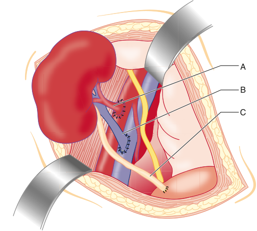

A B C 

**Fig. 56.5** (A) Renal artery anastomosis performed end- to- side to the external iliac artery. (B) Renal vein anastomosis performed end- toside to the external iliac vein. (C) Ureteral anastomosis to the bladder mucosa. (From Hardy JD. _Hardy’s Textbook of Surgery_ , 2nd ed. Philadelphia: JB Lippincott; 1988.)

mannitol are administered before reperfusion to stimulate diuresis. A recent meta- analysis of seven studies in 1051 kidney transplant patients found that mannitol administration during kidney transplant decreased the incidences of delayed graft function and acute renal failure.75

Reperfusion of the graft occurs upon removal of the vascular clamps and is a crucial portion of the surgery. On rare occasions, removal of vascular clamps may be associated with acute bleeding requiring further resuscitation and transfusion. Adequate blood pressure following reperfusion is usually maintained by temporary decreases in the depth of volatile anesthetic, volume expansion, and administration of inotropic medications to increase cardiac output. Adrenergic vasopressors are typically avoided due to their vasoconstrictive effects on the denervated graft. Invasive hemodynamic monitoring is useful following graft reperfusion, particularly for the rapid management of hypotension. Although it is well accepted that both blood pressure and volume status should be optimized after graft reperfusion, there is no consensus regarding target blood pressure parameters and ideal intravascular volume resuscitation goals. Furthermore, early graft dysfunction appears to have a multifactorial etiology involving donor, recipient, and intraoperative factors. Nevertheless, ischemia–reperfusion injury may be exacerbated by intraoperative hypotension. In one single- center study, kidney transplant recipients that had a recorded mean arterial pressure (MAP) &lt;70 mm Hg after graft reperfusion had a higher likelihood of delayed graft function.76

Intravascular volume management is challenging during kidney transplant. Hypovolemia during the perioperative period may contribute to early graft dysfunction, whereas hypervolemia may contribute to postoperative cardiopulmonary complications. In general, centers have applied liberal versus restrained fluid resuscitation strategies for the intraoperative management of kidney transplant patients, although there remains no consensus regarding

ideal volume management. A recent pilot study in kidney transplant patients compared a perioperative goal- directed protocol that used a stroke volume optimization strategy to guide fluid administration and hemodynamic management versus conventional fluid and hemodynamic management using CVP and invasive arterial pressure monitoring. Although both total fluid administration and graft urine output were not different between the two groups, there were lower rates of both early graft dysfunction and early cardiovascular events in the goal- directed therapy group.77 Although perioperative goal- directed therapy regimens have been advocated for hemodynamic management and volume resuscitation in major abdominal surgery, there are no specific published recommendations for these strategies in kidney transplant patients.78

After completion of the vascular anastomoses, the donor graft ureter is implanted into the recipient bladder. The bladder is filled with irrigation solution by way of a three- way Foley catheter and the donor ureter is anastomosed to the bladder, sometimes with placement of a temporary ureteral stent. The wound is then closed in layers. Neuromuscular blockade should be maintained until the fascial layer has been closed to prevent patient movement that might disrupt the graft position or vascular connections. Careful neuromuscular blockade monitoring is necessary during kidney transplant, especially during the closing portions of the procedure. Upon completion of surgery, adequate reversal of the neuromuscular blockade is crucial to avoiding postoperative pulmonary complications. Reversal of cisatracurium requires the use of neostigmine, whereas rocuronium reversal may be facilitated with sugammadex. Sugammadex rapidly binds to rocuronium and forms an inactive complex that is primarily cleared by the kidneys. Clearance of this complex is reduced in ESRD patients, although it may be removed by dialysis.79 Sugammadex has been shown to be safe and effective in both ESRD patients and in kidney transplant recipients.80,81 In one single- center study that compared outcomes in kidney transplant patients that received rocuronium and sugammadex versus cisatracurium and neostigmine, the rocuronium–sugammadex group had a decreased incidence of postoperative respiratory events, faster recovery room discharge times, and fewer ICU admissions.82 Nevertheless, prescribing information for sugammadex includes a disclaimer for use in patients with severe renal impairment.83

During emergence, exaggerated hemodynamic responses are common, especially in patients with poorly controlled hypertension. Appropriate titration of short- acting drugs to attenuate these responses upon emergence is helpful, especially in patients at risk for CAD. Kidney transplant patients may demonstrate delayed emergence from anesthesia and have exaggerated responses to opioids and sedative–hypnotics. Extubation of the trachea should occur after the patient demonstrates the ability to protect the airway, because kidney transplant patients are still considered a risk for aspiration of gastric contents at the completion of surgery.

### ANESTHESIA FOR KIDNEY TRANSPLANT: POSTOPERATIVE MANAGEMENT

Immediately following surgery, the kidney transplant recipient requires careful monitoring in the postanesthesia

<!-- PDF page 11 -->

care unit. Attention to urine output in the initial postoperative period is important, and acute decreases in urine output should initiate a rapid evaluation of the etiology and appropriate treatment. A prerenal etiology should be treated with aggressive intravascular volume resuscitation. In patients with hemodynamic instability and/or oliguria, additional invasive hemodynamic monitoring may be useful. Surgical problems related to the ureteral anastomosis may require emergent surgical re- exploration. Other early postoperative surgical complications may include bleeding and vascular thromboses. Clinicians should be vigilant for nonsurgical cardiovascular and pulmonary postoperative complications in the early postoperative period after kidney transplant. One institution reported a 15% rate of severe early postoperative complications.84 High- risk patients with advanced cardiac and pulmonary disease may require further postoperative monitoring in the intensive care setting. One single- center study reported an intensive care admission rate of 5.3% after kidney transplant. Most patients were admitted in the immediate postoperative period, most commonly for cardiac or pulmonary complications.85

Postoperative pain control can be challenging in kidney transplant patients. Renal failure alters the pharmacology of most opioid medications; dose reductions are generally required in renal failure patients and opioids with active metabolites are routinely avoided. Additionally, chronic underlying pain conditions and a history of opioid dependence may impact postoperative pain following kidney transplant. Chronic pain has been reported to occur in up to 60% of dialysis patients.86 Additionally, nonopioid analgesics are limited to mainly acetaminophen due to the nephrotoxicity of other nonsteroidal medications. Traditionally, opioid- based therapies are usually initiated in the postanesthesia care unit; patient- controlled opioid analgesia may be continued for 24 to 48 hours. Regional anesthesia for kidney transplantation is controversial. Concerns for uremic coagulopathy and hypotension have limited widespread use of neuraxial analgesia in kidney transplant patients. Recently, opioid- sparing multimodal anesthesia regimens have been advocated in major abdominal surgery due to favorable effects on postoperative outcomes including better pain control, earlier mobility, and lower side effects. Multiple randomized controlled trials have investigated transversus abdominis plane (TAP) blocks for postoperative analgesia in kidney transplant patients. A meta- analysis that included 10 randomized controlled trials in kidney transplant patients found that TAP block significantly decreased opioid consumption and provided better postoperative pain control over conventional therapy.87 Additional trials have demonstrated postoperative analgesia benefits for erector spinae plane block and quadratus lumborum block in kidney transplant recipients as well.88,89 Although there is no consensus regarding the use of truncal nerve blocks for postoperative analgesia in kidney transplant centers, 12 of 22 United Kingdom transplant centers reported the routine use of TAP blocks for postoperative analgesia in a recent survey.90 Finally, Enhanced Recovery After Surgery (ERAS) protocols that provide a multimodal approach to perioperative care have been shown to improve outcomes in a broad population of surgical patients.91 ERAS protocols including multimodal pain management techniques have

been successfully adopted in kidney transplant populations as well.92,93

### POST–KIDNEY TRANSPLANT COMPLICATIONS AND OUTCOMES

As previously discussed, kidney transplant outcomes continue to improve with one- year graft and patient survival over 90% in most countries. Nevertheless, kidney transplant patients typically have underlying chronic health conditions that contribute to postoperative nonsurgical complications. In addition to early postoperative surgical complications including hematomas, ureteral and bladder technical issues, and vascular thromboses, postoperative infections are a leading cause of mortality in kidney transplant recipients. Immunosuppressive medications are largely responsible for this risk. Surgical site infections, intra- abdominal abscesses, and infected hematomas are common. In this immunosuppressed population, multidrug- resistant bacterial and fungal infections may occur. Indwelling central venous dialysis catheters are a common source of catheter- related bloodstream infections and should be removed as early as possible in the postoperative period. Diabetes can increase the risk of infection, particularly late viral and fungal infections.

Acute cellular rejection (ACR) is an important cause of graft dysfunction within the first year of transplant. ACR rates have decreased with improvements in immunosuppression; ACR occurs in less than 10% of kidney recipients in the United States.18 Generally, ACR responds well to therapy; however, chronic rejection is a significant cause of graft loss for all organs including the kidney. The goals of immunosuppression are to prevent graft loss and to avoid the adverse consequences of antirejection regimens. Immunosuppression medications for kidney transplant are administered often by institutional protocol based on donor and recipient variables. Protocols for both induction therapy and treatment of rejection include agents from three basic families of medications based on their mechanism of immunosuppression. The biologic monoclonal or polyclonal antibody agents include anti- thymocyte globulin (ATG), alemtuzumab, basiliximab, and others. Non- biologic agents include corticosteroids and the calcineurin inhibitors cyclosporine and tacrolimus. Antiproliferative agents include azathioprine and mycophenolate mofetil (MMF). In kidney transplant patients, agents that lack nephrotoxic side effects are preferred. Induction therapy often begins during the intraoperative period and continues with long- term immunosuppression thereafter. In addition to infection, chronic immunosuppression predisposes to malignancy in kidney transplant recipients as well. Posttransplant lymphoproliferative disorder (PTLD) is associated with a proliferation of B- cells after transplantation in response to infection with Epstein–Barr virus (EBV). Pediatric patients are at increased risk due to a lower likelihood of prior exposure to EBV. Treatment consists of a reduction of immunosuppression levels and antiviral therapy against EBV. Kidney transplant recipients are also at risk for developing carcinomas including within the native kidney. Immunosuppression is considered a significant risk factor for the development of cancer in transplant patients. Cancer risk is at least doubled in solid organ transplant recipients compared to the general population.94 Specific agents have been shown to increase

<!-- PDF page 12 -->

the risk of certain types of cancer; however, there is conflicting evidence regarding the overall malignancy risk for various posttransplant immunosuppressive regimens.95

### ANESTHESIA FOR PATIENTS AFTER KIDNEY TRANSPLANTATION

After successful kidney transplantation, most patients are classified as having National Kidney Foundation stage 2 or 3 CKD with usual GFRs greater than 30 mL/min. GFR typically deteriorates by 1.4 to 2.4 mL/min/year in renal transplant recipients.96 Patients are usually followed closely by a nephrologist for the first few years after transplant; renal function is regularly monitored to assess for rejection. In post–kidney transplant patients undergoing nontransplant surgery, renal function should be reassessed before surgery. A new increase in creatinine may indicate rejection, necessitating delay of elective surgery. Although successful kidney transplantation decreases overall cardiovascular risk in ESRD patients, cardiovascular disease is more prevalent in kidney transplant recipients compared to the general population and remains one of the most common causes of death after kidney transplant.97 Hypertension, hyperlipidemia, diabetes, and obesity are highly prevalent in kidney transplant recipients; chronic immunosuppression contributes.98 In addition to CAD, other cardiac diseases such as heart failure and arrhythmia are common in kidney transplant recipients. In a large population analysis of United States kidney transplant patients that were hospitalized for cardiac diseases, heart failure and arrhythmia were the two most common cardiac diagnoses.99 Despite this, there are no specific recommendations for cardiovascular evaluations in kidney transplant recipients. However, current KDIGO guidelines recommend that the management of cardiovascular disease in kidney transplant recipients should be similar to the management of cardiovascular disease in the general population.100 The ACC/AHA guideline for perioperative cardiovascular evaluation for noncardiac surgery should be used to guide preoperative cardiovascular testing in kidney transplant recipients undergoing surgery.61

In addition to cardiac disease, kidney transplant patients are at increased risk for other diseases including posttransplant malignancies, anemias, and osteodystrophy. Kidney transplant recipients are at risk for both opportunistic and community- acquired infections. Cytomegalovirus (CMV) infection is the most common infection in kidney transplant patients. CMV- negative blood should be used when transfusions are required in patients who are CMV negative.

Anesthesia for nontransplant surgery can be accomplished safely with general, regional, and local sedation techniques. Most anesthetic drugs are safe in posttransplant patients, assuming the presence of adequate hepatic and renal function.101 Although preoperative creatinine may be near normal in kidney transplant recipients, GFR in these patients is usually reduced, resulting in prolongation of the activity of drugs cleared by the kidneys. Drugs with nephrotoxic effects should be avoided.

## Pancreas Transplantation

Surgical treatment for diabetes includes pancreas transplant alone (PTA) and, in patients with diabetes and ESRD,

pancreas after kidney transplant (PAK) and simultaneous pancreas–kidney transplant (SPK). For deceased donors, the entire pancreas is transplanted. Less commonly, the distal pancreas is transplanted from a living donor. Islet cell transplant from a cadaveric donor is a nonsurgical option involving infusion of donor islet cells into the recipient’s portal vein.102

The first successful pancreas transplant was performed in 1966. Due to advances in surgical technique, donor–recipient matching, graft surveillance, and immunosuppression, pancreas transplant graft survival rates improved, and pancreas transplantation became a proven option for the treatment of severe diabetes. In the 1990s and 2000s, with further improvements in acute rejection rates due to immunosuppression breakthroughs, pancreas transplant expanded on a worldwide level.103 Despite this, the rates of pancreas transplants in the United States peaked in the mid- 2000s and declined steadily thereafter. Recent allocation policy changes for pancreas transplant in the United States has resulted in a slight yearly increase in total pancreas transplants since 2015, with rates of approximately 1000 per year. Like all organ transplants, the COVID pandemic resulted in a decrease in total pancreas transplants in 2020, with a total of 962 reported.104 Pancreas transplant activity in Europe has followed a similar pattern. Total pancreas transplants reported by Eurotransplant peaked in 2000 and have steadily declined thereafter. The United Kingdom Transplant Registry reported a peak in pancreas transplants in 2000, with a slow decline in activity thereafter as well.105

Pancreas transplant levels adjusted for population growth have continued to decrease despite increases in the overall prevalence of diabetes. Likewise, transplant activity has decreased despite continued improvements in both graft and patient survival rates. One- year graft survival rates in the United States for 2019 were 93.1% for SPK, 89.7% for PTA, and 93.2% for PAK. Likewise, patient survival at one year after transplant was 97.4% for SPK, 98.2% for PTA, and 96.5% for PAK.104 Long- term graft and patient survival in pancreas transplant patients is favorable as well. Data from Europe has demonstrated graft survival rates at five years of over 80% and patient survival rates over 90%.106–108 Despite the known benefits of pancreas transplant for diabetic patients, pancreas transplant has not been widely accepted as a definitive treatment for diabetes. Additionally, there are a relatively small number of centers that perform a high volume of pancreas transplants. Proposed reasons for the limited application of pancreas transplant include concerns of cost-effectiveness and a lack of appropriately powered clinical trials that have proven the efficacy of pancreas transplantation over current medical therapies for diabetes.103

### INDICATIONS FOR PANCREAS AND KIDNEY– PANCREAS TRANSPLANTATION

Pancreas transplantation provides patients with insulindependent diabetes mellitus a permanent source of endogenous insulin, thus restoring normoglycemia. SPK and PAK transplants are options for patients with diabetes and ESRD who are deemed appropriate candidates for kidney transplantation or who have already undergone kidney transplantation. SPK is the most common type of pancreas

<!-- PDF page 13 -->

transplant and is indicated for patients with diabetes and a GFR less than 20 mL/min/1.73 m2 . Current KDIGO guidelines suggest that patients with type 1 diabetes and ESRD should be considered for SPK.63 Notably, long- term kidney graft survival is excellent in SPK patients, with reported one- year and five- year graft survival rates of 95.8% and 86.8%, respectively.104 PAK was initially developed as a dual-organ treatment option for diabetic patients with renal failure to avoid the morbidity and mortality related to long- term dialysis. Although previous graft survival rates for PAK were inferior to other forms of pancreas transplant, outcomes have improved in recent years.109 PTA may be indicated in patients with diabetes without ESRD that have severe metabolic complications related to the treatment of diabetes. These include frequent episodes of ketoacidosis, severe hyperglycemia, and hypoglycemia unawareness that result in regular hospitalizations.110 Limitations to the use of PTA include a risk of posttransplant renal dysfunction related to chronic immunosuppression. Most patients who undergo pancreas transplant have type 1 diabetes mellitus. Uncommon indications for pancreas transplant include chronic pancreatitis with endocrine deficiency, cystic fibrosis with endocrine deficiency, and prior total pancreatectomy. Finally, type 2 diabetes has emerged as a more common indication for pancreas transplantation. In the United States, 23% of SPKs performed in 2020 were in type 2 diabetic patients.104 Various criteria are necessary for pancreas transplant listing as determined by individual countries or transplant consortiums. In the United States, UNOS requires documentation of a sufficient deficiency of endogenous insulin production based on serum C- peptide level thresholds prior to listing.111

### ORGAN MATCHING AND ALLOCATION

The organ matching process for pancreas transplantation is like that for kidney transplant. Blood group and HLA matching are initially performed to match the donor and recipient, followed by a cross- match at the time of surgery. Pancreas transplant was previously reserved for younger patients, traditionally under age 40. Corresponding with population trends toward older diabetic patients, pancreas transplant has expanded to candidates over age 50. Multiple studies have demonstrated similar results in pancreas transplant recipients over age 50 compared to younger patients.112–116 The United States, United Kingdom, and Eurotransplant have no formal recipient age limits for all forms of pancreas transplant, although individual centers may limit candidacy by age.117 In the United States, more than 10% of patients on the pancreas transplant waitlist were aged 55 years or older in 2021.104 More than a third of pancreas transplant patients on the Eurotransplant waitlist in 2021 were over 55 years of age.118 Additionally, based on observations that obesity impacts posttransplant SPK outcomes, some centers restrict pancreas transplant by body mass index (BMI) thresholds.111

The long- term impacts of all forms of pancreas transplant were critically assessed by the First World Consensus Conference on Pancreas Transplantation, with recommendations based on an extensive review of current outcomes literature.119,120 This document states that SPK provides greater long- term survival for type 1 diabetics with ESRD compared to chronic medical therapy. Additionally, this

document states that all forms of pancreas transplant are associated with better quality of life. Pancreas transplant appears to have favorable effects on the progression of diabetic end organ disease. Multiple studies have found that retinopathy progression is decreased following both SPK and PTA.121–123 There is strong evidence that SPK has better long- term kidney graft survival for type 1 diabetics compared to deceased donor kidney transplant alone due to prevention of the development of diabetic nephropathy in the grafted kidney.120 Although there is a concern for the development of renal insufficiency due to the chronic immunosuppression required for PTA, studies have shown that PTA has favorable effects on the development of diabetic nephropathy and that it is not associated with worsening renal function compared to long- term insulin therapy.124–126

### PATHOPHYSIOLOGY OF PANCREATIC INSUFFICIENCY

Type 1 diabetes mellitus occurs secondary to destruction of pancreatic islet cells, resulting in a permanent functional loss of the endogenous production of insulin, necessitating life- long exogenous insulin therapy. Type 2 diabetes mellitus results from peripheral resistance to the effects of insulin. Both diseases produce chronic increases of blood glucose concentrations resulting in the multiorgan manifestations of diabetes.

The chronic complications of diabetes that have the greatest effect on patient morbidity and survival are those that affect both the microvasculature and the macrovasculature. CAD, cerebrovascular disease, and peripheral vascular disease occur in patients with diabetes owing to acceleration of atherosclerosis. Patients with diabetes develop premature CAD and have a higher risk of cardiovascular mortality compared to nondiabetics.127 Both insulin resistance, characteristic of type 2 diabetes, and renal failure further increase the risk for CAD.128,129 Diabetic retinopathy and nephropathy are the two forms of microvascular disease with the greatest impact on the health of diabetic patients. In the United States, diabetes is the leading cause of renal failure and blindness in nongeriatric adults.127 Additionally, diabetic neuropathies impact a significant proportion of diabetic patients. Diabetic neuropathies manifest in multiple organ systems, resulting in gastroparesis, lower extremity paresthesias, ulcerations, orthostatic hypotension, and heart rate and arterial blood pressure lability. Over 20% of diabetic patients report signs or symptoms of neuropathy.130

Acute complications of type 1 diabetes mellitus typically involve conditions associated with severe hyperglycemia, such as diabetic ketoacidosis and hyperglycemic hyperosmolar nonketotic coma. Hypoglycemia is a direct result of exogenous insulin administration. Patients with type 1 diabetes are prone to large fluctuations in blood glucose levels. Hypoglycemic episodes contribute to acute morbidity and mortality in diabetic patients, and hypoglycemia unawareness can have a major impact on quality of life.

Diabetes has a significant impact on worldwide health and appears to be increasing in all regions. Estimates suggest that there were 450 million adults with diabetes worldwide in 2017, with a projected increase to nearly 700 million by 2045.131 High- income countries have a higher proportion

<!-- PDF page 14 -->

of diabetic patients at younger ages, whereas low- and middle- income countries tend to report greater rates of diabetes later in life. Although the reasons for increasing rates of diabetes are not fully understood, socioeconomic factors including urbanization, sedentary lifestyles, and higher overall life expectancies may be implicated.131

### ANESTHESIA FOR PANCREAS TRANSPLANTATION: PREOPERATIVE EVALUATION

The preoperative evaluation for the patient undergoing pancreas transplantation involves an assessment of all potential acute and chronic complications of type 1 diabetes. Pancreas transplant centers pursue a comprehensive, multidisciplinary evaluation and selection process before listing candidates. Similar to the process for kidney transplant, this evaluation should address the organ systems most affected by long- standing diabetes. Assessment for the presence and severity of CAD should be undertaken in all candidates, including noninvasive ischemia testing, evaluation of ventricular function, and coronary angiography in appropriate patients. Although there is no specific pretransplant cardiac paradigm recommended for pancreas transplant candidates, current guidelines for the cardiac assessment in kidney transplant candidates are reasonable to follow given the similarities in CAD risk factors that exist in both patient populations.60 Older patients are increasingly being listed for pancreas transplant; these candidates are at an even greater risk for CAD and vascular disease. Underlying ESRD carries a significantly increased risk of underlying CAD that exceeds the risk from diabetes alone.132 SPK candidates have more cardiovascular risk factors and history of coronary interventions compared to PTA and PAK candidates.133 In one recent single- center series of pancreas transplant patients, nearly 50% had anatomic evidence of CAD by coronary angiography or computed tomography (CT) angiography.134 Given the known elevated cardiac risk in pancreas transplant patients, perioperative strategies such as maintenance of β- adrenergic blockers and blood lipid–lowering medications during the perioperative period should be applied when appropriate.61 Pancreas transplantation is considered an urgent procedure to ensure optimal functioning of the donor pancreas after transplant. The ideal deceased donor organ cold ischemia time is generally considered to be under 12 hours.111 Preoperative evaluation by the anesthesiologist should focus on any acute changes in the patient’s medical status, especially those involving diabetic complications such as ketoacidosis and hypoglycemia. Blood glucose measurements should be assessed closely before surgery and recent insulin administration should be noted. Evaluation of renal function in all candidates is important before surgery. A full evaluation of electrolytes, including creatinine and potassium, should be obtained before surgery. Serial trends in heart rates and arterial blood pressures in hospitalized patients should be assessed, as most patients will have a history of hypertension requiring multiple medications. The preoperative caveats for kidney transplantation should be considered in patients presenting for SPK, including documentation of the timing and effectiveness of the most recent dialysis and assessment of intravascular volume status. The

physical examination should be focused on the airway and cardiopulmonary systems. Anatomic changes of the upper airway associated with diabetes were previously thought to adversely impact laryngoscopy in type 1 diabetics. One retrospective study found a slightly higher rate of difficult laryngoscopy in diabetic patients compared to patients without diabetes. However, in the patients that were categorized as difficult intubations, none required advanced techniques for successful intubation.135 Nevertheless, attention to anatomic signs of a potentially difficult airway is important in diabetic patients, especially in those with cervical arthritis and obesity.

### ANESTHESIA FOR PANCREAS TRANSPLANTATION: INTRAOPERATIVE MANAGEMENT

General anesthesia with endotracheal intubation is standard for all types of pancreas transplantation except islet cell transplant, which may be performed under sedation in an interventional radiology setting. Diabetic patients and those with ESRD have a high likelihood of gastropathy and may have an increased risk for aspiration of gastric contents. Administration of an oral nonparticulate antacid should be considered and a rapid- sequence induction is the safest approach to securing the airway. Patients with autonomic neuropathy may be prone to wide fluctuations in heart rate and arterial blood pressure, particularly during high- stress portions of the anesthetic. Maintenance of hemodynamic stability is a crucial anesthetic goal, especially during and immediately following anesthetic induction. Invasive monitoring is standard for pancreas transplantation. Arterial monitoring allows for beat- to- beat arterial blood pressure measurements and access for analysis of arterial blood gases and blood glucose monitoring. Arterial line placement prior to induction may be considered, especially in patients with underlying cardiovascular disease. Central venous access may be indicated for central administration of vasoactive infusions, immunosuppression drugs, and blood transfusions. Large- bore venous access is essential, and a temporary dialysis catheter may be useful for both resuscitation and postoperative dialysis if preexisting dialysis access is absent. Central venous pressure monitoring is routine in some centers. As previously described, central venous pressure may not be a reliable indicator of intravascular fluid responsiveness.73

The surgical procedure is typically prolonged, and an adequate depth of anesthesia and muscle relaxation is required for optimal surgical conditions. Anesthesia is typically maintained with a balanced technique using volatile anesthetics, opioids, and muscle relaxants. One large retrospective series found differences in early postoperative levels of amylase and lipase between pancreas transplant patients that had received either isoflurane, desflurane, or sevoflurane, although there were no differences in graft or patient outcomes between the three agents.136 In patients with renal failure, medications should be chosen that are not dependent on the kidneys for elimination. Anesthetic management strategies for patients undergoing kidney transplantation should be applied for patients undergoing SPK.

The surgical approach typically involves a midline incision for both pancreas and kidney–pancreas transplant.

<!-- PDF page 15 -->

Extensive retraction necessitates adequate muscle relaxation. Prolonged exposure of the abdominal viscera results in significant third- space losses and major surgical bleeding during the dissection phase may occur. Adequate volume expansion with crystalloids or colloids is often required and blood transfusions may be necessary, particularly in patients with a history of anemia and/or previous abdominal surgery. In SPK transplant, the pancreas is transplanted prior to the kidney to decrease pancreas graft cold ischemia time. The pancreas graft is usually placed in the iliac fossa and the native organ is left in place. Centers may use various surgical approaches for both the vascular and enteric anastomoses. The arterial vascular supply to the pancreas graft is usually provided by an anastomosis to the iliac artery and the venous outflow may be delivered to the iliac vein. An alternative approach is to divert the graft venous outflow to the native portal vein or superior mesenteric vein, allowing for a physiologically normal pattern of pancreatic venous efflux. There appears to be no difference in graft function or survival between portal and systemic venous drainage.111 More than 80% of centers report the use of systemic venous drainage for both PTA and SPK.109 Pancreatic exocrine drainage can be delivered to either the bladder or to the intestines via either a duodenojejunostomy or a Roux- en- Y limb (Fig. 56.6). Exocrine drainage to the bladder allows for measurement of urinary amylase levels, which can be used to diagnose early rejection. However, exocrine bladder drainage is associated with chronic metabolic acidosis and urologic complications that may require surgical revision. Most pancreas transplants are performed using enteric drainage as there is no difference in graft or patient survival compared to bladder drainage.137

Perioperative blood glucose monitoring is critical during pancreas transplant. Blood glucose levels should be assessed at least hourly prior to graft reperfusion, as levels frequently fluctuate in brittle diabetic patients. During the early portion of the procedure, blood glucose levels are typically maintained under 200 mg/dL using sliding scale intravenous insulin protocols and dextrose infusions to prevent the development of ketoacidosis. Following graft reperfusion blood glucose levels may rapidly decrease, as the pancreas may release insulin into the circulation within minutes. Insulin requirements usually rapidly decline, and dextrose supplementation may be required to avoid hypoglycemia. Blood glucose should be monitored approximately every 30 minutes thereafter, as a delay in normoglycemia may indicate early graft dysfunction.

As in all organ transplants, graft reperfusion is a crucial event. Before unclamping of the vascular anastomoses, adequate volume resuscitation should be initiated. Adequate cardiac preload and normal arterial blood pressure should be the hemodynamic goals. Unclamping of the vascular connections and graft reperfusion may be complicated by hypotension due to acute vasodilation and hypovolemia secondary to hemorrhage. Maintenance of adequate graft perfusion pressure is critical. Hypotension should be corrected rapidly, and intravascular volume status should be optimized. Intracardiac pressure monitoring or transesophageal echocardiography may be useful for the rapid assessment of hypotension and may help to guide therapy, particularly in the setting of acute cardiac dysfunction. Blood transfusions, colloids, and vasoactive medications may be required for the treatment of hypotension after reperfusion of the graft. Therapy should also be guided

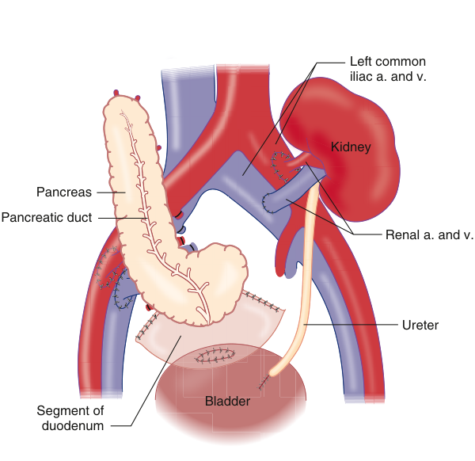

Left common Aorta iliac a. and v. Kidney Pancreas Pancreatic duct Renal a. and v. Ureter Bladder Segment of duodenum 

**Fig. 56.6 Pancreas transplantation.** Bladder drainage is through a pancreatic duodenocystostomy. A renal transplant is shown with the common iliac vessels used for vascular anastomoses. (Modified from Moody FG, ed. _Surgical Treatment of Digestive Diseases_ , 2nd ed. St Louis: Mosby–Yearbook; 1990.)

<!-- PDF page 16 -->

by frequent arterial blood gas analyses with assessment of electrolytes and hemoglobin.

After completion of surgery, the patient should be critically assessed for safe emergence. Full reversal of neuromuscular blockade is necessary; appropriate neuromuscular monitoring is especially important in SPK patients. Hemodynamic stability, normothermia, appropriate acid–base status, and early evidence of graft function should inform decisions regarding emergence and extubation, particularly in patients that have undergone prolonged procedures complicated by major bleeding or metabolic disturbances.

### ANESTHETIC MANAGEMENT OF PANCREAS TRANSPLANTATION: POSTOPERATIVE MANAGEMENT

After the completion of surgery, pancreas transplant patients should be monitored closely in the postanesthesia care unit and ICU. Regular blood glucose measurements should be continued in the postoperative period to avoid hypoglycemia. Serial electrolyte, complete blood count, and arterial blood gas measurements should be obtained throughout the early postoperative period. Acid–base disturbances, anemia, and electrolyte imbalances are common. Euvolemia should be maintained, and urine output should be closely followed, especially in SPK patients. Serial troponins and ECG may be assessed for the presence of myocardial ischemia or infarction, particularly in patients with known CAD as ischemic symptoms may be lacking in diabetic patients. Postoperative pain may be severe in all forms of pancreas transplant, given the invasiveness of the surgical procedure. Postoperative pain is usually managed with opioids in the perioperative period with transition to patientcontrolled analgesia in the early postoperative period. Some centers have extensive experience with the use of epidural analgesia in all forms of pancreas transplant.138 Epidural analgesia has associated risks of hypotension and neuraxial hemorrhage, especially in patients that require postoperative anticoagulation. As in kidney transplantation, some centers have undertaken multimodal perioperative analgesic approaches in pancreas transplant patients. One center reported a series of pancreas transplant patients successfully managed with a combination of perioperative rectus sheath block in conjunction with opioid therapy.138 Another series in pancreas transplant patients demonstrated that TAP blocks were associated with faster recovery of bowel function and required lower doses of supplemental opioids compared to standard opioid- based analgesia.139

### POSTTRANSPLANT COMPLICATIONS AND OUTCOMES

Early postoperative surgical and technical complications are more frequent in pancreas transplant surgeries compared to kidney transplant procedures, occurring in approximately 10% of patients.111 Postoperative hemorrhage, enteric anastomotic leaks, fistula formation, and allograft pancreatitis may contribute to early morbidity including intra- abdominal sepsis and early graft loss.110 Graft thrombosis is the most common cause of early nonimmune graft loss in pancreas transplant and occurs more frequently than in other solid organ transplants. Postoperative

graft thrombosis has been reported to occur in 5% to 10%, although single- center series have reported incidences approaching 40%.140–142 Acute hyperglycemia in the early postoperative period is suggestive of thrombosis; ultrasound imaging may be diagnostic. Graft thrombosis requires emergent surgical exploration. Some centers employ empiric anticoagulation protocols for the prevention of graft thrombosis. One center reported an improved graft survival rate but a higher rate of postoperative bleeding with the use of an intensive early postoperative thromboprophylaxis protocol.142 Rejection is the most common cause of long- term graft loss and occurs at a higher rate than in kidney transplant. Graft rejection rates of 15% to 21% occur within one year.111 Pancreas allograft rejection is difficult to diagnose; multiple serum markers are used to monitor for early rejection episodes. Generally, immunosuppression for pancreas transplant is more intensive than for kidney transplant. Like kidney transplant, induction therapy may be routinely initiated in the operating room. T- cell depleting antibodies are mostly employed for induction, and maintenance protocols are usually combinations of tacrolimus, MMF, and steroids.143 Consequently, pancreas transplant recipients are at risk for immunosuppression- related viral, bacterial, and fungal infections.

Pancreas transplant patients are considered at an elevated risk for perioperative cardiovascular events. Early major adverse cardiac events have been reported in up to 10% of pancreas transplant patients.133,144 Additionally, SPK patients have a higher risk for early cardiac complications and stroke compared to PAK and PTA patients, likely due to the additional impact of chronic uremia on cardiovascular risk at the time of surgery.133 Cardiovascular etiologies are leading causes of long- term mortality in both kidney transplants and pancreas transplants. Nevertheless, ten- year survival rates in the United States for all forms of pancreas transplant are between 83% and 79%.104 Despite the cardiovascular risks inherent in patients with ESRD and diabetes, there is evidence that outcomes are better in SPK patients compared to diabetic patients that underwent kidney transplant alone. A decrease in long- term cardiovascular events due to normoglycemia are cited as a benefit of SPK over kidney transplant alone.

### ANESTHESIA FOR PATIENTS AFTER PANCREAS TRANSPLANTATION

After successful pancreas transplantation, long- term normoglycemia is expected. For patients with a history of previous pancreas transplant presenting for surgery, a comprehensive posttransplant history of any episodes of surgical complications and organ rejection should be obtained. Blood glucose concentrations should be measured on the day of surgery. Assessment of renal function is important, especially in SPK patients. A detailed history and review of medical records focusing on the cardiovascular and renal systems is necessary. Although the end organ sequelae of diabetes are favorably impacted by pancreas transplant, rates of cardiovascular and renal disease are greater in pancreas transplant recipients compared to the general population. Disease progression may occur despite successful pancreas transplantation. Therefore, the preoperative cardiac evaluation for the post–pancreas transplant

<!-- PDF page 17 -->

patient undergoing surgery should be guided by ACC/AHA Guidelines.61

## Liver Transplantation (LT)

In 1963, shortly after the effectiveness of azathioprine and prednisone was established for renal transplantation, Dr. Thomas Starzl performed the first human liver transplant.145 The recipient, a 3- year- old child with biliary atresia, died in the operating room from massive hemorrhage caused by venous collaterals and uncontrollable coagulopathy. Four years later, Starzl performed the first successful transplant in an 18- month- old infant with hepatocellular carcinoma. The advent of cyclosporine in 1979, followed by the 1983 pronouncement from the National Institutes of Health Consensus Conference that liver transplantation was no longer experimental, ushered in the era of liver transplantation. Over the ensuing decades, liver transplantation centers were established around the world and the field matured following continued improvements in surgical technique, immunosuppression, and the management of coagulopathy and infections.

The number of disciplines that have contributed to the advances in liver transplantation illustrates the team approach involved in the care of the liver transplant recipient. Hepatologists, surgeons, nephrologists, specialists in critical care medicine and infectious disease, anesthesiologists, pediatricians, radiologists, and pathologists have important roles. Key team members extend beyond physicians and include transplant coordinators, nurses, blood bank personnel, and procurement organizations.

Liver transplantation is unique among abdominal organ transplants in that a dedicated team is typically involved because of the unique challenges encountered during liver transplant surgery. The United Network of Organ Sharing (UNOS), which manages the United States organ transplant system under contract with the United States Department of Health and Human Services, recognizes the important role of anesthesiologists in the perioperative care of liver transplant candidates. In 2011, UNOS instituted a requirement that United States liver transplant programs designate a Director of Liver Transplant Anesthesia who meets qualifications based on experience and training. These qualifications parallel similar requirements for transplant surgeons and hepatologists. Clinical responsibilities of the Director of Liver Transplant Anesthesia, as delineated by UNOS, include preoperative assessment of transplant candidates, participation in candidate selection, intraoperative management, postoperative visits, and participation in mortality and morbidity conferences.146 Transplant centers have developed expert anesthesia teams that have accrued decades of experience and have contributed to research and advancements in the perioperative management of liver transplant patients. Decreases in recipient mortality and improvements in cost of care have been reported in centers that utilize an organized, team- based approach.147

### INDICATIONS FOR LIVER TRANSPLANTATION

Liver transplantation is the only definitive treatment for acute liver failure (ALF) that is unresponsive to medical

management and for decompensated cirrhosis secondary to viral hepatitis, alcoholic liver disease, unresectable primary hepatic malignancies, and metabolic disease including non- alcoholic fatty liver disease (NAFLD). Of these indications, the category “other,” which includes patients with NAFLD, accounted for a third (35%) of adult liver transplants performed in the United States in 2020, followed by alcoholic liver disease (32%), hepatitis C virus (HCV; 12%), hepatocellular carcinoma (11%), cholestatic disease (8%), and ALF (1%)148 (Fig. 56.7). A notable recent trend is the increase in NAFLD as the primary indication for liver transplant, particularly in the United States. Across the United Kingdom and Europe the percentage of liver transplants related to NAFLD has increased as well, however to a lesser extent; NAFLD represented 14%–21% of the overall activity in these regions.149

Chronic liver disease and cirrhosis is the fourth leading cause of death in the United States for individuals aged 45 to 54 years, accounting for 5% of deaths in this age group. It is surpassed only by cancer, heart disease, and accidents. Globally, liver disease accounts for approximately 2.1% of all deaths, making it the 11th leading cause of death worldwide.150,151

### TRENDS IN LIVER TRANSPLANTATION

The number of adult liver transplants in the United States increased to over 8900 in 2020, an all- time high despite the COVID- 19 pandemic.148 A continued upward trend has been present in the United States over the past decade. European transplant centers performed a similar number of transplants per year until 2018 (approximately 7600 in 2017) for similar indications.152 The COVID- 19 pandemic impacted liver transplant activity significantly in Europe leading to the lowest number of yearly transplants in more than a decade, particularly in countries with prolonged health system restrictions that occurred in 2020. However, total liver transplant activity was decreasing prior to the pandemic for reasons that are not entirely known. Despite these trends, patient survival has continued to improve with a one- year survival rate between 90% and 95%. Fiveyear patient survival for adults across the United States and Europe is approximately 80%–85% while pediatric survival is near 95% over the same period.153

As highlighted above, advances in the treatment of chronic liver disease, particularly antiviral therapy, has led

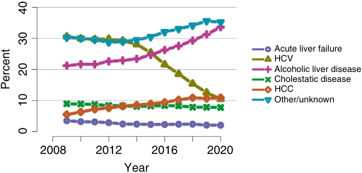

Acute liver failure HCV Alcoholic liver disease Cholestatic disease HCC Other/unknown 2008 2012 2016 2020 Year 40 30 20 Percent 10 0 

**Fig. 56.7 United States total liver transplants by diagnosis, 2008– 2020.** _HCC_ , hepatocellular carcinoma; _HCV_ , hepatitis C virus. (From Kwong AJ, et al. OPTN/SRTR 2020 Annual Data Report: Liver. _Am J Transplantation_ . 2022;22(Suppl 2):204–309.)

<!-- PDF page 18 -->

to a declining number of transplants for HCV. Over the past decade, the proportion of transplants performed for obesityrelated NAFLD has increased. With the sharp reduction in transplants for HCV, NAFLD has overtaken HCV as the most frequent indication for transplantation. However, when life- threatening complications of liver failure such as encephalopathy, ascites, gastrointestinal bleeding, or uremia develop, survival is significantly improved by liver transplantation (>90% 1- year survival) compared with medical therapy (Table 56.1). Referral for liver transplantation is appropriate in the presence of an index complication of cirrhosis.

In addition to increased posttransplant survival, the median waiting time for a deceased donor liver transplant has decreased dramatically over the last ten years. An illustrative example is in the United States where the median wait in months for adults listed for elective liver transplant went from a high of 14 months in 2014 to 4.2 months in 2020. The proportion of recipients aged 65 years or older continued to increase as well. This group received 22.4% of liver transplants performed in the United States in 2020 and approximately 25% of the liver transplants performed in Europe.

An increase in the number of available grafts through use of extended criteria donors and machine perfusion has led to a slight decrease in the number of candidates on the waiting list, with the United States total declining from 13,000 in 2015–2018 to just over 11,000 in 2020. However, despite this decrease, waitlist mortality remains approximately 10%. Living donation has remained stable in the United States and Europe at 2.5%–5% over the last 10 years with a slight decrease in 2020 likely related to the COVID- 19 pandemic. Data from 2015 to 2019 in the United States revealed an 11% readmission rate at 12 months for live donors, related mostly to biliary and vascular complications. However, it is also important to note that living donation is the primary method for obtaining grafts in many Asian countries; implementation of living donor programs has led to similar liver transplant outcomes with far fewer complications than occur for programs in the United States and Europe.158

The number of pediatric liver transplants in the United States has been stable at 500 to 600 per year over the past decade (2010–2020). During the same period, approximately 10% to 15% of pediatric recipients in the United States received grafts from living donors, down from 20% to 25% in the prior decade. The most common indication for transplant in pediatric recipients is cholestatic disease (46%), followed by other/unknown diagnosis (22%),

**Table 56.1** Prognosis: Complications of Cirrhosis

|**Event**|**Survival**|
|---|---|
|Variceal bleeding|65%–70% at 1 year154|
|Ascites|48%–60% at 1 year155|
|Hepatorenal syndrome|50% at 3 months156|
|Encephalopathy (grade 2/3)|40%–50% at 1 year157|

Survival after complications is poor compared with 90% patient survival at 1 year after liver transplantation.

metabolic disease (17%), ALF (7%), and hepatoblastoma (7%).148 The European Liver Transplant Registry reports similar numbers of pediatric recipients, approximately 10% of the total number of liver recipients.152

### PATHOPHYSIOLOGY OF LIVER DISEASE AND EVALUATION FOR LISTING

Cirrhosis is the end result of chronic parenchymal inflammation and necrosis, which results in fibrosis and disruption of hepatic architecture. Resistance to blood flow leads to portal hypertension and the formation of vascular shunts between portal and systemic veins.159 When the pressure gradient between the portal and hepatic veins exceeds 10 to 12 mm Hg, portal hypertension is severe and complications such as ascites, esophageal variceal bleeding, encephalopathy, and hepatorenal syndrome (HRS) occur. Decompensated cirrhosis affects nearly every organ system.160 The preoperative assessment of liver transplant candidates requires a knowledge of the pathophysiologic changes associated with decompensated cirrhosis.

### Cardiovascular Complications

A hyperdynamic circulation characterized by a high cardiac output, low arterial blood pressure, and low systemic vascular resistance is the hallmark of end- stage liver disease (ESLD). Systolic arterial pressures are usually lower than in patients with normal liver function. Pulmonary arterial pressures may be elevated because of increased cardiac output, although pulmonary vascular resistance (PVR) is usually within the normal range. The development of significant portal hypertension, the consequence of cirrhosis, results in an elevated intravascular volume that is sequestered within a dilated splanchnic vascular bed. Failure of hepatic clearance of vasodilatory mediators including natriuretic peptides, cytokines, and nitric oxide from the portal venous system, in addition to portosystemic shunting, contributes to the development of the hyperdynamic circulation of cirrhosis. A decompensated circulatory state may develop in response to complications typical of ESLD such as gastrointestinal bleeding or bacterial peritonitis. As compensatory increases in heart rate and sympathetic activity fail to maintain adequate renal perfusion, activation of the renin–angiotensin–aldosterone systems result in renal vasoconstriction, a decrease in urine output, and the development of hepatorenal syndrome.

Characteristic cardiac abnormalities associated with ESLD have been recognized for many decades. Initially defined in 2005, the syndrome of cirrhotic cardiomyopathy (CCM) represents a spectrum of cardiac manifestations that occurs in the presence of cirrhosis. Although the pathophysiology and natural history of this disorder are not fully understood, CCM develops due to the chronic circulatory effects of cirrhosis. The clinical diagnosis of CCM requires evidence of systolic and/or diastolic dysfunction in addition to electromechanical abnormalities that support the diagnosis; new diagnostic criteria based on current cardiac imaging modalities have been proposed.161 Systolic dysfunction may be identified by a decreased resting left ventricular ejection fraction (LVEF) &lt;55%, or more commonly by a blunted response to physiologic or pharmacologic stress. Diastolic dysfunction occurs due to pathologic

::: details 原始表格與符號（PDF 第 18 頁）

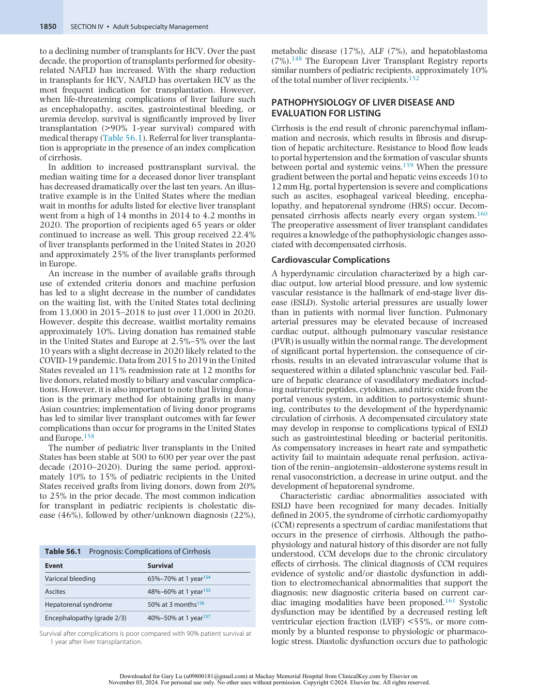

:::

<!-- PDF page 19 -->

changes within the left ventricular myocardium resulting in decreased left ventricular compliance, abnormal left ventricular relaxation, and an increase in left atrial volume. Diastolic dysfunction as defined by various echocardiographic criteria is common in patients with cirrhosis, occurring in over 50% of patients with liver disease.162 Diastolic dysfunction appears to correlate with severity of liver disease and is a predictor of mortality in cirrhosis as well.163 Electromechanical abnormalities are commonly observed in advanced cirrhosis and support the clinical diagnosis for CCM. QTc prolongation is the most recognized electrocardiographic abnormality observed in liver disease and correlates with severity of cirrhosis.164 Autonomic dysfunction may present as chronotropic and hemodynamic incompetence in response to hemodynamic challenges. Elevated levels of circulating cardiac biomarkers such as propeptide N- terminal prohormone (NT- proBNP) and the cardiac troponin isoenzymes may be found in patients with advanced liver disease and support the diagnosis of CCM. Clinical manifestations of CCM appear to be correlated with the severity of liver disease and may adversely impact critically ill LT candidates. However, many of the cardiac changes that occur with CCM may reverse after LT.

Cardiac conditions prevalent in kidney transplant patients may also coexist in patients with cirrhosis. Although chronic hypertension is less common in patients with advanced cirrhosis, structural heart disease and CAD may be present in patients with risk factors, particularly in older patients. NAFLD, currently the most common indication for LT in the United States, is highly associated with diabetes, obesity, and dyslipidemia. In LT recipients, patients with NAFLD have a higher prevalence of pretransplant CAD and have a greater rate of postoperative cardiac events compared to patients with other diagnoses of liver failure.165 The optimal test for identifying cirrhotic patients with significant CAD is unclear. Noninvasive ischemia testing is commonly used in LT candidates, although there is no consensus regarding the best screening method. Unfortunately, noninvasive methods appear to have limited accuracy for the detection of CAD in LT candidates. A recent meta- analysis found that both myocardial perfusion imaging (MPI) and dobutamine stress echocardiography (DSE) had pooled sensitivities and specificities under 0.7 for the detection of CAD in LT candidates.166 Therefore, in LT candidates considered at an elevated risk for the likelihood of obstructive CAD, coronary angiography may be considered. Based on pretransplant angiography data collected in LT candidates over a nine- year period, one center reported that a pre- LT scoring system and testing algorithm had a 97% sensitivity for the detection of obstructive CAD.167 Although there are no prospective studies that have investigated posttransplant outcomes following coronary revascularization in LT patients, there is evidence that patients with treated CAD have posttransplant survival similar to patients without angiographic evidence of CAD.168

### Pulmonary Complications

Pulmonary manifestations of cirrhosis may contribute to ventilation–perfusion abnormalities that result in hypoxemia and pulmonary symptoms. Fluid retention, pleural effusion, and decreased lung capacities secondary to large-volume ascites commonly impact cirrhosis patients.

Alpha- 1 antitrypsin deficiency and cystic fibrosis have both lung and liver manifestations. Chronic obstructive pulmonary disease (COPD) may coexist in cirrhosis patients. One multicenter series in LT candidates reported a COPD prevalence of 18%; COPD patients were more likely to be denied listing for LT.169 In addition, there are two pulmonary vascular abnormalities unique to patients with cirrhosis. These abnormalities, hepatopulmonary syndrome (HPS) and portopulmonary hypertension (POPH), have discrete implications on liver transplant candidacy.

HPS is a disease resulting in hypoxemia due to diffuse intrapulmonary vascular dilations that occurs specifically in patients with portal hypertension. The diagnostic criteria for HPS include the presence of portal hypertension, an alveolar–arterial oxygen gradient greater than 15 mm Hg (or greater than 20 mm Hg in patients over age 64 years) and evidence of intrapulmonary vascular dilation (IPVD) on contrast echocardiography.170 The appearance of microbubbles in the left atrium on contrast echocardiography suggests the presence of IPVD due to shunting of microbubbles through dilated pulmonary capillaries. Clinically, patients present with dyspnea and signs of hypoxemia, although some patients may be asymptomatic. The prevalence of HPS varies based on previous diagnostic criteria; reported prevalence ranges from 5% to nearly 50%.171 Screening pulse oximetry is recommended for the detection of resting hypoxemia in LT candidates. The diagnosis of HPS should be confirmed with contrast echocardiography and arterial blood gas analysis; other causes of hypoxemia should be excluded as well.170

The natural history of HPS is usually one of progressive hypoxemia. LT is the only curative treatment and can be expected to correct hypoxemia within one year in most patients. Previously, arterial partial pressure of oxygen (PaO2) ≤50 mm Hg was considered a predictor of increased mortality after LT. However, recent data suggest that timely transplantation in patients with HPS results in favorable outcomes.172–174 Accordingly, in the United States, allocation exception points have been assigned to patients with HPS and room air PaO2 &lt;60 mm Hg.175

POPH is defined as pulmonary hypertension in the presence of portal hypertension in a patient without other predisposing factors. The International Liver Transplant Society Practice Guidelines diagnostic criteria for POPH include the presence of portal hypertension, mean PA pressure (mPAP) greater than 25 mm Hg, pulmonary artery wedge pressure (PAWP) less than 15 mm Hg, and pulmonary vascular resistance (PVR) greater than 240 dyn·s·cm−5 or 3 Wood Units170 (Table 56.2).176 POPH is graded as mild, moderate, and severe based on mean PA pressures; severe POPH is defined as mPAP ≥45 mm Hg.177 The prevalence of POPH is 2% to 10% in all patients with portal hypertension and approximately 5% among LT candidates.178 The occurrence of POPH is unrelated to the severity of the underlying liver disease or liver diagnosis. Like HPS, the symptoms of POPH may include dyspnea and decreased exercise tolerance. Transthoracic echocardiography, which estimates right ventricular systolic pressure using the velocity of the tricuspid regurgitant jet, is the best screening test for POPH. Right- sided cardiac catheterization is necessary to confirm the diagnosis. Screening transthoracic echocardiography is recommended in adult LT candidates to assess for the

<!-- PDF page 20 -->

**Table 56.2** Diagnostic Criteria and Staging of Severity of HPS and POPH

|**HPS**|
|---|
|Diagnostic criteria: 1.  Presence of liver disease|
|2.  Evidence of IPVDs and/or shunting 3.  P(A- a) O2gradient≥15 mm Hg (or >20 mm Hg if age≥65)|
|**Stage** **PaO2**|
|Mild ≥80 mm Hg|
|Moderate 60–79 mm Hg|
|Severe 50–59 mm Hg **POPH**|
|Diagnostic criteria: 1.  Presence of portal hypertension 2.  mPAP >25 mm Hg 3.  PCWP &lt;15 mm Hg 4.  PVR >240 dynes/cm5 **Stage** **mPAP**|
|Mild >25–&lt;35 mm Hg|
|Moderate ≥35–&lt;45 mm Hg|
|Severe ≥45 mm Hg|
|_HPS_, hepatopulmonary syndrome;_IPVDs_, intrapulmonary vascular dilations; _POPH_, portopulmonary hypertension;_mPAP_, mean pulmonary artery pressure;_PaO2,_partial pressure of arterial oxygen;_PCWP_, pulmonary capillary wedge pressure;_PVR_, pulmonary vascular resistance. Modified from Raevens S. Recent advances in the approach to hepatopulmonary syndrome and portopulmonary hypertension._Acta_ _Gastroenterol Belg_. 2021;84(1):95–99.|

presence of POPH.60,170 There are differences in the accuracy of transthoracic echocardiography for the detection of POPH based on estimated pulmonary artery systolic pressure (PASP) cutoff values. An estimated PASP cutoff of 38 mm Hg had a reported specificity of 82% and a negative predictive value of 100% in one series.179 The diagnosis of POPH has significant implications on post- LT outcome. Moderate and severe POPH are associated with increased mortality during liver transplantation. Data from the 1990s suggested that POPH patients with mean PA pressures greater than 35 mm Hg at the time of transplant had a high rate of early postoperative mortality.180 Recent data suggest that patients with moderate to severe POPH that is effectively treated with pulmonary vasodilator therapy have favorable posttransplant outcomes.181,182 The effect of successful transplant on the natural course of POPH is unpredictable; some patients experience a resolution with transplant and in others pulmonary hypertension worsens. Graft function may be adversely impacted by chronically elevated right heart pressures. Nevertheless, in candidates with documented POPH it is currently recommended to refer these patients to pulmonary hypertension consultants for vasodilator therapy.60,170

### Renal Dysfunction

Renal dysfunction in patients with cirrhosis is the result of renal hypoperfusion and avid retention of sodium and water. Hepatorenal syndrome (HRS) is a prerenal abnormality caused by circulatory derangements of advanced cirrhosis. It is considered a functional disorder, based on

successful transplantation of kidneys from patients with HRS.183 Renal function is an important risk factor for mortality, a fact that is emphasized by its presence as a crucial variable in the calculation of the Model for End- Stage Liver Disease (MELD) score.184 In addition to HRS, patients with cirrhosis are also at risk for other causes of renal dysfunction such as parenchymal renal disease, sepsis, nephrotoxicity, and hypovolemia. HRS is a diagnosis of exclusion, and other treatable causes must be ruled out. HRS accounts for only about one- fourth of the cases of acute kidney injury in hospitalized cirrhotic patients.185 In patients with cirrhosis and ascites, the incidence of HRS is nearly 40% at 5 years.186 HRS is caused by the local production of vasodilators, particularly nitric oxide, in patients with portal hypertension. Splanchnic vasodilation leads to a decrease in the effective circulating blood volume and a decrease in arterial blood pressure, which activates the sympathetic, renin– angiotensin–aldosterone, and vasopressin systems. The net result is a severe reduction in renal perfusion and glomerular filtration.187

AKI- HRS (formerly type 1 HRS) is characterized by rapidly progressive renal failure and a doubling of serum creatinine over two weeks after a precipitating cause such as spontaneous bacterial peritonitis, sepsis, gastrointestinal bleeding, or surgical stress. Patients with AKI- HRS have a median survival of approximately 1 month without therapy. Patients with HRS resembling chronic kidney disease (CKD- HRS or traditionally type 2) have a median survival of about 6 months.188 Even though the nomenclature of HRS has evolved, the traditional names (type 1 and 2) are still used frequently in clinical practice.

Although renal vasoconstriction is the proximate cause of HRS, therapy aimed at directly increasing renal perfusion with prostaglandins, dopamine agonists, or endothelin antagonists has not proven to be successful. Vasoconstrictor therapy targeting the underlying splanchnic vasodilation is more effective.189 These therapies include arginine vasopressin, somatostatin (octreotide), and α- agonists such as norepinephrine and midodrine combined with albumin volume expansion. Terlipressin, the most studied vasopressor for HRS, has been found in clinical trials to reverse HRS in 15%–55% of cases.188

Placement of a transjugular intrahepatic portosystemic shunt (TIPS) lowers portal pressures and can decompress the splanchnic circulation. Studies have shown that TIPS can reverse both types of HRS, but due to exclusionary criteria in trials and the risk of worsening hepatic encephalopathy (HE), TIPS is not suitable for all patients with HRS.190

Liver transplantation is the definitive therapy for HRS, particularly in severe cases. For transplant candidates with HRS, renal replacement therapy can be used as a bridge to transplantation. However, complete reversal of HRS does not occur for all patients, particularly those with severe AKIHRS.191 This has prompted guidance which states that liver failure patients with very low GFR (&lt;25 mL/min/1.73 m2 ) or on dialysis for >6 weeks, or those with severe comorbid metabolic disease should undergo simultaneous liver and kidney transplantation.192

### Hepatic Encephalopathy

Hepatic encephalopathy (HE) is a syndrome of impaired brain function in patients with both chronic and acute

::: details 原始表格與符號（PDF 第 20 頁）

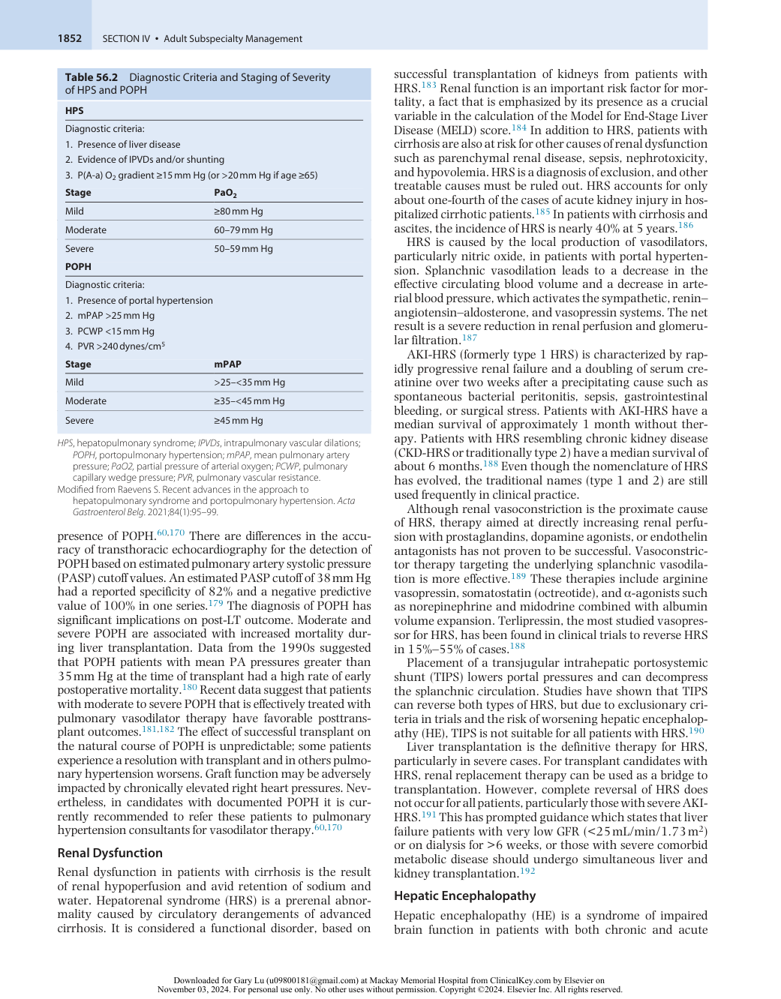

:::

<!-- PDF page 21 -->

liver disease. Manifestations range from subtle abnormalities only apparent on psychometric tests (“covert HE”) to neurologic and behavioral derangements such as personality changes, alterations in consciousness, and motor changes (“overt HE”). The pathogenesis of HE is multifactorial, attributed to accumulation of neurotoxins, impaired neurotransmission, systemic inflammatory response, and alterations of the blood–brain barrier. Ammonia plays an important role in HE. Ammonia is produced by enterocytes and is hepatically cleared; therefore, ammonia accumulates in patients with advanced liver disease. Astrocytes take up ammonia and metabolize it to glutamine, which in turn causes increased intracellular osmolarity, cell swelling, and brain edema. Several neurotoxins also contribute to the pathogenesis of HE, including gut- derived neurotoxins, γ- aminobutyric acid (GABA), and other endogenous GABA- receptor agonists. Infections (spontaneous bacterial peritonitis or sepsis), gastrointestinal bleeding, or TIPS placement may precipitate HE.193,194

The initial step in evaluating patients with suspected HE is to rule out causes of encephalopathy. Uremia, sepsis, glucose and electrolyte abnormalities, and endocrinopathies should be considered. Structural and vascular central nervous system lesions or infections should also be included in the differential diagnosis. Because cirrhotic patients are exquisitely sensitive to sedative medications and have impaired hepatic and often renal metabolism, a careful search for possible drug- related encephalopathy should be undertaken.

Treatment for HE is recommended in patients with overt HE. Identification and treatment of precipitating factors for HE can improve symptoms in most patients.194 The nonabsorbable disaccharide lactulose is considered first- line treatment for HE. Dosing is titrated to maintain two to three bowel movements per day. The nonabsorbable antibiotic rifaximin can be added to lactulose therapy in patients with prior episodes of overt HE. Although HE is considered to be reversible, there is increasing evidence that patients with pretransplant HE have an increased risk for neurologic complications and death even after successful liver transplantation.195

### Gastrointestinal Complications

Cirrhosis increases portal pressure because of chronic hepatic inflammation. Fibrosis and regenerative nodules cause resistance to splanchnic flow and lead to formation of portosystemic collaterals. Progression of portal hypertension leads to increased local production of nitric oxide and exacerbates splanchnic vasodilation. Rupture of the highpressure collaterals that are formed is a highly lethal and feared complication of portal hypertension.

Portal hypertension is diagnosed by measurement of the wedged hepatic venous pressure (WHVP). Although this is not a direct measure of portal pressure, WHVP has been demonstrated to correlate well with portal pressure.196 This measurement is taken by advancing a catheter into a hepatic vein to the wedge position. To correct for the contribution of increased intraabdominal pressure from ascites, a free hepatic venous pressure or an inferior vena cava (IVC) pressure should be subtracted from the measured WHVP to accurately estimate the hepatic venous pressure gradient (HVPG).

A normal HVPG is 3 to 5 mm Hg. Patients with varices have HVPGs of 10 to 12 mm Hg or greater.

Esophagogastroduodenoscopy is the gold- standard procedure for diagnosing varices. Risk for variceal bleeding correlates with size of varices, presence of red wale marks, and variceal pressure (i.e., HVPG). Therapeutic decisions are based on these observations and measurements. Nonselective β- adrenergic blockers reduce portal pressure by their effects on decreasing cardiac output and splanchnic vasoconstriction.197 For patients that cannot tolerate β- adrenergic blockers or in whom they are contraindicated, endoscopic ligation may be a prophylactic treatment option. Additionally, TIPS has been advocated for early treatment in select patients.198 However, TIPS is associated with a higher incidence of encephalopathy; despite this, TIPS may decrease mortality in select patients.198

Acute variceal bleeding should be managed with a combination of intravascular volume resuscitation, correction of severe coagulopathy, pharmacologic manipulation of portal pressure, and endoscopic control of the bleeding site. Aggressive intravascular volume replacement can lead to recurrent bleeding because bleeding is a pressurerelated phenomenon.199,200 Elective intubation of the trachea for airway protection is often warranted. Medications to reduce portal pressure include vasopressin and somatostatin. Although β- adrenergic blockers can reduce portal pressures, their effect on systemic pressures makes them undesirable in this setting. Early endoscopic variceal ligation in combination with pharmacotherapy is the preferred treatment for acute variceal bleeding. Balloon tamponade can be effective for resistant variceal bleeding but is associated with significant complications, including esophageal rupture and aspiration. It is recommended as a bridge to more definitive therapy such as surgical shunt, TIPS, or liver transplantation.

Ascites is the most common complication of cirrhosis leading to hospitalization worldwide.201 Patients who have ascites should be referred for liver transplantation evaluation in the absence of contraindications. Non- hepatic causes account for 15%–45% of ascites and include malignancy, cardiac failure, renal disease, pancreatitis, and tuberculosis. Analysis of the paracentesis is diagnostic. A serum- ascites albumin gradient greater than 1.1 mg/dL indicates portal hypertension with 97% accuracy.202 Once ascites becomes refractory to maximum standard medical therapy, therapeutic options are limited and include serial paracentesis, peritoneovenous (Denver) shunt, TIPS placement, and liver transplantation. Bacterial infection of accumulated ascitic fluid is an additional concern. Risk factors for development of spontaneous bacterial peritonitis include a prior episode of acute infection, gastrointestinal bleeding, and an ascites albumin level of less than 1.5 g/dL. Long- term antibiotic prophylaxis with norfloxacin or trimethoprim/ sulfamethoxazole is recommended for patients who have survived an episode of spontaneous bacterial peritonitis.203

### Hemostasis

Hemostasis is a dynamic process and the product of a complex interaction between the endothelium and platelets (primary hemostasis), coagulation factors, and the fibrinolytic system, resulting in the formation and eventual breakdown of clot. ESLD affects all components of hemostasis, both

<!-- PDF page 22 -->

quantitatively and qualitatively. Coagulation abnormalities encountered during liver transplantation can range from severe coagulopathy and bleeding to thromboembolic complications such as intracardiac thrombus.204,205 The hepatocyte is the site of synthesis for most procoagulant (factors V, VII, IX, X, XI, XII) and anticoagulant (protein C, protein S, and antithrombin) factors. Factor VIII and von Willebrand factor are synthesized in the endothelium, including in liver endothelial cells. The liver is also the site for clearance of activated coagulation factors.

In patients with ESLD, levels of most procoagulant factors are decreased. Only levels of factor VIII and von Willebrand factor are increased. But this decrease is accompanied by a decrease in levels of anticoagulant factors (protein C, protein S, and antithrombin). In most patients, the balance between decreased procoagulant and anticoagulant forces, not the isolated measurement of either portion of the coagulation system, contributes to effective hemostasis. The coagulation system in patients with ESLD can be understood as “rebalanced” hemostasis (Fig. 56.8). ESLD has historically been associated with bleeding diathesis based on abnormal results in conventional coagulation tests such as the prothrombin time (PT)/international normalized ratio (INR) and the partial thromboplastin time (PTT). However, these tests only reflect the activity of a portion of procoagulant factors in plasma. They do not reflect the concomitant decrease in anticoagulant factors or the interaction between coagulation factors and platelets in whole blood. It is important to consider that although the PT/INR can reflect the severity of liver disease, standard tests of coagulation do not always reflect the grade of coagulopathy in patients with cirrhosis.205,206 Unsurprisingly, PT and PTT abnormalities correlate poorly with bleeding complications following invasive procedures such as liver biopsy.207 There is evidence that decreased levels of protein C in cirrhotic patients

balance the decreased levels of procoagulants, which can leave thrombin generation _in vivo_ unaltered.208 If procoagulants predominate because of disproportionate reductions of anticoagulants (protein C, protein S, and antithrombin) accompanied by an increase in procoagulants (factor VIII), a hypercoagulable state results.209,210 This is supported by the prevalence of thrombotic complications associated with cirrhotic and non- cirrhotic liver disease.211,212

Thrombocytopenia is common in patients with cirrhosis and is an indicator of advanced liver disease. The primary cause is splenic sequestration secondary to portal hypertension. Decreased platelet production and increased platelet destruction also contribute to thrombocytopenia. Elevated levels of von Willebrand factor may compensate for decreased platelet counts by augmenting the platelet– endothelial cell interaction on vessel walls.213

The fibrinolytic system ensures the adequate breakdown of clot. Fibrin converts plasminogen into its active form, plasmin, which in turn degrades fibrin. The fibrinolytic system in cirrhotic patients has many abnormalities. Both hyperfibrinolysis, which increases the risk of bleeding, and hypofibrinolysis, which increases the risk for thrombosis, may be observed.214 Hyperfibrinolysis can be attributed to elevated levels of tissue plasminogen activator and reduced synthesis of plasmin inhibitors such as plasmin activator inhibitor- 1 and thrombin- activatable fibrinolysis inhibitor (TAFI).215 Hypofibrinolysis can be attributed to low levels of plasminogen and its inhibitor plasminogen activator inhibitor.205 Conventional coagulation tests are of limited use to detect hyperfibrinolysis. During liver transplantation, viscoelastic tests can be used to detect hyperfibrinolysis.

### Malnutrition, Obesity, and Sarcopenia

Liver disease is associated with altered protein, carbohydrate, and lipid metabolism that results in malnutrition

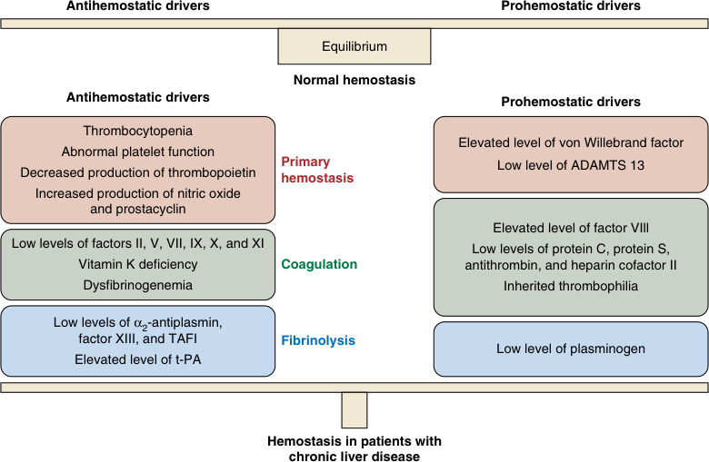

Antihemostatic drivers Prohemostatic drivers Equilibrium Normal hemostasis Antihemostatic drivers Prohemostatic drivers Thrombocytopenia Elevated level of von Willebrand factor Abnormal platelet function Primary Low level of ADAMTS 13 Decreased production of thrombopoietin hemostasis Increased production of nitric oxide and prostacyclin Elevated level of factor VIll Low levels of factors II, V, VII, IX, X, and XI Low levels of protein C, protein S, Vitamin K deficiency Coagulation antithrombin, and heparin cofactor II Dysfibrinogenemia Inherited thrombophilia Low levels of α2-antiplasmin, factor XIII, and TAFI Fibrinolysis Low level of plasminogen Elevated level of t-PA Hemostasis in patients with chronic liver disease 

**Fig. 56.8 Hemostasis in patients with chronic liver disease.** _TAFI,_ thrombin-activatable fibrinolysis inhibitor; _t-PA,_ tissue plasminogen activator. (From Tripodi A, Mannucci PM. The coagulopathy of chronic liver disease. _N Engl J Med_ . 2011;365(2):147–156.)

<!-- PDF page 23 -->

in a large proportion of patients with cirrhosis. Vitamin deficiencies, electrolyte abnormalities, and polypharmacy contribute. The prevalence of malnutrition increases with severity of liver disease and impacts mortality. The pathophysiology of malnutrition in cirrhosis is a complex multifactorial process that involves malabsorption, gut microbiome alterations, inflammation, hormonal changes, and hypermetabolism.216 Although specific liver disease etiologies such as alcoholic cirrhosis may influence nutritional status, the severity of liver disease is the main factor in the development of malnutrition.217 Progressive skeletal muscle loss is a major consequence of malnutrition; muscle loss has also been shown to correspond with severity of liver disease. Sarcopenia is recognized as a significant risk factor for posttransplant mortality in LT recipients.218

Obesity may also coexist in patients with liver disease. The concept of sarcopenic obesity, a combination of skeletal muscle loss in conjunction with an increase in adiposity, is well recognized.219 The emergence of NAFLD as a leading etiology of liver disease has impacted the prevalence of obesity in liver transplant candidates as well.220 Morbid obesity is now recognized as a major comorbidity that impacts candidacy. Both severe malnutrition and morbid obesity as defined by BMI thresholds have been associated with posttransplant morbidity and mortality.221 Transplant centers may exclude candidates at the extremes of BMI due to the risk for futile outcomes.

Assessment of nutritional status is an important and challenging part of the pretransplant evaluation. Detection of sarcopenia and morbid obesity and calculation of BMI are necessary steps. Many screening tests may be used by institutions to assess for malnutrition in LT candidates. These include a detailed nutritional assessment performed by a dietician, body mass assessment testing, skeletal muscle mass quantification by radiologic imaging, frailty surveys, and physical performance testing. Based on the high likelihood for malnutrition with progression of liver disease, early nutritional intervention is optimal. Recommendations for malnutrition screening and dietary management for patients with chronic liver disease have been published.221 In hospitalized and critically ill LT candidates, maintenance of nutritional regimens may be challenging due to events related to decompensated liver disease. Early dietary screening and pretransplant dietary therapies including enteral and parenteral nutrition may be indicated.

### Acute Liver Failure

Acute liver failure (ALF) is defined as the appearance of encephalopathy together with coagulopathy (INR ≥1.5) in a patient without previous liver disease who has an illness of less than 26 weeks in duration. ALF is a rare entity with an estimated incidence of approximately 1 case per million per year or about 2000–3000 cases per year in the United States.222 Drug- related toxicity, primarily acetaminophen (paracetamol), accounts for the majority of cases of ALF in the United States and Europe while viral infections are the most common etiologies in many Asian and developing countries.223 Other causes include idiopathic, autoimmune, and ischemic. Etiology has a significant bearing on outcome; patients with acetaminophen toxicity, ischemic injury, or hepatitis A have the most favorable prognosis, whereas those with non- acetaminophen drug- induced liver

injury, acute hepatitis B, Wilson disease, or autoimmune hepatitis have poor prognoses in the absence of transplantation.224 Outcomes in patients with ALF have significantly improved over the past 40 years due to both transplantation and advances in medical management; over 70% of ALF patients now survive their illness.223,225 Overall, ALF is still a rare indication for liver transplant.

Evidence of portal hypertension and cirrhosis is absent in ALF because of the rapid progression of disease. Acute decompensation of chronic liver disease, termed acute- onchronic liver disease, is a separate condition with different etiologies, therapies, and prognostic indicators. Although various etiologies of ALF exist, there are manifestations that are common to all patients with massive hepatic necrosis. The most serious and lethal is acute cerebral edema with intracranial hypertension. Effects on other organ systems include coagulopathy, circulatory dysfunction and hypotension, acute kidney injury, and metabolic derangements.

General measures to reduce cerebral edema include maintaining the patient in a 30- degree head- up position and making sure the head is in neutral position so as not to impede venous return. Supportive care includes maintenance of normovolemia, vasopressor therapy for blood pressure support, prevention of sepsis, and intubation for airway protection and control of ventilation. Sedation and muscle relaxants should be considered to minimize increases in intracranial pressure (ICP) from coughing, ventilator dysynchrony, and shivering. Mannitol can be used to induce an osmotic diuresis but may have limited utility in the patient with compromised renal function. Early use of plasma exchange or renal replacement therapy may be indicated for control of ammonia/toxin levels and to optimize electrolyte and acid–base status. Hypertonic saline, ideally targeting a serum sodium of 145 to 155 mEq/L, may be indicated. Current recommendations are to maintain normocarbia and to reserve hyperventilation for response to acute increases in ICP. Monitoring techniques for cerebral edema and intracranial hypertension are controversial and the use of invasive ICP monitors for guidance of therapy is declining.222

The decision regarding which patients should receive a transplant, based on who might recover spontaneously or who is unlikely to benefit from transplantation, is one of the most difficult decisions encountered during the management of patients with acute liver disease. Various sets of criteria have been proposed to predict outcomes including the King’s College Criteria, which performed well in predicting mortality due to acetaminophen (paracetamol)- induced ALF but less so with other causes. The Acute Liver Failure Study Group developed a prognostic index in 2016 which appears to be better than the King’s College Criteria at predicting 21- day transplant- free survival; however, additional indices to further improve prognostication in ALF are in development.7,153

### PREOPERATIVE CONSIDERATIONS

LT candidates awaiting deceased donor grafts typically encounter significant waiting times prior to transplant. Like kidney transplant, candidates undergo an extensive preoperative assessment by a multidisciplinary transplant selection committee. Depending on the duration of time from the initial assessment and on the progression of liver

<!-- PDF page 24 -->

disease, LT candidates may require additional reassessment prior to transplant. The LT anesthesiologist provides an important evaluation of the LT candidate near the time of transplant, particularly in the hospitalized candidate. An organ systems- based assessment should be undertaken. The possibility of infection should be considered with newonset encephalopathy, variceal bleeding, ascites, or hemodynamic deterioration. Details of initial and subsequent cardiopulmonary evaluations that identify the presence of coronary disease, heart failure, pulmonary hypertension, or arrhythmia should be reviewed. Current renal function should be assessed for the presence of new- onset HRS.

LT organ allocation policies in many nations and multinational consortiums employ the MELD score to prioritize allocation of grafts to the sickest patients. These policies inevitably result in candidates with severe liver disease and multiorgan disease receiving priority for LT. MELD- based allocation policies have been shown to decrease waitlist deaths, to provide maximal transplant benefit to the sickest candidates first, and to improve equity in the allocation process.226–228 MELD score alone is a relatively limited tool for predicting posttransplant mortality.229 However, outcomes in high- MELD patients, recognized as scores greater than 34, and in those with multiple failing organ systems, are generally inferior.230 Many publications have explored the concept of transplant futility; projections based on factors not captured by the MELD score have been proposed to better predict acceptable posttransplant mortality rates.4,231,232 A recent consensus document authored by a multidisciplinary panel of international transplant experts recommended that any definition of transplant futility should include patient and graft survival at one year after LT. Additionally, determination for delaying or denying LT should include an assessment of failing organ systems. Specifically, thresholds for PaO2/FiO2 (arterial partial pressure of oxygen/fraction of inspired oxygen), maximum norepinephrine infusion dosage, and serum lactate level were proposed to assist in the decision process.6

High- risk LT candidates require additional attention in the pretransplant period. Critically ill high- MELD patients, particularly those supported by mechanical ventilation, vasopressors, and renal replacement therapy require management by critical care specialists. Patients listed for retransplantation should be considered high- risk candidates as well. Additionally, high- MELD candidates with known cardiopulmonary disease such as CAD, valvular heart disease, arrhythmia, HPS, and POPH may be at significant perioperative risk. For critically ill high- risk candidates, continuous multidisciplinary assessments should be undertaken to best assess the risk–benefit of transplant. Events such as cardiopulmonary decompensation and infection may render the patient at an exclusionary risk for LT. The liver transplant anesthesiologist is a crucial consultant regarding candidacy decisions in critically ill patients.

Patients dependent on renal replacement therapy may benefit from preoperative dialysis; patients with oliguria, hyperkalemia, or acidemia may benefit from intraoperative renal replacement therapy.233,234 Intraoperative renal replacement requires additional logistical support and may be associated with complications including intravascular thrombosis and hypothermia.

Blood loss during liver transplant can range from less than 500 mL to 10 liters or more, depending on recipient

factors and organ characteristics (see below). A protocol should be in place to notify the blood bank of the pending transplant, to ensure adequate preparation of red blood cells (RBCs), fresh frozen plasma (FFP), and platelets. Red blood cell antibodies are present in less than 10% of liver transplant recipients. In case of red cell antibodies, it is common to set up compatible units of RBCs for the start and completion of the transplant (approximately 10 units to start and 10 units for the end of the case). In the event of high transfusion requirements, antigen- positive or antigen- unknown units can be used between the allocated antigen- negative units, assuming some degree of antibody washout during massive transfusion.235

### INTRAOPERATIVE MANAGEMENT

The surgical procedure is divided into three distinct stages: the dissection, anhepatic, and neohepatic stages. During the dissection or preanhepatic stage, the liver is mobilized and vascular structures (suprahepatic and infrahepatic vena cava, portal vein, and hepatic artery) and the bile duct are identified. The hepatic artery is usually clamped first. The anhepatic phase begins with clamping of the portal vein. After complete or partial clamping of the vena cava, the native liver is removed (hepatectomy). The neohepatic phase starts with unclamping of the vena cava and reperfusion of the graft (usually via the portal vein). It continues through completion of the remaining vascular anastomosis (usually the hepatic artery), donor liver cholecystectomy, anastomosis of the bile duct, hemostasis, and abdominal closure.

The perioperative care of patients undergoing liver transplantation is complex and may be complicated by severe bleeding and massive transfusion, coagulopathy, electrolyte disorders, and cardiovascular complications. At most centers, dedicated liver transplant anesthesia teams provide care during liver transplantation, and such teams are crucial to the success of transplant programs. Members of these groups are highly trained and experienced in the management of patients undergoing liver transplantation and often focus their research and academic efforts toward liver transplant anesthesia. Most centers allocate at least two anesthesia providers for each case; however, the qualifications of these providers vary. In academic settings, the individual team consists of an attending anesthesiologist experienced in liver transplantation, a senior resident and/ or a liver transplant anesthesia fellow. In private practice the second provider may be a second attending anesthesiologist, a Certified Registered Nurse Anesthetist, a licensed health care provider such as a perfusionist, or a combination of these.147 There is evidence that the experience of the attending anesthesiologists affects outcome during liver transplantation.236,237 Liver transplant anesthesia fellowships dedicated to training anesthesiologists for careers in liver transplant anesthesia have been established in many centers.238,239 Intraoperative protocols for both anesthetic staffing and clinical management vary between liver transplant services based on institutional practice, local patient population (median MELD scores at transplantation), surgical technique, caseload, and resources.

Induction of anesthesia typically begins with a rapidsequence induction. Liver transplant patients are

<!-- PDF page 25 -->

considered at an elevated risk for aspiration of gastric contents. Delayed gastric emptying is common in patients with ESLD.240 The presence of ascites, and, in some centers, preoperative administration of oral immunosuppressants and/ or bowel decontamination antibiotics can further increase the risk of aspiration.

An arterial catheter is placed either before induction of anesthesia or immediately thereafter, depending on the hemodynamic stability of the patient and need for close monitoring of hemodynamics during induction of anesthesia. Some centers routinely place femoral arterial lines due to concerns that radial arterial monitoring may underestimate central arterial pressure during episodes of intense vasodilation or in patients receiving high- dose vasopressors. However, there are no data to definitively recommend the use of central arterial pressure monitoring over radial monitoring in liver transplant patients.241 Large- bore intravenous access is necessary as rapid blood loss, large fluid shifts, and hemodynamic instability are encountered frequently. For central venous access, most centers place large single- lumen (percutaneous sheath introducer; PSI) or double- lumen (multi- lumen access catheter; MAC) introducers or multi- lumen dialysis catheters. If there is significant concern for massive blood loss such as in retransplantation or in patients with extensive prior abdominal surgery, two introducers may be placed. If possible, central vascular access sites designated for venovenous bypass (see below) should be avoided. In addition to central venous access, a large- bore peripheral rapid infusion catheter (RIC) can be placed to facilitate high- volume resuscitation. The RIC insertion site must be accessible and closely monitored for infiltration throughout the case.242

A rapid infusion system capable of high transfusion flow rates (approximately 500 mL/min) connected to a large- bore central venous catheter or RIC is typically used. Such systems incorporate a reservoir, pump, filters, heat exchanger, and safety features designed to avoid and monitor for the presence of blood or air embolism, hypothermia, and line occlusion. Rapid infusion systems are important for rapid volume replacement, transfusion management, and maintenance of normothermia.

The routine use of pulmonary artery (PA) catheters has declined over the past decade. In a recent survey, less than half of US centers routinely use PA catheters during LT.243 PA catheters are indicated in patients with a history of POPH or in those with echocardiographic evidence of elevated PA pressure.170 PA catheter placement may be necessary to determine PA pressures and PVR prior to incision; the results may impact the decision to proceed with the planned transplant. In the patient with elevated PA pressures or borderline PVR, a PA catheter may help guide perioperative therapy as well. The use of PA catheters in recipients without pulmonary arterial hypertension may not be deemed necessary by some practitioners.

Transesophageal echocardiography (TEE) has increasingly been employed during liver transplantation procedures. TEE provides for continuous cardiac imaging and may facilitate the rapid diagnosis of critical events such as ventricular failure, myocardial ischemia or infarction, pericardial tamponade, and intracardiac thrombosis.243,244 TEE appears to be associated with a low likelihood of hemorrhagic complications, even in the presence of esophageal

varices.245 Some liver transplant centers avoid PA catheter insertion when TEE is used.

New technologies, including arterial pressure waveform analysis and three- dimensional echocardiography, do not correlate with thermodilution- derived parameters and are not currently advocated for routine use during liver transplant.246,247

Intraoperative blood cell salvage and autotransfusion can be used to reduce the need for red blood cell transfusion. Despite the theoretical concern of cancer cell dissemination in patients with hepatocellular carcinoma, there is currently no evidence of an increased risk of cancer recurrence with blood salvage during liver transplantation.248

Intraoperative renal replacement therapy (RRT) can be used to prevent and treat intraoperative hyperkalemia, acidosis, and volume overload in select patients with acute renal failure or end- stage renal disease. The safety of intraoperative RRT during LT has been established.249 Whether intraoperative RRT provides a clinical benefit over medical protocols to treat electrolyte and acid–base disorders remains unclear.250

Both volatile and intravenous anesthetics are used during liver transplantation. There is currently no evidence that any anesthetic regimen is superior regarding postoperative graft function. At many centers a balanced anesthetic consisting of a volatile anesthetic in low to moderate concentrations (0.5–1.0 minimum alveolar concentration [MAC]) to ensure unconsciousness and a synthetic opioid, often fentanyl, is used. In recipients with fulminant hepatic failure and cerebral edema, volatile anesthetics are avoided or used cautiously in low concentrations (see later section).

Historically, the volatile anesthetic of choice has been isoflurane. Studies in healthy humans have demonstrated vasodilatory effects of isoflurane on the hepatic circulation, which may be advantageous to the graft.251 The effects of sevoflurane and desflurane on hepatic blood flow have been studied as well.252 In this investigation the authors concluded that hepatocyte function is well preserved with both volatile agents, although their results suggest that splanchnic perfusion and oxygen delivery to the liver are transiently decreased. Whether the increased metabolism of sevoflurane is detrimental to the liver is unknown, but it seems unlikely that the metabolites of sevoflurane cause liver damage.253 Propofol infusion may be used for maintenance of anesthesia during liver transplant as well. When compared to desflurane, propofol anesthesia was associated with increased hepatic blood flow.254

Rocuronium (at a dose of 1 mg/kg) or succinylcholine can be used for rapid- sequence induction for liver transplantation. Although the clearance of both rocuronium (reduced hepatic clearance) and succinylcholine (decreased levels of plasma cholinesterase) might be delayed in patients with ESLD, this is usually not relevant given the long duration of the procedure. Succinylcholine should be avoided in patients with reduced renal function and elevated potassium, as this might contribute to critical hyperkalemia. Paralysis can be maintained with either cisatracurium or rocuronium, ideally titrated to effect using train- offour monitoring. Cisatracurium offers the advantage of organ- independent elimination and diminished histamine release.255 In patients with ESLD, the volume of distribution of cisatracurium is larger than that in healthy controls.

<!-- PDF page 26 -->

Hepatic clearance is also increased in patients with liver disease; this results in similar elimination half times and similar duration of action. The metabolism of rocuronium is reduced during the anhepatic phase, but clearance of rocuronium normalizes after reperfusion and correlates with graft function.256,257 Sugammadex can be used to reverse the effect of rocuronium and allows for rapid reversal of paralysis. This is especially advantageous if early extubation is planned for at the end of surgery.258

### LIVING DONOR LIVER TRANSPLANTATION

Living donor liver transplantation can improve access to transplantation and avoid long wait times for a deceased donor graft. In 2020, 425 adult- to- adult living donor liver transplants (5% of all adult liver transplants) were performed in the United States. In many Asian countries, living donor liver transplants outnumber deceased donor transplants (see above). Outcomes in recipients after living donor liver transplants are comparable to those after deceased donor transplants.148 For living donor hepatectomy including considerations for appropriate graft size selection, see Chapter 57.

In living donor liver transplantation, the graft does not include the donor’s vena cava so the recipient’s vena cava must be preserved (see Anhepatic Phase, piggyback technique, below). In addition to the end- to- side anastomosis between the left or right hepatic vein (depending on the type of graft used) and the recipient vena cava, venous outflow from additional draining veins (mid- hepatic vein tributaries) must be restored to avoid venous congestion and graft dysfunction.259 After the portal vein and hepatic arterial anastomoses have been completed, biliary outflow can be reconstructed using either a direct duct- to- duct anastomosis or Roux- en- Y hepaticojejunostomy.

High portal venous inflow to the partial graft can impair graft function after living donor liver transplant. Octreotide can be used to reduce portal venous flow both intraoperatively and in the early postoperative period. Following reperfusion, portal vein pressures can be measured to determine the portal vein to central venous pressure gradient. In patients with increased portal venous pressures (>20 mm Hg) or with elevated gradients, portal venous inflow can be modified surgically by splenectomy, splenic artery ligation, or partial portocaval shunts. Indications and methods for portal flow modification vary highly between individual centers.260,261

### PREANHEPATIC STAGE

The preanhepatic stage begins with surgical incision and ends with vascular exclusion and hepatectomy of the native liver. Using a conventional caval interposition technique, vascular exclusion of the liver is accomplished by crossclamping the portal vein, the suprahepatic IVC, the infrahepatic IVC, and the hepatic artery (Fig. 56.9). If a piggyback technique is used, the native retrohepatic vena cava is preserved (Fig. 56.10).

The preanhepatic phase involves dissection and mobilization of the liver and identification of the porta hepatis (liver hilum). With abdominal incision and drainage of ascites, hypovolemia can occur. This should be treated in an

anticipatory fashion with colloid- containing fluid (usually 5% albumin or FFP) to minimize changes in preload. The goal at this point is generally maintenance of euvolemia; however, there is a trend toward more restrictive fluid management strategies during this phase.262 Patient comorbidities and tolerance of fluid restriction may be limiting factors to this approach. In addition, the dissection phase may be complicated by significant bleeding, necessitating massive transfusion and management of hemostasis (see later). Bleeding during this phase of surgery is related to the degree of preexisting coagulopathy, the presence and severity of portal hypertension, and the duration and complexity of the surgical procedure, which is adversely affected by prior abdominal surgery and adhesions.263,264 The use of vasoactive infusions to maintain end organ perfusion pressure is common, especially in critically ill patients with underlying cirrhotic cardiomyopathy. Occasionally during the preanhepatic stage, patients may exhibit hostile abdominal anatomy that impedes hepatic resection or may develop severe cardiovascular and metabolic instability that renders them inoperable; discussion between the anesthesia and surgical teams to determine if the transplant should be aborted is crucial to prevent futile care in these situations.

In addition to massive transfusion and coagulopathy, the preanhepatic stage may be associated with significant metabolic and acid–base disturbances that require close monitoring and active management. Abnormalities of sodium are not unusual in liver transplant patients and hyponatremia should not be corrected rapidly, although discrepancy

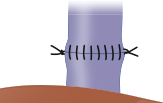

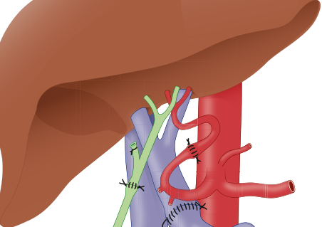

**Fig. 56.9 Liver transplantation.** Classic caval interposition technique illustrating anastomoses of the suprahepatic and infrahepatic inferior vena cava, the portal vein, the hepatic artery, and the bile duct. (From Molmenti E, Klintmalm G. _Atlas of Liver Transplantation_ . Philadelphia: Saunders; 2002.)

<!-- PDF page 27 -->

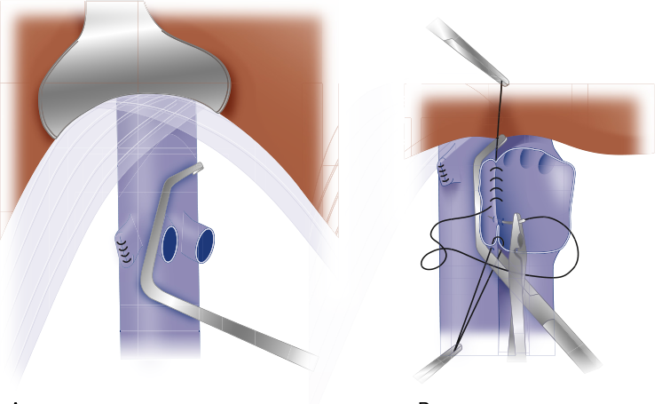

A B

**Fig. 56.10 Liver transplantation.** (A) Piggyback technique illustrating partial vena caval clamping and an oversewn native right hepatic vein. (B) Preservation of the native retrohepatic vena cava and hepatic venous cuff anastomosis. (From Molmenti E, Klintmalm G. _Atlas of Liver Transplantation_ . Philadelphia: Saunders; 2002.)

in the literature exists. Earlier studies found that a perioperative increase of 21 to 32 mEq/L in the serum sodium level was associated with osmotic demyelination syndrome (formerly central pontine myelinolysis), whereas an increase of less than 16 mEq/L was not.265,266 However, current literature suggests minimizing this increase to ≤8 mEq/L in 24 hours.267 Citrate intoxication, manifested by ionized hypocalcemia resulting from the infusion of citraterich blood products in the absence of hepatic function, is avoided by the administration of calcium chloride. Ionized hypomagnesemia also results from citrate infusion, but values of ionized magnesium gradually return to normal after graft reperfusion.268 Aggressive treatment of hypokalemia is best avoided, particularly in preparation for reperfusion and the associated increase in serum potassium. Hyperkalemia should be avoided by the administration of diuretics and insulin accompanied by glucose or, in the event these are ineffective, by intraoperative dialysis. In the absence of insulin administration, supplemental glucose is usually not required except in pediatric patients or in those with severe disease, such as fulminant hepatic failure. Hyperglycemia should be avoided because glucose levels greater than 180 mg/dL are associated with an increase in surgical site infections in liver transplant recipients.269 Blood gases, electrolytes, glucose, ionized calcium, and hemoglobin levels should be assessed regularly, and as frequently as hourly in the event of massive blood loss or preexisting abnormalities. Point- of- care testing facilitates rapid laboratory results and has become standard in many institutions. Coagulation studies are typically assessed at the beginning of the surgery, after correction of specific deficiencies, after reperfusion, and in the presence of microvascular bleeding.

The maintenance of urine output is desirable; however, the use of low- dose dopamine for this reason is unproven.270,271 Hypothermia should be avoided. Core temperature control can be aided with heated circuits or return line warmers if venovenous bypass or intraoperative dialysis is used. Forced

air or liquid warming devices should be positioned in as many locations as possible including beneath the patient and/or over the lower and upper body. Intravenous lines used primarily for volume administration should also be warmed.

### ANHEPATIC PHASE

The anhepatic stage begins with the occlusion of vascular inflow to the liver and ends with graft reperfusion. The hepatic artery is usually clamped during the preanhepatic stage, and the anhepatic stage begins with clamping of the portal vein. As a last step prior to hepatectomy, the venous outflow of the liver must be clamped. With the caval interposition technique, both the suprahepatic and infrahepatic IVC are clamped and the native liver is removed. With the piggyback technique, the right hepatic vein is stapled, and a side- biting (Satinsky) clamp is placed on the left and middle hepatic veins, and then the liver is removed (see Fig. 56.10).

Complete occlusion of the IVC (caval interposition technique) leads to an acute decrease of venous return by as much as 50% and can cause severe hypotension. Prior to resection of the vena cava, the IVC is often clamped temporarily (“test clamp”) to assess the hemodynamic effect of complete IVC occlusion. In the event of severe hypotension, the temporary clamp is released and additional fluids (5% albumin or FFP) are administered to optimize preload. This maneuver can be repeated until the patient tolerates full IVC occlusion. Alternatively, venous return can be preserved using venovenous bypass (VVB). VVB diverts IVC and portal venous flow to the superior vena cava via the axillary vein, attenuates the decrease in preload, improves renal perfusion pressure, lessens splanchnic congestion, and can delay the development of metabolic acidosis.272 However, the use of VVB is not without risk. Air embolism, thromboembolism, and inadvertent decannulation can be fatal or result in significant morbidity.273 A meta- analysis of three trials failed to reveal any difference in the incidence of renal failure or blood

<!-- PDF page 28 -->

transfusion requirements between patients randomized to VVB compared with patients in whom the technique was not used.274 VVB is not uniformly used at all centers, and the routine use of VVB has decreased over time.243

The piggyback technique allows for the removal of the native liver while preserving the recipient IVC, thereby maintaining venous return. This improves patient hemodynamics during the anhepatic phase and decreases the need for VVB.275 This technique requires diligent retrohepatic dissection of the liver from the IVC prior to hepatectomy. There are no randomized controlled trials comparing the piggyback technique to the caval interposition technique without the use of VVB. Retrospective studies suggest that the piggyback technique is associated with shorter warm ischemia times and a reduced risk for acute kidney injury when compared to caval interposition.276,277

Hepatectomy is followed by hemostasis and vascular anastomoses of the vena cava and the portal vein. With the caval interposition technique, three anastomoses (suprahepatic and infrahepatic IVC and portal vein) are required prior to reperfusion. With the piggyback technique, only two anastomoses are required. The donor suprahepatic IVC is anastomosed end to side to the recipient IVC (usually at the orifice of the mid- and left hepatic vein), the donor infrahepatic IVC is stapled off, and then the portal vein anastomosis is performed.

Despite the absence of hepatic clotting factor production during the anhepatic stage, blood loss is usually limited by vascular clamping of the inflow vessels to the liver. However, fibrinolysis may begin during this stage because of an absence of liver- produced plasminogen activator inhibitor. This results in the unopposed action of tissue plasminogen activator (t-PA). Antifibrinolytic therapy may be employed at this stage, although the use of antifibrinolytics varies among centers (see below).

### NEOHEPATIC STAGE

Reperfusion of the graft through the portal vein begins the neohepatic stage. Hypothermia, monitored through a centrally placed catheter, is a marker for the presence of graft outflow into the central circulation. Reperfusion is associated with predictable physiologic changes that may contribute to acute hemodynamic instability. Increases in potassium and hydrogen ion concentrations, an increase in preload, and a decrease in systemic vascular resistance and blood pressure are nearly universally observed at reperfusion. Prophylactic therapy with catecholamines, anticholinergics, and calcium chloride may be administered prior to reperfusion in anticipation of the above events. Lifethreatening hyperkalemia, clinically detectable by changes in the ECG, requires prompt treatment. Calcium chloride, sodium bicarbonate, and intravenous insulin are the drugs of choice for the acute treatment of hyperkalemia. Intraoperative dialysis may be considered for use early in the procedure for those patients with oliguria and elevated potassium levels, particularly in high- MELD critically ill patients and in those requiring ongoing massive transfusion.

Postreperfusion syndrome (PRS) is typically the most significant hemodynamic event that occurs during LT. PRS is recognized as significant hemodynamic instability occurring within one to five minutes after reperfusion, resulting in systemic hypotension and occasionally acute

pulmonary hypertension. PRS is very common during LT, with a reported prevalence exceeding 50%; PRS prevalence has remained steady over many decades despite advances in surgical and anesthetic management.278 The cause is uncertain, but many factors have been implicated including hyperkalemia, acidosis, hypothermia, emboli (air or thrombotic), and vasoactive mediators released from the ischemic graft. There is evidence that PRS impacts posttransplant outcomes, particularly for rates of graft dysfunction and renal failure, although most studies are limited by relatively small sample sizes and variability of the PRS definition.279 Risk factors for PRS related to the quality of the liver graft have been identified; these include donor age, cold ischemia time (CIT), and the presence of macrosteatosis.280

Other critical events may occur in the neohepatic phase. Although severe bleeding resulting in hemodynamic compromise and necessitating massive transfusion is most common during the dissection phase, massive caval or portal vein bleeding may occur immediately after reperfusion as well. Arrhythmias related to severe metabolic and electrolyte changes after reperfusion may occur in the early neohepatic phase. Intracardiac thromboembolism may also occur at any time but is more likely immediately after reperfusion.281,282 One single center series reported TEE- confirmed intracardiac thromboemboli at reperfusion in 20% of patients; these events were highly associated with isolated right ventricular dysfunction.283 Acute cardiovascular collapse is more common in LT compared to nontransplant surgeries and may occur at any portion of the surgery.284 Massive thromboembolism may result in cardiac arrest, although the exact incidence is not known. Rapid diagnosis with TEE and early intervention with intravenous t-PA has been advocated for rescue therapy in patients with massive thromboembolism and cardiovascular collapse.285 Extracorporeal life support has been reported for the emergent treatment of acute cardiovascular collapse in LT patients, including in patients with acute massive thromboemboli.286

The hepatic arterial anastomosis and biliary reconstruction are generally performed after venous reperfusion. Signs of graft function that might be observed in the operating room and in the early postoperative period include decreased calcium requirements, improvement in acidosis, increased urine output, a rise in core temperature, and bile output from the graft.287 Following adequate hemostasis and control of vascular bleeding, the biliary reconstruction is completed, and the abdomen is closed. Some centers may delay biliary reconstruction and perform intra- abdominal packing and temporary abdominal closure in select cases complicated by massive bleeding, coagulopathy, hemodynamic instability, and early graft dysfunction. A second operation is then performed within two or three days to complete the biliary reconstruction and definitively close the abdomen. One center reported that this strategy was employed in 8% of LT patients over a ten- year period. This strategy was used significantly more often in patients with critical illness prior to transplant and in patients that underwent retransplantation.288

### MANAGEMENT OF TRANSFUSION, HEMOSTASIS, AND COAGULATION

As outlined above, changes in hemostasis in end- stage liver disease affect both procoagulant and anticoagulant systems. During liver transplant surgery, this fragile balance

<!-- PDF page 29 -->

can easily skew toward coagulopathy or, less commonly, thrombosis as blood loss and dilutional coagulopathy further impair hemostasis. Coagulopathy encountered during liver transplantation can be attributed to impaired thrombin formation (low levels of coagulation factors resulting in reduced thrombin generation), decreased clot strength (low fibrinogen levels and thrombocytopenia), or increased clot breakdown (hyperfibrinolysis). The loss of hepatic synthetic function and a heparin- like coagulopathy following graft reperfusion may further impair hemostasis.289

Transfusion requirements during liver transplantation appear to be multifactorial; many donor, recipient, and procedural factors have been shown to impact intraoperative transfusion.290 Intraoperative blood transfusion has been shown to be a predictor for posttransplant survival in single- center studies, although the reported transfusion thresholds that affected outcome vary.291–293

In general, administration of blood products and/or factor concentrates during liver transplantation should be reserved only for clinically significant bleeding; prophylactic administration is not recommended.290 Administration should be guided by clinical signs of coagulopathy (microvascular bleeding) and coagulation testing. Viscoelastic tests such as rotational thromboelastometry (ROTEM) and thrombelastography (TEG) or conventional laboratory tests (PT/INR, fibrinogen level, and platelet count) can be used to guide the correction of coagulopathy.294,295 Viscoelastic tests can be used at the point of care, decreasing the time between sample collection and availability of test results. Transfusion protocols vary widely between institutions and depend on the local availability of point- of- care viscoelastic testing, and the regulatory approval and costs of products such as cryoprecipitate, prothrombin complex concentrate (PCC), and fibrinogen concentrate.

Viscoelastic- guided coagulation management has been extensively studied in cardiac surgery patients and has been shown to decrease blood transfusions.296 Although viscoelastic- guided protocols have been described in liver transplant cohorts, most studies that demonstrated an impact on transfusion requirements were retrospective. In one single- center study of liver transplant patients, a viscoelastic- guided protocol was employed for intraoperative hemostatic management that included the use of PCC and fibrinogen concentrate. The median red blood cell transfusion requirement was low (two units); 29% of patients received platelets and 15% received plasma.297 However, another single- center comparative study in liver transplant patients showed that a viscoelastic- guided algorithm did not decrease blood transfusions compared to a standard transfusion protocol.298

Thrombin contributes to clot formation by converting fibrinogen to fibrin strands, which form the platelet–fibrin clot. Low levels of coagulation factors result in decreased conversion of prothrombin to thrombin and lead to impaired clot formation. A prolonged PT/INR or a prolonged clotting time/R time on viscoelastic tests can be used to guide replacement of coagulation factors. Coagulation factors can be replaced using fresh frozen plasma (FFP) or PCC. FFP contains all pro- and anticoagulant factors including fibrinogen (factor I) and prothrombin (factor II), albeit at low concentrations. Due to the relatively low concentration of fibrinogen in FFP, the volume required to treat coagulopathy due to hypofibrinogenemia is often high. In the absence

of hypovolemia, excessive volume administration may lead to transfusion- associated circulatory overload and hepatic venous congestion. PCCs contain vitamin K–dependent factors and may be considered as an alternative to plasma transfusion to avoid the risk of transfusion- related acute lung injury and transfusion- associated circulatory overload.294,299 Four- factor PCC contains factor II, VII, IX, and X and protein C and S.300 There is a theoretical concern of thromboembolic complications related to PCC administration, although this has not been demonstrated clinically. Recombinant activated factor VII (rFVIIa) has not been shown to provide any clinical benefit during liver transplantation.301,302 The use of rFVIIa has been linked to an increased risk of thrombotic events, and its use during liver transplantation is currently not recommended.303

Fibrinogen and platelets are essential components of a stable clot. Fibrinogen levels, commonly low in patients with end- stage liver disease, further decrease during liver transplant due to massive bleeding, dilution, and increased consumption. Plasma fibrinogen levels or viscoelastic measures of clot firmness (maximum clot firmness or maximum amplitude) can be used to guide fibrinogen substitution. FFP, cryoprecipitate, and fibrinogen concentrate can be used to treat hypofibrinogenemia during liver transplantation. The fibrinogen content in FFP is relatively low (100–150 mg/ dL), and high volumes of FFP (10–15 mL/kg or more) are required to significantly increase plasma fibrinogen concentrations. Volume overload and the associated complications outlined above should be considered, especially in patients with kidney failure. Cryoprecipitate is rich in fibrinogen, factor VIII, von Willebrand factor, and factor XIII. One unit of cryoprecipitate contains 150–200 mg of fibrinogen; cryoprecipitate is often administered as one bag containing 5 units of cryoprecipitate (750–1000 mg of fibrinogen). Increased use of cryoprecipitate during liver transplantation has been associated with an increased risk in thromboembolic complications.304 Fibrinogen concentrate contains lyophilized fibrinogen derived from human plasma at a dose of approximately 1 g per vial. It allows for a rapid increase of fibrinogen levels, while avoiding high transfusion volumes associated with FFP. In bleeding patients, target fibrinogen concentrations of up to 150–200 mg/dL have been recommended.290 Preemptive administration of fibrinogen concentrate prior to liver transplantation did not influence transfusion requirements.305 In the United States, fibrinogen concentrate is only approved in patients with congenital hypofibrinogenemia, and its use in liver transplant is considered “off label.”

Thrombocytopenia is common in the liver transplant patient; however, prophylactic platelet transfusion has limited efficacy for improving coagulation parameters in liver transplantation.300 In addition, adverse effects from intraoperative platelet transfusions have been demonstrated in liver transplant patients, including increased rates of acute lung injury as well as increased one- year graft failure and mortality.306,307

Hyperfibrinolysis may contribute to bleeding, necessitating targeted therapy during liver transplant. Fibrinolysis is most severe after reperfusion and is caused by abrupt increases in t-PA released from graft endothelial cells. Antifibrinolytic drugs and subsequent replacement of consumed coagulation factors and fibrinogen may be required in the event of clinically significant hyperfibrinolysis. Since

<!-- PDF page 30 -->

the removal of aprotinin in 2008, the lysine analogues ε- aminocaproic acid and tranexamic acid are available for the treatment of hyperfibrinolysis during liver transplantation.290 Antifibrinolytic therapies have been studied in liver transplant patients to assess their impact on blood transfusion. Three studies demonstrated that prophylactic administration of lysine analogues decreased transfusion requirements, although one study showed that antifibrinolytic therapy was associated with a higher risk of deep venous thromboses.308–310 Although there is no clear evidence that antifibrinolytic therapy produces a hypercoagulable state during liver transplant, major thrombotic complications have been reported in liver transplant patients.290 In general, antifibrinolytic therapy should only be employed in the setting of significant bleeding with suspected or documented hyperfibrinolysis.290 There is currently no evidence to support the routine prophylactic administration of antifibrinolytics. Thromboembolic events such as intracardiac thrombus and pulmonary embolism can occur during liver transplant. The incidence of intracardiac thrombus has been described between 0.7% and 6.25%. Both right- and left- sided intracardiac thrombi have been described, and left heart thrombus is associated with a high intraoperative mortality.311 Treatment includes the discontinuation of procoagulant therapy (antifibrinolytics) and small doses of heparin (2000–5000 units). In the event of severe hemodynamic instability and cardiovascular collapse, low-dose t-PA (0.5–4 mg) can be administered as a rescue attempt.290,312

### ORGAN PRESERVATION

During the transplant process the liver graft is exposed to ischemic injury, starting at organ retrieval until restoration of blood flow at reperfusion. After organ retrieval in the donor, the liver is flushed with a preservation solution high in potassium, packaged in sterile plastic bags, and stored in an ice box at 4–8°C. This process reduces cellular activity and increases tolerance to ischemia (static cold preservation).313 The cold ischemia time starts at donor aortic cross- clamp with infusion of cold preservation solution and ends when the liver is removed from cold storage prior to implantation. The cold ischemia time is affected by the distance between donor and recipient hospitals and logistical processes. Cold ischemia times over 8 hours are associated with decreased graft survival.314 The warm ischemia time is defined as the time between removal of the liver from cold storage during the anhepatic stage and restoration of blood flow to the liver (see below). The warm ischemic time depends mostly on surgical factors and usually ranges between 30 and 50 minutes. Longer warm ischemic times are associated with an increased risk of postoperative graft dysfunction and graft loss.315,316

Machine perfusion of the graft aims to reduce the amount of ischemic injury that occurs in the time between organ retrieval and reperfusion. Both hypothermic (at 0–12°C) and normothermic perfusion (at 35–28°C) systems exist. Normothermic perfusion allows for the evaluation of graft function by serial determinations of lactate clearance, liver enzyme levels, and bile production before the liver is implanted. Machine perfusion can be used to decrease the risk of graft injury and improve organ quality, especially in high- risk liver grafts such as those from donation after

cardiac death (DCD) donors, extended criteria donors, and if extended cold ischemia times are anticipated.313 For further discussion, see Chapter 57.

### POSTOPERATIVE CARE

Most centers monitor the postoperative LT patient in the ICU setting. Early postoperative management is centered on maintaining hemodynamic stability and ensuring metabolic homeostasis. Graft function is closely monitored in the early postoperative period; serial liver function panels are followed for signs of early allograft dysfunction. Urine output is closely monitored. Coagulation parameters are followed; ongoing coagulopathy and evidence of bleeding may require postoperative transfusion. Blood glucose levels tend to increase following graft reperfusion; an insulin infusion is often required to maintain normoglycemia.

Postoperative pain control is generally achieved with opioids, including patient- controlled analgesia. Morphine is the standard opioid analgesic used in many centers, although it should be used with caution in LT patients with concomitant renal dysfunction. LT patients often receive relatively large doses of intraoperative opioids that may exert significant analgesic effects into the postoperative period. In many centers LT patients may be kept sedated and intubated for extended periods after surgery. Although analgesic requirements may be decreased compared to other major abdominal surgeries, adequate pain control is an important goal for the LT patient in the early postoperative period.317 Epidural analgesia is generally contraindicated because of the preexisting coagulopathy associated with liver failure. However, the successful use of thoracic epidural analgesia in a large cohort of LT patients at one center has been reported. Patients that received epidural analgesia had significantly lower MELD scores compared to LT patients that did not receive epidural analgesia.318 Multimodal analgesic paradigms have also been described in LT patients. One center reported the successful use of a multimodal postoperative pain regimen in a small cohort of LT patients that included ketamine, gabapentin, acetaminophen, and an incisional ropivacaine infusion.319 Subcostal TAP block has been reported as an option for early postoperative pain control in a series of LT patients.320

The timing of tracheal extubation and termination of postoperative mechanical ventilation in LT patients is not standardized.321,322 Multiple patient and institutional factors impact a transplant center’s routine practice. Early extubation of the trachea, including in the operating room, is feasible in select patients. The risks and benefits of early extubation must be considered; evidence of appropriate graft function before extubation is an important factor. Similar to kidney transplant, centers have reported the successful use of ERAS protocols in LT patients including a “fast- track” care model that may include early extubation.323,324 There is evidence that early extubation decreases ICU length of stay and decreases costs.325

### POSTTRANSPLANT COMPLICATIONS AND OUTCOMES

Early complications after LT include bleeding, surgical site infections, biliary complications, vascular thrombosis,

<!-- PDF page 31 -->

early allograft dysfunction, and primary nonfunction (PNF). Surveillance for these complications is crucial in the early postoperative phase. PNF may be identified in the neohepatic phase or in the early postoperative period by a lack of bile output, hemodynamic instability, coagulopathy, and hypothermia. Urgent retransplantation is usually required. Hepatic artery or portal vein thrombosis can lead to graft ischemia and necrosis. Abnormal hepatic enzyme levels in the early postoperative period are common because of graft cold ischemia; transaminase and bilirubin levels that do not trend downward suggest the possibility of hepatic artery thrombosis, which should lead to prompt evaluation with Doppler ultrasonography and possible urgent surgical exploration.

Acute cellular rejection is less common for the liver compared to other organs, and early graft loss from rejection has become less frequent due to advances in immunosuppression.326 Immunosuppression regimens for LT typically include corticosteroids for induction followed by mycophenolate and long- term calcineurin inhibitors. Like kidney transplant recipients, chronic non- graft- related complications due to prolonged immunosuppression impact outcomes in LT patients as well. Renal dysfunction, metabolic syndrome with an associated risk of CAD, and malignancy are commonly implicated in long- term postoperative mortality.327

Early cardiac and pulmonary complications are more frequent after LT compared to kidney transplant. Reported rates of pulmonary edema, pleural effusion, and pneumonia are as high as 47%, 47%, and 38%, respectively.328 Early cardiac complications include heart failure, arrhythmia, and myocardial infarction/ischemia. Single-center series have documented a 7% incidence of systolic heart failure and a 7% incidence of atrial fibrillation; both complications were associated with an increased risk for mortality.329,330 Cardiac events related to underlying CAD appear to be a more prominent cause of long- term mortality. One series documented a 13% five- year risk for cardiac events after LT; nearly half of the cardiac events were acute coronary syndromes.331 Renal dysfunction is very common after LT as well and is often multifactorial in etiology. The presence of pretransplant HRS clearly impacts renal function in the early postoperative period. AKI following LT has a wide range of reported incidences due to variations in the acute renal failure definition. Nevertheless, AKI after LT has a major impact on posttransplant outcome. In LT patients not receiving dialysis prior to transplant, postoperative renal failure is a significant risk for postoperative morbidity and both early and late mortality.332

A recent consensus publication recommends intraoperative strategies that may limit AKI in LT recipients. These include maintenance of intraoperative hemodynamic stability, limiting the duration of caval clamping, and the use of intraoperative dialysis in select patients.333

### COMBINED ORGAN TRANSPLANTATION

LT may be performed in conjunction with transplantation of a second organ in specific circumstances of dualorgan failure (for multivisceral transplantation, see section below). Simultaneous liver kidney transplant (SLKT) is indicated for LT candidates with evidence of irreversible renal failure. In the United States, eligibility for SLKT includes

documentation of a GFR less than 30 mL/min and initiation of chronic dialysis therapy. LT candidates with AKI may qualify for SLKT with a six- week period of documented GFRs under 25 mL/min or six consecutive weeks of dialysis.334 The number of SLKTs have progressively increased over the past 20 years in the United States due to adoption of the MELD- based allocation process. SLKT was performed in 9% of all LTs in the United States in 2020.148 SLKT for the treatment of liver and renal failure has been documented in the United Kingdom as well, although rates of SLKT appear to be lower than in the United States.335 SLKT is considered a viable use of kidney resources since LT recipients with chronic postoperative renal failure have inferior survival.336 There is evidence for decreased rejection episodes in patients that receive dual-organ transplants from the same donor. Immune modulation mechanisms may be responsible.337

LT combined with thoracic organ transplant may be performed for liver failure in conjunction with cardiac or pulmonary failure. Combined orthotopic heart transplant– liver transplant (OHT/LT) may be performed in patients with end- stage heart disease and concomitant advanced liver failure. OHT/LT may be beneficial in OHT candidates with documented cirrhosis; there is a known prohibitive perioperative mortality risk for cardiac surgery in the setting of advanced liver failure.338 In the United States over an 18- year period, 190 adult patients underwent OHT/LT. Most common indications for OHT were restrictive cardiomyopathies and dilated cardiomyopathies. Congestive hepatopathy was the most common form of liver disease. Adult congenital heart disease with congestive hepatopathy, an emerging indication for OHT/LT, was documented in 22%. Excellent outcomes were demonstrated in this analysis, with reported survival over 90% at five years.339 Two series from Europe also demonstrated good long- term outcomes in OHT/LT patients, with five- year cumulative survival rates of 71% and 82%.340,341

Combined liver–lung transplant has been performed for end- stage pulmonary disease complicated by advanced liver failure. A total of 93 liver–lung transplants were performed in the United States dating to 1994. The most common indication for lung transplant was cystic fibrosis.342 United States data demonstrate similar one- year survival for liver–lung transplants compared to lung transplant alone.343

In the United States, for both OHT/LT and combined liver–lung transplant, organ allocation is driven by the thoracic organ. For SLKT, allocation is driven by the liver. In general, select centers perform combined simultaneous thoracic organ and liver transplantation. Significant training, experience, resources, and logistical support are required. Careful candidate selection is crucial. Anesthetic management strategies for combined heart–liver surgery have been described.344 Compared to LT alone, LT performed in conjunction with cardiothoracic surgery is complicated by prolonged operative times, coagulopathy, and high transfusion requirements.

### ANESTHESIA FOR PATIENTS AFTER LIVER TRANSPLANTATION

There are almost 100,000 liver transplant recipients living in the United States.148 These patients may present for all

<!-- PDF page 32 -->

types of nontransplant surgeries. Liver transplant recipients with functioning grafts typically metabolize drugs in a normal fashion. Preoperative graft function can be assessed using PT/INR and bilirubin. In patients with impaired synthetic function, clotting abnormalities might need to be corrected using vitamin K, FFP, or PCC based on laboratory values and clinical bleeding. Patients with ascites should be optimized with diuretics, albumin administration, or paracentesis. The risk of encephalopathy can be minimized with lactulose administration and careful selection of sedatives.

As with all immunosuppressed patients, careful adherence to sterile technique is essential to prevent infectious complications. Patients might be receiving long- term corticosteroid therapy as part of their immunosuppressive regimen. Although patients should be maintained on their daily dose of corticosteroids on the day of surgery, there is currently little evidence to support the previously recommended “stress dose” prior to surgery.345,346

Chronic renal dysfunction is common after liver transplantation, and preoperative renal function should be assessed prior to major surgery. Hypertension is common in patients managed with long- term calcineurin inhibitor therapy.

Regional or neuraxial anesthesia including spinal and epidural anesthesia can be performed in patients with normal PT/INR (e.g., INR &lt;1.4 or less) in the absence of thrombocytopenia or other contraindications.347 Placement of neuraxial catheters should be avoided in patients at high risk for postoperative hepatic dysfunction.

## Intestinal, Liver–Intestinal, and Multivisceral Transplant

Intestinal, liver–intestinal, and multivisceral transplants have been performed since the mid- 1980s. Results were poor until the introduction of tacrolimus and antilymphocyte monoclonal antibodies in the 1990s, which allowed for adequate control of rejection. Over the past two decades, further refinements in immunosuppression, donor–recipient matching, surgical technique, and perioperative care have steadily improved outcomes. These procedures now have an established role in the treatment of intestinal failure from a wide range of causes. The Intestinal Transplant Registry collected international data from 82 programs that reported outcomes in 2699 patients between 1985 and 2013; pooled patient survival rates were 76%, 56%, and 43% at 1, 5, and 10 years, respectively.348 Results have continued to improve, but survival and cost- effectiveness still lag behind other solid organ transplants.349–351 Intestinal transplantation requires a highly specialized multidisciplinary team who must also provide long- term posttransplant care. Small numbers of patients favor management in regional or national units in which experience is concentrated.

The definitions and classifications of intestinal transplant procedures are debated but the most widely used are as follows: small intestine transplant (intestine without the liver or stomach), liver–intestine transplant (small intestine and liver but no stomach), modified multivisceral transplant (stomach and intestine without liver), and full multivisceral transplant (intestine plus liver and stomach). The pancreas

is often included in a composite graft, usually for technical simplicity but sometimes to treat pancreatic insufficiency. A segment of colon may also be included.

Indications for intestinal transplant in children include short bowel syndrome from gastroschisis, necrotizing enterocolitis, volvulus, and microvillous inclusion disease. Adults are offered transplantation for thrombotic and traumatic intestinal infarction, desmoid tumor, Crohn’s- related short bowel syndrome, and gut motility disorders. In most of these conditions transplantation has been offered because of life- threatening complications of parenteral nutrition (PN) including progressive cholestasis and liver failure, venous thrombosis leading to loss of central sites for vascular access, and recurrent catheterrelated sepsis. In others, transplant is indicated because of a high risk of death related to the underlying condition, as in congenital mucosal disorders, desmoid tumor, and ultrashort bowel syndrome. In some patients, transplant is considered in the context of frequent debilitating hospitalizations, often for dehydration from stomal losses. While improvements in PN lipid formulations in recent years have significantly reduced PN- associated liver disease, potential new indications have emerged.351 These include portomesenteric thrombosis in patients with endstage liver disease, chronic abdominal fistula and sepsis, and patient unwillingness to accept lifelong PN. Outcome data on these have yet to be reported.

### SURGICAL PROCEDURES

The organs transplanted in these procedures depend on the indication, recipient liver function, and surgical conditions following previous procedures. Isolated small bowel or small bowel–stomach–duodenum transplant is usually performed for short bowel syndrome, motility disorders, and desmoid tumor. In this procedure, a donor- to- recipient superior mesenteric artery (SMA) anastomosis supplies arterial inflow; the donor portal vein to recipient IVC or portal vein provides venous outflow.

Liver–intestine transplant with or without stomach, duodenum, and pancreas, is indicated when PN- related liver disease is significant. Inclusion of the pancreas avoids the risk of hilar injury associated with its removal on the back- table and reduces the risk of kinking of adjacent vessels (superior mesenteric vessels, portal vein, middle colic artery) in the implanted graft. Pancreatic inclusion also avoids the need for Roux loop biliary drainage and is beneficial if the recipient is diabetic. Inflow is typically via an aorta- to- SMA anastomosis or conduit, and outflow is via donor hepatic veins to the IVC or by a side- to- side anastomosis of donor to recipient retrohepatic IVC (piggyback technique). Pretransplant renal dysfunction from obstructive uropathy, renal vein thrombosis, or recurrent severe dehydration may require implantation of a kidney graft as part of the same procedure (Fig. 56.11).

Once the graft complex is reperfused, a proximal intestinal, gastric, or gastroesophageal anastomosis is performed for upper gut continuity. This may be followed by end- toside anastomosis of the recipient colon to donor ileum to complete lower gut continuity. The distal end of the transplanted small intestine is then brought out as a temporary stoma. Alternatively, to preserve the recipient ileocecal

<!-- PDF page 33 -->

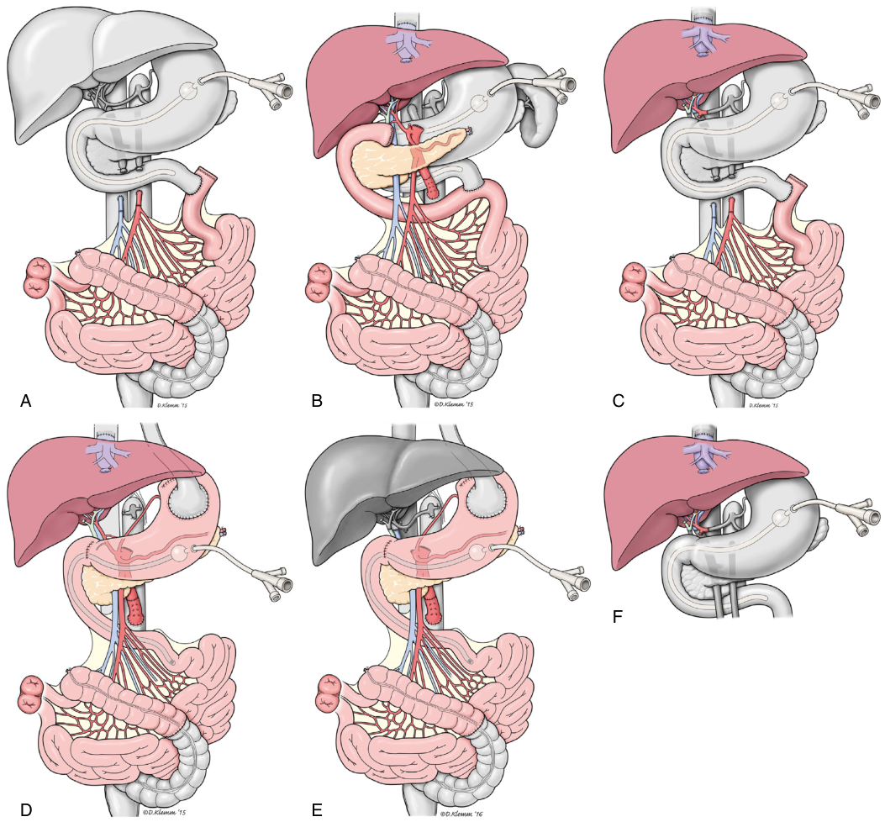

A B C F D E 

**Fig. 56.11** Visceral transplantation for intestinal failure–associated liver disease (IFALD) graft variations with graft in _color_ and native viscera in _gray_ . (A) Isolated intestine graft (jejunoileum with colon) variation. (B) Composite liver–intestine graft ( _en bloc_ liver, duodenum, pancreas, jejunoileum with colon) with native foregut preservation, including native portocaval shunt creation. (C) Noncomposite liver–intestine graft (separate liver and jejunoilium with colon). (D) Multivisceral graft ( _en bloc_ liver, stomach, duodenum, pancreas, jejunoileum with colon). (E) Modified multivisceral graft ( _en bloc_ stomach, duodenum, pancreas, jejunoileum with colon). (F) Liver transplant alone. (From Hawksworth JS, et al. Visceral transplantation in patients with intestinal‐failure associated liver disease: evolving indications, graft selection, and outcomes. _Am J Transplantation_ . 2018;18(6):1312–1320; adapted from Hawksworth JS, Matsumoto CS. Intestinal transplant techniques: from isolated intestine to intestine in continuity with other organs. In: Dunn SP, Horslen S, eds. _Solid Organ Transplantation in Infants and Children_ . New York, NY: Springer International Publishing; 2017.)

valve, the donor ileum can be anastomosed to the recipient’s distal ileum, which is then used to form the ileostomy. The ileostomy ensures that the graft is not distended postoperatively and allows for endoscopic monitoring for rejection. Preservation of the colon is not essential but improves fluid and electrolyte absorption and is naturally preferred by the patient. After completion of the bowel anastomoses, the abdominal wall is closed. Abdominal closure may be difficult, sometimes requiring delayed primary closure, use of reinforcing mesh, a muscle flap, or even grafting of the donor abdominal wall.352

### PREOPERATIVE ASSESSMENT

Multivisceral transplant, and to a lesser extent non- liver intestinal transplant, is usually associated with major operative hemorrhage, hemodynamic instability, electrolyte imbalance, and metabolic acidosis. Adequate nutritional reserve and cardiorespiratory fitness are paramount. Preoperative assessment mirrors that for liver transplant (described earlier) with additional caveats as follows.

Central venous access is often compromised by previous catheter- related infection or thrombosis. Partial or complete

<!-- PDF page 34 -->

obstruction of the innominate veins or superior vena cava is sometimes encountered, even presenting as facial swelling with fluid overload or with exercise, which may contraindicate any graft incorporating a liver. All central vessels must be assessed for patency by ultrasound and, if any doubt, by magnetic resonance venography.353 Access above the diaphragm is critical in patients receiving a liver graft because of the surgical requirement for partial or complete occlusion of the IVC intraoperatively. This is not essential in intestineonly recipients, but patency of both femoral veins must be confirmed. Access should be planned before listing, including provision for involvement of an interventional radiologist if necessary.

Coagulation assessment should include viscoelastic testing and thrombophilia screening. Most multivisceral candidates are prothrombotic on viscoelastic testing, even in the presence of liver dysfunction; confirmation of this may influence intraoperative management. Chronic abdominal pain associated with opiate use is also present in many intestinal transplant candidates. Chronic pain specialists are important consultants in these patients, since postoperative and longer- term pain management is often required.

In candidates with liver disease, portopulmonary hypertension and hepatopulmonary syndrome should be excluded as routinely done in prospective liver recipients. Given the greater physiologic and metabolic demands of a full multivisceral procedure compared to liver transplant alone, both conditions may contraindicate multivisceral transplant. Comorbidities including sarcopenia, ischemic heart disease, and diabetes (especially in candidates over 60 years old) may also indicate prohibitive risk.

### INTRAOPERATIVE MANAGEMENT

To date, literature on the perioperative anesthetic management of intestinal and multivisceral transplant recipients is largely anecdotal. Anesthetic technique, vascular access, and monitoring modalities are mainly as described in the setting of liver transplantation, although the pathophysiologic changes of end- stage liver disease are only present in liver–intestine and multivisceral candidates. A description of the differences between liver–intestine and liver- only transplantation follows.354–356

Prolonged surgical times up to 24 or more hours may occur in some multivisceral transplant procedures. Most require the presence of two highly experienced anesthesiologists and specialized ancillary staff, including nurses or technicians to help manage hemofiltration, venovenous bypass (VVB), cell salvage, rapid infusion devices, and point- of- care testing. A massive transfusion protocol with direct communication between the operating room and hospital blood bank is essential.

Most recipients have had extensive previous abdominal surgery, so they will have varying degrees of peritoneal sclerosis. Those with portomesenteric venous thrombosis or PN- associated liver disease may also have severe portal hypertension. Dissection and removal of recipient viscera can therefore be prolonged and associated with severe surgical bleeding. In some cases of multivisceral transplant, on- table angiography and SMA/celiac embolization are performed immediately before surgery to reduce operative hemorrhage.357 In others, blood loss may be reduced by avoiding

left upper quadrant dissection and splenectomy, provided there is enough space for the graft. In all cases, loss of multiple blood volumes should be anticipated. Difficult dissection also increases the risk of long ischemia times and harm to the graft. The need to minimize ischemic time requires close coordination between donor and recipient teams; the recipient anesthetic is started as soon as the organs are visualized, sometimes even before the donor explant.

Large- bore central venous catheters are usually required for rapid infusion of blood products, drug infusions, and right- sided cardiac pressure monitoring. Ultrasound guidance during cannulation is indispensable. If right internal jugular vein cannulation is known to be not possible, alternative sites should be planned at the time of assessment. These may involve interventional radiology or surgical access at other supradiaphragmatic sites. Careful planning of vascular access prior to listing is an essential and sometimes limiting step in the preparation of patients, particularly for those receiving a liver as part of the graft.

In some transplant centers VVB may be used from early in the dissection phase to decompress the portal circulation and support cardiac output. VVB requires adequate access for femoral and/or portal venous outflow and then venous inflow at a supradiaphragmatic site. A heat exchanger is incorporated in the bypass circuit to maintain normothermia during a long period of partial extracorporeal circulation. Since acidosis and hyperkalemia are also common complications of prolonged dissection and massive transfusion, some centers employ preemptive intraoperative hemofiltration.358 This usually requires placement of a dual- lumen dialysis catheter in a central vein.

Monitoring for liver–intestine and multivisceral transplant mirrors that in liver transplantation. An added advantage of TEE monitoring is the immediate detection of air and thrombus in the heart, both of which are hazards of VVB and massive transfusion. The risk of spontaneous thromboembolism during multivisceral transplantation appears be higher than in liver transplantation, due to both the presence of an underlying hypercoagulable state common in multivisceral transplant candidates and rapid changes in coagulation that may occur with massive transfusion and severe bleeding. Cell salvage may be used during dissection provided that the bowel is not violated, so that the surgical field remains uncontaminated. The cell saver may also be used to wash banked blood before infusion, reducing the risk of hyperkalemia.359

Coagulation is managed as during liver transplantation, guided by the observation of the surgical field and by viscoelastic testing. Antifibrinolytics are avoided if there is a clinical history of thrombosis or documented hypercoagulability. However, if major bleeding supervenes with a clinical coagulopathy and evidence of fibrinolysis, antifibrinolytic therapy may be considered. Open communication with a specialist in transfusion medicine is essential. Maintenance of a supportive relationship between transfusion services, the pharmacy, and the transplant team is especially important during episodes of massive transfusion and coagulopathy requiring exogenous factor therapies such as PCC and fibrinogen concentrate.

Reperfusion of an intestine- only graft is typically uneventful. However, inclusion of the liver in a composite graft usually produces hyperkalemia and transient hypotension,

<!-- PDF page 35 -->

since reperfusion involves a large mass of tissue and occurs via arterial and portal venous routes in close succession. Management is as for liver transplant, with administration of volume and vasopressor as required to maintain MAP. A marked fall in temperature is also seen. Although this is temporary if VVB with a heat exchanger is in use, hypothermia may be persistent especially if continuous venovenous hemodiafiltration is continued after reperfusion. Although the latter may be helpful in the prevention of hyperkalemia and severe acidosis, its benefits are unproven in controlled trials.

The number of patients that receive intestinal and multivisceral transplantation are fortunately small, but several decades of experience has yielded better results. Consequently, improved outcomes have led to expanded referrals for patients with end- stage intestinal failure. Further progress will depend on concentrating experience in national or regional centers as well as close collaboration among these centers to define surgical indications and refine clinical care.

## Conclusion

### POSTOPERATIVE CARE

Postoperative management involves a variable period of continued mechanical ventilation, like liver transplant. Maintenance of intravascular volume, which is diminished by tissue translocation that may persist for several days, is an important postoperative management goal. Perioperative administration of prophylactic antimicrobials and intensive multiagent induction of immunosuppression are also essential, as is monitoring of graft perfusion by Doppler ultrasound and stoma endoscopy. Abdominal wall nerve blockade (rectus sheath and subcostal transversus abdominis plane) infusions may provide for additional analgesia after extubation but patient- controlled analgesia with opiates is routine practice, and long- term opiate requirements are common. Opiate use often continues beyond discharge despite specialist pain service input and may require longterm psychological support.

### POSTTRANSPLANT COMPLICATIONS AND OUTCOMES

Postoperative complications are frequent, particularly in multivisceral transplantation, but graft loss is now rare due to significant advances in immunosuppression. Common complications include infection and technical issues such as bleeding, thrombosis, and anastomotic leaks.360 Intestinal grafts have a high antigenic potential; some level of rejection occurs in one- half to two- thirds of all patients. Inclusion of a liver with an intestinal graft appears to confer some immunologic tolerance, but this benefit does not outweigh the risks of implanting a liver graft and is further negated by the overall shortage of liver grafts.361 Liver grafts are therefore reserved for patients with ESLD. Additional complications include posttransplant lymphoproliferative disease and graft- versus- host disease with incidences of 30% and 10%, respectively.362

Outcomes for isolated intestinal, combined liver– intestine and multivisceral transplant have improved significantly with advances in surgical technique, immunosuppression, and patient preparation. Survival is similar across the United States, the United Kingdom, and Europe but depends on the organs included in the graft. Overall, one- year and five- year patient survival rates for all organs implanted are 50%–92% and 33%–83%, respectively.363–365 Survival is generally better for isolated intestine or combined intestine–liver grafts and for pediatric patients as compared to adults that received modified or full multivisceral transplant.

Abdominal organ transplantation has matured from its beginnings as an experimental procedure in the 1950s and 1960s and has become the best hope for survival for most patients with advanced liver disease and the best treatment option for patients with end- stage renal disease and severe forms of diabetes. Future challenges for the field include the ongoing mismatch between organ supply and demand, changing demographics of end organ disease, and prevention of disease recurrence in transplant recipients. Continued advances in posttransplant management, including pharmacologic improvements to limit the side effects of immunosuppression, are anticipated.

### Complete references available online at expertconsult.com.

### References

1.  Global Observatory on Donation and Transplantation. _International Report on Organ Donation and Transplantation Activities. Executive Summary, 2020_ ; 2022. http://www.transplantobservatory.org/wp- content/uploads/2021/06/GODT2019data_web_updated- June- 2021.pdf.

2. _Am J Transplant_ . 2021;21(suppl 2):11.

3.  Bodzin AS, Baker TB. _Liver Transpl_ . 2018;24(10):1470.

4.  Linecker M, et al. _J Hepatol_ . 2018;68(4):798.

5.  Biggins SW. _J Hepatol_ . 2012;56(6):1404.

6.  Weiss E, et al. _Transplantation_ . 2021;105(3):561.

7.  Figorilli F, et al. _PLoS One_ . 2017;12(12):e0188151.

8.  Schwager Y, et al. _Ann Transplant_ . 2019;24:273.

9.  Strauss AT, et al. _Am J Transplant_ . 2021;21(5):1838.

10.  Israni AK. _Am J Transplant_ . 2022;22(suppl 2):11.

11.  Putzer G, et al. _Transplantation_ . 2022;106(7):1450.

12.  Aubert O, et al. _Lancet Public Health_ . 2021;6(10):e709.

13.  Nimmo A, et al. _Transplantation_ . 2022;106(7):1312.

14.  Organ Procurement and Transplantation Network (OPTN). National data. https://optn.transplant.hrsa.gov/data/view- datareports/national- data/#.

15.  Eurotransplant. Yearly statistics. https://www.eurotransplant.org/s tatistics/yearly- statistics/.

16.  Bello AK, et al. _BMJ_ . 2019;367:l5873.

17.  Elrggal ME, et al. _Transplantation_ . 2021;105(11):2325. 18.  Lentine KL, et al. _Am J Transplant_ . 2022;22(suppl 2):21.

19.  Xu G, et al. _BMJ_ . 2018;362:k1497.

20.  Thurlow JS, et al. _Am J Nephrol_ . 2021;52(2):98. 21.  Hart A, et al. _Am J Transplant_ . 2021;21(suppl 2):21.

22.  Stewart DE, et al. _Am J Transplant_ . 2016;16(6):1834. 23.  Wolfe RA, et al. _Engl J Med_ . 1999;341(23):1725.

24.  Wang JH, et al. _Adv Chronic Kidney Dis_ . 2016;23(5):281. 25.  Poggio ED, et al. _Am J Transplant_ . 2021;21(8):2824.

26.  Cravedi P, et al. _Am J Transplant_ . 2020;20(11):3140.

27.  Organ Procurement and Transplantation Network (OPTN). _Policies_ ; 2023. https://optn.transplant.hrsa.gov/media/eavh5bf3/optn_poli cies.pdf.

28.  Melanson TA, et al. _Health Aff_ . 2017;36(6):1078. 29.  Jackson KR, et al. _Transplantation_ . 2020;104(7):1456.

<!-- PDF page 36 -->

30.  Wu DA, et al. _Kidney Int_ . 2017;91(6):1287.

31.  Frei U, et al. _Am J Transplant_ . 2008;8(1):50.

32.  Joo HN. _Asia Pac J Public Health_ . 2013;25(2):209.

33.  Hsieh CJ, et al. _Transplant Proc_ . 2020;52(6):1643.

34.  Kute VB, et al. _Exp Clin Transplant_ . 2020;18(5):549.

35.  Mudiayi D, et al. _Transplantation_ . 2022;106(6):1113.

36.  Kute VB, et al. _World J Transplant_ . 2018;8(3):52.

37.  Loupy A, et al. _BMJ_ . 2019;366:l4923.

38.  Lea- Henry T, Chacko B. _Nephrology_ . 2018;23(1):12.

39.  Ferreira ES, et al. _BMC Nephrol_ . 2020;21(1):502.

40.  van Walraven C, et al. _CMAJ (Can Med Assoc J)_ . 2010;182(7):666.

41.  Badve SV, et al. _J Am Coll Cardiol_ . 2011;58(11):1152.

42.  Chronic Kidney Disease Prognosis Consortium, et al. _Lancet_ . 2010;375(9731):2073.

43.  Hakeem A, et al. _JACC Cardiovasc Imaging_ . 2014;7(7):715.

44.  Chirakarnjanakorn S, et al. _Int J Cardiol_ . 2017;232:12.

45.  Saran R, et al. _Am J Kidney Dis_ . 2018;71(3 suppl 1):A7.

46.  Kumar U, et al. _Cardiol Clin_ . 2019;37(3):251.

47.  Hawwa N, et al. _J Am Coll Cardiol_ . 2015;66(16):1779.

48.  Zolty R, et al. _Am J Transplant_ . 2008;8(11):2219.

49.  Rehman KA, et al. _Clin Cardiol_ . 2017;40(10):839.

50.  Watanabe H, Minamino T. _Intern Med_ . 2018;57(16):2285.

51.  Zaman JAB, Bhandari AK. _J Cardiovasc Pharmacol Ther_ . 2019;24(6):499.

52.  Mikhail A, et al. _BMC Nephrol_ . 2017;18(1):345.

53.  van Eck van der Sluijs A, et al. _Nephrol Dial Transplant_ . 2021; 36(1):170.

54.  Lu HY, Liao KM. _BMC Nephrol_ . 2018;19(1):204.

55.  Jun KW, et al. _Medicine (Baltimore)_ . 2021;100(36):e27179.

56.  Kumar MS, et al. _Indian J Nephrol_ . 2021;31(2):135.

57.  Salles Junior LD, et al. _BMC Nephrol_ . 2013;14:275.

58.  Arnold R, et al. _JRSM Cardiovasc Dis_ . 2016;5. 2048004016677687.

59.  Salman IM. _Curr Hypertens Rep_ . 2015;17(8):59.

60.  Lentine KL, et al. _J Am Coll Cardiol_ . 2012;60(5):434.

61.  Fleisher LA, et al. _J Am Coll Cardiol_ . 2014;64(22):e77.

62.  Køtta PA, et al. _J Clin Med_ . 2021;10(11):2525.

63.  Chadban SJ, et al. _Transplantation_ . 2020;104(4S1 suppl 1):S11.

64.  Wang LW, et al. _Cochrane Database Syst Rev_ . 2011;2011(12): CD008691.

65.  Ragosta M, et al. _Am Heart J_ . 2004;147(6):1017.

66.  Parnham SF, et al. _Front Cardiovasc Med_ . 2014;1:13.

67.  Wang LW, et al. _Transplantation_ . 2015;99(4):731.

68.  Bangalore S, et al. _N Engl J Med_ . 2020;382(17):1608.

69.  Duggan EW, et al. _Anesthesiology_ . 2017;126(3):547.

70.  Simha V, Shah P. _JAMA_ . 2019;321(4):399.

71.  Thapa S, Brull SJ. _Anesth Analg_ . 2000;91(1):237.

72.  Tran DT, et al. _Cochrane Database Syst Rev_ . 2015;2015(10): CD002788.

73.  Marik PE, Cavallazzi R. _Crit Care Med_ . 2013;41(7):1774.

74.  Sondekoppam RV, et al. _Can J Anaesth_ . 2020;67(11):1595.

75.  Laar SCV, et al. _Transplant Proc_ . 2021;53(7):2122.

76.  Gingell- Littlejohn M, et al. _Transplant Proc_ . 2013;45(1):46.

77.  Cavaleri M, et al. _J Clin Med_ . 2019;8(1):80.

78.  Cannesson M, et al. _Crit Care_ . 2015;19(1):261.

79.  Cammu G, et al. _Br J Anaesth_ . 2012;109(3):382.

80.  Adams DR, et al. _Anaesthesia_ . 2020;75(3):348.

81.  Ono Y, et al. _JA Clin Rep_ . 2018;4(1):56.

82.  Carron M, et al. _Perioper Med (Lond)._ 2022;11(1):3.

83.  Merck Connect. Dosing for Bridion® (Sugammadex). https://www .merckconnect.com/bridion/dosing- administration/?gclid=Cj0KC Qjw2_OWBhDqARIsAAUNTTFmBMWqXys_JHSk- wyARTtL- DM5Wnw9cM_GuALPbCWeBPbwwVbIJakaAjl6EALw_wcB&gclsrc=a w.ds.

84.  Levine MA, et al. _Can Urol Assoc J_ . 2017;11(12):388.

85.  Okidi OO, et al. _Exp Clin Transplant_ . 2017;15(1):40.

86.  Pham PC, et al. _Clin Kidney J_ . 2017;10(5):688.

87.  Singh PM, et al. _Saudi J Anaesth_ . 2018;12(2):261.

88.  Sharipova V, et al. _Exp Clin Transplant_ . 2022;20(suppl 1):83.

89.  Kolacz M, et al. _Eur J Anaesthesiol_ . 2020;37(9):773.

90.  Morkane CM, et al. _Clin Kidney J_ . 2019;12(6):880.

91.  Golder HJ, Papalois V. _J Clin Med_ . 2021;10(8):1634.

92.  Halawa A, et al. _Exp Clin Transplant_ . 2018;16(2):127.

93.  Dias BH, et al. _ANZ J Surg_ . 2019;89(10):1319.

94.  Engels EA, et al. _JAMA_ . 2011;306(17):1891.

95.  Cohen- Bucay A, et al. _F1000Res_ . 2019;8.

96.  Djamali A, et al. _Clin J Am Soc Nephrol_ . 2006;1(4):623.

97.  Stoumpos S, et al. _Transpl Int_ . 2015;28(1):10.

98.  Birdwell KA, Park M. _Clin J Am Soc Nephrol_ . 2021;16(12):1878.

99.  Mathur AK, et al. _Transplant Direct_ . 2017;3(2):e126.

100.  KDIGO. _Transplant Recipient Guidelines 2009_ ; 2009. https://kdigo.or g/guidelines/transplant- recipient/.

101.  Kostopanagiotou G, et al. _Anesth Analg_ . 1999;89(3):613.

102.  Gamble A, et al. _Islets_ . 2018;10(2):80.

103.  Dean PG, et al. _BMJ_ . 2017;357:j1321.

104.  Kandaswamy R, et al. _Am J Transplant_ . 2022;22(suppl 2):137.

105.  Benjamens S, et al. _Pancreatology_ . 2019;19(1):31.

106.  Callaghan CJ, et al. _Am J Transplant_ . 2021;21(11):3673.

107.  Ventura- Aguiar P, et al. _Nefrologia_ . 2023;43(1):133.

108.  Kopp WH, et al. _Transplantation_ . 2015;99(9):e145.

109.  Gruessner AC, Gruessner RW. _Rev Diabet Stud_ . 2016;13(1):35.

110.  Dholakia S, et al. _J R Soc Med_ . 2016;109(4):141.

111.  Samoylova ML, et al. _Surg Clin North Am_ . 2019;99(1):87.

112.  Shah AP, et al. _Clin Transplant_ . 2013;27(1):E49.

113.  Schenker P, et al. _Transpl Int_ . 2011;24(2):136.

114.  Scalea JR, et al. _Transpl Int_ . 2016;29(7):810.

115.  Montagud- Marrahi E, et al. _BMJ Open Diabetes Res Care_ . 2020;8(1).

116.  Mittal S, et al. _Transpl Int_ . 2020;33(5):529.

117.  Ling JEH, et al. _Ann Transplant_ . 2021;26:e930787.

118.  Eurotransplant. Statistics Report Library. statistics.eurotransplant. org.

119.  Boggi U, et al. _Am J Transplant_ . 2021;21(suppl 3):1.

120.  Boggi U, et al. _Am J Transplant_ . 2021;21(suppl 3):17.

121.  Giannarelli R, et al. _Diabetologia_ . 2006;49(12):2977.

122.  Kim YJ, et al. _Transplantation_ . 2018;102(1):e30.

123.  Giannarelli R, et al. _Transpl Int_ . 2005;18(5):619.

124.  Kim SJ, et al. _Transplantation_ . 2014;97(6):675.

125.  Gruessner RW, Gruessner AC. _Diabetes Care_ . 2013;36(8):2440.

126.  Fioretto P, et al. _N Engl J Med_ . 1998;339(2):69.

127.  Melendez- Ramirez LY, et al. _Endocrinol Metab Clin North Am_ . 2010;39(3):625.

128.  Orchard TJ, et al. _Diabetes Care_ . 2003;26(5):1374.

129.  Forrest KY, et al. _Atherosclerosis_ . 2000;148(1):159.

130.  Boulton AJ, et al. _Diabetes Care_ . 2005;28(4):956.

131.  Cho NH, et al. _Diabetes Res Clin Pract_ . 2018;138:271.

132.  Gansevoort RT, et al. _Lancet_ . 2013;382(9889):339.

133.  Kim J, et al. _Am J Cardiol_ . 2017;120(4):682.

134.  St Michel D, et al. _Methods Protoc_ . 2019;2(4).

135.  Warner ME, et al. _Anesth Analg_ . 1998;86(3):516.

136.  Atoa SM, et al. _Clin Transplant_ . 2021;35(2):e14153.

137.  Senaratne NV, Norris JM. _Int J Surg_ . 2015;22:149.

138.  Hausken J, et al. _Transplant Proc_ . 2019;51(2):479.

139.  Yeap YL, et al. _Clin Transplant_ . 2019;33(6):e13581.

140.  Farney AC, et al. _Curr Opin Organ Transplant_ . 2012;17(1):87.

141.  Hakeem A, et al. _Am J Transplant_ . 2018;18(1):163.

142.  Raveh Y, et al. _Clin Transplant_ . 2019;33(7):e13619.

143.  Amorese G, et al. _Curr Pharm Des_ . 2020;26(28):3425.

144.  Medina- Polo J, et al. _Transplant Proc_ . 2010;42(8):2981.

145.  Starzl TE, et al. _Surg Gynecol Obstet_ . 1963;117:659.

146. _UNOS Bylaws Appendix F: Membership and Personnel Requirements for Liver Transplant Programs and Intestine Transplant Programs. F.5 Requirements for Director of Liver Transplant Anesthesia_ . 2021. https:/ /optn.transplant.hrsa.gov/media/lgbbmahi/optn_bylaws.pdf.

147.  Hendrickse A, et al. _Liver Transpl_ . 2020;26(4):582.

148.  Kwong AJ, et al. _Am J Transplant_ . 2022;22(suppl 2):204.

149.  NHS Blood and Transplant. _Annual Report on Liver Transplantation 2020/2021_ ; 2021. https://nhsbtdbe.blob.core.windows.net/umb raco- assets- corp/24593/nhsbt- liver- transplant- report- 2021- final.pdf.

150.  Heron M. _Natl Vital Stat Rep_ . 2021;70(9):1.

151.  Asrani SK, et al. _J Hepatol_ . 2019;70(1):151.

152.  European Liver Transplant Registry (ELTR). http://www.eltr.org/.

153.  Adam R, et al. _Transpl Int_ . 2018;31(12):1293.

154.  Thomopoulos K, et al. _Dig Liver Dis_ . 2006;38:899.

155.  Fernández J, et al. _Gastroenterology_ . 2007;133:818.

156.  Alessandria C, et al. _Hepatology_ . 2005;41:1282.

157.  Stewart C, et al. _Liver Transplant_ . 2007;13:1366.

158.  Rela M, Rammohan A. _J Hepatol_ . 2021;75(4):975.

159.  Pinzani M, et al. _Best Pract Res Clin Gastroenterol_ . 2011;25(2):281. 160.  Ripoll C, et al. _Gastroenterology_ . 2007;133(2):481.

161.  Izzy M, et al. _Hepatology_ . 2020;71(1):334.

<!-- PDF page 37 -->

162.  Moller S, et al. _Expert Rev Gastroenterol Hepatol_ . 2019;13(5):497.

163.  Cesari M, et al. _Hepatology_ . 2018;68(1):215.

164.  Bernardi M, et al. _Expert Rev Gastroenterol Hepatol_ . 2012;6(1):57.

165.  Choudhary NS, Duseja A. _J Clin Exp Hepatol_ . 2019;9(4):506.

166.  Tiwari N, et al. _Int J Cardiol Heart Vasc_ . 2021;32:100714.

167.  Rachwan RJ, et al. _J Hepatol_ . 2021;75(1):142.

168.  Wray C, et al. _Am J Transplant_ . 2013;13(1):184.

169.  Rybak D, et al. _Liver Transpl_ . 2008;14(9):1357.

170.  Krowka MJ, et al. _Transplantation_ . 2016;100(7):1440.

171.  Soulaidopoulos S, et al. _World J Gastroenterol_ . 2018;24(12):1285.

172.  Gupta S, et al. _Am J Transplant_ . 2010;10(2):354.

173.  Pascasio JM, et al. _Am J Transplant_ . 2014;14(6):1391.

174.  Kadry Z, et al. _JHEP Rep_ . 2021;3(5):100351.

175.  Organ Procurement and Transplantation Network (OPTN). _Policies: Requirements for Hepatopulmonary Syndrome (HPS) MELD or PELD Score Exceptions_ . 2023. https://optn.transplant.hrsa.gov/media/12 00/optn_policies.pdf.

176.  Raevens S, et al. _Acta Gastroenterol Belg_ . 2021;84(1):95.

177.  Rodriguez- Roisin R, et al. _Eur Respir J_ . 2004;24(5):861.

178.  Thomas C, et al. _Front Med_ . 2020;7:569413.

179.  Raevens S, et al. _Liver Transpl_ . 2013;19(6):602.

180.  Krowka MJ, et al. _Liver Transpl_ . 2004;10(2):174.

181.  Sadd CJ, et al. _Transplantation_ . 2021;105(2):346.

182.  Reymond M, et al. _Transplantation_ . 2018;102(4):616.

183.  Koppel MH, et al. _N Engl J Med_ . 1969;280(25):1367.

184.  Kim WR, et al. _Gastroenterology_ . 2021;161(6):1887.

185.  MacDonald AJ, et al. _Curr Opin Crit Care_ . 2019;25(2):171.

186.  Kuiper JJ, et al. _Aliment Pharmacol Ther_ . 2007;26(suppl 2):183.

187.  Arroyo V, Colmenero J. _J Hepatol_ . 2003;38(suppl 1):S69.

188.  Gines P, et al. _Nat Rev Dis Primers_ . 2018;4(1):23.

189.  Gines P, et al. _Hepatology_ . 2004;40(1):16.

190.  Song T, et al. _Dig Liver Dis_ . 2018;50(4):323.

191.  Wong F, et al. _Liver Transpl_ . 2015;21(3):300.

192.  Formica Jr RN. _Curr Opin Nephrol Hypertens_ . 2016;25(6):577.

193.  Vilstrup H, et al. _Hepatology_ . 2014;60(2):715.

194.  Ferenci P. _Gastroenterol Rep (Oxf)._ 2017;5(2):138.

195.  Teperman LW. _Int J Hepatol_ . 2013;2013:952828.

196.  Perello A, et al. _Hepatology_ . 1999;30(6):1393.

197.  Garcia- Tsao G, Bosch J. _N Engl J Med_ . 2010;362(9):823.

198.  Garcia- Pagan JC, et al. _N Engl J Med_ . 2010;362(25):2370.

199.  Castaneda B, et al. _Hepatology_ . 2001;33(4):821.

200.  Garcia- Tsao G, et al. _Hepatology_ . 2007;46(3):922.

201.  Runyon BA, AASLD. _Hepatology_ . 2013;57(4):1651.

202.  Runyon BA, et al. _Ann Intern Med_ . 1992;117(3):215.

203.  Biggins SW, et al. _Hepatology_ . 2021;74(2):1014.

204.  Lisman T, et al. _J Thromb Haemost_ . 2021;19(4):1116.

205.  Tripodi A, Mannucci PM. _N Engl J Med_ . 2011;365(2):147.

206.  Lisman T, Porte RJ. _Blood_ . 2010;116(6):878.

207.  Segal JB, et al. _Transfusion_ . 2005;45(9):1413.

208.  Tripodi A, et al. _Hepatology_ . 2006;44(2):440.

209.  Lisman T, et al. _J Hepatol_ . 2010;52(3):355.

210.  Tripodi A. _Clin Liver Dis_ . 2009;13(1):55.

211.  Dabbagh O, et al. _Chest_ . 2010;137(5):1145.

212.  Sogaard KK, et al. _Am J Gastroenterol_ . 2009;104(1):96.

213.  Mitchell O, et al. _Hepat Med_ . 2016;8:39.

214.  Nicolau- Raducu R, et al. _Liver Transpl_ . 2019;25(3):380.

215.  Puoti C, et al. _J Gastroenterol Hepatol_ . 2009;24(12):1847.

216.  Traub J, et al. _Nutrients_ . 2021;13(2):540.

217.  McClain CJ, et al. _Alcohol Clin Exp Res_ . 2011;35(5):815.

218.  van Vugt JL, et al. _Am J Transplant_ . 2016;16(8):2277.

219.  Nishikawa H, et al. _Int J Mol Sci_ . 2021;22(4).

220.  Moctezuma- Velazquez C, et al. _Nutrients_ . 2019;11(11):2552.

221.  European Association for the Study of the Liver. _J Hepatol_ . 2019;70(1):172.

222.  Stravitz RT, Lee WM. _Lancet_ . 2019;394(10201):869.

223.  Bernal W, et al. _J Hepatol_ . 2015;62(suppl 1):S112.

224.  Reuben A, et al. _Ann Intern Med_ . 2016;164(11):724.

225.  Reddy KR, et al. _Liver Transpl_ . 2016;22(4):505.

226.  Lee J, et al. _Transplantation_ . 2019;103(12):2515.

227.  Coombes JM, Trotter JF. _Clin Med Res_ . 2005;3(2):87.

228.  Moraes ACO, et al. _Arq Bras Cir Dig_ . 2017;30(1):65.

229.  Klein KB, et al. _PLoS One_ . 2013;8(12):e80661.

230.  Nekrasov V, et al. _Am J Transplant_ . 2016;16(10):2912. 231.  Artzner T, et al. _World J Gastroenterol_ . 2018;24(46):5203. 232.  Petrowsky H, et al. _Ann Surg_ . 2014;259(6):1186.

233.  Townsend DR, et al. _Liver Transpl_ . 2009;15(1):73.

234.  Douthitt L, et al. _Transplant Proc_ . 2012;44(5):1314.

235.  Ramsey G. _Annals of Blood_ . 2021;7.

236.  Hofer I, et al. _Liver Transpl_ . 2015;21(1):89.

237.  Stoll WD, et al. _Transplant Proc_ . 2021;53(5):1665.

238.  Chadha RM, et al. _Semin Cardiothorac Vasc Anesth_ . 2017;21(4):352.

239.  Nguyen- Buckley C, et al. _Semin Cardiothorac Vasc Anesth_ . 2019; 23(4):399.

240.  Kalaitzakis E. _World J Gastroenterol_ . 2014;20(40):14686.

241.  Rudnick MR, et al. _World J Hepatol_ . 2015;7(10):1302.

242.  Porter SB, et al. _Transplant Proc_ . 2021;53(1):30.

243.  Crouch C, et al. _Clin Transplant_ . 2022;36(1):e14504.

244.  Soong W, et al. _J Cardiothorac Vasc Anesth_ . 2014;28(3):635.

245.  Burger- Klepp U, et al. _Transplantation_ . 2012;94(2):192.

246.  Biancofiore G, et al. _Anesth Analg_ . 2011;113(3):515.

247.  Tsai YF, et al. _Transplant Proc_ . 2012;44(2):433.

248.  Rajendran L, et al. _Ann Surg_ . 2023;277(3):456.

249.  Karvellas CJ, et al. _Can J Anaesth_ . 2019;66(10):1151.

250.  Huang HB, et al. _Liver Transpl_ . 2020;26(8):1010.

251.  Gatecel C, et al. _Anesth Analg_ . 2003;96(3):740.

252.  Suttner SW, et al. _Anesth Analg_ . 2000;91(1):206.

253.  Frink Jr EJ. _Anesth Analg_ . 1995;81(suppl 6):S46.

254.  Meierhenrich R, et al. _Anaesthesia_ . 2010;65(11):1085.

255.  De Wolf AM, et al. _Br J Anaesth_ . 1996;76(5):624.

256.  Marcel RJ, et al. _Anesth Analg_ . 1997;84(4):870.

257.  Fisher DM, et al. _Anesthesiology_ . 1997;86(6):1306.

258.  Deana C, et al. _BMC Anesthesiol_ . 2020;20(1):70.

259.  Jeng LB, et al. _World J Transplant_ . 2015;5(4):145.

260.  Yoshizumi T, Mori M. _Surg Today_ . 2020;50(1):21.

261.  Sakai T, et al. _Clin Transplant_ . 2022;36(6):e14667.

262.  Carrier FM, et al. _Can J Anaesth_ . 2020;67(1):109. 263.  Bechstein WO, Neuhaus P. _Liver Transpl Surg_ . 1997;3(6):653.

264.  Haagsma EB, et al. _Liver_ . 1985;5(3):123.

265.  Wszolek ZK, et al. _Transplantation_ . 1989;48(6):1006.

266.  Lee EM, et al. _Eur Neurol_ . 2009;62(6):362.

267.  Leise M, Cardenas A. _Liver Transpl_ . 2018;24(11):1612.

268.  Scott VL, et al. _Liver Transpl Surg_ . 1996;2(5):343.

269.  Park C, et al. _Transplantation_ . 2009;87(7):1031.

270.  Bellomo R, et al. _Lancet_ . 2000;356(9248):2139.

271.  Holmes CL, Walley KR. _Chest_ . 2003;123(4):1266.

272.  Rossi G, et al. _Transplant Proc_ . 1998;30(5):1871.

273.  Prager MC, et al. _Anesthesiology_ . 1990;72(1):198.

274.  Gurusamy KS, et al. _Cochrane Database Syst Rev_ . 2011;2011(12): CD009052.

275.  Tzakis A, et al. _Ann Surg_ . 1989;210(5):649.

276.  Hannon V, et al. _Transplantation_ . 2020;104(11):e308.

277.  Nishida S, et al. _HPB (Oxford)_ . 2006;8(3):182.

278.  Sharma V, et al. _Cleve Clin J Med_ . 2022;89(1):46.

279.  Jeong SM. _Korean J Anesthesiol_ . 2015;68(6):527.

280.  Bekki Y, et al. _Clin Transplant_ . 2022;36(4):e14587.

281.  Xia VW, et al. _Liver Transpl_ . 2010;16(12):1421.

282.  Warnaar N, et al. _J Thromb Haemost_ . 2008;6(2):297.

283.  Shillcutt SK, et al. _J Cardiothorac Vasc Anesth_ . 2016;30(1):107.

284.  Smith NK, et al. _Anesth Analg_ . 2021;132(1):130.

285.  Mandell D, et al. _Semin Cardiothorac Vasc Anesth_ . 2018;22(4):376. 286.  Park J, et al. _ASAIO J_ . 2022;68(5):683.

287.  Steadman RH. _Anesthesiol Clin North Am_ . 2004;22(4):687.

288.  DiNorcia J, et al. _JAMA Surg_ . 2015;150(11):1066.

289.  Forkin KT, et al. _Anesth Analg_ . 2018;126(1):46. 290.  Bezinover D, et al. _Transplantation_ . 2018;102(4):578. 291.  de Boer MT, et al. _Anesth Analg_ . 2008;106(1):32. 292.  Esmat Gamil M, et al. _Transplant Proc_ . 2012;44(9):2857. 293.  Rana A, et al. _J Am Coll Surg_ . 2013;216(5):902. 294.  Gorlinger K, et al. _Br J Anaesth_ . 2013;110(2):222. 295.  Kang Y. _Liver Transpl Surg_ . 1997;3(6):655. 296.  Deppe AC, et al. _J Surg Res_ . 2016;203(2):424. 297.  Kirchner C, et al. _Transfusion_ . 2014;54(10 Pt 2):2760. 298.  Roullet S, et al. _Liver Transpl_ . 2015;21(2):169.

299.  Morrison GA, et al. _J Cardiothorac Vasc Anesth_ . 2012;26(4):654. 300.  Chow JH, et al. _Semin Cardiothorac Vasc Anesth_ . 2018;22(2):164. 301.  Lodge JP, et al. _Liver Transpl_ . 2005;11(8):973.

302.  Planinsic RM, et al. _Liver Transpl_ . 2005;11(8):895.

303.  Levi M, et al. _N Engl J Med_ . 2010;363(19):1791.

304.  Nguyen- Buckley C, et al. _Transplantation_ . 2021;105(8):1771. 305.  Sabate A, et al. _Am J Transplant_ . 2016;16(8):2421.

<!-- PDF page 38 -->

306.  Pereboom IT, et al. _Anesth Analg_ . 2009;108(4):1083. 307.  Chin JL, et al. _Clin Appl Thromb Hemost_ . 2016;22(4):351. 308.  Badenoch A, et al. _Transplantation_ . 2017;101(7):1658. 309.  Kong HY, et al. _World J Surg_ . 2014;38(1):177.

310.  Mangus RS, et al. _Transplant Proc_ . 2014;46(5):1393. 311.  Peiris P, et al. _Liver Transpl_ . 2015;21(10):1280. 312.  Boone JD, et al. _Anesth Analg_ . 2011;112(2):319. 313.  Burra P, et al. _Semin Liver Dis_ . 2018;38(3):260.

314.  Feng S, et al. _Am J Transplant_ . 2006;6(4):783.

315.  Adelmann D, et al. _Transplantation_ . 2018;102(11):e466. 316.  Jochmans I, et al. _Transplant Direct_ . 2018;4(6):e356.

317.  Milan Z. _World J Hepatol_ . 2015;7(21):2331. 318.  Hausken J, et al. _Transplant Direct_ . 2021;7(2):e648. 319.  Kutzler HL, et al. _Liver Transpl_ . 2020;26(10):1254.

320.  Milan ZB, et al. _Transplant Proc_ . 2011;43(7):2687.

321.  Mandell MS, Hang Y. _J Cardiothorac Vasc Anesth_ . 2007;21(5):752. 322.  Steadman RH. _J Cardiothorac Vasc Anesth_ . 2007;21(5):756. 323.  Rodriguez- Laiz GP, et al. _World J Surg_ . 2021;45(5):1262. 324.  Brustia R, et al. _World J Surg_ . 2019;43(1):230.

325.  Aniskevich S, Pai SL. _World J Hepatol_ . 2015;7(20):2303. 326.  Hussaini T, et al. _Exp Clin Transplant_ . 2018;16(5):550. 327.  Watt KD, et al. _Am J Transplant_ . 2010;10(6):1420.

328.  Feltracco P, et al. _World J Gastroenterol_ . 2013;19(48):9271. 329.  Qureshi W, et al. _Liver Transpl_ . 2013;19(7):701. 330.  Xia VW, et al. _Am J Transplant_ . 2015;15(3):687.

331.  Albeldawi M, et al. _Liver Transpl_ . 2012;18(3):370. 332.  Chen HP, et al. _Medicine (Baltimore)_ . 2015;94(52):e2320. 333.  Angeli P, et al. _Minerva Anestesiol_ . 2017;83(1):88.

334.  Miles CD, et al. _Curr Transplant Rep_ . 2018;5(1):1.

335.  Tinti F, et al. _Transpl Int_ . 2019;32(9):918.

336.  Sharma P, et al. _Liver Transpl_ . 2009;15(9):1142. 337.  Pinderski LJ, et al. _J Heart Lung Transplant_ . 2005;24(11):1828.

338.  Chou HW, et al. _J Formos Med Assoc_ . 2020;119(4):838.

339.  Bryant 3rd R, et al. _Transplantation_ . 2018;102(2):e67.

340.  Nelson LM, et al. _Clin Transplant_ . 2013;27(2):203.

341.  Careddu L, et al. _Transpl Int_ . 2015;28(7):828.

342.  Han JL, et al. _Transplant Rev_ . 2019;33(2):99.

343.  Freischlag K, et al. _Transplantation_ . 2019;103(8):1675.

344.  Bui CCM, et al. _J Cardiothorac Vasc Anesth_ . 2021;35(8):2363.

345.  Tasdogan BE, et al. _Euroasian J Hepato- Gastroenterol_ . 2019;9(2):96.

346.  Marik PE, Varon J. _Arch Surg_ . 2008;143(12):1222.

347.  Horlocker TT, et al. _Reg Anesth Pain Med_ . 2018;43(3):263.

348.  Grant D, et al. _Am J Transplant_ . 2015;15(1):210.

349.  Bharadwaj S, et al. _Gastroenterol Rep (Oxf)._ 2017;5(1):20.

350.  Lauro A, et al. _J Visc Surg_ . 2017;154(2):105.

351.  Hawksworth JS, et al. _Am J Transplant_ . 2018;18(6):1312.

352.  Janssen Y, et al. _Transplant Rev_ . 2021;35(4):100634.

353.  Garcia J, et al. _Transplantation_ . 2017;101(6S2):S94.

354.  Nguyen- Buckley C, Wong M. _Anesthesiol Clin_ . 2017;35(3):509.

355.  Jorge LM, Ekwenna O. In: Pretto JEA, et al., ed. _Oxford Textbook of Transplant Anaesthesia and Critical Care_ . Oxford University Press; 2015.

356.  Fukazawa K, et al. In: Pretto JEA, et al., ed. _Oxford Textbook of Transplant Anaesthesia and Critical Care_ . Oxford University Press; 2015.

357.  Canovai E, et al. _Front Surg_ . 2021;8:645302.

358.  Koscielska M, et al. _Transplant Proc_ . 2020;52(8):2454.

359.  Gruber M, et al. _Transfusion_ . 2013;53(5):1001.

360.  Fishbein TM. _N Engl J Med_ . 2009;361(10):998.

361.  Wu G, Cruz RJ. _Transplantation_ . 2015;99(6):1265.

362.  Mazariegos GV, et al. _Am J Transplant_ . 2004;4(9):1459.

363.  Horslen SP, et al. _Am J Transplant_ . 2022;22(suppl 2):310.

364.  Rutter CS, et al. _Transplant Proc_ . 2016;48(2):468. 365.  Clarysse M, et al. _Curr Opin Organ Transplant_ . 2020;25(2):176.

<!-- PDF page 39 -->

### References

1.  Global Observatory on Donation and Transplantation. _International Report on Organ Donation and Transplantation Activities. Executive Summary, 2020_ ; 2022. http://www.transplant- observatory.org/wpcontent/uploads/2021/06/GODT2019- data_web_updated- June2021.pdf.

2.  OPTN/SRTR 2019 annual data report: introduction. _Am J Transplant_ . 2021;21(suppl 2):11–20.

3.  Bodzin AS, Baker TB. Liver transplantation today: where we are now and where we are going. _Liver Transpl_ . 2018;24(10):1470–1475.

4.  Linecker M, Krones T, Berg T, et al. Potentially inappropriate liver transplantation in the era of the “sickest first” policy – a search for the upper limits. _J Hepatol_ . 2018;68(4):798–813.

5.  Biggins SW. Futility and rationing in liver retransplantation: when and how can we say no? _J Hepatol_ . 2012;56(6):1404–1411.

6.  Weiss E, Saner F, Asrani SK, et al. When is a critically ill cirrhotic patient too sick to transplant? Development of consensus criteria by a multidisciplinary panel of 35 international experts. _Transplantation_ . 2021;105(3):561–568.

7.  Figorilli F, Putignano A, Roux O, et al. Development of an organ failure score in acute liver failure for transplant selection and identification of patients at high risk of futility. _PLoS One_ . 2017;12(12):e0188151.

8.  Schwager Y, Littbarski SA, Nolte A, et al. Prediction of three- year mortality after deceased donor kidney transplantation in adults with pre- transplant donor and recipient variables. _Ann Transplant_ . 2019;24:273–290.

9.  Strauss AT, Boyarsky BJ, Garonzik- Wang JM, et al. Liver transplantation in the United States during the COVID- 19 pandemic: national and center- level responses. _Am J Transplant_ . 2021;21(5):1838–1847.

10.  Israni AK. OPTN/SRTR 2020 Annual data report: introduction. _Am J Transplant_ . 2022;22(suppl 2):11–20.

11.  Putzer G, Gasteiger L, Mathis S, et al. Solid organ donation and transplantation activity in the Eurotransplant area during the first year of COVID- 19. _Transplantation_ . 2022;106(7):1450–1454.

12.  Aubert O, Yoo D, Zielinski D, et al. COVID- 19 pandemic and worldwide organ transplantation: a population- based study. _Lancet Public Health_ . 2021;6(10):e709–e719.

13.  Nimmo A, Gardiner D, Ushiro- Lumb I, et al. The global impact of COVID- 19 on solid organ transplantation: two years into a pandemic. _Transplantation_ . 2022;106(7):1312–1329.

14.  Organ Procurement and Transplantation Network (OPTN). National data. https://optn.transplant.hrsa.gov/data/view- datareports/national- data/#.

15.  Eurotransplant. Yearly statistics. https://www.eurotransplant.org/s tatistics/yearly- statistics/.

16.  Bello AK, Levin A, Lunney M, et al. Status of care for end stage kidney disease in countries and regions worldwide: international cross sectional survey. _BMJ_ . 2019;367:l5873.

17.  Elrggal ME, Gokcay Bek S, Shendi AM, et al. Disparities in access to kidney transplantation in developing countries. _Transplantation_ . 2021;105(11):2325–2329.

18.  Lentine KL, Smith JM, Hart A, et al. OPTN/SRTR 2020 annual data report: kidney. _Am J Transplant_ . 2022;22(suppl 2):21–136.

19.  Xu G, Liu B, Sun Y, et al. Prevalence of diagnosed type 1 and type 2 diabetes among US adults in 2016 and 2017: population based study. _BMJ_ . 2018;362:k1497.

20.  Thurlow JS, Joshi M, Yan G, et al. Global epidemiology of end- stage kidney disease and disparities in kidney replacement therapy. _Am J Nephrol_ . 2021;52(2):98–107.

21.  Hart A, Lentine KL, Smith JM, et al. OPTN/SRTR 2019 annual data report: kidney. _Am J Transplant_ . 2021;21(suppl 2):21–137.

22.  Stewart DE, Kucheryavaya AY, Klassen DK, et al. Changes in deceased donor kidney transplantation one year after KAS implementation. _Am J Transplant_ . 2016;16(6):1834–1847.

23.  Wolfe RA, Ashby VB, Milford EL, et al. Comparison of mortality in all patients on dialysis, patients on dialysis awaiting transplantation, and recipients of a first cadaveric transplant. _N Engl J Med_ . 1999;341(23):1725–1730.

24.  Wang JH, Skeans MA, Israni AK. Current status of kidney transplant outcomes: dying to survive. _Adv Chronic Kidney Dis_ . 2016;23(5):281– 286.

25.  Poggio ED, Augustine JJ, Arrigain S, et al. Long- term kidney transplant graft survival – Making progress when most needed. _Am J Transplant_ . 2021;21(8):2824–2832.

26.  Cravedi P, Mothi SS, Azzi Y, et al. COVID- 19 and kidney transplantation: results from the TANGO international transplant consortium. _Am J Transplant_ . 2020;20(11):3140–3148.

27.  Organ Procurement and Transplantation Network (OPTN). _Policies_ ; 2023. https://optn.transplant.hrsa.gov/media/eavh5bf3/optn_poli cies.pdf.

28.  Melanson TA, Hockenberry JM, Plantinga L, et al. New kidney allocation system associated with increased rates of transplants among black and Hispanic patients. _Health Aff_ . 2017;36(6):1078–1085.

29.  Jackson KR, Holscher C, Motter JD, et al. Posttransplant outcomes for cPRA- 100% recipients under the new kidney allocation system. _Transplantation_ . 2020;104(7):1456–1461.

30.  Wu DA, Watson CJ, Bradley JA, et al. Global trends and challenges in deceased donor kidney allocation. _Kidney Int_ . 2017;91(6):1287– 1299.

31.  Frei U, Noeldeke J, Machold- Fabrizii V, et al. Prospective agematching in elderly kidney transplant recipients – 5- year analysis of the Eurotransplant Senior Program. _Am J Transplant_ . 2008;8(1):50– 57.

32.  Joo HN. The organ transplantation act and recent trends in Korea. _Asia Pac J Public Health_ . 2013;25(2):209–213.

33.  Hsieh CJ, Wang HH, Liu KL, et al. The impact of nationwide allocation system on kidney transplantation: a single- center experience. _Transplant Proc_ . 2020;52(6):1643–1646.

34.  Kute VB, Patel HV, Modi PR, et al. Two decades of deceased donor kidney transplantation at Ahmedabad, India. _Exp Clin Transplant_ . 2020;18(5):549–556.

35.  Mudiayi D, Shojai S, Okpechi I, et al. Global estimates of capacity for kidney transplantation in world countries and regions. _Transplantation_ . 2022;106(6):1113–1122.

36.  Kute VB, Prasad N, Shah PR, Modi PR. Kidney exchange transplantation current status, an update and future perspectives. _World J Transplant_ . 2018;8(3):52–60.

37.  Loupy A, Aubert O, Orandi BJ, et al. Prediction system for risk of allograft loss in patients receiving kidney transplants: international derivation and validation study. _BMJ_ . 2019;366:l4923.

38.  Lea- Henry T, Chacko B. Management considerations in the failing renal allograft. _Nephrology (Carlton)_ . 2018;23(1):12–19.

39.  Ferreira ES, Moreira TR, da Silva RG, et al. Survival and analysis of predictors of mortality in patients undergoing replacement renal therapy: a 20- year cohort. _BMC Nephrol_ . 2020;21(1):502.

40.  van Walraven C, Austin PC, Knoll G. Predicting potential survival benefit of renal transplantation in patients with chronic kidney disease. _CMAJ (Can Med Assoc J)_ . 2010;182(7):666–672.

41.  Badve SV, Roberts MA, Hawley CM, et al. Effects of beta- adrenergic antagonists in patients with chronic kidney disease: a systematic review and meta- analysis. _J Am Coll Cardiol_ . 2011;58(11):1152–1161.

42.  Chronic Kidney Disease Prognosis Consortium, Matsushita K, van der Velde M, et al. Association of estimated glomerular filtration rate and albuminuria with all- cause and cardiovascular mortality in general population cohorts: a collaborative meta- analysis. _Lancet_ . 2010;375(9731):2073–2081.

43.  Hakeem A, Bhatti S, Chang SM. Screening and risk stratification of coronary artery disease in end- stage renal disease. _JACC Cardiovasc Imaging_ . 2014;7(7):715–728.

44.  Chirakarnjanakorn S, Navaneethan SD, Francis GS, Tang WH. Cardiovascular impact in patients undergoing maintenance hemodialysis: clinical management considerations. _Int J Cardiol_ . 2017;232:12–23.

45.  Saran R, Robinson B, Abbott KC, et al. US renal data system 2017 annual data report: epidemiology of kidney disease in the United States. _Am J Kidney Dis_ . 2018;71(3 suppl 1):A7.

46.  Kumar U, Wettersten N, Garimella PS. Cardiorenal syndrome: pathophysiology. _Cardiol Clin_ . 2019;37(3):251–265.

47.  Hawwa N, Shrestha K, Hammadah M, et al. Reverse remodeling and prognosis following kidney transplantation in contemporary patients with cardiac dysfunction. _J Am Coll Cardiol_ . 2015;66(16):1779– 1787.

48.  Zolty R, Hynes PJ, Vittorio TJ. Severe left ventricular systolic dysfunction may reverse with renal transplantation: uremic cardiomyopathy and cardiorenal syndrome. _Am J Transplant_ . 2008;8(11):2219–2224.

49.  Rehman KA, Betancor J, Xu B, et al. Uremic pericarditis, pericardial effusion, and constrictive pericarditis in end- stage renal disease: insights and pathophysiology. _Clin Cardiol_ . 2017;40(10):839–846.

<!-- PDF page 40 -->

50.  Watanabe H, Minamino T. Atrial fibrillation in patients with endstage kidney disease on dialysis. _Intern Med_ . 2018;57(16):2285– 2286.

51.  Zaman JAB, Bhandari AK. Oral anticoagulants in patients with atrial fibrillation and end- stage renal disease. _J Cardiovasc Pharmacol Ther_ . 2019;24(6):499–508.

52.  Mikhail A, Brown C, Williams JA, et al. Renal association clinical practice guideline on anaemia of chronic kidney disease. _BMC Nephrol_ . 2017;18(1):345.

53.  van Eck van der Sluijs A, Abrahams AC, Rookmaaker MB, et al. Bleeding risk of haemodialysis and peritoneal dialysis patients. _Nephrol Dial Transplant_ . 2021;36(1):170–175.

54.  Lu HY, Liao KM. Increased risk of deep vein thrombosis in end- stage renal disease patients. _BMC Nephrol_ . 2018;19(1):204.

55.  Jun KW, Cho J, Kim MH, et al. Changes in hemostatic factors after kidney transplantation: a retrospective cohort study. _Medicine (Baltimore)_ . 2021;100(36):e27179.

56.  Kumar MS, Vinod KV, Pandit N, et al. Delayed gastric emptying among Indian patients with non- diabetic chronic kidney disease. _Indian J Nephrol_ . 2021;31(2):135–141.

57.  Salles Junior LD, Santos PR, dos Santos AA, de Souza MH. Dyspepsia and gastric emptying in end- stage renal disease patients on hemodialysis. _BMC Nephrol_ . 2013;14:275.

58.  Arnold R, Issar T, Krishnan AV, Pussell BA. Neurological complications in chronic kidney disease. _JRSM Cardiovasc Dis_ . 2016;5: 2048004016677687.

59.  Salman IM. Cardiovascular autonomic dysfunction in chronic kidney disease: a comprehensive review. _Curr Hypertens Rep_ . 2015;17(8):59.

60.  Lentine KL, Costa SP, Weir MR, et al. Cardiac disease evaluation and management among kidney and liver transplantation candidates: a scientific statement from the American Heart Association and the American College of Cardiology Foundation. _J Am Coll Cardiol_ . 2012;60(5):434–480.

61.  Fleisher LA, Fleischmann KE, Auerbach AD, et al. 2014 ACC/AHA guideline on perioperative cardiovascular evaluation and management of patients undergoing noncardiac surgery: a report of the American College of Cardiology/American Heart Association Task Force on practice guidelines. _J Am Coll Cardiol_ . 2014;64(22):e77–137.

62.  Køtta PA, Elango M, Papalois V. Preoperative cardiovascular assessment of the renal transplant recipient: a narrative review. _J Clin Med_ . 2021;10(11):2525.

63.  Chadban SJ, Ahn C, Axelrod DA, et al. KDIGO clinical practice guideline on the evaluation and management of candidates for kidney transplantation. _Transplantation_ . 2020;104(4S1 suppl 1):S11– S103.

64.  Wang LW, Fahim MA, Hayen A, et al. Cardiac testing for coronary artery disease in potential kidney transplant recipients. _Cochrane Database Syst Rev_ . 2011;2011(12):CD008691.

65.  Ragosta M, Samady H, Isaacs RB, et al. Coronary flow reserve abnormalities in patients with diabetes mellitus who have end- stage renal disease and normal epicardial coronary arteries. _Am Heart J_ . 2004;147(6):1017–1023.

66.  Parnham SF, Gleadle JM, De Pasquale CG, Selvanayagam JB. Myocardial ischemia assessment in chronic kidney disease: challenges and pitfalls. _Front Cardiovasc Med_ . 2014;1:13.

67.  Wang LW, Masson P, Turner RM, et al. Prognostic value of cardiac tests in potential kidney transplant recipients: a systematic review. _Transplantation_ . 2015;99(4):731–745.

68.  Bangalore S, Maron DJ, O’Brien SM, et al. Management of coronary disease in patients with advanced kidney disease. _N Engl J Med_ . 2020;382(17):1608–1618.

69.  Duggan EW, Carlson K, Umpierrez GE. Perioperative hyperglycemia management: an update. _Anesthesiology_ . 2017;126(3):547–560.

70.  Simha V, Shah P. Perioperative glucose control in patients with diabetes undergoing elective surgery. _JAMA_ . 2019;321(4):399–400.

71.  Thapa S, Brull SJ. Succinylcholine- induced hyperkalemia in patients with renal failure: an old question revisited. _Anesth Analg_ . 2000;91(1):237–241.

72.  Tran DT, Newton EK, Mount VA, et al. Rocuronium versus succinylcholine for rapid sequence induction intubation. _Cochrane Database Syst Rev_ . 2015;2015(10):CD002788.

73.  Marik PE, Cavallazzi R. Does the central venous pressure predict fluid responsiveness? An updated meta- analysis and a plea for some common sense. _Crit Care Med_ . 2013;41(7):1774–1781.

74.  Sondekoppam RV, Narsingani KH, Schimmel TA, et al. The impact of sevoflurane anesthesia on postoperative renal function: a systematic review and meta- analysis of randomized- controlled trials. _Can J Anaesth_ . 2020;67(11):1595–1623.

75.  Laar SCV, Schouten GN, IJzermans JNM, Minnee RC. Effect of mannitol on kidney function after kidney transplantation: a systematic review and meta- analysis. _Transplant Proc_ . 2021;53(7):2122–2132.

76.  Gingell- Littlejohn M, Koh H, Aitken E, et al. Below- target postoperative arterial blood pressure but not central venous pressure is associated with delayed graft function. _Transplant Proc_ . 2013;45(1):46–50.

77.  Cavaleri M, Veroux M, Palermo F, et al. Perioperative goal- directed therapy during kidney transplantation: an impact evaluation on the major postoperative complications. _J Clin Med_ . 2019;8(1):80.

78.  Cannesson M, Ramsingh D, Rinehart J, et al. Perioperative goaldirected therapy and postoperative outcomes in patients undergoing high- risk abdominal surgery: a historical- prospective, comparative effectiveness study. _Crit Care_ . 2015;19(1):261.

79.  Cammu G, Van Vlem B, van den Heuvel M, et al. Dialysability of sugammadex and its complex with rocuronium in intensive care patients with severe renal impairment. _Br J Anaesth_ . 2012;109(3):382–390.

80.  Adams DR, Tollinche LE, Yeoh CB, et al. Short- term safety and effectiveness of sugammadex for surgical patients with endstage renal disease: a two- centre retrospective study. _Anaesthesia_ . 2020;75(3):348–352.

81.  Ono Y, Fujita Y, Kajiura T, et al. Efficacy and safety of sugammadex in patients undergoing renal transplantation. _JA Clin Rep_ . 2018;4(1):56.

82.  Carron M, Andreatta G, Pesenti E, et al. Impact on grafted kidney function of rocuronium- sugammadex vs cisatracurium- neostigmine strategy for neuromuscular block management. An Italian singlecenter, 2014- 2017 retrospective cohort case- control study. _Perioper Med (Lond)_ . 2022;11(1):3.

83.  Merck Connect. Dosing for Bridion® (sugammadex). https://www .merckconnect.com/bridion/dosing- administration/?gclid=Cj0KC Qjw2_OWBhDqARIsAAUNTTFmBMWqXys_JHSk- wyARTtL- DM5Wnw9cM_GuALPbCWeBPbwwVbIJakaAjl6EALw_wcB&gclsrc=a w.ds.

84.  Levine MA, Schuler T, Gourishankar S. Complications in the 90day postoperative period following kidney transplant and the relationship of the Charlson Comorbidity Index. _Can Urol Assoc J_ . 2017;11(12):388–393.

85.  Okidi OO, Van Dellen D, Sobajo C, et al. Kidney transplant recipients requiring critical care admission within one year of transplant. _Exp Clin Transplant_ . 2017;15(1):40–46.

86.  Pham PC, Khaing K, Sievers TM, et al. 2017 update on pain management in patients with chronic kidney disease. _Clin Kidney J_ . 2017;10(5):688–697.

87.  Singh PM, Borle A, Makkar JK, et al. Evaluation of transversus abdominis plane block for renal transplant recipients - a metaanalysis and trial sequential analysis of published studies. _Saudi J Anaesth_ . 2018;12(2):261–271.

88.  Sharipova V, Alimov A, Siyabayev F, Sadikov M. Erector spinae plane block for postoperative analgesia after kidney transplant. _Exp Clin Transplant_ . 2022;20(suppl 1):83–85.

89.  Kolacz M, Mieszkowski M, Janiak M, et al. Transversus abdominis plane block versus quadratus lumborum block type 2 for analgesia in renal transplantation: a randomised trial. _Eur J Anaesthesiol_ . 2020;37(9):773–789.

90.  Morkane CM, Fabes J, Banga NR, et al. Perioperative management of adult cadaveric and live donor renal transplantation in the UK: a survey of national practice. _Clin Kidney J_ . 2019;12(6):880–887.

91.  Golder HJ, Papalois V. Enhanced recovery after surgery: history, key advancements and developments in transplant surgery. _J Clin Med_ . 2021;10(8):1634.

92.  Halawa A, Rowe S, Roberts F, et al. A better journey for patients, a better deal for the NHS: the successful implementation of an enhanced recovery program after renal transplant surgery. _Exp Clin Transplant_ . 2018;16(2):127–132.

93.  Dias BH, Rana AAM, Olakkengil SA, et al. Development and implementation of an enhanced recovery after surgery protocol for renal transplantation. _ANZ J Surg_ . 2019;89(10):1319–1323.

94.  Engels EA, Pfeiffer RM, Fraumeni Jr JF, et al. Spectrum of cancer risk among US solid organ transplant recipients. _JAMA_ . 2011;306(17):1891–1901.

<!-- PDF page 41 -->

95.  Cohen- Bucay A, Gordon CE, Francis JM. Non- immunological complications following kidney transplantation. _F1000Res_ . 2019;8.

96.  Djamali A, Samaniego M, Muth B, et al. Medical care of kidney transplant recipients after the first post transplant year. _Clin J Am Soc Nephrol_ . 2006;1(4):623–640.

97.  Stoumpos S, Jardine AG, Mark PB. Cardiovascular morbidity and mortality after kidney transplantation. _Transpl Int_ . 2015;28(1):10– 21.

98.  Birdwell KA, Park M. Post- transplant cardiovascular disease. _Clin J Am Soc Nephrol_ . 2021;16(12):1878–1889.

99.  Mathur AK, Chang YH, Steidley DE, et al. Patterns of care and outcomes in cardiovascular disease after kidney transplantation in the United States. _Transplant Direct_ . 2017;3(2):e126.

100.  KDIGO. _Transplant Recipient Guidelines 2009_ ; 2009. https://kdigo.or g/guidelines/transplant- recipient/.

101.  Kostopanagiotou G, Smyrniotis V, Arkadopoulos N, et al. Anesthetic and perioperative management of adult transplant recipients in nontransplant surgery. _Anesth Analg_ . 1999;89(3):613–622.

102.  Gamble A, Pepper AR, Bruni A, Shapiro AMJ. The journey of islet cell transplantation and future development. _Islets_ . 2018;10(2):80–94.

103.  Dean PG, Kukla A, Stegall MD, Kudva YC. Pancreas transplantation. _BMJ_ . 2017;357:j1321.

104.  Kandaswamy R, Stock PG, Miller J, et al. OPTN/SRTR 2020 annual data report: pancreas. _Am J Transplant_ . 2022;22(suppl 2):137–203.

105.  Benjamens S, Leemkuil M, Margreiter C, et al. A steady decline in pancreas transplantation rates. _Pancreatology_ . 2019;19(1):31–38.

106.  Callaghan CJ, Ibrahim M, Counter C, et al. Outcomes after simultaneous pancreas- kidney transplantation from donation after circulatory death donors: a UK registry analysis. _Am J Transplant_ . 2021;21(11):3673–3683.

107.  Ventura- Aguiar P, Cabello M, Beneyto I, et al. Patient and graft survival in pancreas transplant recipients: the EFISPAN study. _Nefrologia (Engl Ed)_ . 2023;43(1):133–143.

108.  Kopp WH, Verhagen MJ, Blok JJ, et al. Thirty years of pancreas transplantation at Leiden University Medical Center: long- term follow- up in a large Eurotransplant center. _Transplantation_ . 2015;99(9):e145– 151.

109.  Gruessner AC, Gruessner RW. Pancreas transplantation of US and non- US cases from 2005 to 2014 as reported to the United Network for Organ Sharing (UNOS) and the International Pancreas Transplant Registry (IPTR). _Rev Diabet Stud_ . 2016;13(1):35–58.

110.  Dholakia S, Oskrochi Y, Easton G, Papalois V. Advances in pancreas transplantation. _J R Soc Med_ . 2016;109(4):141–146.

111.  Samoylova ML, Borle D, Ravindra KV. Pancreas transplantation: indications, techniques, and outcomes. _Surg Clin North Am_ . 2019;99(1):87–101.

112.  Shah AP, Mangus RS, Powelson JA, et al. Impact of recipient age on whole organ pancreas transplantation. _Clin Transplant_ . 2013;27(1):E49–E55.

113.  Schenker P, Vonend O, Kruger B, et al. Long- term results of pancreas transplantation in patients older than 50 years. _Transpl Int_ . 2011;24(2):136–142.

114.  Scalea JR, Redfield 3rd RR, Arpali E, et al. Pancreas transplantation in older patients is safe, but patient selection is paramount. _Transpl Int_ . 2016;29(7):810–818.

115.  Montagud- Marrahi E, Molina- Andujar A, Pane A, et al. Outcomes of pancreas transplantation in older diabetic patients. _BMJ Open Diabetes Res Care_ . 2020;8(1).

116.  Mittal S, Smilevska R, Franklin R, et al. An analysis of the association between older recipient age and outcomes after whole- organ pancreas transplantation – a single- centre, retrospective study. _Transpl Int_ . 2020;33(5):529–535.

117.  Ling JEH, Polkinghorne KR, Kanellis J. Results from an international survey of donor and recipient eligibility for solid organ pancreas transplantation. _Ann Transplant_ . 2021;26:e930787.

118.  Eurotransplant. Statistics Report Library. statistics.eurotransplant. org.

119.  Boggi U, Vistoli F, Marchetti P, et al. First World Consensus Conference on Pancreas Transplantation: Part I – methods and results of literature search. _Am J Transplant_ . 2021;21(suppl 3):1–16.

120.  Boggi U, Vistoli F, Andres A, et al. First World Consensus Conference on Pancreas Transplantation: Part II – recommendations. _Am J Transplant_ . 2021;21(suppl 3):17–59.

121.  Giannarelli R, Coppelli A, Sartini MS, et al. Pancreas transplant alone has beneficial effects on retinopathy in type 1 diabetic patients. _Diabetologia_ . 2006;49(12):2977–2982.

122.  Kim YJ, Shin S, Han DJ, et al. Long- term effects of pancreas transplantation on diabetic retinopathy and incidence and predictive risk factors for early worsening. _Transplantation_ . 2018;102(1):e30– e38.

123.  Giannarelli R, Coppelli A, Sartini M, et al. Effects of pancreaskidney transplantation on diabetic retinopathy. _Transpl Int_ . 2005;18(5):619–622.

124.  Kim SJ, Smail N, Paraskevas S, et al. Kidney function before pancreas transplant alone predicts subsequent risk of end- stage renal disease. _Transplantation_ . 2014;97(6):675–680.

125.  Gruessner RW, Gruessner AC. Pancreas transplant alone: a procedure coming of age. _Diabetes Care_ . 2013;36(8):2440–2447.

126.  Fioretto P, Steffes MW, Sutherland DE, et al. Reversal of lesions of diabetic nephropathy after pancreas transplantation. _N Engl J Med_ . 1998;339(2):69–75.

127.  Melendez- Ramirez LY, Richards RJ, Cefalu WT. Complications of type 1 diabetes. _Endocrinol Metab Clin North Am_ . 2010;39(3):625– 640.

128.  Orchard TJ, Olson JC, Erbey JR, et al. Insulin resistance- related factors, but not glycemia, predict coronary artery disease in type 1 diabetes: 10- year follow- up data from the Pittsburgh Epidemiology of Diabetes Complications Study. _Diabetes Care_ . 2003;26(5):1374– 1379.

129.  Forrest KY, Becker DJ, Kuller LH, et al. Are predictors of coronary heart disease and lower- extremity arterial disease in type 1 diabetes the same? A prospective study. _Atherosclerosis_ . 2000;148(1):159– 169.

130.  Boulton AJ, Vinik AI, Arezzo JC, et al. Diabetic neuropathies: a statement by the American Diabetes Association. _Diabetes Care_ . 2005;28(4):956–962.

131.  Cho NH, Shaw JE, Karuranga S, et al. IDF Diabetes Atlas: global estimates of diabetes prevalence for 2017 and projections for 2045. _Diabetes Res Clin Pract_ . 2018;138:271–281.

132.  Gansevoort RT, Correa- Rotter R, Hemmelgarn BR, et al. Chronic kidney disease and cardiovascular risk: epidemiology, mechanisms, and prevention. _Lancet_ . 2013;382(9889):339–352.

133.  Kim J, Schulman- Marcus J, Watkins AC, et al. In- hospital cardiovascular complications after pancreas transplantation in the United States from 2003 to 2012. _Am J Cardiol_ . 2017;120(4):682–687.

134.  St Michel D, Donnelly T, Jackson T, et al. Assessing pancreas transplant candidate cardiac disease: preoperative protocol development at a rapidly growing transplant program. _Methods Protoc_ . 2019;2(4).

135.  Warner ME, Contreras MG, Warner MA, et al. Diabetes mellitus and difficult laryngoscopy in renal and pancreatic transplant patients. _Anesth Analg_ . 1998;86(3):516–519.

136.  Atoa SM, Mangus RS, Graham RC, et al. Effect of volatile anesthetics on early and delayed outcomes in pancreas transplantation. _Clin Transplant_ . 2021;35(2):e14153.

137.  Senaratne NV, Norris JM. Bladder vs enteric drainage following pancreatic transplantation: how best to support graft survival? A best evidence topic. _Int J Surg_ . 2015;22:149–152.

138.  Hausken J, Rydenfelt K, Horneland R, et al. First experience with rectus sheath block for postoperative analgesia after pancreas transplant: a retrospective observational study. _Transplant Proc_ . 2019;51(2):479–484.

139.  Yeap YL, Fridell JA, Wu D, et al. Comparison of methods of providing analgesia after pancreas transplant: IV opioid analgesia versus transversus abdominis plane block with liposomal bupivacaine or continuous catheter infusion. _Clin Transplant_ . 2019;33(6):e13581.

140.  Farney AC, Rogers J, Stratta RJ. Pancreas graft thrombosis: causes, prevention, diagnosis, and intervention. _Curr Opin Organ Transplant_ . 2012;17(1):87–92.

141.  Hakeem A, Chen J, Iype S, et al. Pancreatic allograft thrombosis: suggestion for a CT grading system and management algorithm. _Am J Transplant_ . 2018;18(1):163–179.

142.  Raveh Y, Ciancio G, Burke GW, et al. Susceptibility- directed anticoagulation after pancreas transplantation: a single- center retrospective study. _Clin Transplant_ . 2019;33(7):e13619.

143.  Amorese G, Lombardo C, Tudisco A, et al. Induction and immunosuppressive management of pancreas transplant recipients. _Curr Pharm Des_ . 2020;26(28):3425–3439.

144.  Medina- Polo J, Dominguez- Esteban M, Morales JM, et al. Cardiovascular events after simultaneous pancreas- kidney transplantation. _Transplant Proc_ . 2010;42(8):2981–2983.

145.  Starzl TE, Marchioro TL, Vonkaulla KN, et al. Homotransplantation of the liver in humans. _Surg Gynecol Obstet_ . 1963;117:659–676.

<!-- PDF page 42 -->

146. _UNOS Bylaws Appendix F: Membership and Personnel Requirements for Liver Transplant Programs and Intestine Transplant Programs. F.5 Requirements for Director of Liver Transplant Anesthesia_ ; 2021. https: //optn.transplant.hrsa.gov/media/lgbbmahi/optn_bylaws.pdf.

147.  Hendrickse A, Crouch C, Sakai T, et al. Service requirements of liver transplant anesthesia teams: Society for the Advancement of Transplant Anesthesia recommendations. _Liver Transpl_ . 2020;26(4):582– 590.

148.  Kwong AJ, Ebel NH, Kim WR, et al. OPTN/SRTR 2020 annual data report: liver. _Am J Transplant_ . 2022;22(suppl 2):204–309.

149.  NHS Blood and Transplant. _Annual Report on Liver Transplantation 2020/2021_ ; 2021. https://nhsbtdbe.blob.core.windows.net/umb raco- assets- corp/24593/nhsbt- liver- transplant- report- 2021- final.pdf.

150.  Heron M. Deaths: leading causes for 2019. _Natl Vital Stat Rep_ . 2021;70(9):1–114.

151.  Asrani SK, Devarbhavi H, Eaton J, Kamath PS. Burden of liver diseases in the world. _J Hepatol_ . 2019;70(1):151–171.

152.  European Liver Transplant Registry (ELTR). http://www.eltr.org/.

153.  Adam R, Karam V, Cailliez V, et al. 2018 annual report of the European Liver Transplant Registry (ELTR) – 50- year evolution of liver transplantation. _Transpl Int_ . 2018;31(12):1293–1317.

154.  Thomopoulos K, Theocharis G, Mimidis K, et al. Improved survival of patients presenting with acute variceal bleeding. Prognostic indicators of short- and long- term mortality. _Dig Liver Dis_ . 2006;38:899–904.

155.  Fernández J, Navasa M, Planas R, et al. Primary prophylaxis of spontaneous bacterial peritonitis delays hepatorenal syndrome and improves survival in cirrhosis. _Gastroenterology_ . 2007;133:818– 824.

156.  Alessandria C, Ozdogan O, Guevara M, et al. MELD score and clinical type predict prognosis in hepatorenal syndrome: relevance to liver transplantation. _Hepatology_ . 2005;41:1282–1289.

157.  Stewart C, Malinchoc M, Kim W, et al. Hepatic encephalopathy as a predictor of survival in patients with end- stage liver disease. _Liver Transplant_ . 2007;13:1366–1371.

158.  Rela M, Rammohan A. Why are there so many liver transplants from living donors in Asia and so few in Europe and the US? _J Hepatol_ . 2021;75(4):975–980.

159.  Pinzani M, Rosselli M, Zuckermann M. Liver cirrhosis. _Best Pract Res Clin Gastroenterol_ . 2011;25(2):281–290.

160.  Ripoll C, Groszmann R, Garcia- Tsao G, et al. Hepatic venous pressure gradient predicts clinical decompensation in patients with compensated cirrhosis. _Gastroenterology_ . 2007;133(2):481–488.

161.  Izzy M, VanWagner LB, Lin G, et al. Redefining cirrhotic cardiomyopathy for the modern era. _Hepatology_ . 2020;71(1):334–345.

162.  Moller S, Danielsen KV, Wiese S, et al. An update on cirrhotic cardiomyopathy. _Expert Rev Gastroenterol Hepatol_ . 2019;13(5):497–505.

163.  Cesari M, Frigo AC, Tonon M, Angeli P. Cardiovascular predictors of death in patients with cirrhosis. _Hepatology_ . 2018;68(1):215–223.

164.  Bernardi M, Maggioli C, Dibra V, Zaccherini G. QT interval prolongation in liver cirrhosis: innocent bystander or serious threat? _Expert Rev Gastroenterol Hepatol_ . 2012;6(1):57–66.

165.  Choudhary NS, Duseja A. Screening of cardiovascular disease in nonalcoholic fatty liver disease: whom and how? _J Clin Exp Hepatol_ . 2019;9(4):506–514.

166.  Tiwari N, Margapuri J, Katamreddy A, et al. Diagnostic accuracy of cardiac testing for coronary artery disease in potential liver transplant recipients: a systematic review and meta- analysis. _Int J Cardiol Heart Vasc_ . 2021;32:100714.

167.  Rachwan RJ, Kutkut I, Timsina LR, et al. CAD- LT score effectively predicts risk of significant coronary artery disease in liver transplant candidates. _J Hepatol_ . 2021;75(1):142–149.

168.  Wray C, Scovotti JC, Tobis J, et al. Liver transplantation outcome in patients with angiographically proven coronary artery disease: a multi- institutional study. _Am J Transplant_ . 2013;13(1):184–191.

169.  Rybak D, Fallon MB, Krowka MJ, et al. Risk factors and impact of chronic obstructive pulmonary disease in candidates for liver transplantation. _Liver Transpl_ . 2008;14(9):1357–1365.

170.  Krowka MJ, Fallon MB, Kawut SM, et al. International Liver Transplant Society practice guidelines: diagnosis and management of hepatopulmonary syndrome and portopulmonary hypertension. _Transplantation_ . 2016;100(7):1440–1452.

171.  Soulaidopoulos S, Cholongitas E, Giannakoulas G, et al. Review article: update on current and emergent data on hepatopulmonary syndrome. _World J Gastroenterol_ . 2018;24(12):1285–1298.

172.  Gupta S, Castel H, Rao RV, et al. Improved survival after liver transplantation in patients with hepatopulmonary syndrome. _Am J Transplant_ . 2010;10(2):354–363.

173.  Pascasio JM, Grilo I, Lopez- Pardo FJ, et al. Prevalence and severity of hepatopulmonary syndrome and its influence on survival in cirrhotic patients evaluated for liver transplantation. _Am J Transplant_ . 2014;14(6):1391–1399.

174.  Kadry Z, Schaefer E, Krok K, et al. Excellent outcomes with liver transplantation in hepatopulmonary syndrome across pre- transplant PaO(2) spectrum. _JHEP Rep_ . 2021;3(5):100351.

175.  Organ Procurement and Transplantation Network (OPTN) _. Policies: Requirements for Hepatopulmonary Syndrome (HPS) MELD or PELD Score Exceptions_ ; 2023. https://optn.transplant.hrsa.gov/media/12 00/optn_policies.pdf.

176.  Raevens S, Geerts A, Devisscher L, et al. Recent advances in the approach to hepatopulmonary syndrome and portopulmonary hypertension. _Acta Gastroenterol Belg_ . 2021;84(1):95–99.

177.  Rodriguez- Roisin R, Krowka MJ, Herve P, et al. Pulmonary- hepatic vascular disorders (PHD). _Eur Respir J_ . 2004;24(5):861–880.

178.  Thomas C, Glinskii V, de Jesus Perez V, Sahay S. Portopulmonary hypertension: from bench to bedside. _Front Med (Lausanne)_ . 2020;7:569413.

179.  Raevens S, Colle I, Reyntjens K, et al. Echocardiography for the detection of portopulmonary hypertension in liver transplant candidates: an analysis of cutoff values. _Liver Transpl_ . 2013;19(6):602–610.

180.  Krowka MJ, Mandell MS, Ramsay MA, et al. Hepatopulmonary syndrome and portopulmonary hypertension: a report of the multicenter liver transplant database. _Liver Transpl_ . 2004;10(2):174–182.

181.  Sadd CJ, Osman F, Li Z, et al. Long- term outcomes and survival in moderate- severe portopulmonary hypertension after liver transplant. _Transplantation_ . 2021;105(2):346–353.

182.  Reymond M, Barbier L, Salame E, et al. Does portopulmonary hypertension impede liver transplantation in cirrhotic patients? A French multicentric retrospective study. _Transplantation_ . 2018;102(4):616– 622.

183.  Koppel MH, Coburn JW, Mims MM, et al. Transplantation of cadaveric kidneys from patients with hepatorenal syndrome. Evidence for the functional nature of renal failure in advanced liver disease. _N Engl J Med_ . 1969;280(25):1367–1371.

184.  Kim WR, Mannalithara A, Heimbach JK, et al. MELD 3.0: the model for end- stage liver disease updated for the modern era. _Gastroenterology_ . 2021;161(6):1887–1895 e4.

185.  MacDonald AJ, Nadim MK, Durand F, Karvellas CJ. Acute kidney injury in cirrhosis: implications for liver transplantation. _Curr Opin Crit Care_ . 2019;25(2):171–178.

186.  Kuiper JJ, de Man RA, van Buuren HR. Review article: management of ascites and associated complications in patients with cirrhosis. _Aliment Pharmacol Ther_ . 2007;26(suppl 2):183–193.

187.  Arroyo V, Colmenero J. Ascites and hepatorenal syndrome in cirrhosis: pathophysiological basis of therapy and current management. _J Hepatol_ . 2003;38(suppl 1):S69–89.

188.  Gines P, Sola E, Angeli P, et al. Hepatorenal syndrome. _Nat Rev Dis Primers_ . 2018;4(1):23.

189.  Gines P, Guevara M, Perez- Villa F. Management of hepatorenal syndrome: another piece of the puzzle. _Hepatology_ . 2004;40(1):16–18.

190.  Song T, Rossle M, He F, et al. Transjugular intrahepatic portosystemic shunt for hepatorenal syndrome: a systematic review and meta- analysis. _Dig Liver Dis_ . 2018;50(4):323–330.

191.  Wong F, Leung W, Al Beshir M, et al. Outcomes of patients with cirrhosis and hepatorenal syndrome type 1 treated with liver transplantation. _Liver Transpl_ . 2015;21(3):300–307.

192.  Formica Jr RN. Simultaneous liver kidney transplantation. _Curr Opin Nephrol Hypertens_ . 2016;25(6):577–582.

193.  Vilstrup H, Amodio P, Bajaj J, et al. Hepatic encephalopathy in chronic liver disease: 2014 practice guideline by the American Association for the Study of Liver Diseases and the European Association for the Study of the Liver. _Hepatology_ . 2014;60(2):715–735.

194.  Ferenci P. Hepatic encephalopathy. _Gastroenterol Rep (Oxf)._ 2017;5(2):138–147.

195.  Teperman LW. Impact of pretransplant hepatic encephalopathy on liver posttransplantation outcomes. _Int J Hepatol_ . 2013;2013:952828.

196.  Perello A, Escorsell A, Bru C, et al. Wedged hepatic venous pressure adequately reflects portal pressure in hepatitis C virus- related cirrhosis. _Hepatology_ . 1999;30(6):1393–1397.

<!-- PDF page 43 -->

197.  Garcia- Tsao G, Bosch J. Management of varices and variceal hemorrhage in cirrhosis. _N Engl J Med_ . 2010;362(9):823–832.

198.  Garcia- Pagan JC, Caca K, Bureau C, et al. Early use of TIPS in patients with cirrhosis and variceal bleeding. _N Engl J Med_ . 2010;362(25):2370–2379.

199.  Castaneda B, Morales J, Lionetti R, et al. Effects of blood volume restitution following a portal hypertensive- related bleeding in anesthetized cirrhotic rats. _Hepatology_ . 2001;33(4):821–825.

200.  Garcia- Tsao G, Sanyal AJ, Grace ND, et al. Prevention and management of gastroesophageal varices and variceal hemorrhage in cirrhosis. _Hepatology_ . 2007;46(3):922–938.

201.  Runyon BA, AASLD. Introduction to the revised American Association for the Study of Liver Diseases Practice Guideline management of adult patients with ascites due to cirrhosis 2012. _Hepatology_ . 2013;57(4):1651–1653.

202.  Runyon BA, Montano AA, Akriviadis EA, et al. The serum- ascites albumin gradient is superior to the exudate- transudate concept in the differential diagnosis of ascites. _Ann Intern Med_ . 1992;117(3):215–220.

203.  Biggins SW, Angeli P, Garcia- Tsao G, et al. Diagnosis, evaluation, and management of ascites, spontaneous bacterial peritonitis and hepatorenal syndrome: 2021 Practice Guidance by the American Association for the Study of Liver Diseases. _Hepatology_ . 2021;74(2):1014–1048.

204.  Lisman T, Hernandez- Gea V, Magnusson M, et al. The concept of rebalanced hemostasis in patients with liver disease: communication from the ISTH SSC working group on hemostatic management of patients with liver disease. _J Thromb Haemost_ . 2021;19(4):1116–1122.

205.  Tripodi A, Mannucci PM. The coagulopathy of chronic liver disease. _N Engl J Med_ . 2011;365(2):147–156.

206.  Lisman T, Porte RJ. Rebalanced hemostasis in patients with liver disease: evidence and clinical consequences. _Blood_ . 2010;116(6):878– 885.

207.  Segal JB, Dzik WH; Transfusion Medicine/Hemostasis Clinical Trials Network. Paucity of studies to support that abnormal coagulation test results predict bleeding in the setting of invasive procedures: an evidence- based review. _Transfusion_ . 2005;45(9):1413–1425.

208.  Tripodi A, Primignani M, Chantarangkul V, et al. Thrombin generation in patients with cirrhosis: the role of platelets. _Hepatology_ . 2006;44(2):440–445.

209.  Lisman T, Bakhtiari K, Pereboom IT, et al. Normal to increased thrombin generation in patients undergoing liver transplantation despite prolonged conventional coagulation tests. _J Hepatol_ . 2010;52(3):355–361.

210.  Tripodi A. Tests of coagulation in liver disease. _Clin Liver Dis_ . 2009;13(1):55–61.

211.  Dabbagh O, Oza A, Prakash S, et al. Coagulopathy does not protect against venous thromboembolism in hospitalized patients with chronic liver disease. _Chest_ . 2010;137(5):1145–1149.

212.  Sogaard KK, Horvath- Puho E, Gronbaek H, et al. Risk of venous thromboembolism in patients with liver disease: a nationwide population- based case- control study. _Am J Gastroenterol_ . 2009;104(1):96–101.

213.  Mitchell O, Feldman DM, Diakow M, Sigal SH. The pathophysiology of thrombocytopenia in chronic liver disease. _Hepat Med_ . 2016;8:39–50.

214.  Nicolau- Raducu R, Beduschi T, Vianna R, et al. Fibrinolysis shutdown is associated with thrombotic and hemorrhagic complications and poorer outcomes after liver transplantation. _Liver Transpl_ . 2019;25(3):380–387.

215.  Puoti C, Bellis L, Guarisco R, et al. Quantitation of tissue polypeptide antigen (TPA) in hepatic and systemic circulation in patients with chronic liver diseases. _J Gastroenterol Hepatol_ . 2009;24(12):1847– 1851.

216.  Traub J, Reiss L, Aliwa B, Stadlbauer V. Malnutrition in patients with liver cirrhosis. _Nutrients_ . 2021;13(2):540.

217.  McClain CJ, Barve SS, Barve A, Marsano L. Alcoholic liver disease and malnutrition. _Alcohol Clin Exp Res_ . 2011;35(5):815–820.

218.  van Vugt JL, Levolger S, de Bruin RW, et al. Systematic review and meta- analysis of the impact of computed tomography- assessed skeletal muscle mass on outcome in patients awaiting or undergoing liver transplantation. _Am J Transplant_ . 2016;16(8):2277– 2292.

219.  Nishikawa H, Enomoto H, Nishiguchi S, Iijima H. Sarcopenic obesity in liver cirrhosis: possible mechanism and clinical impact. _Int J Mol Sci_ . 2021;22(4).

220.  Moctezuma- Velazquez C, Marquez- Guillen E, Torre A. Obesity in the liver transplant setting. _Nutrients_ . 2019;11(11):2552.

221.  European Association for the Study of the Liver. EASL Clinical Practice Guidelines on nutrition in chronic liver disease. _J Hepatol_ . 2019;70(1):172–193.

222.  Stravitz RT, Lee WM. Acute liver failure. _Lancet_ . 2019; 394(10201):869–881.

223.  Bernal W, Lee WM, Wendon J, et al. Acute liver failure: a curable disease by 2024? _J Hepatol_ . 2015;62(suppl 1):S112–120.

224.  Reuben A, Tillman H, Fontana RJ, et al. Outcomes in adults with acute liver failure between 1998 and 2013: an observational cohort study. _Ann Intern Med_ . 2016;164(11):724–732.

225.  Reddy KR, Ellerbe C, Schilsky M, et al. Determinants of outcome among patients with acute liver failure listed for liver transplantation in the United States. _Liver Transpl_ . 2016;22(4):505–515.

226.  Lee J, Kim DG, Lee JY, et al. Impact of model for end- stage liver disease score- based allocation system in Korea: a nationwide study. _Transplantation_ . 2019;103(12):2515–2522.

227.  Coombes JM, Trotter JF. Development of the allocation system for deceased donor liver transplantation. _Clin Med Res_ . 2005;3(2):87–92.

228.  Moraes ACO, Oliveira PC, Fonseca- Neto O. The impact of the MELD score on liver transplant allocation and results: an integrative review. _Arq Bras Cir Dig_ . 2017;30(1):65–68.

229.  Klein KB, Stafinski TD, Menon D. Predicting survival after liver transplantation based on pre- transplant MELD score: a systematic review of the literature. _PLoS One_ . 2013;8(12):e80661.

230.  Nekrasov V, Matsuoka L, Rauf M, et al. National outcomes of liver transplantation for model for end- stage liver disease score >/=40: the impact of Share 35. _Am J Transplant_ . 2016;16(10):2912–2924.

231.  Artzner T, Michard B, Besch C, et al. Liver transplantation for critically ill cirrhotic patients: overview and pragmatic proposals. _World J Gastroenterol_ . 2018;24(46):5203–5214.

232.  Petrowsky H, Rana A, Kaldas FM, et al. Liver transplantation in highest acuity recipients: identifying factors to avoid futility. _Ann Surg_ . 2014;259(6):1186–1194.

233.  Townsend DR, Bagshaw SM, Jacka MJ, et al. Intraoperative renal support during liver transplantation. _Liver Transpl_ . 2009;15(1):73– 78.

234.  Douthitt L, Bezinover D, Uemura T, et al. Perioperative use of continuous renal replacement therapy for orthotopic liver transplantation. _Transplant Proc_ . 2012;44(5):1314–1317.

235.  Ramsey G. Blood banking in solid organ transplantation. _Annals of Blood_ . 2021;7.

236.  Hofer I, Spivack J, Yaport M, et al. Association between anesthesiologist experience and mortality after orthotopic liver transplantation. _Liver Transpl_ . 2015;21(1):89–95.

237.  Stoll WD, Mester RA, Fleming JN, et al. Impact of anesthesiologist experience on early outcomes in adult orthotopic liver transplantation. _Transplant Proc_ . 2021;53(5):1665–1669.

238.  Chadha RM, Crouch C, Zerillo J, et al. Society for the Advancement of Transplant Anesthesia: Liver Transplant Anesthesia Fellowship – White Paper advocating measurable proficiency in transplant specialties training. _Semin Cardiothorac Vasc Anesth_ . 2017;21(4):352–356.

239.  Nguyen- Buckley C, Wray CL, Zerillo J, et al. Recommendations from the Society for the Advancement of Transplant Anesthesiology: Liver Transplant Anesthesiology Fellowship core competencies and milestones. _Semin Cardiothorac Vasc Anesth_ . 2019;23(4):399–408.

240.  Kalaitzakis E. Gastrointestinal dysfunction in liver cirrhosis. _World J Gastroenterol_ . 2014;20(40):14686–14695.

241.  Rudnick MR, Marchi LD, Plotkin JS. Hemodynamic monitoring during liver transplantation: a state of the art review. _World J Hepatol_ . 2015;7(10):1302–1311.

242.  Porter SB, Hughes AJ, Ball CT, et al. Complications of peripherally inserted, large- bore, rapid- infusion catheters in orthotopic liver transplant patients. _Transplant Proc_ . 2021;53(1):30–35.

243.  Crouch C, Sakai T, Aniskevich S, et al. Adult liver transplant anesthesiology practice patterns and resource utilization in the United States: survey results from the Society for the Advancement of Transplant Anesthesia. _Clin Transplant_ . 2022;36(1):e14504.

244.  Soong W, Sherwani SS, Ault ML, et al. United States practice patterns in the use of transesophageal echocardiography during adult liver transplantation. _J Cardiothorac Vasc Anesth_ . 2014;28(3):635–639.

245.  Burger- Klepp U, Karatosic R, Thum M, et al. Transesophageal echocardiography during orthotopic liver transplantation in patients with esophagoastric varices. _Transplantation_ . 2012;94(2):192–196.

<!-- PDF page 44 -->

246.  Biancofiore G, Critchley LA, Lee A, et al. Evaluation of a new software version of the FloTrac/Vigileo (version 3.02) and a comparison with previous data in cirrhotic patients undergoing liver transplant surgery. _Anesth Analg_ . 2011;113(3):515–522.

247.  Tsai YF, Su BC, Lin CC, et al. Cardiac output derived from arterial pressure waveform analysis: validation of the third- generation software in patients undergoing orthotopic liver transplantation. _Transplant Proc_ . 2012;44(2):433–437.

248.  Rajendran L, Lenet T, Shorr R, et al. Should cell salvage be used in liver resection and transplantation? A systematic review and metaanalysis. _Ann Surg_ . 2023;277(3):456–468.

249.  Karvellas CJ, Taylor S, Bigam D, et al. Intraoperative continuous renal replacement therapy during liver transplantation: a pilot randomized- controlled trial (INCEPTION). _Can J Anaesth_ . 2019;66(10):1151–1161.

250.  Huang HB, Xu Y, Zhou H, et al. Intraoperative continuous renal replacement therapy during liver transplantation: a meta- analysis. _Liver Transpl_ . 2020;26(8):1010–1018.

251.  Gatecel C, Losser MR, Payen D. The postoperative effects of halothane versus isoflurane on hepatic artery and portal vein blood flow in humans. _Anesth Analg_ . 2003;96(3):740–745.

252.  Suttner SW, Schmidt CC, Boldt J, et al. Low- flow desflurane and sevoflurane anesthesia minimally affect hepatic integrity and function in elderly patients. _Anesth Analg_ . 2000;91(1):206–212.

253.  Frink Jr EJ. The hepatic effects of sevoflurane. _Anesth Analg_ . 1995;81(suppl 6):S46–50.

254.  Meierhenrich R, Gauss A, Muhling B, et al. The effect of propofol and desflurane anaesthesia on human hepatic blood flow: a pilot study. _Anaesthesia_ . 2010;65(11):1085–1093.

255.  De Wolf AM, Freeman JA, Scott VL, et al. Pharmacokinetics and pharmacodynamics of cisatracurium in patients with end- stage liver disease undergoing liver transplantation. _Br J Anaesth_ . 1996;76(5):624–628.

256.  Marcel RJ, Ramsay MA, Hein HA, et al. Duration of rocuroniuminduced neuromuscular block during liver transplantation: a predictor of primary allograft function. _Anesth Analg_ . 1997;84(4):870–874.

257.  Fisher DM, Ramsay MA, Hein HA, et al. Pharmacokinetics of rocuronium during the three stages of liver transplantation. _Anesthesiology_ . 1997;86(6):1306–1316.

258.  Deana C, Barbariol F, D’Inca S, et al. Sugammadex versus neostigmine after rocuronium continuous infusion in patients undergoing liver transplantation. _BMC Anesthesiol_ . 2020;20(1):70.

259.  Jeng LB, Thorat A, Yang HR, Li PC. Venous outflow reconstruction in living donor liver transplantation: dealing with venous anomalies. _World J Transplant_ . 2015;5(4):145–153.

260.  Yoshizumi T, Mori M. Portal flow modulation in living donor liver transplantation: review with a focus on splenectomy. _Surg Today_ . 2020;50(1):21–29.

261.  Sakai T, Ko JS, Crouch CE, et al. Perioperative management of adult living donor liver transplantation: Part 1 – recipients. _Clin Transplant_ . 2022;36(6):e14667.

262.  Carrier FM, Chasse M, Wang HT, et al. Restrictive fluid management strategies and outcomes in liver transplantation: a systematic review. _Can J Anaesth_ . 2020;67(1):109–127.

263.  Bechstein WO, Neuhaus P. A surgeon’s perspective on the management of coagulation disorders before liver transplantation. _Liver Transpl Surg_ . 1997;3(6):653–655.

264.  Haagsma EB, Gips CH, Wesenhagen H, et al. Liver disease and its effect on haemostasis during liver transplantation. _Liver_ . 1985;5(3):123–128.

265.  Wszolek ZK, McComb RD, Pfeiffer RF, et al. Pontine and extrapontine myelinolysis following liver transplantation. Relationship to serum sodium. _Transplantation_ . 1989;48(6):1006–1012.

266.  Lee EM, Kang JK, Yun SC, et al. Risk factors for central pontine and extrapontine myelinolysis following orthotopic liver transplantation. _Eur Neurol_ . 2009;62(6):362–368.

267.  Leise M, Cardenas A. Hyponatremia in cirrhosis: implications for liver transplantation. _Liver Transpl_ . 2018;24(11):1612–1621.

268.  Scott VL, De Wolf AM, Kang Y, et al. Ionized hypomagnesemia in patients undergoing orthotopic liver transplantation: a complication of citrate intoxication. _Liver Transpl Surg_ . 1996;2(5):343–347.

269.  Park C, Hsu C, Neelakanta G, et al. Severe intraoperative hyperglycemia is independently associated with surgical site infection after liver transplantation. _Transplantation_ . 2009;87(7):1031–1036.

270.  Bellomo R, Chapman M, Finfer S, et al. Low- dose dopamine in patients with early renal dysfunction: a placebo- controlled randomised trial. Australian and New Zealand Intensive Care Society (ANZICS) Clinical Trials Group. _Lancet_ . 2000;356(9248):2139–2143.

271.  Holmes CL, Walley KR. Bad medicine: low- dose dopamine in the ICU. _Chest_ . 2003;123(4):1266–1275.

272.  Rossi G, Langer M, Maggi U, et al. Veno- venous bypass versus no bypass in orthotopic liver transplantation: hemodynamic, metabolic, and renal data. _Transplant Proc_ . 1998;30(5):1871–1873.

273.  Prager MC, Gregory GA, Ascher NL, Roberts JP. Massive venous air embolism during orthotopic liver transplantation. _Anesthesiology_ . 1990;72(1):198–200.

274.  Gurusamy KS, Pissanou T, Pikhart H, et al. Methods to decrease blood loss and transfusion requirements for liver transplantation. _Cochrane Database Syst Rev_ . 2011;2011(12):CD009052.

275.  Tzakis A, Todo S, Starzl TE. Orthotopic liver transplantation with preservation of the inferior vena cava. _Ann Surg_ . 1989;210(5):649– 652.

276.  Hannon V, Kothari RP, Zhang L, et al. The association between vena cava implantation technique and acute kidney injury after liver transplantation. _Transplantation_ . 2020;104(11):e308–e316.

277.  Nishida S, Nakamura N, Vaidya A, et al. Piggyback technique in adult orthotopic liver transplantation: an analysis of 1067 liver transplants at a single center. _HPB (Oxford)_ . 2006;8(3):182– 188.

278.  Sharma V, Kleb C, Sheth C, et al. Cardiac considerations in liver transplantation. _Cleve Clin J Med_ . 2022;89(1):46–55.

279.  Jeong SM. Postreperfusion syndrome during liver transplantation. _Korean J Anesthesiol_ . 2015;68(6):527–539.

280.  Bekki Y, Myers B, Wang R, et al. Postreperfusion syndrome in liver transplantation: outcomes, predictors, and application for recipient selection. _Clin Transplant_ . 2022;36(4):e14587.

281.  Xia VW, Ho JK, Nourmand H, et al. Incidental intracardiac thromboemboli during liver transplantation: incidence, risk factors, and management. _Liver Transpl_ . 2010;16(12):1421–1427.

282.  Warnaar N, Molenaar IQ, Colquhoun SD, et al. Intraoperative pulmonary embolism and intracardiac thrombosis complicating liver transplantation: a systematic review. _J Thromb Haemost_ . 2008;6(2):297–302.

283.  Shillcutt SK, Ringenberg KJ, Chacon MM, et al. Liver transplantation: intraoperative transesophageal echocardiography findings and relationship to major postoperative adverse cardiac events. _J Cardiothorac Vasc Anesth_ . 2016;30(1):107–114.

284.  Smith NK, Zerillo J, Kim SJ, et al. Intraoperative cardiac arrest during adult liver transplantation: incidence and risk factor analysis from 7 academic centers in the United States. _Anesth Analg_ . 2021;132(1):130–139.

285.  Mandell D, Planinsic R, Melean F, et al. Critical importance of lowdose tissue plasminogen activator policy for treating intraoperative pulmonary thromboembolism during liver transplantation. _Semin Cardiothorac Vasc Anesth_ . 2018;22(4):376–382.

286.  Park J, Lin MY, Wray CL, et al. Applications and outcomes of extracorporeal life support use in adult liver transplantation: a case series and review of literature. _ASAIO J_ . 2022;68(5):683–690.

287.  Steadman RH. Anesthesia for liver transplant surgery. _Anesthesiol Clin North Am_ . 2004;22(4):687–711.

288.  DiNorcia J, Lee MK, Harlander- Locke MP, et al. Damage control as a strategy to manage postreperfusion hemodynamic instability and coagulopathy in liver transplant. _JAMA Surg_ . 2015;150(11):1066– 1072.

289.  Forkin KT, Colquhoun DA, Nemergut EC, Huffmyer JL. The coagulation profile of end- stage liver disease and considerations for intraoperative management. _Anesth Analg_ . 2018;126(1):46–61.

290.  Bezinover D, Dirkmann D, Findlay J, et al. Perioperative coagulation management in liver transplant recipients. _Transplantation_ . 2018;102(4):578–592.

291.  de Boer MT, Christensen MC, Asmussen M, et al. The impact of intraoperative transfusion of platelets and red blood cells on survival after liver transplantation. _Anesth Analg_ . 2008;106(1):32–44.

292.  Esmat Gamil M, Pirenne J, Van Malenstein H, et al. Risk factors for bleeding and clinical implications in patients undergoing liver transplantation. _Transplant Proc_ . 2012;44(9):2857–2860.

293.  Rana A, Petrowsky H, Hong JC, et al. Blood transfusion requirement during liver transplantation is an important risk factor for mortality. _J Am Coll Surg_ . 2013;216(5):902–907.

<!-- PDF page 45 -->

294.  Gorlinger K, Dirkmann D, Solomon C, Hanke AA. Fast interpretation of thromboelastometry in non- cardiac surgery: reliability in patients with hypo- , normo- , and hypercoagulability. _Br J Anaesth_ . 2013;110(2):222–230.

295.  Kang Y. Transfusion based on clinical coagulation monitoring does reduce hemorrhage during liver transplantation. _Liver Transpl Surg_ . 1997;3(6):655–659.

296.  Deppe AC, Weber C, Zimmermann J, et al. Point- of- care thromboelastography/thromboelastometry- based coagulation management in cardiac surgery: a meta- analysis of 8332 patients. _J Surg Res_ . 2016;203(2):424–433.

297.  Kirchner C, Dirkmann D, Treckmann JW, et al. Coagulation management with factor concentrates in liver transplantation: a singlecenter experience. _Transfusion_ . 2014;54(10 Pt 2):2760–2768.

298.  Roullet S, Freyburger G, Cruc M, et al. Management of bleeding and transfusion during liver transplantation before and after the introduction of a rotational thromboelastometry- based algorithm. _Liver Transpl_ . 2015;21(2):169–179.

299.  Morrison GA, Chalmers RT, Solomon C, Nimmo AF. Fibrinogen concentrate therapy guided by thromboelastometry as an alternative to fresh frozen plasma in major vascular surgery. _J Cardiothorac Vasc Anesth_ . 2012;26(4):654–659.

300.  Chow JH, Lee K, Abuelkasem E, et al. Coagulation management during liver transplantation: use of fibrinogen concentrate, recombinant activated factor VII, prothrombin complex concentrate, and antifibrinolytics. _Semin Cardiothorac Vasc Anesth_ . 2018;22(2):164– 173.

301.  Lodge JP, Jonas S, Jones RM, et al. Efficacy and safety of repeated perioperative doses of recombinant factor VIIa in liver transplantation. _Liver Transpl_ . 2005;11(8):973–979.

302.  Planinsic RM, van der Meer J, Testa G, et al. Safety and efficacy of a single bolus administration of recombinant factor VIIa in liver transplantation due to chronic liver disease. _Liver Transpl_ . 2005;11(8):895–900.

303.  Levi M, Levy JH, Andersen HF, Truloff D. Safety of recombinant activated factor VII in randomized clinical trials. _N Engl J Med_ . 2010;363(19):1791–1800.

304.  Nguyen- Buckley C, Gao W, Agopian V, et al. Major thromboembolic complications in liver transplantation: the role of rotational thromboelastometry and cryoprecipitate transfusion. _Transplantation_ . 2021;105(8):1771–1777.

305.  Sabate A, Gutierrez R, Beltran J, et al. Impact of preemptive fibrinogen concentrate on transfusion requirements in liver transplantation: a multicenter, randomized, double- blind, placebo- controlled trial. _Am J Transplant_ . 2016;16(8):2421–2429.

306.  Pereboom IT, de Boer MT, Haagsma EB, et al. Platelet transfusion during liver transplantation is associated with increased postoperative mortality due to acute lung injury. _Anesth Analg_ . 2009;108(4):1083–1091.

307.  Chin JL, Hisamuddin SH, O’Sullivan A, et al. Thrombocytopenia, platelet transfusion, and outcome following liver transplantation. _Clin Appl Thromb Hemost_ . 2016;22(4):351–360.

308.  Badenoch A, Sharma A, Gower S, et al. The effectiveness and safety of tranexamic acid in orthotopic liver transplantation clinical practice: a propensity score matched cohort study. _Transplantation_ . 2017;101(7):1658–1665.

309.  Kong HY, Wen XH, Huang SQ, Zhu SM. Epsilon- aminocaproic acid improves postrecirculation hemodynamics by reducing intraliver activated protein C consumption in orthotopic liver transplantation. _World J Surg_ . 2014;38(1):177–185.

310.  Mangus RS, Kinsella SB, Fridell JA, et al. Aminocaproic acid (amicar) as an alternative to aprotinin (trasylol) in liver transplantation. _Transplant Proc_ . 2014;46(5):1393–1399.

311.  Peiris P, Pai SL, Aniskevich 3rd S, et al. Intracardiac thrombosis during liver transplant: a 17- year single- institution study. _Liver Transpl_ . 2015;21(10):1280–1285.

312.  Boone JD, Sherwani SS, Herborn JC, et al. The successful use of lowdose recombinant tissue plasminogen activator for treatment of intracardiac/pulmonary thrombosis during liver transplantation. _Anesth Analg_ . 2011;112(2):319–321.

313.  Burra P, Zanetto A, Russo FP, Germani G. Organ preservation in liver transplantation. _Semin Liver Dis_ . 2018;38(3):260–269.

314.  Feng S, Goodrich NP, Bragg- Gresham JL, et al. Characteristics associated with liver graft failure: the concept of a donor risk index. _Am J Transplant_ . 2006;6(4):783–790.

315.  Adelmann D, Roll GR, Kothari R, et al. The impact of deceased donor liver extraction time on early allograft function in adult liver transplant recipients. _Transplantation_ . 2018;102(11):e466–e471.

316.  Jochmans I, Fieuws S, Tieken I, et al. The impact of implantation time during liver transplantation on outcome: a Eurotransplant cohort study. _Transplant Direct_ . 2018;4(6):e356.

317.  Milan Z. Analgesia after liver transplantation. _World J Hepatol_ . 2015;7(21):2331–2335.

318.  Hausken J, Haugaa H, Hagness M, et al. Thoracic epidural analgesia for postoperative pain management in liver transplantation: a 10- year study on 685 liver transplant recipients. _Transplant Direct_ . 2021;7(2):e648.

319.  Kutzler HL, Gannon R, Nolan W, et al. Opioid avoidance in liver transplant recipients: reduction in postoperative opioid use through a multidisciplinary multimodal approach. _Liver Transpl_ . 2020;26(10):1254–1262.

320.  Milan ZB, Duncan B, Rewari V, et al. Subcostal transversus abdominis plane block for postoperative analgesia in liver transplant recipients. _Transplant Proc_ . 2011;43(7):2687–2690.

321.  Mandell MS, Hang Y. Pro: early extubation after liver transplantation. _J Cardiothorac Vasc Anesth_ . 2007;21(5):752–755.

322.  Steadman RH. Con: immediate extubation for liver transplantation. _J Cardiothorac Vasc Anesth_ . 2007;21(5):756–757.

323.  Rodriguez- Laiz GP, Melgar- Requena P, Alcazar- Lopez CF, et al. Fasttrack liver transplantation: six- year prospective cohort study with an Enhanced Recovery after Surgery (ERAS) protocol. _World J Surg_ . 2021;45(5):1262–1271.

324.  Brustia R, Monsel A, Conti F, et al. Enhanced recovery in liver transplantation: a feasibility study. _World J Surg_ . 2019;43(1):230–241.

325.  Aniskevich S, Pai SL. Fast track anesthesia for liver transplantation: review of the current practice. _World J Hepatol_ . 2015;7(20):2303– 2308.

326.  Hussaini T, Turgeon RD, Partovi N, et al. Immunosuppression practices in liver transplantation: a survey of North American centers. _Exp Clin Transplant_ . 2018;16(5):550–553.

327.  Watt KD, Pedersen RA, Kremers WK, et al. Evolution of causes and risk factors for mortality post- liver transplant: results of the NIDDK long- term follow- up study. _Am J Transplant_ . 2010;10(6):1420– 1427.

328.  Feltracco P, Carollo C, Barbieri S, Pettenuzzo T, Ori C. Early respiratory complications after liver transplantation. _World J Gastroenterol_ . 2013;19(48):9271–9281.

329.  Qureshi W, Mittal C, Ahmad U, et al. Clinical predictors of post- liver transplant new- onset heart failure. _Liver Transpl_ . 2013;19(7):701– 710.

330.  Xia VW, Worapot A, Huang S, et al. Postoperative atrial fibrillation in liver transplantation. _Am J Transplant_ . 2015;15(3):687–694.

331.  Albeldawi M, Aggarwal A, Madhwal S, et al. Cumulative risk of cardiovascular events after orthotopic liver transplantation. _Liver Transpl_ . 2012;18(3):370–375.

332.  Chen HP, Tsai YF, Lin JR, et al. Incidence and outcomes of acute renal failure following liver transplantation: a population- based cohort study. _Medicine (Baltimore)_ . 2015;94(52):e2320.

333.  Angeli P, Bezinover D, Biancofiore G, et al. Acute kidney injury in liver transplant candidates: a position paper on behalf of the Liver Intensive Care Group of Europe. _Minerva Anestesiol_ . 2017;83(1):88– 101.

334.  Miles CD, Westphal S, Liapakis A, Formica R. Simultaneous liverkidney transplantation: impact on liver transplant patients and the kidney transplant waiting list. _Curr Transplant Rep_ . 2018;5(1):1–6.

335.  Tinti F, Mitterhofer AP, Umbro I, et al. Combined liver- kidney transplantation versus liver transplant alone based on KDIGO stratification of estimated glomerular filtration rate: data from the United Kingdom Transplant registry – a retrospective cohort study. _Transpl Int_ . 2019;32(9):918–932.

336.  Sharma P, Welch K, Eikstadt R, et al. Renal outcomes after liver transplantation in the model for end- stage liver disease era. _Liver Transpl_ . 2009;15(9):1142–1148.

337.  Pinderski LJ, Kirklin JK, McGiffin D, et al. Multi- organ transplantation: is there a protective effect against acute and chronic rejection? _J Heart Lung Transplant_ . 2005;24(11):1828–1833.

338.  Chou HW, Lin MH, Chen YS, Yu HY. Impact of MELD score and cardiopulmonary bypass duration on post- operative hypoxic hepatitis in patients with liver cirrhosis undergoing open heart surgery. _J Formos Med Assoc_ . 2020;119(4):838–844.

<!-- PDF page 46 -->

339.  Bryant 3rd R, Rizwan R, Zafar F, et al. Contemporary outcomes of combined heart- liver transplant in patients with congenital heart disease. _Transplantation_ . 2018;102(2):e67–e73.

340.  Nelson LM, Penninga L, Sander K, et al. Long- term outcome in patients treated with combined heart and liver transplantation for familial amyloidotic cardiomyopathy. _Clin Transplant_ . 2013;27(2):203–209.

341.  Careddu L, Zanfi C, Pantaleo A, et al. Combined heart- liver transplantation: a single- center experience. _Transpl Int_ . 2015;28(7):828– 834.

342.  Han JL, Beal EW, Mumtaz K, et al. Combined liver- lung transplantation: indications, outcomes, current experience and ethical issues. _Transplant Rev_ . 2019;33(2):99–106.

343.  Freischlag K, Ezekian B, Schroder PM, et al. A propensity- matched survival analysis: do simultaneous liver- lung transplant recipients need a liver? _Transplantation_ . 2019;103(8):1675–1682.

344.  Bui CCM, Tanner C, Nguyen- Buckley C, et al. Combined cardiothoracic surgery and liver transplantation versus isolated liver transplantation. _J Cardiothorac Vasc Anesth_ . 2021;35(8):2363–2369.

345.  Tasdogan BE, Ma M, Simsek C, et al. Update on immunosuppression in liver transplantation. _Euroasian J Hepato- Gastroenterol_ . 2019;9(2):96–101.

346.  Marik PE, Varon J. Requirement of perioperative stress doses of corticosteroids: a systematic review of the literature. _Arch Surg_ . 2008;143(12):1222–1226.

347.  Horlocker TT, Vandermeuelen E, Kopp SL, et al. Regional anesthesia in the patient receiving antithrombotic or thrombolytic therapy: American Society of Regional Anesthesia and Pain Medicine evidence- based guidelines (fourth edition). _Reg Anesth Pain Med_ . 2018;43(3):263–309.

348.  Grant D, Abu- Elmagd K, Mazariegos G, et al. Intestinal transplant registry report: global activity and trends. _Am J Transplant_ . 2015;15(1):210–219.

349.  Bharadwaj S, Tandon P, Gohel TD, et al. Current status of intestinal and multivisceral transplantation. _Gastroenterol Rep (Oxf)._ 2017;5(1):20–28.

350.  Lauro A, Panaro F, Iyer KR. An overview of EU and USA intestinal transplant current activity. _J Visc Surg_ . 2017;154(2):105–114.

351.  Hawksworth JS, Desai CS, Khan KM, et al. Visceral transplantation in patients with intestinal- failure associated liver disease: evolving indications, graft selection, and outcomes. _Am J Transplant_ . 2018;18(6):1312–1320.

352.  Janssen Y, Van De Winkel N, Pirenne J, et al. Allotransplantation of donor rectus fascia for abdominal wall closure in transplant patients: a systematic review. _Transplant Rev_ . 2021;35(4):100634.

353.  Garcia J, Hochberg J, Tekin A, et al. Role of magnetic resonance venography (MRV) for the assessment of central venous access in pediatric intestinal failure. _Transplantation_ . 2017;101(6S2):S94.

354.  Nguyen- Buckley C, Wong M. Anesthesia for intestinal transplantation. _Anesthesiol Clin_ . 2017;35(3):509–521.

355.  Jorge LM, Ekwenna O. Paediatric intestinal and multivisceral transplantation: indications, selection, and perioperative management. In: Pretto JEA, Biancofiore G, DeWolf A, et al., eds. _Oxford Textbook of Transplant Anaesthesia and Critical Care_ . Oxford University Press; 2015.

356.  Fukazawa K, Pretto EA, Nishida S. Anaesthetic management of adult intestinal and multivisceral transplantation. In: Pretto JEA, Biancofiore G, DeWolf A, et al., eds. _Oxford Textbook of Transplant Anaesthesia and Critical Care_ . Oxford University Press; 2015.

357.  Canovai E, Ceulemans LJ, Gilbo N, et al. Multivisceral transplantation for diffuse portomesenteric thrombosis: lessons learned for surgical optimization. _Front Surg_ . 2021;8:645302.

358.  Koscielska M, Matuszkiewicz- Rowinska J, Zieniewicz K, et al. Intraoperative dialysis during liver transplantation. _Transplant Proc_ . 2020;52(8):2454–2458.

359.  Gruber M, Breu A, Frauendorf M, et al. Washing of banked blood by three different blood salvage devices. _Transfusion_ . 2013;53(5):1001– 1009.

360.  Fishbein TM. Intestinal transplantation. _N Engl J Med_ . 2009;361(10):998–1008.

361.  Wu G, Cruz RJ. Liver inclusion improves outcomes of intestinal retransplantation in adults. [Corrected]. _Transplantation_ . 2015;99(6):1265–1272.

362.  Mazariegos GV, Abu- Elmagd K, Jaffe R, et al. Graft versus host disease in intestinal transplantation. _Am J Transplant_ . 2004;4(9):1459– 1465.

363.  Horslen SP, Smith JM, Weaver T, et al. OPTN/SRTR 2020 annual data report: intestine. _Am J Transplant_ . 2022;22(suppl 2):310–349.

364.  Rutter CS, Amin I, Russell NK, et al. Adult intestinal and multivisceral transplantation: experience from a single center in the United Kingdom. _Transplant Proc_ . 2016;48(2):468–472.

365.  Clarysse M, Canovai E, Vanuytsel T, Pirenne J. Current state of adult intestinal transplantation in Europe. _Curr Opin Organ Transplant_ . 2020;25(2):176–182.
