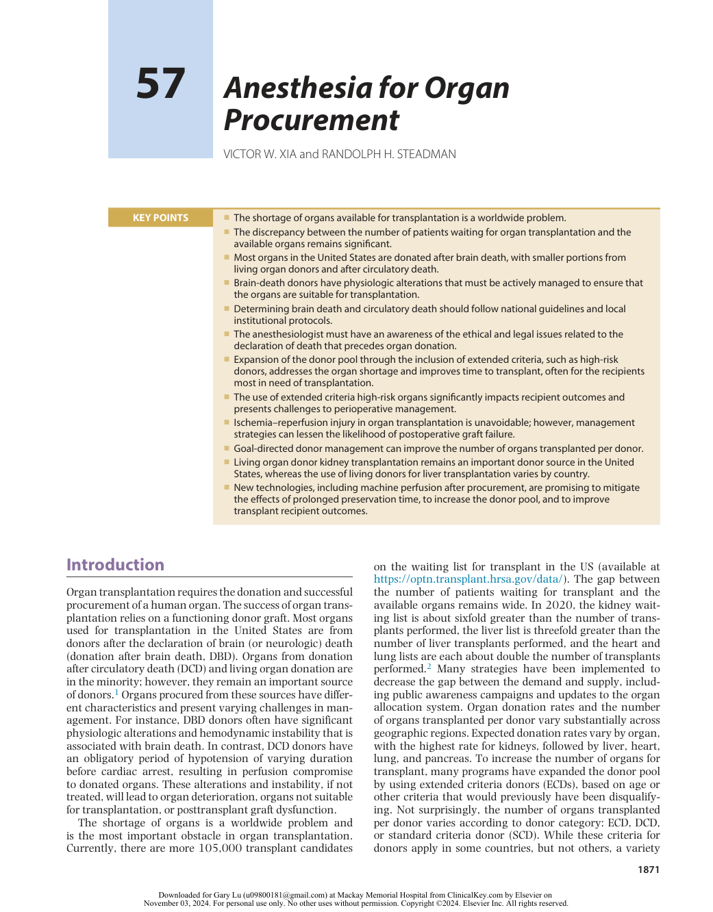
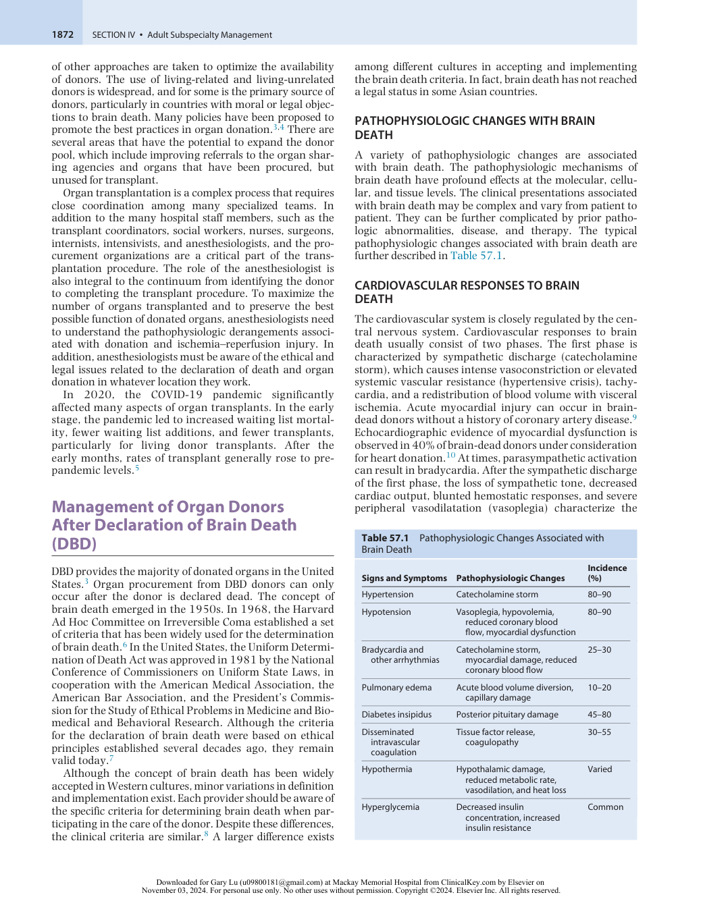
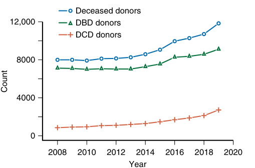
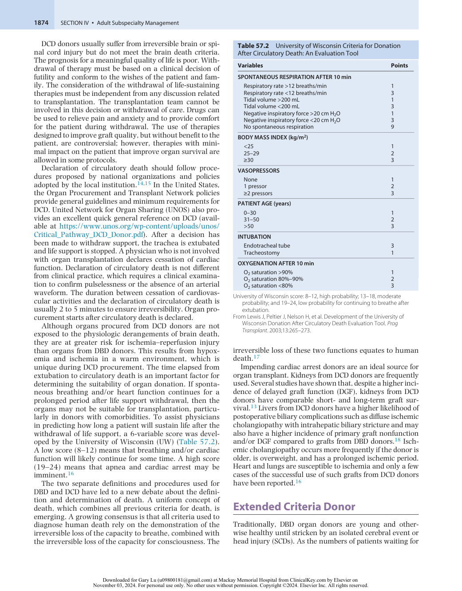
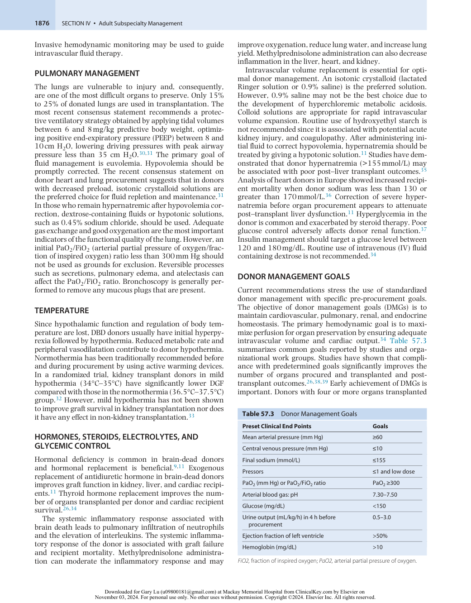
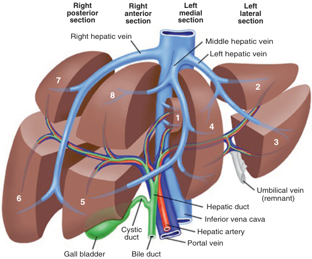
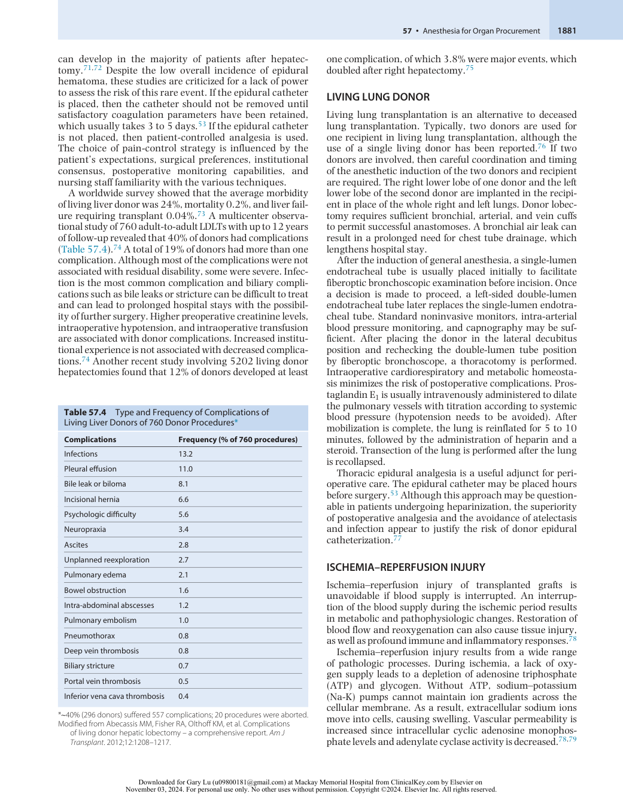
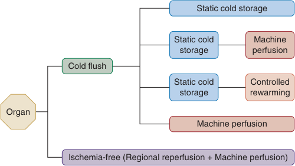

# Anesthesia for Organ Procurement

<!-- PDF page 1 -->

VICTOR W. XIA and RANDOLPH H. STEADMAN

|**KEY POINTS**|ᑏThe shortage of organs available for transplantation is a worldwide problem.|
|---|---|
||ᑏThe discrepancy between the number of patients waiting for organ transplantation and the available organs remains significant.|
||ᑏMost organs in the United States are donated after brain death, with smaller portions from living organ donors and after circulatory death.|
||ᑏBrain- death donors have physiologic alterations that must be actively managed to ensure that the organs are suitable for transplantation.|
||ᑏDetermining brain death and circulatory death should follow national guidelines and local institutional protocols.|
||ᑏThe anesthesiologist must have an awareness of the ethical and legal issues related to the declaration of death that precedes organ donation.|
||ᑏExpansion of the donor pool through the inclusion of extended criteria, such as high- risk donors, addresses the organ shortage and improves time to transplant, often for the recipients most in need of transplantation.|
||ᑏThe use of extended criteria high- risk organs significantly impacts recipient outcomes and presents challenges to perioperative management.|
||ᑏIschemia–reperfusion injury in organ transplantation is unavoidable; however, management strategies can lessen the likelihood of postoperative graft failure.|
||ᑏGoal- directed donor management can improve the number of organs transplanted per donor. ᑏLiving organ donor kidney transplantation remains an important donor source in the United States, whereas the use of living donors for liver transplantation varies by country. ᑏNew technologies, including machine perfusion after procurement, are promising to mitigate the effects of prolonged preservation time, to increase the donor pool, and to improve transplant recipient outcomes.|

## Introduction

Organ transplantation requires the donation and successful procurement of a human organ. The success of organ transplantation relies on a functioning donor graft. Most organs used for transplantation in the United States are from donors after the declaration of brain (or neurologic) death (donation after brain death, DBD). Organs from donation after circulatory death (DCD) and living organ donation are in the minority; however, they remain an important source of donors.1 Organs procured from these sources have different characteristics and present varying challenges in management. For instance, DBD donors often have significant physiologic alterations and hemodynamic instability that is associated with brain death. In contrast, DCD donors have an obligatory period of hypotension of varying duration before cardiac arrest, resulting in perfusion compromise to donated organs. These alterations and instability, if not treated, will lead to organ deterioration, organs not suitable for transplantation, or posttransplant graft dysfunction.

The shortage of organs is a worldwide problem and is the most important obstacle in organ transplantation. Currently, there are more 105,000 transplant candidates

on the waiting list for transplant in the US (available at https://optn.transplant.hrsa.gov/data/). The gap between the number of patients waiting for transplant and the available organs remains wide. In 2020, the kidney waiting list is about sixfold greater than the number of transplants performed, the liver list is threefold greater than the number of liver transplants performed, and the heart and lung lists are each about double the number of transplants performed.2 Many strategies have been implemented to decrease the gap between the demand and supply, including public awareness campaigns and updates to the organ allocation system. Organ donation rates and the number of organs transplanted per donor vary substantially across geographic regions. Expected donation rates vary by organ, with the highest rate for kidneys, followed by liver, heart, lung, and pancreas. To increase the number of organs for transplant, many programs have expanded the donor pool by using extended criteria donors (ECDs), based on age or other criteria that would previously have been disqualifying. Not surprisingly, the number of organs transplanted per donor varies according to donor category: ECD, DCD, or standard criteria donor (SCD). While these criteria for donors apply in some countries, but not others, a variety

::: details 原始表格與符號（PDF 第 1 頁）

:::

<!-- PDF page 2 -->

of other approaches are taken to optimize the availability of donors. The use of living- related and living- unrelated donors is widespread, and for some is the primary source of donors, particularly in countries with moral or legal objections to brain death. Many policies have been proposed to promote the best practices in organ donation.3,4 There are several areas that have the potential to expand the donor pool, which include improving referrals to the organ sharing agencies and organs that have been procured, but unused for transplant.

Organ transplantation is a complex process that requires close coordination among many specialized teams. In addition to the many hospital staff members, such as the transplant coordinators, social workers, nurses, surgeons, internists, intensivists, and anesthesiologists, and the procurement organizations are a critical part of the transplantation procedure. The role of the anesthesiologist is also integral to the continuum from identifying the donor to completing the transplant procedure. To maximize the number of organs transplanted and to preserve the best possible function of donated organs, anesthesiologists need to understand the pathophysiologic derangements associated with donation and ischemia–reperfusion injury. In addition, anesthesiologists must be aware of the ethical and legal issues related to the declaration of death and organ donation in whatever location they work.

In 2020, the COVID- 19 pandemic significantly affected many aspects of organ transplants. In the early stage, the pandemic led to increased waiting list mortality, fewer waiting list additions, and fewer transplants, particularly for living donor transplants. After the early months, rates of transplant generally rose to prepandemic levels.5

## Management of Organ Donors After Declaration of Brain Death (DBD)

DBD provides the majority of donated organs in the United States.3 Organ procurement from DBD donors can only occur after the donor is declared dead. The concept of brain death emerged in the 1950s. In 1968, the Harvard Ad Hoc Committee on Irreversible Coma established a set of criteria that has been widely used for the determination of brain death.6 In the United States, the Uniform Determination of Death Act was approved in 1981 by the National Conference of Commissioners on Uniform State Laws, in cooperation with the American Medical Association, the American Bar Association, and the President’s Commission for the Study of Ethical Problems in Medicine and Biomedical and Behavioral Research. Although the criteria for the declaration of brain death were based on ethical principles established several decades ago, they remain valid today.7

Although the concept of brain death has been widely accepted in Western cultures, minor variations in definition and implementation exist. Each provider should be aware of the specific criteria for determining brain death when participating in the care of the donor. Despite these differences, the clinical criteria are similar.8 A larger difference exists

among different cultures in accepting and implementing the brain death criteria. In fact, brain death has not reached a legal status in some Asian countries.

### PATHOPHYSIOLOGIC CHANGES WITH BRAIN DEATH

A variety of pathophysiologic changes are associated with brain death. The pathophysiologic mechanisms of brain death have profound effects at the molecular, cellular, and tissue levels. The clinical presentations associated with brain death may be complex and vary from patient to patient. They can be further complicated by prior pathologic abnormalities, disease, and therapy. The typical pathophysiologic changes associated with brain death are further described in Table 57.1.

### CARDIOVASCULAR RESPONSES TO BRAIN DEATH

The cardiovascular system is closely regulated by the central nervous system. Cardiovascular responses to brain death usually consist of two phases. The first phase is characterized by sympathetic discharge (catecholamine storm), which causes intense vasoconstriction or elevated systemic vascular resistance (hypertensive crisis), tachycardia, and a redistribution of blood volume with visceral ischemia. Acute myocardial injury can occur in braindead donors without a history of coronary artery disease.9 Echocardiographic evidence of myocardial dysfunction is observed in 40% of brain- dead donors under consideration for heart donation.10 At times, parasympathetic activation can result in bradycardia. After the sympathetic discharge of the first phase, the loss of sympathetic tone, decreased cardiac output, blunted hemostatic responses, and severe peripheral vasodilatation (vasoplegia) characterize the

**Table 57.1** Pathophysiologic Changes Associated with Brain Death

|**Signs and Symptoms**|**Pathophysiologic Changes**|**Incidence** **(%)**|
|---|---|---|
|Hypertension|Catecholamine storm|80–90|
|Hypotension|Vasoplegia, hypovolemia, reduced coronary blood flow, myocardial dysfunction|80–90|
|Bradycardia and other arrhythmias|Catecholamine storm, myocardial damage, reduced coronary blood flow|25–30|
|Pulmonary edema|Acute blood volume diversion, capillary damage|10–20|
|Diabetes insipidus|Posterior pituitary damage|45–80|
|Disseminated intravascular coagulation|Tissue factor release, coagulopathy|30–55|
|Hypothermia|Hypothalamic damage, reduced metabolic rate, vasodilation, and heat loss|Varied|
|Hyperglycemia|Decreased insulin concentration, increased insulin resistance|Common|

::: details 原始表格與符號（PDF 第 2 頁）

:::

<!-- PDF page 3 -->

second phase. In addition to neurohormonal disturbances, other contributing factors include blood loss, intravascular depletion attributable to capillary leakage, osmotic therapy for rising intracranial pressure (ICP), and diabetes insipidus.

The first phase is correlated with ischemia in various parts of the brain and is attributable to an increase of ICP, and the second phase is caused by cerebral herniation and spinal cord ischemia. Although the first hypertensive phase generally represents a transient period in the progression to brain death, the second hypotensive phase is profound and sustained. Failure to correct these cardiovascular derangements results in poor organ perfusion and inadequate tissue oxygenation, which will threaten the viability of the donated organs.

### RESPIRATORY RESPONSES TO BRAIN DEATH

An increase in systemic vascular resistance after brain death results in blood shifting from the systemic circulation to the more compliant pulmonary circulation. The resulting increase in hydrostatic pressure in the pulmonary circulation causes pulmonary capillary leakage and pulmonary edema. Sympathetic activity triggers a sterile systemic inflammatory response, initiating infiltration of neutrophils and increasing pulmonary endothelial permeability, which further contributes to lung injury. Proinflammatory cytokines are released at the alveoli and are associated with early graft failure and mortality after lung transplantation. The inflammatory response in brain- dead donors is associated with the deterioration in cardiac function and a shift to anaerobic metabolism. Hormonal instability can reduce alveolar fluid clearance, resulting in significant accumulation of extravascular lung water. If ventilation is not supported, then respiration progresses to apnea and resultant cardiac arrest.11,12

### ENDOCRINE, METABOLIC, AND STRESS RESPONSES TO BRAIN DEATH

Brain death is frequently associated with pituitary failure and disturbances of cortisol, thyroid hormones, antidiuretic hormone, and insulin. Posterior pituitary function in braindead donors is frequently lost. The development of central diabetes insipidus results in severe fluid and electrolyte derangements and can be observed in up to 90% of braindead donors.11 Anterior pituitary function in brain death can also be affected, resulting in a deficiency in triiodothyronine (T3) and thyroxine (T4), adrenocorticotropic hormone, thyroid- stimulating hormone, and human growth hormone. Thyroid hormonal deficiency may be similar to the euthyroid sick syndrome commonly observed in the non- neurologic injured patient with multisystem organ failure. Hyperglycemia is commonly encountered in braindead donors because of decreased insulin concentrations and increased insulin resistance. Hypothalamic function and control of body temperature are lost. Although hyperpyrexia may initially occur, hypothermia follows, which is caused by a reduction in metabolic rate and muscle activity, in combination with peripheral vasodilation. Disseminated intravascular coagulation is present in up to one- third of isolated patients with head injuries and is believed to be

caused by the release of tissue thromboplastin from brain tissue.12

## Donation After Circulatory (Cardiac) Death (DCD)

Before the acceptance of brain death, all organs procured were from donors who suffered a cardiac demise (DCD, previously known as donation from a non- heart- beating donor). After the establishment of the Harvard criteria for brain death, DBD quickly became the principal source of organ donation. However, the persistent shortage of DBD donors and the lack of acceptance of brain death in some countries have led to an increase in DCD donors. Policies and protocols developed by health care organizations now encourage DCD organs, and their use is increasing in the United States and other countries. In the United States, the number of DCD donors continues to increase, and accounted for 30.2% of deceased donors in 2021 (https://optn. transplant.hrsa.gov/data/) (Fig. 57.1).

DCD donors are divided into four categories defined in the original Maastricht classification: I, patients who are dead on arrival at the hospital; II, unsuccessfully resuscitated patients; III, patients in whom cardiac arrest is imminent; IV, cardiac arrest in brain- dead donors. Although there are many attempts on modifications and refinements in recent years, the four categories remain. Categories I and II are considered as uncontrolled and categories III and IV are considered as controlled. Controlled DCD implies that life- support withdrawal can be planned, and the transplant team is awaiting the cardiac arrest and is ready for rapid organ recovery. In contrast, uncontrolled DCD implies the patient has experienced an unanticipated cardiac arrest, and organ donation is considered only after an unsuccessful resuscitation. Warm ischemia time is significantly longer in uncontrolled DCDs. Currently, most DCD donors for organ transplantation are controlled DCD donors; however, successful use of the uncontrolled DCD grafts has been reported in several studies.13

Deceased donors 12,000 DBD donors DCD donors 8000 4000 0 2008 2010 2012 2014 2016 2018 2020 Year Count 

**Fig. 57.1 Overall counts of deceased donors, DBD donors, and DCD donors, 2009–2020.** _DBD_ , donation after brain death; _DCD_ , donation after circulatory death. (From Israni AK, Zaun D, Gauntt K, et al. OPTN / SRTR 2020 Annual Data Report: Deceased organ donation. _Am J Transplant._ 2022; 22 suppl 2:519–552 or https://srtr.transplant.hrsa.gov/annual_ reports/2020/Deceased%20Organ%20Donation.aspx.)

<!-- PDF page 4 -->

DCD donors usually suffer from irreversible brain or spinal cord injury but do not meet the brain death criteria. The prognosis for a meaningful quality of life is poor. Withdrawal of therapy must be based on a clinical decision of futility and conform to the wishes of the patient and family. The consideration of the withdrawal of life- sustaining therapies must be independent from any discussion related to transplantation. The transplantation team cannot be involved in this decision or withdrawal of care. Drugs can be used to relieve pain and anxiety and to provide comfort for the patient during withdrawal. The use of therapies designed to improve graft quality, but without benefit to the patient, are controversial; however, therapies with minimal impact on the patient that improve organ survival are allowed in some protocols.

Declaration of circulatory death should follow procedures proposed by national organizations and policies adopted by the local institution.14,15 In the United States, the Organ Procurement and Transplant Network policies provide general guidelines and minimum requirements for DCD. United Network for Organ Sharing (UNOS) also provides an excellent quick general reference on DCD (available at https://www.unos.org/wp- content/uploads/unos/ Critical_Pathway_DCD_Donor.pdf). After a decision has been made to withdraw support, the trachea is extubated and life support is stopped. A physician who is not involved with organ transplantation declares cessation of cardiac function. Declaration of circulatory death is not different from clinical practice, which requires a clinical examination to confirm pulselessness or the absence of an arterial waveform. The duration between cessation of cardiovascular activities and the declaration of circulatory death is usually 2 to 5 minutes to ensure irreversibility. Organ procurement starts after circulatory death is declared.

Although organs procured from DCD donors are not exposed to the physiologic derangements of brain death, they are at greater risk for ischemia–reperfusion injury than organs from DBD donors. This results from hypoxemia and ischemia in a warm environment, which is unique during DCD procurement. The time elapsed from extubation to circulatory death is an important factor for determining the suitability of organ donation. If spontaneous breathing and/or heart function continues for a prolonged period after life support withdrawal, then the organs may not be suitable for transplantation, particularly in donors with comorbidities. To assist physicians in predicting how long a patient will sustain life after the withdrawal of life support, a 6- variable score was developed by the University of Wisconsin (UW) (Table 57.2). A low score (8–12) means that breathing and/or cardiac function will likely continue for some time. A high score (19–24) means that apnea and cardiac arrest may be imminent.16

The two separate definitions and procedures used for DBD and DCD have led to a new debate about the definition and determination of death. A uniform concept of death, which combines all previous criteria for death, is emerging. A growing consensus is that all criteria used to diagnose human death rely on the demonstration of the irreversible loss of the capacity to breathe, combined with the irreversible loss of the capacity for consciousness. The

**Table 57.2** University of Wisconsin Criteria for Donation After Circulatory Death: An Evaluation Tool

|**Variables**|**Points**|
|---|---|
|**SPONTANEOUS RESPIRATION AFTER 10 min**||
|Respiratory rate >12 breaths/min|1|
|Respiratory rate &lt;12 breaths/min|3|
|Tidal volume >200 mL|1|
|Tidal volume &lt;200 mL|3|
|Negative inspiratory force >20 cm H2O|1|
|Negative inspiratory force &lt;20 cm H2O|3|
|No spontaneous respiration|9|
|**BODY MASS INDEX (kg/m**2**)**||
|&lt;25|1|
|25–29|2|
|≥30|3|
|**VASOPRESSORS**||
|None|1|
|1 pressor|2|
|≥2 pressors|3|
|**PATIENT AGE (years)**||
|0–30|1|
|31–50|2|
|>50|3|
|**INTUBATION**||
|Endotracheal tube|3|
|Tracheostomy|1|
|**OXYGENATION AFTER 10 min**||
|O2saturation >90%|1|
|O2saturation 80%–90%|2|
|O2saturation &lt;80%|3|

University of Wisconsin score: 8–12, high probability; 13–18, moderate probability; and 19–24, low probability for continuing to breathe after extubation.

From Lewis J, Peltier J, Nelson H, et al. Development of the University of Wisconsin Donation After Circulatory Death Evaluation Tool. _Prog Transplant_ . 2003;13:265–273.

irreversible loss of these two functions equates to human death.17

Impending cardiac arrest donors are an ideal source for organ transplant. Kidneys from DCD donors are frequently used. Several studies have shown that, despite a higher incidence of delayed graft function (DGF), kidneys from DCD donors have comparable short- and long- term graft survival.13 Livers from DCD donors have a higher likelihood of postoperative biliary complications such as diffuse ischemic cholangiopathy with intrahepatic biliary stricture and may also have a higher incidence of primary graft nonfunction and/or DGF compared to grafts from DBD donors.18 Ischemic cholangiopathy occurs more frequently if the donor is older, is overweight, and has a prolonged ischemic period. Heart and lungs are susceptible to ischemia and only a few cases of the successful use of such grafts from DCD donors have been reported.16

## Extended Criteria Donor

Traditionally, DBD organ donors are young and otherwise healthy until stricken by an isolated cerebral event or head injury (SCDs). As the numbers of patients waiting for

::: details 原始表格與符號（PDF 第 4 頁）

:::

<!-- PDF page 5 -->

transplant increase, many centers have extended donor criteria to minimize waiting list mortality of potential recipients. Many terms, including suboptimal donor, marginal donor, inferior donor, nonstandard donor, and high- risk donor, have been used.19 The criteria that make up the ECD group are more elusive and evolving. Donor characteristics of ECDs vary from organ to organ but generally include advanced age, prolonged cold ischemia time, inferior organ function, and other comorbidities.19,20 However, donor risk is a relative term and should be best described as a continuum, not a dichotomy of SCD and ECD. Therefore, the donor risk index (DRI) has been developed to assist in the evaluation.

The kidney DRI has been developed using 10 donor characteristics (Box 57.1).21 The kidney DRI can be converted into the kidney donor profile index (scale 1%–100%). A higher kidney donor profile index indicates a higher graft failure rate. The DRI has been defined for liver grafts. DRI is a quantitative assessment of the risk of graft failure associated with the donor. Liver DRI is calculated from eight donor characteristics (Box 57.2).22 Despite an increased risk of graft failure, moderate- to high- acuity transplant candidates who receive a high DRI graft have a survival benefit compared with those remaining on the waiting list.23 Calculation of the DRI can help physicians make a decision to accept or reject a donor offer; however, the calculation requires a projected cold ischemia time.

The use of ECD or high- risk DRI grafts has implications on intraoperative management. In a study of liver transplantation, several donor characteristics are associated with a high incidence of intraoperative hyperkalemia in

### Box 57.1 Kidney Donor Profile Index

The following donor characteristics are used to calculate the kidney donor profile index: Age Height Weight Ethnicity History of hypertension History of diabetes Cause of death Serum creatinine Hepatitis C virus status Donation after circulatory death status

From https://optn.transplant.hrsa.gov/resources/allocationcalculators/kdpi- calculator.

### Box 57.2 Liver Donor Risk Index

Age (four categories): >40, >50, >60, >70 years Cause of death (two categories): cerebrovascular accident (lower risk) versus other Race: African-American (higher risk) versus other Donation after circulatory death: yes or no Partial or split graft: yes or no Height: increasing risk as height decreases below 170 cm Regional or national share: yes or no Cold ischemia time

adults: DCD grafts, prolonged ischemia time, and prolonged donor hospital stay before procurement.24 ECD liver grafts are also associated with postreperfusion syndrome, intraoperative bleeding, and postoperative reoperation.25

## Management of Organ Donors Before Procurement

As previously discussed, various physiologic derangements are common in DBD donors. If not treated, these derangements can lead to graft deterioration, resulting in organs unsuitable for transplantation. A discussion of treatment strategies follows.

### CARDIOVASCULAR MANAGEMENT

Although both hypertension and hypotension are associated with brain death and can result in poor perfusion to the organs, hypotension is more profound and difficult to treat. Maintaining adequate intravascular volume is probably the most effective therapy for vasoplegia. No evidence demonstrates that a specific crystalloid solution is superior to another. Adequate resuscitation, as evidenced by a mean arterial pressure of 60 to 100 mm Hg, may decrease cytokine levels and increase the number of organs available for transplantation.26 Large doses of starch- based colloids should be avoided because they may be associated with DGF.27

When hemodynamic stabilization is not achieved with fluid resuscitation, vasoactive drugs should be considered. Dopamine has been traditionally used in this setting; however, high- quality data are lacking. Norepinephrine is another vasoactive agent increasingly used in some countries despite conflicting results on its dosage and outcomes.28 Vasopressin is recommended as the initial therapy of choice for potential heart donors by the American College of Cardiology.29 Vasopressin reduces catecholamine requirements and is an effective treatment for diabetes insipidus.

For a potential heart donor, cardiac function should be assessed, with early interventions to improve the graft utilization rate. Echocardiography is useful since it can identify both functional and structural abnormalities. Functional abnormalities identified in the early stage can be managed before heart transplantation, whereas structural abnormalities may preclude transplantation. Coronary angiography is useful in older donors with suspected or known coronary artery disease. Myocardial damage caused by catecholamine storm may be prevented or attenuated by controlling cardiovascular responses, which may increase the number of heart transplants.12 Excessive intravascular fluid therapy may have detrimental effects and should be avoided in lung donors. Fluid restriction increases the number of lung grafts available for transplantation.11 Because this practice creates a conflict of interest on the basis of which organs will be procured, particularly between the lungs and kidneys, fluid management should be balanced to optimize overall donation potential.11 The goal is to maintain a euvolemic state and to maintain arterial blood pressure and cardiac output with the least amount of vasoactive support possible.

<!-- PDF page 6 -->

Invasive hemodynamic monitoring may be used to guide intravascular fluid therapy.

### PULMONARY MANAGEMENT

The lungs are vulnerable to injury and, consequently, are one of the most difficult organs to preserve. Only 15% to 25% of donated lungs are used in transplantation. The most recent consensus statement recommends a protective ventilatory strategy obtained by applying tidal volumes between 6 and 8 mg/kg predictive body weight, optimizing positive end-expiratory pressure (PEEP) between 8 and 10 cm H2O, lowering driving pressures with peak airway pressure less than 35 cm H2O.30,31 The primary goal of fluid management is euvolemia. Hypovolemia should be promptly corrected. The recent consensus statement on donor heart and lung procurement suggests that in donors with decreased preload, isotonic crystalloid solutions are the preferred choice for fluid repletion and maintenance.31 In those who remain hypernatremic after hypovolemia correction, dextrose- containing fluids or hypotonic solutions, such as 0.45% sodium chloride, should be used. Adequate gas exchange and good oxygenation are the most important indicators of the functional quality of the lung. However, an initial PaO2/FiO2 (arterial partial pressure of oxygen/fraction of inspired oxygen) ratio less than 300 mm Hg should not be used as grounds for exclusion. Reversible processes such as secretions, pulmonary edema, and atelectasis can affect the PaO2/FiO2 ratio. Bronchoscopy is generally performed to remove any mucous plugs that are present.

### TEMPERATURE

Since hypothalamic function and regulation of body temperature are lost, DBD donors usually have initial hyperpyrexia followed by hypothermia. Reduced metabolic rate and peripheral vasodilatation contribute to donor hypothermia. Normothermia has been traditionally recommended before and during procurement by using active warming devices. In a randomized trial, kidney transplant donors in mild hypothermia (34°C–35°C) have significantly lower DGF compared with those in the normothermia (36.5°C–37.5°C) group.32 However, mild hypothermia has not been shown to improve graft survival in kidney transplantation nor does it have any effect in non- kidney transplantation.33

### HORMONES, STEROIDS, ELECTROLYTES, AND GLYCEMIC CONTROL

Hormonal deficiency is common in brain- dead donors and hormonal replacement is beneficial.9,11 Exogenous replacement of antidiuretic hormone in brain- dead donors improves graft function in kidney, liver, and cardiac recipients.11 Thyroid hormone replacement improves the number of organs transplanted per donor and cardiac recipient survival.26,34

The systemic inflammatory response associated with brain death leads to pulmonary infiltration of neutrophils and the elevation of interleukins. The systemic inflammatory response of the donor is associated with graft failure and recipient mortality. Methylprednisolone administration can moderate the inflammatory response and may

improve oxygenation, reduce lung water, and increase lung yield. Methylprednisolone administration can also decrease inflammation in the liver, heart, and kidney.

Intravascular volume replacement is essential for optimal donor management. An isotonic crystalloid (lactated Ringer solution or 0.9% saline) is the preferred solution. However, 0.9% saline may not be the best choice due to the development of hyperchloremic metabolic acidosis. Colloid solutions are appropriate for rapid intravascular volume expansion. Routine use of hydroxyethyl starch is not recommended since it is associated with potential acute kidney injury, and coagulopathy. After administering initial fluid to correct hypovolemia, hypernatremia should be treated by giving a hypotonic solution.11 Studies have demonstrated that donor hypernatremia (>155 mmol/L) may be associated with poor post–liver transplant outcomes.35 Analysis of heart donors in Europe showed increased recipient mortality when donor sodium was less than 130 or greater than 170 mmol/L.36 Correction of severe hypernatremia before organ procurement appears to attenuate post–transplant liver dysfunction.11 Hyperglycemia in the donor is common and exacerbated by steroid therapy. Poor glucose control adversely affects donor renal function.37 Insulin management should target a glucose level between 120 and 180 mg/dL. Routine use of intravenous (IV) fluid containing dextrose is not recommended.34

### DONOR MANAGEMENT GOALS

Current recommendations stress the use of standardized donor management with specific pre- procurement goals. The objective of donor management goals (DMGs) is to maintain cardiovascular, pulmonary, renal, and endocrine homeostasis. The primary hemodynamic goal is to maximize perfusion for organ preservation by ensuring adequate intravascular volume and cardiac output.34 Table 57.3 summarizes common goals reported by studies and organizational work groups. Studies have shown that compliance with predetermined goals significantly improves the number of organs procured and transplanted and posttransplant outcomes.26,38,39 Early achievement of DMGs is important. Donors with four or more organs transplanted

**Table 57.3** Donor Management Goals

|**Preset Clinical End Points**|**Goals**|
|---|---|
|Mean arterial pressure (mm Hg)|≥60|
|Central venous pressure (mm Hg)|≤10|
|Final sodium (mmol/L)|≤155|
|Pressors|≤1 and low dose|
|PaO2(mm Hg) or PaO2/FiO2ratio|PaO2 ≥300|
|Arterial blood gas: pH|7.30–7.50|
|Glucose (mg/dL)|&lt;150|
|Urine output (mL/kg/h) in 4 h before procurement|0.5–3.0|
|Ejection fraction of left ventricle|>50%|
|Hemoglobin (mg/dL)|>10|

_FiO2,_ fraction of inspired oxygen; _PaO2,_ arterial partial pressure of oxygen.

::: details 原始表格與符號（PDF 第 6 頁）

:::

<!-- PDF page 7 -->

per donor have significantly more individual DMGs met at the time of consent. Efforts should focus on early management in patients with catastrophic brain injury until the intent to donate is known.40 One study showed that only 15% of donors met DMGs at the time of consent, although the rate was higher immediately before organ procurement. Recently, some suggest establishing the centralized organ recovery and reconditioning centers to improve efficiency, organ yield, and outcomes with decreased cost.41

## Management of Donors After Circulatory Death

Most DCD donors are patients in controlled categories. To minimize warm ischemia time, life support is usually withdrawn in the operating room suite. However, the family’s desire to be present has led some institutions to withdraw life support in other nearby locations. The procurement team should not take part in patient management before a determination of irreversible death, which includes the period during which withdrawal of support and declaration of death occur. The administration of pharmacologic drugs for the purpose of maximizing donation potential, particularly therapies capable of hastening death, is controversial. However, narcotics and benzodiazepines are commonly continued and can be titrated to blunt sympathetic responses. Premortem administration of heparin can facilitate organ procurement but, because of the bleeding risk, is omitted in some institutional policies. Most protocols require specific consent for premortem donor therapy.

Invasive premortem techniques for reducing warm ischemia time have been described. These include cannulation of the femoral artery and vein before the withdrawal of life support, which allows rapid infusion of cold preservation solution after the declaration of death. These cannulas can also be used for extracorporeal membrane oxygenation (ECMO) after death. However, the postmortem use of ECMO to restore the blood flow to vital organs generates vigorous debate, which highlights the ongoing ethical questions in donor management – the need to protect the best interest of the dying patient, while facilitating his or her wish to donate.42

## Management of Organ Donor During Procurement Surgery

Anesthesia care for organ procurement is required only in the case of brain- dead donors. The majority of organ procurement occurs at community hospitals, not tertiary medical centers. As a result, the logistics of organ procurement, the social circumstances, and the unusual sequence of intraoperative events may seem intimidating to the anesthesiologist.

Surgical techniques may vary, depending on whether single or multiple organs are procured. Generally, wide exposure of the surgical field is established via a midline laparotomy extended by sternotomy. A cannula is placed in the aorta to flush the organs with the cold preservation solution. Ice is applied to the surgical field to further protect the organs. The organs are removed with their vascular

structures after isolation in an order according to their susceptibility to ischemia, with the heart first and the kidney last.

Most donors arrive in the operating room with an endotracheal tube in place and supported by the IV administration of vasoactive drugs. During procurement surgery, patients can have movements resulting from spinal reflexes; therefore, neuromuscular blockers are desirable. Spontaneous spinal reflex or surgical stimulation can cause catecholamine release and hypertension. Hypertension can be managed by a number of drugs including vasodilators, opioids, and anesthetics; however, volatile anesthetics are commonly preferred, since they may provide additional benefits that include ischemic preconditioning and the reduction of ischemia–reperfusion injury.43

The intravascular administration of fluids and vasoactive drugs can treat blood loss and cardiovascular instability caused by surgical manipulation. Maintaining hemodynamic stability minimizes further damage to the organs. Vasodilators such as phentolamine or alprostadil (for lung recovery) may be administered during cross- clamping with the goal of decreasing systemic vascular resistance and allowing an even distribution of preservation solution. Clinically significant bradycardia in brain- dead donors does not respond to atropine; therefore, a direct- acting chronotrope such as isoproterenol should be readily available. Heparin is usually administered before cross- clamping the aorta. If recovery of the heart or lung is anticipated, then pulmonary artery catheters and/or central venous pressure (CVP) catheters need to be withdrawn before cross- clamping. If lung recovery is anticipated, then the lungs are ventilated well beyond crossclamping. Communication between the surgical team and the anesthesiologist is crucial to ensure optimal organ quality. As soon as the organs are perfused with the cold solution, mechanical ventilation and anesthesia care can be stopped.

## Management of Living Organ Donors

Living donor organ transplantation has been successfully used as an alternative to deceased donor transplantation. In the United States the number of living donor organ transplants has remained flat since 2011.3 In some Asian countries such as Japan and Korea, living donor transplantation is a standard procedure since DBD is unusual because of cultural beliefs in these countries. Living donor organ transplantation has some advantages. The procedure can be scheduled as elective surgery at the same facility, which allows donor and recipient surgeries to be coordinated and the cold ischemia time to be minimized. Additionally, the graft is not exposed to the physiologic alterations associated with DBD or DCD donors. Living donors direct their donation to a specific recipient; therefore, the timing of the transplant can be optimized for the recipient, and prolonged waiting times associated with deceased donor transplantation are typically avoided. Although living organ transplantation has its advantages, it exposes healthy donors to medical risks. Additional concerns are potential decreased quality of life and an adverse financial impact after donation. The ethical aspect of living organ donation, particularly liver donation, continues to be vigorously scrutinized.44,45

<!-- PDF page 8 -->

Living donation should be preceded by a thorough medical, psychologic, and social evaluation that confirms the absence of contraindications and the lack of coercion. The informed consent includes full disclosure of possible complications and is facilitated by a patient advocate with no relationship to the recipient. In the past, donors were typically related to the prospective recipient. Now, living unrelated donors make up a greater proportion of living kidney transplants in the United States.1 Paired or chain donation allows two or more recipients with incompatible living donors to exchange donors, improving the graft match for both recipients. Similar to the expansion of deceased donor criteria, living donor criteria have been extended to include donors of advanced age and those with obesity.46 Living multiorgan donation from a single donor, either simultaneously or sequentially, although rare, has been reported. Careful selection of such donors, disclosure of risks, and close follow- up are needed.47

### LIVING KIDNEY DONOR

Because the kidney is a paired organ, it is a natural choice for living donation. The first successful kidney transplant was a living organ transplant performed between identical twins in 1954. Following a continuous growth since 2014, living donor kidney transplants peaked in 2019, when they accounted for approximately one- third of kidney transplants in the United States. Due to the COVID- 19 pandemic, living donor kidney transplants took a nearly complete pause in early 2020.1 Living donor kidney transplantation provides the optimized timing for transplant and can avoid pretransplant dialysis, which is associated with improved survival.48 In addition, living donor grafts provide better function and last longer than grafts from deceased donors.49 A wide range of medical and nonmedical factors need to be considered to ensure donor safety. To ensure a sufficient reserve after donation, many transplant centers use a glomerular filtration rate (GFR) greater than 80 mL/ min/1.73 m2 as a cutoff for donation. GFR is typically estimated by the measurement of urine creatinine clearance. If the estimated GFR is marginal, then radioactive and nonradioactive tracers can provide additional information.50 Some centers allow a lower GFR for donation.51

Traditionally, living kidney donor surgery was performed via open nephrectomy via a subcostal lateral incision. Now, it is commonly performed via laparoscopy. With this approach, donors experience less postoperative pain, a faster recovery, and a shorter hospital stay.51 Either the left or the right kidney can be used for transplant; however, the left kidney is usually preferred because of the easier surgical exposure and longer vascular supply. The right kidney has a short vein, and its artery courses posterior to the inferior vena cava.

The patient is placed in a lateral position with the table flexed and the kidney rest elevated. The surgical procedure begins with mobilization of the kidney with subsequent identification and dissection of the ureter, renal vein, and artery, and separation of the adrenal vein. When the right donor nephrectomy is performed, additional steps include duodenal mobilization and separation of the kidney from the liver. After mobilization of the kidney and clamping of the vascular structures, the kidney is retrieved through a small incision

by either a hand- assisted or non- hand- assisted technique. Donor nephrectomy can be performed via a transabdominal route but is increasingly accomplished via a retroperitoneal approach using minimally invasive techniques. The advantage of a retroperitoneal approach is less manipulation of intra- abdominal viscera. Single- incision donor nephrectomy has been described using uniquely designed devices. Recently, robotic- assisted laparoscopic living donor nephrectomy has been reported.51,52 This technique may further decrease the trauma and discomfort to the donor.

Anesthetic management of elective laparoscopic donor surgery on a healthy patient is similar to that used for elective laparoscopic nephrectomy. Standard noninvasive monitors are usually sufficient. One or two large- bore peripheral IV lines are usually placed. Transfusion of red blood cells is rare; however, type and screen, or type and cross for 1 to 2 units of blood, is routine practice in some centers in case of injury to major vessels. General anesthesia is required for laparoscopic nephrectomy and general anesthesia combined with epidural anesthesia is often used if open nephrectomy is planned.

Although laparoscopic nephrectomy on a healthy patient may be routine, some additional concerns apply to the donor organ and the donor beyond potential blood loss. High intraabdominal pressure reduces venous return and has been associated with postoperative renal dysfunction. Lower insufflation pressure may prevent compression of the renal veins and parenchyma.53 Adequate intravascular fluid administration appears to be the best strategy to preserve kidney function. Some advocate liberal fluid administration (10–20 mL/kg/h), although laparoscopic nephrectomy is typically associated with minimal blood loss. Others use urinary output as an indicator for fluid management. To ensure that the urinary output is greater than 2 mL/kg/h, fluid is usually given in excess of the physiologic need throughout the procedure. The surgeon may request the administration of furosemide and/or mannitol during the surgery for the purpose of increasing urine output. The preferred type of fluid for intravascular volume expansion during donor nephrectomy is not known. In the absence of evidence, most centers use an isotonic crystalloid solution. Nitrous oxide is best avoided because of a concern over bowel distention and poor surgical exposure. Intravenous heparin (3000–5000 international units [IU]) is often administered immediately before the renal vessels are clamped. Protocols may vary among institutions, and close communication with the transplant surgeon is essential. If hypotension occurs after adequate fluid replacement, then dopamine and ephedrine are preferable to direct- acting vasopressors to minimize vasoconstriction in the graft. After the kidney is retrieved, anesthesiologists should be prepared for a quick closure and ensure that neuromuscular blockade is reversed.

Mild or moderate pain after laparoscopic nephrectomy originates from the port insertion, the abdominal incision, pelvic organ manipulation, diaphragmatic irritation, and/ or ureteral colic. Postoperative pain can be easily managed in most patients with supplemental IV opioids in the early postoperative period and later with oral opioids and acetaminophen. Nonsteroidal anti- inflammatory drugs should be used with caution because of their potential prostaglandin- mediated adverse renal effects. Pain after open nephrectomy with subcostal lateral incision is severe and can last several days, which can limit the patient’s

<!-- PDF page 9 -->

efforts to breathe, cough, and move, leading to atelectasis and postoperative infection. Postoperative epidural analgesia should be considered for pain relief in these patients.

Postdonation complications reported to the Organ Procurement and Transplantation Network within 6 weeks of surgery include the need for blood transfusion (0.4%), readmission (2.1%), interventional procedures (0.9%), and reoperation (0.5%).54 A study of more than 80,000 living kidney donors showed a 90- day mortality of 3.1 per 10,000 donors (0.03%) and remains unchanged in the last 15 years.55 Pulmonary embolism occurred in 0.1% of donors and is the main cause of mortality.54 Kidney donors are at moderate risk for developing venous thromboembolism; therefore, intermittent pneumatic compression devices and prophylactic heparinization are recommended until ambulation. A decrease of approximately 30% in GFR can be expected after donation, and most donors will maintain a GFR greater than 60 mL/min at 3 months.51 Donor nephrectomy does not appear to increase long- term mortality or end- stage renal disease. Within the donor population, the likelihood of postdonation chronic kidney disease, hypertension, and diabetes is relatively higher among certain subgroups, such as African- American and obese donors, but the impact of unilateral nephrectomy on the lifetime risks of adverse events in these subgroups is unknown because the risks without nephrectomy have not been defined.54 It should be noted that all studies on postdonation complications are retrospective without long- term follow- ups and matched controls.

### LIVING LIVER DONOR

Living donor liver transplantation (LDLT) was first introduced in 1988 for pediatric recipients and later expanded to

adult recipients.56 Although LDLT is commonly performed in some Asian countries, it only consists of a small portion (6%) of overall liver transplants performed in the United States (https://optn.transplant.hrsa.gov/data/view- datareports/national- data/). The primary concern, that of harm to a healthy, altruistic donor, is greater in LDLT, compared with kidney donation.

The liver’s remarkable reserve, coupled with its unique capacity to regenerate, forms the basis for LDLT. After resection of as much as two- thirds of the liver, the donor’s liver regains its original size in 2 to 3 weeks.57 A portion of the adult liver (typically the left lobe or left lateral segment) transplanted to a pediatric recipient will grow with the recipient. Most LDLTs are electively performed in patients with chronic liver disease. Emergent LDLT is uncommon but is occasionally performed for acute liver failure. LDLT performed in recipients with very advanced disease generates considerable debate due to suboptimal outcome.

The determination of donor liver volume and anticipated graft size is unique to LDLT. Formulas using demographics, including body weight, height, age, and sex, have been developed. Methods using radiologic or ultrasonic measurements also have been proposed.58 Accurate estimation of donor liver volume and intended liver graft volume is critical to avoid small- for- size syndrome in the recipient and to preserve adequate remnant liver volume in the donor.59 For pediatric LDLTs, the left lateral segment (segments II and III) or a total left hepatic lobectomy (segments II, III, and IV) is generally enough to provide sufficient liver mass (Fig. 57.2). From a surgical point of view, a left hepatectomy is less complex, and the duration of surgery is shorter. Since the first report in 2002, more living donor left lobectomies are performed using laparoscopy.60 For adult- to- adult LDLT, right hepatic lobectomy is usually

Right Right Left Left posterior anterior medial lateral section section section section Right hepatic vein Middle hepatic vein Left hepatic vein 7 2 8 1 4 3 Umbilical vein 6 5 (remnant) Hepatic duct Inferior vena cava Cystic Hepatic artery duct Portal vein Gall bladder Bile duct 

**Fig. 57.2 Segmental liver anatomy illustrates the segments resected during various partial hepatectomies.** (Redrawn from Steadman RH, Braunfeld M, Park H. Liver and gastrointestinal physiology. In: Hemmings HC, Egan T, eds. _Pharmacology and Physiology in Anesthesia: Foundations and Clinical Applications_ . Philadelphia: Saunders; 2013:475–486.)

<!-- PDF page 10 -->

required. The surgical technique for right hepatectomy involves separation of the right hepatic lobes (segments V, VI, VII, and VIII) from the left. Compared with left hepatectomy, right hepatectomy is technically more challenging and associated with more perioperative risk. Right hepatectomy results in a graft weighing 500 to 1000 g, which leaves the donor with approximately one- third of the original liver mass. If one donor cannot provide sufficient liver mass, then a technique using two donors to one recipient has been reported.61 For a small recipient, the left lobe of a large donor organ may suffice.

Anesthetic management starts with a preoperative discussion with the donor patient and family that addresses the risks and concerns associated with the procedure. Most transplant programs provide extensive educational materials, discussion, and support, beginning well before the day of surgery. General anesthesia with neuromuscular blockade is required for living liver donation surgery. The patient is placed in a supine position and intraoperatively uses the reverse Trendelenburg position to facilitate the exposure of the liver. Two large- bore IV catheters are placed. Standard noninvasive monitors and arterial blood pressure monitoring are typically used. A nasogastric tube is placed for decompression of the stomach and surgical exposure. An L- shaped or standard bilateral subcostal incision with a midline extension is frequently used in living donor surgery. During mobilization of the liver and its vasculature, manipulation of the liver occasionally results in decreased venous return to the heart with episodes of hypotension. The return of the liver to its orthotopic position will relieve the venous obstruction; alternatively, administering short- acting vasoactive agents and/or a fluid bolus will generally treat the problem. Most blood loss occurs during transection of the liver parenchyma. With surgical devices specifically designed for hepatectomy, blood loss during living donor hepatectomy is significantly reduced. After the vasculature of the donor lobe is clamped and divided, the graft is removed, and the vasculature and bile duct are oversewn. The abdomen is closed after hemostasis is achieved.

Blood loss during hepatectomy is a major concern and is associated with adverse outcomes. Placement of the CVP catheter and the use of low CVP (&lt;5 cm H2O) technique are advocated in some centers to reduce blood loss and transfusion requirements.62 Low CVP reduces blood loss by increasing venous drainage from the hepatic sinusoids and decreasing blood backflow.62 In addition, low CVP may reduce graft edema and improve postoperative graft function.53 Low CVP is most often achieved by intravascular fluid restriction and sometimes by drugs, including diuretics and vasodilators.62 Others consider the placement of a CVP catheter and low CVP technique unnecessary during hepatic resection surgery because of the inability to demonstrate a relationship between CVP and blood loss.63 Other factors, including steatosis, body weight, and sex, may be more important than CVP in influencing blood loss during living donor hepatectomy.64 Potential drawbacks of the low CVP technique are the risk of CVP catheter placement and difficulty reversing hemodynamic disturbances in the event of massive bleeding. Others point out that the use of low CVP originates from early experience with

hepatectomy several decades ago, when blood loss was significant. With improved surgical techniques and equipment, blood loss during hepatectomy has been dramatically reduced, making CVP placement and monitoring unnecessary.63,65 Peripheral venous pressure measurements in the arm may be measured as an alternative to conventional CVP measurements.66

Several other blood- saving strategies have been used in living donor hepatectomy. These include cell salvage techniques and preoperative donation of 1 to 2 units of autologous blood, which reduces the chance of allogeneic blood transfusion. Intraoperative isovolemic hemodilution with retrieval of 1 to 2 units of blood in the surgical unit can minimize the likelihood of blood transfusion.67 The application of one or more of the blood- saving strategies previously listed is usually sufficient in the vast majority of patients.63 After the graft is removed, excessive intravascular volume should be avoided because it may impede venous return and result in congestion of the remnant liver.53

Most living liver donors can be extubated at the end of the procedure and transferred to the postoperative care unit. Discontinuation of mechanical ventilation reduces intrathoracic pressure, which reduces congestion in the remnant liver. Admission to the intensive care unit (ICU) is generally unnecessary but preferred in some institutions. Caution is required with the use of IV analgesics and opioids in the immediate postoperative period. The remnant liver is assumed to have some degree of insufficiency, although this assumption has not been thoroughly investigated.53 Optimal perfusion of the remnant liver is achieved by the maintenance of adequate cardiac output and an avoidance of hypovolemia, anemia, and hypothermia- induced coagulopathy.53

The use of epidural anesthesia for postoperative pain control in living donor surgery remains controversial. Similar to other upper abdominal surgery, postoperative epidural analgesia provides excellent pain control with less sedation, compared with IV patient- controlled analgesia.68 By facilitating pulmonary toilet, epidural analgesia reduces the risk of respiratory infections. Despite these advantages, preoperative placement of a thoracic epidural catheter is routinely performed in some transplant centers and is entirely avoided in others. The difference of practice originates from the development of postoperative coagulopathy in patients after donor hepatectomy. Postoperatively, thrombocytopenia occurs while the prothrombin and activated partial thrombin times are prolonged. These changes peak on postoperative day 2 to 3, followed by a steady trend toward normalization in the following days.69 Thus, concern over the potential development of an epidural hematoma is the basis for avoiding epidural catheter placement. Several studies examining the use of the epidural catheter in this population report no adverse effects. In a study of 755 donors who received an epidural catheter for postoperative pain management, no complications associated with the epidural catheter were reported.70 Another study including 242 living liver donors also showed that epidural analgesia seems to be a safe option when carefully used.69 Another piece of evidence supporting epidural placement is that hypercoagulability, not hypocoagulability measured by thromboelastography,

<!-- PDF page 11 -->

can develop in the majority of patients after hepatectomy.71,72 Despite the low overall incidence of epidural hematoma, these studies are criticized for a lack of power to assess the risk of this rare event. If the epidural catheter is placed, then the catheter should not be removed until satisfactory coagulation parameters have been retained, which usually takes 3 to 5 days.53 If the epidural catheter is not placed, then patient- controlled analgesia is used. The choice of pain- control strategy is influenced by the patient’s expectations, surgical preferences, institutional consensus, postoperative monitoring capabilities, and nursing staff familiarity with the various techniques.

A worldwide survey showed that the average morbidity of living liver donor was 24%, mortality 0.2%, and liver failure requiring transplant 0.04%.73 A multicenter observational study of 760 adult- to- adult LDLTs with up to 12 years of follow- up revealed that 40% of donors had complications (Table 57.4).74 A total of 19% of donors had more than one complication. Although most of the complications were not associated with residual disability, some were severe. Infection is the most common complication and biliary complications such as bile leaks or stricture can be difficult to treat and can lead to prolonged hospital stays with the possibility of further surgery. Higher preoperative creatinine levels, intraoperative hypotension, and intraoperative transfusion are associated with donor complications. Increased institutional experience is not associated with decreased complications.74 Another recent study involving 5202 living donor hepatectomies found that 12% of donors developed at least

**Table 57.4** Type and Frequency of Complications of Living Liver Donors of 760 Donor Procedures*

|**Complications**|**Frequency (% of 760 procedures)**|
|---|---|
|Infections|13.2|
|Pleural effusion|11.0|
|Bile leak or biloma|8.1|
|Incisional hernia|6.6|
|Psychologic difficulty|5.6|
|Neuropraxia|3.4|
|Ascites|2.8|
|Unplanned reexploration|2.7|
|Pulmonary edema|2.1|
|Bowel obstruction|1.6|
|Intra- abdominal abscesses|1.2|
|Pulmonary embolism|1.0|
|Pneumothorax|0.8|
|Deep vein thrombosis|0.8|
|Biliary stricture|0.7|
|Portal vein thrombosis|0.5|
|Inferior vena cava thrombosis|0.4|

*∼40% (296 donors) suffered 557 complications; 20 procedures were aborted. Modified from Abecassis MM, Fisher RA, Olthoff KM, et al. Complications of living donor hepatic lobectomy – a comprehensive report. _Am J Transplant_ . 2012;12:1208–1217.

one complication, of which 3.8% were major events, which doubled after right hepatectomy.75

### LIVING LUNG DONOR

Living lung transplantation is an alternative to deceased lung transplantation. Typically, two donors are used for one recipient in living lung transplantation, although the use of a single living donor has been reported.76 If two donors are involved, then careful coordination and timing of the anesthetic induction of the two donors and recipient are required. The right lower lobe of one donor and the left lower lobe of the second donor are implanted in the recipient in place of the whole right and left lungs. Donor lobectomy requires sufficient bronchial, arterial, and vein cuffs to permit successful anastomoses. A bronchial air leak can result in a prolonged need for chest tube drainage, which lengthens hospital stay.

After the induction of general anesthesia, a single- lumen endotracheal tube is usually placed initially to facilitate fiberoptic bronchoscopic examination before incision. Once a decision is made to proceed, a left- sided double- lumen endotracheal tube later replaces the single- lumen endotracheal tube. Standard noninvasive monitors, intra- arterial blood pressure monitoring, and capnography may be sufficient. After placing the donor in the lateral decubitus position and rechecking the double- lumen tube position by fiberoptic bronchoscope, a thoracotomy is performed. Intraoperative cardiorespiratory and metabolic homeostasis minimizes the risk of postoperative complications. Prostaglandin E1 is usually intravenously administered to dilate the pulmonary vessels with titration according to systemic blood pressure (hypotension needs to be avoided). After mobilization is complete, the lung is reinflated for 5 to 10 minutes, followed by the administration of heparin and a steroid. Transection of the lung is performed after the lung is recollapsed.

Thoracic epidural analgesia is a useful adjunct for perioperative care. The epidural catheter may be placed hours before surgery.53 Although this approach may be questionable in patients undergoing heparinization, the superiority of postoperative analgesia and the avoidance of atelectasis and infection appear to justify the risk of donor epidural catheterization.77

### ISCHEMIA–REPERFUSION INJURY

Ischemia–reperfusion injury of transplanted grafts is unavoidable if blood supply is interrupted. An interruption of the blood supply during the ischemic period results in metabolic and pathophysiologic changes. Restoration of blood flow and reoxygenation can also cause tissue injury, as well as profound immune and inflammatory responses.78

Ischemia–reperfusion injury results from a wide range of pathologic processes. During ischemia, a lack of oxygen supply leads to a depletion of adenosine triphosphate (ATP) and glycogen. Without ATP, sodium–potassium (Na- K) pumps cannot maintain ion gradients across the cellular membrane. As a result, extracellular sodium ions move into cells, causing swelling. Vascular permeability is increased since intracellular cyclic adenosine monophosphate levels and adenylate cyclase activity is decreased.78,79

::: details 原始表格與符號（PDF 第 11 頁）

:::

<!-- PDF page 12 -->

The restoration of the blood supply causes a series of pathophysiologic changes that lead to tissue injury. Reperfusionrelated injuries include necrosis, apoptosis (programmed death), and autophagy- associated cell death. Reperfusion also activates autoimmune responses including natural antibody recognition of neoantigens, activation of the complement system, activation of innate and adaptive immune responses, and cell migration to the affected area.

## Organ Preservation and Management After Procurement

After procurement, static cold storage by placing organs in a cold (4°C) solution until reperfusion remains a mainstream management. Among various cold- storage solutions, UW solution is most widely used. The UW solution contains high potassium and adenosine to supply ATP during cold storage. The potential for hyperkalemia during organ reperfusion (particularly with the liver) increases when the UW solution is used. However, the graft is typically flushed with colloid before reperfusion, regardless of the solution used, which decreases the likelihood of severe hyperkalemia. Another popular solution is histidine–tryptophan–ketoglutarate (HTK) solution, originally developed for cardioplegia and subsequently applied to organ preservation in Europe.80 Organ- specific solutions, such as Perfadex solution (manufactured by Vitrolife in Göteborg, Sweden) for the lung and Celsior solution (manufactured by Genzyme in Cambridge, MA) for the heart, are available. Although ischemia time should be minimized, a longer storage time allows transportation of the graft to the highest acuity patient. Generally accepted cold ischemia times during static cold preservation are 24 hours for the kidney, 12 hours for the liver, 6 hours for the heart, and 4 hours for the lung.

In addition to static cold storage, machine perfusion can be used to preserve procured organs. The potential advantages for machine perfusion techniques include a longer storage time, ability to assess the viability of organ, and potential therapeutic interventions to repair or salvage damaged grafts. Temperature during machine perfusion can be hypothermic (4°C–10°C), subnormothermic (12°C–30°C), and normothermic (35°C–37°C). Different temperatures have different advantages and disadvantages.81 When normothermia is used, oxygen needs to be added. Combination of different techniques and temperatures may be used in different situations (Fig. 57.3). Randomized clinical trials and meta- analyses show that machine perfusion can decrease graft injury and early graft dysfunction, shorten ICU and hospital stay, and reduce the organ discard rate.82–87 Several machine perfusion devices have been approved for clinical use by Food and Drug Administration (FDA) in the United States. There is a case report that a discarded liver graft has been preserved for three days by machine perfusion and successfully transplanted afterward.88 Although machine perfusion has been clearly demonstrated as better than static cold storage for high- risk donors, and additionally has the potential to expand the donor pool and reduce waiting list mortality, it has not been shown to prolong overall patient and graft survival.

Static cold storage Static cold Machine storage perfusion Cold flush Static cold Controlled storage rewarming Organ Machine perfusion lschemia-free (Regional reperfusion + Machine perfusion) 

**Fig. 57.3 Schematic illustration of different techniques and combination of techniques used to preserve procured organs for transplantation.**

Other potential drawbacks of machine perfusion are costs and logistic considerations. In the future, machine perfusion may be used as a dynamic platform for regenerative medicine approaches, enabling repair and regeneration of injured donor organs.

### Complete references available online at expertconsult.com.

### References

1.  Lentine KL, et al. _Am J Transplant_ . 2022;22(S2):21.

2.  Israni AK. _Am J Transplant_ . 2022;22(S2):11.

3.  Israni AK, et al. _Am J Transplant_ . 2018;18:434.

4.  Price DPT. _Br J Anaesth_ . 2012;108(suppl 1):i68.

5.  Miller J, et al. _Am J Transplant_ . 2022;22(S2):587.

6.  Ad Hoc Committee of the Harvard Medical School. _JAMA_ . 1968;205(6):337.

7.  Wijdicks EFM, et al. _Neurology_ . 2010;74(23):1911.

8.  Smith M. _Br J Anaesth_ . 2012;108(suppl 1):i6.

9.  Ranasinghe AM, et al. _Best Pract Res Clin Endocrinol Metabol_ . 2011;25(5):799.

10.  Venkateswaran RV, et al. _Transplantation_ . 2010;89(7):894.

11.  Dare AJ, et al. _Curr Neurol Neurosci Rep_ . 2012;12(4):456.

12.  McKeown DW, et al. _Br J Anaesth_ . 2012;108(suppl 1):i96.

13.  Hoogland ERP, et al. _Am J Transplant_ . 2011;11(7):1427.

14.  Bernat JL, et al. _Am J Transplant_ . 2006;6(2):281.

15.  Dhanani S, et al. _J Intensive Care Med_ . 2012;27(4):238.

16.  Fanelli V, et al. _Curr Opin Anaesthesiol_ . 2010;23(3):406.

17.  Gardiner D, et al. _Br J Anaesth_ . 2012;108(suppl 1):i14.

18.  Hong JC, et al. _Arch Surg_ . 2011;146(9):1017.

19.  Cameron A, et al. _Liver Transplant_ . 2005;(11 suppl 2):S2.

20.  Fernández- Lorente L, et al. _Am J Transplant_ . 2012;12(10):2781.

21.  KDPI Calculator – OPTN. https://optn.transplant.hrsa.gov/resources/ allocation- calculators/kdpi- calculator/.

22.  Feng S, et al. _Am J Transplant_ . 2006;6(4):783.

23.  Schaubel DE, et al. _Am J Transplant_ . 2008;8(2):419.

24.  Xia VW, et al. _Anesth Analg_ . 2007;105(3):780.

25.  Park C, et al. _Transplant Proc_ . 2010;42(5):1738.

26.  Malinoski DJ, et al. _J Trauma_ . 2011;71(4):990.

27.  Cittanova ML, et al. _Lancet_ . 1996;348(9042):1620.

28.  Lazzeri C, et al. _WJT_ . 2021;11(10):410.

29.  Hunt SA, et al. _Crit Care Med_ . 1996;24(9):1599.

30.  Arjuna A, et al. _Thorac Surg Clin_ . 2022;32(2):143.

31.  Copeland H, et al. _J Heart Lung Transplant_ . 2020;39(6):501.

32.  Niemann CU, et al. _N Engl J Med_ . 2015;373(5):405.

33.  Schnuelle P, et al. _JAMA_ . 2009;302(10):1067.

34.  Kotloff RM, et al. _Crit Care Med_ . 2015;43(6):1291.

35.  Basmaji J, et al. _Eur J Gastroenterol Hepatol_ . 2020;32(12):1489.

36.  Hoefer D, et al. _Transpl Int_ . 2010;23(6):589.

37.  Blasi- Ibanez A, et al. _Anesthesiology_ . 2009;110(2):333.

38.  Kothari R, et al. _Clin Transplant_ . 2022;36(2).

39.  Bera KD, et al. _Anaesthesia_ . 2020;75(9):1191.

<!-- PDF page 13 -->

40.  Malinoski DJ, et al. _Crit Care Med_ . 2012;40(10):2773.

41.  Bery A, et al. _Thorac Surg Clin_ . 2022;32(2):167.

42.  Abt PL, et al. _Am J Transplant_ . 2016;16(9):2508.

43.  De Hert SG, et al. _Anesth Analg_ . 2005;100(6):1584.

44.  Bachir NM, et al. _Am J Med Sci_ . 2012;343(6):462.

45.  Quintini C, et al. _Transpl Int_ . 2013;26(1):11.

46.  O’Brien B, et al. _Transplantation_ . 2012;93(11):1158.

47.  Henderson ML, et al. _Transplantation_ . 2018;102(7):1148.

48.  Mandelbrot DA, et al. _Adv Chron Kidney Dis_ . 2012;19(4):212.

49.  Wolfe RA, et al. _N Engl J Med_ . 1999;341(23):1725.

50.  Bertolatus JA, et al. _Transplantation_ . 2001;71(2):256.

51.  Rocca JP, et al. _Mt Sinai J Med_ . 2012;79(3):330.

52.  Pietrabissa A, et al. _Am J Transplant_ . 2010;10(12):2708.

53.  Feltracco P, et al. _Minerva Anestesiol_ . 2010;76(7):525.

54.  Lentine KL, et al. _Adv Chron Kidney Dis_ . 2012;19(4):220.

55.  Segev DL, et al. _JAMA_ . 2010;303(10):959.

56.  Raia S, et al. _Lancet_ . 1989;2(8661):497.

57.  Marcos A, et al. _Transplantation_ . 2000;69(11):2410.

58.  Lee SG. _Br Med Bull_ . 2010;94:33.

59.  Tongyoo A, et al. _Am J Transplant_ . 2012;12(5):1229.

60.  Cherqui D, et al. _Lancet_ . 2002;359(9304):392.

61.  Lee S, et al. _Surgery_ . 2001;129(5):647.

62.  Ryu HG, et al. _Am J Transplant_ . 2010;10(4):877.

63.  Niemann CU, et al. _Liver Transplant_ . 2007;13(2):266.

   65.  Kim YK, et al. _Acta Anaesthesiol Scand_ . 2009;53(5):601.

   66.  Hoftman N, et al. _J Clin Anesth_ . 2006;18(4):251.

   67.  Balci ST, et al. _Transplant Proc_ . 2008;40(1):224.

   68.  Clarke H, et al. _Liver Transplant_ . 2011;17(3):315.

   69.  Choi SJ, et al. _Liver Transplant_ . 2007;13(1):62.

   70.  Adachi T. _J Anesth_ . 2003;17(2):116.

   71.  Cerutti E, et al. _Liver Transplant_ . 2004;10(2):289.

   72.  Mallett SV, et al. _Anaesthesia_ . 2016;71(6):657.

   73.  Sakai T, et al. _Clin Transplant_ . 2022;36(6).

   74.  Abecassis MM, et al. _Am J Transplant_ . 2012;12(5):1208.

   75.  Rössler F, et al. _Ann Surg_ . 2016;264(3):492.

   76.  Date H, et al. _J Thorac Cardiovasc Surg_ . 2012;144(3):710.

   77.  De Cosmo G, et al. _Minerva Anestesiol_ . 2009;75(6):393.

   78.  Eltzschig HK, et al. _Nat Med_ . 2011;17(11):1391.

   79.  Zhai Y, et al. _Am J Transplant_ . 2011;11(8):1563.

   80.  Fridell JA, et al. _Clin Transplant_ . 2009;23(3):305.

   81.  Selten J, et al. _Best Pract Res Clin Gastroenterol_ . 2017;31(2):171.

   82.  Nasralla D, et al. _Nature_ . 2018;557(7703):50.

   83.  Markmann JF, et al. _JAMA Surg_ . 2022;157(3):189.

   84.  Czigany Z, et al. _Ann Surg_ . 2021;274(5):705.

   85.  Jochmans I, et al. _Lancet_ . 2020;396(10263):1653.

   86.  van Leeuwen OB, et al. _Ann Surg_ . 2019;270(5):906.

   87.  van Rijn R, et al. _N Engl J Med_ . 2021;384(15):1391. 88.  Clavien PA, et al. _Nat Biotechnol_ . 2022;40(11):1610.

64.  Kim BS, et al. _Transplantation Proc_ . 2009;41(1):250.

<!-- PDF page 14 -->

### References

1.  Lentine KL, Smith JM, Hart A, et al. OPTN/SRTR 2020 annual data report: kidney. _Am J Transplant_ . 2022;22(S2):21–136.

2.  Israni AK. OPTN/SRTR 2020 annual data report: introduction. _Am J Transplant_ . 2022;22(S2):11–20.

3.  Israni AK, Zaun D, Rosendale JD, et al. OPTN/SRTR 2016 annual data report: deceased organ donation. _Am J Transplant_ . 2018;18:434–463.

4.  Price DPT. Legal framework governing deceased organ donation in the UK. _Br J Anaesth_ . 2012;108(suppl 1):i68–i72.

5.  Miller J, Wey A, Ahn YS, et al. OPTN/SRTR 2020 annual data report: COVID. _Am J Transplant_ . 2022;22(S2):587–622.

6.  Ad Hoc Committee of the Harvard Medical School. A definition of irreversible coma. Report of the Ad Hoc Committee of the Harvard Medical School to examine the definition of brain death. _JAMA_ . 1968;205(6):337–340.

7.  Wijdicks EFM, Varelas PN, Gronseth GS, et al. Evidence- based guideline update: determining brain death in adults: report of the Quality Standards Subcommittee of the American Academy of Neurology. _Neurology_ . 2010;74(23):1911–1918.

8.  Smith M. Brain death: time for an international consensus. _Br J Anaesth_ . 2012;108(suppl 1):i6–i9.

9.  Ranasinghe AM, Bonser RS. Endocrine changes in brain death and transplantation. _Best Pract Res Clin Endocrinol Metabol_ . 2011;25(5):799–812.

10.  Venkateswaran RV, Townend JN, Wilson IC, et al. Echocardiography in the potential heart donor. _Transplantation_ . 2010;89(7):894–901.

11.  Dare AJ, Bartlett AS, Fraser JF. Critical care of the potential organ donor. _Curr Neurol Neurosci Rep_ . 2012;12(4):456–465.

12.  McKeown DW, Bonser RS, Kellum JA. Management of the heartbeating brain- dead organ donor. _Br J Anaesth_ . 2012;108(suppl 1):i96– i107.

13.  Hoogland ERP, Snoeijs MGJ, Winkens B, et al. Kidney transplantation from donors after cardiac death: uncontrolled versus controlled donation. _Am J Transplant_ . 2011;11(7):1427–1434.

14.  Bernat JL, D’Alessandro AM, Port FK, et al. Report of a national conference on donation after cardiac death. _Am J Transplant_ . 2006;6(2):281–291.

15.  Dhanani S, Hornby L, Ward R, Shemie S. Variability in the determination of death after cardiac arrest: a review of guidelines and statements. _J Intensive Care Med_ . 2012;27(4):238–252.

16.  Fanelli V, Mascia L. Anesthetic optimization for nonheartbeating donors. _Curr Opin Anaesthesiol_ . 2010;23(3):406–410.

17.  Gardiner D, Shemie S, Manara A, Opdam H. International perspective on the diagnosis of death. _Br J Anaesth_ . 2012;108(suppl 1):i14–i28.

18.  Hong JC, Yersiz H, Kositamongkol P, et al. Liver transplantation using organ donation after cardiac death: a clinical predictive index for graft failure- free survival. _Arch Surg_ . 2011;146(9):1017–1023.

19.  Cameron A, Busuttil RW. AASLD/ILTS transplant course: is there an extended donor suitable for everyone? _Liver Transplant_ . 2005;11(suppl 2):S2–S5.

20.  Fernández- Lorente L, Riera L, Bestard O, et al. Long- term results of biopsy- guided selection and allocation of kidneys from older donors in older recipients. _Am J Transplant_ . 2012;12(10):2781–2788.

21.  KDPI Calculator – OPTN. https://optn.transplant.hrsa.gov/resources/ allocation- calculators/kdpi- calculator/.

22.  Feng S, Goodrich NP, Bragg- Gresham JL, et al. Characteristics associated with liver graft failure: the concept of a donor risk index. _Am J Transplant_ . 2006;6(4):783–790.

23.  Schaubel DE, Sima CS, Goodrich NP, et al. The survival benefit of deceased donor liver transplantation as a function of candidate disease severity and donor quality: the survival benefit of deceased donor liver transplantation. _Am J Transplant_ . 2008;8(2):419–425.

24.  Xia VW, Ghobrial RM, Du B, et al. Predictors of hyperkalemia in the prereperfusion, early postreperfusion, and late postreperfusion periods during adult liver transplantation. _Anesth Analg_ . 2007;105(3):780– 785.

25.  Park C, Huh M, Steadman RH, et al. Extended criteria donor and severe intraoperative glucose variability: association with reoperation for hemorrhage in liver transplantation. _Transplant Proc_ . 2010;42(5):1738–1743.

26.  Malinoski DJ, Daly MC, Patel MS, et al. Achieving donor management goals before deceased donor procurement is associated with more organs transplanted per donor. _J Trauma_ . 2011;71(4):990–996.

27.  Cittanova ML, Leblanc I, Legendre C, et al. Effect of hydroxyethylstarch in brain- dead kidney donors on renal function in kidney- transplant recipients. _Lancet_ . 1996;348(9042):1620–1622.

28.  Lazzeri C, Bonizzoli M, Guetti C, et al. Hemodynamic management in brain dead donors. _WJT_ . 2021;11(10):410–420.

29.  Hunt SA, Baldwin J, Baumgartner W, et al. Cardiovascular management of a potential heart donor: a statement from the Transplantation Committee of the American College of Cardiology. _Crit Care Med_ . 1996;24(9):1599–1601.

30.  Arjuna A, Mazzeo AT, Tonetti T, et al. Management of the potential lung donor. _Thorac Surg Clin_ . 2022;32(2):143–151.

31.  Copeland H, Hayanga JWA, Neyrinck A, et al. Donor heart and lung procurement: a consensus statement. _J Heart Lung Transplant_ . 2020;39(6):501–517.

32.  Niemann CU, Feiner J, Swain S, et al. Therapeutic hypothermia in deceased organ donors and kidney- graft function. _N Engl J Med_ . 2015;373(5):405–414.

33.  Schnuelle P, Gottmann U, Hoeger S, et al. Effects of donor pretreatment with dopamine on graft function after kidney transplantation: a randomized controlled trial. _JAMA_ . 2009;302(10):1067–1075.

34.  Kotloff RM, Blosser S, Fulda GJ, et al. Management of the potential organ donor in the ICU: Society of Critical Care Medicine/American College of Chest Physicians/Association of Organ Procurement Organizations consensus statement. _Crit Care Med_ . 2015;43(6):1291– 1325.

35.  Basmaji J, Hornby L, Rochwerg B, et al. Impact of donor sodium levels on clinical outcomes in liver transplant recipients: a systematic review. _Eur J Gastroenterol Hepatol_ . 2020;32(12):1489–1496.

36.  Hoefer D, Ruttmann- Ulmer E, Smits JM, et al. Donor hypo- and hypernatremia are predictors for increased 1- year mortality after cardiac transplantation. _Transpl Int_ . 2010;23(6):589–593.

37.  Blasi- Ibanez A, Hirose R, Feiner J, et al. Predictors associated with terminal renal function in deceased organ donors in the intensive care unit. _Anesthesiology_ . 2009;110(2):333–341.

38.  Kothari R, Tolles J, Adelmann D, et al. Organ donor management goals and delayed graft function in adult kidney transplant recipients. _Clin Transplant_ . 2022;36(2).

39.  Bera KD, Shah A, English MR, et al. Optimisation of the organ donor and effects on transplanted organs: a narrative review on current practice and future directions. _Anaesthesia_ . 2020;75(9):1191– 1204.

40.  Malinoski DJ, Patel MS, Daly MC, et al. The impact of meeting donor management goals on the number of organs transplanted per donor: results from the United Network for Organ Sharing Region 5 prospective donor management goals study. _Crit Care Med_ . 2012;40(10):2773–2780.

41.  Bery A, Ali A, Cypel M, Kreisel D. Centralized organ recovery and reconditioning centers. _Thorac Surg Clin_ . 2022;32(2):167–174.

42.  Abt PL, Feng S. Organ donor research: it is time for much needed clarity. _Am J Transplant_ . 2016;16(9):2508–2509.

43.  De Hert SG, Turani F, Mathur S, Stowe DF. Cardioprotection with volatile anesthetics: mechanisms and clinical implications. _Anesth Analg_ . 2005;100(6):1584–1593.

44.  Bachir NM, Larson AM. Adult liver transplantation in the United States. _Am J Med Sci_ . 2012;343(6):462–469.

45.  Quintini C, Hashimoto K, Uso TD, Miller C. Is there an advantage of living over deceased donation in liver transplantation? _Transpl Int_ . 2013;26(1):11–19.

46.  O’Brien B, Mastoridis S, Sabharwal A, et al. Expanding the donor pool: living donor nephrectomy in the elderly and the overweight. _Transplantation_ . 2012;93(11):1158–1165.

47.  Henderson ML, DiBrito SR, Thomas AG, et al. Landscape of living multi- organ donation in the United States: a registry- Based Cohort Study. _Transplantation_ . 2018;102(7):1148–1155.

48.  Mandelbrot DA, Pavlakis M. Living donor practices in the United States. _Adv Chron Kidney Dis_ . 2012;19(4):212–219.

49.  Wolfe RA, Ashby VB, Milford EL, et al. Comparison of mortality in all patients on dialysis, patients on dialysis awaiting transplantation, and recipients of a first cadaveric transplant. _N Engl J Med_ . 1999;341(23):1725–1730.

50.  Bertolatus JA, Goddard L. Evaluation of renal function in potential living kidney donors. _Transplantation_ . 2001;71(2):256–260.

51.  Rocca JP, Davis E, Edye M. Live- donor nephrectomy. _Mt Sinai J Med_ . 2012;79(3):330–341.

<!-- PDF page 15 -->

52.  Pietrabissa A, Abelli M, Spinillo A, et al. Robotic- assisted laparoscopic donor nephrectomy with transvaginal extraction of the kidney. _Am J Transplant_ . 2010;10(12):2708–2711.

53.  Feltracco P, Ori C. Anesthetic management of living transplantation. _Minerva Anestesiol_ . 2010;76(7):525–533.

54.  Lentine KL, Patel A. Risks and outcomes of living donation. _Adv Chron Kidney Dis_ . 2012;19(4):220–228.

55.  Segev DL, Muzaale AD, Caffo BS, et al. Perioperative mortality and long- term survival following live kidney donation. _JAMA_ . 2010;303(10):959–966.

56.  Raia S, Nery JR, Mies S. Liver transplantation from live donors. _Lancet_ . 1989;2(8661):497.

57.  Marcos A, Fisher RA, Ham JM, et al. Selection and outcome of living donors for adult to adult right lobe transplantation. _Transplantation_ . 2000;69(11):2410–2415.

58.  Lee SG. Living- donor liver transplantation in adults. _Br Med Bull_ . 2010;94:33–48.

59.  Tongyoo A, Pomfret EA, Pomposelli JJ. Accurate estimation of living donor right hemi- liver volume from portal vein diameter measurement and standard liver volume calculation. _Am J Transplant_ . 2012;12(5):1229–1239.

60.  Cherqui D, Soubrane O, Husson E, et al. Laparoscopic living donor hepatectomy for liver transplantation in children. _Lancet_ . 2002;359(9304):392–396.

61.  Lee S, Hwang S, Park K, et al. An adult- to- adult living donor liver transplant using dual left lobe grafts. _Surgery_ . 2001;129(5):647–650.

62.  Ryu HG, Nahm FS, Sohn HM, et al. Low central venous pressure with milrinone during living donor hepatectomy. _Am J Transplant_ . 2010;10(4):877–882.

63.  Niemann CU, Feiner J, Behrends M, et al. Central venous pressure monitoring during living right donor hepatectomy. _Liver Transplant_ . 2007;13(2):266–271.

64.  Kim BS, Lee SG, Hwang S, et al. Influence of pretransplantation bacterial and fungal culture positivity on outcome after living donor liver transplantation. _Transplant Proc_ . 2009;41(1):250–252.

65.  Kim YK, Chin JH, Kang SJ, et al. Association between central venous pressure and blood loss during hepatic resection in 984 living donors. _Acta Anaesthesiol Scand_ . 2009;53(5):601–606.

66.  Hoftman N, Braunfeld M, Hoftman G, Mahajan A. Peripheral venous pressure as a predictor of central venous pressure during orthotopic liver transplantation. _J Clin Anesth_ . 2006;18(4):251–255.

67.  Balci ST, Pirat A, Torgay A, et al. Effect of restrictive fluid management and acute normovolemic intraoperative hemodilution on transfusion requirements during living donor hepatectomy. _Transplant Proc_ . 2008;40(1):224–227.

68.  Clarke H, Chandy T, Srinivas C, et al. Epidural analgesia provides better pain management after live liver donation: a retrospective study. _Liver Transplant_ . 2011;17(3):315–323.

69.  Choi SJ, Gwak MS, Ko JS, et al. The changes in coagulation profile and epidural catheter safety for living liver donors: a report on 6 years of our experience. _Liver Transplant_ . 2007;13(1):62–70.

70.  Adachi T. Anesthetic principles in living- donor liver transplantation at Kyoto University Hospital: experiences of 760 cases. _J Anesth_ . 2003;17(2):116–124.

71.  Cerutti E, Stratta C, Romagnoli R, et al. Thromboelastogram monitoring in the perioperative period of hepatectomy for adult living liver donation. _Liver Transplant_ . 2004;10(2):289–294.

72.  Mallett SV, Sugavanam A, Krzanicki DA, et al. Alterations in coagulation following major liver resection. _Anaesthesia_ . 2016;71(6):657– 668.

73.  Sakai T, Ko JS, Crouch CE, et al. Perioperative management of living donor liver transplantation: Part 2 – donors. _Clin Transplant_ . 2022;36(6).

74.  Abecassis MM, Fisher RA, Olthoff KM, et al. Complications of living donor hepatic lobectomy- - a comprehensive report. _Am J Transplant_ . 2012;12(5):1208–1217.

75.  Rössler F, Sapisochin G, Song G, et al. Defining benchmarks for major liver surgery: a multicenter analysis of 5202 living liver donors. _Ann Surg_ . 2016;264(3):492–500.

76.  Date H, Shiraishi T, Sugimoto S, et al. Outcome of living- donor lobar lung transplantation using a single donor. _J Thorac Cardiovasc Surg_ . 2012;144(3):710–715.

77.  De Cosmo G, Aceto P, Gualtieri E, Congedo E. Analgesia in thoracic surgery: review. _Minerva Anestesiol_ . 2009;75(6):393–400.

78.  Eltzschig HK, Eckle T. Ischemia and reperfusion – from mechanism to translation. _Nat Med_ . 2011;17(11):1391–1401.

79.  Zhai Y, Busuttil RW, Kupiec- Weglinski JW. Liver ischemia and reperfusion injury: new insights into mechanisms of innateadaptive immune- mediated tissue inflammation. _Am J Transplant_ . 2011;11(8):1563–1569.

80.  Fridell JA, Mangus RS, Tector AJ. Clinical experience with histidine- tryptophan- ketoglutarate solution in abdominal organ preservation: a review of recent literature. _Clin Transplant_ . 2009;23(3):305–312.

81.  Selten J, Schlegel A, de Jonge J, Dutkowski P. Hypo- and normothermic perfusion of the liver: which way to go? _Best Pract Res Clin Gastroenterol_ . 2017;31(2):171–179.

82.  Nasralla D, Coussios CC, Mergental H, et al. A randomized trial of normothermic preservation in liver transplantation. _Nature_ . 2018;557(7703):50–56.

83.  Markmann JF, Abouljoud MS, Ghobrial RM, et al. Impact of portable normothermic blood- based machine perfusion on outcomes of liver transplant: the OCS Liver PROTECT randomized clinical trial. _JAMA Surg_ . 2022;157(3):189.

84.  Czigany Z, Pratschke J, Froněk J, et al. Hypothermic oxygenated machine perfusion reduces early allograft injury and improves post- transplant outcomes in extended criteria donation liver transplantation from donation after brain death: results from a multicenter randomized controlled trial (HOPE ECD- DBD). _Ann Surg_ . 2021;274(5):705–712.

85.  Jochmans I, Brat A, Davies L, et al. Oxygenated versus standard cold perfusion preservation in kidney transplantation (COMPARE): a randomised, double- blind, paired, phase 3 trial. _Lancet_ . 2020;396(10263):1653–1662.

86.  van Leeuwen OB, de Vries Y, Fujiyoshi M, et al. Transplantation of high- risk donor livers after ex situ resuscitation and assessment using combined hypo- and normothermic machine perfusion: a prospective clinical trial. _Ann Surg_ . 2019;270(5):906–914.

87.  van Rijn R, Schurink IJ, de Vries Y, et al. Hypothermic machine perfusion in liver transplantation — a randomized trial. _N Engl J Med_ . 2021;384(15):1391–1401.

88.  Clavien PA, Dutkowski P, Mueller M, et al. Transplantation of a human liver following 3 days of ex situ normothermic preservation. _Nat Biotechnol_ . 2022;40(11):1610–1616.
