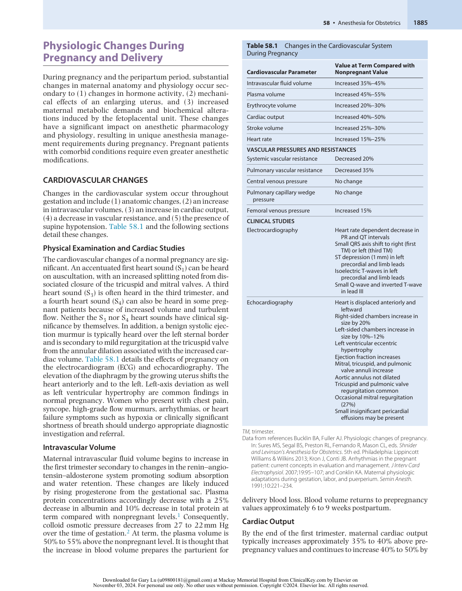
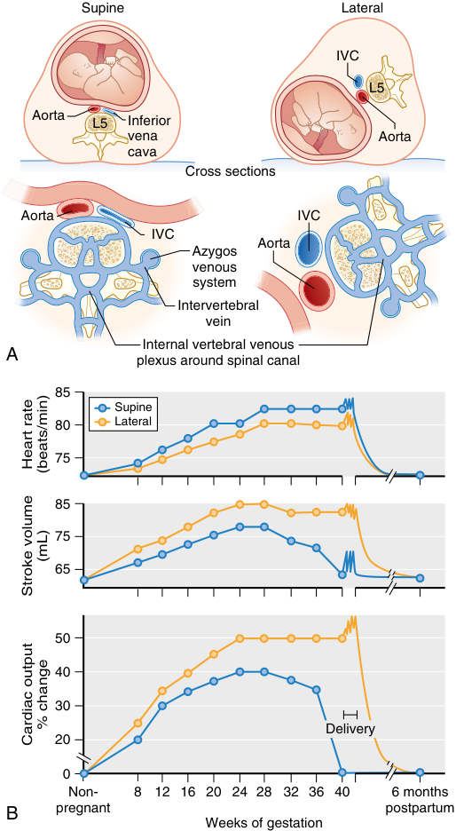
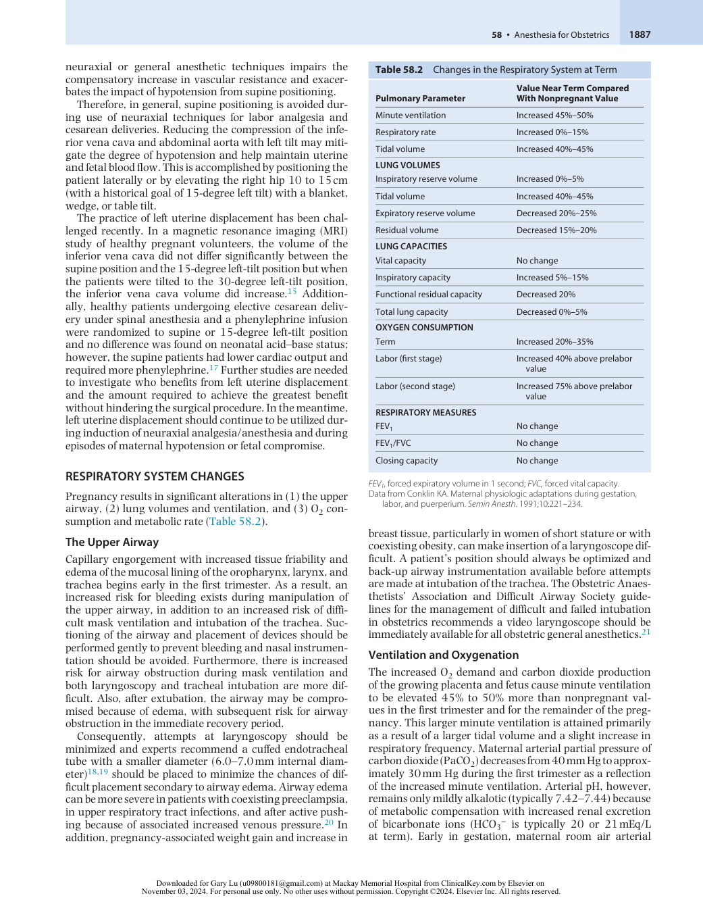
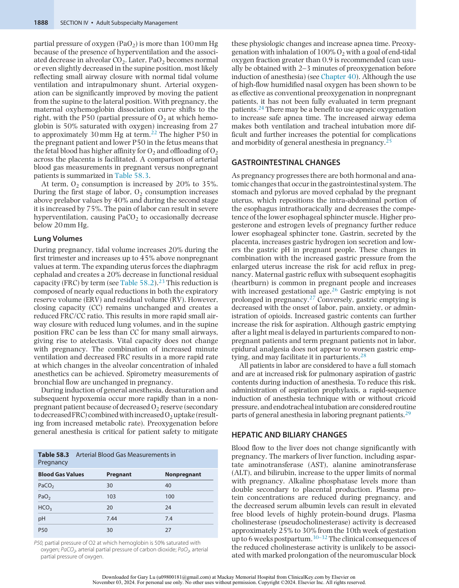
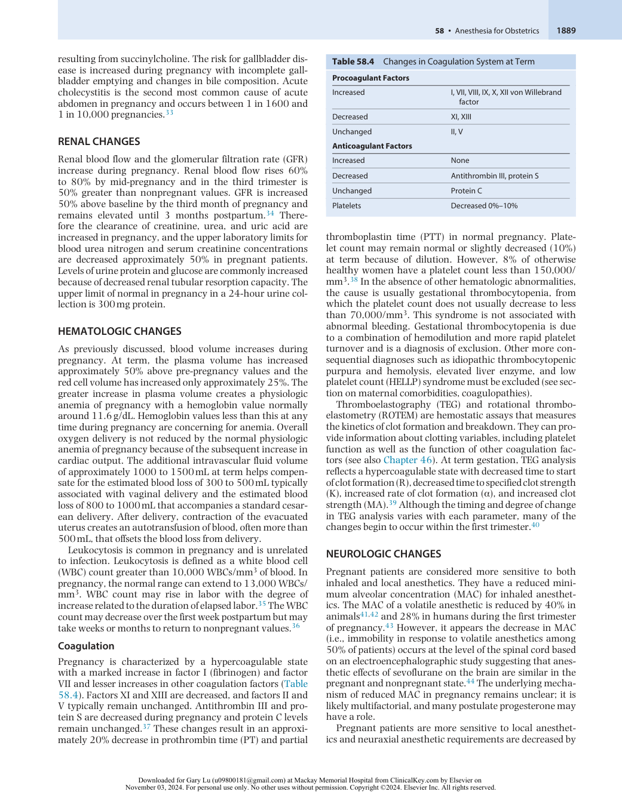
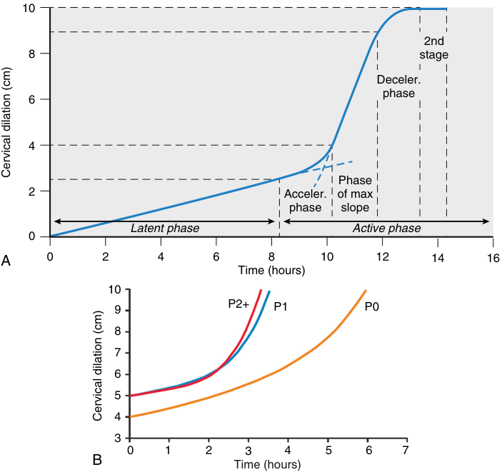
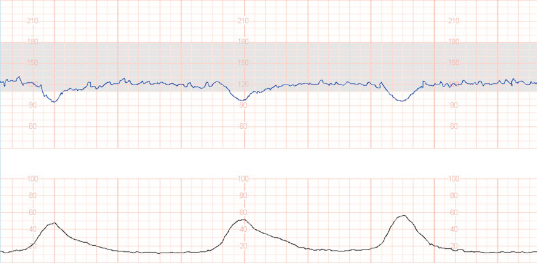
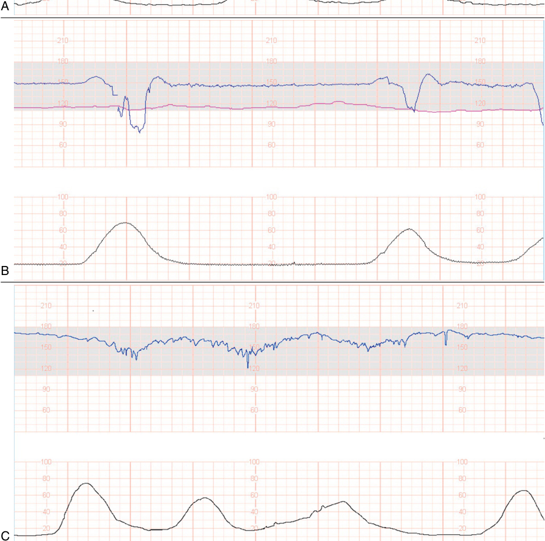
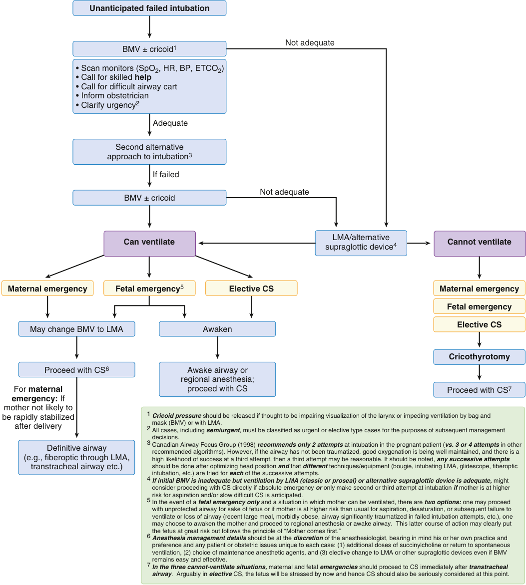
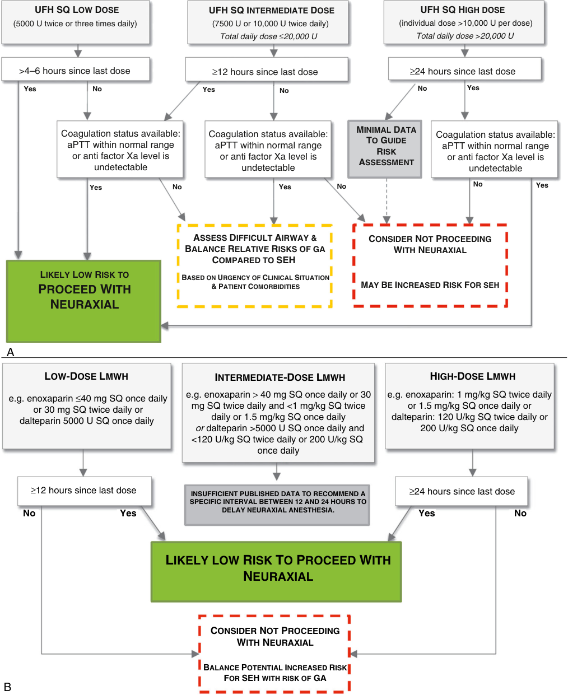

# Anesthesia for Obstetrics

<!-- PDF page 1 -->

## 58

## Anesthesia for Obstetrics

EMILY E. SHARPE and HANS P. SVIGGUM

### KEY POINTS

- The normal physiologic changes of pregnancy begin in the first trimester, affect all organ systems, and alter pharmacokinetic and pharmacodynamic responses to many drugs commonly used in anesthesia.

- Maternal–fetal exchange of most drugs and other substances occurs primarily by diffusion. The rate of diffusion and peak levels in the fetus depend on maternal- to- fetal concentration gradients, maternal protein binding, molecular weight of the substance, lipid solubility, and the degree of ionization of that substance.

- All patients in labor are considered to have a full stomach and an increased risk for pulmonary aspiration of gastric contents during induction and emergence from anesthesia and aspiration prophylaxis should be considered before all surgical procedures during pregnancy.

- Uterine blood flow increases progressively during pregnancy from approximately 100 mL/ min in the nonpregnant state to between 700 and 900 mL/min (∼10% of cardiac output) at term gestation. Consequently, hemorrhage can be rapid during pregnancy and carries significant morbidity. Early recognition with timely intervention, optimal team performance, and appropriate blood product transfusions are essential to good patient outcomes.

- Uterine and placental blood flow depend on maternal cardiac output and are directly related to uterine perfusion pressure and inversely related to uterine vascular resistance. Decreased perfusion pressure can result from maternal hypotension secondary to hypovolemia, aortocaval compression, sympathetic blockade, and decreased systemic resistance from either general or neuraxial anesthesia. Prophylactic or therapeutic phenylephrine in boluses or as an infusion reduces the incidence and severity of hypotension from spinal anesthesia for cesarean delivery. In comparison to ephedrine, phenylephrine results in less fetal acidosis.

- During pregnancy, the maternal oxyhemoglobin dissociation curve shifts to the right with pregnancy while the fetal oxyhemoglobin dissociation curve lies to the left. This facilitates oxygen transfer from maternal to fetal hemoglobin. Fetal O2 saturation does not exceed 60% even with 100% O2 delivery to the pregnant patient. Due to increased minute ventilation, the maternal arterial partial pressure of carbon dioxide (PaCO2) decreases from 40 mm Hg to approximately 30 mm Hg during the first trimester. This reduction facilitates carbon dioxide transfer across the placenta, which is primarily limited by blood flow and not diffusion.

- Neuraxial analgesia is the most reliable and effective method of reducing pain during labor. Adequate analgesia is achieved with blockade of T10 to L1 during the first stage of labor and requires extension to include S2 to S4 during the second stage of labor.

- Neuraxial analgesia may prolong the second stage of labor in comparison to unmedicated birth or intravenous opioid analgesia but does not increase the risk for cesarean delivery. Epidural analgesia utilized _early_ compared to _late_ in labor does not increase the risk for cesarean delivery or prolong the first stage of labor.

- Remifentanil patient- controlled analgesia (PCA) offers superior pain relief to nitrous oxide and less fetal effects than other intravenous opioid analgesics, but its analgesic effects are inferior to epidural analgesia, and it requires careful maternal oxygenation and ventilation monitoring.

- Hypertensive disorders of pregnancy complicate 5% to 10% of worldwide pregnancies and can cause maternal and fetal mortality. Patients with preeclampsia are at increased risk for cerebral hemorrhage, pulmonary edema, and coagulopathy. Systolic and diastolic blood pressure higher than 160/110 mm Hg should be treated to limit complications.

- Sepsis is a leading cause of maternal morbidity and mortality in the UK and United States. Early identification and treatment have been shown to improve outcomes.

<!-- PDF page 2 -->

### Physiologic Changes During Pregnancy and Delivery

During pregnancy and the peripartum period, substantial changes in maternal anatomy and physiology occur secondary to (1) changes in hormone activity, (2) mechanical effects of an enlarging uterus, and (3) increased maternal metabolic demands and biochemical alterations induced by the fetoplacental unit. These changes have a significant impact on anesthetic pharmacology and physiology, resulting in unique anesthesia management requirements during pregnancy. Pregnant patients with comorbid conditions require even greater anesthetic modifications.

### CARDIOVASCULAR CHANGES

Changes in the cardiovascular system occur throughout gestation and include (1) anatomic changes, (2) an increase in intravascular volumes, (3) an increase in cardiac output, (4) a decrease in vascular resistance, and (5) the presence of supine hypotension. Table 58.1 and the following sections detail these changes.

### Physical Examination and Cardiac Studies

The cardiovascular changes of a normal pregnancy are significant. An accentuated first heart sound (S1) can be heard on auscultation, with an increased splitting noted from dissociated closure of the tricuspid and mitral valves. A third heart sound (S3) is often heard in the third trimester, and a fourth heart sound (S4) can also be heard in some pregnant patients because of increased volume and turbulent flow. Neither the S3 nor S4 heart sounds have clinical significance by themselves. In addition, a benign systolic ejection murmur is typically heard over the left sternal border and is secondary to mild regurgitation at the tricuspid valve from the annular dilation associated with the increased cardiac volume. Table 58.1 details the effects of pregnancy on the electrocardiogram (ECG) and echocardiography. The elevation of the diaphragm by the growing uterus shifts the heart anteriorly and to the left. Left-axis deviation as well as left ventricular hypertrophy are common findings in normal pregnancy. Women who present with chest pain, syncope, high- grade flow murmurs, arrhythmias, or heart failure symptoms such as hypoxia or clinically significant shortness of breath should undergo appropriate diagnostic investigation and referral.

### Intravascular Volume

Maternal intravascular fluid volume begins to increase in the first trimester secondary to changes in the renin–angiotensin–aldosterone system promoting sodium absorption and water retention. These changes are likely induced by rising progesterone from the gestational sac. Plasma protein concentrations accordingly decrease with a 25% decrease in albumin and 10% decrease in total protein at term compared with nonpregnant levels.1 Consequently, colloid osmotic pressure decreases from 27 to 22 mm Hg over the time of gestation.2 At term, the plasma volume is 50% to 55% above the nonpregnant level. It is thought that the increase in blood volume prepares the parturient for

**Table 58.1** Changes in the Cardiovascular System During Pregnancy

|**Cardiovascular Parameter**|**Value at Term Compared with** **Nonpregnant Value**|
|---|---|
|Intravascular fluid volume|Increased 35%–45%|
|Plasma volume|Increased 45%–55%|
|Erythrocyte volume|Increased 20%–30%|
|Cardiac output|Increased 40%–50%|
|Stroke volume|Increased 25%–30%|
|Heart rate|Increased 15%–25%|
|**VASCULAR PRESSURES AND RE**|**SISTANCES**|
|Systemic vascular resistance|Decreased 20%|
|Pulmonary vascular resistance|Decreased 35%|
|Central venous pressure|No change|
|Pulmonary capillary wedge pressure|No change|
|Femoral venous pressure|Increased 15%|
|**CLINICAL STUDIES**||
|Electrocardiography|Heart rate dependent decrease in PR and QT intervals Small QRS axis shift to right (first TM) or left (third TM) ST depression (1 mm) in left precordial and limb leads Isoelectric T- waves in left precordial and limb leads Small Q- wave and inverted T- wave in lead III|
|Echocardiography|Heart is displaced anteriorly and leftward Right- sided chambers increase in size by 20% Left- sided chambers increase in size by 10%–12% Left ventricular eccentric hypertrophy Ejection fraction increases Mitral, tricuspid, and pulmonic valve annuli increase Aortic annulus not dilated Tricuspid and pulmonic valve regurgitation common Occasional mitral regurgitation (27%) Small insignificant pericardial effusions may be present|

_TM,_ trimester. Data from references Bucklin BA, Fuller AJ. Physiologic changes of pregnancy. In: Sures MS, Segal BS, Preston RL, Fernando R, Mason CL, eds. _Shnider and Levinson’s Anesthesia for Obstetrics_ . 5th ed. Philadelphia: Lippincott Williams & Wilkins 2013; Kron J, Conti JB. Arrhythmias in the pregnant patient: current concepts in evaluation and management. _J Interv Card Electrophysiol_ . 2007;19:95–107; and Conklin KA. Maternal physiologic adaptations during gestation, labor, and puerperium. _Semin Anesth_ . 1991;10:221–234.

delivery blood loss. Blood volume returns to prepregnancy values approximately 6 to 9 weeks postpartum.

### Cardiac Output

By the end of the first trimester, maternal cardiac output typically increases approximately 35% to 40% above prepregnancy values and continues to increase 40% to 50% by

::: details 原始表格與符號（PDF 第 2 頁）

:::

<!-- PDF page 3 -->

the end of the second trimester.3–5 Cardiac output remains stable throughout the third trimester. This increased cardiac output is secondary to increases in both stroke volume (25%–30%) and heart rate (15%–25%).6,7 Labor further increases cardiac output, which fluctuates with each uterine contraction. Increases above prelabor values of 10% to 25% occur during the first stage and 40% in the second stage. The largest increase in cardiac output occurs immediately after delivery, when cardiac output can increase by 80% to 100% more than prelabor values.8 This abrupt increase is secondary to the autotransfusion of uteroplacental blood as the evacuated uterus contracts, reduced maternal vascular capacitance from loss of the intervillous space, and diminished lower extremity venous pressure from release of the aortocaval compression. This large fluctuation in cardiac output presents a unique postpartum risk for patients with cardiac disease, especially those whose heart cannot accommodate an increase in cardiac output such as those with fixed valvular stenosis or pulmonary vascular hypertension. Cardiac output returns toward prelabor values within 24 hours postpartum depending on the mode of delivery and degree of blood loss.9 Cardiac output decreases substantially toward prepregnant values by 2 weeks postpartum, with complete return to nonpregnant levels between 12 and 24 weeks after delivery.10

### Systemic Vascular Resistance

Although cardiac output and plasma volume increase, systemic blood pressure decreases in an uncomplicated pregnancy secondary to a reduction in systemic vascular resistance. Systemic vascular resistance decreases as a result of the vasodilatory effects of progesterone and prostaglandins as well as the low resistance of the uteroplacental vascular bed.11 Although affected by positioning and parity, systolic, diastolic, and mean blood pressure may all decrease 5% to 20% by 20 weeks’ gestational age and then gradually increase toward nonpregnant values by term.12– 14 Diastolic arterial blood pressure decreases more than systolic arterial blood pressure, resulting in a slight increase in pulse pressure. Central venous and pulmonary capillary wedge pressures do not change during pregnancy,6 despite the increased plasma volume, because venous capacitance increases.

### Aortocaval Compression

Aortocaval compression by the gravid uterus because of supine positioning is associated with a decrease in systemic blood pressure. Although the inferior vena cava is compressed in nearly all term parturients,15 supine hypotension syndrome (also known as aortocaval compression syndrome) is experienced by only 8% to 10% of women.16 Supine hypotension syndrome is defined as a decrease in mean arterial pressure of more than 15 mm Hg, with an increase in heart rate of more than 20 beats/min, and is often associated with diaphoresis, nausea, vomiting, and changes in mentation. At term, the inferior vena cava can be almost completely occluded in the supine position with the return of blood from the lower extremities through the epidural, azygos, and vertebral veins that become engorged (Fig. 58.1A). Also, significant aortoiliac artery compression occurs in 15% to 20% of pregnant patients. Inferior vena caval compression in the supine position causes a decrease

Supine Lateral IVC L5 Aorta L5 Inferior vena Aorta cava Cross sections Aorta IVC IVC Aorta Azygos venous system Intervertebral vein Internal vertebral venous A plexus around spinal canal 85 Supine 80 Lateral 75 85 75 65 50 40 30 Delivery 20 0 Non- 8 12 16 20 24 28 32 36 40 6 months B pregnant postpartum Weeks of gestation Heart rate (beats/min) (mL) Stroke volume % change Cardiac output 

**Fig. 58.1 Aortocaval compression.** (A) Cross- sectional views of aortocaval compression from the gravid uterus in the supine position with loss of compression in the lateral position. (B) Alterations in heart rate, stroke volume, and cardiac output for both supine and lateral positioning with increasing gestation of pregnancy. _IVC,_ inferior vena cava. (Reprinted with permission from Bonica JJ, ed. _Obstetric Analgesia and Anesthesia_ . Amsterdam: World Federation of Societies of Anaesthesiologists; 1980.)

in both stroke volume and cardiac output of 10% to 20% in comparison to the upright position (Fig. 58.1B) and may exacerbate venous stasis in the legs and thereby result in ankle edema, varices, and increased risk for lower extremity deep venous thrombosis.

Most pregnant patients have compensatory adaptations that reduce supine hypotension symptoms despite aortocaval compression. One compensatory response is a reflexive increase in peripheral sympathetic nervous system activity. This increase in sympathetic activity results in increased systemic vascular resistance and permits arterial blood pressure to be maintained despite the reduced cardiac output. Consequently, the reduced sympathetic tone from

<!-- PDF page 4 -->

neuraxial or general anesthetic techniques impairs the compensatory increase in vascular resistance and exacerbates the impact of hypotension from supine positioning.

Therefore, in general, supine positioning is avoided during use of neuraxial techniques for labor analgesia and cesarean deliveries. Reducing the compression of the inferior vena cava and abdominal aorta with left tilt may mitigate the degree of hypotension and help maintain uterine and fetal blood flow. This is accomplished by positioning the patient laterally or by elevating the right hip 10 to 15 cm (with a historical goal of 15- degree left tilt) with a blanket, wedge, or table tilt.

The practice of left uterine displacement has been challenged recently. In a magnetic resonance imaging (MRI) study of healthy pregnant volunteers, the volume of the inferior vena cava did not differ significantly between the supine position and the 15- degree left- tilt position but when the patients were tilted to the 30- degree left- tilt position, the inferior vena cava volume did increase.15 Additionally, healthy patients undergoing elective cesarean delivery under spinal anesthesia and a phenylephrine infusion were randomized to supine or 15- degree left- tilt position and no difference was found on neonatal acid–base status; however, the supine patients had lower cardiac output and required more phenylephrine.17 Further studies are needed to investigate who benefits from left uterine displacement and the amount required to achieve the greatest benefit without hindering the surgical procedure. In the meantime, left uterine displacement should continue to be utilized during induction of neuraxial analgesia/anesthesia and during episodes of maternal hypotension or fetal compromise.

### RESPIRATORY SYSTEM CHANGES

Pregnancy results in significant alterations in (1) the upper airway, (2) lung volumes and ventilation, and (3) O2 consumption and metabolic rate (Table 58.2).

### The Upper Airway

Capillary engorgement with increased tissue friability and edema of the mucosal lining of the oropharynx, larynx, and trachea begins early in the first trimester. As a result, an increased risk for bleeding exists during manipulation of the upper airway, in addition to an increased risk of difficult mask ventilation and intubation of the trachea. Suctioning of the airway and placement of devices should be performed gently to prevent bleeding and nasal instrumentation should be avoided. Furthermore, there is increased risk for airway obstruction during mask ventilation and both laryngoscopy and tracheal intubation are more difficult. Also, after extubation, the airway may be compromised because of edema, with subsequent risk for airway obstruction in the immediate recovery period.

Consequently, attempts at laryngoscopy should be minimized and experts recommend a cuffed endotracheal tube with a smaller diameter (6.0–7.0 mm internal diameter)18,19 should be placed to minimize the chances of difficult placement secondary to airway edema. Airway edema can be more severe in patients with coexisting preeclampsia, in upper respiratory tract infections, and after active pushing because of associated increased venous pressure.20 In addition, pregnancy- associated weight gain and increase in

**Table 58.2** Changes in the Respiratory System at Term

|**Pulmonary Parameter**|**Value Near Term Compared** **With Nonpregnant Value**|
|---|---|
|Minute ventilation|Increased 45%–50%|
|Respiratory rate|Increased 0%–15%|
|Tidal volume|Increased 40%–45%|
|**LUNG VOLUMES**||
|Inspiratory reserve volume|Increased 0%–5%|
|Tidal volume|Increased 40%–45%|
|Expiratory reserve volume|Decreased 20%–25%|
|Residual volume|Decreased 15%–20%|
|**LUNG CAPACITIES** Vital capacity|No change|
|Inspiratory capacity|Increased 5%–15%|
|Functional residual capacity|Decreased 20%|
|Total lung capacity|Decreased 0%–5%|
|**OXYGEN CONSUMPTION** Term|Increased 20%–35%|
|Labor (first stage)|Increased 40% above prelabor value|
|Labor (second stage)|Increased 75% above prelabor value|
|**RESPIRATORY MEASURES** FEV1|No change|
|FEV1/FVC|No change|
|Closing capacity|No change|

_FEV1,_ forced expiratory volume in 1 second; _FVC,_ forced vital capacity. Data from Conklin KA. Maternal physiologic adaptations during gestation, labor, and puerperium. _Semin Anesth_ . 1991;10:221–234.

breast tissue, particularly in women of short stature or with coexisting obesity, can make insertion of a laryngoscope difficult. A patient’s position should always be optimized and back- up airway instrumentation available before attempts are made at intubation of the trachea. The Obstetric Anaesthetists’ Association and Difficult Airway Society guidelines for the management of difficult and failed intubation in obstetrics recommends a video laryngoscope should be immediately available for all obstetric general anesthetics.21

### Ventilation and Oxygenation

The increased O2 demand and carbon dioxide production of the growing placenta and fetus cause minute ventilation to be elevated 45% to 50% more than nonpregnant values in the first trimester and for the remainder of the pregnancy. This larger minute ventilation is attained primarily as a result of a larger tidal volume and a slight increase in respiratory frequency. Maternal arterial partial pressure of carbon dioxide (PaCO2) decreases from 40 mm Hg to approximately 30 mm Hg during the first trimester as a reflection of the increased minute ventilation. Arterial pH, however, remains only mildly alkalotic (typically 7.42–7.44) because of metabolic compensation with increased renal excretion of bicarbonate ions (HCO3− is typically 20 or 21 mEq/L at term). Early in gestation, maternal room air arterial

::: details 原始表格與符號（PDF 第 4 頁）

:::

<!-- PDF page 5 -->

partial pressure of oxygen (PaO2) is more than 100 mm Hg because of the presence of hyperventilation and the associated decrease in alveolar CO2. Later, PaO2 becomes normal or even slightly decreased in the supine position, most likely reflecting small airway closure with normal tidal volume ventilation and intrapulmonary shunt. Arterial oxygenation can be significantly improved by moving the patient from the supine to the lateral position. With pregnancy, the maternal oxyhemoglobin dissociation curve shifts to the right, with the P50 (partial pressure of O2 at which hemoglobin is 50% saturated with oxygen) increasing from 27 to approximately 30 mm Hg at term.22 The higher P50 in the pregnant patient and lower P50 in the fetus means that the fetal blood has higher affinity for O2 and offloading of O2 across the placenta is facilitated. A comparison of arterial blood gas measurements in pregnant versus nonpregnant patients is summarized in Table 58.3.

At term, O2 consumption is increased by 20% to 35%. During the first stage of labor, O2 consumption increases above prelabor values by 40% and during the second stage it is increased by 75%. The pain of labor can result in severe hyperventilation, causing PaCO2 to occasionally decrease below 20 mm Hg.

### Lung Volumes

During pregnancy, tidal volume increases 20% during the first trimester and increases up to 45% above nonpregnant values at term. The expanding uterus forces the diaphragm cephalad and creates a 20% decrease in functional residual capacity (FRC) by term (see Table 58.2).23 This reduction is composed of nearly equal reductions in both the expiratory reserve volume (ERV) and residual volume (RV). However, closing capacity (CC) remains unchanged and creates a reduced FRC/CC ratio. This results in more rapid small airway closure with reduced lung volumes, and in the supine position FRC can be less than CC for many small airways, giving rise to atelectasis. Vital capacity does not change with pregnancy. The combination of increased minute ventilation and decreased FRC results in a more rapid rate at which changes in the alveolar concentration of inhaled anesthetics can be achieved. Spirometry measurements of bronchial flow are unchanged in pregnancy.

During induction of general anesthesia, desaturation and subsequent hypoxemia occur more rapidly than in a nonpregnant patient because of decreased O2 reserve (secondary to decreased FRC) combined with increased O2 uptake (resulting from increased metabolic rate). Preoxygenation before general anesthesia is critical for patient safety to mitigate

**Table 58.3** Arterial Blood Gas Measurements in Pregnancy

|**Blood Gas Values**|**Pregnant**|**Nonpregnant**|
|---|---|---|
|PaCO2|30|40|
|PaO2|103|100|
|HCO3|20|24|
|pH|7.44|7.4|
|P50|30|27|

_P50,_ partial pressure of O2 at which hemoglobin is 50% saturated with oxygen; _PaCO2,_ arterial partial pressure of carbon dioxide; _PaO2,_ arterial partial pressure of oxygen.

these physiologic changes and increase apnea time. Preoxygenation with inhalation of 100% O2 with a goal of end- tidal oxygen fraction greater than 0.9 is recommended (can usually be obtained with 2–3 minutes of preoxygenation before induction of anesthesia) (see Chapter 40). Although the use of high-flow humidified nasal oxygen has been shown to be as effective as conventional preoxygenation in nonpregnant patients, it has not been fully evaluated in term pregnant patients.24 There may be a benefit to use apneic oxygenation to increase safe apnea time. The increased airway edema makes both ventilation and tracheal intubation more difficult and further increases the potential for complications and morbidity of general anesthesia in pregnancy.25

### GASTROINTESTINAL CHANGES

As pregnancy progresses there are both hormonal and anatomic changes that occur in the gastrointestinal system. The stomach and pylorus are moved cephalad by the pregnant uterus, which repositions the intra- abdominal portion of the esophagus intrathoracically and decreases the competence of the lower esophageal sphincter muscle. Higher progesterone and estrogen levels of pregnancy further reduce lower esophageal sphincter tone. Gastrin, secreted by the placenta, increases gastric hydrogen ion secretion and lowers the gastric pH in pregnant people. These changes in combination with the increased gastric pressure from the enlarged uterus increase the risk for acid reflux in pregnancy. Maternal gastric reflux with subsequent esophagitis (heartburn) is common in pregnant people and increases with increased gestational age.26 Gastric emptying is not prolonged in pregnancy.27 Conversely, gastric emptying is decreased with the onset of labor, pain, anxiety, or administration of opioids. Increased gastric contents can further increase the risk for aspiration. Although gastric emptying after a light meal is delayed in parturients compared to nonpregnant patients and term pregnant patients not in labor, epidural analgesia does not appear to worsen gastric emptying, and may facilitate it in parturients.28

All patients in labor are considered to have a full stomach and are at increased risk for pulmonary aspiration of gastric contents during induction of anesthesia. To reduce this risk, administration of aspiration prophylaxis, a rapid-sequence induction of anesthesia technique with or without cricoid pressure, and endotracheal intubation are considered routine parts of general anesthesia in laboring pregnant patients.29

### HEPATIC AND BILIARY CHANGES

Blood flow to the liver does not change significantly with pregnancy. The markers of liver function, including aspartate aminotransferase (AST), alanine aminotransferase (ALT), and bilirubin, increase to the upper limits of normal with pregnancy. Alkaline phosphatase levels more than double secondary to placental production. Plasma protein concentrations are reduced during pregnancy, and the decreased serum albumin levels can result in elevated free blood levels of highly protein- bound drugs. Plasma cholinesterase (pseudocholinesterase) activity is decreased approximately 25% to 30% from the 10th week of gestation up to 6 weeks postpartum.30–32 The clinical consequences of the reduced cholinesterase activity is unlikely to be associated with marked prolongation of the neuromuscular block

::: details 原始表格與符號（PDF 第 5 頁）

:::

<!-- PDF page 6 -->

resulting from succinylcholine. The risk for gallbladder disease is increased during pregnancy with incomplete gallbladder emptying and changes in bile composition. Acute cholecystitis is the second most common cause of acute abdomen in pregnancy and occurs between 1 in 1600 and 1 in 10,000 pregnancies.33

### RENAL CHANGES

Renal blood flow and the glomerular filtration rate (GFR) increase during pregnancy. Renal blood flow rises 60% to 80% by mid- pregnancy and in the third trimester is 50% greater than nonpregnant values. GFR is increased 50% above baseline by the third month of pregnancy and remains elevated until 3 months postpartum.34 Therefore the clearance of creatinine, urea, and uric acid are increased in pregnancy, and the upper laboratory limits for blood urea nitrogen and serum creatinine concentrations are decreased approximately 50% in pregnant patients. Levels of urine protein and glucose are commonly increased because of decreased renal tubular resorption capacity. The upper limit of normal in pregnancy in a 24- hour urine collection is 300 mg protein.

### HEMATOLOGIC CHANGES

As previously discussed, blood volume increases during pregnancy. At term, the plasma volume has increased approximately 50% above pre- pregnancy values and the red cell volume has increased only approximately 25%. The greater increase in plasma volume creates a physiologic anemia of pregnancy with a hemoglobin value normally around 11.6 g/dL. Hemoglobin values less than this at any time during pregnancy are concerning for anemia. Overall oxygen delivery is not reduced by the normal physiologic anemia of pregnancy because of the subsequent increase in cardiac output. The additional intravascular fluid volume of approximately 1000 to 1500 mL at term helps compensate for the estimated blood loss of 300 to 500 mL typically associated with vaginal delivery and the estimated blood loss of 800 to 1000 mL that accompanies a standard cesarean delivery. After delivery, contraction of the evacuated uterus creates an autotransfusion of blood, often more than 500 mL, that offsets the blood loss from delivery.

Leukocytosis is common in pregnancy and is unrelated to infection. Leukocytosis is defined as a white blood cell (WBC) count greater than 10,000 WBCs/mm3 of blood. In pregnancy, the normal range can extend to 13,000 WBCs/ mm3 . WBC count may rise in labor with the degree of increase related to the duration of elapsed labor.35 The WBC count may decrease over the first week postpartum but may take weeks or months to return to nonpregnant values.36

### Coagulation

Pregnancy is characterized by a hypercoagulable state with a marked increase in factor I (fibrinogen) and factor VII and lesser increases in other coagulation factors (Table 58.4). Factors XI and XIII are decreased, and factors II and V typically remain unchanged. Antithrombin III and protein S are decreased during pregnancy and protein C levels remain unchanged.37 These changes result in an approximately 20% decrease in prothrombin time (PT) and partial

**Table 58.4** Changes in Coagulation System at Term

|**Procoagulant Factors**||
|---|---|
|Increased|I, VII, VIII, IX, X, XII von Willebrand factor|
|Decreased|XI, XIII|
|Unchanged|II, V|
|**Anticoagulant Factors**||
|Increased|None|
|Decreased|Antithrombin III, protein S|
|Unchanged|Protein C|
|Platelets|Decreased 0%–10%|

thromboplastin time (PTT) in normal pregnancy. Platelet count may remain normal or slightly decreased (10%) at term because of dilution. However, 8% of otherwise healthy women have a platelet count less than 150,000/ mm3 .38 In the absence of other hematologic abnormalities, the cause is usually gestational thrombocytopenia, from which the platelet count does not usually decrease to less than 70,000/mm3 . This syndrome is not associated with abnormal bleeding. Gestational thrombocytopenia is due to a combination of hemodilution and more rapid platelet turnover and is a diagnosis of exclusion. Other more consequential diagnoses such as idiopathic thrombocytopenic purpura and hemolysis, elevated liver enzyme, and low platelet count (HELLP) syndrome must be excluded (see section on maternal comorbidities, coagulopathies).

Thromboelastography (TEG) and rotational thromboelastometry (ROTEM) are hemostatic assays that measures the kinetics of clot formation and breakdown. They can provide information about clotting variables, including platelet function as well as the function of other coagulation factors (see also Chapter 46). At term gestation, TEG analysis reflects a hypercoagulable state with decreased time to start of clot formation (R), decreased time to specified clot strength (K), increased rate of clot formation (α), and increased clot strength (MA).39 Although the timing and degree of change in TEG analysis varies with each parameter, many of the changes begin to occur within the first trimester.40

### NEUROLOGIC CHANGES

Pregnant patients are considered more sensitive to both inhaled and local anesthetics. They have a reduced minimum alveolar concentration (MAC) for inhaled anesthetics. The MAC of a volatile anesthetic is reduced by 40% in animals41,42 and 28% in humans during the first trimester of pregnancy.43 However, it appears the decrease in MAC (i.e., immobility in response to volatile anesthetics among 50% of patients) occurs at the level of the spinal cord based on an electroencephalographic study suggesting that anesthetic effects of sevoflurane on the brain are similar in the pregnant and nonpregnant state.44 The underlying mechanism of reduced MAC in pregnancy remains unclear; it is likely multifactorial, and many postulate progesterone may have a role.

Pregnant patients are more sensitive to local anesthetics and neuraxial anesthetic requirements are decreased by

::: details 原始表格與符號（PDF 第 6 頁）

:::

<!-- PDF page 7 -->

40% by term. At term, the epidural veins are distended and the volume of epidural fat increases, which decreases the size of the epidural space and volume of cerebrospinal fluid (CSF) in the subarachnoid space. Although the decreased volume of these spaces facilitates the spread of local anesthetics, the local anesthetic dose requirement is decreased for neuraxial block as early as the first trimester, before significant aortocaval compression or other mechanicalor pressure- related changes occur.45 Consequently, the increased nerve sensitivity and decrease in local anesthetic dose requirements are likely biochemical in origin.

### Uteroplacental Physiology

The placenta is a remarkable organ that undergoes vast changes from a fertilized ovum’s initial implantation into the uterine wall until birth. The placenta is composed of both maternal and fetal tissues and is the interface of maternal and fetal circulation systems. It provides a substrate for physiologic exchange between the two systems. The placenta is made up of a basal and a chorionic plate that are separated by the intervillous space. Maternal blood is delivered to the placenta by the uterine arteries and enters the intervillous space via the spiral arteries. It travels toward the chorionic plate, passing fetal villi where exchange takes place, and then drains back to veins in the basal plate and then ultimately away from the uterus via the uterine veins. The fetal blood arrives at the placenta via two umbilical arteries that form umbilical capillaries that cross the chorionic villi. After placental exchange, oxygen- rich, nutrientrich, and waste- free blood is returned from the placenta to the fetus through a single umbilical vein.

### UTERINE BLOOD FLOW

An understanding of uteroplacental blood flow is critical for appropriate clinical care. Uterine blood flow increases progressively during pregnancy from about 100 mL/min in the nonpregnant state to 700 to 900 mL/min (∼10% of cardiac output) at term gestation.46,47 Approximately 80% of the uterine blood flow perfuses the intervillous space (placenta) and the remainder perfuses the myometrium. Uterine blood flow has minimal autoregulation, and the vasculature remains essentially fully dilated during pregnancy. Uterine and placental blood flow depend upon maternal cardiac output and are directly related to uterine perfusion pressure and inversely related to uterine vascular resistance. Decreased perfusion pressure can result from maternal hypotension secondary to multiple causes including hypovolemia from blood loss or dehydration, decreased systemic resistance from general or neuraxial anesthesia, or aortocaval compression. Increased uterine venous pressure from aortocaval compression, frequent or prolonged uterine contractions, or prolonged abdominal musculature contraction with bearing down (Valsalva) during second stage pushing can decrease uterine perfusion. Additionally, extreme hypocapnia (PaCO2 &lt;20 mm Hg) occasionally associated with hyperventilation secondary to severe labor pain can reduce uterine blood flow with resultant fetal hypoxemia and acidosis. Neuraxial blockade does not alter uterine blood flow if maternal hypotension is avoided but

decreases in maternal blood pressure during neuraxial or general anesthesia should be immediately corrected.

Endogenous maternal catecholamines and exogenous vasopressors may cause increasing uterine arterial resistance and decreasing uterine blood flow depending on the class and amount given. In a pregnant ewe model, use of α- adrenergic vasopressors – methoxamine and metaraminol – increased uterine vascular resistance and decreased uterine blood flow, whereas administration of ephedrine did not reduce uterine blood flow despite drug- induced increases in maternal arterial blood pressure.48 As a result, ephedrine was previously considered the vasopressor of choice for the treatment of hypotension caused by the administration of neuraxial anesthesia to pregnant patients. In complete contrast, more recent human trials demonstrate the use of phenylephrine (α- adrenergic agonist) for prophylaxis or treatment of neuraxial- induced hypotension not only is effective in preventing hypotension but also is associated with less fetal acidosis and base deficit than the use of ephedrine.49–52 Other methods to reduce maternal hypotension with induction of regional or general anesthesia are discussed in the section on anesthesia for cesarean delivery.

### PLACENTAL EXCHANGE

### Oxygen Transfer

The delivery of O2 from the pregnant person to the fetus depends on a variety of factors, including the ratio of maternal to fetal placental blood flow, the O2 partial pressure gradient between the two circulations, the diffusion capacity of the placenta, the respective maternal and fetal hemoglobin concentrations and O2 affinities, and the acid–base status of the fetal and maternal blood (Bohr effect). O2 delivery to the fetus is facilitated primarily because the fetal oxyhemoglobin dissociation curve is to the left (greater O2 affinity) of the maternal oxyhemoglobin dissociation curve (decreased O2 affinity). Fetal hemoglobin has a higher O2 affinity and lower partial pressure at which it is 50% saturated (P50: 18 mm Hg) compared to maternal hemoglobin (P50: 27 mm Hg). Fetal PaO2 is normally 40 mm Hg and never more than 60 mm Hg, even if the mother is breathing 100% O2.53 Animal studies note that in the face of decreased O2 delivery, fetal O2 consumption can be maintained with increased O2 extraction until the maternal O2 delivery is approximately 50% of its normal state.54,55 CO2 easily crosses the placenta and its transfer from the fetus to the pregnant patient is limited by blood flow and not diffusion.

### Drug Transfer

Maternal–fetal exchange across the placenta occurs by one of four mechanisms: passive diffusion, facilitated diffusion, transporter- mediated mechanisms, and vesicular transport.56 Most drugs have molecular weights less than 1000 daltons and, therefore, cross the placenta by diffusion if the drug is not ionized. The rate of diffusion and peak levels in the fetus depend on maternal- to- fetal concentration gradients, maternal protein binding, molecular weight, lipid solubility, and the degree of drug ionization. The maternal blood concentration of a drug is typically the primary determinant of how much drug will ultimately reach the fetus. Nondepolarizing neuromuscular blocking drugs are ionized, have a high molecular weight, and poor

<!-- PDF page 8 -->

lipid solubility, resulting in minimal placental transfer. Succinylcholine has a low molecular weight but is highly ionized and therefore does not readily cross the placenta unless given in large nonclinical doses. Thus, during administration of a general anesthetic for cesarean delivery, the fetus or neonate is not paralyzed. Both heparin and glycopyrrolate have minimal placental transfer because they are highly charged. In contrast, placental transfer of volatile anesthetics, benzodiazepines, local anesthetics, and opioids is facilitated by the relatively low molecular weights of these drugs. Dexmedetomidine may cross the placental barrier but is stored within the placenta and transfer to the fetus is reduced.57 As a general consideration, drugs that readily cross the blood–brain barrier also readily cross the placenta. Therefore, most centrally acting general anesthetics cross the placenta and affect the fetus. Currently, there is a paucity of evidence on the placental transfer of newer drugs such as liposomal bupivacaine and sugammadex.

Fetal blood is more acidic than maternal blood, and the lower pH creates an environment in which weakly basic drugs, such as local anesthetics and opioids, cross the placenta as nonionized molecules and become ionized in the fetal circulation. Because this newly ionized molecule has more resistance to diffusion back across the placenta, the drug may accumulate in the fetal circulation and reach levels higher than the maternal blood. This process is referred to as “ion trapping.” During fetal distress (fetal acidemia), higher concentrations of these weakly basic drugs can be trapped.58 High concentrations of local anesthetics in the fetal circulation decrease neonatal neuromuscular tone. Extremely high levels, such as those associated with unintended maternal intravascular local anesthetic injection, result in a variety of fetal effects, including bradycardia, ventricular arrhythmias, acidosis, and severe cardiac depression. Placental transfer and fetal uptake of specific analgesic and anesthetic drugs are detailed later in the sections that discuss methods of labor analgesia and anesthesia for cesarean delivery.

### FETAL CIRCULATION AND PHYSIOLOGY

Fetal blood volume increases throughout gestation. Approximately one- third of the fetal–placental blood volume is contained within the placenta.59 During the second and third trimester, the fetal blood volume is estimated to be approximately 120 to 160 mL/kg of fetal body weight.60 Thus the total blood volume of a term normal fetus is approximately 0.5 L. Although fetal liver function is not yet mature, coagulation factors are synthesized independent of the maternal circulation. The serum concentrations of these factors increase with gestational age and do not cross the placenta. However, fetal clot formation in response to tissue injury is decreased in comparison to that in adults.

The anatomy of the fetal circulation helps decrease fetal exposure to potentially high concentrations of drugs in umbilical venous blood. Approximately 75% of umbilical venous blood initially passes through the fetal liver, which may result in significant drug metabolism before the drug reaches the fetal heart and brain (first- pass metabolism). Fetal and neonatal enzymatic drug metabolism activities are lower than those of adults, but most drugs can be metabolized. In addition, drugs entering the fetal inferior

vena cava via the ductus venosus, thus bypassing the portal circulation and the liver, are initially diluted by drug- free blood returning from the fetal lower extremities and pelvic viscera. These anatomic characteristics of fetal circulation add to the complexity of maternal–fetal pharmacokinetics.

### Labor Progress

Labor begins with the onset of repetitive uterine contractions that result in the dilation of the cervix, thus promoting passage of the fetus from the uterus through the birth canal. However, preparation for labor may begin several hours or days before with an inflammatory process mediated by cellular infiltration and release of local cytokines that result in softening of the cervix. The signals that orchestrate the onset of spontaneous labor are not precisely known. However, “labor” is the onset of organized, regular uterine contractions that result in progressive cervical dilation and effacement. When spontaneous labor does not occur at an appropriate time, labor may be induced for fetal or maternal indications with various pharmacologic and physical methods.61

Labor is a continuous process separated into three stages. The first stage of labor begins with regular, painful uterine contractions and includes the change of the uterine cervix from a thick, closed tube to an opening of approximately 10 cm through which the fetus can be expelled. This stage is further divided into a latent phase and an active phase. The second stage of labor begins when the cervix is fully dilated and ends with the birth of the newborn. The third stage of labor is the delivery of the placenta. The time course of the first stage of labor was first studied by Emanuel Friedman who described a sigmoidal relationship between cervical dilation and time (Fig. 58.2A). The sigmoidal nature of the relationship has since been challenged in that little evidence exists for a deceleration phase as the cervix approaches complete dilation (10 cm). However, the separation of the first stage of labor into an early slow phase termed _latent labor_ and a more rapid phase of _active labor_ has stood the test of time and advances in modeling techniques.62,63 To account for the contemporary obstetric population including an older maternal age and increased maternal and fetal body sizes, a new labor curve has been proposed after analysis of 62,415 parturients.64,65 The main difference of the newly proposed curve is when latent labor is considered to transition to active labor. Traditionally, this transition point was 4- cm dilation. However, the new curve proposes active labor beginning at 6- cm dilation in both multiparous and nulliparous parturients (Fig. 58.2B).

Labor may be referred to as “abnormal” because of having abnormally slow latent labor, arrest in the active phase, or arrest of descent (failure of stage 2). Dystocia, or abnormal labor, may be a result of inadequate uterine contractions, mismatch of fetal and pelvic size, or abnormal fetal position. The diagnosis of dystocia is based on deviation from normal values derived from populations; however, significant variability exists among individual laboring patients. Various demographic and genetic factors contribute to the variability in labor progress.62,63,66–69 Multiparity is associated with faster labor. Greater maternal weight, older age, and larger

<!-- PDF page 9 -->

10 2nd 8 stage Deceler. phase 6 4 Phase 2 Acceler. of max phase slope Latent phase Active phase 0 A 0 2 4 6 8 10 12 14 16 Time (hours) 10 9 P2+ P1 P0 8 7 6 5 4 3 0 1 2 3 4 5 6 7 B Time (hours) Cervical dilation (cm) Cervical dilation (cm) 

**Fig. 58.2 Cervical dilation.** (A) Friedman’s original sigmoid model of the progress of cervical dilation over time based on an analysis of 500 nulliparas at term. (B) The modern labor curve, which eliminates the deceleration (Deceler) phase and changes the threshold for the active phase from 4 to 6 cm. _Acceler,_ acceleration; _P0_ , nulliparous women; _P1,_ women of parity 1; _P2+,_ women of parity 2 or higher. (B) Average labor curves by parity in singleton term pregnancies with spontaneous onset of labor, vaginal delivery, and normal neonatal outcomes. (A, Reproduced with permission from Friedman E. Primigravid labor: a graphicostatistical analysis. _Obstet Gynecol_ . 1955;6:567–589. B, Reproduced with permission from Zhang J, Landy HJ, Brand DW, et al. Contemporary patterns of spontaneous labor with normal neonatal outcomes. _Obstet Gynecol_ . 2010;116:1281–1287.)

fetal size have been associated with slower labor.62,67,70 Evidence also indicates a hereditary role in labor progress from epidemiologic studies.71 Specifically, β2- adrenergic and oxytocin receptor polymorphisms have been implicated in mediating variability in labor progress.66–68 An abnormally poor response to intrinsic or extrinsic oxytocin may result in abnormal contractility, as would an abnormally strong response to β2- adrenergic agonists (either exogenous or endogenous) which inhibits contractility.

The nomenclature, interpretation, and management principles for FHR monitoring were updated in 2009 by the American Congress of Obstetricians and Gynecologists (ACOG).76 These current guidelines are detailed later, and related terminology is presented in Box 58.1. An understanding of the specific uterine contraction and FHR monitoring terminology as well as the clinical implications are critical for optimal communication among anesthesiologists, obstetricians, midwives, and labor nurses.

### LABOR AND FETAL MONITORING

Intrapartum fetal monitoring was created to evaluate fetal well- being and detect fetal distress to allow intervention prior to permanent fetal injury. Electronic fetal monitoring (EFM) combines fetal heart rate (FHR) monitoring and uterine contraction monitoring. FHR monitoring was developed in the 1960s and its use has been increasing since.72 There is high interobserver and intraobserver variability of FHR tracing interpretation.73,74 A metaanalysis comparing continuous EFM to intermittent FHR auscultation noted the use of EFM reduced the risk for neonatal seizures (relative risk [RR]: 0.50, 95% confidence interval [CI] 0.31 to 0.80), but not the risks for perinatal mortality or cerebral palsy.75 The use of EFM has been shown to increase the rate of both operative and cesarean deliveries.75,76

### CONTRACTION MONITORING

Uterine contractions can be monitored externally with a tocodynamometer or internally with an intrauterine pressure transducer. External monitors only allow determination of contraction frequency, whereas internal monitors also allow quantitative measurement of intrauterine pressure. The Montevideo unit is traditionally used by obstetricians to assess the adequacy of uterine contractions. The Montevideo unit is defined as the intensity of contractions (in millimeters of mercury [mm Hg], as measured with an intrauterine pressure catheter) multiplied by the number of contractions that occur in 10 minutes.

Uterine contractions are quantified over a 10- minute window that is averaged over a 30- minute window with guidelines provided by the ACOG.76 Normal contractions are defined as five or fewer contractions in 10 minutes, averaged

<!-- PDF page 10 -->

### Box 58.1 Fetal Heart Rate Monitoring Pattern Definitions

### Baseline

1.  The mean FHR rounded to increments of 5 bpm during a 10min segment, excluding:

- a.  Periodic or episodic changes

- b.  Periods of marked FHR variability

- c.  Segments of baseline that differ by more than 25 bpm

2.  The baseline must be for a minimum of 2 min in any 10- min segment, or the baseline for that period is indeterminate. In this case, one may refer to the prior 10- min window for determination of baseline.

3.  Normal: FHR baseline rate is 110–160 bpm.

4.  Tachycardia: FHR baseline is greater than 160 bpm.

5.  Bradycardia: FHR baseline is less than 110 bpm.

### Baseline Variability

1.  Fluctuations occur in the baseline FHR that are irregular in amplitude and frequency.

2.  Variability is visually quantitated as the amplitude of peak- totrough in beats per minute.

- a.  Absent: amplitude range is undetectable.

- b.  Minimal: amplitude range is detectable but 5 bpm or fewer.

- c.  Moderate (normal): amplitude range is 6–25 bpm.

- d.  Marked: amplitude range is greater than 25 bpm.

### Acceleration

1.  A visually apparent abrupt increase (onset to peak in &lt;30 s) occurs in the FHR.

2.  At 32 weeks’ gestation and beyond, an acceleration has a peak of 15 or more bpm above baseline, with a duration of 15 s or more but less than 2 min from onset to return.

3.  Before 32 weeks’ gestation, an acceleration has a peak of 10 or more bpm above baseline, with a duration of 10 s or more but less than 2 min from onset to return.

4.  Prolonged acceleration lasts 2 min or more but less than 10 min.

5.  If an acceleration lasts 10 min or longer, it is a baseline change.

### Sinusoidal Pattern

1.  Visually apparent, smooth, sine wave–like, undulating pattern occurring in FHR baseline, with a cycle frequency of 3–5 cycles/ min that persists for 20 min or longer.

_bpm,_ beats per minute; _FHR,_ fetal heart rate.

- Data from Macones GA, Hankins GD, Spong CY, et al. The 2008 National Institute of Child Health and Human Development workshop report on electronic fetal monitoring: update on definitions, interpretation, and research guidelines. _Obstet Gynecol_ . 2008;112:661–666.

over a 30- minute window. Tachysystole is defined as uterine activity greater than five contractions in 10 minutes, averaged over a 30- minute window. Tachysystole applies to both spontaneous and augmented labor and should always be qualified as to the presence or absence of associated FHR decelerations. Treatment of tachysystole during labor may differ depending on the clinical situation but may include sublingual or intravenous nitroglycerin77 to briefly relax the uterus, as well as the use of β2- adrenergic drugs such as terbutaline.

### FETAL HEART RATE TRACING

FHR monitoring is most commonly accomplished with a surface Doppler ultrasound transducer (external monitoring), but it may be necessary to apply a fetal scalp electrode to

obtain accurate continuous FHR monitoring (internal monitoring). For internal monitoring, a peak or threshold voltage of the fetal R wave from the scalp electrode is used to measure FHR. Of note, a fetal scalp electrode can be placed only if the cervix is minimally dilated, and the membranes are ruptured. The FHR pattern changes in response to fetal asphyxia from activation of peripheral and central chemoreceptors and baroreceptors.78 It also shows changes as a result of various fetal brain metabolic changes that occur with asphyxia.78 These changes in the FHR produce specific patterns and characteristics that provide an evaluation of the fetal state.

The FHR tracing is used as a nonspecific reflection of fetal acidosis. It should be interpreted over a time course in relation to the clinical context and other known maternal and fetal comorbidities because multiple factors other than fetal acidosis can influence the FHR tracing. Box 58.1 defines FHR baseline, variability, and accelerations. A normal baseline FHR ranges from 110 to 160 bpm. FHR variability are fluctuations in the baseline FHR that are irregular in frequency and amplitude. Normal FHR variability predicts early neonatal health and a fetal central nervous system that is normally interacting with the fetal heart. Accelerations are abrupt changes in the FHR above baseline and are defined by gestational age of the fetus.

Fig. 58.3 details FHR tracing deceleration characteristics. Late decelerations are a result of uteroplacental insufficiency causing relative fetal brain hypoxia during a contraction. The resulting sympathetic outflow elevates the fetal blood pressure and activates the fetal baroreceptors and an associated slowing in the FHR. A second type of late deceleration is from myocardial depression in the presence of increasing hypoxia.79 Therefore late decelerations are considered worrisome. On the other hand, early decelerations are considered benign and tend to mirror the uterine contraction and are believed to be in response to vagal stimuli, which are often the result of fetal head compression. Variable decelerations are associated with umbilical cord compression. A sinusoidal FHR pattern is associated with fetal anemia and is considered ominous.80 In general, minimal to undetectable FHR variability in the presence of variable or late decelerations is associated with fetal acidosis.81 Prolonged decelerations (&lt;70 beats/min for >60 seconds) are associated with fetal acidemia and are extremely ominous, particularly with the absence of variability.82

### FETAL HEART RATE CATEGORIES

A three- tiered FHR category classification system is currently recommended for fetal assessment, with the specific criteria for each category outlined in Box 58.2.76,80 This system evaluates the fetus for the given moment of the assessment. The fetal condition may move back and forth among the categories over time. Specific terminology used for categorization is defined in Box 58.1.

_Category I_ FHR tracings are considered normal and are predictive of a normal fetal acid–base state at the time of observation, and no specific management is required.

_Category II_ FHR tracings are considered indeterminate and include all tracings not in categories I or III. Category II tracings are not predictive of abnormal fetal acid–base status and require continued monitoring and reevaluation with consideration for the entire clinical picture. In some

<!-- PDF page 11 -->

A B C 

**Fig. 58.3 Fetal heart rate deceleration.** (A) Early deceleration: visually apparent, usually symmetric gradual decrease and return of the fetal heart rate (FHR) with the nadir of the deceleration occurring at the same time as the peak of the contraction. (B) Variable decelerations: visually apparent, abrupt decrease in FHR ≥15 seconds and &lt;2 minutes. The relationship of the onset of the deceleration compared to the contraction is variable as is the depth and duration. (C) Late FHR decelerations: visually apparent, usually symmetric gradual decrease and return of the FHR during which the nadir of the deceleration occurs after the peak of the contraction.

<!-- PDF page 12 -->

### Box 58.2 Three- Tier Fetal Heart Rate Interpretation System

### Category I

- Category I FHR tracings include all of the following: 1.  Baseline rate of 110–160 beats/min 2.  Moderate baseline FHR variability 3.  Late or variable decelerations are absent 4.  Accelerations and early decelerations may be present or absent

### Category II

- Category II FHR tracings include all FHR tracings not categorized as Category I or III. Category II FHR tracings may include any of the following: 1.  Baseline rate: a.  Bradycardia not accompanied by absent baseline variability b.  Tachycardia

- 2.  Baseline FHR variability

- a.  Minimal baseline variability b.  Absent baseline variability with no recurrent decelerations c.  Marked baseline variability

- 3.  Accelerations

- a.  Absence of induced accelerations after fetal stimulation

- 4.  Periodic or episodic decelerations a.  Recurrent variable decelerations accompanied by minimal or moderate baseline variability

- b.  Prolonged deceleration ≥2 min but &lt;10 min c.  Recurrent late decelerations with moderate baseline variability d.  Variable decelerations with slow return to baseline, “overshoots,” or “shoulders”

### Category III

- Category III FHR tracings include either: 1.  Absent baseline FHR variability plus any of the following: a.  Recurrent late decelerations b.  Recurrent variable decelerations c.  Bradycardia

- 2.  Sinusoidal pattern

_FHR,_ fetal heart rate.

Data from Macones GA, Hankins GD, Spong CY, et al. The 2008 National Institute of Child Health and Human Development workshop report on electronic fetal monitoring: update on definitions, interpretation, and research guidelines. _Obstet Gynecol._ 2008;112:661–666.

cases, additional tests may be obtained, or intrauterine resuscitative measures taken to improve the fetal condition.

_Category III_ FHR tracings are considered abnormal and are associated with an abnormal fetal acid–base state at the time of observation. These tracings require prompt patient evaluation and interventions to improve the fetal condition. This may include intrauterine resuscitation with change in maternal position, discontinuation of labor augmentation, treatment of maternal hypotension with fluids and/or vasopressor administration, use of supplemental O2, and/ or administration of a tocolytic agent such as terbutaline. If the FHR tracing does not improve, expeditious delivery should occur, which may involve an assisted vaginal (forceps or vacuum) delivery or a cesarean delivery.

### Labor Analgesia

Childbirth is a pinnacle event in a family’s life that is surrounded by many beliefs and traditions, some of which are

founded in science and others more historical, cultural, personal, or spiritual. In this context, several nonpharmacologic techniques have been used to relieve the pain of childbirth throughout history, including acupuncture,83 massage,84 and hypnosis.85 Drugs were not used in Western medicine to relieve pain in childbirth until the mid1800s, most famously when the English Queen Victoria chose to inhale chloroform for analgesia during the birth of Prince Leopold.86

For most pregnant patients, labor is intensely painful. However, the time course of pain intensity is highly variable, dynamic, and unpredictable. Some patients will experience severe pain only just before and during the second stage of labor, whereas others will report severe pain from their first contraction. Rarely do pregnant patients experience a pain- free labor and give birth unexpectedly.87 The source of these differences in labor pain is not completely known but may be in part genetic. In one study, Asian women reported more pain in labor than those of other ethnic backgrounds.62 This association was also found with a single nucleotide polymorphism in the β2- adrenergic gene.67 Other factors may include parity; maternal pelvic size and shape; fetal size and presentation; maternal anxiety, pain tolerance, and other psychological variables; the presence of maternal social and psychological support during labor; induction of labor; and whether contractions are augmented.

### NONPHARMACOLOGIC LABOR PAIN MANAGEMENT

Many patients prefer to use nonpharmacologic methods of pain management during all or part of labor. Nonpharmacologic methods of pain relief commonly used include breathing techniques, position changes, massage, relaxation, music, continuous labor support (e.g., doula, partner), hydrotherapy, aromatherapy, heat and cold therapy, transcutaneous electrical nerve stimulation (TENS), acupuncture, hypnosis, and sterile water injections.88

Acupuncture and acupressure are major modalities of traditional Chinese medicine with a long history of use in treating pain. A Cochrane systematic review and metaanalysis of acupuncture for pain relief in labor included 28 randomized controlled trials ( _n_ = 3960) with 13 studies evaluating acupuncture and 15 studies evaluating acupressure.83 Compared to sham acupuncture (superficial needling lateral to an actual acupuncture point), acupuncture may minimally decrease labor pain intensity but may increase a parturient’s satisfaction with pain control and may reduce the use of pharmacologic analgesia. Acupressure compared to sham control did not reduce intensity of pain or pharmacologic analgesia use during labor. Unfortunately, it is difficult to compare findings in studies given risk of bias for blinding, no shared study designs, or consistent acupuncture points used.

Several trials have found a reduction in pain and anxiety during the first stage of labor with the use of massage including a Cochrane review of ten randomized trials.84 Massage was found to reduce pain during the first stage of labor but not during the second and third stages. In addition, patients reported an increased sense of control and satisfaction with the childbirth experience when massage was

<!-- PDF page 13 -->

used. Continuous labor support is associated with improved outcomes during labor. A systematic review of 26 trials with 15,858 women demonstrated that women with continuous support in labor were less likely to utilize pharmacologic labor analgesia. Furthermore, they were more likely to have a shorter labor, a spontaneous vaginal delivery, and less likely to report negative feelings about their birth experience.89,90

Hypnosis has been used both as a relaxation technique and for management of pain during labor. A Cochrane review of 9 trials randomizing 2954 women found women in the hypnosis group were less likely to use systemic pharmacologic pain relief compared to those in the control groups. There were no clear differences in neuraxial analgesia use, satisfaction, spontaneous vaginal birth, and postpartum depression between the two groups.85

Other nonpharmacologic techniques include the breathing techniques described by Lamaze, the LeBoyer technique, the Bradley method, transcutaneous nerve stimulation, hydrotherapy, intradermal water injections, and biofeedback. A retrospective national survey of childbearing experiences in the United States found that although neuraxial methods of pain relief were considered the most helpful and effective, nonpharmacologic methods of hydrotherapy and massage were rated more or equally helpful in relieving pain compared with the use of intravenous opioids.91 Although many nonpharmacologic techniques seem to reduce the perception of labor pain, most published studies lack the rigorous scientific methodology for useful comparison of these techniques to pharmacologic methods.

### CONSIDERATIONS FOR PHARMACOLOGIC TREATMENT OF PAIN IN LABOR

Preprocedural assessment by an anesthesia provider should be performed for any candidate for neuraxial labor analgesia. Clinical assessment should be considered for all patients admitted to a labor and delivery floor not only to discuss labor analgesia options prior to excruciating pain, but also to assess the patient for comorbid conditions that could complicate labor, obstetric procedures, or anesthesia. The obstetric anesthesia team should be prepared to care for all admitted patients in the event of an obstetric emergency. In otherwise healthy pregnant patients, laboratory testing is not required during a routine preprocedural obstetric assessment.29

Although any laboring patient has the potential to require cesarean delivery, labor takes many hours and requires adequate nutrition and hydration. While balancing these two considerations, the American Society of Anesthesiology (ASA) has recommended that moderate amounts of clear liquids be allowed during the administration of neuraxial analgesia and throughout labor. A period of abstention from solids before the placement of neuraxial analgesia is not required. However, the ASA does recommend the ingestion of solid foods be avoided in laboring patients.29

### SYSTEMIC DRUGS

Opioids can be used for labor analgesia. They are inexpensive, widely available, and can be administered intramuscularly in addition to intravenously. Although there are

differences among opioids, they all cross the placenta and can have fetal effects including dose- related respiratory depression and decreased FHR variability.

Although meperidine was once the most used longacting opioid in obstetric practice,92 it is the most likely to result in side effects. Meperidine is typically administered intravenously in doses of up to 50 mg or intramuscularly in doses ranging from 50 to 100 mg. Maternal half- life of meperidine is 2.5 to 3 hours, whereas the half- life for its active metabolite normeperidine is 13 to 23 hours. The halflife of both is up to three times longer in the fetus and newborn. Normeperidine can accumulate with repeated doses and can be neurotoxic. With increased dosing and shorter intervals between doses and delivery, risk to the newborn is increased, including lower Apgar scores and prolonged time to sustained neonatal respiration.93 Meperidine is now rarely used for labor analgesia.

Morphine is rarely used for labor pain. Like meperidine it has an active metabolite (morphine- 6- glucuronide) with a half- life that is longer in neonates than in adults, and it produces significant maternal sedation. Obstetricians may use intramuscular morphine for analgesia, sedation, and rest. This produces analgesia with an onset of 10 to 20 minutes and may be used in latent labor. Maternal side effects may include respiratory depression and histamine release resulting in pruritus and rash.

Mixed agonist–antagonist opioid analgesics such as nalbuphine and butorphanol are utilized to treat labor pain. Nalbuphine has similar analgesic potency as morphine. It is given either intravenously, intramuscularly, or by subcutaneous injection at doses of 10 to 20 mg every 4 to 6 hours. Butorphanol is five times as potent as morphine and 40 times more potent than meperidine. A dose of 1 to 2 mg intravenously or intramuscularly is commonly used for labor analgesia. Both drugs are often well tolerated by the parturient.

Fentanyl and, more recently, remifentanil have become popular systemic opioid analgesics over the past two decades. Fentanyl is a synthetic opioid that is highly lipidsoluble and has a rapid onset time (2–4 minutes), short duration of action (30–45 minutes), and no active metabolites. When given in intravenous doses of 50 to 100 mcg/h, no significant differences are seen in neonatal Apgar scores and respiratory effort compared with those in newborns of patients not receiving fentanyl.94 Fentanyl is also commonly used in patient- controlled analgesia (PCA) during labor. Common doses utilized for fentanyl PCA include a bolus dose of 10 to 25 mcg with a lockout interval of 5 to 12 minutes. High doses of systemic fentanyl, especially immediately prior to birth, could result in neonatal depression. A multicenter, randomized trial compared fentanyl PCA with neuraxial labor analgesia and found patients in the PCA group required more antiemetics, had more sedation, had increased pain scores, and neonates were more likely to require resuscitation and naloxone.95

Remifentanil PCA may offer superior pain relief and lesser fetal effects than other intravenous opioid analgesics, but its analgesic effects are inferior to neuraxial analgesia and it requires careful maternal oxygenation and ventilation monitoring. Intravenous remifentanil has a rapid onset (2 minutes), short context- sensitive half- life (3.5 minutes), and no active metabolites. The metabolism of remifentanil

<!-- PDF page 14 -->

depends completely on tissue and plasma esterases, which are fully developed in the term fetus. Furthermore, it is more rapidly metabolized in the placenta (by placental esterases) than in the maternal plasma and thus the fetal- to- maternal ratio is small. In the pregnant ewe model, the maternal- tofetal ratio of remifentanil is approximately 10-fold,96 and the ratio was similar in human studies.97 Because of these characteristics, more remifentanil can be administered to the pregnant patient at times close to delivery than would be considered safe for longer- acting opioids that rely on slower metabolism by the liver. Remifentanil has been shown to be more effective than long- acting opioids85 ; however, the improvement in pain relief may be because larger doses of remifentanil were given.98

Although remifentanil may be superior to longer- acting systemic opioids, it is inferior to neuraxial labor analgesia. A meta- analysis of randomized controlled trials comparing remifentanil PCA and epidural analgesia found that parturients with remifentanil PCA had higher pain scores at one hour than those who received epidural analgesia.99 The incidence of pruritus, nausea, and vomiting were not statistically different between the two groups; however, the confidence intervals were wide. A subsequent meta- analysis confirmed that women were less satisfied when receiving remifentanil PCA compared to women in the epidural group but more satisfied than women receiving other parenteral opioids.100 The major risk of remifentanil in labor is maternal respiratory depression. Careful surveillance is required to ensure adequate oxygenation and ventilation throughout treatment and one- on- one labor nursing care is recommended. With appropriate safety precautions and monitoring, remifentanil PCA is an effective option for labor analgesia in patients with contraindications to neuraxial labor analgesia.

### INHALED ANALGESIA

While volatile anesthetics are no longer used for labor analgesia, nitrous oxide (N2O) is commonly used worldwide. Typically, it is blended with O2 in a 50:50 ratio for patient- inhaled self- administration just before and during contractions. The benefits of N2O include its ability to decrease awareness of pain, relieve anxiety, improve satisfaction, and provide a sense of control through selfadministration.101 A systematic review evaluating N2O for labor analgesia found that epidural analgesia provided more effective pain relief than N2O, but most studies were of poor quality.102 Some studies have demonstrated moderate analgesia in response to inhaled N2O (pain scores of 8 in 10 reduced to 6 in 10),103 whereas others have shown no difference in visual analogue pain scores.104 Paradoxically, in this negative study, many women wished to continue using nitrous labor analgesia after the study period. Overall, although patients are less likely to report excellent pain control with N2O, they were as likely to express satisfaction with their anesthesia care.105 Therefore although it is less efficacious than neuraxial analgesia, it provides an alternative to patients who desire a less-invasive analgesic approach as well as those who have a contraindication to neuraxial analgesia. Importantly, nitrous oxide has a long and robust safety profile when used for labor analgesia. Without the co- administration of opioids, the use

of 50% N2O in O2 is safe and does not result in hypoxia or unconsciousness.88

### NEURAXIAL ANALGESIA

Neuraxial analgesia is the most reliable and effective method of reducing pain during labor.91 A large metaanalysis found epidural analgesia was more effective in reducing labor pain and increased maternal satisfaction than nonepidural modalities.106 Several different neuraxial analgesic techniques may be used depending on individual circumstances, including epidural, spinal, combined spinal–epidural (CSE), or dural puncture epidural (DPE). These techniques have a strong safety profile and provide superior analgesia to alternative approaches previously mentioned.

### Neuraxial Analgesia and Progress of Labor

Considerable controversy has been generated regarding the effects of neuraxial analgesia on the progress of labor. Observational studies have suggested that epidural analgesia is associated with slower labor progress as well as higher cesarean delivery rates.67,107 Confounding variables are likely responsible for this association. For example, patients who have dysfunctional labor (which are at higher risk to proceed to cesarean delivery) would have more exposure to severe pain, would be more likely to request epidural analgesia, and more likely to request it earlier. Before- and- after studies and multiple prospective, randomized controlled trials have found no association between epidural labor analgesia and cesarean delivery. In fact, a 2018 Cochrane review of 33 studies involving 10,350 women comparing epidural versus nonepidural analgesia in labor found no difference in the risk for cesarean delivery.106 Large prospective studies in which patients were randomly assigned to early or late neuraxial anesthesia have invariably concluded that earlier neuraxial labor analgesia does not affect the length of the first stage of labor or increase the risk for cesarean delivery.108–112 In contrast, several prospective trials and a meta- analysis suggest that neuraxial anesthesia may cause a modest prolongation of the second stage of labor by approximately 15 minutes.106,113,114 Increase in the duration of the second stage may occur because dense motor blockade could impede coordinated pushing. Local anesthetic dosing is sometimes reduced in the second stage if the blockade is too dense to allow for coordinated expulsion efforts. However, a recent double- blind trial randomized 400 women with an epidural to either saline or local anesthetic at the onset of the second stage of labor and found no difference in length.115 In the 2018 Cochrane review, there appeared to be an increase in assisted vaginal delivery in women with epidural analgesia; however, a _post hoc_ subgroup analysis demonstrated this effect was not seen in studies published after 2005, advocating that modern epidural analgesia does not affect this outcome.106

Epidural labor analgesia may offer maternal benefits during the second stage. When labor is less painful, tolerance for a longer second stage may allow uterine contractions to lower the fetal station before active pushing efforts begin, a technique sometimes called “laboring down.”116 A large randomized clinical trial of term nulliparous women receiving neuraxial analgesia found no difference in the rate of spontaneous vaginal delivery if they delayed pushing or

<!-- PDF page 15 -->

immediately started pushing at the onset of the second stage.117 This technique may allow pregnant patients a less strenuous delivery and can be employed for those with significant comorbid cardiac or vascular conditions to limit the hemodynamic effects of repetitive Valsalva maneuvers. Furthermore, epidural labor analgesia may protect the perineum from injury during delivery by allowing a more controlled expulsion of the fetus that allows for stretching (instead of tearing) of tissues.118

### Timing of Placement

The optimal timing for the placement of a neuraxial anesthetic has been extensively studied. In 2011, a metaanalysis including prospective, randomized trials was conducted to test if the placement of neuraxial analgesia during the early first stage of labor was associated with a prolonged first stage of labor.119 Six studies of 15,399 parturients compared placement of neuraxial analgesia at 3- cm cervical dilation or less to placement in active labor. No increase in the incidence of cesarean delivery was found in the early epidural group nor was the first stage of labor prolonged. Thus, if a parturient chooses neuraxial analgesia, there is no point during the first stage of labor that is “too early” to initiate epidural analgesia. Current ASA guidelines note that maternal request for labor pain relief is sufficient justification for epidural initiation and the timing should not depend on an arbitrary cervical dilation.29

### Epidural Analgesia

Lumbar epidural analgesia offers a safe and effective method of pain relief during labor and is the mainstay of labor analgesia. Epidural analgesia is typically initiated after placement of a catheter into the epidural space between L2–3 and L4–5 (see Chapter 41). The analgesia technique is versatile, and the block may be made denser and prolonged if operative delivery is required. Typically, a combination of low- concentration local anesthetic and opioid are administered to provide continuous sensory block during labor. Benefits of epidural analgesia include decreased maternal catecholamines, effective pain relief, increased patient satisfaction, and the ability to quickly achieve surgical anesthesia for an emergency cesarean delivery.

Prevention of accidental intravascular or intrathecal local anesthetic administration is paramount in the safety of epidural techniques. Initial dosing of local anesthetic through the needle within the epidural space is not recommended because of potential unintended intravascular or intrathecal placement that would result in local anesthetic systemic toxicity or total spinal. Furthermore, most anesthesia providers “test dose” the epidural catheter after placement to assess for intravascular or intrathecal placement.120 A test dose may consist of a small dose of local anesthetic that would induce an altered sensorium (dizziness, buzzing in the ears, or numbness in the lips) if injected intravascularly but would not cause harm. Likewise, if this small dose were injected into the intrathecal space, it would cause numbness and motor block in the lower extremities but not a high spinal block. Some clinicians favor inclusion of approximately 15 mcg of epinephrine in the test dose so that if the placement were intravascular, a slight tachycardic and/or hypertensive response would ensue. Overall, even with test dosing, unidentified intravascular or intrathecal catheter placement

is possible. This risk can be mitigated by dosing slowly, aspirating the catheter intermittently throughout the injection process, watching for CSF or blood return in the aspirated catheter, and vigilance for rapid and unexpected changes in vital signs, central nervous system (CNS) symptoms, or motor block throughout the dosing process.

### Spinal Analgesia

Intrathecal analgesia for labor can be administered as a single dose or as a continuous infusion. A single injection of opioid combined with a small dose of local anesthetic in the subarachnoid space is quick to perform, provides rapid analgesia, and has a limited duration of action. A single spinal injection for labor analgesia can be utilized in a parturient who is unable to hold still to facilitate placement of an epidural but is usually reserved for when the duration of labor can be reasonably estimated, such as in multiparous parturients with advanced dilation or in the second stage of labor. A retrospective study of 428 parturients who received a single-injection spinal block for labor analgesia found that 14% ( _n_ = 60) needed an additional anesthetic intervention for labor analgesia or a procedure.121 Patients who were nulliparous, were undergoing induction of labor, and had low cervical dilation were at increased risk of requiring an additional anesthetic providing evidence that the single-injection spinal block for labor analgesia should be reserved for parous women in spontaneous labor and advanced cervical dilation.

Continuous spinal analgesia with a spinal catheter can be considered in the case of accidental dural puncture. The high incidence of postdural puncture headache (PDPH) precludes the elective placement of spinal catheters through epidural needles in most patients. A catheter- over- needle system provides the option for a 23- gauge intrathecal catheter placed over a 27- gauge pencil- point spinal needle. Although theoretically this should decrease the rate of PDPH, a recent series of five cases reported two cases of PDPH.122 When utilized, continuous spinal analgesia requires scrutiny, clear documentation, and extensive communication so that the spinal catheter is not accidentally utilized as an epidural catheter; but provides excellent analgesia and can be quickly converted to surgical anesthesia if necessary.

### Combined Spinal–Epidural Analgesia

CSE has become increasingly popular in obstetric anesthesia practice. It provides effective, rapid onset of analgesia with minimal motor blockade. It is most commonly placed utilizing the “needle- through- needle” technique, which involves identification of the epidural space through a lossof- resistance technique followed by insertion of a long, pencil- point spinal needle (25–27 gauge) into the intrathecal space. After free- flow of CSF is confirmed, an opioid, local anesthetic, or both, is injected. The spinal needle is removed, and a catheter is threaded into the epidural space.

A large systematic review of 27 trials involving 3274 women found CSE had a faster onset of analgesia and was less likely to need additional epidural boluses. There was no difference between CSE and traditional epidural in terms of incidence of PDPH or rate of cesarean delivery.123 Other benefits of CSE include lower risk of catheter failure, inadequate analgesia, and catheter replacement compared to

<!-- PDF page 16 -->

epidural.124 Disadvantages of CSE include the inability to assess the effectiveness of the epidural catheter until the spinal drug has subsided; however, one study not only found that CSE had lower epidural catheter failures (6.6% vs. 1.6%; _P_ = .001) but also more failed catheters with CSE (48.4%) than with an epidural (30.6%) were recognized within 30 minutes of placement ( _P_ = .009).125 In addition, there is an increased risk of fetal bradycardia and a higher incidence of pruritus.126,127

### Dural Puncture Epidural

An emerging technique in labor analgesia is the DPE. After the epidural space is located with the epidural needle, a pencil- point spinal needle is inserted utilizing the “needlethrough- needle” technique and the dura is punctured. A 25- or 26- gauge spinal needle is usually used because a DPE placed by a 27- gauge needle was shown to offer no benefit in a single study.128 No drug is directly introduced into the intrathecal space but the dural puncture may facilitate the intrathecal migration of drug administered into the epidural space. DPE has been associated with a decreased median time to adequate analgesia after block placement129 and improved sacral spread.130 One study found improved block quality (measured by the number of physicianadministered _top- up_ boluses) and a lesser incidence of asymmetric block in the DPE compared to the epidural group,131 while another study did not observe this difference.129 A small systematic review of five randomized controlled trials including 581 patients compared DPE to epidural block and found slightly better analgesia with the DPE technique including median time to achieve sufficient analgesia of two minutes less, reduction in need for _top- up_ boluses, more women having pain &lt;10/100 at 20 minutes, and better sacral spread.132 However, a randomized controlled trial in obese parturients did not find a statistically or clinically significant improvement in their composite outcome of asymmetrical block, epidural _top- up,_ catheter adjustment or replacement, and failed conversion for surgical anesthesia for cesarean delivery or individual components between the DPE and epidural groups.133 More studies are needed to fully understand the role of the DPE in the neuraxial labor analgesia armamentarium.

### Neuraxial Analgesic Drugs

Any preservative- free local anesthetic can be used in an epidural catheter. A perfect labor analgesic recipe provides excellent analgesia without motor blockade or other maternal or fetal effects. Low concentrations of local anesthetics (alone or in combination with opioids) are used to maximize sensory blockade and minimize motor blockade and maternal hypotension from sympathetic blockade. Most commonly, bupivacaine (0.0625%–0.1%) and ropivacaine (0.0625%–0.17%) are used because the ratio of sensory to motor blockade is greater than that for lidocaine or 2- chloroprocaine. Ropivacaine and levobupivacaine were synthesized to reduce cardiotoxicity that occurs with inadvertent intravascular bolus doses of bupivacaine. However, with the dilute concentrations of local anesthetic currently used for labor analgesia, cardiotoxicity is uncommon. A meta- analysis of randomized controlled trials found that low concentrations of local anesthetic (≤0.1% bupivacaine or ≤0.17% ropivacaine) when compared with high

concentrations were associated with a shorter second stage of labor, a reduction of motor block, and lower incidence of assisted vaginal deliveries.134 This has led to the routine use of dilute solutions for labor epidural analgesia.

The addition of fentanyl to bupivacaine has been shown to reduce local anesthetic requirements while still providing similar pain relief.135,136 Therefore lipid- soluble opioids, fentanyl 1 to 3 mcg/mL, or sufentanil 0.1 to 0.5 mcg/mL, are typically added to local anesthetic labor epidural mixtures to reduce total local anesthetic administration and thereby reduce motor blockade while preserving analgesia and enhancing maternal satisfaction.137 Of note, opioidonly epidural regimens do not provide adequate analgesia without unacceptable side effects. The most troublesome complication that limits the dose of epidural fentanyl and sufentanil is pruritus.

The search for the perfect labor epidural drug combination has led to the use of other adjuvant drugs that can reduce the dose of required local anesthetic. Most of these drugs act through activation of adrenergic receptors. Epinephrine is a nonselective adrenergic agonist activating α1- , α2- , β1- , and β2- adrenergic receptors. Activation of α1- receptors in the epidural vasculature causes vasoconstriction that delays the vascular uptake of local anesthetic and opioid.138 Additional analgesia is likely provided by epinephrine through activation of α2- adrenergic receptors.139 The dose of epidural epinephrine in labor epidural mixtures is typically dilute (1:400,000–1:800,000) secondary to concerns for uterine artery vasoconstriction by the systemic effects of higher doses. Intrathecal or epidural neostigmine produces analgesia by increasing acetylcholine stimulation of spinal muscarinic and nicotinic receptors.140–142 Intrathecal neostigmine, however, caused an unacceptable incidence of nausea and vomiting and continued clinical development was abandoned.140 However, epidural neostigmine has been shown to reduce local anesthetic requirements without nausea and vomiting. A randomized controlled trial compared bupivacaine use in laboring patients when neostigmine versus fentanyl was added and found no difference in bupivacaine requirements.143

Clonidine is a relatively selective α2- adrenergic agonist that when added to dilute local anesthetic solution provides adjuvant analgesia.144,145 Although clearly effective for labor analgesia, within the United States, epidural clonidine carries a US Food and Drug Administration (FDA) warning that states it is “not recommended for obstetrical, postpartum, or perioperative pain management as the risk of hemodynamic instability (e.g., hypotension, bradycardia) may be unacceptable in this population.” Monitoring recommendations related to this statement declare that in “a rare obstetrical, postpartum, or perioperative patient, potential benefits may outweigh possible risks.” Dexmedetomidine is a highly selective α2- adrenergic receptor agonist that is not approved for neuraxial use in the United States.146 However, when used in combination with epidural bupivacaine or ropivacaine it has been found to be an efficacious adjunct for labor analgesia.147,148

### Administration Techniques

Epidural analgesia can be administered by continuous infusion, patient- controlled epidural analgesia (PCEA), or programmed intermittent epidural bolus (PIEB). A continuous

<!-- PDF page 17 -->

infusion is commonly utilized because it allows the maintenance of a steady anesthesia level without frequent, timeconsuming manual boluses by the anesthesia provider. PCEA allows the patient to self- deliver a dose through the epidural catheter with the use of a pump that limits the maximum drug dose per hour to prevent toxicity. PCEA can be used alone or in combination with a continuous infusion or PIEB. PCEA results in reduced local anesthetic use and decreased motor blockade.149

More recently, PIEB has replaced continuous infusion with PCEA at many institutions. PIEB utilizes a pump that gives automated boluses at a fast rate at set intervals instead of a slow continuous infusion. Theoretically, the PIEB function allows for greater, more uniform spread of the epidural infusion, thus reducing unilateral blocks, areas of block sparing, and total amounts of local anesthetic required for analgesia. Early studies indicate that this pump function may, in fact, offer such benefits.150–152 A systematic review meta-analysis of 27 studies with 3133 patients comparing continuous infusion to PIEB found decreased risk of breakthrough pain, provided improved pain control, enhanced maternal satisfaction, decreased motor block, and reduced consumption of local anesthetic.153

### Contraindications of Neuraxial Anesthesia

Contraindications to the placement of a neuraxial procedure include patient refusal, coagulopathy, infection at the site of needle insertion, hypovolemic shock, increased intracranial pressure from mass effect, and inadequate resources or expertise. Relative contraindications may include systemic infection, preexisting neurologic disease, severe cardiac valvular stenosis, and pharmacologic anticoagulation. The decision to place neuraxial anesthesia should be individualized for the patient and the risks and benefits should be considered.

### OTHER REGIONAL NERVE BLOCKS

Local anesthetic nerve blocks have been used for many years to relieve labor pain, mostly by obstetricians.154 For a paracervical block, local anesthetic is injected lateral to the cervix at 4 o’clock and 10 o’clock, taking care to avoid vascular structures. It controls pain of the first stage of labor and is more effective than placebo or intramuscular meperidine.155 No difference was found in pain relief comparing paracervical block to PCA with intravenous fentanyl.156 Paracervical block can be complicated by injection of local anesthetic into the presenting fetal head, which can have devastating consequences. More commonly, side effects of transient fetal bradycardia and maternal local anesthetic toxicity have been reported.157–159 Therefore for the delivery of a viable fetus, obstetricians in the United States avoid this procedure. The technique of paracervical block is still used in intrauterine fetal demise labor analgesia, dilation and curettage, and dilation and evacuation procedures. It has become safer with more superficial injection ensured by a needle guide and more dilute solutions of local anesthetic.

The pudendal nerve is derived from sacral nerve roots (S2–S4) and can be blocked with local anesthetic using a transvaginal or transperitoneal approach to treat pain during the second stage of labor and for episiotomy repair.

Although a pudendal nerve block provides some relief during second stage, it is not as effective as a subarachnoid block with fentanyl and bupivacaine and therefore very rarely utilized.160 A pudendal block can impede the urge to push during the second stage of labor.161 Other complications include a high rate of block failure; systemic local anesthetic toxicity; ischiorectal or vaginal hematoma; and, rarely, fetal injection of local anesthetic.

### Anesthesia Considerations for Operative Delivery

Low- dose epidural analgesia can be inadequate for assisted vaginal delivery with forceps or vacuum. In this setting, a higher-concentration local anesthetic can be administered through an indwelling epidural catheter. Supplementation of an indwelling epidural catheter with 5 to 10 mL of 1% to 2% lidocaine or 2% to 3% 2- chloroprocaine is usually adequate, depending on whether vacuum or forceps are being used. Pudendal nerve block also can be considered for operative delivery. Consideration could be given to a CSE approach instead of a single-injection “second stage spinal” to have an epidural catheter available to dose for cesarean delivery if the operative vaginal delivery fails.

### Anesthesia for Cesarean Delivery

### MATERNAL RISKS AND CONSIDERATIONS

Cesarean delivery rates in the United States increased by 50% between 1998 and 2020, rising from 22% to 32% of all births.72,162 Common indications for cesarean delivery include fetal malpresentation, non- reassuring fetal status, labor dystocia, and prior cesarean delivery. Although maternal mortality substantially decreased during the first half of the 20th century, the maternal mortality ratio has not declined in over 25 years and appears to have recently been increasing in the United States.163 Of interest, the incidence of maternal mortality is 10 times higher in patients who underwent cesarean delivery versus vaginal delivery, based on a retrospective study of 1.5 million deliveries between 2000 and 2006.164

Pregnant patients who undergo general anesthesia for cesarean delivery are at increased risk of pulmonary aspiration of gastric contents, failed intubation of the trachea, or inadequate postoperative ventilation compared with those under neuraxial blockade, particularly in emergent situations. However, it appears that the risks associated with general anesthesia have decreased significantly over time to the point where it is difficult to say that avoiding general anesthesia prevents maternal mortality. Data in the United States from 1979 to 1990 noted a risk ratio (RR) of 16.7 for mortality with general anesthesia for cesarean delivery compared with neuraxial blockade,165 whereas between 1997 to 2002, the risk ratio was not significantly greater with general versus neuraxial anesthesia (RR 1.7; 95% CI, 0.6–4.6, _P_ = .2).166 This reduction in the risk ratio may be because of advanced airway techniques (e.g., supraglottic airways and video laryngoscopy) and more effective practice patterns (e.g., difficult airway algorithms).

<!-- PDF page 18 -->

Use of neuraxial anesthesia for cesarean delivery minimizes exposure of the neonate to maternal anesthetic drugs, avoids airway manipulation, improves postoperative pain, and allows the birthing parent to see the child almost immediately after birth. All pregnant patients should undergo a preoperative evaluation, regardless of planned delivery mode or type of anesthetic technique, with appropriate risk and benefit counseling. The current status of the fetus and obstetric management plan also should be taken into consideration when formulating the anesthetic plan. In addition, appropriate equipment and drugs should always remain readily available to safely provide general anesthesia for an emergent or unanticipated situation.

Although the rates of significant maternal aspiration of gastric contents with induction of general anesthesia are difficult to determine, the mortality from such an event is estimated at 5% to 15% based on retrospective data.167,168 ASA guidelines recommend aspiration prophylaxis with the administration of nonparticulate antacids, H2-receptor antagonists, and/or metoclopramide before obstetric surgical procedures.29 The decision to use general anesthesia or neuraxial block for cesarean delivery is determined by a variety of factors that include the fetal condition and urgency of delivery, maternal comorbidities, presence of a previously placed epidural for labor analgesia, surgical considerations, and maternal wishes. At present, most cesarean deliveries in developed countries are performed with neuraxial techniques.

### SPINAL ANESTHESIA

If an epidural catheter is not already placed, spinal anesthesia is typically used for nonemergent cesarean deliveries. Compared with an epidural, a single-injection spinal is often faster and technically easier to perform, allows adequate operating conditions in a shorter time, provides a denser block, is more cost-effective, and is less likely to fail (failure rate &lt;1%).169,170 Spinal anesthesia is most often administered through a small (24-gauge or smaller), pencil- point needle. On occasion, a continuous spinal catheter may be used for anesthesia for cesarean delivery. A spinal catheter may be placed in the case of an inadvertent dural puncture but can be placed intentionally for cesarean delivery in high- risk obstetric patients such as a morbidly obese patient with a difficult airway.

The chance of significant maternal hypotension is greater with spinal anesthesia than with epidural anesthesia. Left uterine displacement with appropriate administration of fluids and use of vasopressor drugs can minimize hypotension. Intravenous administration of crystalloid or colloid can reduce the degree of hypotension after spinal anesthesia for cesarean delivery.171 A Cochrane review assessed 27 trials with 2009 women comparing colloid versus crystalloid and found significantly fewer women became hypotensive after colloids (RR 0.69; 95% CI, 0.58–0.81).172 However, concern exists regarding the safety of synthetic colloids as part of intraoperative and critical care resuscitation. Of note, fluid co- loading is thought to have limited efficacy in consistently preventing postspinal hypotension and is typically utilized in combination with a vasopressor.

Historically, ephedrine was the vasopressor of choice to manage hypotension caused by neuraxial anesthesia in

pregnancy; however, prophylactic or therapeutic phenylephrine in boluses or as an infusion is not only effective in reducing hypotension, but also has less transfer to the fetus and results in less fetal acidosis than ephedrine.64,85,173 Phenylephrine is now considered the vasopressor of choice for the treatment of spinal hypotension, and there is accumulating evidence that administration by prophylactic infusion is most effective in preventing hypotension. A systematic review found prophylactic phenylephrine infusions compared to placebo significantly reduced the risk of hypotension (RR 0.36; 95% CI, 0.18–0.73) and nausea and vomiting (RR 0.39; 95% CI, 0.17–0.91).174 An international consensus statement on managing hypotension during cesarean delivery recommends a prophylactic infusion of phenylephrine combined with intravenous crystalloid fluid co- loading, and left lateral uterine displacement.175 Phenylephrine is an α- adrenergic receptor agonist and is often associated with reflexive slowing of maternal heart rate and a decrease in cardiac output. There is increasing interest in norepinephrine as an alternative vasopressor for treating spinal hypotension. Compared to phenylephrine, norepinephrine had similar efficacy for maintaining arterial blood pressure during spinal anesthesia for cesarean delivery and was associated with a greater heart rate and cardiac output.176 Further work needs to be done to assess the safety and efficacy of norepinephrine as the vasopressor of choice to prevent and treat postspinal hypotension.

Although various local anesthetics can be used for spinal blockade, hyperbaric bupivacaine 10 to 12 mg is frequently used to achieve an adequate (T4) level block. Neither patient height nor weight affect block extension,177 although dosing may require adjustment at extremes of the height spectrum. Lipid-soluble opioids (such as fentanyl or sufentanil) may be added to enhance neuraxial blockade by reducing local anesthetic dose and decreasing stimulation from surgical traction of the viscera. Epinephrine (0.1– 0.2 mg), may be added to improve the quality and duration of the block.178 Clonidine can also prolong the duration of the block and improve intraoperative analgesia but can increase sedation and is considered off- label for this use.179 Preservative- free morphine 0.1 to 0.2 mg or hydromorphone 0.075 mg is frequently administered with the spinal to reduce postoperative pain for 18 to 24 hours after the anesthetic has dissipated.180–182

### EPIDURAL ANESTHESIA

If an epidural catheter has already been inserted for labor analgesia, it provides an excellent method to provide surgical anesthesia for cesarean delivery. A catheter- based technique allows for the ability to titrate the local anesthetic to the proper block height and provide additional local anesthetic administration during the case. For patients who do not already have a catheter in place, this technique may be chosen if the procedure is anticipated to take additional time, or if maternal comorbidities would favor a more gradual, controlled onset of epidural anesthesia. Achieving surgical block conditions takes longer with an epidural than spinal technique but can be rapid enough for use in many urgent situations if already in place and used for maternal analgesia.

Although use of a rapid- onset local anesthetic such as 3% 2- chloroprocaine to attain a T4 level in a newly placed

<!-- PDF page 19 -->

catheter may take 10 minutes,183 extension of a T10 _analgesic_ level to a _surgical anesthetic_ T4 level can be obtained in approximately 5 minutes using 3% 2- chloroprocaine or alkalinized 2% lidocaine.184 Bupivacaine 0.5% may be used if rapid onset is not needed but is often avoided because of the increased risk of local anesthetic systemic toxicity. Typical epidural local anesthetic volumes required for cesarean delivery range between 10 and 20 mL, depending on whether the epidural is already in use. The administration of epidural local anesthetic should occur in divided doses to ensure that the catheter has not migrated into the intravascular or intrathecal space. Block quality can be improved with addition of epinephrine 1:200,000, fentanyl 50 to 100 mcg, or sufentanil 10 to 20 mcg. Epidural clonidine 50 to 100 mcg can be useful in patients with preexisting chronic pain or severe hypertension if the benefit is judged to outweigh the risk for hypotension, bradycardia, and sedation. Epidural morphine 2 to 3 mg is frequently administered to improve postoperative pain.185

### COMBINED SPINAL–EPIDURAL ANESTHESIA

Use of a CSE for cesarean delivery may be optimal in some situations as it combines the benefits of the spinal and epidural techniques. This technique allows for the rapid onset of a dense reliable block while allowing the block time or height to be extended with use of the epidural catheter. A low- dose sequential CSE, a technique where a small intrathecal dose of local anesthetic is given followed by administration of epidural drugs, can be used in patients with cardiac disease or patients with short stature.186 Possible disadvantages of a CSE for surgical anesthesia include the presence of an untested catheter with the possibility that it is misplaced or nonfunctioning. More details regarding the CSE neuraxial block are discussed in the previous section on labor analgesia.

### GENERAL ANESTHESIA

Although neuraxial anesthesia is typically preferred, in certain emergent situations (e.g., fetal bradycardia, maternal hemorrhage or coagulopathy, uterine rupture, maternal trauma) general anesthesia may be needed for cesarean delivery because of its rapid onset. In addition, it allows for a controlled airway, controlled ventilation, and in some scenarios such as massive hemorrhage, improved hemodynamic control and perhaps decreased maternal psychological stress in comparison to neuraxial anesthesia.

Appropriate equipment preparation, knowledge of patient comorbidities, airway examination, and familiarity with the difficult airway algorithm are necessary preparation for delivering a safe general anesthetic. The ASA difficult airway algorithm has been modified slightly by some authors for use in the setting of cesarean delivery, and a previously published example is provided in Fig. 58.4.187 Clear, concise communication among all members of the perioperative team is especially critical in urgent or emergent situations to maximize patient safety and minimize procedural complications. Open lines of communication are essential around the time of induction of anesthesia, airway management, and surgical incision.

A rapid- sequence induction commences with preoxygenation, followed by the application of cricoid pressure

and the administration of an intravenous induction drug (typically propofol) and a neuromuscular blocking drug (typically succinylcholine or rocuronium). It is recommended that a video laryngoscope be available for all obstetric general anesthetics.172 A mixed- methods systematic review and meta- analysis compared video laryngoscopy and direct laryngoscopy and found no difference in first- attempt success rate (RR 1.02; 95% CI, 0.98 to 1.06; _P_ = .29) and time to tracheal intubation (mean difference 1.2 s; 95% CI, −6.63 to 0.04; _P_ = .76) between video laryngoscopy and direct laryngoscopy in pregnant patients.188 However, observational studies emphasize the value of video laryngoscopy as the first- line device when difficult intubation is anticipated and as a rescue modality if direct laryngoscopy fails.188 If endotracheal intubation fails, consider placement of a supraglottic airway device, such as a laryngeal mask airway (LMA), or ventilation with mask and cricoid pressure.29 The LMA has a high success rate for placement in obstetric patients; however, it does not protect against aspiration of gastric contents and should be used primarily for rescue of a failed intubation. A systematic review and meta- analysis of 14 studies with 2236 patients comparing supraglottic airway devices to endotracheal tube intubation found no difference in first- attempt success rate or major adverse event rates when supraglottic airway devices were compared to endotracheal intubation.189

Complications because of general anesthesia for cesarean delivery can be more common than general anesthesia for other procedures. For example, although the overall risk of intraoperative awareness is estimated to be 1:19,000 general anesthetics (increasing to 1:8000 when neuromuscular blocking drugs are used), the awareness risk for cesarean delivery is estimated at 1 in 256 (95% CI, 149–500).190 Anesthesia- related mortality from airway difficulties may occur during emergence and in the recovery period,191 as well as during induction. Improper monitoring, provider inexperience, emergent situations, and patient obesity all increase patient risk.191 Emergent cesarean delivery requiring general anesthesia is an uncommon but predictable emergency that can be practiced by teams using simulation to improve performance.

### Induction of Anesthesia: Intravenously Administered Drugs

Premedication with lidocaine or fentanyl is typically avoided in cesarean delivery to limit fetal exposure. In scenarios in which hemodynamic stability is prioritized, such as preeclampsia or heart disease, remifentanil 1 to 2 mcg/kg or fast- acting antihypertensives such as esmolol or labetalol can be used.

**Propofol** is most used for induction of general anesthesia for cesarean delivery and can induce unconsciousness in approximately 45 seconds. Sodium thiopental 4 to 6 mg/ kg intravenously is still used in many countries for induction of anesthesia. Propofol can result in significant hypotension and has an umbilical artery (UA) to umbilical vein (UV) ratio of 0.7.192 Propofol administration does not affect neonatal Apgar scores with typical intravenous induction doses (2–2.5 mg/kg), but repeated or larger cumulative doses (9 mg/kg) are associated with significant newborn depression.193

<!-- PDF page 20 -->

Unanticipated failed intubation Not adequate BMV ± cricoid 1 • Scan monitors (SpO2, HR, BP, ETCO2) • Call for skilled  help • Call for difficult airway cart • Inform obstetrician • Clarify urgency 2 Adequate Second alternative approach to intubation 3 If failed Not adequate BMV ± cricoid LMA/alternative Can ventilate Cannot ventilate supraglottic device 4 Maternal emergency Fetal emergency 5 Elective CS Maternal emergency Fetal emergency Elective CS May change BMV to LMA Awaken Cricothyrotomy Proceed with CS 6 Awake airway or regional anesthesia; For  maternal  proceed with CS Proceed with CS 7 emergency:  If mother not likely to be rapidly stabilized  1  Cricoid pressure  should be released if thought to be impairing visualization of the larynx or impeding ventilation by bag and after delivery 2 All cases, including mask (BMV) or with LMA. semiurgent , must be classified as urgent or elective type cases for the purposes of subsequent management decisions. 3 Canadian Airway Focus Group (1998)  recommends only 2 attempts  at intubation in the pregnant patient ( vs. 3 or 4 attempts  in other Definitive airway recommended algorithms). However, if the airway has not been traumatized, good oxygenation is being well maintained, and there is a (e.g., fiberoptic through LMA, high likelihood of success at a third attempt, then a third attempt may be reasonable. It should be noted,  any successive attempts transtracheal airway etc.) should be done after optimizing head position  and  that  different  techniques/equipment (bougie, intubating LMA, glidescope, fiberoptic intubation, etc.) are tried for  each  of the successive attempts. 4  If initial BMV is inadequate but ventilation by LMA (classic or proseal) or alternative supraglottic device is adequate,  might consider proceeding with CS directly if absolute emergency  or  only make second or third attempt at intubation  if  mother is at higher risk for aspiration and/or slow difficult CS is anticipated. 5 In the event of a  fetal emergency only  and a situation in which mother can be ventilated, there are  two options:  one may proceed with unprotected airway for sake of fetus or if mother is at higher risk than usual for aspiration, desaturation, or subsequent failure to ventilate or loss of airway (recent large meal, morbidly obese, airway significantly traumatized in failed intubation attempts, etc.), one may choose to awaken the mother and proceed to regional anesthesia or awake airway.  This latter course of action may clearly put the fetus at great risk but follows the principle of “Mother comes first.” 6  Anesthesia management details  should be at the  discretion  of the anesthesiologist, bearing in mind his or her own practice and preference and any patient or obstetric issues unique to each case: (1) additional doses of succinylcholine or return to spontaneous ventilation, (2) choice of maintenance anesthetic agents, and (3) elective change to LMA or other supraglottic devices even if BMV remains easy and effective. 7  In the three cannot-ventilate situations,  maternal and fetal  emergencies  should proceed to CS immediately after  transtracheal airway .  Arguably in  elective  CS, the fetus will be stressed by now and hence CS should also be seriously considered at this point. 

**Fig. 58.4 Algorithm for management of unanticipated difficult airway in obstetric patients.** _BMV,_ bag–mask ventilation; _BP,_ blood pressure; _CS,_ cesarean section; _ETCO2,_ end- tidal carbon dioxide; _HR,_ heart rate; _LMA,_ laryngeal mask airway; _SpO2,_ oxygen saturation. (Redrawn from Balki M, Cooke M, Dunington S, et al. Unanticipated difficult airway in obstetric patients: development of a new algorithm for formative assessment in high- fidelity simulation. _Anesthesiology_ . 2012;117:883–897, with permission.)

**Etomidate** is quick acting and its rapid hydrolysis results in a relatively short duration of action. Unlike propofol and thiopental, etomidate has minimal direct effects on maternal hemodynamics and significant hypertension can occur when etomidate is used without adjuvant premedication in the healthy parturient. However, because

of its minimal effects on the cardiovascular system, it is often used for induction in parturients with hemodynamic instability. Etomidate has higher rates of nausea and vomiting and can increase risk for seizures in patients with decreased seizure thresholds. At typical induction doses (0.3 mg/kg), decreased neonatal cortisol production

<!-- PDF page 21 -->

for less than 6 hours was noted with unclear clinical significance.194

**Ketamine** inhibits the _N_ - methyl- d- aspartate receptor and has analgesic, amnestic, and hypnotic properties with minimal respiratory depression effects. At typical induction doses (1–1.5 mg/kg), ketamine causes central stimulation of the sympathetic nervous system and inhibits the reuptake of norepinephrine. This helps maintain arterial pressure, heart rate, and cardiac output but could result in hypertension in the preeclamptic patient. It is an ideal choice for a pregnant patient in hemodynamic compromise resulting from bleeding. No neonatal depression is observed with standard induction dosing.195 Larger doses can increase uterine tone, reduce uterine arterial perfusion, and lower maternal seizure threshold. In certain situations, ketamine may be used in smaller intravenous doses (&lt;0.25 mg/kg) as a profound analgesic, but often causes unwanted hallucinations, which can be reduced with coadministration of benzodiazepines. Care should be taken if used for analgesia and conscious sedation so that repeated dosing does not result in loss of consciousness with an unprotected airway increasing the risk for pulmonary aspiration.

### Muscle Relaxants

Uterine muscle tone is not affected by skeletal muscle relaxants, and in standard doses all classes of muscle relaxants are poorly transferred to the fetus. Succinylcholine 1 to 1.5 mg/kg intravenously has rapid onset (30–45 seconds) and short duration of action. After administration, it is hydrolyzed in the plasma by pseudocholinesterase and only small amounts cross to the fetus because it is highly ionized and poorly lipid soluble. It is undetectable in umbilical cord samples unless larger maternal doses are administered (2–3 mg/kg), and exceedingly high maternal doses (10 mg/ kg) are needed to inadvertently create neonatal neuromuscular blockade.196 After succinylcholine administration, maternal muscle strength should always be monitored because prolonged weakness can occur if the hydrolytic enzyme has a reduced plasma concentration or an atypical form (such as in pseudocholinesterase deficiency) or if muscle weakness is exacerbated by prior administration of magnesium sulfate.

Rocuronium may be considered as an alternative to succinylcholine for muscle relaxation. It allows adequate relaxation for endotracheal intubation in less than 60 seconds at intravenous doses of 0.9 to 1.2 mg/kg.197,198 This is an attractive alternative to succinylcholine because even after an intravenous intubating dose of 0.9 to 1.2 mg/kg body weight, the neuromuscular blocking effect can rapidly be reversed by a large intravenous dose of sugammadex (12–16 mg/kg body weight), which makes the total duration of action shorter than after an equipotent dose of succinylcholine. Like succinylcholine, nondepolarizing muscle relaxants do not cross to the fetal circulation in amounts that would cause neonatal weakness.199 However, if large doses of nondepolarizing neuromuscular blockers are given over long periods, neonatal neuromuscular weakness can occur. Although cholinesterase inhibitors may be administered to the neonate, treatment is primarily respiratory support until the drug is eliminated. Neonatal elimination of muscle relaxants may take significantly longer than adult elimination.

In the case of administration of magnesium sulfate, a distinct potentiation of the effect of any nondepolarizing agents occurs, with subsequently prolonged recovery time. The choice and dosing of neuromuscular blocking drugs should therefore consider the interaction with magnesium sulfate and the potential risk for muscle weakness resulting from residual neuromuscular block in the recovery room or postanesthesia care unit. Therefore, neuromuscular monitoring based on an objective monitoring technique should be used to assess neuromuscular function in these patients.

Reversal of neuromuscular blockade typically occurs by either an anticholinesterase drug (i.e., neostigmine) or sugammadex (see Chapter 24). Sugammadex is a modified γ- cyclodextrin that selectively binds and inactivates aminosteroid nondepolarizing neuromuscular blocking drugs. Studies have found sugammadex to be safe and effective after cesarean delivery.200 Sugammadex can reduce unbound progesterone and could theoretically impact the maintenance of early pregnancy; however, there is insufficient evidence in the literature regarding safety of sugammadex during pregnancy for nonobstetric surgery. With the long history of safe use of neostigmine and the limited evidence for sugammadex, there are current recommendations to avoid sugammadex in pregnant patients undergoing nonobstetric surgery.201

### Maintenance of General Anesthesia

After induction, general anesthesia is most frequently maintained with a volatile anesthetic agent with or without N2O. Volatile anesthetics help reduce the incidence of maternal recall. Although the MAC to prevent movement in response to a painful stimulus is reduced in pregnancy, electroencephalographic evidence suggests that anesthetic effects of a halogenated agent on the brain are similar in the pregnant and nonpregnant state.44 Volatile anesthetics are highly lipid soluble, have a low molecular weight, and are readily transferred to the fetus. Fetal concentrations depend on both the maternal plasma concentrations and duration of the anesthetic before delivery. After delivery, opioids, propofol, benzodiazepines, N2O, or a combination are administered, and the halogenated anesthetic is typically reduced to 0.5 MAC. These additional intravenous drugs are administered only after the cord is clamped to prevent any transfer to the neonate and associated respiratory depression. Use of only volatile anesthetics at higher concentrations is associated with increased blood loss secondary to uterine atony because all volatile anesthetics negatively impact uterine muscle contraction.202

General anesthesia for cesarean delivery is frequently used in cases of fetal distress because it is rapid and reliable. Clearly, a fetus depressed before delivery often becomes a depressed neonate. A Cochrane systematic review of uncomplicated cesarean deliveries comparing regional and general anesthesia found no significant difference in neonatal Apgar scores of six or less and of four or less at one and five minutes and the need for neonatal resuscitation with oxygen between the two groups.203 The review noted neither method of anesthesia was superior for neonatal outcome.

If high concentrations of volatile anesthetics are administered for a prolonged time, neonatal flaccidity, cardiorespiratory depression, and decreased tone may be anticipated. If

<!-- PDF page 22 -->

neonatal depression is due to volatile anesthetics, the infant should respond to assisted ventilation to facilitate exhalation of the anesthetics. Consequently, physicians able to assist with neonatal ventilation should be present at all cesarean deliveries performed under general anesthesia. In addition, communication to all perioperative physicians is critical if extended anesthetic time is anticipated before delivery. A prolonged time under general anesthesia prior to delivery can be anticipated by obstetricians in some patients such as those with significant scar tissue from prior surgeries or extreme obesity. Neonates may experience greater benefit from maternal regional anesthesia in these scenarios.

### Postcesarean Pain Control and Recovery

Pain after cesarean delivery is variable in intensity among patients. Excellent pain control after cesarean delivery can lead to improved maternal functional ability, enhanced recovery, decreased persistent opioid use, decreased incidence of chronic pain, and improved maternal–infant bonding.204,205 Postoperative pain control can be achieved most successfully with multimodal therapy, which also increases breastfeeding success.206 A typical strategy consists of neuraxial opioids, scheduled nonsteroidal anti- inflammatory drugs (NSAIDs), scheduled acetaminophen, oral opioids for breakthrough pain, and only sparing use of intravenous opioids. Neuraxial opioids are considered the “gold standard” for effective postoperative pain control and have been shown to be superior to systemic opioids207 and transversus abdominis plane (TAP) block. Pruritus, nausea and vomiting, and respiratory depression are opioid- related side effects.

Alternative modes of analgesia are available and can be utilized if neuraxial opioids are contraindicated or general anesthesia is utilized. Peripheral nerve blocks include TAP, quadratus lumborum (QL), and ilioinguinal–iliohypogastric blocks (see Chapter 42). TAP and QL blocks are fascial plane blocks. A meta- analysis demonstrated that in the absence of neuraxial morphine, TPA and QL blocks were equivalent, and both were superior to control, although the QL block was associated with a lower pain score at 36 hours when compared to TAP. Both TAP and QL block showed no differences in pain control when neuraxial morphine was used.208 Continuous wound infiltration with local anesthetics may also be beneficial for patients having general anesthesia.209

### Complications of Regional Anesthesia

In addition to the neuraxial drug–related complications noted previously, administration of neuraxial anesthesia can result in complications including PDPH, epidural or spinal hematoma, neurologic injury, or total spinal anesthesia (see also Chapter 41).

### POSTDURAL PUNCTURE HEADACHE

The most common complication associated with neuraxial analgesia is unintended dural puncture. Leakage

of spinal fluid is thought to result in vascular hyperemia, migraine physiology, and traction on pain- sensitive fibers. The headache associated with PDPH is postural in that it is worsened by standing and relieved by lying down. The incidence, severity, and duration of PDPH are related to the size of the needle and the shape of the tip. In a large dataset of 1.7 million deliveries in the United States, the incidence of PDPH following vaginal delivery with neuraxial labor analgesia was 0.58%, following cesarean delivery without neuraxial labor analgesia was 0.64% (RR 1.1), and following cesarean delivery with prior neuraxial analgesia was 0.47% (RR 0.81).210 The incidence of unintentional dural puncture during labor epidural placement is 1% to 1.5%.211,212 The incidence of headache after an unintentional dural puncture with an epidural needle is reported at 30% to 60%.211

In the setting of an unintended dural puncture with an epidural needle, an intrathecal catheter may be threaded, or the epidural needle may be removed and replaced at a different interspace. If an intrathecal catheter is placed, unintentional injection of an epidural anesthetic dose must be avoided. Placement of the intrathecal catheter can provide labor analgesia and alleviates the need for multiple repeat epidural attempts with the potential of a second accidental dural puncture.213

When diagnosing a PDPH, it is important to consider other causes of headache in the postpartum period. Assessing the patient for fever and nuchal rigidity is important to rule out postdural puncture meningitis that can initially present with a headache. Early treatment of meningitis can prevent morbidity and mortality. Likewise, assessing the patient for hypertension is important to detect postpartum preeclampsia, which can present with a headache and requires rapid treatment to prevent maternal stroke. A thorough neurologic exam should also be performed because cerebral venous thrombosis, cranial subdural hematoma, and ischemic or hemorrhagic stroke can present as a postpartum headache. Benign headaches from tension, dehydration, sleep deprivation, caffeine withdrawal, or migraine should be considered prior to treating a PDPH.

PDPH is often initially treated conservatively. Given the similarity of symptoms to those of migraine headache, PDPHs have been treated with drugs that are useful in migraine with variable success. Caffeine can be minimally effective to treat the pain of a PDPH in the short term, likely because of its vasoconstrictive effects.214 Other conservative treatments options for PDPH include oral hydration and analgesia with NSAIDs, acetaminophen, and opioids.215 If the symptoms are severe enough to limit a patient’s activity, then an epidural blood patch (EBP) should be considered. The Obstetric Anaesthetists’ Association guidelines on treatment of PDPH indicate that EBP should be offered to patients with symptoms affecting care of the infant or daily living.216 If there is evidence of cranial nerve involvement such as diplopia, then an EBP should be performed immediately. Note that the symptom of muffled hearing is common with PDPH and thought not to be a result of cranial nerve involvement, but instead, a decrease in middle ear pressure because the middle ear fluid is connected to the cranial CSF via the cochlear aqueduct. In one retrospective review of an EBP database, all parturients with PDPH experienced relief after the EBP but 16.8% required two and 1.5% required

<!-- PDF page 23 -->

three EBPs.212 A more recent study found the incidence of repeat EBP to be 8.3%.210 Controversy exists over the optimum volume of blood to be injected during an EBP but studies support an attempt to administer 20 mL of autologous blood during the procedure.212,217 In addition to the acute, severe symptoms associated with a PDPH, new studies have shown an increased risk of long- term adverse effects such as chronic back pain, chronic headache, decreased breastfeeding, postpartum depression, and posttraumatic stress disorder.218–220

### EPIDURAL HEMATOMA

The epidural space is highly vascular, and vessel integrity can be breached during needle placement or catheter threading. However, in healthy patients without coagulopathy who are not on anticoagulation epidural hematoma is extremely uncommon. The Serious Complication Repository (SCORE) project reported the incidence of epidural hematoma to be 1 in 251,463 (95% CI, 1:46,090– 1:10,142,861)221 and another large study found no cases of hematoma out of 79,837 obstetric epidural placements.222 Although rare, back pain and persistent motor blockade are potential signs of epidural hematoma and should be thoroughly evaluated. Patients should be followed postpartum until complete resolution of the epidural blockade. The presence of coagulopathy and/or anticoagulation use are risk factors for epidural hematoma. The American Society of Regional Anesthesia (ASRA) guidelines and Society for Obstetric Anesthesia and Perinatology (SOAP) Consensus Statement (Fig. 58.5) regarding anticoagulation therapy and neuraxial anesthesia in the obstetric patient should be heeded.223,224 The SOAP consensus statement on neuraxial procedures in obstetric patients with thrombocytopenia concludes that the best available evidence indicates the risk of spinal epidural hematoma associated with a platelet count of greater than 70,000/mm3 is likely to be very low in obstetric patients without other risk factors.225 If an epidural hematoma is suspected, imaging should occur immediately, with the goal of prompt epidural hematoma evacuation to avoid permanent neurologic injury.

### NEUROLOGIC INJURY

Direct spinal cord damage from an epidural or spinal needle placed for labor is exceedingly rare because obstetric neuraxial anesthesia procedures are typically performed below the level of the conus medullaris. It has, however, been described with spinal anesthesia attempts performed at unintentionally high levels resulting in spinal cord syrinx formation with injection. In a series of seven such cases, all patients who experienced this complication described pain on injection.226 Therefore, if a patient complains of pain on injection of neuraxial drug, the proceduralist should stop injecting immediately.

Overall, damage attributed to direct neurologic injury has been estimated at 0.6 in 100,000 with epidural and 3 in 100,000 with spinal anesthesia.227–229 Data from the SCORE project show an incidence of serious neurologic injury in the postpartum period to be 1 in 11,389 (95% CI, 1:7828–1:17,281) but only 1:35,923 (95% CI, 1:17,805– 1:91,244) are thought to be related to anesthesia.221 Of

note, placing an epidural catheter into the intrathecal space for short- term use is not associated with an increased risk of neurologic injury.230

Evaluating postpartum lumbosacral neuropathies is a common part of obstetric anesthesia practice. A large prospective study showed that 0.92% of patients experienced postpartum lumbosacral or lower extremity nerve injury, the incidence of which was associated with nulliparity and prolonged second stage of labor, but not epidural analgesia use.231 Femoral and lateral femoral cutaneous neuropathies were the most common, likely from patients in extreme hip flexion in the semi- Fowler position. Encouraging patients to straighten their legs between pushes can restore blood flow to the nerves of the lumbar plexus. Most of these peripheral neuropathies heal with time but outpatient follow- up with a neurologist to follow the course and rule out other causes should be considered.

### LOCAL ANESTHETIC SYSTEMIC TOXICITY

Injection of intravascular local anesthetic could result in local anesthetic systemic toxicity (LAST). LAST is rare in obstetrics secondary to the low-concentration local anesthetic solutions utilized for epidural analgesia and the preferential use of lidocaine and 2- chloroprocaine instead of bupivacaine for cesarean delivery. The SCORE project reported one maternal cardiac arrest from LAST after a TAP block.221 LAST as a result of TAP blocks in obstetrics has been reported multiple times and it is recommended to use an incremental injection/aspiration technique utilizing no greater than 0.25% concentration of bupivacaine, adding 1:200,000 epinephrine, administering no greater than 20–25 mL on each side, and utilizing real- time ultrasound guidance to verify local anesthetic spread in the fascial plane.232 The treatment of LAST includes the administration of lipid emulsion in addition to basic and advanced cardiac life support.233

### TOTAL SPINAL BLOCK

A total spinal block is a rare and life- threatening complication that occurs after excessive cephalic spread of local anesthetic in the CSF resulting in severe respiratory and cardiac compromise. It can occur after spinal anesthesia or because of inadvertent intrathecal spread of epidural drug. Risk factors associated with high neuraxial blockade include obesity, spinal technique after failed epidural anesthesia, short stature, epidural after an accidental dural puncture, and spinal deformity.221 Treatment of a total spinal is supportive and is aimed at assisting ventilation, intubating if there is loss of consciousness, and maintaining adequate blood pressure perfusion with fluid boluses and sympathomimetic drugs.

### OTHER COMPLICATIONS

When strict aseptic technique is used, infection is uncommon with spinal and epidural anesthesia.234,235 Nonetheless, meningitis and epidural abscess have been described236 and the ASA and ASRA recommend the following aseptic techniques during placement of neuraxial needles and catheter: removal of jewelry, hand washing, wearing of

<!-- PDF page 24 -->

UFH SQ LOW DOSE UFH SQ INTERMEDIATE DOSE UFH SQ HIGH DOSE (5000 U twice or three times daily) (7500 U or 10,000 U twice daily) (individual dose >10,000 U per dose) Total daily dose ≤ 20,000 U Total daily dose  > 20,000 U >4–6 hours since last dose ≥12 hours since last dose ≥24 hours since last dose Yes No Yes No No Yes Coagulation status available: Coagulation status available: MINIMAL DATA Coagulation status available: TO GUIDE aPTT within normal range aPTT within normal range RISK aPTT within normal range or anti factor Xa level is or anti factor Xa level is or anti factor Xa level is ASSESSMENT undetectable undetectable undetectable Yes No Yes No No Yes ASSESS DIFFICULT AIRWAY & CONSIDER NOT PROCEEDING BALANCE RELATIVE RISKS OF GA WITH NEURAXIAL COMPARED TO SEH LIKELY LOW RISK TO BASED ON URGENCY OF CLINICAL SITUATION PROCEED WITH & PATIENT COMORBIDITIES MAY BE INCREASED RISK FOR SEH NEURAXIAL A LOW-DOSE LMWH INTERMEDIATE-DOSE LMWH HIGH-DOSE LMWH e.g. enoxaparin > 40 mg SQ once daily or 30 e.g. enoxaparin: 1 mg/kg SQ twice daily e.g. enoxaparin ≤40 mg SQ once daily mg SQ twice daily and &lt;1 mg/kg SQ twice or 1.5 mg/kg SQ once daily or or 30 mg SQ twice daily or daily or 1.5 mg/kg SQ once daily dalteparin: 120 U/kg SQ twice daily or dalteparin 5000 U SQ once daily or  dalteparin >5000 U SQ once daily and 200 U/kg SQ once daily &lt;120 U/kg SQ twice daily or 200 U/kg SQ once daily ≥12 hours since last dose INSUFFICIENT PUBLISHED DATA TO RECOMMEND A ≥24 hours since last dose SPECIFIC INTERVAL BETWEEN 12 AND 24 HOURS TO No Yes DELAY NEURAXIAL ANESTHESIA. Yes No LIKELY LOW RISK TO PROCEED WITH NEURAXIAL CONSIDER NOT PROCEEDING WITH NEURAXIAL BALANCE POTENTIAL INCREASED RISK FOR SEH WITH RISK OF GA B 

**Fig. 58.5** (A) Decision aid for urgent or emergent neuraxial procedures in the obstetric patient receiving unfractionated heparin. (B) Decision aid for urgent or emergent neuraxial procedures in the obstetric patient receiving LMWH. _aPTT,_ activated partial thromboplastin time; _GA,_ general anesthesia; _LMWH,_ low- molecular- weight heparin; _SEH,_ spinal epidural hematoma; _SQ,_ subcutaneous; _UFH,_ unfractionated heparin. (Reproduced with permission from Leffert L, Butwick A, Carvalho B, et al. The Society for Obstetric Anesthesia and Perinatology Consensus Statement on the Anesthetic Management of Pregnant and Postpartum Women Receiving Thromboprophylaxis or Higher Dose Anticoagulants. _Anesth Analg._ 2018;126:928–944.)

<!-- PDF page 25 -->

caps, wearing of masks covering both mouth and nose, use of sterile gloves, use of an antiseptic solution (e.g., chlorhexidine with alcohol), and sterile draping of the patient.237,238

Postpartum back pain is common after childbirth regardless of whether neuraxial analgesia has been used. However, no evidence indicates that back pain is more common when neuraxial analgesia is used for labor. Several trials have identified an association between increased maternal temperature and epidural use as a secondary outcome.239 Attribution of causality is difficult in this setting and the etiology is not well understood but likely involves noninfectious inflammation.239,240

### Maternal Comorbidities

### HYPERTENSIVE DISORDERS

Hypertensive disorders of pregnancy are among the most common causes of maternal morbidity and are associated with more frequent rates of maternal and fetal mortality.241 Hypertensive disorders of pregnancy complicate 5% to 10% of pregnancies worldwide and preeclampsia is diagnosed in 3% of pregnancies.241 The World Health Organization (WHO) has identified hypertension as the second most common cause of maternal death, accounting for 14% of mortality associated with pregnancy.242 Chronic hypertension may precede pregnancy and may or may not be complicated by superimposed preeclampsia.

Although some variations exist in hypertensive definitions worldwide, the following are used in the United States by the ACOG based on a working group in 2020.243 Gestational hypertension is defined as the onset of hypertension (systolic blood pressure [SBP] >140 mm Hg or diastolic blood pressure [DBP] >90 mm Hg) after 20 weeks’ gestation in a previously normotensive parturient without proteinuria. If the new- onset hypertension is accompanied by other signs or symptoms of end- organ dysfunction such as proteinuria, thrombocytopenia, renal insufficiency, impaired liver function, pulmonary edema, or headache, then the diagnosis of preeclampsia is made. The term _mild preeclampsia_ is no longer used. Now only _preeclampsia_ or _preeclampsia with severe features_ are defined. Severe features of preeclampsia include an SBP of 160 mm Hg or greater or DBP of 110 mm Hg or greater on two separate occasions at least 4 hours apart while on bed rest; thrombocytopenia (platelet count less than 100,000/mm3 ); impaired liver function with twice normal concentrations of liver enzymes; right upper quadrant pain; progressive renal insufficiency with serum creatinine greater than 1.1 mg/dL or a doubling of serum creatinine without other known renal disease; pulmonary edema; and new-onset cerebral or visual abnormalities.

The combination of hemolysis, elevated liver enzyme, and low platelet count (HELLP) is considered preeclampsia with HELLP syndrome. Eclampsia is preeclampsia complicated by seizure activity. The incidence of preeclampsia has increased likely because of increases in maternal age and obesity, whereas the risk for eclampsia has decreased because of improved prenatal care and the use of prophylactic intravenous magnesium.241,244 The cause of preeclampsia is not known, but it is generally thought that placental insufficiency through a cascade of antiangiogenic

factors (e.g., s- Flt) eventually leads to maternal generalized endothelial dysfunction. The cause of the placental insufficiency is likely variable and could include maternal or paternal genetics and/or environmental factors that reduce the uteroplacental blood supply, increase the fetoplacental demands, or both.

Patients with preeclampsia have an elevated risk for cerebral hemorrhage, pulmonary edema, and coagulopathy. There is currently no disease- modifying therapy available for established preeclampsia. Current guidelines recommend treating SBP more than 160 mm Hg or DBP more than 110 mm Hg to prevent intracerebral hemorrhage, myocardial ischemia, renal injury, and heart failure.243 Initial treatment typically includes intravenous labetalol, hydralazine, and/or oral nifedipine.245 Magnesium sulfate should be used in patients diagnosed with preeclampsia to prevent the progression to eclampsia. Providers should be cognizant of the side effects of magnesium including airway edema and increased rates of postpartum atony. Methylergonovine (Methergine) should be used cautiously in patients with preeclampsia because it may lead to hypertensive crisis. Patients with preeclampsia can be sensitive to both endogenous and exogenous catecholamines. Therefore, careful administration of adrenergic agents is recommended.

Regional anesthesia is the preferred technique for patients with preeclampsia for labor and delivery. Patients with a diagnosis of preeclampsia should have their platelet count checked before initiation of regional anesthesia. As mentioned above, patients may have HELLP syndrome with low platelet counts. Additionally, patients with preeclampsia may have platelet dysfunction and/or concomitant coagulopathy The risk for neuraxial hematoma is lower in pregnant women than in the elderly.228 Interestingly, in a case series of 61 patients with neuraxial hematomas, only one was a pregnant patient with preeclampsia.246 In the absence of coagulopathy, spinal anesthesia is safe to administer in preeclamptic patients, despite previous concerns for intravascular hypovolemia and hypotension.247,248

### COAGULOPATHIES

Thrombocytopenia complicates 10% of pregnancies be cause of several etiologic factors.249,250 Thrombocytopenia may be preexisting or can develop as a result of pregnancy. As discussed earlier, thrombocytopenia that develops after 20 weeks’ gestation may be a sign of preeclampsia with HELLP syndrome. However, most thrombocytopenia that develops in pregnancy is benign, gestational thrombocytopenia. In a normal pregnancy, the platelet count is expected to decrease by approximately 10%.251 Autoimmune thrombocytopenia, antiphospholipid syndrome, and liver disease are less common.250 Glucocorticoids and intravenous immunoglobulin can be used to elevate platelet counts in certain types of severe disease but require several days to be effective.252 No platelet count is universally accepted as safe for epidural placement. A retrospective observational study of cases from 14 diverse institutions combined with a systematic review evaluated 1524 parturients with a platelet count of less than 100,000/ mm3 and found the upper bound of the 95% CI for the risk of epidural hematoma for a platelet count of 0 to 49,000/ mm3 is 11%, 50,000 to 69,000/mm3 is 3%, and 70,000

<!-- PDF page 26 -->

to 100,000/mm3 is 0.2%.253 Of note, no cases of epidural hematomas requiring surgical decompression were identified in this cohort. The SOAP interdisciplinary consensus statement on neuraxial procedures in patients with thrombocytopenia concluded the best available evidence indicates a very low risk of neuraxial hematoma was associated with a platelet count of ≥70,000/mm3 .225 The multidisciplinary task force recommended the decision to provide a neuraxial procedure in obstetric patients with thrombocytopenia should occur with maternal comorbidities, obstetric risk factors, and other clinical factors considered.

Women with von Willebrand disease are at increased risk for bleeding intrapartum and postpartum.254 Prophylactic treatment is recommended for women with von Willebrand factor (vWF) less than 50 international units/dL. Because of the multiple types and subtypes of von Willebrand disease that have different responses to therapy, it is imperative that hematologic studies be part of the management to help guide therapy. In type I von Willebrand disease, a partial reduction in the quantity of vWF is seen. Women with type 1 von Willebrand disease usually do not need prophylactic treatment because their vWF typically rises in the third trimester of pregnancy to greater than 50 international units/ dL; however, desmopressin can be used in women with type 1 von Willebrand disease to release vWF. Type 2 von Willebrand disease is characterized by a defect in the function of vWF, and facilitation of release is not helpful so these patients may require treatment to replace vWF if their vWF levels are low. Parturients with type 3 von Willebrand disease almost always require replacement of vWF before delivery, because they have almost no intrinsic vWF. In a large case series of 106 deliveries in women with von Willebrand disease, 88.7% had neuraxial procedures without adverse events.254 Women with normal factor levels or who have received treatment typically can have neuraxial anesthesia.

Deep venous thrombosis (DVT) and pulmonary embolism are more common in pregnancy. Significant risk factors are factor V Leiden, prothrombin G20210A, protein S, protein C, and antithrombin deficiency, and antiphospholipid antibodies.255 Patients diagnosed with DVT or pulmonary embolism in pregnancy will need prolonged anticoagulation and will require delivery planning with a brief anticoagulation hiatus for regional anesthesia and delivery. Factor V Leiden is an abnormal variant of factor V that acts as a cofactor that allows activation of thrombin by factor Xa. The factor V Leiden variant cannot be easily degraded by activated protein C and thus leads to hypercoagulability. Patients with a factor V Leiden abnormality may be maintained on anticoagulants for prophylaxis or treatment of DVT and appropriate cessation of anticoagulants must occur prior to placement of neuraxial blockade.224,256

### OBESITY

In adult women ages 20–39 in the United States, the prevalence of obesity is increasing and was reported to be 39.7% in 2017–2018.257 Maternal obesity (prepregnancy body mass index ≥30 kg/m2 ) is associated with adverse outcomes. Obese pregnant patients are more likely to have gestational diabetes, hypertensive disorders of pregnancy, newborn hyperglycemia, stillbirth, and macrosomia.70,258,259 Sleep apnea is more common in obese parturients and is a risk

factor for hypoventilation after treatment with systemic opioids and difficult tracheal intubation when general anesthesia is required. Morbidly obese parturients are at increased risk of longer first stage of labor and operative delivery.260 Cesarean delivery for obese patients holds greater risk of mortality.261,262 Epidural anesthesia placement in obese parturients can be challenging and has been found to take longer (mean duration 14 ± 8.5 minutes in parturients with a body mass index >40 kg/m2 versus 10.4 ± 8.8 minutes in matched controls, _P_ &lt; .001).260 Furthermore, obese patients are more likely to require epidural top- up bolus, epidural catheter manipulation, and a repeat procedure due to inadequate pain control or failure to achieve bilateral sensory blockade.260,263 An early anesthesia consultation is advised for morbidly obese patients regardless of planned delivery mode.258

### CARDIAC DISEASE

The leading cause of maternal mortality in the United States is cardiac disease.163 Anesthesia providers must take into consideration a patient’s specific cardiac lesion or disease state; the normal physiologic changes of pregnancy, labor, and delivery; and the hemodynamic changes of the anesthetic itself to properly plan for obstetric anesthesia. During pregnancy, labor, and delivery, regurgitant valvular lesions are generally tolerated better than stenotic valvular lesions.264 Pulmonary hypertension, severe left ventricular outflow tract obstruction, moderate to severe mitral stenosis, and cyanotic congenital heart disease all carry significant risk for maternal morbidity and mortality. Multiple risk factors have been identified as increasing a woman’s likelihood of major morbidity and mortality including prior stroke, low ejection fraction, aortopathy, and heart failure symptoms. The American Heart Association, the American College of Cardiology, and the European Society of Cardiology have classified certain conditions or cardiac lesions as high maternal or fetal risk.265–268 In comparison to other risk stratification systems,268,269 the modified WHO risk stratification system appears to perform best in predicting maternal morbidity or mortality during pregnancy and delivery.270 Such risk stratification informs the obstetric and anesthesia team as to what resources a parturient with heart disease may require, and thereby whether they need to transfer to a tertiary care facility for delivery.

ACOG recommends that an individualized plan should be determined between 20 and 30 weeks of gestation through shared decision- making with the patient, obstetrician, anesthesiologist, cardiologist, and any other members of the “pregnancy heart team.”271 Patients with stable cardiac disease can nearly always undergo vaginal delivery, with cesarean delivery reserved for obstetric indications. Increased monitoring including 5- lead ECG or intra- arterial blood pressure monitoring may be necessary for labor, especially in patients who have a history of tachyarrhythmia or are hemodynamically tenuous. Epidural labor analgesia is recommended for women with heart disease to decrease catecholamine release and eliminate the increased cardiac output and tachycardia attributable to labor pain. The afterload reduction that occurs with epidural analgesia should be followed closely and may need to be countered with a carefully titrated α- adrenergic agonist to prevent tachycardia and ischemia. When cesarean delivery is indicated, it is

<!-- PDF page 27 -->

important to tailor the anesthetic technique to each individual patient. Regional anesthesia is not necessarily contraindicated and should be considered for most patients.

### ANTICOAGULATION

Anticoagulation is often required for patients with artificial heart valves, certain types of congenital heart disease, pulmonary hypertension, cardiomyopathy, and prevention of venous thromboembolism. It is necessary to carefully time stopping anticoagulation to allow time for normalization of factors prior to epidural placement and birth and then restarting before a pathologic clot can form. Warfarin has been associated with potentially harmful fetal effects, limiting its use during pregnancy. Because of its greater reliability and ease of administration, low- molecular- weight heparin is typically recommended rather than unfractionated heparin.272 However, unlike unfractionated heparin, the anticoagulant effects of LMWH cannot be reliably measured, and it is not reversible with protamine. It is recommended to wait a prespecified time interval prior to performing a neuraxial procedure, rather than ordering laboratory testing. The decision to place or remove a neuraxial block in a patient on LMWH should correspond to the individual dose and total daily dose (see Fig. 58.5B).224 If intravenous unfractionated heparin is used, it should be stopped 4 to 6 hours before the procedure and normal coagulation status (PTT or activated clotting time [ACT]) documented before neuraxial instrumentation or removal of an epidural catheter.223,224 If a parturient is maintained on subcutaneous unfractionated heparin, the time interval required to stop prior to a neuraxial procedure corresponds to the dose and activated partial thromboplastin time (aPTT) that can be measured (see Fig. 58.5A). NSAIDs do not in themselves increase risk for neuraxial hematoma, but it is not known if they may increase risk in combination with other anticoagulants.223 If labor begins before neuraxial analgesia can safely be given, intravenous remifentanil and inhaled N2O can be used as alternatives.273,274

### PULMONARY DISEASE

As previously detailed in the section on pulmonary changes, adaptations in the respiratory system are required to meet the metabolic demands of the pregnant patient and fetus with increases in minute ventilation, decreased O2 reserve, and increased airway edema being most notable.

Asthma is characterized by reversible airway obstruction, airway hyperresponsiveness, and airway inflammation. It is the most common respiratory disease in pregnancy, with considerable maternal morbidity. A prospective trial of 1739 pregnant asthmatic patients found those with mild asthma had an exacerbation rate of 12.6% and a hospitalization rate of 2.3%, those with moderate asthma had an exacerbation rate of 25.7% and a hospitalization rate of 6.8%, and those with severe asthma had an exacerbation rate of 51.9% and a hospitalization rate of 26.9%.275 Risk factors for asthma exacerbations in pregnancy include increased maternal age, obesity, smoking, black ethnicity, multiparity, depression and anxiety, and asthma severity.276 Bronchodilators and anti- inflammatory drugs are generally safe for the fetus and should be used in pregnancy

to control asthma. A meta- analysis found that maternal asthma was associated with increased risk of maternal and placental complications including cesarean delivery, gestational diabetes, abruption, hemorrhage, and delivering a small- for- gestational- age baby.277,278

Community- acquired pneumonia is a common nonobstetric infectious complication that results in maternal death.279 Pregnant patients were disproportionately affected during the 2009 H1N1 influenza epidemic and were at increased risk for hospitalization, intensive care unit (ICU) admission, and death.280 Preterm delivery is a significant complication of pneumonia even in the setting of antibiotic therapy.

In December 2019 the COVID- 19 pandemic began, and studies demonstrated that pregnant patients were at increased risk of severe disease, ICU admission, and death and were more likely to require mechanical ventilation and extracorporeal membrane oxygenation (ECMO).281,282

Cystic fibrosis is a common autosomal- dominant disorder in women of northern European origin. With improved medical care, women with cystic fibrosis are living to reproductive years and beyond. Pregnancy is uncommon in women with cystic fibrosis (216 pregnancies in 24,000 women), but when it occurs, careful multidisciplinary care is required.283 The disease is caused by a mutation in the cystic fibrous membrane conductance regulator in epithelial cells, which causes abnormalities in the lungs, pancreas, intestines, and hepatobiliary systems. The major issues in pregnancy are restrictive lung disease and diabetes.

### NEUROLOGIC DISORDERS

In a recent report of Mothers and Babies: Reducing Risk through Audits and Confidential Enquiries across the UK, neurologic disorders were the second overall cause of maternal mortality in the UK, predominantly from epilepsy and stroke- related causes.284 To optimize maternal and neonatal outcomes, an understanding of the neurologic disorder and options for obstetric and anesthetic management are essential.

Multiple sclerosis is a neuroinflammatory disorder that disproportionately affects young women. Pregnancy is associated with a decrease in the incidence of relapse, although the rate of relapse during the first 3 months postpartum is increased in comparison with the year before pregnancy.285 Multiple sclerosis is a disease of demyelination, and thus theoretic concern exists that local anesthetic toxicity may be enhanced. In a multicenter, retrospective cohort study of 104 pregnant patients with multiple sclerosis, there was no association between neuraxial anesthesia or analgesia and postpartum multiple sclerosis relapse.286 There was no association with doses or types of drugs given and risk of relapse. Nevertheless, consider using the lowest effective concentration and avoid adding vasoconstrictive agents to the spinal or epidural drug.

Neurofibromatosis is an autosomal- dominant disorder that occurs in 1 in 3000 individuals, with variable manifestations. It is characterized by café- au- lait lesions on the skin, cutaneous neurofibromas, Lisch nodules of the iris, bone abnormalities, and tumors of the spinal cord and cranial nerves.283 The hormonal changes of pregnancy may cause tumor growth, and a knowledge of lesion location and

<!-- PDF page 28 -->

current clinical symptoms is needed to avoid instrumentation of tumors and safely deliver neuraxial anesthesia.287

### OPIOID DEPENDENCE

Opioid use is increasing in the United States and opioid abuse is now epidemic. Opioids are commonly prescribed to women during pregnancy and one study found 14% of American women were prescribed opioids at least once during pregnancy.288 Of concern, opioid abuse or dependence during pregnancy is associated with increased morbidity and mortality including abruption, increased hospital length of stay, oligohydramnios, and maternal death.289 In addition, extended opioid use or dependence can result in neonatal abstinence syndrome (NAS) in the neonate, which often requires medication and extended hospital stay. NAS is characterized by hyperirritability of the central nervous system and dysfunction of the autonomic nervous system, gastrointestinal system, and respiratory system. Buprenorphine is most often utilized for treatment of opioid dependence during pregnancy, but the symptoms of NAS may be milder in buprenorphine- exposed neonates compared to methadone- exposed.290 Peripartum pain management can be challenging in patients with opioid dependence and multimodal therapy is recommended for both vaginal and cesarean delivery.

### Anesthesia for Malpresentation and External Cephalic Version

Breech presentation occurs when the fetal buttocks or lower extremities are the presenting part in the pelvis and is the most common abnormal presentation in pregnancy. Approximately one quarter of pregnancies are in a breech presentation before 28 weeks but most change to vertex by 34 weeks’ gestation. Approximately 3% to 4% of fetuses are breech presentation at term.291 Breech presentations can sometimes be converted to vertex by an external cephalic version. Neuraxial anesthesia is associated with a higher success rate for external cephalic version.292 A randomized, double- blind trial found escalating doses of bupivacaine (2.5, 5, 7.5, and 10 mg) did not change the success rate of external cephalic version.293 Accordingly, lower “analgesic” doses of neuraxial drugs should be preferentially used over higher “anesthetic” doses. External cephalic version has an overall success rate (all gestational ages) of approximately 50%–60%, with risks for abruption, fetal bradycardia, rupture of membranes, and need for emergent delivery. For these reasons, an anesthesia provider should be immediately available when external cephalic version is performed in the event an emergent delivery is needed, regardless of whether the patient receives a neuraxial block for the procedure.

Higher-order multiple births are frequently delivered by cesarean delivery because of the likelihood of cord entanglement and possibility of head entrapment. During vaginal twin delivery, if the second twin is not in the vertex position a preexisting labor epidural can provide abdominal muscle relaxation and analgesia to allow for version or manual extraction.294–296 In addition, it provides analgesia and perineal relaxation for instrumented delivery if needed, and

the ability for conversion to cesarean delivery if the second twin becomes distressed or is unable to be delivered vaginally. The same considerations apply for external cephalic version of a singleton breech presentation.

### Obstetric Emergencies

A variety of emergent conditions may manifest during the care of obstetric patients. These urgent situations frequently involve maternal hemorrhage, fetal distress, or both. To optimize the clinical outcome, prior preparation and excellent communication among all members of the peripartum care team are essential.

### MATERNAL MORTALITY

An estimated 303,000 maternal deaths occurred worldwide in 2015.297 Developing regions account for approximately 99% of the global maternal deaths. Accurate measurement of maternal mortality is challenging, and many deaths go uncounted. Hemorrhage, hypertensive disorders of pregnancy, and sepsis are leading causes of maternal deaths worldwide.242 Although globally the maternal mortality ratio is declining, it is increasing in the United States20,242 for reasons that have not been completely understood. However, it is likely the incidence of maternal death is increasing because of an increase in maternal age, obesity, births by cesarean delivery, and prepregnancy comorbid conditions.

A study examined pregnancy- related deaths from 2011 to 2013 in the United States using data from the Pregnancy Mortality Surveillance System and found the number one cause of death to be cardiovascular conditions (15.5%). Other causes of pregnancy- related death included preexisting illnesses (14.5%), infection (12.7%), hemorrhage (11.4%), cardiomyopathy (11%), thrombotic pulmonary or other embolism (9.2%), and hypertensive disorders of pregnancy (7.4%).20 Of concern, non- Hispanic Black women have the highest risk of dying from pregnancy complications (3.4 times higher mortality ratio than non- Hispanic White).20 This study also found deaths due to cardiovascular conditions and infection have increased while deaths from hemorrhage, hypertensive diseases of pregnancy, embolism, and anesthetic complications declined compared to previous time periods examined.20

The UK Confidential Enquiry into Maternal Deaths and Morbidity found from 2017 to 2019, Asian and mixed ethnicity women had a twofold and Black women had a fourfold difference in maternal mortality compared to White women.284 During this time, the leading causes of maternal deaths included cardiovascular disease, epilepsy, stroke, sepsis, and thromboembolism.

To improve maternal patient safety, organizations and patient safety bundles have been created to prevent morbidity and mortality associated with obstetric hemorrhage, maternal venous thromboembolism, severe hypertension in pregnancy, and cardiac conditions.298 When a comprehensive obstetric hemorrhage patient safety bundle was implemented, patients with hemorrhage experienced a 20.8% reduction in severe maternal morbidity compared to a 1.2% reduction ( _P_ &lt; .0001) in hospitals without bundle implementation.299 As peripartum physicians, anesthesiologists

<!-- PDF page 29 -->

can contribute to improved outcomes by implementing these patient safety bundle elements.

### OBSTETRIC HEMORRHAGE

Obstetric hemorrhage carries significant morbidity and is a leading cause of maternal death worldwide.242 In addition, the need for blood transfusion is the most common indicator of severe maternal morbidity.300 Most of these hemorrhage- related deaths are preventable, and appropriate training, simulation, team communication, and education are all essential elements needed to improve patient outcomes.301,302 Common difficulties with hemorrhage management include inaccurate determination of blood loss, unrecognized hemorrhage risk factors, delayed intervention, and improper or inadequate transfusion of blood products. Various causes of peripartum hemorrhage and management of obstetric hemorrhage are discussed in greater detail in the following section.

### Placenta Previa and Accreta

Placenta previa is diagnosed when the placenta is located low in the uterus and in front of the presenting fetus, either covering or encroaching on the cervical os. The incidence is approximately 0.5% of all pregnancies. Associated risk factors include advanced maternal age, assisted pregnancy, multiparity, prior placenta previa, and uterine scarring from infection or prior surgery. Placenta previa normally manifests as painless vaginal bleeding, with the first occurrence being self- limited. The diagnosis is confirmed or determined by ultrasonography. Cesarean delivery is required with placenta previa unless the placenta significantly changes position during gestation away from the cervical os before the time of delivery.

Placenta accreta is defined as abnormal trophoblast invasion of the placenta into the myometrium of the uterine wall. Placenta accreta spectrum, formerly known as morbidly adherent placenta, refers to the range of pathologic adherence of the placenta, including three subtypes of accreta, increta, and percreta.303 Placenta accreta is an abnormal adherence to the myometrium with an absent decidual line of separation. Placenta increta is abnormal implantation and growth of the placenta into the myometrium, and placenta percreta is growth of the placenta through the uterine wall with placental implantation onto surrounding tissue that might include bladder, bowel, ovaries, or other organs surrounding the uterus. Presence of accreta occurs in approximately 0.04% of pregnancies in developed countries; however, the rate is increasing and appears to affect from 0.17% to 0.34% of deliveries.304,305 Rates of accreta are primarily affected by the presence of placenta previa and secondarily by the number of prior hysterotomies. In patients with a known placenta previa, the rates of accreta are 3%, 11%, 40%, and more than 60% with zero, one, two, and three or more prior uterine incisions, respectively.306 In a multi- institutional cohort study, the sensitivity for detecting placenta accreta using ultrasound or magnetic resonance imaging was 93% and 80% with specificities of 71% and 65%, respectively.307 Antenatal diagnosis of placenta accreta spectrum is highly desirable because outcomes are optimized when delivery occurs at a level III or IV maternal care facility before the onset of labor or bleeding.303 Unfortunately, the diagnosis of accreta

is not certain until the time of hysterotomy, and in patients with significant risk factors, massive hemorrhage could occur, regardless of imaging study result.29,302 If the diagnosis of placenta accreta or percreta is made before delivery, preoperative interventions such as bilateral common iliac artery balloon catheter insertion or selective embolization of uterine vessels near the time of delivery could be considered, but efficacy remains unclear.308–310 Although individual cases vary, scheduled cesarean delivery ± hysterectomy is typically performed at 34–36 weeks of gestation.

### Vasa Previa

Vasa previa is a rare condition in which velamentous insertion of umbilical vessels occurs so that these fetal vessels traverse the fetal membranes and are positioned over the cervical os.311,312 The incidence is between 0.04% and 0.02% of pregnancies and carries significant fetal morbidity and mortality if not diagnosed antenatally. In a study of 155 women, neonatal survival was 97% with antenatal diagnosis and only 44% without diagnosis before delivery.313 In undiagnosed vasa previa, vaginal bleeding at the time of membrane rupture may represent fetal blood loss rather than maternal. This scenario represents an obstetric emergency requiring immediate cesarean delivery, typically done under general anesthesia because of the rapidity desired in making surgical incision. In cases in which the diagnosis is known antenatally, cesarean delivery is performed before labor. The optimal gestational age for delivery is not definitively established, but delivery by cesarean at approximately 36 weeks of gestation is suggested with consideration for administration of steroids for fetal lung maturity and consideration of maternal hospitalization between 28- and 32- weeks’ gestation in the case of the need for urgent preterm delivery.311,312

### Placental Abruption

Placental abruption is defined as partial or complete separation of the placenta from the uterine wall after 20 weeks’ gestation but before delivery. The incidence is approximately 1% of pregnancies, and risk factors include advanced maternal age, chorioamnionitis, cocaine use, excessive alcohol use, hypertension, premature rupture of membranes, history of abruption, smoking, and trauma. Abruption often manifests with vaginal bleeding and uterine tenderness with examination. However, a significant volume of blood can be trapped behind the placenta and remain in the uterus. As for any situation with quick and robust bleeding in pregnancy, coagulopathy can frequently occur. Patients with placental abruption (versus those without) were 54 times more likely to have coagulopathy and 11 times more likely to have fetal demise.314 Appropriate laboratory panels should be obtained and preparation for massive transfusion initiated, considering the need for close collaboration with transfusion medicine or blood bank expertise.

### Uterine Rupture

Uterine rupture can be a life- threatening emergency for both the pregnant patient and the fetus. Its incidence in patients undergoing a trial of labor after cesarean delivery ranges between 0.4% and 1% and includes a range of pathologic processes from cases of scar dehiscence to complete uterine wall rupture.315 Other risk factors for uterine rupture include

<!-- PDF page 30 -->

fetal malposition, instrumented delivery, macrosomia, excessive oxytocin administration, rapid delivery, trauma, and tumor. Typical clinical presentation includes fetal bradycardia, cessation of uterine contractions, abdominal pain, vaginal bleeding, and loss of station. A non- reassuring FHR tracing is the most reliable and sensitive clinical sign, and breakthrough pain may be present in only a minority of patients and unrelated to epidural use.316–318 If trial of labor after cesarean delivery is the planned method of delivery, the American College of Gynecology recommends that an obstetrician, anesthesiologist, and nursing staff be immediately available to the laboring patient so that an emergent cesarean delivery and possible hemorrhage management can be started immediately if a rupture occurs.319

### Uterine Atony

Postpartum uterine atony is the most common cause of severe postpartum hemorrhage, the leading cause of maternal death worldwide, and is increasing in incidence.242,320,321 Risk factors include chorioamnionitis, oxytocin use during labor, high parity, macrosomia, multiple births, prolonged labor, retained products of conception, and use of volatile anesthetics, magnesium sulfate, or terbutaline. After bimanual massage, oxytocin should be administered as the initial treatment and prophylactic drug for uterine atony. Specific dosing of oxytocin varies across institutions and countries.322 Although the WHO recommends 20 international units of oxytocin administered in 1 L of crystalloid after uncomplicated cesarean delivery, less is likely needed in most situations.323 There are advocates for more controlled modes of oxytocin administration including small doses immediately after delivery (3 international units administered over 30 seconds) and the use of an infusion pump. Although a dilute oxytocin solution administered over a long time has minimal hemodynamic effects and is typically well tolerated, larger bolus doses (>10 units) can result in significant hemodynamic compromise, nausea, and headache. If oxytocin is not sufficient in controlling postpartum hemorrhage, methylergonovine 0.2 mg intramuscularly or carboprost (which is prostaglandin F2α [PGF2α]) 0.25 mg intramuscularly can be given as second- line agents. Misoprostol (which is a prostaglandin E1 analogue [PGE1]) 600 to 800 mcg orally, sublingually, vaginally, may be effective in patients who have been desensitized to oxytocin or when oxytocin is not available.324 These drugs can have a variety of side effects.325 Side effects of methylergonovine, an ergot derivative, include nausea, hypertension (systemic and pulmonary), and coronary artery spasm, and it is relatively contraindicated in patients with hypertension and those with cardiac disease. PGF2α is associated with pulmonary hypertension, bronchospasm, desaturation, nausea, and tachycardia, and should be used with caution in patients with asthma. Just as important as medical management of uterine atony is physical tamponade. Recently the Jada System (a novel intrauterine vacuuminduced hemorrhage- control device) was shown to result in definitive control of postpartum hemorrhage from atony in over 90% of patients at a median time of 3 minutes.326

### Management of Massive Obstetric Hemorrhage

Successful management of a massive obstetric hemorrhage requires excellent communication and coordination of all perioperative disciplines, including anesthesiologists,

obstetricians, labor and operating room nurses, neonatologists, interventional radiologists, gynecologic surgeons, and blood bank staff. Early diagnosis and interventions are key to minimizing patient morbidity and mortality. Massive transfusion protocols are becoming a vital way to improve outcomes in obstetric hemorrhage because of early blood product administration and an early and aggressive multidisciplinary intervention.327 Specific ratios of fresh frozen plasma (FFP) to packed red blood cells (PRBCs) for management of massive obstetric hemorrhage originate from nonobstetric settings and have been questioned by experts in obstetric hemorrhage in recent years.328,329 Utilizing lab studies and viscoelastic hemostatic point- of- care tests such as TEG and ROTEM with specific algorithms may help diagnose coagulopathy, predict postpartum hemorrhage, decrease transfusion, and monitor fibrinolysis in patients with obstetric hemorrhage.330 However, transfusion of blood products should initially be guided by the clinical situation and patient assessment rather than waiting for laboratory values to return. Cryoprecipitate or fibrinogen concentrate should be considered early on in resuscitation as fibrinogen is likely to be low. Recombinant activated factor VII is not universally recommended as multiple adverse events have been reported to the FDA with the off- label use of treating massive hemorrhage with factor VIIa.331–333

Tranexamic acid is an antifibrinolytic that is used in trauma, cardiac surgery, and multiple surgical populations to decrease blood loss. It is a lysine analogue that binds to receptors on plasminogen and plasmin, which results in inhibition of plasminmediated fibrin degradation. Current evidence supports the notion that tranexamic acid should be used as a therapeutic adjunct to control postpartum hemorrhage, with administration once hemorrhage is recognized.330 A large randomized, double- blind, placebo- controlled trial randomized 20,060 women to receive either tranexamic acid or placebo at the time postpartum hemorrhage was diagnosed. The authors found a reduction in death due to bleeding in women with postpartum hemorrhage if given within 3 hours (RR 0.69; 95% CI, 0.52– 0.91; _P_ = .008).334 There was no difference between the two groups in terms of thromboembolic event or other side effects. In its most recent practice bulletin on postpartum hemorrhage, ACOG recommends that tranexamic acid should be considered when initial medical therapy for postpartum hemorrhage fails.335 Tranexamic acid can cross the placenta and into breastmilk and it is recommended to wait until the cord is clamped to administer the drug. The evidence is inconclusive for _prophylactic_ use of tranexamic acid to prevent postpartum hemorrhage. A multicenter, double- blind, randomized, controlled trial randomized 4079 women to receive prophylactic tranexamic acid or placebo, in addition to oxytocin, after a vaginal delivery and found the use of tranexamic acid did not reduce risk of postpartum hemorrhage compared to placebo.336,337

Cell salvage has been used successfully in numerous published cases of obstetric hemorrhage.338,339 The use of a salvage device with a leukocyte reduction filter has been demonstrated to remove tissue factor, α- fetoprotein, fetal squamous cells, bacteria, and other undesirable contaminants.340,341 Cell salvage can be especially helpful if the supply of autologous blood is limited for a patient or in the event a patient refuses blood products. Even when these scenarios do not exist, cell salvage has been shown to be cost- effective in cases of massive obstetric hemorrhage.341 In parturients

<!-- PDF page 31 -->

who are Rh negative, anti- D immunoglobulin should be used as soon as possible in coordination with Kleihauer–Betke testing to prevent alloimmunization because variable amounts of fetal red blood cells will be transfused to the mother with use of cell salvage. Despite theoretical concerns, there are no reported cases of amniotic fluid embolism with the use of cell salvage.

When standard resuscitation methods are not adequate to control the obstetric hemorrhage, the peripartum obstetric team should consider use of invasive options, including uterine balloon tamponade, intrauterine vacuum- induced hemorrhage- control devices, compression sutures, ligation of uterine vessels, and/or use of interventional radiology for arterial embolization if the patient can be transported safely. Based on a systematic review of the literature, no single invasive option is significantly better than another, and all have success rates of approximately 85% to 90%.342 If these options fail or are not feasible, a hysterectomy should be performed.

### AMNIOTIC FLUID EMBOLISM

The incidence of amniotic fluid embolism (AFE) varies between 1.7 and 7.7 per 100,000 deliveries. There is currently no diagnostic test for AFE. Accordingly, the Society for Maternal- Fetal Medicine collaborated with the Amniotic Fluid Embolism Foundation to try and develop uniform diagnostic criteria for AFE. These include sudden onset of cardiorespiratory compromise, documentation of disseminated intravascular coagulation (DIC), and clinical onset during labor or within 30 minutes of placenta delivery, without other obvious diagnosis.343 Initial signs and symptoms of AFE include altered mental status, hypotension, respiratory distress, hypoxia, disseminated intravascular coagulation (DIC), and hemodynamic collapse. This constellation of clinical features must be differentiated from other more common conditions that mimic AFE (i.e., venous air embolism, pulmonary embolism, cardiac dysfunction, massive hemorrhage, and pulmonary aspiration). The mechanism of AFE remains unclear, but it is no longer believed to be embolic. Instead, it appears to involve a complex sequence of events triggered in certain women by entrance into the maternal circulation of fetal material, resulting in an abnormal activation of proinflammatory mediator systems similar to the systemic inflammatory response syndrome.344 Previously, AFE was diagnosed based on the presence of fetal squamous cells in the maternal pulmonary circulation at autopsy, but the presence of these cells is frequently noted in the pulmonary circulation of healthy pregnant patients around the time of labor and delivery. Early recognition and aggressive resuscitation may improve outcomes in both the mother and fetus. The priorities of resuscitation include immediate cardiopulmonary resuscitation (CPR) preparation for delivery, early transthoracic ultrasound after return of spontaneous circulation to assess right ventricular performance and volume status, hemodynamic support with vasopressors and inotropes, oxygenation, correction of coagulopathy, and consideration for ECMO for cases of persistent instability.345,346

### SHOULDER DYSTOCIA

Shoulder dystocia occurs after the delivery of the head, when the shoulders cannot be delivered secondary to impaction

on the maternal pelvis. This is an obstetric emergency. It is associated with macrosomia, diabetes mellitus, operative vaginal delivery, maternal obesity, abnormal labor, and prior shoulder dystocia.347 Recommended procedures for the management of shoulder dystocia include the McRoberts maneuver, in which the mother’s legs are flexed and pushed tightly to her abdomen with application of suprapubic pressure. If the McRoberts maneuver fails, delivery of the posterior arm or other rotational maneuvers should be attempted.348 If these maneuvers are unsuccessful, pushing the fetus back into the pelvis and emergent cesarean delivery may be required. Deliveries with shoulder dystocia have an increased risk for postpartum hemorrhage (11%) and fourth- degree perineal lacerations (3.8%).348

### OTHER OBSTETRIC EMERGENCIES

Umbilical cord prolapse through the cervical os can result in abrupt fetal bradycardia. Rates of umbilical cord prolapse range between 0.1% and 0.6%.349 The risk is significantly increased with the presence of transverse lie, breech presentation, multiple gestations, and an abnormally long umbilical cord. Cord prolapse may occur around the time the membranes are ruptured, particularly if an abnormal fetal presentation or polyhydramnios is present. Diagnosis is confirmed with visualization or palpation of the cord in the vaginal canal below the presenting fetal part. Intervention typically consists of elevating the compressing fetal part back into the pelvis until an emergent cesarean delivery can be performed. Use of an _in situ_ epidural catheter or spinal technique may be considered if the FHR tracing is reassuring, but general anesthesia is frequently used as this situation is not typically reversible and can deteriorate quickly.

Uterine inversion occurs in approximately 0.04% of deliveries350 and is usually associated with hypotension, pain, and severe hemorrhage. Risk factors include excessive cord traction before placental separation, uterine atony, location of the placenta at the fundus, and the presence of placenta accreta. Treatment goals include relaxation of the uterus to aid replacement back through the cervix, fluid resuscitation, and subsequent optimization of uterine tone once the inversion is alleviated to reduce postpartum hemorrhage. Initially, all uterotonic drugs should be immediately discontinued. Uterine relaxation can be quickly and reliably achieved using either intravenous nitroglycerin or volatile anesthetics.351–353 The patient’s hemodynamic condition may guide the choice of therapy. If the initial uterine intervention and replacement is not successful with nitroglycerin because of lack of relaxation, maternal pain, hemodynamic instability, or other logistics, transfer to the operating room should occur. A rapid-sequence intubation with standard obstetric precautions followed by volatile anesthetic administration will allow needed uterine relaxation, pain control, and procedural conditions for uterine replacement. Only on rare occasions are vaginal maneuvers unsuccessful and laparotomy required. After uterine replacement, the uterine cavity should be explored for perforation, laceration, or retained products. After the uterus has been replaced, uterotonic drugs can be started.

Lacerations of the vagina, cervix, and perineum are the most common injuries associated with vaginal birth. Significant bleeding can be concealed, and maternal hypotension

<!-- PDF page 32 -->

and tachycardia may be the first signs of the injury. Retroperitoneal hematomas are rare but can represent substantial life- threatening blood loss that requires exploratory surgery. Anesthetic management to allow surgical repair or exploration depends on the hemodynamic state of the pregnant patient and can include use of local anesthetic at the site, neuraxial blockade, or – in severe hemodynamic compromise – use of general anesthesia. Equally important is the hemodynamic assessment and initiation of resuscitation efforts for the pregnant patient. Even small unrecognized lacerations can result in significant blood loss.

### Box 58.3 Anesthetic Considerations for Nonobstetric Surgery in the Pregnant Patient

1.  Postpone elective surgeries until after delivery.

2.  Regional anesthesia should be utilized when possible.

3.  Consider aspiration prophylaxis.

4.  Left uterine displacement to relieve aortocaval compression after 18–20 weeks’ gestational age.

5.  Consider intraoperative fetal monitoring.

6.  General anesthesia

- a.  Maximize preoxygenation

### ADVANCED CARDIAC LIFE SUPPORT IN PREGNANCY

Cardiac arrest in pregnancy is one of the most challenging clinical scenarios. The protocol for advanced cardiac life support (ACLS) in pregnancy is nearly identical to that recommended for other adult cardiac arrest situations, with a few important differences. First responders should utilize strategies to oxygenate the patient while laryngoscopy should be performed by providers with advanced airway management experience. The gravid uterus can compress the great vessels, which impedes venous return and can hinder the efficacy of chest compressions. Intravenous access should be placed above the diaphragm and the patient should be supine with manual displacement of the uterus to offload compression of the great vessels. Apply the same defibrillation energy as in nonpregnant patients. If there is no return of spontaneous circulation after 4 minutes of resuscitative efforts, proceed with a cesarean delivery at the site of cardiac arrest with an aim for delivery within 5 minutes of maternal cardiac arrest.19 In addition to being beneficial for a viable fetus, delivery will likely improve ACLS effectiveness.354 If the maternal cardiac arrest may have been caused by local anesthetic toxicity, lipid emulsion should be administered as soon as possible.233

### Nonobstetric Surgery During Pregnancy

### PERIOPERATIVE CONSIDERATIONS

Although elective surgery is not performed during pregnancy, ACOG recommends that pregnant patients should not be denied a medically indicated procedure. Between 0.75% and 2% of pregnant patients will require nonobstetric surgery. The most common indications for surgery include acute appendicitis and cholecystitis, maternal trauma, and cancer.355 Box 58.3 provides a summary of the anesthetic considerations for the pregnant patient.

### ANESTHETIC TOXICITY

All general anesthetic drugs cross the placenta; however, when standard dosing is used, no currently used anesthetic drug has been shown to be teratogenic in humans. This is true even for benzodiazepines and nitrous oxide. Although no clear evidence exists for neurologic toxicity of specific anesthetic drugs in humans, data in rodents and primates suggest that exposure to general anesthetic drugs,

- b.  Consider rapid-sequence induction and intubation

- c.  Goal ETCO2 28–34 mm Hg. Avoid hyperventilation as hypocarbia can decrease placental blood flow secondary to uterine vasoconstriction.

- d.  Extubate when awake

7.  Laparoscopic techniques should be utilized when feasible, limiting pneumoperitoneal pressures to 15 mm Hg or less.

8.  Fetal heart rate and uterine tone should be monitored postoperatively.

9.  Provide multimodal postoperative analgesia.

_ETCO2,_ end- tidal carbon dioxide.

including volatile anesthetics, propofol, and ketamine, induce inappropriate neuronal apoptosis that is associated with long- lasting behavioral abnormalities.356–358 The critical period of rapid synaptic development is extended in humans from the prenatal period through 2 years of postnatal life.359 In 2016, the FDA issued a warning that repeated or lengthy use of general anesthetic drugs during surgery in children less than 3 years of age or in pregnant patients in the third trimester may affect the development of children’s brains. Although one subsequent study found the use of general anesthesia during pregnancy had a negative effect on the child’s behavior,360 the results of existing studies are difficult to interpret because the reason for anesthesia cannot be separated from the impact of anesthesia (see Chapter 72). Taken all together, the risks of human fetal exposure to anesthesia pale in comparison to the benefits of necessary maternal surgery for both maternal and fetal health. Studies reveal no association between surgery and major birth defects, but there may be a small increase in the risk for preterm delivery or miscarriage, especially with abdominal surgeries.361–364 In general, the second trimester is preferred for surgical intervention because this is a period after organogenesis with lower risk for miscarriage, but the risk for preterm labor is less than in the third trimester.

### PERIOPERATIVE FETAL HEART RATE MONITORING

ACOG recommends FHR measurement by Doppler before and after the procedure in previable pregnancies. In a viable fetus, minimum recommendations include electronic FHR monitoring and contraction monitoring before and after the procedure. The decision to utilize intraoperative fetal monitoring by electronic FHR monitor or Doppler ultrasound should be individualized based on gestational age, type of surgery, and available resources. If continuous monitoring is used, qualified personnel should be present to

<!-- PDF page 33 -->

provide interpretation, a surgeon able to perform emergent delivery should be available, and the nature of the surgery should allow for the safe interruption of the procedure to perform emergent delivery. Perhaps the most useful purpose to monitor fetal heart intraoperatively is to identify any reversible factors that might be adversely impacting the fetus that are not identified by maternal monitoring alone. However, there is no evidence that continuous fetal heart rate monitoring results in better fetal outcomes. Under general anesthesia, loss of FHR variability is expected while fetal bradycardia is more concerning and can be affected by hypothermia, maternal acidosis, or the maternal administration of drugs such as particular beta blockers that can cross the placenta and reduce FHR. The type of fetal monitoring is a decision that should be made in consultation with an obstetrician and should be based on an assessment of the individual patient and gestational age, procedure, and facilities available.365

### ANESTHETIC MANAGEMENT

The anesthetic plan must consider the type of surgery, patient factors, and effects of anesthesia on the fetus. To minimize fetal exposure to anesthetic drugs, regional anesthesia is favored over general anesthesia but should not be undertaken unless both the anesthesiologist and surgeon are experienced in using the technique for a given procedure. For general anesthesia, many providers utilize rapidsequence induction and endotracheal intubation after thorough preoxygenation. However, many experts will use a supraglottic airway for appropriate surgical cases, particularly when the patient is &lt;20 weeks’ gestational age and has no risk factors for aspiration. Moderate sedation is also used successfully for surgical cases that do not require general anesthesia or muscle paralysis. Starting in the second trimester, the increase in peripheral blood flow induced by pregnancy results in airway edema and friability. Pregnant patients are at increased risk of difficult intubation and advanced airway equipment, particularly a video laryngoscope, should be readily available prior to intubation. Those considerations discussed in the section on anesthesia for cesarean delivery should be undertaken for any nonobstetric surgery during pregnancy. Regardless of anesthetic technique, it is important to avoid decreased uterine blood flow and oxygen delivery to the fetus as uterine blood flow is not autoregulated. The anesthetic plan should optimize both the maternal and fetal condition. Perioperative team planning should include consultation with an obstetrician regarding plans for unexpected events, including need for emergent cesarean delivery.

### POSTOPERATIVE ANALGESIA

In addition to improving patient well- being, optimizing postoperative analgesia may decrease the risk of preterm labor, especially after abdominal surgery. A multimodal analgesic regimen is recommended, utilizing single injection and continuous regional techniques when indicated. While opioids have a long history of safe and effective use in the immediate postoperative period, it is important to note that they may reduce FHR variability when given systemically. If the fetus is born prematurely shortly after exposure

to maternal systemic opioids, respiratory support may be necessary. NSAIDs are associated with an increased risk for miscarriage and fetal malformation when used in repeated doses early in pregnancy and premature closure of the ductus arteriosus and oligohydramnios when used after 30 weeks’ gestation.366 However, limited doses of NSAIDs in patients between 20 to 30 weeks’ gestation are likely safe and may be effective for refractory postoperative pain. Acetaminophen, oral or intravenous, is generally accepted as safe in pregnancy.

### SPECIFIC SURGICAL TECHNIQUES

### Laparoscopy

Laparoscopic techniques should be employed when possible, as pregnant patients receive the same benefits of the laparoscopic technique as nonpregnant patients in addition to reduced morbidity for the pregnant patient and potentially a decreased incidence of preterm labor as a result of reduced manipulation of the uterus.367 A meta- analysis of 20 studies involving 6210 pregnant women found open appendectomy may have a slightly less frequent rate of fetal mortality and prolonged gestation compared with laparoscopic appendectomy, although hospital length of stay and overall complications were more frequent.368 However, a study of over 2 million pregnancies in Sweden comparing laparoscopies and laparotomies found no difference in fetal outcome between the two techniques.369 Left uterine displacement should be maintained after the second trimester to facilitate uterine perfusion and help prevent aortocaval compression. With increased abdominal pressure from insufflation, maternal cardiac output and uteroplacental perfusion may decrease. For this reason, low pneumoperitoneal pressure (15 mm Hg) should be used.

According to the guidelines issued by the Society of American Gastrointestinal Endoscopic Surgeons regarding laparoscopic surgery during pregnancy,370 whenever possible, surgery should be deferred to the second trimester and indications for the use of laparoscopic techniques are the same as in nonpregnant patients. Normocapnia should be maintained, and fetal and uterine status should be monitored. During laparoscopic surgery, gradients between endtidal CO2 and arterial CO2 are typically less than 3 mm Hg, although most anesthesia providers feel that arterial blood gas monitoring is not needed unless otherwise indicated.371 A systematic review of laparoscopic surgery for appendicitis during pregnancy noted that trimester timing did not influence the complication rate, the need for conversion to open was less than 1%, and there was a lower rate of preterm delivery with laparoscopic in contrast to the open approach.372

### Trauma

The initial primary and secondary surveys should be directed toward maternal well- being, with consideration of the physiologic changes induced by pregnancy. Gestational age is an important variable in trauma evaluation. During the first trimester, the fetus is protected by the bony pelvis and damage is unlikely in the absence of severe hypoperfusion. However, as pregnancy progresses the uterus is not only exposed but also causes pressure on the maternal inferior vena cava and aorta, potentially compromising

<!-- PDF page 34 -->

perfusion and resuscitation. After 18–20 weeks’ gestation, left uterine displacement should be implemented as the initial step. Blunt trauma carries a risk for intrauterine fetal demise, fetal injury, placental abruption, and uterine rupture. These dangers should be evaluated with fetal heart monitoring, ultrasonography, computed tomography, or exploratory laparoscopy/laparotomy when indicated.373 The parameters for ACLS are discussed earlier in the chapter.

### Cardiac Surgery

The hemodynamic changes of pregnancy can exacerbate the symptoms of some preexisting heart diseases. The increase in intravascular volume and cardiac output can result in heart failure and arrhythmias in patients with moderate to severe mitral or aortic valvular stenosis. These patients may require a cardiac intervention during pregnancy. Percutaneous balloon valvuloplasty may obviate open cardiac intervention in pregnancy and has been associated with reduced fetal and neonatal mortality.374,375 Cardiopulmonary bypass increases risk to the fetus as a result of nonpulsatile perfusion, low perfusion pressures, emboli to the uteroplacental unit, and maternal release of catecholamines.376 Higher pump flows (>2.5 L/min/m2 ) and perfusion pressures (>70 mm Hg) are recommended to support uteroplacental blood flow.377,378 Normothermic bypass and pulsatile flow may better preserve uteroplacental perfusion and improve fetal survival. Hypothermic (versus normothermic) bypass has been associated with greater fetal loss. Hypocapnia should be avoided because it causes uteroplacental vasoconstriction and decreased oxygen delivery to the fetus. Likewise, hypercapnia causes fetal acidosis.

### Acknowledgment

The editors and the publisher would like to thank Drs. Pamela Flood, Mark D. Rollins, and Katherine W. Arendt for contributing a chapter on this topic in the prior editions of this book. They have served as the foundation for the current chapter.

### Complete references available online at expertconsult.com.

### References

1.  Coryell MN, et al. _J Clin Invest_ . 1950;29:1559.

2.  Wu PY, et al. _J Perinat Med_ . 1983;11:193.

3.  Katz R, et al. _Circulation_ . 1978;58(3 Pt 1):434.

4.  Ueland K, et al. _Am J Obstet Gynecol_ . 1969;104(6):856.

5.  Robson SC, et al. _Am J Physiol_ . 1989;256(4 Pt 2):H1060.

6.  Clark SL, et al. _Am J Obstet Gynecol_ . 1989;161(6 Pt 1):1439.

7.  Conklin KA. _Semin Anesth_ . 1991;10(4):221.

8.  Hunter S, Robson SC. _Br Heart J_ . 1992;68(6):540.

9.  Robson SC, et al. _BMJ (Clin Res Ed)_ . 1987;295(6607):1169.

10.  Robson SC, et al. _Br J Obstet Gynaecol_ . 1987;94(11):1028.

11.  Poppas A, et al. _Circulation_ . 1997;95(10):2407.

12.  Iwasaki R, et al. _Acta Obstet Gynecol Scand_ . 2002;81:918.

13.  Wilson M, et al. _Am J Med_ . 1980;68(1):97.

14.  Mabie WC, et al. _Am J Obstet Gynecol_ . 1994;170(3):849.

15.  Higuchi H, et al. _Anesthesiology_ . 2015;122(2):286.

16.  Kinsella SM, et al. _Obstet Gynecol_ . 1994;83(5 Pt 1):774.

17.  Lee AJ, et al. _Anesthesiology_ . 2017;127(2):241.

18.  Jeejeebhoy FM, et al. _Circulation_ . 2015;132(18):1747.

19.  Lipman S, et al. _Anesth Analg_ . 2014;118(5):1003.

20.  Munnur U, et al. _Crit Care Med_ . 2005;33(suppl 10):S259.

21.  Mushambi MC, et al. _Anaesthesia_ . 2015;70(11):1286.

22.  Kambam JR, et al. _Anesthesiology_ . 1986;65(4):426.

23.  Crapo RO. _Clin Obstet Gynecol_ . 1996;39(1):3.

24.  Tan PCF, et al. _Br J Anaesth_ . 2019;122(1):86.

25.  Mushambi MC, et al. _Anaesthesia_ . 2020;75(7):945.

26.  Marrero JM, et al. _Br J Obstet Gynaecol_ . 1992;99:731.

27.  Wong CA, et al. _Anesth Analg_ . 2007;105:751.

28.  Bouvet L, et al. _Anesthesiology_ . 2022;136(4):542.

### Neurosurgery

Intracranial hemorrhage secondary to aneurysm rupture or arteriovenous malformation can be a neurosurgical emergency made more complex by pregnancy. The risk for intracranial hemorrhage is increased by hypertensive diseases of pregnancy. In patients who are not pregnant, usual anesthetic treatment might include controlled hypotension, hyperventilation, and osmotic diuresis. Such techniques need to be conducted with particular care in pregnancy. Reduction of mean arterial pressure below 70 mm Hg may significantly reduce uteroplacental perfusion and use of fetal monitoring should be considered as a guide to fetal wellbeing. Extreme hyperventilation can cause uterine artery vasoconstriction and reduce uterine perfusion. Hyperventilation also shifts the maternal oxyhemoglobin dissociation curve to the left, which decreases oxygen delivery to the fetus. Osmotic diuresis, used to reduce brain edema, could theoretically decrease amniotic fluid volume and cause negative fluid shifts in the fetus. In animal studies, mannitol may accumulate in the fetus, leading to hyperosmolarity, reduced renal blood flow, and increased plasma sodium concentration.379 A case report of a single dose of mannitol used for awake craniotomy in a pregnant patient revealed a reduction of intrauterine volume with subsequent volume recovery after 48 hours and no fetal adverse effects.380 Loop diuretics are an alternative to osmotic diuretics but should be used with care and monitoring of amniotic fluid volume.

29. _Anesthesiology_ . 2016;124(2):270.

30.  Shnider SM. _Anesthesiology_ . 1965;26:335.

31.  Weissman DB, et al. _Anesth Analg_ . 1983;62:444.

32.  Leighton BL, et al. _Anesthesiology_ . 1986;64:202.

33.  Dietrich 3rd CS, et al. _Surg Clin North Am_ . 2008;88:403, vii.

34.  Dafnis E, Sabatini S. _Am J Med Sci_ . 1992;303(3):184.

35.  Acker DB, et al. _Am J Obstet Gynecol_ . 1985;153(7):737.

36.  Taylor DJ, et al. _Br J Obstet Gynaecol_ . 1981;88(6):601.

37.  Kjellberg U, et al. _Thromb Haemost_ . 1999;81(4):527.

38.  Tygart SG, et al. _Am J Obstet Gynecol_ . 1986;154:883.

39.  Othman M, et al. _Semin Thromb Hemost_ . 2010;36:738.

40.  Karlsson O, et al. _Anesth Analg_ . 2012;115:890.

41.  Palahniuk RJ, et al. _Anesthesiology_ . 1974;41:82.

42.  Datta S, et al. _Anesth Analg_ . 1989;68:46.

43.  Gin T, et al. _Anesthesiology_ . 1994;81:829.

44.  Ueyama H, et al. _Anesthesiology_ . 2010;113:577.

45.  Fagraeus L, et al. _Anesthesiology_ . 1983;58:184.

46.  Thaler I, et al. _Am J Obstet Gynecol_ . 1990;162(1):121.

47.  Konje JC, et al. _Am J Obstet Gynecol_ . 2001;185(3):608.

48.  Ralston DH, et al. _Anesthesiology_ . 1974;40:354.

49.  Allen TK, et al. _Anesth Analg_ . 2010;111:1221.

50.  Lee A, et al. _Anesth Analg_ . 2002;94:920.

51.  Ngan Kee WD, et al. _Br J Anaesth_ . 2004;92:469.

52.  Ngan Kee WD, et al. _Anesthesiology_ . 2009;111:506.

53.  Haydon ML, et al. _Am J Obstet Gynecol_ . 2006;195:735.

54.  Richardson BS. _Clin Perinatol_ . 1989;16:595.

55.  Edelstone DI. _Semin Perinatol_ . 1984;8:184.

56.  Myllynen P, et al. _Placenta_ . 2005;26(5):361.

57.  Ala- Kokko TI, et al. _Acta Anaesthesiol Scand_ . 1997;41(2):313.

58.  Biehl D, et al. _Anesthesiology_ . 1978;48:409.

59.  Yao AC, et al. _Lancet_ . 1969;2:871.

60.  Morris JA, et al. _Am J Obstet Gynecol_ . 1974;118:927.

61.  Ramirez MM. _Obstet Gynecol Clin North Am_ . 2011;38:215.

62.  Debiec J, et al. _Anesthesiology_ . 2009;111:1093.

<!-- PDF page 35 -->

63.  Laughon SK, et al. _Am J Obstet Gynecol_ . 2012;419:206. 64. _Obstet Gynecol_ . 2014;123(3):693–711. 65.  Zhang J, et al. _Obstet Gynecol_ . 2010;116(6):1281. 66.  Miller RS, et al. _Am J Obstet Gynecol_ . 2011;137:205. 67.  Reitman E, et al. _Anesthesiology_ . 2011;114:927.

68.  Terkawi AS, et al. _Am J Obstet Gynecol_ . 2012;207:184. 69.  Zhang J, et al. _Am J Obstet Gynecol_ . 2010;326:203. 70.  Vahratian A, et al. _Obstet Gynecol_ . 2004;104(5 Pt 1):943. 71.  Algovik M, et al. _Acta Obstet Gynecol Scand_ . 2004;83:832. 72.  Osterman M, et al. _Natl Vital Stat Rep_ . 2021;70(17):1. 73.  Nielsen PV, et al. _Acta Obstet Gynecol Scand_ . 1987;66:421. 74.  Beaulieu MD, et al. _Can Med Assoc J_ . 1982;127:214.

75.  Alfirevic Z, et al. _Cochrane Database Syst Rev_ . 2017;2(2):Cd006066.

76.  American College of Obstetricians and Gynecologists. _Obstet Gynecol_ . 2009;114:192.

77.  Mercier FJ, et al. _Anesth Analg_ . 1997;84:1117.

78.  Jensen A, et al. _Eur J Obstet Gynecol Reprod Biol_ . 1999;84(155). 79.  Parer JT, et al. _Am J Obstet Gynecol_ . 2007;26:197.

80.  Macones GA, et al. _Obstet Gynecol_ . 2008;112(3):661.

81.  American College of Obstetricians and Gynecologists. _Obstet Gynecol_ . 2005;106:1453.

82.  Parer JT, et al. _J Matern Fetal Neonatal Med_ . 2006;19:289.

83.  Smith CA, et al. _Cochrane Database Syst Rev_ . 2020;2(2):Cd009232. 84.  Smith CA, et al. _Cochrane Database Syst Rev_ . 2018;3(3):Cd009290. 85.  Madden K, et al. _Cochrane Database Syst Rev_ . 2016;5:CD009356.

86.  Ramsay MA. _Proc (Bayl Univ Med Cent)_ . 2006;19:24.

87.  Gaskin IM. _Midwifery Today Int Midwife_ . 2003;66:38.

88.  Sharpe EE, Rollins MD. _Best Pract Res Clin Anaesthesiol_ . 2022;36(1):37.

89.  Bohren MA, et al. _Cochrane Database Syst Rev_ . 2017;7(7):Cd003766. 90.  Chang MY, et al. _J Adv Nurs_ . 2002;38:68.

91.  Declercq ER, et al. _J Perinat Educ_ . 2007;16:15.

92.  Olofsson C, et al. _Baillieres Clin Obstet Gynaecol_ . 1998;12:409. 93.  Nissen E, et al. _Acta Paediatr_ . 1997;86:201.

94.  Rayburn W, et al. _Am J Obstet Gynecol_ . 1989;161:202. 95.  Halpern SH, et al. _Anesth Analg_ . 2004;99(5):1532. 96.  Coonen JB, et al. _Br J Pharmacol_ . 2010;161:1472. 97.  Kan RE, et al. _Anesthesiology_ . 1998;88:1467.

98.  Leong WL, et al. _Anesth Analg_ . 2011;113:818. 99.  Liu ZQ, et al. _Anesth Analg_ . 2014;118(3):598.

100.  Jelting Y, et al. _Anaesthesia_ . 2017;72(8):1016. 101.  Rollins MDA, et al. _Nitrous Oxide – ASA Committee on Obstetric Anesthesia Working Group Statement_ ; 2020. https://www.asahq.org/aboutasa/governance- and- committees/asa- committees/committee- onobstetric- anesthesia/nitrous- oxide.

102.  Likis FE, et al. _Anesth Analg_ . 2014;118(1):153. 103.  Westling F, et al. _Acta Anaesthesiol Scand_ . 1992;36:175. 104.  Carstoniu J, et al. _Anesthesiology_ . 1994;80:30. 105.  Richardson MG, et al. _Anesth Analg_ . 2017;124(2):548. 106.  Anim- Somuah M, et al. _Cochrane Database Syst Rev_ . 2018;5(5): Cd000331.

107.  Thorp JA, et al. _Am J Perinatol_ . 1991;8:402. 108.  Wong CA, et al. _Obstet Gynecol_ . 2009;113:1066. 109.  Wong CA, et al. _N Engl J Med_ . 2005;352:655.

110.  Sharma SK, et al. _Anesthesiology_ . 2002;96:546.

111.  Wong CA. _Semin Perinatol_ . 2012;36:353.

112.  Wang F, et al. _Anesthesiology_ . 2009;111:871.

113.  Halpern SH, Leighton BL. In: Halpern SH, Douglas MJ, eds. _EvidenceBased Obstetric Anesthesia_ . Malden, Mass: BMJ Books, Blackwell; 2005:10.

114.  Sharma SK, et al. _Anesthesiology_ . 2004;100:142; discussion, p 6A. 115.  Shen X, et al. _Obstet Gynecol_ . 2017;130(5):1097.

116.  Gillesby E, et al. _J Obstet Gynecol Neonatal Nurs_ . 2010;39:635. 117.  Cahill AG, et al. _JAMA_ . 2018;320(14):1444.

118.  Jango H, et al. _Am J Obstet Gynecol_ . 2014;210(1): 59. e51. 119.  Wassen MM, et al. _BJOG_ . 2011;118:655.

120.  Gaiser RR. _J Clin Anesth_ . 2003;15:474.

121.  Sharpe EE, et al. _Int J Obstet Anesth_ . 2019;40:45.

122.  McKenzie CP, et al. _Reg Anesth Pain Med_ . 2016;41(3):405–410. 123.  Simmons SW, et al. _Cochrane Database Syst Rev_ . 2012;10: CD003401.

124.  Pan PH, et al. _Int J Obstet Anesth_ . 2004;13(4):227. 125.  Booth JM, et al. _Anesthesiology_ . 2016;125(3):516. 126.  Chau A, et al. _Anesth Analg_ . 2017;124(2):560. 127.  Hattler J, et al. _Anesth Analg_ . 2016;123(4):955.

128.  Thomas JA, et al. _Anesthesiology_ . 2005;103(5):1046.

129.  Wilson SH, et al. _Anesth Analg_ . 2018;126(2):545.

130.  Cappiello E, et al. _Anesth Analg_ . 2008;107(5):1646.

131.  Chau A, et al. _Anesth Analg_ . 2017;124(2):560.

132.  Heesen M, et al. _Int J Obstet Anesth_ . 2019;40:24.

133.  Tan HS, et al. _Anesthesiology_ . 2022;136(5):678.

134.  Sultan P, et al. _Can J Anaesth_ . 2013;60(9):840.

135.  Gambling DR, et al. _Can J Anaesth_ . 1988;35(3 Pt 1):249. 136.  Chestnut DH, et al. _Anesthesiology_ . 1988;68(5):754.

137.  Collis RE, et al. _Lancet_ . 1995;345:1413.

138.  Niemi G, et al. _Acta Anaesthesiol Scand_ . 1998;42:897.

139.  Meert TF, et al. _Acta Anaesthesiol Belg_ . 1989;40:247.

140.  Eisenach JC. _Anesth Analg_ . 2009;109:293.

141.  Owen MD, et al. _Anesthesiology_ . 2000;92:361. 142.  Nelson KE, et al. _Anesthesiology_ . 1999;91:1293.

143.  Booth JL, et al. _Anesthesiology_ . 2017;127(1):50.

144.  O’Meara ME, et al. _Br J Anaesth_ . 1993;71:651.

145.  Eisenach JC, et al. _Anesthesiology_ . 1989;70:51.

146.  Sabbe MB, et al. _Anesthesiology_ . 1994;80:1057.

147.  Selim MF, et al. _J Prenat Med_ . 2012;6:47.

148.  Zhao Y, et al. _Clin J Pain_ . 2017;33(4):319.

149.  van der Vyver M, et al. _Br J Anaesth_ . 2002;89(3):459.

150.  McKenzie CP, et al. _Int J Obstet Anesth_ . 2016;26:32.

151.  Wong CA, et al. _Anesth Analg_ . 2006;102(3):904.

152.  Lim Y, et al. _Int J Obstet Anesth_ . 2005;14(4):305.

153.  Hussain N, et al. _Br J Anaesth_ . 2020;125(4):560.

154.  Novikova N, et al. _Cochrane Database Syst Rev_ . 2012;4:CD009200. 155.  Jensen F, et al. _Obstet Gynecol_ . 1984;64:724.

156.  Nikkola EM, et al. _J Clin Monit Comput_ . 2000;16:597.

157.  Philipson EH. _Acta Obstet Gynecol Scand_ . 1984;63:187.

158.  Morishima HO, et al. _Am J Obstet Gynecol_ . 1981;140:775.

159.  Guillozet N. _Pediatrics_ . 1975;55:533.

160.  Pace MC, et al. _Ann N Y Acad Sci_ . 2004;1034:356.

161.  Langhoff- Roos J, et al. _Acta Obstet Gynecol Scand_ . 1985;64:269.

162.  MacDorman MF, et al. _Clin Perinatol_ . 2008;35:293.

163.  Creanga AA, et al. _Obstet Gynecol_ . 2017;130(2):366.

164.  Clark SL, et al. _Am J Obstet Gynecol_ . 2008;199:36; discussion, p 91.

165.  Hawkins JL, et al. _Anesthesiology_ . 1997;86:277.

166.  Hawkins JL, et al. _Obstet Gynecol_ . 2011;117:69.

167.  Janda M, et al. _Best Pract Res Clin Anaesthesiol_ . 2006;20:409.

168.  Kalinowski CP, et al. _Best Pract Res Clin Anaesthesiol_ . 2004;18:719. 169.  Fettes PD, et al. _Br J Anaesth_ . 2009;102:739.

170.  Riley ET, et al. _Anesth Analg_ . 1995;80:709.

171.  Cyna AM, et al. _Cochrane Database Syst Rev_ . 2006;4:CD002251.

172.  Chooi C, et al. _Cochrane Database Syst Rev_ . 2020;7(7):Cd002251. 173.  Smiley RM. _Anesthesiology_ . 2009;111:470.

174.  Heesen M, et al. _Anaesthesia_ . 2014;69(2):143.

175.  Kinsella SM, et al. _Anaesthesia_ . 2018;73(1):71.

176.  Ngan Kee WD, et al. _Anesthesiology_ . 2015;122(4):736.

177.  Norris MC. _Anesth Analg_ . 1988;67:555.

178.  Katz D, et al. _Anesth Analg_ . 2018;127(1):171.

179.  Crespo S, et al. _Int J Obstet Anesth_ . 2017;32:64.

180.  Sharpe EE, et al. _Anesthesiology_ . 2020;132(6):1382.

181.  Palmer CM, et al. _Anesthesiology_ . 1999;90(2):437. 182.  Sviggum HP, et al. _Anesth Analg_ . 2016;123(3):690.

183.  Bjornestad E, et al. _Acta Anaesthesiol Scand_ . 2006;50:358. 184.  Gaiser RR, et al. _Int J Obstet Anesth_ . 1998;7:27.

185.  Palmer CM, et al. _Anesth Analg_ . 2000;90(4):887.

186.  Hamlyn EL, et al. _Int J Obstet Anesth_ . 2005;14(4):355. 187.  Apfelbaum JL, et al. _Anesthesiology_ . 2022;136(1):31.

188.  Howle R, et al. _Can J Anaesth_ . 2021;68(4):546. 189.  White LD, et al. _Anesth Analg_ . 2020;131(4):1092. 190.  Odor PM, et al. _Anaesthesia_ . 2021;76(6):759. 191.  Mhyre JM, et al. _Anesthesiology_ . 2007;106(6):1096. 192.  Dailland P, et al. _Anesthesiology_ . 1989;71:827.

193.  Gregory MA, et al. _Can J Anaesth_ . 1990;37:514. 194.  Crozier TA, et al. _Br J Anaesth_ . 1993;70:47. 195.  Little B, et al. _Am J Obstet Gynecol_ . 1972;113:247.

196.  Kvisselgaard N, et al. _Anesthesiology_ . 1961;22:7.

197.  Abouleish E, et al. _Br J Anaesth_ . 1994;73:336.

198.  Magorian T, et al. _Anesthesiology_ . 1993;79:913.

199.  Kivalo I, et al. _Br J Anaesth_ . 1972;44:557.

200.  Stourac P, et al. _Anesth Analg_ . 2016;122(5):1536.

201.  Richardson MG, Raymond BL. _Anesth Analg_ . 2020;130(6):1628. 202.  Lertakyamanee J, et al. _J Med Assoc Thai_ . 1999;82:672.

<!-- PDF page 36 -->

203.  Afolabi BB, Lesi FE. _Cochrane Database Syst Rev_ . 2012;10:CD004350.

204.  Eisenach JC, et al. _Pain_ . 2008;140(1):87.

205.  Bateman BT, et al. _Am J Obstet Gynecol_ . 2016;215(3):353.e351.

206.  Macias DA, et al. _Am J Obstet Gynecol_ . 2022;226(3):407.e1.

207.  Bonnet MP, et al. _Eur J Pain (London, England)_ . 2010;14(9):894.

208.  El- Boghdadly K, et al. _Anaesthesia_ . 2021;76(3):393.

209.  Bamigboye AA, Hofmeyr GJ. _Cochrane Database Syst Rev_ . 2009;3:CD006954.

210.  Delgado C, et al. _Anesth Analg_ . 2020;131(3):850.

211.  Choi PT, et al. _Can J Anaesth_ . 2003;50(5):460.

212.  Booth JL, et al. _Int J Obstet Anesth_ . 2017;29:10.

213.  Russell IF. _Int J Obstet Anesth_ . 2012;21(7).

214.  Basurto Ona X, et al. _Cochrane Database Syst Rev_ . 2015;7:CD007887.

215.  Russell R, et al. _Int J Obstet Anesth_ . 2019;38:93.

216.  Russell R, et al. _Int J Obstet Anesth_ . 2019;38:104.

217.  Paech MJ, et al. _Anesth Analg_ . 2011;113(1):126.

218.  Ansari JR, et al. _Br J Anaesth_ . 2021;127(4):600.

219.  Niraj G, et al. _Anaesthesia_ . 2021;76(8):1068.

220.  Orbach- Zinger S, et al. _Eur J Anaesth_ . 2021;38(2):130.

221.  D’Angelo R, et al. _Anesthesiology_ . 2014;120(6):1505.

222.  Bateman BT, et al. _Anesth Analg_ . 2013;116:1380.

223.  Horlocker TT, et al. _Reg Anesth Pain Med_ . 2018;43(3):263.

224.  Leffert L, et al. _Anesth Analg_ . 2018;126(3):928.

225.  Bauer ME, et al. _Anesth Analg_ . 2021;132(6):1531.

226.  Reynolds F. _Anaesthesia_ . 2001;56(3):238.

227.  Reynolds F. _Anesthesiol Clin_ . 2008;26:23.

228.  Moen V, et al. _Anesthesiology_ . 2004;101:950.

229.  Cook TM, et al. _Br J Anaesth_ . 2009;102:179.

230.  Cohn J, et al. _Int J Obstet Anesth_ . 2016;25:30.

231.  Wong CA, et al. _Obstet Gynecol_ . 2003;101(2):279.

232.  Griffiths JD, et al. _Br J Anaesth_ . 2013;110(6):996.

233.  Neal JM, et al. _Reg Anesth Pain Med_ . 2021;46(1):81.

234.  McKenzie AG, et al. _Anaesthesia_ . 2011;66:497.

235.  Green LK, et al. _Int J Obstet Anesth_ . 2010;19:38.

236.  Centers for Disease Control and Prevention (CDC). _MMWR Morb Mortal Wkly Rep_ . 2010;59(3):65.

237.  Hebl JR. _Reg Anesth Pain Med_ . 2006;31(4):311.

238. _Anesthesiology_ . 2017;126(4):585.

239.  Goetzl L, et al. _Obstet Gynecol_ . 2007;109:687.

240.  Unal ER, et al. _Am J Obstet Gynecol_ . 2011;223:204.

241.  Hutcheon JA, et al. _Best Pract Res Clin Obstet Gynaecol_ . 2011;25:391.

242.  Say L, et al. _Lancet Glob Health_ . 2014;2(6):e323.

243. _Obstet Gynecol_ . 2020;135(6):e237.

244.  Sibai BM. _Clin Obstet Gynecol_ . 2005;48:478.

245.  Magee LA, et al. _N Engl J Med_ . 2022;386(19):1817.

246.  Vandermeulen EP, et al. _Anesth Analg_ . 1994;79:1165.

247.  Hood DD, et al. _Anesthesiology_ . 1999;90:1276.

248.  Walace DH, et al. _Obstet Gynecol_ . 1995;86:193.

249.  Kadir RA, et al. _Semin Thromb Hemost_ . 2011;37:640.

250.  Bockenstedt PL. _Hematol Oncol Clin North Am_ . 2011;25:293.

251.  Matthews JH, et al. _Acta Haematol_ . 1990;84:24.

252.  George JN, et al. _Blood_ . 1996;88:3.

253.  Lee LO, et al. _Anesthesiology_ . 2017;126(6):1053.

254.  Reale SC, et al. _Anesth Analg_ . 2021;133(5):1244.

255.  Tufano A, et al. _Semin Thromb Hemost_ . 2011;37:908.

256.  Kujovich JL. _Genet Med_ . 2011;13:1.

257.  Hales CM, et al. _NCHS Data Brief_ . 2020;(360):1.

258. _Obstet Gynecol_ . 2021;137(6):e128.

259.  Vahratian A, et al. _Ann Epidemiol_ . 2005;15:467.

260.  Tonidandel A, et al. _Int J Obstet Anesth_ . 2014;23(4):357.

261.  Davies GA, et al. _J Obstet Gynaecol Can_ . 2010;32:165.

262.  Roofthooft E. _Curr Opin Anaesthesiol_ . 2009;22:341.

263.  Chanimov M, et al. _J Clin Anesth_ . 2010;22:614.

264.  Lupton M, et al. _Curr Opin Obstet Gynecol_ . 2002;14:137.

265.  Regitz- Zagrosek V, et al. _Eur Heart J_ . 2011;32(24):3147.

266.  Canobbio MM, et al. _Circulation_ . 2017;135(8):e50.

267.  Nishimura RA, et al. _Circulation_ . 2014;129(23):e521.

268.  Siu SC, et al. _Circulation_ . 2001;104(5):515.

269.  Drenthen W, et al. _Eur Heart J_ . 2010;31(17):2124.

270.  Lu CW, et al. _Circ J_ . 2015;79(7):1609.

271. _Obstet Gynecol_ . 2019;133(5):e320.

272. _Obstet Gynecol_ . 2018;132(1):e1.

273.  Ismail MT, et al. _Arch Gynecol Obstet_ . 2012;286:1375.

274.  Volmanen P, et al. _Curr Opin Anaesthesiol_ . 2011;24:235.

275.  Schatz M, et al. _J Allergy Clin Immunol_ . 2003;112(2):283.

276.  Robijn AL, et al. _Eur Respir Rev_ . 2022;31(164).

277.  Xu Z. _BJOG_ . 2022;129(3):367.

278.  Wang G, et al. _Int Soc Perinatal Obstet_ . 2014;27(9):934.

279.  Brito V, et al. _Clin Chest Med_ . 2011;32:121, ix.

280.  Mosby LG, et al. _Am J Obstet Gynecol_ . 2011;205(1):10.

281.  Jamieson DJ, Rasmussen SA. _Am J Obstet Gynecol_ . 2022;226(2):177.

282.  Katz D, et al. _Anesth Analg_ . 2021;133(2):462.

283.  Chetty SP, et al. _Obstet Gynecol Surv_ . 2011;66:765.

284.  Knight M, et al. _On Behalf of MBRRACE- UK. Saving Lives, Improving Mothers’ Care – Lessons Learned to Inform Maternity Care from the UK and Ireland Confidential Enquiries into Maternal Deaths and Morbidity 2017- 19_ . National Perinatal Epidemiology Unit, University of Oxford; 2021.

285.  Vukusic S, et al. _Brain_ . 2004;127(Pt 6):1353.

286.  Bouvet L, et al. _Anaesth Crit Care Pain Med_ . 2021;40(5):100834.

287.  Spiegel JE, et al. _Int J Obstet Anesth_ . 2005;14:336.

288.  Bateman BT, et al. _Anesthesiology_ . 2014;120(5):1216.

289.  Maeda A, et al. _Anesthesiology_ . 2014;121(6):1158.

290.  Jones HE, et al. _N Engl J Med_ . 2010;363(24):2320.

291.  Hickok DE, et al. _Am J Obstet Gynecol_ . 1992;166(3):851.

292.  Magro- Malosso ER, et al. _Am J Obstet Gynecol_ . 2016;215(3):276.

293.  Chalifoux LA, et al. _Anesthesiology_ . 2017;127(4):625.

294.  Goetzinger KR, et al. _Obstet Gynecol_ . 2011;118:1137.

295.  Yoshida M, et al. _J Perinatol_ . 2010;30:580.

296.  Lavoie A, et al. _Can J Anaesth_ . 2010;57:408.

297.  Alkema L, et al. _Lancet (London, England)_ . 2016;387(10017):462.

298.  Scavone BM, Main EK. _Anesth Analg_ . 2015;121(1):14.

299.  Main EK, et al. _Am J Obstet Gynecol_ . 2017;216(3):298.e291.

300.  Callaghan WM, et al. _Obstet Gynecol_ . 2012;120:1029.

301.  Berg CJ, et al. _Obstet Gynecol_ . 2005;106:1228.

302.  Snegovskikh D, et al. _Curr Opin Anaesthesiol_ . 2011;24:274.

303. _Obstet Gynecol_ . 2018;132(6):e259.

304.  Thurn L, et al. _BJOG_ . 2016;123(8):1348.

305.  Fitzpatrick K, et al. _BJOG_ . 2014;121(1):62.

306.  Silver RM, et al. _Obstet Gynecol_ . 2006;107:1226.

307.  Dwyer BK, et al. _J Ultrasound Med_ . 2008;27:1275.

308.  Salazar GM, et al. _Tech Vasc Interv Radiol_ . 2009;12:139.

309.  Mok M, et al. _Int J Obstet Anesth_ . 2008;17:255.

310.  Angstmann T, et al. _Am J Obstet Gynecol_ . 2010;38:202.

311.  Gagnon R, et al. _Int J Gynaecol Obstet_ . 2010;108:85.

312.  Oyelese Y, Smulian JC. _Obstet Gynecol_ . 2006;107:927.

313.  Oyelese Y, et al. _Obstet Gynecol_ . 2004;103(5 Pt 1):937.

314.  Saftlas AF, et al. _Obstet Gynecol_ . 1991;78(6):1081.

315.  Kaczmarczyk M, et al. _BJOG_ . 2007;114:1208.

316.  Johnson C, et al. _Reg Anesth_ . 1990;15:304.

317.  Molloy BG, et al. _Br Med J (Clin Res Ed)_ . 1987;294:1645.

318.  Farmer RM, et al. _Am J Obstet Gynecol_ . 1991;165(4 Pt 1):996.

319.  American College of Obstetricians and Gynecologists. _Obstet Gynecol_ . 2010;116(2 Pt 1):450.

320.  Knight M, et al. _BMC Pregnancy Childbirth_ . 2009;9:55.

321.  Hogberg U. _Scand J Public Health_ . 2005;33:409.

322.  Heesen M, et al. _Anaesthesia_ . 2019;74(10):1305.

323.  Butwick AJ, et al. _Br J Anaesth_ . 2010;104:338.

324.  Prata N, Weidert K. _Int J Womens Health_ . 2016;8:341.

325.  Vercauteren M, et al. _Acta Anaesthesiol Scand_ . 2009;53:701.

326.  D’Alton ME, et al. _Obstet Gynecol_ . 2020;136(5):882.

327.  Pacheco LD, et al. _Am J Obstet Gynecol_ . 2016;214(3):340.

328.  Collis RE, Collins PW. _Anaesthesia_ . 2015;70(suppl 1):78–86. e27.

329.  Ducloy- Bouthors AS, et al. _Anesth Analg_ . 2014;119(5):1140.

330.  Dias JD, et al. _Anaesthesia_ . 2022;77(6):700.

331.  O’Connell KA, et al. _JAMA_ . 2006;295:293.

332.  Franchini M, et al. _Clin Obstet Gynecol_ . 2010;53:219.

333.  Ahonen J. _Curr Opin Anaesthesiol_ . 2012;25:309.

334.  WOMAN Trial Collaborators. _Lancet (London, England)_ . 2017;389(10084):2105.

335. _Obstet Gynecol_ . 2017;130(4):e168.

336.  Sentilhes L, et al. _N Engl J Med_ . 2018;379(8):731.

337.  Sentilhes L, et al. _BMC Pregnancy Childbirth_ . 2015;15:135.

338.  Goodnough LT. _Anesthesiol Clin North America_ . 2005;23:241.

339.  Grainger H, et al. _J Perioper Pract_ . 2011;21:264.

340.  Waters JH, et al. _Anesthesiology_ . 2000;92:1531.

341.  Lim G, et al. _Anesthesiology_ . 2018;128(2):328.

342.  Doumouchtsis SK, et al. _Obstet Gynecol Surv_ . 2007;62:540.

343.  Clark SL, et al. _Am J Obstet Gynecol_ . 2016;215(4):408. 344.  Pacheco LD, et al. _Am J Obstet Gynecol_ . 2016;215(2):B16.

<!-- PDF page 37 -->

345.  Pacheco LD, et al. _Am J Obstet Gynecol_ . 2020;222(1):48. 346.  Dean LS, et al. _Anesthesiology_ . 2012;116(1):186.

347.  Mehta SH, Sokol RJ. _Semin Perinatol_ . 2014;38(4):189. 348. _Obstet Gynecol_ . 2017;129(5):e123.

349.  Lin MG. _Obstet Gynecol Surv_ . 2006;61:269.

350.  Watson P, et al. _Obstet Gynecol_ . 1980;55:12.

351.  Catanzarite VA, et al. _Obstet Gynecol_ . 1986;68(suppl 3):7S.

352.  Smith GN, et al. _Obstet Gynecol Surv_ . 1998;53:559. 353.  Hong RW, et al. _Anesth Analg_ . 2006;103:511.

354.  Rose CH, et al. _Am J Obstet Gynecol_ . 2015;213(5):653.e1.

355.  Goodman S. _Semin Perinatol_ . 2002;26:136.

356.  Rizzi S, et al. _Brain Pathol_ . 2008;18:198.

357.  Palanisamy A, et al. _Anesthesiology_ . 2011;114:521.

358.  Slikker Jr W, et al. _Toxicol Sci_ . 2007;98:145.

359.  Casey BJ, et al. _Curr Opin Neurobiol_ . 2005;15:239.

360.  Ing C, et al. _Anesth Analg_ . 2021;133(3):595.

361.  Baldwin EA, et al. _Am J Obstet Gynecol_ . 2015;212(2):232.e1. 362.  Mazze RI, et al. _Am J Obstet Gynecol_ . 1989;161:1178. 363.  Shnider SM, et al. _Am J Obstet Gynecol_ . 1965;92:891.

364.  Czeizel AE, et al. _Arch Gynecol Obstet_ . 1998;261:193.

365. _Obstet Gynecol_ . 2017;129(4):777.

366.  Antonucci R, et al. _Curr Drug Metab_ . 2012;13:474.

367.  Reynolds JD, et al. _Curr Surg_ . 2003;60:164.

368.  Prodromidou A, et al. _Eur J Obstet Gynecol Reprod Biol_ . 2018;225:40. 369.  Reedy MB, et al. _Am J Obstet Gynecol_ . 1997;177:673.

370.  Pearl JP, et al. _Surg Endosc_ . 2017;31(10):3767.

371.  Bhavani- Shankar K, et al. _Anesthesiology_ . 2000;93:370.

372.  Walsh CA, et al. _Int J Surg_ . 2008;6:339.

373.  Mirza FG, et al. _Am J Perinatol_ . 2010;27:579.

374.  de Souza JA, et al. _J Am Coll Cardiol_ . 2001;37:900.

375.  Onderoglu L, et al. _Int J Gynaecol Obstet_ . 1995;49:181.

376.  Kuczkowski KM. _Obstet Gynecol Surv_ . 2004;59:52.

377.  John AS, et al. _Ann Thorac Surg_ . 2011;91:1191.

378.  Arnoni RT, et al. _Ann Thorac Surg_ . 2003;76:1605. 379.  Lumbers ER, et al. _J Physiol_ . 1983;343:439.

380.  Handlogten KS, et al. _Anesth Analg_ . 2015;120(5):1099.

<!-- PDF page 38 -->

### References

1.  Coryell MN, Beach EF, Robinson AR, et al. Metabolism of women during the reproductive cycle. XVII. Changes in electrophoretic patterns of plasma proteins throughout the cycle and following delivery. _J Clin Invest_ . 1950;29:1559–1567.

2.  Wu PY, Udani V, Chan L, et al. Colloid osmotic pressure: variations in normal pregnancy. _J Perinat Med_ . 1983;11:193–199.

3.  Katz R, Karliner JS, Resnik R. Effects of a natural volume overload state (pregnancy) on left ventricular performance in normal human subjects. _Circulation_ . 1978;58(3 Pt 1):434–441.

4.  Ueland K, Novy MJ, Peterson EN, Metcalfe J. Maternal cardiovascular dynamics. IV. The influence of gestational age on the maternal cardiovascular response to posture and exercise. _Am J Obstet Gynecol_ . 1969;104(6):856–864.

5.  Robson SC, Hunter S, Boys RJ, Dunlop W. Serial study of factors influencing changes in cardiac output during human pregnancy. _Am J Physiol_ . 1989;256(4 Pt 2):H1060–1065.

6.  Clark SL, Cotton DB, Lee W, et al. Central hemodynamic assessment of normal term pregnancy. _Am J Obstet Gynecol_ . 1989;161(6 Pt 1):1439–1442.

7.  Conklin KA. Maternal physiological adaptations during gestation, labor, and the puerperium. _Semin Anesth_ . 1991;10(4):221–234.

8.  Hunter S, Robson SC. Adaptation of the maternal heart in pregnancy. _Br Heart J_ . 1992;68(6):540–543.

9.  Robson SC, Dunlop W, Boys RJ, Hunter S. Cardiac output during labour. _Br Med J (Clin Res Ed)_ . 1987;295(6607):1169–1172.

10.  Robson SC, Hunter S, Moore M, Dunlop W. Haemodynamic changes during the puerperium: a Doppler and M- mode echocardiographic study. _Br J Obstet Gynaecol_ . 1987;94(11):1028–1039.

11.  Poppas A, Shroff SG, Korcarz CE, et al. Serial assessment of the cardiovascular system in normal pregnancy. Role of arterial compliance and pulsatile arterial load. _Circulation_ . 1997;95(10):2407–2415.

12.  Iwasaki R, Ohkuchi A, Furata I, et al. Relationship between blood pressure level in early pregnancy and subsequent changes in blood pressure during pregnancy. _Acta Obstet Gynecol Scand_ . 2002;81:918–925.

13.  Wilson M, Morganti AA, Zervoudakis I, et al. Blood pressure, the renin- aldosterone system and sex steroids throughout normal pregnancy. _Am J Med_ . 1980;68(1):97–104.

14.  Mabie WC, DiSessa TG, Crocker LG, et al. A longitudinal study of cardiac output in normal human pregnancy. _Am J Obstet Gynecol_ . 1994;170(3):849–856.

15.  Higuchi H, Takagi S, Zhang K, et al. Effect of lateral tilt angle on the volume of the abdominal aorta and inferior vena cava in pregnant and nonpregnant women determined by magnetic resonance imaging. _Anesthesiology_ . 2015;122(2):286–293.

16.  Kinsella SM, Lohmann G. Supine hypotensive syndrome. _Obstet Gynecol_ . 1994;83(5 Pt 1):774–788.

17.  Lee AJ, Landau R, Mattingly JL, et al. Left lateral table tilt for elective cesarean delivery under spinal anesthesia has no effect on neonatal acid- base status: a randomized controlled trial. _Anesthesiology_ . 2017;127(2):241–249.

18.  Jeejeebhoy FM, Zelop CM, Lipman S, et al. Cardiac arrest in pregnancy: a scientific statement from the American Heart Association. _Circulation_ . 2015;132(18):1747–1773.

19.  Lipman S, Cohen S, Einav S, et al. The Society for Obstetric Anesthesia and Perinatology consensus statement on the management of cardiac arrest in pregnancy. _Anesth Analg_ . 2014;118(5):1003– 1016.

20.  Munnur U, de Boisblanc B, Suresh MS. Airway problems in pregnancy. _Crit Care Med_ . 2005;33(suppl 10):S259–S268.

21.  Mushambi MC, Kinsella SM, Popat M, et al. Obstetric Anaesthetists’ Association and Difficult Airway Society guidelines for the management of difficult and failed tracheal intubation in obstetrics. _Anaesthesia_ . 2015;70(11):1286–1306.

22.  Kambam JR, Handte RE, Brown WU, Smith BE. Effect of normal and preeclamptic pregnancies on the oxyhemoglobin dissociation curve. _Anesthesiology_ . 1986;65(4):426–427.

23.  Crapo RO. Normal cardiopulmonary physiology during pregnancy. _Clin Obstet Gynecol_ . 1996;39(1):3–16.

24.  Tan PCF, Millay OJ, Leeton L, Dennis AT. High- flow humidified nasal preoxygenation in pregnant women: a prospective observational study. _Br J Anaesth_ . 2019;122(1):86–91.

25.  Mushambi MC, Athanassoglou V, Kinsella SM. Anticipated difficult airway during obstetric general anaesthesia: narrative literature review and management recommendations. _Anaesthesia_ . 2020;75(7):945–961.

26.  Marrero JM, Goggin PM, de Caestecker JS, et al. Determinants of pregnancy heartburn. _Br J Obstet Gynaecol_ . 1992;99:731–734.

27.  Wong CA, McCarthy RJ, Fitzgerald PC, et al. Gastric emptying of water in obese pregnant women at term. _Anesth Analg_ . 2007;105:751–755.

28.  Bouvet L, Schulz T, Piana F, et al. Pregnancy and labor epidural effects on gastric emptying: a prospective comparative study. _Anesthesiology_ . 2022;136(4):542–550.

29.  Practice guidelines for obstetric anesthesia: an updated report by the American Society of Anesthesiologists Task Force on Obstetric Anesthesia and the Society for Obstetric Anesthesia and Perinatology. _Anesthesiology_ . 2016;124(2):270–300.

30.  Shnider SM. Serum cholinesterase activity during pregnancy, labor and the puerperium. _Anesthesiology_ . 1965;26:335–339.

31.  Weissman DB, Ehrenwerth J. Prolonged neuromuscular blockade in a parturient associated with succinylcholine. _Anesth Analg_ . 1983;62:444–446.

32.  Leighton BL, Cheek TG, Gross JB, et al. Succinylcholine pharmacodynamics in peripartum patients. _Anesthesiology_ . 1986;64:202–205.

33.  Dietrich 3rd CS, Hill CC, Hueman M. Surgical diseases presenting in pregnancy. _Surg Clin North Am_ . 2008;88:403–419, vii–viii.

34.  Dafnis E, Sabatini S. The effect of pregnancy on renal function: physiology and pathophysiology. _Am J Med Sci_ . 1992;303(3):184–205.

35.  Acker DB, Johnson MP, Sachs BP, Friedman EA. The leukocyte count in labor. _Am J Obstet Gynecol_ . 1985;153(7):737–739.

36.  Taylor DJ, Phillips P, Lind T. Puerperal haematological indices. _Br J Obstet Gynaecol_ . 1981;88(6):601–606.

37.  Kjellberg U, Andersson NE, Rosen S, et al. APC resistance and other haemostatic variables during pregnancy and puerperium. _Thromb Haemost_ . 1999;81(4):527–531.

38.  Tygart SG, McRovan DK, Spinnato JA, et al. Longitudinal study of platelet indices during normal pregnancy. _Am J Obstet Gynecol_ . 1986;154:883–887.

39.  Othman M, Falcon BJ, Kadir R. Global hemostasis in pregnancy: are we using thromboelastography to its full potential? _Semin Thromb Hemost_ . 2010;36:738–746.

40.  Karlsson O, Sporrong T, Hillarp A, et al. Prospective longitudinal study of thromboelastography and standard hemostatic laboratory tests in healthy women during normal pregnancy. _Anesth Analg_ . 2012;115:890–898.

41.  Palahniuk RJ, Shnider SM. Eger EI 2nd. Pregnancy decreases the requirement for inhaled anesthetic agents. _Anesthesiology_ . 1974;41:82–83.

42.  Datta S, Migliozzi RP, Flanagan HL, et al. Chronically administered progesterone decreases halothane requirements in rabbits. _Anesth Analg_ . 1989;68:46–50.

43.  Gin T, Chan MT. Decreased minimum alveolar concentration of isoflurane in pregnant humans. _Anesthesiology_ . 1994;81:829–832.

44.  Ueyama H, Hagihira H, Takashina M, et al. Pregnancy does not enhance volatile anesthetic sensitivity on the brain: an electroencephalographic analysis study. _Anesthesiology_ . 2010;113:577–584.

45.  Fagraeus L, Urban BJ, Bromage PR. Spread of epidural analgesia in early pregnancy. _Anesthesiology_ . 1983;58:184–187.

46.  Thaler I, Manor D, Itskovitz J, et al. Changes in uterine blood flow during human pregnancy. _Am J Obstet Gynecol_ . 1990;162(1):121–125.

47.  Konje JC, Kaufmann P, Bell SC, Taylor DJ. A longitudinal study of quantitative uterine blood flow with the use of color power angiography in appropriate for gestational age pregnancies. _Am J Obstet Gynecol_ . 2001;185(3):608–613.

48.  Ralston DH, Shnider SM, DeLorimier AA. Effects of equipotent ephedrine, metaraminol, mephentermine, and methoxamine on uterine blood flow in the pregnant ewe. _Anesthesiology_ . 1974;40:354–370.

49.  Allen TK, George RB, White WD, et al. A double- blind, placebocontrolled trial of four fixed rate infusion regimens of phenylephrine for hemodynamic support during spinal anesthesia for cesarean delivery. _Anesth Analg_ . 2010;111:1221–1229.

50.  Lee A, Ngan Kee WD, Gin T. A quantitative, systematic review of randomized controlled trials of ephedrine versus phenylephrine for the management of hypotension during spinal anesthesia for cesarean delivery. _Anesth Analg_ . 2002;94:920–926.

<!-- PDF page 39 -->

51.  Ngan Kee WD, Khaw KS, Ng FF. Comparison of phenylephrine infusion regimens for maintaining maternal blood pressure during spinal anaesthesia for caesarean section. _Br J Anaesth_ . 2004;92:469–474.

52.  Ngan Kee WD, Khaw KS, Tan PE, et al. Placental transfer and fetal metabolic effects of phenylephrine and ephedrine during spinal anesthesia for cesarean delivery. _Anesthesiology_ . 2009;111:506–512.

53.  Haydon ML, Gorenberg DM, Nageotte MP, et al. The effect of maternal oxygen administration on fetal pulse oximetry during labor in fetuses with nonreassuring fetal heart rate patterns. _Am J Obstet Gynecol_ . 2006;195:735–738.

54.  Richardson BS. Fetal adaptive responses to asphyxia. _Clin Perinatol_ . 1989;16:595–611.

55.  Edelstone DI. Fetal compensatory responses to reduced oxygen delivery. _Semin Perinatol_ . 1984;8:184–191.

56.  Myllynen P, Pasanen M, Pelkonen O. Human placenta: a human organ for developmental toxicology research and biomonitoring. _Placenta_ . 2005;26(5):361–371.

57.  Ala- Kokko TI, Pienimaki P, Lampela E, et al. Transfer of clonidine and dexmedetomidine across the isolated perfused human placenta. _Acta Anaesthesiol Scand_ . 1997;41(2):313–319.

58.  Biehl D, Snider SM, Levinson G, et al. Placental transfer of lidocaine: effects of fetal acidosis. _Anesthesiology_ . 1978;48:409–412.

59.  Yao AC, Moinian M, Lind J. Distribution of blood between infant and placenta after birth. _Lancet_ . 1969;2:871–873.

60.  Morris JA, Hustead RF, Robinson RG, et al. Measurement of fetoplacental blood volume in the human previable fetus. _Am J Obstet Gynecol_ . 1974;118:927–934.

61.  Ramirez MM. Labor induction: a review of current methods. _Obstet Gynecol Clin North Am_ . 2011;38:215–225, ix.

62.  Debiec J, Conell- Price J, Evansmith J, et al. Mathematical modeling of the pain and progress of the first stage of nulliparous labor. _Anesthesiology_ . 2009;111:1093–1110.

63.  Laughon SK, Branch DW, Beaver J, et al. Changes in labor patterns over 50 years. _Am J Obstet Gynecol_ . 2012;206:e1–e9.

64.  Obstetric Care Consensus No. 1: safe prevention of the primary cesarean delivery. _Obstet Gynecol_ . 2014;123(3):693–711.

65.  Zhang J, Landy HJ, Branch DW, et al. Contemporary patterns of spontaneous labor with normal neonatal outcomes. _Obstet Gynecol_ . 2010;116(6):1281–1287.

66.  Miller RS, Smiley RM, Daniel D, et al. Beta- 2 adrenoceptor genotype and progress in term and late preterm active labor. _Am J Obstet Gynecol_ . 2011;205:e1–137,e7.

67.  Reitman E, Conell- Price J, Evansmith J, et al. Beta2- adrenergic receptor genotype and other variables that contribute to labor pain and progress. _Anesthesiology_ . 2011;114:927–939.

68.  Terkawi AS, Jackson WM, Thiel MP, et al. Oxytocin and catecholO- methyltransferase receptor genotype predict the length of the first stage of labor. _Am J Obstet Gynecol_ . 2012;184:e1–e8.207.

69.  Zhang J, Troendle J, Reddy UM, et al. Contemporary cesarean delivery practice in the United States. _Am J Obstet Gynecol_ . 2010;203:e1– e10.326.

70.  Vahratian A, Zhang J, Troendle J, et al. Maternal prepregnancy overweight and obesity and the pattern of labor progression in term nulliparous women. _Obstet Gynecol_ . 2004;104(5 Pt 1):943–951.

71.  Algovik M, Nilsson E, Cnattingius S, et al. Genetic influence on dystocia. _Acta Obstet Gynecol Scand_ . 2004;83:832–837.

72.  Osterman M, Hamilton B, Martin JA, et al. Births: final data for 2020. _Natl Vital Stat Rep_ . 2021;70(17):1–50.

73.  Nielsen PV, Stigsby B, Nickelsen C, et al. Intra- and inter- observer variability in the assessment of intrapartum cardiotocograms. _Acta Obstet Gynecol Scand_ . 1987;66:421–424.

74.  Beaulieu MD, Fabia J, Leduc B, et al. The reproducibility of intrapartum cardiotocogram assessments. _Can Med Assoc J_ . 1982;127:214– 216.

75.  Alfirevic Z, Devane D, Gyte GM, Cuthbert A. Continuous cardiotocography (CTG) as a form of electronic fetal monitoring (EFM) for fetal assessment during labour. _Cochrane Database Syst Rev_ . 2017;2(2):Cd006066.

76.  American College of Obstetricians and Gynecologists: ACOG Practice Bulletin No. 106: intrapartum fetal heart rate monitoring: nomenclature, interpretation, and general management principles. _Obstet Gynecol_ . 2009;114:192–202.

77.  Mercier FJ, Dounas M, Boouziz H, et al. Intravenous nitroglycerin to relieve intrapartum fetal distress related to uterine hyperactivity: a prospective observational study. _Anesth Analg_ . 1997;84:1117–1120.

78.  Jensen A, Garnier Y, Berger R. Dynamics of fetal circulatory responses to hypoxia and asphyxia. _Eur J Obstet Gynecol Reprod Biol_ . 1999;84:155–172.

79.  Parer JT, Ikeda T. A framework for standardized management of intrapartum fetal heart rate patterns. _Am J Obstet Gynecol_ . 2007;197:26.e1–e6.

80.  Macones GA, Hankins GD, Spong CY, et al. The 2008 National Institute of Child Health and Human Development workshop report on electronic fetal monitoring: update on definitions, interpretation, and research guidelines. _Obstet Gynecol_ . 2008;112(3):661–666.

81.  American College of Obstetricians and Gynecologists. ACOG Practice Bulletin. Clinical Management Guidelines for ObstetricianGynecologists, No. 70, December 2005 (replaces Practice Bulletin No. 62, May 2005). Intrapartum fetal heart rate monitoring. _Obstet Gynecol_ . 2005;106:1453–1460.

82.  Parer JT, King T, Flanders S, et al. Fetal acidemia and electronic fetal heart rate patterns: is there evidence of an association? _J Matern Fetal Neonatal Med_ . 2006;19:289–294.

83.  Smith CA, Collins CT, Levett KM, et al. Acupuncture or acupressure for pain management during labour. _Cochrane Database Syst Rev_ . 2020;2(2):Cd009232.

84.  Smith CA, Levett KM, Collins CT, et al. Massage, reflexology and other manual methods for pain management in labour. _Cochrane Database Syst Rev_ . 2018;3(3):Cd009290.

85.  Madden K, Middleton P, Cyna AM, et al. Hypnosis for pain management during labour and childbirth. _Cochrane Database Syst Rev_ . 2016;5:CD009356.

86.  Ramsay MA. John Snow MD, anaesthetist to the Queen of England and pioneer epidemiologist. _Proc (Bayl Univ Med Cent)_ . 2006;19:24– 28.

87.  Gaskin IM. Some thoughts on unassisted childbirth. _Midwifery Today Int Midwife_ . 2003;66:38–40.

88.  Sharpe EE, Rollins MD. Beyond the epidural: alternatives to neuraxial labor analgesia. _Best Pract Res Clin Anaesthesiol_ . 2022;36(1):37– 51.

89.  Bohren MA, Hofmeyr GJ, Sakala C, et al. Continuous support for women during childbirth. _Cochrane Database Syst Rev_ . 2017;7(7):Cd003766.

90.  Chang MY, Wang SY, Chen CH. Effects of massage on pain and anxiety during labour: a randomized controlled trial in Taiwan. _J Adv Nurs_ . 2002;38:68–73.

91.  Declercq ER, Sakala C, Corry MP, et al. Listening to Mothers II: report of the Second National U.S. Survey of Women’s Childbearing Experiences: conducted January- February 2006 for childbirth connection by Harris Interactive(R) in partnership with Lamaze International. _J Perinat Educ_ . 2007;16:15–17.

92.  Olofsson C, Irestedt L. Traditional analgesic agents: are parenteral narcotics passe and do inhalational agents still have a place in labour? _Baillieres Clin Obstet Gynaecol_ . 1998;12:409–421.

93.  Nissen E, Widstrom AM, Lilja G. Effects of routinely given pethidine during labour on infants’ developing breastfeeding behaviour: effects of dose- delivery time interval and various concentrations of pethidine/norpethidine in cord plasma. _Acta Paediatr_ . 1997;86:201–208.

94.  Rayburn W, Rathke A, Leushcen P, et al. Fentanyl citrate analgesia during labor. _Am J Obstet Gynecol_ . 1989;161:202–206.

95.  Halpern SH, Muir H, Breen TW, et al. A multicenter randomized controlled trial comparing patient- controlled epidural with intravenous analgesia for pain relief in labor. _Anesth Analg_ . 2004;99(5):1532–1538.

96.  Coonen JB, Marcus MAE, Joosten EAJ, et al. Transplacental transfer of remifentanil in the pregnant ewe. _Br J Pharmacol_ . 2010;161:1472– 1476.

97.  Kan RE, Hughes SC, Rosen MA, et al. Intravenous remifentanil: placental transfer, maternal and neonatal effects. _Anesthesiology_ . 1998;88:1467–1474.

98.  Leong WL, Sng BL, Sia AT. A comparison between remifentanil and meperidine for labor analgesia: a systematic review. _Anesth Analg_ . 2011;113:818–825.

99.  Liu ZQ, Chen XB, Li HB, et al. A comparison of remifentanil parturient- controlled intravenous analgesia with epidural analgesia: a meta- analysis of randomized controlled trials. _Anesth Analg_ . 2014;118(3):598–603.

100.  Jelting Y, Weibel S, Afshari A, et al. Patient- controlled analgesia with remifentanil vs. alternative parenteral methods for pain management in labour: a Cochrane systematic review. _Anaesthesia_ . 2017;72(8):1016–1028.

<!-- PDF page 40 -->

101.  Rollins MD, Arendt KW, Carvalho B, et al. _Nitrous Oxide – ASA Committee on Obstetric Anesthesia Working Group Statement_ ; 2020. https://www.asahq.org/about- asa/governance- and- committees/ asa- committees/committee- on- obstetric- anesthesia/nitrous- oxide.

102.  Likis FE, Andrews JC, Collins MR, et al. Nitrous oxide for the management of labor pain: a systematic review. _Anesth Analg_ . 2014;118(1):153–167.

103.  Westling F, Milsom I, Zetterström H, et al. Effects of nitrous oxide/ oxygen inhalation on the maternal circulation during vaginal delivery. _Acta Anaesthesiol Scand_ . 1992;36:175–181.

104.  Carstoniu J, Lewtam S, Norman P, et al. Nitrous oxide in early labor: safety and analgesic efficacy assessed by a double- blind, placebocontrolled study. _Anesthesiology_ . 1994;80:30–35.

105.  Richardson MG, Lopez BM, Baysinger CL, et al. Nitrous oxide during labor: maternal satisfaction does not depend exclusively on analgesic effectiveness. _Anesth Analg_ . 2017;124(2):548–553.

106.  Anim- Somuah M, Smyth RM, Cyna AM, Cuthbert A. Epidural versus non- epidural or no analgesia for pain management in labour. _Cochrane Database Syst Rev_ . 2018;5(5):Cd000331.

107.  Thorp JA, Eckert LO, Ang MS, et al. Epidural analgesia and cesarean section for dystocia: risk factors in nulliparas. _Am J Perinatol_ . 1991;8:402–410.

108.  Wong CA, McCarthy RJ, Sullivan JT, et al. Early compared with late neuraxial analgesia in nulliparous labor induction: a randomized controlled trial. _Obstet Gynecol_ . 2009;113:1066–1074.

109.  Wong CA, Scavone BM, Peaceman AM, et al. The risk of cesarean delivery with neuraxial analgesia given early versus late in labor. _N Engl J Med_ . 2005;352:655–665.

110.  Sharma SK, Alexander JM, Messick G, et al. Cesarean delivery: a randomized trial of epidural analgesia versus intravenous meperidine analgesia during labor in nulliparous women. _Anesthesiology_ . 2002;96:546–551.

111.  Wong CA. The influence of analgesia on labor: is it related to primary cesarean rates? _Semin Perinatol_ . 2012;36:353–356.

112.  Wang F, Shen X, Guo X, et al. Epidural analgesia in the latent phase of labor and the risk of cesarean delivery: a five- year randomized controlled trial. _Anesthesiology_ . 2009;111:871–880.

113.  Halpern SH, Leighton BL. Epidural analgesia and the progress of labor. In: Halpern SH, Douglas MJ, eds. _Evidence- Based Obstetric Anesthesia_ . Malden, Mass: BMJ Books, Blackwell; 2005:10–22.

114.  Sharma SK, McIntire DD, Wiley J, et al. Labor analgesia and cesarean delivery: an individual patient meta- analysis of nulliparous women. _Anesthesiology_ . 2004;100:142–148; discussion 6A.

115.  Shen X, Li Y, Xu S, et al. Epidural analgesia during the second stage of labor: a randomized controlled trial. _Obstet Gynecol_ . 2017;130(5):1097–1103.

116.  Gillesby E, Burns S, Dempsey A, et al. Comparison of delayed versus immediate pushing during second stage of labor for nulliparous women with epidural anesthesia. _J Obstet Gynecol Neonatal Nurs_ . 2010;39:635–644.

117.  Cahill AG, Srinivas SK, Tita ATN, et al. Effect of immediate vs delayed pushing on rates of spontaneous vaginal delivery among nulliparous women receiving neuraxial analgesia: a randomized clinical trial. _JAMA_ . 2018;320(14):1444–1454.

118.  Jango H, Langhoff- Roos J, Rosthoj S, Sakse A. Modifiable risk factors of obstetric anal sphincter injury in primiparous women: a population- based cohort study. _Am J Obstet Gynecol_ . 2014;210(1): 59. e51–56.

119.  Wassen MM, Zuijlen J, Roumen FJ, et al. Early versus late epidural analgesia and risk of instrumental delivery in nulliparous women: a systematic review. _BJOG_ . 2011;118:655–661.

120.  Gaiser RR. The epidural test dose in obstetric anesthesia: it is not obsolete. _J Clin Anesth_ . 2003;15:474–477.

121.  Sharpe EE, Kim GY, Vinzant NJ, et al. Need for additional anesthesia after single injection spinal analgesia for labor: a retrospective cohort study. _Int J Obstet Anesth_ . 2019;40:45–51.

122.  McKenzie CP, Carvalho B, Riley ET. The Wiley spinal catheter- overneedle system for continuous spinal anesthesia: a case series of 5 cesarean deliveries complicated by paresthesias and headaches. _Reg Anesth Pain Med_ . 2016;41(3):405–410.

123.  Simmons SW, Taghizadeh N, Dennis AT, et al. Combined spinalepidural versus epidural analgesia in labour. _Cochrane Database Syst Rev_ . 2012;10:CD003401.

124.  Pan PH, Bogard TD, Owen MD. Incidence and characteristics of failures in obstetric neuraxial analgesia and anesthesia: a retrospective

analysis of 19,259 deliveries. _Int J Obstet Anesth_ . 2004;13(4):227– 233.

125.  Booth JM, Pan JC, Ross VH, et al. Combined spinal epidural technique for labor analgesia does not delay recognition of epidural catheter failures: a single- center retrospective cohort survival analysis. _Anesthesiology_ . 2016;125(3):516–524.

126.  Chau A, Bibbo C, Huang CC, et al. Dural puncture epidural technique improves labor analgesia quality with fewer side effects compared with epidural and combined spinal epidural techniques: a randomized clinical trial. _Anesth Analg_ . 2017;124(2):560–569.

127.  Hattler J, Klimek M, Rossaint R, Heesen M. The effect of combined spinal- epidural versus epidural analgesia in laboring women on nonreassuring fetal heart rate tracings: systematic review and metaanalysis. _Anesth Analg_ . 2016;123(4):955–964.

128.  Thomas JA, Pan PH, Harris LC, et al. Dural puncture with a 27- gauge Whitacre needle as part of a combined spinal- epidural technique does not improve labor epidural catheter function. _Anesthesiology_ . 2005;103(5):1046–1051.

129.  Wilson SH, Wolf BJ, Bingham K, et al. Labor analgesia onset with dural puncture epidural versus traditional epidural using a 26gauge Whitacre needle and 0.125% bupivacaine bolus: a randomized clinical trial. _Anesth Analg_ . 2018;126(2):545–551.

130.  Cappiello E, O’Rourke N, Segal S, Tsen LC. A randomized trial of dural puncture epidural technique compared with the standard epidural technique for labor analgesia. _Anesth Analg_ . 2008;107(5):1646– 1651.

131.  Chau A, Bibbo C, Huang CC, et al. Dural puncture epidural technique improves labor analgesia quality with fewer side effects compared with epidural and combined spinal epidural techniques: a randomized clinical trial. _Anesth Analg_ . 2017;124(2):560–569.

132.  Heesen M, Rijs K, Rossaint R, Klimek M. Dural puncture epidural versus conventional epidural block for labor analgesia: a systematic review of randomized controlled trials. _Int J Obstet Anesth_ . 2019;40:24–31.

133.  Tan HS, Reed SE, Mehdiratta JE, et al. Quality of labor analgesia with dural puncture epidural versus standard epidural technique in obese parturients: a double- blind randomized controlled study. _Anesthesiology_ . 2022;136(5):678–687.

134.  Sultan P, Murphy C, Halpern S, Carvalho B. The effect of low concentrations versus high concentrations of local anesthetics for labour analgesia on obstetric and anesthetic outcomes: a meta- analysis. _Can J Anaesth_ . 2013;60(9):840–854.

135.  Gambling DR, Yu P, Cole C, et al. A comparative study of patient controlled epidural analgesia (PCEA) and continuous infusion epidural analgesia (CIEA) during labour. _Can J Anaesth_ . 1988;35(3 Pt 1):249–254.

136.  Chestnut DH, Owen CL, Bates JN, et al. Continuous infusion epidural analgesia during labor: a randomized, double- blind comparison of 0.0625% bupivacaine/0.0002% fentanyl versus 0.125% bupivacaine. _Anesthesiology_ . 1988;68(5):754–759.

137.  Collis RE, Davies DW, Aveling W. Randomised comparison of combined spinal- epidural and standard epidural analgesia in labour. _Lancet_ . 1995;345:1413–1416.

138.  Niemi G, Breivik H. Adrenaline markedly improves thoracic epidural analgesia produced by a low- dose infusion of bupivacaine, fentanyl and adrenaline after major surgery: a randomised, double- blind, cross- over study with and without adrenaline. _Acta Anaesthesiol Scand_ . 1998;42:897–909.

139.  Meert TF, Noorduin H, Van Craenendonck H, et al. Effects of adrenaline, an alpha 2- adrenoceptor agonist, the volume of injection, and the global pain state of the animal on the activity of epidural sufentanil. _Acta Anaesthesiol Belg_ . 1989;40:247–261.

140.  Eisenach JC. Epidural neostigmine: will it replace lipid soluble opioids for postoperative and labor analgesia? _Anesth Analg_ . 2009;109:293– 295.

141.  Owen MD, Ozsaraç O, et al. Low- dose clonidine and neostigmine prolong the duration of intrathecal bupivacaine- fentanyl for labor analgesia. _Anesthesiology_ . 2000;92:361–366.

142.  Nelson KE, D’Angelo R, Foss ML, et al. Intrathecal neostigmine and sufentanil for early labor analgesia. _Anesthesiology_ . 1999;91:1293– 1298.

143.  Booth JL, Ross VH, Nelson KE, et al. Epidural neostigmine versus fentanyl to decrease bupivacaine use in patient- controlled epidural analgesia during labor: a randomized, double- blind, controlled study. _Anesthesiology_ . 2017;127(1):50–57.

<!-- PDF page 41 -->

144.  O’Meara ME, Gin T. Comparison of 0.125% bupivacaine with 0.125% bupivacaine and clonidine as extradural analgesia in the first stage of labour. _Br J Anaesth_ . 1993;71:651–656.

145.  Eisenach JC, Castro MI, Dewan DM, et al. Epidural clonidine analgesia in obstetrics: sheep studies. _Anesthesiology_ . 1989;70:51–56.

146.  Sabbe MB, Penning JP, Ozaki GT, et al. Spinal and systemic action of the alpha 2 receptor agonist dexmedetomidine in dogs: antinociception and carbon dioxide response. _Anesthesiology_ . 1994;80:1057– 1072.

147.  Selim MF, Elnabtity AM, Hasan AM. Comparative evaluation of epidural bupivacaine- dexmedetomidine and bupivacaine- fentanyl on Doppler velocimetry of uterine and umbilical arteries during labor. _J Prenat Med_ . 2012;6:47–54.

148.  Zhao Y, Xin Y, Liu Y, et al. Effect of epidural dexmedetomidine combined with ropivacaine in labor analgesia: a randomized doubleblinded controlled study. _Clin J Pain_ . 2017;33(4):319–324.

149.  van der Vyver M, Halpern S, Joseph G. Patient- controlled epidural analgesia versus continuous infusion for labour analgesia: a metaanalysis. _Br J Anaesth_ . 2002;89(3):459–465.

150.  McKenzie CP, Cobb B, Riley ET, Carvalho B. Programmed intermittent epidural boluses for maintenance of labor analgesia: an impact study. _Int J Obstet Anesth_ . 2016;26:32–38.

151.  Wong CA, Ratliff JT, Sullivan JT, et al. A randomized comparison of programmed intermittent epidural bolus with continuous epidural infusion for labor analgesia. _Anesth Analg_ . 2006;102(3):904–909.

152.  Lim Y, Sia AT, Ocampo C. Automated regular boluses for epidural analgesia: a comparison with continuous infusion. _Int J Obstet Anesth_ . 2005;14(4):305–309.

153.  Hussain N, Lagnese CM, Hayes B, et al. Comparative analgesic efficacy and safety of intermittent local anaesthetic epidural bolus for labour: a systematic review and meta- analysis. _Br J Anaesth_ . 2020;125(4):560.

154.  Novikova N, Cluver C. Local anaesthetic nerve block for pain management in labour. _Cochrane Database Syst Rev_ . 2012;4:CD009200.

155.  Jensen F, Qvist I, Brocks V, et al. Submucous paracervical blockade compared with intramuscular meperidine as analgesia during labor: a double- blind study. _Obstet Gynecol_ . 1984;64:724–727.

156.  Nikkola EM, Jahnukainen TJ, Ekblad UU, et al. Neonatal monitoring after maternal fentanyl analgesia in labor. _J Clin Monit Comput_ . 2000;16:597–608.

157.  Philipson EH. Obstetrical paracervical block with chloroprocaine. _Acta Obstet Gynecol Scand_ . 1984;63:187.

158.  Morishima HO, Covino BG, Yeh MN, et al. Bradycardia in the fetal baboon following paracervical block anesthesia. _Am J Obstet Gynecol_ . 1981;140:775–780.

159.  Guillozet N. The risks of paracervical anesthesia: intoxication and neurological injury of the newborn. _Pediatrics_ . 1975;55:533– 536.

160.  Pace MC, Aurilio C, Bulletti C, et al. Subarachnoid analgesia in advanced labor: a comparison of subarachnoid analgesia and pudendal block in advanced labor: analgesic quality and obstetric outcome. _Ann N Y Acad Sci_ . 2004;1034:356–363.

161.  Langhoff- Roos J, Lindmark G. Analgesia and maternal side effects of pudendal block at delivery: a comparison of three local anesthetics. _Acta Obstet Gynecol Scand_ . 1985;64:269–272.

162.  MacDorman MF, Menacker F, Declercq E. Cesarean birth in the United States: epidemiology, trends, and outcomes. _Clin Perinatol_ . 2008;35:293–307, v.

163.  Creanga AA, Syverson C, Seed K, Callaghan WM. Pregnancyrelated mortality in the United States, 2011- 2013. _Obstet Gynecol_ . 2017;130(2):366–373.

164.  Clark SL, Belfort MA, Dildy GA, et al. Maternal death in the 21st century: causes, prevention, and relationship to cesarean delivery. _Am J Obstet Gynecol_ . 2008;199(36):e1–e5; discussion 91–92. e7–e11.

165.  Hawkins JL, Koonin LM, Palmer SK, et al. Anesthesia- related deaths during obstetric delivery in the United States, 1979- 1990. _Anesthesiology_ . 1997;86:277–284.

166.  Hawkins JL, Chang J, Palmer SK, et al. Anesthesia- related maternal mortality in the United States: 1979- 2002. _Obstet Gynecol_ . 2011;117:69–74.

167.  Janda M, Scheeren TW, Noldge- Schomburg GF. Management of pulmonary aspiration. _Best Pract Res Clin Anaesthesiol_ . 2006;20:409– 427.

168.  Kalinowski CP, Kirsch JR. Strategies for prophylaxis and treatment for aspiration. _Best Pract Res Clin Anaesthesiol_ . 2004;18:719–737.

169.  Fettes PD, Jansson JR, Wildsmith JA. Failed spinal anaesthesia: mechanisms, management, and prevention. _Br J Anaesth_ . 2009;102:739–748.

170.  Riley ET, Cohen SE, Macario A, et al. Spinal versus epidural anesthesia for cesarean section: a comparison of time efficiency, costs, charges, and complications. _Anesth Analg_ . 1995;80:709–712.

171.  Cyna AM, Andrew M, Emmett RS, et al. Techniques for preventing hypotension during spinal anaesthesia for caesarean section. _Cochrane Database Syst Rev_ . 2006;4:CD002251.

172.  Chooi C, Cox JJ, Lumb RS, et al. Techniques for preventing hypotension during spinal anaesthesia for caesarean section. _Cochrane Database Syst Rev_ . 2020;7(7):Cd002251.

173.  Smiley RM. Burden of proof. _Anesthesiology_ . 2009;111:470–472.

174.  Heesen M, Kolhr S, Rossaint R, Straube S. Prophylactic phenylephrine for caesarean section under spinal anaesthesia: systematic review and meta- analysis. _Anaesthesia_ . 2014;69(2):143–165.

175.  Kinsella SM, Carvalho B, Dyer RA, et al. International consensus statement on the management of hypotension with vasopressors during caesarean section under spinal anaesthesia. _Anaesthesia_ . 2018;73(1):71–92.

176.  Ngan Kee WD, Lee SW, Ng FF, et al. Randomized double- blinded comparison of norepinephrine and phenylephrine for maintenance of blood pressure during spinal anesthesia for cesarean delivery. _Anesthesiology_ . 2015;122(4):736–745.

177.  Norris MC. Height, weight, and the spread of subarachnoid hyperbaric bupivacaine in the term parturient. _Anesth Analg_ . 1988;67:555–558.

178.  Katz D, Hamburger J, Gutman D, et al. The effect of adding subarachnoid epinephrine to hyperbaric bupivacaine and morphine for repeat cesarean delivery: a double- blind prospective randomized control trial. _Anesth Analg_ . 2018;127(1):171–178.

179.  Crespo S, Dangelser G, Haller G. Intrathecal clonidine as an adjuvant for neuraxial anaesthesia during caesarean delivery: a systematic review and meta- analysis of randomised trials. _Int J Obstet Anesth_ . 2017;32:64–76.

180.  Sharpe EE, Molitor RJ, Arendt KW, et al. Intrathecal morphine versus intrathecal hydromorphone for analgesia after cesarean delivery: a randomized clinical trial. _Anesthesiology_ . 2020;132(6):1382.

181.  Palmer CM, Emerson S, Volgoropolous D, Alves D. Dose- response relationship of intrathecal morphine for postcesarean analgesia. _Anesthesiology_ . 1999;90(2):437–444.

182.  Sviggum HP, Arendt KW, Jacob AK, et al. Intrathecal hydromorphone and morphine for postcesarean delivery analgesia: determination of the ED90 using a sequential allocation biased- coin method. _Anesth Analg_ . 2016;123(3):690–697.

183.  Bjornestad E, Iversen OL, Raeder J. Similar onset time of 2- chloroprocaine and lidocaine + epinephrine for epidural anesthesia for elective cesarean section. _Acta Anaesthesiol Scand_ . 2006;50:358–363.

184.  Gaiser RR, Cheek TG, Adams HK, et al. Epidural lidocaine for cesarean delivery of the distressed fetus. _Int J Obstet Anesth_ . 1998;7:27– 31.

185.  Palmer CM, Nogami WM, Van Maren G, Alves DM. Postcesarean epidural morphine: a dose- response study. _Anesth Analg_ . 2000;90(4):887–891.

186.  Hamlyn EL, Douglass CA, Plaat F, et al. Low- dose sequential combined spinal- epidural: an anaesthetic technique for caesarean section in patients with significant cardiac disease. _Int J Obstet Anesth_ . 2005;14(4):355–361.

187.  Apfelbaum JL, Hagberg CA, Connis RT, et al. 2022 American Society of Anesthesiologists practice guidelines for management of the difficult airway. _Anesthesiology_ . 2022;136(1):31–81.

188.  Howle R, Onwochei D, Harrison SL, Desai N. Comparison of videolaryngoscopy and direct laryngoscopy for tracheal intubation in obstetrics: a mixed- methods systematic review and meta- analysis. _Can J Anaesth_ . 2021;68(4):546–565.

189.  White LD, Thang C, Hodsdon A, et al. Comparison of supraglottic airway devices with endotracheal intubation in low- risk patients for cesarean delivery: systematic review and meta- analysis. _Anesth Analg_ . 2020;131(4):1092–1101.

190.  Odor PM, Bampoe S, Lucas DN, et al. Incidence of accidental awareness during general anaesthesia in obstetrics: a multicentre, prospective cohort study. _Anaesthesia_ . 2021;76(6):759–776.

191.  Mhyre JM, Riesner MN, Polley LS, Naughton NN. A series of anesthesia- related maternal deaths in Michigan, 1985- 2003. _Anesthesiology_ . 2007;106(6):1096–1104.

<!-- PDF page 42 -->

192.  Dailland P, Cockshott ID, Lirzin JD, et al. Intravenous propofol during cesarean section: placental transfer, concentrations in breast milk, and neonatal effects: a preliminary study. _Anesthesiology_ . 1989;71:827–834.

193.  Gregory MA, Gin T, Yau G, et al. Propofol infusion anaesthesia for caesarean section. _Can J Anaesth_ . 1990;37:514–520.

194.  Crozier TA, Flamm C, Speer CP, et al. Effects of etomidate on the adrenocortical and metabolic adaptation of the neonate. _Br J Anaesth_ . 1993;70:47–53.

195.  Little B, Chang T, Churcot T, et al. Study of ketamine as an obstetric anesthetic agent. _Am J Obstet Gynecol_ . 1972;113:247–260.

196.  Kvisselgaard N, Moya F. Investigation of placental thresholds to succinylcholine. _Anesthesiology_ . 1961;22:7–10.

197.  Abouleish E, Abboud T, Lechevalier T, et al. Rocuronium (Org 9426) for caesarean section. _Br J Anaesth_ . 1994;73:336–341.

198.  Magorian T, Flannery KB, Miller RD. Comparison of rocuronium, succinylcholine, and vecuronium for rapid- sequence induction of anesthesia in adult patients. _Anesthesiology_ . 1993;79:913–918.

199.  Kivalo I, Saarikoski S. Placental transmission and foetal uptake of 14 C- dimethyltubocurarine. _Br J Anaesth_ . 1972;44:557–561.

200.  Stourac P, Adamus M, Seidlova D, et al. Low- dose or high- dose rocuronium reversed with neostigmine or sugammadex for cesarean delivery anesthesia: a randomized controlled noninferiority trial of time to tracheal intubation and extubation. _Anesth Analg_ . 2016;122(5):1536–1545.

201.  Richardson MG, Raymond BL. Sugammadex administration in pregnant women and in women of reproductive potential: a narrative review. _Anesth Analg_ . 2020;130(6):1628–1637.

202.  Lertakyamanee J, Chinachoti T, Tritrakam T, et al. Comparison of general and regional anesthesia for cesarean section: success rate, blood loss and satisfaction from a randomized trial. _J Med Assoc Thai_ . 1999;82:672–680.

203.  Afolabi BB, Lesi FE. Regional versus general anaesthesia for caesarean section. _Cochrane Database Syst Rev_ . 2012;10:CD004350.

204.  Eisenach JC, Pan PH, Smiley R, et al. Severity of acute pain after childbirth, but not type of delivery, predicts persistent pain and postpartum depression. _Pain_ . 2008;140(1):87–94.

205.  Bateman BT, Franklin JM, Bykov K, et al. Persistent opioid use following cesarean delivery: patterns and predictors among opioidnaive women. _Am J Obstet Gynecol_ . 2016;215(3):353.e351–353. e318.

206.  Macias DA, Adhikari EH, Eddins M, et al. A comparison of acute pain management strategies after cesarean delivery. _Am J Obstet Gynecol_ . 2022;226(3):407.e1–e7.

207.  Bonnet MP, Mignon A, Mazoit JX, et al. Analgesic efficacy and adverse effects of epidural morphine compared to parenteral opioids after elective caesarean section: a systematic review. _Eur J Pain (London, England)_ . 2010;14(9):894.e891–e899.

208.  El- Boghdadly K, Desai N, Halpern S, et al. Quadratus lumborum block vs. transversus abdominis plane block for caesarean delivery: a systematic review and network meta- analysis. _Anaesthesia_ . 2021;76(3):393–403.

209.  Bamigboye AA, Hofmeyr GJ. Local anaesthetic wound infiltration and abdominal nerves block during caesarean section for postoperative pain relief. _Cochrane Database Syst Rev_ . 2009;3:CD006954.

210.  Delgado C, Bollag L, Van Cleve W. Neuraxial labor analgesia utilization, incidence of postdural puncture headache, and epidural blood patch placement for privately insured parturients in the United States (2008- 2015). _Anesth Analg_ . 2020;131(3):850–856.

211.  Choi PT, Galinski SE, Takeuchi L, et al. PDPH is a common complication of neuraxial blockade in parturients: a meta- analysis of obstetrical studies. _Can J Anaesth_ . 2003;50(5):460–469.

212.  Booth JL, Pan PH, Thomas JA, et al. A retrospective review of an epidural blood patch database: the incidence of epidural blood patch associated with obstetric neuraxial anesthetic techniques and the effect of blood volume on efficacy. _Int J Obstet Anesth_ . 2017;29:10– 17.

213.  Russell IF. A prospective controlled study of continuous spinal analgesia versus repeat epidural analgesia after accidental dural puncture in labour. _Int J Obstet Anesth_ . 2012;21:7–16.

214.  Basurto Ona X, Osorio D, Bonfill Cosp X. Drug therapy for treating post- dural puncture headache. _Cochrane Database Syst Rev_ . 2015;7:CD007887.

215.  Russell R, Laxton C, Lucas DN, et al. Treatment of obstetric postdural puncture headache. Part 1: conservative and pharmacological management. _Int J Obstet Anesth_ . 2019;38:93–103.

216.  Russell R, Laxton C, Lucas DN, et al. Treatment of obstetric postdural puncture headache. Part 2: epidural blood patch. _Int J Obstet Anesth_ . 2019;38:104–118.

217.  Paech MJ, Doherty DA, Christmas T, Wong CA. The volume of blood for epidural blood patch in obstetrics: a randomized, blinded clinical trial. _Anesth Analg_ . 2011;113(1):126–133.

218.  Ansari JR, Barad M, Shafer S, Flood P. Chronic disabling postpartum headache after unintentional dural puncture during epidural anaesthesia: a prospective cohort study. _Br J Anaesth_ . 2021;127(4):600– 607.

219.  Niraj G, Mushambi M, Gauthama P, et al. Persistent headache and low back pain after accidental dural puncture in the obstetric population: a prospective, observational, multicentre cohort study. _Anaesthesia_ . 2021;76(8):1068–1076.

220.  Orbach- Zinger S, Eidelman LA, Livne MY, et al. Long- term psychological and physical outcomes of women after postdural puncture headache: a retrospective, cohort study. _Eur J Anaesthesiol_ . 2021;38(2):130–137.

221.  D’Angelo R, Smiley RM, Riley ET, Segal S. Serious complications related to obstetric anesthesia: the serious complication repository project of the Society for Obstetric Anesthesia and Perinatology. _Anesthesiology_ . 2014;120(6):1505–1512.

222.  Bateman BT, Myhre JM, Leffert J, et al. The risk and outcomes of epidural hematomas after perioperative and obstetric epidural catheterization: a report from the Multicenter Perioperative Outcomes Group Research Consortium. _Anesth Analg_ . 2013;116:1380–1385.

223.  Horlocker TT, Vandermeuelen E, Kopp SL, et al. Regional anesthesia in the patient receiving antithrombotic or thrombolytic therapy: American Society of Regional Anesthesia and Pain Medicine evidence- based guidelines (fourth edition). _Reg Anesth Pain Med_ . 2018;43(3):263–309.

224.  Leffert L, Butwick A, Carvalho B, et al. The Society for Obstetric Anesthesia and Perinatology consensus statement on the anesthetic management of pregnant and postpartum women receiving thromboprophylaxis or higher dose anticoagulants. _Anesth Analg_ . 2018;126(3):928–944.

225.  Bauer ME, Arendt K, Beilin Y, et al. The Society for Obstetric Anesthesia and Perinatology interdisciplinary consensus statement on neuraxial procedures in obstetric patients with thrombocytopenia. _Anesth Analg_ . 2021;132(6):1531–1544.

226.  Reynolds F. Damage to the conus medullaris following spinal anaesthesia. _Anaesthesia_ . 2001;56(3):238–247.

227.  Reynolds F. Neurological infections after neuraxial anesthesia. _Anesthesiol Clin_ . 2008;26:23–52. v.

228.  Moen V, Dahlgren N, Irestedt L. Severe neurological complications after central neuraxial blockades in Sweden 1990- 1999. _Anesthesiology_ . 2004;101:950–959.

229.  Cook TM, Counsell D, Wildsmith JA. Major complications of central neuraxial block: report on the Third National Audit Project of the Royal College of Anaesthetists. _Br J Anaesth_ . 2009;102:179–190.

230.  Cohn J, Moaveni D, Sznol J, Ranasinghe J. Complications of 761 short- term intrathecal macrocatheters in obstetric patients: a retrospective review of cases over a 12- year period. _Int J Obstet Anesth_ . 2016;25:30–36.

231.  Wong CA, Scavone BM, Dugan S, et al. Incidence of postpartum lumbosacral spine and lower extremity nerve injuries. _Obstet Gynecol_ . 2003;101(2):279–288.

232.  Griffiths JD, Le NV, Grant S, et al. Symptomatic local anaesthetic toxicity and plasma ropivacaine concentrations after transversus abdominis plane block for caesarean section. _Br J Anaesth_ . 2013;110(6):996–1000.

233.  Neal JM, Neal EJ, Weinberg GL. American Society of Regional Anesthesia and Pain Medicine Local Anesthetic Systemic Toxicity checklist: 2020 version. _Reg Anesth Pain Med_ . 2021;46(1):81–82.

234.  McKenzie AG, Darragh K. A national survey of prevention of infection in obstetric central neuraxial blockade in the UK. _Anaesthesia_ . 2011;66:497–502.

235.  Green LK, Paech MJ. Obstetric epidural catheter- related infections at a major teaching hospital: a retrospective case series. _Int J Obstet Anesth_ . 2010;19:38–43.

236.  Centers for Disease Control and Prevention (CDC). Bacterial meningitis after intrapartum spinal anesthesia – New York and Ohio, 2008- 2009. _MMWR Morb Mortal Wkly Rep_ . 2010;59(3):65–69.

237.  Hebl JR. The importance and implications of aseptic techniques during regional anesthesia. _Reg Anesth Pain Med_ . 2006;31(4):311– 323.

<!-- PDF page 43 -->

238.  Practice advisory for the prevention, diagnosis, and management of infectious complications associated with neuraxial techniques: an updated report by the American society of anesthesiologists task force on infectious Complications Associated with Neuraxial Techniques and the American Society of Regional Anesthesia and Pain Medicine. _Anesthesiology_ . 2017;126(4):585–601.

239.  Goetzl L, Rivers J, Zighelboim I, et al. Intrapartum epidural analgesia and maternal temperature regulation. _Obstet Gynecol_ . 2007;109:687–690.

240.  Unal ER, Cierny JT, Roedner C, et al. Maternal inflammation in spontaneous term labor. _Am J Obstet Gynecol_ . 2011;223:e1–e5.204.

241.  Hutcheon JA, Lisonkova S, Joseph KS. Epidemiology of pre- eclampsia and the other hypertensive disorders of pregnancy. _Best Pract Res Clin Obstet Gynaecol_ . 2011;25:391–403.

242.  Say L, Chou D, Gemmill A, et al. Global causes of maternal death: a WHO systematic analysis. _Lancet Glob Health_ . 2014;2(6):e323–333.

243.  Gestational hypertension and preeclampsia: ACOG Practice Bulletin, Number 222. _Obstet Gynecol_ . 2020;135(6):e237–e260.

244.  Sibai BM. Magnesium sulfate prophylaxis in preeclampsia: evidence from randomized trials. _Clin Obstet Gynecol_ . 2005;48:478–488.

245.  Magee LA, Nicolaides KH, von Dadelszen P. Preeclampsia. _N Engl J Med_ . 2022;386(19):1817–1832.

246.  Vandermeulen EP, Van Aken H, Vermylen J. Anticoagulants and spinal- epidural anesthesia. _Anesth Analg_ . 1994;79:1165–1177.

247.  Hood DD, Curry R. Spinal versus epidural anesthesia for cesarean section in severely preeclamptic patients: a retrospective survey. _Anesthesiology_ . 1999;90:1276–1282.

248.  Wallace DH, Leveno KJ, Cunningham FG, et al. Randomized comparison of general and regional anesthesia for cesarean delivery in pregnancies complicated by severe preeclampsia. _Obstet Gynecol_ . 1995;86:193–199.

249.  Kadir RA, McLintock C. Thrombocytopenia and disorders of platelet function in pregnancy. _Semin Thromb Hemost_ . 2011;37:640–652.

250.  Bockenstedt PL. Thrombocytopenia in pregnancy. _Hematol Oncol Clin North Am_ . 2011;25:293–310, vii–viii.

251.  Matthews JH, Benjamin S, Gill DS, et al. Pregnancy- associated thrombocytopenia: definition, incidence and natural history. _Acta Haematol_ . 1990;84:24–29.

252.  George JN, Woolf SH, Raskob GE, et al. Idiopathic thrombocytopenic purpura: a practice guideline developed by explicit methods for the American Society of Hematology. _Blood_ . 1996;88:3–40.

253.  Lee LO, Bateman BT, Kheterpal S, et al. Risk of epidural hematoma after neuraxial techniques in thrombocytopenic parturients: a report from the Multicenter Perioperative Outcomes Group. _Anesthesiology_ . 2017;126(6):1053–1063.

254.  Reale SC, Farber MK, Lumbreras- Marquez MI, et al. Anesthetic management of von Willebrand disease in pregnancy: a retrospective analysis of a large case series. _Anesth Analg_ . 2021;133(5):1244– 1250.

255.  Tufano A, Di Capua M, Coppola A, et al. The challenge of diagnosing pulmonary embolism in children, pregnant women, and elderly patients: a descriptive review of the literature. _Semin Thromb Hemost_ . 2011;37:908–917.

256.  Kujovich JL. Factor V Leiden thrombophilia. _Genet Med_ . 2011;13:1– 16.

257.  Hales CM, Carroll MD, Fryar CD, Ogden CL. Prevalence of obesity and severe obesity among adults: United States, 2017- 2018. _NCHS Data Brief_ . 2020;360:1–8.

258.  Obesity in pregnancy: ACOG Practice Bulletin, Number 230. _Obstet Gynecol_ . 2021;137(6):e128–e144.

259.  Vahratian A, Siega- Riz AM, Savitz DA, et al. Maternal pre- pregnancy overweight and obesity and the risk of cesarean delivery in nulliparous women. _Ann Epidemiol_ . 2005;15:467–474.

260.  Tonidandel A, Booth J, D’Angelo R, et al. Anesthetic and obstetric outcomes in morbidly obese parturients: a 20- year follow- up retrospective cohort study. _Int J Obstet Anesth_ . 2014;23(4):357–364.

261.  Davies GA, Maxwell C, McLeod L, et al. Obesity in pregnancy. _J Obstet Gynaecol Can_ . 2010;32:165–173.

262.  Roofthooft E. Anesthesia for the morbidly obese parturient. _Curr Opin Anaesthesiol_ . 2009;22:341–346.

263.  Chanimov M, Evron S, Haitov Z, et al. Accidental venous and dural puncture during epidural analgesia in obese parturients (BMI > 40 kg/m2 ): three different body positions during insertion. _J Clin Anesth_ . 2010;22:614–618.

264.  Lupton M, Oting- Ntim E, Avida G, et al. Cardiac disease in pregnancy. _Curr Opin Obstet Gynecol_ . 2002;14:137–143.

265.  Regitz- Zagrosek V, Blomstrom Lundqvist C, Borghi C, et al. ESC guidelines on the management of cardiovascular diseases during Pregnancy: The Task Force on the Management of Cardiovascular Diseases During Pregnancy of the European Society of Cardiology (ESC). _Eur Heart J_ . 2011;32(24):3147–3197.

266.  Canobbio MM, Warnes CA, Aboulhosn J, et al. Management of pregnancy in patients with complex congenital heart disease: a scientific statement for healthcare professionals from the American Heart Association. _Circulation_ . 2017;135(8):e50–e87.

267.  Nishimura RA, Otto CM, Bonow RO, et al. 2014 AHA/ACC guideline for the management of patients with valvular heart disease: a report of the American College of Cardiology/American Heart Association Task Force on Practice Guidelines. _Circulation_ . 2014;129(23):e521– e643.

268.  Siu SC, Sermer M, Colman JM, et al. Prospective multicenter study of pregnancy outcomes in women with heart disease. _Circulation_ . 2001;104(5):515–521.

269.  Drenthen W, Boersma E, Balci A, et al. Predictors of pregnancy complications in women with congenital heart disease. _Eur Heart J_ . 2010;31(17):2124–2132.

270.  Lu CW, Shih JC, Chen SY, et al. Comparison of 3 risk estimation methods for predicting cardiac outcomes in pregnant women with congenital heart disease. _Circ J_ . 2015;79(7):1609–1617.

271.  ACOG Practice Bulletin No. 212: pregnancy and heart disease. _Obstet Gynecol_ . 2019;133(5):e320–e56.

272.  ACOG Practice Bulletin No. 196: thromboembolism in pregnancy. _Obstet Gynecol_ . 2018;132(1):e1–e17.

273.  Ismail MT, Hassanin MZ. Neuraxial analgesia versus intravenous remifentanil for pain relief in early labor in nulliparous women. _Arch Gynecol Obstet_ . 2012;286:1375–1381.

274.  Volmanen P, Palomaki O, Ahonen J. Alternatives to neuraxial analgesia for labor. _Curr Opin Anaesthesiol_ . 2011;24:235–241.

275.  Schatz M, Dombrowski MP, Wise R, et al. Asthma morbidity during pregnancy can be predicted by severity classification. _J Allergy Clin Immunol_ . 2003;112(2):283–288.

276.  Robijn AL, Bokern MP, Jensen ME, et al. Risk factors for asthma exacerbations during pregnancy: a systematic review and meta- analysis. _Eur Respir Rev_ . 2022;31:164.

277.  Xu Z, Doust JA, Wilson LF, et al. Asthma severity and impact on perinatal outcomes: an updated systematic review and meta- analysis. _BJOG_ . 2022;129(3):367–377.

278.  Wang G, Murphy VE, Namazy J, et al. The risk of maternal and placental complications in pregnant women with asthma: a systematic review and meta- analysis. _J Matern Fetal Neonatal Med_ . 2014;27(9):934–942.

279.  Brito V, Niederman MS. Pneumonia complicating pregnancy. _Clin Chest Med_ . 2011;32:121–132, ix.

280.  Mosby LG, Rasmussen SA, Jamieson DJ. 2009 pandemic influenza A (H1N1) in pregnancy: a systematic review of the literature. _Am J Obstet Gynecol_ . 2011;205(1):10–18.

281.  Jamieson DJ, Rasmussen SA. An update on COVID- 19 and pregnancy. _Am J Obstet Gynecol_ . 2022;226(2):177–186.

282.  Katz D, Bateman BT, Kjaer K, et al. The Society for Obstetric Anesthesia and Perinatology Coronavirus Disease 2019 Registry: an analysis of outcomes among pregnant women delivering during the initial severe acute respiratory syndrome coronavirus- 2 outbreak in the United States. _Anesth Analg_ . 2021;133(2):462–473.

283.  Chetty SP, Shaffer BL, Norton ME. Management of pregnancy in women with genetic disorders. II. Inborn errors of metabolism, cystic fibrosis, neurofibromatosis type 1, and Turner syndrome in pregnancy. _Obstet Gynecol Surv_ . 2011;66:765–776.

284.  Knight M, Bunch K, Tuffnell D, et al. _On Behalf of MBRRACE- UK. Saving Lives, Improving Mothers’ Care – Lessons Learned to Inform Maternity Care from the UK and Ireland Confidential Enquiries into Maternal Deaths and Morbidity 2017- 19_ . Oxford: National Perinatal Epidemiology Unit, University of Oxford; 2021.

285.  Vukusic S, Hutchinson M, Hours M, et al. Pregnancy and multiple sclerosis (the PRIMS study): clinical predictors of post- partum relapse. _Brain_ . 2004;127(Pt 6):1353–1360.

286.  Bouvet L, Fontana M, Bouthors AS, et al. Post- partum relapse in women with multiple sclerosis after neuraxial labour analgesia or neuraxial anaesthesia: a multicentre retrospective cohort study. _Anaesth Crit Care Pain Med_ . 2021;40(5):100834.

287.  Spiegel JE, Hapgood A, Hess PE. Epidural anesthesia in a parturient with neurofibromatosis type 2 undergoing cesarean section. _Int J Obstet Anesth_ . 2005;14:336–339.

<!-- PDF page 44 -->

288.  Bateman BT, Hernandez- Diaz S, Rathmell JP, et al. Patterns of opioid utilization in pregnancy in a large cohort of commercial insurance beneficiaries in the United States. _Anesthesiology_ . 2014;120(5):1216–1224.

289.  Maeda A, Bateman BT, Clancy CR, Creanga AA, Leffert LR. Opioid abuse and dependence during pregnancy: temporal trends and obstetrical outcomes. _Anesthesiology_ . 2014;121(6):1158–1165.

290.  Jones HE, Kaltenbach K, Heil SH, et al. Neonatal abstinence syndrome after methadone or buprenorphine exposure. _N Engl J Med_ . 2010;363(24):2320–2331.

291.  Hickok DE, Gordon DC, Milberg JA, et al. The frequency of breech presentation by gestational age at birth: a large population- based study. _Am J Obstet Gynecol_ . 1992;166(3):851–852.

292.  Magro- Malosso ER, Saccone G, Di Tommaso M, et al. Neuraxial analgesia to increase the success rate of external cephalic version: a systematic review and meta- analysis of randomized controlled trials. _Am J Obstet Gynecol_ . 2016;215(3):276–286.

293.  Chalifoux LA, Bauchat JR, Higgins N, et al. Effect of intrathecal bupivacaine dose on the success of external cephalic version for breech presentation: a prospective, randomized, blinded clinical trial. _Anesthesiology_ . 2017;127(4):625–632.

294.  Goetzinger KR, Harper LM, Tuuli MG, et al. Effect of regional anesthesia on the success rate of external cephalic version: a systematic review and meta- analysis. _Obstet Gynecol_ . 2011;118:1137–1144.

295.  Yoshida M, Kawakami Y, et al. Effectiveness of epidural anesthesia for external cephalic version (ECV). _J Perinatol_ . 2010;30:580–583.

296.  Lavoie A, Guay J. Anesthetic dose neuraxial blockade increases the success rate of external fetal version: a meta- analysis. _Can J Anaesth_ . 2010;57:408–414.

297.  Alkema L, Chou D, Hogan D, et al. Global, regional, and national levels and trends in maternal mortality between 1990 and 2015, with scenario- based projections to 2030: a systematic analysis by the UN Maternal Mortality Estimation Inter- Agency Group. _Lancet (London, England)_ . 2016;387(10017):462–474.

298.  Scavone BM, Main EK. The national partnership for maternal safety: a call to action for anesthesiologists. _Anesth Analg_ . 2015;121(1):14– 16.

299.  Main EK, Cape V, Abreo A, et al. Reduction of severe maternal morbidity from hemorrhage using a state perinatal quality collaborative. _Am J Obstet Gynecol_ . 2017;216(3):298.e291–298.e211.

300.  Callaghan WM, Creanga AA, Kuklina EV. Severe maternal morbidity among delivery and postpartum hospitalizations in the United States. _Obstet Gynecol_ . 2012;120:1029–1036.

301.  Berg CJ, Harper MA, Atkinson SM, et al. Preventability of pregnancyrelated deaths: results of a state- wide review. _Obstet Gynecol_ . 2005;106:1228–1234.

302.  Snegovskikh D, Clebone A, Norwitz E. Anesthetic management of patients with placenta accreta and resuscitation strategies for associated massive hemorrhage. _Curr Opin Anaesthesiol_ . 2011;24:274–281.

303.  Obstetric Care Consensus No. 7: placenta accreta spectrum. _Obstet Gynecol_ . 2018;132(6):e259–e275.

304.  Thurn L, Lindqvist P, Jakobsson M, et al. Abnormally invasive placenta – prevalence, risk factors and antenatal suspicion: results from a large population- based pregnancy cohort study in the Nordic countries. _BJOG_ . 2016;123(8):1348–1355.

305.  Fitzpatrick K, Sellers S, Spark P, et al. The management and outcomes of placenta accreta, increta, and percreta in the UK: a population- based descriptive study. _BJOG_ . 2014;121(1):62–71.

306.  Silver RM, Landon MB, Rouse DJ, et al. Maternal morbidity associated with multiple repeat cesarean deliveries. _Obstet Gynecol_ . 2006;107:1226–1232.

307.  Dwyer BK, Belogolovkin V, Tran L, et al. Prenatal diagnosis of placenta accreta: sonography or magnetic resonance imaging? _J Ultrasound Med_ . 2008;27:1275–1281.

308.  Salazar GM, Petrozza JC, Walker TG. Transcatheter endovascular techniques for management of obstetrical and gynecologic emergencies. _Tech Vasc Interv Radiol_ . 2009;12:139–147.

309.  Mok M, Heidemann B, Dundas K, et al. Interventional radiology in women with suspected placenta accreta undergoing caesarean section. _Int J Obstet Anesth_ . 2008;17:255–261.

310.  Angstmann T, Gard G, Harrington T, et al. Surgical management of placenta accreta: a cohort series and suggested approach. _Am J Obstet Gynecol_ . 2010;38:e1–e9.

311.  Gagnon R, Morin L, Bly S, et al. SOGC clinical practice guideline: guidelines for the management of vasa previa. _Int J Gynaecol Obstet_ . 2010;108:85–89.

312.  Oyelese Y, Smulian JC. Placenta previa, placenta accreta, and vasa previa. _Obstet Gynecol_ . 2006;107:927–941.

313.  Oyelese Y, Catanzarite V, Prefumo F, et al. Vasa previa: the impact of prenatal diagnosis on outcomes. _Obstet Gynecol_ . 2004;103(5 Pt 1):937–942.

314.  Saftlas AF, Olson DR, Atrash HK, et al. National trends in the incidence of abruptio placentae, 1979- 1987. _Obstet Gynecol_ . 1991;78(6):1081–1086.

315.  Kaczmarczyk M, Sparén P, Terry P, et al. Risk factors for uterine rupture and neonatal consequences of uterine rupture: a population- based study of successive pregnancies in Sweden. _BJOG_ . 2007;114:1208–1214.

316.  Johnson C, Oriol N. The role of epidural anesthesia in trial of labor. _Reg Anesth_ . 1990;15:304–308.

317.  Molloy BG, Sheil O, Duignan NM. Delivery after caesarean section: review of 2176 consecutive cases. _Br Med J (Clin Res Ed)_ . 1987;294:1645–1647.

318.  Farmer RM, Kirschbaum T, Potter D, et al. Uterine rupture during trial of labor after previous cesarean section. _Am J Obstet Gynecol_ . 1991;165(4 Pt 1):996–1001.

319.  American College of Obstetricians and Gynecologists. Vaginal birth after previous cesarean delivery. Practice Bulletin No. 115. _Obstet Gynecol_ . 2010;116(2 Pt 1):450–463.

320.  Knight M, Callaghan WM, Berg C, et al. Trends in postpartum hemorrhage in high resource countries: a review and recommendations from the International Postpartum Hemorrhage Collaborative Group. _BMC Pregnancy Childbirth_ . 2009;9:55.

321.  Hogberg U. The World Health Report 2005: “make every mother and child count” – including Africans. _Scand J Public Health_ . 2005;33:409–411.

322.  Heesen M, Carvalho B, Carvalho JCA, et al. International consensus statement on the use of uterotonic agents during caesarean section. _Anaesthesia_ . 2019;74(10):1305–1319.

323.  Butwick AJ, Coleman L, Cohen SE, et al. Minimum effective bolus dose of oxytocin during elective caesarean delivery. _Br J Anaesth_ . 2010;104:338–343.

324.  Prata N, Weidert K. Efficacy of misoprostol for the treatment of postpartum hemorrhage: current knowledge and implications for health care planning. _Int J Womens Health_ . 2016;8:341–349.

325.  Vercauteren M, Palit S, Soetens F, et al. Anaesthesiological considerations on tocolytic and uterotonic therapy in obstetrics. _Acta Anaesthesiol Scand_ . 2009;53:701–709.

326.  D’Alton ME, Rood KM, Smid MC, et al. Intrauterine vacuum- induced hemorrhage- control device for rapid treatment of postpartum hemorrhage. _Obstet Gynecol_ . 2020;136(5):882–891.

327.  Pacheco LD, Saade GR, Costantine MM, et al. An update on the use of massive transfusion protocols in obstetrics. _Am J Obstet Gynecol_ . 2016;214(3):340–344.

328.  Collis RE, Collins PW. Haemostatic management of obstetric haemorrhage. _Anaesthesia_ . 2015;70(suppl 1):78–86.e27–e78.

329.  Ducloy- Bouthors AS, Susen S, Wong CA, et al. Medical advances in the treatment of postpartum hemorrhage. _Anesth Analg_ . 2014;119(5):1140–1147.

330.  Dias JD, Butwick AJ, Hartmann J, Waters JH. Viscoelastic haemostatic point- of- care assays in the management of postpartum haemorrhage: a narrative review. _Anaesthesia_ . 2022;77(6):700–711.

331.  O’Connell KA, Wood JJ, Wise RP, et al. Thromboembolic adverse events after use of recombinant human coagulation factor VIIa. _JAMA_ . 2006;295:293–298.

332.  Franchini M, Franchi M, Begamini V, et al. The use of recombinant activated FVII in postpartum hemorrhage. _Clin Obstet Gynecol_ . 2010;53:219–227.

333.  Ahonen J. The role of recombinant activated factor VII in obstetric hemorrhage. _Curr Opin Anaesthesiol_ . 2012;25:309–314.

334.  Effect of early tranexamic acid administration on mortality, hysterectomy, and other morbidities in women with postpartum haemorrhage (WOMAN): an international, randomised, double- blind, placebo- controlled trial. _Lancet (London, England)_ . 2017;389(10084):2105–2116.

335.  Practice Bulletin No. 183. Postpartum hemorrhage. _Obstet Gynecol_ . 2017;130(4):e168–e186.

336.  Sentilhes L, Winer N, Azria E, et al. Tranexamic acid for the prevention of blood loss after vaginal delivery. _N Engl J Med_ . 2018;379(8):731–742.

337.  Sentilhes L, Daniel V, Darsonval A, et al. Study protocol. TRAAP – TRAnexamic Acid for Preventing postpartum hemorrhage after

<!-- PDF page 45 -->

vaginal delivery: a multicenter randomized, double- blind, placebocontrolled trial. _BMC Pregnancy Childbirth_ . 2015;15:135.

338.  Goodnough LT. Risks of blood transfusion. _Anesthesiol Clin North America_ . 2005;23:241–252, v.

339.  Grainger H, Catling S. Intraoperative cell salvage in obstetrics. _J Perioper Pract_ . 2011;21:264–270.

340.  Waters JH, Biscotti C, Potter PS, et al. Amniotic fluid removal during cell salvage in the cesarean section patient. _Anesthesiology_ . 2000;92:1531–1536.

341.  Lim G, Melnyk V, Facco FL, et al. Cost- effectiveness analysis of intraoperative cell salvage for obstetric hemorrhage. _Anesthesiology_ . 2018;128(2):328–337.

342.  Doumouchtsis SK, Papageorghiou AT, Arulkumaran S. Systematic review of conservative management of postpartum hemorrhage: what to do when medical treatment fails. _Obstet Gynecol Surv_ . 2007;62:540–547.

343.  Clark SL, Romero R, Dildy GA, et al. Proposed diagnostic criteria for the case definition of amniotic fluid embolism in research studies. _Am J Obstet Gynecol_ . 2016;215(4):408–412.

344.  Pacheco LD, Saade G, Hankins GD, Clark SL. Amniotic fluid embolism: diagnosis and management. _Am J Obstet Gynecol_ . 2016;215(2):B16– 24.

345.  Pacheco LD, Clark SL, Klassen M, Hankins GDV. Amniotic fluid embolism: principles of early clinical management. _Am J Obstet Gynecol_ . 2020;222(1):48–52.

346.  Dean LS, Rogers 3rd RP, Harley RA, Hood DD. Case scenario: amniotic fluid embolism. _Anesthesiology_ . 2012;116(1):186–192.

347.  Mehta SH, Sokol RJ. Shoulder dystocia: risk factors, predictability, and preventability. _Semin Perinatol_ . 2014;38(4):189–193.

348.  Practice Bulletin No. 178: shoulder dystocia. _Obstet Gynecol_ . 2017;129(5):e123–e133.

349.  Lin MG. Umbilical cord prolapse. _Obstet Gynecol Surv_ . 2006;61:227– 269.

350.  Watson P, Besch N, Bowes Jr WA. Management of acute and subacute puerperal inversion of the uterus. _Obstet Gynecol_ . 1980;55:12–16.

351.  Catanzarite VA, Moffitt KD, Baker ML, et al. New approaches to the management of acute puerperal uterine inversion. _Obstet Gynecol_ . 1986;68(suppl 3):7S–10S.

352.  Smith GN, Brien JF. Use of nitroglycerin for uterine relaxation. _Obstet Gynecol Surv_ . 1998;53:559–565.

353.  Hong RW, Greenfield ML, Polley LS. Nitroglycerin for uterine inversion in the absence of placental fragments. _Anesth Analg_ . 2006;103:511–512.

354.  Rose CH, Faksh A, Traynor KD, et al. Challenging the 4- to 5- minute rule: from perimortem cesarean to resuscitative hysterotomy. _Am J Obstet Gynecol_ . 2015;213(5):653–656. e1.

355.  Goodman S. Anesthesia for nonobstetric surgery in the pregnant patient. _Semin Perinatol_ . 2002;26:136–145.

356.  Rizzi S, Carter LB, Ori C, et al. Clinical anesthesia causes permanent damage to the fetal guinea pig brain. _Brain Pathol_ . 2008;18:198–210.

357.  Palanisamy A, Baxter MG, Keel PK, et al. Rats exposed to isoflurane in utero during early gestation are behaviorally abnormal as adults. _Anesthesiology_ . 2011;114:521–528.

358.  Slikker Jr W, Zou X, Hotchkiss CE, et al. Ketamine- induced neuronal cell death in the perinatal rhesus monkey. _Toxicol Sci_ . 2007;98:145–158.

359.  Casey BJ, Galvan A, Hare TA. Changes in cerebral functional organization during cognitive development. _Curr Opin Neurobiol_ . 2005;15:239–244.

360.  Ing C, Landau R, DeStephano D, et al. Prenatal exposure to general anesthesia and childhood behavioral deficit. _Anesth Analg_ . 2021;133(3):595–605.

361.  Baldwin EA, Borowski KS, Brost BC, Rose CH. Antepartum nonobstetrical surgery at ≥23 weeks’ gestation and risk for preterm delivery. _Am J Obstet Gynecol_ . 2015;212(2):232.e1–5.

362.  Mazze RI, Kallen B. Reproductive outcome after anesthesia and operation during pregnancy: a registry study of 5405 cases. _Am J Obstet Gynecol_ . 1989;161:1178–1185.

363.  Shnider SM, Webster GM. Maternal and fetal hazards of surgery during pregnancy. _Am J Obstet Gynecol_ . 1965;92:891–900.

364.  Czeizel AE, Pataki T, Rockenbauer M. Reproductive outcome after exposure to surgery under anesthesia during pregnancy. _Arch Gynecol Obstet_ . 1998;261:193–199.

365.  Committee Opinion No. 696. Nonobstetric surgery during pregnancy. _Obstet Gynecol_ . 2017;129(4):777–778.

366.  Antonucci R, Zaffanello M, Puxxedu E, et al. Use of non- steroidal anti- inflammatory drugs in pregnancy: impact on the fetus and newborn. _Curr Drug Metab_ . 2012;13:474–490.

367.  Reynolds JD, Booth JV, de la Fuente S, et al. A review of laparoscopy for non- obstetric- related surgery during pregnancy. _Curr Surg_ . 2003;60:164–173.

368.  Prodromidou A, Machairas N, Kostakis ID, et al. Outcomes after open and laparoscopic appendectomy during pregnancy: a metaanalysis. _Eur J Obstet Gynecol Reprod Biol_ . 2018;225:40–50.

369.  Reedy MB, Kallen B, Kuehl TJ. Laparoscopy during pregnancy: a study of five fetal outcome parameters with use of the Swedish Health Registry. _Am J Obstet Gynecol_ . 1997;177:673–679.

370.  Pearl JP, Price RR, Tonkin AE, Richardson WS, Stefanidis D. SAGES guidelines for the use of laparoscopy during pregnancy. _Surg Endosc_ . 2017;31(10):3767–3782.

371.  Bhavani- Shankar K, Steinbrook RA, Brooks DC, et al. Arterial to end- tidal carbon dioxide pressure difference during laparoscopic surgery in pregnancy. _Anesthesiology_ . 2000;93:370–373.

372.  Walsh CA, Tang T, Walsh SR. Laparoscopic versus open appendicectomy in pregnancy: a systematic review. _Int J Surg_ . 2008;6:339– 344.

373.  Mirza FG, Devine PC, Gaddipati S. Trauma in pregnancy: a systematic approach. _Am J Perinatol_ . 2010;27:579–586.

374.  de Souza JA, Martinez Jr EE, Ambrose JA, et al. Percutaneous balloon mitral valvuloplasty in comparison with open mitral valve commissurotomy for mitral stenosis during pregnancy. _J Am Coll Cardiol_ . 2001;37:900–903.

375.  Onderoglu L, Tuncer ZC, Oto A, et al. Balloon valvuloplasty during pregnancy. _Int J Gynaecol Obstet_ . 1995;49:181–183.

376.  Kuczkowski KM. Nonobstetric surgery during pregnancy: what are the risks of anesthesia? _Obstet Gynecol Surv_ . 2004;59:52–56.

377.  John AS, Gurley F, Schaff HV, et al. Cardiopulmonary bypass during pregnancy. _Ann Thorac Surg_ . 2011;91:1191–1196.

378.  Arnoni RT, Arnoni AS, Bonini RC, et al. Risk factors associated with cardiac surgery during pregnancy. _Ann Thorac Surg_ . 2003;76:1605– 1608.

379.  Lumbers ER, Stevens AD. Changes in fetal renal function in response to infusions of a hyperosmotic solution of mannitol to the ewe. _J Physiol_ . 1983;343:439–446.

380.  Handlogten KS, Sharpe EE, Brost BC, et al. Dexmedetomidine and mannitol for awake craniotomy in a pregnant patient. _Anesth Analg_ . 2015;120(5):1099–1103.
