# Anesthesia for Fetal Surgery and Other Fetal Therapies

<!-- PDF page 1 -->

MARLA B. FERSCHL and MARK D. ROLLINS

### KEY POINTS

|ᑏMost fetal anomalies are not appropriate for_in utero_treatment. A condition appropriate for fetal therapy should cause ongoing irreversible harm to the fetus and be mitigated by early treatment that occurs at a gestational age before the fetus can tolerate_ex utero_neonatal intervention.|
|---|
|ᑏA multidisciplinary approach with open communication is essential to the success of each fetal intervention.|
|ᑏSafety of the pregnant patient and the principle of “do no harm” should be the primary consideration in determining the most appropriate therapeutic option. A thorough maternal and fetal evaluation and frank discussion of risks and benefits by all team members with the birthing parent is required to determine an appropriate care plan.|
|ᑏAlthough open fetal surgery typically requires general anesthesia, most minimally invasive percutaneous techniques can be effectively performed using infiltration of local anesthesia or neuraxial anesthesia techniques.|
|ᑏRandomized controlled clinical trials show improved outcomes with fetoscopic laser photocoagulation of placental vessels to treat twin- to- twin transfusion syndrome, intrauterine open fetal surgery to treat myelomeningocele and fetal tracheal balloon occlusion in severe congenital diaphragmatic hernia.|
|ᑏIn addition to anesthetic considerations associated with nonobstetric surgery during pregnancy, fetal surgery requires additional planning for fetal anesthesia and analgesia, various modalities of fetal monitoring, maintenance of uterine relaxation, preparation for emergent events (e.g., fetal bradycardia, maternal hemorrhage), and postoperative tocolysis.|
|ᑏMembrane separation, preterm premature rupture of membranes, and preterm labor and delivery remain the most common complications and significant causes of morbidity and suboptimal outcomes with fetal surgical interventions.|
|ᑏFurther research into optimal anesthetic techniques for various fetal interventions is essential to improve patient outcomes and advance the field of fetal surgery.|

The relatively recent ability to provide _in utero_ medical and surgical interventions to the fetus is the result of systematic improvements in prenatal diagnosis, imaging technology, and surgical equipment. Although many fetal surgical procedures are available only at highly specialized institutions, some prenatal interventions are considered conventional therapy and have become more widespread. This chapter reviews the unique pathophysiologic processes of various fetal and placental conditions amenable to intervention, current outcome data, specific procedural considerations, and perioperative anesthesia management.

Most fetal abnormalities are not appropriate for antenatal intervention and are more amenable to treatment after delivery. However, some anatomic malformations may result in irreversible end- organ damage and would benefit from intervention before birth. This has led to the theory that surgical or procedural correction _in utero_ could allow

normal fetal development and might mitigate much of the detrimental pathologic process observed.1 Other defects, such as congenital airway obstruction, can be managed intrapartum by keeping the uteroplacental unit intact while the defect is repaired or airway secured, without the urgency that would be associated with attempting similar procedures immediately after birth.

Prerequisite guidelines for performing fetal surgery were initially developed more than 40 years ago at a multidisciplinary meeting with participants from 13 medical centers representing five countries.2 Over time these guidelines have evolved and include: (1) the fetal lesion is accurately diagnosed; (2) the progression and severity of the anomaly is predictable and well understood; (3) other severe associated anomalies that would contraindicate fetal intervention are excluded; (4) if left untreated before birth, the fetal abnormality would lead to fetal demise, irreversible organ

::: details 原始表格與符號（PDF 第 1 頁）

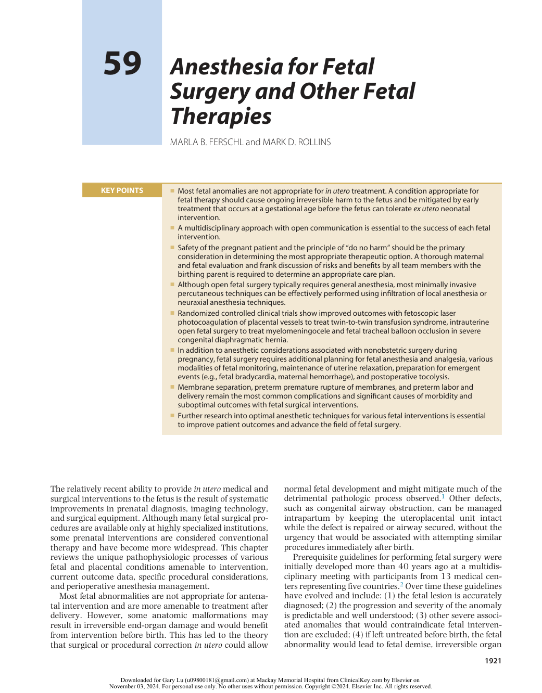

:::

<!-- PDF page 2 -->

damage, or severe postnatal morbidity and, therefore, intervening before birth would benefit the neonatal outcome; (5) the risk to the pregnant patient is acceptably low; (6) animal models have demonstrated feasibility of the surgical technique and reversal of the deleterious effects; (7) fetal interventions are performed at specialized multidisciplinary institutions using protocols approved by the center’s ethics committees with informed consent of the birthing parent; and (8) access to highly specialized multidisciplinary care that includes bioethical and psychological patient care and counseling.1–3,4 All interventions should be preceded by a thorough multidisciplinary team deliberation of the clinical case. Discussions should focus on a comprehensive risk–benefit analysis and providing the family appropriate counseling that includes options for elective termination of pregnancy or continuation of pregnancy without fetal therapy. Potential risks to the pregnant patient should be part of the informed consent, with a detailed preoperative evaluation as part of the process to ensure risks to the patient are minimal.5

The advancement of fetal surgery has benefited from a multidisciplinary approach and establishment of the International Fetal Medicine and Surgery Society to disseminate techniques and outcome data through an international

registry.6 Medical centers offering fetal treatment rely on surgeons and anesthesiologists devoted to the care and counseling of these complex maternal and fetal patients, as well as the expertise of radiologists, perinatologists, geneticists, neonatologists, psychologists, social workers, and numerous support staff. In addition, the care level at each fetal therapy center should match the anticipated case complexity. There are three levels of fetal therapy care that have recently been proposed.4 A level I fetal therapy center should offer interventions associated with obstetric risks no greater than preterm birth or membrane rupture. The patient is unlikely to require subspecialty or intensive care, and neonatal risks do not exceed those of moderate prematurity. A level II center should be able to provide intensive care to pregnant individuals and manage extreme neonatal prematurity, and a level III therapy center should offer all fetal interventions (including open fetal surgery) and be able to manage any associated complications and comorbidities.

Fetal surgery is broadly categorized into three types of intervention: minimally invasive procedures, open procedures, and intrapartum procedures. A summary of conditions considered for fetal intervention with corresponding rationale and treatment is displayed in Table 59.1.

Minimally invasive fetal procedures include (1) percutaneous interventions guided by ultrasound, also known

**Table 59.1** Fetal Conditions Currently Considered for Intervention

|**Fetal Condition**|**Therapy Rational**|**Type**|**Intervention**|
|---|---|---|---|
|Fetal anemia or thrombocytopenia|Prevention of heart failure and fetal hydrops|FIGS- IT|Intrauterine transfusion|
|Aortic stenosis, intact atrial septum, or pulmonary atresia|Prevention of fetal hydrops, myocardial dysfunction, and hypoplastic left (and right) heart|FIGS- IT|Percutaneous fetal valvuloplasty or septoplasty|
|Lower urinary tract obstruction|Bladder decompression with reduction in renal dysfunction, pulmonary hypoplasia, oligohydramnios, and limb malformation|FIGS- IT or fetoscopy|Percutaneous vesicoamniotic shunting or fetoscopic posterior urethral valve laser ablation|
|Twin reversed arterial perfusion|Prevention of high- output cardiac failure in the normal twin by stopping flow to acardiac twin|FIGS- IT or fetoscopy|Image- guided radiofrequency ablation or fetoscopic coagulation of acardiac twin umbilical cord. Percutaneous coiling or ligation of umbilical cord is also used|
|Twin–twin transfusion syndrome|Reduction of twin–twin blood flow and prevention of cardiac failure|Fetoscopy|Fetoscopic laser photocoagulation of placental vessels and amnioreduction|
|Amniotic band syndrome|Prevention of limb loss|Fetoscopy|Fetoscopic band ablation|
|Congenital diaphragmatic hernia|Prevention of pulmonary hypoplasia|Fetoscopy|Fetoscopic tracheal occlusion|
|Myelomeningocele|Reduction in hydrocephalus and hindbrain herniation, with reduced spinal cord damage and improved neurologic function|Open or fetoscopy|Closure of fetal defect through hysterotomy|
|Sacrococcygeal teratoma|Prevention of high- output cardiac failure, hydrops, and polyhydramnios|FIGS- IT or open|Ablation of tumor vasculature or open fetal tumor debulking|
|Congenital cystic adenomatoid malformation|Reversal of pulmonary hypoplasia and cardiac failure|FIGS- IT or open|Thoracoamniotic shunting or open surgical resection|
|Fetal airway compression|Secured open airway and/or circulatory support to prevent respiratory compromise at birth|Open intrapartum|_Ex utero_intrapartum therapy (EXIT) that allows fetal stabilization while on uteroplacental circulation|

_FIGS- IT,_ fetal image– guided surgery for intervention or therapy. Modified from Partridge EA, Flake AW. Maternal- fetal surgery for structural malformations. _Best Pract Res Clin Obstet Gynaecol_ . 2012;26:669–682 and Hoagland MA, Chatterjee D. Anesthesia for fetal surgery. _Paediatr Aneasth_ . 2017;27:346–357.

::: details 原始表格與符號（PDF 第 2 頁）

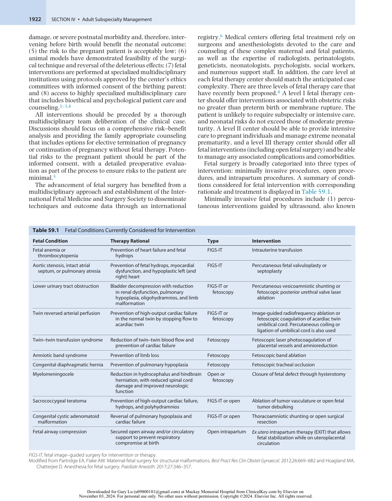

:::

<!-- PDF page 3 -->

as fetal image–guided surgery for intervention or therapy (FIGS- IT), and (2) fetal endoscopic surgery using small endoscopic instruments inserted percutaneously guided by direct fetoscopic camera view and simultaneous realtime ultrasound imaging. With these minimally invasive approaches, the risks for preterm labor and delivery are reduced compared to open procedures that include a hysterotomy. Unlike open fetal procedures, the patient can safely undergo a vaginal delivery for this and future pregnancies. However, the risk for preterm premature rupture of membrane (PPROM) remains significant.7

Open fetal procedures involve a maternal laparotomy, a hysterotomy, and the need for intraoperative uterine relaxation. These procedures incur significantly more risk to both the fetus and the pregnant individual than minimally invasive procedures. These increased risks include PPROM, oligohydramnios, preterm labor and delivery, uterine rupture, and fetal mortality.8–10 Additional maternal and fetal risks include not only the anesthetic risks noted for nonobstetric surgery during pregnancy (see also Chapter 27), but also pulmonary edema, hemorrhage, membrane separation, and chorioamnionitis.5,8 Cesarean delivery is required after an open fetal procedure and for all future pregnancies owing to the increased risk for uterine dehiscence or rupture at the site of the hysterotomy.

For fetuses with known airway compromise or obstruction, an _ex utero_ intrapartum therapy (EXIT) procedure11,12 allows continued fetal support by the intact uteroplacental unit (placental bypass) while the fetal airway is secured or other procedures completed without the concern for postnatal respiratory compromise, hypoxia, or asphyxia. Congenital high airway obstruction (CHAOS) due to an underlying laryngeal stenosis, laryngeal web, cystic hygromas, lymphangiomas, or cervical teratomas are the most common anatomic indications for an EXIT procedure.13,14 Congenital pulmonary lesions and sacral teratomas have also been resected during the EXIT procedure, with resulting normal umbilical cord carbon dioxide and pH values at birth, even when surgical time has exceeded 2.5 hours.15 Extracorporeal membrane oxygenation (ECMO) can be initiated during an EXIT procedure for a fetus with significant cardiopulmonary disease.16 The EXIT procedure has become a widely practiced fetal intervention for a growing list of indications.

Much of the success of fetal therapy in the past four decades can be attributed to extraordinary advances in both ultrasonography and magnetic resonance imaging (MRI), which have substantially improved the accuracy of prenatal diagnosis and expanded our understanding of the pathophysiologic factors of various untreated fetal abnormalities.

Significant advancements in ultrasonographic transducer hardware and digital signal processing have resulted in better image resolution with more accurate differentiation of abnormal fetal anatomy, wider fields of view, and improvement in the dynamic range for both near- field and far- field signal- to- noise ratio. Use of this improved ultrasonographic imaging as a real- time guide has enabled practitioners to develop and perform various diagnostic tests and fetal therapies more precisely and safely. Examples of fetal ultrasound- guided diagnostic procedures include first- trimester chorionic villus sampling,

embryofetoscopy, amniocentesis, umbilical cord sampling, and fetal biopsies.17 These diagnostic advances allow more accurate prenatal consultation, the ability to intervene at an earlier gestational age, and usually enough time to change the location of antepartum care and the delivery plan if needed. Live ultrasonography is typically used to guide all minimally invasive fetal procedures and is also critical to initial portions of open fetal procedures and fetal monitoring.

MRI has undergone technologic improvements that have reduced image acquisition time, decreased motion artifacts, and enhanced image resolution to a point at which fetal MRI is frequently used in conjunction with ultrasound to better detect and evaluate anatomic pathologic processes. Fetal MRI can aid in diagnosis as a complimentary technique to ultrasound as it provides a larger field of view that is not obscured by fetal bone artifact, but it is expensive and not available in all centers.18,19

In addition to advances in imaging technology, decades of procedural innovations and research have provided the basis for the _in utero_ fetal interventions used clinically today. Initial pioneers in the field of fetal therapy include Sir (Albert) William Liley. In the early 1960s, Liley20 was the first to successfully treat erythroblastosis fetalis with an intraperitoneal blood transfusion that allowed the transfused red blood cells to be absorbed into the fetal circulation through the subdiaphragmatic lymphatics and thoracic duct.21 Unfortunately, initial attempts to perform fetal blood transfusion through direct cannulation of the umbilical vessels were unsuccessful until 1981, when a reliable technique that employed fetoscopy was described.22,23 With improved imaging resolution, the standard technique quickly became direct needle access of the umbilical vessels using ultrasound guidance. In the early 1970s, Liggins administered corticosteroids to the fetus via the maternal circulation to increase surfactant production in preterm fetuses at risk for respiratory distress syndrome.24

Fetal surgery began in the early 1980s after rigorous research efforts and technical advancements in sheep25–27 and monkey28 models. Harrison and colleagues29 performed the first successful human fetal surgery by creating a vesicostomy in a fetus with a congenital lower urinary tract obstruction, resulting in bilateral hydronephrosis. Working with Harrison in the early 1980s, Rosen refined fetal anesthetic techniques in monkeys28 to improve intraoperative uterine relaxation and clinical outcome before employing them for the first human fetal surgeries and then detailing these techniques in the literature. Since the early 1980s, great advances have been made in the development of minimally invasive percutaneous surgical techniques, fetoscopy, and procedural aspects of open fetal surgery with hysterotomy. Fetal therapy also has advanced in its outcome evaluation from published case reports and series to prospective randomized controlled trials.

Fetal surgery is a reasonable therapeutic intervention for certain correctable fetal anomalies with predictable, life- threatening, or serious developmental consequences. With all types of fetal intervention, meticulous planning and a multidisciplinary team approach are critical to a successful outcome. The following sections provide a review and summary of the congenital lesion, outcome data, procedural factors, and perioperative anesthesia

<!-- PDF page 4 -->

considerations for the various conditions currently amenable to fetal intervention.

## Indications, Procedures, and Outcomes

### ANEMIA AND INTRAUTERINE TRANSFUSION

The incidence of fetal anemia secondary to rhesus D (RhD) sensitization has decreased since the introduction of RhD immunoglobulin prophylaxis in the late 1960s, to rates of approximately 1 in 1000 pregnancies.21 However, other red blood cell (RBC) antigens, parvovirus B19 infection, maternal–fetal hemorrhage, and homozygous thalassemia also cause fetal anemia and combine to reach a rate of approximately 6 cases in 1000 live births.21,30 Although spectral analysis examining bilirubin levels in serial amniotic fluid samples was originally used to detect fetal anemia and determine the timing of therapy, most treatment centers currently rely on noninvasive Doppler studies of the middle cerebral artery (MCA).30,31 An increased peak MCA blood flow velocity more than 1.5 multiples of the median is a threshold proven accurate in detecting moderate- tosevere fetal anemia requiring intervention.32 The value of this peak velocity threshold may be increased with each serial transfusion treatment to decrease the false-positive rate. Fetal blood sampling from the umbilical vein just before starting the intrauterine transfusion (IUT) is the gold standard for determining the degree of fetal anemia. IUT is not used before 18 weeks’ gestational age because umbilical vein access is not reliable. For cases requiring earlier intervention, fetal intraperitoneal transfusion of RBCs may initially be the intervention of choice.33

IUTs are typically performed using local anesthesia, with minimal sedation and analgesia of the patient.34 However, the anesthesiologist should be prepared for an emergent cesarean delivery at any time during the procedure if the fetus is at a viable gestational age. Under ultrasound image guidance, a 20- or 22- gauge needle is used to access the umbilical vein. The access point is typically near the placental cord insertion to provide stability (Fig. 59.1). Puncture of an umbilical artery rather than the umbilical vein is associated with prolonged bleeding and fetal bradycardia secondary to spasm.21 Occasionally a free loop of the umbilical cord or intrahepatic portion of the umbilical vein may be used. The umbilical cord has no known pain receptors, but needle access of the intrahepatic portion of the umbilical vein stimulates pain receptors with passage of the needle into the fetus and increased levels of cortisol and beta- endorphins. Fentanyl attenuates the fetal stress response from intrahepatic fetal needle placement.35 Yet, in one study, fetal stress hormone changes with IUT were unrelated to site of needle placement.36 However, these results are difficult to interpret because hormone levels may primarily be determined by changes secondary to the underlying fetal anemia and associated hemodynamic alterations that are then changed with intravascular volume expansion. Given this uncertainty, fentanyl (10 to 20 mcg/kg) is administered intramuscularly to the fetus before use of an intrahepatic approach. There is some evidence to suggest that fetal anesthesia does not alter middle

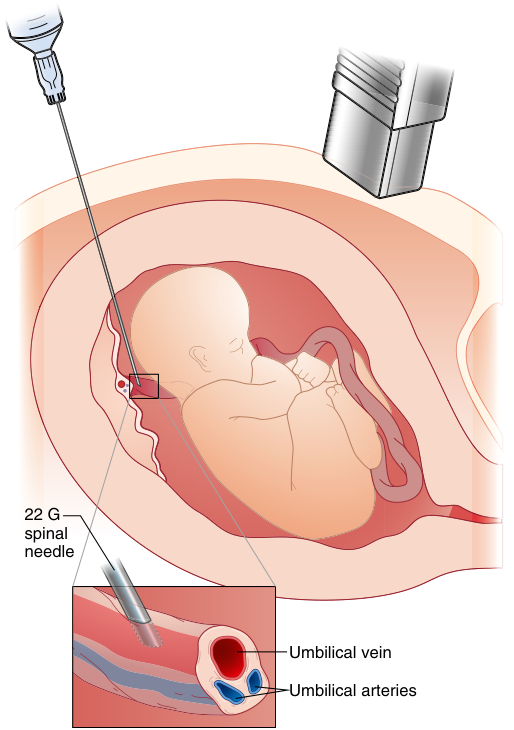

22 G spinal needle Umbilical vein Umbilical arteries 

**Fig. 59.1 Diagram of cordocentesis procedure used in intrauterine transfusion.** _Inset window_ shows tip of 22- gauge spinal needle entering the umbilical vein. (Redrawn from Ralston SJ, Craigo SD. Ultrasoundguided procedures for prenatal diagnosis and therapy. _Obstet Gynecol Clin North Am_ . 2004;31:101–123.)

cerebral artery peak systolic velocity flow patterns follow-

ing transfusion.37

Administration of an intramuscular muscle relaxant (e.g., rocuronium 2.5 mg/kg) to the fetus should be considered to decrease the likelihood of fetal movement that could dislodge the needle or sheer the umbilical vein.38,39 If a muscle relaxant is administered directly into the umbilical vein the dose of muscle relaxant can be reduced (e.g., rocuronium 1.0 mg/kg). The volume of type O, rhesus (Rh)negative, irradiated, viral screened, packed RBCs transfused is estimated from the gestational age, estimated fetal weight, donor unit hemoglobin (Hb), and pretransfusion Hb.40 At the majority of institutions the blood is washed, leukocyte reduced, cytomegalovirus (CMV) negative, and &lt; one week after collection.41 The rate of transfusion is typically 5 to 10 mL/min, with a target of 45% to 55% hematocrit. Intravascular location of the needle tip can be assessed with Doppler imaging throughout the transfusion injection. Periodic sampling is used to guide the final transfusion volume. After IUT therapy, fetal Hb levels decrease approximately 0.3 g/ dL/day42 and multiple repeat IUTs are typically required at 1- to 3- week intervals, depending on the rate of Hb decline.

Perinatal fetal loss rate is approximately 2% per fetus and 0.7% per IUT procedure.31 Other complications including

<!-- PDF page 5 -->

emergency cesarean delivery, transient fetal bradycardia, intrauterine infection, and PPROM, and preterm delivery occurs in approximately 1%–3% of IUT procedures.43 Although survival rates are significantly less for hydropic fetuses, recent published overall survival rates with IUT are 97%.31 A long- term outcome study of 291 children (median age of 8.2 years with a range of 2 to 17 years of age) who underwent IUT during gestation for hemolytic disease found a 4.8% rate of neurodevelopmental impairment, including cerebral palsy (2.1%), severe developmental delay (3.1%), and bilateral deafness (1.0%).44 Severe fetal hydrops was independently associated with neurodevelopmental impairment.

### CONGENITAL HEART DEFECTS

Congenital heart anomalies occur with a frequency of approximately 7 to 9 per 1000 live births (see also Chapter 73),45 with ventricular septal defects the most common cardiac anomaly.46 The majority of congenital heart defects (CHDs) are not amenable for fetal intervention. Ultrasound imaging allows diagnosis of cardiac defects as early as 12 to 16 weeks’ gestation but is generally performed at 18 to 22 weeks’ gestation, when most obstetric ultrasound assessments screen for other fetal abnormalities.47

Most fetal surgical cardiac interventions focus on opening a stenotic valve or enlarging a restricted opening. These include (1) aortic balloon valvuloplasty for treatment of critical aortic stenosis and evolving hypoplastic left heart syndrome (HLHS), (2) atrial septostomy for highly restrictive or intact atrial septum seen in HLHS, (3) pulmonic valvuloplasty for pulmonary atresia or intact ventricular septum and hypoplastic right ventricles, and (4) pericardiocentesis to treat congenital cardiac tumors or aneurysms.47–50 _In utero_ intervention attempts to halt or reverse the morbid effects of the cardiac lesion before irreversible consequences occur. Early childhood mortality from severe cardiac defects, such as HLHS, remains in the range of 25% to 35%.51,52 Survivors have significant associated abnormalities in neurologic development.53,54

The most commonly performed procedure is an aortic valvuloplasty for aortic stenosis with evolving HLHS.55 Significant aortic stenosis maintains fetal circulation primarily through the low- resistance foramen ovale and diminishes left ventricular development. Selection guidelines for fetal aortic valvuloplasty focus on the presence of significant aortic stenosis, evolving HLHS, and the potential for a technically successful procedure and biventricular postnatal outcome.56,57 For this procedure58 the fetus is ideally positioned with the left chest anterior, and ultrasound is used to guide the percutaneous passage of an 18- or 19- gauge needle cannula through the uterus, through the fetal chest, and into the apex of the left ventricle (Fig. 59.2A). Maternal local anesthesia infiltration or neuraxial block is typically used for these procedures, and fetal resuscitation drugs must be readily available. In some cases, general anesthesia may be preferred for uterine relaxation to facilitate an external version to change fetal positioning and improve cannula trajectory. Before cannula insertion, intramuscular fentanyl and a paralytic agent are administered to the fetus with ultrasound guidance, as detailed in the discussion of Fetal Anesthesia, Analgesia, and Pain Perception.55,59

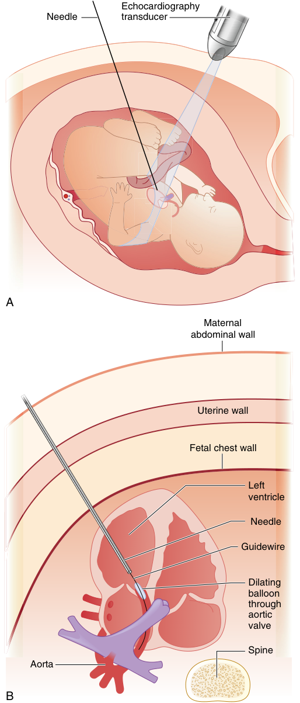

Echocardiography Needle transducer A Maternal abdominal wall Uterine wall Fetal chest wall Left ventricle Needle Guidewire Dilating balloon through aortic valve Spine Aorta B 

**Fig. 59.2** (A) Depiction of ideal fetal position and insertion needle orientation. The fetal left chest is anterior, and the pathway from maternal abdomen entry point to the apex of the left ventricle is unobstructed. (B) This linear cannula course continues from left ventricle apex to the aortic valve. (Redrawn from Tworetzky W, Wilkins- Haug L, Jennings RW, et al. Balloon dilation of severe aortic stenosis in the fetus: potential for prevention of hypoplastic left heart syndrome–candidate selection, technique, and results of successful intervention. _Circulation_ . 2004;110:2125– 2131, with permission from Lippincott Williams & Wilkins.)

<!-- PDF page 6 -->

The cannula tip is ideally positioned in the left ventricle, directly in front of the opening of the stenotic aortic valve and aligned with the left ventricular outflow tract. A coronary balloon catheter with guidewire is passed through the cannula into the stenotic valve and positioned in the aortic annulus, where it is inflated and deflated multiple times (Fig. 59.2B). In certain cases, a small laparotomy is used to facilitate improved cannula alignment with the cardiac lesion. Technical success for fetal aortic valvuloplasty is >90% using an angioplasty balloon over a guidewire at a high volume institution.55 Successful valvuloplasty creates improved left ventricular function, improved aortic and mitral valve development, and birth of a live neonate in 90% of interventions.60,61 Fetal complication rates from centers in Linz, Austria ( _n_ =24) and Boston ( _n_ =70) for fetal aortic valvuloplasty include: fetal bradycardia (17% and 38%, respectively), pericardial effusion (13% and 14%), ventricular thrombosis (21% and 15%), and fetal death (13% and 8%).56,62,63 A systematic review noted complication rates following fetal aortic valuloplasty of preterm delivery (16%), neonatal death (16%), bradycardia (52%) and hemopericardium (20%).49 Approximately 40% of technically successful cases result in aortic regurgitation and minimal subsequent left ventricular growth. Biventricular circulation is present at birth in approximately half of the successful cases.60,61 Anterograde aortic arch flow within the first 24 hours after the procedure may be predictive of a biventricular outcome.64 Rates of successful intervention and procedural complications are likely highly dependent on the volume of procedures done at a specific therapy center.55

Similar surgical techniques are used for atrial septoplasty and pulmonary valvuloplasty.48 Outcomes from a small series of fetal atrial septostomies are promising; however, the defect created by the balloon dilation tends to close over time unless a stent is placed (which can be difficult and has successful deployment in 44% to 62% of small case series).65 Based on data from a multicenter international database, pulmonary valvuloplasty for pulmonary atresia and pulmonary stenosis was technically successful in 71% of procedures, with no maternal complications noted, but fetal complications occurring in 55% of cases.66 The most common complications were pericardial effusion (48%) and bradycardia requiring treatment (36%). Of the 58 patients, fetal demise occurred in 3 during the procedure, with an additional 4 deaths within 48 hours.66

Pericardiocentesis in the setting of pericardial teratomas has been performed.67 _In utero_ placement of cardiac pacing has been investigated to treat fetal cardiac arrhythmias unresponsive to conventional management with transplacentally administered antiarrhythmic drugs.68,69 Unfortunately, these initial attempts are frequently unsuccessful.

### OBSTRUCTIVE UROPATHY

Fetal lower urinary tract obstruction (LUTO) affects 2–3 in 10,000 fetuses.70 These obstructions can be bilateral or unilateral and occur at the ureteropelvic junction, at the ureterovesical junction, or at the level of the urethra. If the obstruction is urethral or bilateral, significant developmental consequences occur (Box 59.1).

### Box 59.1 Developmental Consequences of Fetal Urethral Obstruction

|**Oligohydramnios**|
|---|
|◾Potter’s facies (prominent infraorbital folds) ◾ Hypoplastic lungs ◾ Flexion contracture|
|**Hydronephrosis** ◾ Type 4 cystic dysplasia ◾ Renal failure|
|**Hydroureter and megacystis**|
|◾ Abdominal muscle deficiency ◾ Prune belly|

Data from Harrison MR, Filly RA, Parer JT, et al. Management of the fetus with a urinary tract malformation. _JAMA_ . 1981;246:635–639.

Rates of perinatal mortality in these cases are as frequent as 90%, and survivors have more than 50% renal impairment.71,72

Posterior urethral valves are the most common cause of congenital bilateral hydronephrosis in male fetuses. Urethral obstruction is the most common cause in females, with other possible causes including ectopic ureter, ureterocele, megacystis megaureter, multicystic kidney, or other complex pathologic processes.72,73 Ultrasound investigations of oligohydramnios resulting from the decreased fetal urine output easily detect these uropathies with high sensitivity and specificity. Fetal MRI should be considered in cases of severe oligohydramnios as an additional imaging technique to determine the presence of associated fetal anomalies.74 Grading systems based on ultrasound imaging of renal diameter to determine the severity of hydronephrosis and assessment of urinary tract dilation are used to determine risk stratification and treatment options.75 A classification system for LUTO has been proposed that is based on amniotic fluid index, renal imaging, and fetal urine chemistry.76 The associated morbidity predicted for each type of uropathy depends on obstruction location, duration, sex, and gestational age at onset.77 Preterm delivery allows neonatal urinary tract decompression, but morbidity from pulmonary immaturity prevents early intervention and limits the efficacy of this approach.

Poor prognosis is associated with earlier presentation during gestation, a more intense severity of oligohydramnios, associated structural abnormalities, and increased concentrations of fetal urine electrolytes, osmolality, protein, and β2- microglobulin.77,78 Each case should be thoroughly investigated to determine whether other anomalies are present and if the fetus is a suitable candidate for intervention. If LUTO is corrected postnatally, 25% to 30% of surviving neonates will require dialysis by age five.79

Placement of an _in utero_ fetal vesicoamniotic shunt (VAS) for _in utero_ treatment of LUTO allows decompression of the fetal bladder and urinary tract into the amniotic cavity.80 Vesicoamniotic shunting prevents the physiologic cycle of urine accumulation and allows for emptying that is required for normal bladder development, improves dysplastic renal histologic conditions, increases amniotic fluid volume, improves lung development, and prevents

::: details 原始表格與符號（PDF 第 6 頁）

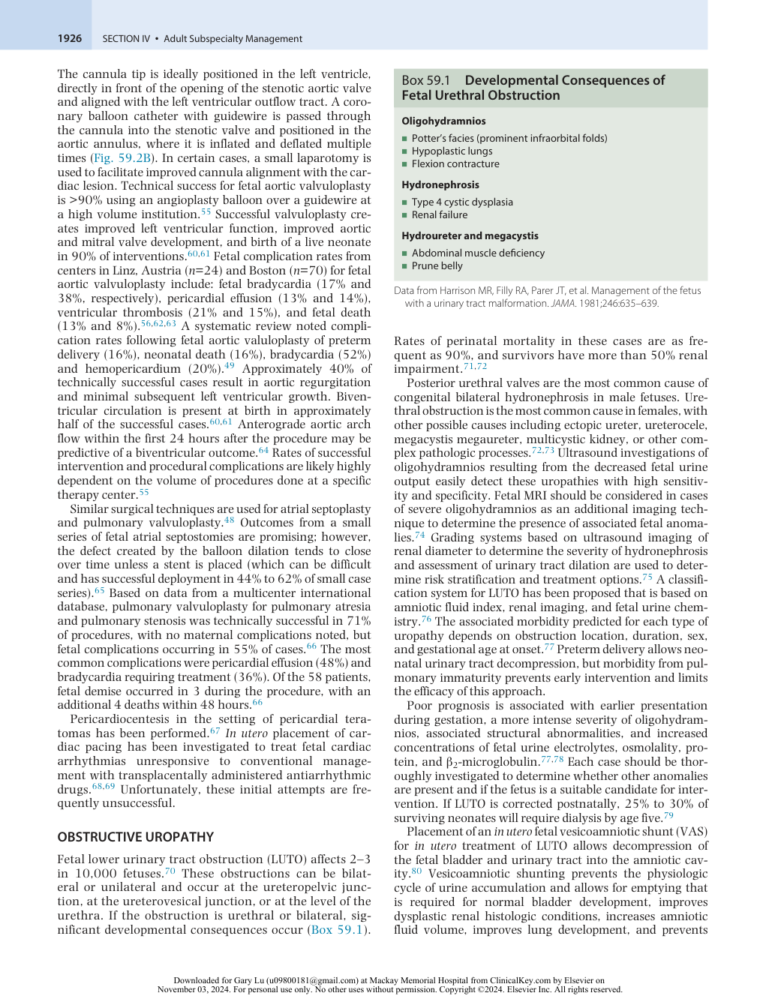

:::

<!-- PDF page 7 -->

bladder wall fibrosis in animal models.81–83 Determination of which human fetuses would benefit from _in utero_ treatment of LUTO remains uncertain.79,84 Human VAS placement started in the 1980s in an effort to improve renal development and reduce the pulmonary hypoplasia associated with oligohydramnios. These valveless, doublecoiled shunts are inserted percutaneously with ultrasonographic guidance and local anesthesia. One coil remains in the urinary bladder and the other in the amniotic cavity. Prior infusion of fluid into the amniotic cavity can aid in proper placement. Complications associated with these catheters include difficult placement, subsequent occlusion, and position migration (malfunction occurs in up to 60% of cases).85 Fetal and maternal complications include fetal trauma, iatrogenic abdominal wall injury, gastroschisis, amnioperitoneal leaking, PPROM, preterm labor and delivery, and infection.86 Neonatal survival rates after fetal vesicoamniotic shunting vary in the literature from 40% to 90%, with approximately 50% of survivors having normal renal function.79,87–89 A meta- analysis of LUTO treatment studies through 2015 noted a perinatal survival advantage with _in utero_ VAS placement compared with standard care (57% vs. 39%), but ultimately no difference in renal function or 2- year survival.79 A multicenter, randomized controlled trial (the Percutaneous Shunting in Lower Urinary Tract Obstruction [PLUTO] trial) compared the perinatal mortality and renal function of fetuses with LUTO treated by either VAS or conservative noninterventional care. The trial was unable to recruit sufficient cases, with only 31 out of 150 desired patients recruited over a 4- year period. Analysis of this smaller enrollment noted a mortality benefit in the fetal treatment group at 28 days, 1 year, and 2 years of age; however, substantial morbidity occurred in both groups, including only two children with normal renal function at age two.90

Fetal cystoscopy (FC) is a recent intervention that allows prenatal visualization of the fetal urethra and treatment with ablation of the urethral obstruction. Cystoscopy facilitates diagnosis between LUTO resulting from urethral atresia and posterior urethral valves. This is an important distinction, as urethral atresia is nearly universally lethal and does not improve with vesicoamniotic shunt placement, while posterior urethral valves are amenable to fetal intervention. Ablation of posterior urethral valves facilitated by fetal cystoscopy may increase survival compared with expectant management. A case series91 and retrospective case–control study92 demonstrate fetoscopic laser ablation for posterior urethral valves can achieve bladder decompression and amniotic fluid normalization. In addition, using fetal cystoscopy may improve 6- month survival in severe LUTO compared to no fetal intervention and result in improved renal function at birth when compared to treatment with vesicoamniotic shunting.92 A more recent retrospective study compared fetal cystoscopy to VAS placement in 33 patients undergoing 48 procedures showed no difference was found between FC and VAS with respect to survival, long- term kidney function, or urologic outcome.93 Future prospective trials are necessary to validate these initial retrospective results.

Selective fetal intervention with shunting or cystoscopy for LUTO restores amniotic fluid volume, prevents pulmonary hypoplasia, and improves perinatal mortality.

However, the effects on medium- term and long- term renal function, neurologic function, bladder function, and other morbidities remain unclear and additional clinical research is needed.84,94

More recent work has investigated the use of serial amnioinfusion therapy for improving neonatal survival.95 An ongoing multicenter clinical trial, the renal anhydramnios fetal therapy (RAFT) trial, is underway to further investigate the use of serial amnioinfusions (1–3 times weekly) in fetuses with bilateral renal agenesis or fetal renal failure with a primary outcome of the proportion of neonates that achieve successful use of a dialysis catheter for equal to or greater than 14 continuous days.96

### TWIN REVERSED ARTERIAL PERFUSION SEQUENCE

Twin reversed arterial perfusion (TRAP) sequence is an abnormality of monozygotic twins that affects approximately 1 in 35,000 pregnancies, 1 in 100 monozygotic twin gestations, and 1 in 30 triplet gestations.97 In this condition, one of the monozygotic twins has an absent or nonfunctioning heart and no connection to the placenta. The nonviable twin is perfused with retrograde blood flow from the other twin through vascular anastomoses; blood returns to the normal twin by anastomoses that bypass the placenta. The inadequate perfusion of the recipient twin (primarily occurring retrograde through the umbilical arteries) results in a lethal set of anomalies that include acardia and acephalus. Because the normal or “pump” twin generates blood flow for both itself and the nonviable twin, it is at risk for high- output congestive heart failure, hydrops fetalis, and preterm birth secondary to the increased uterine volume from polyhydramnios and increased size of the hydropic nonviable twin.98 If untreated, TRAP sequence is associated with a 35% to 55% risk for intrauterine death of the normal pump twin, with survivors having an average gestational age of 29 weeks.99,100 Diagnosis is confirmed with ultrasound findings of reverse flow to the nonviable twin by the umbilical artery. The objective of fetal therapy is to disrupt the vascular communication between the two twins to prevent further cardiac failure in the pump twin. Successful treatment of TRAP sequence results in cessation of flow in the recipient twin’s umbilical artery and the death of the nonviable fetus.

Several _in utero_ approaches can accomplish these goals. Ultrasound- or fetoscopic- guided umbilical cord coagulation using bipolar techniques, fetoscopic laser coagulation of placental anastomoses, and percutaneous intrafetal laser or radiofrequency ablation (RFA) of the acardiac twin’s umbilical cord base have been the most viable therapeutic options98,101–103 (Fig. 59.3). Additional more historic interventions include selective delivery of the nonviable fetus by hysterotomy, umbilical cord ligation, cord transection, and cord coagulation using coils or other thrombogenic material. A multicenter retrospective review of 98 TRAP sequence cases treated with RFA noted survival rates of 80% and a median gestational age at delivery of 37.0 weeks.102 A 2016 publication of 42 cases of TRAP treated with RFA after 15 weeks’ gestation noted an 85% survival rate with mean delivery at 37.5 weeks’ gestation.103 Rates of preterm PROM in these two studies were 17.3% and

<!-- PDF page 8 -->

A 

B 

**Fig. 59.3** (A) Photograph of a radiofrequency ablation (RFA) device with tines deployed. Scale below device in centimeters. (B) Intraoperative ultrasound image shows adequate position of the RFA device (tines deployed), with evidence of effects on the fetal tissues (regional increased echogenicity) as energy is applied. (Figures reproduced with permission from Hopkins LM, Feldstein VA. The use of ultrasound in fetal surgery. _Clin Perinatol_ . 2009;36:255–272.)

2.9% respectively. Although most TRAP cases are treated after 16 weeks’ gestation, the therapeutic benefit of ablative intervention as early as 12 weeks’ gestational age has been demonstrated, as significant cardiac failure and death may occur in up to a third of pump twins if therapy is delayed until after 16 weeks’ gestation.101,104,105 The most common complications following TRAP treatment include PPROM, preterm delivery, and intrauterine fetal demise.

Minimally invasive procedures to treat TRAP typically only require maternal infiltration of local anesthesia at the percutaneous insertion site of the fetoscope or ablative device, although neuraxial anesthesia can also be used.106 Ultrasound guidance and assessment is critical for all of these therapies, and procedure success is confirmed by absence of flow to the nonviable acardiac twin at the end of the procedure and again approximately 12 to 24 hours later.

### TWIN- TO- TWIN TRANSFUSION SYNDROME

Monochorionic twins share the same placenta and typically have intertwin vascular connections that create shared blood flow between the two fetuses. A significant number of these chorionic vascular anastomoses can result in unequal placental blood flow between the two monochorionic twins, creating a significant degree of intertwin discordance that can lead to twin- to- twin transfusion syndrome (TTTS). The occurrence of TTTS is approximately 1 to 3 per 10,000 births.107 Monochorionic twinning occurs in approximately 20% to 25% of twin pregnancies, with TTTS complicating about 10% of these monochorionic gestations.107–109 TTTS usually manifests after the first trimester and is typically recognized at midgestation.108,110

Normally, umbilical arteries carry deoxygenated blood to the surface of the placenta, where gases and nutrients are exchanged with the maternal circulation. The returning venous blood flow is “paired” with the arterial flow, and the two components lie next to each other (Fig. 59.4). This fetal– placental vascular configuration (cotyledon) represents normal anatomy. A variety of abnormal unidirectional and imbalanced vascular connections are present in TTTS (Fig. 59.5). In TTTS, a branch of an umbilical artery descends into the placenta and cotyledon, but instead of connecting with a paired vein, it connects with a vein that brings blood to the other twin, and this results in an arteriovenous anastomosis between the two fetuses.108,110 Although some intertwin arteriovenous vascular architecture is found in

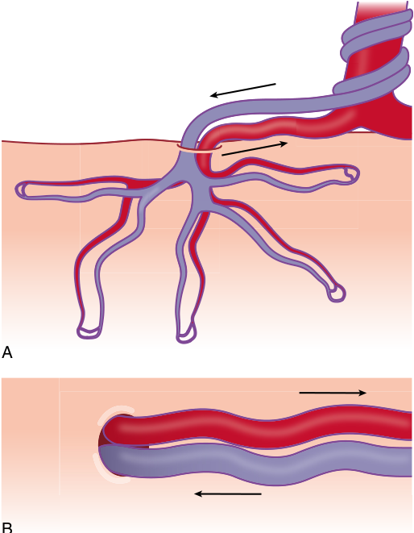

A B 

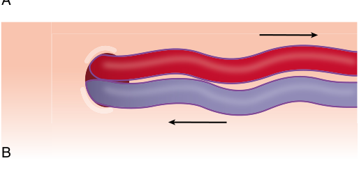

B 

**Fig. 59.4** (A) Normal placenta angioarchitecture (cotyledon). (B) Superficial view of bidirectional flow into and out of a cotyledon. (Redrawn from Rand L, Lee H. Complicated monochorionic twin pregnancies: updates in fetal diagnosis and treatment. _Clin Perinatol_ . 2009;36:417–430.)

90% to 95% of all monochorionic twins, the shared blood flow is balanced by the presence of arterioarterial and venovenous bidirectional connections, which are found in 85% to 90% and 15% to 20% of monochorionic twin placentas, respectively.108,111,112 The presence of arterioarterial connections is viewed as protective by allowing the overall resistances and blood flow to equalize between the twins and is associated with a significant reduction in TTTS.113

The complex pathophysiology of TTTS is dynamic and secondary to a variety of humoral, biochemical, hemodynamic, and functional changes in the two fetuses.108 The

<!-- PDF page 9 -->

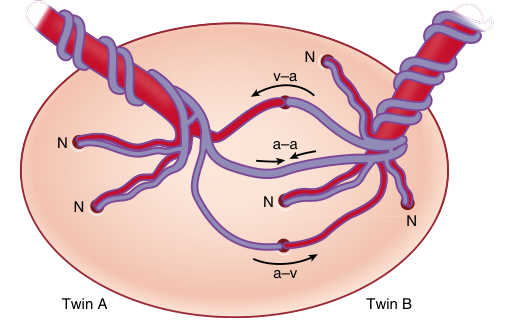

N v–a N a–a N N N a–v Twin A Twin B 

**Fig. 59.5 Depiction of various types of vascular anastomoses present in monochorionic placentas.** _a–a,_ arterioarterial anastomosis; _a–v,_ arteriovenous anastomosis; _N,_ normal angioarchitecture (cotyledon); _v–a,_ venoarterial anastomosis. (Modified with permission from Simpson LL. Twin- twin transfusion syndrome. _Am J Obstet Gynecol_ . 2013;208:3–18.)

increased blood flow to the recipient twin leads to polycythemia, polyuria, and polyhydramnios and can cause hypertrophic cardiomyopathy, hydrops fetalis, and fetal death. The donor twin (often described as the “stuck” or “pump” twin) is typically hypovolemic, growth- restricted, confined against the endometrium in an oligohydramniotic sac. This twin is primarily at risk for renal failure, cardiac failure, and hydrops fetalis secondary to the high cardiac output state.

The diagnosis of TTTS requires (1) a monochorionic diamniotic pregnancy and (2) a significant discrepancy in amniotic fluid volumes with ultrasound measurements of the maximal vertical pocket (MVP) of less than 2 cm in the oligohydramniotic twin and the MVP greater than 8 cm in the polyhydramniotic twin.108,114,115 Twin size discordance and the presence of intrauterine growth restriction are often present in TTTS, but are not considered necessary to confirm the diagnosis. Although a variety of staging systems exist for determining the severity of TTTS, the most commonly used is the Quintero staging system (Table 59.2), which is based on ultrasound findings.116,117 The progression of hypertrophic cardiomyopathy in the fetal recipient is detailed in a scoring system presented by Rychik and colleagues utilizing fetal echocardiography118,119 that provides a more detailed assessment of TTTS severity when combined with the Quintero staging system.109

Fetuses with TTTS are at risk for PPROM, preterm delivery, and neurologic injury with white- matter lesions and long- term disability.120 Neurodevelopmental impairment is associated with a low gestational age at birth.121–123 Although outcome data stratified for the advanced stages of TTTS are limited, a higher mortality rate is likely associated with more advanced progression of the disease.114,124 TTTS stopping at stage I has an 85% survival rate, while higher- staged TTTS can increase to >80% mortality if untreated.107,125 However 60% of stage I TTTS cases progress without intervention.126

Several therapeutic management techniques have been developed to treat TTTS. Amnioreduction can help control polyhydramnios and thereby reduce the risk for both preterm labor and respiratory distress of the patient. Also,

**Table 59.2** Stages of Twin–Twin Transfusion Syndrome

|**Stage**|**Ultrasound Findings**|
|---|---|
|**I**|**Amniotic Fluid:** Oligohydramnios in donor twin sac with MVP &lt;2 cm and polyhydramnios in recipient twin sac with MVP >8 cm|
|**II**|**Fetal Bladder:** Stage I criteria AND no visualization of donor twin bladder with over 1 hour of ultrasound observation|
|**III**|**Doppler Flow:** Stage II criteria AND (1) absent or reversed umbilical artery end- diastolic flow, (2) reversed ductus venosus a- wave flow, OR (3) pulsatile flow in the umbilical vein|
|**IV**|**Fetal Hydrops:** Either stage I or stage II criteria AND fetal hydrops in either twin|
|**V**|**Fetal Demise:** Fetal demise in either or both twins as assessed by absent fetal cardiac activity|

_MVP,_ maximal vertical pocket. Staging data based on criteria from Quintero RA, Morales WJ, Allen MH, et al. Staging of twin- twin transfusion syndrome. _J Perinatol_ . 1999;19:550–555.

placental blood flow may improve by decreasing amniotic hydrostatic pressure on the placental vasculature. Serial amnioreductions have been used to treat TTTS for more than 25 years by improving placental perfusion and decreasing the rate of preterm deliveries.127 A retrospective review of 223 twin sets with TTTS found that use of amnioreduction resulted in an overall birth survival rate of 78%, with survival rates of 65% for recipient twins and 55% for donor twins at 1 month of age.128 Another review of 112 TTTS cases reported a 61% perinatal survival rate with use of amnioreduction.129

Use of an ultrasound- guided needle to create a surgical septostomy was hypothesized to improve TTTS outcome by equalizing the amniotic pressure between the two fetal sacs. In a prospective randomized trial comparing serial amnioreduction to septostomy, no survival difference was found between the techniques.130 Septostomy is rarely used for TTTS treatment because it offers no outcome advantage, and the creation of a single amniotic sac can increase the risk for umbilical cord entanglement. Selective feticide with the goal of improving the chance for survival of the other twin is accomplished using techniques described under Twin Reversed Arterial Perfusion Sequence, above. It is typically used only for the most severe cases of TTTS.

Selective fetoscopic laser photocoagulation (SFLP) of the vascular anastomoses between the two twins is the best therapeutic approach for treating TTTS (stages II to IV) between 18 and 26 weeks’ gestation.108,109,115,131 By detailed fetal ultrasound examination, the location of the placenta, cord insertions, and fetal orientation and anatomy are confirmed before the start of the procedure. Local anesthesia infiltration from the pregnant patient’s skin to myometrium with monitored anesthesia care is a common anesthetic technique, though neuraxial anesthesia can also be used.106 Using ultrasound guidance, a 3- mm trocar or cannula is inserted percutaneously over a wire into the recipient twin’s amniotic sac and directed perpendicular to the longitudinal axis of the donor twin.131 The fetoscope is inserted into the trocar sheath and the laser fiber bundle

::: details 原始表格與符號（PDF 第 9 頁）

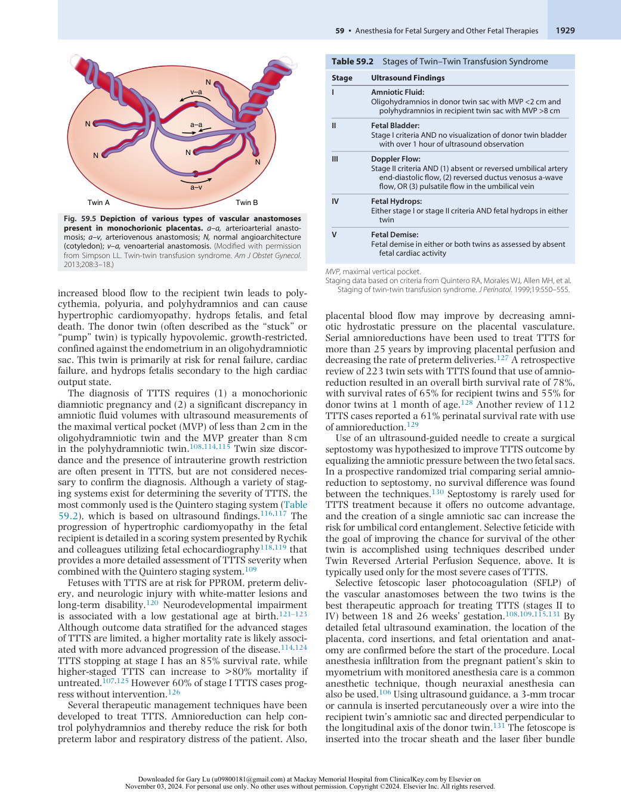

:::

<!-- PDF page 10 -->

passed into the fetoscope guide. Vessels that cross the membrane dividing the amniotic sacs are visualized and Doppler imaging can be used to confirm flow magnitude and direction. The abnormal connecting vessels are selectively laser coagulated, with an effort to spare the normal cotyledons.7,110 Ideally this delineates two separate placental regions with each supplying an individual fetus. After laser ablation, amnioreduction is also performed to decrease the risk for preterm labor. Nonselective laser ablation of crossing vessels is typically avoided because it is associated with more frequent rates of intrauterine fetal demise and is likely to unnecessarily ablate some normal placental vessels.116,131 Some practitioners advocate use of a sequential technique when coagulating the various types of abnormal anastomoses in an effort to create a net flux of blood from the recipient to the donor and thereby reduce the chance for hemodynamic compromise and hypotension during the procedure in the donor twin.132 Initially, superficial arteriovenous anastomoses that contain a donor artery are ablated, then arteriovenous anastomoses with a recipient artery, then the arterioarterial anastomoses, and finally ablation is performed at the venovenous anastomoses. A prospective multicenter trial comparing use of sequential SFLP to nonsequenced SFLP found that use of sequential SFLP significantly improved the 30- day survival of both twins and decreased fetal demise.133,134 However, use of this sequential technique is associated with longer operative times and increased case difficulty, particularly with a placenta located on the anterior uterine wall. A recent modification of SFLP called the “Solomon technique” was created to reduce recurrent TTTS.135 In the Solomon technique, the entire vascular equator is coagulated following the coagulation of visible vessels, in order to reduce residual anastomoses. A randomized controlled trial comparing SFLP to the Solomon technique trial noted that the Solomon technique reduces the risk of recurrence of TTTS or twin anemia polycythemia sequence following initial treatment, but no difference in 2- year survival without neurodevelopmental disability was found.136,137 Additionally there is an increased risk of abruption with use of the Solomon technique.138

A 2004 randomized multicenter trial compared SFLP therapy to amnioreduction for treatment of severe TTTS diagnosed between 15 and 26 weeks’ gestation.139 Rates of at least one twin survival were more frequent in the laser treatment group at both 28 days (76% vs. 56%, _P_ &lt; .01) and 6 months of life (76% vs. 51%, _P_ &lt; .01). In addition, neurologic outcomes were better in the laser treatment group. A large subgroup of survivors from this trial was followed prospectively for 6 years. No additional change in either survival rate or long- term neurologic outcome was found in comparison to the original 6- month data.140 This conclusion was echoed in a 2014 Cochrane review of laser treatment for TTTS.125 More recent work has suggested that early intervention in stage I TTTS may be beneficial compared to expectant management.126 Although recent SFLP treatment studies of TTTS suggest a greater than 60% dual survival rate and near 90% survival of at least one twin,141 long- term neurologic outcome in TTTS survivors who underwent SFLP remains unclear, with rates of major neurologic abnormalities in survivors ranging from 3% to 25%.140,142 A review of 9 studies

examining neurodevelopmental outcome at 24 months in patients who underwent laser therapy found a mean rate of neurologic injury of 14%, with an 8% cognitive impairment rate, 11% motor delay, 17% communication delay, and 6% cerebral palsy.120 Neonatal cerebral lesions correlate with neurodevelopmental impairment at 2 years of age.143

The most common complication of SFLP is premature PROM with subsequent preterm labor and delivery. Premature PROM rates vary widely across studies, but have been reported to occur in 12% to 30% of SFLP cases for TTTS with a rate of preterm labor and delivery before 32 weeks’ gestation in approximately 30% of cases.108,109 Other possible complications include placental abruption, need for a second SFLP procedure, placement of the trocar through the placenta, hemorrhage, chorioamnionitis, and possible membrane perforation resulting in limb entrapment and ischemia.108,109

In conclusion, treatment of TTTS with SFLP results in better outcomes compared to amnioreduction alone.141 Additional research is needed to determine optimal timing, further technique refinement, and long- term neurologic outcome for the treatment of TTTS with SFLP.

### AMNIOTIC BAND SYNDROME

Amniotic band syndrome (ABS) includes a wide variety of fetal anomalies associated with fibrous bands that entangle or constrict various parts of the fetus or umbilical cord _in utero_ (Fig. 59.6). The resulting malformations include limb and digit amputations, craniofacial abnormalities, visceral defects, and body wall defects. The incidence is approximately 1 in 3000 to 1 in 15,000 live births.144 The primary cause and pathogenesis of ABS remains unknown, but these defects appear secondary to either a vascular insult or other cause of abnormal perfusion to the affected area.145 Theories behind the cause of ABS include a primary defect in embryonic development, an early amniotic membrane rupture resulting in the creation of amniochorionic bands, and a vascular disruption early in pregnancy.146

Diagnosis is determined by findings on ultrasound imaging consistent with characteristic fetal anomalies of the involved anatomy. Visualization of the bands themselves is not a necessary component of the diagnosis.147 Fetal MRI can aid in diagnosis as a complimentary technique to ultrasound, but the efficacy of its use is currently limited to case reports and a small case series.148 The progression of morbid conditions from each case of ABS is difficult to predict. In cases of limb entrapment, increasing band constriction decreases both venous and arterial flow. This decreased perfusion leads to limb edema and can eventually result in amputation distal to the constriction. In an otherwise normal fetus, use of fetoscopic- guided sectioning of the band with a laser can restore distal blood flow and may improve functional outcome in some cases.146 Efficacy of the technique is based on review of a small number of cases in the literature, which range from 50% to 80% of limb form and function preservation, provided that some arterial flow to the affected limb is present pre- intervention.149–151 Single limb involvement is also associated with a more favorable surgical outcome compared to fetuses with multiple involved limbs.150 Interestingly, the rate of premature PROM in these procedures is higher than other fetoscopic

<!-- PDF page 11 -->

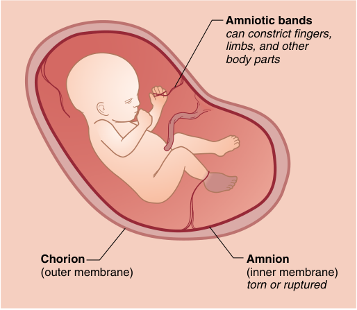

Amniotic bands can constrict fingers, limbs, and other body parts Chorion Amnion (outer membrane) (inner membrane) torn or ruptured 

**Fig. 59.6 Depiction of amniotic band syndrome.** The amnion membrane can become wrapped around various fetal parts (e.g., digits, limbs, neck) and result in amputations or deformities. (From Graves CE, Harrison MR, Padilla BE. Minimally invasive fetal surgery. _Clin Perinatol_ . 2017;44(4):729–751.)

procedures.144,146 Amniotic band syndrome can also be an iatrogenic complication following minimally invasive fetal procedures in monochorionic diamniotic twins, and should be evaluated for, especially if known chorioamnion separation or septostomy occurs.152

### CONGENITAL DIAPHRAGMATIC HERNIA

Approximately 1 in 2500 newborn infants has a congenital diaphragmatic hernia (CDH).153 During early gestation, abdominal contents herniate into the thoracic cavity and compress the fetal lungs (Fig. 59.7). This results in significant neonatal morbidity and mortality from pulmonary hypoplasia, respiratory insufficiency, and pulmonary hypertension. CDH survival rates when ECMO is not required have improved to greater than 70% over the past 25 years at tertiary care centers.154,155 These highly specialized centers offer care that includes early intubation, surfactant administration, specialized ventilation techniques to minimize lung trauma, surgical closure of the defect, and availability of ECMO therapy. Mortality rates vary greatly with the severity of pulmonary hypertension and respiratory dysfunction.156,157 If ECMO is required, survival rates vary between 50% and 80%.155 Fetal intervention for CDH aims to improve fetal lung development and prevent the morbidity of pulmonary hypoplasia.

_In utero_ repair of diaphragmatic hernia in lamb models reversed both the parenchymal hypoplasia and pulmonary vascular changes associated with CDH.26 Initial human _in utero_ intervention focused on open repair of the fetal diaphragm with limited success.158,159 However, these initial interventions advanced fetal surgery techniques and paved the way for a minimally invasive approach to CDH intervention.

Initial open intervention experience found that a fetal abdominal patch was necessary to accommodate the added abdominal viscera without increasing intra- abdominal

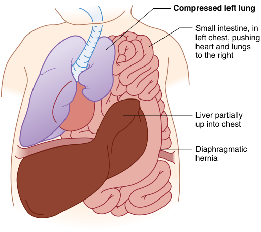

Compressed left lung Small intestine, in left chest, pushing heart and lungs to the right Liver partially up into chest Diaphragmatic hernia 

**Fig. 59.7 Depiction of congenital diaphragmatic hernia.** A defect in the fetal diaphragm allows abdominal contents (e.g., intestines, liver) to enter the thoracic cavity, compress the heart, and prevent lung growth and maturation. (From Graves CE, Harrison MR, Padilla BE. Minimally invasive fetal surgery. _Clin Perinatol_ . 2017;44(4):729–751.)

pressure and compromising ductus venosus blood flow. These early open interventions also determined that _in utero_ reduction of the herniated liver compromised umbilical circulation and significantly increased fetal mortality. Additionally, the advantage of opening the uterus with a stapling device to ensure effective hemostasis was demonstrated. However, adequate control of postoperative uterine tone remained a substantial problem. In a prospective clinical trial sponsored by the National Institutes of Health, _in utero_ CDH treatment using an open technique for fetuses without herniation of the liver into the thorax did not improve neonatal survival compared with standard postnatal treatment.160

After these efforts, tracheal occlusion was advanced as a less- invasive strategy for treating fetal CDH and improving lung development. Fetal lungs secrete over 100 mL/kg/day of fluid that exits the trachea and mouth into the amniotic cavity. In fetal lamb models, tracheal occlusion restricts the normal outflow of the fetal lung fluid and provides an increase in pulmonary hydrostatic pressure. This increased pressure pushes the viscera out of the thorax, promotes expansion of the hypoplastic lung, and thereby improves lung growth and development.161,162 Based on early data, fetal reversible tracheal occlusion163–165 replaced primary repair _in utero_ for the treatment of CDH. Initially, a tracheal foam plug was inserted in the fetal airway during open surgery, but it failed to provide adequate occlusion.166 Later, metallic hemoclips were placed around the trachea after meticulous neck dissection.166 Unfortunately, survival with this initial open tracheal occlusion procedure was poor (15%) and lower than survival in CDH fetuses receiving postnatal standard treatment (38%).167

Subsequently, minimally invasive fetal endoscopic surgical techniques replaced the open technique for placement of the clips. These procedures are performed with local or neuraxial maternal anesthesia and the administration of

<!-- PDF page 12 -->

fetal anesthesia by intramuscular injection. A variety of occlusive devices, including cuffs, plugs, valves, and balloons, were attempted at various medical centers.168 Currently, percutaneous endoscopic endotracheal intubation is used to place a small detachable occlusive balloon in the fetal trachea.165 With initial procedures the balloon was left in place until delivery (see discussion on EXIT procedures, below), but currently it is deflated and removed before term with a second fetal endoscopy.169 The balloon removal may improve type II pneumocyte function, increase surfactant production, and allow a vaginal delivery when appropriate.138,168

Use of ultrasound imaging to determine the ratio of fetal lung area–to- head circumference (LHR) and the presence of thoracic liver herniation (“liver up” vs. “liver down”) are historically the most reliable prognostic indicators of fetal CDH outcome.168,170,171 Evaluation of survival in fetuses with left- sided CDH and intrathoracic liver herniation managed postnatally noted no survival with an LHR of 0.7 or less and a survival rate 72.7% or greater with an LHR 1.4 or greater (Table 59.3).170 The LHR increases exponentially with gestational age and is less useful after 28 weeks’ gestation.172 The Antenatal CDH Registry Group normalized the LHR to gestational age by creating an observed- to- expected LHR (o/e LHR)173 that correlates well with survival rate (Fig. 59.8).174,175 Fetal MRI measurement of observed to expected total fetal lung volume (o/e TFLV) correlates well with neonatal survival in fetuses with isolated CDH as an assessment of pulmonary hypoplasia.176,177 In addition to presence of liver herniation, use of a 25% threshold with o/e LHR and o/e TFLV appear to perform the best as predictors of survival with CDH.175

A prospective randomized trial (1999 to 2001) evaluated endoscopic fetal tracheal occlusion for prenatal treatment of CDH using both clip and balloon occlusion techniques.178 Inclusion criteria included a 22- to 28- week gestational age, left- sided thoracic liver herniation, and an LHR of less than 1.4. The trial was closed early, and no benefit in survival or reduction in 90- day morbidity was found with prenatal treatment ( _n_ =11) compared with control ( _n_ =13) (survival rates of 73% vs. 77%). Additionally, rates of PPROM and

preterm delivery were more frequent in the fetal intervention group, with 100% of the fetoscopic intervention group having premature PROM.178 The inclusion of fetuses with an LHR of up to 1.4 may have decreased the ability to determine a significant difference, because many of these fetuses were likely to survive with standard postnatal tertiary medical care (see Table 59.3).

Three European medical centers, the Fetal Endoscopic Tracheal Occlusion (FETO) task force, began collaboration for treatment of severe cases of CDH with a high risk for mortality (LHR &lt;1.0 and liver herniation into the hemithorax).173,179 Because of concern for tracheal damage by very early tracheal balloon placement,180 the tracheal balloon was placed at 26 to 28 weeks’ gestation and removed before birth near 34 weeks’ gestation. Data from FETO task force cases through 2008 ( _n_ =210, mean gestational age of placement at 27 weeks, LHR &lt;1.0, and primarily left- sided CDH) were compared with historic postnatal treatment controls (1995 to 2004). Use of prenatal reversible tracheal occlusion significantly improved the survival rate (47% vs.

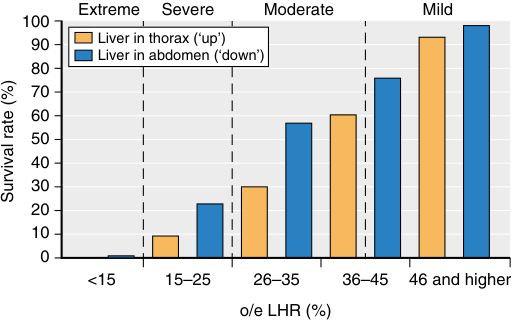

Extreme Severe Moderate Mild 100 90 Liver in thorax (‘up’) Liver in abdomen (‘down’) 80 70 60 50 40 30 20 10 0 &lt;15 15–25 26–35 36–45 46 and higher o/e LHR (%) Survival rate (%) 

**Fig. 59.8** Survival rates of fetuses with isolated left- sided congenital diaphragmatic hernia (CDH), depending on measurement of the observed to expected lung area to head circumference ratio (o/e LHR) and position of the liver. (Redrawn from Deprest JA, Nicolaides K, Gratacos E. Fetal surgery for congenital diaphragmatic hernia is back from never gone. _Fetal Diagn Ther_ . 2011;29:6–17.)

**Table 59.3** Postnatal Survival in Fetuses with Left- Sided Congenital Diaphragmatic Hernia and Intrathoracic Liver Herniation Based on Fetal Lung Area–to-Head Circumference Ratio

||**POSTN**|**ATAL MANAGEMENT**|**FETOSCO**|**PIC TRACHEAL OCCLUSION**|
|---|---|---|---|---|
|**LHR (mm)***|**Fetuses****_n_ (%)**|**Survival****_n_ (%)**|**Fetuses****_n_ (%)**|**Survival****_n_ (%)**|
|0.4–0.5|2|0|6|1 (16.7)|
|0.6–0.7|6|0|13|8 (61.5)|
|0.8–0.9|19|3 (15.8)|9|7 (77.8)|
|1.0–1.1|23|14 (60.8)|||
|1.2–1.3|19|13 (68.4)|||
|1.4–1.5|11|8 (72.7)|||
|≥1.6|6|5 (83.3)|||
|**Total**|**86**|**43 (50)**|**28**|**16 (57.1)**|

LHR, lung area–to- head circumference ratio. *The LHR measurements were obtained at 23 to 29 weeks’ gestation. Modified from Jani JC, Nicolaides KH, Gratacos E, et al. Fetal lung- to- head ratio in the prediction of survival in severe left- sided diaphragmatic hernia treated by fetal endoscopic tracheal occlusion (FETO). _Am J Obstet Gynecol_ . 2006;195:1646–1650.

::: details 原始表格與符號（PDF 第 12 頁）

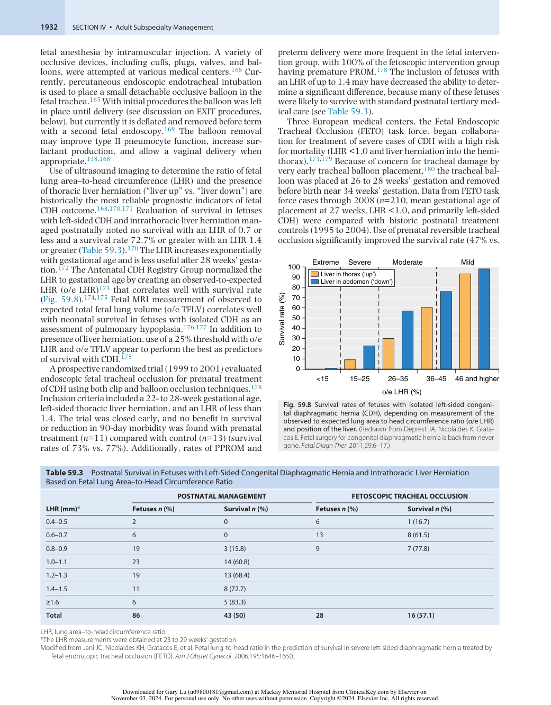

:::

<!-- PDF page 13 -->

20% in historic controls), and delivery occurred at a median gestational age of 35 weeks.179 In addition, mean operating time was minimal (&lt;10 minutes) and more than 95% of procedures were successful on the first attempt. Some of the survival benefit with _in utero_ treatment may represent selection bias and improvement in both technique and neonatal care over time.

A 2016 meta- analysis of all studies comparing survival outcome between FETO and a contemporary control group found fetal intervention improved survival in patients with isolated CDH and an LHR ≤1.0. Fifty- one of 110 fetuses (46.3%) who had undergone FETO survived to discharge, compared with 6 of 101 (5.9%) in the control group.181 Another recent study suggests that patients undergoing FETO for severe isolated CHD have morbidity outcomes similar to those fetuses with moderate lung hypoplasia.182 Although FETO improves lung growth, and decreases need for ECMO, left heart hypoplasia may persist until after the postnatal CDH repair.183

Most recently, a multicenter randomized Tracheal Occlusion to Accelerate Lung growth trial (TOTAL) (http://www. totaltrial.eu)184 compared postnatal management to both late (30 to 32 weeks’ gestation) FETO intervention for moderate lung hypoplasia185 and earlier FETO intervention (27 to 30 weeks’ gestation) for severe lung hypoplasia.186 This trial used o/e LHR criteria and balloon deflation at 34+0 to 36+6 weeks’ gestation in both groups, with postnatal management standardized by a consensus protocol. Findings included increased survival at discharge and at 6 months in patients with severe CDH (o/e LHR &lt;25%) treated early (40% vs. 15%, _P_ = .009), with a less significant survival to discharge benefit seen in patient with moderate CDH (o/e LHR 25%–34.9% or 35%–44.9% with intrathoracic liver involvement) treated at a later gestation age (63% vs. 50%, _P_ = .06). In both severe and moderate CDH groups, fetal intervention was associated with a higher rate of preterm, prelabor rupture of the membranes (relative risk [RR] 4.51 and 3.79, respectively) and preterm birth (RR 2.59 and 2.86, respectively). Further long- term outcome data on pulmonary and neurologic development are needed.

### MYELOMENINGOCELE

Spina bifida includes all defects with incomplete neural tube closure. Myelomeningocele (MMC) is the most common type of spina bifida and results in exposure of the meninges and spinal cord through a congenital defect in the vertebrae, and overlying tissues. MMC occurs during the third and fourth weeks of gestation with incomplete embryonic neural plate development. Folate supplementation in pregnant peoples’ diets has decreased the rate of MMC nearly 50%, but the benefit reached a plateau without eliminating the disorder and MMC remains at a rate of approximately 1 in 3000 live births.187,188 Improved prenatal screening with α- fetoprotein measurement and ultrasonography allows the possibility of pregnancy termination, and it is estimated that 25% to 40% of MMC pregnancies are terminated. MMC can result in lifelong morbidity and disability, including loss of motor and sensory function based on lesion level, bowel and bladder dysfunction, sexual dysfunction, hydrocephalus, Arnold–Chiari type II malformation, tethered cord, and

impaired cognition.187,189 If uncorrected _in utero_ , surgical closure of the spinal defect must be performed within a few days after birth, 64%–85% of children with lumbosacral MMC defects require a ventriculoperitoneal (VP) shunt for hydrocephalus.190,191 Even with successful shunting, complications of central hypoventilation, vocal cord dysfunction, and swallowing difficulties can persist because of an associated Arnold–Chiari malformation.192 The mean intelligence quotient in patients with MMC who underwent VP shunting is 80 (low normal)193 and decreased compared to those who do not require a shunt.194 Neonates with spina bifida have a 14% mortality rate by 5 years of age and a 35% mortality rate in those with known brainstem dysfunction and Arnold–Chiari type II malformation.187

The cause of MMC remains unknown. The abnormalities and deficits of MMC are hypothesized to be the result of two separate mechanisms. The primary cause is anatomic malformation with abnormal development of the spinal cord and associated tissues. Secondary damage is likely created by exposure of these open neural elements to the amniotic fluid and direct trauma. Consequently, the ability to close the defect _in utero_ and isolate the neural tissue from contact with the intrauterine environment has the potential to improve outcome in contrast to delaying closure until after birth.

This hypothesis has been supported by animal models that found improved neonatal neurologic function with fetal closure of the defect _in utero_ .195–198 Ultrasound assessment demonstrates that central and peripheral neurologic injury is progressive during gestation.199,200 Motor deficits and cognitive dysfunction are correlated with lesion level and higher levels are associated with a greater degree of morbidity.196 Improved motor function has been observed at 2 years of age in children with MMC who underwent cesarean delivery before labor onset compared to those delivered vaginally or by cesarean delivery after onset of labor.187,201 Therefore, patients with fetuses with MMC and planned postnatal repair typically undergo cesarean delivery before onset of labor or rupture of membranes in an effort to minimize any additional injury to the open neural elements.

The rationale for fetal intervention for MMC is to improve functionality and quality of life. Prenatal repair for MMC is commonly performed with an open fetal surgery technique, requiring both maternal laparotomy and hysterotomy although some centers have started performing the repair with an endoscopic fetal technique. Considerations for anesthesiologists involved in open MMC repair (see Management of Open Procedures, below) include participation in comprehensive, multidisciplinary, preoperative patient evaluation and counseling; preparation for potential intraoperative hemorrhage; planning an anesthetic that provides profound uterine relaxation; administration of analgesia and muscle relaxant directly to the fetus; monitoring for intraoperative fetal assessment with preparation for potential fetal resuscitation or urgent delivery; and postoperative maternal analgesia and postoperative uterine and fetal monitoring.202

MMC _in utero_ surgery typically occurs between 19 and 26 weeks’ gestation. Initial human studies found that _in utero_ repair reversed the hindbrain herniation of the

<!-- PDF page 14 -->

Arnold–Chiari II malformation and decreased the require- **Table 59.4** Maternal Complications for MOMS Trial ment for VP shunt placement before 1 year of age.203 In Patients* addition, a 1999 series of 10 fetuses undergoing _in utero_ **Prenatal Postnatal** MMC closure at 22 to 25 weeks’ gestation found improved **Maternal Outcomes (** **_n_ =91) (** **_n_ =92)** lower extremity function among 6 of 9 fetuses compared with expected function based on the level of lesion, with Chorioamniotic membrane 30 (33%) 0 separation one fetal death at 25 weeks’ gestation from preterm delivery and associated respiratory insufficiency.204 A ranPulmonary edema 5 (6%) 0 domized, prospective clinical trial completed between Oligohydramnios 19 (20%) 3 (3%) 2003 and 2010 at three US medical centers examined Placental abruption 6 (7%) 0 the risks, benefits, and outcome of open _in utero_ repair for MMC compared with standard postnatal repair among Spontaneous rupture of 40 (44%) 7 (8%) 183 patients.205 Open fetal repair reduced the need for VP membranes shunting, decreased hindbrain herniation, and improved Spontaneous labor 39 (43%) 13 (14%) lower extremity motor function at 30 months of age. Maternal blood transfusion 8 (9%) 1 (1%) However, prenatal repair significantly increased the risk at delivery for various complications to the fetus and the pregnant patient,8,205 including spontaneous membrane rupture, Hysterotomy site thin, 31 (35%) N/A or partial or complete partial or complete uterine dehiscence, and preterm birth dehiscence noted at with increased risk for respiratory distress syndrome (Table delivery 59.4). Two perinatal deaths occurred in each group. A Mean gestational age at 34.0 ± 3.0 37.3 ± 1.1 30- month follow- up study demonstrated that patients birth (weeks) undergoing fetal surgery were more likely to have a level of function ≥2 levels better than expected defect (26.4% *The table lists maternal complications that were significantly different vs. 11.4%), more likely to be able to walk independently ( _P_ &lt; .05) between the prenatal and postnatal repair groups in the Management of Myelomeningocele Study (MOMS) following complete (44.8% vs. 23.9%, _P_ =.004), had better performance on cohort analysis of 183 patients. Other outcomes were evaluated, but only Bayley Mental Development Index, and improved Peathose that were different between the two groups are included. Data for body Developmental Motor Scale.206,207 Long- term outeach group are shown as both an absolute number and as a percentage. come from this trial is still ongoing, but a pretrial cohort of Modified from Johnson MP, Bennett KA, Rand L, et al. The Management 54 patients undergoing fetal MMC repair report improved of Myelomeningocele Study: obstetrical outcomes and risk factors for obstetrical complications following prenatal surgery. functional, behavioral, and motor outcomes at age 10 2016;215:778.e1–9. years, especially among children who did not require VP shunting.208,209

|**Maternal Outcomes**|**Prenatal** **(****_n_=91)**|**Postnatal** **(****_n_=92)**|**_P_**|
|---|---|---|---|
|Chorioamniotic membrane separation|30 (33%)|0|&lt; .0001|
|Pulmonary edema|5 (6%)|0|.03|
|Oligohydramnios|19 (20%)|3 (3%)|&lt; .001|
|Placental abruption|6 (7%)|0|.01|
|Spontaneous rupture of membranes|40 (44%)|7 (8%)|&lt; .0001|
|Spontaneous labor|39 (43%)|13 (14%)|&lt; .0001|
|Maternal blood transfusion at delivery|8 (9%)|1 (1%)|.02|
|Hysterotomy site thin, or partial or complete dehiscence noted at delivery|31 (35%)|N/A|N/A|
|Mean gestational age at birth (weeks)|34.0 ± 3.0|37.3 ± 1.1|&lt; .0001|

*The table lists maternal complications that were significantly different ( _P_ &lt; .05) between the prenatal and postnatal repair groups in the Management of Myelomeningocele Study (MOMS) following complete cohort analysis of 183 patients. Other outcomes were evaluated, but only those that were different between the two groups are included. Data for each group are shown as both an absolute number and as a percentage. Modified from Johnson MP, Bennett KA, Rand L, et al. The Management of Myelomeningocele Study: obstetrical outcomes and risk factors for obstetrical complications following prenatal surgery. _Am J Obstet Gynecol_ . 2016;215:778.e1–9.

After port placement, a portion of amniotic fluid is withdrawn, and carbon dioxide insufflation occurs. A retrospective cohort trial of 28 patients undergoing fetoscopic myelomeningocele repair (22 fetoscopic, 4 conversion to hysterotomy, 2 abandoned) noted a mean delivery at 39 weeks with a standardized surgical approach ( _n_ =10) using a two- port technique and a premature PROM rate between 10% and 30%.214 Of the 22 patients who underwent a fetoscopic repair, 50% delivered vaginally. Recently a method using partial amniotic carbon dioxide insufflation without pre- removal of amniotic fluid has been described and successfully used in MMC repair.217 One retrospective review found that compared to fetoscopic surgery, open surgery was associated with higher dose of halogenated anesthetic agent, a higher need for intra- and postoperative tocolytic drugs, a higher volume of colloids), and a lower maternal blood pressure.218

Results of this trial should not be generalized to patients outside the inclusion criteria of the study and should be considered only at medical centers that can develop a practice with significant volume and depth of resources.210 It is recommended that this procedure be offered only at medical facilities with the expertise, multidisciplinary teams, services, and facilities to provide the intensive care required for these patients, with rigorous patient selection maintained.4,211 However, extension of the inclusion criteria has occurred at many institutions, including the inclusion of patients with a body mass index (BMI) >35,212 and including patients greater than 26 weeks’ gestational age.10

With improvement in surgical technique, and feasibility demonstrated in animal studies,213 endoscopic myelomeningocele repair is increasingly practiced. In theory, a minimally invasive approach may reduce complications for pregnant individuals and obviate the need for cesarean delivery.214 A phase I clinical trial of percutaneous endoscopic repair ( _n_ =10) using a biocellular patch over the defect followed by skin closure revealed improved hindbrain herniation and motor function; however, preterm delivery was significant, with the mean gestational birth age being 32 weeks.215 In addition, 2 of 10 procedures were aborted due to loss of uterine access, PPROM occurred in all 10 cases, and 1 fetus and 1 neonate died. Outcomes have improved with evolution of the fetoscopic repair technique to include a maternal laparotomy and exteriorization of the uterus prior to insertion of the fetoscope ports.214,216

A 2018 meta- analysis of 11 studies examining fetal MMC repair found no difference in mortality or need for a VP shunt among fetal patients treated with an open or endoscopic technique.9 Patients treated with a percutaneous fetoscopic technique had a higher PPROM rate (91% vs. 36%), higher risk of preterm delivery (96% vs. 81%), and a higher rate of cerebral spinal fluid leakage from the MMC repair site (30% vs. 7%). Fetal repair via a fetoscopic approach following maternal laparotomy had a lower rate of premature birth. Uterine dehiscence was higher in the open surgical group (11% vs. 0%). The authors concluded that a fetoscopic technique is a promising, though not yet

::: details 原始表格與符號（PDF 第 14 頁）

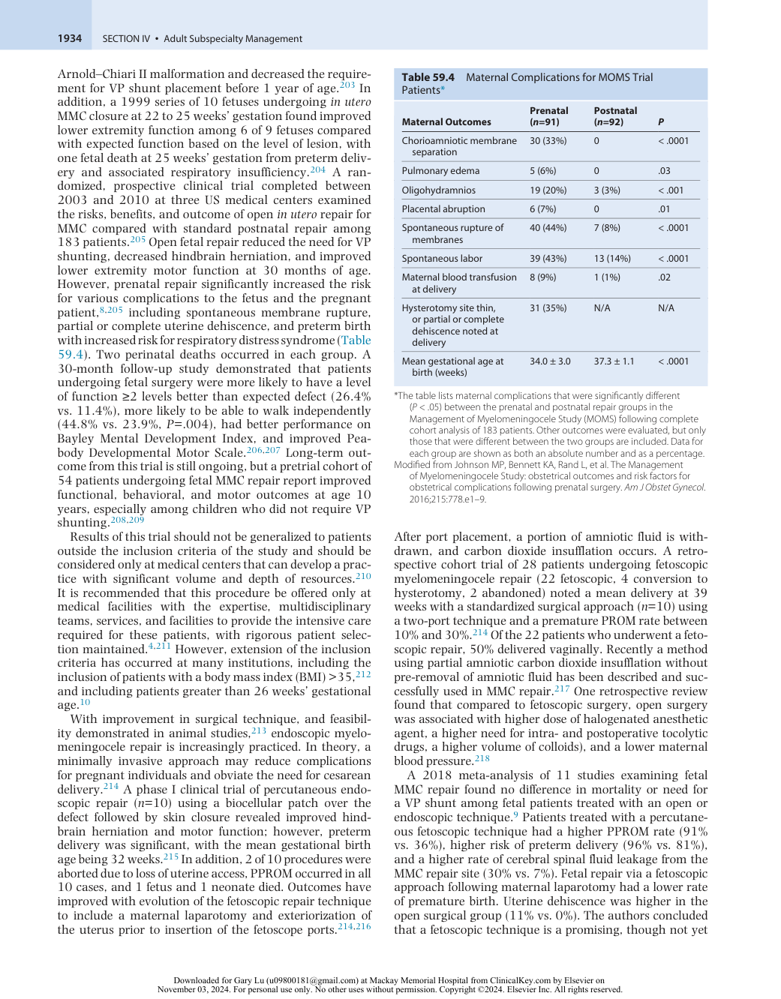

:::

<!-- PDF page 15 -->

perfected, technique for fetal MMC repair.9 One single center performing fetoscopic MMC repair has reported 30- month follow- up data, and found that 48.1% underwent VP shunt placement, 46% could ambulate independently, and 46% had a functional level that was at least two segments better than the anatomic level of their lesion.219

### SACROCOCCYGEAL TERATOMA

The incidence of sacrococcygeal teratoma (SCT) is approximately 1 in 15,000 to 40,000 live births.220 These teratomas are typically diagnosed by ultrasound in the second trimester of pregnancy and may grow rapidly (>150 cm3 / week), with some reaching sizes of 1000 cm3 or more.221 The larger tumors create a significant arteriovenous shunt and associated low resistance state and lead to the development of high- output cardiac failure, polyhydramnios, placentomegaly, and hydrops fetalis.222 In addition, rapidly growing tumors may rupture and hemorrhage. Perinatal mortality varies greatly in different published series, ranging from 16% to 63%.223 In addition, fetuses with SCT are at risk for preterm birth, intrapartum dystocia, tumor rupture with hemorrhage, and urinary obstruction. Cesarean delivery is frequently required.

Tumor staging is based on criteria from the American Academy of Pediatrics Surgical Section as detailed by Altman (Fig. 59.9).224 Based on the external location, stage I tumors are suitable for fetal intervention while stage IV tumors are entirely internal and not considered appropriate for fetal resection.221 Fetal MRI can assist in tumor size, location, and staging. A tumor volume to fetal weight ratio >0.1 cm3 /g prior to 24 weeks’ gestation is predictive of poor fetal outcome.225

Fetuses diagnosed with SCT before 30 weeks’ gestation or with rapidly growing tumors have a poor prognosis (&lt;7% survival), but may benefit from _in utero_ intervention.226 Radiofrequency ablation, laser ablation, embolization, thermocoagulation of the tumor or vascular supply, and cyst drainage have been employed to treat SCT _in utero_ and prevent hydrops fetalis, but the benefit remains unclear.142,226,227

A review of minimally invasive fetal intervention for SCT in 34 patients from 1980 to 2013 demonstrated an overall survival rate of 44% with mean delivery at 29.7 ± 4.0 weeks.222 Preexisting hydrops led to a worse outcome, with only 30% survival (6/20) in this cohort. A subsequent review of 33 patients examined the effectiveness of different techniques, comparing interstitial tumor ablation ( _n_ =22) to targeting the feeding vessels of the tumor ( _n_ =11).142 Fetuses undergoing vascular ablation seemed to have a survival advantage over the interstitial ablation group (63.6% vs. 40.9%), which the authors suggested may be because interstitial ablation often led to tumor necrosis and subsequent hemorrhage.

SCTs have been resected _in utero_ (Fig. 59.10) with successful outcomes, but the optimal timing and criteria for fetal intervention is uncertain.15,221,222,228 Fetal teratoma resection has a high risk for fetal hemorrhage; consequently, intraoperative placement of a venous catheter in a fetal hand, leg, or umbilical cord vein is important for the ability to transfuse compatible blood and crystalloid fluids or rapidly administer resuscitation drugs. Tumor volume

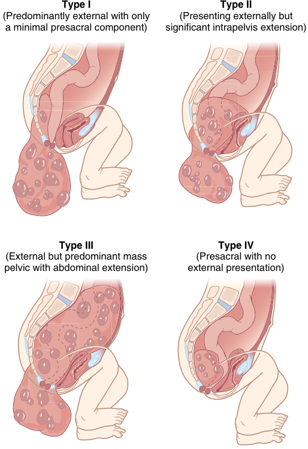

Type I Type II (Predominantly external with only (Presenting externally but a minimal presacral component) significant intrapelvis extension) Type III Type IV (External but predominant mass (Presacral with no pelvic with abdominal extension) external presentation) 

**Fig. 59.9 Sacrococcygeal tumors are classified according to their location.** Type I tumors are predominantly external (sacrococcygeal) with minimal presacral component; type II tumors present externally but have a significant intrapelvic extension; type III tumors are present externally, but the predominant mass is pelvic and extends into the abdomen; type IV tumors are presacral with no external presentation. (From Altman RP, Randolph JG, Lilly JR. Sacrococcygeal teratoma: American Academy of Pediatrics Surgical Section Survey – 1973. _J Pediatr Surg_ . 1974;9:389–398.)

to fetal weight ratios (TFR) have been used to predict outcomes; at ≤24 weeks, TFR >0.095 was predictive of poor fetal outcome and TFR >0.12 was predictive of increased maternal operative risk.229 Preemptive delivery of fetuses with impending decompensation at 27 weeks or greater may be associated with improved outcome.230

In certain cases, fetal SCT may lead to maternal mirror syndrome, in which maternal physiology mimics the abnormal circulatory physiology of the hydropic fetus.231 The pregnant patient develops hypertension with increased peripheral and pulmonary edema that result from a hyperdynamic state. Mirror syndrome is a form of severe preeclampsia that may develop in association with fetal hydrops and in most cases necessitates delivery,232 although platelet levels and liver enzymes typically remain in normal ranges. Maternal mirror syndrome does not normally resolve immediately with correction of the fetal pathophysiology and can result in life- threatening complications to the pregnant patient.231,233

<!-- PDF page 16 -->

### CONGENITAL PULMONARY LESIONS

Congenital pulmonary airway malformations (CPAMs), historically known as congenital cystic adenomatoid malformations (CCAMs), are typically benign nonfunctioning pulmonary tumors composed of cystic and solid components normally contained within a single lung lobe.234 These fetal lesions complicate approximately 1 in 25,000 to 35,000 live births.235 Other possible fetal abnormalities that require differentiation include bronchopulmonary sequestration, bronchogenic cysts, congenital lobar emphysema, neurogenic cysts, peripheral bronchial atresia, and CDH.236 CPAM includes five subtypes (Table 59.5) that are based on the presumed development site of the tumor.237 Prenatal ultrasonography categorizes lesions as macrocystic (cysts >5 mm in diameter) or microcystic (cysts &lt;5 mm in

diameter), with microcystic lesions having a more solid or echogenic image.238 Typically, small lesions regress in the third pregnancy trimester and can be surgically resected after birth or managed conservatively without surgical intervention.239 Large lesions can compress the great vessels, create pulmonary hypoplasia, and cause cardiac compression and mediastinal shift that often results in hydrops fetalis (secondary to heart failure). Prognosis depends primarily on size and growth characteristics of the CPAM rather than lesion type.240 To normalize tumor volume to fetal size, a ratio of ultrasound measures of CPAM volume to fetal head circumference (CVR) was evaluated as a predictor of hydrops fetalis and other postnatal outcomes.240–242 CVR is calculated from the volume of an ellipse (cubic centimeters) using the formula length × height × width × 0.52)/fetal head circumference (centimeters).243 Based on

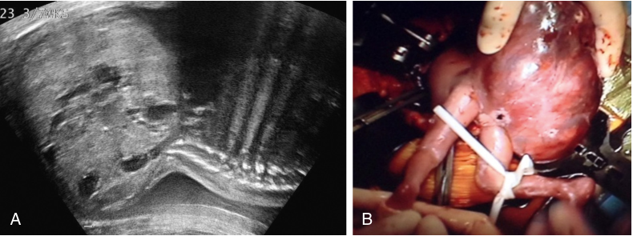

A B 

**Fig. 59.10** (A) Ultrasound image of fetus with sacrococcygeal teratoma (SCT). Note sacral origin of mass. (B) Fetus with SCT undergoing _in utero_ mass resection. Note tourniquet on left leg placed momentarily before intravenous catheter placement in saphenous vein. (Courtesy Dr. Anita Moon- Grady, Department of Pediatrics, University of California, San Francisco, CA.)

**Table 59.5** Pathologic Classifications and Features of CPAMs

|**Stocker Classification**|**Type 0**|**Type 1**|**Type 2**|**Type 3**|**Type 4**|
|---|---|---|---|---|---|
|**Location**|Tracheobronchial|Bronchial/ bronchiolar|Bronchiolar|Bronchiolar/ alveolar|Distal acinar|
|**Frequency**|1%–3%|>65%|10%–15%|5%–8%|10%–15%|
|**Maximal cyst size (cm)**|0.5|10.0|2.5|1.5|7|
|**Muscular wall thickness** **of cysts (μm)**|100–500|100–300|50–100|0–50|25–100|
|**Mucous cells**|Present|Present in 33% of cases|Absent|Absent|Absent|
|**Cartilage**|Present|Present in 5%–10% of cases|Absent|Absent|Rare|
|**Skeletal muscle**|Absent|Absent|Present in 5% of cases|Absent|Absent|
|**Lobar involvement**|All lobes|One lobe in 95% of cases|Usually one lobe|Entire lobe or lung|Usually one lobe|
|**Malignancy risk**|No|Bronchioloalveolar carcinoma|No|No|Pleuropulmonary blastoma|
|**Langston classification**|Acinar dysplasia|Large- cyst|Small- cyst|Hyperplasia solid/adenomatoid||
|**Original CCAM typing**||Type I|Type II|Type III||

_CCAM,_ congenital cystic adenomatoid malformation; _CPAMs,_ congenital pulmonary airway malformations. Modified from tables in David M, Lamas- Pinheiro P, Henriques- Coelho T. Prenatal and postnatal management of congenital pulmonary airway malformation. _Neonatology_ . 2016;110:101–115, and Fowler DJ, Gould SJ. The pathology of congenital lung lesions. _Semin Pediatr Surg_ . 2015;24:176–182.

::: details 原始表格與符號（PDF 第 16 頁）

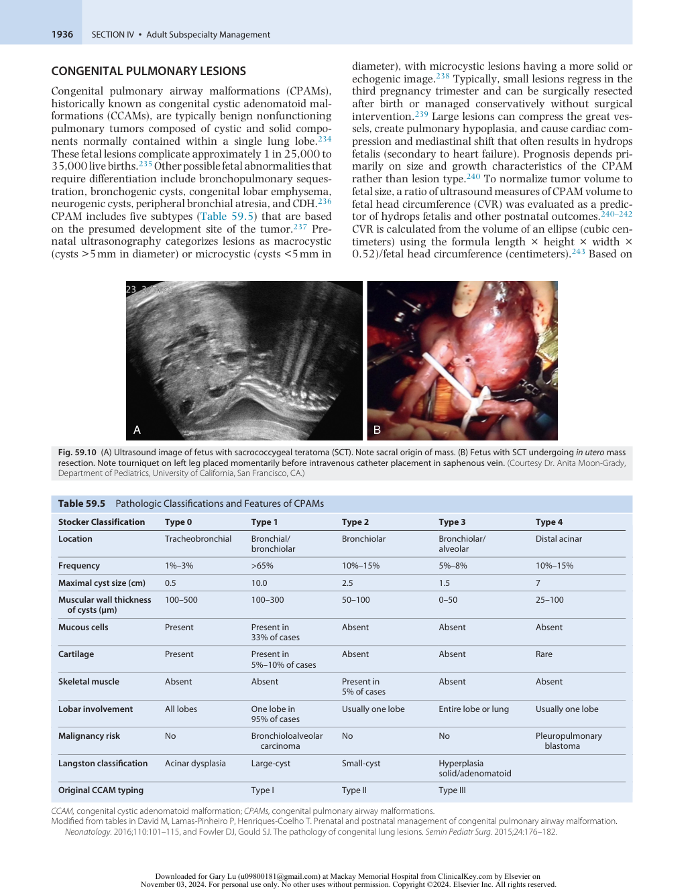

:::

<!-- PDF page 17 -->

retrospective data from 71 fetuses, a CVR less than 0.56 predicts no adverse postnatal outcome (100% negative predictive value), whereas a CVR greater than 0.56 had a positive predictive value for adverse postnatal outcome of 33%.241 In addition, a CVR greater than 1.6 is associated with greater risk for hydrops fetalis.240–242 A retrospective analysis of a series of 24 fetuses with a CVR greater than 1.6 found that an abnormal echocardiogram with hydrops was a significant predictor of mortality and need for fetal intervention.244

Some lesions regress with minimal impact, whereas others grow in size. Patients with CPAM tumors associated with hydrops fetalis have a survival rate of less than 5% without intervention, and early delivery or fetal treatment is indicated in these cases.245,246 Administration of betamethasone to the pregnant patient may improve survival in those with high-risk CPAM.246,247 Large macrocystic lesions or large pleural effusions do not respond to

steroids and can be decompressed _in utero_ by placement of shunt catheters between the cysts and the amniotic cavity (Fig. 59.11). Use of fetal analgesics and muscle relaxants delivered intramuscularly with ultrasound guidance may decrease the fetal stress response and prevent fetal movement during critical portions of the procedure. Shunt placement can prevent or reverse hydrops formation, with definitive resection deferred until after birth.248 In a retrospective analysis of 75 fetuses undergoing shunt placement for pleural effusion or a macrocystic lung lesion,249 shunt placement resulted in a decrease in macrocystic lung lesion volume by 55 ± 21% and complete or partial resolution of the pleural effusion in 29% and 71% of fetuses, respectively. Overall neonatal survival was 68%, and correlated with hydrops resolution, gestational age at birth, a unilateral pleural effusion, and % reduction in lesion size.249 Another retrospective study noted a 59% survival rate for fetuses with hydrothorax treated with thoracoamniotic shunts,

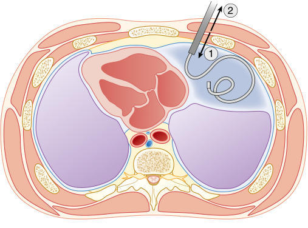

2 1 

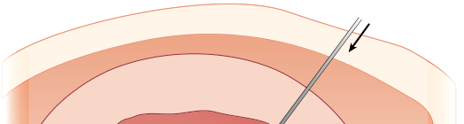

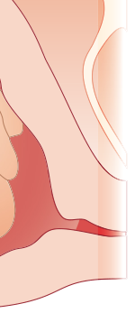

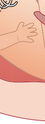

**Fig. 59.11** Thoracic shunt insertion ( _top left_ and _right_ ) and deployment ( _bottom left_ ). (Redrawn from van Mieghem T, Baud D, Devlieger R, et al. Begin equation minimally invasive fetal therapy. _Best Pract Res Clin Obstet Gynaecol_ . 2012;26:711–725.)

<!-- PDF page 18 -->

though repeat procedures were often necessary.250 In some CPAM lesions, shunts are ineffective because cysts are not in communication with each other, shunts malfunction, or they become displaced. In addition, shunt placement can cause fetal hemorrhage, PPROM, or chorioamnionitis.236 Thoracoamniotic shunt placement has also successfully decompressed large congenital pleural effusions caused by fetal chylothorax that otherwise would result in hydrops fetalis, pulmonary compression, and death.251,252

Some solid or mixed solid/cystic CPAMs unresponsive to steroids and inappropriate for shunting can be resected with open fetal lobectomy (Fig. 59.12). Similar to open SCT

resection, potential exists for significant fetal hemorrhage and need for _in utero_ fetal resuscitation. Open resection of CPAM lesions associated with hydrops fetalis has resulted in a 30- day postnatal survival rate of 50%–60%, with tumor resection allowing for compensatory lung growth and resolution of hydrops fetalis.253

In some instances, use of an EXIT procedure with fetal thoracotomy, mass resection, and a secured airway before delivery has been a successful approach for tumors with persistent mediastinal compression.254,255 In a series of nine fetuses with large lung masses (CVR 1.9 to 3.6 at term) who underwent an EXIT- to- resection procedure, all

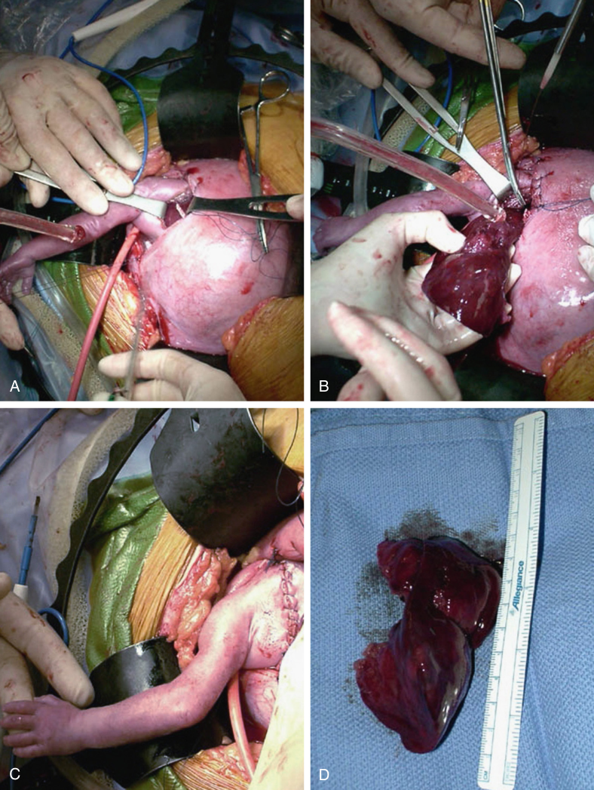

A B C D 

**Fig. 59.12** (A) Open resection of fetal congenital pulmonary airway malformation (CPAM) with fetal thoracotomy shown. (B) Resected CPAM mass. (C) Primary closure of fetal thoracotomy. (D) Pathologic specimen of resected CPAM mass. (Courtesy Dr. Anita Moon- Grady, University of California, San Francisco Fetal Treatment Center, San Francisco, CA.)

<!-- PDF page 19 -->

procedures were successful, with no significant operative complications.254

## Preoperative Assessment and Counseling

Many considerations for perioperative management of pregnant patients undergoing maternal–fetal surgery are analogous to those for nonobstetric surgery during pregnancy (see also Chapter 27). Safety of the pregnant individual is the primary focus when determining a plan that will optimize fetal outcome. All members of the multidisciplinary team should be actively involved in counseling, patient assessment, and perioperative planning. Optimum functioning of a fetal treatment program requires effective communication among the members of a multidisciplinary team, including surgeons, ultrasonographers, maternal fetal medicine physicians, anesthesiologists, nurses, genetic counselors, and social workers. Regularly scheduled multidisciplinary care meetings help ensure coordination of a complete and appropriate perioperative plan, confirm availability of the necessary equipment and personnel at the time of the procedure, and maximize the chance for optimal outcomes for both the pregnant patient and the fetus. Participation of the anesthesiologist is critical to determine whether maternal risk is acceptably low for potential fetal benefit. Recently, a consensus statement from the American Society of Anesthesiologists and the North American Fetal Treatment Network has described the comprehensive preoperative evaluation, intraoperative anesthetic management, and postoperative care for maternal–fetal interventions.256

An understanding of the physiologic changes of pregnancy (for details, see Chapter 58) and their effects on anesthetic management is necessary for appropriate perioperative planning and risk assessment.

Counseling for pregnant patients regarding risks and benefits of the procedure should be thorough, unbiased, and convey the most recent outcome and complication data about the planned intervention. For nonurgent procedures, counseling is typically a multiple- day process. The team must review the specific condition’s natural history, diagnostic limitations, and whether associated anomalies are detected.257 Discussions should focus on specific implications to the pregnant patient, the pregnancy, the fetus, and future pregnancies.258 Patient discussions also should include alternative options such as nonintervention and the possibility of pregnancy termination if applicable. To provide uniform counseling, all providers should advise the patient regarding information specific to their discipline but be aware of the general risks and benefits of the fetal process and the proposed procedure (see earlier section on Indications, Procedures, and Outcomes). A recent systematic review and meta- analysis suggested that maternal complications occur in 6.2% of fetoscopic and 20.9% of open fetal surgeries, with serious maternal complications occurring in 1.7% of fetoscopic and 4.5% of open procedures.259 Distinctions should be made between interventions that are evidence based, and those that are innovative or experimental. Parents should be informed about the planned timing and method of delivery, future reproductive implications,

and – if a hysterotomy is planned – the risk for uterine rupture and need for cesarean delivery with this and all future pregnancies.260 Fertility does not appear to be affected by open fetal surgery, but the risk for uterine rupture or dehiscence before delivery is significant and comparable or even greater than that associated with a prior cesarean delivery performed with a classic incision.260,261

In some situations, consultation with a palliative care provider, clergy, or ethicist may be desired or required. In addition, the sequence of events should be outlined in detail, so that all questions can be answered. In most circumstances, it is important that the partner or other supporting individuals be included in the counseling process, to ensure they have a better understanding of the rationale behind the treatment decisions. However, the wishes of the person giving birth assume ultimate priority during pregnancy. Thorough counseling regarding fetuses with pediatric surgical disorders is greatly appreciated by parents, should be offered in a timely manner, and should focus not only on aspects of the planned fetal treatment, but also postnatal management.262,263 Most parents prefer specific realistic information provided in an empathetic manner, no matter how dire, and want to be allowed to hope for the best possible outcome.264 If the fetus is of viable gestational age, additional counseling is required about the parents’ wishes for possible emergent delivery and neonatal resuscitation in the event of unplanned fetal distress unresponsive to _in utero_ treatment. Finally, the fetal intervention should not proceed until the patient has had adequate time to carefully consider all the information and offered informed consent.

## Intraoperative Management and Considerations

Unlike most surgical procedures performed during pregnancy in which the fetus is merely a bystander (e.g., maternal appendectomy), fetal surgery involves two surgical patients. Consequently, in addition to maternal considerations for anesthetic administration during pregnancy, it is essential to understand the impact of surgery and anesthetic administration on fetal physiology, methods for fetal analgesia and anesthesia, techniques for fetal intraoperative anesthetic monitoring, and postoperative care for both the pregnant individual and fetus.

### FETAL PHYSIOLOGY AND MONITORING

During fetal surgery, procedural and pharmacologic interventions can adversely affect fetal physiology directly or affect it indirectly by alterations in uteroplacental or fetoplacental circulation and gas exchange. Appropriate fetal monitoring facilitates early intervention. In addition to the physiologic effects of medications administered to the pregnant patient or fetus, a detailed knowledge of both maternal physiology of pregnancy, and fetal cardiovascular, neurologic, and placental physiology provides the basis for optimal fetal care. Uteroplacental and fetoplacental physiology, including uterine perfusion, placental gas exchange, and drug transfer are detailed in Chapter 58, which also discusses the effects of maternal positioning, maternal

<!-- PDF page 20 -->

neuraxial anesthesia, and administration of general anesthesia on the uteroplacental unit.

Fetal cardiac output depends primarily on heart rate.265 Compared to a neonate, the contractility of the fetal myocardium is decreased secondary to decreased myofibrillar density and it is intolerant of hypocalcemia because of an immature calcium regulatory system.266 Fetal myocardium is also less compliant than adult myocardium, residing near the peak of the Frank–Starling ventricular function curve, and the fluid- filled fetal lungs inhibit additional ventricular filling.266,267 Consequently, modest changes in preload have minimal effect on cardiac output. The normal fetal cardiac output (sum of right and left ventricular output) is in the range of 425 to 550 mL/min/kg throughout gestation.265

Fetal blood volume increases during gestation, and approximately two-thirds of the fetal–placental blood volume resides within the placenta, which receives about 40% of the fetal cardiac output.268,269 During the second trimester, fetal blood volume is estimated to be approximately 110 to 160 mL/kg of fetal body weight.270 After midgestation, fetal blood volume can be estimated based on gestational age (GA) using the equation, estimated fetal blood volume (mL) = 11.2 × GA − 209.4.271 In the developing fetus, hemoglobin F (HbF) is the primary oxygen carrier. Beginning at 32 weeks’ gestation there is a gradual shift towards adult hemoglobin synthesis (HbA).272 Mean fetal Hb levels increase linearly from 11 g/dL at 17 weeks’ gestation to 18 g/dL at term.273,274

Fetal lung epithelium produces more than 100 mL/kg/ day of fluid that fills the lungs and facilitates appropriate pulmonary growth and development. Excess lung fluid exits the trachea and is either swallowed or flows into the amniotic fluid. Although fetal hepatic enzymes are less functional than those of adults, most drugs still undergo metabolism, and the umbilical circulation provides initial hepatic metabolism (first- pass metabolism) before medications reach the fetal brain or heart. Although fetal liver function is immature, coagulation factors are synthesized independent of the maternal circulation and do not cross the placenta. The serum concentrations of these factors increase with gestational age (Table 59.6),275 but fetal clot formation in response to tissue injury is decreased in contrast to that in adults throughout gestation and the first 6 months of life.276 Platelets first appear at 5 weeks’ gestation and increase in number with time, reaching a mean of 150

× 109 /L by the end of the first trimester of pregnancy and normal adult range by 22 weeks’ gestation.277

During open procedures, the fetal circulation and flow distribution can be severely impaired by fetal manipulation or direct compression of the umbilical cord, inferior vena cava, or mediastinum. Increased uterine activity, maternal hypotension, and significant maternal hypocarbia can all decrease uteroplacental perfusion. Fetal heart rate (FHR) monitoring is important during both minimally invasive and open procedures. During IUT, the transfusion needle can lacerate umbilical vessels with unanticipated fetal movement, and use of laser therapy for TTTS can disrupt surface placental vessels critical to fetal blood flow. During labor, FHR monitoring with external Doppler or a fetal scalp electrode is commonly employed to assess fetal well- being. A spiral scalp electrode was used during the initial cases of _in utero_ surgery, but has been supplanted by fetal echocardiography at almost all centers.278 However, after exposure of the fetal head during an EXIT procedure, placement of a hemoglobin saturation monitor and insertion of a fetal scalp electrode have both been used successfully for continuous FHR monitoring.13,279 It remains unclear whether fetal oximetry or heart rate monitoring is more sensitive to decreased umbilical–fetal blood flow. In a fetal lamb model examining the effects of umbilical cord compression, Hb desaturation was detected by fetal pulse oximetry before the onset of bradycardia.280 However, FHR deceleration has been shown to precede fetal Hb desaturation during labor.281

Intraoperative ultrasonography allows imaging of FHR, cardiac contractility, and cardiac filling, as well as Doppler assessment of flow in the ductus arteriosus and umbilical artery. Both absent and reversed umbilical artery diastolic flow are associated with increased perinatal morbidity and mortality.282 In many cases, ultrasonography assessment of fetal well- being is only intermittent. This is because ultrasonography can be periodically required to guide the intervention or, during portions of the case, the probe placement can interfere with the surgical procedure.

When intraoperative monitoring notes depression of fetal hemodynamics, steps should promptly be undertaken to improve uterine perfusion, ensure the uteroplacental interface is intact, and relieve any compression of the umbilical cord or placenta. These steps may include administration of medications to increase the pregnant patient’s blood pressure, cardiac output, and uterine relaxation. In some cases,

**Table 59.6** Coagulation Screening Tests in Fetuses and Full- Term Newborns

|||**GESTA**|**TIONAL AGE (WEEKS)**||
|---|---|---|---|---|
|**Test***|**19–23**|**24–29**|**30–38**|**Newborns**|
|PT (s)|32.5 (19–45)|32.2 (19–44)|22.6 (16–30)|16.7 (12–24)|
|PT (INR)|6.4 (1.7–11.1)|6.2 (2.1–10.6)|3.0 (1.5–5.0)|1.7 (0.9–2.7)|
|aPTT (s)|169 (83–250)|154.0 (87–210)|104.8 (76–128)|44.3 (35–52)|
|TCT (s)|34.2 (24–44)|26.2 (24–28)|21.4 (17–23)|20.4 (15–25)|

_aPTT,_ activated partial prothrombin time; _INR,_ international normalized ratio; _PT_ , prothrombin time; _s,_ seconds; _TCT,_ thrombin clotting time. *Normal values for coagulation tests determined from umbilical cord sampling. Values are the mean, followed in parentheses by the lower and upper boundaries, including 95% of the population studied. Modified from Reverdiau- Moalic P, Delahousse B, Body G, et al. Evolution of blood coagulation activators and inhibitors in the healthy human fetus. _Blood_ . 1996;88:900–906.

::: details 原始表格與符號（PDF 第 20 頁）

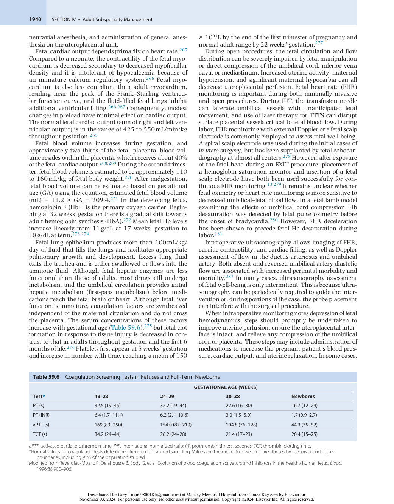

:::

<!-- PDF page 21 -->

administration of resuscitation medications directly to the fetus may be needed, or if previously determined to be viable _ex utero_ fetal resuscitation may be necessary.

_In utero_ , the fetus is unable to thermoregulate and depends on the body temperature of the pregnant individual. Induction of general anesthesia, surgical exposure, and hysterotomy can reduce fetal temperature dramatically both directly and secondarily if the core temperature of the pregnant patient drops significantly. Fetal sheep studies demonstrate the fetus is unable to generate heat through thermogenesis283 and decreases in sheep fetal temperature can lead to tachycardia and hypertension _in utero_ . In contrast, human reports associate maternal/fetal hypothermia with fetal bradycardia.284,285 Consequently, maintenance of maternal euthermia with use of forced air warming is critical to maintaining fetal temperature and likely improves fetal well- being during minimally invasive procedures. During open fetal surgery, monitoring of both maternal core and amniotic fluid temperatures is important.

### FETAL ANESTHESIA, ANALGESIA, AND PAIN PERCEPTION

The fetus exhibits pituitary–adrenal, sympathoadrenal, and circulatory stress responses to noxious stimuli as early as 16 to 18 weeks’ gestation.286–289 Although invasive fetal procedures elicit a stress response,35,290,291 this response is mediated at the level of the spinal cord, brainstem, and/or basal ganglia and does not necessarily correlate with conscious perception of pain that requires the cortex.292,293 Administration of opioid in preterm neonates blunts hormonal responses to surgery (including changes in plasma epinephrine, norepinephrine, glucagon, aldosterone, corticosterone, glucose, and lactate).294 Providing adequate anesthesia and analgesia is associated with both attenuation of the deleterious effects and improved outcomes.290 Stress responses secondary to invasive fetal procedures are blunted with opioid administration,35 but reduction of plasma stress hormone levels is not necessarily evidence of adequate analgesia.292

Pressure, temperature, and vibration sensory nerve terminals develop in human skin between 6 and 10 weeks’ gestation.295 Skin nerve terminals required for peripheral sensory nociception likely develop between 10 and 17 weeks’ gestation.296 Noxious stimuli follow a reflex arc of afferent fibers that synapse on spinal cord interneurons, which then synapse with motor neurons. A fetus can reflexively withdraw from a noxious stimulus by 19 weeks’ gestational age, without input from the cerebral cortex.297,298

The perception of pain requires not only intact neural pathways from the periphery to the primary sensory cortex, but also higher cortical structures.293,298 Thalamocortical circuits, thalamic pain fibers, likely reach the somatosensory cortex at 24 to 30 weeks’ gestation.289,298 Thalamic projections reach the visual subplate at 20 to 22 weeks,299 the visual cortex at 23 to 27 weeks,300 and the auditory cortical plate at about 26 to 28 weeks of gestation.301 However, fetuses are unlikely to experience pain before 24 weeks’ gestation because the cortex requires additional growth, remodeling, and development to establish the extensive neural network of pathways to other central nervous system (CNS) structures. This timeline is supported by

electroencephalographic (EEG) studies. Cortical EEG activity is present only 2% of the time in fetuses at 24 weeks’ gestation and increases to being present 80% of the time by 34 weeks’ gestation, with EEG patterns becoming more distinct.302

Both the long- term impact of untreated fetal stress and the timing of fetal pain perception remain unknown but of significant concern.256 Given this uncertainty and the more than 35- year history of safe anesthetic administration in neonates and fetuses undergoing invasive procedures,303–305 analgesia should be provided during fetal surgery.289,306 In addition to blunting pain, administration of fetal analgesia helps to prevent fetal movement and inhibit the circulatory stress response. Recent guidelines by the Society for Maternal–Fetal Medicine endorse these practices.307

Opioid analgesics can be transferred to the fetus by maternal administration or direct fetal intramuscular or intravenous umbilical cord administration using ultrasound guidance. For most invasive procedures causing noxious fetal stimulation, fetal intramuscular administration of fentanyl 10 to 20 mcg/kg (or other opioid in equivalent dosing) is used to provide fetal analgesia immediately before the intervention.35,202,289 This can be achieved percutaneously using ultrasound guidance or under direct vision when a hysterotomy is performed. Some physicians administer prophylactic intramuscular atropine 20 mcg/kg with opioids to minimize the risk for fetal bradycardia.308,309 Fetal movement can be prevented by intramuscular or umbilical vessel administration of a muscle relaxant such as rocuronium (2.5 mg/kg IM, or 1.0 mg/kg IV) or vecuronium (0.25 mg/ kg IM, or 0.1 mg/kg IV) using ultrasound guidance.202,289 The onset of fetal paralysis varies with the specific drug and dose, but typically occurs in 2 to 5 minutes, with an approximate duration of 1 to 2 hours.310 In many instances, opioid, anticholinergic, and muscle relaxant are combined in a single injection. Maternal administration and placental transfer of intravenous remifentanil provides adequate fetal immobility during fetoscopic interventions that involve only the umbilical cord or placenta.311

For open fetal procedures, placental transfer of maternally administered general anesthesia with volatile anesthetics provides fetal anesthesia, but fetal opioid is still required to blunt the fetal stress response. These volatile anesthetics readily transfer across the placenta, with fetal concentration and the fetal- to- maternal (F/M) ratio depending on both the maternal inspired anesthetic concentration and the duration of maternal anesthetic administration. In human studies of anesthetic levels at the time of cesarean delivery (∼10 min duration of general anesthesia), isoflurane has an F/M ratio of approximately 0.7.312 Although placental transfer of desflurane and sevoflurane may be similar, published human F/M data are not currently available in the literature. Nitrous oxide has an F/M ratio of 0.83 after only 3 minutes of administration.313

High levels of volatile anesthetic can depress fetal myocardium and lead to increasing fetal acidosis.314 In animal models, volatile anesthetic concentrations often employed for uterine relaxation (>2 minimum alveolar concentration [MAC]), demonstrate significant reductions in maternal cardiac output with associated decrease in uterine perfusion up to 30%.315 A retrospective analysis of

<!-- PDF page 22 -->

echocardiographic data from clinical cases of open fetal surgery and EXIT procedures reveals a moderate- to- severe left ventricular systolic fetal cardiac dysfunction with use of high concentrations of desflurane.316 In addition, case reports have described epileptiform EEG activity and generalized tonic–clonic seizures in both adults and children exposed to high levels of sevoflurane.317 Seizure activity has also been attributed to high-dose sevoflurane during an open fetal procedure.318 Therefore, high concentrations of volatile anesthetic administration, useful for maternal uterine relaxation, might not be the optimal anesthetic for the fetus despite years of successful use. At some institutions, a reduced level of volatile anesthetic (1.0 to 1.5 MAC) is combined with either IV remifentanil alone or both IV fentanyl and propofol infusions.319,320 Remifentanil has significant placental transfer and prevents fetal movement during TTTS laser photocoagulation therapy.311,321 Some case reports detail the administration of maternal remifentanil and nitroglycerin as part of a neuraxial anesthetic for open fetal or EXIT procedures to avoid volatile anesthetic.308,311,322 Currently, no evidence indicates that any one anesthetic method provides an improved fetal or maternal outcome compared with other anesthetic methods as long as appropriate uterine quiescence is maintained. Anesthetic neurotoxicity of the developing brain is a concern for all providers administering anesthetic agents for fetal procedures (see also Chapter 18). In animal models, anesthetics affect neonatal brain development and create histologic changes, as well as learning and memory deficits.323,324 Recent nonhuman primate studies found repeated exposures to clinically relevant concentrations of sevoflurane during infancy resulted in neurocognitive impairment and behavioral changes at 1–2 years of age.325,326 However, specific long- term effects of anesthetics on human brain function in neonates or fetuses are currently inconclusive, with two prospective trials examining the effect of a short anesthetic exposure suggesting no long- term neurodevelopmental consequences.327–329 In 2016, the US Food and Drug Administration (FDA) advisory committee issued a warning that “repeated or lengthy use of general anesthetic and sedation drugs during surgeries or procedures in children younger than 3 years or in pregnant individuals during their third trimester may affect the development of children’s brains.”330,331 In an effort to systematically collect current data, an international registry has been established for the purposes of assessing the long- term neurodevelopmental outcomes of fetal surgery patients (Clinical Trials.gov identifier NCT02591745).332 To date, no studies have examined the neurocognitive consequences of midgestation fetal anesthesia. No general anesthetic agent is known to be superior to another, and whether exposure to general anesthetics occurs during gestation compared to the neonatal period is of unknown benefit or harm, as many patients undergoing fetal procedures are re- exposed to general anesthesia during infancy and childhood.333

### MANAGEMENT OF MINIMALLY INVASIVE PROCEDURES

The same considerations that apply to nonobstetric surgery during pregnancy (see Chapter 58) should be followed for

fetal procedures.256,334 For most FIGS- IT procedures (see Table 59.1), use of monitored anesthetic care with infiltration of local anesthetic into the superficial tissues and abdominal wall provides an adequate level of comfort for the pregnant patient.106 For all fetal procedures, documentation of fetal well- being is an important consideration.335 Administration of additional opioid, benzodiazepine, or other anesthetic can be used for maternal analgesia and anxiolysis. In addition, use of supplemental anesthetic drugs via placental transfer decreases the likelihood of fetal movement. Local anesthetic infiltration can also be used for fetoscopic procedures, which typically employ endoscope trocars only 2 to 5 mm in diameter.336 In certain instances, neuraxial anesthesia may be a preferable approach for fetoscopic procedures, and communication with other team members is essential to determine the best technique for the individual procedure and patient. Neuraxial techniques can be beneficial when multiple insertion sites are required, immobility of the pregnant patient must be ensured, a mini laparotomy must be performed, or concern exists about adequate patient comfort or appropriate patient cooperation during the procedure. General anesthesia is rarely necessary for percutaneous procedures unless placental location and fetal orientation present potential technical difficulty or uterine exteriorization is needed, as is the case with fetoscopic MMC repair.337,338

Although maternal intravenous fluid administration should be guided by standard intraoperative requirements, use of significant amounts of pressurized uterine crystalloid irrigation into the amniotic cavity during fetoscopic surgery should be avoided because it has resulted in maternal pulmonary edema.339

In cases of IUT, cord blood sampling, or thoracic shunt placement, fetal movement may displace the needle or catheter and result in trauma, bleeding, or compromise of the umbilical circulation. In one study of fetoscopic surgery, maternal administration of a remifentanil infusion (0.1 mcg/kg/min) reduced fetal movement and improved operating conditions compared with maternal administration of diazepam.311 Although maternally administered opioids and benzodiazepines can reduce fetal motion,139 they do not guarantee immobility for procedures directly involving the fetus. Fetal immobility can be safely achieved with direct fetal intramuscular or umbilical venous administration of muscle relaxant,39 as described in the previous section. For invasive fetal procedures that involve potentially noxious stimulation to the fetus, such as shunt catheter placement, endoscopic MMC repair, or fetal cardiac interventions, an opioid should be administered to the fetus (e.g., IM fentanyl 10–20 mcg/kg). When general anesthesia is employed, placental transfer of a volatile anesthetic provides significant fetal anesthesia and decreases fetal movement, but supplemental opioids should also be administered to blunt the fetal stress response.

Weight- based unit doses of atropine (20 mcg/kg) and epinephrine (10 mcg/kg) should be immediately available in individually labeled syringes for direct administration to the fetus by the surgeon under ultrasound guidance in emergent situations of fetal compromise. These medications require sterile transfer to the surgical field preoperatively, meticulous labeling, and accurate dosing before commencement of the procedure. The surgeon can

<!-- PDF page 23 -->

administer the indicated medication by a variety of routes, including intramuscular, intravenous, or intracardiac, depending on the procedure and urgency of the situation. If gestational development is compatible with extrauterine life, the obstetric team should be prepared to perform an emergency cesarean delivery if necessary. The anesthesiologist should be prepared to emergently provide general anesthesia to the pregnant patient and assist with neonatal resuscitation.

### MANAGEMENT OF OPEN PROCEDURES

Although most pregnant patients undergo cesarean delivery with neuraxial anesthesia, general anesthesia is primarily employed for fetal surgery requiring a hysterotomy. Unlike minimally invasive fetal procedures, open fetal surgery requires profound uterine relaxation. Compared to minimally invasive procedures, open fetal procedures present greater risk of complication to the birthing parent. The anesthesiologist and other team members should be prepared for significant maternal and fetal blood loss, and the need for maternal and fetal resuscitation, including emergent delivery. A volatile anesthetic is commonly administered to provide maternal and fetal anesthesia, as well as uterine relaxation, which may require a concentration of more than 2 MAC.340 In an effort to decrease the fetal cardiac dysfunction and abnormal umbilical artery flow associated with high levels of volatile anesthetics, more recent techniques combine 1 to 1.5 MAC of volatile anesthetic with intravenous infusions of remifentanil alone or with propofol.316,319,341,342 Additionally, tocolytic dosing with magnesium sulfate can be initiated prior to the procedure, to further reduce the quantity of volatile anesthetic agent needed to promote uterine quiescence.343 The perioperative considerations for open fetal surgery are detailed in Box 59.2.256,334

Cross- matched blood should be available for maternal transfusion. For procedures with a high risk for fetal hemorrhage, appropriate blood for fetal transfusion (i.e., O- negative, CMV- negative, irradiated, leukocyte- depleted, maternally cross- matched) should be readily available.

Drugs and approaches should be used to minimize aspiration of gastric contents. Uterine tocolytics (i.e., indomethacin) should be administered to the birthing parent preoperatively.344 A high lumbar epidural catheter is placed preoperatively for administration of postoperative analgesia. FHR is assessed and baseline cardiac echocardiography and ultrasound imaging of umbilical cord flow characteristics are performed before anesthetic induction and are intermittently reevaluated throughout the initial period of anesthetic administration to assess the effect of the maternal positioning, anesthetic administration, and any maternal hemodynamic changes on the fetus. Absent or reversed umbilical artery diastolic flow intraoperatively may be an early sign of fetal distress and can be followed during the procedure.342,345 Additional monitoring sites include fetal cardiac systolic function and flow across the ductus arteriosus.316,345–347 The gravid uterus is displaced leftward and general anesthesia is induced with a rapid sequence technique similar to patients undergoing nonobstetric surgery during pregnancy (see also Chapter 58).

After anesthetic induction and before maternal skin incision, ventilation is controlled to maintain eucapnia (end- tidal CO2 [ETCO2] levels of 28 to 32 mm Hg). If an intra- arterial catheter is not placed, a maternal arm is positioned to be accessible in case of hemodynamic instability and invasive pressure monitoring becomes necessary. A large- bore venous catheter is placed for unexpected significant hemorrhage. Intravenous fluids administered to the birthing parent are minimized (&lt;2 L) to decrease the risk for perioperative pulmonary edema associated with the use of tocolytics or administration of large doses of nitroglycerin during fetal surgery.348 Some fetal surgery teams prefer use of colloid administration, and others are more restrictive with intraoperative fluid administration (&lt;500 mL), but no clinical trials have demonstrated benefit of severe intravenous fluid restriction in this setting.

As with cesarean delivery,349 typical maternal hemodynamic goals include maintaining both maternal blood pressure and heart rate near baseline preoperative values to optimize placental perfusion and fetal status.334 Maternal cardiac output significantly correlates with maternal heart rate during cesarean delivery350 and a reduction in maternal heart rate could decrease maternal oxygen delivery to the fetus. A low maternal diastolic blood pressure may be associated with preterm labor and delivery.351 Phenylephrine administration can be used to treat maternal hypotension with minimal changes in the fetal acid–base status.352 Bolus administration of ephedrine or glycopyrrolate can assist in maintaining maternal heart rate and cardiac output.349,353 Administration of a nondepolarizing muscle relaxant to the birthing parent is usually unnecessary but may be used to improve operative conditions. If it is used, appropriate neuromuscular monitoring should be employed to carefully assess neuromuscular function with appropriate pharmacologic reversal of blockade before tracheal extubation, particularly with administration of magnesium sulfate, which significantly potentiates neuromuscular blockade (see also Chapter 24). The safety of sugammadex on fetal development remains unknown. Because _in vitro_ studies demonstrate binding of progesterone by sugammadex, use of sugammadex is currently not advised in patients in early or mid- pregnancy.354

Before skin incision, the inspired concentration of volatile anesthetic is increased, and before uterine incision, the volatile anesthetic end- tidal concentration is further increased (≥2 MAC) to provide profound uterine relaxation. If uterine relaxation is assessed to be inadequate by appearance of contractions or palpation, administration of additional volatile agent (up to 3 MAC) or intravenous nitroglycerin as an infusion or in small boluses (50 to 200 mcg) is useful to decrease uterine tone.202

An alternative technique relies on supplemental intravenous anesthesia. Administration of intravenous remifentanil alone or with propofol as a supplement to volatile anesthetic at 1.5 MAC may prevent fetal ventricular dysfunction as well as improve maternal hemodynamics, uterine blood flow, and fetal acid–base status, while reducing fetal exposure to high levels of volatile agents and providing adequate uterine relaxation.316,341,319 A sheep model of this anesthetic regimen notes significantly lower fetal plasma concentrations of propofol compared to maternal.322 Remifentanil pharmacokinetics in midgestation

<!-- PDF page 24 -->

### Box 59.2 Perioperative Considerations for Open Fetal Surgery

- **Preoperative** ◾ Maternal blood pressure maintained with IV phenylephrine, ephedrine, and/or glycopyrrolate; typical goal is to maintain

- ◾ Complete maternal history and physical examination mean arterial pressure within 10% of preinduction baseline with

- ◾ Complete fetal workup to exclude other anomalies appropriate heart rate

- ◾ Imaging studies to determine fetal lesion and placental location ◾ After skin incision, increased concentrations of volatile anesthetic

- and estimated weight (2 to 3 MAC) started to obtain uterine relaxation. Alternatively,

- ◾ Maternal counseling by multidisciplinary team and presurgical volatile anesthetic (1.0 to 1.5 MAC) may be combined with IV

- team meeting propofol and remifentanil, or magnesium sulfate bolus can be

- ◾ Planning for emergent delivery depending on viability given upfront

- ◾ High lumbar epidural placement for postoperative analgesia with test dose before use ◾ Consider increasing vapor or adding IV nitroglycerin if uterine tone remains increased

- ◾ Prophylactic premedications: nonparticulate antacid (aspiration) ◾ Placement of fetal monitors if needed (e.g., fetal pulse oximeter,

- and rectal indomethacin (tocolysis) intrauterine temperature probe)

- ◾ Blood products typed and cross- matched for potential maternal ◾ IM fetal administration of opioid and neuromuscular blocking

- and fetal transfusion; fetal blood should be type O–negative, agent; an anticholinergic also may be administered with the

- leukocyte depleted, irradiated, cytomegalovirus negative, and opioid

- cross- matched against the birthing parent ◾ Placement of fetal IV access device if significant fetal blood loss

- ◾ Transfer of weight- based fetal resuscitation drugs to scrub nurse in unit doses anticipated ◾ External irrigation of fetus with warmed saline as needed

- ◾ Sequential compression devices on lower extremities for ◾ Crystalloid restriction to less than 2 liters to reduce risk for

- thrombosis prophylaxis

- ◾ Initiation of forced air warmer to maintain maternal maternal pulmonary edema; consider colloid administration ◾ IV loading dose of magnesium sulfate once uterine closure begins

- normothermia following induction ◾ Discontinue volatile agents once magnesium sulfate load is

- **Intraoperative** complete ◾ Activate epidural for postoperative analgesia

- ◾ Left uterine displacement and standard monitors ◾ Administer maternal anesthetics as needed

- ◾ Fetal assessment prior to maternal induction ◾ Monitor maternal neuromuscular blockade carefully because of

- ◾ Preoxygenation for 3 minutes before induction possible prolongation from magnesium sulfate

- ◾ Rapid sequence induction and intubation ◾ Extubate trachea when patient is fully awake

- ◾ Maintain maternal FiO2 greater than 50% and end- tidal carbon dioxide 28 to 32 mm Hg **Early Postoperative Considerations**

- ◾ Ultrasonography examination to determine fetal position and ◾ Complete postoperative debrief

- placental location ◾ Continue tocolytic therapy

- ◾ Urinary catheter placed; additional large- bore intravenous access ◾ Patient- controlled epidural analgesia

- obtained; possible arterial line ◾ Monitor uterine activity and fetal heart rate

- ◾ Prophylactic antibiotics administered ◾ Ongoing periodic fetal evaluation

* This summary may need to be modified depending on the type of open fetal surgery and patient comorbidities. _FiO_ 2, fraction of inspired oxygen; _IM,_ intramuscular; _IV,_ intravenous; _MAC,_ minimum alveolar concentration. Modified from Ferschl M, Ball R, Lee H, et al. Anesthesia for in utero repair of myelomeningocele. _Anesthesiology_ . 2013;118:1211–1223.

during fetal surgery have been shown to be similar to the general population355 and remifentanil is known to readily cross from maternal to fetal circulation.321

For rare patients with contraindications to either volatile anesthetics or induction of general anesthesia, a neuraxial technique in conjunction with intravenous administration of nitroglycerin in doses up to 20 mcg/kg/min has been used successfully for an EXIT procedure.322 This technique may have increased risk for maternal pulmonary edema secondary to the large doses of nitroglycerin and should be reserved for cases with a specific benefit from the technique (e.g., malignant hyperthermia). Currently, no specific anesthetic technique demonstrates significant improvement in fetal outcome.

Periodic ultrasonography is used to assess FHR and fetal cardiac function. In some open fetal procedures, pulse oximetry or additional direct fetal monitoring can be employed after the hysterotomy is performed, as previously discussed under Fetal Physiology and Monitoring, above. Rarely, when uncertainty exists regarding fetal condition, umbilical cord blood gas measurements can be obtained. As described in the prior section on fetal anesthesia and

analgesia, an opioid and a muscle relaxant can be administered to the fetus intramuscularly either before uterine incision with ultrasound guidance of the injection needle or under direct vision after uterine incision. Intramuscular atropine also can be administered concurrently to reduce opioid- induced fetal bradycardia.

After uterine exposure and ultrasound placental mapping, a small hysterotomy is created away from the placenta. A stapling device with absorbable lactomer staples is used to extend the incision. The staples prevent hemorrhage from the relaxed uterus and seal the amniotic membranes to the uterine endometrium. Uterine blood loss can be rapid and difficult to estimate. Vigilant observation of the surgical field, close communication with the surgeon, and careful monitoring of the pregnant patient are essential to avoid occult hemorrhage.334 Lost amniotic fluid is replaced with warmed crystalloid to bathe the exposed fetus. Intrauterine temperature is closely monitored to prevent hypothermia and associated fetal circulatory compromise.284

For fetal mass resections or other open procedures with high risk for significant fetal blood loss, an intravenous catheter should be placed in a fetal limb for blood and fluid

<!-- PDF page 25 -->

administration. Sterile microbore tubing can be passed over the surgical drape, primed, and connected to the catheter, allowing for intravenous fluid administration by the anesthesiologist. All blood or fluids transfused to the fetus should be warmed. In urgent situations, fluids can be transfused directly into an umbilical vein catheter.

In the rare event of maternal hemodynamic collapse, if maternal resuscitation has been unsuccessful in restoring adequate maternal hemodynamics after 4 minutes, the fetus should be delivered emergently to relieve aortocaval compression, improve maternal resuscitation efforts, and increase the chance for maternal survival.356 A neonatologist and neonatal resuscitation team should be readily available in case of emergency delivery.357

Aggressive tocolysis is essential for open fetal procedures. An initial loading dose of IV magnesium sulfate (4 to 6 g) is typically administered over 20 minutes either prior to surgery or during uterine closure to prevent uterine contractions.343,358 After the bolus, an intravenous infusion of magnesium sulfate (1 to 2 g/h) is initiated to maintain uterine quiescence into the postoperative period. During uterine closure, an epidural test dose should be administered, and epidural anesthesia is initiated. Maternal anesthesia is maintained with epidural anesthesia during wound closure, supplemented by administration of intravenous opioid, inhaled anesthetics, and/or intravenous propofol. The patient’s trachea is extubated after confirming adequate neuromuscular recovery and hemodynamic stability.

## Postoperative Management and Considerations

In addition to postoperative concerns associated with a cesarean delivery (i.e., pain management, prevention of venous thromboembolism, monitoring for hemorrhage, avoiding wound infection), postoperative care of patients undergoing fetal surgery also focuses on tocolysis and fetal monitoring. For minimally invasive procedures such as cordocentesis or IUT, tocolysis is typically not required. For more invasive percutaneous procedures (e.g., shunt catheter placement, fetoscopic techniques), preoperative prophylactic tocolytic agents such as indomethacin may be administered, with additional drugs rarely required in the postoperative period.

After open fetal surgery, patients frequently experience early uterine contractions and require continuous uterine monitoring for 1 to 3 days. Management of postoperative preterm labor after fetal surgery is a challenge and has led to significant fetal morbidity from preterm delivery. Magnesium sulfate infusions initiated intraoperatively are continued for approximately 24 hours or more postoperatively.359 Additional tocolytic agents (e.g., indomethacin, terbutaline, nifedipine) are often necessary. Administration of indomethacin requires periodic fetal echocardiography monitoring because premature closure of the ductus arteriosus is a known complication of therapy. In Europe, atosiban, an oxytocin receptor antagonist, has been shown to provide efficacious tocolysis following open fetal myelomeningocele repair with less maternal side effects, and may even allow for reduced volatile agent administration

intraoperatively.360 Atosiban is currently not available for use in the United States.

Postoperative fetal monitoring is critical. Continuous FHR monitoring is used in the postoperative period, with a predetermined plan established for management of fetal distress. The duration of monitoring is based on gestational age, fetal condition, and plan for fetal distress. Potential fetal morbidity includes infection, heart failure, intracranial hemorrhage, oligohydramnios, and fetal demise.

For minimally invasive procedures, satisfactory maternal postoperative analgesia is typically achieved by administration of oral opioid- based pain medications and acetaminophen. For open procedures, postoperative maternal epidural analgesia can initially be provided using a dilute solution of local anesthetic and opioid. Intravenous opioids administered with a patient- controlled device can be used in place of an epidural or after the epidural is discontinued. Use of opioids can decrease FHR variability361 and create some difficulty in interpretation of the FHR tracing. Inadequate postoperative pain control can increase plasma oxytocin levels and increase the risk for preterm labor.362

After open fetal procedures, pregnant patients are at high risk for PPROM, preterm labor, infection, and uterine rupture.5 In addition to these risks, periodic assessment of fetal well- being, growth, and integrity of the pregnancy necessitate the birthing parent remains near the fetal treatment institution for the first few weeks post procedure. The possibility of preterm delivery may necessitate a course of steroids to improve fetal lung maturity. After open procedures, cesarean delivery is often planned for 37 weeks’ gestation but may be required earlier with the onset of preterm labor. The recent hysterotomy increases the chance for uterine rupture and associated need for emergent cesarean delivery.363

## Management of Ex Utero Intrapartum Treatment (EXIT) Procedure

Although the initial purpose of the EXIT procedure was to provide a controlled and stable means to remove the tracheal occlusive device previously placed in the fetal airway for _in utero_ treatment of CDH, the EXIT procedure has expanded into a technique used for a variety of other fetal disorders (Table 59.7).11,15,308,341,364 The EXIT procedure allows the fetus to remain supported by the placental unit with adequate oxygenation and perfusion while airway, surgical repair, and resuscitation interventions are performed in a controlled manner. The procedure has been used successfully to treat fetuses requiring intrathoracic mass resection, as a bridge to ECMO, and in separation of conjoined twins. The most common indication for an EXIT procedure is an EXIT- to- airway, in the setting of a fetus with a congenital upper airway obstruction.365

The primary goals of the EXIT procedure are to maintain a prolonged state of uterine relaxation, to delay placental separation, and to sustain placental–fetal perfusion.256 Similar to open fetal surgery, EXIT procedures are frequently performed under general anesthesia, employing high concentrations (≥2 MAC) of volatile anesthetic to ensure uterine

<!-- PDF page 26 -->

**Table 59.7** Indications for the _Ex Utero_ Intrapartum Therapy (EXIT) Procedure

|**Procedure**|**Reason**|**Fetal Malformation**|
|---|---|---|
|EXIT- to- airway|Intrinsic compression|Congenital high airway obstruction syndrome Laryngeal atresia/stenosis Tracheal atresia/stenosis Laryngeal web/cyst|
||Extrinsic compression|Cervical teratoma Cystic hygroma Epulis Goiter Hemangioma Lymphangioma Neuroblastoma|
||Iatrogenic|Removal of tracheal occlusive device placed to treat CDH|
||Craniofacial|Severe micrognathia Severe retrognathia|
|EXIT- to- resection|Intrathoracic Airway compromise OR Mediastinal compression|Bronchogenic cysts Bronchopulmonary sequestration Congenital pulmonary airway malformation Mediastinal mass Thoracic tumor|
|EXIT- to- ECMO|Cardiopulmonary compromise|Aortic stenosis with intact/ restrictive atrial septum CDH with severe pulmonary compromise Hypoplastic left heart syndrome with intact/ restrictive atrial septum|
|EXIT- to- separation|Prolonged surgical compromise|Conjoined twins|

_CDH,_ congenital diaphragmatic hernia; _ECMO,_ extracorporeal membrane oxygen ation.

Modified from Hoagland MA, Chatterjee D. Anesthesia for fetal surgery. _Paediatr Anaesth_ . 2017;27(4):346–357.

relaxation.359,366 Neuraxial anesthesia in combination with remifentanil and nitroglycerin has been used successfully.322,367–369 Multiple reviews of the anesthesia, surgical, and obstetric considerations for the EXIT procedure have been published.11,13,308,341,370 The overall preoperative and intraoperative approach for anesthetic management is similar to that previously described for the preoperative and intraoperative portions of open fetal surgery (see Box 59.2). The primary difference occurs after delivery of the fetus when uterine relaxation is no longer required. Thus, after delivery of the neonate, anesthetic management becomes like management of a cesarean delivery under general anesthesia.

A detailed multidisciplinary meeting is extremely valuable before the start of the EXIT procedure. It is essential to ensure that all required supplies for fetal monitoring; airway management; maternal, fetal, and newborn resuscitation; and post- delivery care are obtained before entering the operating room. In many situations, the case may present urgently, and having a predetermined checklist and cart with needed EXIT supplies can be extremely useful. In addition to fetal ultrasonography, a pulse oximeter is frequently

used to monitor the fetus and can assist with confirmation of a secured airway in addition to ETCO2. Similar to open fetal surgery, weight- based doses of atropine, epinephrine, and calcium are prepared for possible emergency fetal resuscitation. A sterile fetal ventilation circuit with an air/O2 source and manometer is prepared in addition to multiple sizes of endotracheal tubes, laryngoscopes, and neonatalsized laryngoscope blades for fetal tracheal intubation. Both rigid and flexible neonatal bronchoscopes are also useful. A flow diagram can be useful for airway management planning and decision- making during an EXIT procedure.371 Sterile tourniquets, intravenous catheters, crystalloid and blood (i.e., O- negative, CMV- negative, leukocyte depleted, maternally cross- matched) should be available for fetal venous access and volume replacement if needed for surgical procedures.

Anesthetic considerations for the birthing parent are similar to those for open fetal surgery (see Box 59.2). They include possible placement of a preoperative epidural catheter for postoperative analgesia, large- bore intravenous access, invasive monitoring readily available or placement of an intra- arterial catheter, uterotonic drugs after delivery of the placenta, and cross- matched maternal blood in the operating room. Maternal anesthetic induction and tracheal intubation are similar to general anesthetic techniques employed for cesarean delivery, and maintenance of appropriate maternal hemodynamics is critical to ensuring adequate fetal perfusion (see also Chapter 72). Similar to techniques used for open fetal surgery, high concentrations of a volatile anesthetic (≥2 MAC) with or without intravenous administration of nitroglycerin bolus doses (100 to 250 mcg) or as an infusion (1 to 10 mcg/ kg/min) may be required for adequate prolonged uterine relaxation. Fetal anesthesia from transplacental transfer of maternal volatile anesthetic can be supplemented by fetal intramuscular administration of an opioid (e.g., fentanyl 5 to 15 mcg/kg or morphine 0.1 mg/kg) and a paralytic agent (e.g., rocuronium 2.5 mg/kg). Sometimes intramuscular atropine (20 mcg/kg) is administered to prevent fetal bradycardia. The intramuscular fetal anesthetic drugs can be administered either before uterine incision using ultrasound guidance of the injection needle or under direct vision after performing the hysterotomy. There is significant variation in fetal serum fentanyl concentrations based on umbilical cord blood sampling during EXIT procedures.372 It is likely that significant variability also may exist with fetal serum concentrations of muscle relaxants and other agents administered intramuscularly to the fetus, making their pharmacologic actions less predictable.

An alternative anesthetic approach uses maternal neuraxial anesthesia combined with intravenous administration of nitroglycerin in an effort to avoid many of the risks associated with administration of general anesthesia as previously described.322,367–369 Significant doses of intravenous nitroglycerin 1 to 10 mcg/kg/min are often required to achieve adequate prolonged uterine relaxation. Although nitroglycerin crosses the placenta, a significant amount is metabolized at the placental interface, and there are minimal fetal effects.322,368 Invasive monitoring with a maternal intra- arterial catheter is recommended when prolonged use of nitroglycerin is planned, and the patient

::: details 原始表格與符號（PDF 第 26 頁）

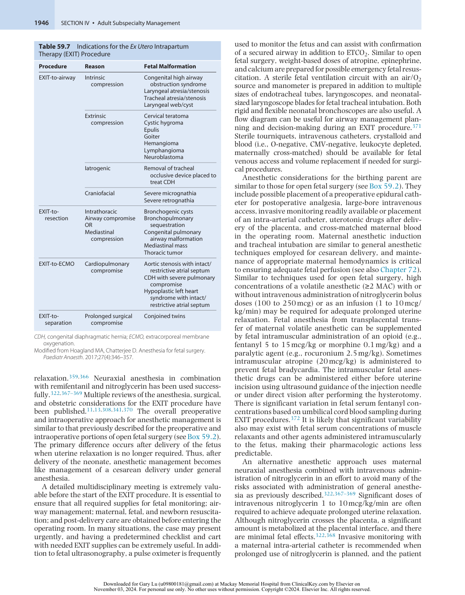

:::

<!-- PDF page 27 -->

should be monitored for onset of pulmonary edema. Some practitioners have also provided neuraxial block for maternal anesthesia for EXIT procedures. Intravenous nitroglycerin and a remifentanil infusion (0.1 to 0.2 mcg/kg/min) are used to provide adequate fetal immobilization without use of the intramuscular fetal anesthetic drugs previously described.367,369 No prospective clinical trials have been conducted to determine the best anesthetic technique for the EXIT procedure.

After assessment of appropriate uterine relaxation, the placental border is determined by ultrasonography. A small initial hysterotomy is extended outside the placental border with a stapling device to prevent excessive blood loss. If the EXIT procedure is performed to facilitate fetal intubation or neck mass resection, only the fetal head and shoulders are initially delivered (Fig. 59.13). For more extensive procedures requiring access to the thorax or other anatomic locations, the entire body may be delivered.

Before hysterotomy, the fetus is monitored with echocardiography and ultrasonography. After hysterotomy, a pulse oximeter probe is placed on the fetal hand and shielded from ambient light. Warmed crystalloid fluids are irrigated in the uterine cavity to maintain fetal temperature and prevent placental separation or spasm of umbilical vessels. Care should also be taken to avoid inadvertent compression or unnecessary manipulation of the umbilical cord, which could lead to vascular reactivity and decreased flow.

Depending on the indication, the duration of an EXIT procedure ranges from a few minutes (e.g., fetal intubation) to several hours (intrathoracic mass resection, neck mass resection with tracheostomy, or ECMO cannulation). Anesthetic techniques have successfully provided safe maternal and fetal anesthesia with uterine relaxation and uteroplacental stability over several hours.373 Before ventilation of the fetal lungs, fetal oxyhemoglobin saturation is typically 40% to 70%.374 After initiating ventilation of the fetal lungs, oxyhemoglobin saturation should increase significantly to above 90%. When fetal lung ventilation fails to result in an appropriate increase in oxyhemoglobin saturation despite appropriate endotracheal intubation, this represents an indication for ECMO initiation before clamping the umbilical cord and fetal delivery.375 An ETCO2 indicator is also beneficial in confirming correct placement of the endotracheal tube. If needed, pulmonary surfactant may be administered once the endotracheal tube is placed. Transporting the neonate to the intensive care area for further care requires significant vigilance to ensure the critical, tentative airway remains secured.

Once the fetus is delivered, the inspired concentration of the volatile agent is significantly decreased, the nitroglycerin infusion stopped, or both, to allow the uterus to contract and diminish the risk for maternal hemorrhage.376,377 Use of a combination of volatile anesthetics (≤0.5 MAC), nitrous oxide, propofol, and/or an opioid can be administered to maintain adequate anesthesia while allowing uterine tone. Oxytocin is routinely administered and additional uterotonic drugs are also administered when necessary, as detailed in Chapter 58. Once the patient is hemodynamically stable with appropriate uterine tone, epidural analgesia may be initiated. The birthing parent is extubated once fully awake.

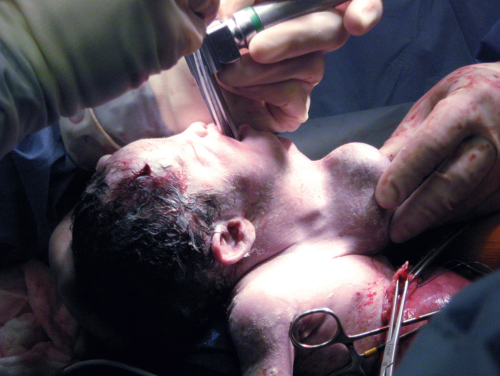

**Fig. 59.13** During an _ex utero_ intrapartum therapy procedure, the head and upper torso of a fetus with a neck mass are delivered and the airway secured using direct laryngoscopy. (Courtesy Dr. Anita Moon- Grady, University of California, San Francisco Fetal Treatment Center, San Francisco, CA.)

## Conclusions and Future Considerations

Establishment of organized, multidisciplinary, and comprehensive fetal intervention programs at a variety of academic centers is critical to improving patient outcomes with innovative surgical techniques, refining diagnostic and treatment strategies, and initiating clinical trials powered to address long- term neonatal outcomes, as well as associated maternal and neonatal morbidity.4,359 Advancement of surgical technology and prenatal diagnostic and management strategies is likely to decrease both maternal and fetal risk and allow safe intervention for additional congenital anomalies and treatment of less severe abnormalities. In addition, _in utero_ stem cell and gene therapy research may lead to novel fetal treatment that allows normal development despite presence of a congenital anomaly.378–381 Improvements in managing preterm labor and delivery would greatly improve outcome in fetal therapy.382 Artificial placental units employing extracorporeal support of the preterm neonate with continuous fluid exchange are another novel therapy, currently being tested in animals.383,384

Fetal surgery is a relatively new and rapidly evolving area of clinical medicine. _In utero_ treatment raises complex and difficult ethical, social, and legal issues that go far beyond that of most adult or pediatric surgical interventions and include questions regarding rights of the pregnant patient, access to care, and the option for pregnancy termination.385–387

Evaluation of each new therapy or change in treatment strategy should be conducted in multicenter clinical trials only after appropriate translational research and animal studies are completed and demonstrate a potential benefit. This transition from innovative breakthrough, to randomized clinical trial, to standard care must be managed in a responsible and ethical framework. In addition, _in utero_ treatment outcomes from new institutions with minimal experience and intervention for patients outside the strict inclusion criteria of clinical trials are likely to result in less favorable

<!-- PDF page 28 -->

results with increased morbidity compared with the outcomes demonstrated at more established fetal treatment centers participating in the clinical trials.55,388 To address these concerns, a bioethics committee from the American College of Obstetricians and Gynecologists and the American Academy of Pediatrics provided recommendations for centers offering fetal therapy.258 A summary of these recommendations includes a thorough informed consent process, appropriate institutional research safeguards, involvement of a multidisciplinary team, and the need for open collaborative research networks. Although this approach has high financial costs, basic science and translational and clinical research in fetal therapy is essential to appropriately manage the unique risks and benefits of future innovations. Appropriate patient selection (both maternal and fetal) and timing of the intervention also need to be better established in many of the procedures. Additionally, North American Fetal Therapy Network and various societies associated with fetal therapy including the ASA have issued guidance regarding appropriate staffing and resource availability recommended for centers providing various levels of fetal care.4

The principle of _primum non nocere_ (first, do no harm) argues that until a therapy is appropriately tested in animal models, it is unethical to pursue in human trials.389 Advances in fetal surgery not only require determination of fetal benefit but also must be powered to appropriately evaluate additional fetal and maternal morbidity.390

Only the results of animal research and descriptive summaries of clinical series currently guide most of the clinical anesthetic care for fetal surgery. Further rigorous research is needed to determine optimal anesthetic techniques, ensure maternal and fetal cardiovascular stability, improve our understanding of anesthetic exposure and neurocognitive deficits, assess the impact of anesthetic management strategies on uterine tone and uteroplacental perfusion, and improve our ability to determine the adequacy of fetal anesthesia to produce immobility and block the fetal stress response.309,391

Areas of clinical growth include programs for anesthesia training in fetal treatment and the development of standard guidelines for fetal anesthesia and perioperative care of these unique procedures. Fetal treatment is a relatively new, rapidly evolving field of clinical medicine that holds great promise for treating morbid conditions and improving quality of life over the entire lifetime of the patient. Equally significant are the research efforts, technologic advancements, and ethical standards that must be supported to achieve these goals.

### Acknowledgments

The authors gratefully acknowledge the contributions of Dr. Mark Rosen and Dr. Charles “Chico” Cauldwell for their teaching and clinical training that provided the basis for this chapter. Dr. Rollins and Ferschl have authored other textbook chapters of similar scope,392–396 and although this work represents a new unique effort, there may be some similarity in the general layout of ideas, concepts, and presentation of current data surrounding anesthesia considerations for fetal therapy.

### References

1.  Partridge EA, et al. _Best Pract Res Clin Obstet Gynaecol_ . 2012;26(5):669.

2.  Harrison MR, et al. _N Engl J Med_ . 1982;307(26):1651.

3.  Sudhakaran N, et al. _Early Hum Dev_ . 2012;88(1):15.

4.  Baschat AA, et al. _Obstet Gynecol_ . 2022;139(6):1027.

5.  Al- Refai A, et al. _Curr Opin Obstet Gynecol_ . 2017;29(2):80.

6.  Kitagawa H, et al. _Pediatr Surg Int_ . 2017;33(4):421.

7.  Graves CE, et al. _Clin Perinatol_ . 2017;44(4):729.

8.  Johnson MP, et al. _Am J Obstet Gynecol_ . 2016;215(6):778.e771.

9.  Kabagambe SK, et al. _Fetal Diagn Ther_ . 2018;43(3):161.

10.  Etchegaray A, et al. _Prenat Diagn_ . 2022;42(4):495.

11.  Moldenhauer JS, et al. _Semin Pediatr Surg_ . 2013;22(1):44.

12.  García- Díaz L, et al. _BMC Pregnancy Childbirth_ . 2020;20(1):598.

13.  Butler CR, et al. _Curr Opin Otolaryngol Head Neck Surg_ . 2017;25(2):119.

14.  Porter H, et al. _Prenat Diagn_ . 2022;42(11):1420.

15.  Hirose S, et al. _Clin Perinatol_ . 2003;30(3):493.

16.  Shieh HF, et al. _J Pediatr Surg_ . 2017;52(1):22.

17.  Cass DL, et al. _Semin Fetal Neonatal Med_ . 2011;16(3):130.

18.  Robinson AJ, et al. _Pediatr Radiol_ . 2018;48(4):471.

19.  Platt LD, et al. _Prenat Diagn_ . 2018;38(3):166.

20.  Liley AW. _Br Med J_ . 1963;2(5365):1107.

21.  Papantoniou N, et al. _J Perinat Med_ . 2013;41:71.

22.  Adamsons Jr K. _N Engl J Med_ . 1966;275(4):204.

23.  Rodeck CH, et al. _Lancet_ . 1981;1(8221):625.

24.  Liggins GC, et al. _Pediatrics_ . 1972;50(4):515.

25.  Harrison MR, et al. _Surgery_ . 1980;88(1):174.

26.  Harrison MR, et al. _Surgery_ . 1980;88(2):260.

27.  Harrison MR, et al. _J Pediatr Surg_ . 1981;16(6):934.

28.  Harrison MR, et al. _J Pediatr Surg_ . 1982;17(2):115.

29.  Harrison MR, et al. _N Engl J Med_ . 1982;306(10):591.

30.  Lindenburg IT, et al. _Fetal Diagn Ther_ . 2014;36(4):263.

31.  Prefumo F, et al. _Best Pract Res Clin Obstet Gynaecol_ . 2019;58:2.

32.  Moise Jr KR. _Am J Obstet Gynecol_ . 2008;198(2):161.e161.

33.  Fox C, et al. _Fetal Diagn Ther_ . 2008;23(2):159.

34.  Donepudi R, et al. _Eur J Obstet Gynecol Reprod Biol_ . 2022;274:171.

35.  Fisk NM, et al. _Anesthesiology_ . 2001;95(4):828.

36.  Adama van Scheltema PN, et al. _Prenat Diagn_ . 2011;31(6):555.

37.  Uquillas KR, et al. _Am J Perinatol_ . 2018;35(7):682.

38.  Mouw RJ, et al. _Acta Obstet Gynecol Scand_ . 1999;78(9):763.

39.  Norton ME, et al. _Contraception_ . 2022;106:10.

40.  Santiago MD, et al. _Blood Transfusion_ . 2010;8(4):271.

41.  Bakhtary S, et al. _Transfusion_ . 2022;62(12):2449.

42.  Nicolaides KH, et al. _Fetal Ther_ . 1986;1(4):185.

43.  Zwiers C, et al. _Expert Rev Hematol_ . 2017;10(4):337.

44.  Lindenburg IT, et al. _Am J Obstet Gynecol_ . 2012;206(2):141.e141.

45.  Singh Y, et al. _Clin Perinatol_ . 2021;48(3):573.

46.  Puri K, et al. _Pediatr Rev_ . 2017;38(10):471.

47.  Donofrio MT, et al. _Circulation_ . 2014;129(21):2183.

48.  Gellis L, et al. _Semin Fetal Neonatal Med_ . 2017;22(6):399.

49.  Araujo EJ, et al. _J Evid Based Med_ . 2016;9(3):125.

50.  Tulzer A, et al. _Front Pediatr_ . 2022;10:944813.

51.  Alsoufi B, et al. _Ann Thorac Surg_ . 2015;100(2):591.

52.  Karamlou T, et al. _J Thorac Cardiovasc Surg_ . 2010;139(1):119.

53.  Oberhuber RD, et al. _Pediatr Cardiol_ . 2017;38(6):1089.

54.  Khalil A, et al. _Ultrasound Obstet Gynecol_ . 2014;43(1):14.

55.  Guseh SH, et al. _Prenat Diagn_ . 2020;40(4):415.

56.  McElhinney DB, et al. _Circulation_ . 2009;120(15):1482.

57.  Oepkes D, et al. _Prenat Diagn_ . 2011;31(3):249.

58.  Schidlow DN, et al. _Am J Perinatol_ . 2014;31(7):629.

59.  Ferschl MB, et al. _J Cardiothorac Vasc Anesth_ . 2016;30(4):1118.

60.  Marantz P, et al. _Curr Opin Cardiol_ . 2015;30(1):89.

61.  Freud LR, et al. _Curr Opin Pediatr_ . 2016;28(2):156.

62.  Arzt W, et al. _Prenat Diagn_ . 2011;31(7):695.

63.  Arzt W, et al. _Ultrasound Obstet Gynecol_ . 2011;37(6):689.

64.  Prosnitz AR, et al. _Prenat Diagn_ . 2018;38(4):286.

65.  Jaeggi E, et al. _Trends Cardiovasc Med_ . 2016;26(7):639.

66.  Hogan WJ, et al. _Fetal Diagn Ther_ . 2020:1.

67.  Nassr AA, et al. _Prenat Diagn_ . 2017;37(9):849.

68.  Kohl T, et al. _Eur J Cardio Thorac Surg_ . 2012;42(1):14.

69.  Stirnemann J, et al. _Am J Obstet Gynecol_ . 2018;219(4):320.

70.  Capone V, et al. _Nat Rev Urol_ . 2022;19(5):295.

### Complete references available online at expertconsult.com.

71.  Ruano R, et al. _Prenat Diagn_ . 2011;31(7):667.

72.  Johnson MP, et al. _Semin Fetal Neonat Med_ . 2017;22(6):391.

<!-- PDF page 29 -->

73.  Hubert KC, et al. _Urol Clin North Am_ . 2007;34(1):89.

74.  Lyons K, et al. _Semin Ultrasound CT MR_ . 2015;36(4):310.

75.  Braga LH, et al. _J Urol_ . 2017;197(3 Pt 2):831.

76.  Ruano R, et al. _Pediatr Nephrol_ . 2017;32(10):1871.

77.  Wu S, et al. _Clin Perinatol_ . 2009;36(2):377.

78.  Qureshi F, et al. _Fetal Diagn Ther_ . 1996;11(5):306.

79.  Nassr AA, et al. _Ultrasound Obstet Gynecol_ . 2017;49(6):696.

80.  Miller JL, et al. _Clin Perinatol_ . 2022;49(4):849.

81.  Sato Y, et al. _J Pediatr Surg_ . 2004;39(12):1849.

82.  Kitagawa H, et al. _Pediatr Surg Int_ . 2006;22(11):875.

83.  Nagae H, et al. _J Pediatr Surg_ . 2006;41(12):2086.

84.  Clayton DB, et al. _Current Urol Rep_ . 2018;19(1):12.

85.  Quintero RA, et al. _J Matern Fetal Neonat Med_ . 2010;23(8):806.

86.  Smith- Harrison LI, et al. _J Pediatr Urol_ . 2015;11(6):341.

87.  Biard J- M, et al. _Obstet Gynecol_ . 2005;106(3):503.

88.  Freedman AL, et al. _Lancet_ . 1999;354(9176):374.

89.  Morris R, et al. _BJOG_ . 2010;117(4):382.

90.  Morris RK, et al. _Lancet_ . 2013;382(9903):1496.

91.  Martinez JM, et al. _Fetal Diagn Ther_ . 2015;37(4):267.

92.  Ruano R, et al. _Ultrasound Obstet Gynecol_ . 2015;45(4):452.

93.  Vinit N, et al. _Fetal Diagn Ther_ . 2020;47(1):74.

94.  Morris RK, et al. _Early Human Dev_ . 2011;87(9):607.

95.  Jelin AC, et al. _Prenat Diagn_ . 2020;40(5):528.

96.  O’Hare EM, et al. _Fetal Diagn Ther_ . 2019;45(6):365.

97.  Jelin E, et al. _Fetal Diagn Ther_ . 2010;27(3):138.

98.  Brock CO, et al. _Best Pract Res Clin Obstet Gynaecol_ . 2022;84:127.

99.  Moore TR, et al. _Am J Obstet Gynecol_ . 1990;163(3):907.

100.  Healey MG. _Teratology_ . 1994;50(3):205.

101.  Chaveeva P, et al. _Fetal Diagn Ther_ . 2014;35(4):267.

102.  Lee H, et al. _Fetal Diagn Ther_ . 2013;33(4):224.

103.  Sugibayashi R, et al. _Prenat Diagn_ . 2016;36(5):437.

104.  Berg C, et al. _Ultrasound Obstet Gynecol_ . 2014;43(1):60.

105.  Lewi L, et al. _Am J Obstet Gynecol_ . 2010;203(3):213.e211.

106.  Ferschl MB, et al. _Anesth Analg_ . 2020;130(2):409.

107.  Simpson LL, et al. _Am J Obstet Gynecol_ . 2013;208(1):3.

108.  Johnson A, et al. _Clin Obstet Gynecol_ . 2015;58(3):611.

109.  Khalek N, et al. _Semin Pediatr Surg_ . 2013;22(1):18.

110.  Benoit RM, et al. _Am J Perinatol_ . 2014;31(7):583.

111.  De Paepe ME, et al. _Placenta_ . 2010;31(4):269.

112.  Nikkels PGJ, et al. _J Clin Pathol_ . 2008;61(12):1247.

113.  Denbow ML, et al. _Placenta_ . 2004;25(7):664.

114.  Simpson LL. _Am J Obstet Gynecol_ . 2013;208(1):3.

115.  Bamberg C, et al. _Best Pract Res Clin Obstet Gynaecol_ . 2022;84:143.

116.  Quintero RA, et al. _Am J Obstet Gynecol_ . 2003;188(5):1333.

117.  Quintero RA, et al. _J Perinatol_ . 1999;19(8 Pt 1):550.

118.  Rychik J, et al. _Am J Obstet Gynecol_ . 2007;197(4):392.e391.

119.  Manning N, et al. _Twin Res Hum Genet_ . 2016;19(3):246.

120.  Miralles- Gutierrez A, et al. _J Perinat Med_ . 2018;46(9):991.

121.  Sananes N, et al. _Prenat Diagn_ . 2016;36(12):1139.

122.  van Klink JMM, et al. _Early Hum Dev_ . 2011;87(9):589.

123.  Li X, et al. _BMC Pregnancy Childbirth_ . 2011;11(1).

124.  Rossi A, et al. _Am J Perinatol_ . 2012;30(01):005.

125.  Roberts D, et al. _Cochrane Database Syst Rev_ . 2014(1):Cd002073.

126.  Emery SP, et al. _Am J Obstet Gynecol_ . 2016;215(3):346.e341.

127.  Saunders NJ, et al. _Am J Obstet Gynecol_ . 1992;166(3):820.

128.  Mari G, et al. _Am J Obstet Gynecol_ . 2001;185(3):708.

129.  Dickinson JE, et al. _Am J Obstet Gynecol_ . 2000;182(3):706.

130.  Moise KJ, et al. _Am J Obstet Gynecol_ . 2005;193(3):701.

131.  Sago H, et al. _J Obstet Gynaecol Res_ . 2018;44(5):831.

132.  Chmait RH, et al. _J Matern Fetal Neonat Med_ . 2010;23(1):10.

133.  Akkermans J, et al. _Fetal Diagn Ther_ . 2015;37(4):251.

134.  Chmait RH, et al. _Am J Obstet Gynecol_ . 2011;204(5):393.e391.

135.  Slaghekke F, et al. _Twin Res Hum Genet_ . 2016;19(3):217.

136.  van Klink JM, et al. _Am J Obstet Gynecol_ . 2016;214(1):113.e111.

137.  Slaghekke F, et al. _Lancet_ . 2014;383(9935):2144.

138.  Lanna MM, et al. _Placenta_ . 2017;53:54.

139.  Senat M- V, et al. _N Engl J Med_ . 2004;351(2):136.

140.  Salomon LJ, et al. _Am J Obstet Gynecol_ . 2010;203(5):444.e441.

141.  Akkermans J, et al. _Fetal Diagn Ther_ . 2015;38(4):241.

142.  Sananes N, et al. _Ultrasound Obstet Gynecol_ . 2016;47(6):712.

143.  Chmait RH, et al. _J Matern Fetal Neonatal Med_ . 2017;1.

144.  Husler MR, et al. _Prenat Diagn_ . 2009;29(5):457.

145.  Cignini P, et al. _J Prenat Med_ . 2012;6(4):59. 146.  Richter J, et al. _Fetal Diagn Ther_ . 2012;31(2):134.

147.  Burton DJ, et al. _Am J Roentgenol_ . 1991;156(3):555.

148.  Neuman J, et al. _Pediatr Radiol_ . 2012;42(5):544.

149.  Javadian P, et al. _Ultrasound Obstet Gynecol_ . 2013;42(4):449.

150.  Derderian SC, et al. _J Pediatr Surg_ . 2014;49(2):359.

151.  Gueneuc A, et al. _Fetal Diagn Ther_ . 2019;46(4):246.

152.  Ting YH, et al. _Fetal Diagn Ther_ . 2016;40(1):67.

153.  Danzer E, et al. _Early Hum Dev_ . 2011;87(9):625.

154.  Burgos CM, et al. _J Pediatr Surg_ . 2017;S0022–3468(17)30649- 8.

155.  Dingeldein M. _Adv Pediatr_ . 2018;65(1):241.

156.  Barriere F, et al. _J Pediatr_ . 2018;193:204.

157.  Wynn J, et al. _J Pediatr_ . 2013;163(1):114.

158.  Harrison MR, et al. _J Pediatr Surg_ . 1993;28(10):1411.

159.  Esteve C, et al. _Ann Fr Anesth Reanim_ . 1992;11(2):193.

160.  Harrison MR, et al. _J Pediatr Surg_ . 1997;32(11):1637.

161.  Wilson JM, et al. _J Pediatr Surg_ . 1993;28(11):1433.

162.  Alcorn D, et al. _J Anat_ . 1977;123(Pt 3):649.

163.  Bealer JF, et al. _J Pediatr Surg_ . 1995;30(2):361.

164.  Hedrick MH, et al. _J Pediatr Surg_ . 1994;29(5):612.

165.  Russo FM, et al. _Semin Fetal Neonat Med_ . 2017;22(6):383.

166.  Harrison MR, et al. _J Pediatr Surg_ . 1996;31(10):1339.

167.  Harrison MR, et al. _J Pediatr Surg_ . 1998;33(7):1017.

168.  Shue EH, et al. _Clin Perinatol_ . 2012;39(2):289.

169.  Jimenez JA, et al. _Am J Obstet Gynecol_ . 2017;217(1):78.e71.

170.  Jani JC, et al. _Am J Obstet Gynecol_ . 2006;195(6):1646.

171.  Metkus AP, et al. _J Pediatr Surg_ . 1996;31(1):148.

172.  Peralta CFA, et al. _Ultrasound Obstet Gynecol_ . 2005;26(7):718.

173.  Jani J, et al. _Ultrasound Obstet Gynecol_ . 2007;30(1):67.

174.  Deprest JA, et al. _Fetal Diagn Ther_ . 2011;29(1):6.

175.  Oluyomi- Obi T, et al. _J Pediatr Surg_ . 2017;52(5):881.

176.  Victoria T, et al. _Semin Pediatr Surg_ . 2013;22(1):30.

177.  Mayer S, et al. _Prenat Diagn_ . 2011;31(11):1086.

178.  Harrison MR, et al. _N Engl J Med_ . 2003;349(20):1916.

179.  Jani JC, et al. _Ultrasound Obstet Gynecol_ . 2009;34(3):304.

180.  Jani J, et al. _Prenat Diagn_ . 2011;31(7):699.

181.  Al- Maary J, et al. _Ann Surg_ . 2016;264(6):929.

182.  Done E, et al. _Ultrasound Obstet Gynecol_ . 2013;42(1):77.

183.  Dhillon GS, et al. _Prenat Diagn_ . 2018;38(11):812.

184.  DeKoninck P, et al. _Early Hum Dev_ . 2011;87(9):619.

185.  Deprest JA, et al. _N Engl J Med_ . 2021;385(2):119.

186.  Deprest JA, et al. _N Engl J Med_ . 2021;385(2):107.

187.  Adzick SN, et al. _Semin Pediatr Surg_ . 2013;22(1):10.

188.  Peranteau WH, et al. _Curr Opin Obstet Gynecol_ . 2016;28(2):111.

189.  Blumenfeld YJ, et al. _Curr Opin Obstet Gynecol_ . 2018;30(2):123. 190.  Copp AJ, et al. _Nat Rev Dis Primers_ . 2015;1:15007.

191.  Sileo FG, et al. _Ultrasound Obstet Gynecol_ . 2019;53(3):309.

192.  Shaer CM, et al. _Obstet Gynecol Surv_ . 2007;62(7):471.

193.  Oakeshott P, et al. _Br J Gen Pract_ . 2003;53(493):632.

194.  Roach JW, et al. _Clin Orthop Relat Res_ . 2011;469(5):1246.

195.  Julia V, et al. _J Pediatr Surg_ . 2006;41(6):1125.

196.  Moldenhauer JS, et al. _Semin Fetal Neonat Med_ . 2017;22(6):360.

197.  Sutton LN. _Best Pract Res Clin Obstet Gynaecol_ . 2008;22(1):175.

198.  Yoshizawa J, et al. _Pediatr Surg Int_ . 2004;20(1):14.

199.  Korenromp M, et al. _Lancet_ . 1986;327(8486):917.

200.  Sival DA, et al. _Early Hum Dev_ . 1997;50(1):27.

201.  Luthy DA, et al. _N Engl J Med_ . 1991;324(10):662.

202.  Ferschl M, et al. _Anesthesiology_ . 2013;118(5):1211.

203.  Bruner JP. _Semin Fetal Neonat Med_ . 2007;12(6):471.

204.  Sutton LN. _JAMA_ . 1999;282(19):1826.

205.  Adzick NS, et al. _N Engl J Med_ . 2011;364(11):993.

206.  Farmer DL, et al. _Am J Obstet Gynecol_ . 2018;218(2):256.e251.

207.  Kabagambe SK, et al. _Childs Nerv Syst_ . 2017;33(7):1185.

208.  Danzer E, et al. _Am J Obstet Gynecol_ . 2016;214(2):269.e261.

209.  Houtrow AJ, et al. _JAMA Pediatr_ . 2021;175(4):e205674.

210.  Adzick NS. _J Pediatr Surg_ . 2012;47(2):273.

211.  American College of Obstetricians and Gynecologists. _Obstetr Gynecol_ . 2013;121(1):218.

212.  Hilton SA, et al. _Fetal Diagn Ther_ . 2019;46(6):411.

213.  Peiro JL, et al. _Surg Endosc_ . 2013;27(10):3835.

214.  Belfort MA, et al. _Obstet Gynecol_ . 2017;129(4):734.

215.  Pedreira DA, et al. _Am J Obstet Gynecol_ . 2016;214(1):111.e111.

216.  Belfort MA, et al. _Obstet Gynecol_ . 2015;126(4):881.

217.  Ziemann M, et al. _Surg Endosc_ . 2018;32(7):3138.

218.  Manrique S, et al. _Eur J Anaesthesiol_ . 2019;36(3):175.

219.  Diehl D, et al. _Ultrasound Obstet Gynecol_ . 2021;57(1):113.

220.  Kremer MEB, et al. _J Pediatr Surg_ . 2018;53(10):1918. 221.  Wilson RD, et al. _Fetal Diagn Ther_ . 2009;25(1):15.

<!-- PDF page 30 -->

222.  Van Mieghem T, et al. _Ultrasound Obstet Gynecol_ . 2014;43(6):611. 223.  Usui N, et al. _J Pediatr Surg_ . 2012;47(3):441. 224.  Altman RP, et al. _J Pediatr Surg_ . 1974;9(3):389. 225.  Gebb JS, et al. _Fetal Diagn Ther_ . 2019;45(2):94. 226.  Peiro JL, et al. _Pediatr Surg Int_ . 2016;32(7):635. 227.  Litwińska M, et al. _Fetal Diagn Ther_ . 2020;47(2):138. 228.  Roybal JL, et al. _J Pediatr Surg_ . 2011;46(7):1325.

229.  Gebb JS, et al. _Fetal Diagn Ther_ . 2019;45(2):94. 230.  Baumgarten HD, et al. _Fetal Diagn Ther_ . 2019;45(3):137.

231.  Braun T, et al. _Fetal Diagn Ther_ . 2010;27(4):191.

232.  Society for Maternal- Fetal Medicine. _Am J Obstet Gynecol_ . 2015;212(2):127.

233.  Hirata G, et al. _J Matern Fetal Neonatal Med_ . 2016;29(16):2630. 234.  Khalek N, et al. _Semin Pediatr Surg_ . 2013;22(1):24.

235.  David M, et al. _Neonatology_ . 2016;110(2):101. 236.  Gajewska- Knapik K, et al. _Semin Pediatr Surg_ . 2015;24(4):156. 237.  Fowler DJ, Gould SJ. _Semin Pediatr Surg_ . 2015;24(4):176. 238.  Adzick NS. _Clin Perinatol_ . 2009;36(2):363, x.

239.  Parikh DH, Rasiah SV. _Semin Pediatr Surg_ . 2015;24(4):160.

240.  Ehrenberg- Buchner S, et al. _Am J Obstet Gynecol_ . 2013;208(2):151.e151. 241.  Yong PJ, et al. _Fetal Diagn Ther_ . 2012;31(2):94.

242.  Crombleholme TM, et al. _J Pediatr Surg_ . 2002;37(3):331. 243.  Mann S, et al. _Semin Fetal Neonatal Med_ . 2007;12(6):477. 244.  Cass DL, et al. _J Pediatr Surg_ . 2012;47(1):40. 245.  Harrison MR, et al. _Lancet_ . 1990;336(8721):965. 246.  Baird R, et al. _Semin Pediatr Surg_ . 2014;23(5):270. 247.  Derderian SC, et al. _J Pediatr Surg_ . 2015;50(4):515. 248.  Wilson RD, et al. _Fetal Diagn Ther_ . 2004;19(5):413. 249.  Peranteau WH, et al. _J Pediatr Surg_ . 2015;50(2):301. 250.  Mallmann MR, et al. _Fetal Diagn Ther_ . 2017;41(1):58. 251.  Rodeck CH, et al. _N Engl J Med_ . 1988;319(17):1135. 252.  Mon RA, et al. _J Surg Res_ . 2018;221:121. 253.  Grethel EJ, et al. _J Pediatr Surg_ . 2007;42(1):117. 254.  Cass EL, et al. _J Pediatr Surg_ . 2013;48(1):138. 255.  Wilson RD. _Prenat Diagn_ . 2008;28(7):619. 256.  Chatterjee D, et al. _Anesth Analg_ . 2021;132(4):1164.

257.  Lakhoo K. _Early Hum Dev_ . 2012;88(1):9.

258.  American College of Obstetricians and Gynecologists, Committee on Ethics; American Academy of Pediatrics, Committee on Bioethics. _Pediatrics_ . 2011;128(2):e473.

259.  Sacco A, et al. _Prenat Diagn_ . 2019;39(4):251.

260.  Goodnight WH, et al. _Am J Obstet Gynecol_ . 2019;220(5):494.e491. 261.  Wilson RD, et al. _Am J Obstetr Gynecol_ . 2010;203(3):209.e201209. e206.

262.  Alshammari DM, et al. _Arch Pediatr_ . 2021;28(7):533. 263.  Berman L, et al. _Fetal Diagn Ther_ . 2018;44(2):91. 264.  Miquel- Verges F, et al. _Pediatrics_ . 2009;124(4):e573. 265.  Rychik J, et al. _Pediatr Cardiol_ . 2004;25(3).

266.  Morton SU, et al. _Clin Perinatol_ . 2016;43(3):395. 267.  Grant DA, et al. _J Physiol_ . 2001;535(Pt 1):231.

268.  Swanson JR, et al. _Pediatr Clin North Am_ . 2015;62(2):329. 269.  Yao AC, et al. _Lancet_ . 1969;2(7626):871.

270.  Morris JA, et al. _Am J Obstet Gynecol_ . 1974;118(7):927. 271.  Smith GCS, et al. _BJOG_ . 2002;109(6):721.

272.  Sankaran VG, et al. _Br J Haematol_ . 2010;149(2):181.

273.  Colombatti R, et al. _Semin Fetal Neonat Med_ . 2016;21(1):2. 274.  Nicolaides KH, et al. _Lancet_ . 1988;1(8594):1073.

275.  Reverdiau- Moalic P, et al. _Blood_ . 1996;88(3):900.

276.  Jaffray J, Young G. _Pediatr Clin North Am_ . 2013;60(6):1407. 277.  Sola- Visner M. _Hematology Am Soc Hematol Educ Program_ . 2012;2012:506.

278.  Segura LG, et al. _Int J Obstet Anesth_ . 2020;44:16.

279.  Kaneko M, et al. _J Pediatr Surg_ . 2011;46(2):e37. 280.  Luks FI, et al. _J Pediatr Surg_ . 1998;33(8):1297.

281.  Izumi A, et al. _Gynecol Obstet Invest_ . 1997;44(1):26.

282.  Caradeux J, et al. _Am J Obstet Gynecol_ . 2018;218(2s):S774. 283.  Gunn TR, et al. _J Dev Physiol_ . 1986;8(1):55.

284.  Mann DG, et al. _Ultrasound Obstet Gynecol_ . 2018;51(3):411. 285.  Aboud E, et al. _Int J Gynaecol Obstet_ . 1999;66(2):163. 286.  Teixeira J, et al. _Lancet_ . 1996;347(9001):624.

287.  Gitau R, et al. _J Clin Endocrinol Metab_ . 2001;86(1):104. 288.  Brusseau R, et al. _Clin Perinatol_ . 2013;40(3):429. 289.  Van de Velde M, et al. _Fetal Diagn Ther_ . 2012;31(4):201. 290.  Anand KJ, et al. _N Engl J Med_ . 1987;317(21):1321. 291.  Sekulic S, et al. _J Pain Res_ . 2016;9:1031.

292.  Derbyshire SWG. _Bioethics_ . 1999;13(1):1.

293.  Raja SN, et al. _Pain_ . 2020;161(9):1976.

294.  Anand KJS, et al. _Lancet_ . 1987;329(8524):62.

295.  Afif A, et al. _Brain Struct Funct_ . 2007;212(34):335.

296.  Terenghi G, et al. _J Comp Neurol_ . 1993;328(4):595.

297.  Konstantinidou AD, et al. _J Comp Neurol_ . 1995;354(1):11.

298.  Lee SJ, et al. _JAMA_ . 2005;294(8):947.

299.  Hevner RF. _J Neuropathol Exp Neurol_ . 2000;59(5):385.

300.  Kostovic I, Rakic P. _J Neurosci_ . 1984;4(1):25.

301.  Krmpotić- Nemanić J, et al. _Cells Tissues Organs_ . 1983;116(1):69. 302.  Torres F, et al. _J Clin Neurophysiol_ . 1985;2(2):89.

303.  Robinson S, et al. _Anesth Analg_ . 1981;60(5):331???.

304.  Rosen MA. _Yonsei Med J_ . 2001;42(6):669.

305.  Van de Velde M, et al. _Semin Fetal Neonat Med_ . 2006;11(4):232. 306.  Glover V, et al. _BMJ_ . 1996;313(7060):796.

307.  Norton ME, et al. _Am J Obstet Gynecol_ . 2021;225(6):B2.

308.  Olutoye OO, Olutoye OA. _Curr Opin Pediatr_ . 2012;24(3):386. 309.  Tran KM, et al. _Anesthesiology_ . 2013;118(4):772.

310.  Leveque C, et al. _Anesthesiology_ . 1992;76(4):642.

311.  Van de Velde M, et al. _Anesth Analg_ . 2005;101(1):251.

312.  Dwyer R, et al. _Br J Anaesth_ . 1995;74(4):379.

313.  Polvi H, et al. _Obstet Gynecol_ . 1996;87(6):1045.

314.  Biehl DR, et al. _Can Anaesth Soc J_ . 1983;30(6):581. 315.  Palahniuk RJ, et al. _Anesthesiology_ . 1974;41(5):462.

316.  Boat A, et al. _Paediatr Anaesth_ . 2010;20(8):748.

317.  Constant I, et al. _Pediatr Anesth_ . 2005;15(4):266.

318.  Shavit CW, et al. _Br J Anaesth_ . 2017;118(4):634.

319.  Marsh BJ, et al. _Fetal Diagn Ther_ . 2020;47(11):810.

320.  Boat A, et al. _Pediatr Anesth_ . 2010;20(8):748.

321.  Kan RE, et al. _Anesthesiology_ . 1998;88(6):1467.

322.  Rosen MA, et al. _Anesth Analg_ . 2003;96(3):698.

323.  Brambrink AM, et al. _Anesthesiology_ . 2010;112(4):834.

324.  Jevtovic- Todorovic V, et al. _J Neurosurg Anesthesiol_ . 2003;15(3):295.

325.  Raper J, et al. _Br J Anaesth_ . 2018;120(4):761.

326.  Alvarado MC, et al. _Br J Anaesth_ . 2017;119(3):517.

327.  Jevtovic- Todorovic V. _Br J Anaesth_ . 2017;119(3):455.

328.  Sun LS, et al. _JAMA_ . 2016;315(21):2312.

329.  Davidson AJ, et al. _Lancet_ . 2016;387(10015):239.

330.  American Society of Anesthesiologists. _ASA Response to the FDA Med Watch Warning_ ; 2016.

331.  Sprung J, et al. _Anesthesiology_ . 2009;111(2):302.

332.  Olutoye OA, et al. _Am J Obstet Gynecol_ . 2018;218(1):98.

333.  Andropoulos DB. _Fetal Diagn Ther_ . 2018;43(1):1.

334.  Ferschl MB, et al. _Paediatr Anaesth_ . 2021;31(3):275.

335.  Rico Mora DA, et al. _Paediatr Anaesth_ . 2020;30(9):1046.

336.  Farrell J, et al. _J Obstet Gynecol Neonatal Nurs_ . 2012;41(3):419.

337.  Arens C, et al. _Anesth Analg_ . 2017;125(1):219.

338.  Patel D, et al. _Fetal Diagn Ther_ . 2020;47(8):597.

339.  Hering R, et al. _Br J Anaesth_ . 2009;102(4):523.

340.  Kafal H, et al. _Anesth Analg_ . 2002;94(1):174.

341.  Hoagland MA, et al. _Paediatr Anaesth_ . 2017;27(4):346.

342.  Sinskey JL, et al. _Fetal Diagn Ther_ . 2018;43(4):274.

343.  Donepudi R, et al. _Fetal Diagn Ther_ . 2019;45(3):192.

344.  Howley LW, et al. _Fetal Diagn Ther_ . 2019;45(5):339.

345.  Cruz- Martínez R, et al. _Ultrasound Obstet Gynecol_ . 2021;58(2):238.

346.  Howley L, et al. _Prenat Diagn_ . 2015;35(6):564.

347.  Rychik J, et al. _Fetal Diagn Ther_ . 2015;37(3):172.

348.  DiFederico EM, et al. _Am J Obstet Gynecol_ . 1998;179(4):925.

349.  Kinsella SM, et al. _Anaesthesia_ . 2018;73(1):71.

350.  Dyer RA, et al. _Anesthesiology_ . 2009;111(4):753.

351.  Aina TAO, et al. _Fetal Diagn Ther_ . 2021;48(1):50.

352.  Ngan Kee WD, et al. _Anesth Analg_ . 2008;107(4):1295.

353.  Habib AS. _Anesth Analg_ . 2012;114(2):377.

354.  Society for Obstetric Anesthesia and Perinatology. _Statement on Sugammadex during Pregnancy and Lactation_ ; 2019. https://www.so ap.org/assets/docs/SOAP_Statement_Sugammadex_During_Pregn ancy_Lactation_APPROVED.pdf.

355.  Smith JA, et al. _Front Pharmacol_ . 2017;8:11.

356.  Jeejeebhoy FM, et al. _Circulation_ . 2015;132(18):1747.

357.  Panchal AR, et al. _Circulation_ . 2020;142(16_suppl_2):S366.

358.  Mizuki J, et al. _Am J Obstet Gynecol_ . 1993;169(1):134.

359.  Wood CL, et al. _Fetal Diagn Ther_ . 2021;48(5):361.

360.  Ochsenbein- Kolble N, et al. _Fetal Diagn Ther_ . 2018;44(1):59.

361.  Smith CV, et al. _J Matern Fetal Med_ . 1996;5(2):89.

362.  Santolaya- Forgas J, et al. _J Matern Fetal Neonat Med_ . 2006;19(4):231.

<!-- PDF page 31 -->

363.  Zamora IJ, et al. _J Pediatr Surg_ . 2013;48(5):951.

364.  Garcia PJ, et al. _Anesthesiology_ . 2011;114(6):1446.

365.  Varela MF, et al. _Semin Pediatr Surg_ . 2021;30(3):151066.

366.  Kumar K, et al. _J Anaesthesiol Clin Pharmacol_ . 2019;35(1):19.

367.  Fink RJ, et al. _Br J Anaesth_ . 2011;106(6):851.

368.  George RB, et al. _Can J Anaesth_ . 2007;54(3):218.

369.  Ngamprasertwong P, et al. _Int Anesthesiol Clin_ . 2012;50(4):26.

370.  Hirose S, et al. _J Pediatr Surg_ . 2004;39(3):375.

371.  Mohammad S, et al. _Paediatr Anaesth_ . 2020;30(3):248.

372.  Tran KM, et al. _Anesth Analg_ . 2012;114(6):1265.

373.  Rahbar R, et al. _Arch Otolaryngol Head Neck Surg_ . 2005;131(5):393.

374.  Johnson N, et al. _BJOG_ . 1991;98(1):36.

375.  Kunisaki SM, et al. _J Pediatr Surg_ . 2007;42(2):420.

376.  Abraham RJ, et al. _J Obstet Gynaecol_ . 2010;30(1):1.

377.  Noah MMS, et al. _Am J Obstet Gynecol_ . 2002;186(4):773.

378.  Santore MT, et al. _Clin Perinatol_ . 2009;36(2):451.

379.  Witt R, et al. _Semin Fetal Neonatal Med_ . 2017;22(6):410.

380.  Vanover M, et al. _Placenta_ . 2017;59:107.

381.  Shear MA, et al. _Clin Obstet Gynecol_ . 2021;64(4):861. 382.  Meadow W, et al. _Acta Paediatr_ . 2012;101(4):397.

383.  Partridge EA, et al. _Semin Fetal Neonat Med_ . 2017;22(6):404.

384.  De Bie FR, et al. _Prenat Diagn_ . 2021;41(1):145.

385.  Dickens BM, et al. _Int J Gynecol Obstet_ . 2011;115(1):80.

386.  Antiel RM, et al. _Pediatrics_ . 2017;140(6).

387.  Romanis EC. _Bioethics_ . 2020;34(4):392.

388.  Danzer E, et al. _Dev Med Child Neurol_ . 2012;54(1):8.

389.  Chervenak FA, et al. _Semin Fetal Neonat Med_ . 2018;23(1):64.

390.  Moaddab A, et al. _Best Pract Res Clin Obstet Gynaecol_ . 2017;43:58.

391.  Richardson MG, Litman RS. _Anesthesiology_ . 2013;118(5):1016.

392.  Olutoye OA, et al. _Gregory’s Pediatric Anesthesia_ . 6th ed. Wiley Blackwell; 2018.

393.  Rollins MD. _Chestnut’s Obstetric Anesthesia Principles and Practice_ . 6th ed. Philadelphia: Mosby Elsevier; 2018:132.

394.  Ferschl MB, Rollins MD. _Neonatal Anesthesia_ . 2nd ed. Springer; 2023:485.

395.  Ferschl MB, Rollins MD. In: _Obstetric Anesthesia: A Problem Based Learning Approach_ . Oxford University Press; in press.

396.  Ferschl MB, Rollins MD. In: Gambling DR, et al. _Obstetric Anesthesia and Uncommon Disorders_ . 3rd ed. Cambridge University Press; in press.

<!-- PDF page 32 -->

### References

1.  Partridge EA, Flake AW. Maternal- fetal surgery for structural malformations. _Best Pract Res Clin Obstet Gynaecol_ . 2012;26(5):669– 682.

2.  Harrison MR, Filly RA, Golbus MS, et al. Fetal treatment 1982. _N Engl J Med_ . 1982;307(26):1651–1652.

3.  Sudhakaran N, Sothinathan U, Patel S. Best practice guidelines: fetal surgery. _Early Hum Dev_ . 2012;88(1):15–19.

4.  Baschat AA, Blackwell SB, Chatterjee D, et al. Care levels for fetal therapy centers. _Obstet Gynecol_ . 2022;139(6):1027–1042.

5.  Al- Refai A, Ryan G, Van Mieghem T. Maternal risks of fetal therapy. _Curr Opin Obstet Gynecol_ . 2017;29(2):80–84.

6.  Kitagawa H, Pringle KC. Fetal surgery: a critical review. _Pediatr Surg Int_ . 2017;33(4):421–433.

7.  Graves CE, Harrison MR, Padilla BE. Minimally invasive fetal surgery. _Clin Perinatol_ . 2017;44(4):729–751.

8.  Johnson MP, Bennett KA, Rand L, et al. The Management of Myelomeningocele Study: obstetrical outcomes and risk factors for obstetrical complications following prenatal surgery. _Am J Obstet Gynecol_ . 2016;215(6):778.e771–779.

9.  Kabagambe SK, Jensen GW, Chen YJ, et al. Fetal surgery for myelomeningocele: a systematic review and meta- analysis of outcomes in fetoscopic versus open repair. _Fetal Diagn Ther_ . 2018;43(3):161–174.

10.  Etchegaray A, Cruz- Martínez R, Russo RD, et al. Outcomes of late open fetal surgery for intrauterine spina bifida repair after 26 weeks. Should we extend the Management of Myelomeningocele Study time window? _Prenat Diagn_ . 2022;42(4):495–501.

11.  Moldenhauer JS. Ex utero intrapartum therapy. _Semin Pediatr Surg_ . 2013;22(1):44–49.

12.  García- DÍaz L, Chimenea A, de Agustín JC, et al. Ex- Utero Intrapartum Treatment (EXIT): indications and outcome in fetal cervical and oropharyngeal masses. _BMC Pregnancy Childbirth_ . 2020;20(1):598.

13.  Butler CR, Maughan EF, Pandya P, Hewitt R. Ex utero intrapartum treatment (EXIT) for upper airway obstruction. _Curr Opin Otolaryngol Head Neck Surg_ . 2017;25(2):119–126.

14.  Porter H, Trivedi A, Marquez M, et al. Changing indications and antenatal prognostic factors for ex- utero intrapartum treatment procedures. _Prenat Diagn_ . 2022;42(11):1420–1428.

15.  Hirose S, Farmer DL. Fetal surgery for sacrococcygeal teratoma. _Clin Perinatol_ . 2003;30(3):493–506.

16.  Shieh HF, Wilson JM, Sheils CA, et al. Does the ex utero intrapartum treatment to extracorporeal membrane oxygenation procedure change morbidity outcomes for high- risk congenital diaphragmatic hernia survivors? _J Pediatr Surg_ . 2017;52(1):22–25.

17.  Cass DL. Impact of prenatal diagnosis and therapy on neonatal surgery. _Semin Fetal Neonatal Med_ . 2011;16(3):130–138.

18.  Robinson AJ, Ederies MA. Fetal neuroimaging: an update on technical advances and clinical findings. _Pediatr Radiol_ . 2018;48(4):471– 485.

19.  Platt LD, Barth RA, Pugash D. Current controversies in prenatal diagnosis 3: fetal MRI should be performed in all prenatally detected fetuses with a major structural abnormality. _Prenat Diagn_ . 2018;38(3):166–172.

20.  Liley AW. Intrauterine transfusion of foetus in haemolytic disease. _Br Med J_ . 1963;2(5365):1107–1109.

21.  Papantoniou N, Sifakis S, Antsaklis A. Therapeutic management of fetal anemia: review of standard practice and alternative treatment options. _J Perinat Med_ . 2013;41:71–82.

22.  Adamsons Jr K. Fetal surgery. _N Engl J Med_ . 1966;275(4):204–206.

23.  Rodeck CH, Kemp JR, Holman CA, et al. Direct intravascular fetal blood transfusion by fetoscopy in severe Rhesus isoimmunisation. _Lancet_ . 1981;1(8221):625–627.

24.  Liggins GC, Howie RN. A controlled trial of antepartum glucocorticoid treatment for prevention of the respiratory distress syndrome in premature infants. _Pediatrics_ . 1972;50(4):515–525.

25.  Harrison MR, Jester JA, Ross NA. Correction of congenital diaphragmatic hernia in utero. I. The model: intrathoracic balloon produces fatal pulmonary hypoplasia. _Surgery_ . 1980;88(1):174–182.

26.  Harrison MR, Bressack MA, Churg AM, de Lorimier AA. Correction of congenital diaphragmatic hernia in utero. II. Simulated correction permits fetal lung growth with survival at birth. _Surgery_ . 1980;88(2):260–268.

27.  Harrison MR, Ross NA, de Lorimier AA. Correction of congenital diaphragmatic hernia in utero. III. Development of a successful surgical

- technique using abdominoplasty to avoid compromise of umbilical blood flow. _J Pediatr Surg_ . 1981;16(6):934–942.

- 28.  Harrison MR, Anderson J, Rosen MA, et al. Fetal surgery in the primate I. Anesthetic, surgical, and tocolytic management to maximize fetal – neontal survival. _J Pediatr Surg_ . 1982;17(2):115–122.

29.  Harrison MR, Golbus MS, Filly RA, et al. Fetal surgery for congenital hydronephrosis. _N Engl J Med_ . 1982;306(10):591–593.

30.  Lindenburg IT, van Kamp IL, Oepkes D. Intrauterine blood transfusion: current indications and associated risks. _Fetal Diagn Ther_ . 2014;36(4):263–271.

31.  Prefumo F, Fichera A, Fratelli N, Sartori E. Fetal anemia: diagnosis and management. _Best Pract Res Clin Obstet Gynaecol_ . 2019;58:2– 14.

32.  Moise Jr KJ. The usefulness of middle cerebral artery Doppler assessment in the treatment of the fetus at risk for anemia. _Am J Obstet Gynecol_ . 2008;198(2):161.e161–164.

33.  Fox C, Martin W, Somerset DA, et al. Early intraperitoneal transfusion and adjuvant maternal immunoglobulin therapy in the treatment of severe red cell alloimmunization prior to fetal intravascular transfusion. _Fetal Diagn Ther_ . 2008;23(2):159–163.

34.  Donepudi R, Antolin E, Molina F, et al. Practice patterns amongst fetal centers performing intrauterine transfusions (PACT): an international survey study. _Eur J Obstet Gynecol Reprod Biol_ . 2022;274:171–174.

35.  Fisk NM, Gitau R, Teixeira JM, et al. Effect of direct fetal opioid analgesia on fetal hormonal and hemodynamic stress response to intrauterine needling. _Anesthesiology_ . 2001;95(4):828–835.

36.  Adama van Scheltema PN, Pasman SA, Wolterbeek R, et al. Fetal stress hormone changes during intrauterine transfusions. _Prenat Diagn_ . 2011;31(6):555–559.

37.  Uquillas KR, Aboudiab MS, Korst LM, et al. Middle cerebral artery Doppler changes following fetal transfusion performed with and without fetal anesthesia. _Am J Perinatol_ . 2018;35(7):682–687.

38.  Mouw RJ, Klumper F, Hermans J, et al. Effect of atracurium or pancuronium on the anemic fetus during and directly after intravascular intrauterine transfusion. A double blind randomized study. _Acta Obstet Gynecol Scand_ . 1999;78(9):763–767.

39.  Medicine SFM, Planning SOF, Norton ME, et al. Society for MaternalFetal Medicine Consult Series #59: the use of analgesia and anesthesia for maternal- fetal procedures. _Contraception_ . 2022;106:10–15.

40.  Santiago MD, Rezende CA, Cabral AC, et al. Determining the volume of blood required for the correction of foetal anaemia by intrauterine transfusion during pregnancies of Rh isoimmunised women. _Blood Transfus_ . 2010;8(4):271–277.

41.  Bakhtary S, Panchalee T, Crowe EP, et al. Survey of intrauterine red blood cell (RBC) transfusion practices in the United States. _Transfusion_ . 2022;62(12):2449–2453.

42.  Nicolaides KH, Soothill PW, Rodeck CH, Clewell W. Rh disease: intravascular fetal blood transfusion by cordocentesis. _Fetal Ther_ . 1986;1(4):185–192.

43.  Zwiers C, van Kamp I, Oepkes D, Lopriore E. Intrauterine transfusion and non- invasive treatment options for hemolytic disease of the fetus and newborn – review on current management and outcome. _Exp Rev Hematol_ . 2017;10(4):337–344.

44.  Lindenburg IT, Smits- Wintjens VE, van Klink JM, et al. Long- term neurodevelopmental outcome after intrauterine transfusion for hemolytic disease of the fetus/newborn: the LOTUS study. _Am J Obstet Gynecol_ . 2012;206(2):141.e141–148.

45.  Singh Y, Lakshminrusimha S. Perinatal cardiovascular physiology and recognition of critical congenital heart defects. _Clin Perinatol_ . 2021;48(3):573–594.

46.  Puri K, Allen HD, Qureshi AM. Congenital heart disease. _Pediatr Rev_ . 2017;38(10):471–486.

47.  Donofrio MT, Moon- Grady AJ, Hornberger LK, et al. Diagnosis and treatment of fetal cardiac disease: a scientific statement from the American Heart Association. _Circulation_ . 2014;129(21):2183–2242.

48.  Gellis L, Tworetzky W. The boundaries of fetal cardiac intervention: expand or tighten? _Semin Fetal Neonat Med_ . 2017;22(6):399–403.

49.  Araujo EJ, Tonni G, Martins WP. Outcomes of infants followed- up at least 12 months after fetal open and endoscopic surgery for meningomyelocele: a systematic review and meta- analysis. _J Evid Based Med_ . 2016;9(3):125–135.

50.  Tulzer A, Huhta JC, Hochpoechler J, et al. Hypoplastic left heart syndrome: is there a role for fetal therapy? _Front Pediatr_ . 2022;10:944813.

<!-- PDF page 33 -->

51.  Alsoufi B, Mori M, Gillespie S, et al. Impact of patient characteristics and anatomy on results of Norwood operation for hypoplastic left heart syndrome. _Ann Thorac Surg_ . 2015;100(2):591–598.

52.  Karamlou T, Diggs BS, Ungerleider RM, Welke KF. Evolution of treatment options and outcomes for hypoplastic left heart syndrome over an 18- year period. _J Thorac Cardiovasc Surg_ . 2010;139(1):119–126; discussion 126–127.

53.  Oberhuber RD, Huemer S, Mair R, et al. Cognitive development of school- age hypoplastic left heart syndrome survivors: a single center study. _Pediatr Cardiol_ . 2017;38(6):1089–1096.

54.  Khalil A, Suff N, Thilaganathan B, et al. Brain abnormalities and neurodevelopmental delay in congenital heart disease: systematic review and meta- analysis. _Ultrasound Obstet Gynecol_ . 2014;43(1):14–24.

55.  Guseh SH, Friedman KG, Wilkins- Haug LE. Fetal cardiac intervention – perspectives from a single center. _Prenat Diagn_ . 2020;40(4):415– 423.

56.  McElhinney DB, Marshall AC, Wilkins- Haug LE, et al. Predictors of technical success and postnatal biventricular outcome after in utero aortic valvuloplasty for aortic stenosis with evolving hypoplastic left heart syndrome. _Circulation_ . 2009;120(15):1482–1490.

57.  Oepkes D, Moon- Grady AJ, Wilkins- Haug L, et al. 2010 Report from the ISPD Special Interest Group fetal therapy: fetal cardiac interventions. _Prenat Diagn_ . 2011;31(3):249–251.

58.  Schidlow DN, Tworetzky W, Wilkins- Haug LE. Percutaneous fetal cardiac interventions for structural heart disease. _Am J Perinatol_ . 2014;31(7):629–636.

59.  Ferschl MB, Moon- Grady AJ, Rollins MD, et al. CASE 8- 2016 percutaneous fetal cardiac intervention for severe aortic stenosis and evolving hypoplastic left- heart syndrome. _J Cardiothorac Vasc Anesth_ . 2016;30(4):1118–1128.

60.  Marantz P, Grinenco S. Fetal intervention for critical aortic stenosis: advances, research and postnatal follow- up. _Curr Opin Cardiol_ . 2015;30(1):89–94.

61.  Freud LR, Tworetzky W. Fetal interventions for congenital heart disease. _Curr Opin Pediatr_ . 2016;28(2):156–162.

62.  Arzt W, Tulzer G. Fetal surgery for cardiac lesions. _Prenat Diagn_ . 2011;31(7):695–698.

63.  Arzt W, Wertaschnigg D, Veit I, et al. Intrauterine aortic valvuloplasty in fetuses with critical aortic stenosis: experience and results of 24 procedures. _Ultrasound Obstet Gynecol_ . 2011;37(6):689–695.

64.  Prosnitz AR, Drogosz M, Marshall AC, et al. Early hemodynamic changes after fetal aortic stenosis valvuloplasty predict biventricular circulation at birth. _Prenat Diagn_ . 2018;38(4):286–292.

65.  Jaeggi E, Renaud C, Ryan G, Chaturvedi R. Intrauterine therapy for structural congenital heart disease: contemporary results and Canadian experience. _Trends Cardiovasc Med_ . 2016;26(7):639–646.

66.  Hogan WJ, Grinenco S, Armstrong A, et al. Fetal cardiac intervention for pulmonary atresia with intact ventricular septum: international Fetal Cardiac Intervention Registry. _Fetal Diagn Ther_ . 2020:1–9.

67.  Nassr AA, Shazly SA, Morris SA, et al. Prenatal management of fetal intrapericardial teratoma: a systematic review. _Prenat Diagn_ . 2017;37(9):849–863.

68.  Kohl T. Foetal cardiac interventions: overview and perspectives in 2012. _Eur J Cardiothorac Surg_ . 2012;42(1):14–16.

69.  Stirnemann J, Maltret A, Haydar A, et al. Successful in utero transesophageal pacing for severe drug- resistant tachyarrhythmia. _Am J Obstet Gynecol_ . 2018;219(4):320–325.

70.  Capone V, Persico N, Berrettini A, et al. Definition, diagnosis and management of fetal lower urinary tract obstruction: consensus of the ERKNet CAKUT- Obstructive Uropathy Work Group. _Nat Rev Urol_ . 2022;19(5):295–303.

71.  Ruano R. Fetal surgery for severe lower urinary tract obstruction. _Prenat Diagn_ . 2011;31(7):667–674.

72.  Johnson MP, Wilson RD. Shunt- based interventions: why, how, and when to place a shunt. _Semin Fetal Neonat Med_ . 2017;22(6):391– 398.

73.  Hubert KC, Palmer JS. Current diagnosis and management of fetal genitourinary abnormalities. _Urol Clin North Am_ . 2007;34(1):89– 101.

74.  Lyons K, Cassady C, Mehollin- Ray A, Krishnamurthy R. Current role of fetal magnetic resonance imaging in body anomalies. _Semin Ultrasound CT MR_ . 2015;36(4):310–323.

75.  Braga LH, McGrath M, Farrokhyar F, et al. Associations of initial Society for Fetal Urology grades and urinary tract dilatation risk groups with clinical outcomes in patients with isolated prenatal hydronephrosis. _J Urol_ . 2017;197(3 Pt 2):831–837.

76.  Ruano R, Dunn T, Braun MC, et al. Lower urinary tract obstruction: fetal intervention based on prenatal staging. _Pediatr Nephrol_ . 2017;32(10):1871–1878.

77.  Wu S, Johnson MP. Fetal lower urinary tract obstruction. _Clin Perinatology_ . 2009;36(2):377–390, x.

78.  Qureshi F, Jacques SM, Seifman B, et al. In utero fetal urine analysis and renal histology correlate with the outcome in fetal obstructive uropathies. _Fetal Diagn Ther_ . 1996;11(5):306–312.

79.  Nassr AA, Shazly SAM, Abdelmagied AM, et al. Effectiveness of vesicoamniotic shunt in fetuses with congenital lower urinary tract obstruction: an updated systematic review and meta- analysis. _Ultrasound Obstet Gynecol_ . 2017;49(6):696–703.

80.  Miller JL, Baschat AA, Atkinson MA. Fetal therapy for renal anhydramnios. _Clin Perinatology_ . 2022;49(4):849–862.

81.  Sato Y, Kitagawa H, Pringle KC, et al. Effects of early vesicostomy in obstructive uropathy on bladder development. _J Pediatr Surg_ . 2004;39(12):1849–1852.

82.  Kitagawa H, Pringle KC, Koike J, et al. Early bladder wall changes after creation of obstructive uropathy in the fetal lamb. _Pediatr Surg Int_ . 2006;22(11):875–879.

83.  Nagae H, Kitagawa H, Pringle KC, et al. Pressure- limited vesicoamniotic shunt tube for fetal obstructive uropathy. _J Pediatr Surg_ . 2006;41(12):2086–2089.

84.  Clayton DB, Brock JW. Current state of fetal intervention for lower urinary tract obstruction. _Curr Urol Rep_ . 2018;19(1):12.

85.  Quintero RA, Gomez Castro LA, Bermudez C, et al. _In utero_ management of fetal lower urinary tract obstruction with a novel shunt: a landmark development in fetal therapy. _J Matern Fetal Neonatal Med_ . 2010;23(8):806–812.

86.  Smith- Harrison LI, Hougen HY, Timberlake MD, Corbett ST. Current applications of in utero intervention for lower urinary tract obstruction. _J Pediatr Urol_ . 2015;11(6):341–347.

87.  Biard J- M, Johnson MP, Carr MC, et al. Long-term outcomes in children treated by prenatal vesicoamniotic shunting for lower urinary tract obstruction. _Obstet Gynecol_ . 2005;106(3):503–508.

88.  Freedman AL, Johnson MP, Smith CA, et al. Long- term outcome in children after antenatal intervention for obstructive uropathies. _Lancet_ . 1999;354(9176):374–377.

89.  Morris R, Malin G, Khan K, Kilby M. Systematic review of the effectiveness of antenatal intervention for the treatment of congenital lower urinary tract obstruction: effectiveness of intervention for fetal bladder obstruction. _BJOG_ . 2010;117(4):382–390.

90.  Morris RK, Malin GL, Quinlan- Jones E, et al. Percutaneous vesicoamniotic shunting versus conservative management for fetal lower urinary tract obstruction (PLUTO): a randomised trial. _Lancet_ . 2013;382(9903):1496–1506.

91.  Martinez JM, Masoller N, Devlieger R, et al. Laser ablation of posterior urethral valves by fetal cystoscopy. _Fetal Diagn Ther_ . 2015;37(4):267–273.

92.  Ruano R, Sananes N, Sangi- Haghpeykar H, et al. Fetal intervention for severe lower urinary tract obstruction: a multicenter case- control study comparing fetal cystoscopy with vesicoamniotic shunting. _Ultrasound Obstet Gynecol_ . 2015;45(4):452–458.

93.  Vinit N, Gueneuc A, Bessières B, et al. Fetal cystoscopy and vesicoamniotic shunting in lower urinary tract obstruction: longterm outcome and current technical limitations. _Fetal Diagn Ther_ . 2020;47(1):74–83.

94.  Morris RK, Kilby MD. Long- term renal and neurodevelopmental outcome in infants with LUTO, with and without fetal intervention. _Early Hum Dev_ . 2011;87(9):607–610.

95.  Jelin AC, Sagaser KG, Forster KR, et al. Etiology and management of early pregnancy renal anhydramnios: is there a place for serial amnioinfusions? _Prenat Diagn_ . 2020;40(5):528–537.

96.  O’Hare EM, Jelin AC, Miller JL, et al. Amnioinfusions to treat early onset anhydramnios caused by renal anomalies: background and rationale for the renal anhydramnios fetal therapy trial. _Fetal Diagn Ther_ . 2019;45(6):365–372.

97.  Jelin E, Hirose S, Rand L, et al. Perinatal outcome of conservative management versus fetal intervention for twin reversed arterial perfusion sequence with a small acardiac twin. _Fetal Diagn Ther_ . 2010;27(3):138–141.

98.  Brock CO, Johnson A. Twin reverse arterial perfusion: timing of intervention. _Best Pract Res Clin Obstet Gynaecol_ . 2022;84:127–142.

99.  Moore TR, Gale S, Benirschke K. Perinatal outcome of forty- nine pregnancies complicated by acardiac twinning. _Am J Obstet Gynecol_ . 1990;163(3):907–912.

<!-- PDF page 34 -->

100.  Healey MG. Acardia: predictive risk factors for the co- twin’s survival. _Teratology_ . 1994;50(3):205–213.

101.  Chaveeva P, Poon LC, Sotiriadis A, et al. Optimal method and timing of intrauterine intervention in twin reversed arterial perfusion sequence: case study and meta- analysis. _Fetal Diagn Ther_ . 2014;35(4):267–279.

102.  Lee H, Bebbington M, Crombleholme TM, North American Fetal Therapy Network. The North American Fetal Therapy Network Registry data on outcomes of radiofrequency ablation for twin- reversed arterial perfusion sequence. _Fetal Diagn Ther_ . 2013;33(4):224–229.

103.  Sugibayashi R, Ozawa K, Sumie M, et al. Forty cases of twin reversed arterial perfusion sequence treated with radio frequency ablation using the multistep coagulation method: a single- center experience. _Prenat Diagn_ . 2016;36(5):437–443.

104.  Berg C, Holst D, Mallmann MR, et al. Early vs late intervention in twin reversed arterial perfusion sequence. _Ultrasound Obstet Gynecol_ . 2014;43(1):60–64.

105.  Lewi L, Valencia C, Gonzalez E, et al. The outcome of twin reversed arterial perfusion sequence diagnosed in the first trimester. _Am J Obstet Gynecol_ . 2010;203(3):213.e211–214.

106.  Ferschl MB, Feiner J, Vu L, et al. A comparison of spinal anesthesia versus monitored anesthesia care with local anesthesia in minimally invasive fetal surgery. _Anesth Analg_ . 2020;130(2):409–415.

107.  Simpson LL. Twin- twin transfusion syndrome. _Am J Obstet Gynecol_ . 2013;208(1):3–18.

108.  Johnson A. Diagnosis and management of twin- twin transfusion syndrome. _Clin Obstet Gynecol_ . 2015;58(3):611–631.

109.  Khalek N, Johnson MP, Bebbington MW. Fetoscopic laser therapy for twin- to- twin transfusion syndrome. _Semin Pediatr Surg_ . 2013;22(1):18–23.

110.  Benoit RM, Baschat AA. Twin- to- twin transfusion syndrome: prenatal diagnosis and treatment. _Am J Perinatol_ . 2014;31(7):583–594.

111.  De Paepe ME, Shapiro S, Greco D, et al. Placental markers of twin- totwin transfusion syndrome in diamniotic–monochorionic twins: a morphometric analysis of deep artery- to- vein anastomoses. _Placenta_ . 2010;31(4):269–276.

112.  Nikkels PGJ, Hack KEA, van Gemert MJC. Pathology of twin placentas with special attention to monochorionic twin placentas. _J Clin Pathol_ . 2008;61(12):1247–1253.

113.  Denbow ML, Taylor M, Cox P, Fisk NM. Derivation of rate of arterioarterial anastomotic transfusion between monochorionic twin fetuses by Doppler waveform analysis. _Placenta_ . 2004;25(7):664– 670.

114.  Simpson LL. Twin- twin transfusion syndrome. _Am J Obstet Gynecol_ . 2013;208(1):3–18.

115.  Bamberg C, Hecher K. Twin- to- twin transfusion syndrome: controversies in the diagnosis and management. _Best Pract Res Clin Obstet Gynaecol_ . 2022;84:143–154.

116.  Quintero RA, Dickinson JE, Morales WJ, et al. Stage- based treatment of twin- twin transfusion syndrome. _Am J Obstet Gynecol_ . 2003;188(5):1333–1340.

117.  Quintero RA, Morales WJ, Allen MH, et al. Staging of twin- twin transfusion syndrome. _J Perinatol_ . 1999;19(8 Pt 1):550–555.

118.  Rychik J, Tian Z, Bebbington M, et al. The twin- twin transfusion syndrome: spectrum of cardiovascular abnormality and development of a cardiovascular score to assess severity of disease. _Am J Obstet Gynecol_ . 2007;197(4):392.e391–398.

119.  Manning N, Archer N. Cardiac manifestations of twin- to- twin transfusion syndrome. _Twin Res Hum Genet_ . 2016;19(3):246–254.

120.  Miralles- Gutierrez A, Narbona- Arias I, Gonzalez- Mesa E. Neurological complications after therapy for fetal- fetal transfusion syndrome: a systematic review of the outcomes at 24 months. _J Perinat Med_ . 2018;46(9):991–997.

121.  Sananes N, Gabriele V, Weingertner AS, et al. Evaluation of longterm neurodevelopment in twin- twin transfusion syndrome after laser therapy. _Prenat Diagn_ . 2016;36(12):1139–1145.

122.  van Klink JMM, Koopman HM, Oepkes D, et al. Long- term neurodevelopmental outcome after intrauterine transfusion for fetal anemia. _Early Hum Dev_ . 2011;87(9):589–593.

123.  Li X, Morokuma S, Fukushima K, et al. Prognosis and long- term neurodevelopmental outcome in conservatively treated twin- to- twin transfusion syndrome. _BMC Pregnancy Childbirth_ . 2011;11(1).

124.  Rossi A, D’Addario V. Survival outcomes of twin- twin transfusion syndrome stage i: a systematic review of literature. _Am J Perinatol_ . 2012;30(01):005–010.

125.  Roberts D, Neilson JP, Kilby MD, Gates S. Interventions for the treatment of twin- twin transfusion syndrome. _Cochrane Database Syst Rev_ . 2014;(1):Cd002073.

126.  Emery SP, Hasley SK, Catov JM, et al. North American Fetal Therapy Network: intervention vs expectant management for stage I twintwin transfusion syndrome. _Am J Obstet Gynecol_ . 2016;215(3):346. e341–347.

127.  Saunders NJ, Snijders RJM, Nicolaides KH. Therapeutic amniocentesis in twin- twin transfusion syndrome appearing in the second trimester of pregnancy. _Am J Obstet Gynecol_ . 1992;166(3):820– 824.

128.  Mari G, Roberts A, Detti L, et al. Perinatal morbidity and mortality rates in severe twin- twin transfusion syndrome: results of the International Amnioreduction Registry. _Am J Obstet Gynecol_ . 2001;185(3):708–715.

129.  Dickinson JE, Evans SF. Obstetric and perinatal outcomes from the Australian and New Zealand twin- twin transfusion syndrome registry. _Am J Obstet Gynecol_ . 2000;182(3):706–712.

130.  Moise KJ, Dorman K, Lamvu G, et al. A randomized trial of amnioreduction versus septostomy in the treatment of twin- twin transfusion syndrome. _Am J Obstet Gynecol_ . 2005;193(3):701–707.

131.  Sago H, Ishii K, Sugibayashi R, et al. Fetoscopic laser photocoagulation for twin- twin transfusion syndrome. _J Obstet Gynaecol Res_ . 2018;44(5):831–839.

132.  Chmait RH, Khan A, Benirschke K, et al. Perinatal survival following preferential sequential selective laser surgery for twin- twin transfusion syndrome. _J Matern Fetal Neonat Med_ . 2010;23(1):10–16.

133.  Akkermans J, Peeters SH, Klumper FJ, et al. Is the sequential laser technique for twin- to- twin transfusion syndrome truly superior to the standard selective technique? A meta- analysis. _Fetal Diagn Ther_ . 2015;37(4):251–258.

134.  Chmait RH, Kontopoulos EV, Korst LM, et al. Stage- based outcomes of 682 consecutive cases of twin- twin transfusion syndrome treated with laser surgery: the USFetus experience. _Am J Obstet Gynecol_ . 2011;204(5):393.e391–396.

135.  Slaghekke F, Oepkes D. Solomon technique versus selective coagulation for twin- twin transfusion syndrome. _Twin Res Hum Genet_ . 2016;19(3):217–221.

136.  van Klink JM, Slaghekke F, Balestriero MA, et al. Neurodevelopmental outcome at 2 years in twin- twin transfusion syndrome survivors randomized for the Solomon trial. _Am J Obstet Gynecol_ . 2016;214(1):113.e111–117.

137.  Slaghekke F, Lopriore E, Lewi L, et al. Fetoscopic laser coagulation of the vascular equator versus selective coagulation for twin- to- twin transfusion syndrome: an open- label randomised controlled trial. _Lancet_ . 2014;383(9935):2144–2151.

138.  Lanna MM, Faiola S, Consonni D, Rustico MA. Increased risk of placental abruption after Solomon laser treatment of twin- twin transfusion syndrome. _Placenta_ . 2017;53:54–56.

139.  Senat M- V, Deprest J, Boulvain M, et al. Endoscopic laser surgery versus serial amnioreduction for severe twin- to- twin transfusion syndrome. _N Engl J Med_ . 2004;351(2):136–144.

140.  Salomon LJ, Ortqvist L, Aegerter P, et al. Long- term developmental follow- up of infants who participated in a randomized clinical trial of amniocentesis vs laser photocoagulation for the treatment of twin- totwin transfusion syndrome. _Am J Obstet Gynecol_ . 2010;203(5):444. e441–447.

141.  Akkermans J, Peeters SH, Klumper FJ, et al. Twenty- five years of fetoscopic laser coagulation in twin- twin transfusion syndrome: a systematic review. _Fetal Diagn Ther_ . 2015;38(4):241–253.

142.  Sananes N, Javadian P, Schwach Werneck Britto I, et al. Technical aspects and effectiveness of percutaneous fetal therapies for large sacrococcygeal teratomas: cohort study and literature review. _Ultrasound Obstet Gynecol_ . 2016;47(6):712–719.

143.  Chmait RH, Chon AH, Schrager SM, et al. Neonatal cerebral lesions predict 2- year neurodevelopmental impairment in children treated with laser surgery for twin- twin transfusion syndrome. _J Matern Fetal Neonatal Med_ . 2017:1–5.

144.  Husler MR, Wilson RD, Horii SC, et al. When is fetoscopic release of amniotic bands indicated? Review of outcome of cases treated in utero and selection criteria for fetal surgery. _Prenat Diagn_ . 2009;29(5):457–463.

145.  Cignini P, Giorlandino C, Padula F, et al. Epidemiology and risk factors of amniotic band syndrome, or ADAM sequence. _J Prenat Med_ . 2012;6(4):59–63.

<!-- PDF page 35 -->

146.  Richter J, Wergeland H, DeKoninck P, et al. Fetoscopic release of an amniotic band with risk of amputation: case report and review of the literature. _Fetal Diagn Ther_ . 2012;31(2):134–137.

147.  Burton DJ, Filly RA. Sonographic diagnosis of the amniotic band syndrome. _Am J Roentgenol_ . 1991;156(3):555–558.

148.  Neuman J, Calvo- Garcia MA, Kline- Fath BM, et al. Prenatal imaging of amniotic band sequence: utility and role of fetal MRI as an adjunct to prenatal US. _Pediatr Radiol_ . 2012;42(5):544–551.

149.  Javadian P, Shamshirsaz AA, Haeri S, et al. Perinatal outcome after fetoscopic release of amniotic bands: a single- center experience and review of the literature. _Ultrasound Obstet Gynecol_ . 2013;42(4):449– 455.

150.  Derderian SC, Iqbal CW, Goldstein R, et al. Fetoscopic approach to amniotic band syndrome. _J Pediatr Surg_ . 2014;49(2):359–362.

151.  Gueneuc A, Chalouhi GE, Borali D, et al. Fetoscopic release of amniotic bands causing limb constriction: case series and review of the literature. _Fetal Diagn Ther_ . 2019;46(4):246–256.

152.  Ting YH, Lao TT, Law KM, et al. Pseudoamniotic band syndrome after in utero intervention for twin- to- twin transfusion syndrome: case reports and literature review. _Fetal Diagn Ther_ . 2016;40(1):67– 72.

153.  Danzer E, Hedrick HL. Neurodevelopmental and neurofunctional outcomes in children with congenital diaphragmatic hernia. _Early Hum Dev_ . 2011;87(9):625–632.

154.  Burgos CM, Frenckner B, Luco M, et al. Right versus left congenital diaphragmatic hernia – what’s the difference?. _J Pediatr Surg_ . 2017;S0022–3468(17)30649- 8.

155.  Dingeldein M. Congenital diaphragmatic hernia: management & outcomes. _Adv Pediatr_ . 2018;65(1):241–247.

156.  Barriere F, Michel F, Loundou AD, et al. One- year outcome for congenital diaphragmatic hernia: results from the French National Register. _J Pediatr_ . 2018;193:204–210.

157.  Wynn J, Krishnan U, Aspelund G, et al. Outcomes of congenital diaphragmatic hernia in the modern era of management. _J Pediatr_ . 2013;163(1):114–119.e111.

158.  Harrison MR, Adzick NS, Flake AW, et al. Correction of congenital diaphragmatic hernia in utero: VI. Hard- earned lessons. _J Pediatr Surg_ . 1993;28(10):1411–1417; discussion 1417–1418.

159.  Esteve C, Toubas F, Gaudiche O, et al. Bilan de cinq années de chirurgie expérimentale in utero pour la réparation des hernies diaphragmatiques. _Ann Fr Anesth Reanim_ . 1992;11(2):193–200.

160.  Harrison MR, Adzick NS, Bullard KM, et al. Correction of congenital diaphragmatic hernia in utero VII: a prospective trial. _J Pediatr Surg_ . 1997;32(11):1637–1642.

161.  Wilson JM, DiFiore JW, Peters CA. Experimental fetal tracheal ligation prevents the pulmonary hypoplasia associated with fetal nephrectomy: possible application for congenital diaphragmatic hernia. _J Pediatr Surg_ . 1993;28(11):1433–1439; discussion 1439– 1440.

162.  Alcorn D, Adamson TM, Lambert TF, et al. Morphological effects of chronic tracheal ligation and drainage in the fetal lamb lung. _J Anat_ . 1977;123(Pt 3):649–660.

163.  Bealer JF, Skarsgard ED, Hedrick MH, et al. The ‘PLUG’ odyssey: adventures in experimental fetal tracheal occlusion. _J Pediatr Surg_ . 1995;30(2):361–364; discussion 364–365.

164.  Hedrick MH, Estes JM, Sullivan KM, et al. Plug the lung until it grows (PLUG): a new method to treat congenital diaphragmatic hernia in utero. _J Pediatr Surg_ . 1994;29(5):612–617.

165.  Russo FM, De Coppi P, Allegaert K, et al. Current and future antenatal management of isolated congenital diaphragmatic hernia. _Semin Fetal Neonat Med_ . 2017;22(6):383–390.

166.  Harrison MR, Adzick NS, Flake AW, et al. Correction of congenital diaphragmatic hernia in utero VIII: response of the hypoplastic lung to tracheal occlusion. _J Pediatr Surg_ . 1996;31(10):1339–1348.

167.  Harrison MR, Mychaliska GB, Albanese CT, et al. Correction of congenital diaphragmatic hernia in utero IX: fetuses with poor prognosis (liver herniation and low lung- to- head ratio) can be saved by fetoscopic temporary tracheal occlusion. _J Pediatr Surg_ . 1998;33(7):1017–1022; discussion 1022–1023.

168.  Shue EH, Miniati D, Lee H. Advances in prenatal diagnosis and treatment of congenital diaphragmatic hernia. _Clin Perinatol_ . 2012;39(2):289–300.

169.  Jimenez JA, Eixarch E, DeKoninck P, et al. Balloon removal after fetoscopic endoluminal tracheal occlusion for congenital diaphragmatic hernia. _Am J Obstet Gynecol_ . 2017;217(1):78.e71–78.e11.

170.  Jani JC, Nicolaides KH, Gratacós E, Vandecruys H, Deprest JA. Fetal lung- to- head ratio in the prediction of survival in severe left- sided diaphragmatic hernia treated by fetal endoscopic tracheal occlusion (FETO). _Am J Obstet Gynecol_ . 2006;195(6):1646–1650.

171.  Metkus AP, Filly RA, Stringer MD, et al. Sonographic predictors of survival in fetal diaphragmatic hernia. _J Pediatr Surg_ . 1996;31(1):148–151; discussion 151–152.

172.  Peralta CFA, Cavoretto P, Csapo B, et al. Assessment of lung area in normal fetuses at 12- 32 weeks: lung area and LHR reference intervals. _Ultrasound Obstet Gynecol_ . 2005;26(7):718–724.

173.  Jani J, Nicolaides KH, Keller RL, et al. Observed to expected lung area to head circumference ratio in the prediction of survival in fetuses with isolated diaphragmatic hernia. _Ultrasound Obstet Gynecol_ . 2007;30(1):67–71.

174.  Deprest JA, Nicolaides K, Gratacos E. Fetal surgery for congenital diaphragmatic hernia is back from never gone. _Fetal Diagn Ther_ . 2011;29(1):6–17.

175.  Oluyomi- Obi T, Kuret V, Puligandla P, et al. Antenatal predictors of outcome in prenatally diagnosed congenital diaphragmatic hernia (CDH). _J Pediatr Surg_ . 2017;52(5):881–888.

176.  Victoria T, Danzer E, Scott Adzick N. Use of ultrasound and MRI for evaluation of lung volumes in fetuses with isolated left congenital diaphragmatic hernia. _Semin Pediatr Surg_ . 2013;22(1):30–36.

177.  Mayer S, Klaritsch P, Petersen S, et al. The correlation between lung volume and liver herniation measurements by fetal MRI in isolated congenital diaphragmatic hernia: a systematic review and metaanalysis of observational studies: fetal MRI in CDH. _Prenat Diagn_ . 2011;31(11):1086–1096.

178.  Harrison MR, Keller RL, Hawgood SB, et al. A randomized trial of fetal endoscopic tracheal occlusion for severe fetal congenital diaphragmatic hernia. _N Engl J Med_ . 2003;349(20):1916–1924.

179.  Jani JC, Nicolaides KH, Gratacós E, et al. Severe diaphragmatic hernia treated by fetal endoscopic tracheal occlusion. _Ultrasound Obstet Gynecol_ . 2009;34(3):304–310.

180.  Jani J, Valencia C, Cannie M, et al. Tracheal diameter at birth in severe congenital diaphragmatic hernia treated by fetal endoscopic tracheal occlusion. _Prenat Diagn_ . 2011;31(7):699–704.

181.  Al- Maary J, Eastwood MP, Russo FM, et al. Fetal tracheal occlusion for severe pulmonary hypoplasia in isolated congenital diaphragmatic hernia: a systematic review and meta- analysis of survival. _Ann Surg_ . 2016;264(6):929–933.

182.  Done E, Gratacos E, Nicolaides KH, et al. Predictors of neonatal morbidity in fetuses with severe isolated congenital diaphragmatic hernia undergoing fetoscopic tracheal occlusion. _Ultrasound Obstet Gynecol_ . 2013;42(1):77–83.

183.  Dhillon GS, Maskatia SA, Loar RW, et al. The impact of fetal endoscopic tracheal occlusion in isolated left- sided congenital diaphragmatic hernia on left- sided cardiac dimensions. _Prenat Diagn_ . 2018;38(11):812–820.

184.  DeKoninck P, Gratacos E, Van Mieghem T, et al. Results of Fetal Endoscopic Tracheal Occlusion for congenital diaphragmatic hernia and the set up of the randomized controlled TOTAL trial. _Early Hum Dev_ . 2011;87(9):619–624.

185.  Deprest JA, Benachi A, Gratacos E, et al. Randomized trial of fetal surgery for moderate left diaphragmatic hernia. _N Engl J Med_ . 2021;385(2):119–129.

186.  Deprest JA, Nicolaides KH, Benachi A, et al. Randomized trial of fetal surgery for severe left diaphragmatic hernia. _N Engl J Med_ . 2021;385(2):107–118.

187.  Adzick SN, Zhou CB. Fetal surgery for spina bifida: past, present, future. _Semin Pediatr Surg_ . 2013;22(1):10–17.

188.  Peranteau WH, Adzick NS. Prenatal surgery for myelomeningocele. _Curr Opin Obstet Gynecol_ . 2016;28(2):111–118.

189.  Blumenfeld YJ, Belfort MA. Updates in fetal spina bifida repair. _Curr Opin Obstet Gynecol_ . 2018;30(2):123–129.

190.  Copp AJ, Adzick NS, Chitty LS, et al. Spina bifida. _Nat Rev Dis Primers_ . 2015;1:15007.

191.  Sileo FG, Pateisky P, Curado J, et al. Long- term neuroimaging and neurological outcome of fetal spina bifida aperta after postnatal surgical repair. _Ultrasound Obstet Gynecol_ . 2019;53(3):309–313.

192.  Shaer CM, Chescheir N, Schulkin J. Myelomeningocele: a review of the epidemiology, genetics, risk factors for conception, prenatal diagnosis, and prognosis for affected individuals. _Obstet Gynecol Surv_ . 2007;62(7):471–479.

<!-- PDF page 36 -->

193.  Oakeshott P, Hunt GM. Long- term outcome in open spina bifida. _Br J Gen Pract_ . 2003;53(493):632–636.

194.  Roach JW, Short BF, Saltzman HM. Adult consequences of spina bifida: a cohort study. _Clin Orthop Relat Res_ . 2011;469(5):1246–1252.

195.  Julia V, Sancho MA, Albert A, et al. Prenatal covering of the spinal cord decreases neurologic sequelae in a myelomeningocele model. _J Pediatr Surg_ . 2006;41(6):1125–1129.

196.  Moldenhauer JS, Adzick NS. Fetal surgery for myelomeningocele: after the Management of Myelomeningocele Study (MOMS). _Semin Fetal Neonat Med_ . 2017;22(6):360–366.

197.  Sutton LN. Fetal surgery for neural tube defects. _Best Pract Res Clin Obstet Gynaecol_ . 2008;22(1):175–188.

198.  Yoshizawa J, Sbragia L, Paek BW, et al. Fetal surgery for repair of myelomeningocele allows normal development of anal sphincter muscles in sheep. _Pediatr Surg Int_ . 2004;20(1):14–18.

199.  Korenromp M, Van Gool J, Bruinese H, Kriek R. Early fetal leg movements in myelomeningocele. _Lancet_ . 1986;327(8486):917–918.

200.  Sival DA, Begeer JH, Staal- Schreinemachers AL, et al. Perinatal motor behaviour and neurological outcome in spina bifida aperta. _Early Hum Dev_ . 1997;50(1):27–37.

201.  Luthy DA, Wardinsky T, Shurtleff DB, et al. Cesarean section before the onset of labor and subsequent motor function in infants with meningomyelocele diagnosed antenatally. _N Engl J Med_ . 1991;324(10):662–666.

202.  Ferschl M, Ball R, Lee H, Rollins MD. Anesthesia for in utero repair of myelomeningocele. _Anesthesiology_ . 2013;118(5):1211–1223.

203.  Bruner JP. Intrauterine surgery in myelomeningocele. _Semin Fetal Neonat Med_ . 2007;12(6):471–476.

204.  Sutton LN. Improvement in hindbrain herniation demonstrated by serial fetal magnetic resonance imaging following fetal surgery for myelomeningocele. _JAMA_ . 1999;282(19):1826.

205.  Adzick NS, Thom EA, Spong CY, et al. A randomized trial of prenatal versus postnatal repair of myelomeningocele. _N Engl J Med_ . 2011;364(11):993–1004.

206.  Farmer DL, Thom EA, Brock 3rd JW, et al. The Management of Myelomeningocele Study: full cohort 30- month pediatric outcomes. _Am J Obstet Gynecol_ . 2018;218(2):256.e251–256.e213.

207.  Kabagambe SK, Chen YJ, Vanover MA, et al. New directions in fetal surgery for myelomeningocele. _Childs Nerv Syst_ . 2017;33(7):1185– 1190.

208.  Danzer E, Thomas NH, Thomas A, et al. Long- term neurofunctional outcome, executive functioning, and behavioral adaptive skills following fetal myelomeningocele surgery. _Am J Obstet Gynecol_ . 2016;214(2):269.e261–269.e268.

209.  Houtrow AJ, MacPherson C, Jackson- Coty J, et al. Prenatal repair and physical functioning among children with myelomeningocele: a secondary analysis of a randomized clinical trial. _JAMA Pediatr_ . 2021;175(4):e205674.

210.  Adzick NS. Fetal surgery for myelomeningocele: trials and tribulations. _J Pediatr Surg_ . 2012;47(2):273–281.

211.  American College of Obstetricians and Gynecologists. ACOG Committee opinion no. 550: maternal- fetal surgery for myelomeningocele. _Obstet Gynecol_ . 2013;121(1):218–219.

212.  Hilton SA, Hodges MM, Dewberry LC, et al. MOMS Plus: singleinstitution review of outcomes for extended BMI criteria for open fetal repair of myelomeningocele. _Fetal Diagn Ther_ . 2019;46(6):411–414.

213.  Peiro JL, Fontecha CG, Ruano R, et al. Single- Access Fetal Endoscopy (SAFE) for myelomeningocele in sheep model I: amniotic carbon dioxide gas approach. _Surg Endosc_ . 2013;27(10):3835–3840.

214.  Belfort MA, Whitehead WE, Shamshirsaz AA, et al. Fetoscopic open neural tube defect repair: development and refinement of a two- port, carbon dioxide insufflation technique. _Obstet Gynecol_ . 2017;129(4):734–743.

215.  Pedreira DA, Zanon N, Nishikuni K, et al. Endoscopic surgery for the antenatal treatment of myelomeningocele: the CECAM trial. _Am J Obstet Gynecol_ . 2016;214(1):111.e111.

216.  Belfort MA, Whitehead WE, Shamshirsaz AA, et al. Fetoscopic repair of meningomyelocele. _Obstet Gynecol_ . 2015;126(4):881–884.

217.  Ziemann M, Fimmers R, Khaleeva A, et al. Partial amniotic carbon dioxide insufflation (PACI) during minimally invasive fetoscopic interventions on fetuses with spina bifida aperta. _Surg Endosc_ . 2018;32(7):3138–3148.

218.  Manrique S, Maiz N, García I, et al. Maternal anaesthesia in open and fetoscopic surgery of foetal open spinal neural tube defects: a retrospective cohort study. _Eur J Anaesthesiol_ . 2019;36(3):175–184.

219.  Diehl D, Belke F, Kohl T, et al. Fully percutaneous fetoscopic repair of myelomeningocele: 30- month follow- up data. _Ultrasound Obstet Gynecol_ . 2021;57(1):113–118.

220.  Kremer MEB, Althof JF, Derikx JPM, et al. The incidence of associated abnormalities in patients with sacrococcygeal teratoma. _J Pediatr Surg_ . 2018;53(10):1918–1922.

221.  Wilson RD, Hedrick H, Flake AW, et al. Sacrococcygeal teratomas: prenatal surveillance, growth and pregnancy outcome. _Fetal Diagn Ther_ . 2009;25(1):15–20.

222.  Van Mieghem T, Al- Ibrahim A, Deprest J, et al. Minimally invasive therapy for fetal sacrococcygeal teratoma: case series and systematic review of the literature. _Ultrasound Obstet Gynecol_ . 2014;43(6):611– 619.

223.  Usui N, Kitano Y, Sago H, et al. Outcomes of prenatally diagnosed sacrococcygeal teratomas: the results of a Japanese nationwide survey. _J Pediatr Surg_ . 2012;47(3):441–447.

224.  Altman RP, Randolph JG, Lilly JR. Sacrococcygeal teratoma: American Academy of Pediatrics Surgical Section Survey –  1973. _J Pediatr Surg_ . 1974;9(3):389–398.

225.  Gebb JS, Khalek N, Qamar H, et al. High tumor volume to fetal weight ratio is associated with worse fetal outcomes and increased maternal risk in fetuses with sacrococcygeal teratoma. _Fetal Diagn Ther_ . 2019;45(2):94–101.

226.  Peiro JL, Sbragia L, Scorletti F, et al. Management of fetal teratomas. _Pediatr Surg Int_ . 2016;32(7):635–647.

227.  Litwińska M, Litwińska E, Janiak K, et al. Percutaneous intratumor laser ablation for fetal sacrococcygeal teratoma. _Fetal Diagn Ther_ . 2020;47(2):138–144.

228.  Roybal JL, Moldenhauer JS, Khalek N, et al. Early delivery as an alternative management strategy for selected high- risk fetal sacrococcygeal teratomas. _J Pediatr Surg_ . 2011;46(7):1325–1332.

229.  Gebb JS, Khalek N, Qamar H, et al. High tumor volume to fetal weight ratio is associated with worse fetal outcomes and increased maternal risk in fetuses with sacrococcygeal teratoma. _Fetal Diagn Ther_ . 2019;45(2):94–101.

230.  Baumgarten HD, Gebb JS, Khalek N, et al. Preemptive delivery and immediate resection for fetuses with high- risk sacrococcygeal teratomas. _Fetal Diagn Ther_ . 2019;45(3):137–144.

231.  Braun T, Brauer M, Fuchs I, et al. Mirror syndrome: a systematic review of fetal associated conditions, maternal presentation and perinatal outcome. _Fetal Diagn Ther_ . 2010;27(4):191–203.

232.  Society for Maternal- Fetal Medicine (SMFM); Norton ME, Chauhan SP, Dashe JS. Society for Maternal- Fetal Medicine (SMFM) clinical guideline #7: nonimmune hydrops fetalis. _Am J Obstet Gynecol_ . 2015;212(2):127–139.

233.  Hirata G, Aoki S, Sakamaki K, et al. Clinical characteristics of mirror syndrome: a comparison of 10 cases of mirror syndrome with nonmirror syndrome fetal hydrops cases. _J Matern Fetal Neonatal Med_ . 2016;29(16):2630–2634.

234.  Khalek N, Johnson MP. Management of prenatally diagnosed lung lesions. _Semin Pediatr Surg_ . 2013;22(1):24–29.

235.  David M, Lamas- Pinheiro R, Henriques- Coelho T. Prenatal and postnatal management of congenital pulmonary airway malformation. _Neonatology_ . 2016;110(2):101–115.

236.  Gajewska- Knapik K, Impey L. Congenital lung lesions: prenatal diagnosis and intervention. _Semin Pediatr Surg_ . 2015;24(4):156–159.

237.  Fowler DJ, Gould SJ. The pathology of congenital lung lesions. _Semin Pediatr Surg_ . 2015;24(4):176–182.

238.  Adzick NS. Management of fetal lung lesions. _Clin Perinatol_ . 2009;36(2):363–376, x.

239.  Parikh DH, Rasiah SV. Congenital lung lesions: postnatal management and outcome. _Semin Pediatr Surg_ . 2015;24(4):160–167.

240.  Ehrenberg- Buchner S, Stapf AM, Berman DR, et al. Fetal lung lesions: can we start to breathe easier?. _Am J Obstet Gynecol_ . 2013;208(2):151.e151–157.

241.  Yong PJ, Von Dadelszen P, Carpara D, et al. Prediction of pediatric outcome after prenatal diagnosis and expectant antenatal management of congenital cystic adenomatoid malformation. _Fetal Diagn Ther_ . 2012;31(2):94–102.

242.  Crombleholme TM, Coleman B, Hedrick H, et al. Cystic adenomatoid malformation volume ratio predicts outcome in prenatally diagnosed cystic adenomatoid malformation of the lung. _J Pediatr Surg_ . 2002;37(3):331–338.

243.  Mann S, Wilson RD, Bebbington MW, et al. Antenatal diagnosis and management of congenital cystic adenomatoid malformation. _Semin Fetal Neonatal Med_ . 2007;12(6):477–481.

<!-- PDF page 37 -->

244.  Cass DL, Olutoye OO, Ayres NA, et al. Defining hydrops and indications for open fetal surgery for fetuses with lung masses and vascular tumors. _J Pediatr Surg_ . 2012;47(1):40–45.

245.  Harrison MR, Adzick NS, Jennings RW, et al. Antenatal intervention for congenital cystic adenomatoid malformation. _Lancet_ . 1990;336(8721):965–967.

246.  Baird R, Puligandla PS, Laberge JM. Congenital lung malformations: informing best practice. _Semin Pediatr Surg_ . 2014;23(5):270–277.

247.  Derderian SC, Coleman AM, Jeanty C, et al. Favorable outcomes in high- risk congenital pulmonary airway malformations treated with multiple courses of maternal betamethasone. _J Pediatr Surg_ . 2015;50(4):515–518.

248.  Wilson RD, Baxter JK, Johnson MP, et al. Thoracoamniotic shunts: fetal treatment of pleural effusions and congenital cystic adenomatoid malformations. _Fetal Diagn Ther_ . 2004;19(5):413–420.

249.  Peranteau WH, Adzick NS, Boelig MM, et al. Thoracoamniotic shunts for the management of fetal lung lesions and pleural effusions: a single- institution review and predictors of survival in 75 cases. _J Pediatr Surg_ . 2015;50(2):301–305.

250.  Mallmann MR, Graham V, Rosing B, et al. Thoracoamniotic shunting for fetal hydrothorax: predictors of intrauterine course and postnatal outcome. _Fetal Diagn Ther_ . 2017;41(1):58–65.

251.  Rodeck CH, Fisk NM, Fraser DI, Nicolini U. Long- term in utero drainage of fetal hydrothorax. _N Engl J Med_ . 1988;319(17):1135– 1138.

252.  Mon RA, Treadwell MC, Berman DR, et al. Outcomes of fetuses with primary hydrothorax that undergo prenatal intervention (prenatal intervention for hydrothorax). _J Surg Res_ . 2018;221:121–127.

253.  Grethel EJ, Wagner AJ, Clifton MS, et al. Fetal intervention for mass lesions and hydrops improves outcome: a 15- year experience. _J Pediatr Surg_ . 2007;42(1):117–123.

254.  Cass DL, Olutoye OO, Cassady CI, et al. EXIT- to- resection for fetuses with large lung masses and persistent mediastinal compression near birth. _J Pediatr Surg_ . 2013;48(1):138–144.

255.  Wilson RD. In utero therapy for fetal thoracic abnormalities. _Prenat Diagn_ . 2008;28(7):619–625.

256.  Chatterjee D, Arendt KW, Moldenhauer JS, et al. Anesthesia for Maternal- Fetal Interventions: A Consensus Statement from the American Society of Anesthesiologists Committees on Obstetric and Pediatric Anesthesiology and the North American Fetal Therapy Network. _Anesth Analg_ . 2021;132(4):1164–1173.

257.  Lakhoo K. Fetal counselling for surgical conditions. _Early Hum Dev_ . 2012;88(1):9–13.

258.  American College of Obstetricians and Gynecologists, Committee on Ethics; American Academy of Pediatrics, Committee on Bioethics. Maternal- fetal intervention and fetal care centers. _Pediatrics_ . 2011;128(2):e473–478.

259.  Sacco A, Van der Veeken L, Bagshaw E, et al. Maternal complications following open and fetoscopic fetal surgery: a systematic review and meta- analysis. _Prenat Diagn_ . 2019;39(4):251–268.

260.  Goodnight WH, Bahtiyar O, Bennett KA, et al. Subsequent pregnancy outcomes after open maternal- fetal surgery for myelomeningocele. _Am J Obstet Gynecol_ . 2019;220(5):494.e491–494.e497.

261.  Wilson RD, Lemerand K, Johnson MP, et al. Reproductive outcomes in subsequent pregnancies after a pregnancy complicated by open maternal- fetal surgery (1996–2007). _Am J Obstet Gynecol_ . 2010;203(3):209.e201–209.e206.

262.  Alshammari DM, Dobremez E, Froeliger A, et al. Mothers’ perception of prenatal counseling following diagnosis of congenital anomalies of the urinary tract. _Arch Pediatr_ . 2021;28(7):533–536.

263.  Berman L, Costanzo C, Smola S, et al. Understanding the parent perspective on prenatal consultation for fetuses with congenital anomalies. _Fetal Diagn Ther_ . 2018;44(2):91–97.

264.  Miquel- Verges F, Woods SL, Aucott SW, et al. Prenatal consultation with a neonatologist for congenital anomalies: parental perceptions. _Pediatrics_ . 2009;124(4):e573–e579.

265.  Rychik J. Fetal cardiovascular physiology. _Pediatr Cardiol_ . 2004;25(3).

266.  Morton SU, Brodsky D. Fetal Physiology and the transition to extrauterine life. _Clin Perinatol_ . 2016;43(3):395–407.

267.  Grant DA, Fauchere JC, Eede KJ, et al. Left ventricular stroke volume in the fetal sheep is limited by extracardiac constraint and arterial pressure. _J Physiol_ . 2001;535(Pt 1):231–239.

268.  Swanson JR, Sinkin RA. Transition from fetus to newborn. _Pediatr Clin North Am_ . 2015;62(2):329–343.

269.  Yao AC, Moinian M, Lind J. Distribution of blood between infant and placenta after birth. _Lancet_ . 1969;2(7626):871–873.

270.  Morris JA, Hustead RF, Robinson RG, et al. Measurement of fetoplacental blood volume in the human previable fetus. _Am J Obstet Gynecol_ . 1974;118(7):927–934.

271.  Smith GCS, Cameron AD. Estimating human fetal blood volume on the basis of gestational age and fetal abdominal circumference. _BJOG_ . 2002;109(6):721–722.

272.  Sankaran VG, Xu J, Orkin SH. Advances in the understanding of haemoglobin switching. _Br J Haematol_ . 2010;149(2):181–194.

273.  Colombatti R, Sainati L, Trevisanuto D. Anemia and transfusion in the neonate. _Semin Fetal Neonat Med_ . 2016;21(1):2–9.

274.  Nicolaides KH, Soothill PW, Clewell WH, et al. Fetal haemoglobin measurement in the assessment of red cell isoimmunisation. _Lancet_ . 1988;1(8594):1073–1075.

275.  Reverdiau- Moalic P, Delahousse B, Body G, et al. Evolution of blood coagulation activators and inhibitors in the healthy human fetus. _Blood_ . 1996;88(3):900–906.

276.  Jaffray J, Young G. Developmental hemostasis: clinical implications from the fetus to the adolescent. _Pediatr Clin North Am_ . 2013;60(6):1407–1417.

277.  Sola- Visner M. Platelets in the neonatal period: developmental differences in platelet production, function, and hemostasis and the potential impact of therapies. _Hematology Am Soc Hematol Educ Program_ . 2012;2012:506–511.

278.  Segura LG, Arendt KW, Sviggum HP, et al. Spiral electrode for continuous fetal heart rate monitoring during in- utero myelomeningocele repair. _Int J Obstet Anesth_ . 2020;44:16–19.

279.  Kaneko M, Tokunaga S, Mukai M, et al. Application of a fetal scalp electrode for continuous fetal heart rate monitoring during an ex utero intrapartum treatment. _J Pediatr Surg_ . 2011;46(2):e37– 40.

280.  Luks FI, Johnson BD, Papadakis K, et al. Predictive value of monitoring parameters in fetal surgery. _J Pediatr Surg_ . 1998;33(8):1297– 1301.

281.  Izumi A, Minakami H, Sato I. Fetal heart rate decelerations precede a decrease in fetal oxygen content. _Gynecol Obstet Invest_ . 1997;44(1):26–31.

282.  Caradeux J, Martinez- Portilla RJ, Basuki TR, et al. Risk of fetal death in growth- restricted fetuses with umbilical and/or ductus venosus absent or reversed end- diastolic velocities before 34 weeks of gestation: a systematic review and meta- analysis. _Am J Obstet Gynecol_ . 2018;218(2s):S774–S782.e721.

283.  Gunn TR, Butler J, Gluckman P. Metabolic and hormonal responses to cooling the fetal sheep in utero. _J Dev Physiol_ . 1986;8(1):55–66.

284.  Mann DG, Nassr AA, Whitehead WE, et al. Fetal bradycardia associated with maternal hypothermia after fetoscopic repair of neural tube defect. _Ultrasound Obstet Gynecol_ . 2018;51(3):411–412.

285.  Aboud E, Neales K. The effect of maternal hypothermia on the fetal heart rate. _Int J Gynaecol Obstet_ . 1999;66(2):163–164.

286.  Teixeira J, Fogliani R, Giannakoulopoulos X, et al. Fetal haemodynamic stress response to invasive procedures. _Lancet_ . 1996;347(9001):624.

287.  Gitau R, Fisk NM, Teixeira JM, et al. Fetal hypothalamic- pituitaryadrenal stress responses to invasive procedures are independent of maternal responses. _J Clin Endocrinol Metab_ . 2001;86(1):104– 109.

288.  Brusseau R, Mizrahi- Arnaud A. Fetal anesthesia and pain management for intrauterine therapy. _Clin Perinatol_ . 2013;40(3):429– 442.

289.  Van de Velde M, De Buck F. Fetal and maternal analgesia/anesthesia for fetal procedures. _Fetal Diagn Ther_ . 2012;31(4):201–209.

290.  Anand KJ, Hickey PR. Pain and its effects in the human neonate and fetus. _N Engl J Med_ . 1987;317(21):1321–1329.

291.  Sekulic S, Gebauer- Bukurov K, Cvijanovic M, et al. Appearance of fetal pain could be associated with maturation of the mesodiencephalic structures. _J Pain Res_ . 2016;9:1031–1038.

292.  Derbyshire SWG. Locating the beginnings of pain. _Bioethics_ . 1999;13(1):1–31.

293.  Raja SN, Carr DB, Cohen M, et al. The revised International Association for the Study of Pain definition of pain: concepts, challenges, and compromises. _Pain_ . 2020;161(9):1976–1982.

294.  Anand KJS, Sippell WG, Aynsley- Green A. Randomised trial of fentanyl anaesthesia in preterm babies undergoing surgery: effects on the stress response. _Lancet_ . 1987;329(8524):62–66.

<!-- PDF page 38 -->

295.  Afif A, Bouvier R, Buenerd A, et al. Development of the human fetal insular cortex: study of the gyration from 13 to 28 gestational weeks. _Brain Struct Funct_ . 2007;212(3–4):335–346.

296.  Terenghi G, Sundaresan M, Moscoso G, Polak JM. Neuropeptides and a neuronal marker in cutaneous innervation during human foetal development. _J Comp Neurol_ . 1993;328(4):595–603.

297.  Konstantinidou AD, Silos- Santiago I, Flaris N, Snider WD. Development of the primary afferent projection in human spinal cord. _J Comp Neurol_ . 1995;354(1):11–12.

298.  Lee SJ, Ralston HJ, Drey EA, et al. Fetal pain: a systematic multidisciplinary review of the evidence. _JAMA_ . 2005;294(8):947–954.

299.  Hevner RF. Development of connections in the human visual system during fetal mid- gestation: a DiI- tracing study. _J Neuropathol Exp Neurol_ . 2000;59(5):385–392.

300.  Kostovic I, Rakic P. Development of prestriate visual projections in the monkey and human fetal cerebrum revealed by transient cholinesterase staining. _J Neurosci_ . 1984;4(1):25–42.

301.  Krmpotić- Nemanić J, Kostović I, Kelović Z, et al. Development of the human fetal auditory cortex: growth of afferent fibres. _Cells Tissues Organs_ . 1983;116(1):69–73.

302.  Torres F, Anderson C. The normal EEG of the human newborn. _J Clin Neurophysiol_ . 1985;2(2):89–104.

303.  Robinson S, Gregory GA. Fentanyl- air- oxygen anesthesia for ligation of patent ductus arteriosus in preterm infants. _Anesth Analg_ . 1981;60(5):331–334.

304.  Rosen MA. Anesthesia for fetal procedures and surgery. _Yonsei Med J_ . 2001;42(6):669.

305.  Van de Velde M, Jani J, De Buck F, Deprest J. Fetal pain perception and pain management. _Semin Fetal Neonat Med_ . 2006;11(4):232– 236.

306.  Glover V, Fisk N. Do fetuses feel pain? We don’t know; better to err on the safe side from mid- gestation. _BMJ_ . 1996;313(7060):796.

307.  Norton ME, Cassidy A, Ralston SJ, et al. Society for Maternal- Fetal Medicine Consult Series #59: the use of analgesia and anesthesia for maternal- fetal procedures. _Am J Obstet Gynecol_ . 2021;225(6):b2–b8.

308.  Olutoye OO, Olutoye OA. EXIT procedure for fetal neck masses. _Curr Opin Pediatr_ . 2012;24(3):386–393.

309.  Tran KM, Smiley R, Schwartz AJ. Anesthesia for fetal surgery: miles to go before we sleep. _Anesthesiology_ . 2013;118(4):772–774.

310.  Leveque C, Murat I, Toubas F, et al. Fetal neuromuscular blockade with vecuronium bromide: studies during intravascular intrauterine transfusion in isoimmunized pregnancies. _Anesthesiology_ . 1992;76(4):642–644.

311.  Van de Velde M, Van Schoubroeck D, Lewi LE, et al. Remifentanil for fetal immobilization and maternal sedation during fetoscopic surgery: a randomized, double- blind comparison with diazepam. _Anesth Analg_ . 2005;101(1):251–258.

312.  Dwyer R, Fee JP, Moore J. Uptake of halothane and isoflurane by mother and baby during caesarean section. _Br J Anaesth_ . 1995;74(4):379–383.

313.  Polvi H, Pirhonen J, Erkkola R. Nitrous oxide inhalation: effects on maternal and fetal circulations at term. _Obstetr Gynecol_ . 1996;87(6):1045–1048.

314.  Biehl DR, Yarnell R, Wade JG, Sitar D. The uptake of isoflurane by the foetal lamb in utero: effect on regional blood flow. _Can Anaesth Soc J_ . 1983;30(6):581–586.

315.  Palahniuk RJ, Shnider SM. Maternal and fetal cardiovascular and acid–base changes during halothane and isoflurane anesthesia in the pregnant ewe. _Anesthesiology_ . 1974;41(5):462–471.

316.  Boat A, Mahmoud M, Michelfelder EC, et al. Supplementing desflurane with intravenous anesthesia reduces fetal cardiac dysfunction during open fetal surgery. _Paediatr Anaesth_ . 2010;20(8):748–756.

317.  Constant I, Seeman R, Murat I. Sevoflurane and epileptiform EEG changes. _Pediatr Anesth_ . 2005;15(4):266–274.

318.  Shavit CW, Rollins MD, Ferschl MB. Maternal convulsion during high- dose sevoflurane anaesthesia for open foetal surgery. _Br J Anaesth_ . 2017;118(4):634–635.

319.  Marsh BJ, Sinskey J, Whitlock EL, et al. Use of remifentanil for open in utero fetal myelomeningocele repair maintains uterine relaxation with reduced volatile anesthetic concentration. _Fetal Diagn Ther_ . 2020;47(11):810–816.

320.  Boat A, Mahmoud M, Michelfelder EC, et al. Supplementing desflurane with intravenous anesthesia reduces fetal cardiac dysfunction during open fetal surgery: anesthesia and fetal cardiac function. _Pediatr Anesth_ . 2010;20(8):748–756.

321.  Kan RE, Hughes SC, Rosen MA, et al. Intravenous remifentanil: placental transfer, maternal and neonatal effects. _Anesthesiology_ . 1998;88(6):1467–1474.

322.  Rosen MA, Andreae MH, Cameron AG. Nitroglycerin for fetal surgery: fetoscopy and ex utero intrapartum treatment procedure with malignant hyperthermia precautions. _Anesth Analg_ . 2003;96(3):698–700.

323.  Brambrink AM, Evers AS, Avidan MS, et al. Isoflurane- induced neuroapoptosis in the neonatal rhesus macaque brain. _Anesthesiology_ . 2010;112(4):834–841.

324.  Jevtovic- Todorovic V, Hartman RE, Izumi Y, et al. Early exposure to common anesthetic agents causes widespread neurodegeneration in the developing rat brain and persistent learning deficits. _J Neurosurg Anesthesiol_ . 2003;15(3):295–296.

325.  Raper J, De Biasio JC, Murphy KL, et al. Persistent alteration in behavioural reactivity to a mild social stressor in rhesus monkeys repeatedly exposed to sevoflurane in infancy. _Br J Anaesth_ . 2018;120(4):761–767.

326.  Alvarado MC, Murphy KL, Baxter MG. Visual recognition memory is impaired in rhesus monkeys repeatedly exposed to sevoflurane in infancy. _Br J Anaesth_ . 2017;119(3):517–523.

327.  Jevtovic- Todorovic V. Anaesthesia- induced developmental neurotoxicity: reality or fiction? _Br J Anaesth_ . 2017;119(3):455–457.

328.  Sun LS, Li G, Miller TL, et al. Association between a single general anesthesia exposure before age 36 months and neurocognitive outcomes in later childhood. _JAMA_ . 2016;315(21):2312–2320.

329.  Davidson AJ, Disma N, de Graaff JC, et al. Neurodevelopmental outcome at 2 years of age after general anaesthesia and awake- regional anaesthesia in infancy (GAS): an international multicentre, randomised controlled trial. _Lancet_ . 2016;387(10015):239–250.

330.  American Society of Anesthesiologists. _ASA Response to the FDA Med Watch Warning_ ; 2016. http://www.asahq.org/advocacy/fdaand- washington- alerts/washington- alerts/2016/12/asa- responseto- the- fda- med- watch?month=12&category=Washington% 20Alert.

331.  Sprung J, Flick RP, Wilder RT, et al. Anesthesia for cesarean delivery and learning disabilities in a population- based birth cohort. _Anesthesiology_ . 2009;111(2):302–310.

332.  Olutoye OA, Baker BW, Belfort MA, Olutoye OO. Food and Drug Administration warning on anesthesia and brain development: implications for obstetric and fetal surgery. _Am J Obstet Gynecol_ . 2018;218(1):98–102.

333.  Andropoulos DB. Effect of anesthesia on the developing brain: infant and fetus. _Fetal Diagn Ther_ . 2018;43(1):1–11.

334.  Ferschl MB, Rollins MD, Chatterjee D. Error traps in anesthesia for fetal interventions. _Paediatr Anaesth_ . 2021;31(3):275–281.

335.  Rico Mora DA, Perez KM, Parikh JM, et al. Improvement in perioperative anesthesia documentation for fetal interventions. _Paediatr Anaesth_ . 2020;30(9):1046–1048.

336.  Farrell J, Howell LJ. An overview of surgical techniques, research trials, and future directions of fetal therapy. _J Obstet Gynecol Neonatal Nurs_ . 2012;41(3):419–425.

337.  Arens C, Koch C, Veit M, et al. Anesthetic management for percutaneous minimally invasive fetoscopic surgery of spina bifida aperta: a retrospective, descriptive report of clinical experience. _Anesth Analg_ . 2017;125(1):219–222.

338.  Patel D, Adler AC, Hassanpour A, et al. Monitored anesthesia care versus general anesthesia for intrauterine fetal interventions: analysis of conversions and complications for 480 cases. _Fetal Diagn Ther_ . 2020;47(8):597–603.

339.  Hering R, Hoeft A, Putensen C, et al. Maternal haemodynamics and lung water content during percutaneous fetoscopic interventions under general anaesthesia. _Br J Anaesth_ . 2009;102(4):523–527.

340.  Kafal H, Kaya T, Gürsoy S, et al. The role of K+ channels on the inhibitor effect of sevoflurane in pregnant rat myometrium. _Anesth Analg_ . 2002;94(1):174–178.

341.  Hoagland MA, Chatterjee D. Anesthesia for fetal surgery. _Paediatr Anaesth_ . 2017;27(4):346–357.

342.  Sinskey JL, Rollins MD, Whitlock E, et al. Incidence and management of umbilical artery flow abnormalities during open fetal surgery. _Fetal Diagn Ther_ . 2018;43(4):274–283.

343.  Donepudi R, Huynh M, Moise Jr KJ, et al. Early administration of magnesium sulfate during open fetal myelomeningocele repair reduces the dose of inhalational anesthesia. _Fetal Diagn Ther_ . 2019;45(3):192–196.

<!-- PDF page 39 -->

344.  Howley LW, Chatterjee D, Patel SS, et al. Indomethacin dosing and constriction of the ductus arteriosus during open fetal surgery for myelomeningocele repair. _Fetal Diagn Ther_ . 2019;45(5):339– 344.

345.  Cruz- Martínez R, Gámez- Varela A, Cruz- Lemini M, et al. Doppler changes in umbilical artery, middle cerebral artery, cerebroplacental ratio and ductus venosus during open fetal microneurosurgery for intrauterine open spina bifida repair. _Ultrasound Obstet Gynecol_ . 2021;58(2):238–244.

346.  Howley L, Wood C, Patel SS, et al. Flow patterns in the ductus arteriosus during open fetal myelomeningocele repair. _Prenat Diagn_ . 2015;35(6):564–570.

347.  Rychik J, Cohen D, Tran KM, et al. The role of echocardiography in the intraoperative management of the fetus undergoing myelomeningocele repair. _Fetal Diagn Ther_ . 2015;37(3):172–178.

348.  DiFederico EM, Burlingame JM, Kilpatrick SJ, et al. Pulmonary edema in obstetric patients is rapidly resolved except in the presence of infection or of nitroglycerin tocolysis after open fetal surgery. _Am J Obstet Gynecol_ . 1998;179(4):925–933.

349.  Kinsella SM, Carvalho B, Dyer RA, et al. International consensus statement on the management of hypotension with vasopressors during caesarean section under spinal anaesthesia. _Anaesthesia_ . 2018;73(1):71–92.

350.  Dyer RA, Reed AR, van Dyk D, et al. Hemodynamic effects of ephedrine, phenylephrine, and the coadministration of phenylephrine with oxytocin during spinal anesthesia for elective cesarean delivery. _Anesthesiology_ . 2009;111(4):753–765.

351.  Aina TAO, Zhu H, Kim J, et al. Anesthesia- related factors associated with preterm labor and delivery after open fetal surgery. _Fetal Diagn Ther_ . 2021;48(1):50–57.

352.  Ngan Kee WD, Lee A, Khaw KS, et al. A randomized double- blinded comparison of phenylephrine and ephedrine infusion combinations to maintain blood pressure during spinal anesthesia for cesarean delivery: the effects on fetal acid- base status and hemodynamic control. _Anesth Analg_ . 2008;107(4):1295–1302.

353.  Habib AS. A review of the impact of phenylephrine administration on maternal hemodynamics and maternal and neonatal outcomes in women undergoing cesarean delivery under spinal anesthesia. _Anesth Analg_ . 2012;114(2):377–390.

354.  Society for Obstetric Anesthesia and Perinatology. _Statement on Sugammadex during Pregnancy and Lactation_ ; 2019. https://www.so ap.org/assets/docs/SOAP_Statement_Sugammadex_During_Pregn ancy_Lactation_APPROVED.pdf.

355.  Smith JA, Donepudi RV, Argoti PS, et al. Exploring the pharmacokinetic profile of remifentanil in mid- trimester gestations undergoing fetal intervention procedures. _Front Pharmacol_ . 2017;8:11.

356.  Jeejeebhoy FM, Zelop CM, Lipman S, et al. Cardiac arrest in pregnancy: a scientific statement from the American Heart Association. _Circulation_ . 2015;132(18):1747–1773.

357.  Panchal AR, Bartos JA, Cabañas JG, et al. Part 3: adult basic and advanced life support: 2020 American Heart Association guidelines for cardiopulmonary resuscitation and emergency cardiovascular care. _Circulation_ . 2020;142(16 suppl 2):S366–S468.

358.  Mizuki J, Tasaka K, Masumoto N, et al. Magnesium sulfate inhibits oxytocin- induced calcium mobilization in human puerperal myometrial cells: possible involvement of intracellular free magnesium concentration. _Am J Obstet Gynecol_ . 1993;169(1):134–139.

359.  Wood CL, Zuk J, Rollins MD, et al. Anesthesia for maternal- fetal interventions: a survey of fetal therapy centers in the North American Fetal Therapy Network. _Fetal Diagn Ther_ . 2021;48(5):361– 371.

360.  Ochsenbein- Kolble N, Krahenmann F, Husler M, et al. Tocolysis for in utero surgery: atosiban performs distinctly better than magnesium sulfate. _Fetal Diagn Ther_ . 2018;44(1):59–64.

361.  Smith CV, Rayburn WF, Allen KV, et al. Influence of intravenous fentanyl on fetal biophysical parameters during labor. _J Matern Fetal Med_ . 1996;5(2):89–92.

362.  Santolaya- Forgas J, Romero R, Mehendale R. The effect of continuous morphine administration on maternal plasma oxytocin concentration and uterine contractions after open fetal surgery. _J Matern Fetal Neonat Med_ . 2006;19(4):231–238.

363.  Zamora IJ, Ethun CG, Evans LM, et al. Maternal morbidity and reproductive outcomes related to fetal surgery. _J Pediatr Surg_ . 2013;48(5):951–955.

364.  Garcia PJ, Olutoye OO, Ivey RT, Olutoye OA. Case scenario: anesthesia for maternal- fetal surgery: the Ex Utero Intrapartum Therapy (EXIT) procedure. _Anesthesiology_ . 2011;114(6):1446–1452.

365.  Varela MF, Pinzon- Guzman C, Riddle S, et al. EXIT- to- airway: fundamentals, prenatal work- up, and technical aspects. _Semin Pediatr Surg_ . 2021;30(3):151066.

366.  Kumar K, Miron C, Singh SI. Maternal anesthesia for EXIT procedure: a systematic review of literature. _J Anaesthesiol Clin Pharmacol_ . 2019;35(1):19–24.

367.  Fink RJ, Allen TK, Habib AS. Remifentanil for fetal immobilization and analgesia during the ex utero intrapartum treatment procedure under combined spinal- epidural anaesthesia. _Br J Anaesth_ . 2011;106(6):851–855.

368.  George RB, Melnick AH, Rose EC, Habib AS. Case series: combined spinal epidural anesthesia for Cesarean delivery and ex utero intrapartum treatment procedure. _Can J Anaesth_ . 2007;54(3):218–222.

369.  Ngamprasertwong P, Vinks AA, Boat A. Update in fetal anesthesia for the ex utero intrapartum treatment (EXIT) procedure. _Int Anesthesiol Clin_ . 2012;50(4):26–40.

370.  Hirose S, Farmer DL, Lee H, et al. The ex utero intrapartum treatment procedure: looking back at the EXIT. _J Pediatr Surg_ . 2004;39(3):375– 380.

371.  Mohammad S, Olutoye OA. Airway management for neonates requiring ex utero intrapartum treatment (EXIT). _Paediatr Anaesth_ . 2020;30(3):248–256.

372.  Tran KM, Maxwell LG, Cohen DE, et al. Quantification of serum fentanyl concentrations from umbilical cord blood during ex utero intrapartum therapy. _Anesth Analg_ . 2012;114(6):1265–1267.

373.  Rahbar R, Vogel A, Myers LB, et al. Fetal surgery in otolaryngology: a new era in the diagnosis and management of fetal airway obstruction because of advances in prenatal imaging. _Arch Otolaryngol Head Neck Surg_ . 2005;131(5):393.

374.  Johnson N, Johnson VA, Fisher J, et al. Fetal monitoring with pulse oximetry. _BJOG_ . 1991;98(1):36–41.

375.  Kunisaki SM, Fauza DO, Barnewolt CE, et al. Ex utero intrapartum treatment with placement on extracorporeal membrane oxygenation for fetal thoracic masses. _J Pediatr Surg_ . 2007;42(2):420– 425.

376.  Abraham RJ, Sau A, Maxwell D. A review of the EXIT ( _Ex utero_ Intrapartum Treatment) procedure. _J Obstet Gynaecol_ . 2010;30(1):1–5.

377.  Noah MMS, Norton ME, Sandberg P, et al. Short- term maternal outcomes that are associated with the exit procedure, as compared with cesarean delivery. _Am J Obstet Gynecol_ . 2002;186(4):773–777.

378.  Santore MT, Roybal JL, Flake AW. Prenatal stem cell transplantation and gene therapy. _Clin Perinatol_ . 2009;36(2):451–471, xi.

379.  Witt R, MacKenzie TC, Peranteau WH. Fetal stem cell and gene therapy. _Semin Fetal Neonatal Med_ . 2017;22(6):410–414.

380.  Vanover M, Wang A, Farmer D. Potential clinical applications of placental stem cells for use in fetal therapy of birth defects. _Placenta_ . 2017;59:107–112.

381.  Shear MA, Massa A. In utero fetal therapy: stem cells, cell transplantation, gene therapy, and CRISPR- Cas9. _Clin Obstet Gynecol_ . 2021;64(4):861–875.

382.  Meadow W, Cohen- Cutler S, Spelke B, et al. The prediction and cost of futility in the NICU: cost and prediction of futility in the NICU. _Acta Paediatr_ . 2012;101(4):397–402.

383.  Partridge EA, Davey MG, Hornick MA, Flake AW. An EXTrauterine environment for neonatal development: EXTENDING fetal physiology beyond the womb. _Semin Fetal Neonat Med_ . 2017;22(6):404– 409.

384.  De Bie FR, Davey MG, Larson AC, et al. Artificial placenta and womb technology: past, current, and future challenges towards clinical translation. _Prenat Diagn_ . 2021;41(1):145–158.

385.  Dickens BM, Cook RJ. Legal and ethical issues in fetal surgery. _Int J Gynecol Obstet_ . 2011;115(1):80–83.

386.  Antiel RM, Flake AW, Collura CA, et al. Weighing the social and ethical considerations of maternal- fetal surgery. _Pediatrics_ . 2017;140(6).

387.  Romanis EC. Artificial womb technology and clinical translation: innovative treatment or medical research? _Bioethics_ . 2020;34(4):392–402.

388.  Danzer E, Johnson MP, Adzick NS. Fetal surgery for myelomeningocele: progress and perspectives: review. _Dev Med Child Neurol_ . 2012;54(1):8–14.

<!-- PDF page 40 -->

389.  Chervenak FA, McCullough LB. The ethics of maternal- fetal surgery. _Semin Fetal Neonat Med_ . 2018;23(1):64–67.

390.  Moaddab A, Nassr AA, Belfort MA, Shamshirsaz AA. Ethical issues in fetal therapy. _Best Pract Res Clin Obstet Gynaecol_ . 2017;43:58–67.

391.  Richardson MG, Litman RS. In utero myelomeningocele repair: baby steps and giant leaps for fetal surgery. _Anesthesiology_ . 2013;118(5):1016–1018.

392.  Olutoye OA, Rollins MD, Rosen MA. Anesthesia for fetal intervention and surgery. In: Gregory GA, Andropoulos DB, eds. _Gregory’s Pediatric Anesthesia_ . 6th ed. Philadelphia: Wiley- Blackwell; 2018: in press.

393.  Rollins MD. Anesthesia for fetal surgery and other intrauterine procedures. In: Chestnut DH, ed. _Chestnut’s Obstetric Anesthesia Principles and Practice_ . 6th ed. Philadelphia: Mosby Elsevier; 2018:132–154.

394.  Ferschl MB, Rollins MD. Fetal anesthesia and the EXIT procedure. In: _Neonatal Anesthesia_ , 2nd ed. New York: Springer; 2023:485.

395.  Ferschl MB, Rollins MD. Antepartum fetal therapy and ex- utero intrapartum treatment (EXIT). In: _Obstetric Anesthesia: A Problem Based Learning Approach_ . Oxford: Oxford University Press; in press.

396.  Ferschl MB, Rollins MD. The EXIT procedure, intrauterine surgery, and extrauterine pregnancies. In: _Obstetric Anesthesia and Uncommon Disorders_ . 3rd ed. Cambridge: Cambridge University Press; in press.
