# Anesthesia for Orthopedic Surgery

<!-- PDF page 1 -->

BRUNA M. CASTRO DE OLIVEIRA and RAFAEL VAZQUEZ

### KEY POINTS

- Degenerative joint disease is the foremost medical condition leading to surgery in the United States. With continued population growth and an increasing percentage of older people, a 400% increase in the demand for hip and knee arthroplasty and spine procedures is projected by 2040.

- Many orthopedic operations including total joint arthroplasties and spine surgeries are classified as intermediate surgical risk, with 30- day cardiac death or myocardial infarction occurring with an incidence of 1% to 5%. Since preoperative cardiac risk evaluation is often inconclusive in high- risk patients with limited mobility, a higher level of monitoring and perioperative troponin measurements should be considered to assess for perioperative cardiac events.

- Comprehensive preoperative geriatric assessment is increasingly used in the perioperative care of older patients who may have multiple comorbid conditions and who have suffered fragility fractures. Prehabilitation programs can be useful in these patients to reduce frailty and improve surgical outcome.

- Fractures of the proximal femur following falls are common in older patients and are associated with high morbidity and mortality. Early surgery (&lt;24 hours) has been associated with reduced pain and length of hospital stay. Patients with significant medical comorbidities that delay surgery for more than 4 days have a higher mortality.

- As compared to the lateral position, beach chair position offers superior surgical exposure and access for most shoulder surgeries, less distortion of muscle anatomy, and less tension on the brachial plexus. Cerebral perfusion pressure can decrease by 15% in sitting patients under general anesthesia, and in patients with cerebrovascular disease detrimental decrease in cerebral blood flow can occur if the systemic pressure is not carefully monitored and maintained. The role of the sitting position on postoperative neurologic outcome remains, however, controversial.

- The most common complications after total hip arthroplasty and total knee arthroplasty are cardiac events, pulmonary embolism, pneumonia and respiratory failure, and infections. Older patients with major comorbidities including cardiac disease, pulmonary disease, and diabetes should have a complete preoperative medical evaluation.

- Cemented fixation of the femoral prosthesis can be complicated by the bone cement implantation syndrome, resulting in intraoperative hypotension, hypoxia, or even cardiac arrest. Invasive hemodynamic monitoring with an arterial catheter and possibly also a central venous catheter should be considered. Treatment with a potent inotropic agent such as epinephrine may be required. Pulsatile lavage of the femoral canal and drilling a vent hole in the femur before prosthesis insertion can also ameliorate the hemodynamic consequences of this devastating complication.

- Correction of spinal deformities can be associated with large intraoperative blood loss, and measures to minimize blood transfusion should be considered. Deliberate controlled hypotension has been employed but must be used with caution in older adults, those with cardiovascular disease, or those at risk for ischemic complications and postoperative vision loss. Antifibrinolytic agents may be considered to limit blood loss but should be avoided in patients with a history of thromboembolic events, coronary stents, or renal impairment. Pain can be treated using a multimodal analgesic approach.

- Intraoperative neurophysiologic monitoring is increasingly employed for spine surgeries and is currently recommended for procedures with increased risk for spinal cord injury including correction of spine deformities, resection of intramural tumors, unstable spine trauma, Chiari malformation, spinal cord vascular malformations, as well as those with risk for root damage and in patients with significant risk for compression neuropathies.

- Perioperative visual loss after spine surgery can be caused by anterior or posterior ischemic optic neuropathy, retinal ischemia, cortical blindness, or posterior reversible encephalopathy. Direct pressure on the eye should be avoided and patients should be positioned so that the head is level with or higher than the heart. The patient’s head should be maintained in a neutral forward position without significant neck flexion, extension, lateral flexion, or rotation. Staged spine surgery procedures can reduce the risk of perioperative visual loss and should be considered in high- risk patients.

<!-- PDF page 2 -->

## Preoperative Evaluation

### EPIDEMIOLOGY AND DEMOGRAPHICS OF ORTHOPEDIC SURGERY

Orthopedic operations represent the most frequently performed procedures in the United States. Arthroplasty of the knee was the single operation performed most often during United States hospital stays in the year 2018, amounting to 715,198 operating room procedures (219 per 100,000 population). Hip replacement surgery, with 599,489 operations (183.6 per 100,000 population), was the second most frequent operation, and spinal fusion, with 455,435 operations (139.5 per 100,000 population), the fourth.1,2 The deferral of elective procedures imposed by the COVID19 pandemic in March 2020 impacted arthroplasty procedures severely with a decrease in volume of 82.1%.3 As a result of the limitations imposed by the pandemic on elective procedures, after restrictions were lifted, a shift in practice was adopted with total joint arthroplasty surgery being performed at ambulatory surgical centers and patients discharged home earlier.4

The statistics emphasize the magnitude of degenerative joint disease as the foremost medical condition leading to surgery in US hospitals. Osteoarthritis (OA) is the most common form of arthritis, affecting over 5 million US adults according to 2018 data (78 million US adults are expected to be affected in the year 2045).5 The lifetime risk of developing OA of the knee is about 46%, and that of the hip is 25% according to the Johnston County Osteoarthritis Project.6,7

With age as a prominent risk factor for developing osteoarthritis and an expected increase in US citizens older than 65 years in 2050 (83.7 million in 2050, compared to 41.3 million in 2012) (Fig. 60.1), projections indicate an increase of 401% and 284% in primary total knee and hip arthroplasty, respectively, in the US by 2040 (Fig. 60.2).8,9

As the demand for arthroplasty surgery outpaces physical inpatient resources the anticipated need for increase in outpatient ambulatory surgery and early discharge will increase. Anesthesiologists will be responsible for developing best practice pathways and carefully selecting and optimizing patients for ambulatory surgery. The cancelation of elective orthopedic procedures due to the COVID- 19 pandemic and associated population aging has resulted in an increased demand and financial pressures on public health care systems to keep up with surgical volume and costs.10 In particular, financial pressures to deliver high-quality, efficient, and cost- effective care will certainly intensify and be passed on to the orthopedic surgeons and anesthesiologists with its increase in frequency and volume of procedures.11

It is not surprising that in 2013 the OA- attributable medical costs in the United States were estimated to be $140 billion, with total medical expenditures and earning losses as high as $304 billion.12 When conservative therapy including physical activity with muscle strengthening, flexibility and balance exercises, weight control, pain medications, and other personal coping strategies fail to control the symptoms of OA, joint replacement surgery is often the last option for patients suffering from OA to relieve pain and regain mobility.

Using the traditional accounting method, the total cost per hip replacement was recently estimated to be $22,000 to $27,000,13,14 and for the total cost per knee replacement, $29,500.14 It is, therefore, not surprising that OA is among the most expensive medical conditions to treat when joint replacement surgery is required. In fact, OA was, following septicemia, the second most expensive health condition treated at US hospitals in 2013. In that year, OA accounted for $16.5 billion, or 4.3% of the combined costs of all US hospitalizations. OA was also the most expensive condition for which privately insured patients were hospitalized, accounting for over $6.2 billion in hospital costs and amounting to 3.6% of the combined costs for all private hospitalizations.15

In the past, there was a natural reluctance to perform total joint arthroplasties on the geriatric population. Older studies reported not only limited evidence of favorable pain and functional outcome of these procedures in patients aged 80 years or older, but also higher rates of complications and mortality.16–21 Some of these studies were undersized, only used a descriptive or retrospective design, and were also challenged by case–control or prospective communitybased studies that failed to report higher complication rates in older age groups.22–24 The main conclusion of these authors was that with increased life expectancy and elective surgery improving the quality of life, age alone is no longer a factor that affects the outcome of total joint arthroplasty and should, therefore, not be a limitation when deciding who should receive this surgery. Over the past 20 years, arthroplasties in octogenarians and even nonagenarians have become routine procedures in many orthopedic institutions. Nevertheless, a recent study including 7569 patients reported a greater risk of perioperative mortality (relative risk [RR] 3.69; 95% confidence interval [CI], 1.37–9.93), pneumonia, and urinary tract infection in patients 80 years of age or older undergoing aseptic revision total hip arthroplasty (THA).25 This same study also found general anesthesia compared with epidural, spinal, regional, or monitored anesthesia care to be an independent risk factor for serious adverse events in these patients (RR 1.90; 95% CI, 1.29–2.79). Despite those findings, the literature has not demonstrated superiority of one anesthesia technique compared to others and the choice of anesthetic should be individualized.26,27

Considering this enormous financial expenditure combined with the increased age and accompanying comorbidities of the orthopedic patients, anesthesiologists must be highly skilled and apply their utmost vigilance when planning the anesthetic course, including counseling the patient, identifying at- risk patients, and selecting appropriate perioperative anesthetic management and postoperative care.

### CARDIOVASCULAR COMORBIDITIES

### Coronary Artery Disease

With regard to cardiac risk, surgical interventions can be broadly divided into low- risk, intermediate- risk, and highrisk groups with estimated 30- day cardiac events (cardiac death and myocardial infarction) of less than 1%, 1% to 5%, and more than 5%, respectively.28 The vast majority of orthopedic operations, such as total joint arthroplasties

<!-- PDF page 3 -->

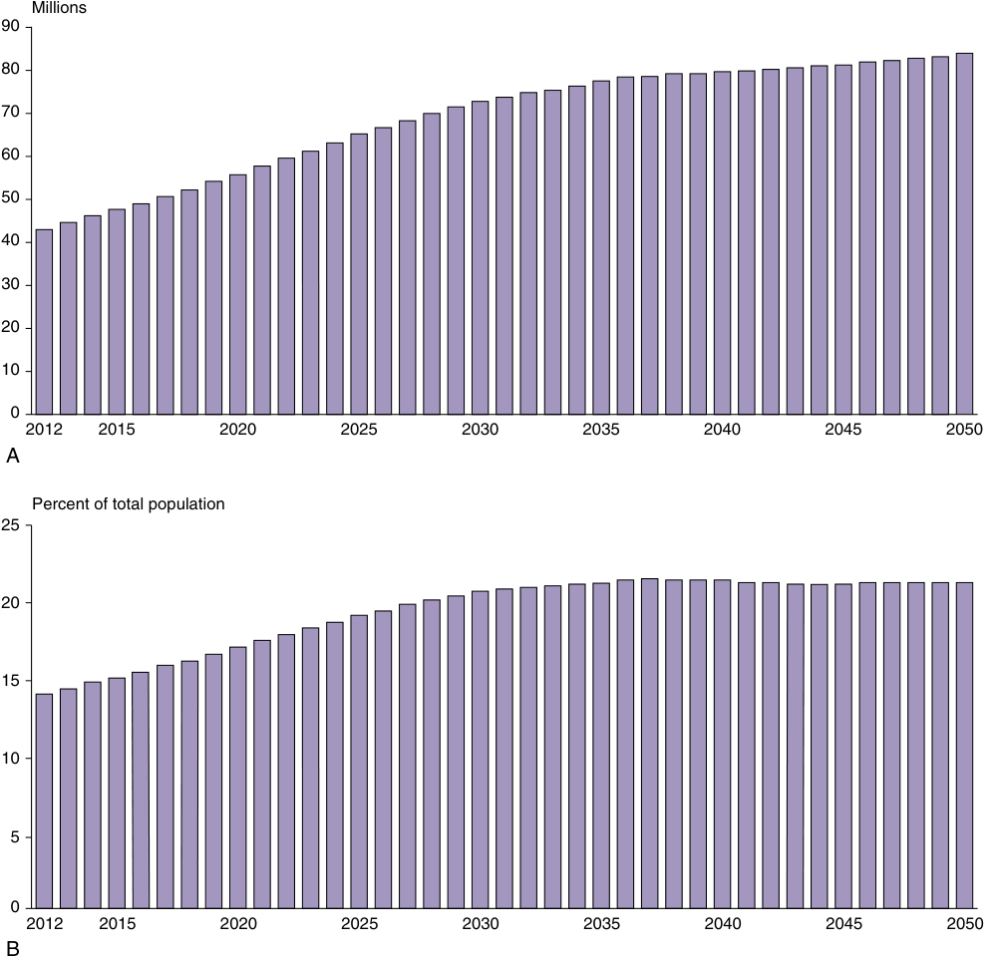

Millions 90 80 70 60 50 40 30 20 10 0 2012 2015 2020 2025 2030 2035 2040 2045 2050 A Percent of total population 25 20 15 10 5 0 2012 2015 2020 2025 2030 2035 2040 2045 2050 B 

**Fig. 60.1** Population aged ≥65 years for the United States 2012 to 2050 in millions (A) and percent of total population (B). (With permission from United States Census Bureau. Ortman JM, Velkoff VA, Hogan H. An aging nation: The older population in the United States; May 2014. https://www.census.gov/ library/publications/2014/demo/p25- 1140.html.)

and spine surgery, are considered and classified as an intermediate surgical risk with 30- day cardiac death or myocardial infarction occurring in 1% to 5% of patients. In fact, most studies have reported a primarily perioperative, acute myocardial infarction rate after hip or knee arthroplasty of 0.3% to 1.8%.29–31 A recent study defining the intrinsic cardiac risk of a single specified operation rather than groups of operations to improve upon current preoperative cardiac- risk assessment strategies also considered THA as an intermediate intrinsic cardiac risk with an odds ratio (OR) of 0.95 (95% CI, 0.83–1.08) relative to the statistically estimated average procedure.32 Another interesting study, using matched controls not undergoing surgery, demonstrated an increased risk of acute myocardial infarction during the first 2 weeks after total hip replacement (25- fold)

and after total knee replacement (31- fold). The association of an increased cardiac risk and surgery was strongest in patients 80 years of age or older. Interestingly, the risk of acute myocardial infarction decreases significantly after 2 weeks, although it remains elevated during the first 6 weeks for total hip replacement patients (Fig. 60.3).33

Over the last 40 years, several indices and scores were developed to better determine perioperative cardiac risk.34 The first was introduced in 1977 by Lee Goldman.35 The most widely used of these risk indices today remains the Revised Cardiac Risk Index (RCRI).36 More recently, a new perioperative risk index known as the Gupta score was proposed using a new model and an up- to- date and simplified approach.37 It was validated on a cohort of more than 400,000 patients of the National Surgical Quality

<!-- PDF page 4 -->

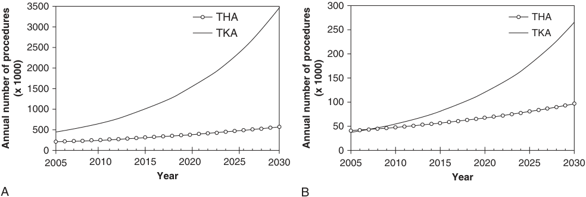

3500 300 THA THA 3000 TKA 250 TKA 2500 200 2000 150 1500 100 1000 500 50 0 0 2005 2010 2015 2020 2025 2030 2005 2010 2015 2020 2025 2030 Year Year A B (x 1000) (x 1000) Annual number of procedures Annual number of procedures 

**Fig. 60.2** The projected annual use of primary total hip arthroplasty (THA) and primary total knee arthroplasty (TKA) procedures in the United States from 2015 to 2040. (From Singh JA, Yu S, Chen L, Cleveland JD. Rates of Total Joint Replacement in the United States: Future Projections to 2020- 2040 Using the National Inpatient Sample. _J Rheumatol_ . 2019;46(9):1134–1140.)

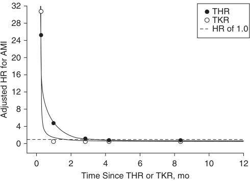

32 THR TKR 28 HR of 1.0 24 20 16 12 8 4 0 0 2 4 6 8 10 12 Time Since THR or TKR, mo Adjusted HR for AMI 

**Fig. 60.3** Adjusted hazard ratio (HR) for acute myocardial infarction (AMI) in patients undergoing total hip replacement (THR) and total knee replacement (TKR) with respect to time since the operation (mo = months). (With permission from Lalmohamed A, Vestergaard P, Klop C, et al. Timing of acute myocardial infarction in patients undergoing total hip or knee replacement: a nationwide cohort study. _Arch Intern Med._ 2012;172(16):1229–1235.)

Improvement Program database and uses the American Society of Anesthesiologists (ASA) classification system, dependent functional status, age, abnormal creatinine, and type of surgery as main factors associated with cardiac risk after surgery. In this study, the adjusted OR for myocardial infarction or cardiac arrest was estimated to be 2.22 (95% CI, 1.55–3.17) for orthopedic surgery, compared with an OR of 4.96 for aortic surgery. With a growing geriatric population and an increase in elective noncardiac surgeries in these patients, the necessity of having accurate estimations of the cardiac risk for geriatric patients becomes obvious. For this reason, the new geriatric- sensitive perioperative cardiac risk index (GSCRI), derived solely from geriatric data, was developed in 2017.38 The GSCRI model contains a total of seven variables, where the main three statistically important variables associated with cardiac risk in the older adult were stroke history, ASA class, and surgical category. Compared to the Gupta score, the GSCRI model considers heart failure, stroke history, and diabetes mellitus status as additional variables. The GSCRI has been shown to be

a significantly better predictor of cardiac risk in geriatric patients undergoing noncardiac surgery compared to the Gupta score and RCRI. In the GSCRI, the OR for myocardial infarction or cardiac arrest in orthopedic patients (OR, 2.99; 95% CI, 2.22–4.02) was higher than in the other two indices. The underestimated cardiac risk in geriatric patients resulting from these scores is likely due to estimates that were derived from a younger population.38

During the last few years, the focus of cardiac risk has evolved, and perioperative myocardial injury (PMI) has gained increased importance as an additional risk factor for postoperative cardiac events.39,40 High- sensitivity cardiac troponin assays have been introduced as an important biomarker in routine clinical care. Such novel biomarkers can detect patients at risk beyond established risk scores, and the measurement of these troponins allows for detection of acute cardiomyocyte injury during the perioperative period.40 PMI is defined by a perioperative increase of absolute or relative troponin values using delta or maximum postoperative values. Despite the current lack of a clear and uniform international definition for PMI, this entity has recently been identified as an important, yet often undetected, complication of noncardiac surgery that is strongly associated with 30- day mortality.39,41,42 In the most recent study on PMI, Puelacher and coauthors defined PMI as an absolute increase in high- sensitivity cardiac troponin of 14 ng/L or greater from preoperative to postoperative measurements in high- risk patients 65 years or older or in patients 45 years or older with a history of preexisting coronary artery disease, peripheral artery disease, or stroke.43 In their study population of over 2000 patients, they found an incidence of PMI in orthopedic patients undergoing an intermediate- risk surgical procedure (e.g., total hip or knee replacement) of 20% and for spinal surgery an incidence of PMI of 15% (Table 60.1). With PMI being associated with an overall substantial 30- day mortality as high as 9% and 1- year mortality as high as 22%, recommendations have already been published for screening high- risk patients for PMI.44 The Canadian Cardiovascular Society Guidelines on perioperative cardiac risk assessment and management of patients undergoing noncardiac surgery already explicitly recommend obtaining daily troponin measurements for 48 to 72 hours after noncardiac surgery in high- risk patients.45

<!-- PDF page 5 -->

**Table 60.1** Incidence of Perioperative Myocardial Injury in Patients with Increased Cardiovascular Risk (Patients Aged ≥ 65 Years or Patients with Preexisting Coronary Artery Disease, Peripheral Artery Disease, or Stroke)

||||**ESC/ESA Surgical Risk**||
|---|---|---|---|---|
||**Incidence of PMI [95% CI]**|**&lt;1%**|**1%–5%**|**>5%**|
|All surgical specialties|16% [14–17] (397/2546)|9% [9–13] (79/833)|17% [19–23] (248/1432)|25% [28–39] (70/281)|
|Orthopedic|16% [12–20] (50/315)|10% [6–18] (12/115)|20% [15–26] (36/183)|12% [2–36] (2/17)|
|Trauma|18% [15–22] (83/455)|12% [8–17] (22/188)|23% [19–29] (61/260)|0% [0–41] (0/7)|
|Spinal|15% [11–19] (55/372)|19% [6–44] (3/16)|15% [11–19] (52/356)|0% [0] (0/0)|

_CI_ , confidence interval; _ESA_ , European Society of Anaesthesiology; _ESC_ , European Society of Cardiology; _PMI_ , perioperative myocardial injury. From Puelacher C, Lurati Buse G, Seeberger D, et al. Perioperative myocardial injury after non- cardiac surgery. _Circulation_ . 2018;137:1221–1232.

The routine measurement of cardiac biomarkers in highrisk patients after noncardiac surgery may be considered but is yet not recommended by the latest American Heart Association (AHA) and European Society of Cardiology (ESC) Guidelines.46 Perioperative troponin measurements may be particularly useful in high- risk orthopedic patients since the preoperative cardiac risk evaluation is often inconclusive due to the limited mobility in these patients.

### Other Cardiac Comorbidities

Coronary artery disease is probably the single most important cardiac risk factor in orthopedic patients. However, other cardiac diseases such as valvular heart disease or pulmonary hypertension are also important to detect and assess during the preoperative evaluation. Pulmonary hypertension is particularly important in patients presenting for orthopedic surgery. The risk of pulmonary embolization of intramedullary contents in lower extremity joint replacement surgery and increase in intrathoracic pressure with prone positioning for spine surgery exacerbating preexisting right heart strain need to be considered.

Pulmonary hypertension affects 1% of the population and is defined as a resting mean pulmonary arterial pressure of 25 mm Hg or greater at rest measured by right cardiac catheterization.47 It is classified into five groups: (1) patients with primary pulmonary arterial hypertension, (2) patients with pulmonary hypertension due to left heart disease, (3) patients with pulmonary hypertension due to chronic lung disease and/or hypoxia, (4) patients with chronic thromboembolic pulmonary hypertension, and (5) patients with unclear, mixed, or multifactorial reasons for pulmonary hypertension.48 The mortality risk in patients with pulmonary hypertension undergoing noncardiac surgery ranges from 3.5% to 18%.49,50 The risk of adverse events is influenced by patient factors, such as, severity of pulmonary hypertension, degree of right ventricular dysfunction, and functional status, as well as, type of surgery. Emergency surgery, liver transplant, general surgery and orthopedic surgery were amongst the procedures with the highest mortality rates in patients with pulmonary hypertension.51–53 Ramakrishna and associates retrospectively identified 145 patients with pulmonary hypertension undergoing various noncardiac surgical interventions and reported a mortality rate of 7%. When the authors stratified risk by type of surgery, they found that 17% of patients undergoing low- risk surgical procedures experienced morbidity compared with 48% of those undergoing orthopedic surgery. This suggests that patients with pulmonary hypertension undergoing orthopedic surgery

represent an especially vulnerable group.54 Other authors examined 1359 patients with pulmonary hypertension undergoing THA and 2184 patients with pulmonary hypertension undergoing total knee arthroplasty (TKA). In- hospital mortality rates among patients with pulmonary hypertension increased by a factor of 3.72 (95% CI, 2.13– 6.39) for the cohort undergoing hip arthroplasty compared with controls and by a factor of 4.55 (95% CI, 2.16–9.39) in patients undergoing TKA.55 The highest rate of in- hospital mortality with 5% was reported in patients with primary pulmonary hypertension undergoing hip arthroplasty.

A thorough clinical examination of a patient with pulmonary hypertension should focus on the nature of symptom progression, exercise tolerance, signs of right ventricle failure, heart rate, blood pressure, electrocardiogram (ECG), chest radiography, and biomarkers (B- type natriuretic peptide and high- sensitivity cardiac troponins). Further investigations may include arterial blood gases, echocardiography with estimation of pulmonary artery pressure, computed tomography (CT), coronary angiography, and invasive hemodynamic measurements of pulmonary artery pressures and cardiac output depending on the severity of the disease.49 Mortality of these surgical procedures can be reduced with careful planning, ideally in tertiary nationally designated pulmonary hypertension centers with close preoperative, intraoperative, and postoperative hemodynamic monitoring to prevent a pulmonary hypertension crisis.

Finally, it is important to also consider the noncardiac risks in the orthopedic population. At the moment, there is a lack of data on how noncardiac risk factors such as preoperative mental status, level of dependency, anemia, extreme low or high body weight, pulmonary risk factors, and immune status interact with the cardiovascular risk factors described earlier and how they impact the outcome of orthopedic surgery. There is a need for more general risk scores that can predict the outcome and mortality from noncardiac causes.28 Therefore, in geriatric orthopedic patients it might be beneficial to obtain a more comprehensive estimation of a patient’s functional reserves during the preoperative evaluation. This would also include noncardiac risk factors, rather than focusing on single- organ function and biomarkers alone. Too many health care systems are still organized around single- system illnesses. Today, frailty is increasingly recognized as an age- associated, multidimensional syndrome and a unique domain of health status that can be a valid marker of decreased reserves and of resulting perioperative vulnerability and unfavorable postoperative outcome in older patients.56,57

::: details 原始表格與符號（PDF 第 5 頁）

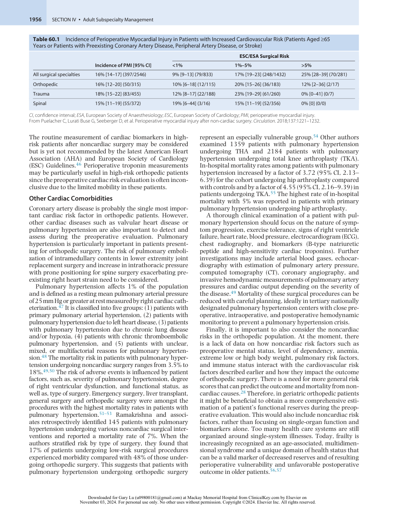

:::

<!-- PDF page 6 -->

### FRAILTY

It has long been known that older patients are at increased risk for postoperative complications, possibly due to reduced physiologic reserves to withstand an operation. Linda Fried was the first to use a validated scoring system to define this vulnerability (or frailty) in a more standardized manner and found that such preoperative characterization of frailty using five domains (weight loss, decreased grip strength, exhaustion, low physical activity, and slowed walking speed) could predict surgical outcomes such as postoperative complications, length of hospital stay, and discharge to a skilled- or assisted- living facility. Her frailty score also augmented other risk- assessment models such as the ASA score, the RCRI, or the Eagle’s cardiac risk index.56 Since the first description of this frailty concept in surgical patients, many additional frailty scores and scales including a vast diversity of variables have been proposed in the literature.

In orthopedic surgery, the Clinical Frailty Scale,58 the FRAIL scale,58 the modified Frailty Index (mFI),59 the Groningen Frailty Indicator (GFI) questionnaire,60 and the Frailty Phenotype and Frailty Index have all been used.61 Providers should consider the precision of those instruments when assessing perioperative frailty. A recent systematic review and meta- analysis demonstrated that amongst the available scales, the Clinical Frailty Scale had the strongest accuracy and feasibility.62 Flexman and associates showed in 52,671 patients that approximately 4% of the spine surgery population is frail and that the mFI independently predicted major postoperative complications (unadjusted odds ratio 1.58), prolonged length of stay (unadjusted odds ratio 1.89), discharge to a higher level of care (unadjusted odds ratio 2.29), and 30- day mortality (unadjusted odds ratio 2.05 for every 0.1 increase in frailty score) in patients undergoing surgery for degenerative spine disease.59 In another study to assess feasibility and validity of the GFI questionnaire in patients undergoing total hip or knee arthroplasties, the authors reported that 33% of patients with hip OA and 24% of patients with knee OA were frail.60 All studies examining frailty in elderly orthopedic patients reported a significant association with adverse postoperative outcomes such as surgical complications, hospital length of stay, discharge to post- acute institutional care, and readmission rate within 30 days.58,61 Frailty was associated with 7.7% one- year mortality rate in patients undergoing elective orthopedic surgery.63

It has to be pointed out that frailty scales should be accompanied by a thorough clinical examination and comprehensive geriatric assessment including examining the burden of comorbidity, polypharmacy, physical function, psychological status, nutrition, risk of postoperative delirium, and social support to add further insights into the actual risk and the patient’s real expectations.64–66 Well- crafted comprehensive geriatric assessments can be a more powerful predictor of perioperative risk than the ASA score.67 A study in older patients with a mean age of 78 years examining the prediction of postoperative morbidity and mortality using a comprehensive geriatric assessment reported a significantly higher risk for postoperative death or post- discharge institutionalization for orthopedic surgery compared with abdominal, thoracic, or other surgeries.64 As such, the value of a comprehensive geriatric

assessment has been particularly recognized as a promising system of care for complex older patients who have suffered fragility fractures.68

While frailty is increasingly acknowledged as a marker of functional decline, it remains a potentially modifiable risk factor. As such, preoperative rehabilitation programs have been introduced into clinical practice with the idea to reduce frailty and thereby improve surgical outcome. A systematic review evaluated patients undergoing THA and TKA and the benefits of enrolling in a preoperative physical activity program to improve physical health at the time of surgery. The results demonstrated a decreased length of stay after TKA but not an enhanced postoperative recovery.69 The data for THA patients showed improved outcomes although the evidence was not robust. Although recent data suggest that prehabilitation can improve outcomes and decrease length of stay for this patient population,70 the evidence is still insufficient to draw a final conclusion.

### STROKE

Stroke is a devastating complication in the perioperative period and is associated with a high rate of morbidity and mortality.71,72 Large studies have identified a rate of 0.2% for perioperative stroke following total joint arthroplasty, the incidence doubling to 0.4% in patients aged 75 years or older.71,73 Mortazavi and associates reported advanced age, a history of cerebrovascular, coronary artery, atherosclerotic or cardiac valvular disease, atrial fibrillation or other intraoperative arrhythmias, urgent surgery, and general anesthesia as independent risk factors for stroke in patients undergoing total joint arthroplasties.71 Compared with matched control subjects not undergoing surgery, Lalmohamed and associates reported a 4.7- fold increased risk of ischemic stroke and a 4.4- fold increased risk for hemorrhagic stroke during the first 2 weeks after THA. The risk remained significantly elevated for at least 6 weeks for ischemic stroke and 12 weeks for hemorrhagic stroke.74 Since previous strokes represent a significant risk factor, a thorough evaluation of patients with neurologic diseases undergoing surgery can help risk stratify and potentially reduce perioperative morbidity and mortality.75

### POSTOPERATIVE DELIRIUM

Postoperative delirium is recognized as the most common surgical complication in older adults, occurring in 5% to 50% of older patients after surgery. It is associated with major postoperative complications, including postoperative cognitive dysfunction and even death.76 The main risk factors for postoperative delirium are well established and include, among others, age of 65 years or older, chronic cognitive decline or dementia, poor vision or hearing, severe illness, and the presence of infection. In order to successfully prevent, predict, and manage postoperative delirium, different delirium risk scores were developed of which two were validated in orthopedic surgical patients.77 Kalisvaart and associates implemented and validated a medical risk factor model in 603 hip surgery patients aged 70 years or older containing four factors: cognitive function at admission, visual impairment, acute physiologic and chronic health status, and blood urea nitrogen (BUN) to creatinine ratio.78

<!-- PDF page 7 -->

One point was assigned for each of the four risk factors present, resulting in three groups: a low- , an intermediate- , and a high- risk group with incidences of delirium of 3.8%, 11.1%, and 37.1%, respectively. Cognitive impairment and age were the most important risk factors for delirium in this population of hip surgery patients. Postoperative delirium was four times more frequent in acute hip fracture patients than in elective hip replacement patients. Another study in elective hip or knee arthroplasty patients suggested the use of the Delirium Elderly At- Risk (DEAR) assessment, which incorporates the following risk factors: age, visual or hearing impairment, dependence in more than one activity of daily living, a low mini- mental state score on admission or a previous episode of postoperative delirium, and benzodiazepine or alcohol abuse.79 A score of two or more using this tool was associated with a greatly increased risk of delirium. Logistic regression models showed the strongest associations of substance abuse and cognitive impairment with the development of postoperative delirium. In a prospective matched controlled cohort study, Kat and colleagues showed that the risk of dementia or mild cognitive impairment at 30 months follow- up is almost doubled in hip surgery patients aged 70 years or older with postoperative delirium compared with at- risk patients without delirium.80 In addition, a study reported poor performance on a preoperative cognitive screening test in older patients undergoing hip or knee arthroplasties as a predictor of postoperative complications such as the development of postoperative delirium, a longer hospital stay, and a lower likelihood to return home in good health upon hospital discharge.81 Reducing the exposure to general anesthetics may prevent delirium. Despite that, studies have failed to demonstrate superiority of neuraxial compared to general anesthesia on postoperative delirium reduction.82 Postoperative delirium is also common after spine surgery in older adults and is also associated with increased length of stay, increased costs, and decreased odds of discharge to home.83 Susano _et al._ demonstrated that frailty and cognitive impairment are risk factors for delirium in patients 70 years or older presenting for elective spine surgery. Using the FRAIL scale and the Mini- Cog as part of perioperative assessment, they demonstrated that 55% of the patients developed postoperative delirium.84 In a parallel- arm randomized trial, Brown _et al._ compared the incidence of postoperative delirium in patients undergoing spine fusion under general anesthesia versus spinal combined with targeted sedation determined by Bispectral Index (BIS). The results were negative for decreased incidence of delirium in the non–general anesthesia group.85 All these studies clearly show the importance of incorporating the assessment of risk of delirium in the preoperative evaluation of elderly orthopedic patients. To prevent decline in cognition in older populations presenting for surgery, a multifactorial approach may be necessary. Maintaining a regular sleep cycle and adopting a multimodal analgesia strategy are strongly recommended although the data supporting those measures is still limited.86

### THROMBOEMBOLIC DISEASE

Thromboembolic complications remain one of the leading causes of morbidity and mortality after orthopedic surgery.

Antithrombotic guidelines are continuously updated and published by the American College of Chest Physicians (ACCP).87 A systematic review and meta- analysis including 7 million pooled total joint arthroplasty patients found that cardiovascular disease, previous history of venous thromboembolism (VTE), neurologic disease, and ASA score were significant and independent risk factors for VTE after joint arthroplasties.88 Two large studies published after the last update of the ACCP guidelines suggested aspirin to be an effective, safe, convenient, and inexpensive alternative to low- molecular- weight heparin or to rivaroxaban for extended thromboprophylaxis after joint arthroplasties.89,90 The guidelines for prevention of thromboembolism in surgical hospitalized patients from the American Society of Hematology published in 2019 recommend the use of aspirin or direct oral anticoagulants over lowmolecular- weight heparin, on patients undergoing hip or knee arthroplasty.91 The risk of thromboembolism after spine surgery is low. A meta- analysis found the incidence to be 0.35%. Risk factors included increasing age, female sex, diabetes, chronic kidney disease, nonambulatory preoperative status, and procedure duration and blood transfusion.92 In spine surgery, VTE prophylaxis remains even more controversial. An algorithmic approach to this problem was recently published to establish a more specific VTE prophylaxis risk/benefit score for spinal surgery.93

With the increased use of percutaneous coronary interventions and other vascular stents, and the widespread use of oral anticoagulant drugs for atrial fibrillation or peripheral vascular disease, anesthesiologists are commonly involved in the perioperative management of patients with antiplatelet or anticoagulation therapy.94 Moreover, a growing number of antiplatelet and anticoagulation therapies, including the non–vitamin K oral anticoagulants (novel or direct oral anticoagulants),95–97 with unique pharmacodynamic and pharmacokinetic properties complicate the perioperative management of these patients. The timing of discontinuation and postoperative restart of antithrombotic or anticoagulant therapy must be carefully planned and should always be evaluated against the risks of bleeding and cardiac events. An interdisciplinary approach to the perioperative coagulation management involving the surgeons, anesthesiologists, cardiologists, and hematologists may sometimes be required. Patient- specific factors (e.g., age, renal function, vascular and cardiac comorbidities) as well as the surgical factors (urgency, type, risk of bleeding) must be carefully evaluated for individualized risk assessment.94

For this reason, we provide only a summary of current antiplatelet and anticoagulant drugs (Tables 60.2 and 60.3). In general, arthroplasties are considered as having a moderate risk of bleeding, whereas vertebrospinal surgery is associated with a high risk of bleeding.96 In patients with a low and high cardiovascular risk (e.g., patients with known coronary artery disease but an acute coronary syndrome >12 months preoperatively, drug- eluting stent >6 months, bare- metal stent >1 month, cardiac bypass surgery >6 weeks), aspirin can be continued during arthroplasty surgery as it also serves for chemical VTE prophylaxis. However, additional antiplatelet drugs should be discontinued according to their pharmacology and the renal function of

<!-- PDF page 8 -->

**Table 60.2** Summary of the Characteristics of Currently Available Antiplatelet Drugs

||**Aspirin**|**Clopidogrel**|**Prasugrel**|**Ticagrelor**|**Cangrelor**|**Abciximab**|**Eptifibatide**|**Tirofiban**|
|---|---|---|---|---|---|---|---|---|
|Route of administration|Oral once daily|Oral once daily, (iv under investigation)|Oral once daily|Oral twice daily|iv|iv|iv|iv|
|Bioavailability|68%|50%|80%|36%|||||
|Plasma peak level|30–40 min|1 h|30 min|1.5 h|Seconds|Dose dependent|Dose dependent|Dose dependent|
|Time to plasma steady state||2–8 h|30 min–4 h|30 min–2 h|Seconds|Initial bolus and continuous application|Initial bolus and continuous application 4–6 h|Initial bolus and continuous application 10 min|
|Plasma half- life|15–30 min|8 h|7 h|7 h|2–5 min|10–15 min|2.5 h|2 h|
|Plasma protein- binding|Strong|Strong|Strong|Strong|||||
|Time from last dose to offset|7–10 days|7–10 days|7–10 days|5 days|60 min|12 h|2–4 h|2–4 h|
|Reversibility of platelet inhibition|No|No|No|Yes|Yes|Yes|Yes|Yes|
|Recommended period of discontinuation prior to surgical intervention|0–5 days|7 days|10 days|7 days|1- 6 h|48 h|8 h|8 h|

_iv_ , intravenous.

From Koenig- Oberhuber V, Filipovic M. New antiplatelet drugs and new oral anticoagulants. _Br J Anaesth_ . 2016;117(suppl 2):ii74–ii84.

the patient. For vertebrospinal surgery, it is advised that both drugs of a dual antiplatelet therapy are adequately stopped. Elective orthopedic surgery is not recommended without optimization in patients with a very high cardiovascular risk (acute coronary syndrome &lt;12 months preoperatively, drug- eluting stent &lt;6 months, bare- metal stent &lt;1month, cardiac bypass surgery &lt;6 weeks, cerebrovascular accident &lt;4 weeks); such surgery should be delayed when possible.96,98–100

Similar to patients on antiplatelet therapy, the management of patients under direct oral anticoagulant drugs or vitamin K antagonists also requires consideration of the individual risk of thromboembolic events balanced against the bleeding risk of surgery. Evidence that emerged after the publication of the ACCP guidelines strongly recommends against heparin bridge in patients on vitamin K antagonists for atrial fibrillation prior to surgery.101 Appropriate use of direct oral anticoagulants is particularly important with respect to regional anesthesia in orthopedic patients.102 The recommendations of the timing of the preoperative interruption of such treatment is somewhat different in Europe (Table 60.4A) and the United States (Table 60.4B).95,97,103– 105 More recently, the American Society of Regional Anesthesia and Pain Medicine (ASRA) in conjunction with the European Society of Anaesthesiology convened a Consensus Conference on Regional Anesthesia and Anticoagulation that updated the available data, representing the collective experience of recognized experts in the field of neuraxial anesthesia and anticoagulation.105 These guidelines provide a comprehensive summary of evidence- based reviews, but emphasize that the decision to perform spinal

or epidural anesthesia and the timing of catheter removal in a patient receiving antithrombotic therapy should be made on an individual basis, weighing the risks of spinal hematoma with the benefits of regional anesthesia for each individual.

### PULMONARY, RENAL, HEMATOLOGIC, ENDOCRINE DISEASES, AND NUTRITIONAL STATUS

While cardiac diseases may be the most important considerations determining the overall outcome in high- risk orthopedic patients, other comorbidities such as pulmonary, renal, hematologic, endocrine, and nutritional diseases must also be examined during the preoperative evaluation of orthopedic patients. Although many studies examined postoperative pulmonary complications after noncardiothoracic surgery, they mainly focused on vascular, abdominal, or general surgical patients, and few studies focused on orthopedic surgery cases.106 In one such orthopedic study, patients suffering from chronic obstructive pulmonary disease who underwent total hip replacement were found to have a longer hospital length of stay, were more likely to be discharged to an extended- care facility, and were at a significantly increased risk for any other complication such as mortality, myocardial infarction, pneumonia, and septic shock.107 Another study in patients undergoing hip or knee replacements also reported a higher postoperative complication rate in patients with obstructive sleep apnea.108 A study reviewing pulmonary complications in patients undergoing THA and TKA in the United States

::: details 原始表格與符號（PDF 第 8 頁）

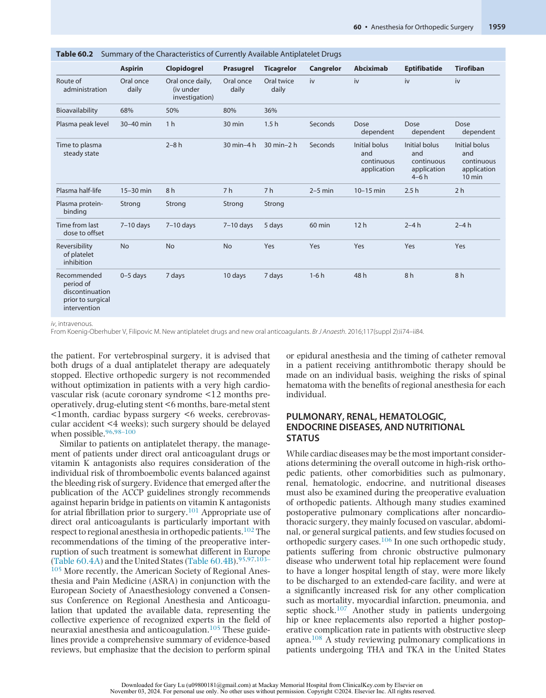

:::

<!-- PDF page 9 -->

|**UFH (sc/iv)** **LMWH (sc)** **Fondaparinux** **(sc)** **Argatroban** **(iv)** **Bivalirudin** **(iv)**|Direct inhibition Xa=IIa Direct inhibition Xa>IIa Direct inhibition Xa Direct inhibition Ila Direct inhibition Ila|30% 90% 100% 100% 100%|1 h 4 h 17 h 50 min 24 min|Dose dependent (sc) Dose dependent 48–96 h 2–4 h 1 h|4 h (sc) 3 h 2 h 0.25–2 h|Reticuloendothelial system Hepatic metabolism, renal excretion 10% Renal 65% feces, 22% urine 20% renal||7(suppl 2):ii74–ii84.|
|---|---|---|---|---|---|---|---|---|
|ics of Currently Available Anticoagulant Drugs **ORAL** **Apixaban** **Edoxaban** **Rivaroxaban**| Direct inhibition Xa Direct inhibition Xa Direct inhibition Xa|66% 62% 80%|8–15 h 10- 14 h 7- 10 h|24 h 24 h 24 h|2.5–4 h 1–2 h 1–3 h|25% renal 50% renal 50% renal, 50% hepatic| CYP3Y4, P- glycoprotein inhibitors P- glycoprotein inhibitors Strong CYP3A4 inhibitors or inducers and P- glycoprotein inhibitors|ins;_sc_, subcutaneous;_UFH_, unfractionated heparin. telet drugs and new oral anticoagulants._Br J Anaesth_. 2016;11|
|the Characterist **Dabigatran**|t Direct inhibition Ila|6%|12–14 h|48 h|2 h|80% renal|P- glycoprotein inhibitors|cular- weight hepar ovic M. New antipla|
|Summary of **Warfarin**|Vitamin K antagonis|80%|20–60 h| 48–96 h|Variable|Metabolism|CYP2C9, CYP3A4, CYP1A2|_MWH_, low- mole erhuber V, Filip|
|**Table 60.3**|Mechanism of action|Bioavailability|Plasma half- life|Duration of action from last dose|Peak plasma level|Elimination|Drug interaction|_iv_, intravenous;_L_ From Koenig- Ob|

::: details 原始表格與符號（PDF 第 9 頁）

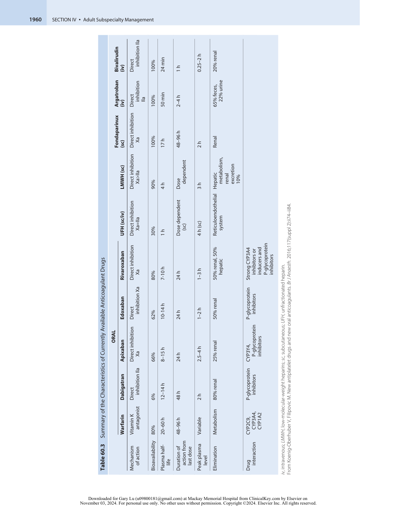

:::

<!-- PDF page 10 -->

**Table 60.4A** Timing of Preoperative Interruption of Direct Oral Anticoagulants in Europe

||**eGFR** **(mL/min)**|**Bleeding Risk Low** **to Moderate (h)**|**Bleeding** **Risk High (h)**|
|---|---|---|---|
|Dabigatran|≥50|≥24|48|
||30–50|48|72|
||&lt;30|≥72|≥120|
|Factor Xa inhibitors|≥30|≥24|48|
|(rivaroxaban, apixaban, edoxaban)|&lt;30|≥72|≥72|

_eGFR_ , estimated glomerular filtration rate. From Yurttas T, Wanner PM, Filipovic M. Perioperative management of antithrombotic therapies. _Curr Opin Anaesthesiol_ . 2017;30(4):466–473.

**Table 60.4B** Timing of Preoperative Interruption of Direct Thrombin Inhibitor (Dabigatran) and Factor Xa Inhibitors (Rivaroxaban, Apixaban) in the United States

|**Creatinine**|**Direc** **In**|**t Thrombin** **hibitor**|**Fac** **Inh**|**tor Xa** **ibitors**|
|---|---|---|---|---|
|**Clearance** **(mL/min)**|**Bleeding** **Risk Low**|**Bleeding** **Risk High**|**Bleeding** **Risk Low**|**Bleeding** **Risk High**|
|>80|≥1 day|≥2–3 days|≥1 day|≥2 days|
|50–80|≥1–2 days|≥3–4 days||≥2–3 days|
|30–49||≥4 days||≥3–4 days|
|15–29|N/A|N/A|≥36 h|≥4 days|

_N/A_ , not applicable. From Arnold MJ, Beer J. Preoperative evaluation: a time- saving algorithm. _J Fam Pract_ . 2016;65(10):702–710.

between 2004 and 2014 identified that 1.42% and 1.71% of patients, respectively, were complicated by pneumonia, respiratory failure, pulmonary embolism, or aspiration. Complications were associated with increased length of stay and increased hospital costs.109 In addition, since spine surgery in the prone position is accompanied by a decreased respiratory compliance,110,111 patients after major spine surgery are at increased risk of postoperative pulmonary complications. Therefore, a thorough pulmonary evaluation and physical examination, including a detailed history, and subsequent medical optimization, are critical steps in the preoperative management of orthopedic patients.112 In selected patients, additional investigations such as chest radiography, spirometry, and assessments of arterial blood gases, albumin levels (OR for pulmonary complications of 2.53 with an albumin level &lt;3.5 g/dL), and BUN (OR 4.81 with a BUN level >7.5 mmol/L) should be considered.113 In patients scheduled for major scoliosis operations, preoperative fluoroscopy or magnetic resonance imaging to evaluate diaphragm and chest wall movements and preoperative pulmonary function testing might be indicated.114 The risk of postoperative pulmonary complications can also be estimated with easy- to- use risk scores.115,116 A strong body of evidence suggests that lung expansion therapy, such as incentive spirometry or deep breathing exercises, can reduce postoperative pulmonary risk.

Today, with medical advancements leading to improved survival and function, an increasing number of patients with chronic kidney disease present for elective orthopedic

surgery.117 There is some discrepancy in the literature with respect to outcome of elective orthopedic surgery in patients with end- stage renal disease (ESRD). Two large retrospective studies failed to show an increased incidence of surgical site infections, thromboembolic events, and 90- day mortality in patients with ESRD undergoing hip replacement surgery.118,119 Other investigators found higher rates of postoperative complications such as cardiovascular, pulmonary, infectious, and thromboembolic events as well as an increased readmission and mortality rate in patients with ESRD who underwent joint replacement surgery.120,121 The main concerns for the anesthesiologist in these patients include timing of preoperative and postoperative dialysis to avoid hypervolemia, hyperkalemia, and acidosis; cardiovascular assessment and blood pressure control; electrolyte management, anemia, drug metabolism, and the balance between thromboembolic complications and higher bleeding risk, both of which can be increased in patients with ESRD. The pathophysiology of bone disease represents another important factor to consider preoperatively, since both low and high abnormal bone turnover contribute to the poor bone strength in these patients. Poor bone quality could lead to challenging surgical conditions requiring the use of locking plates or screws, cement fixation, and less-rigorous postoperative ambulation, all of which potentially contribute to an increased rate of postoperative complications.117

The overall incidence of anemia in the general population increases with age and is estimated to be 10% to 11% in the older adult aged 65 years or older. Until recently, anemia in older adults was often viewed simply as an abnormal laboratory test value with limited consequences. But today, substantial evidence in the literature reveals that previously undiagnosed anemia is common in elective orthopedic patients, and importantly is associated with increased likelihood of blood transfusion and increased perioperative morbidity and mortality.122 The preoperative evaluation of anemia should, therefore, include considerations to optimize the endogenous red blood cell mass through targeted stimulation of erythropoiesis and treatment of modifiable underlying disorders.123 Efforts should be made to diagnose and start appropriate treatment of preoperative anemia and minimize perioperative blood loss. This can be achieved through vigilant adherence to protocols including the measurement of hemoglobin, serum ferritin, transferrin saturation, transferrin receptor index, reticulocyte hemoglobin, vitamin B12, folic acid, serum creatinine, and glomerular filtration rate starting as early as 28 days before surgery (Fig. 60.4).124 Implementation of such anemia prevention and management in elective orthopedic patients can improve patient safety and outcomes. The preoperative administration of intravenous iron carboxymaltose in anemic patients undergoing major orthopedic surgery resulted in a significant decrease in postoperative infectious complications from 12.0% to 7.9%. Moreover, hospital length of stay was shortened by 1 day.125 Similarly, the preoperative administration of erythropoietin was associated with significant decrease in perioperative allogenic blood transfusion with no significant increased risk of thromboembolic complications.126

In addition to the well- recognized risks of antiplatelet and anticoagulant therapy discussed earlier, some orthopedic

::: details 原始表格與符號（PDF 第 10 頁）

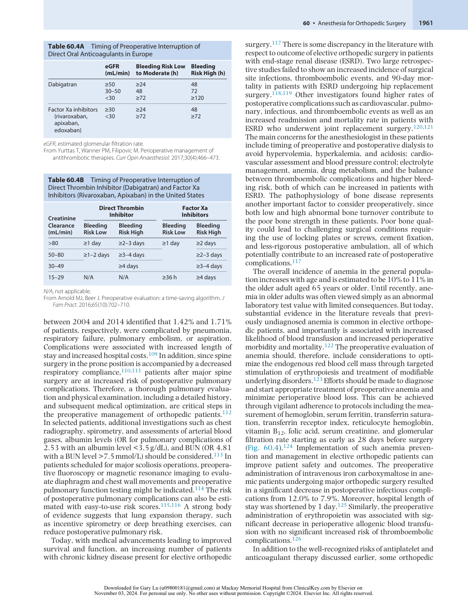

:::

<!-- PDF page 11 -->

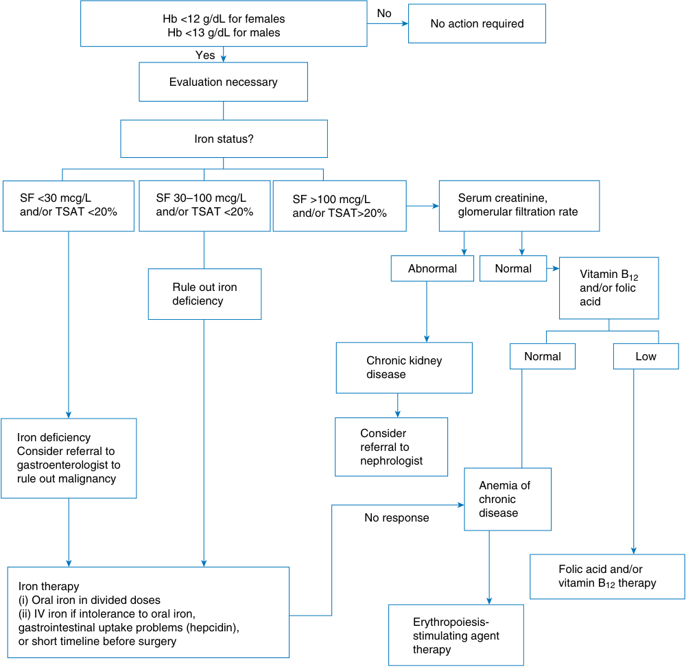

No Hb &lt;12 g/dL for females No action required Hb &lt;13 g/dL for males Yes Evaluation necessary Iron status? SF &lt;30 mcg/L SF 30–100 mcg/L SF >100 mcg/L Serum creatinine, and/or TSAT &lt;20% and/or TSAT &lt;20% and/or TSAT>20% glomerular filtration rate Abnormal Normal Vitamin B12 Rule out iron and/or folic deficiency acid Normal Low Chronic kidney disease Consider Iron deficiency referral to Consider referral to nephrologist gastroenterologist to rule out malignancy Anemia of chronic disease No response Folic acid and/or Iron therapy vitamin B12 therapy (i) Oral iron in divided doses (ii) IV iron if intolerance to oral iron, Erythropoiesis- gastrointestinal uptake problems (hepcidin), stimulating agent or short timeline before surgery therapy 

**Fig. 60.4 Proposed algorithm for the detection, evaluation, and management of preoperative anemia.** _SF_ , serum ferritin; _TSAT_ , transferrin saturation. (With permission from Goodnough LT, Maniatis A, Earnshaw P, et al. Detection, evaluation, and management of preoperative anaemia in the elective orthopaedic surgical patient: NATA guidelines. _Br J Anaesth._ 2011;106(1):13–22.)

patients present with impaired primary hemostasis. Since the management of impaired primary hemostasis is no different in orthopedic surgery than in other surgical fields with associated bleeding risks, such as neurosurgery, we will only briefly summarize here some relevant concepts. Based on robust evidence in the literature, it is recommended that patients with an increased risk of bleeding complications are identified using a standardized questionnaire and, only if indicated, the measurement of platelet count, prothrombin time, activated partial thromboplastin time, PFA- 100 platelet function analyzer test, and von Willebrand factor (Box 60.1).127,128

Finally, endocrine and nutritional aspects also have an impact on outcome in orthopedic surgery. For severely obese patients, spine surgery is associated with decreased

quality of preoperative and intraoperative imaging, surgical limitations due to inadequate operative exposure, increased anesthetic risk such as esophageal reflux and ventilation–perfusion mismatches, and an increased risk of perioperative complications such as wound infection, increased blood loss, venous thrombosis, pneumonia, and nerve injuries as a result of positioning difficulties.129,130 Conversely, malnutrition is also associated with increased pulmonary risk, increased risk of surgical site infection, and poor surgical outcomes both in spinal and arthroplasty surgery.106,131,132 Screening for malnutrition in orthopedic surgery includes the measurement of body mass index, anthropometric measurements such as calf or arm muscle circumference, and triceps skinfold, and the determination of serologic laboratory values such as total lymphocyte

<!-- PDF page 12 -->

### Box 60.1 Questionnaire for the Detection of an Increased Risk of Bleeding

1.  Have you ever experienced strong nose bleeding without prior reason?

2.  Did you ever have – without trauma – “blue spots” (hematomas) or “small bleedings” (on the torso or other unusual regions of the body)?

or 8 mg, widely used to prevent postoperative nausea and vomiting, was not associated with greater increase in blood glucose levels for nondiabetic and well- controlled diabetic patients.140 However, in poorly controlled diabetic patients, dexamethasone is associated with an increase in blood glucose levels in the immediate postoperative period.141 The long- term impact on patient morbidity and surgical outcomes is unknown.

3.  Have your gums ever bled for no apparent reason?

4.  How often do you have bleedings or “blue spots” (hematomas): 1 to 2 times a week or more often?

5.  Do you have the impression that you have prolonged bleedings after minor wounds (e.g., razor cuts)?

6.  Did you have prolonged or severe bleedings after or during operations (e.g., tonsillectomy, appendectomy, or during labor)?

7.  Did you ever have prolonged or severe bleedings after a tooth extraction?

8.  Did you ever receive blood transfusions or other blood products during an operation? If so, please define the operation(s):

9.  Is there a history of bleeding disorders in your family?

10.  Do you take analgesic drugs or drugs against rheumatic disease? If so, please specify:

11.  Do you take other drugs? If so, please specify:

12.  Do you have the impression that you have prolonged menstruation (>7 days) and/or a high frequency of tampon change?

From Koscielny J, Ziemer S, Radtke H, et al. A practical concept for preoperative identification of patients with impaired primary hemostasis. _Clin Appl Thromb Hemost_ . 2004;10(3):195–204.

count (&lt;1500 cells/mm3 ), serum albumin (&lt;3.5 g/dL), prealbumin (&lt;16 mg/dL), transferrin (&lt;200 mg/dL), and zinc levels (&lt;66–95 mcg/dL).131 Various scoring systems have been used to detect malnutrition in orthopedic surgery. The Mini Nutritional Assessment is a simple and effective tool for identifying patients at severe nutritional risk.132,133 While enteral or parenteral nutrition may improve outcomes and reduce preoperative risks in severely malnourished patients presenting for gastrointestinal surgery, the evidence is not strong for patients presenting for orthopedic procedures.134,135 Although the implementation of the Enhanced Recovery After Surgery (ERAS) program, also known as “fast- track” pathway, has had positive results in spine and arthroplasty surgery, the nutritional component needs to be further integrated and the protocols standardized across specialties.136,137 The risks and benefits of delaying elective surgery until the nutritional status has improved should be discussed with the patient.

Hyperglycemia in the perioperative period is associated with multiple complications, most notably infections. Perioperative screening and optimization of diabetic and hyperglycemic patients before proceeding to surgery can significantly decrease the risk of infection. A standard preoperative management goal should be to maintain glucose levels &lt;200 mg/mL and HbA1c &lt;7%.138 Although intraoperative hyperglycemia has been associated with poor outcomes, studies have failed to demonstrate benefits of strict glucose control during surgery. It is recommended to maintain intraoperative blood glucose less than 180 mg/ dL avoiding hyperglycemia.139 A multicenter stratified randomized trial demonstrated that dexamethasone 4 mg

### COMPLICATIONS AND OUTCOME

A study in more than 100,000 patients identified the determinants of 30- day postoperative mortality and long- term survival after major surgery exemplified by eight common operations, one being total hip replacement.142 These authors found in a sample size of 12,184 patients undergoing total hip replacement a 30- day mortality rate of 1% and a mortality rate at any time during an average followup time of 8 years of 20%, compared with a 30- day mortality rate of 3% and 36% during the 8- year follow- up in the whole study population. After a 10- year follow- up, the survival rate in the hip replacement surgery patients was still almost 75%. The main complications in hip replacement surgery were urinary tract infection, deep vein thrombosis (DVT), pneumonia, superficial wound infection, deep wound infection, prosthesis failure, pulmonary embolism, myocardial infarction, and peripheral nerve injury. With the presence of any of these complications, the 30- day mortality rate increased from 1% to 6.4%. The occurrence of a postoperative pneumonia increased the 30- day mortality rate to 16.4% and the 5- year mortality rate to 62.7%, and the occurrence of a perioperative myocardial infarction increased the 30- day mortality rate to 29.2% and the 5- year mortality rate to 52.1%.142 Given these high numbers of adverse outcomes after the occurrence of complications in total joint arthroplasty patients, every effort must be made during the preoperative evaluation to detect patients at risk, to treat potential underlying conditions, and to optimize the health status of patients. Preoperative medical assessment is an important part of the surgical plan. Identifying and treating modifiable risk factors in the preoperative setting can decrease the risk of surgical complications. A standard protocol that involves a multidisciplinary approach to patients in the preoperative, operative, and postoperative periods may ultimately lead to better outcomes and reduced costs.143

## Special Considerations for Conditions Leading to Orthopedic Surgery

### OSTEOARTHRITIS

OA is a degenerative joint disease characterized by articular cartilage loss and osteophyte formation, most often in the hands, knees, hips, feet, and spine. Symptoms include joint pain, which is typically worse with activity, and decreased range of motion. OA is one of the most common causes of chronic pain and disability among older individuals and is the most common reason that patients present for total

<!-- PDF page 13 -->

knee and hip replacement surgery (USBJI). After age, the most important risk factors for OA include obesity and joint trauma or malalignment.

Although OA has no systemic manifestations, medical comorbidities such as cardiac disease and diabetes are common in these patients, and the combination of OA with one of these chronic conditions is associated with a greater degree of physical activity limitation.144 Preoperative evaluation should take this into account. Patients with chronic pain related to OA, especially those with chronic opioid use, may benefit from a multimodal perioperative analgesic regimen. Patients who frequently take nonsteroidal antiinflammatory drugs (NSAIDs) should be questioned about symptoms of peptic ulcer disease and gastroesophageal reflux. Extra care should be taken when positioning these patients for surgery, being mindful of painful, stiff joints, and existing orthopedic hardware. Severe OA of the cervical spine may affect airway management, whereas severe disease of the thoracic or lumbar spine may make neuraxial techniques more challenging.

### RHEUMATOID ARTHRITIS

Rheumatoid arthritis (RA) is an autoimmune inflammatory disease that affects the joints and often other organ systems. It affects approximately 1% of the population in developed nations, is twice as common in women as in men, and most often presents between 60 and 80 years of age.145 Most patients have detectable autoantibodies such as rheumatoid factor and anticitrullinated protein antibody. Articular manifestations include synovial inflammation and hypertrophy and destruction of cartilage and bone. This presents clinically as painful joint swelling, stiffness, and progressive deformity. In contrast to OA, the pain and stiffness of RA are typically worse after periods of rest and improve with activity. RA most commonly affects the small joints of the hands and feet in a symmetric fashion but may progress to involve larger joints and atypical joints such as the temporomandibular and cricoarytenoid joints. Cervical spine involvement occurs in up to 80% of RA patients. Because RA is a systemic disease, anesthetic considerations can be complex (Table 60.5).

Similar to patients with OA, patients with RA require careful attention to positioning for surgery, especially if cervical spine disease is suspected. Cervical instability is common in RA, affecting up to 61% of RA patients undergoing elective total joint replacement in one study.146 Instability may result from atlantoaxial or subaxial subluxation, and places the patient at risk for spinal cord compression if the neck is malpositioned (Fig. 60.5).147 No guidelines exist for preoperative cervical spine evaluation in RA patients. Certainly, patients should be questioned about neck range of motion and any symptoms of pain or radiculopathy. However, significant cervical disease may exist in the absence of symptoms. Radiography of the cervical spine may be considered, and if obtained should include lateral views in flexion and extension, frontal view of the entire cervical spine, and frontal open- mouth odontoid view. If the distance between the posterior border of the odontoid process and the anterior aspect of the posterior arch of C1 is less than 14 mm, a degree of spinal cord compression is likely present (Fig. 60.6).148,149

**Table 60.5** Anesthetic Considerations for Patients with Rheumatoid Arthritis

|Airway|Limited TMJ movement Narrow glottis opening|
|---|---|
|Cervical spine|Atlantoaxial instability|
|Cardiac|Pericarditis Pericardial fluid with tamponade physiology|
|Eyes|Sjögren syndrome|
|Gastrointestinal|Gastric ulcers secondary to ASA or steroids|
|Pulmonary|Diffuse interstitial fibrosis|
|Renal|Renal insufficiency secondary to NSAIDs|

_ASA_ , acetylsalicylic acid; _NSAIDs_ , nonsteroidal anti- inflammatory drugs; _TMJ_ , temporomandibular joint.

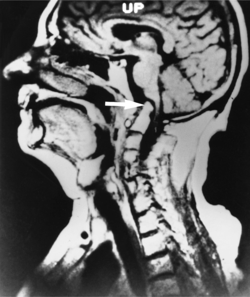

**Fig. 60.5** Magnetic resonance image of a patient with advanced rheumatoid arthritis shows invagination of the odontoid process of C2 ( _arrow_ ) through the foramen magnum, compressing the brainstem. Notice the degeneration of C4 and C5, a common problem in rheumatoid arthritis.

If cervical instability is suspected, airway management should proceed cautiously with minimal manipulation of the neck. Even in the absence of cervical spine disease, patients with RA may present with challenging airways due to temporomandibular joint disease that limits mouth opening or cricoarytenoid joint stiffness that impedes passage of the endotracheal tube. Fiberoptic intubation or regional techniques with a natural airway may be attractive options for these patients.

Extra- articular manifestations of RA are common and are associated with increased morbidity and mortality, primarily related to cardiovascular disease.150 The systemic inflammation caused by RA contributes to premature

::: details 原始表格與符號（PDF 第 13 頁）

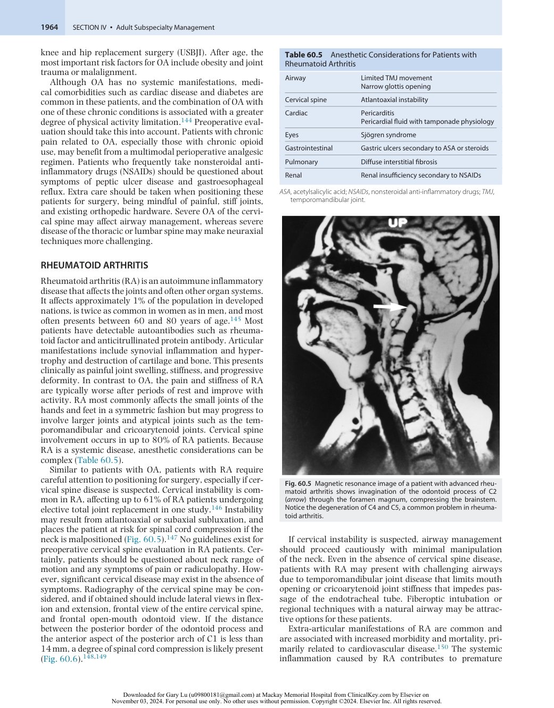

:::

<!-- PDF page 14 -->

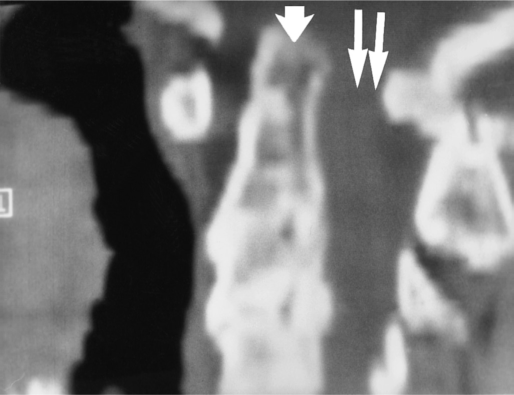

**Fig. 60.6 Computed tomography scan of the neck shows moderate subluxation of C1 and C2.** The odontoid ( _single arrow_ ) tends to compress the spinal cord ( _double arrow_ ) against the posterior arch of C1, especially during neck flexion.

atherosclerosis. As a result, the risk of myocardial infarction, congestive heart failure, and stroke is twice as high in patients with RA compared to individuals without RA.151 Pericarditis is the most common cardiac manifestation of RA but rarely results in clinically significant disease. Although RA has not been shown to be an independent risk factor for perioperative mortality or adverse cardiovascular events,152 thorough preoperative cardiovascular risk assessment is warranted in these patients. Pulmonary involvement of RA is also relatively common in the form of pleural effusions and interstitial lung disease. Severity varies from subclinical to, rarely, severe. Preoperative chest radiography or pulmonary function tests may be informative and dictate anesthetic management when significant pulmonary disease is suspected. Other extra- articular manifestations of RA include subcutaneous rheumatoid nodules on bony prominences or extensor surfaces, small- to medium- vessel vasculitis, and hematologic abnormalities such as anemia and thrombocytosis.

Treatment for RA focuses on early initiation of diseasemodifying antirheumatic drug (DMARD) therapy, with the goal of achieving clinical and radiographic disease remission. In addition to conventional DMARDs such as methotrexate, hydroxychloroquine, sulfasalazine, and leflunomide, many patients benefit from treatment with an ever- growing arsenal of biologic agents that use monoclonal antibodies or receptor proteins to inhibit inflammatory cytokines or cell lines. A notable risk with DMARDs is immunosuppression and possibly impaired wound healing. Current evidence supports continuation of methotrexate perioperatively but is inconclusive about the effect of other agents on perioperative infection and wound complication rates. A conservative approach is to hold biologic agents for at least one dosage cycle prior to surgery and resume once wound healing has progressed.153 A recent review article suggested that the benefit of interrupting biologic therapy is minimal, and perhaps absent.154 In each case, the benefit of improved immune function and wound healing must be balanced with the risk of disease flare, and it may be appropriate to continue DMARDs perioperatively for some

patients. This plan should be developed with input from the patient’s rheumatologist and surgeon. Patients taking corticosteroids for RA may require stress- dose steroids perioperatively. They should be questioned about symptoms of gastroesophageal reflux, as should patients who take NSAIDs chronically.

### ANKYLOSING SPONDYLITIS

Ankylosing spondylitis is an autoimmune seronegative spondyloarthropathy that typically affects the spine and sacroiliac joints but may involve peripheral joints as well. It affects men disproportionately and most often presents between the ages of 20 and 30 years. Inflammation in affected joints leads to formation of fibrocartilage and ectopic bone, and ultimately fusion of the joint. The classic “bamboo spine” appearance seen radiographically in advanced disease is caused by ossification of the vertebral ligaments. This in combination with osteoporotic compression fractures can result in rigid kyphosis that may require surgical correction (Fig. 60.7).

Despite their rigidity, the spines of patients with advanced ankylosing spondylitis are also quite fragile. Vertebral fractures may occur spontaneously or with minimal trauma; the cervical spine is a common site.155 Obviously, this has serious implications for intraoperative positioning and airway management. Neck range of motion and preexisting neurologic deficits should be thoroughly evaluated preoperatively, and adequate neck support must be provided at all times to avoid hyperextension. Cervical kyphosis may make direct laryngoscopy difficult or impossible, and temporomandibular joint disease may limit mouth opening. Awake fiberoptic intubation may be the safest option in patients with severe cervical disease, as it allows for spontaneous ventilation as well as neurologic monitoring throughout intubation. Video laryngoscopy has also been used successfully in ankylosing spondylitis patients.156 The laryngeal mask airway (LMA) may be useful in cases where endotracheal intubation is not required, or as a bridge to intubation if an intubating LMA is used.157 The spinal pathology of ankylosing spondylitis may also result in difficulty with neuraxial techniques. Furthermore, the incidence of epidural hematoma after neuraxial anesthesia is higher in ankylosing spondylitis patients than in the general population. This may be related to an increased incidence of traumatic needle placement, the prevalence of NSAID use among ankylosing spondylitis patients, or narrowing of the epidural space that makes symptomatic spinal cord compression more likely when a hematoma occurs.158 If neuraxial anesthesia is indicated, fluoroscopic guidance may facilitate placement. Subsequently, vigilance should be maintained for symptoms of epidural hematoma.

Extra- articular manifestations of ankylosing spondylitis occur more often in patients with severe disease. Inflammation and fibrosis of the ascending aorta and aortic root can lead to aortic insufficiency, and extension to the conduction system may result in heart block or supraventricular arrhythmias. The prevalence of aortic insufficiency and conduction abnormalities in ankylosing spondylitis patients increases with duration of disease, occurring in 3.5% and 2.7%, respectively, after 15 years and 10% and 8.5%, respectively, after 30 years.159 As in RA, patients

<!-- PDF page 15 -->

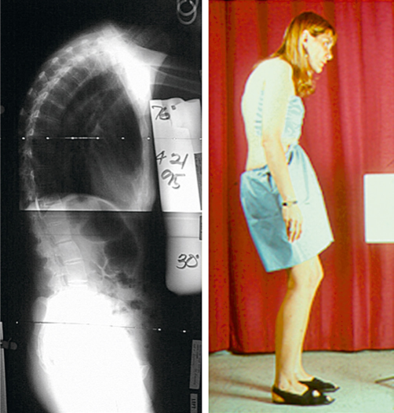

**Fig. 60.7 Patient with ankylosing spondylitis, exhibiting significant kyphosis of the spine.** Note significant kyphosis in the lateral radiograph.

with ankylosing spondylitis also have an elevated risk of atherosclerosis.160 Pulmonary manifestations of ankylosing spondylitis include restrictive lung disease due to kyphosis and chest wall rigidity. Pulmonary fibrosis may be seen in advanced disease. The duration and severity of disease should inform the extent of preoperative cardiopulmonary evaluation, which might include electrocardiography, echocardiography, and/or pulmonary function testing.

### ACHONDROPLASIA

Achondroplasia is characterized by disproportionately short stature, lumbar lordosis, large head, midface hypoplasia, short hands, and normal cognitive development. Its incidence is estimated at 1 in 10,000 to 1 in 30,000. Although it is an autosomal- dominant condition, the majority of cases occur as a result of a _de novo_ genetic mutation.161 Patients with achondroplasia may present for orthopedic surgery as children or adults for correction of associated abnormalities such as tibial bowing and spinal stenosis.

The primary anesthetic challenge in patients with achondroplasia is airway management. Midface hypoplasia with a pharynx that is small in proportion to the tonsils, adenoids, and tongue makes these patients prone to upper airway obstruction and may hinder direct laryngoscopy. A flat nasal bridge and large mandible may make it difficult to obtain an adequate seal for mask ventilation. Hyperextension of the neck should be avoided due to the possibility of foramen magnum stenosis. Video laryngoscopy or fiberoptic intubation should be considered for these patients, and a range of endotracheal tube sizes should be on hand, as many patients require a size smaller than what would be expected based on age. Other anesthetic considerations in patients with achondroplasia include the possibility of difficult neuraxial anesthesia due to spinal deformity or

stenosis, and cardiopulmonary sequelae such as restrictive lung disease, central and obstructive sleep apnea, and resultant pulmonary hypertension.162 Preoperative echocardiogram to assess for pulmonary hypertension should be considered prior to major surgery.

## Orthopedic Procedures in Children with Special Conditions

The anesthetic management of children undergoing orthopedic surgery is beyond the scope of this chapter. However, a number of musculoskeletal conditions will require multiple orthopedic surgeries during childhood and may pose special challenges to the anesthesiologist.

### JUVENILE IDIOPATHIC ARTHRITIS

Juvenile idiopathic arthritis (JIA) is the most common rheumatic disease in children. It is characterized by chronic arthritis with onset before the age of 16 and encompasses five distinct subtypes as described below. JIA may be seropositive or seronegative, is twice as common in girls as in boys, and may persist into adulthood.163

1.  Oligoarticular JIA: Involves fewer than 5 joints. Accounts for at least 50% of JIA. Often has an indolent presentation.

2.  Polyarticular JIA: Involves 5 or more joints. Accounts for 25% to 40% of JIA. Usually requires DMARD therapy.

3.  Psoriatic JIA: Arthritis with psoriasis.

4.  Enthesitis- related JIA: Affects the spine, sacroiliac joints, and points of tendon attachment to bone.

5.  Systemic- onset JIA: Presents with daily fever and rash.

As in adult arthritis, special care should be paid to joint range of motion and intraoperative positioning for patients with JIA. The cervical spine and temporomandibular joints may be affected in JIA, especially in the polyarticular subtype, and appropriate precautions should be taken when planning for airway management. In children, awake fiberoptic intubation may not be a feasible option. In this case, fiberoptic intubation may be performed asleep with spontaneous ventilation maintained throughout induction. Common extra- articular manifestations of JIA include growth abnormalities and uveitis. Pericarditis and pleural effusions sometimes occur in systemic- onset JIA. Medical therapies for JIA are similar to those for RA, including conventional DMARDs and biologics, which raise similar considerations for perioperative risks and management.

### OSTEOGENESIS IMPERFECTA

Osteogenesis imperfecta encompasses a group of heritable bone dysplasias caused by mutations in collagen- related genes. It occurs with an incidence of 1 in 10,000 and is characterized by bone fragility resulting in deformity and susceptibility to fracture. Secondary features include short stature, blue or gray sclerae, conductive hearing loss, abnormal dentin resulting in weak and discolored teeth, foramen magnum stenosis, cardiac valvular abnormalities, and bleeding diathesis. Although the most severe subtype

<!-- PDF page 16 -->

of osteogenesis imperfecta results in perinatal death, the life expectancy for patients with other subtypes extends well into adulthood.164

Patients with osteogenesis imperfecta may require a number of orthopedic surgeries such as fracture fixation, intramedullary rodding for correction of long- bone deformities, spinal fusion for scoliosis, and joint replacement. Anesthetic management may be challenging (Table 60.6). Utmost care must be taken to avoid iatrogenic fracture when positioning these patients for surgery. The area under the blood pressure cuff should be padded or an arterial line placed to minimize the risk of humeral fracture. Tourniquets must be managed with similar care. Succinylcholine should be avoided in patients with osteogenesis imperfecta because of the risk of fracture upon fasciculation. Airway management must be performed gently with minimal manipulation of the head and neck to avoid cervical, facial, and dental fractures. Fiberoptic intubation may facilitate this. Neuraxial techniques may be considered in patients with normal platelet function but may be challenging due to scoliosis. Care must be taken to avoid needle trauma to bone and intraosseous injection.

Several extraskeletal manifestations of osteogenesis imperfecta are relevant to the anesthesiologist. The same collagen abnormalities that affect bone may also affect the cardiac valves and aorta, resulting in regurgitant lesions, aortic root dilation, and even aortic dissection. Restrictive or obstructive lung disease may be present as a result of kyphoscoliosis or chest wall deformity. In fact, pulmonary complications are the leading cause of death in osteogenesis imperfecta. Preoperative echocardiography or pulmonary function testing should be considered if a murmur or symptoms of cardiopulmonary disease are noted. Patients with osteogenesis imperfecta are at risk for increased surgical bleeding due to platelet dysfunction and vessel fragility. Patients should be evaluated for coagulopathy preoperatively, and if necessary, treated with desmopressin (DDAVP) or platelet transfusion.

A link between osteogenesis imperfecta and malignant hyperthermia (MH) has been suggested in the literature, but the evidence for this association is weak. Intraoperative hyperthermia and metabolic acidosis have been observed in patients with osteogenesis imperfecta, but in most cases, this was not associated with other signs of hypermetabolism and resolved with cooling measures alone. There is a lack of consensus on the use of MH- triggering agents in patients with osteogenesis imperfecta. The most conservative approach is to administer a nontriggering anesthetic, but in cases where this presents a significant challenge (as in an uncooperative child with difficult intravenous access), use of volatile anesthetics may be considered. In all cases, patients should be carefully monitored for hyperthermia and acidosis, and appropriate treatment modalities should be readily available.165

### CEREBRAL PALSY

Cerebral palsy is the most prevalent cause of persistent motor impairment in children, affecting 1 to 2 of every 1000 live births in developed countries. It is caused by antenatal or perinatal injury to the developing brain and is characterized by nonprogressive abnormalities of

**Table 60.6** Anesthetic Considerations for Patients with Osteogenesis Imperfecta

|Airway|Risk for fractures of the mandible, maxillary surface, and cervical spine|
|---|---|
|Bleeding|Platelet abnormalities|
|Cardiac|Congenital and valvular heart disease Cystic degeneration of proximal aorta|
|Eyes|Exophthalmos Risks associated with prone positioning|
|Hyperthermia|Malignant hyperthermia, hydration, possible cooling|
|Positioning|Risk for fractures|
|Pulmonary|Kyphoscoliosis, restrictive lung disease|
|Regional anesthesia|Fractures, intraosseous injections|

movement and posture such as spasticity, ataxia, and dyskinesias. The motor deficit may be mild or severe, isolated, or accompanied by other abnormalities including cognitive impairment, speech disorders, and seizures. Patients with cerebral palsy often require multiple orthopedic surgeries such as soft tissue release and tendon lengthening for contractures, osteotomies for hip deformities, and spinal fusion for scoliosis.

Anesthetic management of patients with cerebral palsy requires consideration of the psychosocial as well as medical aspects of their condition.166 Communication may be challenging due to cognitive delay, behavioral problems, or speech difficulties, necessitating special accommodations and involvement of parents or caretakers in perioperative interactions. It is important to remember that speech impairment does not necessarily imply cognitive impairment. In patients with seizures, antiepileptic drugs should be continued perioperatively and inquiry made as to the frequency and semiology of seizures. Gastroesophageal reflux is common in cerebral palsy and may be an indication for rapid-sequence intubation. Bulbar dysfunction can further contribute to chronic aspiration and feeding difficulties that sometimes require gastrostomy tube placement. Chronic aspiration, recurrent respiratory infections, and restrictive deficits due to kyphoscoliosis result in significant pulmonary morbidity in these patients. Airway management may be challenging due to cervical kyphosis or dystonia, temporomandibular joint dysfunction, or poor dentition. Patients with cerebral palsy have a lower minimum alveolar concentration (MAC) than normal controls and may be prone to intraoperative hypothermia due to hypothalamic dysfunction. An association between cerebral palsy and latex allergy has been noted, likely related to the multiple surgical procedures many of these patients undergo.167

### SPINA BIFIDA

Spina bifida is a term that is broadly applied to a diverse group of congenital malformations of the spine and spinal cord. Embryologically, these conditions result from a failure of fusion of the neural tube. Discussion of spina bifida is complicated by a lack of consistency in terminology and classification, but malformations can be broadly divided into open defects with exposed neural tissue such

::: details 原始表格與符號（PDF 第 16 頁）

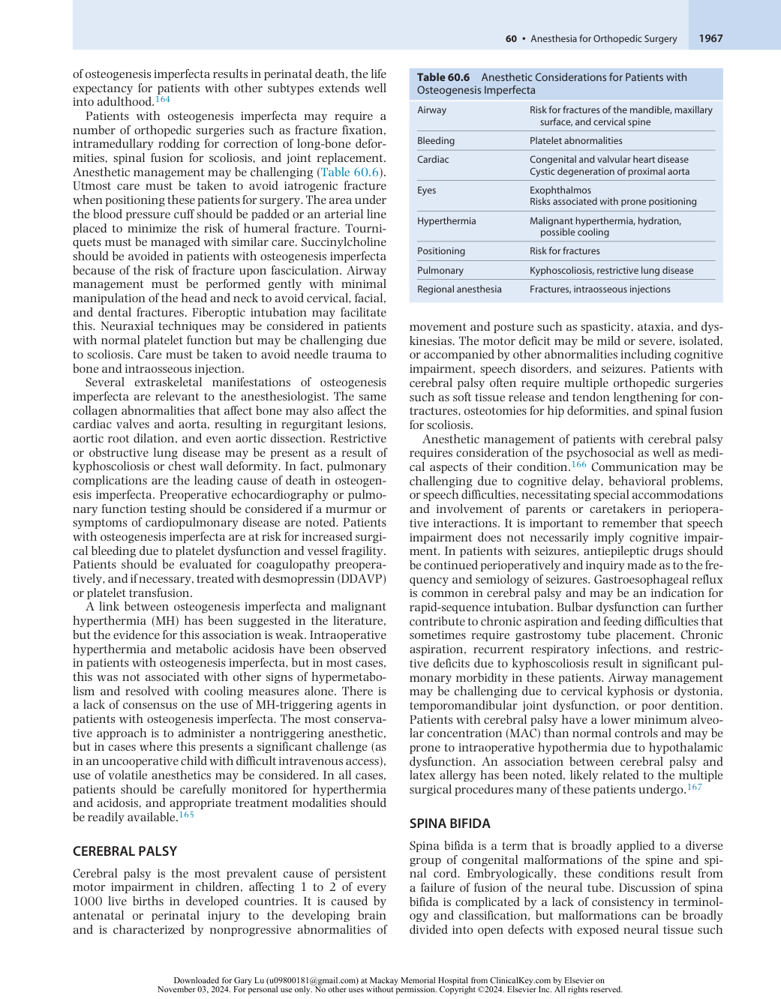

:::

<!-- PDF page 17 -->

as myelomeningocele and myeloschisis, and closed defects with a skin covering such as meningocele, tethered cord, and split cord. Open defects are usually associated with a neurologic deficit and are almost always repaired perinatally, or with the advent of fetal surgery, prenatally. Closed defects may have an associated deficit or may be asymptomatic and undiagnosed until adulthood. Cutaneous abnormalities such as a sacral dimple, hemangioma, or tuft of hair may raise suspicion for a closed defect, but these are not always present.168

Neurologic abnormalities associated with spina bifida include motor and sensory deficits below the level of the defect, Chiari II malformation, hydrocephalus, and neurogenic bladder. Patients with spina bifida may present for orthopedic surgery for correction of congenital or acquired limb deformities such as clubfoot or hip dislocation, spinal fusion for scoliosis, or release of contractures. Patients with tethered cord syndrome may present for cord release as children or adults. As in cerebral palsy, repeated surgical exposures in spina bifida patients result in an increased incidence of latex allergy. The most significant anesthetic implications of spina bifida are related to neuraxial anesthesia. Whether or not the patient has undergone corrective spinal surgery, anatomic abnormalities in the spine can lead to an increased risk of inadvertent dural puncture, failed block, and neurologic injury. For example, the ligamentum flavum may be malformed or absent, precluding identification of the epidural space with loss- of- resistance technique. The epidural space may be abnormal or nonexistent in patients who have undergone prior surgical repair. Cord tethering can result in low termination of the spinal cord and posterior placement of neural elements within the spinal canal, increasing the risk of neurologic injury with spinal anesthesia or inadvertent dural puncture. Neuraxial techniques should be approached with extreme caution in patients with tethered cord syndrome, if at all. If neuraxial anesthesia is indicated in a patient with spina bifida, it should only be attempted if there is a thorough understanding of the patient’s spinal anatomy. Magnetic resonance imaging (MRI) of the spine should be obtained to allow for examination of bony and ligamentous defects, the level of termination of the spinal cord, and the presence of masses such as lipoma or syrinx. Needle placement through surgical scars should be avoided, and epidurals should be placed above the level of the spinal defect. Smaller than usual epidural boluses are recommended, as abnormal anatomy might result in more extensive spread. Failed or incomplete block may result in the need for rescue analgesia or conversion to general anesthesia.169

### DUCHENNE MUSCULAR DYSTROPHY

Duchenne muscular dystrophy (DMD) is an X- linked recessive neuromuscular disorder that occurs in 16 per 100,000 live male births in the United States. Mutations in the dystrophin gene result in muscular degeneration that is progressive and ultimately fatal. Weakness usually begins in early childhood with loss of ambulation by age 8 to 12 years, respiratory insufficiency and cardiomyopathy by the early 20s, and death before age 30 due to pulmonary complications or heart failure. However, with advancements in

care, the life expectancy for DMD is improving, and some patients may survive into their 30s or 40s. Glucocorticoids are the mainstay of treatment for DMD. Patients with DMD may present for orthopedic surgery to correct lower extremity deformity, scoliosis, or contractures. These patients are also prone to osteoporosis with increased risk of fractures that may require operative fixation.

Patients with DMD have an elevated risk of perioperative cardiac and respiratory decompensation and should undergo a thorough cardiopulmonary evaluation prior to surgery. Depending on the stage of their disease, this may include an electrocardiogram, echocardiogram, and pulmonary function testing. Extubation to noninvasive positive pressure ventilation is recommended for patients with a forced vital capacity (FVC) less than 50% predicted, and essential for those with an FVC less than 30% predicted. Aggressive postoperative pulmonary hygiene should be strongly encouraged.170

Use of succinylcholine is strictly contraindicated in patients with DMD because of the risk of acute rhabdomyolysis. Inhaled anesthetics are also best avoided, as they have been implicated in cases of perioperative metabolic reactions ranging from intraoperative hyperthermia and tachycardia to rhabdomyolysis to hyperkalemic arrest. The mechanism of these reactions is thought to be distinct from that of MH.171 Patients with DMD have both a delayed onset time and prolonged recovery time with nondepolarizing neuromuscular blockers, which places them at risk for residual neuromuscular blockade and recurarization. Quantitative monitoring of neuromuscular blockade is recommended to ensure full reversal. Cholinesterase inhibitors are safe and effective for reversal in these patients, and sugammadex has been used successfully as well.172

### ARTHROGRYPOSIS MULTIPLEX CONGENITA

Arthrogryposis multiplex congenita is characterized by congenital nonprogressive contractures affecting at least two different areas of the body. It occurs with an incidence of about 1 in 4300 to 5100 live births. Arthrogryposis multiplex congenita is not a single disorder, as once thought, but actually encompasses hundreds of conditions with distinct etiologies, both genetic and environmental. A common theme in most of these is decreased fetal movement, which leads to abnormal joint development. Deformity may be limited to the limbs or associated with spine and craniofacial abnormalities. Neurologic dysfunction is present in some cases and portends a less favorable prognosis.173

Treatment of arthrogryposis multiplex congenita requires early orthopedic intervention with splinting and surgery to optimize a child’s ability to ambulate and perform activities of daily living. The primary anesthetic challenge in arthrogryposis multiplex congenita is airway management, which may be complicated by craniofacial abnormalities such as small mouth opening, high arched palate, or micrognathia, as well as limited cervical range of motion. These patients are at risk of perioperative respiratory complications as a result of restrictive thoracic deformities and increased sensitivity to opioids and neuromuscular blockers. This makes regional and neuraxial anesthesia attractive options, but these techniques may be challenging due to limb contractures, scoliosis, or associated spina bifida.174

<!-- PDF page 18 -->

Two cases of suspected MH have been reported in patients with arthrogryposis multiplex congenita, as well as other cases of perioperative hyperthermia and hypermetabolism without skeletal muscle destruction. As such, succinylcholine should be avoided in these patients, and exposure to volatile anesthetics should be minimized.165

## Perioperative Management of the Orthopedic Patient

### SPECIAL CONSIDERATIONS

In addition to the perioperative cardiovascular, pulmonary, renal, and hepatic considerations described earlier, orthopedic procedures are associated with unique risks and complications related to bone injury, immobilization, and the use of implants and cement material. Bone hemostasis can be difficult, and without antifibrinolytic agents, even primary hip and knee arthroplasties can be associated with considerable bleeding requiring transfusion of blood products. Extensive review of these considerations is beyond the scope of this chapter but given the rising interest in the literature and its clinical importance, perioperative use of antifibrinolytic agents is summarized below, along with the clinical presentation and management of fat embolism and bone cement implantation syndrome.

### Antifibrinolytic Drugs

Blood transfusions are associated with an increased risk of adverse events including mortality, prolonged length of hospitalization, and higher overall costs associated with surgery. Antifibrinolytic agents, such as tranexamic acid (TXA) and epsilon- aminocaproic acid (EACA), bind reversibly to plasminogen by its lysin- binding site, inhibiting its association with fibrin. They also inhibit the proteolytic activity of plasmin. Both TXA and EACA are effective in reducing perioperative blood loss and the need for transfusion and reoperation for bleeding.

Among orthopedic surgeries, the strongest evidence for the use of TXA and EACA is found in multilevel spine surgeries and arthroplasties. Several comprehensive metaanalyses have examined the use of systemic TXA in these procedures. Two meta- analyses studying the use of intravenous TXA in spine surgeries demonstrated significant reductions in intraoperative and postoperative blood loss and allogenic blood transfusion compared with placebo. However, initiation doses (10–20 mg/kg, 100 mg/kg, or 1–2 g) and maintenance doses (1 mg/kg/h, 10 mg/kg/h, and 100 mg/kg/h) were highly variable.175,176 The risk of thromboembolism after elective spine surgery ranges between 0.5% and 1.1%, and 4.2% after emergent spine procedures.177 The evidence on the association of antifibrinolytics like TXA and increase in thromboembolism remains inconclusive.178 The use of TXA for complex spine procedures is beneficial and recommended as it decreases the risk of bleeding.179 Similar results with regard to efficacy and safety have been shown with the use of intravenous TXA in TKA and THA. TXA has been shown to reduce total blood loss, postoperative bleeding, and the transfusion rate when given intraoperatively with an intravenous infusion compared to a postoperative administration. A

common approach is to administer 10 to 15 mg/kg before the incision, followed by a 1 mg/kg/h infusion during the surgery.180,181 A recent meta- analysis also demonstrated that TXA resulted in significant reductions in total blood loss and transfusion requirements following total shoulder arthroplasty.182

Topical administration of TXA, although not a US Food and Drug Administration (FDA)- approved route of administration, has a theoretical safety benefit over intravenous administration. Topical TXA has shown superior efficacy to placebo and similar efficacy (measured as reductions in total blood loss and transfusion rates) to intravenous TXA in TKA and THA. No difference in the rate of thromboembolic events has been demonstrated when comparing topical TXA to placebo or intravenous TXA. The doses of topical TXA used in studies are highly variable and usually range from 1 to 3 g. Thus, a standard topical dose has not yet been established.183–185

EACA has also been shown to decrease total blood loss and need for transfusion among patients undergoing spine surgeries.186 Among TKA and THA patients, however, EACA did not reduce the need for blood transfusion.187,188 An increased risk of DVT and pulmonary embolism has not been reported following the use of EACA in THA,187 though sufficient data in TKA or spine surgeries are not yet available. Loading doses (100–150 mg/kg or 5 g) with a continuous infusion ranging from 10 to 15 mg/kg/h during spine surgeries have been used.186 For THA and TKA, weightbased (12.5–100 mg/kg) and fixed doses (5–10 g) of EACA have been utilized.187

Although no increase in the incidence of VTE was observed in the above randomized clinical trials, it is important to note that high- risk patients were excluded and none of the studies was adequately powered to detect smaller but clinically relevant differences between treatment groups. Therefore, because of concerns of VTE, antifibrinolytic agents are commonly avoided in patients who have any of the following conditions: a history of arterial or venous thromboembolic disease; a recent placement of a cardiac stent; a history of severe ischemic heart disease (New York Heart Association [NYHA] class III or IV) or myocardial infarction; and history of cerebrovascular accident, renal impairment, or pregnancy. A retrospective cohort study examined the use of TXA in 765,011 patients undergoing TKA and THA with comorbidities including VTE, myocardial infarction, seizures, ischemic stroke/transient ischemic attack, renal disease, and atrial fibrillation. The use of TXA in those patients was not associated with increased risk of complications.189

Currently, there are limited data to support the use of EACA in spine surgeries, THA, or TKA, whereas evidence for TXA is more robust. In select patients who are at high risk for transfusion, intravenous or topical TXA should be considered.

### Fat Embolism Syndrome

The subclinical form of fat embolism occurs in nearly all patients following long bone or pelvic fractures, as well as after hip or knee replacement surgeries. A clinically significant fat embolism syndrome (FES) is present in up to 30% of these patients.190,191 An increase in intramedullary pressure and a disruption of the venous sinusoids within the

<!-- PDF page 19 -->

long bones following a fracture or a surgical manipulation such as reaming can result in fat and bone marrow debris entering the venous circulation. The debris lodges in the lung microvasculature, leading to a mechanical obstruction of pulmonary circulation. Free fatty acids released following hydrolysis of fat globules trigger systemic inflammatory response and induce injury to the pulmonary endothelium with an increased capillary leak and increased platelet adhesion with clot formation in the microvasculature. In the presence of intracardiac (patent foramen ovale) or pulmonary shunts, fat particles may also enter the systemic circulation, leading to cerebral and cutaneous manifestations.

Symptoms of FES include hypoxemia, respiratory alkalosis, mental status changes, petechial rash (in the conjunctiva, oral mucosa, and skin folds of the neck and axilla), thrombocytopenia, and fat microglobulinemia. The presentation of FES can be gradual, developing between 12 and 72 hours after trauma or surgery. Intraoperatively, FES can also present as a cardiovascular collapse following reaming of long bones, intramedullary insertion of cemented prosthesis, or tourniquet release. Chest radiographs usually show bilateral diffuse infiltrates, particularly in the upper and middle lobes of the lung. MRI of the brain of the patients with significant mental status changes can reveal multiple hyperintensive lesions. Arterial blood gas assessment is useful to determine the degree of hypoxemia.190 The best preventive management strategy of FES is an early surgical reduction and immobilization of the fracture site. Therapy of FES includes early supportive care with supplemental oxygen and, if necessary, mechanical ventilation to correct hypoxemia, and careful fluid management to prevent

worsening of capillary leak. There is currently no evidence supporting the use of steroids, heparin, or dextran in the management of FES.191 The overall mortality remains high (up to 20%).

### Bone Cement Implantation Syndrome

During arthroplasties, the prosthesis can be attached to the medullary canal of long bones using methyl methacrylate cement or through bone ingrowth. Cemented fixation of the prosthesis can be complicated by bone cement implantation syndrome (BCIS) that manifests by marked intraoperative hypotension, bronchoconstriction, hypoxia, cardiac arrhythmias, increased pulmonary vascular resistance, right ventricle failure, or even cardiac arrest.192 Several mechanisms of BCIS have been proposed, including embolization of bone marrow debris to the pulmonary circulation during pressurization of the medullary canal, toxic effects of circulating methyl methacrylate monomer, and release of cytokines and cyclooxygenase products during reaming of the medullary canal, which can induce pulmonary vasoconstriction and formation of microthrombi. Embolization is believed to occur as a result of high intramedullary pressures during cementing. In cemented arthroplasties, intramedullary pressure can peak at 680 mm Hg, compared to less than 100 mm Hg in arthroplasties without the use of cement. The presence of bone marrow debris has, indeed, been documented in the right heart with intraoperative transesophageal echocardiography (TEE) (Figs. 60.8 and 60.9).193

Risk factors for this complication include metastatic disease, a previously not instrumented femoral canal (it is thought that the inner surface of the femur becomes smooth and sclerotic once instrumented and cemented,

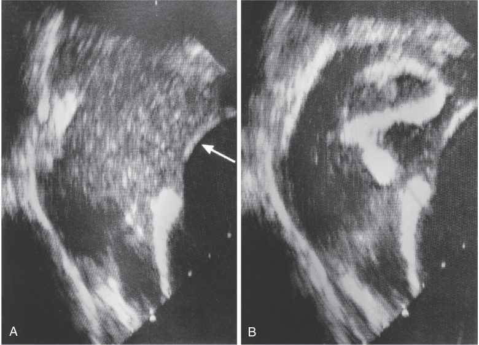

A B 

**Fig. 60.8 Right atrium during echocardiography.** (A) Multiple, small emboli ( _arrow_ ) in the right atrium. (B) Large embolus (7 cm long), which is probably a cast of the femoral vein. (Modified from Christie J, Burnett R, Potts HR, et al. Echocardiography of transatrial embolism during cemented and uncemented hemiarthroplasty of the hip. _J Bone Joint Surg Br_ . 1994;76:409–412.)

<!-- PDF page 20 -->

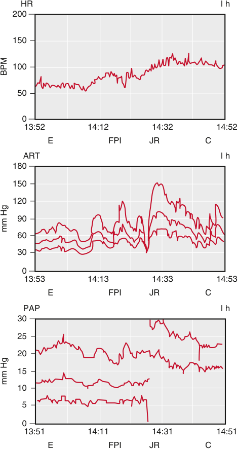

HR I h 200 150 100 50 0 13:52 14:12 14:32 14:52 E FPI JR C ART I h 180 150 120 90 60 30 0 13:53 14:13 14:33 14:53 E FPI JR C PAP I h 30 25 20 15 10 5 0 13:51 14:11 14:31 14:51 E FPI JR C BPM mm Hg mm Hg 

**Fig. 60.9** Beats per minute (BPM), intraoperative heart rate (HR), systemic arterial blood pressure (ART), and pulmonary arterial pressure (PAP) tracings of a patient undergoing revision total hip arthroplasty. _C,_ wound closure; _E,_ induction of epidural anesthesia; _FPI,_ insertion of a cemented femoral prosthesis; _JR,_ reduction of prosthetic hip joint, producing hypotension with rebound from epinephrine injection. (From Urban MK, Sheppard R, Gordon MA, et al. Right ventricular function during revision total hip arthroplasty. _Anesth Analg_ . 1996;82:1225–1229.)

and thus offers a less permeable surface), a long- stem prosthesis, a THA for pathologic fractures, preexisting pulmonary hypertension and right ventricle failure, and a large quantity of cement used. The hemodynamic consequences of bone marrow embolization may be attenuated through a vigorous pulsatile lavage of the medullary canal and by drilling distal venting holes within the long bones before prosthesis insertion. However, the venting technique can result in significant cement extravasation. Use of noncemented prosthesis should thus be considered in high- risk patients.194 These patients should be monitored with an arterial catheter and, possibly, also a central venous catheter. Management of BCIS is mainly supportive and includes ventilatory support, adequate fluid resuscitation, and vasopressor support. The hypotensive events following BCIS

may require treatment with potent inotropic and vasopressor agents such as epinephrine with the goal to off- load the right ventricle.

### ORTHOPEDIC TRAUMA

### Pelvic Fractures

Pelvic fractures are among the most complicated orthopedic injuries and are associated with a high mortality rate (up to 32% in open fractures). They are typically a result of blunt force trauma, including motorcycle and motor vehicle accidents (60%–80%). The classification of pelvic trauma into minor, moderate, and severe is based on the pelvic ring injury’s anatomic classification (Antero- Posterior Compression; Lateral Compression; Vertical Shear; Combined Mechanisms) and more importantly, the hemodynamic status.195 Patients suffering from traumatic pelvic fractures often have other associated life- threatening injuries (to the head and neck, thoracoabdominal area, and extremities) that need to be taken into consideration during perioperative management. In addition, pelvic fractures can result in fatal retroperitoneal bleeding.196 An accompanying blunt chest trauma can produce both cardiac contusion and aortic tear. Preoperative ECG and measurements of cardiac enzymes can help evaluate the extent of myocardial injury. Thorough preoperative neurologic assessment including mental status, motor, and sensory examination is indicated prior to inducing anesthesia. Injuries to the bladder and urethra are also common. Urologic evaluation may be needed before inserting an indwelling catheter. Insertion of chest tubes prior to surgery may also be needed if significant hemothorax or pneumothorax are present. These patients should be considered for a temporary inferior vena cava filter due to a high risk of DVT and pulmonary embolism.

A multidisciplinary approach that includes trauma and orthopedic surgeons, urologists, interventional radiologists, anesthesiologists, and intensive care unit (ICU) physicians is crucial during the immediate management of these patients and should focus on adequate volume resuscitation, achieving hemostasis, and mitigating tissue injuries.195 As soon as possible after the primary evaluation and stabilization, a comprehensive radiologic workup should be performed. CT is the gold standard with a sensitivity and specificity for bone fractures close to 100%. Initial treatment of pelvic trauma generally involves damage- control resuscitation and application of noninvasive external pelvic compression to stabilize the pelvic ring and decrease the amount of pelvic hemorrhage. Patients with hemodynamic instability should be considered for pre- peritoneal pelvic packing, especially in hospitals with no angiography service. External pelvic fixation provides rigid temporary pelvic ring stability and serves as an adjunct to early bleeding control in hemodynamically unstable pelvic ring disruptions.195,196 The optimal time for definitive surgical fixation of pelvic ring injuries is within the first week of trauma.

Anesthetic management of patients with pelvic trauma in the operating room can be very challenging. Because of the extent of the surgery, general endotracheal anesthesia with standard or rapid-sequence induction based on clinical presentation is indicated. These patients often need an immediate and aggressive resuscitation and, frequently, angiography and embolization of the injured

<!-- PDF page 21 -->

vasculature.195,197 The primary goal of the rapid resuscitation is to restore blood volume and maintain perfusion to the vital organs, with continuous evaluation of the efficacy of the fluid replacement. Sensitive laboratory markers of tissue ischemia secondary to the acute traumatic hemorrhage include increased serum lactate and base deficit by arterial blood gas analysis.195 It is important to restore hemoglobin to a level that provides adequate tissue oxygenation (usually considered more than 7–8 g/dL) prior to inducing anesthesia, and to have sufficient amount of blood products available because of the risk for significant intraoperative blood loss. Because of the large intraoperative blood loss and third- spacing of fluids, invasive hemodynamic monitoring, including an arterial line and central venous catheter, may be necessary. Intravenous access through several largebore catheters is also critical. Intravenous fluids and blood products should be administered through a fluid warmer to prevent hypothermia. A rapid fluid infuser is commonly used. Cell- scavenging techniques are useful to reduce the requirement for donor packed red blood cells. Placement of an epidural catheter for postoperative pain control can be considered, provided that the patient is not coagulopathic and after the neurovascular integrity of the lower extremities has been confirmed. Patients may be admitted to the ICU postoperatively for monitoring, and are sometimes intubated, especially in the presence of evolving pulmonary injuries (fat embolism, aspiration, or lung contusion), or other complicating organ injuries.

### Femur Fractures

Fractures of the proximal femur following mechanical falls are most common in elderly patients and are associated with high morbidity and mortality (1- year mortality of up to 30%).198 In younger patients, femur fractures including fractures of the femoral shaft and distal femur are usually associated with trauma, such as following motorcycle and motor vehicle accidents. Perioperative complications are often related to preexisting cardiac and pulmonary conditions and include myocardial infarction and dysrhythmias, DVT, pulmonary embolism, and delirium. It has been shown that older patients admitted early into a dedicated orthogeriatric facility have an improved long- term mortality.199

Proximal femur fractures occur through the femoral neck, intertrochanteric, or subtrochanteric areas. Displaced femoral neck fractures are usually treated by prosthetic replacement, whereas intertrochanteric or subtrochanteric fractures can be treated with a sliding hip screw and side plate, cephalomedullary nail, or blade plate. Nondisplaced femoral neck fractures are usually managed by closed reduction and percutaneous pinning.200 Surgical treatment of femoral shaft and distal femur fractures involves application of plates and screws along the femur for rigid internal fixation and intramedullary devices.

Pain and stress following hip fracture can often contribute to myocardial ischemia. Therefore, a thorough preoperative evaluation and preparation of these patients, as outlined earlier in this chapter, is crucial. Early surgery (&lt;24 hours) has been associated with reduced pain and length of hospital stay but not improved function or mortality.201 However, patients with significant medical comorbidities that delay surgery for more than 4 days have a nearly 2.5 times higher risk of death within 30 days after

the surgery compared with patients who are initially considered fit for surgery.198 Thus, early surgery for hip fractures combined with early mobilization and rehabilitation should be the goals for medically stable patients.

There is increasing evidence that regional anesthesia is not associated with lower morbidity when compared to general anesthesia (including delirium) and mortality.202,203 It is reasonable to still consider regional anesthesia in patients with hip fractures on a case- by- case basis.204,205 A carefully dosed spinal anesthetic with isobaric bupivacaine often provides stable anesthesia of sufficient duration for the surgical repair. Anesthesia from T12 to S2 is adequate. There is evidence that regional nerve blocks including fascia iliaca blocks can effectively reduce pain associated with hip fracture. There is also moderate evidence that nerve blocks may contribute to reduced rates of delirium, and potentially, reduced length of inpatient stay, morbidity, and mortality.203,206

Pulmonary embolization of bone marrow debris and bone cement leading to hypoxemia and right ventricle failure is a major determinant of mortality in these patients.207 The presence of emboli detected by intraoperative TEE in the right heart and pulmonary artery appears to derive principally from the reaming of the femoral canal and the placement of the femoral stem, particularly during the placement of cemented prostheses (see earlier).193 Although routine use of intraoperative TEE is not recommended, it may be considered in high- risk patients with femur fractures. Adequate intravenous access and cross- matched blood products should be available, because some of these procedures can involve a large blood loss. Placement of an arterial catheter allows timely and accurate blood pressure monitoring, and serial measurements of arterial blood gases and hemoglobin concentrations. The use of a central venous catheter may also be indicated in very high- risk patients. Maintaining body temperature during surgery is particularly important in the older patient population. Medically unstable patients with significant comorbidities often require postoperative management in an ICU setting.

### Tibia Fractures

Tibial plateau or proximal tibia fractures are most common in younger trauma patients, as well as elderly patients with degenerative arthritis of the knee. Open reduction internal fixation of tibial plateau fractures involves a reduction under direct visualization of the fracture fragments and application of plates and screws along the tibia for rigid internal fixation. An iliac crest bone graft may also be necessary. Compartment syndrome is one of the most frequent complications of this surgery (10%–20%). Tibial shaft fractures are commonly associated with trauma (95%) and are treated by intramedullary nailing of the tibia. Most nails are interlocked proximally and distally with screws. External fixation of tibia fractures involves placement of percutaneous pins that are clamped to an external frame. This procedure can be used for temporary stabilization of tibia fractures, especially in the setting of periarticular injuries. These fixators also may be useful for salvage of open and/ or infected fractures that are unsuitable for internal fixation.208 Tibia surgeries are frequently performed under general anesthesia, although spinal anesthesia could also be considered. Regional blocks can also be considered for

<!-- PDF page 22 -->

postoperative pain control if compartment syndrome is not a major concern. In fact, evidence suggests that in most patients, regional techniques do not interfere with diagnosis of compartment syndrome.209

### Upper Extremity Fractures

Trauma patients presenting for surgeries for upper extremity fractures are relatively young and often otherwise healthy. Most of these surgeries are performed on an elective basis with a standard preoperative evaluation. However, repairs of compound fractures and open fractures may necessitate emergency surgery. General or regional anesthesia or their combination can be used. A brachial plexus block via the supraclavicular, infraclavicular, or axillary approach and variations is suitable for surgeries of the distal arm, whereas the interscalene approach is employed for more proximal humerus procedures. A peripheral nerve catheter may be considered for postoperative pain relief. Regional techniques can be safely applied when there is no concern for postoperative compartment syndrome.

### Extremity Replantation

Functional recovery remains the overarching goal of extremity replantation. Traumatic amputation disproportionately affects males in a 4:1 ratio. Most upper extremity amputations occur at the level of the digits. Life- threatening injuries, if present, must be prioritized before consideration is given to replantation. The ultimate surgical plan is often deferred until after microscopic examination of the stump and amputated parts. Severe crush or burn injuries, massive contamination, multiple injuries in the same digit, prolonged normothermic ischemia, and preservation of amputated parts in nonphysiologic solutions are relative contraindications to proceeding with replantation.

To minimize irreversible tissue injury, hypothermic preservation of the amputated part and measures to reduce the interval between amputation and replantation are routinely practiced. The goal for successful digit replantation is to be completed within 12 hours of warm or 24 hours of cold ischemia. The window is narrower for major upper extremity implantation (6 hours of warm and 12 hours of cold ischemia).210 Extremity replantation is hence an emergent procedure and patients often present having full stomachs. Substance abuse is common in this population and acute intoxication may raise additional concerns, such as altered anesthetic requirement, diuresis, and hypovolemia or hypothermia. The patient may also present with acute blood loss anemia, depending on the extent of the traumatic injury. Regional anesthesia is typically used either alone or in conjunction with general anesthesia to provide postoperative analgesia and vasodilation to the vascular anastomosis. Indeed, brachial plexus nerve catheters have been shown to improve the blood flow to the implant through vasodilation.210–212 As a surrogate marker of tissue perfusion, skin temperature is elevated in patients having brachial plexus blocks.213 Furthermore, one study demonstrated a 0% reoperation rate for vascular insufficiency in patients having continuous supraclavicular blocks, versus 29% reoperation rate in patients managed with intravenous opioids alone.214 The surgical team often performs the replantation in the following sequence: bone fixation, tendon repair, nerve repair, vascular anastomosis, and skin

closure. Typical donor sites for skin grafts include stomach and thigh. Intravenous heparin and dextran are typically administered during the microvascular portion of the surgery to minimize the risk of thrombosis, which complicates 10% of cases. In theory, inotropes should be avoided to decrease the risk of vasoconstriction; however, there is little evidence to support this claim clinically. Evidence suggests that dobutamine and norepinephrine may increase tissue perfusion as a function of increased mean arterial blood pressure. Epinephrine is associated with a decrease in microvascular blood flow irrespective of mean arterial pressure.215–217 A tourniquet is routinely used to minimize blood loss, but a baseline complete blood count and a blood bank sample are prudent in the setting of any traumatic injury. Reperfusion intervals for tourniquet times of greater than 90 to 120 minutes should be considered. Lactic acidosis from a prolonged tourniquet time may be problematic in patients with underlying lung disease, and maintaining controlled ventilation is advisable in such patients in order to compensate the metabolic acidosis.

Surgical duration is variable. The clinician should meticulously position and monitor all pressure points, given probable length of procedure. Techniques to maintain perioperative normothermia, such as fluid warmers and heating blankets, are employed to prevent vasospasm. After the procedure, it can be helpful to admit the patient into a room with increased ambient temperature to promote vasodilation. In addition, anticoagulant therapy may need to be continued to prevent microthrombi. The peripheral catheters should be monitored regularly by a dedicated team and coagulation status should be checked prior to discontinuing the catheter. Patient- controlled analgesia (PCA) is a useful alternative in the initial days following the procedure, but opioid utilization can be reduced by peripheral nerve block or catheter.

### UPPER EXTREMITY SURGERIES

### Hand Surgery

Hand surgeries are performed by several surgical specialties including general surgeons and orthopedic surgeons, as well as plastic and hand surgeons. These cases vary in complexity from a simple incision and drainage to complete neurovascular replantation of several digits and even the entire hand, as well as urgency from elective surgeries to emergent procedures such as replantation of ischemic digits. Hand procedures can vary widely in length from several minutes to several hours. Less complex procedures are performed at outpatient surgical centers, whereas complex procedures are reserved for tertiary care hospitals. Given the varying nature of hand surgeries, the anesthetic approaches to hand cases also vary from intravenous anesthesia or Bier block to regional anesthesia or general endotracheal anesthesia.

Intravenous regional anesthesia (or Bier block) is a simple technique that involves exsanguinating the arm by wrapping it with an elastic bandage (e.g., Esmarch bandage), inflating an upper arm tourniquet to between 50 and 100 mm Hg above the patient’s systolic blood pressure (often to 250 mm Hg), and injecting a short- acting preservative- free local anesthetic (typically lidocaine) into a hand vein. A second tourniquet, distal to the first, may

<!-- PDF page 23 -->

be inflated 15 minutes later with subsequent deflation of the first, to minimize tourniquet pain. The extremity veins distal to the tourniquet are filled with the anesthetic agent, which sets in after approximately 6 to 8 minutes. Complications occur when the tourniquet fails during initial anesthetic injection or if the tourniquet is deflated too early (&lt;30 minutes), risking systemic local anesthetic toxicity (LAST). Adjuncts can be added to the local anesthetic injectate including ketorolac and clonidine to extend tourniquet tolerance, but their routine use is discouraged by most experts, because the potential benefits do not seem to outweigh the risk of increased complexity and side effects.218,219

Regional anesthesia techniques for hand surgery include blocking the brachial plexus via an infraclavicular (ICB) and variations (costoclavicular) or axillary approach.220 Ultrasound- guided ICB has replaced the nerve stimulator technique. Injecting local anesthetic at the posterior cord increases the success rate.221 Moreover, performing ICB with ultrasound guidance may shorten procedure time, avoid the need for multiple needle passes, and reduce complications of vascular puncture and pneumothorax.222 For high- risk patients who are anticoagulated, an axillary block is a reasonable option, as the artery is easily compressible. With ultrasound guidance, selective nerve blockade can be achieved to minimize bleeding potential. For complex and emergent hand cases, general anesthesia is often chosen because of the prolonged duration of the procedure (see section on Orthopedic Trauma, earlier).

### Shoulder and Elbow Surgery

Over the past several decades, an increasing number of patients have undergone shoulder surgeries, as it has been shown that these procedures have a positive impact on the quality of life. Shoulder arthroplasty surgery can range from extensive open repairs, hours in duration, to simple shoulder arthroscopic procedures of short duration. Most of the surgeries are performed in the beach chair position, as this position offers superior surgical exposure and access, less distortion of muscle anatomy, and less tension on the brachial plexus than the lateral position. Therefore, anesthetic considerations are mostly tailored to counterbalance the physiologic derangements occurring in this position in anesthetized patients. Anesthetic techniques can range from general anesthesia to conscious sedation or monitored anesthesia care with regional block. For the most part, open procedures require muscle relaxation and therefore general endotracheal anesthesia is often preferred. For arthroscopic procedures, muscle relaxation is not necessary, and these cases can be amenable for general anesthesia with an LMA or monitored anesthesia care with regional block. The anesthetic approach is largely influenced by the local practice culture. Surgeons may request controlled hypotension in arthroscopic cases, as visualization can be hindered by local bleeding. This can be problematic, especially in patients with chronic uncontrolled hypertension, as well as those with underlying cerebral vascular insufficiency. Cerebral perfusion pressure (CPP) is reported to decrease by 15% in sitting patients under general anesthesia. In patients with chronic hypertension, cerebral autoregulation is altered, and the curve is shifted to the right (Fig. 60.10). In patients with cerebrovascular disease, detrimental decrease in cerebral blood flow (CBF) can occur if the systemic pressure is kept

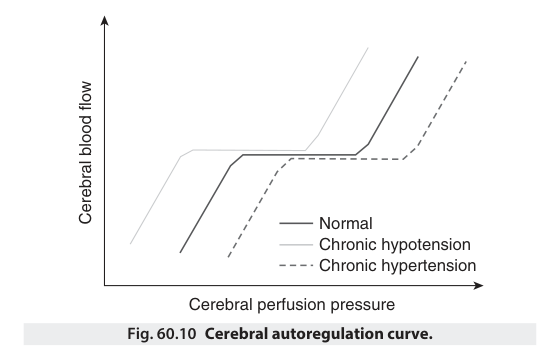

Normal Chronic hypotension Chronic hypertension Cerebral perfusion pressure Fig. 60.10 Cerebral autoregulation curve. Cerebral blood flow 

below the minimal required CPP. Cerebral autoregulation is also influenced by ventilation via arterial PCO2. Hypercapnia can result in cerebral vasodilation and increased CBF at a constant CPP. Conversely, hypocapnia causes a decrease in CBF due to cerebral vasoconstriction.223 A randomized study suggested that cerebral oxygenation can indeed be improved with higher end- tidal CO2 during surgery in the beach chair position.224 Therefore, permissive hypercapnia may be considered during shoulder surgery in the sitting position for patients with altered CBF. Additionally, the effects of vasopressors, such as phenylephrine, in the sitting position should be considered, as high doses of vasoconstrictors can affect CBF. In a study measuring cerebral oxygen saturation in the sitting position, desaturation occurred with the use of phenylephrine. The study concluded that cerebral oxygenation can be used to provide an end point for vasopressor therapy.225 Another important anesthetic factor to consider when allowing hypotension in the beach chair is the distance discrepancy between the measurement of noninvasive blood pressure (NIBP) and the circle of Willis. In the supine position, the height of the NIBP at the arm and the circle of Willis are about the same. Therefore, the blood pressure reading closely approximates the CPP. However, in the sitting position, the blood pressure reading from the arm is different than the actual CPP at the circle of Willis. In general, for every 10 cm rise of an organ or tissue, there is 7.5 mm Hg drop in its mean arterial pressure. In the sitting position, the distance between the blood pressure cuff at the arm and circle of Willis can approximate 20 cm. A technique to mitigate the distance is to decrease the angle of the sitting position. When inducing hypotension in the sitting position, all these factors have to be considered and discussed in a preoperative huddle with the surgeon. It is important to note that the role of the sitting position (beach chair) on postoperative neurologic outcome remains controversial. According to the Anesthesia Patient Safety Foundation Beach Chair Study, there were no differences in postoperative cognition or brain injury biomarkers when compared to the supine position.226

Another serious complication that has been reported during shoulder surgery is excessive hypotensive and bradycardic events, some progressing to asystolic arrest, under monitored anesthesia care with regional anesthesia. There is some evidence that these events are the result of a cardiac inhibitory reflex, or the Bezold–Jarisch reflex, which occurs in response to diminished ventricular volume (venous

<!-- PDF page 24 -->

pooling in the sitting position) in a hypercontractile ventricle. Prophylactic administration of beta blockers and intravenous fluids may reduce the incidence of these events.

Regional anesthesia, specifically interscalene block (ISB), provides postoperative analgesia and decreases opioid consumption. For shoulder arthroscopies, single- shot ISB has been associated with less time spent in the postanesthesia care unit, better patient satisfaction, and fewer complications.227 ISB can be utilized as the sole anesthetic for shoulder surgeries. However, this approach is not widely practiced.228 One must be mindful of the impact ISB can have on pulmonary function secondary to ipsilateral phrenic nerve weakness. If prolonged analgesia is desired (>24 hours), placement of an interscalene catheter can be considered. Patients can be discharged with an infusion pump and can even self- discontinue the catheter at home.229 Alternatives to ISB include selective suprascapular nerve (SSN) block, intra- articular analgesia, and oral analgesia. SSN block is performed with the patient sitting, and local anesthesia is injected at the suprascapular fossa, avoiding the vessels that travel with the nerve. This technique partially covers the shoulder but has no cutaneous coverage.230 Ultrasound guidance can be used to block the nerve at the suprascapular fossa or at the suprascapular notch. An anterior ultrasound approach can be employed to trace the SSN from the interscalene groove at C5 down to below the omohyoid muscle. Injection at this site has been shown to result in less motor blockade than ISB and equivalent analgesia.231 Intra- articular anesthesia is another alternative approach to postoperative pain control after shoulder surgery and involves injecting local anesthetic agents. This technique has been shown to significantly reduce postsurgical opioid consumption.232 Recently, a long- acting formulation of bupivacaine, liposomal bupivacaine, was tested for perioperative peripheral nerve blockade. A small randomized prospective study compared locally infiltrated liposomal bupivacaine versus conventional ISB and found increased pain in the immediate postoperative period in patients receiving liposomal bupivacaine. However, opioid consumption was greater in the ISB group 13 to 16 hours after surgery. Beyond 24 hours, there was no difference in the two groups in terms of their pain scores, hospital length of stay, or number of complications. This study concluded that overall liposomal bupivacaine offered comparable analgesia to ISB but could help reduce overall opioid consumption.233 Larger studies are being conducted to further investigate the role of liposomal bupivacaine in shoulder surgery.

In contrast to shoulder surgery, elbow surgery does not require beach chair position, and the patient is usually in supine or lateral decubitus position. Common elbow surgeries include fixation of fractures as well as neurovascular repair. Most surgeries are performed under general anesthesia; however, monitored anesthesia care with regional block can be considered for selected patients and procedures and when there are no concerns for irreversible nerve injuries or compartment syndrome.

As with shoulder and hand surgeries, regional anesthesia can play a major role in postoperative analgesia after elbow surgery. The infraclavicular approach (ICB) to blocking the brachial plexus is common, but data suggest that a supraclavicular block may be just as effective.234 Supraclavicular

block spares the intercostobrachial nerve providing cutaneous innervation of the medial upper arm at the T2 dermatome. If a tourniquet is used, blocking the T2 can help decrease tourniquet pain.

### LOWER EXTREMITY SURGERY

### Knee and Hip Arthroscopy

Arthroscopic procedures for the knee, hip, and ankle are increasingly performed as ambulatory procedures. These cases can be challenging for the anesthesiologist, who must decide on the appropriateness of the patient and procedure for outpatient surgery and an anesthetic that is adequate for the procedure, but also satisfy the patient’s expectation of an uncomplicated postoperative recovery with minimal pain.

General anesthesia is safe and effective for arthroscopic surgery, but it has been associated with increased postoperative nausea and vomiting and pain. In a prospective study of 1088 patients for ambulatory surgery, Pavlin and co- workers reported that the most important factors in determining the time to discharge were pain, unresolved neuraxial blocks, nausea and vomiting, and urinary retention.235 This study emphasizes the role of anesthesia in prolonging ambulatory surgical stay. A properly designed regional anesthetic approach may reduce the impact of some of these factors.

Arthroscopic knee surgery can be performed with a combination of extra- articular and intra- articular injections of local anesthetics. Short- duration local anesthetics may be combined with longer- acting local anesthetics (bupivacaine) and morphine to provide postoperative analgesia. Intra- articular morphine has not been shown to provide significant additional analgesia after arthroscopic knee surgery. For more involved arthroscopic procedures, such as an anterior cruciate ligament repair, surgical relaxation may be required. Spinal anesthesia provides excellent operating conditions for these procedures. Problems related to neuraxial anesthesia for ambulatory surgery include unpredictable onset and regression of the blockade, urinary retention, and transient neurologic symptoms (TNS). A dose of 45 mg of isobaric spinal mepivacaine has been reported to result in a mean motor block of 142 ± 37 minutes. Using 30 to 40 mg of spinal chloroprocaine, Yoos236 reported 155 ± 34 minutes to ambulation in outpatient surgical patients. TNS include pain in the gluteal region that can radiate down both legs and appear within a few hours to 24 hours after an uneventful spinal anesthetic. The incidence of TNS is more frequent after outpatient surgery performed in the lithotomy position and in patients undergoing knee arthroscopy. The pain can vary from mild to severe and last 2 to 5 days. It is best treated with NSAIDs. TNS is more common after a spinal anesthetic with lidocaine (∼14%) than with mepivacaine (6.5%) and bupivacaine (&lt;1%). For ambulatory patients, the benefit of short- acting spinal anesthetic must be weighed against the risk for developing TNS. For postoperative analgesia after anterior cruciate ligament repairs, a femoral nerve block (FNB) with a long- acting local anesthetic is superior to intra- articular injections. Because the quadriceps muscle is blocked, however, it is important for the patient to be fitted with a knee brace before ambulation. Blocking the femoral nerve at the adductor canal

<!-- PDF page 25 -->

(adductor canal block [ACB]) can also provide postoperative analgesia without interfering with early ambulation, as quadriceps strength is preserved when compared to FNB.237 However, the analgesia does not cover the posterior aspect of the knee.

Hip arthroscopy has become a common outpatient procedure for the diagnosis and treatment of pathologic processes in the hip. The patient can be placed in either the supine or the lateral position (operative side up) with 50 to 75 lbs (22–34 kg) of traction applied to the operative limb to gain access to the joint with the arthroscope. In positioning the patient, the anesthesiologist must ensure that the perineal post is padded and not compressing the pudendal nerve and that excessive traction for prolonged periods is not applied. Because complete muscle relaxation is usually required for the procedure, the patient must have either a general anesthetic or a neuraxial block. A lumbar plexus block can be performed for postoperative analgesia.

### Hip and Knee Arthroplasties

As was described earlier in this chapter, hip and knee joint replacement are among the most common surgeries in the United States. THA may be performed via an anterior or lateral approach. The anterior approach offers the advantage of exposure without violation of the muscles, but restricts full access to the femur, with the risk for lateral femoral cutaneous nerve injury. The lateral posterior approach provides excellent exposure to the femur and the acetabulum with minimal muscle damage but increases the risk for posterior dislocation. Most surgeons prefer the lateral posterior approach, which places the patient in the lateral decubitus position, surgical side up, for the operation. The anesthesiologist must be aware that this position may compromise oxygenation, particularly in obese and severely arthritic patients, as a result of ventilation–perfusion mismatch. In addition, to prevent excessive pressure on the axillary artery and brachial plexus by the dependent shoulder, a soft roll or pad may be placed beneath the upper thorax. The nerve supply to the hip joint includes the obturator, inferior gluteal, and superior gluteal nerves. Regional anesthesia for THA can be achieved with a spinal or epidural anesthetic. Although most studies suggest decreased postoperative respiratory complications, including venous thrombosis and pulmonary embolism with regional versus general anesthesia, some controversy still remains. It is, nevertheless, important to note that regional anesthesia has been associated with a reduction in deep surgical site infection rates and hospital length of stay.238

Blood loss during THA can be significant, particularly for revision surgeries. Controlled hypotensive anesthesia may reduce intraoperative blood loss. The administration of TXA has also been shown to reduce blood loss during joint arthroplasty (see earlier). The femoral vein can be obstructed during dislocation of the hip and reaming and insertion of the femoral prosthesis, which can result in blood stasis and clot formation. With relocation of the hip and unkinking of the femoral vein, the embolic material can be released into the circulation. An unfractionated heparin bolus before the femoral work has been suggested to reduce the strong thrombotic stimulus and should be considered in selected patients.

Similar to THA, anesthetic options for TKA include general or neuraxial anesthesia. A less common approach is the combination of a femoral and sciatic block, but in patients with valgus deformities, this approach may prevent the early detection of sciatic and peroneal nerve palsies. A 2016 systematic review of the literature found that neuraxial anesthesia is as effective as general anesthesia without increased morbidity, and that limited quantitative evidence supports the notion that perioperative outcomes are improved with neuraxial anesthesia.239 Another benefit of regional anesthesia is decreased postprocedural opioid consumption.

Patients who have undergone TKA have severe postoperative pain, and several studies have reported a reduction in postoperative complications and improved outcomes when this pain is managed with regional anesthesia. Single- injection FNBs in combination with intravenous and epidural PCA have been employed to manage postoperative pain and improve functional recovery. Infusion of local anesthetics through continuous femoral nerve catheters may also be used in place of patient- controlled epidural analgesia. Both FNB and epidural anesthesia have been associated with delayed ambulation post TKA. There have been recent efforts to fast- track recovery for arthroplasty patients and aim for early mobility via early physical therapy. This has been shown to improve long- term functional status. As a result, there has been a shift away from FNBs and epidural anesthesia in favor of ACBs. A large meta- analysis suggested that patients who received ACB combined with periarticular local anesthesia injection could ambulate sooner than those with periarticular injection alone. No differences in postoperative analgesia or opioid consumption were noted.240 Intra- articular multimodal injection of ropivacaine, ketorolac, clonidine, and epinephrine in combination with oral acetaminophen, celecoxib, and oxycodone was, nevertheless, shown to decrease opioid- analgesic requirements and increase patient satisfaction after TKA.241–243

A pneumatic tourniquet is routinely inflated over the thigh during TKA to reduce intraoperative blood loss and provide a bloodless field for cement fixation of the femoral and tibial components. Bleeding begins with the deflation of the tourniquet and can continue for the next 24 hours. Tourniquets are usually inflated to a pressure 50 to 100 mm Hg above the patient’s systolic blood pressure for a maximum of 3 hours. Nerve injury after tourniquet inflation has been attributed to the combined effects of ischemia and mechanical trauma. When prolonged tourniquet inflations are required, deflating the tourniquet for 30 minutes of reperfusion may reduce neural ischemia.

Pain related to tourniquet inflation also may occur after 60 minutes, despite the presence of a regional anesthetic that is adequate for the surgery. It has been postulated that tourniquet pain is caused by the unblocking of unmyelinated C fibers during recession of a neuraxial block. The addition of opioids to spinal or epidural anesthesia may ameliorate tourniquet pain. After tourniquet release, mean arterial blood pressure decreases significantly, partly owing to the release of metabolites from the ischemic limb into the circulation and the decrease in peripheral vascular resistance. In patients with known preexisting sciatic neurapraxias, neuropathic pain, and vascular disease in

<!-- PDF page 26 -->

the operative leg, the operation can be performed without a tourniquet.

Many patients have symptomatic arthritis of both knees and require bilateral TKA to achieve functional improvement in pain and lifestyle. However, controversy still exists as to whether both knees should be replaced sequentially in a single operation (simultaneous bilateral total knee arthroplasty [SBTKA]) or through a two- stage procedure. The advantages of SBTKA include exposure to the risks of one anesthetic course, one postoperative course of pain relief, reduced rehabilitation and hospitalization, and an earlier return to baseline function. However, SBTKA has been associated with a higher incidence of serious perioperative complications such as myocardial infarction, fat embolization, and thromboembolic events.

### Foot and Ankle Surgery

Similar to most hand surgeries, foot and ankle surgeries are classified as low- risk procedures. However, the low- risk nature of the procedures can pose a challenge for clinicians when caring for high- risk patients. The risks and benefits must be carefully considered when crafting an anesthetic plan, which can include general endotracheal anesthesia, general anesthesia with an LMA, neuraxial anesthesia with spinal or epidural, and regional anesthesia. Muscle relaxation is often not required. In caring for patients undergoing these procedures, length of procedure, patient position, and institutional preferences are considered when deciding on anesthetic approach and patient monitoring. Unlike hand cases, patient positioning can vary from supine to lateral decubitus to prone positioning. Most elective cases are done as outpatient surgery. Trauma cases can be long in duration, especially with complex fractures of the distal tibia. Infected toe and foot surgeries can be performed quickly, but patients may present with sepsis due to gangrenous tissue. It is not unusual to find that the patient who requires foot and ankle surgery is immunocompromised, diabetic, or has vascular insufficiency. Bleeding can occur, but generally it is not a main concern. Thigh or leg tourniquets are often used to limit blood loss.

Surgery of the foot and ankle is associated with high postoperative pain. Regional anesthesia can be beneficial and is commonly used as the primary anesthetic or for postoperative analgesia. These cases are ideal for regional anesthesia also because many patients are instructed to avoid bearing weight after surgery, and hence motor weakness is not a concern. Regional anesthesia that combines sciatic and FNBs is sufficient for all surgical procedures below the knee that do not require a thigh tourniquet. The femoral nerve innervates the medial leg to the medial malleolus, and the remainder of the leg below the knee, including the foot, is innervated by the sciatic nerve via the common peroneal nerve and tibial nerve. The sciatic nerve is usually blocked high in the popliteal fossa to ensure anesthesia to the tibial and peroneal nerves. The nerve can be identified via a nerve- stimulating needle with foot inversion as the motor response. Increasingly, however, the sciatic block is performed with ultrasound guidance. For procedures that also involve the medial aspect of the leg, the femoral nerve can be blocked, commonly at the adductor canal, at the level of the knee via the medial femoral condyle, below the knee with local infiltration distal to the medial condyle of the

tibia, or above the medial malleolus of foot. Each of these approaches has various degrees of success, with the highest success being the ACB.244 The popliteal sciatic nerve block has been shown to reduce postoperative pain and opioid requirements after foot and ankle surgery when performed as a single preoperative injection or as a continuous catheter infusion. Studies suggest that for ultrasound- guided sciatic blocks, optimal onset and analgesia is achieved when the local anesthetic is injected distal to the sciatic bifurcation.245,246 For sciatic catheters, optimal analgesia is achieved when the catheter is placed 5 cm proximal to the sciatic bifurcation.247 Liposomal bupivacaine is being investigated as an alternative to regional anesthesia for local infiltration.248

A discussion with the surgeon about the risk for compartment syndrome should occur before administering long- acting sciatic nerve blocks. However, there is increasing evidence that regional anesthesia may not mask ischemic pain from compartment syndrome, and this question remains controversial.209,249 Ankle block can be used for surgical procedures on the foot that do not require the use of a thigh or calf tourniquet, although an ankle- level Esmarch tourniquet may be used. It is commonly used for toe amputations and is also a highly effective technique for bunion surgery.250

Five terminal nerves are usually blocked to provide complete anesthesia to the foot: (1) posterior tibial nerve, which provides sensation to the plantar surface; (2) saphenous nerve, which innervates the medial malleolus; (3) deep peroneal nerve, which supplies the interspace between the great and second toes; (4) superficial saphenous nerve, which supplies the dorsum of the foot and the second through the fifth toes; and (5) sural nerve, which supplies the lateral foot and lateral fifth toe (Fig. 60.11). Mineo and Sharrock reported that ankle block performed at the midtarsal level with 30 mL of 0.75% bupivacaine provided a

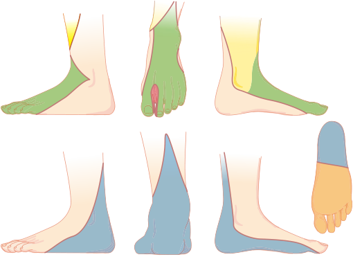

Deep peroneal nerve Tibial nerve Saphenous nerve Sural nerve Superficial peroneal nerve 

**Fig. 60.11 Cutaneous distribution of anesthesia produced by an ankle block.** (From Carron H, Korborn GA, Rowlingson JC. _Regional Anesthesia: Techniques and Clinical Applications_ . New York: Grune & Stratton; 1984.)

<!-- PDF page 27 -->

mean duration of 17 hours of analgesia with safe blood levels of local anesthetic.251

## Anesthesia for Spine Surgery

With the wide spectrum of spine disorders and an expanding array of treatment options, spinal surgeries have become increasingly prevalent over time. According to the Healthcare Cost and Utilization Project, spinal fusions and laminectomies were among the most common operations during inpatient stays in 2015, with an estimated rate of 147 and 136 per 100,000, respectively. In absolute numbers, it was estimated that an excess of 500,000 spinal fusions were performed in community hospitals alone in the United States.252 Although only less than 10% of these surgeries are currently performed in an ambulatory setting, it is expected that with technical advances and enhanced perioperative care, an increasing number of these patients will qualify for outpatient surgery. Moreover, a growing number of patients with major comorbidities are being considered for complex spine surgeries such as scoliosis correction or spinal stabilization after trauma or neoplastic diseases. The underlying cardiovascular, respiratory, or neurologic disorders in combination with the physiologic stress from a large spinal procedure places the patient at a higher risk for perioperative complications. As described earlier in this chapter, preoperative optimization of the underlying diseases and careful perioperative care that involves the surgical, anesthesia, rehabilitation, and other medical teams can minimize the risk for these complications and improve the overall outcome.

### PREOPERATIVE ASSESSMENT

The preoperative assessment for spinal surgeries should include a comprehensive evaluation of the neurologic function and possible symptoms or deficits associated with the underlying spinal disorder. The potential for difficulty in airway management should always be considered in patients with cervical and thoracic spine disease. Stability of the cervical spine and its range of motion should be assessed and documented, and the anatomic and functional relationship between the airway and the cervical column carefully considered. Video laryngoscopy or fiberoptic intubation may be needed and if awake intubation is considered, it is important to assess the patient’s ability to cooperate. A multidisciplinary preoperative conference to review the suitability of each patient and discuss the medical, surgical, anesthesia, and rehabilitation implications of the procedure can improve the quality and safety in complex spine surgery.253 In addition to a comprehensive review of the patient’s preoperative cardiovascular, pulmonary, and neurologic comorbidities, basic hematologic, hepatic, and renal values, their preoperative optimization, perioperative pain control, and rehabilitation potentials also need to be considered.

### SPINAL TRAUMA

Trauma victims with spinal cord injury (SCI) represent a group of patients with unique perioperative challenges. The incidence of nonfatal SCI is estimated to be 40 per 1 million

population in the United States, or approximately 12,000 new cases each year.254 Most injuries occur between the ages of 16 and 30. One retrospective analysis examined more than 500 patients with traumatic spinal fractures and found that 39% were caused by a high- energy fall and 26.5% by motor vehicle accidents.255 The high- energy fall etiology resulted in injuries distributed throughout the spine, whereas motor vehicle accidents most frequently impacted the cervical and thoracic spine. Twenty- five percent of patients with spinal fracture had motor and/or sensory deficits, and the highest number of patients with complete motor and sensory neurologic deficits had sustained cervical fractures. Types of fractures were distributed as follows: compression fractures in 54.8% of patients, distraction fractures in 16.9%, and rotational fractures in 18.5%. Compression fractures occur when the vertebral body cannot handle a sudden force and fractures. This commonly occurs in the setting of osteoporosis and malignancy. A wedge fracture is a subtype, which often involves the anterior collapse of the vertebral body. Burst fractures occur as a result of severe trauma, such as a motor vehicle accident. Vertebrae are crushed by an extreme force and are impacted in multiple places. Flexion–distraction fractures typically involve the middle and posterior column of the spinal column. Flexion–dislocation fractures can include any of the aforementioned fracture types and occur when the vertebrae move significantly. Anterior, middle, and posterior columns are usually involved. This is an unstable fracture. With most SCIs caused by falls or motor vehicle collisions, it is not unusual that these patients also suffer injuries to the face and airway or present with traumatic brain injury, rib fractures and lung contusions, extremity or pelvic fractures, vascular injuries, or hepatic or splenic lacerations. The initial SCI may be caused by mechanical force from bony fragments from the vertebral body, facet or intervertebral joint dislocation, ligamentous tears or herniation of intervertebral discs, or arthropathies such as spondylosis or spondylolisthesis. Following the initial injury, systemic inflammation, ischemia or hypoxia, and excitotoxicity or lipid peroxidation and apoptosis of neurons can result in progression of the neurologic symptoms and worsening outcome. If facial or cervical spine injuries are present, airway management can be particularly challenging. Unstable cervical spine injury constitutes approximately 14% of SCI cases.256 Techniques to minimize cervical movement should then be employed during management of the airway. Because of the urgent nature of airway interventions, many practitioners continue to use direct or indirect laryngoscopy with manual in- line stabilization (MILS), which applies opposite forces to the head and neck to limit the movement. The incidence of intubation- related neurologic impairment has been reported to be very low when MILS is applied during endotracheal intubation in patients with SCI.257 However, MILS can worsen laryngeal visualization during direct laryngoscopy and increase the rate of tracheal intubation failure.258 Rigid indirect video laryngoscopy is a reasonable alternative to conventional direct laryngoscopy and in skilled hands can minimize cervical motion during intubation, although studies have failed to confirm any clear advantages.259 Obviously, fiberoptic intubation is often the safest approach in patients with cervical spine instability, but clinicians must also consider

<!-- PDF page 28 -->

the patient’s ability to cooperate during an awake fiberoptic intubation, as well as the risk of aspiration if deep sedation or general anesthesia is required. Neuromuscular blockade may be needed to facilitate intubation, but it is important to consider the risk of induced hyperkalemia associated with depolarizing neuromuscular blocking agents in these patients. Succinylcholine should be avoided after the initial 48 to 72 hours following an SCI.260,261

Another important challenge in patients with SCI is systemic hypotension, which can be caused by hemorrhage from associated injuries. In addition to hypovolemia, a common cause of hypotension in patients with high cervical SCI is neurogenic or spinal shock, which is characterized by bradycardia as well as vasodilation associated with the loss of central supraspinal sympathetic control.262 If not appropriately managed, hypotension after SCI can compromise spinal cord perfusion and lead to secondary cord injury. The American Association of Neurological Surgeons (AANS) has, therefore, recommended that systemic arterial pressure be maintained at greater than 90 mm Hg for 5 to 7 days after SCI (class 3 evidence).263 Although it remains controversial, data from a Cochrane review support a 48- hour course of high- dose steroids initiated within 8 hours of injury to those patients with incomplete neurologic deficits.264

### COMMON SPINAL PROCEDURES

According to the Nationwide Inpatient Sample and the National Hospital Discharge Survey, diskectomies, spinal decompression, instrumentation, and fusion are the most frequently performed spinal procedures in the United States. Anterior cervical diskectomy is indicated in patients with spinal cord or nerve root compression from herniated disks or osteophytes. Patients often present with radiculopathy, myelopathy or, if they also suffer ligamentous laxity or disruption, cervical instability. A left- sided approach is usually preferred, as it minimizes the risk of recurrent laryngeal nerve injury. The disk is excised in a piecemeal fashion and bone graft placed in the intervertebral space with fusion performed to maintain stability, the disk height, and normal cervical lordosis. Posterior foraminotomy has the advantage that it does not require fusion and hence preserves the motion, but it is not effective for midline disk herniation and is more often associated with postoperative pain. Cervical canal stenosis or tumors may require decompressive laminectomy through a posterior approach. Obviously, the dura will need to be opened for resection of intradural masses, and it is then reasonable to avoid excessive reverse Trendelenburg, as it can increase the risk for pneumocephalus.265 After the dura is closed, its integrity can be tested with a Valsalva maneuver.

Lumbar laminotomy and laminectomy are commonly employed for decompressing the neural elements of the lumbar spine. Posterior lumbar fusion is used for treatment of low- back pain associated with segmental or iatrogenic lumbar instability and spondylolisthesis and is commonly approached through a posterolateral fusion (PLF) or posterior lumbar interbody fusion (PLIF). PLF combines decompressive laminectomy and diskectomy with PLF through decortication and bone grafting of the facet joints and transverse processes, whereas in PLIF the bone graft is packed

into the disk space between the vertebral bodies after total diskectomy and removal of the cartilaginous end plates. In both approaches, fusion is facilitated, and stability obtained through insertion of pedicle screws and a rod construct. Pedicle screw stabilization remains the preferred mode of instrumentation and provides rigid three- column fixation, but screw malposition can cause nerve- root injury. There are no major differences in clinical outcome or complication rates, but PLIF has been associated with better fusion rates and pain scores in the treatment of lumbar spondylolisthesis.266 Minimally invasive surgery (MIS) techniques are increasingly employed and include direct or extreme lateral interbody fusion (DLIF or XLIF), where the spine is approached laterally through the retroperitoneal cavity, and transaxial lumbosacral fusion (Transl) through a 1- cm incision at the base of the sacrum. Blood loss is minimal with MIS, but occult injury to peritoneal contents has been reported.

Scoliosis can be classified as congenital, neuromuscular, or idiopathic. With an incidence of 4 per 1000, idiopathic scoliosis accounts for the majority (about 80%) of cases. A Cobb angle of 10 degrees is the minimum angulation to define scoliosis, while an angle of greater than 40 to 50 degrees is considered by most to be severe enough to require corrective surgery. Restrictive lung disease and increased alveolar–arterial oxygen difference may be present, as well as pulmonary hypertension as a result of compression of pulmonary vasculature and arterial hypoxia. Formal pulmonary function studies in these patients can guide decisions regarding the extent of surgery and requirement for postoperative ventilatory support. Transthoracic echocardiography can be helpful in assessing the severity of pulmonary hypertension and right ventricular hypertrophy. Correction of spinal deformities can be associated with large intraoperative blood loss, and measures to minimize blood transfusion should be considered. Deliberate controlled hypotension has been employed to limit blood loss but must be used with caution in the older adult, those with cardiovascular disease, or those at risk for ischemic complications267 and postoperative vision loss. Antifibrinolytic agents are commonly administered to limit blood loss but may need to be avoided in some patients, such as those with a history of thromboembolic events, coronary stents, or renal impairment. TXA is more effective than aprotinin and EACA in reducing total blood loss, intraoperative blood loss, and blood transfusion.268

Scoliosis surgery has a variable but high rate of complications, with neurologic injury reported in 0.5% to 7.5% of cases.269,270 Neurologic deficits can result from migration of bone graft into the spinal canal, penetration of instrumentation, and compression of the nerve roots. Intraoperative neurophysiologic monitoring (IONM) is a valuable technique that can be used in these patients for assessment of the integrity of neuronal structures. IONM is also of value during complex spine surgeries such as revision surgeries in patients with previous thoracolumbar fusion.

### INTRAOPERATIVE NEUROPHYSIOLOGIC MONITORING

Somatosensory evoked potentials (SSEPs) have been employed since the 1970s to assess the integrity of the larger

<!-- PDF page 29 -->

fiber sensory system during scoliosis correction surgery. Nash and colleagues described a reversible loss of potentials with excessive elongation or derotation of the curve.271 It was subsequently complemented with motor evoked potential (MEP) monitoring, as clinicians found that patients could become paraplegic despite unchanged intraoperative SSEPs, which monitor conduction of signals through the dorsal column but not the corticospinal tract.272 MEPs are evoked through application of a train of high- voltage stimuli to electrodes on the surface of the head to activate motor pathways. Stimulation of the white matter produces an orthodromic nerve action potential that can be recorded as direct muscle responses (muscle MEPs) or at the spinal cord level using a flexible electrode once the laminectomy is completed and the dura opened. Direct stimulation of the corticospinal axons generates the D- waves, while stimulation of the axons of the cortico- cortical interneurons with excitatory projections to the corticospinal neurons produces indirect volleys that can be recorded as small deflections of higher threshold and longer latency (I- waves).273 Although D- wave monitoring is limited to the cervical and upper thoracic cord and requires an epidural recording electrode, it is helpful in addition to muscle MEP monitoring because it is resistant to anesthetic depression and neuromuscular blockade and has simple criteria for interpretation. A supplement to SSEP and MEP, triggered electromyography is an excellent technique for determining whether lumbar pedicle screws are properly placed. IONM has been increasingly employed for spine surgeries since its introduction in the 1970s, and is currently recommended for a number of procedures in addition to correction of spine deformities, including procedures with increased risk for SCI (e.g., resection of intramural tumors, unstable spine trauma, Chiari malformation, spinal cord vascular malformations) or risk for root damage (e.g., decompressive surgeries, tethered cord), as well as in patients with significant risk for compression neuropathies. These monitoring modalities are described in detail elsewhere (Chapter 35), but it is important to underscore the role of the anesthesiologist in providing optimal conditions for neuromonitoring, correct and timely detection of changes, and optimization of physiologic parameters to minimize risk for irreversible injuries.

In addition to the anesthetic agents, important physiologic factors such as hypotension, hypoxemia, hypothermia, and hypocarbia may lead to an attenuation of these potentials. In general, it is recommended to use total intravenous anesthesia during IONM, as volatile agents and nitrous oxide reduce the amplitude and increase the latency of the potentials in a dose- dependent manner. If volatile anesthetics are used, it is recommended to keep the concentration below half MAC and avoid any unnecessary or abrupt fluctuations. Opioids and benzodiazepines do not affect the potentials to the same extent, and ketamine or dexmedetomidine274,275 have been suggested as reasonable complements to the anesthetic regimen. Assuming that the anesthetic effects on these modalities remain unchanged and the patient’s physiologic parameters remain stable, an intraoperative loss of SSEPs or MEPs should warn the clinicians of impaired conduction through the dorsal columns or the corticospinal tracts; that is, structural damage has occurred. The damage from surgically induced spinal cord compression, distraction, or derotation of the spinal column

or spinal cord ischemia can be reversible if corrective actions are taken in a timely manner. Therefore, it is important that the surgical, neurophysiologic, and anesthesia teams work together to rapidly diagnose and correct these anatomic or physiologic disturbances. A predetermined checklist for response to IONM changes can guide the clinicians and facilitate rapid interventions aimed at diagnosing and correcting any surgical or physiologic insults. The anesthesiologist should immediately implement measures to optimize cord perfusion (optimize the hemodynamics and correct anemia, temperature and pH, and pCO2 abnormalities) and be prepared for a possible wake- up test.276 During a wakeup test, the plane of anesthesia is lightened, and the patient is instructed to make a specified motor response, usually in the lower limbs. If the patient is unable to move his or her legs, corrective measures will need to be instituted immediately. It is, nevertheless, also important to consider the limitations of the wake- up test, including the time needed to reverse any neuromuscular blockade and emerge from anesthesia, dependence on patient cooperation, and risk for complications such as inadvertent extubation, dislodgement of instrumentation, and air embolization during a deep inspiration.

### PERIOPERATIVE VISUAL LOSS

An uncommon but devastating complication after spine surgery, perioperative visual loss can be caused by anterior or posterior ischemic optic neuropathy (ION, 89% of the cases), retinal ischemia, cortical blindness, or posterior reversible encephalopathy. In a case–control examination of 80 patients with ION compared with 315 matched control subjects, the ASA Task Force on Perioperative Visual Loss identified risk factors for ION after spinal fusion surgery to be male sex, obesity, Wilson frame use, longer procedural duration, greater estimated blood loss, and lower percent colloid administration.277 The Task Force issued a detailed practice advisory to assist clinicians in the perioperative management of these patients and with the goal to reduce the frequency of perioperative visual loss.278 Included are recommendations on perioperative blood pressure management, management of fluids, anemia, and vasopressors, as well as patient positioning and staging of surgical procedures. Of note, a lack of association between deliberate hypotension and perioperative visual loss is discussed by the Task Force, and clinicians are advised to approach this consideration on a case- by- case basis. Central venous pressure monitoring should be considered in high- risk patients and colloids should be used along with crystalloids to maintain intravascular volume in patients who have substantial blood loss. There is no documented lower limit of hemoglobin concentration, but hemoglobin or hematocrit values should be monitored periodically during surgery in high- risk patients with substantial blood loss. Similarly, the decision to use α- adrenergic agonists should be made on a case- by- case basis. Direct pressure on the eye should be avoided, and patients should be positioned so that the head is level with or higher than the heart when possible. Moreover, the high- risk patient’s head should be maintained in a neutral forward position without significant neck flexion, extension, lateral flexion, or rotation when possible. Lastly, the use of staged spine surgery procedures reduces the risk

<!-- PDF page 30 -->

of perioperative visual loss and should be considered in high- risk patients.

### POSTOPERATIVE PAIN AFTER SPINAL SURGERY

Spinal procedures are associated with a high prevalence of moderate or severe postoperative pain (30%–64%).279 Timely and effective pain control in this population is important for early ambulation and can facilitate improved functional outcome. The intensity of postoperative pain is directly proportional to the number of vertebrae involved in the surgery and originates from various nociceptors and mechanoreceptors that respond to mechanical irritation, compression, or postoperative inflammation in the vertebrae, intervertebral discs, ligaments, dura, nerve root sleeves, facet joint capsules, fascia, and muscles. It is hence essential that the perioperative team has a pain control plan in place in advance of the surgery, particularly for complex spine procedures involving multiple levels and extensive tissue dissection. The patient should be informed and instructed to set realistic expectations about the type and level of postoperative pain and how to respond when it occurs.

Intravenous opioid analgesics are the most common approach to the treatment of moderate to severe postoperative pain in this group of patients. Their widespread use is, nevertheless, limited by their many side effects, importantly respiratory depression and gastrointestinal side effects. Methadone is increasingly employed in this group of patients and is reported to improve postoperative pain control even when administered as a single bolus (0.2 mg/kg) before surgical incision.280 A noncompetitive _N_ - methyld- aspartate receptor antagonist, methadone is suggested to also reduce opioid tolerance in addition to providing analgesic effects. Ketamine can be used as an adjunct to perioperative opioids and is demonstrated to reduce postoperative narcotic demand after spinal surgery.281 NSAIDs have proven efficacy in ameliorating postoperative pain following spinal surgeries,282 but their use has been limited because of concerns of their effects on bone metabolism and osteoblastic proliferation. Evidence suggests, nevertheless, that impaired bone healing may only be caused by higher doses and longer duration of NSAID administration, and smaller doses for the immediate postoperative period can be considered.283 Corticosteroids are also occasionally administered, as they are shown to reduce opioid requirements after certain spine procedures, possibly through their anti- inflammatory effects as well as the reduction in substance P release. Other options for treating the intensive postoperative pain after spinal surgery include the administration of intrathecal opioids, which has been shown to reduce the cumulative opioid demand. The use of intrathecal opioids is, nevertheless, limited by the associated risk of delayed respiratory depression, requiring close monitoring by skilled personnel. Intrathecal local anesthetic agents are usually not considered for these patients, as they affect the sensory and motor functions, masking any potential postoperative complications. In select patients, however, epidural administration of local anesthetics can provide effective analgesia without compromising the neurologic examination. The epidural catheter can be placed intraoperatively by surgeons under direct vision, and the infusion

of local anesthetics can also be initiated after a reassuring neurologic exam has been obtained. Because of the inherent effects of neuraxial anesthesia on the neurologic examination, however, most clinicians choose alternative pain management strategies. More recently, α2- adrenoreceptor antagonists including clonidine and dexmedetomidine have emerged as effective adjuncts to the aforementioned techniques, enhancing their analgesic properties. Dexmedetomidine is also reported to negate the opioid- induced hyperalgesia that may occur following intraoperative opioid treatment.284

### Acknowledgment

The editors and publisher would like to thank Drs. Ala Nozari, Christoph H. Kindler, Oleg V. Evgenov, Lane C. Crawford, Rafael Vazquez, Jason M. Lewis, and Michael K. Urban for contributing a chapter on this topic in the prior editions of this work. It has served as the foundation for the current chapter.

### Complete references available online at expertconsult.com.

### References

1.  Fingar KR, et al. _Healthcare Cost and Utilization Project (HCUP)_ ; 2014:1.

2.  McDermott KW, et al. _Healthcare Cost and Utilization Project (HCUP)_ ; 2018:1.

3.  Mattingly AS, et al. _JAMA Netw Open_ . 2021;4(12):e2138038.

4.  O’Connor CM, et al. _J Arthroplasty_ . 2020;35(7):S32.

5.  Center for Disease Control and Prevention. Osteoarthritis (OA). www.cdc.gov/arthritis/basics/osteoarthritis.htm.

6.  Jordan JM, et al. _J Rheumatol_ . 2007;34(1):172.

7.  Jordan JM, et al. _J Rheumatol_ . 2009;36(4):809.

8.  Ortman JM. _An Aging Nation: The Older Population in the United States_ . United States Census Bureau; 2014.

9.  Singh JA, et al. _J Rheumatol_ . 2019;46(9):1134.

10.  Nicholas A, et al. _J Arthroplasty_ . 2020;35(7):S45.

11.  World Population Prospects. _The 2017 Revision_ . United Nations; 2017.

12.  Murphy LB, et al. _Arthritis Care Res (Hoboken)_ . 2018;70(6):869.

13.  Delanois RE, et al. _J Arthroplasty_ . 2018;33(7):2043.

14.  Palsis JA, et al. _J Bone Joint Surg Am_ . 2018;100(4):326.

15.  Torio CM, et al. _National Inpatient Hospital Costs: The Most Expensive Conditions by PayerStatistical Brief #204 HCUP_ . Rockville (MD); 2013.

16.  Adam RF, Noble J. _J Arthroplasty_ . 1994;9(5):495.

17.  Hosick WB, et al. _Clin Orthop Relat Res_ . 1994;299:77.

18.  Newington DP, et al. _J Bone Joint Surg Br_ . 1990;72(3):450.

19.  Petersen VS, et al. _J Am Geriatr Soc_ . 1989;37(3):219.

20.  Pettine KA, et al. _Clin Orthop Relat Res_ . 1991;(266):127.

21.  Phillips TW, et al. _CMAJ_ . 1987;137(6):497.

22.  Brander VA, et al. _Clin Orthop Relat Res_ . 1997;345:67.

23.  Jones CA, et al. _Arch Intern Med_ . 2001;161(3):454.

24.  Zicat B, et al. _J Arthroplasty_ . 1993;8(4):395.

25.  Bovonratwet P, et al. _Bone Joint Lett J_ . 2018;100- B(2):143.

26.  Kendall MC, et al. _BMC Anesthesiol_ . 2021;(226).

27.  Paziuk TM, et al. _J Arthroplasty_ . 2020;35(4):955.

28.  Kristensen SD, et al. _Eur J Anaesthesiol_ . 2014;31(10):517.

29.  Gandhi R, et al. _J Arthroplasty_ . 2006;21(6):874.

30.  Mahomed NN, et al. _J Bone Joint Surg Am_ . 2005;87(6):1222.

31.  Pulido L, et al. _J Arthroplasty_ . 2008;23(6 suppl 1):139.

32.  Liu JB, et al. _Anesthesiology_ . 2018;128(2):283.

33.  Lalmohamed A, et al. _Arch Intern Med_ . 2012;172(16):1229.

34.  Mureddu GF, et al. _Monaldi Arch Chest Dis_ . 2017;87(2):848.

35.  Goldman L, et al. _N Engl J Med_ . 1977;297(16):845.

36.  Lee TH, et al. _Circulation_ . 1999;100(10):1043.

37.  Gupta PK, et al. _Circulation_ . 2011;124(4):381.

38.  Alrezk R, et al. _J Am Heart Assoc_ . 2017;6(11):e006648.

39.  Devereaux PJ, et al. _JAMA_ . 2017;317(16):1642.

<!-- PDF page 31 -->

40.  Devereaux PJ, et al. _JAMA_ . 2012;307(21):2295. 41.  Ekeloef S, et al. _Br J Anaesth_ . 2016;117(5):559. 42.  van Waes JA, et al. _Circulation_ . 2013;127(23):2264. 43.  Puelacher C, et al. _Circulation_ . 2018;137(12):1221. 44.  Kristensen SD, et al. _Eur Heart J_ . 2014;35(40):2781. 45.  Duceppe E, et al. _Can J Cardiol_ . 2017;33(1):17. 46.  Smilowitz NR, et al. _JAMA_ . 2020;324(3):279. 47.  Simonneau G, et al. _Eur Respir J_ . 2019;53(1):1801913. 48.  Simonneau G, et al. _J Am Coll Cardiol_ . 2013;62(25 suppl):D34. 49.  Price LC, et al. _Thorax_ . 2017;72(11):1035. 50.  Steppan J, et al. _Cureus_ . 2018;10(1):e2072. 51.  Kaw R, et al. _Resp Medicine_ . 2011;105(4):619. 52.  Donaldson AJ, et al. _Br J Anaesth_ . 2009;102(1):12. 53.  Memtsoudis SG, et al. _Anesth Analg_ . 2010;111(5):1110. 54.  Ramakrishna G, et al. _J Am Coll Cardiol_ . 2005;45(10):1691. 55.  Memtsoudis SG, et al. _Anesth Analg_ . 2010;111(5):1110. 56.  Makary MA, et al. _J Am Coll Surg_ . 2010;210(6):901. 57.  Walston J, et al. _J Am Geriatr Soc_ . 2006;54(6):991. 58.  Wang HT, et al. _BMC Musculoskelet Disord_ . 2018;19(1):14. 59.  Flexman AM, et al. _Spine J_ . 2016;16(11):1315. 60.  Meessen JM, et al. _Rheumatol Int_ . 2018;18(3):457. 61.  Cooper Z, et al. _J Am Geriatr Soc_ . 2016;64(12):2464. 62.  Aucoin SD, et al. _Anesthesiology_ . 2020;133(1):78. 63.  Sun X, et al. _Aging_ . 2021;13(7):190. 64.  Kim KI, et al. _Arch Gerontol Geriatr_ . 2013;56(3):507. 65.  Kim SW, et al. _JAMA Surg_ . 2014;149(7):633.

66.  Pilotto A, et al. _J Am Med Dir Assoc_ . 2017;18(2):192, e191. 67.  Zenilman ME. _JAMA Surg_ . 2014;149(7):640. 68.  Wilson H. _Open Orthop J_ . 2017;11:1181. 69.  Vasta S, et al. _J Clin Med_ . 2020;9(4):969.

70.  Simonneau G, et al. _Eur Respir J_ . 2019;53(1):1801913. 71.  Mortazavi SM, et al. _J Bone Joint Surg Am_ . 2010;92(11):2095. 72.  Selim M. _N Engl J Med_ . 2007;356(7):706. 73.  Bateman BT, et al. _Anesthesiology_ . 2009;110(2):231. 74.  Lalmohamed A, et al. _Stroke_ . 2012;43(12):3225. 75.  Lieb K, et al. _Semin Neurol_ . 2008;28(5):603. 76.  Inouye SK, et al. _J Am Coll Surg_ . 2015;220(2):136. 77.  Steiner LA. _Eur J Anaesthesiol_ . 2011;28(10):723. 78.  Kalisvaart KJ, et al. _J Am Geriatr Soc_ . 2006;54(5):817. 79.  Freter SH, et al. _Age Ageing_ . 2005;34(2):169. 80.  Kat MG, et al. _Dement Geriatr Cogn Disord_ . 2008;26:261. 81.  Culley DJ, et al. _Anesthesiology_ . 2017;127(5):765. 82.  Li T, et al. _JAMA_ . 2022;327(1):50. Erratum in: _JAMA_ . 2022; 327(12):1188.

83.  Brown CH, et al. _J Am Geriatr Soc_ . 2016;64(10):2101.

84.  Susano MJ, et al. _Anesthesiology_ . 2020;133(6):1184. 85.  Brown CH, et al. _Anesthesiology_ . 2021;135(6):992. 86.  O’Gara BP, et al. _Anesthesiology_ . 2021;135(6):1132. 87.  Falck- Ytter Y, et al. _Chest_ . 2012;141(2 suppl):e278S. 88.  Zeng Y, et al. _J Arthroplasty_ . 2014;29(12):2430. 89.  Anderson DR, et al. _N Engl J Med_ . 2018;378(8):699. 90.  Anderson DR, et al. _Ann Intern Med_ . 2013;158(11):800. 91.  Anderson DR, et al. _Blood Adv_ . 2019;3(23):3898. 92.  Zhang L, et al. _Medicine (Baltim)_ . 2020;99(29):e20954. 93.  Eskildsen SM, et al. _J Spinal Disord Tech_ . 2015;28(8):275. 94.  Mitchell AJ, et al. _J Thorac Dis_ . 2017;9(5):E461. 95.  Arnold MJ, et al. _J Fam Pract_ . 2016;65(10):702.

96.  Koenig- Oberhuber V, et al. _Br J Anaesth_ . 2016;117(suppl 2). 97.  Yurttas T, et al. _Curr Opin Anaesthesiol_ . 2017;30(4):466. 98.  Fleisher LA, et al. _Circulation_ . 2014;130(24):e278. 99.  Gurajala I. _Ann Card Anaesth_ . 2016;19(1):122. 100.  Holcomb CN, et al. _J Am Coll Cardiol_ . 2014;64(25):2730. 101.  Douketis JD, et al. _Chest_ . 2022;S0012–3692(22):01364. 102.  Cappelleri G, et al. _J Clin Anesth_ . 2016;32:224. 103.  Doherty JU, et al. _J Am Coll Cardiol_ . 2017;69(7):871. 104.  Faraoni D, et al. _Crit Care_ . 2015;19:203. 105.  Horlocker TT, et al. _Reg Anesth Pain Med_ . 2018;43(3):263. 106.  Lawrence VA, et al. _Ann Intern Med_ . 2006;144(8):596. 107.  Yakubek GA, et al. _J Arthroplasty_ . 2018;33(6):1926. 108.  Gupta RM, et al. _Mayo Clin Proc_ . 2001;76(9):897. 109.  Malcolm TL, et al. _Anesth Analg_ . 2020;130(4):917. 110.  Jo YY, et al. _J Neurosurg Anesthesiol_ . 2012;24(1):14. 111.  Soh S, et al. _J Neurosurg Anesthesiol_ . 2018;30(3):237. 112.  Smetana GW. _N Engl J Med_ . 1999;340(12):937. 113.  Smetana GW, et al. _Ann Intern Med_ . 2006;144(8):581.

114.  Johnston CE. _Spine (Phila Pa 1976)_ . 2010;35(25):2239.

115.  Brueckmann B, et al. _Anesthesiology_ . 2013;118(6):1276.

116.  Canet J, et al. _Eur J Anaesthesiol_ . 2015;32(7):458.

117.  Carlo JO, et al. _J Am Acad Orthop Surg_ . 2015;23(2):107.

118.  Abbott KC, et al. _J Nephrol_ . 2003;16(1):34.

119.  Miric A, et al. _J Arthroplasty_ . 2014;29(6):1225.

120.  Ackland GL, et al. _Anesth Analg_ . 2011;112(6):1375.

121.  Miric A, et al. _Acta Orthop_ . 2014;85(1):71.

122.  Goodnough LT, et al. _Br J Anaesth_ . 2011;106(1):13.

123.  Zacharowski K, et al. _Best Pract Res Clin Anaesthesiol_ . 2016;30(2):159.

124.  Warner MA, et al. _Anesth Analg_ . 2020;130(5):1364.

125.  Munoz M, et al. _Transfusion_ . 2014;54(2):289.

126.  Cho BC, et al. _Anesth Analg_ . 2019;128(5):981.

127.  Koscielny J, et al. _Clin Appl Thromb Hemost_ . 2004;10(3):195.

128.  Pfanner G, et al. _Anaesthesist_ . 2007;56(6):604.

129.  Elgafy H, et al. _Am J Orthop (Belle Mead NJ)_ . 2012;41(3):E46.

130.  Epstein NE. _Surg Neurol Int_ . 2017;8:66.

131.  Cross MB, et al. _J Am Acad Orthop Surg_ . 2014;22(3):193.

132.  Oresanya LB, et al. _JAMA_ . 2014;311(20):2110.

133.  Vellas B, et al. _J Nutr Health Aging_ . 2006;10(6):456.

134.  Burden S, et al. _Cochrane Database Syst Rev_ . 2012;11:CD008879.

135.  Jie B, et al. _Nutrition_ . 2012;28(10):1022.

136.  Soffin EM, et al. _Br J Anaesth_ . 2016;117(3).

137.  Wainwright TW, et al. _Physiotherapy_ . 2018;104(3):327.

138.  Alamanda VK, et al. _Curr Rev Musculoskelet Med_ . 2018;11(3):325.

139.  Simha V, et al. _JAMA_ . 2019;321(4):399.

140.  Corcoran TB, et al. _Eur J Anaesthesiol_ . 2021;38(9):932.

141.  Wasfie TJ, et al. _Am Surg_ . 2021;87(3):336.

142.  Khuri SF, et al. _Ann Surg_ . 2005;242(3):326.

143.  Halpin RJ, et al. _Spine (Phila Pa 1976)_ . 2010;35(25):2232.

144.  Barbour KE, et al. _MMWR Morb Mortal Wkly Rep_ . 2017;66(9):246.

145.  Crowson CS, et al. _Arthritis Rheum_ . 2011;63(3):633.

146.  Collins DN, et al. _Clin Orthop Relat Res_ . 1991;(272):127.

147.  Jain N, et al. _Indian J Radiol Imaging_ . 2016;26(1):108.

148.  Joaquim AF, et al. _Neurosurg Focus_ . 2015;38(4):E4.

149.  Murphy A. _Cervical Spine Series_ . 2018. Radiopaedia _._ org.

150.  Turesson C, et al. _Rheumatology (Oxford)_ . 1999;38(7):668.

151.  del Rincon ID, et al. _Arthritis Rheum_ . 2001;44(12):2737.

152.  Yazdanyar A, et al. _Arthritis Rheum_ . 2012;64(8):2429.

153.  Mushtaq S, et al. _Am J Ther_ . 2011;18(5):426.

154.  George MD, et al. _Curr Opin Rheumatol_ . 2019;31(3):300.

155.  Jacobs WB, et al. _Neurosurg Focus_ . 2008;24(1):E12.

156.  Lili X, et al. _J Neurosurg Anesthesiol_ . 2014;26(1):27.

157.  Lu PP, et al. _Can J Anaesth_ . 2001;48(10):1015.

158.  Wulf H. _Can J Anaesth_ . 1996;43(12):1260.

159.  Graham DC, et al. _Bull Rheum Dis_ . 1958;9(3):171.

160.  Papagoras C, et al. _Clin Exp Rheumatol_ . 2013;31(4):612.

161.  Baujat G, et al. _Best Pract Res Clin Rheumatol_ . 2008;22(1):3.

162.  Dubiel L, et al. _Int J Obstet Anesth_ . 2014;23(3):274. 163.  Petty RE, et al. _Textbook of Pediatric Rheumatology_ . 7th ed. Elsevier; 2016.

164.  Marini JC, et al. _Nat Rev Dis Primers_ . 2017;3:17052.

165.  Benca J, Hogan K. _Anesth Analg_ . 2009;109(4):1049.

166.  Nolan J, et al. _Anaesthesia_ . 2000;55(1):32.

167.  Delfico AJ, et al. _Dev Med Child Neurol_ . 1997;39(3):194.

168.  McComb JG. _Childs Nerv Syst_ . 2015;31(10):1641.

169.  Murphy CJ, et al. _Int J Obstet Anesth_ . 2015;24(3):252.

170.  Birnkrant DJ, et al. _Lancet Neurol_ . 2018;17(4):347.

171.  Hayes J, et al. _Paediatr Anaesth_ . 2008;18(2):100.

172.  de Boer HD, et al. _Paediatr Anaesth_ . 2009;19(12):1226.

173.  Ferguson J, et al. _Orthop Trauma_ . 2013;27(3):171.

174.  Ma L, et al. _Front Med_ . 2017;11(1):48.

175.  Cheriyan T, et al. _Spine J_ . 2015;15(4):752.

176.  Zhang F, et al. _BMC Musculoskelet Disord_ . 2014;15:448.

177.  Wang TY, et al. _World Neurosurg_ . 2015;84(6):1605.

178.  Yoo JS, et al. _Ann Transl Med_ . 2019;7(5):S172.

179.  Blacker SN, et al. _J Neurosurg Anesthesiol_ . 2022;34(3):257.

180.  Wei Z, et al. _Transfus Med_ . 2015;25(3):151.

181.  Wu Q, et al. _Eur J Orthop Surg Traumatol_ . 2015;25(3):525.

182.  Sun CX, et al. _Medicine (Baltim)_ . 2017;96(22):e7015.

183.  Wang H, et al. _Knee_ . 2014;21(6):987.

184.  Shemshaki H, et al. _Arch Orthop Trauma Surg_ . 2015;135(4):573. 185.  Chen S, et al. _BMC Musculoskelet Disord_ . 2016;17:81.

186.  Gill JB, et al. _J Bone Joint Surg Am_ . 2008;90(11):2399. 187.  Kagoma YK, et al. _Thromb Res_ . 2009;123(5):687.

<!-- PDF page 32 -->

188.  Henry DA, et al. _Cochrane Database Syst Rev_ . 2011;(1):CD001886. 189.  Poeran J, et al. _Anesthesiology_ . 2021;135(1):57.

190.  Akhtar S. _Anesthesiol Clin_ . 2009;27(3):533.

191.  Shaikh N. _J Emerg Trauma Shock_ . 2009;2(1):29.

192.  Kotyra M, et al. _Acta Anaesthesiol Scand_ . 2010;54(10):1210.

193.  Bisignani G, et al. _J Cardiovasc Med (Hagerstown)_ . 2008;9(3):277.

194.  Ereth MH, et al. _Mayo Clin Proc_ . 1992;67(11):1066.

195.  Coccolini F, et al. _World J Emerg Surg_ . 2017;12:5.

196.  Skitch S, et al. _Emerg Med Clin North Am_ . 2018;36(1):161.

197.  Martin JG, et al. _Tech Vasc Interv Radiol_ . 2017;20(4):237.

198.  Moran CG, et al. _J Bone Joint Surg Am_ . 2005;87(3):483.

199.  Moyet J, et al. _Int Orthop_ . 2019;43(6):1449.

200.  Bhandari M, et al. _N Engl J Med_ . 2017;377(21):2053.

201.  Orosz GM, et al. _JAMA_ . 2004;291(14):1738.

202.  Neuman MD, et al. _N Engl J Med_ . 2021;385(22):2025.

203.  Lin DY, et al. _Reg Anesth Pain Med_ . 2023;48(1):14.

204.  Rodgers A, et al. _BMJ_ . 2000;321(7275):1493.

205.  Mauermann WJ, et al. _Anesth Analg_ . 2006;103(4):1018.

206.  Scurrah A, et al. _Anaesthesia_ . 2018;73(6):769.

207.  Urban MK, et al. _Anesth Analg_ . 1996;82(6):1225.

208.  Mthethwa J, et al. _Musculoskelet Surg_ . 2018;102(2):119.

209.  Walker BJ, et al. _Reg Anesth Pain Med_ . 2012;37(4):393.

210.  Maricevich M, et al. _Hand (N Y)._ 2011;6(4):356.

211.  Wolfe VM, et al. _J Am Acad Orthop Surg_ . 2015;23(6):373.

212.  Niazi AU, et al. _Hand Surg_ . 2013;18(3):325.

213.  Berger A, et al. _Ann Plast Surg_ . 1985;14(1):16.

214.  Kurt E, et al. _Ann Plast Surg_ . 2005;54(1):24.

215.  Eley KA, et al. _Plast Reconstr Surg_ . 2012;130(3):564.

216.  Eley KA, et al. _Microsurgery_ . 2013;33(4):275.

217.  Naik AN, et al. _Front Pharmacol_ . 2020;11:1248.

218.  Reuben SS, et al. _Anesth Analg_ . 1995;81(1):110.

219.  Lurie SD, et al. _Reg Anesth Pain Med_ . 2000;25(5):502.

220.  Li JW, et al. _Reg Anesth Pain Med_ . 2017;42(2):233.

221.  Dingemans E, et al. _Anesth Analg_ . 2007;104(5):1275.

222.  Brull R, et al. _Can J Anaesth_ . 2009;56(11):812.

223.  Meng L, et al. _Anesthesiology_ . 2015;122(1):196.

224.  Murphy GS, et al. _Br J Anaesth_ . 2014;113(4):618.

225.  Soeding PF, et al. _Br J Anaesth_ . 2013;111(2):229.

226.  Laflam A, et al. _Anesth Analg_ . 2015;120(1):176.

227.  Hughes MS, et al. _J Bone Joint Surg Am_ . 2013;95(14):1318.

228.  Ende D, et al. _Int Orthop_ . 2016;40(10):2105.

229.  Fredrickson MJ, et al. _Anaesthesia_ . 2016;71(4):373.

230.  Singelyn FJ, et al. _Anesth Analg_ . 2004;99(2):589.

231.  Wiegel M, et al. _Reg Anesth Pain Med_ . 2017;42(3):310.

232.  Tetzlaff JE, et al. _Reg Anesth Pain Med_ . 2000;25(6):611.

233.  Okoroha KR, et al. _J Shoulder Elbow Surg_ . 2016;25(11):1742.

234.  Dhir S, et al. _J Clin Anesth_ . 2018;48:67.

235.  Pavlin DJ, et al. _Anesth Analg_ . 1998;87(4):816.

236.  Yoos JR, et al. _Anesth Analg_ . 2005;100(2):553.

237.  Abdallah FW, et al. _Anesthesiology_ . 2016;124(5):1053. 238.  Helwani MA, et al. _J Bone Joint Surg Am_ . 2015;97(3):186.

239.  Johnson RL, et al. _Br J Anaesth_ . 2016;116(2):163. 240.  Ma J, et al. _Medicine (Baltim)_ . 2016;95(52):e5701. 241.  Fang R, et al. _Orthopedics_ . 2015;38(7):e573.

242.  Busch CA, et al. _J Bone Joint Surg Am_ . 2006;88(5):959. 243.  Tsukada S, et al. _J Bone Joint Surg Am_ . 2015;97(5):367.

244.  Benzon HT, et al. _Anesthesiology_ . 2005;102(3):633. 245.  Prasad A, et al. _Reg Anesth Pain Med_ . 2010;35(3):267. 246.  Buys MJ, et al. _Anesth Analg_ . 2010;110(2):635.

247.  Monahan AM, et al. _Anesth Analg_ . 2016;122(5):1689. 248.  Davidovitch R, et al. _J Orthop Trauma_ . 2017;31(8):434. 249.  Aguirre JA, et al. _Anesthesiology_ . 2013;118(5):1198.

250.  Lopez AM, et al. _Reg Anesth Pain Med_ . 2012;37(5):554.

251.  Mineo R, et al. _Reg Anesth_ . 1992;17(1):47.

252.  McDermott KW, et al. _Healthcare Cost and Utilization Project (HCUP) Statistical Briefs_ . Agency for Healthcare Research and Quality (US); 2021.

253.  Sethi R, et al. _J Neurosurg Spine_ . 2017;26(6):744.

254.  National Spinal Cord Injury Statistical Center. _Spinal Cord Injury Facts and Figures at a Glance_ ; 2018.

255.  Leucht P, et al. _Injury_ . 2009;40(2):166.

256.  Ollerton JE, et al. _Emerg Med J_ . 2006;23(1):3.

257.  Manoach S, et al. _Ann Emerg Med_ . 2007;50(3):236.

258.  Thiboutot F, et al. _Can J Anaesth_ . 2009;56(6):412.

259.  Robitaille A, et al. _Anesth Analg_ . 2008;106(3):935.

260.  Hambly PR, et al. _Anaesthesia_ . 1998;53(3):273.

261.  Martyn JA, et al. _Anesthesiology_ . 2006;104(1):158.

262.  Wuermser LA, et al. _Arch Phys Med Rehabil_ . 2007;88(3 suppl 1):S55.

263.  Hadley MN, et al. _Neurosurgery_ . 2002;50(3 suppl):S58.

264.  Bracken MB. _Cochrane Database Syst Rev_ . 2012;1:CD001046.

265.  Pirris SM, et al. _Case Rep Neurol Med_ . 2013;2013:792168.

266.  Sakthivel RN, et al. _J Clin Exp Orthop_ . 2017;3(2:36):1.

267.  Dutton RP. _Eur Spine J_ . 2004;13(suppl 1):S66.

268.  Li G, et al. _Eur Spine J_ . 2017;26(1):140.

269.  Bartley CE, et al. _J Bone Joint Surg Am_ . 2017;99(14):1206.

270.  Weiss HR, et al. _Scoliosis_ . 2008;3:9.

271.  Nash Jr CL, et al. _Clin Orthop Relat Res_ . 1977;126:100.

272.  Lesser RP, et al. _Ann Neurol_ . 1986;19(1):22.

273.  Rothwell JC, et al. _Exp Physiol_ . 1991;76(2):159.

274.  Yang LH, et al. _Acta Neurochir (Wien)_ . 1994;127(3–4):191.

275.  Tobias JD, et al. _Paediatr Anaesth_ . 2008;18(11):1082.

276.  Vauzelle C, et al. _Clin Orthop Relat Res_ . 1973;(93):173.

277.  Postoperative Visual Loss Study Group. _Anesthesiology_ . 2012; 116(1):15.

278.  American Society of Anesthesiologists Task Force on Perioperative Visual Loss. _Anesthesiology_ . 2012;116(2):274.

279.  Sommer M, et al. _Eur J Anaesthesiol_ . 2008;25(4):267.

280.  Gottschalk A, et al. _Anesth Analg_ . 2011;112(1):218.

281.  Loftus RW, et al. _Anesthesiology_ . 2010;113(3):639.

282.  Reuben SS, et al. _Reg Anesth_ . 1997;22(4):343.

283.  Reuben SS, et al. _Can J Anaesth_ . 2005;52(5):506. 284.  Hwang W, et al. _BMC Anesthesiol_ . 2015;15:21.

<!-- PDF page 33 -->

### References

1.  Fingar KR, Stocks C, Weiss AJ, Steiner CA. Most frequent operating room procedures performed in U.S. hospitals, 2003–2012. _Healthcare Cost and Utilization Project HCUP_ . 2014:1–15. Agency for Healthcare Research and Quality AHRQ.

2.  McDermott KW, Liang L. Overview of operating room procedures during inpatient stays in U.S. hospitals, 2018. _Healthcare Cost and Utilization Project HCUP_ . Agency for Healthcare Research and Quality AHRQ; 2018:1–18.

3.  Mattingly AS, Rose L, Eddington HS, et al. Trends in US surgical procedures and health care system response to policies curtailing elective surgical operations during the COVID- 19 pandemic. _JAMA Netw Open_ . 2021;4(12):e2138038.

4.  O’Connor CM, Anoushiravani AA, DiCaprio MR, et al. Economic recovery after the COVID- 19 pandemic: resuming elective orthopedic surgery and total joint arthroplasty. _J Arthroplasty_ . 2020;35(7):S32–S36.

5.  Center for Disease Control and Prevention (CDC). Osteoarthritis (OA). https://www.cdc.gov/arthritis/basics/osteoarthritis.htm.

6.  Jordan JM, Helmick CG, Renner JB, et al. Prevalence of knee symptoms and radiographic and symptomatic knee osteoarthritis in African Americans and Caucasians: the Johnston County Osteoarthritis Project. _J Rheumatol_ . 2007;34(1):172–180.

7.  Jordan JM, Helmick CG, Renner JB, et al. Prevalence of hip symptoms and radiographic and symptomatic hip osteoarthritis in African Americans and Caucasians: the Johnston County Osteoarthritis Project. _J Rheumatol_ . 2009;36(4):809–815.

8.  Ortman JM, Velkoff VA, Hogan H. _An Aging Nation: The Older Population in the United States_ . United States Census Bureau; 2014. htt ps://www.census.gov/library/publications/2014/demo/p251140.html.

9.  Singh JA, Yu S, Chen L, Cleveland JD. Rates of total joint replacement in the United States: future projections to 2020- 2040 using the National Inpatient Sample. _J Rheumatol_ . 2019;46(9):1134–1140.

10.  Bedard NA, Elkins JM, Brown TS. Effect of COVID- 19 on hip and knee arthroplasty surgical volume in the United States. _J Arthroplasty_ . 2020;35(7):S45–S48.

11.  World Population Prospects. _The 2017 Revision_ . United Nations: Department of Economic and Social Affairs, Population Division; 2017. https://esa.un.org/unpd/wpp/Publications/Files/WPP2017 _Volume- I_Comprehensive- Tables.pdf.

12.  Murphy LB, Cisternas MG, Pasta DJ, et al. Medical expenditures and earnings losses among US adults with arthritis in 2013. _Arthritis Care Res (Hoboken)_ . 2018;70(6):869–876.

13.  Delanois RE, Gwam CU, Cherian JJ, et al. Global budget revenue on a single institution’s costs and outcomes in patients undergoing total hip arthroplasty. _J Arthroplasty_ . 2018;33(7):2043–2046.

14.  Palsis JA, Brehmer TS, Pellegrini VD, et al. The cost of joint replacement: comparing two approaches to evaluating costs of total hip and knee arthroplasty. _J Bone Joint Surg Am_ . 2018;100(4):326– 333.

15.  Torio CM, Moore BJ. _National Inpatient Hospital Costs: The Most Expensive Conditions by Payer. Statistical Brief #204 HCUP_ . Rockville (MD): Agency for Healthcare Research and Quality (US); 2013. https://w ww.ncbi.nlm.nih.gov/books/NBK368492/.

16.  Adam RF, Noble J. Primary total knee arthroplasty in the elderly. _J Arthroplasty_ . 1994;9(5):495–497.

17.  Hosick WB, Lotke PA, Baldwin A. Total knee arthroplasty in patients 80 years of age and older. _Clin Orthop Relat Res_ . 1994;299:77–80.

18.  Newington DP, Bannister GC, Fordyce M. Primary total hip replacement in patients over 80 years of age. _J Bone Joint Surg Br_ . 1990;72(3):450–452.

19.  Petersen VS, Solgaard S, Simonsen B. Total hip replacement in patients aged 80 years and older. _J Am Geriatr Soc_ . 1989;37(3):219– 222.

20.  Pettine KA, Aamlid BC, Cabanela ME. Elective total hip arthroplasty in patients older than 80 years of age. _Clin Orthop Relat Res_ . 1991;(266):127–132.

21.  Phillips TW, Grainger RW, Cameron HS, Bruce L. Risks and benefits of elective hip replacement in the octogenarian. _CMAJ_ . 1987;137(6):497–500.

22.  Brander VA, Malhotra S, Jet J, et al. Outcome of hip and knee arthroplasty in persons aged 80 years and older. _Clin Orthop Relat Res_ . 1997;(345):67–78.

23.  Jones CA, Voaklander DC, Johnston DW, Suarez- Almazor ME. The effect of age on pain, function, and quality of life after total hip and knee arthroplasty. _Arch Intern Med_ . 2001;161(3):454–460.

24.  Zicat B, Rorabeck CH, Bourne RB, et al. Total knee arthroplasty in the octogenarian. _J Arthroplasty_ . 1993;8(4):395–400.

25.  Bovonratwet P, Malpani R, Ottesen TD, et al. Aseptic revision total hip arthroplasty in the elderly :quantifying the risks for patients over 80 years old. _Bone Joint Lett J_ . 2018;100- B(2):143–151.

26.  Kendall MC, Cohen AD, Principe- Marrero S, et al. Spinal versus general anesthesia for patients undergoing outpatient total knee arthroplasty: a national propensity matched analysis of early postoperative outcomes. _BMC Anesthesiol_ . 2021;21:226.

27.  Paziuk TM, Luzzi AJ, Fleischman AN, et al. General vs spinal anesthesia for total joint arthroplasty: a single- institution observational review. _J Arthroplasty_ . 2020;35(4):955–959.

28.  Kristensen SD, Knuuti J, Saraste A, et al. 2014 ESC/ESA Guidelines on non- cardiac surgery: cardiovascular assessment and management: the Joint Task Force on non- cardiac surgery: cardiovascular assessment and management of the European Society of Cardiology (ESC) and the European Society of Anaesthesiology (ESA). _Eur J Anaesthesiol_ . 2014;31(10):517–573.

29.  Gandhi R, Petruccelli D, Devereaux PJ, et al. Incidence and timing of myocardial infarction after total joint arthroplasty. _J Arthroplasty_ . 2006;21(6):874–877.

30.  Mahomed NN, Barrett J, Katz JN, et al. Epidemiology of total knee replacement in the United States Medicare population. _J Bone Joint Surg Am_ . 2005;87(6):1222–1228.

31.  Pulido L, Parvizi J, Macgibeny M, et al. Hospital complications after total joint arthroplasty. _J Arthroplasty_ . 2008;23(6 suppl 1):139– 145.

32.  Liu JB, Liu Y, Cohen ME, et al. Defining the intrinsic cardiac risks of operations to improve preoperative cardiac risk assessments. _Anesthesiology_ . 2018;128(2):283–292.

33.  Lalmohamed A, Vestergaard P, Klop C, et al. Timing of acute myocardial infarction in patients undergoing total hip or knee replacement: a nationwide cohort study. _Arch Intern Med_ . 2012;172(16):1229– 1235.

34.  Mureddu GF. Current multivariate risk scores in patients undergoing non- cardiac surgery. _Monaldi Arch Chest Dis_ . 2017;87(2):848.

35.  Goldman L, Caldera DL, Nussbaum SR, et al. Multifactorial index of cardiac risk in noncardiac surgical procedures. _N Engl J Med_ . 1977;297(16):845–850.

36.  Lee TH, Marcantonio ER, Mangione CM, et al. Derivation and prospective validation of a simple index for prediction of cardiac risk of major noncardiac surgery. _Circulation_ . 1999;100(10):1043–1049.

37.  Gupta PK, Gupta H, Sundaram A, et al. Development and validation of a risk calculator for prediction of cardiac risk after surgery. _Circulation_ . 2011;124(4):381–387.

38.  Alrezk R, Jackson N, Al Rezk M, et al. Derivation and validation of a geriatric- sensitive perioperative cardiac risk index. _J Am Heart Assoc_ . 2017;6(11):e006648.

39.  Devereaux PJ, Biccard BM, Sigamani A, et al. Association of postoperative high- sensitivity troponin levels with myocardial injury and 30- day mortality among patients undergoing noncardiac surgery. _JAMA_ . 2017;317(16):1642–1651.

40.  Devereaux PJ, Chan MT, Alonso- Coello P, et al. Association between postoperative troponin levels and 30- day mortality among patients undergoing noncardiac surgery. _JAMA_ . 2012;307(21):2295– 2304.

41.  Ekeloef S, Alamili M, Devereaux PJ, Gogenur I. Troponin elevations after non- cardiac, non- vascular surgery are predictive of major adverse cardiac events and mortality: a systematic review and metaanalysis. _Br J Anaesth_ . 2016;117(5):559–568.

42.  van Waes JA, Nathoe HM, de Graaff JC, et al. Myocardial injury after noncardiac surgery and its association with short- term mortality. _Circulation_ . 2013;127(23):2264–2271.

43.  Puelacher C, Lurati Buse G, Seeberger D, et al. Perioperative myocardial injury after noncardiac surgery: incidence, mortality, and characterization. _Circulation_ . 2018;137(12):1221–1232.

44.  Kristensen SD, Knuuti J, Nicholls M. Cardiopulse articles. _Eur Heart J_ . 2014;35(40):2781–2788.

45.  Duceppe E, Parlow J, MacDonald P, et al. Canadian Cardiovascular Society Guidelines on perioperative cardiac risk assessment and management for patients who undergo noncardiac surgery. _Can J Cardiol_ . 2017;33(1):17–32.

<!-- PDF page 34 -->

46.  Smilowitz NR, Berger JS. Perioperative cardiovascular risk assessment and management for noncardiac surgery. _JAMA_ . 2020;324(3):279–290.

47.  Simonneau G, Montani D, Celermajer DS, et al. Haemodynamic definitions and updated clinical classification of pulmonary hypertension. _Eur Respir J_ . 2019;53(1):1801913.

48.  Simonneau G, Gatzoulis MA, Adatia I, et al. Updated clinical classification of pulmonary hypertension. _J Am Coll Cardiol_ . 2013;62(25 suppl):D34–41.

49.  Price LC, Dimopoulos K, Marino P, et al. The CRASH report: emergency management dilemmas facing acute physicians in patients with pulmonary arterial hypertension. _Thorax_ . 2017;72(11):1035– 1045.

50.  Steppan J, Diaz- Rodriguez N, Barodka VM, et al. Focused review of perioperative care of patients with pulmonary hypertension and proposal of a perioperative pathway. _Cureus_ . 2018;10(1):e2072.

51.  Kaw R, Pasupuleti V, Deshpande A, et al. Pulmonary hypertension: an important predictor of outcomes in patients undergoing noncardiac surgery. _Resp Medicine_ . 2011;105(4):619–624.

52.  Donaldson AJ, Thomson HE, Harper NJ, Kenny NW. Bone cement implantation syndrome. _Br J Anaesth_ . 2009;102(1):12–22.

53.  Memtsoudis SG, Ma Y, Chiu YL, et al. Perioperative mortality in patients with pulmonary hypertension undergoing major joint replacement. _Anesth Analg_ . 2010;111(5):1110–1116.

54.  Ramakrishna G, Sprung J, Ravi BS, et al. Impact of pulmonary hypertension on the outcomes of noncardiac surgery: predictors of perioperative morbidity and mortality. _J Am Coll Cardiol_ . 2005;45(10):1691–1699.

55.  Memtsoudis SG, Ma Y, Chiu YL, et al. Perioperative mortality in patients with pulmonary hypertension undergoing major joint replacement. _Anesth Analg_ . 2010;111(5):1110–1116.

56.  Makary MA, Segev DL, Pronovost PJ, et al. Frailty as a predictor of surgical outcomes in older patients. _J Am Coll Surg_ . 2010;210(6):901–908.

57.  Walston J, Hadley EC, Ferrucci L, et al. Research agenda for frailty in older adults: toward a better understanding of physiology and etiology: summary from the American Geriatrics Society/National Institute on Aging Research Conference on Frailty in Older Adults. _J Am Geriatr Soc_ . 2006;54(6):991–1001.

58.  Wang HT, Fafard J, Ahern S, et al. Frailty as a predictor of hospital length of stay after elective total joint replacements in elderly patients. _BMC Musculoskelet Disord_ . 2018;19(1):14.

59.  Flexman AM, Charest- Morin R, Stobart L, et al. Frailty and postoperative outcomes in patients undergoing surgery for degenerative spine disease. _Spine J_ . 2016;16(11):1315–1323.

60.  Meessen JM, Leichtenberg CS, Tilbury C, et al. Frailty in end- stage hip or knee osteoarthritis: validation of the Groningen Frailty Indicator (GFI) questionnaire. _Rheumatol Int_ . 2018;18(3):457–466.

61.  Cooper Z, Rogers Jr SO, Ngo L, et al. Comparison of frailty measures as predictors of outcomes after orthopedic surgery. _J Am Geriatr Soc_ . 2016;64(12):2464–2471.

62.  Aucoin SD, Hao M, Sohi R, et al. Accuracy and feasibility of clinically applied frailty instruments before surgery: a systematic review and meta- analysis. _Anesthesiology_ . 2020;133(1):78–95.

63.  Sun X, Shen Y, Ji M, et al. Frailty is an independent risk factor of oneyear mortality after elective orthopedic surgery: a prospective cohort study. _Aging_ . 2021;13(7):190–7198.

64.  Kim KI, Park KH, Koo KH, et al. Comprehensive geriatric assessment can predict postoperative morbidity and mortality in elderly patients undergoing elective surgery. _Arch Gerontol Geriatr_ . 2013;56(3):507– 512.

65.  Kim SW, Han HS, Jung HW, et al. Multidimensional frailty score for the prediction of postoperative mortality risk. _JAMA Surg_ . 2014;149(7):633–640.

66.  Pilotto A, Cella A, Pilotto A, et al. Three decades of comprehensive geriatric assessment: evidence coming from different healthcare settings and specific clinical conditions. _J Am Med Dir Assoc_ . 2017;18(2):192, e191–192.

67.  Zenilman ME. More powerful than the American Society of Anesthesiology Score. _JAMA Surg_ . 2014;149(7):640–641.

68.  Wilson H. Orthogeriatrics in hip fracture. _Open Orthop J_ . 2017;11:1181–1189.

69.  Vasta S, Papalia R, Torre G, et al. The influence of preoperative physical activity on postoperative outcomes of knee and hip arthroplasty surgery in the elderly: a systematic review. _J Clin Med_ . 2020;9(4):969.

70.  Simonneau G, Montani D, Celermajer DS, et al. Haemodynamic definitions and updated clinical classification of pulmonary hypertension. _Eur Respir J_ . 2019;53(1):1801913.

71.  Mortazavi SM, Kakli H, Bican O, et al. Perioperative stroke after total joint arthroplasty: prevalence, predictors, and outcome. _J Bone Joint Surg Am_ . 2010;92(11):2095–2101.

72.  Selim M. Perioperative stroke. _N Engl J Med_ . 2007;356(7):706–713.

73.  Bateman BT, Schumacher HC, Wang S, et al. Perioperative acute ischemic stroke in noncardiac and nonvascular surgery: incidence, risk factors, and outcomes. _Anesthesiology_ . 2009;110(2):231–238.

74.  Lalmohamed A, Vestergaard P, Cooper C, et al. Timing of stroke in patients undergoing total hip replacement and matched controls: a nationwide cohort study. _Stroke_ . 2012;43(12):3225–3229.

75.  Lieb K, Selim M. Preoperative evaluation of patients with neurological disease. _Semin Neurol_ . 2008;28(5):603–610.

76.  Inouye SK, Robinson T, Blaum C, et al. Postoperative delirium in older adults: best practice statement from the American Geriatrics Society. _J Am Coll Surg_ . 2015;220(2):136–148.e131.

77.  Steiner LA. Postoperative delirium. Part 2: detection, prevention and treatment. _Eur J Anaesthesiol_ . 2011;28(10):723–732.

78.  Kalisvaart KJ, Vreeswijk R, de Jonghe JF, et al. Risk factors and prediction of postoperative delirium in elderly hip- surgery patients: implementation and validation of a medical risk factor model. _J Am Geriatr Soc_ . 2006;54(5):817–822.

79.  Freter SH, Dunbar MJ, MacLeod H, et al. Predicting post- operative delirium in elective orthopaedic patients: the Delirium Elderly AtRisk (DEAR) instrument. _Age Ageing_ . 2005;34(2):169–171.

80.  Kat MG, Vreeswijk R, de Jonghe JF, et al. Long- term cognitive outcome of delirium in elderly hip surgery patients. A prospective matched controlled study over two and a half years. _Dement Geriatr Cogn Disord_ . 2008;26:261–268.

81.  Culley DJ, Flaherty D, Fahey MC, et al. Poor performance on a preoperative cognitive screening test predicts postoperative complications in older orthopedic surgical patients. _Anesthesiology_ . 2017;127(5):765–774.

82.  Li T, Li J, Yuan L; RAGA Study Investigators, et al. Effect of regional vs general anesthesia on incidence of postoperative delirium in older patients undergoing hip fracture surgery: the RAGA randomized trial. _JAMA_ . 2022;327(1):50–58. Erratum in: _JAMA_ . 2022;327(12):1188.

83.  Brown CH, LaFlam A, Max L, et al. Delirium after spine surgery in older adults: incidence, risk factors, and outcomes. _J Am Geriatr Soc_ . 2016;64(10):2101–2108.

84.  Susano MJ, Grasfield RH, Friese M, et al. Brief preoperative screening for frailty and cognitive impairment predicts delirium after spine surgery. _Anesthesiology_ . 2020;133(6):1184–1191.

85.  Brown CH, Edwards C, Lin C, et al. Spinal anesthesia with targeted sedation based on bispectral index values compared with general anesthesia with masked bispectral index values to reduce delirium: the SHARP randomized controlled trial. _Anesthesiology_ . 2021;135(6):992–1003.

86.  O’Gara BP, Gao L, Marcantonio ER, Subramaniam B. Sleep, pain, and cognition: modifiable targets for optimal perioperative brain health. _Anesthesiology_ . 2021;135(6):1132–1152.

87.  Falck- Ytter Y, Francis CW, Johanson NA, et al. Prevention of VTE in orthopedic surgery patients: antithrombotic therapy and prevention of thrombosis, 9th ed: American College of Chest Physicians evidence- based clinical practice guidelines. _Chest_ . 2012;141(2 suppl):e278S–e325S.

88.  Zeng Y, Shen B, Yang J, et al. Preoperative comorbidities as potential risk factors for venous thromboembolism after joint arthroplasty: a systematic review and meta- analysis of cohort and case- control studies. _J Arthroplasty_ . 2014;29(12):2430–2438.

89.  Anderson DR, Dunbar M, Murnaghan J, et al. Aspirin or rivaroxaban for VTE prophylaxis after hip or knee arthroplasty. _N Engl J Med_ . 2018;378(8):699–707.

90.  Anderson DR, Dunbar MJ, Bohm ER, et al. Aspirin versus lowmolecular- weight heparin for extended venous thromboembolism prophylaxis after total hip arthroplasty: a randomized trial. _Ann Intern Med_ . 2013;158(11):800–806.

91.  Anderson DR, Morgano GP, Bennett C, et al. American Society of Hematology 2019 guidelines for management of venous thromboembolism: prevention of venous thromboembolism in surgical hospitalized patients. _Blood Adv_ . 2019;3(23):3898–3944.

<!-- PDF page 35 -->

92.  Zhang L, Cao H, Chen Y, Jiao G. Risk factors for venous thromboembolism following spinal surgery: a meta- analysis. _Medicine (Baltim)_ . 2020;99(29):e20954.

93.  Eskildsen SM, Moll S, Lim MR. An algorithmic approach to venous thromboembolism prophylaxis in spine surgery. _J Spinal Disord Tech_ . 2015;28(8):275–281.

94.  Mitchell AJ, Gillies MA, Cruden NL. Non- cardiac surgery following drug- eluting coronary stent implantation – a question of timing? _J Thorac Dis_ . 2017;9(5):E461–E464.

95.  Arnold MJ, Beer J. Preoperative evaluation: a time- saving algorithm. _J Fam Pract_ . 2016;65(10):702–710.

96.  Koenig- Oberhuber V, Filipovic M. New antiplatelet drugs and new oral anticoagulants. _Br J Anaesth_ . 2016;117(suppl 2):ii74–ii84.

97.  Yurttas T, Wanner PM, Filipovic M. Perioperative management of antithrombotic therapies. _Curr Opin Anaesthesiol_ . 2017;30(4):466– 473.

98.  Fleisher LA, Fleischmann KE, Auerbach AD, et al. 2014 ACC/AHA guideline on perioperative cardiovascular evaluation and management of patients undergoing noncardiac surgery: a report of the American College of Cardiology/American Heart Association Task Force on Practice Guidelines. _Circulation_ . 2014;130(24):e278– e333.

99.  Gurajala I, Gopinath R. Perioperative management of patient with intracoronary stent presenting for noncardiac surgery. _Ann Card Anaesth_ . 2016;19(1):122–131.

100.  Holcomb CN, Graham LA, Richman JS, et al. The incremental risk of noncardiac surgery on adverse cardiac events following coronary stenting. _J Am Coll Cardiol_ . 2014;64(25):2730–2739.

101.  Douketis JD, Spyropoulos AC, Murad MH, et al. Perioperative management of antithrombotic therapy: an American College of Chest Physicians clinical practice guideline executive summary. _Chest_ . 2022;S0012–3692(22)01364- 2.

102.  Cappelleri G, Fanelli A. Use of direct oral anticoagulants with regional anesthesia in orthopedic patients. _J Clin Anesth_ . 2016;32:224–235.

103.  Doherty JU, Gluckman TJ, Hucker WJ, et al. 2017 ACC expert consensus decision pathway for periprocedural management of anticoagulation in patients with nonvalvular atrial fibrillation: a report of the American College of Cardiology clinical expert consensus document task force. _J Am Coll Cardiol_ . 2017;69(7):871–898.

104.  Faraoni D, Levy JH, Albaladejo P, et al. Updates in the perioperative and emergency management of non- vitamin K antagonist oral anticoagulants. _Crit Care_ . 2015;19:203.

105.  Horlocker TT, Vandermeuelen E, Kopp SL, et al. Regional anesthesia in the patient receiving antithrombotic or thrombolytic therapy: American Society of Regional Anesthesia and Pain Medicine evidence- based guidelines (fourth edition). _Reg Anesth Pain Med_ . 2018;43(3):263–309.

106.  Lawrence VA, Cornell JE, Smetana GW. Strategies to reduce postoperative pulmonary complications after noncardiothoracic surgery: systematic review for the American College of Physicians. _Ann Intern Med_ . 2006;144(8):596–608.

107.  Yakubek GA, Curtis GL, Sodhi N, et al. Chronic obstructive pulmonary disease is associated with short- term complications following total hip arthroplasty. _J Arthroplasty_ . 2018;33(6):1926–1929.

108.  Gupta RM, Parvizi J, Hanssen AD, Gay PC. Postoperative complications in patients with obstructive sleep apnea syndrome undergoing hip or knee replacement: a case- control study. _Mayo Clin Proc_ . 2001;76(9):897–905.

109.  Malcolm TL, Knezevic NN, Zouki CC, Tharian AR. Pulmonary complications after hip and knee arthroplasty in the United States, 2004–2014. _Anesth Analg_ . 2020;130(4):917–924.

110.  Jo YY, Kim JY, Kwak YL, et al. The effect of pressure- controlled ventilation on pulmonary mechanics in the prone position during posterior lumbar spine surgery: a comparison with volume- controlled ventilation. _J Neurosurg Anesthesiol_ . 2012;24(1):14–18.

111.  Soh S, Shim JK, Ha Y, et al. Ventilation with high or low tidal volume with PEEP does not influence lung function after spinal surgery in prone position: a randomized controlled trial. _J Neurosurg Anesthesiol_ . 2018;30(3):237–245.

112.  Smetana GW. Preoperative pulmonary evaluation. _N Engl J Med_ . 1999;340(12):937–944.

113.  Smetana GW, Lawrence VA, Cornell JE. Preoperative pulmonary risk stratification for noncardiothoracic surgery: systematic review for the American College of Physicians. _Ann Intern Med_ . 2006;144(8):581–595.

114.  Johnston CE. Preoperative medical and surgical planning for early onset scoliosis. _Spine_ . 2010;35(25):2239–2244.

115.  Brueckmann B, Villa- Uribe JL, Bateman BT, et al. Development and validation of a score for prediction of postoperative respiratory complications. _Anesthesiology_ . 2013;118(6):1276–1285.

116.  Canet J, Sabate S, Mazo V, et al. Development and validation of a score to predict postoperative respiratory failure in a multicentre European cohort: a prospective, observational study. _Eur J Anaesthesiol_ . 2015;32(7):458–470.

117.  Carlo JO, Phisitkul P, Phisitkul K, et al. Perioperative implications of end- stage renal disease in orthopaedic surgery. _J Am Acad Orthop Surg_ . 2015;23(2):107–118.

118.  Abbott KC, Bucci JR, Agodoa LY. Total hip arthroplasty in chronic dialysis patients in the United States. _J Nephrol_ . 2003;16(1):34–39.

119.  Miric A, Inacio MC, Namba RS. The effect of chronic kidney disease on total hip arthroplasty. _J Arthroplasty_ . 2014;29(6):1225–1230.

120.  Ackland GL, Moran N, Cone S, et al. Chronic kidney disease and postoperative morbidity after elective orthopedic surgery. _Anesth Analg_ . 2011;112(6):1375–1381.

121.  Miric A, Inacio MC, Namba RS. Can total knee arthroplasty be safely performed in patients with chronic renal disease? _Acta Orthop_ . 2014;85(1):71–78.

122.  Goodnough LT, Maniatis A, Earnshaw P, et al. Detection, evaluation, and management of preoperative anaemia in the elective orthopaedic surgical patient: NATA guidelines. _Br J Anaesth_ . 2011;106(1):13–22.

123.  Zacharowski K, Spahn DR. Patient blood management equals patient safety. _Best Pract Res Clin Anaesthesiol_ . 2016;30(2):159–169.

124.  Warner MA, Shore- Lesserson L, Shander A, et al. Perioperative anemia: prevention, diagnosis, and management throughout the spectrum of perioperative care. _Anesth Analg_ . 2020;130(5):1364–1380.

125.  Munoz M, Gomez- Ramirez S, Cuenca J, et al. Very- short- term perioperative intravenous iron administration and postoperative outcome in major orthopedic surgery: a pooled analysis of observational data from 2547 patients. _Transfusion_ . 2014;54(2):289–299.

126.  Cho BC, Serini J, Zorrilla- Vaca A, et al. Impact of preoperative erythropoietin on allogeneic blood transfusions in surgical patients: results from a systematic review and meta- analysis. _Anesth Analg_ . 2019;128(5):981–992.

127.  Koscielny J, Ziemer S, Radtke H, et al. A practical concept for preoperative identification of patients with impaired primary hemostasis. _Clin Appl Thromb Hemost_ . 2004;10(3):195–204.

128.  Pfanner G, Koscielny J, Pernerstorfer T, et al. Preoperative evaluation of the bleeding history. Recommendations of the working group on perioperative coagulation of the Austrian Society for Anaesthesia, Resuscitation and Intensive Care. _Anaesthesist_ . 2007;56(6):604–611.

129.  Elgafy H, O’Brien P, Blessinger B, Hassan A. Challenges of spine surgery in obese patients. _Am J Orthop (Belle Mead NJ)_ . 2012;41(3): E46–50.

130.  Epstein NE. More risks and complications for elective spine surgery in morbidly obese patients. _Surg Neurol Int_ . 2017;8:66.

131.  Cross MB, Yi PH, Thomas CF, et al. Evaluation of malnutrition in orthopaedic surgery. _J Am Acad Orthop Surg_ . 2014;22(3):193–199.

132.  Oresanya LB, Lyons WL, Finlayson E. Preoperative assessment of the older patient: a narrative review. _JAMA_ . 2014;311(20):2110– 2120.

133.  Vellas B, Villars H, Abellan G, et al. Overview of the MNA – Its history and challenges. _J Nutr Health Aging_ . 2006;10(6):456–463, discussion 463–465.

134.  Burden S, Todd C, Hill J, Lal S. Pre- operative nutrition support in patients undergoing gastrointestinal surgery. _Cochrane Database Syst Rev_ . 2012;11:CD008879.

135.  Jie B, Jiang ZM, Nolan MT, et al. Impact of preoperative nutritional support on clinical outcome in abdominal surgical patients at nutritional risk. _Nutrition_ . 2012;28(10):1022–1027.

136.  Soffin EM, YaDeau JT. Enhanced recovery after surgery for primary hip and knee arthroplasty: a review of the evidence. _Br J Anaesth_ . 2016;117(3):iii62–iii72.

137.  Wainwright TW, Burgess LC. To what extent do current total hip and knee replacement patient information resources adhere to enhanced recovery after surgery principles? _Physiotherapy_ . 2018;104(3):327– 337.

138.  Alamanda VK, Springer BD. Perioperative and modifiable risk factors for periprosthetic joint infections (PJI) and recommended guidelines. _Curr Rev Musculoskelet Med_ . 2018;11(3):325–331.

<!-- PDF page 36 -->

139.  Simha V, Shah P. Perioperative glucose control in patients with diabetes undergoing elective surgery. _JAMA_ . 2019;321(4):399–400.

140.  Corcoran TB, O’Loughlin E, Chan MTV, Ho KM. Perioperative ADministration of Dexamethasone And blood Glucose concentrations in patients undergoing elective non- cardiac surgery – the randomized controlled PADDAG trial. _Eur J Anaesthesiol_ . 2021;38(9):932–942.

141.  Wasfie TJ, Groton J, Cwalina N, et al. Efficacy of preoperative usage of dexamethasone in diabetic patients undergoing total hip or knee arthroplasty for control of nausea and vomiting. _Am Surg_ . 2021;87(3):336–340.

142.  Khuri SF, Henderson WG, DePalma RG, et al. Determinants of longterm survival after major surgery and the adverse effect of postoperative complications. _Ann Surg_ . 2005;242(3):326–341; discussion 341–343.

143.  Halpin RJ, Sugrue PA, Gould RW, et al. Standardizing care for highrisk patients in spine surgery: the Northwestern High- Risk Spine Protocol. _Spine (Phila Pa 1976)_ . 2010;35(25):2232–2238.

144.  Barbour KE, Helmick CG, Boring M, Brady TJ. Vital signs: prevalence of doctor- diagnosed arthritis and arthritis- attributable activity limitation – United States, 2013- 2015. _MMWR Morb Mortal Wkly Rep_ . 2017;66(9):246–253.

145.  Crowson CS, Matteson EL, Myasoedova E, et al. The lifetime risk of adult- onset rheumatoid arthritis and other inflammatory autoimmune rheumatic diseases. _Arthritis Rheum_ . 2011;63(3):633–639.

146.  Collins DN, Barnes CL, FitzRandolph RL. Cervical spine instability in rheumatoid patients having total hip or knee arthroplasty. _Clin Orthop Relat Res_ . 1991;(272):127–135.

147.  Jain N, Verma R, Garga UC, et al. CT and MR imaging of odontoid abnormalities: a pictorial review. _Indian J Radiol Imaging_ . 2016;26(1):108–119.

148.  Joaquim AF, Ghizoni E, Tedeschi H, et al. Radiological evaluation of cervical spine involvement in rheumatoid arthritis. _Neurosurg Focus_ . 2015;38(4):E4.

149.  Murphy A. _Cervical Spine Series_ ; 2018. Reference article. Radiopaedia _._ org.

150.  Turesson C, Jacobsson L, Bergstrom U. Extra- articular rheumatoid arthritis: prevalence and mortality. _Rheumatology (Oxford)_ . 1999;38(7):668–674.

151.  del Rincon ID, Williams K, Stern MP, et al. High incidence of cardiovascular events in a rheumatoid arthritis cohort not explained by traditional cardiac risk factors. _Arthritis Rheum_ . 2001;44(12):2737– 2745.

152.  Yazdanyar A, Wasko MC, Kraemer KL, Ward MM. Perioperative allcause mortality and cardiovascular events in patients with rheumatoid arthritis: comparison with unaffected controls and persons with diabetes mellitus. _Arthritis Rheum_ . 2012;64(8):2429–2437.

153.  Mushtaq S, Goodman SM, Scanzello CR. Perioperative management of biologic agents used in treatment of rheumatoid arthritis. _Am J Ther_ . 2011;18(5):426–434.

154.  George MD, Baker JF. Perioperative management of immunosuppression in patients with rheumatoid arthritis. _Curr Opin Rheumatol_ . 2019;31(3):300–306.

155.  Jacobs WB, Fehlings MG. Ankylosing spondylitis and spinal cord injury: origin, incidence, management, and avoidance. _Neurosurg Focus_ . 2008;24(1):E12.

156.  Lili X, Zhiyong H, Jianjun S. A comparison of the GlideScope with the Macintosh laryngoscope for nasotracheal intubation in patients with ankylosing spondylitis. _J Neurosurg Anesthesiol_ . 2014;26(1):27–31.

157.  Lu PP, Brimacombe J, Ho AC, et al. The intubating laryngeal mask airway in severe ankylosing spondylitis. _Can J Anaesth_ . 2001;48(10):1015–1019.

158.  Wulf H. Epidural anaesthesia and spinal haematoma. _Can J Anaesth_ . 1996;43(12):1260–1271.

159.  Graham DC, Smythe HA. The carditis and aortitis of ankylosing spondylitis. _Bull Rheum Dis_ . 1958;9(3):171–174.

160.  Papagoras C, Voulgari PV, Drosos AA. Atherosclerosis and cardiovascular disease in the spondyloarthritides, particularly ankylosing spondylitis and psoriatic arthritis. _Clin Exp Rheumatol_ . 2013;31(4):612–620.

161.  Baujat G, Legeai- Mallet L, Finidori G, et al. Achondroplasia. _Best Pract Res Clin Rheumatol_ . 2008;22(1):3–18.

162.  Dubiel L, Scott GA, Agaram R, et al. Achondroplasia: anaesthetic challenges for caesarean section. _Int J Obstet Anesth_ . 2014;23(3):274–278.

163.  Petty RE, Laxer RM, Lindsley CB, et al. _Textbook of Pediatric Rheumatology_ . 7th ed. Philadelphia, PA: Elsevier; 2016.

164.  Marini JC, Forlino A, Bachinger HP, et al. Osteogenesis imperfecta. _Nat Rev Dis Primers_ . 2017;3:17052.

165.  Benca J, Hogan K. Malignant hyperthermia, coexisting disorders, and enzymopathies: risks and management options. _Anesth Analg_ . 2009;109(4):1049–1053.

166.  Nolan J, Chalkiadis GA, Low J, et al. Anaesthesia and pain management in cerebral palsy. _Anaesthesia_ . 2000;55(1):32–41.

167.  Delfico AJ, Dormans JP, Craythorne CB, Templeton JJ. Intraoperative anaphylaxis due to allergy to latex in children who have cerebral palsy: a report of six cases. _Dev Med Child Neurol_ . 1997;39(3):194–197.

168.  McComb JG. A practical clinical classification of spinal neural tube defects. _Childs Nerv Syst_ . 2015;31(10):1641–1657.

169.  Murphy CJ, Stanley E, Kavanagh E, et al. Spinal dysraphisms in the parturient: implications for perioperative anaesthetic care and labour analgesia. _Int J Obstet Anesth_ . 2015;24(3):252–263.

170.  Birnkrant DJ, Bushby K, Bann CM, et al. Diagnosis and management of Duchenne muscular dystrophy, part 2: respiratory, cardiac, bone health, and orthopaedic management. _Lancet Neurol_ . 2018;17(4):347–361.

171.  Hayes J, Veyckemans F, Bissonnette B. Duchenne muscular dystrophy: an old anesthesia problem revisited. _Paediatr Anaesth_ . 2008;18(2):100–106.

172.  de Boer HD, van Esmond J, Booij LH, Driessen JJ. Reversal of rocuronium- induced profound neuromuscular block by sugammadex in Duchenne muscular dystrophy. _Paediatr Anaesth_ . 2009;19(12):1226–1228.

173.  Ferguson J, Wainwright A. Arthrogryposis. _Orthop Trauma._ 2013;27(3):171–180.

174.  Ma L, Yu X. Arthrogryposis multiplex congenita: classification, diagnosis, perioperative care, and anesthesia. _Front Med_ . 2017;11(1):48–52.

175.  Cheriyan T, Maier 2nd SP, Bianco K, et al. Efficacy of tranexamic acid on surgical bleeding in spine surgery: a meta- analysis. _Spine J_ . 2015;15(4):752–761.

176.  Zhang F, Wang K, Li FN, et al. Effectiveness of tranexamic acid in reducing blood loss in spinal surgery: a meta- analysis. _BMC Musculoskelet Disord_ . 2014;15:448.

177.  Wang TY, Sakamoto JT, Nayar G, et al. Independent predictors of 30day perioperative deep vein thrombosis in 1346 consecutive patients after spine surgery. _World Neurosurg_ . 2015;84(6):1605–1612.

178.  Yoo JS, Ahn J, Karmarkar SS, et al. The use of tranexamic acid in spine surgery. _Ann Transl Med_ . 2019;7(5):S172.

179.  Blacker SN, Vincent A, Burbridge M, et al.; Society for Neuroscience in Anesthesiology and Critical Care. Perioperative care of patients undergoing major complex spinal instrumentation surgery: clinical practice guidelines from the Society for Neuroscience in Anesthesiology and Critical Care. _J Neurosurg Anesthesiol_ . 2022;34(3):257–276.

180.  Wei Z, Liu M. The effectiveness and safety of tranexamic acid in total hip or knee arthroplasty: a meta- analysis of 2720 cases. _Transfus Med_ . 2015;25(3):151–162.

181.  Wu Q, Zhang HA, Liu SL, et al. Is tranexamic acid clinically effective and safe to prevent blood loss in total knee arthroplasty? A metaanalysis of 34 randomized controlled trials. _Eur J Orthop Surg Traumatol_ . 2015;25(3):525–541.

182.  Sun CX, Zhang L, Mi LD, et al. Efficiency and safety of tranexamic acid in reducing blood loss in total shoulder arthroplasty: a systematic review and meta- analysis. _Medicine (Baltim)_ . 2017;96(22):e7015.

183.  Wang H, Shen B, Zeng Y. Comparison of topical versus intravenous tranexamic acid in primary total knee arthroplasty: a meta- analysis of randomized controlled and prospective cohort trials. _Knee_ . 2014;21(6):987–993.

184.  Shemshaki H, Nourian SM, Nourian N, et al. One step closer to sparing total blood loss and transfusion rate in total knee arthroplasty: a meta- analysis of different methods of tranexamic acid administration. _Arch Orthop Trauma Surg_ . 2015;135(4):573–588.

185.  Chen S, Wu K, Kong G, et al. The efficacy of topical tranexamic acid in total hip arthroplasty: a meta- analysis. _BMC Musculoskelet Disord_ . 2016;17:81.

186.  Gill JB, Chin Y, Levin A, Feng D. The use of antifibrinolytic agents in spine surgery. A meta- analysis. _J Bone Joint Surg Am_ . 2008;90(11):2399–2407.

187.  Kagoma YK, Crowther MA, Douketis J, et al. Use of antifibrinolytic therapy to reduce transfusion in patients undergoing orthopedic surgery: a systematic review of randomized trials. _Thromb Res_ . 2009;123(5):687–696.

<!-- PDF page 37 -->

188.  Henry DA, Carless PA, Moxey AJ, et al. Anti- fibrinolytic use for minimising perioperative allogeneic blood transfusion. _Cochrane Database Syst Rev_ . 2011;(1):CD001886.

189.  Poeran J, Chan JJ, Zubizarreta N, et al. Safety of tranexamic acid in hip and knee arthroplasty in high- risk patients. _Anesthesiology_ . 2021;135(1):57–68.

190.  Akhtar S. Fat embolism. _Anesthesiol Clin_ . 2009;27(3):533–550.

191.  Shaikh N. Emergency management of fat embolism syndrome. _J Emerg Trauma Shock_ . 2009;2(1):29–33.

192.  Kotyra M, Houltz E, Ricksten SE. Pulmonary haemodynamics and right ventricular function during cemented hemiarthroplasty for femoral neck fracture. _Acta Anaesthesiol Scand_ . 2010;54(10):1210– 1216.

193.  Bisignani G, Bisignani M, Pasquale GS, Greco F. Intraoperative embolism and hip arthroplasty: intraoperative transesophageal echocardiographic study. _J Cardiovasc Med (Hagerstown)._ 2008;9(3):277–281.

194.  Ereth MH, Weber JG, Abel MD, et al. Cemented versus noncemented total hip arthroplasty – embolism, hemodynamics, and intrapulmonary shunting. _Mayo Clin Proc_ . 1992;67(11):1066–1074.

195.  Coccolini F, Stahel PF, Montori G, et al. Pelvic trauma: WSES classification and guidelines. _World J Emerg Surg_ . 2017;12:5.

196.  Skitch S, Engels PT. Acute management of the traumatically injured pelvis. _Emerg Med Clin North Am_ . 2018;36(1):161–179.

197.  Martin JG, Kassin M, Park P, et al. Evaluation and treatment of blunt pelvic trauma. _Tech Vasc Interv Radiol_ . 2017;20(4):237–242.

198.  Moran CG, Wenn RT, Sikand M, Taylor AM. Early mortality after hip fracture: is delay before surgery important? _J Bone Joint Surg Am_ . 2005;87(3):483–489.

199.  Moyet J, Deschasse G, Marquant B, et al. Which is the optimal orthogeriatric care model to prevent mortality of elderly subjects post hip fractures? A systematic review and meta- analysis based on current clinical practice. _Int Orthop_ . 2019;43(6):1449–1454.

200.  Bhandari M, Swiontkowski M. Management of acute hip fracture. _N Engl J Med_ . 2017;377(21):2053–2062.

201.  Orosz GM, Magaziner J, Hannan EL, et al. Association of timing of surgery for hip fracture and patient outcomes. _JAMA_ . 2004;291(14):1738–1743.

202.  Neuman MD, Feng R, Carson JL, et al.; REGAIN Investigators. Spinal anesthesia or general anesthesia for hip surgery in older adults. _N Engl J Med_ . 2021;385(22):2025–2035.

203.  Lin DY, Woodman R, Oberai T, et al. Association of anesthesia and analgesia with long- term mortality after hip fracture surgery: an analysis of the Australian and New Zealand Hip Fracture Registry. _Reg Anesth Pain Med_ . 2023;48(1):14–21.

204.  Rodgers A, Walker N, Schug S, et al. Reduction of postoperative mortality and morbidity with epidural or spinal anaesthesia: results from overview of randomised trials. _BMJ_ . 2000;321(7275):1493.

205.  Mauermann WJ, Shilling AM, Zuo Z. A comparison of neuraxial block versus general anesthesia for elective total hip replacement: a meta- analysis. _Anesth Analg_ . 2006;103(4):1018–1025.

206.  Scurrah A, Shiner CT, Stevens JA, Faux SG. Regional nerve blockade for early analgesic management of elderly patients with hip fracture – a narrative review. _Anaesthesia_ . 2018;73(6):769–783.

207.  Urban MK, Sheppard R, Gordon MA, Urquhart BL. Right ventricular function during revision total hip arthroplasty. _Anesth Analg_ . 1996;82(6):1225–1229.

208.  Mthethwa J, Chikate A. A review of the management of tibial plateau fractures. _Musculoskelet Surg_ . 2018;102(2):119–127.

209.  Walker BJ, Noonan KJ, Bosenberg AT. Evolving compartment syndrome not masked by a continuous peripheral nerve block: evidence- based case management. _Reg Anesth Pain Med_ . 2012;37(4):393–397.

210.  Maricevich M, Carlsen B, Mardini S, Moran S. Upper extremity and digital replantation. _Hand (N Y)._ 2011;6(4):356–363.

211.  Wolfe VM, Wang AA. Replantation of the upper extremity: current concepts. _J Am Acad Orthop Surg_ . 2015;23(6):373–381.

212.  Niazi AU, El- Beheiry H, Ramlogan R, et al. Continuous infraclavicular brachial plexus blockade: effect on survival of replanted digits. _Hand Surg_ . 2013;18(3):325–330.

213.  Berger A, Tizian C, Zenz M. Continuous plexus blockade for improved circulation in microvascular surgery. _Ann Plast Surg_ . 1985;14(1):16–19.

214.  Kurt E, Ozturk S, Isik S, Zor F. Continuous brachial plexus blockade for digital replantations and toe- to- hand transfers. _Ann Plast Surg_ . 2005;54(1):24–27.

215.  Eley KA, Young JD, Watt- Smith SR. Epinephrine, norepinephrine, dobutamine, and dopexamine effects on free flap skin blood flow. _Plast Reconstr Surg_ . 2012;130(3):564–570.

216.  Eley KA, Young JD, Watt- Smith SR. Power spectral analysis of the effects of epinephrine, norepinephrine, dobutamine and dopexamine on microcirculation following free tissue transfer. _Microsurgery_ . 2013;33(4):275–281.

217.  Naik AN, Freeman T, Li MM, et al. The use of vasopressor agents in free tissue transfer for head and neck reconstruction: current trends and review of the literature. _Front Pharmacol_ . 2020;11:1248.

218.  Reuben SS, Steinberg RB, Kreitzer JM, Duprat KM. Intravenous regional anesthesia using lidocaine and ketorolac. _Anesth Analg_ . 1995;81(1):110–113.

219.  Lurie SD, Reuben SS, Gibson CS, et al. Effect of clonidine on upper extremity tourniquet pain in healthy volunteers. _Reg Anesth Pain Med_ . 2000;25(5):502–505.

220.  Li JW, Songthamwat B, Samy W, et al. Ultrasound- guided costoclavicular brachial plexus block: sonoanatomy, technique, and block dynamics. _Reg Anesth Pain Med_ . 2017;42(2):233–240.

221.  Dingemans E, Williams SR, Arcand G, et al. Neurostimulation in ultrasound- guided infraclavicular block: a prospective randomized trial. _Anesth Analg_ . 2007;104(5):1275–1280.

222.  Brull R, Lupu M, Perlas A, et al. Compared with dual nerve stimulation, ultrasound guidance shortens the time for infraclavicular block performance. _Can J Anaesth_ . 2009;56(11):812–818.

223.  Meng L, Gelb AW. Regulation of cerebral autoregulation by carbon dioxide. _Anesthesiology_ . 2015;122(1):196–205.

224.  Murphy GS, Szokol JW, Avram MJ, et al. Effect of ventilation on cerebral oxygenation in patients undergoing surgery in the beach chair position: a randomized controlled trial. _Br J Anaesth_ . 2014;113(4):618–627.

225.  Soeding PF, Hoy S, Hoy G, et al. Effect of phenylephrine on the haemodynamic state and cerebral oxygen saturation during anaesthesia in the upright position. _Br J Anaesth_ . 2013;111(2):229–234.

226.  Laflam A, Joshi B, Brady K, et al. Shoulder surgery in the beach chair position is associated with diminished cerebral autoregulation but no differences in postoperative cognition or brain injury biomarker levels compared with supine positioning: the Anesthesia Patient Safety Foundation Beach Chair Study. _Anesth Analg_ . 2015;120(1):176– 185.

227.  Hughes MS, Matava MJ, Wright RW, et al. Interscalene brachial plexus block for arthroscopic shoulder surgery: a systematic review. _J Bone Joint Surg Am_ . 2013;95(14):1318–1324.

228.  Ende D, Gabriel RA, Vlassakov KV, et al. Epidemiologic data and trends concerning the use of regional anaesthesia for shoulder arthroscopy in the United States of America. _Int Orthop_ . 2016;40(10):2105–2113.

229.  Fredrickson MJ, Leightley P, Wong A, et al. An analysis of 1505 consecutive patients receiving continuous interscalene analgesia at home: a multicentre prospective safety study. _Anaesthesia_ . 2016;71(4):373–379.

230.  Singelyn FJ, Lhotel L, Fabre B. Pain relief after arthroscopic shoulder surgery: a comparison of intraarticular analgesia, suprascapular nerve block, and interscalene brachial plexus block. _Anesth Analg_ . 2004;99(2):589–592.

231.  Wiegel M, Moriggl B, Schwarzkopf P, et al. Anterior suprascapular nerve block versus interscalene brachial plexus block for shoulder surgery in the outpatient setting: a randomized controlled patientand assessor- blinded trial. _Reg Anesth Pain Med_ . 2017;42(3):310– 318.

232.  Tetzlaff JE, Brems J, Dilger J. Intraarticular morphine and bupivacaine reduces postoperative pain after rotator cuff repair. _Reg Anesth Pain Med_ . 2000;25(6):611–614.

233.  Okoroha KR, Lynch JR, Keller RA, et al. Liposomal bupivacaine versus interscalene nerve block for pain control after shoulder arthroplasty: a prospective randomized trial. _J Shoulder Elbow Surg_ . 2016;25(11):1742–1748.

234.  Dhir S, Brown B, Mack P, et al. Infraclavicular and supraclavicular approaches to brachial plexus for ambulatory elbow surgery: a randomized controlled observer- blinded trial. _J Clin Anesth_ . 2018;48:67–72.

<!-- PDF page 38 -->

235.  Pavlin DJ, Rapp SE, Polissar NL, et al. Factors affecting discharge time in adult outpatients. _Anesth Analg_ . 1998;87(4):816–826.

236.  Yoos JR, Kopacz DJ. Spinal 2- chloroprocaine for surgery: an initial 10- month experience. _Anesth Analg_ . 2005;100(2):553–558.

237.  Abdallah FW, Whelan DB, Chan VW, et al. Adductor canal block provides noninferior analgesia and superior quadriceps strength compared with femoral nerve block in anterior cruciate ligament reconstruction. _Anesthesiology_ . 2016;124(5):1053–1064.

238.  Helwani MA, Avidan MS, Ben Abdallah A, et al. Effects of regional versus general anesthesia on outcomes after total hip arthroplasty: a retrospective propensity- matched cohort study. _J Bone Joint Surg Am_ . 2015;97(3):186–193.

239.  Johnson RL, Kopp SL, Burkle CM, et al. Neuraxial vs general anaesthesia for total hip and total knee arthroplasty: a systematic review of comparative- effectiveness research. _Br J Anaesth_ . 2016;116(2):163– 176.

240.  Ma J, Gao F, Sun W, et al. Combined adductor canal block with periarticular infiltration versus periarticular infiltration for analgesia after total knee arthroplasty. _Medicine (Baltim)_ . 2016;95(52):e5701.

241.  Fang R, Liu Z, Alijiang A, et al. Efficacy of intra- articular local anesthetics in total knee arthroplasty. _Orthopedics_ . 2015;38(7):e573– 581.

242.  Busch CA, Shore BJ, Bhandari R, et al. Efficacy of periarticular multimodal drug injection in total knee arthroplasty. A randomized trial. _J Bone Joint Surg Am_ . 2006;88(5):959–963.

243.  Tsukada S, Wakui M, Hoshino A. Pain control after simultaneous bilateral total knee arthroplasty: a randomized controlled trial comparing periarticular injection and epidural analgesia. _J Bone Joint Surg Am_ . 2015;97(5):367–373.

244.  Benzon HT, Sharma S, Calimaran A. Comparison of the different approaches to saphenous nerve block. _Anesthesiology_ . 2005;102(3):633–638.

245.  Prasad A, Perlas A, Ramlogan R, et al. Ultrasound- guided popliteal block distal to sciatic nerve bifurcation shortens onset time: a prospective randomized double- blind study. _Reg Anesth Pain Med_ . 2010;35(3):267–271.

246.  Buys MJ, Arndt CD, Vagh F, et al. Ultrasound- guided sciatic nerve block in the popliteal fossa using a lateral approach: onset time comparing separate tibial and common peroneal nerve injections versus injecting proximal to the bifurcation. _Anesth Analg_ . 2010;110(2):635–637.

247.  Monahan AM, Madison SJ, Loland VJ, et al. Continuous popliteal sciatic blocks: does varying perineural catheter location relative to the sciatic bifurcation influence block effects? A dual- center, randomized, subject- masked, controlled clinical trial. _Anesth Analg_ . 2016;122(5):1689–1695.

248.  Davidovitch R, Goch A, Driesman A, et al. The use of liposomal bupivacaine administered with standard bupivacaine in ankle fractures requiring open reduction internal fixation: a single- blinded randomized controlled trial. _J Orthop Trauma_ . 2017;31(8):434–439.

249.  Aguirre JA, Gresch D, Popovici A, et al. Case scenario: compartment syndrome of the forearm in patient with an infraclavicular catheter: breakthrough pain as indicator. _Anesthesiology_ . 2013;118(5):1198– 1205.

250.  Lopez AM, Sala- Blanch X, Magaldi M, et al. Ultrasound- guided ankle block for forefoot surgery: the contribution of the saphenous nerve. _Reg Anesth Pain Med_ . 2012;37(5):554–557.

251.  Mineo R, Sharrock NE. Venous levels of lidocaine and bupivacaine after midtarsal ankle block. _Reg Anesth_ . 1992;17(1):47–49.

252.  McDermott KW, Liang L. Overview of operating room procedures during inpatient stays in U.S. hospitals, 2018. In: _Healthcare Cost and Utilization Project (HCUP) Statistical Briefs [Internet]_ . Rockville (MD): Agency for Healthcare Research and Quality (US); 2021.

253.  Sethi R, Buchlak QD, Yanamadala V, et al. A systematic multidisciplinary initiative for reducing the risk of complications in adult scoliosis surgery. _J Neurosurg Spine_ . 2017;26(6):744–750.

254.  National Spinal Cord Injury Statistical Center. _Spinal Cord Injury Facts and Figures at a Glance_ ; 2018. wwwnscicsuabedu.

255.  Leucht P, Fischer K, Muhr G, Mueller EJ. Epidemiology of traumatic spine fractures. _Injury_ . 2009;40(2):166–172.

256.  Ollerton JE, Parr MJ, Harrison K, et al. Potential cervical spine injury and difficult airway management for emergency intubation of

- trauma adults in the emergency department –  a systematic review. _Emerg Med J_ . 2006;23(1):3–11.

- 257.  Manoach S, Paladino L. Manual in- line stabilization for acute airway management of suspected cervical spine injury: historical review and current questions. _Ann Emerg Med_ . 2007;50(3):236–245.

258.  Thiboutot F, Nicole PC, Trepanier CA, et al. Effect of manual in- line stabilization of the cervical spine in adults on the rate of difficult orotracheal intubation by direct laryngoscopy: a randomized controlled trial. _Can J Anaesth_ . 2009;56(6):412–418.

259.  Robitaille A, Williams SR, Tremblay MH, et al. Cervical spine motion during tracheal intubation with manual in- line stabilization: direct laryngoscopy versus GlideScope videolaryngoscopy. _Anesth Analg_ . 2008;106(3):935–941.

260.  Hambly PR, Martin B. Anaesthesia for chronic spinal cord lesions. _Anaesthesia_ . 1998;53(3):273–289.

261.  Martyn JA, Richtsfeld M. Succinylcholine- induced hyperkalemia in acquired pathologic states: etiologic factors and molecular mechanisms. _Anesthesiology_ . 2006;104(1):158–169.

262.  Wuermser LA, Ho CH, Chiodo AE, et al. Spinal cord injury medicine. 2. Acute care management of traumatic and nontraumatic injury. _Arch Phys Med Rehabil_ . 2007;88(3 suppl 1):S55–61.

263.  Hadley MN, Walters BC, Grabb PA, et al. Blood pressure management after acute spinal cord injury. _Neurosurgery_ . 2002;50(3 suppl): S58–62.

264.  Bracken MB. Steroids for acute spinal cord injury. _Cochrane Database Syst Rev_ . 2012;1:CD001046.

265.  Pirris SM, Nottmeier EW. Symptomatic pneumocephalus associated with lumbar dural tear and reverse Trendelenburg positioning: a case report and review of the literature. _Case Rep Neurol Med_ . 2013;2013:792168.

266.  Sakthivel RN, Balakrishnan V. Treatment of adult spondylolisthesis: PLIF versus PLF: comparative study of early functional outcome. _J Clin Exp Orthop_ . 2017;3(2:36):1–5.

267.  Dutton RP. Controlled hypotension for spinal surgery. _Eur Spine J_ . 2004;13(suppl 1):S66–S71.

268.  Li G, Sun TW, Luo G, Zhang C. Efficacy of antifibrinolytic agents on surgical bleeding and transfusion requirements in spine surgery: a meta- analysis. _Eur Spine J_ . 2017;26(1):140–154.

269.  Bartley CE, Yaszay B, Bastrom TP, et al. Perioperative and delayed major complications following surgical treatment of adolescent idiopathic scoliosis. _J Bone Joint Surg Am_ . 2017;99(14):1206–1212.

270.  Weiss HR, Goodall D. Rate of complications in scoliosis surgery – a systematic review of the Pub Med literature. _Scoliosis_ . 2008;3:9.

271.  Nash Jr CL, Lorig RA, Schatzinger LA, Brown RH. Spinal cord monitoring during operative treatment of the spine. _Clin Orthop Relat Res_ . 1977;(126):100–105.

272.  Lesser RP, Raudzens P, Luders H, et al. Postoperative neurological deficits may occur despite unchanged intraoperative somatosensory evoked potentials. _Ann Neurol_ . 1986;19(1):22–25.

273.  Rothwell JC, Thompson PD, Day BL, et al. Stimulation of the human motor cortex through the scalp. _Exp Physiol_ . 1991;76(2):159– 200.

274.  Yang LH, Lin SM, Lee WY, Liu CC. Intraoperative transcranial electrical motor evoked potential monitoring during spinal surgery under intravenous ketamine or etomidate anaesthesia. _Acta Neurochir (Wien)_ . 1994;127(3–4):191–198.

275.  Tobias JD, Goble TJ, Bates G, et al. Effects of dexmedetomidine on intraoperative motor and somatosensory evoked potential monitoring during spinal surgery in adolescents. _Paediatr Anaesth_ . 2008;18(11):1082–1088.

276.  Vauzelle C, Stagnara P, Jouvinroux P. Functional monitoring of spinal cord activity during spinal surgery. _Clin Orthop Relat Res_ . 1973;(93):173–178.

277.  Postoperative Visual Loss Study Group. Risk factors associated with ischemic optic neuropathy after spinal fusion surgery. _Anesthesiology_ . 2012;116(1):15–24.

278.  American Society of Anesthesiologists Task Force on Perioperative Visual Loss. Practice advisory for perioperative visual loss associated with spine surgery: an updated report by the American Society of Anesthesiologists Task Force on Perioperative Visual Loss. _Anesthesiology_ . 2012;116(2):274–285.

279.  Sommer M, de Rijke JM, van Kleef M, et al. The prevalence of postoperative pain in a sample of 1490 surgical inpatients. _Eur J Anaesthesiol_ . 2008;25(4):267–274.

<!-- PDF page 39 -->

280.  Gottschalk A, Durieux ME, Nemergut EC. Intraoperative methadone improves postoperative pain control in patients undergoing complex spine surgery. _Anesth Analg_ . 2011;112(1):218–223.

281.  Loftus RW, Yeager MP, Clark JA, et al. Intraoperative ketamine reduces perioperative opiate consumption in opiate- dependent patients with chronic back pain undergoing back surgery. _Anesthesiology_ . 2010;113(3):639–646.

   283.  Reuben SS, Ablett D, Kaye R. High dose nonsteroidal antiinflammatory drugs compromise spinal fusion. _Can J Anaesth_ . 2005;52(5):506–512.

   284.  Hwang W, Lee J, Park J, Joo J. Dexmedetomidine versus remifentanil in postoperative pain control after spinal surgery: a randomized controlled study. _BMC Anesthesiol_ . 2015;15:21.

282.  Reuben SS, Connelly NR, Steinberg R. Ketorolac as an adjunct to patient- controlled morphine in postoperative spine surgery patients. _Reg Anesth_ . 1997;22(4):343–346.
