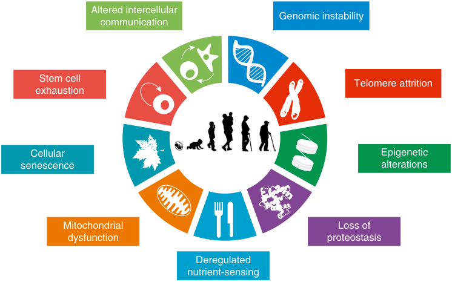
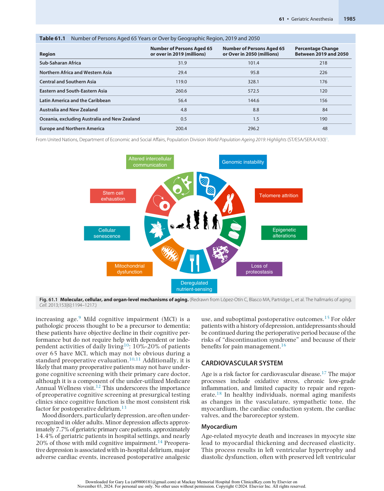
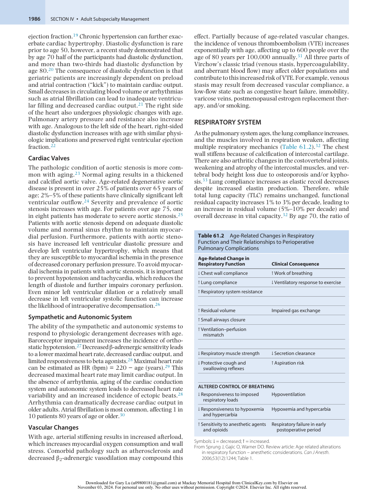
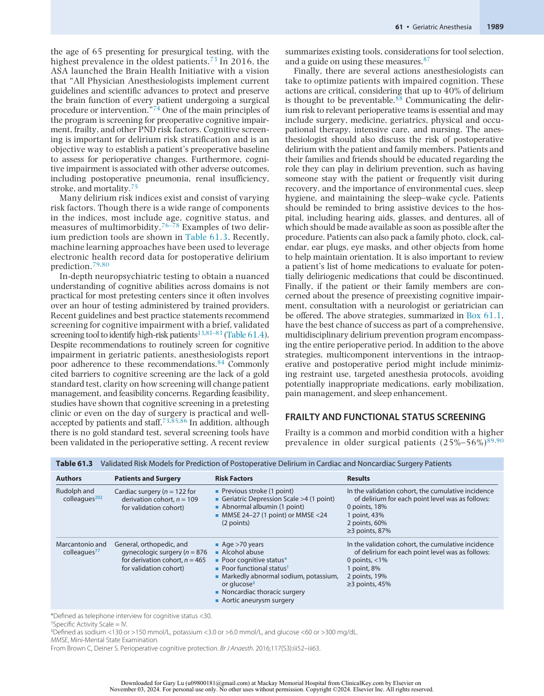
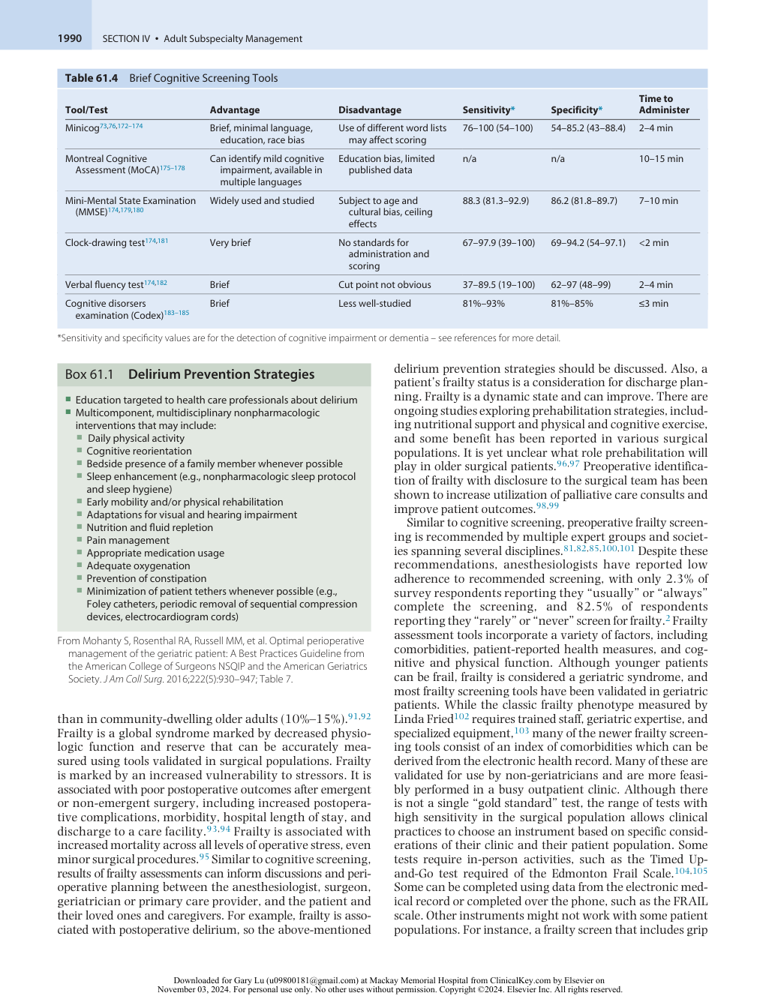
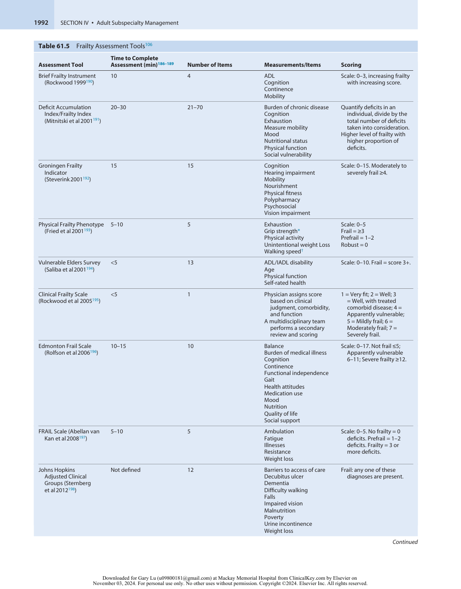
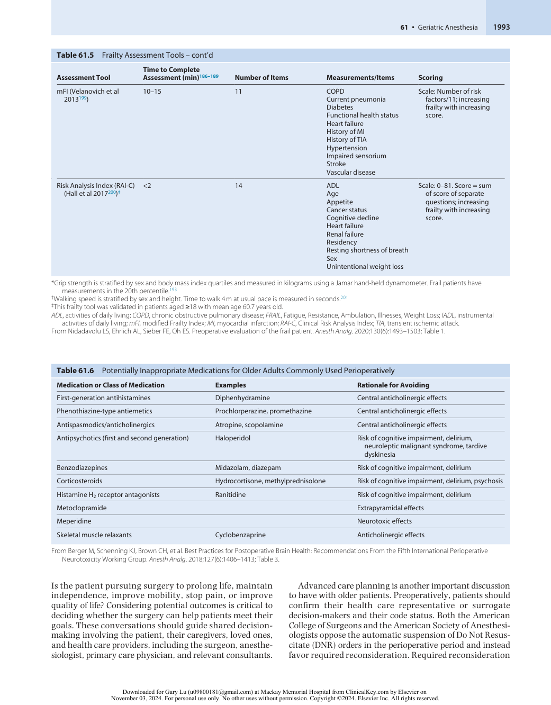
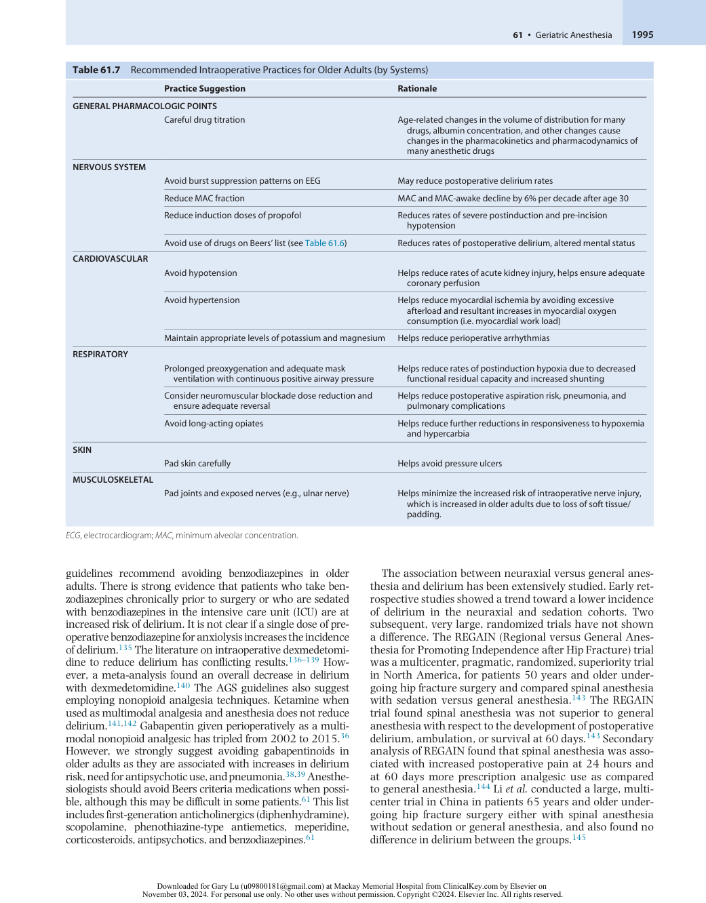

# Geriatric Anesthesia

<!-- PDF page 1 -->

ELIZABETH MAHANNA GABRIELLI, KATIE J. SCHENNING, and STACIE DEINER

- **KEY POINTS** Normal aging is associated with changes in physiology and an increase in many pathologic conditions.

   - The number and impact of normal and pathologic conditions varies significantly across older individuals.

   - Preoperative screening recommendations and guidelines for older patients can provide a useful starting point to evaluate and optimize care.

   - Best intraoperative practices follow from an understanding of geriatric physiology and awareness of medications, which are contraindicated in the older population.

   - Postoperative care tailored to the needs of high- risk adults may benefit the highest-risk patients such as palliative care consultation and delirium prevention measures.

In 2019, the number of people over age 65 was 703 million. The global number of older adults is expected to increase to 1.5 billion people in 2050 (Table 61.1).1 In the United States alone, more than 16 million patients over age 60 underwent surgery in 2006. The larger presence of older surgical patients has significant implications for anesthesiologists. Age- dependent physiologic changes occur in every organ system, many of which result in a decrease in functional capacity.

There is also considerable variability in the extent of agedependent changes. Indeed, a general principle of geriatric medicine is that older adults are a heterogeneous group. In addition to age- related physiologic change, older patients may also have a greater burden of comorbid disease. The process of aging involves a plethora of biological pathways (Fig. 61.1) which proceed at varying rates across patients. For example, two 80- year- old patients may show very different telomere lengths, accumulation of genetic mutations, and cumulative oxidative stress. Differences in the pace of biology vs. chronological time are referred to as biological aging and chronological aging.

In this chapter, we discuss common age- dependent physiologic and pathophysiologic changes and implications for preoperative assessment, intraoperative management, and postoperative care of older adults. While age- dependent physiology and pathophysiology may not be amenable to change, awareness of the processes and implications for anesthetic management can help providers make better choices. While there have been significant increases in quality programs and biomedical research focused on older adults, recent studies suggest that there is still a gap between best practice guidelines and clinical care.2 Older age continues to be a risk factor for complications, readmission, and mortality after many types of surgery.3–5

## Organ- Specific Age- Related Physiologic and Pathologic Changes

Except for those who exclusively treat pediatric or obstetric patients, most anesthesiologists provide care for older adults at least some of the time. Therefore, understanding the numerous physiologic changes of aging is critical for caring for the older population. Here we discuss these changes by organ system.

### CENTRAL NERVOUS SYSTEM

Aging is associated with a decrease in white matter density in the prefrontal cortex and anterior corpus callosum.6 Decrease in synaptic function, especially in the prefrontal cortex, may also contribute to cognitive decline. Contrary to earlier thought, aging is not associated with significant neuronal loss in the neocortex or hippocampus.7 Similarly, there is significant variability in the decrease of dendritic branching, also previously thought to decline with aging.6 Decreased neuronal connectivity occurs particularly in the hippocampus, frontal/prefrontal cortex, and the temporal lobe.8 Age- related dysregulation of neuronal transmission, baseline neuronal firing, calcium metabolism, and gene expression diminishes both connectivity and plasticity.6 Functionally, these physiologic changes contribute to normal age- related cognitive decline in many domains such as executive function, cognitive processing speed, working and spatial memory, and maintenance of circadian rhythm.

Older adults are also more likely to manifest neuropathology including Alzheimer disease and Parkinson disease.9 Alzheimer disease occurs in 10% of people aged 65 years and older, with continued increases in prevalence with

<!-- PDF page 2 -->

### Table 61.1 Number of Persons Aged 65 Years or Over by Geographic Region, 2019 and 2050

|**Region**|**Number of Persons Aged 65** **or over in 2019 (millions)**|**Number of Persons Aged 65** **or Over in 2050 (millions)**|**Percentage Change** **Between 2019 and 2050**|
|---|---|---|---|
|**Sub- Saharan Africa**|31.9|101.4|218|
|**Northern Africa and Western Asia**|29.4|95.8|226|
|**Central and Southern Asia**|119.0|328.1|176|
|**Eastern and South- Eastern Asia**|260.6|572.5|120|
|**Latin America and the Caribbean**|56.4|144.6|156|
|**Australia and New Zealand**|4.8|8.8|84|
|**Oceania, excluding Australia and New Zealand**|0.5|1.5|190|
|**Europe and Northern America**|200.4|296.2|48|

From United Nations, Department of Economic and Social Affairs, Population Division _World Population Ageing 2019: Highlights_ (ST/ESA/SER.A/430)1 .

Altered intercellular Genomic instability communication Stem cell Telomere attrition exhaustion Cellular Epigenetic senescence alterations Mitochondrial Loss of dysfunction proteostasis Deregulated nutrient-sensing 

**Fig. 61.1 Molecular, cellular, and organ- level mechanisms of aging.** (Redrawn from López- Otín C, Blasco MA, Partridge L, et al. The hallmarks of aging. _Cell_ . 2013;153[6]:1194–1217.)

increasing age.9 Mild cognitive impairment (MCI) is a pathologic process thought to be a precursor to dementia; these patients have objective decline in their cognitive performance but do not require help with dependent or independent activities of daily living10 : 10%- 20% of patients over 65 have MCI, which may not be obvious during a standard preoperative evaluation.10,11 Additionally, it is likely that many preoperative patients may not have undergone cognitive screening with their primary care doctor, although it is a component of the under- utilized Medicare Annual Wellness visit.12 This underscores the importance of preoperative cognitive screening at presurgical testing clinics since cognitive function is the most consistent risk factor for postoperative delirium.13

Mood disorders, particularly depression, are often underrecognized in older adults. Minor depression affects approximately 7.7% of geriatric primary care patients, approximately 14.4% of geriatric patients in hospital settings, and nearly 20% of those with mild cognitive impairment.14 Preoperative depression is associated with in- hospital delirium, major adverse cardiac events, increased postoperative analgesic

use, and suboptimal postoperative outcomes.15 For older patients with a history of depression, antidepressants should be continued during the perioperative period because of the risks of “discontinuation syndrome” and because of their benefits for pain management.16

### CARDIOVASCULAR SYSTEM

Age is a risk factor for cardiovascular disease.17 The major processes include oxidative stress, chronic low-grade inflammation, and limited capacity to repair and regenerate.18 In healthy individuals, normal aging manifests as changes in the vasculature, sympathetic tone, the myocardium, the cardiac conduction system, the cardiac valves, and the baroreceptor system.

### Myocardium

Age- related myocyte death and increases in myocyte size lead to myocardial thickening and decreased elasticity. This process results in left ventricular hypertrophy and diastolic dysfunction, often with preserved left ventricular

::: details 原始表格與符號（PDF 第 2 頁）

:::

<!-- PDF page 3 -->

ejection fraction.19 Chronic hypertension can further exacerbate cardiac hypertrophy. Diastolic dysfunction is rare prior to age 50, however, a recent study demonstrated that by age 70 half of the participants had diastolic dysfunction, and more than two- thirds had diastolic dysfunction by age 80.20 The consequence of diastolic dysfunction is that geriatric patients are increasingly dependent on preload and atrial contraction (“kick”) to maintain cardiac output. Small decreases in circulating blood volume or arrhythmias such as atrial fibrillation can lead to inadequate ventricular filling and decreased cardiac output.21 The right side of the heart also undergoes physiologic changes with age. Pulmonary artery pressure and resistance also increase with age. Analogous to the left side of the heart, right- sided diastolic dysfunction increases with age with similar physiologic implications and preserved right ventricular ejection fraction.22

### Cardiac Valves

The pathologic condition of aortic stenosis is more common with aging.23 Normal aging results in a thickened and calcified aortic valve. Age- related degenerative aortic disease is present in over 25% of patients over 65 years of age; 2%–5% of these patients have clinically significant left ventricular outflow.24 Severity and prevalence of aortic stenosis increases with age. For patients over age 75, one in eight patients has moderate to severe aortic stenosis.25 Patients with aortic stenosis depend on adequate diastolic volume and normal sinus rhythm to maintain myocardial perfusion. Furthermore, patients with aortic stenosis have increased left ventricular diastolic pressure and develop left ventricular hypertrophy, which means that they are susceptible to myocardial ischemia in the presence of decreased coronary perfusion pressure. To avoid myocardial ischemia in patients with aortic stenosis, it is important to prevent hypotension and tachycardia, which reduces the length of diastole and further impairs coronary perfusion. Even minor left ventricular dilation or a relatively small decrease in left ventricular systolic function can increase the likelihood of intraoperative decompensation.26

### Sympathetic and Autonomic System

The ability of the sympathetic and autonomic systems to respond to physiologic derangement decreases with age. Baroreceptor impairment increases the incidence of orthostatic hypotension.27 Decreased β- adrenergic sensitivity leads to a lower maximal heart rate, decreased cardiac output, and limited responsiveness to beta agonists.28 Maximal heart rate can be estimated as HR (bpm) = 220 − age (years).29 This decreased maximal heart rate may limit cardiac output. In the absence of arrhythmia, aging of the cardiac conduction system and autonomic system leads to decreased heart rate variability and an increased incidence of ectopic beats.28 Arrhythmia can dramatically decrease cardiac output in older adults. Atrial fibrillation is most common, affecting 1 in 10 patients 80 years of age or older.30

### Vascular Changes

With age, arterial stiffening results in increased afterload, which increases myocardial oxygen consumption and wall stress. Comorbid pathology such as atherosclerosis and decreased β2- adrenergic vasodilation may compound this

effect. Partially because of age- related vascular changes, the incidence of venous thromboembolism (VTE) increases exponentially with age, affecting up to 600 people over the age of 80 years per 100,000 annually.31 All three parts of Virchow’s classic triad (venous stasis, hypercoagulability, and aberrant blood flow) may affect older populations and contribute to this increased risk of VTE. For example, venous stasis may result from decreased vascular compliance, a low- flow state such as congestive heart failure, immobility, varicose veins, postmenopausal estrogen replacement therapy, and/or smoking.

### RESPIRATORY SYSTEM

As the pulmonary system ages, the lung compliance increases, and the muscles involved in respiration weaken, affecting multiple respiratory mechanics (Table 61.2).32 The chest wall stiffens because of calcification of intercostal cartilage. There are also arthritic changes in the costovertebral joints, weakening and atrophy of the intercostal muscles, and vertebral body height loss due to osteoporosis and/or kyphosis.33 Lung compliance increases as elastic recoil decreases despite increased elastin production. Therefore, while total lung capacity (TLC) remains unchanged, functional residual capacity increases 1% to 3% per decade, leading to an increase in residual volume (5%–10% per decade) and overall decrease in vital capacity.32 By age 70, the ratio of

**Table 61.2** Age- Related Changes in Respiratory Function and Their Relationships to Perioperative Pulmonary Complications

|**Age- Related Change in** **Respiratory Function**|**Clinical Consequence**|
|---|---|
|↓Chest wall compliance|↑Work of breathing|
|↑Lung compliance|↓Ventilatory response to exercise|
|↑Respiratory system resistance||
|↑Residual volume|Impaired gas exchange|
|↑Small airways closure||
|↑Ventilation–perfusion mismatch||
|↓Respiratory muscle strength|↓Secretion clearance|
|↓Protective cough and swallowing reflexes|↑Aspiration risk|
|**ALTERED CONTROL OF BREATHI**|**NG**|
|↓Responsiveness to imposed respiratory loads|Hypoventilation|
|↓Responsiveness to hypoxemia and hypercarbia|Hypoxemia and hypercarbia|
|↑Sensitivity to anesthetic agents and opioids|Respiratory failure in early postoperative period|

Symbols: ↓ = decreased; ↑ = increased. From Sprung J, Gajic O, Warner DO. Review article: Age related alterations in respiratory function – anesthetic considerations. _Can J Anesth_ . 2006;53(12):1244; Table 1.

::: details 原始表格與符號（PDF 第 3 頁）

:::

<!-- PDF page 4 -->

residual volume to TLC increases up to 40%.32 Aging is also associated with alveolar airspace increases similar to those seen in emphysema, resulting in decreased gas exchange and increased ventilation–perfusion (V/Q) mismatch. Closing capacity, the volume at which small airways close, increases with age which may result in atelectasis, pulmonary shunting, and hypoxemia. Common intraoperative maneuvers, such as increased intra- abdominal pressure due to carbon dioxide insufflation or Trendelenburg positioning, may compound these effects. Strategies to minimize atelectasis in the postoperative period include early mobilization/ambulation after surgery, chest physiotherapy, and incentive spirometry.34

Compared to younger patients, older patients also have weaker pharyngeal muscles, decreased clearance of secretions, decreased mucociliary transport, less efficient cough, decreased esophageal motility, and less effective protective upper airway reflexes.32 These factors place the older population at increased risk for aspiration and postoperative pneumonia.

In addition to mechanical changes, older adults have an approximate 50% decrease in the respiratory response to hypoxia and hypercarbia, which is even more pronounced during sleep.35 Older patients also have decreased hypopharyngeal and genioglossal muscle tone, which predisposes them to upper airway obstruction, particularly during sleep.32,36 The most common sleep- related respiratory derangement in older adults is sleep apnea, which may affect up to 50%.37 Older age is recognized as an independent risk factor for postoperative opioid- related respiratory depression. The PRODIGY trial was a prospective observational blinded trial of continuous capnography and oximetry.38 The trial generated a risk prediction score and the five variables identified which predicted postoperative respiratory depression were: age ≥60, sex, opioid naivety, sleep disorders, and chronic heart failure. Given these risk factors, older patients should be screened preoperatively for obstructive sleep apnea (OSA) using one of several screening questionnaires such as the STOP- Bang, Berlin, or American Society of Anesthesiologists (ASA) questionnaires. Patients with OSA should be recognized as having a potentially difficult mask airway and postoperatively may benefit from continuous positive airway pressure and opioid- sparing pain management.39

Anesthesiologists can use physiology of aging and the individual patient’s comorbid disease burden to make choices to minimize the risk of pulmonary complications. Neuraxial or regional anesthesia as a primary technique with minimal sedation or supplemental technique to improve pain control can reduce the risk of aspiration by reducing anesthetic- induced interference with the cough reflex and encouraging mobilization and pulmonary toilet. In some cases, it may be appropriate to avoid neuromuscular blocking agents or, if they are required, ensure adequate reversal to improve postoperative respiratory exchange and reduce aspiration risk. Sugammadex reversal is an attractive option, and is effective and safe in older adults, although the time to recovery of train-of-four (TOF) ratio to 0.9 was found to be 0.7 minute slower in adults age 65 or older.40 Anesthesia providers should consider non- narcotic medications to further avoid risk of respiratory compromise.13

### RENAL SYSTEM

Kidney function decreases with age and these changes may be exacerbated by pathophysiology. A decrease in glomerular filtration rate (GFR) begins after age 40 but may begin as early as age 20.41 Aging is associated with an increase in fibrotic glomeruli that decreases renal function. Renal blood flow decreases after age 40 and continues to decline approximately 10% per decade.42 Chronic diseases frequently found in the older population (e.g., hypertension, diabetes mellitus, dyslipidemia, and atherosclerosis) and exposures such as smoking and lead can exacerbate this normal age- related decline in renal function.41 Although older patients typically have normal serum creatinine levels, they also tend to have decreased lean muscle mass and lower creatinine overall. Therefore, a “normal” serum creatinine in an older patient may belie a reduced GFR. In the setting of reduced GFR, medications that are excreted through the kidney or have active metabolites that are excreted through the kidney may accumulate if the dose is not appropriately adjusted.

Age- related decreased responsiveness to renin, aldosterone, and vasopressin reduces the older patient’s ability to regulate their volume status and may result in electrolyte and acid–base derangement.43 The decrease in nitric oxide via decreased endothelial nitric oxide synthase may lead to endothelial dysfunction. The compound effects of glomerulosclerosis and decline in GFR and renal plasma flow predisposes older adults to dysnatremia.44 Hyponatremia affects 11% of the geriatric ambulatory community and 5.3% of hospitalized geriatric patients.45,46 Hypernatremia affects 1% of hospitalized patients age 60 and older.47 Furthermore, because older adults often have inappropriate sodium excretion, they are particularly prone to hypotension and acute kidney injury in the setting of hypovolemia.48 Medications such as serotonin reuptake inhibitors and loop diuretics may further predispose older adults to dysnatremia.48

The incidence of urologic disease (e.g. bladder and prostate) also increases with age. The incidence of postoperative urinary retention increases in older men and women.49 This is an important point to recognize because discomfort due to urinary retention can be a common cause of postoperative agitation. Urinary tract infections (UTIs) also increase in incidence in older men and women and are associated with delirium.50

### GASTROINTESTINAL AND HEPATIC SYSTEMS

Older adults have 20%–40% decrease in liver size and 40%–60% decrease in blood flow that affects hepatic drug clearance.51 Lower albumin levels may reduce the total amount of drug- protein binding, which has the potential to increase free drug levels if clearance is also reduced. Phase I metabolism is the process by which water- insoluble drugs are converted into soluble molecules including but not limited to utilizing the family of catalyst enzymes CYP450. More recent studies suggest that the effect of aging on phase I metabolism is variable and may vary by drug. The effect of aging on phase II metabolism, which involves acetylation and conjugation, is also variable. The presence of frailty is associated with liver dysfunction, although the

<!-- PDF page 5 -->

directionality of the association is not clear.52–55 The concept of flow vs. capacity limited hepatic clearance is also important. Drugs that are flow limited (i.e. high hepatic extraction) are cleared more slowly in older adults, up to 30%–40% in proportion to reduction in liver blood flow. Examples of these drugs include: ketamine, flumazenil, morphine, fentanyl, sufentanil, and lidocaine.56 The effect of age on capacity limited drugs (low extraction) is more variable and their clearance is related to protein binding.57

The incidence of non- alcoholic fatty liver disease (NAFLD) increases with age, affecting nearly half of geriatric patients; however, in contrast to younger populations, it is unclear whether NAFLD is associated with metabolic syndrome, cardiovascular disease, or another pathology. Younger obese diabetic patients with NAFLD are at increased risk of complications as they age, such as severe hepatic fibrosis, hepatocellular carcinoma, and cryptogenic cirrhosis.58

Risk of postoperative nausea and vomiting decreases after age 50, which is fortunate because many antiemetics act through anticholinergic pathways which can promote delirium.59,60 The Beers criteria recommend against most of these medications including prochlorperazine, promethazine, metoclopramide (except in the setting of gastroparesis), and corticosteroid prophylaxis.61 The 5- HT3 receptor antagonists (e.g., ondansetron) are a better choice for older adults.

### MUSCULOSKELETAL SYSTEM

Muscle mass and strength decrease with age; mass decreases 3%–8% for every decade after 30, and the rate of decline increases with age.62 Maintaining strength in the perioperative period is critical in older people. Declining muscle strength is associated with increased mortality risk, and older adults who are immobile lose muscle mass much faster than their younger counterparts.63 For example, healthy older adults who were placed on bed rest for 10 days experienced greater loss of muscle mass than healthy younger adults who were placed on bed rest for 28 days.64

Decreased lean muscle mass may not be obvious in older patients, whose weight may remain stable, while their total body fat increases and their subcutaneous (insulating) fat reserves decrease. A 10- year longitudinal study of older adults showed a 23% per decade decline in subcutaneous fat with a concurrent average 11% per decade increase in total body fat.65 Diminished subcutaneous fat thickness and age- related thermoregulatory dysfunction partially explain why older patients are prone to temperature dysregulation intraoperatively.66 Age- related dysregulation of the cutaneous microcirculation also contributes to impaired wound healing. Anesthesiologists can optimize surgical healing in this population by maintaining adequate hydration, normothermia, and tissue oxygenation.67

Along with age- related changes in the muscles and skin, aging affects the skeletal system as well. Osteoarthritis is the most common joint disorder in the United States and leads to limited joint mobility in older patients.68 Anesthesiologists should be aware of this and inquire about mobility limitations during preoperative evaluation to avoid exacerbating preexisting joint issues while positioning the patient for surgery in the operating room.69

## Preoperative Assessment of Older Surgical Patients

The preoperative assessment and optimization of the geriatric patient incorporate components specific to geriatric patients into a standard preoperative evaluation, as detailed in Chapter 28. In 2014, the American College of Surgeons (ACS) and the American Geriatrics Society (AGS) convened an expert panel and published best practice guidelines for the perioperative management of geriatric patients.34 Their recommendations include elements that are best practice in the preoperative care of all adult patients, such as using the American College of Cardiology/American Heart Association (ACC/AHA) algorithm for patients undergoing noncardiac surgery,70 as well as determining the risk for postoperative pulmonary complications, and ordering appropriate laboratory tests based on details of the specific patient and procedure. For example, electrocardiograms and advanced cardiac testing should be based on the patient’s medical history rather than using an “age cutoff.” Geriatric- specific preoperative recommendations include screening for geriatric syndromes and other high- risk characteristics to determine potential areas of vulnerability such as frailty, fall risk, polypharmacy, depression, alcohol, and other substance abuse. The ACS/AGS guidelines also recommend determining a patient’s social support system and understanding a patient’s expectations and advanced directives. The ACS National Surgical Quality Improvement Program (NSQIP) Surgical Risk Calculator has recently been enhanced with functionality to predict geriatric- specific outcomes by including geriatric- specific risk factors in the model. This tool can be used to enhance shared decisionmaking to optimize perioperative care of the geriatric surgical patient.71 To prepare for the aging surgical population, the ACS established the Geriatric Surgery Verification (GSV) program, which includes 32 perioperative standards for hospitals to adhere to in order to become a certified center of geriatric surgery.72 The program is designed to improve surgical outcomes for geriatric patients, and the standards include various preoperative considerations, including screening for common geriatric syndromes and complexities. Specifically, the GSV recommends screening for the following high- risk characteristics: age ≥85 years, impaired cognition, delirium risk, impaired functional status, impaired mobility, malnutrition, difficulty swallowing, and need for a palliative care assessment. We expand on essential aspects of geriatric screening below.

### COGNITIVE ASSESSMENT AND DELIRIUM RISK

Postoperative delirium is one of the most common postoperative complications in older patients, and it is associated with adverse outcomes, including increased risk of longterm cognitive decline, discharge to a care facility, loss of functional independence, and increased length of stay, cost, and mortality. Preoperative cognitive impairment is the most consistent risk factor for perioperative neurocognitive disorders (PND), including delirium and longer- term cognitive decline, which are described in detail in Chapter 78. Occult preoperative cognitive impairment in older adults is common, and present in more than 20% of patients over

<!-- PDF page 6 -->

the age of 65 presenting for presurgical testing, with the highest prevalence in the oldest patients.73 In 2016, the ASA launched the Brain Health Initiative with a vision that “All Physician Anesthesiologists implement current guidelines and scientific advances to protect and preserve the brain function of every patient undergoing a surgical procedure or intervention.”74 One of the main principles of the program is screening for preoperative cognitive impairment, frailty, and other PND risk factors. Cognitive screening is important for delirium risk stratification and is an objective way to establish a patient’s preoperative baseline to assess for perioperative changes. Furthermore, cognitive impairment is associated with other adverse outcomes, including postoperative pneumonia, renal insufficiency, stroke, and mortality.75

Many delirium risk indices exist and consist of varying risk factors. Though there is a wide range of components in the indices, most include age, cognitive status, and measures of multimorbidity.76–78 Examples of two delirium prediction tools are shown in Table 61.3. Recently, machine learning approaches have been used to leverage electronic health record data for postoperative delirium prediction.79,80

In- depth neuropsychiatric testing to obtain a nuanced understanding of cognitive abilities across domains is not practical for most pretesting centers since it often involves over an hour of testing administered by trained providers. Recent guidelines and best practice statements recommend screening for cognitive impairment with a brief, validated screening tool to identify high- risk patients13,81–83 (Table 61.4). Despite recommendations to routinely screen for cognitive impairment in geriatric patients, anesthesiologists report poor adherence to these recommendations.84 Commonly cited barriers to cognitive screening are the lack of a gold standard test, clarity on how screening will change patient management, and feasibility concerns. Regarding feasibility, studies have shown that cognitive screening in a pretesting clinic or even on the day of surgery is practical and wellaccepted by patients and staff.73,85,86 In addition, although there is no gold standard test, several screening tools have been validated in the perioperative setting. A recent review

summarizes existing tools, considerations for tool selection, and a guide on using these measures.87

Finally, there are several actions anesthesiologists can take to optimize patients with impaired cognition. These actions are critical, considering that up to 40% of delirium is thought to be preventable.88 Communicating the delirium risk to relevant perioperative teams is essential and may include surgery, medicine, geriatrics, physical and occupational therapy, intensive care, and nursing. The anesthesiologist should also discuss the risk of postoperative delirium with the patient and family members. Patients and their families and friends should be educated regarding the role they can play in delirium prevention, such as having someone stay with the patient or frequently visit during recovery, and the importance of environmental cues, sleep hygiene, and maintaining the sleep–wake cycle. Patients should be reminded to bring assistive devices to the hospital, including hearing aids, glasses, and dentures, all of which should be made available as soon as possible after the procedure. Patients can also pack a family photo, clock, calendar, ear plugs, eye masks, and other objects from home to help maintain orientation. It is also important to review a patient’s list of home medications to evaluate for potentially deliriogenic medications that could be discontinued. Finally, if the patient or their family members are concerned about the presence of preexisting cognitive impairment, consultation with a neurologist or geriatrician can be offered. The above strategies, summarized in Box 61.1, have the best chance of success as part of a comprehensive, multidisciplinary delirium prevention program encompassing the entire perioperative period. In addition to the above strategies, multicomponent interventions in the intraoperative and postoperative period might include minimizing restraint use, targeted anesthesia protocols, avoiding potentially inappropriate medications, early mobilization, pain management, and sleep enhancement.

### FRAILTY AND FUNCTIONAL STATUS SCREENING

Frailty is a common and morbid condition with a higher prevalence in older surgical patients (25%–56%)89,90

**Table 61.3** Validated Risk Models for Prediction of Postoperative Delirium in Cardiac and Noncardiac Surgery Patients

|**Authors**|**Patients and Surgery**|**Risk Factors**|**Results**|
|---|---|---|---|
|Rudolph and colleagues202|Cardiac surgery (_n_= 122 for derivation cohort,_n_= 109 for validation cohort)|ᑏPrevious stroke (1 point) ᑏGeriatric Depression Scale >4 (1 point) ᑏAbnormal albumin (1 point) ᑏMMSE 24–27 (1 point) or MMSE &lt;24 (2 points)|In the validation cohort, the cumulative incidence of delirium for each point level was as follows: 0 points, 18% 1 point, 43% 2 points, 60% ≥3 points, 87%|
|Marcantonio and colleagues77|General, orthopedic, and gynecologic surgery (_n_= 876 for derivation cohort,_n_= 465 for validation cohort)|ᑏAge >70 years ᑏAlcohol abuse ᑏPoor cognitive status* ᑏPoor functional status† ᑏMarkedly abnormal sodium, potassium, or glucose‡ ᑏNoncardiac thoracic surgery ᑏAortic aneurysm surgery|In the validation cohort, the cumulative incidence of delirium for each point level was as follows: 0 points, &lt;1% 1 point, 8% 2 points, 19% ≥3 points, 45%|

*Defined as telephone interview for cognitive status &lt;30. †Specific Activity Scale = IV. ‡Defined as sodium &lt;130 or >150 mmol/L, potassium &lt;3.0 or >6.0 mmol/L, and glucose &lt;60 or >300 mg/dL. _MMSE_ , Mini- Mental State Examination. From Brown C, Deiner S. Perioperative cognitive protection. _Br J Anaesth_ . 2016;117(S3):iii52–iii63.

::: details 原始表格與符號（PDF 第 6 頁）

:::

<!-- PDF page 7 -->

**Table 61.4** Brief Cognitive Screening Tools

|**Tool/Test**|**Advantage**|**Disadvantage**|**Sensitivity***|**Specificity***|**Time to** **Administer**|
|---|---|---|---|---|---|
|Minicog73,76,172–174|Brief, minimal language, education, race bias|Use of different word lists may affect scoring|76–100 (54–100)|54–85.2 (43–88.4)|2–4 min|
|Montreal Cognitive Assessment (MoCA)175–178|Can identify mild cognitive impairment, available in multiple languages|Education bias, limited published data|n/a|n/a|10–15 min|
|Mini-Mental State Examination (MMSE)174,179,180|Widely used and studied|Subject to age and cultural bias, ceiling effects|88.3 (81.3–92.9)|86.2 (81.8–89.7)|7–10 min|
|Clock- drawing test174,181|Very brief|No standards for administration and scoring|67–97.9 (39–100)|69–94.2 (54–97.1)|&lt;2 min|
|Verbal fluency test174,182|Brief|Cut point not obvious|37–89.5 (19–100)|62–97 (48–99)|2–4 min|
|Cognitive disorsers examination (Codex)183–185|Brief|Less well- studied|81%–93%|81%–85%|≤3 min|

*Sensitivity and specificity values are for the detection of cognitive impairment or dementia – see references for more detail.

### Box 61.1 Delirium Prevention Strategies

- Education targeted to health care professionals about delirium

- Multicomponent, multidisciplinary nonpharmacologic interventions that may include:

- Daily physical activity

- Cognitive reorientation

- Bedside presence of a family member whenever possible

- Sleep enhancement (e.g., nonpharmacologic sleep protocol and sleep hygiene)

- Early mobility and/or physical rehabilitation

- Adaptations for visual and hearing impairment

- Nutrition and fluid repletion

- Pain management

- Appropriate medication usage

- Adequate oxygenation

- Prevention of constipation

- Minimization of patient tethers whenever possible (e.g., Foley catheters, periodic removal of sequential compression devices, electrocardiogram cords)

From Mohanty S, Rosenthal RA, Russell MM, et al. Optimal perioperative management of the geriatric patient: A Best Practices Guideline from the American College of Surgeons NSQIP and the American Geriatrics Society. _J Am Coll Surg_ . 2016;222(5):930–947; Table 7.

than in community- dwelling older adults (10%–15%).91,92 Frailty is a global syndrome marked by decreased physiologic function and reserve that can be accurately measured using tools validated in surgical populations. Frailty is marked by an increased vulnerability to stressors. It is associated with poor postoperative outcomes after emergent or non- emergent surgery, including increased postoperative complications, morbidity, hospital length of stay, and discharge to a care facility.93,94 Frailty is associated with increased mortality across all levels of operative stress, even minor surgical procedures.95 Similar to cognitive screening, results of frailty assessments can inform discussions and perioperative planning between the anesthesiologist, surgeon, geriatrician or primary care provider, and the patient and their loved ones and caregivers. For example, frailty is associated with postoperative delirium, so the above- mentioned

delirium prevention strategies should be discussed. Also, a patient’s frailty status is a consideration for discharge planning. Frailty is a dynamic state and can improve. There are ongoing studies exploring prehabilitation strategies, including nutritional support and physical and cognitive exercise, and some benefit has been reported in various surgical populations. It is yet unclear what role prehabilitation will play in older surgical patients.96,97 Preoperative identification of frailty with disclosure to the surgical team has been shown to increase utilization of palliative care consults and improve patient outcomes.98,99

Similar to cognitive screening, preoperative frailty screening is recommended by multiple expert groups and societies spanning several disciplines.81,82,85,100,101 Despite these recommendations, anesthesiologists have reported low adherence to recommended screening, with only 2.3% of survey respondents reporting they “usually” or “always” complete the screening, and 82.5% of respondents reporting they “rarely” or “never” screen for frailty.2 Frailty assessment tools incorporate a variety of factors, including comorbidities, patient- reported health measures, and cognitive and physical function. Although younger patients can be frail, frailty is considered a geriatric syndrome, and most frailty screening tools have been validated in geriatric patients. While the classic frailty phenotype measured by Linda Fried102 requires trained staff, geriatric expertise, and specialized equipment,103 many of the newer frailty screening tools consist of an index of comorbidities which can be derived from the electronic health record. Many of these are validated for use by non- geriatricians and are more feasibly performed in a busy outpatient clinic. Although there is not a single “gold standard” test, the range of tests with high sensitivity in the surgical population allows clinical practices to choose an instrument based on specific considerations of their clinic and their patient population. Some tests require in- person activities, such as the Timed Upand- Go test required of the Edmonton Frail Scale.104,105 Some can be completed using data from the electronic medical record or completed over the phone, such as the FRAIL scale. Other instruments might not work with some patient populations. For instance, a frailty screen that includes grip

::: details 原始表格與符號（PDF 第 7 頁）

:::

<!-- PDF page 8 -->

strength may not be best suited for a cervical spine population that often has cervical myelopathy. The preoperative clinic physical space may dictate the type of assessment possible: some areas are not suitable for a 5- meter gait speed test. Table 61.5 has examples of frailty assessment tools.106

Preoperative impaired functional status is a risk factor for poor surgical outcomes, including functional decline and discharge to a facility in geriatric patients. Preoperative functional dependence is an independent risk factor for mortality after a major operation.107 Screening for functional impairment is most commonly performed using activities of daily living (ADL) and instrumental activities of daily living (IADL) scales. Knowledge of the patient’s preoperative functional status can identify high- risk patients who require early involvement of physical therapy, occupational therapy, and referral to social work for assistance with discharge planning. Similarly, a history of falls or impaired mobility is associated with adverse outcomes after surgery, which has important implications for perioperative planning. Patients who use mobility aids or have gait or balance disturbances may have an increased risk of falls in the perioperative period, discharge to a rehabilitation facility, and hospital readmission.108,109

### MALNUTRITION AND DYSPHAGIA

Malnutrition is common and underrecognized in older patients. Malnutrition is associated with an increased risk of adverse postoperative outcomes, particularly infections and wound complications.110,111 The ACS NSQIP/AGS Best Practice Guidelines recommend screening for severe nutritional risk using body mass index (BMI) &lt;18.5 kg/m2 , serum albumin &lt;3 g/dL without evidence of hepatic or renal dysfunction, or unintentional weight loss >10%–15% within 6 months.34,100 The ACS Strong for Surgery program also recommends screening for malnutrition using BMI, unintentional weight loss, poor appetite, or the inability to take food orally. If any of those measures are positive, a referral to a registered dietician is recommended.112 Other brief nutritional assessments used in the perioperative period include the Mini- Nutritional Assessment Short Form (MNA- SF)113 and the Short Nutritional Assessment Questionnaire (SNAQ).114 In summary, malnutrition is common in older adults and is associated with adverse postoperative outcomes. Preoperative identification of high- risk patients can allow for nutritional supplementation before surgery and can help guide the postoperative nutritional plan.

Oropharyngeal dysphagia is another geriatric syndrome and occurs in up to 30% of independently living adults ≥65 years of age.110,115 Abnormal swallowing is associated with inadequate nutrition, an increased risk of aspiration pneumonia, and increased morbidity and mortality.116 Therefore, the GSV program recommends the preoperative screening of older adults for dysphagia. If patients report difficulty eating or drinking, the patient should be referred to speech pathology, and the team should determine a plan for the implementation of aspiration precaution protocols postoperatively.72

incidence of discrepancies between surgical and anesthesiology medication reconciliations are greater than 70%.117 The electronic medical record should help reduce this discrepancy. A thorough review of all medications, vitamins, and supplements is necessary to guide perioperative medication management. Best practice may include working with pharmacy to review patient medications for polypharmacy, potential drug interactions, and medications contraindicated in older adults. These include the AGS Beers Criteria for Potentially Inappropriate Medication Use in Older Adults.61 The list includes several medications commonly seen in anesthesia order sets: meperidine, scopolamine, benzodiazepines, antiemetics, and other drugs with anticholinergic properties (Table 61.6).82

### DEPRESSION AND ALCOHOL SCREENING

Depression and alcohol abuse are relatively common in older adults and are associated with adverse postoperative outcomes. Depression is associated with greater pain perception, increased need for postoperative analgesics, poor functional recovery, increased incidence and duration of delirium, and increased likelihood of discharge to a facility.118–120 Screening for depression can be performed using the Geriatric Depression Scale121 or the Patient Health Questionnaire- 2 (PHQ- 2),122 which asks:

- “In the past 12 months, have you ever had a time when you felt sad, blue, depressed, or down for most of the time for at least 2 weeks?”

- “In the past 12 months, have you ever had a time lasting at least 2 weeks when you didn’t care about the things you usually cared about or when you didn’t enjoy the things that you usually enjoyed?”

“Yes” to either constitutes a positive screen which needs further evaluation.

It is important to screen for alcohol abuse and dependence, which are associated with increased postoperative complications such as pneumonia and sepsis, delirium, and prolonged hospital length of stay.100,123,124 The classic screening tool for alcohol use is the modified CAGE questionnaire, which has been validated for older adults.125,126 The questionnaire consists of four questions:

- “Have you ever felt you needed to cut down on your drinking?”

- “Have people annoyed you by criticizing your drinking?”

- “Have you ever felt guilty about drinking?”

- “Have you ever felt you needed a drink first thing in the morning (Eye Opener) to steady your nerves or get rid of a hangover?”

“Yes” to any question triggers consideration for perioperative prophylaxis for withdrawal syndromes, supplementation of folic acid and thiamine, and consideration of the need for a detoxification protocol supervised by an addiction specialist.34

### GOALS AND DECISION- MAKING

### POLYPHARMACY

Preoperative medication reconciliation of a patient’s home medications is very important – studies suggest that the

An important aspect of preoperative planning with the geriatric surgical patient includes confirming the patient’s goals and expectations for both the surgery and overall health goals.

<!-- PDF page 9 -->

**Table 61.5** Frailty Assessment Tools106

|**Assessment Tool**|**Time to Complete** **Assessment (min)**186–189|**Number of Items**|**Measurements/Items**|**Scoring**|
|---|---|---|---|---|
|Brief Frailty Instrument (Rockwood 1999190)|10|4|ADL Cognition Continence Mobility|Scale: 0–3, increasing frailty with increasing score.|
|Deficit Accumulation Index/Frailty Index (Mitnitski et al 2001191)|20–30|21–70|Burden of chronic disease Cognition Exhaustion Measure mobility Mood Nutritional status Physical function Social vulnerability|Quantify deficits in an individual, divide by the total number of deficits taken into consideration. Higher level of frailty with higher proportion of deficits.|
|Groningen Frailty Indicator (Steverink 2001192)|15|15|Cognition Hearing impairment Mobility Nourishment Physical fitness Polypharmacy Psychosocial Vision impairment|Scale: 0–15. Moderately to severely frail≥4.|
|Physical Frailty Phenotype (Fried et al 2001193)|5–10|5|Exhaustion Grip strength* Physical activity Unintentional weight Loss Walking speed†|Scale: 0–5 Frail =≥3 Prefrail = 1–2 Robust = 0|
|Vulnerable Elders Survey (Saliba et al 2001194)|&lt;5|13|ADL/IADL disability Age Physical function Self- rated health|Scale: 0–10. Frail = score 3+.|
|Clinical Frailty Scale (Rockwood et al 2005195)|&lt;5|1|Physician assigns score based on clinical judgment, comorbidity, and function A multidisciplinary team performs a secondary review and scoring|1 = Very fit; 2 = Well; 3 = Well, with treated comorbid disease; 4 = Apparently vulnerable; 5 = Mildly frail; 6 = Moderately frail; 7 = Severely frail.|
|Edmonton Frail Scale (Rolfson et al 2006196)|10–15|10|Balance Burden of medical illness Cognition Continence Functional independence Gait Health attitudes Medication use Mood Nutrition Quality of life Social support|Scale: 0–17. Not frail≤5; Apparently vulnerable 6–11; Severe frailty≥12.|
|FRAIL Scale (Abellan van Kan et al 2008197)|5–10|5|Ambulation Fatigue Illnesses Resistance Weight loss|Scale: 0–5. No frailty = 0 deficits. Prefrail = 1–2 deficits. Frailty = 3 or more deficits.|
|Johns Hopkins Adjusted Clinical Groups (Sternberg et al 2012198)|Not defined|12|Barriers to access of care Decubitus ulcer Dementia Difficulty walking Falls Impaired vision Malnutrition Poverty Urine incontinence Weight loss|Frail: any one of these diagnoses are present.|

_Continued_

::: details 原始表格與符號（PDF 第 9 頁）

:::

<!-- PDF page 10 -->

**Table 61.5** Frailty Assessment Tools – cont’d

|**Assessment Tool**|**Time to Complete** **Assessment (min)**186–189|**Number of Items**|**Measurements/Items**|**Scoring**|
|---|---|---|---|---|
|mFI (Velanovich et al 2013199)|10–15|11|COPD Current pneumonia Diabetes Functional health status Heart failure History of MI History of TIA Hypertension Impaired sensorium Stroke Vascular disease|Scale: Number of risk factors/11; increasing frailty with increasing score.|
|Risk Analysis Index (RAI- C) (Hall et al 2017200)‡|&lt;2|14|ADL Age Appetite Cancer status Cognitive decline Heart failure Renal failure Residency Resting shortness of breath Sex Unintentional weight loss|Scale: 0–81. Score = sum of score of separate questions; increasing frailty with increasing score.|

*Grip strength is stratified by sex and body mass index quartiles and measured in kilograms using a Jamar hand- held dynamometer. Frail patients have measurements in the 20th percentile.193

†Walking speed is stratified by sex and height. Time to walk 4 m at usual pace is measured in seconds.201

‡This frailty tool was validated in patients aged ≥18 with mean age 60.7 years old.

_ADL_ , activities of daily living; _COPD_ , chronic obstructive pulmonary disease; _FRAIL_ , Fatigue, Resistance, Ambulation, Illnesses, Weight Loss; _IADL_ , instrumental activities of daily living; _mFI_ , modified Frailty Index; _MI_ , myocardial infarction; _RAI- C_ , Clinical Risk Analysis Index; _TIA_ , transient ischemic attack. From Nidadavolu LS, Ehrlich AL, Sieber FE, Oh ES. Preoperative evaluation of the frail patient. _Anesth Analg_ . 2020;130(6):1493–1503; Table 1.

**Table 61.6** Potentially Inappropriate Medications for Older Adults Commonly Used Perioperatively

|**Medication or Class of Medication**|**Examples**|**Rationale for Avoiding**|
|---|---|---|
|First- generation antihistamines|Diphenhydramine|Central anticholinergic effects|
|Phenothiazine- type antiemetics|Prochlorperazine, promethazine|Central anticholinergic effects|
|Antispasmodics/anticholinergics|Atropine, scopolamine|Central anticholinergic effects|
|Antipsychotics (first and second generation)|Haloperidol|Risk of cognitive impairment, delirium, neuroleptic malignant syndrome, tardive dyskinesia|
|Benzodiazepines|Midazolam, diazepam|Risk of cognitive impairment, delirium|
|Corticosteroids|Hydrocortisone, methylprednisolone|Risk of cognitive impairment, delirium, psychosis|
|Histamine H2receptor antagonists|Ranitidine|Risk of cognitive impairment, delirium|
|Metoclopramide||Extrapyramidal effects|
|Meperidine||Neurotoxic effects|
|Skeletal muscle relaxants|Cyclobenzaprine|Anticholinergic effects|

From Berger M, Schenning KJ, Brown CH, et al. Best Practices for Postoperative Brain Health: Recommendations From the Fifth International Perioperative Neurotoxicity Working Group. _Anesth Analg_ . 2018;127(6):1406–1413; Table 3.

Is the patient pursuing surgery to prolong life, maintain independence, improve mobility, stop pain, or improve quality of life? Considering potential outcomes is critical to deciding whether the surgery can help patients meet their goals. These conversations should guide shared decisionmaking involving the patient, their caregivers, loved ones, and health care providers, including the surgeon, anesthesiologist, primary care physician, and relevant consultants.

Advanced care planning is another important discussion to have with older patients. Preoperatively, patients should confirm their health care representative or surrogate decision- makers and their code status. Both the American College of Surgeons and the American Society of Anesthesiologists oppose the automatic suspension of Do Not Resuscitate (DNR) orders in the perioperative period and instead favor required reconsideration. Required reconsideration

::: details 原始表格與符號（PDF 第 10 頁）

:::

<!-- PDF page 11 -->

requires that the anesthesiologist and surgeon have a discussion with the patient to provide information regarding an intraoperative cardiac arrest and determine which resuscitative measures the patient would accept in the event of a cardiac arrest.127 Patients may choose to accept limited attempts at resuscitation such as specific procedures or certain contexts. As the administration of anesthesia may involve procedures that overlap with resuscitation, the nuances of which procedures are acceptable to the patient and/or surrogate should be reviewed prior to the procedure.128 Advanced directives are documents in which patients provide information regarding their wishes for health care decisions if they cannot participate in decision- making. Copies of advance directive forms should be in the local health record, and patients should have the opportunity to complete POLST (portable medical orders) processes and forms.

Palliative care focuses on the relief of suffering and improvement of quality of life in patients with a lifethreatening illness by treatment of pain and other physical, psychosocial, and spiritual problems. Distinct from hospice, palliative care is not limited to the end of life and can be provided at any stage of a medical illness, regardless of whether curative treatments are being pursued. Anesthesiologists will care for an increasing number of patients receiving palliative care and, therefore, must have basic palliative care knowledge and skills as described in Chapter 48. A palliative medicine consultation should be considered for patients with severe symptoms and in more complex cases, particularly in patients with life- threatening conditions.

In working with older adults, it is important to understand whether they retain the competence or capacity to make medical decisions. Though cognition may overlap with capacity, cognitive status alone is not enough to determine capacity. This is because capacity is task- specific. For example, patients with mild cognitive impairment may retain the capacity to make medical decisions even though they can no longer manage their finances or follow a recipe. Competence, capacity, and informed consent are discussed in depth in Chapter 7. An expert consultation to determine capacity is necessary if a patient does not appear competent to provide informed consent for elective surgery.

## Intraoperative Management Considerations for Older Adults

Once the comprehensive preoperative assessment and preprocedure consent have been completed, the anesthesiologist develops the intraoperative anesthetic plan for the individual older patient. The formulated plan is based on the individual older patient’s specific comorbid illnesses, organ system reserve, and overall functional status. Due to decreased physiologic reserve, many older adults require more careful intraoperative management than younger, healthier patients with greater physiologic reserve. General recommendations by organ system are described below and summarized in Table 61.7.

### DRUG PHARMACOLOGY

There are pharmacokinetic and pharmacodynamic changes associated with aging. During induction the prolonged

circulation time may delay the onset of intravenous drugs, but speed induction with inhalational agents.56 Diminished cardiac reserve may manifest as exaggerated hypotension during anesthesia induction.21 A delay in the onset of neuromuscular blockade occurs due to decreased cardiac output and reduced muscle blood flow.

During maintenance of anesthesia, volatile anesthetics need to have age- adjusted minimum alveolar concentration (MAC). Older patients have decreased binding sites for serotonergic, adrenergic, and gamma- aminobutyric acid (GABA) receptors. The MAC and MAC- awake decline by 6% per decade after age 30.129,130 Intravenous anesthetics, propofol, etomidate, opioids, and benzodiazepines should be given at a lower dose in older adults compared to their younger counterparts. Twentytwo percent of older patients experience severe postinduction and pre- incision hypotension with mean arterial pressures less than 55 mm Hg.131 Propofol doses greater than 1.5 mg/kg are significantly associated with severe hypotension, and doses should be reduced in older adults.131 Older patients are also more sensitive to midazolam and have an increased occurrence of hypotension, hypoventilation, and desaturation.132 Opioid sensitivity increases with age; reducing opioid dosage may reduce postoperative respiratory depression.

With decreased kidney function or decreased hepatic excretion from loss of liver mass, there is decreased ability for drug excretion.51,57 Decreased hepatic excretion prolongs the elimination half- life and duration of action of rocuronium and vecuronium. Pancuronium depends on kidney excretion. Consider use of drugs that do not extensively depend on hepatic or renal metabolism such as cisatracurium and succinylcholine. Slower clearance of drugs dependent on hepatic blood flow include ketamine, flumazenil, morphine, fentanyl, and lidocaine.56

The volume of distribution is altered in older patients.133 A decrease in muscle mass and increase in body fat leads to decreased total body water. A reduced volume of distribution for water-soluble drugs leads to greater plasma concentrations. An increased volume of distribution for lipid-soluble drugs leads to decreased plasma concentrations. Altered plasma protein concentrations can alter distribution and elimination. Albumin binds acidic drugs such as benzodiazepines and opioids. Albumin is often decreased in older patients and therefore lower doses of benzodiazepines and opioids are needed. Alpha- 1- acid glycoprotein binds drugs such as local anesthetics. Epidurals have a more extensive spread of given volume, and there is longer duration of action per dose of spinal local anesthetic.

During emergence, the increased volume of distribution due to increased body fat, and decreased pulmonary gas exchange may lead to slower recovery from anesthesia with a volatile agent. In addition, older patients display a longer time to return to consciousness after total intravenous anesthesia with propofol as compared to younger patients.134 Care should be taken to reduce dosage of neuromuscular blocking agents, and ensure that they are fully reversed (i.e., TOF ratio >90%) prior to extubation to reduce postoperative pulmonary complications.

### NEUROLOGIC

Delirium prevention is best achieved through a multipronged and bundled approach. The American Geriatrics Society (AGS)

<!-- PDF page 12 -->

**Table 61.7** Recommended Intraoperative Practices for Older Adults (by Systems)

||**Practice Suggestion**|**Rationale**|
|---|---|---|
|**GENERAL PHARMACO**|**LOGIC POINTS**||
||Careful drug titration|Age- related changes in the volume of distribution for many drugs, albumin concentration, and other changes cause changes in the pharmacokinetics and pharmacodynamics of many anesthetic drugs|
|**NERVOUS SYSTEM**|||
||Avoid burst suppression patterns on EEG|May reduce postoperative delirium rates|
||Reduce MAC fraction|MAC and MAC- awake decline by 6% per decade after age 30|
||Reduce induction doses of propofol|Reduces rates of severe postinduction and pre- incision hypotension|
||Avoid use of drugs on Beers’ list (seeTable 61.6)|Reduces rates of postoperative delirium, altered mental status|
|**CARDIOVASCULAR**|||
||Avoid hypotension|Helps reduce rates of acute kidney injury, helps ensure adequate coronary perfusion|
||Avoid hypertension|Helps reduce myocardial ischemia by avoiding excessive afterload and resultant increases in myocardial oxygen consumption (i.e. myocardial work load)|
||Maintain appropriate levels of potassium and magnesium|Helps reduce perioperative arrhythmias|
|**RESPIRATORY**|||
||Prolonged preoxygenation and adequate mask ventilation with continuous positive airway pressure|Helps reduce rates of postinduction hypoxia due to decreased functional residual capacity and increased shunting|
||Consider neuromuscular blockade dose reduction and ensure adequate reversal|Helps reduce postoperative aspiration risk, pneumonia, and pulmonary complications|
||Avoid long- acting opiates|Helps reduce further reductions in responsiveness to hypoxemia and hypercarbia|
|**SKIN**|||
||Pad skin carefully|Helps avoid pressure ulcers|
|**MUSCULOSKELETAL**|||
||Pad joints and exposed nerves (e.g., ulnar nerve)|Helps minimize the increased risk of intraoperative nerve injury, which is increased in older adults due to loss of soft tissue/ padding.|

_ECG_ , electrocardiogram; _MAC_ , minimum alveolar concentration.

guidelines recommend avoiding benzodiazepines in older adults. There is strong evidence that patients who take benzodiazepines chronically prior to surgery or who are sedated with benzodiazepines in the intensive care unit (ICU) are at increased risk of delirium. It is not clear if a single dose of preoperative benzodiazepine for anxiolysis increases the incidence of delirium.135 The literature on intraoperative dexmedetomidine to reduce delirium has conflicting results.136–139 However, a meta- analysis found an overall decrease in delirium with dexmedetomidine.140 The AGS guidelines also suggest employing nonopioid analgesia techniques. Ketamine when used as multimodal analgesia and anesthesia does not reduce delirium.141,142 Gabapentin given perioperatively as a multimodal nonopioid analgesic has tripled from 2002 to 2015.36 However, we strongly suggest avoiding gabapentinoids in older adults as they are associated with increases in delirium risk, need for antipsychotic use, and pneumonia.38,39 Anesthesiologists should avoid Beers criteria medications when possible, although this may be difficult in some patients.61 This list includes first- generation anticholinergics (diphenhydramine), scopolamine, phenothiazine- type antiemetics, meperidine, corticosteroids, antipsychotics, and benzodiazepines.61

The association between neuraxial versus general anesthesia and delirium has been extensively studied. Early retrospective studies showed a trend toward a lower incidence of delirium in the neuraxial and sedation cohorts. Two subsequent, very large, randomized trials have not shown a difference. The REGAIN (Regional versus General Anesthesia for Promoting Independence after Hip Fracture) trial was a multicenter, pragmatic, randomized, superiority trial in North America, for patients 50 years and older undergoing hip fracture surgery and compared spinal anesthesia with sedation versus general anesthesia.143 The REGAIN trial found spinal anesthesia was not superior to general anesthesia with respect to the development of postoperative delirium, ambulation, or survival at 60 days.143 Secondary analysis of REGAIN found that spinal anesthesia was associated with increased postoperative pain at 24 hours and at 60 days more prescription analgesic use as compared to general anesthesia.144 Li _et al._ conducted a large, multicenter trial in China in patients 65 years and older undergoing hip fracture surgery either with spinal anesthesia without sedation or general anesthesia, and also found no difference in delirium between the groups.145

::: details 原始表格與符號（PDF 第 12 頁）

:::

<!-- PDF page 13 -->

Anesthetic depth and the relationship with postoperative delirium has been extensively studied. Early retrospective or single-center randomized controlled trials (RCTs) showed a decrease in delirium with processed electroencephalogram (EEG)- guided anesthesia. However, subsequent large, multicenter RCTs have failed to consistently show a reduction in delirium when processed EEG- guided anesthesia is employed, although some studies failed to achieve separation of anesthetic dosing in the two comparison groups, which may have impacted results.146,147 Despite this equipoise, severe suppression of the EEG, including burst suppression patterns, has consistently been associated with delirium.148,149 We suggest monitoring the depth of anesthesia with a single-channel or processed EEG, and avoiding burst suppression patterns by lower induction and maintenance doses of anesthesia.

### HEMODYNAMIC MANAGEMENT

Older patients have decreased cardiovascular reserve. Due to increased diastolic dysfunction, small decreases in circulating blood volume or arrhythmias such as atrial fibrillation can lead to inadequate ventricular filling and decreased cardiac output.20,21 Profound hypotension may occur post induction if dose reductions of induction agents are not utilized.131 In addition, aortic valve disease is present in over 25% of patients over 65 years of age, with 2%–5% of these patients having clinically significant left ventricular outflow.24 It is imperative to prevent hypotension and tachycardia to prevent myocardial ischemia in patients with aortic stenosis. Even minor left ventricular dilation or a relatively small decrease in left ventricular systolic function can increase the likelihood of intraoperative decompensation.26 Arrhythmias including atrial fibrillation are very common, and care should be taken to maintain adequate electrolyte levels.28,30

The recent Perioperative Quality Initiative consensus statement on intraoperative blood pressure risk and outcomes was not specific for older adults. However, the three consensus points from this Delphi process can be regarded as a starting point for best practice.150 These are:

- Consensus statement 1: Intraoperative mean arterial blood pressures below 60–70 mm Hg are associated with myocardial injury, acute kidney injury, and death. Systolic arterial pressures below 100 mm Hg are associated with myocardial injury and death. Injury is a function of hypotension severity and duration. This statement also mentioned that “there is evidence that hypotension in association with tachycardia enhances organ specific risk.”

- Consensus statement 2: For adults having noncardiac surgery, there is insufficient evidence to recommend a general upper limit of blood pressure at which therapy should be initiated.

- Consensus statement 3: During cardiac surgery, intraoperative systolic blood pressure greater than 140 mm Hg is associated with increased 30- day mortality. Injury is a function of severity and duration.

The application of these three consensus statements should be contextualized for the specific patient’s baseline blood pressure, heart rate, and comorbid conditions.

### VENTILATION STRATEGIES

Respiratory physiology and reserve changes with age, leading to increased risk of perioperative pulmonary complications (see Table 61.2). Age is one of the risk factors associated with the development of postoperative pulmonary complications.151,152 In a recent meta- analysis of risk prediction models for postoperative pulmonary complications, the common predictive variables in the 29 identified models were age (55.2% of models), a diagnosis of chronic respiratory disease (58.6% of models), type of surgery and surgical location (72.4% of models), and emergent procedure (48.3% of models).152 Older adults have an increase in residual volume and overall decrease in vital capacity.32 Aging is also associated with alveolar airspace disease, increased closing capacity, and reduced functional residual capacity (FRC) leading to atelectasis, pulmonary shunting, and hypoxemia. Prolonged preoxygenation, adequate mask ventilation, and positive end- expiratory pressure should be utilized to reduce the risk of hypoxia. Common intraoperative maneuvers, such as increased intra- abdominal pressure due to carbon dioxide insufflation or Trendelenburg positioning, further reduce the FRC and lung compliance. Older adults also have decreased respiratory muscle strength and protective reflexes, predisposing them to aspiration and postoperative pneumonia.32 Older adults have increased risk of postoperative respiratory depression due to decreased respiratory drive response to hypoxia and hypercarbia and increased prevalence of OSA.35,37,38

Lung protective strategies are recommended in patients with risk factors for postoperative pulmonary complications.151 In a large observational study, Ladha _et al._ showed in nearly 70,000 patients that lung protective strategies, defined as low tidal volumes (&lt;10 mL/kg), adequate positive end- expiratory pressure (PEEP) (≥5 cmH2O), and plateau pressures &lt;30 cmH2O, were significantly associated with reduced postoperative pulmonary complications.153 A PEEP of 5 cmH2O and plateau pressures of less than or equal to 16 cmH2O were associated with the lowest risk of postoperative pulmonary complications.153 To reduce risk of aspiration, consider neuraxial or regional anesthesia with minimal sedation. Consider avoiding intermediate and long- acting neuromuscular blocking agents and ensure adequate reversal prior to emergence. Residual neuromuscular blockade is particular concerning in older patients with reduced pulmonary function. Postoperative strategies to minimize postoperative pulmonary complications include early mobilization/ambulation after surgery, chest physiotherapy, incentive spirometry, opioid- sparing management, and continuous positive airway pressure in patients with OSA.34,39

### RENAL

The goals for intraoperative fluid management are similar in older adults as younger adults. Central euvolemia should be maintained.154 Under-rescitation and intravascular hypovolemia lead to the risk of acute tubular necrosis, especially in older adults.48,154 Conversely, hypervolemia and fluid overload predispose patients with cardiac disease, including heart failure and atrial fibrillation, to acute decompensation. In the RELIEF (restrictive versus liberal fluid therapy

<!-- PDF page 14 -->

for major abdominal surgery), a large, pragmatic, international trial, patients with at least one risk factor for perioperative complications were randomized to restrictive versus liberal intravenous fluid regimen during and up to 24 hours after surgery.155 The population of RELIEF was mostly composed of older adults with a mean age of 66 years. There was no difference in the primary outcome of disability free survival at one year for all age groups. However, restricted fluid administration had a risk ratio of 2.2 (95% confidence interval: 1.3–3.7) for acute kidney injury in patients older than 75 years.155 The Optimisation of Perioperative Cardiovascular Management to Improve Surgical Outcome (OPTIMISE) trial similarly had an older patient population (mean age 72 years) and cardiac output–guided fluid and inotrope management did not reduce a composite outcome of complications and 30- day mortality.156 However, the first OPTIMISE trial was underpowered as the primary outcome incidence was less than expected from the power analysis. The OPTIMISE II trial is currently recruiting to address this weakness and to provide a more definitive answer as to whether minimally invasive cardiac output–guided fluid and inotrope management will improve outcomes.157

### POSITIONING

The skin, muscle, and joints atrophy and degenerate in aging.62,68,69 Older adults are more susceptible to trauma from positioning and adhesives. Osteoarthritis is common in older adults, and arthritic joints can lead to positioning difficulty or injuries.68 Care must be taken during positioning to ensure adequate padding of pressure points and support of joints.69 In addition, degenerative cervical spine disease can limit neck extension, potentially making intubation difficult.

## Postoperative Concerns

Best practice guidelines from the American College of Surgery for the postoperative period includes adequate pain control and a geriatric-focused checklist which includes: delirium, pulmonary complications, falls, postoperative urinary tract infections/urinary retention, pressure ulcer prevention, and care transitions.34 There are no specific recommendations for care of the older adult in the recovery room. However, the physiology of aging and common diseases suggest that these patients are at higher risk for desaturation (e.g., due to decreased closing capacity and a tendency toward atelectasis) and aspiration (e.g., due to a less vigorous ability to cough). Maximizing the patient’s ability to take deep breaths by elevating the head of the bed and providing adequate but not excessive pain management may combat these issues.

Pain is often undertreated in older adults.158 It is important to aggressively monitor and treat older adults for pain and regularly reassess to avoid oversedation. In the case of patients with dementia and/or nonverbal patients it may be important to employ tools which can help identify pain behaviors such as the Pain Assessment in Impaired Cognition (PAIC), the Critical Care Pain Observation Tool (CPOT), or the Faces Pain Scale, which quantifies pain based upon facial expression.158 Measures for adequate pain control

include the judicious use of multimodal therapy and regional anesthesia.158,159 Acetaminophen may be used without age- related dose reduction, but reduced doses are needed in liver insufficiency. Nonsteroidal anti- inflammatory drugs should have a 25%–50% dose reduction, and they should be avoided in patients with impaired renal function and peptic ulcer disease.158 Intraoperative ketamine has not been shown to reduce postoperative pain or delirium in older surgical patients and was associated with an increase in hallcuinations.141,160 Dexmedetomidine should be considered in the ICU for patients who are mechanically ventilated. Intravenous lidocaine may be considered in the ICU, but a dose reduction is recommended and caution taken in patients with liver insufficiency.158 Systemic opioids should have a 25%–50% dose reduction.161,162 Care must be taken to avoid use of Beers list medications, which include gabapentin and long- acting opioids.61

Delirium prevention is discussed above in the “Preoperative” section. Some general strategies are listed in Box 61.1. In brief, the use of multidisciplinary nonpharmacologic programs have been the most successful in reducing delirium. The most widespread of these is the Hospital Elder Life Program (HELP), which includes reorientation, mobilization, and promotion of regular sleep–wake cycles. HELP has been shown to reduce delirium and cognitive and functional decline and be cost-effective.163,164 Antipsychotic medication should only be used in agitated delirium when the patient is a danger to self or others and a sedative is needed. It is not a treatment for delirium and does not shorten its time course.165,166 Antipsychotic medication should not be used as prophylaxis.165,166 Benzodiazepines are contraindicated for this situation and may worsen a delirium episode. Regional analgesia has been associated with reduced delirium when compared to systemic analgesia.159

## Outcomes

The goal of surgery for the older adult often includes preserving independence and function while treating the presenting condition. Large administrative data sets are beginning to collect in- depth information to help practitioners understand granular outcomes in addition to the standard 30day mortality. The National Surgical Quality Improvement Project (NSQIP) launched a geriatric- specific data collection in January 2014. This enhanced collection includes risk factors and outcomes in areas such as cognition, decisionmaking, function, and mobility. More work is needed to employ preoperative geriatric screening as detailed above to understand how preexisting states impact postoperative outcomes beyond the immediate postoperative (48-hour) period. For example, the risk of death after surgery is relatively low after major noncardiac surgery even in frail older patients. However, patient- centered and longer- term outcomes may be quite poor: 15%–50% of independent but frail older adults are unable to return home after surgery.167 Even after elective surgery, up to a third of frail adults die, are institutionalized, or develop a new disability 90 days.167 Care also should be taken when using risk calculators on all older adult subgroups. The NSQIP risk calculator has been shown to both under- and overestimate the risk of morbidity and mortality in patients over 80 years.168–170 The

<!-- PDF page 15 -->

Successful Aging After Elective Surgery (SAGES) cohort has collected preoperative cognitive, functional, physiologic, and psychological data with years of follow- up. Longitudinal cohort studies of older patients are needed to better understand clinical and patient- centered outcomes. Overall, the literature suggests that general anesthesia is not associated with longer- term cognitive decline.171 However, there may be high-risk subpopulations who are at risk for cognitive decline. While some preoperative risk factors may not be amenable to change, understanding risk and best practice is an important part of creating an anesthetic plan, performing informed consent, engaging in shared decisionmaking, and developing a postoperative plan.

### Acknowledgment

The editors and publisher would like to thank Drs. Miles Berger and Leah Acker for contributing a chapter on this topic in the prior edition of this work. It has served as the foundation for the current chapter.

42.  Hollenberg NK, et al. _Circ Res_ . 1974;34(3):309.

43.  Fuiano G, et al. _Kidney Int_ . 2001;59(3):1052.

44.  Schlanger LE, et al. _Adv Chronic Kidney Dis_ . 2010;17(4):308.

45.  Miller M. _J Am Geriatr Soc_ . 2006;54(2):345.

46.  Fried LF, Palevsky PM. _Med Clin North Am_ . 1997;81(3):585.

47.  Snyder NA, et al. _Ann Intern Med_ . 1987;107(3):309.

48.  Schlanger LE, et al. _Adv Chronic Kidney Dis_ . 2010;17(4):308.

49.  Kowalik U, Plante MK. _Surg Clin North Am_ . 2016;96(3):453.

50.  Krinitski D, et al. _J Am Geriatr Soc_ . 2021;69(11):3312.

51.  Tan JL, et al. _Drugs Aging_ . 2015;32(12):999.

52.  Wynne HA, et al. _Age Ageing_ . 1990;19(6):419.

53.  Wynne HA, et al. _Age Ageing_ . 1993;22(5):354.

54.  Hubbard RE, et al. _Eur J Clin Pharmacol_ . 2008;64(9):895.

55.  Kremer WM, et al. _Clin Transl Gastroenterol_ . 2020;11(7):e00211.

56.  Rivera R, Antognini JF. _Anesthesiology_ . 2009;110(5):1176.

57.  Butler JM, Begg EJ. _Clin Pharmacokinet_ . 2008;47(5):297.

58.  Vernon G, et al. _Aliment Pharmacol Therapeutics_ . 2011;34(3):274.

59.  Gan TJ, et al. _Anesth Analg_ . 2014;118(1):85.

60.  Apfel CC, et al. _Anesthesiology_ . 2012;117(3):475.

61.  2019 American Geriatrics Society Beers Criteria® Update Expert Panel. _J Am Geriatr Soc_ . 2019;67(4):674.

62.  Volpi E, et al. _Curr Opin Clin Nutr Metab Care_ . 2004;7(4):405.

63.  Newman AB, et al. _J Gerontol A Biol Sci Med Sci_ . 2006;61(1):72.

64.  Kortebein P, et al. _JAMA_ . 2007;297(16):1772.

### Complete references available online at expertconsult.com.

65.  Hughes VA, et al. _Am J Clin Nutr_ . 2004;80(2):475.

66.  Holowatz LA, Kenney WL. _J Appl Physiol (1985)_ . 2010;109(5):1538.

67.  Bentov I, Reed MJ. _Anesthesiology_ . 2014;120(3):760.

### References

1.  United Nations. World Population Ageing 2019: Highlights. https: //www.un.org/en/development/desa/population/publications/pdf/ ageing/WorldPopulationAgeing2019- Highlights.pdf.

2.  Deiner S, et al. _Perioper Med (Lond)._ 2020;9:6.

3.  Turrentine FE, et al. _J Am Coll Surg_ . 2006;203(6):865.

4.  Finlayson EV, Birkmeyer JD. _Eff Clin Pract_ . 2001;4(4):172.

5.  Deiner S, et al. _J Am Geriatr Soc_ . 2014;62(5):829.

6.  Dickstein DL, et al. _Neuroscience_ . 2013;251:21.

7.  Morrison JH, Baxter MG. _Nat Rev Neurosci_ . 2012;13(4):240.

8.  Dickstein DL, et al. _Aging Cell_ . 2007;6(3):275.

9.  Hou Y, et al. _Nat Rev Neurol_ . 2019;15(10):565.

10.  Langa KM, Levine DA. _JAMA_ . 2014;312(23):2551.

11.  Mahanna- Gabrielli E, et al. _Br J Anaesth_ . 2019;123(4):464.

12.  Lind KE, et al. _Health Serv Res_ . 2021;56(2):193.

13.  Peden CJ, et al. _Br J Anaesth_ . 2021;126(2):423.

14.  Polyakova M, et al. _J Affective Disord_ . 2014;152:28.

15.  Greene DK, et al. _Anesthesiology_ . 2009;110(4):788.

16.  Kroenke K, et al. _JAMA_ . 2009;301(20):2099.

17.  Crimmins EM, et al. _Clin Chem_ . 2019;65(1):135.

18.  Lakatta EG. _Circulation_ . 2003;107(3):490.

19.  Horn MA, Trafford AW. _J Mol Cell Cardiol_ . 2016;93:175.

20.  Nayor M, et al. _J Am Heart Assoc_ . 2018;7(11):e008291.

21.  Triposkiadis F, et al. _J Am Coll Cardiol_ . 2019;74(6):804.

22.  Haddad F, et al. _Circulation_ . 2008;117(11):1436.

23.  Otto CM, Prendergast B. _N Engl J Med_ . 2014;371(8):744.

24.  Martinsson A, et al. _Circulation_ . 2015;131(11):988.

25.  Nkomo VT, et al. _Lancet_ . 2006;368(9540):1005.

26.  Samarendra P, Mangione MP. _J Am Coll Cardiol_ . 2015;65(3):295.

27.  Monahan KD. _Am J Physiol Regul Integr Comp Physiol_ . 2007; 293(1):R3.

28.  Chadda KR, et al. _Ageing Res Rev_ . 2018;48:40.

29.  Christou DD, Seals DR. _J Appl Physiol (1985)_ . 2008;105(1):24.

30.  Go AS, et al. _JAMA_ . 2001;285(18):2370.

31.  Heit JA, et al. _J Thromb Thrombolysis_ . 2016;41(1):3.

32.  Sprung J, et al. _Can J Anesth_ . 2006;53(12):1244.

33.  Aalami OO, et al. _Arch Surg_ . 2003;138(10):1068.

34.  Mohanty S, et al. _J Am Coll Surg_ . 2016;222(5):930.

35.  Shochat T, Pillar G. _Drugs Aging_ . 2003;20(8):551.

36.  Sharma G, Goodwin J. _Clin Interv Aging_ . 2006;1(3):253.

37.  Senaratna CV, et al. _Sleep Med Rev_ . 2017;34:70.

38.  Khanna AK, et al. _Anesth Analg_ . 2020;131(4):1012.

39.  American Society of Anesthesiologists Task Force on Perioperative Management of Patients with Obstructive Sleep Apnea. _Anesthesiology_ . 2014;120(2):268.

40.  McDonagh DL, et al. _Anesthesiology_ . 2011;114(2):318.

41.  Weinstein JR, Anderson S. _Adv Chronic Kidney Dis_ . 2010;17(4):302.

68.  Zhang Y, Jordan JM. _Clin Geriatr Med_ . 2010;26(3):355.

69.  Martin JT. _Anesthesiol Clin North Am_ . 2000;18(1):105.

70.  Fleisher LA, et al. _J Nucl Cardiol_ . 2015;22(1):162.

71.  Hornor MA, et al. _J Am Coll Surg_ . 2020;230(1):88.

72.  American College of Surgeons. Geriatric Surgery Verification. https://www.facs.org/quality- programs/accreditation- andverification/geriatric- surgery- verification/.

73.  Culley DJ, et al. _Anesth Analg_ . 2016;123(1):186.

74.  American Society of Anesthesiologists. Perioperative Brain Health Initiative. https://www.asahq.org/brainhealthinitiative.

75.  Gajdos C, et al. _JAMA Surg_ . 2015;150(1):30.

76.  Dworkin A, et al. _J Am Geriatr Soc_ . 2016;64(11):e149.

77.  Marcantonio ER, et al. _JAMA_ . 1994;271(2):134.

78.  Kim MY, et al. _Medicine (Baltimore)_ . 2016;95(12):e3072.

79.  Bishara A, et al. _BMC Anesthesiol_ . 2022;22(1):8.

80.  Oosterhoff JHF, et al. _Geriatr Orthop Surg Rehabil_ . 2021;12: 21514593211062277.

81.  Hughes CG, et al. _Anesth Analg_ . 2020;130(6):1572.

82.  Berger M, et al. _Anesth Analg_ . 2018;127(6):1406.

83.  American Geriatrics Society Expert Panel on Postoperative Delirium in Older Adults. _J Am Coll Surg_ . 2015;220(2):136.

84.  Deiner S, et al. _Perioperat Med_ . 2020;9(1):6.

85.  Amini S, et al. _Anesth Analg_ . 2019;129(3):830.

86.  Tiwary N, et al. _Anesth Analg_ . 2021;132(4):1112.

87.  Arias F, et al. _J Clin Anesth_ . 2020;62:109724.

88.  Fong TG, et al. _Nat Rev Neurol_ . 2009;5(4):210.

89.  Makary MA, et al. _J Am Coll Surg_ . 2010;210(6):901.

90.  Robinson TN, et al. _J Am Coll Surg_ . 2015;221(6):1083.

91.  Collard RM, et al. _J Am Geriatr Soc_ . 2012;60(8):1487.

92.  Ofori- Asenso R, et al. _JAMA Netw Open_ . 2019;2(8):e198398.

93.  Burfeind KG, et al. _Anesth Analg_ . 2022;135(5):1048.

94.  Mrdutt MM, et al. _J Am Coll Surg_ . 2019;228(4):482.

95.  Shinall Jr MC, et al. _JAMA Surgery_ . 2020;155(1):e194620.

96.  Borrell- Vega J, et al. _Anesthesiol Clin_ . 2019;37(3):437.

97.  Humeidan ML, et al. _JAMA Surg_ . 2021;156(2):148.

98.  Hall DE, et al. _JAMA Surg_ . 2017;152(3):233.

99.  Ernst KF, et al. _JAMA Surg_ . 2014;149(11):1121.

100.  Chow WB, et al. _J Am Coll Surg_ . 2012;215(4):453.

101.  Alvarez- Nebreda ML, et al. _J Clin Anesth_ . 2018;47:33.

102.  Fried LP, et al. _J Gerontol A Biol Sci Med Sci_ . 2001;56(3):M146. 103.  Amrock LG, Deiner S. _Int Anesthesiol Clin_ . 2014;52(4):26.

104.  He Y, et al. _Sci Rep_ . 2020;10(1):14682.

105.  Rolfson DB, et al. _Age Ageing_ . 2006;35(5):526.

106.  Nidadavolu LS, et al. _Anesth Analg_ . 2020;130(6):1493.

107.  Scarborough JE, et al. _Ann Surg_ . 2015;261(3):432.

108.  Berian JR, et al. _J Am Coll Surg_ . 2017;225(6):702.

109.  Basse L, et al. _Br J Surg_ . 2002;89(4):446.

110.  Bhattacharyya N. _Otolaryngol Head Neck Surg_ . 2014;151(5):765.

<!-- PDF page 16 -->

111.  Kassin MT, et al. _J Am Coll Surg_ . 2012;215(3):322.

112.  American College of Surgeons. Strong for Surgery. https://www. facs.org/quality- programs/strong- for- surgery/.

113.  Nuotio M, et al. _Eur J Clin Nutr_ . 2016;70(3):393.

114.  Tegels JJW, et al. _J Gastrointest Surg_ . 2014;18(3):439.

115.  Baijens LWJ, et al. _Clin Interv Aging_ . 2016;11:1403.

116.  Cohen SM, et al. _J Nutrit Gerontol Geriatrics_ . 2021;40(2):59.

117.  Burda SA, et al. _Qual Saf Health Care_ . 2005;14(6):414.

118.  Ho PM, et al. _Ann Thorac Surg_ . 2005;79(4):1255.

119.  Feng MA, et al. _J Surg Res_ . 2015;193(1):265.

120.  Ghoneim MM, O’Hara MW. _BMC Surg_ . 2016;16(1):5.

121.  Burke WJ, et al. _J Geriatr Psychiatry Neurol_ . 1991;4(3):173.

122.  Thombs BD, et al. _Syst Rev_ . 2014;3:124.

123.  Nath B, et al. _J Gastrointest Surg_ . 2010;14(11):1732.

124.  Eliasen M, et al. _Ann Surg_ . 2013;258(6):930.

125.  Hinkin CH, et al. _Am J Addict_ . 2001;10(4):319.

126.  Kuerbis A, et al. _Clin Geriatr Med_ . 2014;30(3):629.

127.  Cohen CB, Cohen PJ. _Law Med Health Care_ . 1992;20(4):354.

128.  American Society of Anesthesiologists. _Ethical Guidelines for the Anesthesia Care of Patients with Do- Not- Resuscitate Orders or Other Directives that Limit Treatment_ ; 2018. updated, https://www. asahq.org/standards- and- guidelines/ethical- guidelines- for- theanesthesia- care- of- patients- with- do- not- resuscitate- orders- orother- directives- that- limit- treatment.

129.  Mapleson WW. _Br J Anaesth_ . 1996;76(2):179.

130.  Nickalls RW, Mapleson WW. _Br J Anaesth_ . 2003;91(2):170.

131.  Schonberger RB, et al. _J Clin Anesth_ . 2022;80:110846.

132.  Sun GC, et al. _Br J Anaesth_ . 2008;101(5):632.

133.  Lopez- Otin C, et al. _Cell_ . 2013;153(6):1194.

134.  Linassi F, et al. _PLoS One_ . 2020;15(12):e0244145.

135.  Wang ML, et al. _Anesth Analg_ . 2021;133(3):765.

136.  Deiner S, et al. _JAMA Surg_ . 2017;152(8):e171505.

137.  Li X, et al. _PLoS One_ . 2017;12(2):e0170757.

138.  Liu Y, et al. _Aging Clin Exp Res_ . 2016;28(4):729.

139.  Likhvantsev VV, et al. _J Cardiothorac Vasc Anesth_ . 2021;35(2):449.

140.  Duan X, et al. _Br J Anaesth_ . 2018;121(2):384.

141.  Avidan MS, et al. _Lancet_ . 2017;390(10091):267.

142.  Hollinger A, et al. _J Clin Anesth_ . 2021;68:110099.

143.  Neuman MD, et al. _N Engl J Med_ . 2021;385(22):2025.

144.  Neuman MD, et al. _Ann Intern Med_ . 2022;175(7):952.

145.  Li T, et al. _JAMA_ . 2022;327(1):50.

146.  Wildes TS, et al. _JAMA_ . 2019;321(5):473.

147.  Evered LA, et al. _Br J Anaesth_ . 2021;127(5):704.

148.  Fritz BA, et al. _Anesth Analg_ . 2016;122(1):234.

149.  Fritz BA, et al. _Br J Anaesth_ . 2018;121(1):241.

150.  McEvoy MD, et al. _Br J Anaesth_ . 2019;122(5):575.

151.  Meier A, et al. _Respir Care_ . 2021;66(8):1337.

152.  STARSurg Collaborative, TASMAN Collaborative. _Lancet Digit Health_ . 2022;4(7):e520.

153.  Ladha K, et al. _BMJ_ . 2015;351:h3646.

154.  Makaryus R, et al. _Br J Anaesth_ . 2018;120(2):376.

155.  Myles PS, et al. _N Engl J Med_ . 2018;378(24):2263.

156.  Pearse RM, et al. _JAMA_ . 2014;311(21):2181.

157.  Edwards MR, et al. _BMJ Open_ . 2019;9(1):e023455.

158.  Rajan J, Behrends M. _Anesthesiol Clin_ . 2019;37(3):507.

159.  Fanelli A, et al. _Minerva Anestesiol_ . 2022;88(6):499.

160.  Kugler NW, et al. _J Trauma Acute Care Surg_ . 2019;87(5):1181.

161.  Chau DL, et al. _Clin Interv Aging_ . 2008;3(2):273.

162.  Pergolizzi J, et al. _Pain Pract_ . 2008;8(4):287.

163.  Rubin FH, et al. _J Am Geriatr Soc_ . 2011;59(2):359.

164.  Chen CC, et al. _JAMA Surg_ . 2017;152(9):827.

165.  American Geriatrics Society Expert Panel on Postoperative Delirium in Older Adults. _J Am Geriatr Soc_ . 2015;63(1):142.

166.  Girard TD, et al. _N Engl J Med_ . 2018;379(26):2506.

167.  Lin HS, et al. _BMC Geriatr_ . 2016;16(1):157.

168.  Amini N, et al. _J Surg Res_ . 2022;279:567.

169.  Li Z, et al. _J Am Coll Surg_ . 2019;228(4):627.

170.  Kongwibulwut M, et al. _J Trauma Acute Care Surg_ . 2019;86(5):853.

171.  Avidan MS, et al. _JAMA_ . 2022;327(1):36.

172.  Robinson TN, et al. _Ann Surg_ . 2009;249(1):173.

173.  Robinson TN, et al. _J Am Coll Surg_ . 2012;215(1):12.

174.  Lin JS, et al. _Ann Intern Med_ . 2013;159(9):601.

175.  Aykut K, et al. _J Cardiothorac Vasc Anesth_ . 2013;27(6):1267.

176.  Nasreddine ZS, et al. _J Am Geriatr Soc_ . 2005;53(4):695.

177.  Partridge JS, et al. _J Vasc Surg_ . 2014;60(4):1002.

178.  Cordell CB, et al. _Alzheimers Dement_ . 2013;9(2):141.

179.  Kazmierski J, et al. _Gen Hosp Psychiatry_ . 2006;28(6):536.

180.  Veliz- Reissmuller G, et al. _Aging Clin Exp Res_ . 2007;19(3):172.

181.  Puustinen J, et al. _Geriatr Orthop Surg Rehabil_ . 2016;7(4):183.

182.  Long LS, et al. _Can J Anaesth_ . 2015;62(6):603.

183.  Belmin J, et al. _Presse Med_ . 2007;36(9 Pt 1):1183.

184.  Larner AJ. _Presse Med_ . 2013;42(12):e425.

185.  Meziere A, et al. _Ann Fr Anesth Reanim_ . 2013;32(9):e91.

186.  Shah R, et al. _JAMA Surg_ . 2018;153:e180214.

187.  Vernon III TL, et al. _J Perianesth Nurs_ . 2019;34:911.

188.  Bentov I, et al. _Br J Anaesth_ . 2019;123:37.

189.  Kellen E, et al. _Crit Rev Oncol Hematol_ . 2010;75:243.

190.  Rockwood K. _Lancet_ . 1999;353:205.

191.  Mitnitski AB, et al. _Sci World J_ . 2001;1:323.

192.  Steverink N, et al. _Gerontol_ . 2001;41:236.

193.  Fried LP, et al. _J Gerontol A Biol Sci Med Sci_ . 2001;56:M146.

194.  Saliba D, et al. _J Am Geriatr Soc_ . 2001;49:1691.

195.  Rockwood K, et al. _CMAJ_ . 2005;173:489.

196.  Rolfson DB, et al. _Age Ageing_ . 2006;35:526.

197.  Abellan van Kan G, et al. _J Am Med Dir Assoc_ . 2008;9:71.

198.  Sternberg SA, et al. _Am J Manag Care_ . 2012;18:e392.

199.  Velanovich V, et al. _J Surg Res_ . 2013;183:104.

200.  Hall DE, et al. _JAMA Surg_ . 2017;152:175.

201.  Bandeen- Roche K, et al. _J Gerontol A Biol Sci Med Sci_ . 2006;61:262.

202.  Rudolph JL, et al. _Circulation_ . 2009;119(2):229.

<!-- PDF page 17 -->

### References

1.  United Nations. World Population Ageing 2019: Highlights. https:// www.un.org/en/development/desa/population/publications/pdf/a geing/WorldPopulationAgeing2019- Highlights.pdf.

2.  Deiner S, Fleisher LA, Leung JM, et al. Adherence to recommended practices for perioperative anesthesia care for older adults among US anesthesiologists: results from the ASA Committee on Geriatric Anesthesia- Perioperative Brain Health Initiative ASA member survey. _Perioper Med (Lond)_ . 2020;9:6.

3.  Turrentine FE, Wang H, Simpson VB, Jones RS. Surgical risk factors, morbidity, and mortality in elderly patients. _J Am Coll Surg_ . 2006;203(6):865–877.

4.  Finlayson EV, Birkmeyer JD. Operative mortality with elective surgery in older adults. _Eff Clin Pract_ . 2001;4(4):172–177.

5.  Deiner S, Westlake B, Dutton RP. Patterns of surgical care and complications in elderly adults. _J Am Geriatr Soc_ . 2014;62(5):829–835.

6.  Dickstein DL, Weaver CM, Luebke JI, Hof PR. Dendritic spine changes associated with normal aging. _Neuroscience_ . 2013;251:21–32.

7.  Morrison JH, Baxter MG. The ageing cortical synapse: hallmarks and implications for cognitive decline. _Nat Rev Neurosci_ . 2012;13(4):240– 250.

8.  Dickstein DL, Kabaso D, Rocher AB, et al. Changes in the structural complexity of the aged brain. _Aging Cell_ . 2007;6(3):275–284.

9.  Hou Y, Dan X, Babbar M, et al. Ageing as a risk factor for neurodegenerative disease. _Nat Rev Neurol_ . 2019;15(10):565–581.

10.  Langa KM, Levine DA. The diagnosis and management of mild cognitive impairment: a clinical review. _JAMA_ . 2014;312(23):2551–2561.

11.  Mahanna- Gabrielli E, Schenning KJ, Eriksson LI, et al. State of the clinical science of perioperative brain health: report from the American Society of Anesthesiologists Brain Health Initiative Summit 2018. _Br J Anaesth_ . 2019;123(4):464–478.

12.  Lind KE, Hildreth K, Lindrooth R, et al. The effect of direct cognitive assessment in the Medicare annual wellness visit on dementia diagnosis rates. _Health Serv Res_ . 2021;56(2):193–203.

13.  Peden CJ, Miller TR, Deiner SG, et al. Improving perioperative brain health: an expert consensus review of key actions for the perioperative care team. _Br J Anaesth_ . 2021;126(2):423–432.

14.  Polyakova M, Sonnabend N, Sander C, et al. Prevalence of minor depression in elderly persons with and without mild cognitive impairment: a systematic review. _J Affective Disord_ . 2014;152–154:28–38.

15.  Greene DK, Weldon BC, Smith PJ, et al. Measures of executive function and depression identify patients at risk for postoperative delirium. _Anesthesiology_ . 2009;110(4):788–795.

16.  Kroenke K, Bair MJ, Damush TM, et al. Optimized antidepressant therapy and pain self- management in primary care patients with depression and musculoskeletal pain: a randomized controlled trial. _JAMA_ . 2009;301(20):2099–2110.

17.  Crimmins EM, Shim H, Zhang YS, Kim JK. Differences between men and women in mortality and the health dimensions of the morbidity process. _Clin Chem_ . 2019;65(1):135–145.

18.  Lakatta EG. Arterial and cardiac aging: major shareholders in cardiovascular disease enterprises: Part III: cellular and molecular clues to heart and arterial aging. _Circulation_ . 2003;107(3):490–497.

19.  Horn MA, Trafford AW. Aging and the cardiac collagen matrix: novel mediators of fibrotic remodelling. _J Mol Cell Cardiol_ . 2016;93:175– 185.

20.  Nayor M, Cooper LL, Enserro DM, et al. Left ventricular diastolic dysfunction in the community: impact of diagnostic criteria on the burden, correlates, and prognosis. _J Am Heart Assoc_ . 2018;7(11):e008291.

21.  Triposkiadis F, Xanthopoulos A, Butler J. Cardiovascular aging and heart failure: JACC review topic of the week. _J Am Coll Cardiol_ . 2019;74(6):804–813.

22.  Haddad F, Hunt SA, Rosenthal DN, Murphy DJ. Right ventricular function in cardiovascular disease, part I: anatomy, physiology, aging, and functional assessment of the right ventricle. _Circulation_ . 2008;117(11):1436–1448.

23.  Otto CM, Prendergast B. Aortic- valve stenosis – from patients at risk to severe valve obstruction. _N Engl J Med_ . 2014;371(8):744–756.

24.  Martinsson A, Li X, Andersson C, et al. Temporal trends in the incidence and prognosis of aortic stenosis: a nationwide study of the Swedish population. _Circulation_ . 2015;131(11):988–994.

25.  Nkomo VT, Gardin JM, Skelton TN, et al. Burden of valvular heart diseases: a population- based study. _Lancet_ . 2006;368(9540):1005–1011.

26.  Samarendra P, Mangione MP. Aortic stenosis and perioperative risk with noncardiac surgery. _J Am Coll Cardiol_ . 2015;65(3):295–302.

27.  Monahan KD. Effect of aging on baroreflex function in humans. _Am J Physiol Regul Integr Comp Physiol_ . 2007;293(1):R3–R12.

28.  Chadda KR, Ajijola OA, Vaseghi M, et al. Ageing, the autonomic nervous system and arrhythmia: from brain to heart. _Ageing Res Rev_ . 2018;48:40–50.

29.  Christou DD, Seals DR. Decreased maximal heart rate with aging is related to reduced {beta}- adrenergic responsiveness but is largely explained by a reduction in intrinsic heart rate. _J Appl Physiol (1985)_ . 2008;105(1):24–29.

30.  Go AS, Hylek EM, Phillips KA, et al. Prevalence of diagnosed atrial fibrillation in adults: national implications for rhythm management and stroke prevention: the anticoagulation and risk factors in atrial fibrillation (atria) study. _JAMA_ . 2001;285(18):2370–2375.

31.  Heit JA, Spencer FA, White RH. The epidemiology of venous thromboembolism. _J Thromb Thrombolysis_ . 2016;41(1):3–14.

32.  Sprung J, Gajic O, Warner DO. Review article: age related alterations in respiratory function – anesthetic considerations. _Can J Anesth_ . 2006;53(12):1244.

33.  Aalami OO, Fang TD, Song HM, Nacamuli RP. Physiological features of aging persons. _Arch Surg_ . 2003;138(10):1068–1076.

34.  Mohanty S, Rosenthal RA, Russell MM, et al. Optimal perioperative management of the geriatric patient: a best practices guideline from the American College of Surgeons NSQIP and the American Geriatrics Society. _J Am Coll Surg_ . 2016;222(5):930–947.

35.  Shochat T, Pillar G. Sleep apnoea in the older adult: pathophysiology, epidemiology, consequences and management. _Drugs Aging_ . 2003;20(8):551–560.

36.  Sharma G, Goodwin J. Effect of aging on respiratory system physiology and immunology. _Clin Interv Aging_ . 2006;1(3):253–260.

37.  Senaratna CV, Perret JL, Lodge CJ, et al. Prevalence of obstructive sleep apnea in the general population: a systematic review. _Sleep Med Rev_ . 2017;34:70–81.

38.  Khanna AK, Bergese SD, Jungquist CR, et al. Prediction of opioidinduced respiratory depression on inpatient wards using continuous capnography and oximetry: an international prospective, observational trial. _Anesth Analg_ . 2020;131(4):1012–1024.

39.  American Society of Anesthesiologists Task Force on Perioperative Management of Patients with Obstructive Sleep Apnea. Practice guidelines for the perioperative management of patients with obstructive sleep apnea: an updated report by the American Society of Anesthesiologists Task Force on Perioperative Management of Patients With Obstructive Sleep Apnea. _Anesthesiology_ . 2014;120(2):268–286.

40.  McDonagh DL, Benedict PE, Kovac AL, et al. Efficacy, safety, and pharmacokinetics of sugammadex for the reversal of rocuroniuminduced neuromuscular blockade in elderly patients. _Anesthesiology_ . 2011;114(2):318–329.

41.  Weinstein JR, Anderson S. The aging kidney: physiological changes. _Adv Chronic Kidney Dis_ . 2010;17(4):302–307.

42.  Hollenberg NK, Adams DF, Solomon HS, et al. Senescence and the renal vasculature in normal man. _Circ Res_ . 1974;34(3):309– 316.

43.  Fuiano G, Sund S, Mazza G, et al. Renal hemodynamic response to maximal vasodilating stimulus in healthy older subjects. _Kidney Int_ . 2001;59(3):1052–1058.

44.  Schlanger LE, Bailey JL, Sands JM. Electrolytes in the aging. _Adv Chronic Kidney Dis_ . 2010;17(4):308–319.

45.  Miller M. Hyponatremia and arginine vasopressin dysregulation: mechanisms, clinical consequences, and management. _J Am Geriatr Soc_ . 2006;54(2):345–353.

46.  Fried LF, Palevsky PM. Hyponatremia and hypernatremia. _Med Clin North Am_ . 1997;81(3):585–609.

47.  Snyder NA, Feigal DW, Arieff AI. Hypernatremia in elderly patients. A heterogeneous, morbid, and iatrogenic entity. _Ann Intern Med_ . 1987;107(3):309–319.

48.  Schlanger LE, Bailey JL, Sands JM. Electrolytes in the aging. _Adv Chronic Kidney Dis_ . 2010;17(4):308–319.

49.  Kowalik U, Plante MK. Urinary retention in surgical patients. _Surg Clin North Am_ . 2016;96(3):453–467.

50.  Krinitski D, Kasina R, Klöppel S, Lenouvel E. Associations of delirium with urinary tract infections and asymptomatic bacteriuria in adults aged 65 and older: a systematic review and meta- analysis. _J Am Geriatr Soc_ . 2021;69(11):3312–3323.

<!-- PDF page 18 -->

51.  Tan JL, Eastment JG, Poudel A, Hubbard RE. Age- related changes in hepatic function: an update on implications for drug therapy. _Drugs Aging_ . 2015;32(12):999–1008.

52.  Wynne HA, Cope LH, Herd B, et al. The association of age and frailty with paracetamol conjugation in man. _Age Ageing_ . 1990;19(6):419– 424.

53.  Wynne HA, Yelland C, Cope LH, et al. The association of age and frailty with the pharmacokinetics and pharmacodynamics of metoclopramide. _Age Ageing_ . 1993;22(5):354–359.

54.  Hubbard RE, O’Mahony MS, Calver BL, Woodhouse KW. Plasma esterases and inflammation in ageing and frailty. _Eur J Clin Pharmacol_ . 2008;64(9):895–900.

55.  Kremer WM, Nagel M, Reuter M, et al. Validation of the clinical frailty scale for the prediction of mortality in patients with liver cirrhosis. _Clin Transl Gastroenterol_ . 2020;11(7):e00211.

56.  Rivera R, Antognini JF. Perioperative drug therapy in elderly patients. _Anesthesiology_ . 2009;110(5):1176–1181.

57.  Butler JM, Begg EJ. Free drug metabolic clearance in elderly people. _Clin Pharmacokinet_ . 2008;47(5):297–321.

58.  Vernon G, Baranova A, Younossi ZM. Systematic review: the epidemiology and natural history of non‐alcoholic fatty liver disease and non‐alcoholic steatohepatitis in adults. _Aliment Pharmacol Therapeutics_ . 2011;34(3):274–285.

59.  Gan TJ, Diemunsch P, Habib AS, et al. Consensus guidelines for the management of postoperative nausea and vomiting. _Anesth Analg_ . 2014;118(1):85–113.

60.  Apfel CC, Philip BK, Cakmakkaya OS, et al. Who is at risk for postdischarge nausea and vomiting after ambulatory surgery? _Anesthesiology_ . 2012;117(3):475–486.

61.  2019 American Geriatrics Society Beers Criteria® Update Expert Panel. American Geriatrics Society 2019 updated AGS Beers Criteria® for potentially inappropriate medication use in older adults. _J Am Geriatr Soc_ . 2019;67(4):674–694.

62.  Volpi E, Nazemi R, Fujita S. Muscle tissue changes with aging. _Curr Opin Clin Nutr Metab Care_ . 2004;7(4):405–410.

63.  Newman AB, Kupelian V, Visser M, et al. Strength, but not muscle mass, is associated with mortality in the health, aging and body composition study cohort. _J Gerontol A Biol Sci Med Sci_ . 2006;61(1):72–77.

64.  Kortebein P, Ferrando A, Lombeida J, et al. Effect of 10 days of bed rest on skeletal muscle in healthy older adults. _JAMA_ . 2007;297(16):1772– 1774.

65.  Hughes VA, Roubenoff R, Wood M, et al. Anthropometric assessment of 10- y changes in body composition in the elderly. _Am J Clin Nutr_ . 2004;80(2):475–482.

66.  Holowatz LA, Kenney WL. Peripheral mechanisms of thermoregulatory control of skin blood flow in aged humans. _J Appl Physiol (1985)_ . 2010;109(5):1538–1544.

67.  Bentov I, Reed MJ. Anesthesia, microcirculation and wound repair in aging. _Anesthesiology_ . 2014;120(3):760–772.

68.  Zhang Y, Jordan JM. Epidemiology of osteoarthritis. _Clin Geriatr Med_ . 2010;26(3):355–369.

69.  Martin JT. Positioning aged patients. _Anesthesiol Clin North Am_ . 2000;18(1):105–121.

70.  Fleisher LA, Fleischmann KE, Auerbach AD, et al. 2014 ACC/AHA guideline on perioperative cardiovascular evaluation and management of patients undergoing noncardiac surgery: executive summary: a report of the American College of Cardiology/American Heart Association Task Force on Practice Guidelines. Developed in collaboration with the American College of Surgeons, American Society of Anesthesiologists, American Society of Echocardiography, American Society of Nuclear Cardiology, Heart Rhythm Society, Society for Cardiovascular Angiography and Interventions, Society of Cardiovascular Anesthesiologists, And Society Of Vascular Medicine endorsed by the Society of Hospital Medicine. _J Nucl Cardiol_ . 2015;22(1):162–215.

71.  Hornor MA, Ma M, Zhou L, et al. Enhancing the American College of Surgeons NSQIP surgical risk calculator to predict geriatric outcomes. _J Am Coll Surg_ . 2020;230(1):88–100.e1.

72.  American College of Surgeons. Geriatric Surgery Verification. https://www.facs.org/quality- programs/accreditation- andverification/geriatric- surgery- verification/.

73.  Culley DJ, Flaherty D, Reddy S, et al. Preoperative cognitive stratification of older elective surgical patients: a cross- sectional study. _Anesth Analg_ . 2016;123(1):186–192.

74.  American Society of Anesthesiologists. Perioperative Brain Health Initiative. https://www.asahq.org/brainhealthinitiative.

75.  Gajdos C, Kile D, Hawn MT, et al. The significance of preoperative impaired sensorium on surgical outcomes in nonemergent general surgical operations. _JAMA Surg_ . 2015;150(1):30–36.

76.  Dworkin A, Lee DS, An AR, Goodlin SJ. A simple tool to predict development of delirium after elective surgery. _J Am Geriatr Soc_ . 2016;64(11):e149–e153.

77.  Marcantonio ER, Goldman L, Mangione CM, et al. A clinical prediction rule for delirium after elective noncardiac surgery. _JAMA_ . 1994;271(2):134–139.

78.  Kim MY, Park UJ, Kim HT, Cho WH. DELirium Prediction based on Hospital Information (Delphi) in general surgery patients. _Medicine (Baltimore)_ . 2016;95(12):e3072.

79.  Bishara A, Chiu C, Whitlock EL, et al. Postoperative delirium prediction using machine learning models and preoperative electronic health record data. _BMC Anesthesiol_ . 2022;22(1):8.

80.  Oosterhoff JHF, Karhade AV, Oberai T, et al. Prediction of postoperative delirium in geriatric hip fracture patients: a clinical prediction model using machine learning algorithms. _Geriatr Orthop Surg Rehabil_ . 2021;12:21514593211062277.

81.  Hughes CG, Boncyk CS, Culley DJ, et al. American Society for Enhanced Recovery and Perioperative Quality Initiative Joint Consensus Statement on Postoperative Delirium Prevention. _Anesth Analg_ . 2020;130(6):1572–1590.

82.  Berger M, Schenning KJ, Brown CH, et al. Best practices for postoperative brain health: recommendations from the Fifth International Perioperative Neurotoxicity Working Group. _Anesth Analg_ . 2018;127(6):1406–1413.

83.  American Geriatrics Society Expert Panel on Postoperative Delirium in Older Adults. Postoperative delirium in older adults: best practice statement from the American Geriatrics Society. _J Am Coll Surg_ . 2015;220(2):136–148.e1.

84.  Deiner S, Fleisher LA, Leung JM, et al. Adherence to recommended practices for perioperative anesthesia care for older adults among US anesthesiologists: results from the ASA Committee on Geriatric Anesthesia- Perioperative Brain Health Initiative ASA member survey. _Perioperat Med_ . 2020;9(1):6.

85.  Amini S, Crowley S, Hizel L, et al. Feasibility and rationale for incorporating frailty and cognitive screening protocols in a preoperative anesthesia clinic. _Anesth Analg_ . 2019;129(3):830–838.

86.  Tiwary N, Treggiari MM, Yanez ND, et al. Agreement between the Mini- Cog in the preoperative clinic and on the day of surgery and association with postanesthesia care unit delirium: a cohort study of cognitive screening in older adults. _Anesth Analg_ . 2021;132(4):1112–1119.

87.  Arias F, Wiggins M, Urman RD, et al. Rapid in- person cognitive screening in the preoperative setting: test considerations and recommendations from the Society for Perioperative Assessment and Quality Improvement (SPAQI). _J Clin Anesth_ . 2020;62:109724.

88.  Fong TG, Tulebaev SR, Inouye SK. Delirium in elderly adults: diagnosis, prevention and treatment. _Nat Rev Neurol_ . 2009;5(4):210–220.

89.  Makary MA, Segev DL, Pronovost PJ, et al. Frailty as a predictor of surgical outcomes in older patients. _J Am Coll Surg_ . 2010;210(6):901– 908.

90.  Robinson TN, Walston JD, Brummel NE, et al. Frailty for surgeons: review of a National Institute on Aging Conference on Frailty for Specialists. _J Am Coll Surg_ . 2015;221(6):1083–1092.

91.  Collard RM, Boter H, Schoevers RA, Oude Voshaar RC. Prevalence of frailty in community- dwelling older persons: a systematic review. _J Am Geriatr Soc_ . 2012;60(8):1487–1492.

92.  Ofori- Asenso R, Chin KL, Mazidi M, et al. Global incidence of frailty and prefrailty among community- dwelling older adults: a systematic review and meta- analysis. _JAMA Netw Open_ . 2019;2(8):e198398.

93.  Burfeind KG, Zarnegarnia Y, Tekkali P, et al. Potentially inappropriate medication administration is associated with adverse postoperative outcomes in older surgical patients: a retrospective cohort study. _Anesth Analg_ . 2022;135(5):1048–1056.

94.  Mrdutt MM, Papaconstantinou HT, Robinson BD, et al. Preoperative frailty and surgical outcomes across diverse surgical subspecialties in a large health care system. _J Am Coll Surg_ . 2019;228(4):482–490.

95.  Shinall MC Jr, Arya S, Youk A, et al. Association of preoperative patient frailty and operative stress with postoperative mortality. _JAMA Surgery_ . 2020;155(1):e194620–e194620.

96.  Borrell- Vega J, Esparza Gutierrez AG, Humeidan ML. Multimodal prehabilitation programs for older surgical patients. _Anesthesiol Clin_ . 2019;37(3):437–452.

<!-- PDF page 19 -->

97.  Humeidan ML, Reyes J- PC, Mavarez- Martinez A, et al. Effect of cognitive prehabilitation on the incidence of postoperative delirium among older adults undergoing major noncardiac surgery: the Neurobics randomized clinical trial. _JAMA Surg_ . 2021;156(2):148–156.

98.  Hall DE, Arya S, Schmid KK, et al. Association of a frailty screening initiative with postoperative survival at 30, 180, and 365 days. _JAMA Surg_ . 2017;152(3):233–240.

99.  Ernst KF, Hall DE, Schmid KK, et al. Surgical palliative care consultations over time in relationship to systemwide frailty screening. _JAMA Surg_ . 2014;149(11):1121–1126.

100.  Chow WB, Rosenthal RA, Merkow RP, et al. Optimal preoperative assessment of the geriatric surgical patient: a best practices guideline from the American College of Surgeons National Surgical Quality Improvement Program and the American Geriatrics Society. _J Am Coll Surg_ . 2012;215(4):453–466.

101.  Alvarez- Nebreda ML, Bentov N, Urman RD, et al. Recommendations for preoperative management of frailty from the Society for Perioperative Assessment and Quality Improvement (SPAQI). _J Clin Anesth_ . 2018;47:33–42.

102.  Fried LP, Tangen CM, Walston J, et al. Frailty in older adults: evidence for a phenotype. _J Gerontol A Biol Sci Med Sci_ . 2001;56(3):M146– 156.

103.  Amrock LG, Deiner S. Perioperative frailty. _Int Anesthesiol Clin_ . 2014;52(4):26–41.

104.  He Y, Li LW, Hao Y, et al. Assessment of predictive validity and feasibility of Edmonton Frail Scale in identifying postoperative complications among elderly patients: a prospective observational study. _Sci Rep_ . 2020;10(1):14682.

105.  Rolfson DB, Majumdar SR, Tsuyuki RT, et al. Validity and reliability of the Edmonton frail scale. _Age Ageing_ . 2006;35(5):526–529.

106.  Nidadavolu LS, Ehrlich AL, Sieber FE, Oh ES. Preoperative evaluation of the frail patient. _Anesth Analg_ . 2020;130(6):1493–1503.

107.  Scarborough JE, Bennett KM, Englum BR, et al. The impact of functional dependency on outcomes after complex general and vascular surgery. _Ann Surg_ . 2015;261(3):432–437.

108.  Berian JR, Zhou L, Hornor MA, et al. Optimizing surgical quality datasets to care for older adults: lessons from the American College of Surgeons NSQIP Geriatric Surgery Pilot. _J Am Coll Surg_ . 2017;225(6):702–712 e1.

109.  Basse L, Raskov HH, Hjort Jakobsen D, et al. Accelerated postoperative recovery programme after colonic resection improves physical performance, pulmonary function and body composition. _Br J Surg_ . 2002;89(4):446–453.

110.  Bhattacharyya N. The prevalence of dysphagia among adults in the United States. _Otolaryngol Head Neck Surg_ . 2014;151(5):765–769.

111.  Kassin MT, Owen RM, Perez SD, et al. Risk factors for 30- day hospital readmission among general surgery patients. _J Am Coll Surg_ . 2012;215(3):322–330.

112.  American College of Surgeons. Strong for Surgery. https://www.facs.org/quality- programs/strong- for- surgery/.

113.  Nuotio M, Tuominen P, Luukkaala T. Association of nutritional status as measured by the Mini- Nutritional Assessment Short Form with changes in mobility, institutionalization and death after hip fracture. _Eur J Clin Nutr_ . 2016;70(3):393–398.

114.  Tegels JJW, de Maat MFG, Hulsewé KWE, et al. Value of geriatric frailty and nutritional status assessment in predicting postoperative mortality in gastric cancer surgery. _J Gastrointest Surg_ . 2014;18(3):439–446.

115.  Baijens LWJ, Clavé P, Cras P, et al. European Society for Swallowing Disorders – European Union Geriatric Medicine Society white paper: oropharyngeal dysphagia as a geriatric syndrome. _Clin Interv Aging_ . 2016;11:1403–1428.

116.  Cohen SM, Porter Starr KN, Risoli T, et al. Association between dysphagia and surgical outcomes across the continuum of frailty. _J Nutrit Gerontol Geriatrics_ . 2021;40(2–3):59–79.

117.  Burda SA, Hobson D, Pronovost PJ. What is the patient really taking? Discrepancies between surgery and anesthesiology preoperative medication histories. _Qual Saf Health Care_ . 2005;14(6):414–416.

118.  Ho PM, Masoudi FA, Spertus JA, et al. Depression predicts mortality following cardiac valve surgery. _Ann Thorac Surg_ . 2005;79(4):1255– 1259.

119.  Feng MA, McMillan DT, Crowell K, et al. Geriatric assessment in surgical oncology: a systematic review. _J Surg Res_ . 2015;193(1):265– 272.

120.  Ghoneim MM, O’Hara MW. Depression and postoperative complications: an overview. _BMC Surg_ . 2016;16(1):5.

121.  Burke WJ, Roccaforte WH, Wengel SP. The short form of the Geriatric Depression Scale: a comparison with the 30- item form. _J Geriatr Psychiatry Neurol_ . 1991;4(3):173–178.

122.  Thombs BD, Benedetti A, Kloda LA, et al. The diagnostic accuracy of the Patient Health Questionnaire- 2 (PHQ- 2), Patient Health Questionnaire- 8 (PHQ- 8), and Patient Health Questionnaire- 9 (PHQ- 9) for detecting major depression: protocol for a systematic review and individual patient data meta- analyses. _Syst Rev_ . 2014;3:124.

123.  Nath B, Li Y, Carroll JE, et al. Alcohol exposure as a risk factor for adverse outcomes in elective surgery. _J Gastrointest Surg_ . 2010;14(11):1732–1741.

124.  Eliasen M, Grønkjær M, Skov- Ettrup LS, et al. Preoperative alcohol consumption and postoperative complications: a systematic review and meta- analysis. _Ann Surg_ . 2013;258(6):930–942.

125.  Hinkin CH, Castellon SA, Dickson- Fuhrman E, et al. Screening for drug and alcohol abuse among older adults using a modified version of the CAGE. _Am J Addict_ . 2001;10(4):319–326.

126.  Kuerbis A, Sacco P, Blazer DG, Moore AA. Substance abuse among older adults. _Clin Geriatr Med_ . 2014;30(3):629–654.

127.  Cohen CB, Cohen PJ. Required reconsideration of “Do- NotResuscitate” orders in the operating room and certain other treatment settings. _Law Med Health Care_ . 1992;20(4):354–363.

128.  American Society of Anesthesiologists. _Ethical Guidelines for the Anesthesia Care of Patients with Do- Not- Resuscitate Orders or Other Directives that Limit Treatment_ ; 2018. updated, https://www. asahq.org/standards- and- guidelines/ethical- guidelines- for- theanesthesia- care- of- patients- with- do- not- resuscitate- orders- orother- directives- that- limit- treatment.

129.  Mapleson WW. Effect of age on MAC in humans: a meta- analysis. _Br J Anaesth_ . 1996;76(2):179–185.

130.  Nickalls RW, Mapleson WW. Age- related iso- MAC charts for isoflurane, sevoflurane and desflurane in man. _Br J Anaesth_ . 2003;91(2):170–174.

131.  Schonberger RB, Dai F, Michel G, et al. Association of propofol induction dose and severe pre- incision hypotension among surgical patients over age 65. _J Clin Anesth_ . 2022;80:110846.

132.  Sun GC, Hsu MC, Chia YY, et al. Effects of age and gender on intravenous midazolam premedication: a randomized double- blind study. _Br J Anaesth_ . 2008;101(5):632–639.

133.  López- Otín C, Blasco MA, Partridge L, et al. The hallmarks of aging. _Cell_ . 2013;153(6):1194–1217.

134.  Linassi F, Kreuzer M, Maran E, et al. Age influences on propofol estimated brain concentration and entropy during maintenance and at return of consciousness during total intravenous anesthesia with target- controlled infusion in unparalyzed patients: an observational prospective trial. _PLoS One_ . 2020;15(12):e0244145.

135.  Wang ML, Min J, Sands LP, et al. Midazolam premedication immediately before surgery is not associated with early postoperative delirium. _Anesth Analg_ . 2021;133(3):765–771.

136.  Deiner S, Luo X, Lin HM, et al. Intraoperative infusion of dexmedetomidine for prevention of postoperative delirium and cognitive dysfunction in elderly patients undergoing major elective noncardiac surgery: a randomized clinical trial. _JAMA Surg_ . 2017; 152(8):e171505.

137.  Li X, Yang J, Nie XL, et al. Impact of dexmedetomidine on the incidence of delirium in elderly patients after cardiac surgery: a randomized controlled trial. _PLoS One_ . 2017;12(2):e0170757.

138.  Liu Y, Ma L, Gao M, et al. Dexmedetomidine reduces postoperative delirium after joint replacement in elderly patients with mild cognitive impairment. _Aging Clin Exp Res_ . 2016;28(4):729–736.

139.  Likhvantsev VV, Landoni G, Grebenchikov OA, et al. Perioperative dexmedetomidine supplement decreases delirium incidence after adult cardiac surgery: a randomized, double- blind, controlled study. _J Cardiothorac Vasc Anesth_ . 2021;35(2):449–457.

140.  Duan X, Coburn M, Rossaint R, et al. Efficacy of perioperative dexmedetomidine on postoperative delirium: systematic review and metaanalysis with trial sequential analysis of randomised controlled trials. _Br J Anaesth_ . 2018;121(2):384–397.

141.  Avidan MS, Maybrier HR, Abdallah AB, et al. Intraoperative ketamine for prevention of postoperative delirium or pain after major surgery in older adults: an international, multicentre, doubleblind, randomised clinical trial. _Lancet_ . 2017;390(10091):267– 275.

<!-- PDF page 20 -->

142.  Hollinger A, Rüst CA, Riegger H, et al. Ketamine vs. haloperidol for prevention of cognitive dysfunction and postoperative delirium: a phase IV multicentre randomised placebo- controlled double- blind clinical trial. _J Clin Anesth_ . 2021;68:110099.

143.  Neuman MD, Feng R, Carson JL, et al. Spinal anesthesia or general anesthesia for hip surgery in older adults. _N Engl J Med_ . 2021;385(22):2025–2035.

144.  Neuman MD, Feng R, Ellenberg SS, et al. Pain, analgesic use, and patient satisfaction with spinal versus general anesthesia for hip fracture surgery: a randomized clinical trial. _Ann Intern Med_ . 2022;175(7):952–960.

145.  Li T, Li J, Yuan L, et al. Effect of regional vs general anesthesia on incidence of postoperative delirium in older patients undergoing hip fracture surgery: the RAGA randomized trial. _JAMA_ . 2022;327(1):50–58.

146.  Wildes TS, Mickle AM, Ben Abdallah A, et al. Effect of electroencephalography- guided anesthetic administration on postoperative delirium among older adults undergoing major surgery: the ENGAGES randomized clinical trial. _JAMA_ . 2019;321(5):473– 483.

147.  Evered LA, Chan MTV, Han R, et al. Anaesthetic depth and delirium after major surgery: a randomised clinical trial. _Br J Anaesth_ . 2021;127(5):704–712.

148.  Fritz BA, Kalarickal PL, Maybrier HR, et al. Intraoperative electroencephalogram suppression predicts postoperative delirium. _Anesth Analg_ . 2016;122(1):234–242.

149.  Fritz BA, Maybrier HR, Avidan MS. Intraoperative electroencephalogram suppression at lower volatile anaesthetic concentrations predicts postoperative delirium occurring in the intensive care unit. _Br J Anaesth_ . 2018;121(1):241–248.

150.  McEvoy MD, Gupta R, Koepke EJ, et al. Perioperative Quality Initiative consensus statement on postoperative blood pressure, risk and outcomes for elective surgery. _Br J Anaesth_ . 2019;122(5):575–586.

151.  Meier A, Hylton D, Schmidt UH. Intraoperative ventilation in the high- risk surgical patient. _Respir Care_ . 2021;66(8):1337–1340.

152.  STARSurg Collaborative, TASMAN Collaborative. Evaluation of prognostic risk models for postoperative pulmonary complications in adult patients undergoing major abdominal surgery: a systematic review and international external validation cohort study. _Lancet Digit Health_ . 2022;4(7):e520–e531.

153.  Ladha K, Vidal Melo MF, McLean DJ, et al. Intraoperative protective mechanical ventilation and risk of postoperative respiratory complications: hospital based registry study. _BMJ_ . 2015;351:h3646.

154.  Makaryus R, Miller TE, Gan TJ. Current concepts of fluid management in enhanced recovery pathways. _Br J Anaesth_ . 2018;120(2):376– 383.

155.  Myles PS, Bellomo R, Corcoran T, et al. Restrictive versus liberal fluid therapy for major abdominal surgery. _N Engl J Med_ . 2018;378(24):2263–2274.

156.  Pearse RM, Harrison DA, MacDonald N, et al. Effect of a perioperative, cardiac output- guided hemodynamic therapy algorithm on outcomes following major gastrointestinal surgery: a randomized clinical trial and systematic review. _JAMA_ . 2014;311(21):2181– 2190.

157.  Edwards MR, Forbes G, MacDonald N, et al. Optimisation of Perioperative Cardiovascular Management to Improve Surgical Outcome II (OPTIMISE II) trial: study protocol for a multicentre international trial of cardiac output- guided fluid therapy with low- dose inotrope infusion compared with usual care in patients undergoing major elective gastrointestinal surgery. _BMJ Open_ . 2019;9(1):e023455.

158.  Rajan J, Behrends M. Acute pain in older adults: recommendations for assessment and treatment. _Anesthesiol Clin_ . 2019;37(3):507– 520.

159.  Fanelli A, Balzani E, Memtsoudis S, et al. Regional anesthesia techniques and postoperative delirium: systematic review and metaanalysis. _Minerva Anestesiol_ . 2022;88(6):499–507.

160.  Kugler NW, Carver TW, Juul J, et al. Ketamine infusion for pain control in elderly patients with multiple rib fractures: results of a randomized controlled trial. _J Trauma Acute Care Surg_ . 2019;87(5):1181–1188.

161.  Chau DL, Walker V, Pai L, Cho LM. Opiates and elderly: use and side effects. _Clin Interv Aging_ . 2008;3(2):273–278.

162.  Pergolizzi J, Böger RH, Budd K, et al. Opioids and the management of chronic severe pain in the elderly: consensus statement of an International Expert Panel with focus on the six clinically most often used World Health Organization Step III opioids (buprenorphine,

fentanyl, hydromorphone, methadone, morphine, oxycodone). _Pain Pract_ . 2008;8(4):287–313.

163.  Rubin FH, Neal K, Fenlon K, et al. Sustainability and scalability of the hospital elder life program at a community hospital. _J Am Geriatr Soc_ . 2011;59(2):359–365.

164.  Chen CC, Li HC, Liang JT, et al. Effect of a modified Hospital Elder Life Program on delirium and length of hospital stay in patients undergoing abdominal surgery: a cluster randomized clinical trial. _JAMA Surg_ . 2017;152(9):827–834.

165.  American Geriatrics Society Expert Panel on Postoperative Delirium in Older Adults. American Geriatrics Society abstracted clinical practice guideline for postoperative delirium in older adults. _J Am Geriatr Soc_ . 2015;63(1):142–150.

166.  Girard TD, Exline MC, Carson SS, et al. Haloperidol and ziprasidone for treatment of delirium in critical illness. _N Engl J Med_ . 2018;379(26):2506–2516.

167.  Lin HS, Watts JN, Peel NM, Hubbard RE. Frailty and post- operative outcomes in older surgical patients: a systematic review. _BMC Geriatr_ . 2016;16(1):157.

168.  Amini N, D’Adamo CR, Khashchuk D, et al. Accuracy of National Surgical Quality Improvement Program risk calculator among elderly patients undergoing pancreas resection. _J Surg Res_ . 2022;279:567–574.

169.  Li Z, Coleman J, D’Adamo CR, et al. Operative mortality prediction for primary rectal cancer: age matters. _J Am Coll Surg_ . 2019;228(4):627–633.

170.  Kongwibulwut M, Chiang K, Lee JM, et al. Life after 90: predictors of mortality and performance of the ACS- NSQIP risk calculator in 4,724 nonagenarian patients undergoing emergency general surgery. _J Trauma Acute Care Surg_ . 2019;86(5):853–857.

171.  Avidan MS, Whitlock EL, Mashour GA. General anesthesia and postoperative neurocognitive outcomes. _JAMA_ . 2022;327(1):36–38.

172.  Robinson TN, Raeburn CD, Tran ZV, et al. Postoperative delirium in the elderly: risk factors and outcomes. _Ann Surg_ . 2009;249(1):173– 178.

173.  Robinson TN, Wu DS, Pointer LF, et al. Preoperative cognitive dysfunction is related to adverse postoperative outcomes in the elderly. _J Am Coll Surg_ . 2012;215(1):12–17; discussion 17–18.

174.  Lin JS, O’Connor E, Rossom RC, et al. Screening for cognitive impairment in older adults: a systematic review for the U.S. Preventive Services Task Force. _Ann Intern Med_ . 2013;159(9):601–612.

175.  Aykut K, Albayrak G, Guzeloglu M, et al. Preoperative mild cognitive dysfunction predicts pulmonary complications after coronary artery bypass graft surgery. _J Cardiothorac Vasc Anesth_ . 2013;27(6):1267– 1270.

176.  Nasreddine ZS, Phillips NA, Bedirian V, et al. The Montreal Cognitive Assessment, MoCA: a brief screening tool for mild cognitive impairment. _J Am Geriatr Soc_ . 2005;53(4):695–699.

177.  Partridge JS, Dhesi JK, Cross JD, et al. The prevalence and impact of undiagnosed cognitive impairment in older vascular surgical patients. _J Vasc Surg_ . 2014;60(4):1002–1011 e3.

178.  Cordell CB, Borson S, Boustani M, et al. Alzheimer’s Association recommendations for operationalizing the detection of cognitive impairment during the Medicare Annual Wellness Visit in a primary care setting. _Alzheimers Dement_ . 2013;9(2):141–150.

179.  Kazmierski J, Kowman M, Banach M, et al. Preoperative predictors of delirium after cardiac surgery: a preliminary study. _Gen Hosp Psychiatry_ . 2006;28(6):536–538.

180.  Veliz- Reissmuller G, Aguero Torres H, van der Linden J, et al. Pre- operative mild cognitive dysfunction predicts risk for postoperative delirium after elective cardiac surgery. _Aging Clin Exp Res_ . 2007;19(3):172–177.

181.  Puustinen J, Luostarinen L, Luostarinen M, et al. The use of MoCA and other cognitive tests in evaluation of cognitive impairment in elderly patients undergoing arthroplasty. _Geriatr Orthop Surg Rehabil_ . 2016;7(4):183–187.

182.  Long LS, Wolpaw JT, Leung JM. Sensitivity and specificity of the animal fluency test for predicting postoperative delirium. _Can J Anaesth_ . 2015;62(6):603–608.

183.  Belmin J, Pariel- Madjlessi S, Surun P, et al. The cognitive disorders examination (Codex) is a reliable 3- minute test for detection of dementia in the elderly (validation study on 323 subjects). _Presse Med_ . 2007;36(9 Pt 1):1183–1190.

184.  Larner AJ. Codex (cognitive disorders examination) for the detection of dementia and mild cognitive impairment. _Presse Med_ . 2013;42(12):e425–428.

<!-- PDF page 21 -->

185.  Meziere A, Paillaud E, Belmin J, et al. Delirium in older people after proximal femoral fracture repair: role of a preoperative screening cognitive test. _Ann Fr Anesth Reanim_ . 2013;32(9):e91–96.

186.  Shah R, Attwood K, Arya S, et al. Association of frailty with failure to rescue after low- risk and high- risk inpatient surgery. _JAMA Surg_ . 2018;153:e180214.

187.  Vernon III TL, Rice AN, Titch JF, et al. Implementation of Vulnerable Elders Survey- 13 frailty tool to identify at- risk geriatric surgical patients. _J Perianesth Nurs_ . 2019;34:911–918.e2.

188.  Bentov I, Kaplan SJ, Pham TN, Reed MJ. Frailty assessment: from clinical to radiological tools. _Br J Anaesth_ . 2019;123:37–50.

189.  Kellen E, Bulens P, Deckx L, et al. Identifying an accurate prescreening tool in geriatric oncology. _Crit Rev Oncol Hematol_ . 2010;75:243–248.

190.  Rockwood K. A brief clinical instrument to classify frailty in elderly people. _Lancet_ . 1999;353:205–206.

191.  Mitnitski AB, Mogilner AJ, Rockwood K. Accumulation of deficits as a proxy measure of aging. _Sci World J_ . 2001;1:323–336.

192.  Steverink N, Slaets J, Schuurmans H, et al. Measuring frailty: developing and testing the GFI (Groningen Frailty Indicator). _Gerontol_ . 2001;41:236.

193.  Fried LP, Tangen CM, Walston J, et al.; Cardiovascular Health Study Collaborative Research Group. Frailty in older adults: evidence for a phenotype. _J Gerontol A Biol Sci Med Sci_ . 2001;56:M146–M156.

194.  Saliba D, Elliott M, Rubenstein LZ, et al. The Vulnerable Elders Survey: a tool for identifying vulnerable older people in the community. _J Am Geriatr Soc_ . 2001;49:1691–1699.

195.  Rockwood K, Song X, MacKnight C, et al. A global clinical measure of fitness and frailty in elderly people. _CMAJ_ . 2005;173:489–495.

196.  Rolfson DB, Majumdar SR, Tsuyuki RT, et al. Validity and reliability of the Edmonton Frail Scale. _Age Ageing_ . 2006;35:526–529.

197.  Abellan van Kan G, Rolland YM, Morley JE, Vellas B. Frailty: toward a clinical definition. _J Am Med Dir Assoc_ . 2008;9:71–72.

198.  Sternberg SA, Bentur N, Abrams C, et al. Identifying frail older people using predictive modeling. _Am J Manag Care_ . 2012;18:e392– e397.

199.  Velanovich V, Antoine H, Swartz A, et al. Accumulating deficits model of frailty and postoperative mortality and morbidity: its application to a national database. _J Surg Res_ . 2013;183:104–110.

200.  Hall DE, Arya S, Schmid KK, et al. Development and initial validation of the Risk Analysis Index for measuring frailty in surgical populations. _JAMA Surg_ . 2017;152:175–182.

201.  Bandeen- Roche K, Xue QL, Ferrucci L, et al. Phenotype of frailty: characterization in the women’s health and aging studies. _J Gerontol A Biol Sci Med Sci_ . 2006;61:262–266.

202.  Rudolph JL, Jones RN, Levkoff SE, et al. Derivation and validation of a preoperative prediction rule for delirium after cardiac surgery. _Circulation_ . 2009;119(2):229–236.
