# Anesthesia for Trauma

<!-- PDF page 1 -->

MARC P. STEURER, ROBERT A. SIKORSKI, JUSTIN E. RICHARDS, and SAMUEL M. GALVAGNO, JR

|**KEY POINTS**|ᑏSuccessful perioperative anesthesia care for patients with severe injuries requires understanding of trauma system design and surgical priorities. ᑏEmergency airway management for trauma patients is based on having a clear plan, such as the American Society of Anesthesiologists‘ algorithm for difficult airways adapted for trauma. The safest and most effective approach is the rapid sequence induction of anesthesia and intubation with in-line cervical stabilization, followed by direct laryngoscopy or video laryngoscopy. The use of cricoid pressure remains controversial.|
|---|---|
||ᑏRecognition and treatment of hemorrhagic shock is the cornerstone of advanced trauma life support. Hemorrhagic shock indicates the need for rapid operative treatment, with the possibility of a damage control resuscitative approach. Although establishing an adequate airway remains the initial priority, apparent hemorrhage should be concurrently addressed through the immediate application of tourniquets or direct pressure and transfusion of blood products.|
||ᑏRecognizing the impact of early coagulopathy in trauma, damage control resuscitation should be employed, with an emphasis on maintenance of blood composition by early transfusion of red blood cells, plasma, and platelets and viscoelastic monitoring (see alsoChapter 46) when available. Hypotensive resuscitation is an appropriate tactic for trauma patients with hemorrhagic shock, although vasopressors may be indicated in some patients. ᑏManagement of patients with severe traumatic brain injury (see alsoChapter 53) requires monitoring and maintenance of cerebral perfusion and oxygenation for successful operative and intensive care management. ᑏOperative timing for the surgical management of traumatic injuries, including orthopedic trauma, must be balanced between early definitive repairs and the potential for worsening overall physiologic stress. ᑏTrauma anesthesiology includes a substantial critical care practice component (Chapters 79 and 80).|

## Introduction

### EPIDEMIOLOGY

Death and disability caused by injuries significantly threaten public health worldwide. For children and adults younger than 45, traumatic injuries remain the leading cause of death in the United States (US) and the fourth most common cause of death overall, all ages inclusive.1,2 Injury- associated deaths have substantial economic consequences; the total estimated lifetime medical and work- lost costs associated with fatal injuries have been reported to be over $240 billion and are projected to increase.1,3

### MODERN TRAUMA SYSTEMS AND REGIONALIZATION

Following the landmark National Academy of Sciences report “Accidental Death and Disability: The Neglected Disease of Modern Society” in 1966,4 a framework for trauma systems was developed by the American College of

Surgeons Committee on Trauma.5,6 Composed of governmentally designated or internally validated trauma centers, trauma systems represent a coordinated, organized, and patient- centric approach to the injured patient’s care.7,8 A distinction between trauma center _designation_ and _verification_ is made to identify the types of resources available and the number of patients treated annually. Trauma center designation is a process outlined and developed at a state or local level. Trauma center verification is an evaluation process done by the American College of Surgeons (ACS) to evaluate and improve trauma care; the verification process is voluntary and identifies the presence of resources considered to be required for the optimal care of the injured patient.5,9,10 Trauma center levels range from Level I (24- hour in- house coverage, referral resource for communities in nearby regions, leadership in the prevention, research, etc.) to Level V (basic emergency department [ED] facilities to implement advanced trauma life support, after- hours activation protocols, limited surgery, and critical care).9,10 Level I and Level II centers represent tertiary care centers; the standards for the provision of clinical care

::: details 原始表格與符號（PDF 第 1 頁）

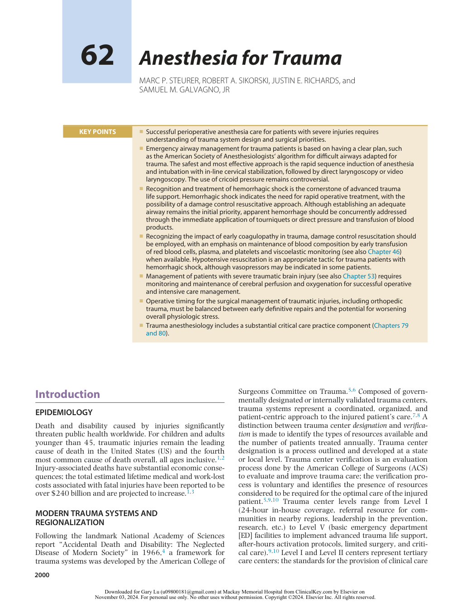

:::

<!-- PDF page 2 -->

to injured patients for Level I and Level II trauma centers are identical.9,10 A trauma system is an example of tiered regionalization because the most seriously injured patients in a geographical catchment area are cared for at designated tertiary care trauma centers.7 Over the past three decades, many studies have demonstrated significantly improved mortality,11–18 morbidity,18–21 and cost savings20,22 after establishing regionalized trauma systems.

### THE ROLE OF THE ANESTHESIOLOGIST

Anesthesiologists are subject matter experts regarding all aspects of resuscitation. They are uniquely trained to provide advanced care for the entire spectrum of traumatic injuries, from advanced airway management to damage control resuscitation, pain management, and critical care. At all levels of trauma care, anesthesiologists are uniquely juxtaposed with the multidisciplinary trauma team, serving an administrative role in preparing the operating room (OR), allocating resources for resuscitation, and providing direct patient care through definitive airway management and advanced resuscitation.23 Anesthesiologists also play a significant role as intensivists and pain management experts. Moreover, trauma patients represent a substantial proportion of all OR cases handled during night and weekend shifts.24 Regrettably, very few anesthesiologists in the United States consider trauma their primary specialty. This is distinct from European practice, where it is not unusual to find an anesthesiologist working in the prehospital environment, as a trauma team leader, or even as a director of an emergency department.25,26 The US model, in which nearly all anesthesiologists treat trauma patients—but few do so exclusively—has led to a relative deficiency of research, publication, and education in this field.24,27 This situation is unfortunate because trauma is an ever- evolving field of study that presents unique challenges to the clinician and one in which improvements in care can dramatically impact society.

## Prioritizing Trauma Care

### PREHOSPITAL TRIAGE

Ensuring that injured patients are transported to the correct level of trauma care can improve patient outcomes, but the process is sometimes fraught with difficulty. Prehospital estimation of blood loss is imprecise, and classically taught shock classifications are commonly confounded by extremes of age and variations in physiologic reserve.28 In 2011, the Centers for Disease Control and Prevention (CDC), along with the National Highway Traffic Safety Administration (NHTSA), collaborated with the American College of Surgeons’ Committee on Trauma (ACS- COT) to revise previous field triage decision schemes to reduce overtriage of patients with non- life- threatening injuries, and to help direct patients in most need of lifesaving interventions to appropriate trauma centers.29 Following feedback from emergency medical service (EMS) clinicians and trauma physicians, the guideline was updated and simplified in 2022 to align better with how assessments occur in the

field to make more accurate judgments about the appropriate level of care required for an injured patient.10 Current US guidelines recommend color- coded criteria for the field triage of trauma patients (Fig. 62.1).

Briefly summarized, patients meeting any injury patterns and/or age- adjusted mental status and vital sign thresholds (i.e., red criteria) are considered at high risk for severe injury. They should be transported to the highest- level trauma center available within the geographic constraints of the trauma system.10 Patients at moderate risk for serious injury (i.e., yellow criteria) should be transported to the next available level of trauma care within the geographical constraints of the traumatic system.10

### BLUNT VERSUS PENETRATING TRAUMA

Traditionally, the mechanism of traumatic injury has been referred to as _blunt_ versus _penetrating_ with no further delineation of how much energy was imparted or information regarding anatomic and physiologic insults. Some studies have suggested that the mechanism of injury alone is a poor predictor for trauma center referral.30,31 Others have demonstrated that distinct mechanisms, such as ejection from a vehicle or prolonged extrication time, clearly warrant trauma center team activation.32,33 Additional studies have justified the mechanism of injury as a parameter that helps reduce inappropriate transport of patients with major trauma to nontrauma centers.34,35

Blunt and penetrating injuries are regularly disparate in presentation but may share similarities in the extent of the injury.23 Penetrating injuries are identified as ballistic and non- ballistic. The point of injury in the patient with penetrating trauma may be utterly discernible—even to the inexpert provider—but the extent of tissue damage and depth of shock may be less detectible compared to the patient suffering from a blunt traumatic injury. Conversely, the patient with penetrating trauma will lose blood volume externally together with loss into body cavities. In contrast, the patient with blunt trauma may present in hemorrhagic shock with no apparent signs of hemorrhage. Multiple blunt traumatic insults, bleeding into compartments (e.g., unstable long bone fractures), retroperitoneal hemorrhage (e.g., pelvic fractures, major vascular injury, solid organ damage), and bleeding into other body cavities may present as indolent hemorrhagic shock.36

### ADVANCED TRAUMA LIFE SUPPORT

Thorough patient assessment, application of rapid diagnostic tests, and early activation of resources are vital for ensuring optimal outcomes in patients with severe traumatic injuries.23 The advanced trauma life support (ATLS) course of the American College of Surgeons is the most widely recognized training program for trauma physicians of all disciplines.37 Though not comprehensive in subspecialty areas, the ATLS curriculum provides a framework and a common language for the care of injured patients.38 ATLS is based on a “primary survey” that includes simultaneous efforts to identify and treat life- and limb- threatening injuries, beginning with the most immediate. This focus on urgent problems is first captured by the “golden hour” catchphrase

<!-- PDF page 3 -->

### RED CRITERIA

### High Risk for Serious Injury

### Injury Patterns

### Mental Status & Vital Signs

- Penetrating injuries to head, neck, torso, and proximal extremities

### All Patients

   - Unable to follow commands (motor GCS &lt;6)

   - RR &lt;10 or >29 breaths/min

- Skull deformity, suspected skull fracture

- Suspected spinal injury with new motor or sensory loss

- Chest wall instability, deformity, or suspected flail chest

- Suspected pelvic fracture

- Suspected fracture of two or more proximal long bones

- Crushed, degloved, mangled, or pulseless extremity

- Respiratory distress or need for respiratory support

- Room-air pulse oximetry &lt;90%

**Age 0–9 years**

- SBP &lt;70 mm Hg + (2 × age in years)

**Age 10–64 years**

   - SBP &lt;90 mm Hg or

   - HR > SBP

- Amputation proximal to wrist or ankle

**Age** � **65 years**

- Active bleeding requiring a tourniquet or wound packing with continuous pressure

- SBP &lt;110 mm Hg or

- HR > SBP

**_Patients meeting any one of the above RED criteria should be transported to the highest-level trauma center available within the geographic constraints of the regional trauma system_**

### YELLOW CRITERIA

### Moderate Risk for Serious Injury

### Mechanism of Injury

### EMS Judgment

- High-risk auto crash

- Partial or complete ejection

- Significant intrusion (including roof)

- >12 inches occupant site OR

- >18 inches any site OR

- Need for extrication for entrapped patient

- Death in passenger compartment

- Child (age 0–9 years) unrestrained or in unsecured child safety seat

- Vehicle telemetry data consistent with severe injury

- Rider separated from transport vehicle with significant impact (e.g., motorcycle, ATV, horse, etc.)

- Pedestrian/bicycle rider thrown, run over, or with significant impact

- Fall from height > 10 feet (all ages)

### Consider risk factors, including:

- Low-level falls in young children (ages č 5 years) or older adults (age � 65 years) with significant head impact • Anticoagulant use

- Suspicion of child abuse

- Special, high-resource health care needs

- Pregnancy > 20 weeks

- Burns in conjunction with trauma

• Children should be triaged preferentially to pediatric capable centers **If concerned, take to a trauma center**

**_Patients meeting any one of the YELLOW CRITERIA WHO DO NOT MEET RED CRITERIA should be preferentially transported to a trauma center, as available within the geographic constraints of the regional trauma system (need not be the highest-level trauma center)_**

**Fig. 62.1 National guideline for the field triage of trauma patients.** _ATV,_ all-terrain vehicle; _EMS,_ emergency medical ser vice; _GCS,_ Glasgow Coma Scale; _HR,_ heart rate; _RR,_ respiratory rate; _SBP,_ systolic blood pressure. (Reprinted with permission from Newgard C, et al. National guideline for the field tri age of injured patients: recommendation of the National Expert Panel on Field Triage. _J Trauma Acute Care Surg_ . 2022;93(2):e49–e60.)

and is the most crucial lesson of ATLS. Immediate treatment of life threatening traumatic injuries is followed by a meticulous secondary survey and further diagnostic studies designed to reduce the incidence of missed injuries. Knowing the basics of ATLS is essential for any physician who interacts with trauma patients. Fig. 62.2 is a simplified representation of the ATLS protocol.

A structured and systematically performed primary survey is the foundation for the initial assessment of the trauma patient. ATLS emphasizes the ABCDE mnemonic: airway, breathing, circulation, disability, and exposure. Verifying an open airway and acceptable respiratory mechanics is of primary importance because hypoxia is the most immediate threat to life. The inability to oxygenate the patient will

::: warning 符號需核對
此頁有符號無法完整擷取，請展開下方原始頁面核對。
:::

::: details 原始表格與符號（PDF 第 3 頁）

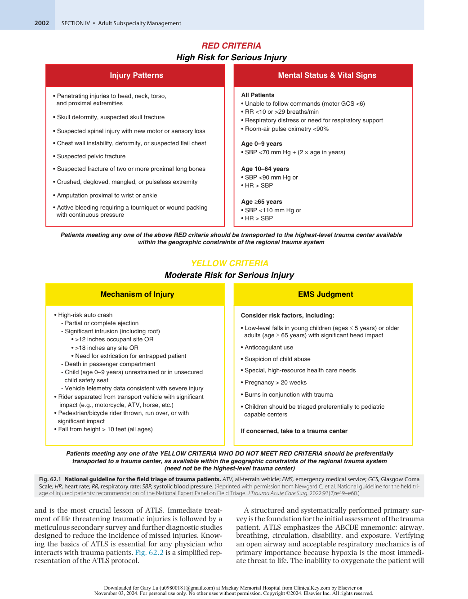

:::

<!-- PDF page 4 -->

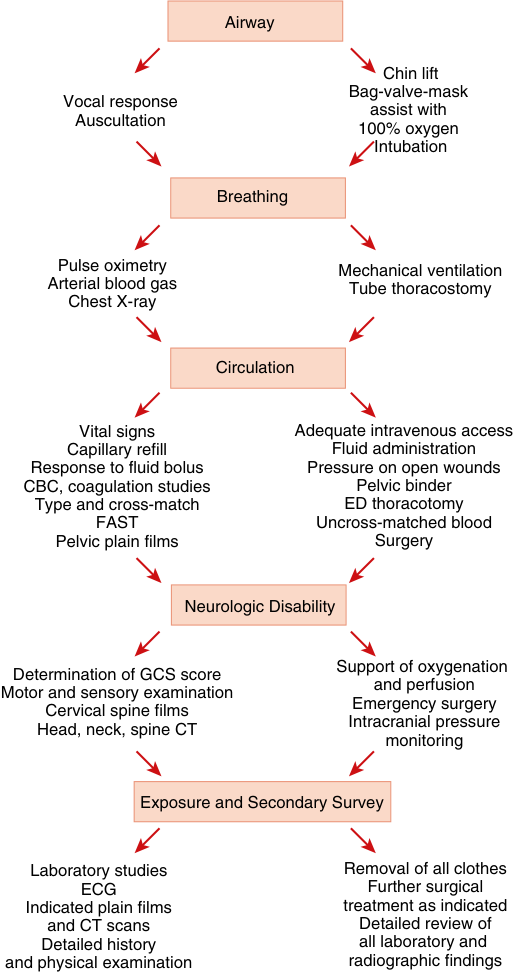

Airway Chin lift Bag-valve-mask Vocal response assist with Auscultation 100% oxygen Intubation Breathing Pulse oximetry Mechanical ventilation Arterial blood gas Tube thoracostomy Chest X-ray Circulation Vital signs Adequate intravenous access Capillary refill Fluid administration Response to fluid bolus Pressure on open wounds CBC, coagulation studies Pelvic binder Type and cross-match ED thoracotomy FAST Uncross-matched blood Pelvic plain films Surgery Neurologic Disability Determination of GCS score Support of oxygenation and perfusion Motor and sensory examination Emergency surgery Cervical spine films Intracranial pressure Head, neck, spine CT monitoring Exposure and Secondary Survey Laboratory studies Removal of all clothes ECG Further surgical Indicated plain films treatment as indicated and CT scans Detailed review of Detailed history all laboratory and and physical examination radiographic findings 

**Fig. 62.2 Simplified assessment and management of the trauma patient.** _CBC_ , complete blood count; _CT_ , computed tomography; _ECG_ , electrocardiogram; _ED_ , emergency department; _FAST_ , focused assessment by sonography for trauma; _GCS_ , Glasgow Coma Scale. (Adapted from the Advanced Trauma Life Support curriculum of the American Col lege of Surgeons.)

lead to permanent brain injury and death within 5 to 10 minutes. Even brief hypoxia or hypotension (or both) are associated with significantly worse outcomes.39,40 Trauma patients are at risk for airway obstruction and inadequate respiration for the reasons listed in Box 62.1.

The ABCDE survey should be repeated frequently whenever a patient’s status changes. The secondary survey occurs after the primary survey is complete and the patient’s vital functions improve. The secondary survey involves a head- to- toe examination, documenting all abnormal findings while protecting the patient from hypothermia.

Endotracheal intubation, whether performed in the prehospital environment or the ED, must be confirmed

### Box 62.1 Causes of Obstructed Airway or Inadequate Ventilation in a Trauma Patient

### Airway obstruction

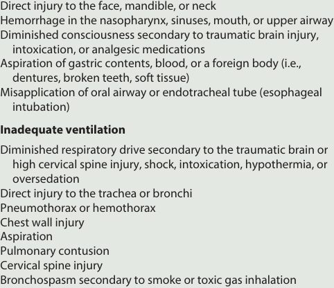

Direct injury to the face, mandible, or neck Hemorrhage in the nasopharynx, sinuses, mouth, or upper airway Diminished consciousness secondary to traumatic brain injury, intoxication, or analgesic medications Aspiration of gastric contents, blood, or a foreign body (i.e., dentures, broken teeth, soft tissue) Misapplication of oral airway or endotracheal tube (esophageal intubation) Inadequate ventilation Diminished respiratory drive secondary to the traumatic brain or high cervical spine injury, shock, intoxication, hypothermia, or oversedation Direct injury to the trachea or bronchi Pneumothorax or hemothorax Chest wall injury Aspiration Pulmonary contusion Cervical spine injury Bronchospasm secondary to smoke or toxic gas inhalation 

immediately by capnography. Esophageal intubation or endotracheal tube dislodgement is common and devastating if not promptly identified and corrected. Patients in cardiac arrest may have very low end- tidal CO2 values; laryngoscopy should be performed if there is any question about the location of the endotracheal tube (see also Chapter 40).

If attempts at securing the airway fail and surgical cricothyroidotomy is required this procedure must precede all others. Procedures such as tube thoracostomy or open thoracotomy, are commonly performed in the ED. Subsequent surgery to convert a cricothyroidotomy to a tracheostomy or close an emergency thoracotomy may follow in the OR.

Hemorrhage is the next most imperative concern because ongoing blood loss is inevitably fatal. The symptoms of shock are presented in Box 62.2.

Shock is presumed to result from hemorrhage until proven otherwise. Assessment of the circulation consists of an early phase, during active hemorrhage, and a late phase, which begins when hemostasis is achieved and continues until normal physiology is restored.41 In the early phase, diagnostic efforts focus on the five sites of bleeding detailed in Table 62.1, the only areas in which exsanguinating hemorrhage can occur.

Immediate actions to control hemorrhage can include the application of a pelvic binder for bleeding associated with pelvic fractures or tourniquet application for extremity injuries. Resuscitative endovascular occlusion of the aorta (REBOA) is another technique more commonly utilized at trauma centers to control life- threatening hemorrhage.42 Any trauma patient requiring a surgical procedure to control active hemorrhage must proceed to the OR emergently. This includes exploration of the neck or pericardium to rule out hemorrhage in confined compartments. In the OR, the trauma surgeon focuses on anatomic hemorrhage control, whereas the anesthesiologist is responsible for restoring the

<!-- PDF page 5 -->

### Box 62.2 Symptoms of Shock

Pallor Diaphoresis Agitation or obtundation Hypotension Tachycardia Prolonged capillary refill Diminished urine output Narrowed pulse pressure

### Box 62.3 Glasgow Coma Scale (GCS)

The GCS is the sum of the best scores in each of three categories:

### Eye- opening response

- 4 = Spontaneous (open before stimulus)

- 3 = To sound (after spoken or shouted request)

- 2 = To pressure

- 1 = None NT = Non- testable

- **Verbal response** 5 = Oriented (gives correct name, place, date)

**Table 62.1** Diagnostic and Therapeutic Options for Management of Traumatic Hemorrhage

|**Site of Bleeding**|**Diagnostic Modalities**|**Treatment Options**|
|---|---|---|
|**Chest**|Chest X- ray Thoracostomy tube output Chest CT scan|Observation Surgery|
|**Abdomen**|Physical exam Ultrasound exam (FAST) Abdominal CT Peritoneal lavage|Surgical ligation Angiography Observation|
|**Retroperitoneum**|CT scan Angiography|Angiography|
|**Long bones**|Physical exam Plain X- rays|Fracture fixation Surgical ligation|
|**Outside the body**|Physical exam|Direct pressure Surgical ligation|

_CT_ , computed tomography; _FAST_ , focused assessment by sonography for trauma.

patient’s physiology. Goals for early and late resuscitation are discussed in subsequent sections of this chapter.

If the patient does not require immediate airway management or emergentoperative procedures for hemorrhage control the assessment of the patient’s neurologic status should be performed by calculating the Glasgow Coma Scale (GCS) score43,44 (Box 62.3); examination of the pupils for size, reactivity, and symmetry; and determination of sensation and motor function in each of the extremities. Acceptable pressure stimuli include fingertip pressure, trapezius pinch, or supraorbital notch pressure. Abnormal flexion on the motor component may be observed as slow, stereotyped arm movement across the chest in response to pressure with the forearm rotating, thumbs clenched, and leg extended.45 Normal flexion is rapid, variable, and typically involves movement of the arm away from the body in response to pressure.45

Significant abnormalities on the neurologic examination are an indication of immediate cranial computed tomography (CT). Most trauma patients with a diminished GCS score will have nonoperative conditions. Still, for the few who require the operative evacuation of an epidural or subdural hematoma, the timeliness of treatment strongly influences the outcome. Patients with unstable spinal canal injuries and incomplete neurologic deficits will also benefit from early surgical stabilization.

- 4 = Confused (communicates coherently, but not oriented) 3 = Words (intelligible single words) 2 = Sounds (moaning/groaning) 1 = None (no audible response) NT = Non- testable

### Motor response

- 6 = Obeys 2- part command

- 5 = Localizes to painful stimuli

- 4 = Normal flexion (bends arm at elbow)

- 3 = Abnormal flexion (bends arm at elbow, but features appear abnormal)

- 2 = Extension 1 = None NT = Non- testable

The final step in the primary survey is a complete exposure of the patient and a head- to- toe search for visible injuries or deformities, including deformities of bones or joints, soft tissue bruising, and any breaks in the skin. The anesthesiologist can assist in the process by supporting the airway and keeping the cervical spine in a neutral position during the survey.

After the primary survey, a more deliberate secondary survey is performed which includes a thorough history, if the patient is a reliable historian, and physical examination, diagnostic studies, and subspecialty consultation. Any remaining injuries may be diagnosed at this time, and treatment plans are established. Indications for urgent or emergency surgery may also arise during the secondary survey. Indications such as the presence of a limbthreatening injury because of either vascular compromise, compartment syndrome, or a severely comminuted fracture. A pulseless extremity, compartment syndrome, nearamputation, or severely fractured extremity must proceed emergently to the OR and require immediate attention simultaneously with other resuscitative measures.

### INJURY PATTERNS PROMPTING URGENT OPERATIVE INTERVENTION

Fig. 62.3, an algorithm for prioritizing surgical management in trauma patients, is presented with the understanding that individual situations will vary according to available resources and the patient’s response to therapy.

A trauma patient will often arrive to the OR in need for more than one surgical procedure by more than one surgical service. A trauma patient may have injuries requiring emergency surgery coexisting with injuries that can

::: details 原始表格與符號（PDF 第 5 頁）

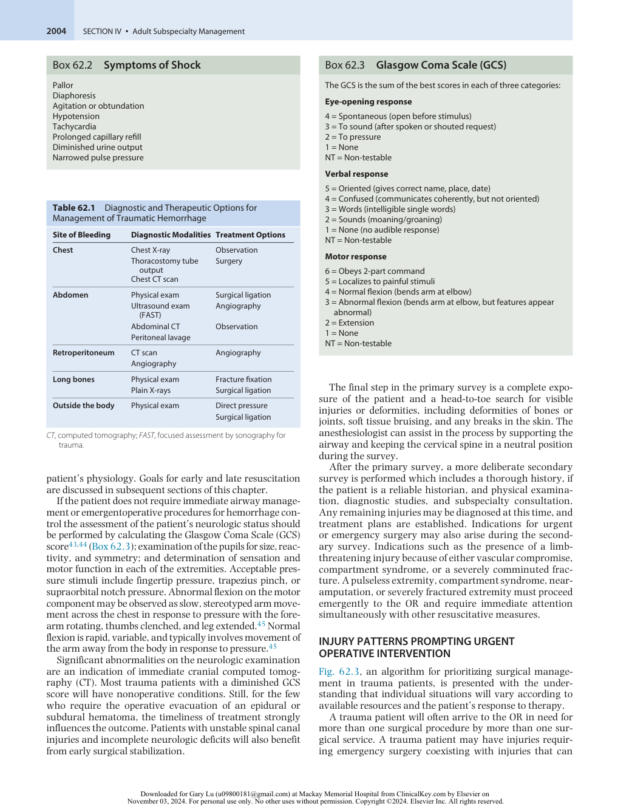

:::

<!-- PDF page 6 -->

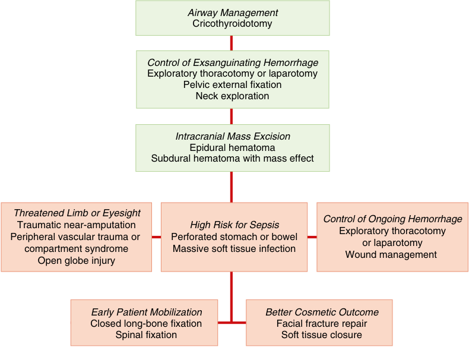

Airway Management Cricothyroidotomy Control of Exsanguinating Hemorrhage Exploratory thoracotomy or laparotomy Pelvic external fixation Neck exploration Intracranial Mass Excision Epidural hematoma Subdural hematoma with mass effect Threatened Limb or Eyesight Control of Ongoing Hemorrhage Traumatic near-amputation High Risk for Sepsis Exploratory thoracotomy Peripheral v ascular trauma or  Perforated stomach or bowel or laparotomy compartment syndrome Massive soft tissue infection Wound management Open globe injury Early Patient Mobilization Better Cosmetic Outcome Closed long-bone fixation Facial fracture repair Spinal fixation Soft tissue closure 

**Fig. 62.3 Surgical priorities in a trauma patient.** (Reprinted with permission from Dutton RP, Scalea TM, Aarabi B. Prioritizing surgical needs in the patient with multiple injuries. _Problems in Anesthesia_ . 2001;13:311.)

be repaired at any time. The anesthesiologist plays a vital role in determining which procedures to perform, in which order, and which procedures should be postponed until the patient is more stable.

In selected cases with obvious, imminent exsanguination, patients should be directly admitted to the operating room, bypassing the ED and radiology suite. Early trauma deaths may be prevented with immediate surgery; it has been shown that delays in getting to the OR may cause up to a third of preventable trauma deaths.46–49 In one registry study, mortality was increased by 1% for every 3 minutes of delay to laparotomy among hypotensive patients with abdominal injuries.47–49 Steele _et al._ were among the first to describe a “direct to the OR” approach in San Diego, reporting data gathered over ten years.50 Patients with traumatic cardiac arrest, systolic blood pressure persistently &lt;100 mm Hg, amputation, or uncontrolled external hemorrhage, were admitted directly to the OR for resuscitation, regardless of the mechanism of injury. These triage criteria had poor sensitivity (24.1%) but high specificity (98%) in identifying patients needing immediate surgery.50 Observed compared to predicted survival was significantly higher in this observational study. In another 10- year retrospective analysis from Portland, Oregon, Martin _et al._ used the same triage criteria as Steele _et al._ , with the addition of the following indications for “unstable” patients requiring direct- to- OR admission: patients with a chest injury; acute abdomen; crush injury to the torso or evisceration of abdominal contents; penetrating injuries to the neck, chest, abdomen or pelvis; impaled objects in the neck, chest, abdomen or pelvis; or massive blood loss at the

scene or _en route_ .51 From 2000 to 2009, 1407 patients were admitted directly to the OR (5% of all admissions). After excluding patients who died on arrival (8%), 3.6% died in the OR, and overall observed mortality (5%) was significantly lower than predicted (10%). Emergent surgical procedures were started within 30 minutes of arrival in 77% of patients and within 60 minutes in 92%. In a 2014 study by Remick _et al._ that included 1407 patients admitted directly to the OR (5%), mortality was 10% lower than predicted.46

## Emergency Airway Management

### EMERGENCY AIRWAY MANAGEMENT ALGORITHM

The American Society of Anesthesiologists (ASA) algorithm for managing difficult airways modified for trauma (see Fig. 62.4) is a helpful starting point for the trauma anesthesiologist, whether in the ED or the OR.31,32

Although the options included will vary from institution to institution and provider to provider, the concept of the algorithm is an important one. The anesthesiologist should have a plan for the initial approach to the airway and for coping with any difficulties that might develop. Fig. 62.4 is a typical algorithm for the emergency intubation of an unstable trauma patient. Note that it differs from the ASA algorithm in that reawakening a patient is seldom an option because the need for emergency airway control will presumably remain. Once the decision to obtain a definitive airway is made, efforts continue until a cuffed tube is positioned in the trachea, whether by conventional intubation or a surgical approach. Failure to commit to a surgical

<!-- PDF page 7 -->

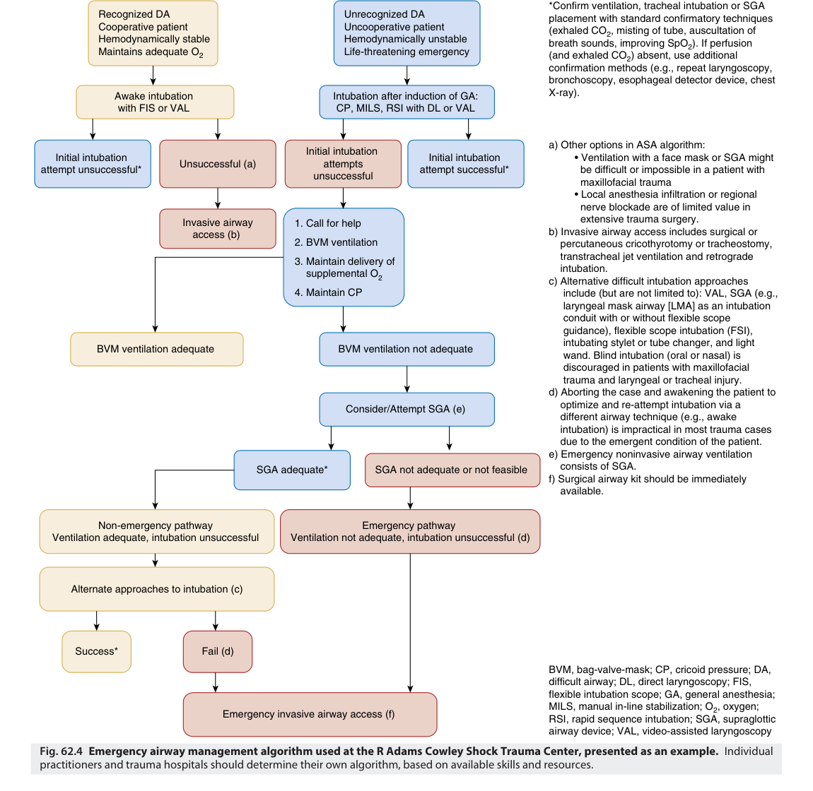

*Confirm ventilation, tracheal intubation or SGA Recognized DA  Unrecognized DA  placement with standard confirmatory techniques Cooperative patient  Uncooperative patient  (exhaled CO2, misting of tube, auscultation of Hemodynamically stable  Hemodynamically unstable  breath sounds, improving SpO2). If perfusion Maintains adequate O2 Life-threatening emergency (and exhaled CO2) absent, use additional confirmation methods (e.g., repeat laryngoscopy, bronchoscopy, esophageal detector device, chest Awake intubation  Intubation after induction of GA:  X-ray). with FIS or VAL  CP, MILS, RSI with DL or VAL Initial intubation  a) Other options in ASA algorithm: Initial intubation  Initial intubation           • Ventilation with a face mask or SGA might Unsuccessful (a) attempts attempt unsuccessful*  unsuccessful attempt successful*             be difficult or impossible in a patient with            maxillofacial trauma          • Local anesthesia infiltration or regional            nerve blockade are of limited value in Invasive airway 1. Call for help            extensive trauma surgery. access (b)  b) Invasive airway access includes surgical or 2. BVM ventilation     percutaneous cricothyrotomy or tracheostomy,     transtracheal jet ventilation and retrograde 3. Maintain delivery of     intubation.     supplemental O2 c) Alternative difficult intubation approaches 4. Maintain CP       include (but are not limited to): VAL, SGA (e.g.,      laryngeal mask airway [LMA] as an intubation      conduit with or without flexible scope      guidance), flexible scope intubation (FSI),      intubating stylet or tube changer, and light BVM ventilation adequate  BVM ventilation not adequate      wand. Blind intubation (oral or nasal) is      discouraged in patients with maxillofacial      trauma and laryngeal or tracheal injury. d) Aborting the case and awakening the patient to Consider/Attempt SGA (e)      optimize and re-attempt intubation via a     different airway technique (e.g., awake     intubation) is impractical in most trauma cases     due to the emergent condition of the patient. e) Emergency noninvasive airway ventilation SGA adequate* SGA not adequate or not feasible      consists of SGA. f) Surgical airway kit should be immediately     available. Non-emergency pathway  Emergency pathway Ventilation adequate, intubation unsuccessful  Ventilation not adequate, intubation unsuccessful (d) Alternate approaches to intubation (c) Success* Fail (d) BVM, bag-valve-mask; CP, cricoid pressure; DA, difficult airway; DL, direct laryngoscopy; FIS, flexible intubation scope; GA, general anesthesia; MILS, manual in-line stabilization; O2, oxygen; Emergency invasive airway access (f) RSI, rapid sequence intubation; SGA, supraglottic airway device; VAL, video-assisted laryngoscopy Fig. 62.4 Emergency airway management algorithm used at the R Adams Cowley Shock Trauma Center, presented as an example.  Individual practitioners and trauma hospitals should determine their own algorithm, based on available skills and resources. 

airway soon enough results in poor outcomes more commonly than complications of a procedure that might have been unnecessary.

### INDICATIONS FOR A DEFINITIVE AIRWAY

The goal of emergency airway management is to ensure adequate oxygenation and ventilation while protecting the patient from the risks of aspiration. A definitive airway is defined as a cuffed tube in the trachea.38,52 Endotracheal intubation is commonly required and is indicated categorically in the following conditions:

- Cardiac or respiratory arrest

- Respiratory insufficiency (see Box 62.1)

- Airway protection

- The need for deep sedation or analgesia, up to and including general anesthesia

- Transient hyperventilation of patients with spaceoccupying intracranial lesions and evidence of increased intracranial pressure (ICP)

- Delivery of a 100% fraction of inspired oxygen (FiO2) to patients with carbon monoxide poisoning

- Facilitation of the diagnostic workup in uncooperative or intoxicated patients

<!-- PDF page 8 -->

### APPROACH TO ENDOTRACHEAL INTUBATION

The anesthesiologist should generally insist on the same monitoring standards for airway management in the ED as in the OR, including an electrocardiogram (ECG), blood pressure, oximetry, and capnography. Appropriate equipment, including an oxygen source, bag–valve–mask ventilating system, mechanical ventilator, suction, and a selection of laryngoscope blades, endotracheal tubes, and devices for managing difficult intubations (e.g., video laryngoscope), should be available in any location where emergency intubation is likely, including the ED.

Endotracheal intubation is best accomplished in almost all cases with a modified rapid- sequence approach by an operator with experience in this practice. Although concern may exist that using neuromuscular blocking drugs and potent anesthetics outside the OR will be associated with a higher complication rate, the opposite is more likely correct. Anesthetic induction and neuromuscular blockade allow the best first- pass intubating conditions, which is advantageous in an uncooperative, hypoxic, or aspirating patient.53–55 Attempts to secure the airway in an awake or lightly sedated patient increase the risk for airway trauma, pain, aspiration, hypertension, laryngospasm, and further combative behavior. Experienced providers, supported by appropriate monitoring and equipment, have achieved results of medication- assisted intubation outside the OR that are equivalent to those for emergency intubation within the OR.56–59

### PROPHYLAXIS AGAINST ASPIRATION OF GASTRIC CONTENTS

A trauma patient should always be treated as having a full stomach and at risk for gastric contents aspiration during anesthesia induction (see Chapter 40). Reasons include ingesting food or liquids before the injury, swallowing blood from oral or nasal injuries, delayed gastric emptying associated with the stress of trauma, and administration of liquid contrast medium for abdominal CT scanning.

Cricoid pressure—the Sellick maneuver60 —has previously been recommended to be applied continuously during emergency airway management from when the patient loses protective airway reflexes until endotracheal tube placement and cuff inflation are confirmed. The Sellick maneuver involves elevating the patient’s chin (without displacing the cervical spine) and then pushing the cricoid cartilage posteriorly to close the esophagus. More recent evidence suggests that cricoid pressure may worsen the laryngoscopic grade of view in up to 30% of patients61 without providing effective prevention of aspiration.62 In a prehospital study evaluating the impact of cricoid pressure on subsequent intubation success, discontinuing cricoid pressure and further laryngeal manipulation improved success fo endotracheal intubation.63 Thus, it is appropriate for the intubator to request that cricoid pressure be released in the trauma patient if this problem is suspected during a difficult intubation. The lack of evidence supporting the use of cricoid pressure and its potential to make intubation more difficult has led the American Heart Association to recommend discontinuing its use during cardiac arrest situations.64 Additionally, the Eastern Association for the

Surgery of Trauma Practice Management Guidelines for emergency tracheal intubation have removed it as a Class 1 recommendation.54

In the traditionally defined rapid- sequence induction of anesthesia, any attempt at ventilation between medication administration and intubation is avoided, presumably because positive- pressure ventilation may force gas into the patient’s stomach, leading to regurgitation and aspiration. Sellick’s original paper described ventilation during cricoid pressure in patients with full stomachs. Applying cricoid pressure during mask ventilation was believed to prevent this gastric inflation.60 While this may be true, cricoid pressure may reduce tidal volumes, increase peak inspiratory pressure, or prevent ventilation.62 On the other hand, the increase in oxygen consumption in trauma patients necessitates preoxygenation whenever possible and because preoxygenation may be difficult in a trauma patient—because of facial trauma, decreased respiratory effort, or agitation— rapid desaturation is a possibility. Positive- pressure ventilation during all phases of induction provides the largest possible oxygen reserve during emergency airway management and will help mitigate hypoxia if intubation proves difficult. In this situation, large tidal volumes and high peak inspiratory pressures should be avoided.

In classic experiments with adults, the lower esophageal sphincter may be violated at peak airway pressures above 25 cm H2O, thus potentially increasing the risk for aspiration.65 Application of cricoid pressure during attempts at positive- pressure ventilation may be considered to reduce gastric inflation but may prevent adequate ventilation in some patients necessitating discontinuation. Cricoid pressure may be more effective in preventing gastric insufflation in children than in adults. With appropriately applied cricoid pressure, even with peak inspiratory pressures of up to 40 cm H2O, gastric insufflation was not observed in a small study that included infants and children from 2 months to 8 years of age.66

### PROTECTION OF THE CERVICAL SPINE

Standard practice dictates that all blunt trauma victims are assumed to have an unstable cervical spine until proven otherwise. The airway management of these patients receives much attention from anesthesiologists because direct laryngoscopy causes cervical motion, with the potential to exacerbate spinal cord injury (SCI). Stabilization of the cervical spine will generally occur in the prehospital environment, with the patient already having a rigid cervical collar. The presence of an “uncleared” cervical spine mandates the use of in- line manual stabilization (not traction) throughout any attempt at intubation.37 This approach allows removal of the front of the cervical collar to facilitate wider mouth opening and jaw displacement; however, this may slightly lengthen the time to intubation and worsen laryngeal visualization during laryngoscopy compared to intubation attempts without manual in- line stabilization.67 In- line stabilization has been tested through considerable clinical experience and is the standard of care in the ATLS curriculum. The risk of spinal cord injury during tracheal intubation appears to be minimal, even in the presence of gross cervical spine instability.68 Furthermore, the magnitude of the force applied during laryngoscopy seems to be the most

<!-- PDF page 9 -->

significant factor associated with cervical spine movement during intubation in cadaver studies.69,70

Emergency awake fiberoptic intubation, though requiring less manipulation of the neck, is generally very difficult because of airway secretions and hemorrhage, rapid desaturation, and lack of patient cooperation and is best reserved for cooperative patients with known cervical instability under controlled conditions (see also Chapter 40). Indirect video laryngoscopy offers several potential advantages, including decreased cervical motion and improved visualization.71,72 Among non- physician intubators, video laryngoscopy is associated with enhanced first- pass and overall success. Still, for experienced physicians, no definite advantage has been observed compared to direct laryngoscopy.73 For critically ill patients, video laryngoscopy has been shown to reduce the risk of difficult intubation and esophageal intubation while increasing first- pass success.74 In comparative studies of direct laryngoscopy, video laryngoscopy, fiberoptic, blind nasal intubation, or cricothyrotomy—in patients with known cervical cord/spine injuries—there is no difference in neurologic deterioration based on the technique used, and no clear evidence that direct laryngoscopy worsens outcome.75

### PERSONNEL

Emergency intubation requires more assistance than intubation performed under controlled conditions (see Chapter 40). Three providers are required to ventilate the patient, manage the airway, administer medications, and provide in- line cervical stabilization; a fourth provider may be needed to provide cricoid pressure if deemed appropriate. Fig. 62.5 is an illustration of this approach.

Additional assistance may be required to restrain a patient who is combative because of intoxication or traumatic brain injury (TBI).

The immediate presence of a surgeon or other physician who can expeditiously perform a cricothyroidotomy is desirable. Even if a surgical airway is not required, other experienced hands may prove helpful during difficult intubations. The surgeon may also wish to inspect the upper airway during laryngoscopy if there has been trauma to the face or neck. A video laryngoscope may prove invaluable in this scenario. Urgent tube thoracostomy may prove necessary in some trauma patients to treat a tension pneumothorax that may develop with the onset of positive- pressure ventilation.

### ANESTHETICS AND INDUCTION OF ANESTHESIA

Any intravenous (IV) anesthetic administered to a trauma patient in hemorrhagic shock may potentiate profound hypotension and even cardiac arrest because of the inhibition of circulating catecholamines. Although propofol is the mainstay of IV induction in the OR, its use in trauma patients is especially problematic because of its vasodilatory and negative inotropic effects. Moreover, pharmacokinetic and pharmacodynamic studies in a swine model of hemorrhagic shock suggest a significant reduction in propofol dosage of more than 80% to achieve the targeted effect site concentration.76,77 Unfortunately, there is a paucity of clinical data regarding the impact of reduced propofol

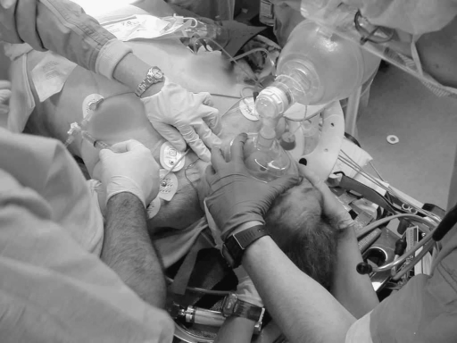

**Fig. 62.5 Emergency intubation of a trauma patient, immobilized on a long spine board.** The front of the cervical collar is removed once in- line manual stabilization of the spine is established, allowing for cricoid pressure and greater excursion of the mandible. (Reprinted with permission from Dutton RP. Spinal cord injury. _Int Anesthesiol Clin_ . 2002;40:111.)

dosing in the setting of hemorrhagic shock on recall and awareness.78 The effects of hemorrhagic shock on the brain appear to potentiate the effects of anesthetics, with propofol doses as small as one- tenth of normal producing deep anesthesia in animals in shock.76

The most commonly used induction agent in the United States in the ED or trauma setting is etomidate.79 When used in a range of 0.2 to 0.3 mg/kg, etomidate is associated with hemodynamic stability and has an onset of action and duration of effect similar to succinylcholine. Whereas the safety profile of etomidate in trauma patients has been challenged, most of the studies have been retrospective and fraught with methodologic limitations such as selection bias.80,81 Even a single dose of etomidate is associated with transient adrenal insufficiency. Still, this effect is not considered clinically significant in trauma and mixed surgical– medical patients undergoing rapid sequence induction and intubation.82–84 Myoclonus may be observed in over 30% of patients who receive etomidate, but the use of a rapidly acting neuromuscular agent, such as succinylcholine or rocuronium, mitigates this effect.85

Ketamine is also a frequently used induction agent for hypotensive trauma patients due to its centrally mediated increase in sympathetic tone and catecholamine release.86 The use of ketamine has previously been questioned in patients with traumatic brain injury based on older reports of ICP elevation.87,88 More recent analyses have shown that cerebral perfusion is preserved through the maintenance of mean arterial blood pressure in hemodynamically unstable patients. This may be more important than any theoretical risk of harmful CNS effects due to ketamine’s tendency to increase cerebral activity and ICP.87,89 Some investigators have also raised concerns that the psychotropic effects associated with ketamine may increase the risk of acute and posttraumatic stress disorder in trauma patients,90,91 although this was not found in a study examining its intraoperative use in burn patients.92 A 2019 systematic review noted no differences in outcomes (mortality,

<!-- PDF page 10 -->

length of hospital stay, or number of blood transfusions) when ketamine ( _n_ = 634) rather than etomidate ( _n_ = 699) was selected to induce anesthesia in trauma patients (one randomized trial and two non- randomized trials).93 Experimentally, ketamine has been shown to have direct myocardial depressant properties94,95 ; however, the indirect effect of catecholamine release and inhibition of catecholamine reuptake may result in tachycardia and hypertension.96 In hemodynamically stressed patients, the cardiac depression may be unmasked and lead to cardiovascular collapse.97 Due to its abuse potential, ketamine may not be as readily available in some resuscitation areas compared to other induction agents. Nevertheless, ketamine continues to be a commonly used drug for rapid sequence induction and intubation in trauma patients.79,93,98

The patient’s hemodynamic state dictates the choice of induction agent for a trauma patient.98 Hypotension will develop in hypovolemic patients with the administration of any anesthetic because of interruption of compensatory sympathetic outflow and the sudden change to positivepressure ventilation.99 Previously healthy young patients can lose up to 40% of their blood volume before experiencing a decrease in blood pressure, thereby leading to potentially catastrophic circulatory collapse with induction of anesthesia, regardless of the anesthetic chosen. The dose of anesthetic must be decreased in the presence of hemorrhage, including no anesthetic at all in patients with lifethreatening hypovolemia. The shock index (heart rate divided by systolic blood pressure) may guide appropriate dose reductions for unstable patients. A suggested nomogram is presented in Fig. 62.6.

Rapid- sequence induction and intubation may proceed with muscle relaxants alone, although onset time may be prolonged in a patient with circulatory impairment. Subsequent patient recall of intubation and emergency procedures is highly variable and affected by the presence of coexisting TBI, intoxication, and the depth of hemorrhagic shock (see Chapters 27 and 40).

Decreased cerebral perfusion appears to inhibit memory formation but cannot be reliably associated with any particular blood pressure or chemical marker. Small doses of midazolam may reduce the incidence of patient awareness but can also contribute to hypotension. Although the recall of ED or peri-operative events is not unusual in this circumstance, anesthesia provider liability appears to be limited; an analysis of intraoperative awareness lawsuits in the ASA Closed Claims Database revealed no claims related to surgery in trauma patients.100

### NEUROMUSCULAR BLOCKING DRUGS

Succinylcholine remains the neuromuscular blocker with the fastest onset—less than 1 minute—and the shortest duration of action – 5 to 10 minutes (see Chapters 11 and 40).98 These properties make it popular for rapid- sequence induction of anesthesia. Although the use of succinylcholine may allow the return of spontaneous respiration before the development of significant hypoxia in the “cannot intubate, cannot ventilate” situation, this is unlikely to be beneficial in an emergency intubation in a trauma patient. The anesthesiologist should not rely on the return of spontaneous breathing in time to salvage a difficult airway management problem but should instead proceed with efforts to obtain a definitive airway, including cricothyroidotomy, if other possibilities have been exhausted.

The administration of succinylcholine is associated with several adverse consequences. Increases in serum potassium of 0.5 to 1.0 mEq/L are expected, but in certain patients, potassium may increase by more than 5 mEq/L.101 A hyperkalemic response is typically seen in burn victims and those with muscle pathology secondary to direct trauma, denervation (as with SCI), or immobilization. Hyperkalemia is not seen in the first 24 hours after these injuries, and succinylcholine may be used safely for acute airway management. Patients at risk are those with underlying pathology before their traumatic event or those undergoing subsequent surgery in the weeks to months after injury.

||||||||**He**|**art Rate**|**(beats/**|**min)**||||||||||
|---|---|---|---|---|---|---|---|---|---|---|---|---|---|---|---|---|---|---|---|
||**50.00**|**55.00**|**60.00**|**65.00**|**70.00**|**75.00**|**80.00**|**85.00**|**90.00**|**95.00**|**100.00**|**105.00**|**110.00**|**115.00**|**120.00**|**125.00**|**130.00**|**135.00**|**140.00**|
|**60**|0.83|0.92|1.00|1.08|1.17|1.25|1.33|1.42|1.50|1.58|1.67|1.75|1.83|1.92|2.00|2.08|2.17|2.25|2.33|
|**65**|0.77|0.85|0.92|1.00|1.08|1.15|1.23|1.31|1.38|1.46|1.54|1.62|1.69|1.77|1.85|1.92|2.00|2.08|2.15|
|**70**|0.71|0.79|0.86|0.93|1.00|1.07|1.14|1.21|1.29|1.36|1.43|1.50|1.57|1.64|1.71|1.79|1.86|1.93|2.00 **Propofol 0.25–0.5 mg/kg**|
|**75**|0.67|0.73|0.80|0.87|0.93|1.00|1.07|1.13|1.20|1.27|1.33|1.40|1.47|1.53|1.60|1.67|1.73|1.80|1.87|
|**80**|0.63|0.69|0.75|0.81|0.88|0.94|1.00|1.06|1.13|1.19|1.25|1.31|1.38|1.44|1.50|1.56|1.63|1.69|1.75 **Etomidate 0.05–0.1 mg/kg**|
|**85**|0.59|0.65|0.71|0.76|0.82|0.88|0.94|1.00|1.06|1.12|1.18|1.24|1.29|1.35|1.41|1.47|1.53|1.59|1.65|
|**g)** **90**|0.56|0.61|0.67|0.72|0.78|0.83|0.89|0.94|1.00|1.06|1.11|1.17|1.22|1.28|1.33|1.39|1.44|1.50|1.56 **Ketamine 0.5–1.0. mg/kg**|
|**H** **95**|0.53|0.58|0.63|0.68|0.74|0.79|0.84|0.89|0.95|1.00|1.05|1.11|1.16|1.21|1.26|1.32|1.37|1.42|1.47|
|**mm** **100**|0.50|0.55|0.60|0.65|0.70|0.75|0.80|0.85|0.90|0.95|1.00|1.05|1.10|1.15|1.20|1.25|1.30|1.35|1.40|
|**e (** **105**|0.48|0.52|0.57|0.62|0.67|0.71|0.76|0.81|0.86|0.90|0.95|1.00|1.05|1.10|1.14|1.19|1.24|1.29|1.33|
|**ur** **110**|0.45|0.50|0.55|0.59|0.64|0.68|0.73|0.77|0.82|0.86|0.91|0.95|1.00|1.05|1.09|1.14|1.18|1.23|1.27 **Propofol 0.5–1.0 mg/kg**|
|**ess** **115**|0.43|0.48|0.52|0.57|0.61|0.65|0.70|0.74|0.78|0.83|0.87|0.91|0.96|1.00|1.04|1.09|1.13|1.17|1.22|
|**pr** **120**|0.42|0.46|0.50|0.54|0.58|0.63|0.67|0.71|0.75|0.79|0.83|0.88|0.92|0.96|1.00|1.04|1.08|1.13|1.17 **Etomidate 0.1–0.2 mg/kg**|
|**od** **125**|0.40|0.44|0.48|0.52|0.56|0.60|0.64|0.68|0.72|0.76|0.80|0.84|0.88|0.92|0.96|1.00|1.04|1.08|1.12|
|**lo** **130**|0.38|0.42|0.46|0.50|0.54|0.58|0.62|0.65|0.69|0.73|0.77|0.81|0.85|0.88|0.92|0.96|1.00|1.04|1.08 **Ketamine 1.0–1.5 mg/kg**|
|**c b** **135**|0.37|0.41|0.44|0.48|0.52|0.56|0.59|0.63|0.67|0.70|0.74|0.78|0.81|0.85|0.89|0.93|0.96|1.00|1.04|
|**toli** **140**|0.36|0.39|0.43|0.46|0.50|0.54|0.57|0.61|0.64|0.68|0.71|0.75|0.79|0.82|0.86|0.89|0.93|0.96|1.00|
|**ys** **145**|0.34|0.38|0.41|0.45|0.48|0.52|0.55|0.59|0.62|0.66|0.69|0.72|0.76|0.79|0.83|0.86|0.90|0.93|0.97|
|**S** **150**|0.33|0.37|0.40|0.43|0.47|0.50|0.53|0.57|0.60|0.63|0.67|0.70|0.73|0.77|0.80|0.83|0.87|0.90|0.93|
|**155**|0.32|0.35|0.39|0.42|0.45|0.48|0.52|0.55|0.58|0.61|0.65|0.68|0.71|0.74|0.77|0.81|0.84|0.87|0.90 **Propofol 1.0–2.0 mg/kg**|
|**160**|0.31|0.34|0.38|0.41|0.44|0.47|0.50|0.53|0.56|0.59|0.63|0.66|0.69|0.72|0.75|0.78|0.81|0.84|0.88|
|**165**|0.30|0.33|0.36|0.39|0.42|0.45|0.48|0.52|0.55|0.58|0.61|0.64|0.67|0.70|0.73|0.76|0.79|0.82|0.85 **Etomidate 0.2–0.3 mg/kg**|
|**170**|0.29|0.32|0.35|0.38|0.41|0.44|0.47|0.50|0.53|0.56|0.59|0.62|0.65|0.68|0.71|0.74|0.76|0.79|0.82|
|**175**|0.29|0.31|0.34|0.37|0.40|0.43|0.46|0.49|0.51|0.54|0.57|0.60|0.63|0.66|0.69|0.71|0.74|0.77|0.80 **Ketamine 1.5–2.25 mg/kg**|
|**180**|0.28|0.31|0.33|0.36|0.39|0.42|0.44|0.47|0.50|0.53|0.56|0.58|0.61|0.64|0.67|0.69|0.72|0.75|0.78|
|**C**|**onsider mov** **A** **Hi** **K** **U** **Fr** **A** **C** **Hi**|**ing up on bl** **ge > 70** **story of cong** **nown ejectio** **ntreated hype** **ailty** **mputated lim** **ervical spine** **story of beta**|**ock (or redu** **estive hea** **n fraction &lt;** **rtension** **b** **or high tho** **-blocker us**|**ced dosing** **rt failure/ca** **40%** **racic spine** **e**|**) if:** **rdiomyopath** **injury**|**Fo** **y**|**r ASA IV or**|**V consider**|**red zone d**|**osing**||||||||||

**<mark>Fig. 62.6 Shock index–based dosing for rapid sequence induction and intubation of trauma patients.</mark>**

::: details 原始表格與符號（PDF 第 10 頁）

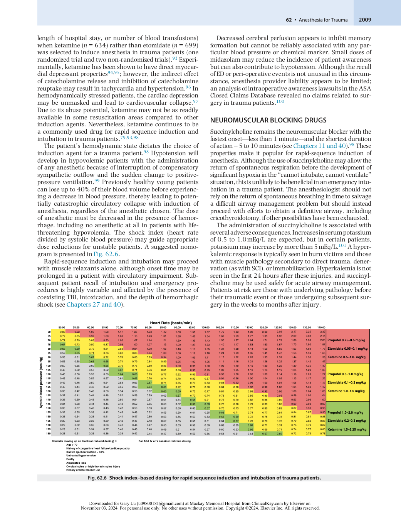

:::

<!-- PDF page 11 -->

Succinylcholine causes an increase in intraocular pressure and should be used cautiously in patients with ocular trauma.102 Succinylcholine may also increase ICP,103 so its use in brain trauma victims is controversial. Hypoxia and hypercapnia may be as damaging as the transient increase in pressure caused by the drug.40 If succinylcholine use leads to faster intubation, its benefits may outweigh its risks. Succinylcholine must be evaluated for each situation based on the acuity of CNS injury, the anticipated speed with which intubation can be accomplished, and the likelihood that hypoxia will develop.

Alternatives to succinylcholine include rocuronium (0.9 to 1.2 mg/kg) and vecuronium (0.1 to 0.2 mg/kg). Because these drugs have no significant cardiovascular toxicity, large doses can be administered to achieve rapid (1- to 2- minute) systemic relaxation. Unfortunately, at this dose, the duration of action of either rocuronium or vecuronium will be 1 to 2 hours, which may be significant if inadequate sedation leads to patient awareness of paralysis or if it prevents ongoing neurologic assessment. In a 2015 Cochrane review, succinylcholine was superior to rocuronium for achieving superior intubating conditions; however, when appropriately dosed (1.2 mg/kg), no differences in intubating conditions were observed between the two agents.104

Specific situations will always exist where maintaining spontaneous ventilation during intubation is the preferred way to proceed. If patients can maintain their airway temporarily but have clear indications for an artificial airway, slow induction with ketamine or an inhaled induction with sevoflurane through cricoid pressure is an alternative strategy that may enable the placement of an endotracheal tube without compromising the patient.

### ADJUNCTS TO ENDOTRACHEAL INTUBATION

Equipment to facilitate difficult intubation should be readily available wherever emergency airway management is performed (see Chapter 40). The equipment available depends on the preferences of the anesthesiologist; the usefulness of most special equipment depends more on previous experience than on any intrinsic properties of the device. However, certain items deserve mention because of their frequent citation as aids in managing a difficult airway.

The gum elastic bougie _,_ or intubating introducer, is an inexpensive and easily mastered adjunct for managing a difficult airway. The bougie is placed through the vocal cords via direct laryngoscopy, and the endotracheal tube is then advanced over the bougie into the trachea. Placement of the bougie is easier than direct placement of an endotracheal tube because of its smaller diameter and the ability of an experienced operator to feel it enter the trachea (tracheal rings) even when the glottic opening cannot be visualized. The bougie is passed under the epiglottis and gently advanced; if resistance is met, it is withdrawn, rotated slightly, and advanced again. In this fashion, the anesthesiologist can blindly “palpate” the larynx until the bougie advances into the trachea. The bougie can also be used with indirect video laryngoscopy systems and is especially useful in the ED when the sniffing position cannot be used because of uncertainty about the cervical spine. A bougie with a cudette tip may facilitate placement in this scenario.

Supraglottic airway (SGA) devices such as the laryngeal mask airway (LMA; LMA North America, San Diego, CA) are recommended in the ASA algorithm for the management of a patient with a difficult airway. The LMA can be used as a guide for intubation when unsuspected difficult intubation is encountered in a trauma patient; an endotracheal tube may be placed blindly through the lumen of the LMA and into the trachea, or a fiberoptic bronchoscope may be used to guide the tube through the LMA. The LMA is an appropriate rescue device for a difficult airway situation in trauma if there is no significant anatomic injury or hemorrhage in the mouth and larynx.

### FACIAL AND PHARYNGEAL TRAUMA

Trauma to the face and upper airway poses particular difficulties for the anesthesiologist.105 Serious skeletal derangements may be masked by minor soft tissue damage. Failure to identify an injury to the face or neck can lead to acute airway obstruction secondary to swelling and hematoma. Laryngeal edema is also a risk in patients who have suffered a chemical or thermal injury to the pharyngeal mucosa. Intraoral hemorrhage, pharyngeal erythema, and change in voice are all indications of early intubation.

In general, maxillary and mandibular fractures make ventilation by mask more difficult, whereas mandibular fractures may make endotracheal intubation easier. Palpation of the facial bones before airway manipulation will alert the anesthetist to these possibilities. Patients with injuries to the jaw and zygomatic arch often have trismus. Although the trismus will resolve with neuromuscular blocking agents, preinduction assessment of airway anatomy may be difficult. Bilateral mandibular fractures and pharyngeal hemorrhage may lead to upper airway obstruction, particularly in a supine patient. However, intubation may be easier because of the loss of skeletal resistance to direct laryngoscopy. A patient arriving at the ED in a sitting or prone position because of airway compromise is best left in that position until the moment of anesthetic induction and intubation.

### THE AIRWAY PLACED IN THE FIELD

In many settings, prehospital clinicians work under protocols that allow for advanced airway management, including endotracheal intubation or placement of an SGA (see also Chapter 63). It is recommended that the individuals responsible for airway management at the ED level be familiar with the protocols and devices available in their region to facilitate early assessment and airway exchange. All intubations accomplished in the field should be immediately confirmed using capnography. In the event of cardiac arrest in an inability to ensure correct placement by observation of end tidal CO2, direct laryngoscopy or video laryngoscopy must be employed to visualize the position of the endotracheal tube (ETT). When an SGA device is used in the prehospital setting, the positioning and ability to ventilate should be confirmed by capnometry, breath sounds, and chest movement. If there is adequate ventilation, replacement of the SGA can be delayed during the initial evaluation.

<!-- PDF page 12 -->

Since the SGA is not considered a secured definitive airway, it should be changed to a cuffed ETT as soon as practicable. When faced with changing out in SGA, preparation is the key concept. Unfortunately, a paucity of literature discusses the technique for “changing out” an SGA. This procedure can be challenging, with an increased risk of airway loss. Before deciding which method to use, it is essential to discuss with the prehospital clinician that managed the patient’s airway in the field to determine the following information:

- What was the reason for placing an SGA?

- Were attempts at oral or nasal intubation made? How many?

- What laryngoscope/video laryngoscope was used? What size blade was used?

- What anatomy was visualized during attempts?

- What, if any, medications were administered during the attempts?

The answers to these questions may suggest a difficult airway, prompting more careful management during the exchange process. The three options for SGA exchange and conversion to an endotracheal tube are: (1) remove the SGA and replace it under direct or video laryngoscopy; (2) use the SGA to place an ETT or exchange catheter; or (3) proceed to a surgical airway. The second option will largely be guided by the specific SGA, channel size, and available equipment.106–108 Of note, there have been reports of pharyngeal, glottic, and lingual edema with various SGA devices, likely secondary to exaggerated anatomic distortion and indirect vascular compression.107

Prehospital clinicians occasionally perform blind nasotracheal intubation in the spontaneously ventilating trauma patient. Successful exchange of a nasotracheal tube on arrival to the ED is consistently more accessible than the SGA. Nasotracheal tubes placed in the field are usually done when prehospital clinicians are not credentialed for drugfacilitated intubation. As a result, most of these patients have not had laryngoscopy performed and therefore are less likely to have airway edema from intubation attempts.

## Resuscitation from Hemorrhagic Shock

Resuscitation refers to the restoration of normal physiology after injury. Resuscitation from hemorrhagic shock refers to restoring normal circulating blood volume, normal vascular tone, and normal tissue perfusion. Resuscitation begins immediately after injury via the patient’s compensatory mechanisms and continues through the prehospital, ED, OR, and intensive care unit (ICU) phases of care.

### PATHOPHYSIOLOGY OF HEMORRHAGIC SHOCK

An imbalance occurs between systemic O2 delivery and O2 consumption during massive hemorrhage. Blood loss leads to hemodynamic instability, coagulopathy, decreased O2 delivery, tissue perfusion, and cellular hypoxia. The initial response to hemorrhage takes place on the macrocirculatory level and is mediated by the neuroendocrine system. Reduced arterial blood pressure leads to vasoconstriction

and the release of catecholamines to preserve blood flow to the heart, kidney, and brain, whereas other regional beds are constricted. Pain, hemorrhage, and cortical perception of traumatic injuries lead to the release of hormones and other inflammatory mediators, including renin, angiotensin, vasopressin, antidiuretic hormone, growth hormone, glucagon, cortisol, epinephrine, and norepinephrine.109 This response sets the stage for the microcirculatory response that follows. As oxygen debt mounts, the release of damage- associated molecular patterns (DAMPs), mitochondrial DNA, and formyl peptides contribute to the systemic inflammatory response.41

Individual ischemic cells respond to hemorrhage by taking up interstitial fluid, thus further depleting intravascular fluid.110 Cellular edema may restrict blood flow in adjacent capillaries and result in the “no- reflow” phenomenon, which prevents the reversal of ischemia, even in the presence of adequate macroperfusion.111 Ischemic cells produce lactate and free radicals, which accumulate in the circulation if perfusion is diminished. These compounds cause direct damage to the cell and form the bulk of the toxic load that washes back to the central circulation when the flow is re- established. Ischemic cells also produce and release inflammatory factors: prostacyclin, thromboxane, prostaglandins, leukotrienes, endothelin, complement, interleukins, tumor necrosis factor, and others.41,112 Fig. 62.7 depicts the inflammatory response to shock, emphasizing immune system amplification.

This inflammatory response, once begun, becomes a disease process independent of its origin. Such alterations lay the foundations for the subsequent development of multiple organ failure (MOF), a systemic inflammatory process that leads to the dysfunction of different vital organs and accounts for high mortality rates.113

Specific organ systems respond to traumatic shock in specific ways. The central nervous system is the prime trigger of the neuroendocrine response to shock, which maintains perfusion to the heart, kidney, and brain at the expense of other tissues.114 Regional glucose uptake in the brain changes during shock.115 Reflexes and cortical electrical activity are depressed during hypotension; these changes are reversible with mild hypoperfusion but become permanent with prolonged ischemia. Failure to recover preinjury neurologic function is a marker for a poor prognosis, even when normal vital signs are restored.116

The Host Response to Injury research program (i.e., “Glue Grant”) provided additional data regarding the genomic response to injury.41,117 A patient’s initial response to injury was previously thought to involve a profound systemic inflammatory response syndrome (SIRS) followed by relative immunosuppression (i.e., compensatory antiinflammatory response syndrome [CARS]), followed by recovery. Following subsequent surgeries or delayed treatment of secondary injuries, the SIRS cycle would repeat, followed by CARS. More recent work has revealed that proinflammatory and anti- inflammatory innate immunity genes are upregulated following injury while adaptive immunity genes are concurrently downregulated.117 Some patients may exhibit amplified response that may be slower to return to baseline.

The kidney and adrenal glands are prime responders to the neuroendocrine changes associated with shock and

<!-- PDF page 13 -->

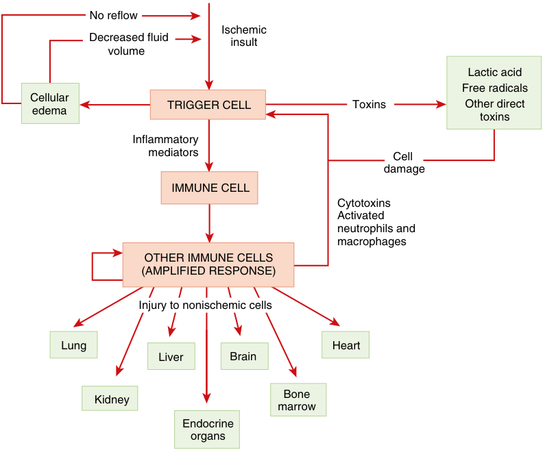

No reflow Ischemic Decreased fluid insult volume Lactic acid Free radicals Cellular TRIGGER CELL Toxins Other direct edema toxins Inflammatory mediators Cell damage IMMUNE CELL Cytotoxins Activated neutrophils and macrophages OTHER IMMUNE CELLS (AMPLIFIED RESPONSE) Injury to nonischemic cells Lung Heart Liver Brain Bone Kidney marrow Endocrine organs 

**Fig. 62.7 The “shock cascade.”** Ischemia of any given region of the body will trigger an inflammatory response that will impact nonischemic organs even after adequate systemic perfusion has been restored. (Reprinted with permission from Dutton RP. Shock and trauma anesthesia. In: Grande CM, Smith CE [eds]. _Anesthesiology Clinics of North America: Trauma_ . Philadelphia: WB Saunders; 1999:83–95.)

produce renin, angiotensin, aldosterone, cortisol, erythropoietin, and catecholamines.118 The kidney maintains glomerular filtration in the face of hypotension by selective vasoconstriction and concentration of blood flow in the medulla and deep cortical area. Prolonged hypotension leads to decreased cellular energy and an inability to concentrate urine (renal cell hibernation), followed by patchy cell death, tubular epithelial necrosis, and renal failure.119 In an observational study that included 59 patients with acute hemorrhagic shock, the incidence of hyperacute adrenal insufficiency was high (86%) and associated with higher mortality.120

The heart may be protected from ischemia during shock because of maintenance of or even an increase in nutrient blood flow, and cardiac function is well preserved until the late stages. Lactate, free radicals, and other humoral factors released by ischemic cells may act as negative inotropes and, in a bleeding patient, may produce cardiac dysfunction as the terminal event in the shock spiral.121 A patient with cardiac disease or direct cardiac trauma is at significant risk for clinical decompensation because a fixed stroke volume inhibits the body’s ability to increase blood flow in response to hypovolemia and anemia. Compensatory tachycardia ensues, with potentially disastrous consequences as the myocardial oxygen supply is rapidly depleted. Since elderly patients may not be able to mount a tachycardic response to preserve cardiac output, hemorrhagic shock in the elderly is often rapidly progressive and does not respond predictably to fluid administration.122

The lung is the filter for the inflammatory by- products of the ischemic body. Immune complex and cellular factors accumulate in pulmonary capillaries and lead to neutrophil and platelet aggregation, increased capillary permeability, destruction of lung architecture, and acute respiratory distress syndrome (ARDS).123,124 The lung is the sentinel organ for developing multiple organ dysfunction (MOD) in a traumatic shock patient.125,126 Pure hemorrhage, in the absence of hypoperfusion, does not produce pulmonary dysfunction.127 Traumatic hemorrhagic shock is far more than a hemodynamic disorder.

The gut is one of the earliest organs affected by hypoperfusion and maybe the prime trigger of MOD. Intense vasoconstriction occurs early and frequently leads to a “noreflow” phenomenon, even when the macrocirculation is restored.128 Intestinal cell death causes a breakdown in the gut’s barrier function, resulting in increased translocation of bacteria to the liver and lung, thereby potentiating ARDS.129

The liver has a complex microcirculation and may experience reperfusion injury during recovery from shock.130 Hepatic cells are also metabolically active and contribute to the ischemic inflammatory response and irregularities in blood glucose.131 Failure of the synthetic function of the liver after shock is almost always lethal.

Skeletal muscle is not metabolically active during shock and tolerates ischemia better than other organ systems. The large mass of skeletal muscle makes it integral in generating lactic acid and free radicals from ischemic cells. Sustained

<!-- PDF page 14 -->

ischemia of muscle cells leads to an increase in intracellular sodium and free water, with an aggravated depletion of fluid in the vascular and interstitial compartments.132

### TRAUMA- INDUCED COAGULOPATHY

Trauma- induced coagulopathy (TIC) is composed of two pathophysiologic processes, the coagulopathy caused by severe shock and traumatic injury (Acute Traumatic Coagulopathy, ATC) and a dilutional coagulopathy or “iatrogenic traumatic coagulopathy” (ITC), also referred to as systemic acquired coagulopathy (SAC) or resuscitation associated coagulopathy (RAC).133–135 Moore and colleagues demonstrated that the multivariate predictors of coagulopathy included the TIC risk factor of the Injury Severity Score (ISS) but not a base deficit or lactate. The risk factors for RAC, such as hypothermia and acidosis, were not significant predictors as well. Hypothermia, defined as 34°C, and a low transfusion ratio have been implicated in increased mortality from coagulopathy.136 The only relevant multivariate predictor of RAC was crystalloid volumes in the shock setting. Clinically relevant cutoffs ranged from 2 L to greater than 4 L. Patients who received less than 2 L of crystalloid prehospital were unlikely to become coagulopathic regardless of admission lactate. Patients who received between 2 L and 4 L of crystalloid were at risk for coagulopathy only if their arrival lactate was elevated. Patients who received greater than 4 L of prehospital crystalloid elevated the risk for coagulopathy regardless of arrival lactate.

The presence of TIC—a “multifactorial, global failure of the coagulation system to sustain adequate hemostasis after major trauma”—is an endogenous component linked to hypoperfusion and tissue injury referred to as acute traumatic coagulopathy (ATC).137,138 There are several proposed mechanisms for the development of ATC. One mechanism may be the endothelial activation of protein C secondary to the traumatic, inflammatory response.139 Activated protein C (APC) is generated by thrombomodulin–thrombin complex production due to tissue hypoperfusion. APC inactivates factor Va and factor VIIIa, and, in combination with the reduction in thrombin availability for fibrin formation, supports the development of ATC.140 Another proposed mechanism is the disseminated intravascular coagulation (DIC) hypothesis. This hypothesis suggests coagulopathy is closely related to tissue hypoperfusion, shock, endothelial activation, and endothelial injury. This sequence of events leads to a prolonged prothrombin time (PT) and a picture of a consumptive process that seems to meet the criteria for DIC. Low fibrinogen and antithrombin levels, increased fibrinogen degradation products, and D- dimer levels are frequently observed. The disproportionate increase in plasmin levels relative to thrombin activation is thought to cause the hyperfibrinolytic state.141 There is a lack of evidence to suggest that thrombus formation in the microcirculation of trauma patients and consumption of clotting factors (thrombocytopenia) are valid mechanisms. As described by Rizoli _et al._ , within the first 24 hours after a traumatic injury, almost all severely injured trauma patients (ISS >16) have an ISTH (International Society on Thrombosis and Haemostasis) score of “overt DIC” or “suggestive of non- overt DIC.” Additionally, degradation of the endothelial glycocalyx due to hypoperfusion may play

a supporting role in ATC.142 Experimental work by Kozar _et al._ using blood samples from trauma patients in hemorrhagic shock has shown that admission syndecan- 1 concentrations significantly predicted mortality, coagulopathy, and massive transfusion.143

TIC may be functionally detected with the use of viscoelastic monitoring, thromboelastometry (ROTEM® ), or thromboelastography (TEG® ) as well as standard laboratory testing (prothrombin time, INR, activated partial thromboplastin time, fibrinogen, etc.) (see also Chapter 46). Whole blood clotting tests such as ROTEM and TEG define the relationship more closely between laboratory- based abnormalities and clinically relevant bleeding than standard laboratory testing.144–147 Evidence of TAC is demonstrated by the early presence of reduced clot strength, as shown by viscoelastic monitoring. Changes in laboratory- based coagulation testing are associated with increased mortality and a higher likelihood of receiving a massive transfusion.148 Davenport and colleagues148 have proposed a clot amplitude threshold of &lt;35 mm at 5 minutes using ROTEM® (Tem Innovations GmbH, Munich, Germany) analysis which predicted the subsequent need for a massive transfusion with a detection rate of 77% and false- positive rate of 13% (see also Chapter 46). Similar results have been obtained using RapidTEG® (Haemonetics Corp., Niles, IL, USA) viscoelastic testing.149 Laboratory- based coagulation testing is of limited utility in the early detection of ATC due to time considerations; however, conventional coagulation tests are predictive of outcomes. Frith _et al._ found patients with a prothrombin ratio (PTr) of >1.2 on admission to have higher transfusion requirements and increased mortality.150

Most causes of traumatic bleeding are not related to TIC or SAC. Most traumatic bleeding is caused by a primary injury or disruption of the large blood vessels (arteries and veins) and not the coagulopathy caused by the failure to form adequate clots at the level of the capillary beds, the microcirculation. Bleeding at the level of the capillary beds is often impossible to control by conventional surgical methods.151 The extent of a coagulation deficit at the capillary bed level appears to depend on the extent of tissue damage, degree of hypoperfusion, and injury to the endothelial surface layer. The perturbations at the microcirculatory level will be aggravated further by acidosis, hypothermia, and crystalloid use in resuscitation. Trauma patients with TIC and large vessel injury must be taken to the operating room without delay. Hence, damage control surgery (DCS) and damage control resuscitation (DCR) must occur in parallel to address the immediate causes of bleeding.133 Hemorrhage control, correction of hypovolemia and hypotension via a high ration resuscitation or fresh whole blood (FWB), avoiding the phenomenon of dilutional coagulopathy, as well as a detailed approach in the prevention and correction of TIC is paramount. In DCR, organ perfusion may be marginally sacrificed (permissive hypotension) in the face of severe hemorrhage during the early phase of DCS. Once achieving hemostasis, attention may then be shifted to the goal of optimal organ perfusion.152,153

### ASSESSMENT OF THE HEMOSTATIC SYSTEM

Given the importance of coagulopathy in severely injured trauma patients, assessment of the hemostatic system is

<!-- PDF page 15 -->

essential in the early phases of management. This is best accomplished by collecting and integrating information from the four pillars of perioperative coagulation monitoring: (1) medical history, (2) clinical presentation, (3) standard laboratory- based coagulation tests, and (4) viscoelastic monitoring (see also Chapter 46).154 Obtaining a focused patient medical history is one of the critical pieces for evaluating the individual bleeding risk. In some settings, standardized assessments and specific questionnaires can be deployed to raise sensitivity and specificity, resulting in superior detection of hemostasis issues compared to routine coagulation studies alone.155 The assessment of the clinical phenotypes of bleeding is critical for the differential diagnosis. It allows the clinician to differentiate and semi- quantify the underlying coagulation disorder straightforwardly and quickly. The clinical assessment also helps put abnormal coagulation studies in context, so clinical interventions are not based solely on laboratory values. The clinical evaluation aims to differentiate whether the cause of bleeding is “surgical” or “nonsurgical.” A more diffuse pattern characterizes the latter. Standard lab coagulation tests typically include prothrombin time (PT), international normalized ratio (INR), activated partial thromboplastin time (aPTT), and platelet count. In some institutions, lab values, such as fibrinogen levels, factor XIII, and thrombin time, may be part of a standard laboratory coagulation battery. Standard coagulation tests alone play a limited role in the initial diagnostic steps of patients with deranged hemostasis due to trauma. When used in isolation, the standard tests have significant limitations in detecting the extent and origin of a given patient’s coagulopathy. These tests allow only the determination of specific questions and are of restricted value. The key restrictions of standard coagulation tests are delayed results in a dynamic situation, lack of validation, and inability to detect both hyperfibrinolysis and hypercoagulability. A meta- analysis by Haas _et al._ concluded that standard plasma coagulation tests represent historically established parameters that are not fully supported by evidence for managing perioperative coagulopathic bleeding.156 This is where viscoelastic monitoring, the fourth pillar of perioperative coagulation assessment, brings added value. Viscoelastic coagulation monitoring devices like RapidTEG ROTEM and Quantra, assess the whole coagulation process from initial thrombin generation to maximum clot formation up to clot lysis.140 In contrast to the standard lab coagulation tests, TEG and ROTEM have been better validated for the diagnosis of coagulopathy in trauma patients.157,158 These tests can significantly improve a patient’s coagulation assessment and management. They may reduce unnecessary administration of pro- coagulant substances such as platelets, fresh frozen plasma (FFP), and coagulation factor concentrates. The rapid turnaround for results may enable the anesthesiologist to distinguish between a surgical cause of bleeding and trauma- associated coagulopathy.

### APPROACH TO RESUSCITATION

### Direct Admissions to the Operating Room

The trauma patient arriving directly to the operating room (OR) from the emergency department (ED) or the primary scene with little or no information to OR staff presents many logistical and clinical challenges to the receiving

team members. This is a task- laden time for the entire team with high unpredictability. Communication, observation, and organization are critical. Call- out and closed- loop communication is preferred in interdisciplinary trauma team interactions but not frequently utilized.159 Information must be clear and accurate in a method recognized by the entire team. When the patient arrives, all movements by the trauma anesthesiologist are purposeful and precise. The trauma anesthesiologist must become an accomplished service leader and multi- tasker. Patients intubated in the ED or the field cannot be questioned about their medical history. The trauma anesthesiologist’s observational, organizational, and communication skills must occur in parallel.

The intubated patient arriving emergently to the OR cannot respond to questions commonly asked by the medical staff; communication with the trauma surgery team is paramount. In preparation for the move to the OR table, all lines should be organized while simultaneously surveying the patient and inquiring about the mechanism of injury, interventions to date, current physiologic status, and treatments rendered before the OR (i.e., “MIST” report).52 Scene time, response time, and transport time are additional factors that determine the depth of shock and resuscitation needs of the patient and, ultimately, mortality. In penetrating injuries, prehospital response time and scene time independently correlate with in- hospital mortality.160,161 Abnormal lab data should be shared as well as the progress of successful resuscitation. If the surgeon packs the abdomen to control bleeding while the trauma anesthesiology team continues resuscitation, they must be made aware of the progress, or lack thereof, in resuscitation, before the surgeon removes the packing from the abdomen. Surgical events such as compressing the vena cava during exposure, lifting the heart, and compressing structures within the mediastinum must be communicated before they occur.

A rapid survey while organizing lines will give the trauma anesthesiologist a global picture of the patient’s injury severity. Losing large-bore lines or an arterial line during transport could be catastrophic and delay resuscitation. After a motor vehicle crash, a seat belt sign could signal rib fractures and a pneumothorax. A rapid pupillary exam may indicate a concomitant closed or open head injury. If placed in the ED, thoracostomy tubes must be placed on suction before placing the patient on positive-pressure ventilation. Pink frothy secretions in the ETT may indicate extensive pulmonary contusions and alter the mode of ventilation in the OR. A protuberant, tense abdomen and a positive, focused assessment with sonography in trauma (FAST) exam may indicate a severe solid organ or vascular injury. A pelvic binder placed in the ED may mean a severe pelvic injury, and blood products should be immediately available when the binder is released. A deterioration in hemodynamics will necessitate the re- tightening of the pelvic binder and further resuscitation. Open extremity fractures must be stabilized. Unstable fractures are a source of ongoing bleeding and consumption of clotting factors. Closed long-bone fractures can be a source of compartmental bleeding, further insidious blood loss, and potential compartment syndrome. Sub- xiphoid ecchymosis (London sign) caused by a handlebar of a bicycle, or electric scooter, may indicate a pancreaticoduodenal injury. A patient arriving with an ED thoracotomy and the aorta cross- clamped changes the

<!-- PDF page 16 -->

scenario to one of salvage. The trauma anesthesiologist must be given time to prepare the patient with volume or pharmacologic means to remove an aortic cross- clamp or revascularize an extremity.

Questions posed to the trauma team while organizing lines and surveying the patient can quickly reaffirm information gathered during a rapid primary survey. Was the FAST exam positive or negative? If positive, what quadrant? Information from the FAST may be critical for the placement of additional lines. If the patient arrives with large-bore femoral access and the FAST is positive in the right or left upper quadrant, additional large-bore access must be placed proximal to the site of injury due to a suspected caval, hepatic, or splenic injury. Were transfused products given? Was a massive transfusion initiated? Information related to the ratio of resuscitation received by the patient before arrival to the OR is necessary to continue the already started high- ratio resuscitation or convert to high- ratio resuscitation (i.e., 1 unit packed red cells : 1 unit fresh frozen plasma : 1 unit platelets) if indicated. Low- titer O-positive leuko- reduced whole blood (LTOWB) should be given instead of component therapy if available. What was the GCS before intubation? A deteriorating GCS, delta, after admission may indicate a worsening closed head injury. What is the surgical plan? What services are involved? It

may be necessary to perform an exploratory laparotomy and decompressive craniotomy simultaneously if CT imaging performed before arrival to the OR provides evidence that warrants neurosurgical intervention.

The importance of patient interview in the non- intubated patient is of paramount importance. Questioning the patient about events immediately before the injury, as well as medical history and current medications (i.e., anticoagulants), is vital. Blunt traumatic injuries may be the result of a medical emergency. A patient may be involved in a motor vehicle crash because of chest pain, paroxysmal a- fib, or a paroxysmal episode of a- fib with a rapid ventricular response causing a syncopal episode while driving. A pedestrian struck by a motor vehicle may be a confused diabetic with hypoglycemia who wandered into traffic.

### The “Pyramid” Approach for Organizing Resuscitation

Physiologic optimization of the patient in traumatic shock can proceed following a pyramidal format (Fig. 62.8). The pyramid concept begins at the top with an assessment of vital signs, including heart rate, blood pressure, shock index (heart rate/systolic blood pressure),162 and temperature, as these parameters are easily obtainable and provide immediate global insight regarding the patient’s

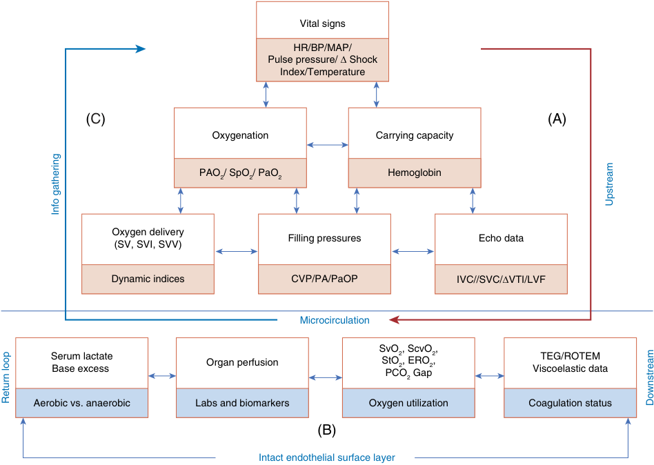

Vital signs HR/BP/MAP/ Pulse pressure/ V Shock Index/Temperature (C) (A) Oxygenation Carrying capacity PAO2/ SpO2/ PaO2 Hemoglobin Oxygen delivery Filling pressures Echo data (SV, SVI, SVV) Dynamic indices CVP/PA/PaOP IVC//SVC/VVTI/LVF Microcirculation SvO2, ScvO2, Serum lactate TEG/ROTEM Base excess  Organ perfusion StOPCO2, ERO2 Gap2, Viscoelastic data Aerobic vs. anaerobic Labs and biomarkers Oxygen utilization Coagulation status (B) Intact endothelial surface layer Upstream Info gathering Return loop Downstream 

**Fig. 62.8 The concept of resuscitation is presented in a pyramidal format.** The pyramid concept presents an approach to trauma patients who are in need of physiologic optimization to improve oxygen delivery and/or utilization at the cellular level. The pyramid is “built” from the top down utilizing the clinical data observed at bedside with the goal of optimizing each of the building blocks in the upstream portion to optimize oxygen delivery. (A) The upstream portion of the pyramid are the variables that are controlled by the clinician and delivered to the microcirculation (B). These variables should be frequently re- evaluated and improved upon, depending on the information gathered from the efferent (venous return from the microcirculation) loop of the process. (C) The restoration of adequate microcirculatory flow and sufficient oxygen delivery to the target organelle (mitochondria) will depend on the information gained and optimized. (Concept by R.A. Sikorski, MD.)

<!-- PDF page 17 -->

current physiologic condition. At the next level of the pyramid, oxygenation parameters (i.e., arterial partial pressure of oxygen [PaO2], hemoglobin) are assessed, followed by the next level of the pyramid, which includes dynamic and static indices related to oxygen delivery (i.e., stroke volume, stroke volume variation) and additional data obtained from either a pulmonary artery catheter, central venous catheter, or echocardiography (transthoracic or transesophageal). While static markers of preload, such as central venous pressure, have historically been used, they are often unreliable in mechanically ventilated trauma patients.163 Following vital signs and determinants of oxygen delivery, attention is turned to the base of the pyramid to assess the microcirculation via various direct and indirect laboratory data. Each of the variables presented in the pyramid requires frequent reassessment. The parameters listed in the pyramid approach can be used as therapeutic goals and end points for resuscitation throughout the various phases of trauma resuscitation.

### Fluid Management

Fluid administration is the cornerstone of resuscitation (see also Chapters 43, 45, and 46). Intravascular volume is lost to hemorrhage, uptake by ischemic cells, and extravasation into the interstitial space. Administration of IV fluids will predictably increase cardiac output and arterial blood pressure in a hypovolemic trauma patient. The ATLS curriculum initially advocated rapid infusion of up to 2 L of warmed isotonic crystalloid solution in any hypotensive patient to restore adequate arterial blood pressure. More recently, this has been revised to recognize the importance of a balanced

resuscitation with elimination of the emphasis on a more aggressive approach. Current recommendations suggest initiation of resuscitation with 1 L of crystalloid and earlier use of blood and blood products for patients in shock.38,52

The change in ATLS recommendations recognizes that aggressive crystalloid fluid resuscitation during active hemorrhage may be deleterious. Dilution of red cell mass reduces O2 delivery and contributes to hypothermia and coagulopathy. Increased arterial blood pressure may lead to increased bleeding because of disruption of clots and reversal of compensatory vasoconstriction.164 The result of aggressive fluid administration is often a transient increase in arterial blood pressure, followed by increased bleeding, another episode of hypotension, and the need for more volume administration. This vicious cycle has been recognized since World War I and remains a complication of resuscitation therapy today. The ATLS manual characterizes such patients as “transient responders” with active, ongoing hemorrhage.38,52 Resuscitation of these patients should be considered in the following three phases (Table 62.2):

- **Phase 1** , Uncontrolled Hemorrhage: ongoing active bleeding with a focus on damage control with pragmatic resuscitation.

- **Phase 2,** Controlled Hemorrhage: major bleeding sources under control with a focus on goal- directed and tailored management of coagulopathy and resuscitation.

- **Phase 3** , Restoration of Physiology: hemorrhage has been controlled with a focus on end- organ perfusion and optimization of physiologic state.

**Table 62.2** Phases of Major Traumatic Resuscitation

||**Phase 1**|**Phase 2**|**Phase 3**|
|---|---|---|---|
|Clinical status|ᑏLife- threatening uncontrolled hemorrhage|ᑏOngoing hemorrhage—not immediately life- threatening— partial surgical control|ᑏHemorrhage controlled|
|Clinical priorities|ᑏSTOP THE BLEEDING ᑏCall for HELP ᑏControl airway, FiO21.0 ᑏDamage control resuscitation ᑏSBP &lt;100 mm Hg ᑏMAP 50–60 mm Hg ᑏConsider modifications if TBI, carotid stenosis, CAD|ᑏTAILORED RESUSCITATION ᑏPlace supportive lines (arterial/ CVC) ᑏPrevent hypothermia ᑏEsophageal temperature probe ᑏWarmed fluids ᑏWarming blankets (upper/ lower) ᑏIncrease room temperature|ᑏRESTORE PHYSIOLOGY ᑏRapid intravascular filling ᑏStepwise deepening of anesthesia ᑏFentanyl boluses ᑏIncreased volatile anesthetics ᑏAdditional lines (urinary catheter, nasogastric tube) ᑏCommunicate with all team members and ICU|
|Blood products|ᑏActivate MTP ᑏConsider emergency (uncross- matched blood products ᑏEarly use ᑏEmpiric 1:1:1 ratio (PRBC:FFP:platelets)|ᑏViscoelastic monitoring to guide coagulation products ᑏHb to guide red blood cell transfusion|ᑏOnly as required on testing ᑏDeactivate MTP when appropriate|
|Crystalloids/colloids|ᑏCautious use|ᑏUse for hypovolemia with normal coagulation/Hb ᑏUser serial lactate/BD to guide fluid requirements|ᑏAttempt to normalize lactate/BD|
|Special points|ᑏConsider CaCl21 g for every three PRBC ᑏLarge-bore IV access (>16 G) or CVC ᑏRapid infusing system ᑏAvoid vasoconstrictors|ᑏConsider cell salvage if appropriate ᑏAim to repeat viscoelastic testing every 30 min ᑏConsider TEE for difficult cases|ᑏConsider vasoactive infusions if appropriate/necessary|

_BD,_ base deficit; _CAD,_ coronary artery disease; _CVC,_ central venous catheter; _FFP,_ fresh frozen plasma; _FiO2,_ fraction inspired oxygen; _Hb,_ hemoglobin; _ICU,_ intensive care unit; _IV,_ intravenous; _MAP,_ mean arterial pressure; _mm Hg,_ millimeters of mercury; _MTP,_ massive transfusion protocol; _PRBC,_ packed red blood cells; _SBP,_ systolic blood pressure; _TBI,_ traumatic brain injury; _TEE,_ transesophageal echocardiography.

::: details 原始表格與符號（PDF 第 17 頁）

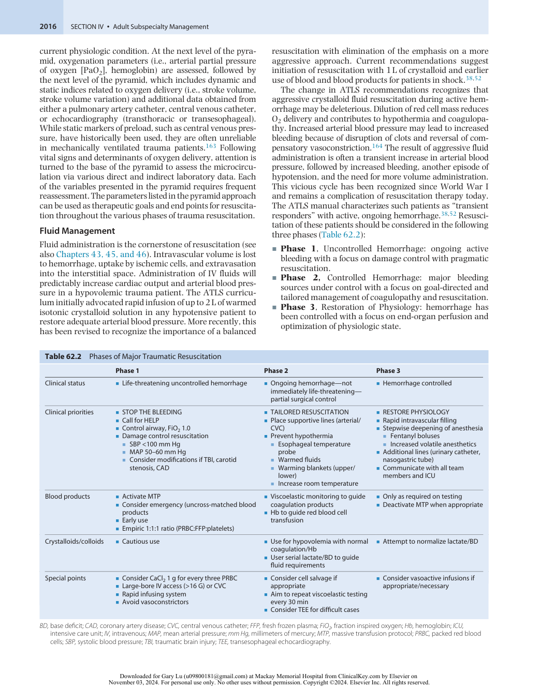

:::

<!-- PDF page 18 -->

### Box 62.4 Risks of Aggressive Volume Replacement During Early Resuscitation

Increased blood pressure Decreased blood viscosity Decreased hematocrit Decreased clotting factor concentration Greater transfusion requirement Disruption of electrolyte balance Direct immune suppression Premature reperfusion Increased risk of hypothermia

Most complications of volume resuscitation arise from increased hemorrhage volume or excessive hemodilution.

Managing late resuscitation (Phase 3) is driven by endpoint targets (see Fig. 62.8) and consists of providing enough fluid and blood components to optimize O2 delivery. Early resuscitation (Phase 1) is much more complex because the risks associated with aggressive intravascular volume replacement (Box 62.4), including the potential for exacerbating hemorrhage and prolonging the crisis, must be weighed against the risk for hypoperfusion and ischemia.

These phases do not always have distinct transitions and tend to occur as gradual transitions from initial presentation to the OR and ultimately to the ICU.

### Phase 1, Uncontrolled Hemorrhage

During the initial phase of management, the goal in trauma patients with massive hemorrhage requiring an emergent surgical procedure in the OR is to stop the bleeding as soon as possible. In this setting, there is little opportunity to perform additional studies, await test results, or evaluate for perioperative optimization. The role of the anesthesia team is to help achieve hemostasis as quickly as possible while bridging the patient’s physiologic status to allow for surgical stabilization. In Phase 1, the general approach employs the concept of damage control resuscitation (DCR). DCR combines an empiric hemostatic resuscitation strategy in combination with permissive hypotension during surgical or angioembolization control of ongoing hemorrhage. Combined with surgical approaches incorporating damage control techniques, the initial goal of controlling hemorrhage, physiologic stabilization, and correction of coagulopathy allow for more definitive surgical interventions later.

**Permissive Hypotension.** Since World War I and II, many clinicians observed that achieving higher blood pressure with crystalloids was often harmful.165,166 In 1965, Shaftan and colleagues167 published the results of a study of coagulation in dogs that demonstrated that the formation of a soft extraluminal clot limits bleeding after arterial trauma. This study compared the quantity of blood lost from a standardized arterial injury under various conditions. The least blood loss occurred in hypotensive animals (whether hypotensive from hemorrhage or administration of a vasodilator), followed by the control group and then vasoconstricted animals. The most significant amount of blood was lost in animals that underwent vigorous reinfusion during the period of hemorrhage.

Laboratory data have shown the benefits of limiting intravascular fluid volumes and blood pressure in actively

hemorrhaging animals.168–171 In the most sophisticated models, direct assessment of cardiac output and regional perfusion showed no difference between moderate- volume or large- volume resuscitation in terms of cardiac output, arterial blood pressure, or regional perfusion of the heart, kidneys, and intestines. Burris and co- workers172 studied conventional resuscitation fluids and combinations of hypertonic saline and dextran and found that rebleeding correlated with higher mean arterial pressure (MAP) and that survival was best in groups resuscitated to lowerthan- normal MAP. The optimum target blood pressure for resuscitation varied with the composition of the fluid used. In larger animal studies, targeting higher MAP with fluid administration alone resulted in severe tissue edema and organ dysfunction.173 Other preclinical data suggest that a MAP of 60 mm Hg should be evaluated in human studies based on more favorable inflammatory profiles and survival in animal studies.174

Hypotensive resuscitation has increasingly been accepted as a component of early DCR to avoid excessive fluid administration until control of active hemorrhage has been achieved.175 This strategy uses less fluids and blood products during the early stages of treatment for hemorrhagic shock compared with the standard of care.176 Hypotensive resuscitation has also been shown to be feasible and safe during early resuscitation of trauma patients in the prehospital and hospital settings.177–181 In a meta- analysis that included 30 studies, hypotensive resuscitation was associated with significant mortality benefits (relative risk of mortality, 0.50; 95% confidence interval [CI], 0.40–0.61), reduced need for blood transfusions, and lower incidence of acute respiratory distress syndrome, although a nonsignificant risk for acute kidney injury was observed.182

Initial work by Bickell and colleagues in 1994 randomized victims of penetrating torso trauma to one of two treatment groups: standard of care (up to 2 L of crystalloid infused in the prehospital setting) or delayed resuscitation (no fluid until the patient reached the OR).178 This 37- month study eventually included 598 patients. Average transport times to care were 30 minutes from injury to the ED and an additional 50 minutes before reaching the OR; the fluid- restricted group received an average of about 0.8 L of fluid during this time. The immediate- resuscitation group received an average of 2.500 L of crystalloid and 130 mL of blood over this same period. Although substantially different during the study period, blood pressure on arrival at the OR was similar in both groups, which the authors took as evidence that the unresuscitated group had achieved spontaneous hemostasis. Survival to hospital discharge in the delayed- resuscitation group was significantly improved over the immediate- resuscitation group (70% vs. 62% [ _P_ &lt;.04]). No data were presented on the conduct of anesthesia after arrival at the OR but before control of hemorrhage or on the incidence of rebleeding after volume loading and induction of anesthesia in patients who had achieved hemostasis preoperatively.

A retrospective review of trauma admissions to the Los Angeles Medical Center published in 1996 supported the findings from Bickell _et al._181 Patients brought to the hospital by private conveyance fared substantially better than those delivered by paramedics, even with high levels of injury severity. Further corroboration was provided by

<!-- PDF page 19 -->

retrospective examination of outcomes in a population of hemorrhaging trauma patients who received fluids via a commercial rapid infusion system (RIS, Haemonetics, Niles, Ill) during initial resuscitation.158 The survival rate of this group was compared with that predicted by the institution’s trauma registry. When compared with case- matched controls, patients who received fluid by the rapid infusion system had a survival rate of only 56.8% vs. 71.2% for patients of similar age with similar injuries ( _P_ &lt;.001). This retrospective review was followed in 2002 by a second prospective trial of delayed resuscitation in trauma patients.179 Patients with systolic blood pressure lower than 90 mm Hg and clinical evidence of blood loss were randomized to fluid resuscitation titrated to a systolic blood pressure of 100 mm Hg (normal group) or 70 mm Hg (study group) until the end of surgical interventions to control hemorrhage. As in the Bickell study, hypotension allowed spontaneous resolution of hemorrhage and autoresuscitation; blood pressure would increase without exogenous fluid administration once hemostasis was achieved. The typical patient began with a low initial pressure, followed by recovery to the vicinity of the target, overshoots and undershoots as bleeding and fluid administration continued, and an eventual rise above the target when the hemorrhage resolved, even in the absence of further fluid administration. The 93% overall survival rate in this study was higher than predicted from historical data and substantially higher than the mortality rate observed in Bickell _et al._ These findings may reflect the exclusion of patients who died in the prehospital phase or arrived at the trauma resuscitation unit in a moribund condition. It may also reflect improvements in overall care, an observation effect (i.e., patients in both groups received better care than patients not in the study), or a bias in subject recruitment. Over the first 24 hours, lactate and base deficit cleared to normal in both groups. They required similar amounts of fluid and blood products, suggesting that both groups were reaching an equivalent resuscitation end point. The authors concluded that the administration of fluids to an actively hemorrhaging patient should be titrated to specific physiologic end points, with the anesthesiologist navigating a course between the Scylla of increased hemorrhage and the Charybdis of hypoperfusion.

In a recent study, Morrison and colleagues compared a hypotensive resuscitative strategy targeting a MAP of 50 mm Hg to one targeting a MAP of 65 mm Hg with conventional resuscitation for patients requiring emergent surgery.176 In a preliminary report, they found that patients in the hypotensive resuscitation group had a lower early postoperative mortality, a reduced incidence of coagulopathy, and lower mortality related to coagulopathy. Subsequently, this study was terminated early for futility and clinical equipoise with no significant survival advantage and similar rates of coagulopathy, renal failure, and infection between the low (50 mm Hg) and high (65 mm Hg) MAP target groups.180 Of note, this study excluded blunt trauma patients included in the preliminary report. Despite not identifying a difference in major outcomes, the authors made several observations. First, the need for vasopressor use in the first hour of surgery was greater in the high MAP group. Although this group also received more fluid, it was not statistically significant. Second, the intraoperative MAP

was not significantly different between the low and high MAP groups (65.5 ± 11.6 mm Hg vs. 69.1 ± 13.8 mm Hg, _P_ = .07, respectively).

Considering the available clinical and experimental data regarding hypotensive resuscitation for trauma patients, the current consensus at most major trauma centers is to allow for hypotensive resuscitation in the setting of DCR, barring specific caveats discussed below. While the optimal arterial blood pressure remains controversial, a reasonable approach is to target a systolic pressure of less than 100 mm Hg with MAP between 50 to 60 mm Hg.175,183–185

While the role of vasopressor administration to acutely injured and hypotensive trauma patients is often discouraged in favor of permissive hypotension, some recent evidence has challenged this approach. Evidence from retrospective studies suggests that vasopressors are associated with increased mortality in trauma patients186–188 ; however, there are numerous methodologic limitations to these investigations, most notably that patients most likely to die from acute hemorrhage were excluded, as well as patients with TBI and SCI, and that all vasopressors were considered cumulatively rather than based on the specific mechanism of action. More recent retrospective studies have attempted to address these limitations by including patients likely to die from acute blood loss and who received norepinephrine during prehospital transport or the acute resuscitation period.189 There was no significant increase in 24- hour or overall hospital mortality in patients that received early norepinephrine. A plausible explanation for the utility of norepinephrine in acute hemorrhage with hypotension is the redistribution of blood volume from the vasodilated and unstressed venous system to the arterial circulation. The resulting increase in mean systemic filling pressure also contributes to an increase in preload and stroke volume in hypovolemic patients.190 Additional prospective, randomized studies have demonstrated that early vasopressin infusions are associated with decreased volume of blood products transfused while not increasing complications, such as mortality, thrombosis, or multiple organ failure.191,192 Mechanistically, vasopressin is unique in that it augments vascular tone by V1 receptors, and water balance and uptake in the kidney through aquaporin channels. Platelet function via release of von Willebrand factor is also enhanced. Further clinical research is warranted to support a change in clinical practice that recommends more consistent administration of vasopressors and to further clarify optimal blood pressure goals in severely injured and hemorrhaging trauma patients.

As a component of intraoperative management, the effect of anesthetic drugs on the body’s response to hemorrhage is an important difference between deliberate hypotension occurring in the elective operative setting and hemorrhagic shock occurring in the ED. Hypertensive trauma patients receive minimal doses of anesthetics, even for induction of anesthesia, because of the apparent effect of these drugs on arterial blood pressure. A hypotensive trauma patient is thus often in an initial state of profound vasoconstriction, as opposed to a patient undergoing elective intraoperative hypotension who is vasodilated by general anesthesia before any blood loss. Table 62.3 summarizes the physiologic contrasts between these two states.

<!-- PDF page 20 -->

**Table 62.3** Differences in Presentation Between Surgical Patients Undergoing Elective Deliberate Hypotension and Emergency Trauma Cases*

|**Aspect**|**Elective**|**Trauma**|
|---|---|---|
|Intravascular volume|Euvolemic|Hypovolemic|
|Temperature|Normal|Likely hypothermic|
|Capillary beds|Dilated|Constricted|
|Level of general anesthesia|Deep|Usually light|
|Preexisting mental status|Normal|May be impaired|
|Coexisting injuries|None|May be significant|
|Comorbid conditions|Known and managed|Unknown|

*Each of these factors produces a real or perceived contraindication to the use of deliberate hypotensive technique in the trauma patient.

### Box 62.5 Goals for Early Resuscitation

Maintain systolic blood pressure 80–100 mm Hg Maintain hematocrit 25%–30% Maintain prothrombin time and partial thromboplastin time in normal ranges Maintain platelet count >50,000 Maintain normal serum ionized calcium Maintain core temperature >35°C Maintain function of pulse oximeter Prevent increase in serum lactate Prevent acidosis from worsening Achieve adequate anesthesia and analgesia

Fluid administration to limit hypoperfusion is balanced against an undesirable increase in blood pressure and, thus, bleeding.

It should be noted that blood loss without shock does not produce systemic complications such as ARDS in experimental models.127 Based on this physiology, the recommended goals for early resuscitation are expressed in Box 62.5, and an algorithm for management is presented in Fig. 62.9.

Rapid diagnosis and control of ongoing hemorrhage are essential. Vascular volume should be restored and anesthesia provided incrementally by shifting the patient from a vasoconstricted to a vasodilated state while facilitating hemostasis by maintaining a decreased arterial blood pressure.

Clinical trials of permissive hypotensive resuscitation have avoided the application of this technique to populations perceived to be at greater risk for ischemic complications,178–180 including patients with known ischemic coronary disease, elderly patients, and those with injuries to the brain or spinal cord (see also Chapters 53 and 61). Hypotensive resuscitation should not be employed in TBI or spinal cord injured patients. Hypotension is deleterious in these patient populations, though no robust clinical trials have been conducted to study these unique patient populations.40,193–197 Moreover, elderly trauma patients suffer worse outcomes from similar injuries than younger patients, presumably because of their reduced physiologic reserve.198 Clinical care of these patients is focused on the avoidance of ischemic stress and rapid correction of hypovolemia. Absent convincing evidence in humans, permissive hypotension in older patients, or patients with brain

injury or spinal cord injury should generally be avoided. Hemodynamic goals for these types of traumatic injuries are discussed in subsequent sections of this chapter.

**Hemostatic Resuscitation.** Management of the initial coagulopathy associated with trauma must be incorporated into the overall Phase 1, Uncontrolled Hemorrhage DCR strategy – often referred to as hemostatic resuscitation. Little utility is found in targeting end points of resuscitation in the face of ongoing hemorrhage. Life- threatening coagulopathy is one of the most severe complications of patients in profound shock from massive hemorrhage and is generally predictable at an early stage.199

Severely injured trauma patients are likely to develop an early and aggressive endogenous coagulopathy separate from later loss and dilution of clotting factors compounded from hypothermia and acidosis139,200,201 ; hence, the practice of hemostatic resuscitation has become commonplace in the most severely injured patients with shock and ongoing hemorrhage. Hemostatic resuscitation entails the early and aggressive use of hemostatic products combined with red blood cells (RBCs) as the primary resuscitation fluids to avoid rapid deterioration into the “bloody vicious cycle” and the classic lethal triad of hypothermia, acidosis, and coagulopathy.202 Two very distinct paradigms of hemostatic resuscitation have emerged: (1) the DCR model, which uses preemptive administration of empiric ratios of blood and hemostatic products to approximate whole blood, often according to an established institutional massive transfusion protocol203–205 (see Fig. 62.9); and (2) goal- directed hemostatic resuscitation approaches (also often protocol based), which generally use point- of- care viscoelastic monitoring combined with the prompt administration of hemostatic concentrates206–208 (see also Chapter 46). The DCR model is typically employed during Phase 1, Uncontrolled Hemorrhage, with a transition to more goal- directed hemostatic resuscitation during Phase 2, Controlled Hemorrhage.

In addition to permissive hypotension and limited crystalloid usage, DCR relies on administering empiric ratios of blood and hemostatic products to restore blood volume. In a retrospective review of combat casualties, Borgman and colleagues209 found a mortality rate of 65% in patients receiving less than 1 unit plasma for every four units of RBCs, but only 20% in those with a ratio of 1:2 or above. Evidence exists of a survivor bias because patients bleeding more rapidly were likely to die after receiving RBCs but before plasma could reach the bedside. Although the issue of survivor bias does exist, this approach has been substantiated in published reviews.210 Currently, a ratio of 1:1:1 is most commonly adopted, although some experts believe that the amount of FFP can be reduced in most cases. In the only major, randomized trial comparing a 1:1:1 ratio with a 1:1:2 ratio of plasma, platelets, and RBCs, respectively, the transfusion of less plasma and platelets was not associated with a difference in mortality. However, the 1:1:1 group achieved hemostasis more rapidly and had fewer deaths due to exsanguination by 24 hours.211

In addition to the hypocoagulability associated with ATC, fibrinolysis is especially deleterious in severely injured trauma patients and carries associated mortality well upward of 50%.212–214 Many patients with primary fibrinolysis from severe hemorrhagic shock may never survive to

::: details 原始表格與符號（PDF 第 20 頁）

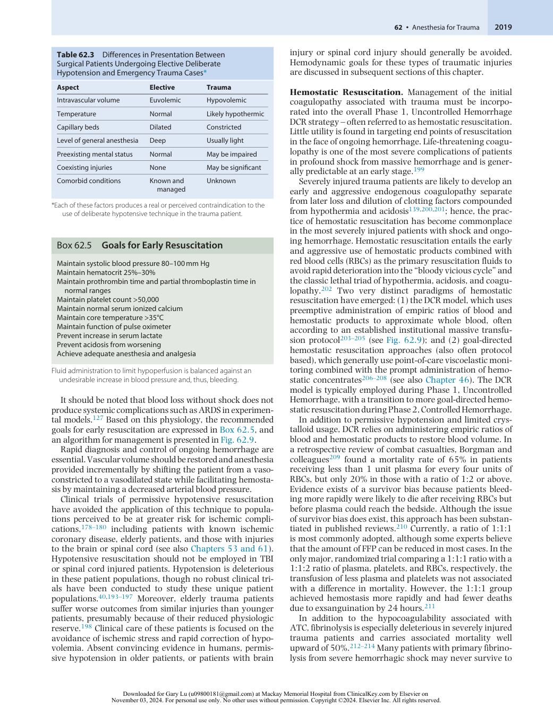

:::

<!-- PDF page 21 -->

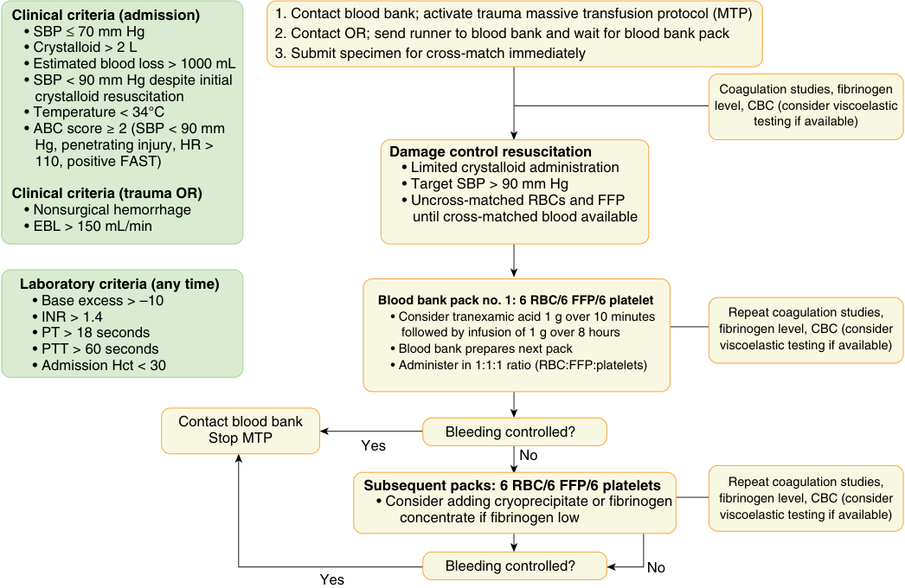

Clinical criteria (admission) 1. Contact blood bank; activate trauma massive transfusion protocol (MTP)  • SBP  �  70 mm Hg 2. Contact OR; send runner to blood bank and wait for blood bank pack  • Crystalloid > 2 L 3. Submit specimen for cross-match immediately  • Estimated blood loss > 1000 mL  • SBP &lt; 90 mm Hg despite initial Coagulation studies, fibrinogen crystalloid resuscitation le vel, CBC (consider viscoelastic  • Temperature &lt; 34°C testing if available)  • ABC score ≥ 2 (SBP &lt; 90 mm Hg, penetrating injury, HR >  Damage control resuscitation 110, positive FAST)  • Limited crystalloid administration  • Target SBP > 90 mm Hg Clinical criteria (trauma OR)  • Uncross-matched RBCs and FFP  • Nonsurgical hemorrhage until cross-matched blood available  • EBL > 150 mL/min Laboratory criteria (any time)  • Base excess > –10 Blood bank pack no. 1: 6 RBC/6 FFP/6 platelet  • INR > 1.4  • Consider tranexamic acid 1 g over 10 minutes  Repeat coagulation studies,  • PT > 18 seconds followed by infusion of 1 g over 8 hours fibrinogen level, CBC (consider  • PTT > 60 seconds  • Blood bank prepares next pack viscoelastic testing if available)  • Admission Hct &lt; 30  • Administer in 1:1:1 ratio (RBC:FFP:platelets) Contact blood bank Bleeding controlled? Stop MTP Yes No Subsequent packs: 6 RBC/6 FFP/6 platelets Repeat coagulation studies,  • Consider adding cryoprecipitate or fibrinog en f ibrinogen level, CBC (consider          concentrate if fibrinogen low viscoelastic testing if available) Bleeding controlled? No Yes 

**Fig. 62.9 Example of a massive transfusion protocol utilizing specified ratios of blood products.** _CBC_ , complete blood count; _EBL_ , estimated blood loss; _FAST,_ focused assessment with sonography in trauma; _FFP_ , fresh frozen plasma; _Hct,_ hematocrit; _HR,_ heart rate; _INR_ , international normalized ratio; _ISS_ , Injury Severity Score; _OR_ , operating room; _PT_ , prothrombin time; _PTT_ , partial thromboplastin time; _RBC_ , red blood cell; _SBP_ , systolic blood pressure; _TEG_ , thromboelastogram.

reach the ICU. The Clinical Randomisation of an Antifibrinolytic in Significant Haemorrhage 2 (CRASH- 2) trial is the only class I evidence showing a 30- day survival benefit for a resuscitative therapy including tranexamic acid (TXA).215 Subgroup analysis showed that the benefit was greatest when therapy was instituted within 1 hour of admission. A subsequent analysis, however, showed that mortality increased when therapy was initiated after 3 hours, suggesting that the risks of treatment outweighed the benefits in patients who survived beyond that timeframe.216 Many resuscitative protocols for massive hemorrhage now include the early administration of TXA based on this and subsequent studies.175,217

Other potential drugs that may play a role in hemostatic resuscitation include recombinant activated human coagulation factor VII (rFVIIa), prothrombin complex concentrates (PCC), and fibrinogen concentrates. rFVIIa is licensed for treating patients with hemophilia that have active or anticipated hemorrhage and known antibodies to factor VIII (see also Chapters 45 and 46). The observation of rapid hemostasis in this population led to the anecdotal use of rFVIIa in other congenital and acquired coagulopathies, including the dilutional coagulopathy of traumatic hemorrhage. Factor VIIa in pharmacologic doses triggers a burst of thrombin on the surface of platelets activated by exposed tissue factor, which produces rapid clot formation. Because tissue factor is required, coagulation is limited to

the site of vascular injury, and inappropriate clotting of uninjured organs or vessels, though an acknowledged risk, occurs at low frequency.218 One small placebo- controlled trial of rFVIIa in hemorrhaging trauma patients has demonstrated decreased blood loss, decreased transfusion requirements, and improved outcome.219 However, a large, randomized trial failed to show a mortality benefit.220 Due to an increased risk for thromboembolic adverse events and an apparent lack of efficacy. rFIIa is seldom used as empiric therapy in managing the bleeding trauma patient.220

Experience with PCCs in clinical practice is limited. PCC has been used for many years to treat congenital coagulation disorders and is recommended for reversing oral anticoagulation, particularly in traumatic intracranial hemorrhage. PCCs contain coagulation factors II, VII, IX, and X. Differences exist among products in the concentrations of these factors and other constituents, including heparin, protein C, and protein S, so results obtained with one product may not be obtained with a different formulation. In a systematic review, compared with FFP, PCC combined with FFP was associated with improved survival with no increased risk of thromboembolism after TIC.221 It should be noted that this analysis included only three trials with a total of 840 patients. Fibrinogen concentrates also may have a role in a hemostatic resuscitation for a patient with a coagulopathy with low levels of fibrinogen, although owing to cost, most trauma centers in the US use cryoprecipitate.222–226

::: warning 符號需核對
此頁有符號無法完整擷取，請展開下方原始頁面核對。
:::

::: details 原始表格與符號（PDF 第 21 頁）

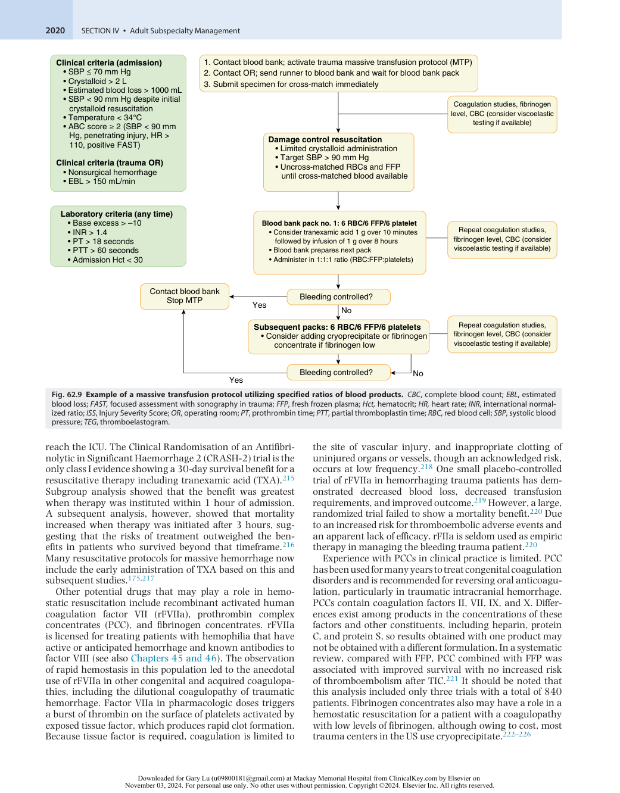

:::

<!-- PDF page 22 -->

During Phase 1, Uncontrolled Hemorrhage, hypocalcemia is common and associated with death and the need for increased blood product transfusions.227,228 Hypocalcemia may precede the administration of blood products and may be underappreciated.228,229 Current data do not dictate the dose and timing for the administration of calcium to trauma patients during Phase 1, though they may suggest that earlier supplementation may be advantageous.228,229

### Phase 2, Controlled Hemorrhage

Once significant bleeding has been controlled, the anesthesia team can generally employ a more individualized, tailored approach to resuscitation (see Fig. 62.8). In Phase 2, there should be a continued utilization of point- of- care testing such as arterial blood gas and other laboratory test results. At this point, use of viscoelastic monitoring parameters and physiologic data should drive decision making. Assessment of oxygen delivery and adequacy of perfusion can begin to incorporate targeted resuscitation measures such as lactate and base deficit. The use of other monitoring modalities, such as transesophageal echocardiography, may help quantify and guide the need for further intravascular volume replacement.

When surgical bleeding is corrected, the depth and duration of shock in combination with multisystem trauma may still contribute to coagulopathy. This requires ongoing assessments such as serial evaluations with viscoelastic coagulation monitoring. A transition from high ratio resuscitation towards a more tailored approach can be accomplished using an algorithm (Figs. 62.9 and 62.10) to guide specific product selection and limit exposure to unnecessary blood products.

Additionally, during Phase 2, attention to other physiologic considerations should proceed. For example,

hypothermia is commonly present on initial presentation. During Phase 1, all attempts should be made to initiate active fluid and surface warming though hypothermia is often difficult to entirely correct during a massive resuscitation. During Phase 2, additional measures can be instituted as the focus shifts from the control of hemorrhage to the stabilization of all physiologic processes.

### Phase 3, Restoration of Physiology

Box 62.6 and Fig. 62.11 summarize end points for late resuscitation.

Volume administration is an integral, mandatory component of resuscitation. The adequacy of resuscitation should not be judged by the presence of normal vital signs but by restoration of organ and tissue perfusion. The anesthesiologist’s role is to recognize the existence of ongoing shock after a traumatic hemorrhage and to resuscitate the patient with the appropriate type and volume of fluids intravenously.

Late resuscitation begins once bleeding is definitively controlled by surgery, angiography, or adequate resuscitation.

### Box 62.6 Goals for Late Resuscitation

Maintain systolic blood pressure >100 mm Hg Maintain hematocrit above individual transfusion threshold Normalize coagulation status Normalize electrolyte balance Normalize body temperature Restore normal urine output Maximize cardiac output by invasive or noninvasive measurement Reverse systemic acidosis Document decrease in lactate to normal range

Fluid administration should be continued until adequate systemic perfusion is restored.

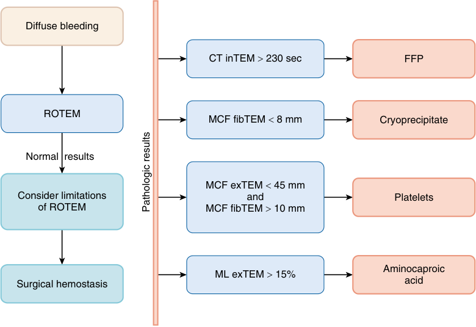

Diffuse bleeding CT inTEM P 230 sec FFP ROTEM MCF fibTEM N 8 mm Cryoprecipitate Normal  results MCF exTEM N 45 mm Consider limitations and Platelets of ROTEM MCF fibTEM P 10 mm ML exTEM P 15% Aminocaproic Surgical hemostasis acid Pathologic results 

**Fig. 62.10 Example of a rotational thromboelastography (ROTEM) treatment algorithm for use in trauma.** _CT_ , clotting time; _FFP_ , fresh frozen plasma; _MCF_ , maximum clot firmness; _ML_ , maximum lysis. (Courtesy of Steurer M, Chang T, Lancman B. Anesthesia for trauma. In: Pardo M, Miller RD, eds. _Basics of Anesthesia_ . 7th ed. Philadelphia: Elsevier; 2018: 724 [Chapter 42].)

<!-- PDF page 23 -->

The goal of Phase 3 is to restore normal organ perfusion while continuing to support vital functions. Hypoperfusion caused by hemorrhagic shock triggers a predictable cascade of biochemical events that will cause physiologic derangements long after adequate blood flow is restored. The extent of hypoperfusion—the depth and duration of shock—dictates the magnitude of subsequent organ system failure. Unfortunately, traditional vital sign markers endorsed by ATLS, such as arterial blood pressure, heart rate, and urine output, are insensitive to the adequacy of resuscitation.230 Occult hypoperfusion syndrome is common in postoperative trauma patients, particularly younger patients.231 This syndrome is characterized by normal blood pressure maintained by systemic vasoconstriction, decreased intravascular volume, cardiac output, and organ system ischemia. The patient will be at risk for

multiple organ dysfunction (MOD) if the hypoperfusion is not promptly corrected.

Searching for the optimal end points of resuscitation has led to several different hemodynamic, acid–base, and regional perfusion targets (see Fig. 62.8). Table 62.4 summarizes modalities available to gauge the adequacy of resuscitation, along with the shortcomings of each technique.

Although blood flow to tissue beds is a determinant of tissue perfusion, pressure should also be an essential consideration. The left ventricular stroke work index is a variable that accounts for both flow and pressure. Furthermore, left ventricular power output has been used to quantify left ventricular performance. These indices were compared with purely flow- derived hemodynamic and O2 transport variables as markers of perfusion and outcomes in critically injured patients during resuscitation.232 A

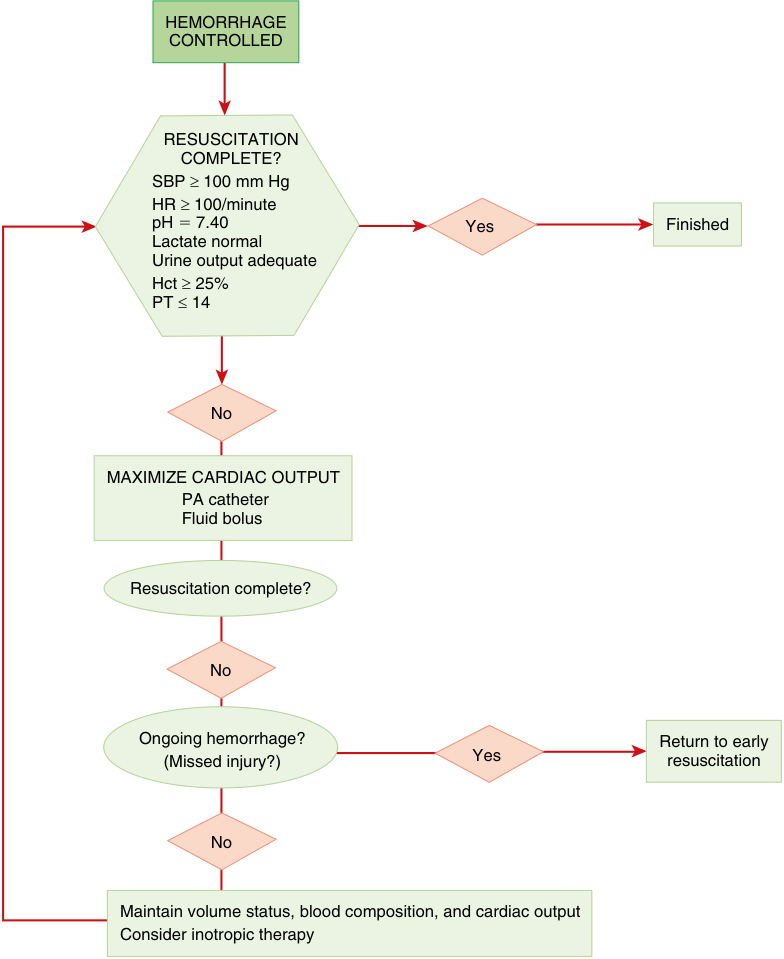

HEMORRHAGE CONTROLLED  RESUSCITATION COMPLETE? SBP  �� 100 mm Hg HR  �� 100/minute pH � 7.40 Yes Finished Lactate normal Urine output adequate Hct  �  25% PT  �  14 No MAXIMIZE CARDIAC OUTPUT PA catheter Fluid bolus Resuscitation complete? No Ongoing hemorrhage? Return to early (Missed injury?) Yes resuscitation No Maintain volume status, blood composition, and cardiac output Consider inotropic therapy 

**Fig. 62.11 Algorithm for management of late hemorrhagic shock.** _Hct_ , hematocrit; _HR_ , heart rate; _PT_ , prothrombin time; _PA_ , pulmonary artery; _SBP_ , systolic blood pressure.

::: warning 符號需核對
此頁有符號無法完整擷取，請展開下方原始頁面核對。
:::

::: details 原始表格與符號（PDF 第 23 頁）

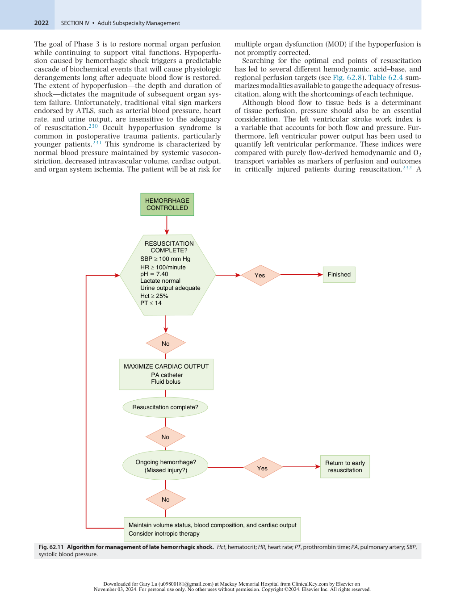

:::

<!-- PDF page 24 -->

**Table 62.4** Modalities for Assessment of Systemic Perfusion

|**Technique**|**Shortcomings**|
|---|---|
|Vital signs|Will not indicate occult hypoperfusion|
|Urine output|May be confounded by intoxication, diuretic therapy, circadian variation, or renal injury|
|Systemic acid–base status|Confounded by respiratory status|
|Lactate clearance|Requires time to obtain lab result|
|Cardiac output|Requires placement of a pulmonary artery catheter, or use of noninvasive technology|
|Mixed- venous oxygenation|Difficult to obtain, but a very accurate marker|
|Gastric tonometry|Requires time to equilibrate, subject to artifact|
|Tissue oxygenation|Emerging technology, appears beneficial|
|Stroke volume variation|Emerging technology, requires an arterial line|
|Acoustic blood flow|Investigational technology, unproven|

consecutive series of 111 patients were monitored with a volumetric pulmonary artery catheter during the first 48 hours of resuscitation. The ability to clear lactate in less than 24 hours and survival were studied. Survivors exhibited significantly higher stroke work and left ventricular power output than non- survivors. In addition to heart rate, these were the only variables significantly related to lactate clearance and survival. The higher stroke work and left ventricular power output in survivors were related to better ventricular–arterial coupling and, therefore, more efficient cardiac function.

Monitoring resuscitation with invasive monitors has gradually evolved to a transition to minimally invasive approaches that assess the return of adequate metabolism, respiration, and O2 transport in peripheral tissue beds. Stroke volume variation, the change in pre-load driven by the respiratory cycle, has emerged as another less-invasive measure of fluid volume status; increased variation in arterial pressure during positive- pressure ventilation is a reliable predictor of decreased intravascular volume.163,233 Inadequate tissue perfusion, as indicated by monitors or the traditional systemic markers of serum lactate, base deficit, and reduced pH, must be treated promptly once ongoing hemorrhage is controlled. The rate at which lactate returns to normal after shock strongly correlates with the outcome; failure to normalize within 24 hours is associated with a greater risk for multiple organ system failure (MOSF) and eventual death.231,234,235

### RESUSCITATION FLUIDS

Isotonic crystalloids (normal saline, lactated Ringer solution, Plasma- Lyte) are the initial resuscitative fluids administered to trauma patients (Chapter 43). They have the advantage of being inexpensive, readily available, nonallergenic, noninfectious, and efficacious in restoring total body

fluid. They are easy to store and administer, mix well with infused medications, and can rapidly warm to body temperature. Solutions such as Plasma- Lyte and Normosol® have no calcium and a favorable strong ion difference, making these preparations potentially advantageous for patients with acidosis from hemorrhagic shock.236 Disadvantages of crystalloids include their lack of O2- carrying capacity, their lack of coagulation capability, and limited intravascular half- life. Of note, data have implicated specific crystalloid solutions as immunosuppressants and triggers of cellular apoptosis.237 Unlike necrosis, apoptosis is highly regulated and involves gene modulation and complex signal transduction pathways. It seems clear that apoptosis is an essential element of reperfusion injury. In a rat model of controlled hemorrhage, animals receiving lactated Ringer solution showed an immediate increase in apoptosis in the liver and small intestine after resuscitation.238 Neither whole blood nor hypertonic saline increased the amount of apoptosis.

Hypertonic saline solutions, with or without the addition of polymerized dextran (HS or HSD), have been extensively studied in resuscitation from hemorrhagic shock.239,240 In theory, HS will draw fluid into the vascular space from the interstitium and thereby reverse some of the non- hemorrhagic fluid loss caused by shock and ischemia. A given amount of HS will thus have an enhanced ability to restore intravascular volume in contrast to an equivalent volume of an isotonic solution. This has made HS a popular choice for fluid resuscitation under austere conditions. Multiple studies of otherwise lethal hemorrhage in animals have demonstrated improved survival after resuscitation with HSD versus either normal saline solution or the components of HSD alone.240 Studies of the efficacy of HSD in trauma patients have been inconclusive241 ; the most apparent benefit occurred in a subset of polytraumatized patients with both hemorrhage and TBI, in whom improved neurologic status was demonstrated in those who received HSD as a resuscitation fluid. Indeed, HS is commonly used as an osmotic agent in managing TBI with increased ICP.242 In one systematic review of 13 studies with 593 patients, HS was associated with decreased all- cause mortality compared with mannitol and other concentrations of HS.243 A more rigorous Cochrane review did not identify strong evidence to support the use of HS over mannitol in efficacy and safety in the long- term management of acute TBI.244

Colloids _,_ including starch solutions and albumin, have been advocated for rapid plasma intravascular volume expansion (see Chapter 43). Like crystalloids, colloids are readily available, easily stored and administered, and relatively inexpensive, although significantly more expensive when compared solely to crystalloids. As with hypertonic solutions, colloids increase intravascular volume by drawing free water back into the vascular space. When IV access is limited, colloid resuscitation restores intravascular volume more rapidly than crystalloids and at a lower volume of administered fluid. Colloids do not transport O2 or facilitate clotting; their dilutional effect is similar to that of crystalloids. Systematic reviews show no benefit of colloids over crystalloids in trauma resuscitation.245 Concerns have been expressed about specific colloids such as 6% hetastarch and an adverse effect on renal function and mortality (see also Chapter 43).246–248

::: details 原始表格與符號（PDF 第 24 頁）

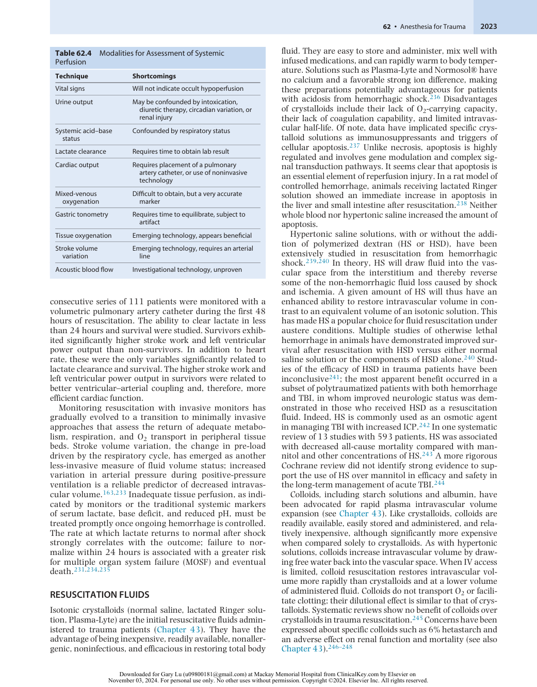

:::

<!-- PDF page 25 -->

Many of the risks associated with aggressive intravascular fluid administration are related to the dilution of the circulating blood volume. Recognition of this fact and continued improvement in the safety of donated blood led to increased use of blood products in managing early hemorrhagic shock (see also Chapter 45). Maintaining an adequate hematocrit decreases the risk of systemic ischemia, and the potential for dilutional coagulopathy can be reduced by the early administration of plasma. The composition of resuscitation fluids may be as important as the rate and timing of administration. A 4- year retrospective review of a cohort of critically injured patients who underwent emergency surgery examined the outcomes of short- term care based on the number of units of blood transfused.249 One hundred and forty- one patients received massive blood transfusions (≥20 units of RBCs) during preoperative and intraoperative resuscitation. The number of blood units did not differ between survivors (30%) and non- survivors (70%). Eleven variables were significantly different: aortic clamping for control of arterial blood pressure, use of inotropic drugs, time with systolic blood pressure higher than 90 mm Hg, time in the OR, temperature less than 34°C, urine output, pH lower than 7.0, PaO2/FiO2 ratio less than 150, PaCO2 more than 50 mm Hg, K+ more than 6 mM/L, and calcium less than 2 mM/L. Of these, the presence of the first three variables and a transfusion of more than 30 units of packed RBCs was universally fatal. Total blood loss and the amount of transfused blood were less critical than the depth and duration of the shock. These concerns led to the concept of damage control surgery, and DCR, discussed earlier in this chapter, which emphasizes rapid control of active hemorrhage.250 Indeed, since the inception of DCR, which aims to limit crystalloids during resuscitation in favor of appropriate blood component therapy, DCR has been associated with improved outcomes for over two decades.251

RBCs are the mainstay of treatment of hemorrhagic shock. With an average hematocrit of 50% to 60%, a unit of RBCs will predictably restore O2- carrying capacity and expand intravascular volume as well as any colloid solution. RBCs of blood type A, B, or AB carry major incompatibility antigens that may precipitate a lethal transfusion reaction if given to a patient with the opposite blood type. Because RBCs also have dozens of minor antigens that can cause reactions in susceptible patients, cross- matching is desirable when time allows (typically 1 hour from the time a sample reaches the blood bank until the RBCs reach the patient). Type- specific blood requires less time for delivery from the blood bank (usually ∼30 minutes) and may be an appropriate alternative in some situations. Type O blood— the universal donor type—can be given to patients of any blood type with little risk of a major reaction.252 This is the preferred approach for patients who arrive at the ED in hemorrhagic shock. If O- positive blood is given to a Rhesusnegative woman who survives, prophylactic administration of an anti- Rh0 antibody is indicated. O-neg blood should available for transfusion of women of child bearing age.

Risks of RBC administration include transfusion reaction, the transmission of infectious agents, and hypothermia (see also Chapter 45). For example, RBCs are stored at 4°C and will decrease the patient’s temperature rapidly if not infused through a warming system during administration.

Plasma requires blood typing but not cross-matching; the delay in the availability of plasma is caused by the need

to thaw frozen units before they can be administered. Busy trauma hospitals will often maintain a supply of pre- thawed plasma (thawed fresh plasma as opposed to FFP) that can be issued quickly in response to an emergency need; in smaller hospitals, it is vital to request plasma early in resuscitation if it is likely to be needed. Bustling centers may keep 2 to 4 units of pre- thawed type AB neg (universal donor) plasma available in the trauma resuscitation unit or emergency department. Units are kept ready for two days at a time; if not used on an emergency basis, the units are returned to the blood bank and released to the next patient needing plasma. Whether this approach improves outcomes has not yet been studied, though, in one major multicenter prehospital study, early administration of FFP before trauma center arrival was associated with lower 30- day mortality (23.2% vs. 33.0%; difference, −9.8 percentage points; 95% CI, −18.6% to −1.0%; _P_ = .03).253

Platelet transfusion should generally be reserved for patients with clinical coagulopathy with a documented low serum level (&lt;50,000 per high- power field). When the patient is in shock, however, and blood loss is likely to be substantial, platelets should be empirically administered in proportion to RBCs and plasma (1:1:1), as discussed earlier for DCR. Transfused platelets have a very short serum half- life and should be issued only to patients with active coagulopathic bleeding. Platelets should not be administered through filters, warmers, or rapid infusion systems because they will bond to the inner surfaces of these devices, thereby reducing the number of platelets reaching circulation (see also Chapter 46). Platelet specific filters (170-260 micrometer pore size) should be used in order to remove large debris and fibrin clots.

Rapid transfusion of banked blood carries the risk of inducing citrate intoxication in the recipient.254 Harvested blood units are treated with citrate to bind free Ca2+ and thus inhibit the clotting cascade. Consecutive administration of multiple units of banked blood leads to a correspondingly large dose of citrate, which may overwhelm the body’s ability to mobilize free Ca2+ and have a profound negative inotropic effect on the heart. Unrecognized hypocalcemia is a cause of hypotension in patients after massive transfusion and persists despite an adequate volume of resuscitation. In a hemorrhaging patient, ionized Ca2+ levels should be measured at regular intervals, and Ca2+ should be administered as needed (in a separate IV line from transfusion products) to maintain serum levels greater than 1.0 mmol/L.

### RESUSCITATION EQUIPMENT

Intravascular fluid resuscitation of any kind is impossible without IV access. Immediate placement of at least two large- bore catheters (16 gauge or larger) is recommended during the primary assessment of any trauma patient.52 Practitioners should have a low threshold for placement of a large- caliber central line in patients with unsuccessful antecubital or other peripheral placement attempts. Potential sites for central line placement include the internal jugular, subclavian, and femoral veins, each of which has its benefits and potential risks. The internal jugular approach, though familiar to most anesthesiologists, will require the removal of the cervical collar and manipulation of the patient’s neck and is not recommended in the acute setting unless other options have been exhausted. The femoral vein is easily and rapidly accessed and is an appropriate choice

<!-- PDF page 26 -->

in patients without apparent pelvic or thigh trauma who require urgent drug or fluid administration. Caution should be used in patients with penetrating trauma to the abdomen because fluids infused via the femoral vein may contribute to hemorrhage from an injury to the inferior vena cava or iliac vein; these patients should have IV access placed above the diaphragm if possible. Femoral vein catheterization carries a high risk for the formation of deep venous thrombosis (DVT),255 thus limiting the use of this approach in the acute setting. Femoral lines should be removed immediately after the patient’s condition stabilizes. The subclavian vein is the most common site for early and ongoing central access in a trauma patient because the subclavian region is easily visible and seldom directly traumatized. This approach carries the highest risk for the development of pneumothorax, although many patients will already have indications for tube thoracostomy in one or both chest cavities; when possible, this is the preferred side for placement of a subclavian line. Rapid infusion catheters (RIC) can be placed peripherally over a guide wire placed via in situ PIVs. They are a good alternative to central access when placement is time limited. Placement of an arterial line facilitates frequent laboratory analysis and allows close monitoring of blood pressure; this should be undertaken as soon as possible but should not impede other diagnostic or therapeutic maneuvers.

The anesthesiologist should work to maintain thermal equilibrium in any trauma patient. Deliberate hypothermia has been suggested as a management strategy for both hemorrhagic shock256 and TBI,257 there is insufficient evidence to support this approach. Hypothermia will potentiate dilutional coagulopathy and systemic acidosis while shivering, and vasoconstriction in response to cold will demand an additional metabolic effort that may predispose the patient to myocardial ischemia. Hypothermia also dramatically increases the subsequent risk for sepsis. Because many trauma patients arrive at the ED cold from exposure to the elements, early active warming measures are required. All IV fluids should be prewarmed or infused through a warming device. The patient should be covered with warmed blankets whenever possible, and the environment should be kept warm enough to make the patient comfortable. If hypothermia has already developed, forced hot air warming is strongly indicated to restore normothermia. Even though all these measures are routine and evident in the OR, the anesthesiologist can perform a valuable service by ensuring that they are available and applied in the ED, CT scanner, and angiography suite.

Commercial rapid- infusion devices are incredibly beneficial in trauma care, particularly in hemorrhagic shock. These machines offer benefits when large quantities of fluid resuscitation are likely (Box 62.7).

Early experience with these devices demonstrated higher patient temperature and reduced acidosis after the initial surgery,258 although rapid infusers may contribute to over- infusion of fluids, inappropriately increased arterial blood pressure, and contribute to rebleeding.259 Application of the principles described earlier for permissive hypotension can prevent this complication; basal fluid administration should be kept low (200 to 500 mL/h), with small fluid boluses given in response to measured systolic blood pressure less than 80 to 90 mm Hg. In practice, fluid boluses are given alternately with anesthetics to reach a normal depth of anesthesia without significantly

### Box 62.7 Benefits of a Fluid Infusion System in Resuscitation from Hemorrhagic Shock

- An active mechanical pump enables fluid administration rates up to 1500 mL/min

|Compatible with crystalloid, colloid, packed red blood cells,|
|---|
|washed salvaged blood, and plasma (_not_platelets)|
|Reservoir allows for mixing of products in preparation for rapid blood loss|

|Fluids infused at a controlled temperature (38–40°C)|
|---|
|Able to pump simultaneously through multiple intravenous lines|
|Fail- safe detection systems to prevent infusion of air|
|Accurate recording of fluid volume administered|
|Portable enough to travel with patient between units|

increasing systolic arterial blood pressure until active bleeding is controlled.

## Trauma to the Central Nervous System

CNS trauma accounts for almost half of all trauma death postmortem examinations in population- based analyses260 or after trauma center admission.261 Although not as prevalent, acute traumatic spinal cord injury (SCI) remains a significant problem.262 As with hemorrhagic shock, CNS trauma consists of the primary injury, in which tissue is disrupted by mechanical force, and secondary response, in which the body’s reaction to the injury plays an important role. Mitigation of secondary CNS injury depends on prompt diagnosis and early, goal- directed therapy. Although primary CNS injuries cannot be minimized other than with preventive strategies, secondary injury accounts for much of the death and disability that follows trauma.263 The initial management of these patients can significantly affect the outcome. Attention to the ABCDE approach is paramount to successful resuscitation, and the trauma anesthesiologist should be intimately involved in this process.

Trauma produces shear forces that primarily damage neuronal cell bodies, axons, and vasculature. The pathophysiologic processes of secondary injury include metabolic failure, oxidative stress, and a cascade of biochemical and molecular events leading to delayed necrotic and apoptotic cell death.263 Secondary injury is often exacerbated by tissue hypoxia or ischemia and by inflammatory responses, and many interacting factors influence outcomes from TBI. Individual drugs such as free radical scavengers, antiinflammatory agents, and ion channel blockers have been effective in animals but have had little impact or yielded disappointing results in human trials. TBI cannot predict the long- term outcome; thus, full resuscitative efforts should be initiated and continued, even in the most severely injured. In a review of the Trauma Registry of the German Society for Trauma Patients, outcome prediction was most accurate using the GCS motor score and pupil reactivity. A good outcome was still seen in patients with bilateral fixed and dilated pupils in 8% of patients.264

Patients with mild TBI (GCS score of 13 to 15) who maintain a stable GCS score for 24 hours after injury are unlikely to deteriorate further. However, they are at risk for several post- concussive effects, including headache, memory loss,

::: details 原始表格與符號（PDF 第 26 頁）

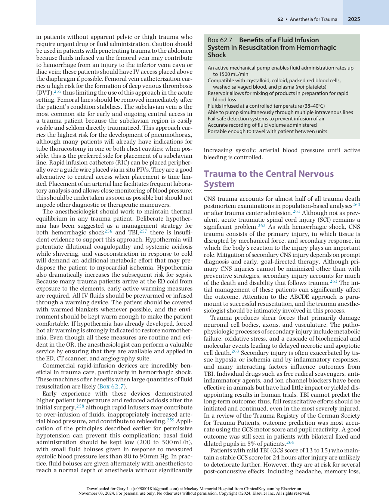

:::

<!-- PDF page 27 -->

emotional lability (including aggressive behavior and violence), and sleep disturbance.265 Moderate TBI (GCS score of 9 to 12) may be accompanied by intracranial lesions that require surgical evacuation, and early CT is strongly indicated. Early tracheal intubation, mechanical ventilation, and close observation may be necessary for managing patients with moderate TBI because of combative or agitated behavior and the potentially catastrophic consequences of respiratory depression or pulmonary aspiration occurring during diagnostic evaluation. The trachea can be extubated if the patient is hemodynamically stable and appropriately responsive after the diagnostic workup. Treatment of secondary brain injury is accomplished by early correction and subsequent avoidance of hypoxia, prompt intravascular fluid resuscitation, and management of associated injuries. The timing of indicated noncranial surgery in these patients with moderate injury not requiring decompressive craniectomy is highly controversial because early surgery can increase the episodes of hypoxia and hypotension.266

Neurologic monitoring of patients with moderate TBI consists of serial assessment of consciousness and motor and sensory function (see Chapter 39). Deterioration of the GCS score is an indication for urgent CT to establish the need for craniotomy or invasive monitoring of ICP. If frequent neurologic monitoring is not possible because of general anesthesia continuing longer than 2 hours, aggressive analgesia, or prophylaxis against delirium tremens, invasive ICP monitoring may be indicated.197 Although the mortality from moderate TBI is infrequent, many patients will have significant long- term disability.

Severe TBI is classified as a GCS score of 8 or less at admission and carries a significant risk for mortality. Patients with severe TBI have mortality three times that of patients with other types of traumatic injury.267 Early, rapid management focused on restoring systemic homeostasis and perfusion- directed care of the injured brain will produce the best possible outcomes in this challenging population. Guidelines for managing patients with severe TBI have been published by the American Association of Neurological Surgeons and Brain Trauma Foundation.197 The clinical pathway at the R Adams Cowley Shock Trauma Center in Baltimore appears in Fig. 62.12.

A single episode of hypoxemia (PaO2 &lt;60 mm Hg) occurring in a patient with severe TBI can double the incidence of mortality.40,268 The _sine qua non_ for TBI management is the adequacy of systemic oxygenation by whatever means this can best be accomplished. Prevention of hypotension and hypoxemia at all phases of TBI care is crucial.269

Patients with TBI frequently require perioperative monitoring, including ICP, brain temperature, arterial pressure, cerebral oxygenation, and other advanced monitoring techniques (see Chapter 53). ICP may be monitored with an intraparenchymal probe or intraventricular catheter and should be maintained at less than 20 mm Hg. Various monitoring devices have been used to assess the adequacy of cerebral oxygenation, including jugular venous O2 saturation, positron emission tomography, near- infrared spectroscopy, and direct brain tissue oxygenation (PbtO2) monitoring.270 Brain tissue hypoxia may be corrected by increasing FiO2, blood transfusion, inotropic support, or sedation if increased ICP results in decreased cerebral blood flow.271–274 Small studies suggest an improvement in Glasgow Outcome Score (GOS)

and mortality with brain O2–targeted strategies, but no overall consensus exists.197

Patients with severe TBI are also at risk for non- CNS organ failure. A retrospective review of patients with isolated TBI found a frequent incidence of subsequent organ failure: 89% developed dysfunction of at least one non- neurologic organ system. Takotsubo cardiomyopathy may develop in the setting of severe TBI and lead to severe myocardial dysfunction in the patient with brain injury.275 The reasons for development include the interplay between the neuroendocrine system and the injured brain. A catecholamine surge after TBI may manifest as subendocardial ischemia, leading to biventricular heart failure, even in young, previously healthy patients. This cycle may be exacerbated during OR procedures when vasoactive drugs might be administered. A β- adrenergic blockade may be protective in human studies in patients with brain injuries. Retrospective database reviews have indicated improved neurologic outcomes and reduced morbidity and mortality in patients receiving β- adrenergic blockers, although the quality of evidence is not high.276,277

### TRAUMATIC BRAIN INJURY AND CONCOMITANT TRAUMA

Patients with isolated head injuries can be managed with traditional ventilatory strategies. Still, those with chest trauma, aspiration, or massive resuscitation after a shock are at high risk for the development of ARDS. The classic teaching of no or low- level positive end- expiratory pressure (PEEP) to prevent increased ICP is inappropriate because hypoxemia may not be corrected. With adequate intravascular volume resuscitation, PEEP does not increase ICP or decrease cerebral perfusion pressure (CPP)278 and may reduce ICP due to improved cerebral oxygenation.279 Patients who develop ARDS after TBI are at risk for cerebral hypoxia.280 A double- hit model has been proposed as the cause of ARDS secondary to CNS trauma – severe TBI leads to a systemic inflammatory response, which then primes the lungs to be more susceptible to injurious ventilator strategies or other mediators of lung injury. ARDS and cardiac insufficiency after TBI may lead to compromised systemic oxygenation and, therefore, a decrease in cerebral O2 delivery.281 Hyperventilation therapy (e.g., at a PaCO2 of 25 mm Hg), long a mainstay in managing patients with TBI, is no longer recommended as a prophylactic treatment.197 A range of PaCO2 between 30 and 35 mm Hg should be induced with hyperventilation to 30 mm Hg only for episodes of increased ICP that cannot be controlled with sedatives, drainage of cerebrospinal fluid, neuromuscular blockade, osmotic drugs, or barbiturate coma; targeting a lower PaCO2 is often a temporizing measure used as a bridge to definitive operative treatment.193

Hyperventilation during the first 24 hours after injury is of concern because of the critical reductions in perfusion during this timeframe. However, these recommendations should be taken in context and modified in the face of unstable clinical circumstances, such as an expanding mass lesion or signs of imminent herniation.282

Patients with concomitant TBI and hemorrhagic shock are at risk for worse coagulopathy before resuscitation and increased mortality.283 A single episode of hypotension, defined as systolic blood pressure lower than 90 mm Hg, is associated with an increase in morbidity and doubled

<!-- PDF page 28 -->

mortality after severe TBI.268 Hypotension, together with hypoxia, increases mortality significantly.40 Current recommendations are to maintain a patient with severe TBI in a euvolemic state. Therefore, fluid resuscitation is the mainstay of therapy, followed by vasoactive infusions as needed. The ideal fluid has not been defined, but hypertonic saline solutions are often optimal. Correction of anemia from acute blood loss is the priority; however, an optimal target hematocrit has not been defined. Animal models and healthy

human subjects maintaining a hemoglobin lower than 7 g/dL results in impaired brain function and a hemoglobin lower than 10 g/dL may be detrimental to recovery from TBI.284 After the initial ABCDE management of a patient with severe TBI, a stepwise approach to the maintenance of CPP is initiated, with a currently recommended goal range of 60 to 70 mm Hg.197

Decompressive craniectomy is a surgical procedure used to control severely increased ICP and prevent herniation

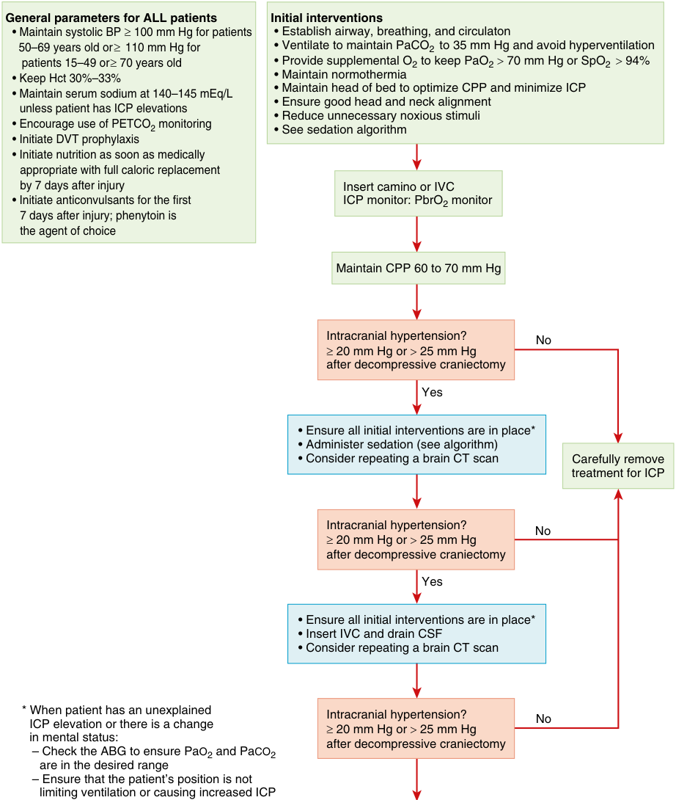

General parameters for ALL patients Initial interventions • Maintain systolic BP  �  100 mm Hg for patients  • Establish airway, breathing, and circulaton   50–69 years old or  �� 110 mm Hg for   • Ventilate to maintain PaCO2  to 35 mm Hg and avoid hyperventilation    patients 15–49 or  �� 70 years old  • Provide supplemental O2 to keep PaO2 � 70 mm Hg or SpO2 � 94% • Keep Hct 30%–33%  • Maintain normothermia  • Maintain head of bed to optimize CPP and minimize ICP • Maintain serum sodium at 140–145 mEq/L  • Ensure good head and neck alignment   unless patient has ICP elevations  • Reduce unnecessary noxious stimuli • Encourage use of PETCO2 monitoring  • See sedation algorithm • Initiate DVT prophylaxis • Initiate nutrition as soon as medically appropriate with full caloric replacement by 7 days after injury Insert camino or IVC • Initiate anticonvulsants for the first ICP monitor: PbrO2 monitor 7 days after injury; phenytoin is the agent of choice Maintain CPP 60 to 70 mm Hg Intracranial hypertension? No �� 20 mm Hg or  � 25 mm Hg after decompressive craniectomy Yes • Ensure all initial interventions are in place* • Administer sedation (see algorithm) • Consider repeating a brain CT scan Carefully remove treatment for ICP Intracranial hypertension? No �� 20 mm Hg or  � 25 mm  Hg after decompressive craniectomy Yes • Ensure all initial interventions are in place* • Insert IVC and drain CSF • Consider repeating a brain CT scan  * When patient has an unexplained Intracranial hypertension? No  ICP elevation or there is a change �� 20 mm Hg or  �� 25 mm Hg  in mental status: after decompressive craniectomy     – Check the ABG to ensure PaO2 and PaCO2     are in the desired range     – Ensure that the patient’s position is not     limiting ventilation or causing increased ICP 

**Fig. 62.12 Clinical pathway for management of severe traumatic brain injury.** The goal of therapy is to maintain cerebral perfusion pressure above 60 mm Hg by the support of the circulation and control of intracranial pressure. Progressively more intensive therapies are added until this goal is achieved. _ABG_ , arterial blood gas; _BP_ , blood pressure; _CBF_ , cerebral blood flow; _CPP_ , cerebral perfusion pressure; _CSF_ , cerebrospinal fluid; _CT_ , computed tomography; _DVT_ , deep venous thrombosis; _Hct_ , hematocrit; _ICP_ , intracranial pressure; _IVC_ , intraventricular catheter.

::: warning 符號需核對
此頁有符號無法完整擷取，請展開下方原始頁面核對。
:::

::: details 原始表格與符號（PDF 第 28 頁）

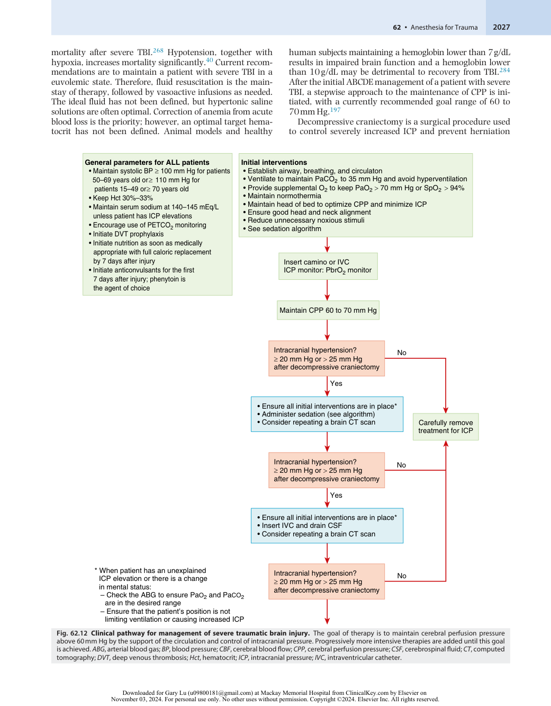

:::

<!-- PDF page 29 -->

### Continued

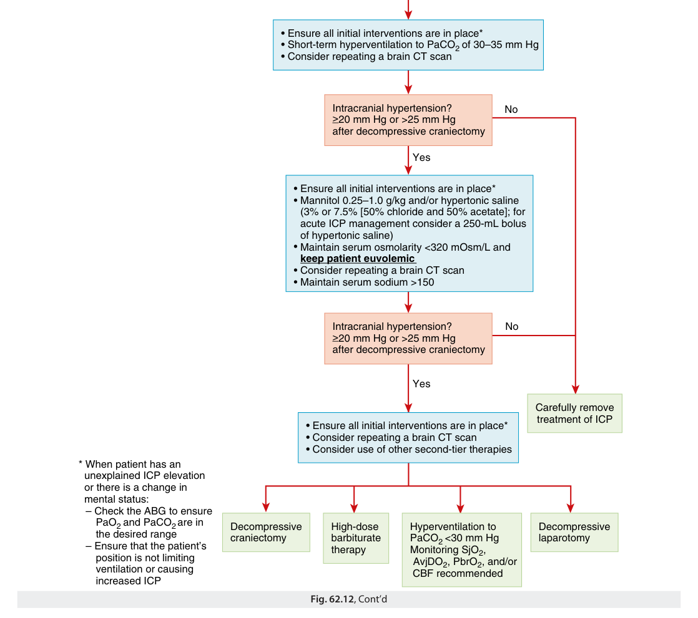

• Ensure all initial interventions are in place* • Short-term hyperventilation to PaCO2 of 30–35 mm Hg • Consider repeating a brain CT scan Intracra niin al  hypertension? No hy > 2 pertension?0 mm Hg or >25 mm Hg after decompressive craniectomy �� 25 mmHg or * Yes • Ensure all initial interventions are in place* • Mannitol 0.25–1.0 g/kg and/or hypertonic saline (3% or 7.5% [50% chloride and 50% acetate]; for acute ICP management consider a 250-mL bolus of hypertonic saline) • Maintain serum osmolarity &lt;320 mOsm/L and keep patient euvolemic • Consider repeating a brain CT scan • Maintain serum sodium >150 Intracra niin al  hypertension? No hy > 2 pertension?0 mm Hg or >25 mm  Hg after decompressive craniectomy �� 25 mmHg or * Yes Carefully remove treatment of ICP • Ensure all initial interventions are in place* • Consider repeating a brain CT scan • Consider use of other second-tier therapies * When patient has an   unexplained ICP elevation   or there is a change in   mental status: – Check the ABG to ensure       PaO2 and PaCO2 are in Decompressive High-dose Hyperventilation to Decompressive       the desired range craniectomy barbiturate PaCO2 &lt;30 mm Hg laparotomy – Ensure that the patient’s therapy Monitoring SjO2,       position is not limiting  AvjDO2, PbrO2, and/or       ventilation or causing CBF recommended       increased ICP Fig. 62.12 , Cont’d 

after stroke, and it is now used for the same indications after severe TBI.285 Decompressive craniectomy is indicated for selected anatomic patterns of TBI, such as when CPP cannot be maintained despite the vigorous application of the previously described therapies, including barbiturate coma. Relieving ICP by removing a piece of the cranium and using a dural patch may improve mortality and morbidity in patients who might not otherwise survive.286 Decompressive laparotomy may be indicated in patients with severe TBI if coexisting injuries or vigorous intravascular volume infusion have increased intra- abdominal compartment pressure to greater than 20 mm Hg. Increased abdominal pressure worsens pulmonary mechanics, thus necessitating higher MAP to maintain arterial O2 saturation. This increase in ventilating pressure will increase intrathoracic pressure, impair venous drainage from the head,

and decrease CPP. Compressive celiotomy as a therapy to reduce ICP has been described287 for managing patients with severe TBI and a potential multiple compartment syndrome.247 Fluid therapy, ARDS, or both may increase intraabdominal and intrathoracic pressure, thereby increasing ICP. Further fluid administration to support cerebral perfusion or increasing ventilatory support to treat ARDS exacerbates this problem. This can create a cycle that ultimately produces multiple compartment syndrome and necessitates the opening of the abdomen, even in the absence of primary abdominal trauma. Isolated TBI can thus become a multisystem disease.

Like hyperventilation therapy, the use of hypothermia to treat severe TBI has changed. Early studies demonstrated that moderate systemic hypothermia reduces both the rate of cerebral edema and mortality after cortical

::: warning 符號需核對
此頁有符號無法完整擷取，請展開下方原始頁面核對。
:::

::: details 原始表格與符號（PDF 第 29 頁）

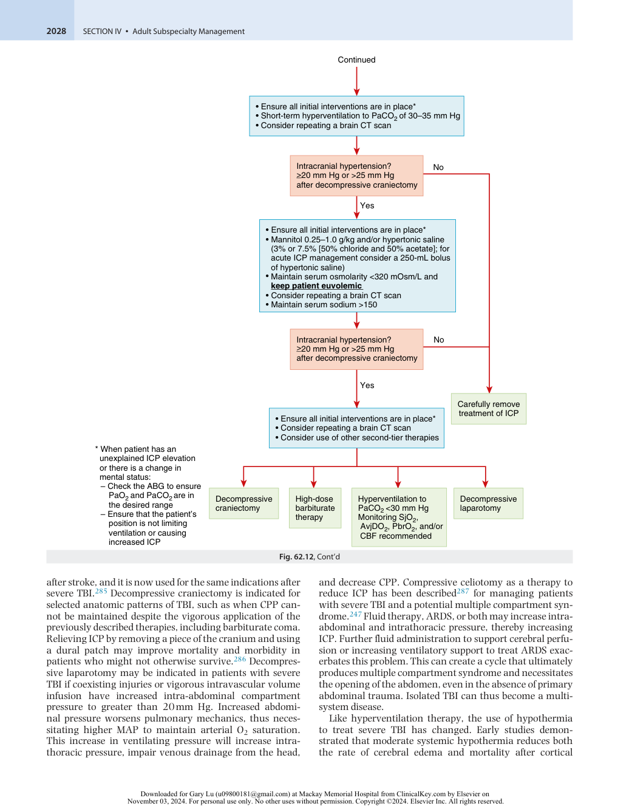

:::

<!-- PDF page 30 -->

injury in laboratory animals.288,289 Small clinical series in humans also suggested improved outcomes in patients with TBI when hypothermia was maintained for 24 or 48 hours.290,291 However, a multicenter, randomized trial of hypothermia (33°C) versus normothermia demonstrated no improvement in outcome in a population of patients with severe TBI.292 Patients who were hypothermic on admission and then were randomized to the normothermia group had a worse outcome than those who were left hypothermic, thus leading to the recommendation that patients with severe TBI who are hypothermic on admission not undergo active rewarming. Brain Trauma Foundation guidelines do not recommend early, short- term, prophylactic hypothermia.197

### MANAGEMENT OF INTRACRANIAL PRESSURE IN THE OPERATING ROOM

Although most interventions for managing a patient with severe TBI will occur in the ICU, urgent cranial or noncranial surgery can be indicated. The previously described therapies should be continued throughout the perioperative period, including positional therapy (when possible), aggressive hemodynamic monitoring and resuscitation, administration of osmotic agents (with attention to maintaining euvolemia), and deep levels of analgesia and sedation. Appropriate anesthetic choices include opioids and low concentrations of volatile anesthetics. Pharmacologic management of TBI is the mainstay of the anesthesiologist’s role in the operating room. Intraoperative management of elevated ICP may be accomplished with osmotic diuretics or hypertonic saline. No difference was noted in longterm outcomes between mannitol and hypertonic saline on outcomes at six months. However, hypertonic saline may potentiate minor short- term improvements in cerebral blood flow and CPP.293,294 A meta- analysis of commonly used drugs in the intraoperative management of patients with TBI, including propofol, barbiturates, opioids, benzodiazepines, and corticosteroids, showed corticosteroids to be the only drug associated with an increase in mortality. The other drugs had an acute benefit in reductions in ICP and sedation but no appreciable long- term benefit.197,265

### SPINAL CORD INJURY (SCI)

SCI after trauma affects some 13,000 Americans each year.262 Blunt trauma accounts for most of SCI: 36% from motor vehicle collisions and 42% from falls, with only 4% from firearms. Cervical spine injuries occur in 1.5% to 3% of all major trauma. Over 50% of SCIs involve the cervical spine, usually between the C4 and C7 levels. Complete quadriplegia occurs in 11% of SCI cases. It is essential to realize that more than 40% of trauma patients with SCI may also have other significant injuries, including TBI. As lifespans continue to increase, more patients with SCI will survive to an older age.295,296

Most spinal injuries are in the lower cervical spine, just above the thorax, or in the upper lumbar region, just below the thorax. Blunt SCI is most common in the most flexible areas of the cord, especially at the junctions between flexible and inflexible segments. The vertebral column is divided longitudinally into three columns: anterior, middle,

and posterior; injuries to any two columns suggest biomechanical instability. These are the patients who will often require urgent surgical stabilization. Patients with unstable cervical spine injuries who meet the criteria for emergency intubation should undergo rapid sequence induction (see section above on protection of the cervical spine).269 SCI at midthoracic levels is less common because of the rotational stabilization provided by the rib cage and intercostal musculature.

SCI is commonly accompanied by radiographically visible injury to the bony spine and concomitant disruption of the muscles, ligaments, and soft tissues that support it. However, clinically significant injury to the cervical spinal cord can occur without a visible skeletal injury. This entity, known as spinal cord injury without radiographic abnormality (SCIWORA), is more common in children. It is presumably the result of temporary hyperdistraction or torsion of the neck insufficient to disrupt the bony skeleton.297

Primary injury to the spinal cord sustained at the time of injury may be exacerbated by secondary factors (Fig. 62.13).

The combination of biochemical changes, vascular disruption, and electrolyte abnormalities can lead to cellular changes and worsening of SCI lesions up to 3 days after injury.298 SCI includes sensory deficits, motor deficits, and both. Incomplete deficits may be worse on one side than the other and may improve rapidly in the first minutes after injury. Complete deficits—representing total spinal cord disruption at one level—are much more ominous, with generally slight improvement seen over time. Spine injuries above the level of T4–6 are accompanied by significant hypotension because of inappropriate vasodilatation, loss of cardiac inotropy, and bradycardia resulting from the denervation of the cardiac accelerator fibers (neurogenic shock). (Note the distinction between _neurogenic shock_ and the incorrect term _spinal shock,_ which refers to a loss of reflexes.) Functioning of the lower cord will gradually return, along with restoration of normal vascular tone. Diagnosing cervical spine instability can be difficult. The Eastern Association for the Surgery of Trauma has published guidelines regarding which patients require cervical spine radiographs, which views and studies should be obtained, and how to determine the absence of significant ligamentous injury in an obtunded patient.299 For the obtunded patient, a high- quality CT scan without evidence of cervical SCI is considered adequate for clearance, although this is not universally accepted. Many institutions still require magnetic resonance imaging (MRI) to rule out ligamentous injury in this patient population. The most commonly missed cervical fractures are at the C1–2 and C7–T1 levels, usually because of inadequate imaging.

Early intubation of the trachea is almost universally required for patients with cervical spine fractures and quadriplegia. Ventilatory support is almost always required for patients with a deficit above C4 because they will lack sufficient diaphragmatic function. Patients with levels from C6 to C7 may need support because of impairment in respiratory muscle function resulting from (1) loss of chest wall innervation, (2) paradoxical respiratory motion, (3) inability to clear secretions, and (4) decreased lung and chest wall compliance. Early tracheal intubation is recommended

<!-- PDF page 31 -->

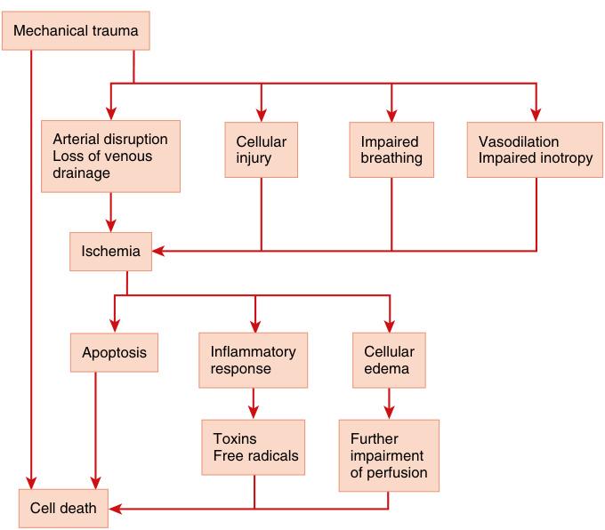

Mechanical trauma Arterial disruption Cellular Impaired  Vasodilation Loss of venous injury breathing Impaired inotropy drainage Ischemia Apoptosis Inflammatory Cellular response edema Toxins Further Free radicals impairment of perfusion Cell death 

**Fig. 62.13 Mechanisms of spinal cord injury.** Mechanical trauma to the spinal cord is exacerbated by systemic hypoperfusion or hypoxia. (Reprinted with permission from Dutton RP. Spinal cord injury. _Int Anesthesiol Clin_ . 2002;40:109.)

and, if elective, often can be accomplished by awake fiberoptic bronchoscopy or video laryngoscopy before hypoxia renders the patient anxious and uncooperative.300,301 Two retrospective studies have evaluated the need for tracheal intubation in patients with cervical SCI. Como and colleagues300 identified 119 patients, 45 of whom had complete SCI. All patients with injuries at C5 and above required intubation, and 71% of these progressed to tracheostomy. A second study of 178 patients with complete cervical SCI showed that 70% needed tracheostomy, particularly those with an injury between C4 and C7.301 Spontaneous ventilation and extubation of the trachea are possible after surgical stabilization and resolution of neurogenic shock. However, pneumonia is a common and recurrent complication that frequently necessitates tracheostomy to facilitate pulmonary toilet.302

Although the administration of a glucocorticoid steroid bolus in patients with blunt SCI and deficit was previously recommended, current guidelines do not use these agents. In a meta- analysis of twelve studies, including five randomized controlled trials (RCTs) and seven observational studies (OBSs), methylprednisolone therapy within the first eight hours following acute SCI failed to show a statistically significant short- term or long- term improvement in patients’ overall motor or neurologic scores compared to controls who were not administered steroids.303 Moreover, there was an increased risk of pneumonia and hyperglycemia compared to controls. Current recommendations by the American Association of Neurological Surgeons and the Congress of Neurological Surgeons state that there is no consistent or compelling medical evidence to justify using methylprednisolone for acute SCI.304,305

### INTRAOPERATIVE MANAGEMENT OF SPINAL CORD INJURY

A patient about to undergo surgical reduction and fixation of a spinal column fracture presents challenges for the anesthesiologist. First and foremost is the need for intubation of the trachea in a patient with a known injury to the cervical spine (see also Chapter 53). Direct laryngoscopy with in- line stabilization is appropriate in the emergency setting and in unconscious, combative, or hypoxemic patients when the spine’s status is unknown.306 Video laryngoscopy and fiberoptic- assisted techniques might be associated with a higher first- attempt failure rate over controls. Still, no firm conclusions regarding the best method for tracheal intubation in patients at risk for worsening SCI can be made based on the available data.307 Hence, no technique for airway management in patients with unstable SCI is superior for preventing neurologic deterioration.308,309 Tracheal intubation can occur in the OR in an awake, alert, and cooperative patient by several methods known to produce less displacement of the cervical spine, presumably with less risk for worsening an unstable SCI. A common technique in current clinical practice is awake fiberoptic intubation. Although the nasal route is associated with an easier path to intubation in most patients, it can lead to an increased risk for sinusitis in the ICU if the trachea is not extubated at the end of the procedure. Oral intubation may be more challenging technically but will be of greater value if the patient remains mechanically ventilated. Blind nasal intubation and using an intubating LMA, video laryngoscopy, or any of a variety of other instrument systems for indirect laryngoscopy are acceptable. Clinicians are advised to use the equipment and techniques with which they are most

<!-- PDF page 32 -->

familiar. The critical concept is to successfully achieve tracheal intubation while minimizing the motion of the cervical spine and preserving the ability to assess neurologic function after positioning.75

A patient with a partial neurologic deficit and visible spinal canal impingement on imaging studies is considered an emergency because of the potential for regaining neurologic function after decompression. Timing for surgery suggests that earlier decompression may improve outcomes in some patients, particularly those with cervical injuries, although the exact timing remains controversial.310,311 In motor complete thoracic SCI patients, a laminectomy has significantly increased the rate of successful spinal cord decompression.312 Hemodynamic instability may complicate urgent and emergent spinal surgery. Hypotension from neurogenic shock is characterized by inappropriate bradycardia resulting from loss of cardiac accelerator function and unopposed parasympathetic tone. However, this situation can be difficult to distinguish from hypotension resulting from acute hemorrhage. A trial of fluid administration is still indicated, subject to the end points of resuscitation listed earlier. Once hemorrhage has been controlled or ruled out, patients who have maintenance of an increased MAP of more than 85 mm Hg for seven days after SCI may have improved functional recovery. This approach is highly controversial but remains a recommendation in treatment according to published guidelines.313

## Orthopedic and Soft Tissue Trauma

Musculoskeletal injuries are the most frequent indication of other operative management in most trauma centers (see Chapter 60). In addition to the physical handicaps and long- term morbidity that patients with orthopedic injuries may endure, long- term psychological trauma is also a prominent feature.314–316 The length of many procedures, particularly in patients with multiple extremity injuries, necessitates attention to body positioning, maintenance of normothermia, fluid balance, and preservation of peripheral blood flow.

Musculoskeletal injuries represent common injury patterns seen in patients with high- energy mechanisms of injury and are one of the more common reasons for operative intervention in the trauma population.317,318 The timing of operative intervention in polytrauma patients with orthopedic injuries has been a topic of considerable academic and clinical discussion. The process involves multidisciplinary communication among anesthesiologists, intensivists, orthopedic surgeons, and general trauma surgeons. Discussions should address patient physiology and specific injury patterns that include, but are not limited to, concomitant TBI, blunt cerebral vascular injury, blunt aortic injury, pulmonary contusion, and intra- abdominal trauma (i.e., hepatic, splenic injuries, and open abdomen).

Historically, injuries to the extremities in multisystem trauma patients who were too critically injured for definitive operative intervention were managed with traction and prolonged immobilization. These patients experienced high rates of pulmonary failure and prolonged mechanical ventilation, developed sepsis frequently, and had increased

mortality rates.319 Specifically, pulmonary complications have been a common occurrence in this population of trauma patients, with nearly 30% of patients with multiple extremity injuries experiencing pulmonary morbidity. In one retrospective review of 582 patients with femur fractures, definitive fixation was delayed until lactate concentrations were decreased below 2.5 mmol/L320 ; ARDS, death, and ICU length of stay were improved for patients who were resuscitated before definitive fixation. Therefore, the goal of fracture management in the multisystem trauma patient revolves around restoring musculoskeletal anatomy that allows for mobilization, pulmonary toilet, and adequate pain control; definitive operations are often deferred until the patient is physiologically optimized.

Multiple scoring systems and criteria have been described to identify severely injured patients (i.e., ISS >15) in whom it is safe to proceed with early definitive fixation of an extremity injury.321–323 Nahm _et al._ reported that the following physiologic criteria could be used to risk- stratify patients who are appropriate for definitive fracture fixation: pH ≥7.25, lactate &lt;4, base excess ≥−5.5.321 Considerable attention to ICP is also necessary for patients with TBI, such that intracranial hypertension and marked elevations in TBI that may occur with changes in position should be contraindications to early definitive fracture care.324 While substantial evidence supports early fracture in severely injured trauma patients, it should be recognized that many of these studies are retrospective in design with certain limitations.325–329 Nonetheless, there is a certain clinical benefit to early operative intervention with regard to fewer days of mechanical ventilation and lower complication rates.325 In those severely injured patients in whom it is not feasible to perform early definitive fixation due to either altered cardiopulmonary physiology, acid–base status, and/or concomitant TBI, temporary external fixation with internal fixation occurring at a later date (i.e., days to weeks after initial injury) when appropriate physiology has been restored is a valuable option.330

### SPECIFIC ORTHOPEDIC CONDITIONS

Hip fracture is common, morbid, and costly among older adults (see Chapter 60). Frequently, patients with isolated hip fractures present to the OR for urgent repair. Prior beliefs that regional anesthesia is associated with decreased odds of inpatient mortality and pulmonary complications among patients with hip fractures in contrast to general anesthesia have since been debunked with more recent systematic reviews.331 in the REGAIN (Regional versus General Anesthesia for Promoting Independence after Hip Fracture) trial, similar rates of postoperative ambulation and survival at 60 days were observed when spinal anesthesia was compared to general anesthesia for hip fracture surgery in patients over the age of 50.332 A secondary analysis of this trial revealed more pain 24 hours after surgery and more postoperative prescription analgesic use in patients who received spinal anesthesia than general anesthesia.333

In patients with isolated extremity or hip fractures without polytrauma, the evidence remains clear that early definitive fracture care improves outcomes. In hip fracture patients, current United States334 and Canadian335 guidelines recommend surgery within 48 hours. Within

<!-- PDF page 33 -->

the United Kingdom, surgery within 36 hours is a quality of care indicator, although adherence to these guidelines is often inconsistent.336

Hip dislocation is common after high- energy trauma and is frequently accompanied by an acetabulum fracture. Whereas the fracture itself can be safely managed on a delayed basis or nonoperatively, the dislocation is a medical emergency that must be promptly addressed if the patient is to have a good functional outcome. Failure to promptly diagnose and reduce a dislocated hip joint is a significant risk factor for avascular necrosis of the femoral head. Reduction typically requires a very deep level of sedation, which may be facilitated by a nondepolarizing neuromuscular blockade. For this reason, the anesthesiologist is commonly involved.337 Although a dislocated hip can be reduced in a spontaneously breathing sedated patient, an acutely injured patient is at high risk for aspiration of gastric contents. Any patient undergoing surgery soon (such as for an open long- bone fracture or exploratory laparotomy) can be tracheally intubated at the time of reduction and maintained with appropriate sedation and analgesia until reaching the OR. Other patients who may require intubation even for uncomplicated reductions include those who are inebriated or uncooperative, hemodynamically unstable, or suffering from pulmonary dysfunction. Additionally, successful postoperative fracture reduction is more challenging in morbidly obese patients than in those with average body mass index.338 Unlike acetabular fractures, a fracture of the pelvic ring requires immediate recognition and management by the trauma team. Hemorrhage, even exsanguination, is common after a significant pelvic ring fracture and is a leading contributor to early death after motor vehicle collisions. Bleeding occurs from multiply disrupted venous beds in the posterior pelvic bowl; if the pelvis is unstable, no anatomic barrier exists to the continued expansion of this retroperitoneal bleeding. Surgical exploration by way of the peritoneum is usually unrewarding because the bleeding vessels are not easily accessed.339 In the past, therapy consisted of supportive volume resuscitation, external fixation of the unstable pelvis, and angiography. Despite this multidisciplinary approach, mortality remained frequent in these patients, partially because of the inability of angioembolization to control venous bleeding from the rich venous plexuses associated with the most severe fractures. Many US trauma centers have adopted the technique of preperitoneal packing. Preperitoneal packing via laparotomy is a rapid method for controlling pelvic fracture–related hemorrhage that can supplant the need for emergent angiography and reduces transfusion requirements and mortality.340 Endotracheal intubation is usually undertaken on an emergency basis in a hypotensive patient. The anesthesiologist may remain with the patient throughout the initial hours of stabilization to manage sedation, analgesia, transport, and ongoing resuscitation needs. In the absence of an orthopedic specialist, temporary stabilization and tamponade of some pelvic fractures can be accomplished with a specially made pelvic binder or a bed sheet knotted tightly around the bony pelvis.341

Mechanically unstable pelvic ring fractures are associated with increased fluid and blood resuscitation volumes, significantly more frequent presence of concomitant

injuries, increased ventilation and ICU stay, rate of multiple organ dysfunction syndrome (MODS), sepsis, and mortality rate.342 In some cases, patients with pelvic fractures may present for operative procedures with or without early interventions such as placement of a pelvic binder or resuscitative endovascular balloon occlusion of the aorta (REBOA). REBOA is becoming a more commonly utilized temporary hemorrhage control technique for patients with hemodynamically significant pelvic fractures.343

Patients with pelvic fractures can initially be divided into two groups: (1) stable pelvic fracture; or (2) displaced pelvic ring fractures with hemodynamic instability or high risk for deterioration. This second group has the highest risk for complications and mortality related to their injuries. The presence of associated injuries to the head, chest, and abdomen can lead to conflicting priorities in managing these patients. For example, a CT finding of a high- grade splenic injury in the setting of a severe pelvic injury and hemodynamic instability may require an exploratory laparotomy before addressing the pelvic injury. These patients may present for operative procedures with or without early interventions such as placement of a pelvic binder or REBOA. As the unstable trauma patient is moved to the angiography suite or hybrid OR, resuscitation should maintain a sufficient perfusion pressure; survival is higher if this transition occurs within 3 hours of presentation.344 Management of these interventions in the OR requires an understanding of the anatomy, physiology, and surgical considerations involved in their employment in the operative setting, as discussed above.

Open fractures should be pulse- lavaged and débrided as soon as possible after the injury to minimize the risk of infectious complications. If ongoing resuscitation or unstable TBI precludes the patient from early management in the OR, this procedure can be performed at the bedside. Despite the frequency of open fractures, their management remains one of the most significant and debated orthopedic challenges. The timing of surgical fixation in open fractures is often surgeon- specific or center- specific because little consensus exists among orthopedic surgeons as to optimal treatment.345

The advantages and disadvantages of regional and general anesthesia are summarized in Boxes 62.8 and 62.9.

Regional anesthesia has been reported to be associated with improved postoperative morbidity and mortality346–348 (including cognitive measures of function). Still, clinically measurable benefits may not be seen in patients receiving combined general and regional techniques.349,350 One other prevalent concern in managing an orthopedic trauma patient is the concomitant use of regional anesthesia, analgesia, or both, and prophylaxis for venous thromboembolism, as discussed in Chapter 42.

Intraoperative transesophageal echocardiography (TEE) has shown that most patients undergoing long- bone fracture manipulation experience microembolism of fat and marrow.351 Most patients suffer no discernible clinical impact from this phenomenon, but some will experience a significant acute inflammatory response. After long- bone fractures, lung dysfunction occurs in almost all patients, ranging from minor laboratory abnormalities to fat embolism syndrome (FES).352 A lack of universally accepted diagnostic criteria combined with concomitant pulmonary and

<!-- PDF page 34 -->

### Box 62.8 Advantages and Disadvantages of Regional Anesthesia for Trauma Patients

### Advantages

Allows continued assessment of mental status Increased vascular flow Avoidance of airway instrumentation Improved postoperative mental status Decreased blood loss Decreased incidence of deep venous thrombosis Improved postoperative analgesia Better pulmonary toilet Earlier mobilization Lower incidence of long- term pain syndromes **Disadvantages** Peripheral nerve function difficult to assess Patient refusal common Requirement for sedation Hemodynamic instability with placement Longer time to achieve anesthesia Not suitable for multiple body regions May wear off before procedure(s) conclude

### Box 62.9 Advantages and Disadvantages of General Anesthesia for Trauma Patients

**Advantages** Speed of onset Duration – can be maintained as long as needed Allows multiple procedures for multiple injuries Greater patient acceptance Allows positive- pressure ventilation **Disadvantages** Impairment of global neurologic examination Requirement for airway instrumentation Hemodynamic management more complex

cardiovascular dysfunction accounts for the varying incidence reported in the literature. Clinically significant FES occurs in 3% to 10% of patients but is likely underdiagnosed in patients with multiple injuries or a high ISS.353 Patients with coexisting lung injury are at additional risk for FES. Signs include hypoxia, tachycardia, mental status changes, and, classically, a petechial rash on the axillae, upper arms and shoulders, chest, neck, and conjunctivae. However, the petechial rash is only observed in approximately 20%–50% of cases.354 FES should be considered whenever the alveolar–arterial O2 gradient deteriorates in conjunction with decreased pulmonary compliance and CNS deterioration. Under general anesthesia, the CNS changes will not be apparent but may be manifested as failure to awaken after surgery. If central hemodynamic monitoring is available, pulmonary artery pressure is elevated, often accompanied by decreases in the cardiac index. Diagnosis in the OR is primarily based on the clinical findings after ruling out other causes of hypoxemia. Fat globules in urine are nondiagnostic, but lung infiltrates seen on chest radiography confirm the presence of lung injury and the need for appropriate ventilatory management with O2, higher PEEP, and possible longer- term mechanical ventilatory support.355,356

Treatment includes early recognition, administration of O2. and judicious fluid management.352 A change in the orthopedic procedure may be indicated, such as converting intramedullary nailing of the femur to external fixation. In patients with bilateral femur fractures, it has been proposed that 1 to 2 days be allowed to pass between successive nailing procedures.306

Acute compartment syndrome of the extremities is defined as a “condition in which increased pressure within a limited space compromises the circulation and function of the tissues within that space.”357 The most common cause of compartment syndrome is edema secondary to muscle injury and associated hematoma formation. Although most associated with traumatic injuries, compartment syndrome can also occur because of trauma- related causes, including reperfusion injury, burns, drug overdose, and prolonged limb compression (Box 62.10). The most common fractures associated with the development of compartment syndrome are those of the tibial shaft (40%) and forearm (18%).358,359 Forearm compartment syndrome requiring fasciotomy predominantly affects males and can occur after a fracture or soft tissue injury. Soft tissue injuries cause a further 23% of cases without fracture.360 Although no randomized, prospective trials have been conducted, regional anesthesia does not blunt detection of compartment syndromes if there is not an associated dense motor block.361

Fasciotomy is usually indicated when compartment pressure approaches 20 to 30 mm Hg below diastolic pressure in any patient with a worsening clinical condition, a documented rising tissue pressure, significant soft tissue injury, or a history of 4 to 6 hours of total ischemia of an extremity. Compartment syndrome is suspected in the awake when pain is experienced, by the patient, beyond what is expected for the given injury. Prophylactic fasciotomy may be indicated in patients with warm ischemic time of more than 2 hours, ligation of the major veins in the popliteal region or distal part of the thigh, and crush injuries. Early or prophylactic fasciotomy decreases subsequent muscle loss.362

Crush syndrome is the general manifestation of crush injury caused by prolonged continuous pressure on one or more extremities. It is commonly found in patients who have been trapped in one position for an extended period.363,364 Muscle injury secondary to ischemia causes myoglobinuria, which can lead to acute renal failure and subsequent profound electrolyte disturbances. The most critical treatment consists of crystalloid fluid resuscitation; a total body fluid deficit of 15 L may occur in severe rhabdomyolysis.365 Osmotic diuresis with mannitol and alkalization of urine with sodium bicarbonate to prevent precipitation of myoglobin in the renal tubules remain controversial.366

### SOFT TISSUE TRAUMA

Assessment of soft tissue injury is critical in managing a trauma patient. Muscular coverage is necessary for the viability of any orthopedic repair. Still, it may be jeopardized by avulsion at the time of injury, ischemia from elevated compartment pressure, and ongoing bacterial infection in open wounds. Acute surgical management of soft tissue injury is straightforward: all dead or devitalized tissue must be débrided, and the wound thoroughly irrigated to reduce the load of bacterial contaminants. When muscle or fascia involvement is significant, serial débridement

<!-- PDF page 35 -->

### Box 62.10 Risk Factors for Development of Compartment Syndrome

|**Orthopedic**|
|---|
|Fractures and operative repair|
|**Vascular**|
|Reperfusion injury|
|Hemorrhage with hematoma formation Ischemia from arterial and venous injuries|
|**Soft tissue**|
|Crush injury Burns|
|Prolonged compression in immobile state|
|**Iatrogenic**|
|Casts and circular dressing|
|Use of pneumatic antishock garment Intraosseous fluid replacement in infant/child Pulsatile lavage with extravasation Extravasation from venous or arterial puncture site|
|**Miscellaneous**|
|Snakebite|
|Acute exertion|

at frequent intervals is necessary to establish a margin of completely viable tissue. Vacuum dressings for sizeable soft tissue wounds are gaining popularity because continuous negative pressure over the wound surface removes contaminants and encourages blood flow.367 When serial débridement establishes viable tissue at all margins of the wound, arrangements for definitive closure can be made. Closure may be as simple as a split- thickness skin graft or as complex as free tissue transfer of muscle and fascia from an uninjured portion of the body, with attendant arterial and venous anastomoses.

A degloving injury results in significant soft tissue loss, usually in the extremities. Multiple plastic surgery and reconstructive procedures may be necessary. General anesthesia is generally required, although combining it with epidural or regional block analgesia may confer the benefits of both techniques. Close consultation with the surgical teams is mandatory.

Superficial vacuum dressings can be changed at the bedside under light sedation, but patients with deep wound dressings may require general anesthesia. The need for repeated surgeries is an essential consideration for the anesthetic technique. Anesthesia for free tissue transfer surgery requires meticulous attention to detail because these operations can be quite protracted. Every effort should be made to facilitate perfusion of the grafted vessels, including keeping the patient warm, euvolemic, and comfortable and maintaining the hematocrit in the range of 25% to 30%. The use of epidural anesthesia and analgesia is controversial, with some surgeons favoring it for its vasodilatory effects and others concerned that it will induce a steal phenomenon that will limit flow in the denervated free tissue.368 The use of vasopressors in microsurgery is generally avoided. Yet, in one study, the vasopressor used did not cause more complications.369

## Other Traumatic Injuries

### HEAD AND NECK SURGERY

Except for emergency exploration of penetrating trauma to Zone II of the neck (from the clavicles up to the angle of the mandible), most surgical interventions for head and neck trauma will occur during the subacute phase after complete resuscitation and secondary diagnostic studies. Anesthetic management of these patients is not substantially different from that for similar elective procedures, although coexisting injuries may influence patient positioning, airway management, and ventilator settings.370 Surgery on the mandible and maxilla will be facilitated by nasotracheal intubation. Still, a secure airway should not be jeopardized by attempting to switch from an oral to a nasal tube in a patient in whom visualization of the larynx might be difficult because of traumatic swelling or body habitus. It is safer in these cases for the surgeon to either work around an oral tube secured behind the second molar (to allow dental occlusion) or place a tracheostomy if the need for intubation and mechanical ventilation is likely to be protracted. Surgery on the zygoma and the nasal, orbital, and ethmoid bones will be possible with an oral ETT. Securing the ETT to the molar with a fine- gauge wire will help stabilize it throughout the operation. All these surgeries will lead to significant soft tissue swelling in the immediate postoperative period, often necessitating several days of continued intubation and sedation until sufficient venous drainage has occurred to allow safe extubation of the trachea. Though not definitive, the presence of an air leak when the ETT cuff is deflated suggests that the airway will remain patent once the tube is removed.

### CHEST INJURIES

### Pulmonary

Injuries to the lung parenchyma that produce pneumothorax can be managed by tube thoracostomy to relieve tension, drain accumulated blood, and apply suction to the pleural space until the air leak spontaneously resolves (see also Chapter 49). Bleeding from the low- pressure pulmonary circulation is usually self- limited. Thoracotomy is uncommon but becomes necessary when evidence exists of mediastinal injury, chest tube output exceeds 1500 mL in the first hours after injury, tracheal or bronchial injury and massive air leak are apparent, or the patient is hemodynamically unstable with evident thoracic pathology.52 Blood collected from the pleural space is generally free of clotting factors and can be directly reinfused with any of several commercial systems.371 However, concern has been expressed that this may be prothrombotic and potentially harmful.372 Hemorrhage necessitating surgery may be from injured intercostal or internal mammary arteries or the lung parenchyma. Staple resection of injured lung or anatomic lobectomy is not uncommon, particularly after penetrating trauma.

Although double- lumen endotracheal intubation is desirable during urgent thoracotomy, this should not be the initial approach. Rapid sequence induction with a large- caliber (at least 8.0 mm in internal diameter) conventional ETT will allow diagnostic bronchoscopy if needed. The change to a

::: details 原始表格與符號（PDF 第 35 頁）

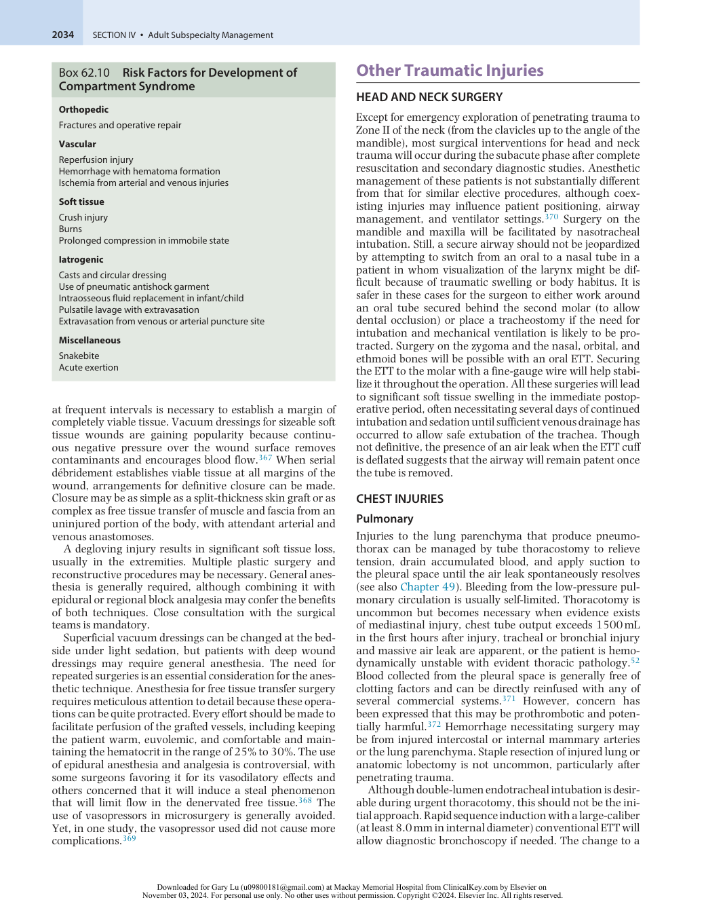

:::

<!-- PDF page 36 -->

double- lumen tube can then be made under controlled conditions in the presence of adequate oxygenation, anesthesia, and muscle relaxation. Tolerance of single- lung ventilation is variable in the trauma population and largely depends on the absence of significant pathologic findings in the ventilated lung. Many patients with blunt thoracic injury have bilateral pulmonary contusions and require increased FiO2 and high levels of PEEP to maintain adequate oxygenation, even when both lungs are ventilated. Those with a high Thoracic Trauma Severity Score in the blunt trauma and pulmonary contusion setting are more likely to progress to ARDS, potentially necessitating early, aggressive management of mechanical ventilation.373

Although chest trauma requiring pneumonectomy has historically resulted in mortality approaching 100%, a National Trauma Data Bank review found 261 cases of pneumonectomy following trauma (163 penetrating and 98 blunt) with an overall in- hospital mortality of 60%.374 Intraoperative deaths result from uncontrollable hemorrhage, acute right ventricular failure, and air embolism. Patients who survive the initial procedure are at risk for early postoperative morbidity and mortality. Fluid management may be complicated by the need to weigh ongoing resuscitation against the treatment of right ventricular failure. Blunt thoracic trauma requiring pneumonectomy is often associated with abdominal and pelvic trauma. Volume replacement must be judicious, and using a pulmonary artery catheter (placed with care in a postpneumonectomy patient) or TEE may be beneficial. Echocardiography will also play an essential role in assessing right ventricular function and pulmonary hypertension. Treatment of right ventricular failure after traumatic pneumonectomy is difficult.375 During hypovolemic shock, a disproportionate increase occurs in pulmonary vascular resistance than systemic vascular resistance,376 and increased mortality with combined hemorrhagic shock and pneumonectomy.377 With severe right heart dysfunction, it is desirable to maintain a higher preload. Several therapeutic approaches have been used to treat right ventricular failure, including close monitoring of pulmonary artery pressure, using diuretics for volume overload, and administering pulmonary vasodilators. Because this injury is rare, and the number of patients reported in the literature is small, the best therapy is difficult to identify.

Extracorporeal support also has been used to sustain patients through the perioperative period. However, the technical challenges are substantial and successful weaning may require days to weeks on bypass (see also Chapter 81).378

Tracheobronchial injury can result from either blunt force or penetrating trauma. Penetrating injuries are usually more promptly diagnosed and treated. Blunt trauma most commonly results in an injury to the tracheobronchial tree within 2.5 cm of the carina and may initially be unrecognized. The presence of subcutaneous emphysema, pneumomediastinum, pneumopericardium, or pneumoperitoneum, without apparent cause, should alert the practitioner to possible tracheobronchial injury.379 Despite bronchoscopy and helical CT scanning, a small injury may never be delineated. If the resultant damage is an incomplete tear, it may heal with stenosis, subsequent atelectasis, pneumonia, pulmonary destruction, and sepsis. When surgery is

required for a delayed, incomplete tracheobronchial injury, pulmonary resection may be necessary if significant tissue destruction has occurred. In contrast, complete transection may be amenable to reconstruction preserving pulmonary tissue. The level of injury dictates the surgical approach. Cervical injuries are approached through a transverse neck incision, left bronchial injuries via a left thoracotomy, and tracheal or right main bronchial injuries via a right thoracotomy. In the cervical region, it is sometimes possible to access a longitudinal tear of the posterior membranous trachea by opening the anterior trachea and operating around the ETT.

### Traumatic Aortic Injury

Traumatic aortic injury (TAI) must be ruled out in any patient with a high- energy injury, such as occurs with a motor vehicle accident or a fall from height. The incidence of TAI has decreased in recent years because of the increased presence of airbags in motor vehicles; side- impact collisions have caused most cases in the past decade.380 Aortic injury occurs most commonly just distal to the left subclavian artery. It results from sheer forces between the mobile heart, aortic arch, and the immobile descending thoracic aorta. TAI is manifested as a continuum of injury from a small intimal flap to free transection contained by the surrounding mediastinum and pleura. The diagnosis is most commonly made by a CT scan of the chest with IV contrast which has a sensitivity comparable to aortography.381 Surgical or endovascular repair is indicated for most patients with TAI because of the high risk for rupture in the hours and days after injury, with the endovascular repair being the preferred option in the absence of contraindication. Selective nonoperative management of high- risk patients with TAI has been described.382,383 Treatment is similar to that in patients with uncomplicated type B aortic dissection and consists of β- adrenergic blockade to minimize the cardiac rate–pressure product (shearing force).

### Rib Fractures

Rib fractures are the most common injury resulting from blunt chest trauma. The fracture generally requires no specific treatment and will heal spontaneously over several weeks. Therapy aims to minimize pulmonary complications secondary to these fractures, such as pain, splinting, atelectasis, hypoxemia, and pneumonia. Rib fractures in older adults (older than 55) are of particular concern. Elderly patients with rib fractures have twice the mortality and thoracic morbidity of younger patients with similar injuries.384 Epidural anesthesia is used liberally in some patients with severe pain, older adults, and patients with preexisting compromised pulmonary function. Pain relief is superior with epidural analgesia; however, a meta- analysis failed to identify a reduction in mortality.385 Nonetheless, current guidelines for pain management in patients with blunt thoracic trauma recommend epidural analgesia over nonregional pain control modalities.386 Epidural analgesia may minimize or avoid complications of splinting and pain, such as hypoxemia, hypoventilation, the need for tracheal intubation, and the possibility of pneumonia. Various non- neuraxial blocks are also available, depending on the location of the rib fractures. These blocks include serratus blocks, paravertebral blocks, and erector spinae blocks, all

<!-- PDF page 37 -->

of which are becoming more prevalent due to the increased use of ultrasound for regional anesthesia.387 Endotracheal intubation is reserved for patients who are unable to oxygenate or ventilate or who require protection of the airway.

Fractures of multiple neighboring ribs will result in the flail chest syndrome, characterized by paradoxical chest wall motion during spontaneous ventilation. Not all patients with a flail chest require positive- pressure ventilation. Patients who are not initially intubated should be observed closely in the ICU for signs of worsening respiratory function. Increasing cases of noninvasive positive- pressure ventilation (NIPPV) for lung injury secondary to trauma have been reported.388 For patients who subsequently require intubation for a surgical procedure, the anesthesiologist will need to determine the safety of extubation postoperatively. NIPPV may be associated with fewer cases of pneumonia, which may lead to fewer tracheostomies and decreased ICU length of stay. A successful technique has been to proceed with extubation, transitioning to a mask capable of delivering continuous positive airway pressure (CPAP) or bilevel positive airway pressure (BiPAP).389

Concomitant pulmonary injury, especially lung contusion, is commonly associated with a flail chest. Pulmonary contusion will cause shunting, which will lead to hypoxemia. This syndrome may progress rapidly in the hours and days after injury. An initially clear chest radiograph does not exclude the possibility of a pulmonary contusion, and close observation is warranted if signs of significant chest wall trauma are present. As with all patients after traumatic injury, a high degree of suspicion and a continuous search for missed injuries is warranted. No specific therapy exists for a pulmonary contusion; treatment is directed at the associated injuries or resultant hypoxemia. Early and aggressive implementation of a lung- protective strategy may have a role in patients with a significant pulmonary contusion to minimize progression to ARDS.

### Cardiac Injury

Blunt cardiac injury is a rare and poorly understood phenomenon that must be considered in any patient who has sustained a frontal impact to the chest. Bruising or edema of the myocardium is functionally indistinguishable from myocardial ischemia. It may be causally related because the pathophysiology of cardiac contusion may involve forcible dislodgement of unstable atherosclerotic plaque. Blunt cardiac injury can be safely excluded if the patient is hemodynamically stable and the ECG does not demonstrate conduction disturbances or tachyarrhythmias.390 If either a new tachyarrhythmia or conduction disturbance subsequently develops or the patient has unexplained hypotension, other causes (hypovolemia, renal failure) should be ruled out first. If the workup is negative, transthoracic echocardiography (TTE) should be performed. Right ventricular dysfunction resulting in hypotension may be overlooked, while more common causes of hypotension in the trauma patient are being investigated. TEE is superior to TTE in obese patients or those with chest wall injuries, making it challenging to obtain adequate acoustic windows. Still, it will generally require intubation and deep sedation to perform. Once diagnosed, the blunt cardiac injury should be managed as ischemic cardiac injury, with the completion of resuscitation and careful control of fluid volumes,

administration of coronary vasodilators, and monitoring and symptomatic treatment of rhythm disturbances. Anticoagulation with aspirin or heparin should be approached on a case- by- case basis as determined by the patient’s other injuries. Cardiology consultation is appropriate if the patient may benefit from coronary angiography followed by angioplasty or stenting of stenotic vessels.

Patients with penetrating cardiac trauma and blunt trauma causing rupture of one or more chambers (usually the atria) are rarely seen by the trauma center because of the frequent rate of prehospital mortality.391 Those who do not die immediately of free exsanguination into the thoracic cavity will have pericardial tamponade and can be extremely unstable in the first minutes after admission. This condition is diagnosed by clinical suspicion, focused assessment with sonography for trauma (FAST), and direct inspection during ED thoracotomy. Relief of the tamponade and clamp or suture control of the cardiac injury may allow restoration of spontaneous circulation and necessitate an urgent transition to the OR for definitive hemostasis and chest closure. Cardiopulmonary bypass may be required for support during the repair of cardiac injuries. Shock characterized by acidosis, but not hypotension, is the most common presentation in patients needing OR thoracotomy after penetrating thoracic trauma. Survival rates are excellent unless a pneumonectomy or damage control thoracotomy is required.392

### ABDOMINAL INJURY

The need for exploratory laparotomy, once the mainstay of the trauma surgeon, has declined because FAST and high- resolution CT have reduced the incidence of negative abdominal explorations. In contrast, angiographic embolization of hemorrhaging vessels in the liver and spleen has reduced the need for open procedures. When it does occur, urgent celiotomy will typically follow the principles of damage control, as described previously in this chapter.393 The abdomen is opened and packed tightly in all four quadrants. Systematic exploration is undertaken in each quadrant, with the time taken only to control hemorrhage and rapid staple closure of open gastrointestinal injuries. The abdomen is packed open at the end of the procedure, a sterile drape is used to cover exposed viscera, and the patient is moved to the ICU to complete resuscitation (Damge Control Surgery). Definitive treatment of nonlethal injuries and restoration of bowel continuity is deferred until a second operation 24 to 48 hours later.

Anesthetic management of emergency celiotomy should follow the principles of early resuscitation outlined earlier. Adequate IV access is required, as well as continuous arterial pressure monitoring. The use of cell salvage devices can reduce the patient’s exposure to banked blood, although reinfusion is generally deferred if there has been significant contamination by bowel contents. A rapid infusion system is advantageous for preserving intravascular volume and normothermia during periods of heavy bleeding. Subsequent abdominal surgeries will be needed in hemodynamically stable patients and should not present unusual anesthetic challenges. Subsequent reconstructive procedures can become technically complex as scarring and adhesions develop; the anesthesiologist should be prepared

<!-- PDF page 38 -->

for a lengthy anesthetic procedure with the potential for significant hemodynamic compromise.

contents upward, elevating the head of the bed may also be required to improve ventilation.

### PEDIATRIC TRAUMA PATIENTS

## Selected Patient Populations

### TRAUMA AND PREGNANCY

Trauma to pregnant patients is associated with a frequent risk for spontaneous abortion, preterm labor, or premature delivery, depending on the location and magnitude of the mother’s injury (see also Chapter 58).394 Trauma is the leading nonobstetric cause of death in pregnant women, with nearly double the mortality rate.395 Early consultation with an obstetrician is desirable for any pregnant trauma patient for immediate management and long- term follow- up. The best treatment for the developing fetus consists of rapid and complete resuscitation of the mother. Trauma patients in the first trimester of gestation may not realize they are pregnant; therefore, human chorionic gonadotropin testing is part of the initial laboratory studies for any injured woman of childbearing age. Severe trauma occurring during fetal organogenesis may induce birth defects or miscarriage because of the effects of medications, pelvic irradiation, or hemorrhage leading to placental ischemia. Indicated radiologic tests should not be deferred, but shielding of the pelvis should be provided whenever possible.396 Patients who do not spontaneously miscarry should be advised of the potential risks for birth defects and be referred for counseling if desired.348 Dilatation plus curettage of the uterus is advisable after miscarriage to avoid toxicity arising from retained products of conception.397

Trauma occurring in the second or third trimester of pregnancy necessitates an early ultrasonographic examination to determine fetal age, size, and viability. Monitoring the fetal heart rate is indicated if the pregnancy is sufficiently advanced and the fetus would be viable if delivered. Preterm labor is very common in this population and should be treated with β- adrenergic agonist drugs or magnesium at the direction of the obstetrician. Delivery should be delayed if the fetus is not an unacceptable metabolic stress on the mother. Delivery by cesarean section is indicated if the mother is _in extremis_ , if the uterus is hemorrhaging, or if the gravid uterus is impairing surgical control of abdominal or pelvic hemorrhage. Placental abruption can occur in response to substance abuse or abdominal trauma and can precipitate life- threatening uterine hemorrhage. Emergency cesarean section is indicated in these cases. The Kleihauer–Betke blood test can be used to determine if fetal blood has leaked into the maternal circulation398 ; if positive, administration of anti- Rh0 immune globulin is recommended for any Rh- negative mother carrying an Rh- positive fetus. By the third trimester, the uterus is sufficiently enlarged to compress the inferior vena cava when the patient is positioned supine, thereby impairing venous return to the heart and contributing to hypotension. Left lateral uterine displacement is indicated to treat this problem. If the patient is immobilized on a long spine board because of concern for a thoracic or lumbar spinal fracture, the whole board can be tipped to the left. Because the gravid uterus displays abdominal

While the overall proportion of pediatric trauma patients compromises a minority of trauma center admissions, traumatic injuries remain the leading cause of death for children aged 1 to 14.399 Motor vehicle crashes, drowning, falls, and burns constitute most traumatic injury mechanisms.400 A disproportionate number of pediatric trauma patients (∼80%) have an associated traumatic brain injury; such injuries are responsible for more than half of all deaths.400,401 The initial priorities of trauma assessment and management are the same for children and adults; nonetheless, several particularities must be considered, including differences in airway anatomy, the normal range of physiologic variables, and other anatomic differences (see also Chapter 72).52,401

Successful management of the pediatric airway constitutes the foundation and initial step in pediatric trauma resuscitation because hypoxia and respiratory compromise are the most common causes of cardiac arrest.401,402 Preceding airway management, a high degree of caution must be exercised to immobilize the cervical spine in patients with dangerous mechanisms that increase the risk of spinal injuries. Some of these mechanisms include: falls from a height greater than one meter or five stairs, axial loading to the head, high- speed and/or rollover motor vehicle crashes, ejection from a motor vehicle, or accidents involving motorized recreational vehicles and bicycle collisions.403 Spinal cord injury without radiologic abnormality (SCIWORA) may be present in up to 35% of children with high- risk mechanisms. This increased risk precludes cervical spine clearance in the same manner as adults.403,404 Children have a high oxygen consumption rate and react to hypoxia with bradycardia, sometimes even with very brief periods of apnea.405 The anesthesiologist should be prepared to encounter the following anatomic differences in pediatric patients when managing the airway: a prominent, protuberant occiput, a small oral cavity, a large tongue, the presence of large adenoids and tonsils, and a short and anteriorly displaced larynx.401,405 These anatomic features can predispose to obstruction, bleeding, and a difficult airway. Pediatric patients should always be considered to have a full stomach, and rapid sequence induction and intubation are the gold standard for airway management.405 In cases where intubation and mask ventilation are impossible, surgical cricothyroidotomy is considered unsafe in children younger than 12 years of age due to the small size of the cricothyroid membrane and proximity to vocal cords.52 Needle cricothyroidotomy is preferred as a temporizing solution until other preparations are made. Emergent venous access in children can be challenging; intraosseous access is recommended if unable to obtain peripheral access.52 Determination of weight is mandatory to dose medications appropriately and guide fluid and blood component resuscitation. If weight is unknown, a length- based resuscitation tape or specialty stretcher with an integrated scale may be used. Throughout the perioperative period, vigilance for hypothermia should be maintained because pediatric trauma patients are prone to developing hypothermia due

<!-- PDF page 39 -->

to a large surface- to- weight ratio, immature thermoregulation mechanisms, and the effects of general anesthetics.406 Hypothermia can be particularly detrimental for pediatric trauma patients because up to a 10% decrease in clotting factor activity has been observed for every degree of Celsius below normothermia.406,407a

There are several unique aspects of pediatric trauma resuscitation that anesthesiologists should be familiar with. Due to differences in pediatric coagulation profiles (i.e., decreased levels of procoagulation protein and fewer coagulation inhibitors), thromboelastography has an unclear role in diagnosing and treating coagulation disorders.406 There are no validated scoring systems to determine the need for massive transfusion in children, and a damage control resuscitation strategy (i.e., transfusion of packed red blood cells to fresh frozen plasma to platelets in a 1:1:1 ratio) has not been studied adequately in pediatric patients. The use of whole blood resuscitation was associated with improved survival in the pediatric population.407b Hypotensive resuscitation has not been studied in children and may be hazardous because baseline blood pressures in children closely approximate the lower limits of cerebral autoregulation.406,408,409 The use of adjuncts such as tranexamic acid recombinant factor VIIa may have utility in limiting bleeding, but large studies in pediatric patients are presently lacking.408,410

### ELDERLY TRAUMA PATIENTS

As the world population continues to increase in age, elderly trauma patients become a growing part of the overall trauma population.411 Overall mortality among elderly trauma patients is higher than among younger adults; injured patients over 74 years are at considerably higher risk for mortality.412 Elderly trauma patients frequently present with lower Injury Severity Score but more often sustain severe head and lower extremities injuries.413

When managing elderly patients with trauma, the effects of aging on physiologic function and the impact of preexisting conditions and medications must be carefully considered. Equivalent traumatic injuries will have a markedly more serious outcome in the elderly than younger victims (see Chapter 61).412,414 Elderly patients may be taking multiple medications, such as anticoagulants and beta blockers, which may worsen traumatic shock by causing severe bleeding and blunting of compensatory responses, respectively. Elderly patients may not have teeth or dentures to help maintain airway patency; edentulous patients are often difficult to mask ventilate, and dentures may loosen and obstruct the airway. Many older adults have decreased chest wall, and pulmonary compliance, diminished functional residual capacity, and decreased mucus clearance – all of which have contributed to a mortality double that found in younger patients.384 In elderly patients with blunt thoracic trauma, each additional rib fracture increases mortality and the risk for pneumonia by over 20%. Degenerative spine changes and kyphoscoliosis may complicate intubation. The patient may have a pacemaker or automatic implantable cardioverter–defibrillator in place and artificial cardiac valves or stents. Patients of this age group are commonly anticoagulated pre injury. Older adults have thinner skin and are more prone to hypothermia and early development of pressure ulcers. Great care must be taken

during intraoperative positioning to avoid secondary pressure injuries. Potential causes of an altered mental status may include delirium, dementia, pain medication, sedatives, increased intracranial pressure, and decreased cerebral perfusion pressure, the latter two of which are the deadliest.

A tailored evaluation and management of elderly trauma patients is crucial for improving outcomes.415 A higher hematocrit, achieved by tighter control of administered fluid, is generally recommended to maintain maximized tissue oxygen delivery. Posttraumatic myocardial dysfunction is a significant risk, particularly if the heart rate is elevated secondary to blood loss, pain, or anxiety. Complex operations or large blood loss should encourage the use of TEE, invasive arterial monitoring, and minimally-invasive monitors of cardiac output and volume status to guide fluid and inotropic therapy.198 Older patients will have diminished requirements for postoperative analgesia and may respond to sedative medications with inappropriate agitation.

### JEHOVAH’S WITNESS PATIENTS

A trauma patient who refuses blood products requires special management. Early identification and control of hemorrhage are essential (see Chapter 45). Deliberate hypotension to limit bleeding may be helpful. Preoperative and intraoperative phlebotomy should be minimized. The use of salvaged red cells (from the intraoperative collection or a chest drainage system) should be discussed with the patient because some Jehovah’s Witness patients will allow the use of salvaged blood, provided that the entire system remains in continuity with the vasculature.416 The use of albumin and other substances derived from circulating proteins should be addressed if possible. Early hemodynamic monitoring is indicated to help determine the role of colloid therapy, pressors, and inotropes in maintaining tissue O2 delivery at the highest possible level. Case reports have described the successful use of rFVIIa and hemoglobinbased O2 carriers in Jehovah’s Witness patients to rapidly correct bleeding and support O2 delivery. Still, these agents are not approved for these uses, and large case series are unavailable.240,417 In the post- acute phase, using erythropoietin to promote red cell growth may shorten the period of relative anemia, although there is limited evidence.418

## Postoperative Care

### EMERGENCE AND TRACHEAL EXTUBATION

Initial surgery in a trauma patient is followed by a period of monitoring and ongoing treatment in which the anesthesiologist is closely involved, either in the postanesthesia care unit (PACU) or the ICU (see Chapter 76). The adequacy of posttraumatic resuscitation must be confirmed, as outlined earlier, and diagnostic studies of the secondary survey must be completed. Rapid termination of general anesthesia is highly desirable, particularly in patients with altered consciousness or other evidence of TBI before surgery. Change in mental status from the preoperative baseline is an indication for repeat cranial CT and a search for possible metabolic or toxic derangements.

Although neurologic function should be assessed postoperatively, early extubation of a trauma patient should not

<!-- PDF page 40 -->

### Box 62.11 Criteria for OR or PACU Extubation of the Trauma Patient

**Mental status** Resolution of intoxication Able to follow commands Non- combative Pain adequately controlled **Airway anatomy and reflexes** Appropriate cough and gag Ability to protect airway from aspiration No excessive airway edema or instability **Respiratory mechanics** Adequate tidal volume and respiratory rate Normal motor strength Required FiO2 &lt;0.50 **Systemic stability** Adequately resuscitated (see above) Small likelihood of urgent return to the OR Normothermic, without signs of sepsis

_FiO2,_ fraction of inspired oxygen; _OR,_ operating room; _PACU,_ postanes thesia care unit.

be taken for granted. Many patients will require continued ventilator support because of CNS trauma, direct pulmonary injury or chest wall trauma, massive transfusion, upper airway edema, or ongoing intoxication. Box 62.11 lists the criteria for extubation after urgent or emergency trauma surgery. If any doubt exists about the patient’s ability to meet these criteria, the patient should be transported to the PACU or ICU with the ETT in place. Appropriate analgesic medication should be administered, with sedation if necessary. Twelve to 24 hours of support allows confirmation of successful resuscitation and surgical repair, hemodynamic equilibration, normothermia, titration of appropriate analgesia, and resolution of intoxication. Many patients can be tracheally extubated quickly and safely at this time; those who cannot are at high risk for the development of MOD—heralded by the development of posttraumatic ARDS—and will usually require days to weeks of subsequent intensive care.

### ACUTE PAIN MANAGEMENT

Trauma patients present significant pain management challenges to the clinician because of multiple sites of injury, protracted care episodes, complicated psychological and emotional issues, and prior or ongoing substance abuse (see also Chapter 77). As with pain management practice in other diseases, trauma patients are frequently undertreated, thus creating a significant source of dissatisfaction. Because trauma patients run the gamut of physiology, from healthy young athletes to debilitated elderly adults, anesthesiologists providing pain management for trauma patients must be prepared for a wide range of needs.

Individual trauma patients will have widely varying requirements for pain medication, so induction of analgesia must be titrated carefully, ideally in a closely monitored environment such as the PACU. Administration of rapidly acting IV agents in small doses at frequent intervals

until pain relief is achieved is recommended. This allows the practitioner to determine the patient’s basal requirements before starting long- acting medications or patientcontrolled analgesia. Hypotension in response to analgesics is most commonly indicative of hypovolemia and should prompt a search for occult hemorrhage while further resuscitation occurs.

The need for analgesic medication and the duration of the requirement for analgesics will be minimized if a comprehensive emotional support system is available to the patient. Because of its unexpected nature, trauma carries with it a strong negative psychological overlay that can profoundly affect how anatomically based pain is perceived by the brain.419 and how the patient reacts. After an injury, the patient may have legal, financial, and family- based concerns without the ability to immediately address them. The availability of religious, financial, or legal counselors who can help the patient and family with these issues is of enormous benefit. The anesthesiologist can help by clearly communicating to the patient the injuries, the probable time required for recovery, and the plan for managing pain throughout the course. The anesthesiologist should refer the patient to counseling services as needed and should be alert to the potential for posttraumatic stress disorder (PTSD) in any traumatized patient.420 Referral to an experienced psychiatrist or psychologist is appropriate if PTSD hinders the patient’s recovery.

The need for analgesic medication is also influenced by the schedule of physical therapy prescribed for the patient. The more active a patient can be after a traumatic injury, the lower the risk for pulmonary complications, venous thrombosis, and decubitus ulcers. Though painful in the short term, the sooner the patient is mobilized, the lower the analgesic requirements in the long term. Early mobilization demonstrates to the patient the path to recovery and contributes to an improved emotional state. One of the goals of analgesia, therefore, is the provision of adequate medication to facilitate physical therapy without sedating the patient so that participation is impossible.

Neuropathic pain arises when a direct injury occurs to a major sensory nerve and is common after spinal cord trauma, traumatic amputations, and major crush injuries. Neuropathic pain is characterized by burning, intermittent electrical shocks, and dysesthesia in the affected dermatomal distribution. Neuropathic pain must be identified because it responds poorly to the analgesics used for somatic pain. This diagnosis should be considered whenever pain control is poor, or the patient has a rising requirement for medications unexplained by anatomic injuries. First- line therapy for neuropathic pain has been revolutionized by the widespread use of gabapentin, an antiepileptic drug with very strong specificity for this problem.421 Gabapentin therapy is typically initiated at a dose of 200 mg three times daily, with daily titration upward to a maximum of 2 to 3 g/ day. If neuropathic pain persists, selective regional anesthesia or analgesia may be indicated to break the cycle of spinal cord receptor recruitment.422

Regional analgesia (see also Chapters 41 and 42) provided through an epidural or brachial catheter should be considered for any trauma patient with the potential to benefit from this approach because it will spare the use of systemic opioids and facilitate early mobilization.423 Epidural

<!-- PDF page 41 -->

analgesia produces high levels of patient satisfaction and improved pulmonary function after major thoracoabdominal and orthopedic surgery in elective populations424 ; this is very likely true for the trauma population as well. Regional techniques are less practical when the patient has multiple sites of injury or when fractures or open wounds make placement difficult. Although epidural placement in anesthetized patients is relatively contraindicated because of the potential for occult SCI, the risk- to- benefit ratio in many trauma patients favors placement during surgery when general anesthesia facilitates appropriate positioning and patient cooperation.

33.  Gongora E, et al. _J Trauma_ . 2001;51(5):854.

34.  Brown JB. _J Trauma_ . 2011;70(1):38.

35.  Haider AH. _J Surg Res_ . 2009;153(1):138.

36.  Cotton BA, et al. _J Trauma_ . 2010;69(suppl 1):S33.

37.  American College of Surgeons; Committee on Trauma. _Advanced Trauma Life Support: Student Course Manual_ . 10th ed. American College of Surgeons; 2018.

38.  Galvagno Jr SM. _Anesthesiol Clin_ . 2019;37(1):13.

39.  Spaite DW, et al. _JAMA Surg_ . 2019;154(7):e191152.

40.  Spaite DW, et al. _Ann Emerg Med_ . 2017;69(1):62.

41.  Cannon JW. _N Engl J Med_ . 2018;378(4):370.

42.  Moore LJ. _Am J Surg_ . 2022;224(1 Pt A):40.

43.  Brennan PM. _J Neurosurg_ . 2018;128(6):1612.

44.  Murray GD. _J Neurosurg_ . 2018;128(6):1621.

45.  van der Naalt J. _Ned Tijdschr Geneeskd_ . 2004;148(10):472.

46.  Remick KN. _J Trauma Acute Care Surg_ . 2014;76(5):1251.

## Summary

Trauma spans all ages and classes of patients, from young and vigorous to older and frail. Because of its significant prevalence, practicing anesthesiologists will encounter trauma patients throughout their careers. Increased public recognition of the consequences of injury has sparked interest in trauma research and education, with the result that diagnostic and therapeutic techniques have evolved rapidly in recent years. As a perioperative physician, the anesthesiologist is in the ideal position to understand and apply these new techniques.

47.  Hoyt DB, et al. _J Trauma_ . 1994;37(3):426.

48.  Champion HR, et al. _J Trauma_ . 1990;30(11):1356.

49.  Clarke JR. _J Trauma_ . 2002;52(3):420.

50.  Steele JT. _Am J Surg_ . 1997;174(6):683.

51.  Martin M. _Am J Surg_ . 2012;204(2):187.

52.  Committee on Trauma, American College of Surgeons. _ATLS® Student Manual_ . 10th ed. American College of Surgeons; 2018.

53.  Mosier JM, et al. _Ann Am Thorac Soc_ . 2015;12(5):734.

54.  Mayglothling J, et al. _J Trauma Acute Care Surg_ . 2012;73:S333.

55.  Norwood S. _J Am Coll Surg_ . 1994;179(6):646.

56.  Rotondo MF. _J Trauma_ . 1993;34(2):242.

57.  Stene JK. _Airway Management for the Trauma Patient_ . Williams & Wilkins; 1991:64.

58.  Talucci RC. _Am Surg_ . 1988;54(4):185.

59.  Kovacs G, et al. _Can J Anaesth_ . 2004;51(2):174.

60.  Sellick BA. _Lancet_ . 1961;2:404.

61.  Levitan RM. _Ann Emerg Med_ . 2006;47(6):548.

### Complete references available online at expertconsult.com.

### References

1.  DiMaggio C, et al. _Injury_ . 2016;47(7):1393.

2.  Murphy SL. _NCHS Data Brief_ . 2021;(427):1.

3.  Florence C. _MMWR Morb Mortal Wkly Rep_ . 2015;64(38):1078.

4.  National Academy of Science. _Accidental Death and Disability: The Neglected Disease of Modern Society_ . National Academies Press (US); 1966.

5.  Committee on Trauma. _Bul Am Coll Surg_ . 1976;61:15.

6.  Hoyt DB. _Surg Clin North Am_ . 2007;87:21.

7.  Bailey J. _Surg Clin North Am_ . 2012;92(4):1009.

8.  Maegele M. _Anaesth Crit Care Pain Med_ . 2019;38(2):107.

9.  Committee on Trauma; American College of Surgeons. _Resources for Optimal Care of the Injured Patient_ . American College of Surgeons; 2014.

10.  Newgard CD, et al. _J Trauma Acute Care Surg_ . 2022;93(2):e49.

11.  Hirshon JM, et al. _Ann Emerg Med_ . 2016;67(3):332.

12.  Sampalis JS, et al. _J Trauma_ . 1999;46(4):565.

13.  Sampalis JS, et al. _J Trauma_ . 1995;39(2):232.

14.  Mullins RJ, et al. _JAMA_ . 1994;271(24):1919.

15.  MacKenzie EJ, et al. _N Engl J Med_ . 2006;354(4):366.

16.  He JC. _J Trauma Acute Care Surg_ . 2016;81(1):190.

17.  Nathens AB, _J Trauma_ . 2000;48(1):25.

18.  Alharbi RJ. _World J Emerg Surg_ . 2021;16(1):38.

19.  Smith Jr JS, _J Trauma_ . 1990;30(12):1533.

20.  Lansink KW. _World J Surg_ . 2013;37(10):2353.

21.  Razzak JA. _Lancet_ . 2022;400(10348):329.

22.  Zarzaur BL. _J Trauma Acute Care Surg_ . 2012;72(1):78.

23.  Galvagno SM. _Curr Anesthesiol Rep_ . 2016;6:50.

24.  McCunn MD. _Anesth Analg_ . 2015;121(6):1668.

25.  Mikkelsen S. _BMJ Open_ . 2015;5(1):e006167.

26.  Egger Halbeis CB. _Eur J Anaesthesiol_ . 2007;24(12):991.

27.  Kuza CM. _Anesth Analg_ . 2018;126(5):1580.

28.  Geeraedts Jr LM. _Injury_ . 2009;40(1):11.

29.  Centers for Disease Control and Prevention (CDC). _MMWR (Morb Mortal Wkly Rep)_ . 2011;61(1):1.

30.  Boyle M. _J Trauma Manag Outcomes_ . 2007;1:4.

31.  Kohn MA. _Acad Emerg Med_ . 2004;11(1):1.

32.  Boyle M. _J Trauma_ . 2008;39:986.

62.  Ellis DY. _Ann Emerg Med_ . 2007;50(6):653.

63.  Harris T. _Resuscitation_ . 2010;81(7):810.

64.  American Heart Association. _Highlights of the 2020 American Heart Association Guidelines for CPR and ECC_ . American Heart Association; 2020.

65.  Ruben H. _Acta Anaesthesiol Scand_ . 1961;5:107.

66.  Moynihan RJ. _Anesthesiology_ . 1993;78(4):652.

67.  Thiboutot F. _Can J Anaesth_ . 2009;56(6):412.

68.  Wiles MD. _Anaesth Intensive Care_ . 2022;77(10):1120.

69.  Gadomski BC. _J Clin Anesth_ . 2022;81:110909.

70.  Hindman BJ, et al. _Anesthesiology_ . 2015;123(5):1042.

71.  Robitaille A. _Anesth Analg_ . 2008;106(3):935.

72.  Aoi Y, et al. _J Trauma Injury Infect Crit Care_ . 2011;71(1):32.

73.  Savino PB. _Acad Emerg Med_ . 2017;24(8):1018.

74.  De Jong A, et al. _Intensive Care Med_ . 2014;40(5):629.

75.  Crosby ET. _Anesthesiology_ . 2006;104(6):1293.

76.  Johnson KB. _Anesthesiology_ . 2004;101(3):647.

77.  Johnson KB, et al. _Anesthesiology_ . 2003;99(2):409.

78.  Pandit JJ, et al. _Br J Anaesth_ . 2014;113(4):549.

79.  Brown CA. _Ann Emerg Med_ . 2015;65(4):363.

80.  Hildreth AN. _J Trauma_ . 2008;65(3):573.

81.  Warner KJ. _J Trauma_ . 2009;67(1):45.

82.  Bard MR, et al. _J Trauma_ . 2006;61(6):1441.

83.  Hinkewich C. _Can J Anaesth_ . 2014;61(7):650.

84.  Jabre P, et al. _Lancet_ . 2009;374(9686):293.

85.  Bergen JM. _J Emerg Med_ . 1997;15(2):221.

86.  Amornyotin S. _Int J Anesthesiol Res_ . 2014;2:42.

87.  Wang X, et al. _J Anesth_ . 2014;28(6):821.

88.  Filanovsky Y. _CJEM_ . 2010;12(2):154.

89.  Himmelseher S. _Anesth Analg_ . 2005;101(2):524.

90.  Schonenberg M. _Psychopharmacology (Berl)_ . 2005;182(3):420.

91.  Schonenberg M. _J Psychopharmacol_ . 2008;22(5):493.

92.  McGhee LL. _Mil Med_ . 2014;179(suppl 8):41.

93.  Baekgaard JS. _Anesth Analg_ . 2019;128(3):504.

94.  Pagel PS. _Anesthesiology_ . 1992;76(4):564.

95.  Pagel PS. _Anesthesiology_ . 1992;76(3):419.

96.  Mazzeffi M. _Ann Card Anaesth_ . 2015;18(2):202.

97.  Waxman K. _Anesth Analg_ . 1980;59(5):355.

98.  El- Orbany M. _Anesth Analg_ . 2010;110(5):1318.

99.  Myatra SN. _Curr Opin Anaesthesiol_ . 2022;35(2):115.

100.  Sharar SR. _ASA Newsl_ . 2002;9.

101.  Gronert GA. _Anesthesiology_ . 1975;43(1):89.

<!-- PDF page 42 -->

102.  Kelly RE. _Anesthesiology_ . 1993;79(5):948.

103.  Kovarik WD. _Anesth Analg_ . 1994;78(3):469.

104.  Tran DT. _Cochrane Database Syst Rev_ . 2015;10:CD002788.

105.  Jain U. _Anesthesiology_ . 2016;124(1):199.

106.  Klein L. _Acad Emerg Med_ . 2016;23(3):e2.

107.  Subramanian A. _Can J Anaesth_ . 2016;63(3):275.

108.  Wong DT. _Can J Anaesth_ . 2012;59(7):704.

109.  Peitzman AB. _Curr Prob Surg_ . 1995;32(11):925.

110.  Shires GT, et al. _Ann Surg_ . 1972;176(3):288.

111.  Peitzman AB. In: Pinsky MR, Dhainaut JFA, eds. _Pathophysiologic Foundations of Critical Care_ . Williams & Wilkins; 1993:161.

112.  Runciman WB. _Anaesth Intensive Care_ . 1984;12(0310-057; 3):193.

113.  Jarrar D. _Int J Mol Med_ . 1999;4(6):575.

114.  Ba ZF. _Crit Care Med_ . 2000;28(8):2837.

115.  Bronshvag MM. _Stroke_ . 1980;11(1):50.

116.  Peterson CG. _Am J Surg_ . 1963;106:233.

117.  Tompkins RG. _J Trauma Acute Care Surg_ . 2015;78(4):671.

118.  Collins JA. _Progress Clin Biol Res_ . 1982;108:5.

119.  Troyer DA. _J Lab Clin Med_ . 1987;110(4):379.

120.  Stein DM, et al. _J Trauma Acute Care Surg_ . 2013;74(2):363.

121.  Lefer AM. _Am J Physiol_ . 1970;218(5):1423.

122.  Dark PM. _Intensive Care Med_ . 2000;26(2):173.

123.  Thorne J. _J Trauma_ . 1989;29(4):451.

124.  Martin BA. _J Appl Physiol Respir Environ Exerc Physiol_ . 1981;50(6): 1306.

125.  Demling R. _Curr Prob Surg_ . 1993;30(4):345.

126.  Horovitz JH. _Arch Surg_ . 1974;108(3):349.

127.  Fulton RL. _Ann Thorac Surg_ . 1978;25(6):500.

128.  Reilly PM. _Crit Care Med_ . 1993;21(2):S55.

129.  Redan JA, et al. _Ann Surg_ . 1990;211(6):663.

130.  Chun K. _Shock_ . 1994;1(1):3.

131.  Maitra SR. _Circ Shock_ . 1992;38(1):14.

132.  Peitzman AB. _Surg Gynecol Obstet_ . 1985;161(5):419.

133.  Midwinter MJ. _Philos Trans R Soc Lond B Biol Sci_ . 2011;366(1562):192.

134.  Peng N. _Chin J Traumatol_ . 2017;20(3):133.

135.  Moore EE, et al. _Nat Rev Dis Primers_ . 2021;7(1):30.

136.  Reynolds BR, et al. _J Trauma Acute Care Surg_ . 2012;73(2):486.

137.  Davenport R. _Transfusion_ . 2013;53(suppl S1):23S.

138.  Hess JR, et al. _J Trauma_ . 2008;65(4):748.

139.  Cohen MJ, et al. _Ann Surg_ . 2012;255(2):379.

140.  Brohi K. _Curr Opin Crit Care_ . 2007;13(6):680.

141.  Brohi K, et al. _J Trauma_ . 2008;64(5):1211.

142.  Johansson PI. _Ann Surg_ . 2011;254(2):194.

143.  Zeineddin A, et al. _J Trauma Acute Care Surg_ . 2022;93(5):572.

144.  Dobson GP. _J Trauma Acute Care Surg_ . 2015;79(2):301.

145.  Davenport R, et al. _Crit Care Med_ . 2011;39(12):2652.

146.  Tapia NM, et al. _J Trauma Acute Care Surg_ . 2013;74(2):378.

147.  Sankarankutty A. _World J Emerg Surg_ . 2012;7(suppl 1):S3.

148.  Davenport R, et al. _Crit Care Med_ . 2011;39(12):2652.

149.  Holcomb JB, et al. _Ann Surg_ . 2012;256(3):476.

150.  Frith D, et al. _J Thrombosis Haemostasis_ . 2010;8(9):1919.

151.  Chang R. _Blood_ . 2016;128(8):1043.

152.  Holcomb JB, et al. _J Trauma_ . 2011;71(2 suppl 3):S315.

153.  Duke MD, et al. _J Trauma Acute Care Surg_ . 2012;73(3):674.

154.  Steurer MP. _Curr Anesthesiol Rep_ . 2014;4:200.

155.  Koscielny J, et al. _Clin Appl Thromb Hemost_ . 2004;10(3):195.

156.  Haas T. _Br J Anaesth_ . 2015;114(2):217.

157.  Da Luz LT. _Crit Care_ . 2014;18(5):518.

158.  Solomon C. _Scand J Clin Lab Invest_ . 2016;76(6):503.

159.  Hargestam M. _BMJ Open_ . 2013;3(10):e003525.

160.  Sutherland M. _Am J Emerg Med_ . 2021;48:79.

161.  Nasser AAH, et al. _Am J Surg_ . 2020;220(1):240.

162.  Koch E. _Open Access Emerg Med_ . 2019;11:179.

163.  Monnet X. _Ann Intensive Care_ . 2016;6(1):111.

164.  Stern SA. _Ann Emerg Med_ . 1993;22(2):155.

165.  Hooper AN. _JAMA_ . 1918;70:520.

166.  Beecher HK. _Ann Surg_ . 1945;121(6):769.

167.  Shaftan GW. _Surgery_ . 1965;58(5):851.

168.  Capone A. _Resuscitation_ . 1995;29(2):143.

169.  Owens TM. _J Trauma_ . 1995;39(2):200.

170.  Riddez L. _J Trauma_ . 1998;44(3):433.

171.  Sakles JC. _Ann Emerg Med_ . 1997;29(3):392.

172.  Burris D, et al. _J Trauma_ . 1999;46(2):216.

173.  Bai X, et al. _Crit Care_ . 2015;19:170.

174.  Lin GS, et al. _Injury_ . 2013;44(12):1811.

175.  Cannon JW, et al. _J Trauma Acute Care Surg_ . 2017;82(3):605.

176.  Morrison CA, et al. _J Trauma_ . 2011;70(3):652.

177.  Schreiber MA, et al. _J Trauma Acute Care Surg_ . 2015;78(4):687.

178.  Bickell WH, et al. _N Engl J Med_ . 1994;331(17):1105.

179.  Dutton RP. _J Trauma_ . 2002;52(6):1141.

180.  Carrick MM, et al. _J Trauma Acute Care Surg_ . 2016;80(6):886.

181.  Demetriades D, et al. _Arch Surg_ . 1996;131(2):133.

182.  Owattanapanich N. _Scand J Trauma Resusc Emerg Med_ . 2018;26(1):107.

183.  Voiglio EJ. In: Pape HC, et al., ed. _Damage Control Management in Polytrauma_ . Springer; 2017:57.

184.  Jenkins DH, et al. _Shock_ . 2014;41(suppl 1):3.

185.  Woolley T, et al. _J Trauma Acute Care Surg_ . 2018;84(6S suppl 1):S3.

186.  Sperry JL, et al. _J Trauma_ . 2008;64(1):9.

187.  Plurad DS. _J Trauma_ . 2011;71(3):565.

188.  Aoki M. _Crit Care Med_ . 2018;46(12):e1145.

189.  Gauss T, et al. _Br J Anaesth_ . 2018;120(6):1237.

190.  Gelman S. _Eur J Anaesthesiol_ . 2020;37(3):159.

191.  Cohn SM. _World J Surg_ . 2011;35(2):430.

192.  Sims CA, et al. _JAMA Surg_ . 2019;154(11):994.

193.  Siegel JH. _Crit Care Med_ . 1991;19(10):1252.

194.  Brain Trauma Foundation; American Association of Neurological Surgeons; Congress of Neurological Surgeons. _J Neurotrauma_ . 2007;24(suppl 1):S1.

195.  Iovine JA, et al. _Am J Health Syst Pharm_ . 2022;79(18):1521.

196.  Haldrup M. _J Neurosurg Spine_ . 2020:1.

197.  Carney N, et al. _Neurosurgery_ . 2017;80(1):6.

198.  Scalea TM, et al. _J Trauma_ . 1990;30(2):129.

199.  Cosgriff N. _J Trauma_ . 1997;42(5):857.

200.  MacLeod JB. _J Trauma_ . 2003;55(1):39.

201.  Engels PT. _J Trauma_ . 2011;71(5 suppl 1):S448.

202.  Eddy VA. _Surg Clin North Am_ . 2000;80(3):845.

203.  Beekley AC. _Crit Care Med_ . 2008;36(suppl 7):S267.

204.  Holcomb JB, et al. _J Trauma_ . 2007;62(2):307.

205.  Cotton BA. _J Trauma_ . 2009;66(1):41.

206.  Fries D. _Curr Opin Anaesthesiol_ . 2009;22(2):267.

207.  Schochl H. _Scand J Trauma Resusc Emerg Med_ . 2012;20:15.

208.  Kashuk JL, et al. _Ann Surg_ . 2010;251(4):604.

209.  Borgman MA, et al. _J Trauma_ . 2007;63(4):805.

210.  de Biasi AR. _Transfusion_ . 2011;51(9):1925.

211.  Holcomb JB, et al. _JAMA_ . 2015;313(5):471.

212.  Kashuk JL, et al. _Ann Surg_ . 2010;252(3):434.

213.  Theusinger OM, et al. _Anesth Analg_ . 2011;113(5):1003.

214.  Dow N, et al. _J Trauma Acute Care Surg_ . 2020;88(2):258.

215.  CRASH-2 Trial. Collaborators. _Lancet_ . 2010;376(9734):23.

216.  The CRASH-2 Collaborators. _Lancet_ . 2011;377(9771):1096.

217.  Morrison JJ. _Arch Surg_ . 2012;147(2):113.

218.  Thomas GO, et al. _J Trauma_ . 2007;62(3):564.

219.  Boffard KD, et al. _J Trauma_ . 2005;59(1):8.

220.  Hauser CJ, et al. _J Trauma_ . 2010;69(3):489.

221.  Kao TW. _J Acute Med_ . 2021;11(3):81.

222.  Meizoso JP, et al. _J Am Coll Surg_ . 2022;234(4):465.

223.  Franchini M. _Blood Transfus_ . 2012;10(1):23.

224.  Levy JH. _Blood_ . 2015;125(9):1387.

225.  Curry N, et al. _Crit Care_ . 2018;22(1):164.

226.  Novak A. _Expert Rev Hematol_ . 2018;11(5):351.

227.  Kronstedt S, et al. _Transfusion_ . 2022;62(suppl 1):S158.

228.  Wray JP, et al. _Am J Emerg Med_ . 2021;41:104.

229.  DeBot M. _Transfusion_ . 2022;62(suppl 1):S274.

230.  Guly HR, et al. _Resuscitation_ . 2010;81(9):1142.

231.  Blow O. _J Trauma_ . 1999;47(5):964.

232.  Chang MC. _J Trauma_ . 1998;45(3):470.

233.  Michard F. _Anesthesiology_ . 2005;103(2):419.

234.  Abramson D. _J Trauma_ . 1993;35(4):584.

235.  Odom SR, et al. _J Trauma Acute Care Surg_ . 2013;74(4):999.

236.  Kilic O. _Int J Nephrol Renovasc Dis_ . 2020;13:219.

237.  Rhee P, et al. _J Trauma_ . 1998;44(2):313.

238.  Deb S, et al. _J Trauma_ . 1999;46(4):582.

239.  Dubick MA. _J Trauma_ . 1994;36(3):323.

240.  Galvagno SM. _Anesthesiol Clin_ . 2013;31(1):1.

241.  Mattox KL, et al. _Ann Surg_ . 1991;213(5):482.

242.  Doyle JA. _J Trauma_ . 2001;50(2):367.

243.  Wang X. _Injury_ . 2022;53(11):3729.

244.  Chen H. _Cochrane Database Syst Rev_ . 2020;1:CD010904.

245.  Perel P. _Cochrane Database Syst Rev_ . 2012;6:000567.

246.  Lissauer ME. _Am J Surg_ . 2011;202(1):53.

<!-- PDF page 43 -->

247.  Perner A, et al. _N Engl J Med_ . 2012;367(2):124.

248.  Myburgh JA, et al. _N Engl J Med_ . 2012;367(20):1901.

249.  Velmahos GC, et al. _Arch Surg_ . 1998;133(9):947.

250.  Rotondo MF, et al. _J Trauma_ . 1993;35(3):375.

251.  Bogert JN. _J Intensive Care Med_ . 2016;31(3):177.

252.  Dutton RP. _J Trauma_ . 2005;59(6):1445.

253.  Sperry JL. _N Engl J Med_ . 2018;379(4):315.

254.  MacKay EJ, et al. _Anesth Analg_ . 2017;125(3):895.

255.  McGee DC. _N Engl J Med_ . 2003;348(12):1123.

256.  Wu X, et al. _Crit Care Med_ . 2003;31(1):195.

257.  Marion DW, et al. _N Engl J Med_ . 1997;336(8):540.

258.  Dunham CM, et al. _Resuscitation_ . 1991;21(2–3):207.

259.  Hambly PR. _Resuscitation_ . 1996;31(2):127.

260.  Shackford SR, et al. _Arch Surg_ . 1993;128(5):571.

261.  Acosta JA, et al. _J Am Coll Surg_ . 1998;186(5):528.

262.  Selvarajah S, et al. _J Neurotrauma_ . 2014;31(3):228. 263.  Hinson HE. _J Trauma Acute Care Surg_ . 2015;78(1):184. 264.  Hoffmann M, et al. _Br J Surg_ . 2012;99(suppl 1):122.

265.  DeKosky ST. _Minnesota Med_ . 2010;93(12):46. 266.  Kalb DC, et al. _Surgery_ . 1998;124(4):739.

267.  Lefering R, et al. _J Trauma_ . 2008;65(5):1036.

268.  Chesnut RM, et al. _J Trauma_ . 1993;34(2):216. 269.  Shriki J. _Emerg Med Clin North Am_ . 2021;39(1):203.

270.  McCarthy MC, et al. _Surgery_ . 2009;146(4):585. 271.  Stiefel MF, et al. _J Neurosurg_ . 2005;103(5):805.

272.  Bohman LE, et al. _Neurocrit Care_ . 2011;14(3):361.

273.  Martini RP, et al. _J Neurosurg_ . 2009;111(4):644.

274.  Narotam PK. _J Neurosurg_ . 2009;111(4):672. 275.  Zygun DA. _Crit Care Med_ . 2005;33(3):654. 276.  Bukur M, et al. _Am J Surg_ . 2012;204(5):697.

277.  Schroeppel TJ, et al. _J Trauma_ . 2010;69(4):776. 278.  McGuire G. _Crit Care Med_ . 1997;25(6):1059. 279.  Huynh T. _J Trauma_ . 2002;53(3):488. 280.  Oddo M, et al. _Neurosurgery_ . 2010;67(2):338.

281.  Mascia L. _Neurocrit Care_ . 2009;11(3):417.

282.  Muizelaar JP, et al. _J Neurosurg_ . 1991;75(5):731.

283.  Galvagno Jr SM, et al. _J Trauma Acute Care Surg_ . 2017;83(4):668. 284.  Utter GH. _J Neurotrauma_ . 2011;28(1):155.

285.  Aarabi B. _J Neurosurg_ . 2006;104(4):469.

286.  Soukiasian HJ, et al. _Am Surg_ . 2002;68(12):1066.

287.  Joseph DK. _J Trauma_ . 2004;57(4):687.

288.  Clasen RA. _Arch Neurol_ . 1968;19(5):472.

289.  Rosomoff HL. _Surg Gynecol Obstet_ . 1960;110:27.

290.  Marion DW. _J Neurosurg_ . 1993;79(3):354.

291.  Clifton GL, et al. _J Neurotrauma_ . 1993;10(3):263.

292.  Clifton GL, et al. _N Engl J Med_ . 2001;344(8):556. 293.  Cottenceau V, et al. _J Neurotrauma_ . 2011;28(10):2003.

294.  Sakellaridis N, et al. _J Neurosurg_ . 2011;114(2):545.

295.  Kim HS, et al. _Ann Rehabil Med_ . 2021;45(1):7.

296.  Devivo MJ. _Spinal Cord_ . 2012;50(5):365.

297.  Pang D. _J Trauma_ . 1989;29(5):654.

298.  Tator CH. _J Neurosurg_ . 1991;75(1):15.

299.  Patel MB, et al. _J Trauma Acute Care Surg_ . 2015;78(2):430. 300.  Como JJ, et al. _J Trauma_ . 2005;59(4):912.

301.  Harrop JS. _J Neurosurg_ . 2004;100(1):20.

302.  Fassett DR, et al. _J Neurosurg Spine_ . 2007;7(3):277.

303.  Sultan I, et al. _Heliyon_ . 2020;6(2):e03414.

304.  Hurlbert RJ. _J Neurosurg_ . 2000;93(1):1.

305.  Hurlbert RJ, et al. _Neurosurgery_ . 2013;72(suppl 2):93.

306.  Scannell G. _Arch Surg_ . 1993;128(8):903.

307.  Cabrini L, et al. _Acta Anaesthesiol Scand_ . 2020;64(4):443.

308.  Suderman VS. _Can J Anaesth_ . 1991;38(6):785.

309.  Holmes MG. _Anesth Analg_ . 2018;127(2):450.

310.  Fehlings MG, et al. _PLoS One_ . 2012;7(2):e32037.

311.  Mattiassich G, et al. _J Neurotrauma_ . 2017;34(24):3362.

312.  Aarabi B, et al. _J Neurotrauma_ . 2019;36(6):862.

313.  Ryken TC, et al. _Neurosurgery_ . 2013;72(suppl 2):84.

314.  Urquhart DM, et al. _ANZ J Surg_ . 2006;76(7):600.

315.  Castillo RC. _Pain_ . 2006;124(3):321.

316.  Rispoli DM. _J Am Acad Orthop Surg_ . 2012;20(suppl 1):S84.

317.  Bochicchio GV. _Am Surg_ . 2005;71(2):171.

318.  Scalea TM. _J Trauma_ . 2008;65(2):253.

319.  Riska EB. _Injury_ . 1976;8(2):110.

320.  O’Toole RV. _J Trauma_ . 2009;67(5):1013.

321.  Nahm NJ. _J Trauma Acute Care Surg_ . 2014;77(2):268.

322.  Pape HC. _Am J Surg_ . 2002;183(6):622.

323.  Pape HC. _J Orthop Trauma_ . 2005;19(8):551.

324.  Flierl MA, et al. _J Orthop Trauma_ . 2010;24(2):107.

325.  Vallier HA. _J Orthop Trauma_ . 2013;27(7):405.

326.  Harvin JA, et al. _J Trauma Acute Care Surg_ . 2012;73(6):1442.

327.  Cantu RV. _J Trauma Acute Care Surg_ . 2014;76(6):1433.

328.  Nahm NJ. _J Trauma_ . 2011;71(1):175.

329.  Richards JE, et al. _Anesth Analg_ . 2020;131(6):1781.

330.  Scalea TM. _J Trauma_ . 2000;48(4):613.

331.  Li T, et al. _JAMA_ . 2022;327(1):50.

332.  Neuman MD, et al. _N Engl J Med_ . 2021;385(22):2025.

333.  Neuman MD, et al. _Ann Intern Med_ . 2022;175(7):952.

334.  Roberts KC. _J Am Acad Orthop Surg_ . 2015;23(2):131.

335.  Lewis PM. _Bone Joint Lett J_ . 2016;98- B(12):1573.

336.  Ftouh S. _BMJ_ . 2011;342:d3304.

337.  Kellam JF. In: Levine AM, ed. _Orthopaedic Trauma Association, American Academy of Orthopaedic Surgeons. Orthopaedic Knowledge Update: Trauma_ . Rosemont, IL: AAOS; 1996:28.

338.  Porter SE. _J Orthopaedic Trauma_ . 2011;25(6):371.

339.  Routt CML. In: Levine AM, ed. _Orthopaedic Trauma Association, American Academy of Orthopaedic Surgeons. Orthopaedic Knowledge Update: Trauma_ . AAOS; 1996:241.

340.  Cothren CC. _J Trauma_ . 2007;62(4):834.

341.  Scalea TM. In: Mattox KL, et al., ed. _Trauma_ . 4th ed. McGraw- Hill; 2000:807.

342.  Burkhardt M, et al. _Crit Care_ . 2012;16(4):R163.

343.  Harfouche M, et al. _J Trauma Acute Care Surg_ . 2021;90(4):659.

344.  Agolini SF. _J Trauma_ . 1997;43(3):395.

345.  Mauffrey C, et al. _Orthopedics_ . 2012;35(10):877.

346.  Neuman MD. _Anesthesiology_ . 2012;117(1):72.

347.  Chelly JE. _J Orthop Trauma_ . 2003;17(5):362.

348.  Egol KA. _J Orthop Trauma_ . 2012;26(9):545.

349.  Strauss JE. _J Orthop Trauma_ . 2012;26(2):67.

350.  Mason SE. _J Alzheimers Dis_ . 2010;22(suppl 3):67.

351.  Koessler MJ. _Anesth Analg_ . 2001;92(1):49.

352.  Akhtar S. _Anesthesiol Clin_ . 2009;27(3):533.

353.  Eriksson EA. _J Trauma_ . 2011;71(2):312.

354.  Kaplan RP. _Cutis_ . 1986;38(1):52.

355.  Hutchins PM. _J Bone Joint Surg Br_ . 1985;67:835.

356.  Lindeque BG. _J Bone Joint Surg Br_ . 1987;69:128.

357.  Matsen FA. _J Bone Joint Surg Br_ . 1980;62:286.

358.  Rorabeck CH. _J Bone Joint Surg Br_ . 1984;66:93.

359.  McQueen MM. _J Bone Joint Surg Br_ . 2000;82:200.

360.  Duckworth AD. _J Bone Joint Surg Am_ . 2012;94(10):e63.

361.  Mar GJ. _Br J Anaesth_ . 2009;102(1):3.

362.  Kragh Jr JF, et al. _J Trauma Acute Care Surg_ . 2013;74(1):259.

363.  Michaelson M. _World J Surg_ . 1992;16(5):899.

364.  Genthon A. _J Emerg Med_ . 2014;46(2):313.

365.  Holt SG. _Intensive Care Med_ . 2001;27(5):803.

366.  Chavez LO. _Crit Care_ . 2016;20(1):135.

367.  Hunter S. _Adv Skin Wound Care_ . 2007;20:90.

368.  Weber S. _Anesth Analg_ . 1988;67(7):703.

369.  Chen C, et al. _Ann Plast Surg_ . 2010;65(1):28.

370.  Tong DC. _Br J Oral Maxillofac Surg_ . 2016;54(1):8.

371.  Salhanick M, et al. _Am J Surg_ . 2011;202(6):817.

372.  Harrison HB, et al. _Am J Surg_ . 2014;208(6):1078.

373.  Daurat A, et al. _Injury_ . 2016;47(1):147.

374.  Matsushima K, et al. _J Trauma Acute Care Surg_ . 2017;82(5):927.

375.  Baumgartner F, et al. _Am Surg_ . 1996;62(11):967.

376.  Long DM. _J Trauma_ . 1968;8(5):715.

377.  Cryer HG, et al. _Ann Surg_ . 1990;212(2):197.

378.  Ahmad SB. _J Trauma Acute Care Surg_ . 2017;82(3):587.

379.  Symbas PN. _Ann Thorac Surg_ . 1992;54(1):177.

380.  Conroy C, et al. _J Trauma_ . 2007;62(6):1462.

381.  Fox N, et al. _J Trauma Acute Care Surg_ . 2015;78(1):136.

382.  Galli R, et al. _Ann Thorac Surg_ . 1998;65(2):461.

383.  Pate JW. _World J Surg_ . 1999;23(1):59.

384.  Bulger EM. _J Trauma_ . 2000;48(6):1040.

385.  Carrier FM, et al. _Can J Anaesth_ . 2009;56(3):230.

386.  Galvagno Jr SM, et al. _J Trauma Acute Care Surg_ . 2016;81(5):936.

387.  Kim M. _Curr Anesthesiol Rep_ . 2020;10(1):61.

388.  Antonelli M, et al. _N Engl J Med_ . 1998;339(7):429.

389.  Beltrame F. _Monaldi Arch Chest Dis_ . 1999;54(2):109.

390.  Feliciano DV. _Surg Clin North Am_ . 1999;79(6):1417.

391.  O’Connor J. _J Roy Army Med Corps_ . 2009;155(3):185.

<!-- PDF page 44 -->

392.  O’Connor JV. _J Am Coll Surg_ . 2020;230(4):494.

393.  Lamb CM. _Br J Anaesth_ . 2014;113(2):242.

394.  Jain V, et al. _J Obstet Gynaecol Can_ . 2015;37(6):553.

395.  Deshpande NA. _Am J Obstet Gynecol_ . 2017;217(5):590.e1.

396.  Wang PI, et al. _Am J Roentgenol_ . 2012;198(4):778.

397.  Nanda K. _Cochrane Database Syst Rev_ . 2012;3:CD003518.

398.  Irving T. _BJA Educ_ . 2021;21(1):10.

399.  Centers for Disease Control and Prevention (CDC). Top Ten Leading Causes of Death in the U.S. For Ages 1–44 from 1981–2020. CDC.

400.  Govind SK. _Am J Surg_ . 2018;216(3):567.

401.  Schmitz B. _Curr Opin Anaesth_ . 2002;15:187.

402.  Cottrell DJ. _Curr Opin Anaesth_ . 2001;14:233.

403.  Cullen A. _Paediatr Anaesth_ . 2014;24(7):711.

404.  Vanderhave KL, et al. _J Am Acad Orthop Surg_ . 2011;19(6):319.

405.  Ivashkov Y. _Int J Crit Illn Inj Sci_ . 2012;2(3):143.

406.  Clebone A. _Curr Opin Anesthesiol_ . 2018;31:201.

- 407a.  Watts DD. _J Trauma_ . 1998;44(5):846. 407b.  Aoki M, et al. _Ann Surg_ . 2024;279(5):880.

408.  Gilley M. _Curr Opin Pediatr_ . 2018;30:1.

409.  Michelet D, et al. _Paediatr Anaesth_ . 2015;25(7):681.

410.  Urban D, et al. _BMJ Open_ . 2016;6(9):e012947.

411.  Bonne S. _Clin Geriatr Med_ . 2013;29(1):137.

412.  Hashmi A, et al. _J Trauma Acute Care Surg_ . 2014;76(3):894.

413.  Brown CVR, et al. _Am Surg_ . 2016;82(11):1055.

414.  Joseph B, et al. _J Surg Res_ . 2014;190(2):662.

415.  Joyce MF. _Curr Opin Anaesthesiol_ . 2015;28(2):145.

416.  Lawson T. _Br J Anaesth_ . 2015;115(5):676.

417.  Gannon CJ. _Crit Care Med_ . 2002;30(8):1893.

418.  McConachie SM. _Ann Pharmacother_ . 2018:1060028018766656.

419.  Beecher HK. _J Am Med Assoc_ . 1956;161(17):1609.

420.  Breslau N. _Can J Psychiatr Rev_ . 2002;47(10):923.

421.  Backonja M. _Clin Ther_ . 2003;25(1):81.

422.  Forouzanfar T. _Eur J Pain_ . 2002;6(2):105.

423.  Samet RE. _Curr Anesthesiol Rep_ . 2018;8(1):94. 424.  Holte K. _Minerva Anestesiol_ . 2002;68(4):157.

<!-- PDF page 45 -->

### References

1.  DiMaggio C, Ayoung- Chee P, Shinseki M, et al. Traumatic injury in the United States: in- patient epidemiology 2000- 2011. _Injury_ . 2016;47(7):1393–1403.

2.  Murphy SL, Kochanek KD, Xu J, Arias E. Mortality in the United States, 2020. _NCHS Data Brief_ . 2021(427):1–8.

3.  Florence C, Haegerich T, Simon T, et al. Estimated lifetime medical and work- loss costs of emergency department- treated nonfatal injuries – United States, 2013. _MMWR Morb Mortal Wkly Rep_ . 2015;64(38):1078–1082.

4.  National Academy of Science, Committee on Shock. _Accidental Death and Disability: The Neglected Disease of Modern Society_ . Washington, DC: National Academies Press (US); 1966.

5.  Committee on Trauma; American College of Surgeons. Optimal hospital resources for care of the seriously injured. _Bul Am Coll Surg_ . 1976;61:15–22.

6.  Hoyt DB, Coimbra R. Trauma systems. _Surg Clin North Am_ . 2007;87:21–35.

7.  Bailey J, Trexler S, Murdock A, Hoyt D. Verification and regionalization of trauma systems: the impact of these efforts on trauma care in the United States. _Surg Clin North Am_ . 2012;92(4):1009–1024, ix–x.

8.  Maegele M, Galvagno SM. Implementation of trauma systems: not inventing the wheel over and over again. _Anaesth Crit Care Pain Med_ . 2019;38(2):107–108.

9.  Committee on Trauma; American College of Surgeons. _Resources for Optimal Care of the Injured Patient_ . Chicago, IL: American College of Surgeons; 2014.

10.  Newgard CD, Fischer PE, Gestring M, et al. National guideline for the field triage of injured patients: recommendations of the national expert panel on field triage, 2021. _J Trauma Acute Care Surg_ . 2022;93(2):e49–e60.

11.  Hirshon JM, Galvagno Jr SM, Comer A, et al. Maryland’s helicopter emergency medical services experience from 2001 to 2011: system improvements and patients’ outcomes. _Ann Emerg Med_ . 2016;67(3):332–340.e3.

12.  Sampalis JSDR, Lavoie A, Fréchette P, et al. Trauma care regionalization: a process- outcome evaluation. _J Trauma_ . 1999;46(4):565– 579.

13.  Sampalis JS, Lavoie A, Boukas S, et al. Trauma center designation: initial impact on trauma- related mortality. _J Trauma_ . 1995;39(2):232– 237.

14.  Mullins RJ, Veum- Stone J, Helfand M, et al. Outcome of hospitalized injured patients after institution of a trauma system in an urban area. _JAMA_ . 1994;271(24):1919–1924.

15.  MacKenzie EJ, Rivara FP, Jurkovich GJ, et al. A national evaluation of the effect of trauma- center care on mortality. _N Engl J Med_ . 2006;354(4):366–378.

16.  He JC, Kreiner LA, Sajankila N, et al. Performance of a regional trauma network: a state- wide analysis. _J Trauma Acute Care Surg_ . 2016;81(1):190–195.

17.  Nathens AB, Rivara FP, Maier RV. Effectiveness of state trauma systems in reducing injury- related mortality: a national evaluation. _J Trauma_ . 2000;48(1):25–30.

18.  Alharbi RJ, Shrestha S, Lewis V, Miller C. The effectiveness of trauma care systems at different stages of development in reducing mortality: a systematic review and meta- analysis. _World J Emerg Surg_ . 2021;16(1):38.

19.  Smith Jr JS, Martin LF, Young WW, Macioce DP. Do trauma centers improve outcome over non- trauma centers: the evaluation of regional trauma care using discharge abstract data and patient management categories. _J Trauma_ . 1990;30(12):1533–1538.

20.  Lansink KW, Gunning AC, Spijkers AT, Leenen LP. Evaluation of trauma care in a mature level I trauma center in The Netherlands: outcomes in a Dutch mature level I trauma center. _World J Surg_ . 2013;37(10):2353–2359.

21.  Razzak JA, Bhatti J, Wright K, et al. Improvement in trauma care for road traffic injuries: an assessment of the effect on mortality in low- income and middle- income countries. _Lancet_ . 2022;400(10348):329–336.

22.  Zarzaur BL, Croce MA, Fabian TC. Play or pay: a financial model for trauma care in a regional trauma system. _J Trauma Acute Care Surg_ . 2012;72(1):78–83; discussion 83–85.

23.  Galvagno SM, Sikorski RA, Stephens C, Grissom TE. Initial evaluation and triage of the injured patient: mechanisms of injury and triggers for operating room versus emergency department stabilization. _Curr Anesthesiol Rep_ . 2016;6:50–58.

24.  McCunn RP, Dagal A, Varon AJ, et al. Trauma, critical care, and emergency care anesthesiology: a new paradigm for the “acute care” anesthesiologist? _Anesth Analg_ . 2015;121(6):1668–1673.

25.  Mikkelsen S, Kruger AJ, Zwisler ST, Brochner AC. Outcome following physician supervised prehospital resuscitation: a retrospective study. _BMJ Open_ . 2015;5(1):e006167.

26.  Egger Halbeis CB, Cvachovec K, Scherpereel P, et al. Anaesthesia workforce in Europe. _Eur J Anaesthesiol_ . 2007;24(12):991–1007.

27.  Kuza CM, Vavilala MS, Speck RM, et al. Use of survey and Delphi process to understand trauma anesthesia care practices. _Anesth Analg_ . 2018;126(5):1580–1587.

28.  Geeraedts Jr LM, Kaasjager HA, van Vugt AB, Frolke JP. Exsanguination in trauma: a review of diagnostics and treatment options. _Injury_ . 2009;40(1):11–20.

29.  Centers for Disease Control and Prevention (CDC). Guidelines for field triage of injured patients. Recommendations of the national expert panel on field triage, 2011. _MMWR (Morb Mortal Wkly Rep)_ . 2011;61(1):1–20.

30.  Boyle M. Is mechanism of injury alone in the prehospital setting a predictor of major trauma – a review of the literature. _J Trauma Manag Outcomes_ . 2007;1:4.

31.  Kohn MA, Hammel JM, Bretz SW, Stangby A. Trauma team activation criteria as predictors of patient disposition from the emergency department. _Acad Emerg Med_ . 2004;11(1):1–9.

32.  Boyle M, Smith E, Archer F. Is mechanism of injury alone a useful predictor of major trauma? _J Trauma_ . 2008;39:986–992.

33.  Gongora E, Acosta J, Wang D, et al. Analysis of motor vehicle ejection victims admitted to a level 1 trauma center. _J Trauma_ . 2001;51(5):854–859.

34.  Brown JB, Stassen NA, Bankey PE, et al. Mechanism of injury and special consideration criteria still matter: an evaluation of the National Trauma Triage Protocol. _J Trauma_ . 2011;70(1):38–44; discussion 44–45.

35.  Haider AH, Chang DC, Haut ER, et al. Mechanism of injury predicts patient mortality and impairment after blunt trauma. _J Surg Res_ . 2009;153(1):138–142.

36.  Cotton BA, Dossett LA, Haut ER, et al. Multicenter validation of a simplified score to predict massive transfusion in trauma. _J Trauma_ . 2010;69(suppl 1):S33–S39.

37.  American College of Surgeons, Committee on Trauma. _Advanced Trauma Life Support: Student Course Manual_ . 10th ed. Chicago, IL: American College of Surgeons; 2018.

38.  Galvagno Jr SM, Nahmias JT, Young DA. Advanced Trauma Life Support® update 2019: management and applications for adults and special populations. _Anesthesiol Clin_ . 2019;37(1):13–32.

39.  Spaite DW, Bobrow BJ, Keim SM, et al. Association of statewide implementation of the prehospital traumatic brain injury treatment guidelines with patient survival following traumatic brain injury: the Excellence in Prehospital Injury Care (EPIC) study. _JAMA Surg_ . 2019;154(7):e191152.

40.  Spaite DW, Hu C, Bobrow BJ, et al. The effect of combined out- ofhospital hypotension and hypoxia on mortality in major traumatic brain injury. _Ann Emerg Med_ . 2017;69(1):62–72.

41.  Cannon JW. Hemorrhagic shock. _N Engl J Med_ . 2018;378(4):370– 379.

42.  Moore LJ. Blood, balloons, and blades: state of the art trauma resuscitation. _Am J Surg_ . 2022;224(1 Pt A):40–44.

43.  Brennan PM, Murray GD, Teasdale GM. Simplifying the use of prognostic information in traumatic brain injury. Part 1: the GCSPupils score: an extended index of clinical severity. _J Neurosurg_ . 2018;128(6):1612–1620.

44.  Murray GD, Brennan PM, Teasdale GM. Simplifying the use of prognostic information in traumatic brain injury. Part 2: graphical presentation of probabilities. _J Neurosurg_ . 2018;128(6):1621–1634.

45.  van der Naalt J. [Physical diagnosis –  the Glasgow coma scale for the measurement of disturbances of consciousness]. _Ned Tijdschr Geneeskd_ . 2004;148(10):472–476.

46.  Remick KN, Schwab CW, Smith BP, et al. Defining the optimal time to the operating room may salvage early trauma deaths. _J Trauma Acute Care Surg_ . 2014;76(5):1251–1258.

<!-- PDF page 46 -->

47.  Hoyt DB, Bulger EM, Knudson MM, et al. Death in the operating room: an analysis of a multi- center experience. _J Trauma_ . 1994;37(3):426–432.

48.  Champion HR, Copes WS, Sacco WJ, et al. The Major Trauma Outcome Study: establishing national norms for trauma care. _J Trauma_ . 1990;30(11):1356–1365.

49.  Clarke JR, Trooskin SZ, Doshi PJ, et al. Time to laparotomy for intraabdominal bleeding from trauma does affect survival for delays up to 90 minutes. _J Trauma_ . 2002;52(3):420–425.

50.  Steele JT, Hoyt DB, Simons RK, et al. Is operating room resuscitation a way to save time? _Am J Surg_ . 1997;174(6):683–687.

51.  Martin M, Izenberg S, Cole F, et al. A decade of experience with a selective policy for direct to operating room trauma resuscitations. _Am J Surg_ . 2012;204(2):187–192.

52.  Committee on Trauma, American College of Surgeons. _ATLS® Student Manual_ . 10th ed. Chicago, IL: American College of Surgeons; 2018.

53.  Mosier JM, Sakles JC, Stolz U, et al. Neuromuscular blockade improves first- attempt success for intubation in the intensive care unit. A propensity matched analysis. _Ann Am Thorac Soc_ . 2015;12(5):734– 741.

54.  Mayglothling J, Duane TM, Gibbs M, et al. Emergency intubation immediately following traumatic injury: an Eastern Association for the Surgery of Trauma practice management guideline. _J Trauma Acute Care Surg_ . 2012;73:S333–S340.

55.  Norwood S, Myers MB, Butler TJ. The safety of emergency neuromuscular blockade and orotracheal intubation in the acutely injured trauma patient. _J Am Coll Surg_ . 1994;179(6):646–652.

56.  Rotondo MF, McGonigal MD, Schwab CW, et al. Urgent paralysis and intubation of trauma patients: is it safe? _J Trauma_ . 1993;34(2):242– 246.

57.  Stene JK, Grande CM, Barton CR. Airway management for the trauma patient. In: Stene JK, Grande CM, eds. _Airway Management for the Trauma Patient_ . Baltimore: Williams & Wilkins; 1991:64–99.

58.  Talucci RC, Shaikh KA, Schwab CW. Rapid sequence induction with oral endotracheal intubation in the multiply injured patient. _Am Surg_ . 1988;54(4):185–187.

59.  Kovacs G, Law JA, Ross J, et al. Acute airway management in the emergency department by non- anesthesiologists. _Can J Anaesth_ . 2004;51(2):174–180.

60.  Sellick BA. Cricoid pressure to control regurgitation of stomach contents during induction of anaesthesia. _Lancet_ . 1961;2:404–406.

61.  Levitan RM, Kinkle WC, Levin WJ, Everett WW. Laryngeal view during laryngoscopy: a randomized trial comparing cricoid pressure, backward- upward- rightward pressure, and bimanual laryngoscopy. _Ann Emerg Med_ . 2006;47(6):548–555.

62.  Ellis DY, Harris T, Zideman D. Cricoid pressure in emergency department rapid sequence tracheal intubations: a risk- benefit analysis. _Ann Emerg Med_ . 2007;50(6):653–665.

63.  Harris T, Ellis DY, Foster L, Lockey D. Cricoid pressure and laryngeal manipulation in 402 pre- hospital emergency anaesthetics: essential safety measure or a hinderance to rapid safe intubation? _Resuscitation_ . 2010;81(7):810–816.

64.  American Heart Association. _Highlights of the 2020 American Heart Association Guidelines for CPR and ECC_ . Dallas, TX, USA: American Heart Association; 2020.

65.  Ruben H, Knudsen EJ, Carugati G. Gastric inflation in relation to airway pressure. _Acta Anaesthesiol Scand_ . 1961;5:107–114.

66.  Moynihan RJ, Brock- Utne JG, Archer JH, et al. The effect of cricoid pressure on preventing gastric insufflation in infants and children. _Anesthesiology_ . 1993;78(4):652–656.

67.  Thiboutot F, Nicole PC, Trepanier CA, et al. Effect of manual in- line stabilization of the cervical spine in adults on the rate of difficult orotracheal intubation by direct laryngoscopy: a randomized controlled trial. _Can J Anaesth_ . 2009;56(6):412–418.

68.  Wiles MD. Airway management in patients with suspected or confirmed traumatic spinal cord injury: a narrative review of current evidence. _Anaesth Intensive Care_ . 2022;77(10):1120–1128.

69.  Gadomski BC, Hindman BJ, Poland MJ, et al. Intubation biomechanics: computational modeling to identify methods to minimize cervical spine motion and spinal cord strain during laryngoscopy and tracheal intubation in an intact cervical spine. _J Clin Anesth_ . 2022;81:110909.

70.  Hindman BJ, From RP, Fontes RB, et al. Intubation biomechanics: laryngoscope force and cervical spine motion during intubation in

cadavers- cadavers versus patients, the effect of repeated intubations, and the effect of type II odontoid fracture on C1- C2 motion. _Anesthesiology_ . 2015;123(5):1042–1058.

71.  Robitaille A, Williams SR, Tremblay MH, et al. Cervical spine motion during tracheal intubation with manual in- line stabilization: direct laryngoscopy versus GlideScope videolaryngoscopy. _Anesth Analg_ . 2008;106(3):935–941.

72.  Aoi Y, Inagawa G, Hashimoto K, et al. Airway scope laryngoscopy under manual inline stabilization and cervical collar immobilization: a crossover in vivo cinefluoroscopic study. _J Trauma Injury Infect Crit Care_ . 2011;71(1):32–36.

73.  Savino PB, Reichelderfer S, Mercer MP, et al. Direct versus video laryngoscopy for prehospital intubation: a systematic review and meta- analysis. _Acad Emerg Med_ . 2017;24(8):1018–1026.

74.  De Jong A, Molinari N, Conseil M, et al. Video laryngoscopy versus direct laryngoscopy for orotracheal intubation in the intensive care unit: a systematic review and meta- analysis. _Intensive Care Med_ . 2014;40(5):629–639.

75.  Crosby ET. Airway management in adults after cervical spine trauma. _Anesthesiology_ . 2006;104(6):1293–1318.

76.  Johnson KB, Egan TD, Kern SE, et al. Influence of hemorrhagic shock followed by crystalloid resuscitation on propofol: a pharmacokinetic and pharmacodynamic analysis. _Anesthesiology_ . 2004;101(3):647– 659.

77.  Johnson KB, Egan TD, Kern SE, et al. The influence of hemorrhagic shock on propofol: a pharmacokinetic and pharmacodynamic analysis. _Anesthesiology_ . 2003;99(2):409–420.

78.  Pandit JJ, Andrade J, Bogod DG, et al. 5th National Audit Project (NAP5) on accidental awareness during general anaesthesia: summary of main findings and risk factors. _Br J Anaesth_ . 2014;113(4):549–559.

79.  Brown 3rd CA, Bair AE, Pallin DJ, et al. Techniques, success, and adverse events of emergency department adult intubations. _Ann Emerg Med_ . 2015;65(4):363–370.e1.

80.  Hildreth AN, Mejia VA, Maxwell RA, et al. Adrenal suppression following a single dose of etomidate for rapid sequence induction: a prospective randomized study. _J Trauma_ . 2008;65(3):573–579.

81.  Warner KJ, Cuschieri J, Jurkovich GJ, Bulger EM. Single- dose etomidate for rapid sequence intubation may impact outcome after severe injury. _J Trauma_ . 2009;67(1):45–50.

82.  Bard MR, Goettler CE, Toschlog EA, et al. Alcohol withdrawal syndrome: turning minor injuries into a major problem. _J Trauma_ . 2006;61(6):1441–1445.

83.  Hinkewich C, Green R. The impact of etomidate on mortality in trauma patients. _Can J Anaesth_ . 2014;61(7):650–655.

84.  Jabre P, Combes X, Lapostolle F, et al. Etomidate versus ketamine for rapid sequence intubation in acutely ill patients: a multicentre randomised controlled trial. _Lancet_ . 2009;374(9686):293–300.

85.  Bergen JM, Smith DC. A review of etomidate for rapid sequence intubation in the emergency department. _J Emerg Med_ . 1997;15(2):221– 230.

86.  Amornyotin S. Ketamine: pharmacology revisited. _Int J Anesthesiol Res_ . 2014;2:42–44.

87.  Wang X, Ding X, Tong Y, et al. Ketamine does not increase intracranial pressure compared with opioids: meta- analysis of randomized controlled trials. _J Anesth_ . 2014;28(6):821–827.

88.  Filanovsky Y, Miller P, Kao J. Myth: ketamine should not be used as an induction agent for intubation in patients with head injury. _CJEM_ . 2010;12(2):154–157.

89.  Himmelseher S, Durieux ME. Revising a dogma: ketamine for patients with neurological injury? _Anesth Analg_ . 2005;101(2):524–534.

90.  Schonenberg M, Reichwald U, Domes G, et al. Effects of peritraumatic ketamine medication on early and sustained posttraumatic stress symptoms in moderately injured accident victims. _Psychopharmacology (Berl)_ . 2005;182(3):420–425.

91.  Schonenberg M, Reichwald U, Domes G, et al. Ketamine aggravates symptoms of acute stress disorder in a naturalistic sample of accident victims. _J Psychopharmacol_ . 2008;22(5):493–497.

92.  McGhee LL, Maani CV, Garza TH, et al. The intraoperative administration of ketamine to burned U.S. service members does not increase the incidence of post- traumatic stress disorder. _Mil Med_ . 2014;179(suppl 8):41–46.

93.  Baekgaard JS, Eskesen TG, Sillesen M, et al. Ketamine as a rapid sequence induction agent in the trauma population: a systematic review. _Anesth Analg_ . 2019;128(3):504–510.

<!-- PDF page 47 -->

94.  Pagel PS, Kampine JP, Schmeling WT, Warltier DC. Ketamine depresses myocardial contractility as evaluated by the preload recruitable stroke work relationship in chronically instrumented dogs with autonomic nervous system blockade. _Anesthesiology_ . 1992;76(4):564–572.

95.  Pagel PS, Schmeling WT, Kampine JP, Warltier DC. Alteration of canine left ventricular diastolic function by intravenous anesthetics in vivo. Ketamine and propofol. _Anesthesiology_ . 1992;76(3):419– 425.

96.  Mazzeffi M, Johnson K, Paciullo C. Ketamine in adult cardiac surgery and the cardiac surgery Intensive Care Unit: an evidence- based clinical review. _Ann Card Anaesth_ . 2015;18(2):202–209.

97.  Waxman K, Shoemaker WC, Lippmann M. Cardiovascular effects of anesthetic induction with ketamine. _Anesth Analg_ . 1980;59(5):355– 358.

98.  El- Orbany M, Connolly LA. Rapid sequence induction and intubation: current controversy. _Anesth Analg_ . 2010;110(5):1318–1325.

99.  Myatra SN, Divatia JV, Brewster DJ. The physiologically difficult airway: an emerging concept. _Curr Opin Anaesthesiol_ . 2022;35(2):115– 121.

100.  Sharar SR. Does anesthetic care for trauma present increased risk for patient injury and professional liability? A closed claims analysis. _ASA Newsl_ . 2002:9–10.

101.  Gronert GA, Theye RA. Pathophysiology of hyperkalemia induced by succinylcholine. _Anesthesiology_ . 1975;43(1):89–99.

102.  Kelly RE, Dinner M, Turner LS, et al. Succinylcholine increases intraocular pressure in the human eye with the extraocular muscles detached. _Anesthesiology_ . 1993;79(5):948–952.

103.  Kovarik WD, Mayberg TS, Lam AM, et al. Succinylcholine does not change intracranial pressure, cerebral blood flow velocity, or the electroencephalogram in patients with neurologic injury. _Anesth Analg_ . 1994;78(3):469–473.

104.  Tran DT, Newton EK, Mount VA, et al. Rocuronium versus succinylcholine for rapid sequence induction intubation. _Cochrane Database Syst Rev_ . 2015;10:CD002788.

105.  Jain U, McCunn M, Smith CE, Pittet JF. Management of the traumatized airway. _Anesthesiology_ . 2016;124(1):199–206.

106.  Klein L, Paetow G, Kornas R, Reardon R. Technique for exchanging the King laryngeal tube for an endotracheal tube. _Acad Emerg Med_ . 2016;23(3):e2.

107.  Subramanian A, Garcia- Marcinkiewicz AG, Brown DR, et al. Definitive airway management of patients presenting with a pre- hospital inserted King LT(S)- D laryngeal tube airway: a historical cohort study. _Can J Anaesth_ . 2016;63(3):275–282.

108.  Wong DT, Yang JJ, Mak HY, Jagannathan N. Use of intubation introducers through a supraglottic airway to facilitate tracheal intubation: a brief review. _Can J Anaesth_ . 2012;59(7):704–715.

109.  Peitzman AB, Billiar TR, Harbrecht BG, et al. Hemorrhagic shock. _Curr Prob Surg_ . 1995;32(11):925–1002.

110.  Shires GT, Cunningham JN, Backer CR, et al. Alterations in cellular membrane function during hemorrhagic shock in primates. _Ann Surg_ . 1972;176(3):288–295.

111.  Peitzman AB. Hypovolemic shock. In: Pinsky MR, Dhainaut JFA, eds. _Pathophysiologic Foundations of Critical Care_ . Baltimore: Williams & Wilkins; 1993:161–169.

112.  Runciman WB, Skowronski GA. Pathophysiology of haemorrhagic shock. _Anaesth Intensive Care_ . 1984;12:193–205.

113.  Jarrar D, Chaudry IH, Wang P. Organ dysfunction following hemorrhage and sepsis: mechanisms and therapeutic approaches (Review). _Int J Mol Med_ . 1999;4(6):575–583.

114.  Ba ZF, Wang P, Koo DJ, et al. Alterations in tissue oxygen consumption and extraction after trauma and hemorrhagic shock. _Crit Care Med_ . 2000;28(8):2837–2842.

115.  Bronshvag MM. Cerebral pathophysiology in hemorrhagic shock. Nuclide scan data, fluorescence microscopy, and anatomic correlations. _Stroke_ . 1980;11(1):50–59.

116.  Peterson CG, Augen FP. Hemorrhagic shock and the nervous system. _Am J Surg_ . 1963;106:233–242.

117.  Tompkins RG. Genomics of injury: the glue grant experience. _J Trauma Acute Care Surg_ . 2015;78(4):671–686.

118.  Collins JA. The pathophysiology of hemorrhagic shock. _Prog Clin Biol Res_ . 1982;108:5–29.

119.  Troyer DA. Models of ischemic acute renal failure: do they reflect events in human renal failure? _J Lab Clin Med_ . 1987;110(4):379– 380.

120.  Stein DM, Jessie EM, Crane S, et al. Hyperacute adrenal insufficiency after hemorrhagic shock exists and is associated with poor outcomes. _J Trauma Acute Care Surg_ . 2013;74(2):363–370; discussion 370.

121.  Lefer AM, Martin J. Origin of myocardial depressant factor in shock. _Am J Physiol_ . 1970;218(5):1423–1427.

122.  Dark PM, Delooz HH, Hillier V, et al. Monitoring the circulatory responses of shocked patients during fluid resuscitation in the emergency department. _Intensive Care Med_ . 2000;26(2):173–179.

123.  Thorne J, Blomquist S, Elmer O, et al. Polymorphonuclear leucocyte sequestration in the lungs and liver following soft- tissue trauma: an in vivo study. _J Trauma_ . 1989;29(4):451–456.

124.  Martin BA, Dahlby R, Nicholls I, Hogg JC. Platelet sequestration in lung with hemorrhagic shock and reinfusion in dogs. _J Appl Physiol Respir Environ Exerc Physiol_ . 1981;50(6):1306–1312.

125.  Demling R, LaLonde C, Saldinger P, Knox J. Multiple- organ dysfunction in the surgical patient: pathophysiology, prevention, and treatment. _Curr Prob Surg_ . 1993;30(4):345–414.

126.  Horovitz JH, Carrico CJ, Shires GT. Pulmonary response to major injury. _Arch Surg_ . 1974;108(3):349–355.

127.  Fulton RL, Rayner AV, Jones C, Gray Jr LA. Analysis of factors leading to posttraumatic pulmonary insufficiency. _Ann Thorac Surg_ . 1978;25(6):500–509.

128.  Reilly PM, Bulkley GB. Vasoactive mediators and splanchnic perfusion. _Crit Care Med_ . 1993;21(2):S55–S68.

129.  Redan JA, Rush BF, McCullough JN, et al. Organ distribution of radiolabeled enteric _Escherichia coli_ during and after hemorrhagic shock. _Ann Surg_ . 1990;211(6):663–666.

130.  Chun K, Zhang J, Biewer J, et al. Microcirculatory failure determines lethal hepatocyte injury in ischemic/reperfused rat livers. _Shock_ . 1994;1(1):3–9.

131.  Maitra SR, Geller ER, Pan W, et al. Altered cellular calcium regulation and hepatic glucose production during hemorrhagic shock. _Circ Shock_ . 1992;38(1):14–21.

132.  Peitzman AB, Corbett WA, Shires III GT, et al. Cellular function in liver and muscle during hemorrhagic shock in primates. _Surg Gynecol Obstet_ . 1985;161(5):419–424.

133.  Midwinter MJ, Woolley T. Resuscitation and coagulation in the severely injured trauma patient. _Philos Trans R Soc Lond B Biol Sci_ . 2011;366(1562):192–203.

134.  Peng N, Su L. Progresses in understanding trauma- induced coagulopathy and the underlying mechanism. _Chin J Traumatol_ . 2017;20(3):133–136.

135.  Moore EE, Moore HB, Kornblith LZ, et al. Trauma- induced coagulopathy. _Nat Rev Dis Primers_ . 2021;7(1):30.

136.  Reynolds BR, Forsythe RM, Harbrecht BG, et al. Hypothermia in massive transfusion. _J Trauma Acute Care Surg_ . 2012;73(2):486– 491.

137.  Davenport R. Pathogenesis of acute traumatic coagulopathy. _Transfusion_ . 2013;53(suppl S1):23S–27S.

138.  Hess JR, Brohi K, Dutton RP, et al. The coagulopathy of trauma: a review of mechanisms. _J Trauma_ . 2008;65(4):748–754.

139.  Cohen MJ, Call M, Nelson M, et al. Critical role of activated protein C in early coagulopathy and later organ failure, infection and death in trauma patients. _Ann Surg_ . 2012;255(2):379–385.

140.  Brohi K, Cohen MJ, Davenport RA. Acute coagulopathy of trauma: mechanism, identification and effect. _Curr Opin Crit Care_ . 2007;13(6):680–685.

141.  Brohi K, Cohen MJ, Ganter MT, et al. Acute coagulopathy of trauma: hypoperfusion induces systemic anticoagulation and hyperfibrinolysis. _J Trauma_ . 2008;64(5):1211–1217; discussion 1217.

142.  Johansson PI, Stensballe J, Rasmussen LS, Ostrowski SR. A high admission syndecan- 1 level, a marker of endothelial glycocalyx degradation, is associated with inflammation, protein C depletion, fibrinolysis, and increased mortality in trauma patients. _Ann Surg_ . 2011;254(2):194–200.

143.  Zeineddin A, Wu F, Chao W, et al. Biomarkers of endothelial cell dysfunction persist beyond resuscitation in patients with hemorrhagic shock. _J Trauma Acute Care Surg_ . 2022;93(5):572–578.

144.  Dobson GP, Letson HL, Sharma R, et al. Mechanisms of early traumainduced coagulopathy: the clot thickens or not? _J Trauma Acute Care Surg_ . 2015;79(2):301–309.

145.  Davenport R, Manson J, De’Ath H, et al. Functional definition and characterization of acute traumatic coagulopathy. _Crit Care Med_ . 2011;39(12):2652–2658.

<!-- PDF page 48 -->

146.  Tapia NM, Chang A, Norman M, et al. TEG- guided resuscitation is superior to standardized MTP resuscitation in massively transfused penetrating trauma patients. _J Trauma Acute Care Surg_ . 2013;74(2):378–385; discussion 385–386.

147.  Sankarankutty A, Nascimento B, Teodoro da Luz L, Rizoli S. TEG(R) and ROTEM(R) in trauma: similar test but different results? _World J Emerg Surg_ . 2012;7(suppl 1):S3.

148.  Davenport R, Manson J, De’Ath H, et al. Functional definition and characterization of acute traumatic coagulopathy. _Crit Care Med_ . 2011;39(12):2652–2658.

149.  Holcomb JB, Minei KM, Scerbo ML, et al. Admission rapid thrombelastography can replace conventional coagulation tests in the emergency department: experience with 1974 consecutive trauma patients. _Ann Surg_ . 2012;256(3):476–486.

150.  Frith D, Goslings JC, Gaarder C, et al. Definition and drivers of acute traumatic coagulopathy: clinical and experimental investigations. _J Thrombosis Haemostasis_ . 2010;8(9):1919–1925.

151.  Chang R, Cardenas JC, Wade CE, Holcomb JB. Advances in the understanding of trauma- induced coagulopathy. _Blood_ . 2016;128(8):1043–1049.

152.  Holcomb JB, Wade CE, Trauma Outcomes G, et al. Defining present blood component transfusion practices in trauma patients: papers from the Trauma Outcomes Group. _J Trauma_ . 2011;71(2 suppl 3):S315–S317.

153.  Duke MD, Guidry C, Guice J, et al. Restrictive fluid resuscitation in combination with damage control resuscitation: time for adaptation. _J Trauma Acute Care Surg_ . 2012;73(3):674–678.

154.  Steurer MP, Ganter MT. Trauma and massive blood transfusions. _Curr Anesthesiol Rep_ . 2014;4:200–208.

155.  Koscielny J, Ziemer S, Radtke H, et al. A practical concept for preoperative identification of patients with impaired primary hemostasis. _Clin Appl Thromb Hemost_ . 2004;10(3):195–204.

156.  Haas T, Fries D, Tanaka KA, et al. Usefulness of standard plasma coagulation tests in the management of perioperative coagulopathic bleeding: is there any evidence? _Br J Anaesth_ . 2015;114(2):217– 224.

157.  Da Luz LT, Nascimento B, Shankarakutty AK, et al. Effect of thromboelastography (TEG(R)) and rotational thromboelastometry (ROTEM(R)) on diagnosis of coagulopathy, transfusion guidance and mortality in trauma: descriptive systematic review. _Crit Care_ . 2014;18(5):518.

158.  Solomon C, Asmis LM, Spahn DR. Is viscoelastic coagulation monitoring with ROTEM or TEG validated? _Scand J Clin Lab Invest_ . 2016;76(6):503–507.

159.  Hargestam M, Lindkvist M, Brulin C, et al. Communication in interdisciplinary teams: exploring closed- loop communication during in situ trauma team training. _BMJ Open_ . 2013;3(10):e003525.

160.  Sutherland M, Ehrlich H, McKenney M, Elkbuli A. Trauma outcomes for blunt and penetrating injuries by mode of transportation and day/night shift. _Am J Emerg Med_ . 2021;48:79–82.

161.  Nasser AAH, Nederpelt C, El Hechi M, et al. Every minute counts: the impact of pre- hospital response time and scene time on mortality of penetrating trauma patients. _Am J Surg_ . 2020;220(1):240–244.

162.  Koch E, Lovett S, Nghiem T, et al. Shock index in the emergency department: utility and limitations. _Open Access Emerg Med_ . 2019;11:179–199.

163.  Monnet X, Marik PE, Teboul JL. Prediction of fluid responsiveness: an update. _Ann Intensive Care_ . 2016;6(1):111.

164.  Stern SA, Dronen SC, Birrer P, Wang X. Effect of blood pressure on hemorrhage volume and survival in a near- fatal hemorrhage model incorporating a vascular injury. _Ann Emerg Med_ . 1993;22(2):155– 163.

165.  Hooper AN, Cowell EM, Fraser J, Cannon WB. The nature and treatment of wound shock and allied conditions. _JAMA_ . 1918;70:520– 535.

166.  Beecher HK. Preparation of battle casualties for surgery. _Ann Surg_ . 1945;121(6):769–792.

167.  Shaftan GW, Chiu CJ, Dennis C, Harris B. Fundamentals of physiologic control of arterial hemorrhage. _Surgery_ . 1965;58(5):851– 856.

168.  Capone A, Safar P, Stezoski SW, et al. Uncontrolled hemorrhagic shock outcome model in rats. _Resuscitation_ . 1995;29(2):143–152.

169.  Owens TM, Watson WC, Prough DS, et al. Limiting initial resuscitation of uncontrolled hemorrhage reduces internal bleeding and subsequent volume requirements. _J Trauma_ . 1995;39(2):200–207.

170.  Riddez L, Johnson L, Hahn RG. Central and regional hemodynamics during crystalloid fluid therapy after uncontrolled intra- abdominal bleeding. _J Trauma_ . 1998;44(3):433–439.

171.  Sakles JC, Sena MJ, Knight DA, Davis JM. Effect of immediate fluid resuscitation on the rate, volume, and duration of pulmonary vascular hemorrhage in a sheep model of penetrating thoracic trauma. _Ann Emerg Med_ . 1997;29(3):392–399.

172.  Burris D, Rhee P, Kaufmann C, et al. Controlled resuscitation for uncontrolled hemorrhagic shock. _J Trauma_ . 1999;46(2):216– 223.

173.  Bai X, Yu W, Ji W, et al. Resuscitation strategies with different arterial pressure targets after surgical management of traumatic shock. _Crit Care_ . 2015;19:170.

174.  Lin GS, Chou TH, Wu CY, et al. Target blood pressure for hypotensive resuscitation. _Injury_ . 2013;44(12):1811–1815.

175.  Cannon JW, Khan MA, Raja AS, et al. Damage control resuscitation in patients with severe traumatic hemorrhage: a practice management guideline from the Eastern Association for the Surgery of Trauma. _J Trauma Acute Care Surg_ . 2017;82(3):605–617.

176.  Morrison CA, Carrick MM, Norman MA, et al. Hypotensive resuscitation strategy reduces transfusion requirements and severe postoperative coagulopathy in trauma patients with hemorrhagic shock: preliminary results of a randomized controlled trial. _J Trauma_ . 2011;70(3):652–663.

177.  Schreiber MA, Meier EN, Tisherman SA, et al. A controlled resuscitation strategy is feasible and safe in hypotensive trauma patients: results of a prospective randomized pilot trial. _J Trauma Acute Care Surg_ . 2015;78(4):687–695; discussion 695–697.

178.  Bickell WH, Wall Jr MJ, Pepe PE, et al. Immediate versus delayed fluid resuscitation for hypotensive patients with penetrating torso injuries. _N Engl J Med_ . 1994;331(17):1105–1109.

179.  Dutton RP, Mackenzie CF, Scalea TM. Hypotensive resuscitation during active hemorrhage: impact on in- hospital mortality. _J Trauma_ . 2002;52(6):1141–1146.

180.  Carrick MM, Morrison CA, Tapia NM, et al. Intraoperative hypotensive resuscitation for patients undergoing laparotomy or thoracotomy for trauma: early termination of a randomized prospective clinical trial. _J Trauma Acute Care Surg_ . 2016;80(6):886– 896.

181.  Demetriades D, Chan L, Cornwell E, et al. Paramedic vs private transportation of trauma patients. Effect on outcome. _Arch Surg_ . 1996;131(2):133–138.

182.  Owattanapanich N, Chittawatanarat K, Benyakorn T, Sirikun J. Risks and benefits of hypotensive resuscitation in patients with traumatic hemorrhagic shock: a meta- analysis. _Scand J Trauma Resusc Emerg Med_ . 2018;26(1):107.

183.  Voiglio EJ, Prunet B, Prat N, David JS. Damage control resuscitation. In: Pape HC, Peitzman A, Rotondo M, Giannoudis P, eds. _Damage Control Management in Polytrauma_ . Cham, Switzerland: Springer; 2017:57–70.

184.  Jenkins DH, Rappold JF, Badloe JF, et al. Trauma hemostasis and oxygenation research position paper on remote damage control resuscitation: definitions, current practice, and knowledge gaps. _Shock_ . 2014;41(suppl 1):3–12.

185.  Woolley T, Thompson P, Kirkman E, et al. Trauma Hemostasis and Oxygenation Research Network position paper on the role of hypotensive resuscitation as part of remote damage control resuscitation. _J Trauma Acute Care Surg_ . 2018;84(6S suppl 1):S3–S13.

186.  Sperry JL, Minei JP, Frankel HL, et al. Early use of vasopressors after injury: caution before constriction. _J Trauma_ . 2008;64(1):9–14.

187.  Plurad DS, Talving P, Lam L, et al. Early vasopressor use in critical injury is associated with mortality independent from volume status. _J Trauma_ . 2011;71(3):565–570; discussion 570–572.

188.  Aoki M, Abe T, Saitoh D, et al. Use of vasopressor increases the risk of mortality in traumatic hemorrhagic shock: a nationwide cohort study in Japan. _Crit Care Med_ . 2018;46(12):e1145–e1151.

189.  Gauss T, Gayat E, Harrois A, et al. Effect of early use of noradrenaline on in- hospital mortality in haemorrhagic shock after major trauma: a propensity- score analysis. _Br J Anaesth_ . 2018;120(6):1237–1244.

190.  Gelman S. Is goal- directed haemodynamic therapy dead? _Eur J Anaesthesiol_ . 2020;37(3):159–161.

191.  Cohn SM, McCarthy J, Stewart RM, et al. Impact of low- dose vasopressin on trauma outcome: prospective randomized study. _World J Surg_ . 2011;35(2):430–439.

<!-- PDF page 49 -->

192.  Sims CA, Holena D, Kim P, et al. Effect of low- dose supplementation of arginine vasopressin on need for blood product transfusions in patients with trauma and hemorrhagic shock: a randomized clinical trial. _JAMA Surg_ . 2019;154(11):994–1003.

193.  Siegel JH, Gens DR, Mamantov T, et al. Effect of associated injuries and blood volume replacement on death, rehabilitation needs, and disability in blunt traumatic brain injury. _Crit Care Med_ . 1991;19(10):1252–1265.

194.  Brain Trauma Foundation; American Association of Neurological Surgeons; Congress of Neurological Surgeons. _J Neurotrauma_ . 2007;24(suppl 1):S1–S106.

195.  Iovine JA, Villanueva RD, Werth CM, et al. Contemporary hemodynamic management of acute spinal cord injuries with intravenous and enteral vasoactive agents: a narrative review. _Am J Health Syst Pharm_ . 2022;79(18):1521–1530.

196.  Haldrup M, Dyrskog S, Thygesen MM, et al. Initial blood pressure is important for long- term outcome after traumatic spinal cord injury. _J Neurosurg Spine_ . 2020:1–5.

197.  Carney N, Totten AM, O’Reilly C, et al. Guidelines for the management of severe traumatic brain injury, Fourth Edition. _Neurosurgery_ . 2017;80(1):6–15.

198.  Scalea TM, Simon HM, Duncan AO, et al. Geriatric blunt multiple trauma: improved survival with early invasive monitoring. _J Trauma_ . 1990;30(2):129–134.

199.  Cosgriff N, Moore EE, Sauaia A, et al. Predicting life- threatening coagulopathy in the massively transfused trauma patient: hypothermia and acidoses revisited. _J Trauma_ . 1997;42(5):857–861; discussion 861–862.

200.  MacLeod JB, Lynn M, McKenney MG, et al. Early coagulopathy predicts mortality in trauma. _J Trauma_ . 2003;55(1):39–44.

201.  Engels PT, Rezende- Neto JB, Al Mahroos M, et al. The natural history of trauma- related coagulopathy: implications for treatment. _J Trauma_ . 2011;71(5 suppl 1):S448–S455.

202.  Eddy VA, Morris Jr JA, Cullinane DC. Hypothermia, coagulopathy, and acidosis. _Surg Clin North Am_ . 2000;80(3):845–854.

203.  Beekley AC. Damage control resuscitation: a sensible approach to the exsanguinating surgical patient. _Crit Care Med_ . 2008;36(suppl 7):S267–S274.

204.  Holcomb JB, Jenkins D, Rhee P, et al. Damage control resuscitation: directly addressing the early coagulopathy of trauma. _J Trauma_ . 2007;62(2):307–310.

205.  Cotton BA, Au BK, Nunez TC, et al. Predefined massive transfusion protocols are associated with a reduction in organ failure and postinjury complications. _J Trauma_ . 2009;66(1):41–48; discussion 48–49.

206.  Fries D, Innerhofer P, Schobersberger W. Time for changing coagulation management in trauma- related massive bleeding. _Curr Opin Anaesthesiol_ . 2009;22(2):267–274.

207.  Schochl H, Maegele M, Solomon C, et al. Early and individualized goal- directed therapy for trauma- induced coagulopathy. _Scand J Trauma Resusc Emerg Med_ . 2012;20:15.

208.  Kashuk JL, Moore EE, Sawyer M, et al. Postinjury coagulopathy management: goal directed resuscitation via POC thrombelastography. _Ann Surg_ . 2010;251(4):604–614.

209.  Borgman MA, Spinella PC, Perkins JG, et al. The ratio of blood products transfused affects mortality in patients receiving massive transfusions at a combat support hospital. _J Trauma_ . 2007;63(4):805–813.

210.  de Biasi AR, Stansbury LG, Dutton RP, et al. Blood product use in trauma resuscitation: plasma deficit versus plasma ratio as predictors of mortality in trauma (CME). _Transfusion_ . 2011;51(9):1925– 1932.

211.  Holcomb JB, Tilley BC, Baraniuk S, et al. Transfusion of plasma, platelets, and red blood cells in a 1:1:1 vs a 1:1:2 ratio and mortality in patients with severe trauma: the PROPPR randomized clinical trial. _JAMA_ . 2015;313(5):471–482.

212.  Kashuk JL, Moore EE, Sawyer M, et al. Primary fibrinolysis is integral in the pathogenesis of the acute coagulopathy of trauma. _Ann Surg_ . 2010;252(3):434–442.

213.  Theusinger OM, Wanner GA, Emmert MY, et al. Hyperfibrinolysis diagnosed by rotational thromboelastometry (ROTEM) is associated with higher mortality in patients with severe trauma. _Anesth Analg_ . 2011;113(5):1003–1012.

214.  Dow N, Coleman JR, Moore H, et al. Dense and dangerous: the tissue plasminogen activator- resistant fibrinolysis shutdown phenotype is due to abnormal fibrin polymerization. _J Trauma Acute Care Surg_ . 2020;88(2):258–265.

215.  CRASH-2 Trial.Collaborators. Effects of tranexamic acid on death, vascular occlusive events, and blood transfusion in trauma patients with significant haemorrhage (CRASH- 2): a randomised, placebocontrolled trial. _Lancet_ . 2010;376(9734):23–32.

216.  The CRASH-2 Collaborators. _Lancet_ . 2011;377(9771):1096–1101, 1101.e1–2.

217.  Morrison JJ, Dubose JJ, Rasmussen TE, Midwinter MJ. Military application of tranexamic acid in trauma emergency resuscitation (MATTERs) study. _Arch Surg_ . 2012;147(2):113–119.

218.  Thomas GO, Dutton RP, Hemlock B, et al. Thromboembolic complications associated with factor VIIa administration. _J Trauma_ . 2007;62(3):564–569.

219.  Boffard KD, Riou B, Warren B, et al. Recombinant factor VIIa as adjunctive therapy for bleeding control in severely injured trauma patients: two parallel randomized, placebo- controlled, doubleblind clinical trials. _J Trauma_ . 2005;59(1):8–15; discussion 15–18.

220.  Hauser CJ, Boffard K, Dutton R, et al. Results of the CONTROL trial: efficacy and safety of recombinant activated Factor VII in the management of refractory traumatic hemorrhage. _J Trauma_ . 2010;69(3):489–500.

221.  Kao TW, Lee YC, Chang HT. Prothrombin complex concentrate for trauma induced coagulopathy: a systematic review and metaanalysis. _J Acute Med_ . 2021;11(3):81–89.

222.  Meizoso JP, Moore EE, Pieracci FM, et al. Role of fibrinogen in traumainduced coagulopathy. _J Am Coll Surg_ . 2022;234(4):465–473.

223.  Franchini M, Lippi G. Fibrinogen replacement therapy: a critical review of the literature. _Blood Transfus_ . 2012;10(1):23–27.

224.  Levy JH, Goodnough LT. How I use fibrinogen replacement therapy in acquired bleeding. _Blood_ . 2015;125(9):1387–1393.

225.  Curry N, Foley C, Wong H, et al. Early fibrinogen concentrate therapy for major haemorrhage in trauma (E- FIT 1): results from a UK multi- centre, randomised, double blind, placebo- controlled pilot trial. _Crit Care_ . 2018;22(1):164.

226.  Novak A, Stanworth SJ, Curry N. Do we still need cryoprecipitate? Cryoprecipitate and fibrinogen concentrate as treatments for major hemorrhage – how do they compare? _Expert Rev Hematol_ . 2018;11(5):351–360.

227.  Kronstedt S, Roberts N, Ditzel R, et al. Hypocalcemia as a predictor of mortality and transfusion. A scoping review of hypocalcemia in trauma and hemostatic resuscitation. _Transfusion_ . 2022;62(suppl 1):S158–S166.

228.  Wray JP, Bridwell RE, Schauer SG, et al. The diamond of death: hypocalcemia in trauma and resuscitation. _Am J Emerg Med_ . 2021;41:104–109.

229.  DeBot M, Sauaia A, Schaid T, Moore EE. Trauma- induced hypocalcemia. _Transfusion_ . 2022;62(suppl 1):S274–S280.

230.  Guly HR, Bouamra O, Little R, et al. Testing the validity of the ATLS classification of hypovolaemic shock. _Resuscitation_ . 2010;81(9):1142–1147.

231.  Blow O, Magliore L, Claridge JA, et al. The golden hour and the silver day: detection and correction of occult hypoperfusion within 24 hours improves outcome from major trauma. _J Trauma_ . 1999;47(5):964–969.

232.  Chang MC, Mondy JS, Meredith JW, Holcroft JW. Redefining cardiovascular performance during resuscitation: ventricular stroke work, power, and the pressure- volume diagram. _J Trauma_ . 1998;45(3):470– 478.

233.  Michard F. Changes in arterial pressure during mechanical ventilation. _Anesthesiology_ . 2005;103(2):419–428.

234.  Abramson D, Scalea TM, Hitchcock R, et al. Lactate clearance and survival following injury. _J Trauma_ . 1993;35(4):584–588; discussion 588–589.

235.  Odom SR, Howell MD, Silva GS, et al. Lactate clearance as a predictor of mortality in trauma patients. _J Trauma Acute Care Surg_ . 2013;74(4):999–1004.

236.  Kilic O, Gultekin Y, Yazici S. The impact of intravenous fluid therapy on acid- base status of critically ill adults: a Stewart approach- based perspective. _Int J Nephrol Renovasc Dis_ . 2020;13:219–230.

237.  Rhee P, Burris D, Kaufmann C, et al. Lactated Ringer’s solution resuscitation causes neutrophil activation after hemorrhagic shock. _J Trauma_ . 1998;44(2):313–319.

238.  Deb S, Martin B, Sun L, et al. Resuscitation with lactated Ringer’s solution in rats with hemorrhagic shock induces immediate apoptosis. _J Trauma_ . 1999;46(4):582–588.

<!-- PDF page 50 -->

239.  Dubick MA, Wade CE. A review of the efficacy and safety of 7.5% NaCl/6% dextran 70 in experimental animals and in humans. _J Trauma_ . 1994;36(3):323–330.

240.  Galvagno Jr SM, Mackenzie CF. New and future resuscitation fluids for trauma patients using hemoglobin and hypertonic saline. _Anesthesiol Clin_ . 2013;31(1):1–19.

241.  Mattox KL, Maningas PA, Moore EE, et al. Prehospital hypertonic saline/dextran infusion for post- traumatic hypotension. The U.S.A. Multicenter Trial. _Ann Surg_ . 1991;213(5):482–491.

242.  Doyle JA, Davis DP, Hoyt DB. The use of hypertonic saline in the treatment of traumatic brain injury. _J Trauma_ . 2001;50(2):367– 383.

243.  Wang X, He Q, Ma L, You C. Comparison of different concentrations of hypertonic saline in patients with traumatic brain injury: Evidence from direct and indirect comparisons. _Injury_ . 2022;53(11):3729– 3735.

244.  Chen H, Song Z, Dennis JA. Hypertonic saline versus other intracranial pressure- lowering agents for people with acute traumatic brain injury. _Cochrane Database Syst Rev_ . 2020;1:CD010904.

245.  Perel P, Roberts I. Colloids versus crystalloids for fluid resuscitation in critically ill patients. _Cochrane Database Syst Rev_ . 2012;6:000567.

246.  Lissauer ME, Chi A, Kramer ME, et al. Association of 6% hetastarch resuscitation with adverse outcomes in critically ill trauma patients. _Am J Surg_ . 2011;202(1):53–58.

247.  Perner A, Haase N, Guttormsen AB, et al. Hydroxyethyl starch 130/0.42 versus Ringer’s acetate in severe sepsis. _N Engl J Med_ . 2012;367(2):124–134.

248.  Myburgh JA, Finfer S, Bellomo R, et al. Hydroxyethyl starch or saline for fluid resuscitation in intensive care. _N Engl J Med_ . 2012;367(20):1901–1911.

249.  Velmahos GC, Chan L, Chan M, et al. Is there a limit to massive blood transfusion after severe trauma? _Arch Surg_ . 1998;133(9):947– 952.

250.  Rotondo MF, Schwab CW, McGonigal MD, et al. ‘Damage control’: an approach for improved survival in exsanguinating penetrating abdominal injury. _J Trauma_ . 1993;35(3):375–382; discussion 382– 383.

251.  Bogert JN, Harvin JA, Cotton BA. Damage control resuscitation. _J Intensive Care Med_ . 2016;31(3):177–186.

252.  Dutton RP, Shih D, Edelman BB, et al. Safety of uncrossmatched type- O red cells for resuscitation from hemorrhagic shock. _J Trauma_ . 2005;59(6):1445–1449.

253.  Sperry JL, Guyette FX, Brown JB, et al. Prehospital plasma during air medical transport in trauma patients at risk for hemorrhagic shock. _N Engl J Med_ . 2018;379(4):315–326.

254.  MacKay EJ, Stubna MD, Holena DN, et al. Abnormal calcium levels during trauma resuscitation are associated with increased mortality, increased blood product use, and greater hospital resource consumption: a pilot investigation. _Anesth Analg_ . 2017;125(3):895–901.

255.  McGee DC, Gould MK. Preventing complications of central venous catheterization. _N Engl J Med_ . 2003;348(12):1123–1133.

256.  Wu X, Stezoski J, Safar P, et al. Mild hypothermia during hemorrhagic shock in rats improves survival without significant effects on inflammatory responses. _Crit Care Med_ . 2003;31(1):195–202.

257.  Marion DW, Penrod LE, Kelsey SF, et al. Treatment of traumatic brain injury with moderate hypothermia. _N Engl J Med_ . 1997;336(8):540–546.

258.  Dunham CM, Belzberg H, Lyles R, et al. The rapid infusion system: a superior method for the resuscitation of hypovolemic trauma patients. _Resuscitation_ . 1991;21(2–3):207–227.

259.  Hambly PR, Dutton RP. Excess mortality associated with the use of a rapid infusion system at a level 1 trauma center. _Resuscitation_ . 1996;31(2):127–133.

260.  Shackford SR, Mackersie RC, Holbrook TL, et al. The epidemiology of traumatic death. A population- based analysis. _Arch Surg_ . 1993;128(5):571–575.

261.  Acosta JA, Yang JC, Winchell RJ, et al. Lethal injuries and time to death in a level I trauma center. _J Am Coll Surg_ . 1998;186(5):528– 533.

262.  Selvarajah S, Hammond ER, Haider AH, et al. The burden of acute traumatic spinal cord injury among adults in the United States: an update. _J Neurotrauma_ . 2014;31(3):228–238.

263.  Hinson HE, Rowell S, Schreiber M. Clinical evidence of inflammation driving secondary brain injury: a systematic review. _J Trauma Acute Care Surg_ . 2015;78(1):184–191.

264.  Hoffmann M, Lefering R, Rueger JM, et al. Pupil evaluation in addition to Glasgow Coma Scale components in prediction of traumatic brain injury and mortality. _Br J Surg_ . 2012;99(suppl 1):122–130.

265.  DeKosky ST, Ikonomovic MD, Gandy S. Traumatic brain injury: football, warfare, and long- term effects. _Minnesota Med_ . 2010;93(12):46–47.

266.  Kalb DC, Ney AL, Rodriguez JL, et al. Assessment of the relationship between timing of fixation of the fracture and secondary brain injury in patients with multiple trauma. _Surgery_ . 1998;124(4):739–744.

267.  Lefering R, Paffrath T, Linker R, Bouillon B, Neugebauer EA; Deutsche Gesellschaft fur Unfallchirurgie/German Society for Trauma Surgery. Head injury and outcome – what influence do concomitant injuries have?. _J Trauma_ . 2008;65(5):1036–1043; discussion 1043–1044.

268.  Chesnut RM, Marshall LF, Klauber MR, et al. The role of secondary brain injury in determining outcome from severe head injury. _J Trauma_ . 1993;34(2):216–222.

269.  Shriki J, Galvagno Jr SM. Sedation for rapid sequence induction and intubation of neurologically injured patients. _Emerg Med Clin North Am_ . 2021;39(1):203–216.

270.  McCarthy MC, Moncrief H, Sands JM, et al. Neurologic outcomes with cerebral oxygen monitoring in traumatic brain injury. _Surgery_ . 2009;146(4):585–590; discussion 590–591.

271.  Stiefel MF, Spiotta A, Gracias VH, et al. Reduced mortality rate in patients with severe traumatic brain injury treated with brain tissue oxygen monitoring. _J Neurosurg_ . 2005;103(5):805–811.

272.  Bohman LE, Heuer GG, Macyszyn L, et al. Medical management of compromised brain oxygen in patients with severe traumatic brain injury. _Neurocrit Care_ . 2011;14(3):361–369.

273.  Martini RP, Deem S, Yanez ND, et al. Management guided by brain tissue oxygen monitoring and outcome following severe traumatic brain injury. _J Neurosurg_ . 2009;111(4):644–649.

274.  Narotam PK, Morrison JF, Nathoo N. Brain tissue oxygen monitoring in traumatic brain injury and major trauma: outcome analysis of a brain tissue oxygen- directed therapy. _J Neurosurg_ . 2009;111(4):672–682.

275.  Zygun DA, Kortbeek JB, Fick GH, et al. Non- neurologic organ dysfunction in severe traumatic brain injury. _Crit Care Med_ . 2005;33(3):654–660.

276.  Bukur M, Lustenberger T, Cotton B, et al. Beta- blocker exposure in the absence of significant head injuries is associated with reduced mortality in critically ill patients. _Am J Surg_ . 2012;204(5):697– 703.

277.  Schroeppel TJ, Fischer PE, Zarzaur BL, et al. Beta- adrenergic blockade and traumatic brain injury: protective? _J Trauma_ . 2010;69(4):776– 782.

278.  McGuire G, Crossley D, Richards J, Wong D. Effects of varying levels of positive end- expiratory pressure on intracranial pressure and cerebral perfusion pressure. _Crit Care Med_ . 1997;25(6):1059– 1062.

279.  Huynh T, Messer M, Sing RF, et al. Positive end- expiratory pressure alters intracranial and cerebral perfusion pressure in severe traumatic brain injury. _J Trauma_ . 2002;53(3):488–492.

280.  Oddo M, Nduom E, Frangos S, et al. Acute lung injury is an independent risk factor for brain hypoxia after severe traumatic brain injury. _Neurosurgery_ . 2010;67(2):338–344.

281.  Mascia L. Acute lung injury in patients with severe brain injury: a double hit model. _Neurocrit Care_ . 2009;11(3):417–426.

282.  Muizelaar JP, Marmarou A, Ward JD, et al. Adverse effects of prolonged hyperventilation in patients with severe head injury: a randomized clinical trial. _J Neurosurg_ . 1991;75(5):731–739.

283.  Galvagno Jr SM, Fox EE, Appana SN, et al. Outcomes after concomitant traumatic brain injury and hemorrhagic shock: A secondary analysis from the Pragmatic, Randomized Optimal Platelets and Plasma Ratios trial. _J Trauma Acute Care Surg_ . 2017;83(4):668– 674.

284.  Utter GH, Shahlaie K, Zwienenberg- Lee M, Muizelaar JP. Anemia in the setting of traumatic brain injury: the arguments for and against liberal transfusion. _J Neurotrauma_ . 2011;28(1):155–165.

285.  Aarabi B, Hesdorffer DC, Ahn ES, et al. Outcome following decompressive craniectomy for malignant swelling due to severe head injury. _J Neurosurg_ . 2006;104(4):469–479.

286.  Soukiasian HJ, Hui T, Avital I, et al. Decompressive craniectomy in trauma patients with severe brain injury. _Am Surg_ . 2002;68(12):1066–1071.

<!-- PDF page 51 -->

287.  Joseph DK, Dutton RP, Aarabi B, Scalea TM. Decompressive laparotomy to treat intractable intracranial hypertension after traumatic brain injury. _J Trauma_ . 2004;57(4):687–693.

288.  Clasen RA, Pandolfi S, Russell J, Stuart D, Hass GM. Hypothermia and hypotension in experimental cerebral edema. _Arch Neurol_ . 1968;19(5):472–486.

289.  Rosomoff HL, Shulman K, Raynor R, Grainger W. Experimental brain injury and delayed hypothermia. _Surg Gynecol Obstet_ . 1960;110:27–32.

290.  Marion DW, Obrist WD, Carlier PM, et al. The use of moderate therapeutic hypothermia for patients with severe head injuries: a preliminary report. _J Neurosurg_ . 1993;79(3):354–362.

291.  Clifton GL, Allen S, Barrodale P, et al. A phase II study of moderate hypothermia in severe brain injury. _J Neurotrauma_ . 1993;10(3):263– 271.

292.  Clifton GL, Miller ER, Choi SC, et al. Lack of effect of induction of hypothermia after acute brain injury. _N Engl J Med_ . 2001;344(8):556– 563.

293.  Cottenceau V, Masson F, Mahamid E, et al. Comparison of effects of equiosmolar doses of mannitol and hypertonic saline on cerebral blood flow and metabolism in traumatic brain injury. _J Neurotrauma_ . 2011;28(10):2003–2012.

294.  Sakellaridis N, Pavlou E, Karatzas S, et al. Comparison of mannitol and hypertonic saline in the treatment of severe brain injuries. _J Neurosurg_ . 2011;114(2):545–548.

295.  Kim HS, Lim KB, Kim J, et al. Epidemiology of spinal cord injury: changes to its cause amid aging population, a single center study. _Ann Rehabil Med_ . 2021;45(1):7–15.

296.  Devivo MJ. Epidemiology of traumatic spinal cord injury: trends and future implications. _Spinal Cord_ . 2012;50(5):365–372.

297.  Pang D, Pollack IF. Spinal cord injury without radiographic abnormality in children – the SCIWORA syndrome. _J Trauma_ . 1989;29(5):654–664.

298.  Tator CH, Fehlings MG. Review of the secondary injury theory of acute spinal cord trauma with emphasis on vascular mechanisms. _J Neurosurg_ . 1991;75(1):15–26.

299.  Patel MB, Humble SS, Cullinane DC, et al. Cervical spine collar clearance in the obtunded adult blunt trauma patient: a systematic review and practice management guideline from the Eastern Association for the Surgery of Trauma. _J Trauma Acute Care Surg_ . 2015;78(2):430– 441.

300.  Como JJ, Sutton ER, McCunn M, et al. Characterizing the need for mechanical ventilation following cervical spinal cord injury with neurologic deficit. _J Trauma_ . 2005;59(4):912–916.

301.  Harrop JS, Sharan AD, Scheid Jr EH, et al. Tracheostomy placement in patients with complete cervical spinal cord injuries: American Spinal Injury Association Grade A. _J Neurosurg_ . 2004;100(1):20–23.

302.  Fassett DR, Harrop JS, Maltenfort M, et al. Mortality rates in geriatric patients with spinal cord injuries. _J Neurosurg Spine_ . 2007;7(3):277– 281.

303.  Sultan I, Lamba N, Liew A, et al. The safety and efficacy of steroid treatment for acute spinal cord injury: a systematic review and meta- analysis. _Heliyon_ . 2020;6(2):e03414.

304.  Hurlbert RJ. Methylprednisolone for acute spinal cord injury: an inappropriate standard of care. _J Neurosurg_ . 2000;93(1):1–7.

305.  Hurlbert RJ, Hadley MN, Walters BC, et al. Pharmacological therapy for acute spinal cord injury. _Neurosurgery_ . 2013;72(suppl 2):93– 105.

306.  Scannell G, Waxman K, Tominaga G, et al. Orotracheal intubation in trauma patients with cervical fractures. _Arch Surg_ . 1993;128(8):903–905.

307.  Cabrini L, Baiardo Redaelli M, Filippini M, et al. Tracheal intubation in patients at risk for cervical spinal cord injury: a systematic review. _Acta Anaesthesiol Scand_ . 2020;64(4):443–454.

308.  Suderman VS, Crosby ET, Lui A. Elective oral tracheal intubation in cervical spine- injured adults. _Can J Anaesth_ . 1991;38(6):785–789.

309.  Holmes MG, Dagal A, Feinstein BA, Joffe AM. Airway management practice in adults with an unstable cervical spine: The Harborview Medical Center experience. _Anesth Analg_ . 2018;127(2):450–454.

310.  Fehlings MG, Vaccaro A, Wilson JR, et al. Early versus delayed decompression for traumatic cervical spinal cord injury: results of the Surgical Timing in Acute Spinal Cord Injury Study (STASCIS). _PLoS One_ . 2012;7(2):e32037.

311.  Mattiassich G, Gollwitzer M, Gaderer F, et al. Functional outcomes in individuals undergoing very early (&lt; 5 h) and early (5- 24 h) surgical

   - decompression in traumatic cervical spinal cord injury: analysis of neurological improvement from the Austrian Spinal Cord Injury Study. _J Neurotrauma_ . 2017;34(24):3362–3371.

312.  Aarabi B, Olexa J, Chryssikos T, et al. Extent of spinal cord decompression in motor complete (American Spinal Injury Association Impairment Scale Grades A and B) traumatic spinal cord injury patients: post- operative magnetic resonance imaging analysis of standard operative approaches. _J Neurotrauma_ . 2019;36(6):862–876.

313.  Ryken TC, Hurlbert RJ, Hadley MN, et al. The acute cardiopulmonary management of patients with cervical spinal cord injuries. _Neurosurgery_ . 2013;72(suppl 2):84–92.

314.  Urquhart DM, Williamson OD, Gabbe BJ, et al. Outcomes of patients with orthopaedic trauma admitted to level 1 trauma centres. _ANZ J Surg_ . 2006;76(7):600–606.

315.  Castillo RC, MacKenzie EJ, Wegener ST, et al. Prevalence of chronic pain seven years following limb threatening lower extremity trauma. _Pain_ . 2006;124(3):321–329.

316.  Rispoli DM, MacKenzie EJ. Extremity War Injuries VIIOP. Orthopaedic outcomes: combat and civilian trauma care. _J Am Acad Orthop Surg_ . 2012;20(suppl 1):S84–S87.

317.  Bochicchio GV, Salzano L, Joshi M, et al. Admission preoperative glucose is predictive of morbidity and mortality in trauma patients who require immediate operative intervention. _Am Surg_ . 2005;71(2):171–174.

318.  Scalea TM. Optimal timing of fracture fixation: have we learned anything in the past 20 years? _J Trauma_ . 2008;65(2):253–260.

319.  Riska EB, von Bonsdorff H, Hakkinen S, et al. Prevention of fat embolism by early internal fixation of fractures in patients with multiple injuries. _Injury_ . 1976;8(2):110–116.

320.  O’Toole RV, O’Brien M, Scalea TM, et al. Resuscitation before stabilization of femoral fractures limits acute respiratory distress syndrome in patients with multiple traumatic injuries despite low use of damage control orthopedics. _J Trauma_ . 2009;67(5):1013–1021.

321.  Nahm NJ, Moore TA, Vallier HA. Use of two grading systems in determining risks associated with timing of fracture fixation. _J Trauma Acute Care Surg_ . 2014;77(2):268–279.

322.  Pape HC, Giannoudis P, Krettek C. The timing of fracture treatment in polytrauma patients: relevance of damage control orthopedic surgery. _Am J Surg_ . 2002;183(6):622–629.

323.  Pape HC, Giannoudis PV, Krettek C, Trentz O. Timing of fixation of major fractures in blunt polytrauma: role of conventional indicators in clinical decision making. _J Orthop Trauma_ . 2005;19(8):551–562.

324.  Flierl MA, Stoneback JW, Beauchamp KM, et al. Femur shaft fracture fixation in head- injured patients: when is the right time? _J Orthop Trauma_ . 2010;24(2):107–114.

325.  Vallier HA, Super DM, Moore TA, Wilber JH. Do patients with multiple system injury benefit from early fixation of unstable axial fractures? The effects of timing of surgery on initial hospital course. _J Orthop Trauma_ . 2013;27(7):405–412.

326.  Harvin JA, Harvin WH, Camp E, et al. Early femur fracture fixation is associated with a reduction in pulmonary complications and hospital charges: a decade of experience with 1,376 diaphyseal femur fractures. _J Trauma Acute Care Surg_ . 2012;73(6):1442–1448; discussion 1448–1449.

327.  Cantu RV, Graves SC, Spratt KF. In- hospital mortality from femoral shaft fracture depends on the initial delay to fracture fixation and Injury Severity Score: a retrospective cohort study from the NTDB 2002- 2006. _J Trauma Acute Care Surg_ . 2014;76(6):1433–1440.

328.  Nahm NJ, Como JJ, Wilber JH, Vallier HA. Early appropriate care: definitive stabilization of femoral fractures within 24 hours of injury is safe in most patients with multiple injuries. _J Trauma_ . 2011;71(1):175–185.

329.  Richards JE, Medvecz AJ, O’Hara NN, et al. Musculoskeletal trauma in critically injured patients: factors leading to delayed operative fixation and multiple organ failure. _Anesth Analg_ . 2020;131(6):1781– 1788.

330.  Scalea TM, Boswell SA, Scott JD, et al. External fixation as a bridge to intramedullary nailing for patients with multiple injuries and with femur fractures: damage control orthopedics. _J Trauma_ . 2000;48(4):613–621; discussion 621–623.

331.  Li T, Li J, Yuan L, et al. Effect of regional vs general anesthesia on incidence of postoperative delirium in older patients undergoing hip fracture surgery: The RAGA randomized trial. _JAMA_ . 2022;327(1):50–58.

<!-- PDF page 52 -->

332.  Neuman MD, Feng R, Carson JL, et al. Spinal anesthesia or general anesthesia for hip surgery in older adults. _N Engl J Med_ . 2021;385(22):2025–2035.

333.  Neuman MD, Feng R, Ellenberg SS, et al. Pain, analgesic use, and patient satisfaction with spinal versus general anesthesia for hip fracture surgery: a randomized clinical trial. _Ann Intern Med_ . 2022;175(7):952–960.

334.  Roberts KC, Brox WT, Jevsevar DS, Sevarino K. Management of hip fractures in the elderly. _J Am Acad Orthop Surg_ . 2015;23(2):131– 137.

335.  Lewis PM, Waddell JP. When is the ideal time to operate on a patient with a fracture of the hip? A review of the available literature. _Bone Joint Lett J_ . 2016;98- B(12):1573–1581.

336.  Ftouh S, Morga A, Swift C; Guideline Development Group. Management of hip fracture in adults: summary of NICE guidance. _BMJ_ . 2011;342:d3304.

337.  Kellam JF. Hip dislocations and fractures of the femoral head. In: Levine AM, ed. _Orthopaedic Trauma Association, American Academy of Orthopaedic Surgeons. Orthopaedic Knowledge Update: Trauma_ . Rosemont, IL: AAOS; 1996:281–286.

338.  Porter SE, Graves ML, Maples RA, et al. Acetabular fracture reductions in the obese patient. _J Orthop Trauma_ . 2011;25(6):371–377.

339.  Routt CML. Fixation of the pelvic ring disruption. In: Levine AM, ed. _Orthopaedic Trauma Association, American Academy of Orthopaedic Surgeons. Orthopaedic Knowledge Update: Trauma_ . Rosemont, IL: AAOS; 1996:241–248.

340.  Cothren CC, Osborn PM, Moore EE, et al. Preperitonal pelvic packing for hemodynamically unstable pelvic fractures: a paradigm shift. _J Trauma_ . 2007;62(4):834–839; discussion 839–842.

341.  Scalea TM, Burgess AR. Pelvic fractures. In: Mattox KL, Feliciano DV, Moore EE, eds. _Trauma_ . 4th ed. New York: McGraw- Hill; 2000:807– 846.

342.  Burkhardt M, Nienaber U, Pizanis A, et al. Acute management and outcome of multiple trauma patients with pelvic disruptions. _Crit Care_ . 2012;16(4):R163.

343.  Harfouche M, Inaba K, Cannon J, et al. Patterns and outcomes of zone 3 REBOA use in the management of severe pelvic fractures: Results from the AAST Aortic Occlusion for Resuscitation in Trauma and Acute Care Surgery database. _J Trauma Acute Care Surg_ . 2021;90(4):659–665.

344.  Agolini SF, Shah K, Jaffe J, et al. Arterial embolization is a rapid and effective technique for controlling pelvic fracture hemorrhage. _J Trauma_ . 1997;43(3):395–399.

345.  Mauffrey C, Bailey JR, Bowles RJ, et al. Acute management of open fractures: proposal of a new multidisciplinary algorithm. _Orthopedics_ . 2012;35(10):877–881.

346.  Neuman MD, Silber JH, Elkassabany NM, et al. Comparative effectiveness of regional versus general anesthesia for hip fracture surgery in adults. _Anesthesiology_ . 2012;117(1):72–92.

347.  Chelly JE, Casati A, Al- Samsam T, et al. Continuous lumbar plexus block for acute postoperative pain management after open reduction and internal fixation of acetabular fractures. _J Orthop Trauma_ . 2003;17(5):362–367.

348.  Egol KA, Soojian MG, Walsh M, et al. Regional anesthesia improves outcome after distal radius fracture fixation over general anesthesia. _J Orthop Trauma_ . 2012;26(9):545–549.

349.  Strauss JE, O’Toole RV, Pollak AN. Does supplemental epidural anesthesia improve outcomes of acetabular fracture surgery? _J Orthop Trauma_ . 2012;26(2):67–72.

350.  Mason SE, Noel- Storr A, Ritchie CW. The impact of general and regional anesthesia on the incidence of post- operative cognitive dysfunction and post- operative delirium: a systematic review with meta- analysis. _J Alzheimers Dis_ . 2010;22(suppl 3):67–79.

351.  Koessler MJ, Fabiani R, Hamer H, Pitto RP. The clinical relevance of embolic events detected by transesophageal echocardiography during cemented total hip arthroplasty: a randomized clinical trial. _Anesth Analg_ . 2001;92(1):49–55.

352.  Akhtar S. Fat embolism. _Anesthesiol Clin_ . 2009;27(3):533–550.

353.  Eriksson EA, Pellegrini DC, Vanderkolk WE, et al. Incidence of pulmonary fat embolism at autopsy: an undiagnosed epidemic. _J Trauma_ . 2011;71(2):312–315.

354.  Kaplan RP, Grant JN, Kaufman AJ. Dermatologic features of the fat embolism syndrome. _Cutis_ . 1986;38(1):52–55.

355.  Hutchins PM, Macnicol MF. Pulmonary insufficiency after long bone fractures. Absence of circulating fat or significant immunodepression. _J Bone Joint Surg Br_ . 1985;67:835–839.

356.  Lindeque BG, Schoeman HS, Dommisse GF, et al. Fat embolism and the fat embolism syndrome. A double- blind therapeutic study. _J Bone Joint Surg Br_ . 1987;69:128–131.

357.  Matsen FA, Winquist RA, Krugmire RB. Diagnosis and management of compartmental syndromes. _J Bone Joint Surg_ . 1980;62:286–291.

358.  Rorabeck CH. The treatment of compartment syndromes of the leg. _J Bone Joint Surg Br_ . 1984;66:93–97.

359.  McQueen MM, Gaston P, Court- Brown CM. Acute compartment syndrome. Who is at risk? _J Bone Joint Surg Br_ . 2000;82:200–203.

360.  Duckworth AD, Mitchell SE, Molyneux SG, et al. Acute compartment syndrome of the forearm. _J Bone Joint Surg Am_ . 2012;94(10):e63.

361.  Mar GJ, Barrington MJ, McGuirk BR. Acute compartment syndrome of the lower limb and the effect of postoperative analgesia on diagnosis. _Br J Anaesth_ . 2009;102(1):3–11.

362.  Kragh Jr JF, San Antonio J, Simmons JW, et al. Compartment syndrome performance improvement project is associated with increased combat casualty survival. _J Trauma Acute Care Surg_ . 2013;74(1):259–263.

363.  Michaelson M. Crush injury and crush syndrome. _World J Surg_ . 1992;16(5):899–903.

364.  Genthon A, Wilcox SR. Crush syndrome: a case report and review of the literature. _J Emerg Med_ . 2014;46(2):313–319.

365.  Holt SG, Moore KP. Pathogenesis and treatment of renal dysfunction in rhabdomyolysis. _Intensive Care Med_ . 2001;27(5):803–811.

366.  Chavez LO, Leon M, Einav S, Varon J. Beyond muscle destruction: a systematic review of rhabdomyolysis for clinical practice. _Crit Care_ . 2016;20(1):135.

367.  Hunter S, Langemo D, Hanson D, et al. The use of negative pressure wound therapy. _Adv Skin Wound Care_ . 2007;20:90–95.

368.  Weber S, Bennett CR, Jones NF. Improvement in blood flow during lower extremity microsurgical free tissue transfer associated with epidural anesthesia. _Anesth Analg_ . 1988;67(7):703–705.

369.  Chen C, Nguyen MD, Bar- Meir E, et al. Effects of vasopressor administration on the outcomes of microsurgical breast reconstruction. _Ann Plast Surg_ . 2010;65(1):28–31.

370.  Tong DC, Breeze J. Damage control surgery and combat- related maxillofacial and cervical injuries: a systematic review. _Br J Oral Maxillofac Surg_ . 2016;54(1):8–12.

371.  Salhanick M, Corneille M, Higgins R, et al. Autotransfusion of hemothorax blood in trauma patients: is it the same as fresh whole blood?. _Am J Surg_ . 2011;202(6):817–821; discussion 821–822.

372.  Harrison HB, Smith WZ, Salhanick MA, et al. An experimental model of hemothorax autotransfusion: impact on coagulation. _Am J Surg_ . 2014;208(6):1078–1082; discussion 1082.

373.  Daurat A, Millet I, Roustan JP, et al. Thoracic Trauma Severity score on admission allows to determine the risk of delayed ARDS in trauma patients with pulmonary contusion. _Injury_ . 2016;47(1):147–153.

374.  Matsushima K, Aiolfi A, Park C, et al. Surgical outcomes after trauma pneumonectomy: Revisited. _J Trauma Acute Care Surg_ . 2017;82(5):927–932.

375.  Baumgartner F, Omari B, Lee J, et al. Survival after trauma pneumonectomy: the pathophysiologic balance of shock resuscitation with right heart failure. _Am Surg_ . 1996;62(11):967–972.

376.  Long DM, Kim SI, Shoemaker WC. Vascular responses in the lung following trauma and shock. _J Trauma_ . 1968;8(5):715–723.

377.  Cryer HG, Mavroudis C, Yu J, et al. Shock, transfusion, and pneumonectomy. Death is due to right heart failure and increased pulmonary vascular resistance. _Ann Surg_ . 1990;212(2):197–201.

378.  Ahmad SB, Menaker J, Kufera J, et al. Extracorporeal membrane oxygenation after traumatic injury. _J Trauma Acute Care Surg_ . 2017;82(3):587–591.

379.  Symbas PN, Justicz AG, Ricketts RR. Rupture of the airways from blunt trauma: treatment of complex injuries. _Ann Thorac Surg_ . 1992;54(1):177–183.

380.  Conroy C, Hoyt DB, Eastman AB, et al. Motor vehicle- related cardiac and aortic injuries differ from other thoracic injuries. _J Trauma_ . 2007;62(6):1462–1467.

381.  Fox N, Schwartz D, Salazar JH, et al. Evaluation and management of blunt traumatic aortic injury: a practice management guideline from the Eastern Association for the Surgery of Trauma. _J Trauma Acute Care Surg_ . 2015;78(1):136–146.

382.  Galli R, Pacini D, Di BR, et al. Surgical indications and timing of repair of traumatic ruptures of the thoracic aorta. _Ann Thorac Surg_ . 1998;65(2):461–464.

<!-- PDF page 53 -->

383.  Pate JW, Gavant ML, Weiman DS, Fabian TC. Traumatic rupture of the aortic isthmus: program of selective management. _World J Surg_ . 1999;23(1):59–63.

384.  Bulger EM, Arneson MA, Mock CN, Jurkovich GJ. Rib fractures in the elderly. _J Trauma_ . 2000;48(6):1040–1046; discussion 1046– 1047.

385.  Carrier FM, Turgeon AF, Nicole PC, et al. Effect of epidural analgesia in patients with traumatic rib fractures: a systematic review and meta- analysis of randomized controlled trials. _Can J Anaesth_ . 2009;56(3):230–242.

386.  Galvagno Jr SM, Smith CE, Varon AJ, et al. Pain management for blunt thoracic trauma: A joint practice management guideline from the Eastern Association for the Surgery of Trauma and Trauma Anesthesiology Society. _J Trauma Acute Care Surg_ . 2016;81(5):936–951.

387.  Kim M, Moore JE. Chest trauma: current recommendations for rib fractures, pneumothorax, and other injuries. _Curr Anesthesiol Rep_ . 2020;10(1):61–68.

388.  Antonelli M, Conti G, Rocco M, et al. A comparison of noninvasive positive- pressure ventilation and conventional mechanical ventilation in patients with acute respiratory failure. _N Engl J Med_ . 1998;339(7):429–435.

389.  Beltrame F, Lucangelo U, Gregori D, Gregoretti C. Noninvasive positive pressure ventilation in trauma patients with acute respiratory failure. _Monaldi Arch Chest Dis_ . 1999;54(2):109–114.

390.  Feliciano DV, Rozycki GS. Advances in the diagnosis and treatment of thoracic trauma. _Surg Clin North Am_ . 1999;79(6):1417–1429.

391.  O’Connor J, Ditillo M, Scalea T. Penetrating cardiac injury. _J Roy Army Med Corps_ . 2009;155(3):185–190.

392.  O’Connor JV, Moran B, Galvagno Jr SM, et al. Admission physiology vs blood pressure: predicting the need for operating room thoracotomy after penetrating thoracic trauma. _J Am Coll Surg_ . 2020;230(4):494–500.

393.  Lamb CM, MacGoey P, Navarro AP, Brooks AJ. Damage control surgery in the era of damage control resuscitation. _Br J Anaesth_ . 2014;113(2):242–249.

394.  Jain V, Chari R, Maslovitz S, et al. Guidelines for the management of a pregnant trauma patient. _J Obstet Gynaecol Can_ . 2015;37(6):553– 571.

395.  Deshpande NA, Kucirka LM, Smith RN, Oxford CM. Pregnant trauma victims experience nearly 2- fold higher mortality compared to their nonpregnant counterparts. _Am J Obstet Gynecol_ . 2017;217(5):590 e1–590.e9.

396.  Wang PI, Chong ST, Kielar AZ, et al. Imaging of pregnant and lactating patients: part 1, evidence- based review and recommendations. _Am J Roentgenol_ . 2012;198(4):778–784.

397.  Nanda K, Lopez LM, Grimes DA, et al. Expectant care versus surgical treatment for miscarriage. _Cochrane Database Syst Rev_ . 2012;3:CD003518.

398.  Irving T, Menon R, Ciantar E. Trauma during pregnancy. _BJA Educ_ . 2021;21(1):10–19.

399.  Centers for Disease Control and Prevention (CDC). Top Ten Leading Causes of Death in the U.S. For Ages 1- 44 from 1981- 2020. Atlanta, GA: Centers for Disease Control and Prevention (CDC).

400.  Govind SK, Merritt NH. A 15 year cohort review of in- hospital pediatric trauma center mortality: A catalyst for injury prevention programming. _Am J Surg_ . 2018;216(3):567–572.

401.  Schmitz B, Albrecht S. Pediatric trauma anesthesia. _Curr Opin Anaesth_ . 2002;15:187–191.

402.  Cottrell DJ, Seidman PA. Complications of pediatric trauma: effects on pediatric trauma anesthesia. _Curr Opin Anaesth_ . 2001;14:233– 236.

403.  Cullen A, Terris M, Ford R. Spinal clearance in unconscious children following traumatic brain injury. _Paediatr Anaesth_ . 2014;24(7):711– 716.

404.  Vanderhave KL, Ciravuri S, Caird MS, et al. Cervical spine trauma in children and adults: perioperative considerations. _J Am Acad Orthop Surg_ . 2011;19(6):319–327.

405.  Ivashkov Y, Bhanaker SM. Perioperative management of pediatric trauma patients. _Int J Crit Illn Inj Sci_ . 2012;2(3):143–148.

406.  Clebone A. Pediatric trauma transfusion and cognitive aids. _Curr Opin Anesthesiol_ . 2018;31:201–206.

- 407a.  Watts DD, Trask A, Soeken K, et al. Hypothermic coagulopathy in trauma: effect of varying levels of hypothermia on enzyme speed, platelet function, and fibrinolytic activity. _J Trauma_ . 1998;44(5):846–854.

- 407b.  Aoki M, Kastura M , Matsushima K. Association between whole blood transfusion and mortality among injured pediatric patients. _Ann Surg_ . 2024279(5):880–884.

408.  Gilley M, Beno S. Damage control resuscitation in pediatric trauma. _Curr Opin Pediatr_ . 2018;30:1–6.

409.  Michelet D, Arslan O, Hilly J, et al. Intraoperative changes in blood pressure associated with cerebral desaturation in infants. _Paediatr Anaesth_ . 2015;25(7):681–688.

410.  Urban D, Dehaeck R, Lorenzetti D, et al. Safety and efficacy of tranexamic acid in bleeding paediatric trauma patients: a systematic review protocol. _BMJ Open_ . 2016;6(9):e012947.

411.  Bonne S, Schuerer DJ. Trauma in the older adult: epidemiology and evolving geriatric trauma principles. _Clin Geriatr Med_ . 2013;29(1):137–150.

412.  Hashmi A, Ibrahim- Zada I, Rhee P, et al. Predictors of mortality in geriatric trauma patients: a systematic review and meta- analysis. _J Trauma Acute Care Surg_ . 2014;76(3):894–901.

413.  Brown CVR, Rix K, Klein AL, et al. A comprehensive investigation of comorbidities, mechanisms, injury patterns, and outcomes in geriatric blunt trauma patients. _Am Surg_ . 2016;82(11):1055– 1062.

414.  Joseph B, Zangbar B, Pandit V, et al. Mortality after trauma laparotomy in geriatric patients. _J Surg Res_ . 2014;190(2):662–666.

415.  Joyce MF, Gupta A, Azocar RJ. Acute trauma and multiple injuries in the elderly population. _Curr Opin Anaesthesiol_ . 2015;28(2):145– 150.

416.  Lawson T, Ralph C. Perioperative Jehovah’s Witnesses: a review. _Br J Anaesth_ . 2015;115(5):676–687.

417.  Gannon CJ, Napolitano LM. Severe anemia after gastrointestinal hemorrhage in a Jehovah’s Witness: new treatment strategies. _Crit Care Med_ . 2002;30(8):1893–1895.

418.  McConachie SM, Almadrahi Z, Wahby KA, Wilhelm SM. Pharmacotherapy in acutely anemic Jehovah’s Witnesses: an evidencebased review. _Ann Pharmacother_ . 2018:1060028018766656.

419.  Beecher HK. Relationship of significance of wound to pain experienced. _JAMA_ . 1956;161(17):1609–1613.

420.  Breslau N. Epidemiologic studies of trauma, posttraumatic stress disorder, and other psychiatric disorders. _Can J Psychiatr_ . 2002;47(10):923–929.

421.  Backonja M, Glanzman RL. Gabapentin dosing for neuropathic pain: evidence from randomized, placebo- controlled clinical trials. _Clin Ther_ . 2003;25(1):81–104.

422.  Forouzanfar T, Koke AJ, van KM, Weber WE. Treatment of complex regional pain syndrome type I. _Eur J Pain_ . 2002;6(2):105–122.

423.  Samet RE, Slade IR. Regional anesthesia for the acute trauma patient. _Curr Anesthesiol Rep_ . 2018;8(1):94–106.

424.  Holte K, Kehlet H. Effect of postoperative epidural analgesia on surgical outcome. _Minerva Anestesiol_ . 2002;68(4):157–161.
