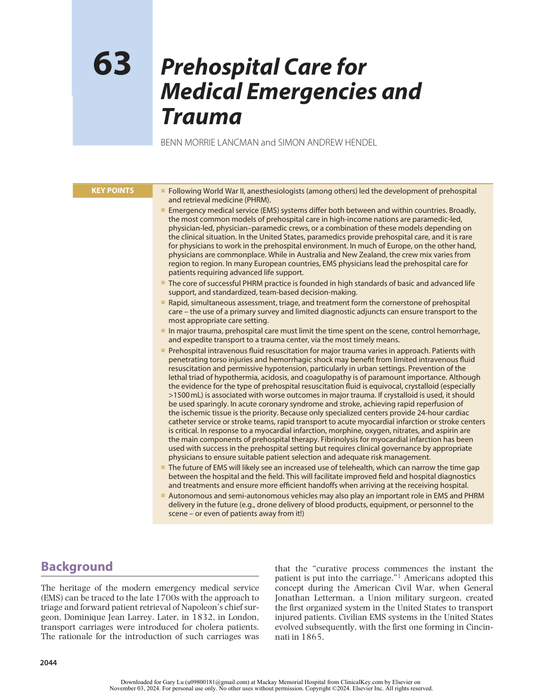
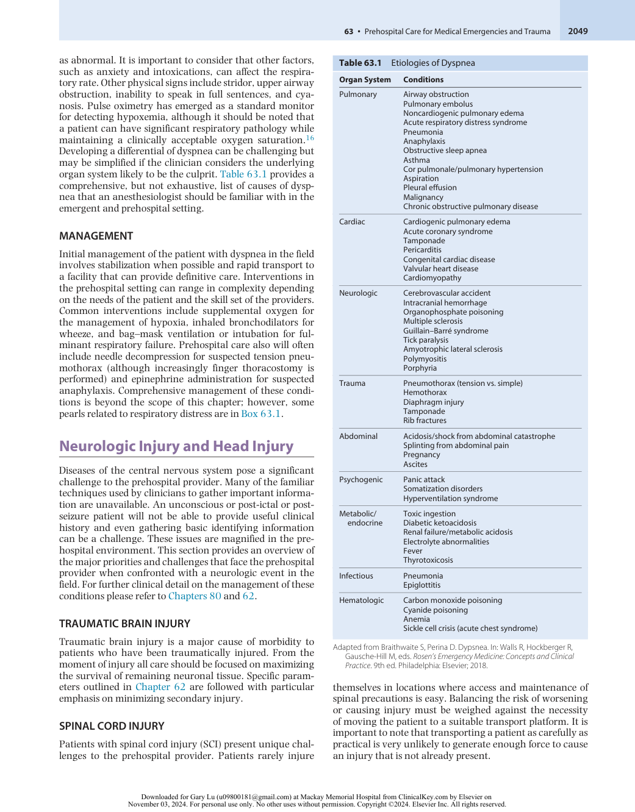
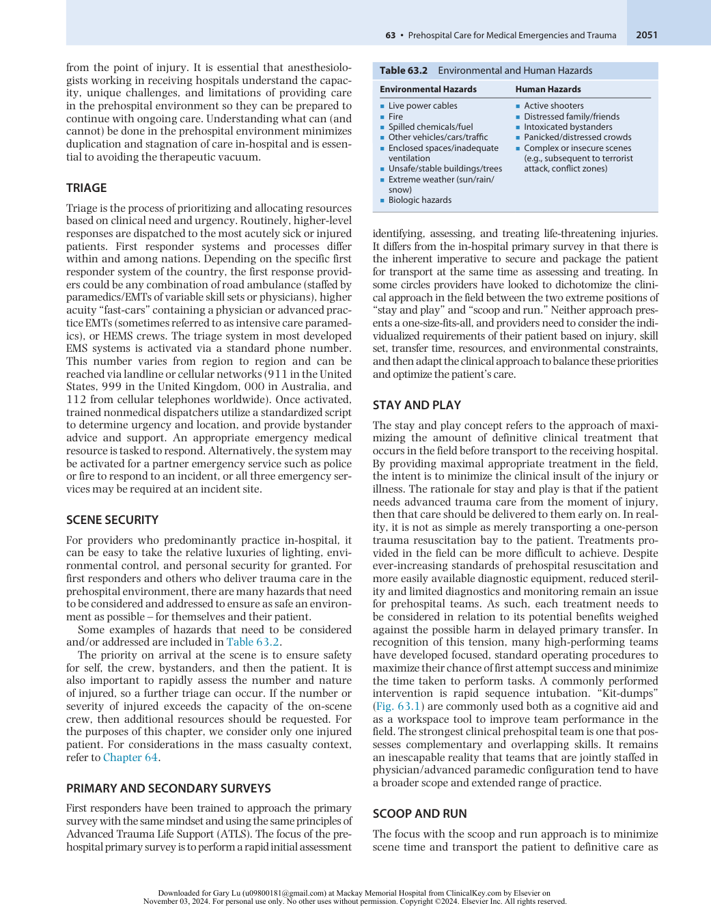
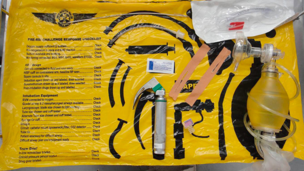
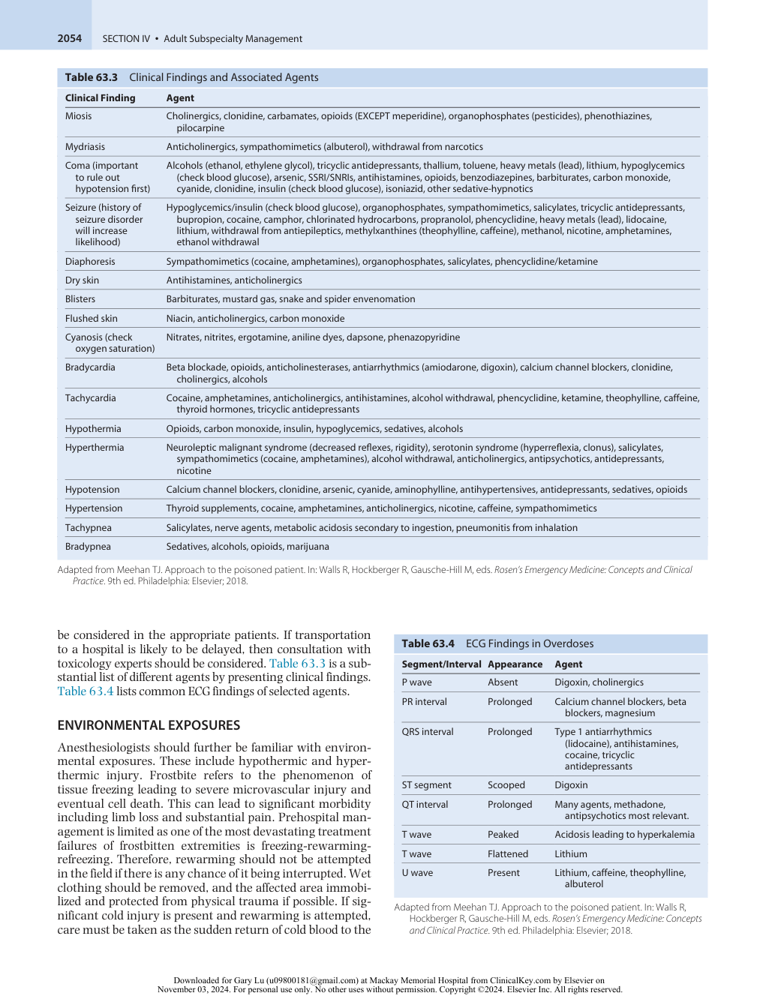
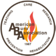
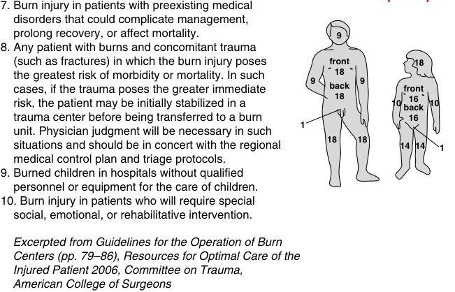

# Prehospital Care for Medical Emergencies and Trauma

<!-- PDF page 1 -->

BENN MORRIE LANCMAN and SIMON ANDREW HENDEL

### KEY POINTS

|ᑏFollowing World War II, anesthesiologists (among others) led the development of prehospital and retrieval medicine (PHRM).|
|---|
|ᑏEmergency medical service (EMS) systems differ both between and within countries. Broadly, the most common models of prehospital care in high- income nations are paramedic- led, physician- led, physician–paramedic crews, or a combination of these models depending on the clinical situation. In the United States, paramedics provide prehospital care, and it is rare for physicians to work in the prehospital environment. In much of Europe, on the other hand, physicians are commonplace. While in Australia and New Zealand, the crew mix varies from region to region. In many European countries, EMS physicians lead the prehospital care for patients requiring advanced life support.|
|ᑏThe core of successful PHRM practice is founded in high standards of basic and advanced life support, and standardized, team- based decision- making.|
|ᑏRapid, simultaneous assessment, triage, and treatment form the cornerstone of prehospital care – the use of a primary survey and limited diagnostic adjuncts can ensure transport to the most appropriate care setting.|
|ᑏIn major trauma, prehospital care must limit the time spent on the scene, control hemorrhage, and expedite transport to a trauma center, via the most timely means.|
|ᑏPrehospital intravenous fluid resuscitation for major trauma varies in approach. Patients with penetrating torso injuries and hemorrhagic shock may benefit from limited intravenous fluid resuscitation and permissive hypotension, particularly in urban settings. Prevention of the lethal triad of hypothermia, acidosis, and coagulopathy is of paramount importance. Although the evidence for the type of prehospital resuscitation fluid is equivocal, crystalloid (especially >1500 mL) is associated with worse outcomes in major trauma. If crystalloid is used, it should be used sparingly. In acute coronary syndrome and stroke, achieving rapid reperfusion of the ischemic tissue is the priority. Because only specialized centers provide 24- hour cardiac catheter service or stroke teams, rapid transport to acute myocardial infarction or stroke centers is critical. In response to a myocardial infarction, morphine, oxygen, nitrates, and aspirin are the main components of prehospital therapy. Fibrinolysis for myocardial infarction has been used with success in the prehospital setting but requires clinical governance by appropriate physicians to ensure suitable patient selection and adequate risk management.|
|ᑏThe future of EMS will likely see an increased use of telehealth, which can narrow the time gap between the hospital and the field. This will facilitate improved field and hospital diagnostics and treatments and ensure more efficient handoffs when arriving at the receiving hospital.|
|ᑏAutonomous and semi- autonomous vehicles may also play an important role in EMS and PHRM delivery in the future (e.g., drone delivery of blood products, equipment, or personnel to the scene – or even of patients away from it!)|

## Background

The heritage of the modern emergency medical service (EMS) can be traced to the late 1700s with the approach to triage and forward patient retrieval of Napoleon’s chief surgeon, Dominique Jean Larrey. Later, in 1832, in London, transport carriages were introduced for cholera patients. The rationale for the introduction of such carriages was

that the “curative process commences the instant the patient is put into the carriage.”1 Americans adopted this concept during the American Civil War, when General Jonathan Letterman, a Union military surgeon, created the first organized system in the United States to transport injured patients. Civilian EMS systems in the United States evolved subsequently, with the first one forming in Cincinnati in 1865.

::: details 原始表格與符號（PDF 第 1 頁）

:::

<!-- PDF page 2 -->

Australia is arguably the home of modern civilian aeromedical evacuation where the Royal Flying Doctor Service (RFDS) remains the longest continually operating aerial medical service in the world. It traces its origins to the Aerial Medical Service, which was established on May 15, 1928 (and conducted its first mission on May 17, 1928), by the Reverend John Flynn and Hudson Fysh. Together they leased a De Havilland 50 exairliner as the first ever “hospital of the sky.” Fysh was well known in aviation circles in Australia in the early 20th century as the founder of another Australian icon: the Queensland And Northern Territory Aerial Services (now better known as QANTAS).

It was another 30 years, though, in the 1960s, when advances in medical technology and knowledge joined forces with political will to formalize the concept of prehospital care. In the early 1960s, two major clinical developments occurred: cardiopulmonary resuscitation (CPR) for life support of the patient in cardiac arrest, and the development of portable external defibrillators. These two advancements provided the foundation of advanced cardiac life support (ACLS). This, in turn, led to the concept of early response to emergencies by trained community members to improve outcomes.

In 1965, President Lyndon Johnson created the President’s Committee for Traffic Safety, which published the report _Health, Medical Care, and Transportation of the Injured_ . It identified motor vehicle crashes as a significant public health concern. The committee recommended a national program to reduce highway deaths and injuries. Additionally, in 1966, a report was released by the National Academy of Sciences titled _Accidental Death and Disability: The Neglected Disease of Modern Society_ . It emphasized the need to address the quality of prehospital emergency medical care as it recognized that ambulances were ill- equipped and inappropriately staffed.

These two documents paved the way for the Highway Safety Act of 1966, which was passed by Congress and ultimately led to the formation of the National Highway Traffic Safety Administration (NHTSA) within the Department of Transportation. The NHTSA developed a national EMS curriculum which, in 1969, became the standard for emergency medical technician (EMT) training in the United States. In 1973, Congress further passed the EMS Systems Act, granting funds for the development of regional EMS systems. As a result, various states established a total of approximately 300 EMS regions with associated federal support. In the United States, the responsibility of EMS then shifted from federal to state level in 1981, which created heterogeneity in the system.

During the same period, EMS and prehospital medical systems were similarly evolving in most developed countries outside the United States. All had unique aspects and points of difference, mostly influenced by the local geography, political will, origin, and resources. The fundamental mission of EMS systems remained common: to deliver the best possible prehospital care to the right patients, in the right time frame, and to transport them safely to a higher level of care.

These systems were funded by a diverse range of sources. Some were predominantly conducted as volunteer organizations relying on charitable donations and philanthropy;

some were fully funded by the government; and others (particularly in the USA) were commercially operated on behalf of the state government.

Some systems evolved to be predominantly staffed by physicians, while others were staffed almost exclusively by paramedics with no to very minor physician involvement, and most fell somewhere between the two, with at least the capacity for a combined physician–paramedic crew.

## Basic Versus Advanced Life Support (And Beyond)

CPR was developed in 1960 when the American Heart Association started a program to train physicians in mouth- to- mouth resuscitation (expired air resuscitation) with associated external chest compressions. This led to the development of a tiered system: basic life support (BLS) and advanced life support (ALS) to denote the different skill sets of responders in an organized EMS.

First responders (such as police officers, firefighters, EMTs, and paramedics) are generally the first to arrive at an emergency and can provide medical assistance. A tiered system with different skill sets clarifies the scope of practice and role delineation in the chaotic prehospital environment.

### BASIC LIFE SUPPORT

The adult BLS sequence is airway- breathing- circulationdefibrillator (A- B- C- D). In trauma this is modified to C- A- B- C- D, where the first “C” is critical hemorrhage, and the “D” is a disability assessment. Irrespective of mechanism of unconsciousness, the goal is to ensure continuous blood (and therefore, oxygen) supply to major organs. Firefighters, lifeguards, and police officers are often BLS certified because they are often the first to a scene. The success of BLS lies in its timely application, not in the advanced skills of the provider. CPR and the use of an automated external defibrillator (AED) are considered BLS skills and the increasing availability of automated defibrillators makes it ever more likely that “unskilled” members of the community will be the first to deliver defibrillation in the event of an out- ofhospital cardiac arrest (OHCA). BLS also includes simple airway maneuvers such as chin lift, jaw thrust, and oxygen administration. For trauma care, basic skills include airway management such as simple airway maneuvers, oropharyngeal and nasopharyngeal airways, and bag–mask ventilation.

Besides CPR and automated external defibrillation, BLS also includes hemorrhage control and fracture and cervical spine immobilization. In the trauma patient who has suffered a primary traumatic cardiac arrest, CPR is unlikely to be of benefit and may, in fact, detract from useful lifesaving interventions. This relative controversy will be discussed later in the chapter. The decision not to perform CPR in the resuscitation of the arrested trauma patient should be made by personnel specifically trained at least at the ALS level and probably only in advanced prehospital systems that include suitably skilled physicians or intensive care paramedics.

<!-- PDF page 3 -->

### ADVANCED LIFE SUPPORT, INTENSIVE CARE– LEVEL PREHOSPITAL CARE

The knowledge and skills necessary to successfully perform ALS are built on the firm foundations of BLS. For example, even the most experienced prehospital or trauma practitioner relies upon basic airway maneuvers to maintain oxygenation when more sophisticated techniques have failed.

In the prehospital environment, ALS is most often provided by paramedics (advanced EMT practitioners). In many jurisdictions, however, there is a level of prehospital care above ALS, and, outside the United States, combined physician–paramedic crewed helicopter emergency medical services (HEMS) are common. In places where doctors are not part of a HEMS response, paramedics with advanced and intensive care skill sets are often used. This enables the resuscitation bay to essentially be taken to the patient, and, in addition, for advanced resuscitation to be maintained _en route_ to definitive care. The rationale for these advanced prehospital teams is to maximize the opportunity, while minimizing the time delay for delivery of the advanced trauma care that severely ill or injured patients need.

The provision of advanced, hospital- level interventions (e.g., advanced airway management such as endotracheal intubation, thoracostomy, resuscitative thoracotomy, and commencement of blood product transfusion) remain areas of significant controversy when applied to the prehospital environment. The question of whether it is better to prioritize caring for the patient in the field (“stay and play”) or to prioritize expedited transport (“scoop and run”) is an old and polarizing one. In environments where transport times are prolonged due to expansive distances (such as Australia), delivering advanced interventions early can be lifesaving. On the other hand, prolonging scene times and delaying presentation to definitive trauma care in order to initiate treatment in the field is unlikely to be in the patient’s best interest in other settings. In all mature trauma systems (incorporating the prehospital and in- hospital phases of care), a balance will need to be struck between these two competing priorities. Recent coalition experience in Iraq and Afghanistan have shown that significant care (including rapid lifesaving interventions) can be performed _en route_ . Perhaps the lesson learned for civilian providers is to “scoop and play”? Irrespective of approach or crew mix, the data are unequivocal: time to definitive care is the single most predictive measure of survival.

The reality is that on a population- wide scale, it is rare for anyone to need the advanced services of an EMT, let alone a HEMS prehospital resuscitation team. It is difficult, therefore, to adequately power a study to show a difference between the various models of prehospital care, if such a difference exists. As such, individual prehospital and in- hospital trauma systems have adapted to fulfill the perceived requirements of their population and account for areas of operational limitation.

Training for ALS EMTs now requires a rigorous educational background, and includes skills in advanced and invasive monitoring, diagnostics, and management. Systems functioning at or above the ALS level provides a more comprehensive assessment and stabilization of the trauma patient. In the United States, providers certified at the paramedic level (EMT- P) can perform any of these interventions,

whereas providers certified at the intermediate level (EMTI) may perform a select subset of these skills. Other jurisdictions have comparable delineations of skill set.

## Emergency Medical Technician and Paramedic- Based Emergency Medical Service Systems

Specially trained EMTs and paramedics form the bulk of the workforce of EMS systems in North America and in many other developed nations. Under US law, physicians, functioning as EMS directors, are required to approve the medical operations of the EMS systems they oversee. This includes communication, clinical operations, and governance.

In the United States, there are three levels of EMTs based on their level of education and training: EMT- basic (EMT- B), EMT- intermediate (EMT- I), and EMT- paramedic (EMT- P). The primary focus of the EMT- B is to provide basic emergency medical care (using BLS skills) and transportation to a health care system. They typically staff non- emergency ambulances and may also respond to nonemergency calls. EMT- I practitioners, or advanced EMTs, provide basic and limited advanced emergency medical care and transportation. They are regulated differently and their skills range between BLS and ALS depending on state regulations. EMT- P is the highest skill set within EMTs in the United States. They undergo intensive 1- to 2- year training in advanced prehospital emergency care. They are ALS trained and can perform procedures such as endotracheal intubation, administration of drugs, and manual defibrillation.

In many other countries, paramedics are required to complete bachelor- level university degrees and are nationally or regionally registered by regulatory bodies in a similar way that medical practitioners are licensed. In some regions, such as in most states of Australia and in many countries in Western Europe, intensive care paramedics have advanced skills in complex medical and trauma management as well as, in some circumstances, casualty access and rescue skills.

## Primary Survey and Initial Assessment at the Scene

The primary survey is usually performed in the same ABCDE (airway- breathing- circulation, disability- exposure) mnemonic format that is widely known from ACLS. Since 2010, the American Heart Association has recommended changing their ABC approach (airway- breathing- compressions) to CAB (compressions- airway- breathing), emphasizing circulation prior to airway. This is particularly relevant for someone in cardiac arrest to bring focus to chest compressions. It is also relevant to the trauma patient suffering critical bleeding. If you can hear the bleeding, you should stop it first!

The approach, therefore, in the prehospital major trauma patient is C- ABCDE. Strategies for prehospital management of critical hemorrhage are discussed in more detail elsewhere in the chapter, but broadly, options include direct

<!-- PDF page 4 -->

pressure, deep wound packing, use of novel hemostatics (there are several on the market), and tourniquets for extremity hemorrhage (the Combat Application Tourniquet [CAT] is the most widely used). Specific techniques can be used for major maxillofacial hemorrhage, which include nasal packing, or balloon tamponade devices (such as the Rapid Rhino), dental splints, and immobilization of the jaw with a hard, cervical spinal collar.

Novel approaches using resuscitative endovascular balloon occlusion of the aorta (REBOA) to manage critical bleeding in pelvic trauma in the absence of chest trauma are not yet widespread. Indeed, prehospital REBOA has been used successfully on only one documented occasion by London’s Air Ambulance. It remains an area of significant controversy and of limited evidence.

Once critical bleeding has been identified and temporarily controlled, moving through the remainder of the primary survey in a rapid yet methodical way is warranted. If there is airway (A) obstruction, the obstruction should be cleared, and the airway secured if necessary. While it will often be appropriate to perform a rapid sequence intubation in the prehospital environment, it may not always be necessary or beneficial. A balance must be struck between delaying transfer, likely disposition once in hospital, distance to definitive care, and skill set available. Most prehospital services continue to secure the cervical spine with a hard collar for transport and this would be applied at this time.

Breathing (B) becomes the next priority: after the airway is cleared and possibly secured, a patient’s breathing is assessed by observing respiratory rate, pattern, and degree of chest rise and fall. Supplemental oxygen and assisted ventilation may be indicated. Immediately reversible causes of potentially fatal chest trauma, such as tension pneumothoraces, may also be identified and treated with minimal delay to patient transfer. In the case of tension pneumothoraces, many advanced prehospital services (especially those with medical–paramedic HEMS crews) have adopted a finger thoracostomy approach to chest decompression, rather than needle thoracostomy, to achieve a more definitive endpoint early and minimize the risk of reaccumulation of the pneumothorax in transit. Of course, this definitive care may not be available prehospital in all jurisdictions.

Circulation (C) is next assessed by palpating pulses, checking for heart rate, pulse quality and regularity, measuring blood pressure, and again assessing for sources of hemorrhage. As an approximation, a palpable carotid pulse corresponds to a systolic blood pressure of at least 70 mm Hg, and a palpable radial pulse to a systolic blood pressure of 80 to 90 mm Hg.

Also, as part of the primary survey, large- bore intravenous access is obtained. Early fluid management in the trauma patient has been a contentious issue in trauma management for many years. There has been much discussion in the scientific and prehospital literature in relation to the role of crystalloid fluid in the early resuscitation of the trauma patient. Over the past decade there has been a significant shift away from the aggressive use of crystalloid and a shift toward early administration of blood products in the prehospital environment. Some prehospital retrieval services carry red cells only, whereas some (particularly in the United Kingdom) also carry freeze- dried plasma products. In the trauma patient with no concomitant head

injury, achieving a systolic blood pressure of 90 mm Hg is ideal (so- called “permissive hypotension”). The only caveat to this blood pressure target is in the head- injured patient. If head injury is present or suspected, then hypotension should be avoided. Indeed, available evidence suggests that in the presence of severe head injury, a single episode of systolic hypotension below 90 mm Hg may double mortality. As part of the assessment of circulation, suspected longbone fractures can be immobilized with CT- 6 (or equivalent) splints and the patient may be packaged in a vacuum mat for transport. If the prehospital team has the capability and expertise, an extended focused assessment with sonography in trauma (e- FAST) exam can be performed as part of the circulatory assessment. This may assist in identifying pneumothoraces before transport and may also reveal other major sources of bleeding that can be relayed to the receiving center.

Disability (D) is measured using the Glasgow Coma Scale (GCS). The GCS is made up of three parts: eyes, verbal response, and motor response. The best patient response is recorded. In the GCS, a maximum of 4 points are allocated for eye opening, 1 being unresponsive and 4 being eyes open; a maximum of 5 points are allocated to verbal response, with 1 being unresponsive and 5 being alert and oriented; and a maximum of 6 points are allocated to motor response, with 1 being unresponsive and 6 for the patient who obeys commands. The highest possible score is 15 and the lowest score possible is 3. Generally, patients with GCS score of 8 to 9 have alteration in their conscious state significant enough to no longer protect their own airway – though this is an imprecise measurement. Assessment of exposure and environment (E) and measures to defend core body temperature complete the primary survey and patient packaging process.

It is important to note that the management of the trauma patient in the prehospital environment relies on concurrent activity within the team. The key to prehospital diagnosis and treatment is the initiation of important treatment as problems are identified, while minimizing unnecessary time spent at the scene. The focus of professional prehospital teams is avoiding the “therapeutic vacuum,” or time where nothing useful is happening for the patient.

On arrival, and having assessed the scene, the prehospital care team must rapidly obtain a relevant and focused history of the patient and the events surrounding the incident. In the case of trauma, the ATMIST and AMPLE mnemonics provide a useful framework for gathering key initial information. ATMIST stands for age, time of incident, mechanism of injury, injuries sustained, vital signs (initial and subsequent), and treatment given so far. The AMPLE approach can then be applied to gather specific and relevant history. AMPLE stands for allergies, medications (regular and acute), past history, last meal (menses, tetanus injection) and the events surrounding the injury.

### MONITORS

Standard monitors in the prehospital setting include pulse oximetry, noninvasive arterial blood pressure monitoring, electrocardiography (ECG), temperature, and capnography. Indeed, the standards of patient monitoring in the mature EMS or prehospital retrieval service are as high as

<!-- PDF page 5 -->

in most critical care areas of a major hospital. The main difference, of course, is that the monitor display itself must be capable of withstanding the environmental rigors of the prehospital environment, be easily carried, and have a long battery life. There are many commercially available monitors (and ventilators, infusion pumps, and other equipment for that matter) that are approved for flight and designed to be robust across a range of transport platforms and environmental extremes.

of ST- segment elevation myocardial infarction (STEMI). Multiple studies have shown that prehospital ECGs are not only technically feasible, but they also decreased the time from presentation to reperfusion.8 This finding has been replicated in rural settings.9 A recent study looking at clinical outcomes with use of prehospital ECGs showed that the adjusted risk of mortality was lower in cases where ECGs were used.10

### PREHOSPITAL TREATMENT AND FIBRINOLYSIS

### POINT-OF-CARE ULTRASOUND

Portable and affordable ultrasound machines now make point- of- care (POC) ultrasound in the prehospital setting common. In Europe, the United Kingdom, and Australia, where physicians are active in the prehospital management of patients, this becomes even more practical to use. A Dutch observational study showed that 61% of ultrasound examinations impacted decisions in 88% of patients both in prehospital and once they reached definitive care.2 POC ultrasound is not limited to cardiac arrest; as mentioned earlier, abdominal ultrasound has also been shown to impact treatment decisions and in experienced hands, does not significantly delay treatment.3

Primary percutaneous coronary intervention (PCI) is the treatment of choice for STEMI patients if this therapy can be performed within 90 minutes of onset or less. When a patient is unable to receive mechanical reperfusion within that time window (either because of geographic isolation or arrival at a non- PCI community hospital) then evidence supports the use of fibrinolysis followed by PCI within 24 hours.11 It was subsequently demonstrated that a paramedic- based prehospital fibrinolysis program was practical and feasible in reducing time to treatment with favorable clinical outcomes.12

### MECHANICAL CIRCULATORY SUPPORT

### Prehospital Extracorporeal Cardiac Life Support

## Out- of- Hospital Cardiac Arrest

Survival from sudden cardiac arrest is highly dependent on early CPR and early defibrillation. Communities have placed an increasing emphasis on bystander CPR, community accessible AEDs, and rapid response of EMS providers.4

When the EMS arrives on the scene, the “Universal Treatment Algorithm” is started.5 Chest compressions continue until cardiac monitoring is placed and it is determined whether defibrillation is appropriate. Pharmacotherapy and airway management remain poorly defined. Optimal airway management in OHCA has not been established, and studies have shown that resuscitation with medications increases likelihood of the return of spontaneous circulation (ROSC) without improved outcome.6

The likelihood of ROSC will depend in large part on the etiology of the cardiac arrest as well as the presence of adequate bystander CPR. By far the most common cause of OHCA is from cardiac pathology.

### ACUTE CORONARY SYNDROME

Over 5.5 million patients in the United States present to emergency departments with chest pain as their primary complaint. Almost 50% of these patients arrive by ambulance.7 Any mature EMS system needs to be well equipped to manage this common and potentially life- threatening presentation. For a patient presenting with chest pain in the prehospital setting, three things need to happen: (1) diagnosis be made; (2) treatment commenced; and (3) triage to facility.

### PREHOSPITAL DIAGNOSIS AND ELECTROCARDIOGRAPHY

The prehospital ECG is essential in the assessment and triage of patients with chest pain and making the diagnosis

Recently, extracorporeal cardiac life support (ECLS) has been introduced to the prehospital environment for treatment of OHCA patients in some very select settings. The use of mechanical ECLS in the prehospital setting remains controversial. Whether initiated in the field or in the emergency department, there is insufficient evidence to guide broad- based adoption of this practice. Multiple case reports have demonstrated some utility, but this therapy should not detract from high- quality ACLS.13–15

## Respiratory Distress

Respiratory distress is a common complaint necessitating prehospital medical intervention.16 Management requires rapid identification of emergent conditions and subsequent intervention to prevent further deterioration. Unfortunately, dyspnea, the perception of respiratory distress, can be influenced by a variety of factors and patient complaints alone are insufficient to identify the underlying cause or its severity. Early stabilization of respiratory function regardless of the underlying pathology is important to avoid significant morbidity and mortality. Even for anesthesiologists who are not participating in prehospital care, it is important to have a familiarity with these conditions as emergent or urgent surgical patients may present with dyspnea that is not fully evaluated and their initial management will fall on the anesthesia team in the perioperative period.

### EVALUATION

Initial evaluation of the patient in respiratory distress is structured to identify patients at risk for rapid progression to respiratory failure and identify the need for invasive support. Respiratory rate is an easily obtainable vital sign, and a rate of more than 30 breaths per minute would be defined

<!-- PDF page 6 -->

as abnormal. It is important to consider that other factors, such as anxiety and intoxications, can affect the respiratory rate. Other physical signs include stridor, upper airway obstruction, inability to speak in full sentences, and cyanosis. Pulse oximetry has emerged as a standard monitor for detecting hypoxemia, although it should be noted that a patient can have significant respiratory pathology while maintaining a clinically acceptable oxygen saturation.16 Developing a differential of dyspnea can be challenging but may be simplified if the clinician considers the underlying organ system likely to be the culprit. Table 63.1 provides a comprehensive, but not exhaustive, list of causes of dyspnea that an anesthesiologist should be familiar with in the emergent and prehospital setting.

### MANAGEMENT

Initial management of the patient with dyspnea in the field involves stabilization when possible and rapid transport to a facility that can provide definitive care. Interventions in the prehospital setting can range in complexity depending on the needs of the patient and the skill set of the providers. Common interventions include supplemental oxygen for the management of hypoxia, inhaled bronchodilators for wheeze, and bag–mask ventilation or intubation for fulminant respiratory failure. Prehospital care also will often include needle decompression for suspected tension pneumothorax (although increasingly finger thoracostomy is performed) and epinephrine administration for suspected anaphylaxis. Comprehensive management of these conditions is beyond the scope of this chapter; however, some pearls related to respiratory distress are in Box 63.1.

## Neurologic Injury and Head Injury

Diseases of the central nervous system pose a significant challenge to the prehospital provider. Many of the familiar techniques used by clinicians to gather important information are unavailable. An unconscious or post- ictal or postseizure patient will not be able to provide useful clinical history and even gathering basic identifying information can be a challenge. These issues are magnified in the prehospital environment. This section provides an overview of the major priorities and challenges that face the prehospital provider when confronted with a neurologic event in the field. For further clinical detail on the management of these conditions please refer to Chapters 80 and 62.

### TRAUMATIC BRAIN INJURY

Traumatic brain injury is a major cause of morbidity to patients who have been traumatically injured. From the moment of injury all care should be focused on maximizing the survival of remaining neuronal tissue. Specific parameters outlined in Chapter 62 are followed with particular emphasis on minimizing secondary injury.

### SPINAL CORD INJURY

Patients with spinal cord injury (SCI) present unique challenges to the prehospital provider. Patients rarely injure

**Table 63.1** Etiologies of Dyspnea

|**Organ System**|**Conditions**|
|---|---|
|Pulmonary|Airway obstruction Pulmonary embolus Noncardiogenic pulmonary edema Acute respiratory distress syndrome Pneumonia Anaphylaxis Obstructive sleep apnea Asthma Cor pulmonale/pulmonary hypertension Aspiration Pleural effusion Malignancy Chronic obstructive pulmonary disease|
|Cardiac|Cardiogenic pulmonary edema Acute coronary syndrome Tamponade Pericarditis Congenital cardiac disease Valvular heart disease Cardiomyopathy|
|Neurologic|Cerebrovascular accident Intracranial hemorrhage Organophosphate poisoning Multiple sclerosis Guillain–Barré syndrome Tick paralysis Amyotrophic lateral sclerosis Polymyositis Porphyria|
|Trauma|Pneumothorax (tension vs. simple) Hemothorax Diaphragm injury Tamponade Rib fractures|
|Abdominal|Acidosis/shock from abdominal catastrophe Splinting from abdominal pain Pregnancy Ascites|
|Psychogenic|Panic attack Somatization disorders Hyperventilation syndrome|
|Metabolic/ endocrine|Toxic ingestion Diabetic ketoacidosis Renal failure/metabolic acidosis Electrolyte abnormalities Fever Thyrotoxicosis|
|Infectious|Pneumonia Epiglottitis|
|Hematologic|Carbon monoxide poisoning Cyanide poisoning Anemia|
||Sickle cell crisis (acute chest syndrome)|

Adapted from Braithwaite S, Perina D. Dypsnea. In: Walls R, Hockberger R, Gausche- Hill M, eds. _Rosen’s Emergency Medicine: Concepts and Clinical Practice_ . 9th ed. Philadelphia: Elsevier; 2018.

themselves in locations where access and maintenance of spinal precautions is easy. Balancing the risk of worsening or causing injury must be weighed against the necessity of moving the patient to a suitable transport platform. It is important to note that transporting a patient as carefully as practical is very unlikely to generate enough force to cause an injury that is not already present.

::: details 原始表格與符號（PDF 第 6 頁）

:::

<!-- PDF page 7 -->

### Box 63.1 Pearls (Precepts, Dicta) for Respiratory Distress

- ᑍ Rule out life- threatening, rapidly progressive causes such as tension pneumothorax or acute coronary syndrome prior to initiating a more thorough workup for causes of shortness of breath

- ᑍ A normal oxygen saturation does not mean a patient is without significant respiratory pathology

- ᑍ Most patients with respiratory distress are related to pulmonary or cardiac causes; however, the astute clinician should always keep in mind additional causes in the appropriate clinical context

- ᑍ Chronic conditions tend to be better tolerated than acute ones. For example, chronic mitral regurgitation is well tolerated until it becomes severe whereas acute mitral regurgitation is a medical emergency

- ᑍ The acuity of onset of the condition is helpful for determining the cause. For example, a patient with a chronic neuromuscular disorder who presents with an acute worsening likely has an additional explanation for his or her shortness of breath

- ᑍ There is no clinical finding that rules out pulmonary embolism and a low threshold for further workup should be maintained in the appropriate patient

- ᑍ Unnecessary supplemental oxygen does not have a benefit and likely leads to preventable harms

With this in mind, the safest approach for handling potential SCI cases is to assume such an injury is present in any mechanism that could result in significant SCI, but also not to delay lifesaving treatment in preference of spinal precautions.

Spinal immobilization techniques have received increased scrutiny over the past decade. The hard cervical collar is no longer considered the “magic bullet” of cervical spine immobilization. Hard spinal boards are also falling out of favor with many emergency services around the world. Regardless of the jurisdiction, if “hard” immobilization devices are used, there is a shift toward using them for as short a period of time as possible. Depending on the expected transport time from the scene there may be a role for early application of Philadelphia- or Aspen- style collars with transport in a vacuum mat. The main advantage of cervical spine collars is that they alert the receiving hospital that this patient might have c- spine injury and needs attention. It is possible that this can be achieved with a soft collar, avoiding some of the risks of prolonged hard collar immobilization. This is particularly relevant for the older patient with fragile skin or for the patient requiring prolonged transfer.

### ACUTE STROKE MANAGEMENT

Stroke is a much feared and potentially debilitating condition. While it can be more difficult to identify the location of a particular stroke without a detailed neurologic exam, the ability to provide targeted reperfusion therapy for large vessel stroke has seen a drastic change in the expected outcome for those patients. Much like percutaneous interventions for heart attacks, interventional neuroradiology can drastically change the clinical trajectory of a “brain attack.” Minimizing the ischemic time for neuronal tissue becomes the priority. Thus, early diagnosis, activation of neuroradiology, and timely transport become essential to achieving

optimal clinical outcomes. This has resulted in some jurisdictions deploying thrombolysis in the field. Recent major studies were halted early due to evidence of benefit for those patients who received thrombectomy. As such, transporting these patients to a center that can provide clot retrieval is important. To maximize the speed of diagnosis, mobile stroke units have been developed that contain a portable computed tomography scanner and capacity for “teleradiology” to make a radiologic diagnosis in the field. While these platforms have been launched with significant enthusiasm, they remain the exception across the developed world, and potentially of questionable cost–benefit.

### SEIZURE

Seizure is a common presenting complaint and makes up approximately 1% of all emergency department admissions. First responders are therefore often required to provide emergency medical management and, where appropriate, supportive care during transport to hospital. The detailed management of status epilepticus is covered in Chapter 53, but patients with status epilepticus have improved outcomes when treatment is commenced in the field by EMS providers.

### ALTERED MENTAL STATUS

Altered mental status covers a broad range of conditions affecting a patient’s cognition. In the prehospital environment, first responders may be required to assess, treat, and safely transport people with a range of underlying disorders. Patients may be drug affected, head injured, delirious, or suffering from a wide range of medical or neurosurgical disorders. Prehospital providers may need to treat patients with altered mental status in their own home, at a motor vehicle accident scene, or in any number of complex environments. As with any scene, providing a safe environment for the providers as well as for the patient is of utmost importance.

When the need arises, pharmacologic sedation may be utilized to facilitate safe transport to a health care facility. Providers are expected to assess and treat any easily reversible causes of altered mental status such as hypoglycemia or hypoxia, but many precipitants are outside the scope of a field diagnosis. Collateral history is increasingly important to determine the timeline for the changes in mental status and how far the patient’s current altered state has departed from normal.

## Prehospital Trauma

Trauma remains a significant burden of disease globally and is the greatest cause of death for those under 40 years of age. As has been demonstrated in previous chapters in this text, early access to definitive care is the single greatest modifier in the survivability of a major traumatic event. Trauma patients’ need for advanced and specialized trauma care begins at the moment of injury, hence, delays in transport or delivery of definitive care contribute to poor outcome. Accordingly, the prehospital management of trauma patients has the potential to start the process of recovery

<!-- PDF page 8 -->

from the point of injury. It is essential that anesthesiologists working in receiving hospitals understand the capacity, unique challenges, and limitations of providing care in the prehospital environment so they can be prepared to continue with ongoing care. Understanding what can (and cannot) be done in the prehospital environment minimizes duplication and stagnation of care in- hospital and is essential to avoiding the therapeutic vacuum.

### TRIAGE

Triage is the process of prioritizing and allocating resources based on clinical need and urgency. Routinely, higher- level responses are dispatched to the most acutely sick or injured patients. First responder systems and processes differ within and among nations. Depending on the specific first responder system of the country, the first response providers could be any combination of road ambulance (staffed by paramedics/EMTs of variable skill sets or physicians), higher acuity “fast- cars” containing a physician or advanced practice EMTs (sometimes referred to as intensive care paramedics), or HEMS crews. The triage system in most developed EMS systems is activated via a standard phone number. This number varies from region to region and can be reached via landline or cellular networks (911 in the United States, 999 in the United Kingdom, 000 in Australia, and 112 from cellular telephones worldwide). Once activated, trained nonmedical dispatchers utilize a standardized script to determine urgency and location, and provide bystander advice and support. An appropriate emergency medical resource is tasked to respond. Alternatively, the system may be activated for a partner emergency service such as police or fire to respond to an incident, or all three emergency services may be required at an incident site.

### SCENE SECURITY

For providers who predominantly practice in-hospital, it can be easy to take the relative luxuries of lighting, environmental control, and personal security for granted. For first responders and others who deliver trauma care in the prehospital environment, there are many hazards that need to be considered and addressed to ensure as safe an environment as possible – for themselves and their patient.

Some examples of hazards that need to be considered and/or addressed are included in Table 63.2.

The priority on arrival at the scene is to ensure safety for self, the crew, bystanders, and then the patient. It is also important to rapidly assess the number and nature of injured, so a further triage can occur. If the number or severity of injured exceeds the capacity of the on- scene crew, then additional resources should be requested. For the purposes of this chapter, we consider only one injured patient. For considerations in the mass casualty context, refer to Chapter 64.

### PRIMARY AND SECONDARY SURVEYS

First responders have been trained to approach the primary survey with the same mindset and using the same principles of Advanced Trauma Life Support (ATLS). The focus of the prehospital primary survey is to perform a rapid initial assessment

**Table 63.2** Environmental and Human Hazards

|**Environmental Hazards**|**Human Hazards**|
|---|---|
|ᑏLive power cables ᑏFire|ᑏActive shooters ᑏDistressed family/friends|
|ᑏSpilled chemicals/fuel ᑏOther vehicles/cars/traffic ᑏEnclosed spaces/inadequate ventilation|ᑏIntoxicated bystanders ᑏPanicked/distressed crowds ᑏComplex or insecure scenes (e.g., subsequent to terrorist l|
|ᑏUnsafe/stable buildings/trees ᑏExtreme weather (sun/rain/ snow)|attack, conflict zones)|
|ᑏBiologic hazards||

identifying, assessing, and treating life- threatening injuries. It differs from the in- hospital primary survey in that there is the inherent imperative to secure and package the patient for transport at the same time as assessing and treating. In some circles providers have looked to dichotomize the clinical approach in the field between the two extreme positions of “stay and play” and “scoop and run.” Neither approach presents a one- size- fits- all, and providers need to consider the individualized requirements of their patient based on injury, skill set, transfer time, resources, and environmental constraints, and then adapt the clinical approach to balance these priorities and optimize the patient’s care.

### STAY AND PLAY

The stay and play concept refers to the approach of maximizing the amount of definitive clinical treatment that occurs in the field before transport to the receiving hospital. By providing maximal appropriate treatment in the field, the intent is to minimize the clinical insult of the injury or illness. The rationale for stay and play is that if the patient needs advanced trauma care from the moment of injury, then that care should be delivered to them early on. In reality, it is not as simple as merely transporting a one- person trauma resuscitation bay to the patient. Treatments provided in the field can be more difficult to achieve. Despite ever- increasing standards of prehospital resuscitation and more easily available diagnostic equipment, reduced sterility and limited diagnostics and monitoring remain an issue for prehospital teams. As such, each treatment needs to be considered in relation to its potential benefits weighed against the possible harm in delayed primary transfer. In recognition of this tension, many high- performing teams have developed focused, standard operating procedures to maximize their chance of first attempt success and minimize the time taken to perform tasks. A commonly performed intervention is rapid sequence intubation. “Kit- dumps” (Fig. 63.1) are commonly used both as a cognitive aid and as a workspace tool to improve team performance in the field. The strongest clinical prehospital team is one that possesses complementary and overlapping skills. It remains an inescapable reality that teams that are jointly staffed in physician/advanced paramedic configuration tend to have a broader scope and extended range of practice.

### SCOOP AND RUN

The focus with the scoop and run approach is to minimize scene time and transport the patient to definitive care as

::: details 原始表格與符號（PDF 第 8 頁）

:::

<!-- PDF page 9 -->

**Fig. 63.1** “Kit- dumps” are commonly used both as a cognitive aid and as a workspace tool to improve team performance in the field. (Courtesy MedSTAR, Adelaide, South Australia.)

soon as possible. Proponents of scoop and run argue that the time to definitive care is what makes the difference, hence the patient should be moved as quickly as possible to a trauma center, with only the barest of essential lifesaving interventions performed at the scene. Depending on the expected transport time, this philosophy may be entirely appropriate for many trauma patients. Any interventions performed in this context would be for immediate lifesaving interventions only.

### FURTHER CONSIDERATIONS

Prehospital providers are also expected to gather as much useful information from the scene as possible to guide ongoing care. Current medications, collateral medical history, and photos of the accident scene are all tasks that are expected to be undertaken whenever possible.

Transport destinations are often predetermined. Effort is made in most systems to deliver patients to the appropriate clinical location wherever possible. For example, a suspected myocardial infarction should be transported to a center where PCI is possible. Other acute subspecialty centers include stroke, extracorporeal membrane oxygenation, trauma, pediatrics, and burns. Factors such as patient preference and, in certain jurisdictions, level of insurance can also be considered where the clinical setting allows.

### BALANCED RESUSCITATION

The early control of major hemorrhage has become the focus of any significant trauma resuscitation. As we gain greater understanding of the consequences of acute traumatic coagulopathy as well as the downstream impact of our clinical resuscitation, there has been a transition away from crystalloid- based fluid resuscitation toward “hemostatic” resuscitation fluids. Many ambulance services around the world now carry fractionated blood products – usually packed red blood cells, but an increasing number are carrying plasma. There is active research underway on the early administration of tranexamic acid (TXA) and the impact this may have on clinical outcomes after injury. The CRASH- 2 trial demonstrated a mortality benefit when TXA was administered within 3 hours of injury. The hypothesis is that early application may result in greater benefits, although the trial was justifiably criticized

for non- homogeneity of trial sites. Recent literature has explored the prehospital administration of packed red blood cells combined with lyophilized plasma (RePHILL trial),17 or the administration of thawed plasma for patients retrieved by air (PAMPer trial).18 These well- designed studies have contradictory findings: PAMPer suggested lower mortality and improved coagulation laboratory values, while RePHILL failed to demonstrate a similar benefit. Hypotheses for the difference may be due to the short transport time to hospital in the RePHILL study, or the use of lyophilized plasma. Suffice to say, the significant logistical and financial burden imposed by executing a prehospital transfusion program may not be justified based on the current literature. Areas that remain inadequately investigated include whole blood administration, alternate product ratios, or identifying subgroups of trauma patients who may benefit from prehospital transfusion.

### HEMORRHAGE CONTROL

Together with the increased use of blood products in the field there has been a growing array of interventions available for stopping bleeding. The American College of Surgeons (ACS) has been coordinating a “Stop the Bleed”® campaign in the United States (and now exported globally) to improve the use and knowledge of hemorrhage control by bystanders. Techniques such as direct pressure, wound packing, and tourniquet application have been introduced to the bystander population.

### ANTIFIBRINOLYTICS

The debate around the efficacy and safety of TXA use in the acute severe trauma patient continues. The results of the CRASH- 2 trial have been adopted in many trauma systems. On the other hand, many remain unconvinced given the significant heterogeneity of trial sites in the study. The CRASH- 2 trial did show a reduction in death from bleeding in trauma patients who received a 1- g intravenous dose of TXA within 3 hours of injury. This benefit did not extend if the first dose was given beyond 3 hours, where the trend was toward complications from thrombosis. There is also some concern that fibrinolysis is not occurring in all bleeding trauma patients and conceptually antifibrinolytic therapy may not be indicated. Additional trials such as the PATCH study are investigating whether targeted use of TXA conveys any survival benefit.

### TOURNIQUETS

A CAT correctly placed can significantly reduce the volume of blood loss and arrest hemorrhage in time to transport a patient to definitive care.

### RESUSCITATIVE ENDOVASCULAR BALLOON OCCLUSION OF THE AORTA

London’s Air Ambulance (known more commonly as London HEMS) has pioneered the use of REBOA in the field for the management of patients with severe bleeding that previously would have been unlikely to survive to hospital. They have field- deployed REBOA multiple times with an

<!-- PDF page 10 -->

overall positive result. Most of the cases where REBOA had been used involved significant pelvic trauma. The evidence base for REBOA use is expanding. Yet, on the other hand, in a mature trauma system, patients eligible for REBOA may in fact receive definitive care in the operating room instead. The main question now is whether this type of highly specialized intervention is beneficial to implement in other contexts or whether it truly has a mortality benefit. Perhaps there may come a time when REBOA, or something similar, will become the standard for hemorrhage control in the field.

### FUTURE DIRECTIONS AND CHALLENGES

The burden of trauma is growing. With an aging population, more densely populated urban centers, heavier road use, and accelerating technological possibilities for care, the challenges (and opportunities) for first responders are immense. Below are some of the challenges and active areas for investigation currently being explored. As anesthesiologists we need to remain informed and open to the evolution of clinical fields that we partner with and work within.

### TRAUMA TRIAGE

The time from incident or injury to the notification of emergency services can either be immediate or significantly delayed. Efforts have been made to automate part of the process. Many modern cars have crash detection and emergency notification built in. Companies such as OnStar provide timely notification to emergency services in the event of a vehicle crash. As more cars are fitted with detailed analytics, there is potential for emergency services to be notified directly when a vehicle is involved in an incident of sufficient force to result in injury.

## Point- of- Care Diagnostics

As POC devices become smaller, more reliable, and more affordable, there is potential for front- line medical providers to perform rapid assessments to further triage and prioritize patients and their medical needs. Ultrasound is the first device that is likely to be widely adopted at the front line – and already has been deployed in many prehospital services around the world. It is relatively cheap, portable, robust, and has a growing body of evidence to support its use.

The impact of POC diagnostics could be further enhanced with greater use of telemetry and telemedicine. The transmission of live feeds from emergency services to the receiving hospital could provide hospital staff with the information necessary to expedite appropriate care (e.g., surgical services). Combining field and telemedicine in this way has garnered significant interest from organizations that provide care in the most remote and austere of environments, such as mining companies and the military. The potential application of advanced telemedicine and real- time clinical support for a severely injured or unwell patient aboard a ship at sea is immediately obvious. The two- way nature of telemedicine would also enable hospital staff to support operators in the field, potentially reducing the need for every front- line provider to be an expert in interpretation.

Although telemedicine will never replace technical skills, it may greatly enhance clinical decisions.

## Overdose/Toxicology/ Environmental Exposure

In contrast to the relatively controlled confines of a modern hospital, prehospital providers are truly confronted with the unknown. In addition to the clinical presentation of the patient, there are significant issues that need to be considered when ensuring no further harm occurs to either patients, bystanders, or first responders.

Environmental toxins, chemical exposures, armed patients, or nearby assailants are an unfortunate reality we need to confront. First and foremost, it is the responsibility for any prehospital provider to ensure they are safe. This may require that access to patients be delayed to allow time for police, fire, and/or utility providers to secure the scene. Many EMS units (particularly in the United States) have responded to this challenge with the development of specialized “tactical units.” These providers are given additional training to allow them to operate in potentially hostile environments.

The remaining discussion will assume that scene safety has been achieved and that front- line providers have access to the patients.

### EVALUATION

An anesthesiologist should have an appreciation of common environmental exposures and toxidromes that may be present, particularly because often these patients can have a concomitant surgical condition that will require management. Evaluation of the intoxicated patient is often challenging and limited to the clinical exam and history obtained from nearby persons. Empty pill containers and other environmental clues can be helpful but may not be present.19 If an environmental exposure is suspected, care should be taken to avoid exposure to the emergency response personnel and the patient’s clothing should be placed in a secure enclave to prevent further exposure.19 In the event of significant biologic/chemical/radiation exposure, expert consultation should be obtained to ensure safety of first responders and treating clinicians. While many laboratory tests exist to detect ingested substances, it is important that prehospital providers be familiar with common clinical toxidromes as these may be the only clue to the etiology of the overdose.

### MANAGEMENT

As with most emergency management, initial treatment is directed toward stabilizing vital signs before progressing to specific management of any environmental or toxic exposures. Decontamination is also indicated in environmental exposures; this includes removing the patient from the exposure, removal of the patient’s clothing, and surface decontamination when indicated.19 Once these are stabilized, further interventions can be attempted. In addition to vital signs, other rapid tests in the field include a 12- lead ECG and a blood glucose. Finally, with the current epidemic of opioid abuse, empiric administration of naloxone should

<!-- PDF page 11 -->

**Table 63.3** Clinical Findings and Associated Agents

|**Clinical Finding**|**Agent**|
|---|---|
|Miosis|Cholinergics, clonidine, carbamates, opioids (EXCEPT meperidine), organophosphates (pesticides), phenothiazines, pilocarpine|
|Mydriasis|Anticholinergics, sympathomimetics (albuterol), withdrawal from narcotics|
|Coma (important to rule out hypotension first)|Alcohols (ethanol, ethylene glycol), tricyclic antidepressants, thallium, toluene, heavy metals (lead), lithium, hypoglycemics (check blood glucose), arsenic, SSRI/SNRIs, antihistamines, opioids, benzodiazepines, barbiturates, carbon monoxide, cyanide, clonidine, insulin (check blood glucose), isoniazid, other sedative- hypnotics|
|Seizure (history of seizure disorder will increase likelihood)|Hypoglycemics/insulin (check blood glucose), organophosphates, sympathomimetics, salicylates, tricyclic antidepressants, bupropion, cocaine, camphor, chlorinated hydrocarbons, propranolol, phencyclidine, heavy metals (lead), lidocaine, lithium, withdrawal from antiepileptics, methylxanthines (theophylline, caffeine), methanol, nicotine, amphetamines, ethanol withdrawal|
|Diaphoresis|Sympathomimetics (cocaine, amphetamines), organophosphates, salicylates, phencyclidine/ketamine|
|Dry skin|Antihistamines, anticholinergics|
|Blisters|Barbiturates, mustard gas, snake and spider envenomation|
|Flushed skin|Niacin, anticholinergics, carbon monoxide|
|Cyanosis (check oxygen saturation)|Nitrates, nitrites, ergotamine, aniline dyes, dapsone, phenazopyridine|
|Bradycardia|Beta blockade, opioids, anticholinesterases, antiarrhythmics (amiodarone, digoxin), calcium channel blockers, clonidine, cholinergics, alcohols|
|Tachycardia|Cocaine, amphetamines, anticholinergics, antihistamines, alcohol withdrawal, phencyclidine, ketamine, theophylline, caffeine, thyroid hormones, tricyclic antidepressants|
|Hypothermia|Opioids, carbon monoxide, insulin, hypoglycemics, sedatives, alcohols|
|Hyperthermia|Neuroleptic malignant syndrome (decreased reflexes, rigidity), serotonin syndrome (hyperreflexia, clonus), salicylates, sympathomimetics (cocaine, amphetamines), alcohol withdrawal, anticholinergics, antipsychotics, antidepressants, nicotine|
|Hypotension|Calcium channel blockers, clonidine, arsenic, cyanide, aminophylline, antihypertensives, antidepressants, sedatives, opioids|
|Hypertension|Thyroid supplements, cocaine, amphetamines, anticholinergics, nicotine, caffeine, sympathomimetics|
|Tachypnea|Salicylates, nerve agents, metabolic acidosis secondary to ingestion, pneumonitis from inhalation|
|Bradypnea|Sedatives, alcohols, opioids, marijuana|

Adapted from Meehan TJ. Approach to the poisoned patient. In: Walls R, Hockberger R, Gausche- Hill M, eds. _Rosen’s Emergency Medicine: Concepts and Clinical Practice_ . 9th ed. Philadelphia: Elsevier; 2018.

be considered in the appropriate patients. If transportation to a hospital is likely to be delayed, then consultation with toxicology experts should be considered. Table 63.3 is a substantial list of different agents by presenting clinical findings. Table 63.4 lists common ECG findings of selected agents.

### ENVIRONMENTAL EXPOSURES

Anesthesiologists should further be familiar with environmental exposures. These include hypothermic and hyperthermic injury. Frostbite refers to the phenomenon of tissue freezing leading to severe microvascular injury and eventual cell death. This can lead to significant morbidity including limb loss and substantial pain. Prehospital management is limited as one of the most devastating treatment failures of frostbitten extremities is freezing- rewarmingrefreezing. Therefore, rewarming should not be attempted in the field if there is any chance of it being interrupted. Wet clothing should be removed, and the affected area immobilized and protected from physical trauma if possible. If significant cold injury is present and rewarming is attempted, care must be taken as the sudden return of cold blood to the

**Table 63.4** ECG Findings in Overdoses

|**Segment/Interval**|**Appearance**|**Agent**|
|---|---|---|
|P wave|Absent|Digoxin, cholinergics|
|PR interval|Prolonged|Calcium channel blockers, beta blockers, magnesium|
|QRS interval|Prolonged|Type 1 antiarrhythmics (lidocaine), antihistamines, cocaine, tricyclic antidepressants|
|ST segment|Scooped|Digoxin|
|QT interval|Prolonged|Many agents, methadone, antipsychotics most relevant.|
|T wave|Peaked|Acidosis leading to hyperkalemia|
|T wave|Flattened|Lithium|
|U wave|Present|Lithium, caffeine, theophylline, albuterol|

Adapted from Meehan TJ. Approach to the poisoned patient. In: Walls R, Hockberger R, Gausche- Hill M, eds. _Rosen’s Emergency Medicine: Concepts and Clinical Practice_ . 9th ed. Philadelphia: Elsevier; 2018.

::: details 原始表格與符號（PDF 第 11 頁）

:::

<!-- PDF page 12 -->

### Courtesy of the

**American Burn Association Advanced Burn Life Support (ABLS)** Learn more about the ABA and ABLS at **www.ameriburn.org**

- **Burn Center Referral Criteria Severity Determination A burn center may treat adults, First Degree** _(Partial Thickness)_ **children, or both.** Superficial, red, sometimes painful.

- **Burn injuries that should be referred to a Second Degree** _(Partial Thickness)_ **burn center include:** Skin may be red, blistered, swollen. Very painful.

- 1. Partial thickness burns greater than 10% **Third Degree** _(Full Thickness)_ total body surface area (TBSA). Whitish, charred or translucent, no 2. Burns that involve the face, hands, feet, pin prick sensation in burned area. genitalia, perineum, or major joints. 3. Third degree burns in any age group.

4. Electrical burns, including lightning injury.

5. Chemical burns.

### Percentage Total Body Surface Area (TBSA)

6. Inhalation injury.

7. Burn injury in patients with preexisting medical     disorders that could complicate management,     prolong recovery, or affect mortality. 9 8. Any patient with burns and concomitant trauma     (such as fractures) in which the burn injury poses front 18     the greatest risk of morbidity or mortality. In such 9 18 9     cases, if the trauma poses the greater immediate back18 front16     risk, the patient may be initially stabilized in a 10 back 10     trauma center before being transferred to a burn 16 1     unit. Physician judgment will be necessary in such 18 18     situations and should be in concert with the regional 14 14 1     medical control plan and triage protocols. 9. Burned children in hospitals without qualified     personnel or equipment for the care of children. 10. Burn injury in patients who will require special     social, emotional, or rehabilitative intervention. Excerpted from Guidelines for the Operation of Burn Centers (pp. 79–86), Resources for Optimal Care of the Injured Patient 2006, Committee on Trauma, American College of Surgeons 

**Fig. 63.2 Indications for transfer to a tertiary burn center.** (Courtesy American Burn Association. https://ameriburn.org/wp-content/uploads/2023/01/ one-page-guidelines-for-burn-patient-referral-16.pdf.)

heart can precipitate ventricular dysrhythmias and subsequent cardiac arrest.20

Burn injuries are very common but fortunately the majority are only minor injuries. Detailed anesthetic considerations for management of the patient with burns are addressed elsewhere in this book (Chapter 83). Specific prehospital management for severe burns focuses on stopping any ongoing burn injury, securing an airway where necessary, and providing adequate analgesia. Many jurisdictions will have a specialist burns center that EMS providers can transfer patients to for definitive care, weighed against the need for transport to the nearest hospital. Considerations for transport to a tertiary burn center are outlined in Fig. 63.2.

## Horizons in Prehospital Care

By reducing the therapeutic vacuum, patients receive lifesaving interventions at an earlier time in their disease process, hopefully translating to reduced morbidity and mortality. The increasing use of real- time data, predictive analytics, and telemedicine will enable front- line providers to assist in earlier diagnostics and more tailored therapies and enable hospital- based services to implement plans based on needs identified in the field. The capacity to save lives is going to continue to increase as prehospital and hospital- based providers work in concert for the benefit of their patients.

### Acknowledgment

The editors and publisher would like to thank Drs. Jerome C. Crowley and Yvonne Y. Lai for contributing a chapter on this topic in the prior edition of this work.

The trend in prehospital care over the last several decades has been toward bringing high- quality care to the roadside.

**Complete references available online at expertconsult.com.**

<!-- PDF page 13 -->

### References

1.  Barkley K. _The Ambulance: The Story of Emergency Transportation of Sick and Wounded through the Centuries_ . New York: Exposition Press; 1978.

2.  Ketelaars R, et al. _Prehosp Emerg Care_ . 2018;22(4):406.

3.  Ketelaars R, et al. _Eur J Emerg Med_ . 2019;26(4):277.

4.  Cummins RO, et al. _Circulation_ . 1991;83:1832.

5.  Kloeck W, et al. _Resuscitation_ . 1997;34:109.

6.  Olasveengen TM, et al. _Circulation_ . 2018;118:S1447.

7.  Bhuiya FA, et al. _NCHS Data Brief_ . 2010;43:1.

8.  Sillesen M, et al. _J Electrocardiol_ . 2008;41:49.

9.  Kahlon TS, et al. _Catheter Cardiovasc Interv_ . 2017;89(2):245.

10.  Rawshani N, et al. _Int J Cardiol_ . 2017;248:77.

11.  Armstrong PW, et al. _Am Heart J_ . 2010;160(1):30.

12.  Welsh RC, et al. _Am Heart J_ . 2006;152:1007.

13.  Arlt M, et al. _Resuscitation_ . 2011;82:1243.

14.  Schempf B, et al. _Am J Emerg Med_ . 2018;36(6):1121.

15.  Lamhaut L, et al. _Resuscitation_ . 2012;83:E177.

16.  Johnson MJ, et al. _Expert Rev Respir Med_ . 2014;8:151.

17.  Crombe N, et al. _Lancet Haematol_ . 2022;9(4):e250.

18.  Sperry JL, et al. _N Engl J Med_ . 2018;379:315.

19.  Thompson TM, et al. _Dis Mon_ . 2014;60:509–524.

20.  McIntosh SE, et al. _Wilderness Environmental Med_ . 2014;25:43.

<!-- PDF page 14 -->

### References

1.  Barkley K. _The Ambulance: The Story of Emergency Transportation of Sick and Wounded through the Centuries_ . New York: Exposition Press; 1978.

2.  Ketelaars R, Beekers C, Van Geffen GJ, et al. Prehospital echocardiography during resuscitation impacts treatment in a physician- staffed helicopter emergency medical service: an observational study. _Prehosp Emerg Care_ . 2018;22(4):406–413.

3.  Ketelaars R, Holtslag JJM, Hoogerwerf N. Abdominal prehospital ultrasound impacts treatment decisions in a Dutch Helicopter Emergency Medical Service. _Eur J Emerg Med_ . 2019;26(4):277–282.

4.  Cummins RO, Ornato JP, Thies WH, et al. Improving survival from sudden cardiac arrest: the “chain of survival” concept. A statement for health professionals from the Advanced Cardiac Life Support Subcommittee and the Emergency Cardiac Care Committee. _Circulation_ . 1991;83:1832–1847.

5.  Kloeck W, Cummins R, Chamberlain D, et al. The universal ALS algorithm: an advisory statement by the Advanced Life Support Working. Group of the International Liaison Committee on Resuscitation. _Resuscitation_ . 1997;34:109–111.

6.  Olasveengen TM, Sunde K, Thowsen J, et al. Prospective randomized controlled trial on the effects of intravenous drug administration on survival to hospital discharge after out- of- hospital cardiac arrest. _Circulation_ . 2018;118:S1447.

7.  Bhuiya FA, Pitts SR, McCaig LF. Emergency department visits for chest pain and abdominal pain: United States. _NCHS Data Brief_ . 2010;(43):1–8.

8.  Sillesen M, Sejersten M, Strange S, et al. Referral of patients with STsegment elevation acute myocardial infarction directly to the catheterization suite based on prehospital teletransmission of 12- lead electrocardiogram. _J Electrocardiol_ . 2008;41:49–53.

9.  Kahlon TS, Barn K, Akram MM, et al. Impact of pre- hospital electrocardiograms on time to treatment and one year outcome in a rural regional ST- segment elevation myocardial infarction network. _Catheter Cardiovasc Interv_ . 2017;89(2):245–251.

10.  Rawshani N, Rawshani A, Gelang C, et al. Association between use of pre- hospital ECG and 30- day mortality: a large cohort study of patients experiencing chest pain. _Int J Cardiol_ . 2017;248:77–81.

11.  Armstrong PW, Gershlick A, Goldstein P, et al. The strategic reperfusion early after myocardial infarction (STREAM) study. _Am Heart J_ . 2010;160(1):30–35.e1.

12.  Welsh RC, Travers A, Senaratne M, et al. Feasibility and applicability of paramedic- based prehospital fibrinolysis in a large North American center. _Am Heart J_ . 2006;152:1007.

13.  Arlt M, Philipp A, Voelkel S, et al. Out- of- hospital extracorporeal life support for cardiac arrest – a case report. _Resuscitation_ . 2011;82:1243–1245.

14.  Schempf B, Schibilsky D, Gaier G, et al. Out of hospital extracorporeal life support (ECLS) implantation in cardiogenic shock after cardiac arrest – a case report. _Am J Emerg Med_ . 2018;36(6):1121.e1–1121. e3.

15.  Lamhaut L, Jouffroy R, Kalpodjian A, et al. Successful treatment of refractory cardiac arrest by emergency physicians using pre- hospital ECLS. _Resuscitation_ . 2012;83:e177–e178.

16.  Johnson MJ, Currow DC, Booth S. Prevalence and assessment of breathlessness in the clinical setting. _Expert Rev Respir Med_ . 2014;8:151–161.

17.  Crombe N, Doughty HA, Bishop JRB, et al. Resuscitation with blood products in patients with trauma- related haemorrhagic shock receiving prehospital care. _Lancet Haematol_ . 2022;9(4):e250– e261.

18.  Sperry JL, Guyette FX, Adams PW. Prehospital plasma during air medical transport in trauma patients at risk for hemorrhagic shock. _N Engl J Med_ . 2018;379:315–326.

19.  Thompson TM, Theobald J, Lu J, et al. The general approach to the poisoned patient. _Dis Mon_ . 2014;60:509–524.

20.  McIntosh SE, Opacic M, Freer L, et al. Wilderness Medical Society practice guidelines for the prevention and treatment of frostbite: 2014 update. _Wilderness Environ Med_ . 2014;25:43–54.
