# Biologic, Natural, and Human-Induced Disasters: The Role of the Anesthesiologist

<!-- PDF page 1 -->

DANIEL W. JOHNSON, WILLIAM P. MULVOY, ELIZABETH R. SCHNAUBELT, and STEVEN J. LISCO

- **KEY POINTS** Anesthesiologists possess a combination of knowledge and procedural skills that make them critical participants during the immediate and ongoing response to large- scale disasters. To do so, they must be willing and able to modify their traditional workflow to best meet the needs of victims.

- Natural disasters such as earthquakes, hurricanes, floods, tsunamis, and tornadoes require significant resources to address the ramifications of these events; as a result, they can cause massive interruptions in the normal provision of health care.

   - Anesthesiologists who travel from resource- rich to resource- limited environments to provide rescue medical care must cope with a lack of familiarity with infectious diseases that are uncommon in resource- rich nations.

   - In addition to addressing the acute challenges experienced during these disasters, anesthesiologists and other providers who travel to disaster- ravaged areas are exposed to a variety of physical and mental stressors that impact their immediate response and can have lasting effects after the event.

   - Because of the very high early mortality and personal impact on local health care workers following many disasters, anesthesiologists who travel to countries experiencing them may provide the greatest value by temporarily replacing local health care workers lost in the disaster.

   - While hurricanes tend to have fewer immediate fatalities than earthquakes or tsunamis, the ability of hurricanes and subsequent floods to cripple the provision of medical and surgical care has numerous downstream consequences, including long- term effects on medical education and clinical care because of loss of faculty and flood damage to educational and clinical facilities.

   - When disasters induce shortages of medications and fluids, as Hurricane Maria did in 2017 and the COVID- 19 pandemic did in 2020, distribution of limited resources becomes a challenge, requiring a coordinated approach to global conservation of existing supplies and avoidance of waste.

   - Since many disasters cannot be anticipated, such as the September 11, 2001 attack on New York City, developing and updating existing prospective plans to address triage of victims and coordination of services among diverse hospital systems and trauma centers become critical to appropriate resource use and early access to life- saving care.

   - In the eight years between 2015 and 2022, over 19,000 people were shot and killed or wounded in the United States in a mass shooting.1 Accordingly, all anesthesiologists must be prepared to provide care to often multiple victims in the aftermath of these heinous events.

ᑏ As acts of terrorism have accelerated in recent decades, anesthesiologists need to have knowledge and skills required to care for victims of chemical, biologic, radiologic, or nuclear (CBRN) disasters. The impact of these events will not only affect those in the immediate vicinity of the act, but also the entire health system. Anesthesiologists must be prepared to alter their traditional roles and develop appropriate triage methods to best meet the needs of all patients and the community following such an event.

- One of the highest priorities for health care workers after a CBRN event is to take precautions against becoming the next (second) victim. Appropriate personal protective equipment (PPE) is extremely important after these events and must be readily available to protect health care workers.

<!-- PDF page 2 -->

- During an outbreak of a highly dangerous infectious disease, anesthesiologists must understand the mechanisms of transmitting the disease and implement appropriate isolation and management strategies. For many such situations, they also serve as consultants in collaboration with infectious disease specialties in the development of optimal care pathways to minimize risk to other patients and health care workers.

- Pandemics place incredible strain on health care systems around the world. To address these challenging situations and ensure sufficient staff capable of managing the clinical issues, anesthesiologists can often utilize their broad knowledge and clinical and procedural skills to provide patient care outside of their traditional roles and environments.

## Introduction

Large- scale disasters create challenges that require communities to attempt to restore order and normalcy, while also addressing some of the specific issues created by these devastating events. For decades, national, state, and hospital disaster management plans have focused upon preparedness, response, and recovery efforts dedicated to optimizing resources and personnel necessary to respond to mass casualties stemming from natural disasters, large- scale accidents, and more recently, terrorist attacks. Health care providers have a special role to play in all such events. Anesthesiologists, because of their unique combination of skills and knowledge, are an extremely valuable part of the overall effort to optimize the health and recovery of victims of disaster. In- depth knowledge of pharmacology and physiology, expertise in resuscitation, experience in critical care medicine, and the ability to alleviate pain are some of the elements that anesthesiologists offer in addition to their skills in managing patients requiring complicated and extensive surgical procedures.

To fulfill the needs of victims and the health care systems that manage them, anesthesiologists must be prepared to modify and expand upon their traditional roles in patient care to apply their unique skill set to care for patients in a wide variety of possible scenarios. During a disaster, if a given hospital system has adequate personnel to provide intraoperative anesthesia care but inadequate physicians to triage and provide resuscitation in the emergency department or in the field, anesthesiologists can extend their roles and provide care in these and other settings, including traditional hospital environments or temporary alternative sites of care. Critical care anesthesiologists, in addition to other critical care providers, are essential personnel to address many of the issues after a disaster. However, after large- scale biologic and other disasters, most hospitals do not have sufficient critical care physicians to cover all of the critically ill or injured patients. Because of the unique skills required to care for complicated clinical issues in the operating room, other anesthesiologists can temporarily assume the role of intensivist, and play a key role in the management of patients in the intensive care unit and other environments following a disaster, such as took place during the early stages of the COVID- 19 pandemic.

While many of the principles for managing diverse disasters are similar, the causes of disaster require special knowledge and skills to adequately address the clinical, social, and other issues confronting providers. To address the specific features and their implications of biologic, natural, and other causes, this chapter is divided into four distinct

sections. Each section identifies key issues for the anesthesiologist to understand as well as the specific roles they can assume to address the challenges confronting the health care system. The four sections of the chapter are:

1.  Natural disasters

2.  Acts of terrorism

3.  Chemical, biological, radiological, and nuclear warfare

4.  Epidemic and pandemic infectious outbreaks

## Section 1: Natural Disasters

Natural disasters such as earthquakes, hurricanes, floods, tsunamis, and tornadoes have the ability to cause massive disruptions in the population at large and to the provision of health care during and after the event. Prehospital care for victims as well as for other clinical needs can be completely disrupted due to damage to roads. Hospital care can be disrupted due to lack of water, oxygen, fuel, electricity, and other necessary utilities. Hospitals themselves can be damaged or destroyed by these types of events. Communication can be difficult or impossible following natural disasters due to a combination of damage to telecommunication systems with simultaneous usage overload as families and victims try to locate one another. To address specific issues related to these natural disasters and their implications, several historical examples of natural disasters will be examined in order to highlight the critical role of the anesthesiologist during the management and recovery from these devastating events.

### EARTHQUAKES

Earthquakes are capable of inducing an incredible amount of damage in a very brief period of time. While earthquakes can seriously impact resource- rich countries, resourcelimited areas of the world that suffer from poor infrastructure at baseline are particularly vulnerable to severe health care and other issues following an earthquake. The magnitude 7.0 earthquake that struck Haiti on January 12, 2010 was one of the most devastating natural disasters in modern history, and was an example of how badly a nation’s health care system can be damaged by these types of events. The death toll in Haiti is difficult to accurately calculate, but nearly all analyses place the number of deaths at more than 130,000, with 1.5 million people immediately displaced following the earthquake.2,3 More than 80% of Haitian schools and more than 50% of Haitian hospitals were destroyed.

Health care professionals from around the world recognized that a resource- limited nation such as Haiti would

<!-- PDF page 3 -->

require an incredible amount of assistance to recover from the earthquake. Surgeons, anesthesiologists, and other health care providers from the United States and other nations traveled to Haiti in order to provide initial trauma care, and subsequently to assist in backfilling the jobs of Haitian health care workers who were lost or injured in the earthquake. Médecins Sans Frontières, or Doctors Without Borders, stated in 2013 that its response to the Haitian earthquake was the largest relief operation in the history of the organization. While hundreds of health care workers from around the world expressed interest in assisting in the recovery from the earthquake, a major limiting factor was the inability to access the sole airport in Haiti. The United States Air Force assumed leadership of the airport and provided air traffic control until Haitian authorities could recover adequately to resume control.4

In recent years, massive natural disasters like the Haitian earthquake have been supported through the deployment of a United States Navy Hospital ship such as the USNS Comfort or USNS Mercy to replace facilities lost to the disaster and provide clinical care to those in need. These enormous oil tankers converted to hospital ships were primarily designed to deliver health care to US military personnel during wartime, yet they are more commonly deployed to provide humanitarian aid to disaster- ravaged areas of the world. In 2010, the USNS Comfort deployed to the coast of Haiti within 72 hours of the earthquake and subsequently embarked upon the largest disaster- relief operation in the history of these floating hospitals. More than 850 patients received care on the ship during the weeks following the earthquake, including 237 children and one premature newborn.5 The most common condition treated on the ship was musculoskeletal extremity injury, comprising about 40% of the overall reasons for admission.6 The average length of stay was 8 days and surgery was performed 843 times on 454 patients over the course of five weeks. 58 of the operations were amputations.7 While these facilities are generally staffed by military physicians, during disasters, anesthesiologists and other specialists from across the United States volunteered to provide care on the USNS Comfort, some as new volunteers and some with prior experience in military and disaster relief (Figs. 64.1 and 64.2).

Provision of medical and surgical care aboard a “floating hospital” was similar to care provided in other settings, essentially functioning as a relatively normal and well- equipped facility; the task of providing care on the island of Haiti itself, however, required very different approaches. Nearly all medical facilities in Port-au-Prince were either damaged or destroyed by the earthquake, forcing volunteer health care teams to work in makeshift clinics and hospitals within tent facilities throughout the city. One of the largest such facilities was based out of the United Nations compound at the airport.8 In the initial days after the earthquake, surgical care was very limited because of a lack of supplemental oxygen, unsterile conditions, and a lack of resources to provide anesthesia. Amputations were performed under local anesthesia until a team of anesthesiologists skilled in single- shot block techniques arrived.7 Following their arrival, these anesthesiologists were able to facilitate the performance of 1000 operations, including major orthopedic surgery. They were also instrumental in the postoperative care and analgesia of the surgical patients (Fig. 64.3).

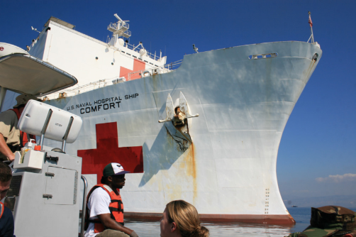

**Fig. 64.1 USNS Comfort off the coast of Haiti in 2010.** (Photo courtesy of Dr. Paul G. Firth, Massachusetts General Hospital, Boston, MA.)

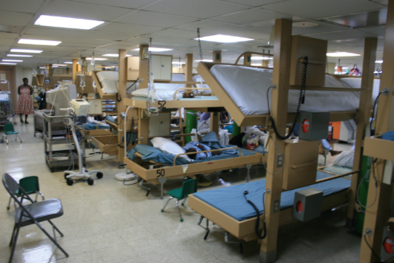

**Fig. 64.2 Patient ward on board the USNS Comfort in Haiti in 2010.** (Photo courtesy of Dr. Paul G. Firth, Massachusetts General Hospital, Boston, MA.)

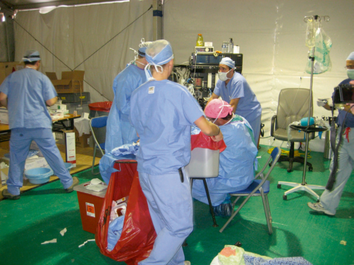

**Fig. 64.3 University of Miami anesthesiologist working in a makeshift operating room on the island of Haiti following the 2010 earthquake.** (Photo courtesy of Dr. Ralf E. Gebhard, University of Miami Department of Anesthesiology, Miami, FL.)

<!-- PDF page 4 -->

Anesthesiologists who travel from resource- rich to resource- limited environments to provide rescue medical care must be prepared to address a number of issues not directly related to the disaster, but that have major impact on how care is delivered and the expertise that is required. For example, the physicians must contend with infectious diseases that have been largely eradicated from resourcerich nations, with which they often have had limited experience. During the Haitian earthquake recovery, this issue arose when anesthesiologists encountered patients suffering from tetanus. The Haitian population is at an elevated risk to develop tetanus following contamination of wounds because of the relatively low rates of vaccination compared with resource- rich nations. Caused by the anaerobic bacterium _Clostridium tetani_ , tetanus causes severe neck rigidity, trismus, and chest wall immobility. Some of the symptoms associated with tetanus create difficulty for anesthesiologists during airway management and maintenance of ventilation. Anesthesiologists who provided care for surgical patients on the USNS Comfort reported two cases of tetanus which impacted their anesthetic care.9 In one case, the patient was noted to have a small mouth opening as a result of trismus. Following induction of general anesthesia with inhaled sevoflurane, the patient’s total body rigidity markedly improved. Unfortunately, postoperatively the patient suffered significant muscle weakness, retention of pulmonary secretions, and ultimately developed pneumonia contributing to death. In another case, the patient required repeated general anesthetics, consisting of inhaled sevoflurane without neuromuscular blocking drugs, and recovered to discharge. Based on these experiences, the anesthesiologists involved in the care of these tetanus victims noted that the nasal airway remains largely unaffected by tetanus, allowing mask ventilation even in the setting of trismus. They also emphasized the importance of conserving precious pharmaceuticals like neuromuscular blocking drugs for use in the most critical clinical situations when one is practicing medicine in a severely resource- limited environment. By applying their broad expertise in pathophysiology and pharmacology, these anesthesiologists were able to safely and effectively deliver surgical anesthesia to high- risk patients with minimal medication administration. The conservation of neuromuscular blocking agents by taking advantage of the neuromuscular blocking properties of potent inhaled anesthetic agents facilitated the care of other patients while maintaining access to muscle relaxants for those patients most in need of them.

The Haitian earthquake response also highlighted another critical issue when dealing with any major disaster or care in an unfamiliar environment with limited resources – the psychological impact of the disaster and its effects on health care workers working within this challenging situation. Anesthesiologists who travel to disaster- ravaged areas are exposed to a variety of physical and mental stressors, which can have an impact on them for months or years after the event. Prolonged work hours, inadequate rest, exposure to gruesome traumatic injuries, and witnessing the prolonged pain and suffering of children are some examples of what disaster responders endure. Despite these challenges, health care providers are expected to provide optimal medical care while simultaneously providing psychological support to devastated family members. Complicating matters,

as patients’ medical and surgical care become prolonged, they develop tolerance to pain medications. This increases the challenge of achieving humane levels of analgesia. During the busy hours and days of the immediate response to a disaster, health care providers must stay focused on the call of duty, which allows them to keep personal emotions at bay. As the pace of the response slows, anesthesiologists and other health care providers are forced to deal with the physical, mental, and emotional trauma that they themselves have sustained. One might wonder why a health care provider would leave the safety of their home nation to purposely expose themselves to this kind of potential anguish. Consistent qualities appear to be present among responders to massive natural disasters: they understand that all human beings have dignity, they sympathize with people who are suffering, and they desire to be part of the healing process. After returning to the United States following humanitarian missions to Haiti, several anesthesiologists composed thoughtful essays on the care that they had provided.10

### TORNADOES

While tornadoes tend to be shorter in duration than other natural disasters, they are able to create horrendous damage within seconds to minutes. One of the most destructive storms in American history was an EF- 5 tornado that ravaged Joplin, Missouri on May 22, 2011. During the ensuing power outage, some hospitals’ backup generators failed, requiring anesthesia care and surgery to be performed by flashlight alone.11 When hospitals are directly destroyed by natural disasters, as occurred at St John’s Mercy Medical Center in Joplin, great attention must be paid to restoring the health care infrastructure of the community, while continuing to provide ongoing care. Having access to electronic health records can facilitate patient care, but only if appropriate backup power is available. To ensure documentation of care and access to anesthesia records and other critical information, transition to paper records becomes essential, though may no longer be easily accessed in emergency situations. With proper disaster preparedness, including contingencies for complete losses of hospitals and clinics, normal patterns of care can be restored within a reasonable timeframe.12

Opportunistic infections are a common downstream effect from all natural disasters, including tornadoes. Following the 2011 tornado in Joplin, a cluster of patients suffered from necrotizing cutaneous mucormycosis requiring extensive treatment.13 Some of these infections occur due to patients being thrown to the ground and sustaining breakage in the normal protective barrier of the skin. Understanding this risk and assessing for mucormycosis is essential to ensuring early and adequate débridement (Figs. 64.4 and 64.5).

### TSUNAMI

A tsunami is a very large sea wave that results from an underwater earthquake, volcanic eruption, or other significant geologic movement. On December 26, 2004 a massive earthquake, magnitude 9.1 on the Richter Scale, occurred beneath the Indian Ocean and caused one of the

<!-- PDF page 5 -->

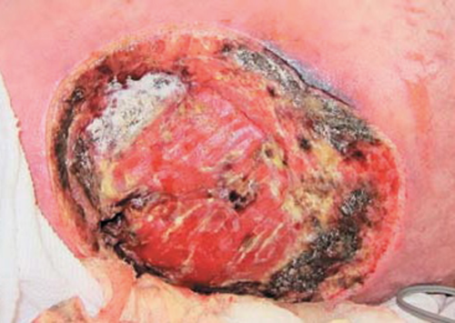

**Fig. 64.4 Necrotizing cutaneous mucormycosis of the flank following the Joplin, MO tornado.** (From Neblett Fanfair R, Benedict K, Bos J, et al. Necrotizing cutaneous mucormycosis after a tornado in Joplin, Missouri, in 2011. _N Engl J Med_ . 2012; 367(23):2214–2215, Figure 1. Published by the Massachusetts Medical Society.)

deadliest natural disasters in recorded history. The tsunami that resulted from the earthquake created enormous waves which made their way to the shores of 14 countries, including Indonesia, Sri Lanka, Malaysia, Bangladesh, India, Thailand, and Burma. Tsunamis tend to produce a very high ratio of mortality to injury. The high death rate is related to the massive influx of water onto the shore subjecting large numbers of people to risk of drowning or direct impact of waves and exposure to debris. The aftermath of a tsunami tends to have three phases. During phase 1, a high number of people are instantly killed. During phase 2, in the hours and days following the initial impact, care is directed toward providing life- and limb- saving care to victims of blunt trauma and water exposure.14 During phase 3, the impact on the overall infrastructure as well as health care personnel affects availability to address longer-term posttrauma care as well as to provide basic medical care to the community, further complicating the area’s overall recovery.

The 2004 tsunami killed more than 230,000 people, injured tens of thousands, and was estimated to have immediately displaced more than 5 million people. One factor in its extreme lethality was the fact that December is the peak tourist season for many of the beaches of Southeast Asia. As is the case with many tsunamis, there was essentially zero warning that deadly waves were about to make landfall. The Aceh province of the Indonesian island of Sumatra was by far the hardest hit area, with waves reaching greater than 25 m in height resulting in more than 100,000 people killed. People on the beach at the time of the tsunami died immediately, while people farther inland were killed as a result of drowning or impact with massive floating debris (Fig. 64.6).

While there is essentially no way to ensure availability of health care workers during phase 1 of a tsunami, health care workers from nearby regions are often able to respond during phase 2 unless infrastructure destruction prevents mobilization to areas of greatest need. Following the 2004 tsunami, a team of 17 surgeons, 6 anesthesiologists, and other health care workers traveled as part of the Thai Red Cross Society for Humanitarian Mission from Bangkok,

Thailand to Phang- Nga, Thailand to provide care. The multidisciplinary team was led by one surgeon and one anesthesiologist. They were able to arrive within one day after the tsunami. Over the course of the subsequent 3 days, the team provided surgical care for 107 patients. The injury profile for the patients requiring medical care consisted predominantly of soft tissue wounds and bone fractures. Halothane was the only inhalational anesthetic available, highlighting the need for anesthesiologists to be nimble in their ability to utilize medications rarely used in their current practice during disaster relief.

Most cases in Phang- Nga were performed under general anesthesia following rapid sequence induction, although spinal, regional, and local anesthetic techniques were also utilized. The team noted an increased incidence of intraoperative oxygen desaturation for this group of patients compared with their experience during other relief operations. The desaturation was thought to be related to aspiration of seawater and lung contusions secondary to direct impact of waves or debris. Despite the ability of this team to use an inland hospital for the care of tsunami victims, infrastructure was sufficiently damaged to preclude obtaining preoperative or intraoperative laboratory data, limiting access to data to guide management, particularly related to administration of fluids, electrolytes, antibiotics, and blood products (Fig. 64.7).

In addition to the regional response, a massive international relief effort was launched in response to the tsunami. In January 2005, Operation Unified Assistance was started as part of the United States response to the catastrophe. Organized by Project HOPE and the United States Public Health Service, the USNS Mercy was sent from San Diego to the Aceh province in Sumatra, representing the first joint effort of military and civilian relief aboard a US Naval ship.15 US responders to Indonesia were required to demonstrate up- to- date vaccination records for all typical immunizations, receive vaccines for typhoid and hepatitis A, and take prophylactic medication to protect from malaria. Additionally, negative airflow pods were available on the ship to allow for safe care of patients with active tuberculosis. Other issues that needed to be addressed included educating the providers about aspects of their care not generally considered. Prior to arrival, all staff members were briefed on the differences in culture and religion they would encounter, and the possible implications for providing care. More than 90% of Indonesian citizens are Muslim, and Islamic Law plays an important role in the day- to- day decision- making for many of the families impacted by the tsunami.

As noted previously, the impact of the tsunami on the health care workforce was also overwhelming. An estimated 60% of all health care workers in the Aceh province died or were missing following the tsunami. Thus, Operation Unified Assistance was prepared to backfill the roles of lost health care workers in addition to providing care directly related to the effects of the tsunami. While the USNS Mercy was designed for enormous overall capacity, for this operation the facility included 3 operating rooms, and 50 inpatient beds with appropriate staffing for these locations.

Operation Unified Assistance provided surgical care for 154 patients, but only 8.4% of these were in need of surgery as a direct result of the tsunami.14 Because of the

<!-- PDF page 6 -->

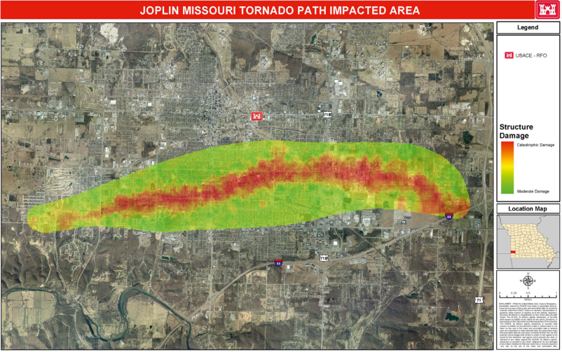

**<mark>Fig. 64.5 Case locations of mucormycosis with relation to the Joplin tornado course.</mark>** <mark>(From U.S. Army Corps of Engineers, public domain.)</mark>

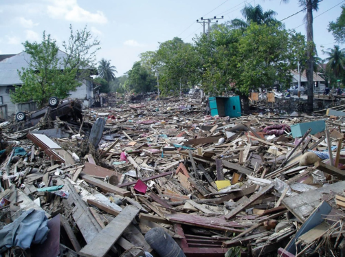

**Fig. 64.6 Debris in the streets of the Aceh province after the December 2004 tsunami.** (Photo courtesy of Dr. Michael G. Fitzsimons, Massachusetts General Hospital, Boston, MA.)

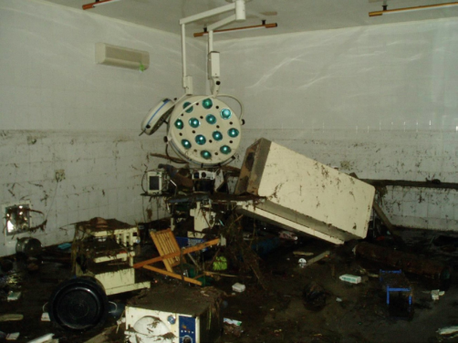

**Fig. 64.7 Aceh, Indonesia operating room destroyed by December 2004 tsunami.** (Photo courtesy of Dr. Michael G. Fitzsimons, Massachusetts General Hospital, Boston, MA.)

high mortality to injury ratio in a tsunami, the team was more valuable to Aceh as a replacement for lost health care workers than as a specialized trauma response team. This differentiates the tsunami experience from the Haitian earthquake experience, with its higher relative incidence of survivable injuries.

General anesthesia with inhaled agents supplemented by opioids and neuromuscular blocking drugs was the anesthetic technique of choice. This was selected because of the lack of adequate equipment for regional anesthesia and language barrier between patients and anesthesiologists that affected communication and understanding of the proposed anesthetic options. In addition, the team considered postanesthesia recovery from general anesthesia to be easier and safer than for neuraxial or regional techniques. In total, 122 units of packed red blood cells, 13 units of plasma, and 4 units of cryoprecipitate were transfused during the relief

operation.14 While response to a tsunami has some similarities to the response to a large earthquake, the presence of a modern, floating hospital allows the anesthesiologist to employ general anesthetic techniques much more readily than in a tent- based operating suite during inland recovery from an earthquake. At the conclusion of Operation Unified Assistance, a portable monitor and anesthetic medications were donated by the team to the local health care facility.

### HURRICANES

A hurricane is a tropical storm with maximum sustained winds of 74 mph (119 km/h) or higher. Hurricanes have the potential to disrupt the normal function of the health care system in a variety of ways. When they make landfall, the high wind speeds and excessive rainfall make any outdoor movement unsafe, thus paralyzing emergency

<!-- PDF page 7 -->

medical systems and preventing patients from seeking necessary care. With major hurricanes, extensive flooding is a common complication due to large volumes of rainfall combined with seawater entrained onto land as part of the storm surge. While these storms tend to have fewer immediate fatalities than earthquakes or tsunamis, the ability of hurricanes to cripple the provision of medical and surgical care has numerous downstream consequences. In this section, Hurricane Katrina and Hurricane Maria will be examined as examples of the destructive forces of hurricanes in general.

In August 2005, Katrina started as a storm over the Bahamas, then gained strength over Florida before reaching the Gulf of Mexico. Over the Gulf of Mexico, Katrina reached category 5 status with top wind speeds of 175 mph. At the time of landfall, the storm was considered a category 3 hurricane. It produced 8–14 inches of rain over southern Louisiana, Mississippi, and Alabama. At some sites on the Mississippi coast, the storm surge was 25–28 feet higher than normal tide level and destroyed the majority of structures in its path. In New Orleans, Louisiana, the storm surge sent water over the levees protecting the city, causing flooding in 80% of the city and the need for widespread evacuation. Hurricane Katrina remains the costliest storm in the history of the United States, at greater than $100 billion in losses, and it was the deadliest hurricane since 192816 (Fig. 64.8 and Table 64.1).

The flooding and subsequent displacement of thousands of New Orleans inhabitants following Hurricane Katrina highlight one of the key elements of major natural disasters. In addition to its impact on health care delivery and health care infrastructure, a storm of this magnitude completely disrupted medical education at the undergraduate and postgraduate levels. New Orleans is home to two major medical schools with accompanying clinical and research enterprises. Immediately following Hurricane Katrina, the academic and clinical buildings associated with Tulane University School of Medicine and Louisiana State University (LSU) School of Medicine were both badly damaged by flood waters.17 Alternative sites to provide ongoing medical education and clinical experiences had to be identified quickly. Tulane University collaborated with Baylor University College of Medicine in Houston, Texas to use facilities for its medical student programs. LSU utilized facilities

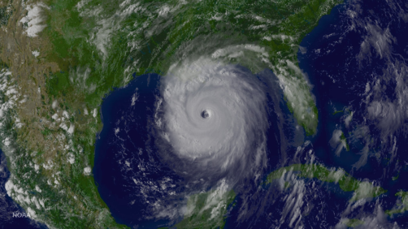

**Fig. 64.8 Satellite photo of Hurricane Katrina over the Gulf of Mexico.** (Used with permission from the National Oceanic and Atmospheric Administration, National Environmental Satellite, Data, and Information Service; www.nesdis.noaa.gov.)

on its flagship campus in Baton Rouge, Louisiana for preclinical classes. Housing for students was a challenge, and most Tulane students were hosted by members of the Houston community, while LSU students either found their own housing in Baton Rouge or stayed on a large ferry coordinated by the Federal Emergency Management Agency. Remarkably, both Tulane and LSU were able to resume medical education within four weeks of the hurricane.16

Relocating preclinical students proved to be easier than identifying suitable clinical education sites for third- and fourth- year medical students. Both schools were forced to find new clinical sites within Louisiana and beyond. Compounding the challenge was the closure of the damaged Veterans Affairs Medical Center in New Orleans. This degree of disruption had an impact on the medical school admissions process for both schools, yet both schools were able to enroll incoming classes very much on par with prior years. With regard to the residency match process, Tulane did experience a slight increase in the number of unmatched medical school graduates, likely owing to the reduction in residency positions available at Tulane after the hurricane.16 Despite all of these formidable challenges, both Tulane and LSU were able to keep their entire medical school enterprises alive, and even improve several physical and academic aspects of their campuses in the years following Katrina. In a sense, these two universities have provided other academic centers with a road map for how to continue to thrive following the harrowing experience of an all- encompassing natural disaster. Their perseverance was essential to the future health care of patients in Louisiana and beyond.

While the medical schools’ survival was a triumph, Hurricane Katrina and subsequently Hurricane Rita had a distinctly negative effect on the field of anesthesiology in Louisiana. The two largest teaching hospitals in New Orleans closed after Katrina, and the largest of these – Charity Hospital – never reopened. These closures and other factors led to a decline in the number of anesthesiologists, as documented by a 2006 statewide survey.18 Statewide residency positions in anesthesiology fell from 24 graduates per year in 2004 to 13 graduates per year in 2007. Like many states, Louisiana is dependent on new anesthesiology graduates remaining in the state to take the place of retiring physicians. Of the respondents, 37% of anesthesiologists reported that they had difficulty filling open positions within their group. In this setting, 92% reported that they had experienced an increase in the number of daily cases, and that obstetric cases for patients with no prenatal care had risen out of proportion to other cases. This phenomenon likely represents a glimpse into the impact of natural disasters on all medical specialties: the same stresses experienced by anesthesiology programs were simultaneously felt by obstetric–gynecology programs. Compared with the complete annihilation of medical infrastructure caused by the earthquake in Haiti, the plight of post- Katrina New Orleans may seem insignificant. Still, the fact that a large city within the wealthiest nation on earth can have its medical infrastructure completely disrupted for months after a storm highlights the impact of large- scale natural disasters.

In September 2017, Hurricane Maria struck Puerto Rico and effectively interrupted the island’s access to clean water, electricity, telecommunications, and transportation. At the time that Maria made landfall on Puerto Rico,

<!-- PDF page 8 -->

**Table 64.1** Saffir–Simpson Hurricane Wind Scale

|**Category**|**Sustained Wind Speeds**|**Damage Potential**|
|---|---|---|
|1|74–95 mph 119–153 km/h|**Very dangerous winds will produce some damage:**Well- constructed frame homes could have damage to roof, shingles, vinyl siding, and gutters. Large branches of trees will snap, and shallowly rooted trees may be toppled. Extensive damage to power lines and poles likely will result in power outages that could last a few to several days.|
|2|96–110 mph 154–177 km/h|**Extremely dangerous winds will cause extensive damage:**Well- constructed frame homes could sustain major roof and siding damage. Many shallowly rooted trees will be snapped or uprooted and block numerous roads. Near- total power loss is expected with outages that could last from several days to weeks.|
|3|111–129 mph 178–208 km/h|**Devastating damage will occur:**Well- built framed homes may incur major damage or removal of roof decking and gable ends. Many trees will be snapped or uprooted, blocking numerous roads. Electricity and water will be unavailable for several days to weeks after the storm passes.|
|4|130–156 mph 209–251 km/h|**Catastrophic damage will occur:**Well- built framed homes can sustain severe damage with loss of most of the roof structure and/or some exterior walls. Most trees will be snapped or uprooted, and power poles downed. Fallen trees and power poles will isolate residential areas. Power outages will last weeks to possibly months. Most of the area will be uninhabitable for weeks or months.|
|5|157 mph or higher 252 km/h or higher|**Catastrophic damage will occur:**A high percentage of framed homes will be destroyed, with total roof failure and wall collapse. Fallen trees and power poles will isolate residential areas. Power outages will last for weeks to possibly months. Most of the area will be uninhabitable for weeks or months.|

Saffir–Simpson Hurricane Wind Scale. Adapted from the National Hurricane Center of the National Oceanic and Atmospheric Administration: www.nhc.noaa.gov.

it had slightly decreased in intensity from a category 5 to a category 4 hurricane, yet it damaged or destroyed nearly every structure in its path and the death toll is estimated by different agencies at between 1000 and 2800.19,20 Drug and fluid shortages in the continental United States following Hurricane Maria exposed a major vulnerability of the overall health care system, and provided anesthesiologists with an opportunity to help lead the way out of a potential nationwide crisis.

Puerto Rico is a massive producer of pharmaceuticals and medical devices. Baxter factories in Puerto Rico, for example, produce approximately 50% of all of the 0.9 normal saline bags used each day in US hospitals.21 The shutdown of these factories, and all other major pharmaceutical factories in Puerto Rico, resulted in an immediate shortage of fluids and medications throughout the United States. The initial response at many hospitals was to use alternatives to the exports of Puerto Rico, but this swiftly resulted in shortages of those agents both within Puerto Rico and beyond.

Health care leaders recognized that conservation of existing supplies and avoidance of waste would be essential. In many medical centers, anesthesiologists were asked to help create strategies to maximize the efficient use of fluids and medications. At the University of Nebraska Medical Center (UNMC), anesthesiologists worked with other physicians, pharmacists, and leaders in nursing and administration to create robust strategies to avoid critical shortages of necessary fluids and medications. Figs. 64.9 and 64.10 offer a glimpse at some of these strategies. Note that intravenous fluids administered in the operating rooms were required to be on an infusion pump, a major change from the typical “gravity drip” employed by anesthesia providers. The shortages forced health care workers across the nation to (1) think more critically about every mL of fluid they give to patients, and (2) use different fluids and alternative medications than what they use during times of non- shortage.

While the shortages induced by Hurricane Maria were disruptive, their net effect has likely been toward positive changes within the US health care system. In the aftermath, many have come to realize that our excessive reliance on one US territory for fluids and pharmaceuticals is neither wise nor sustainable (see Figs. 64.9 and 64.10).

## Section 2: Acts of Terrorism

### SEPTEMBER 11, 2001 ATTACKS

On September 11, 2001, an organized team of terrorists commandeered three US airliners with the intention of crashing them into prominent buildings in New York City and Washington, DC. Two of the aircraft were flown directly into the twin towers of the World Trade Center in New York, causing massive fires and eventually causing both of the 110- story buildings to collapse. Nearly 3000 people died as a result of the September 11th attacks, making it the deadliest act of terrorism in recorded history.

An anesthesiologist–intensivist from New York University, Dr. J. David Roccaforte, was on duty at Bellevue Hospital 2.5 miles away from the site of the attack. Dr. Roccaforte’s paper describing the hours and days following the 9/11 attack remains essential reading for health care professionals in disaster preparedness.22 The paragraphs that follow summarize the key points from this important paper.

Hospital phone lines were non- functional in the hours following the attack, prompting a recommendation that hospitals be equipped with radio communication equipment and satellite- based communication devices. While cellular communication has clearly improved immensely between 2001 and 2024, it is difficult to predict the performance of modern networks in a situation where millions of users are simultaneously trying to connect with other users. Based on an assumption that hundreds of victims would

::: details 原始表格與符號（PDF 第 8 頁）

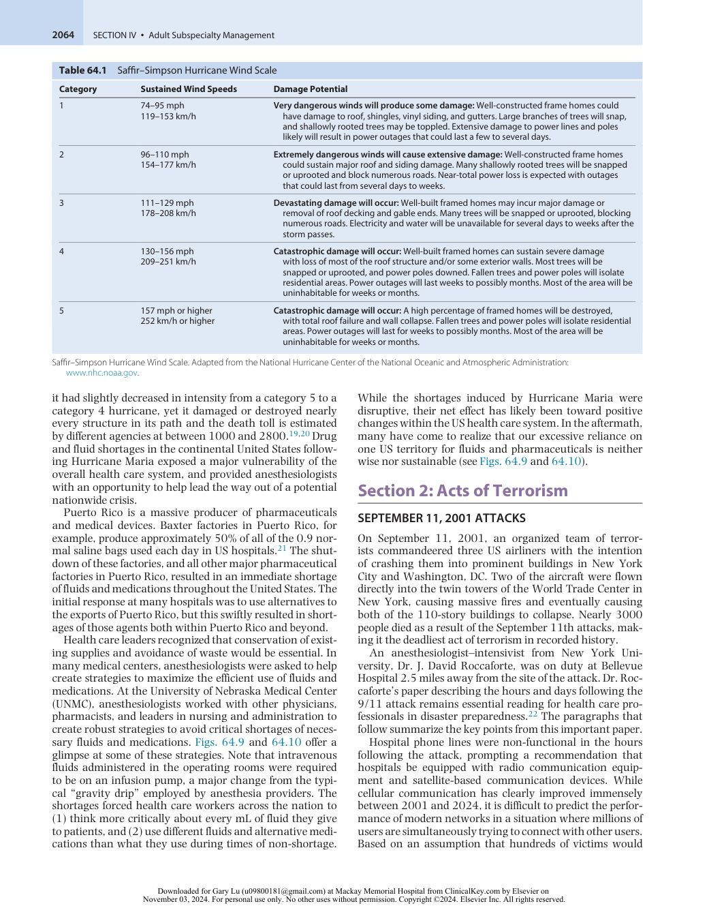

:::

<!-- PDF page 9 -->

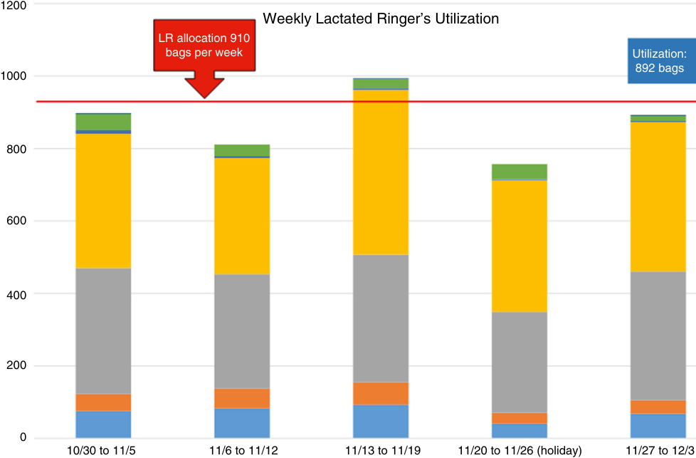

1200 Weekly Lactated Ringer’s Utilization LR allocation 910 bags per week Utilization: 892 bags 1000 800 600 400 200 0 10/30 to 11/5 11/6 to 11/12 11/13 to 11/19 11/20 to 11/26 (holiday) 11/27 to 12/3 

Fritch Werner Main OR Inpatient Units Other Procedure ER Infusion Center

### Fig. 64.9 University of Nebraska Medical Center (UNMC) Tracking: utilization of lactated Ringer’s (LR) during crystalloid shortage from Hurricane Maria.

be arriving rapidly to the operating rooms and emergency departments, thousands of dollars’ worth of fluids, medications, and kits were opened and prepared, much of which went to waste. In retrospect, these resources should have been used only with confirmation of patient need. Considering the number of capable hospitals in New York outside of lower Manhattan, a pre- made plan to triage patients from Bellevue and other nearby hospitals out to other trauma centers would have been beneficial. A field hospital was set up in a warehouse near the World Trade Center, intended to be a site for emergency trauma surgery in the event that hospitals were overwhelmed. Unfortunately, the 100- bed field hospital lacked sufficient resources for the provision of anesthesia, and thus was not entirely usable.

Due to the lack of telecommunication, medical students were employed as runners and assigned to attending physicians. All workers were encouraged to wear a label on their shirt with name, specialty, and title, to expedite face- to- face communication. While the 9/11 attack did not induce a major failure of the physical plant at Bellevue, the need for hospital engineers was noted. In the event of a failure of electrical or oxygen supply, head engineers would be needed to restore normal state or provide a contingency plan. A traditional triage system was utilized effectively for incoming patients: green = non- urgent, yellow = potentially urgent, and red = immediate, life- threatening injuries. Any patient

in the yellow category with potential need for airway management or sedation was assigned a senior anesthesiology resident or a critical care fellow. As the initial surge of patients slowed, the team at Bellevue wisely mandated a shift system, sending health care workers home to rest and avoid the certain burnout that results from ongoing 24/7 care following a major disaster.

### MASS SHOOTINGS

In the United States, mass shootings continue to increase in frequency and severity. Congress has passed multiple bills aimed at restricting research by the Centers for Disease Control and Prevention (CDC) and the National Institutes of Health (NIH) on gun violence as a matter of public health, which has hampered high-quality research on this topic.23 Based on a definition of a mass shooting where four or more people are killed by a lone shooter, there have been 188 mass shootings in the United States since 1966. No region appears to be safe from these events, as they have occurred in schools, churches, offices, and military bases in all parts of the country. A total of 1349 people have been killed by mass shootings in the United States since 1966, and 473 of these deaths have occurred between 2016 and March 2023.24 As a result of the frequency and geographic diversity of these events, anesthesiologists throughout the United States can

<!-- PDF page 10 -->

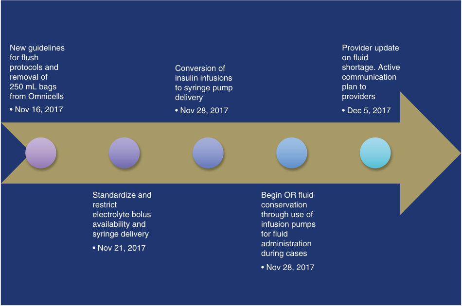

New guidelines Provider update for flush on fluid protocols and Conversion of shortage. Active removal of insulin infusions communication 250 mL bags to syringe pump plan to from Omnicells delivery providers • Nov 16, 2017 • Nov 28, 2017 • Dec 5, 2017 Standardize and Begin OR fluid restrict conservation electrolyte bolus through use of availability and infusion pumps syringe delivery for fluid administration • Nov 21, 2017 during cases • Nov 28, 2017 

**<mark>Fig. 64.10 Partial timeline of fluid conservation strategies at University of Nebraska Medical Center (UNMC) after Hurricane Maria.</mark>**

be expected to confront such trauma and be prepared to provide care in the aftermath of the heinous events.

As the frequency of these events has increased, so has the lethality, due in part to the fact that more and more of them are carried out with military- style semi- automatic rifles as opposed to conventional guns. The AR- 15 has emerged as the weapon of choice for the criminals who perpetrate these senseless acts. Following the Parkland, Florida shooting where 17 people were killed by a former student at Marjory Stoneman Douglas High School in February 2018, a radiologist with many years of experience diagnosing gunshot wounds in a Level 1 trauma center penned an article about the drastically different injury pattern visualized with gunshot wounds from an AR- 15 versus those from a typical handgun.25 With a normal gunshot wound, the radiologist can trace a laceration through affected organs that is roughly the same width as the bullet itself. Following the Parkland shooting with an AR- 15, radiologists and trauma surgeons observed that tissue had been destroyed in wide swaths near the pathway of bullets. Organs were found to be “smashed” and “shredded,” where traditionally they are found to be merely lacerated following handgun injuries. This extensive damage to surrounding structures occurs as a result of the much higher bullet velocities and thus higher energy levels transmitted by assault rifles as compared with typical handguns.

On October 1, 2017, the worst mass shooting in the history of the United States took place in Las Vegas, Nevada. A lone gunman armed with multiple rifles fired more than 1000 rounds into a large music festival crowd on the Las Vegas strip. His position on the 32nd floor of a nearby hotel and his modification of semiautomatic weapons into

automatic weapons likely increased the terrible lethality of the attack. Fifty- eight people were killed and more than 400 were injured by gunfire that night.

In the hours immediately following the mass shooting in Las Vegas, dozens of anesthesiologists were called to respond and provide resuscitative care for the victims. In this section, a friend and colleague, Dr. Devin Kearns, describes the harrowing night:

“I was at home on call for pediatric anesthesia for the Level 1 trauma center here in Las Vegas. Shortly after falling asleep, I was awoken by the phone ringing and the familiar voice of my partner. However, this call was anything but routine as he proceeded to say there had been a mass shooting.

The next thing I remember was jumping out of bed while telling my wife there had been a shooting on the strip. As I drove to the hospital I was listening to the radio for updates, not knowing what to expect. Upon arrival I was asked to go to OR 2 and set up for a critically injured, hemodynamically unstable patient who would be arriving shortly. As I checked the machine and prepared medications, the situation still seemed surreal. We see a lot of penetrating and non- penetrating trauma at our facility. It is simply part of what we do. But could anything have prepared me for a mass casualty shooting?

As I waited for this critical patient to arrive, the time continued to pass. About 5 or 10 minutes later I called the front desk for an update… the patient didn’t survive.

I then went to the preoperative area and as I entered, I witnessed a scene I will never forget. It was a scene I had not prepared for, and a scene I never expected to witness on my soil as I am not a member of the military. I saw multiple fatally wounded patients with their loved one by their side

<!-- PDF page 11 -->

2067 

hoping, praying, and longing for the moments prior to the terror and fear they experienced at this senseless act.

Additional victims were triaged as they arrived. We cared for many of them in the operating room and this continued for the days and weeks to follow. These victims were not merely wounded physically, but emotionally, and spiritually as well.”

Dr. Sher’s and Dr. Kearns’ personal accounts of caring for mass shooting victims serve as a reminder to all anesthesiologists. We all must be prepared to provide optimal care for shooting victims with injury patterns that once were limited to military settings. Given the devastating tissue injury induced by assault rifles, special consideration should be given to obtaining additional vascular access before or during surgery, and to requesting additional blood products prior to losing the tamponade effect following the opening of the abdomen or chest.

### BOSTON MARATHON BOMBING

On April 15, 2013, two home- made bombs made of pressure cookers filled with pellets and nails were detonated 12 seconds apart, near the finish line of the Boston Marathon. The unusual nature of the bombs in this incident caused an unusual injury pattern: three victims were killed by the blasts, while 264 were injured, 66 of whom sustained lower extremity injuries.26 The close proximity of multiple major trauma centers to the site of the bombing likely played a role in reducing the mortality rate of this event. Despite a collaborative effort among Boston trauma centers, emergency departments were overwhelmed when 78% of the patients treated at city trauma centers arrived within 90 minutes of the initial event. Of these high acuity patients, 45 were taken directly to operating rooms, 11 to intensive care units, and 12 required emergency airway management.27 Of 127 patients receiving care at Boston’s trauma centers, over 100 likely had some facet of their immediate care provided by an anesthesiologist. It is the anesthesiologist’s unique combination of medical knowledge and technical skills that places them in the epicenter of terrorism disaster management.

Unlike other terror attacks in the United States, these bombs caused injuries similar to those observed in the Afghanistan and Iraq wars, caused by improvised explosive devices (IEDs). This injury pattern in wars has prompted a resurgence of interest in the use of tourniquets in the field to prevent exsanguination from major injuries of the extremities. This management strategy proved to be very helpful in addressing some of the injuries sustained after this incident.

Of the 66 patients with extremity injuries, 29 of them had life- threatening bleeding at the point of injury.23 Of these 29, 27 had a tourniquet applied in an attempt to reduce bleeding. All of the 27 tourniquets were improvised, that is, they were not commercially produced tourniquets designed expressly for the purpose of arterial occlusion. The most common type used was rubber tubing wrapped around the extremity combined with a Kelley clamp. Sixtythree percent of the tourniquets were applied by non- EMS (emergency medical service) personnel, and several were not applied tightly enough to actually occlude arterial flow. Experts in battlefield trauma care have discussed the use of tourniquets after the Boston Marathon bombing and have suggested an educational campaign to teach the correct

technique for application of purpose- driven tourniquets, and suggested that all EMS providers be provided with these devices. Anesthesia providers have extensive experience with the proper application of arterial tourniquets, as a result of their widespread use during orthopedic operations. In the event of another mass casualty event resulting from IEDs, anesthesiologists, CRNAs (certified registered nurse anesthetists), anesthesia assistants, and anesthesiology residents should instruct health care workers and volunteer first aid workers on the application of tourniquets. In the likely absence of purpose- driven, commercially produced devices, emergency medicine, trauma, and anesthesia providers should inspect applied tourniquets to ensure they are applied in a manner that will occlude arterial flow.

The two perpetrators of this heinous crime were eventually apprehended and taken with severe injuries to a local hospital. One died from his injuries while the other survived, and required medical care to address his injuries. This scenario brings to light one of the challenges of working as an anesthesiologist following a terrorist attack: the physician must continue to provide the best care possible even when the patient has done tremendous harm to other human beings. In situations like this, the physician benefits from focusing on the anatomic and physiologic data at hand, while ignoring the surrounding emotional elements. Under any circumstances, all physicians must remember their oath to “do no harm.”

## Section 3: Chemical, Biological, Radiologic, and Nuclear (CBRN) Warfare

In today’s global political environment the threat of a chemical, biological, radiologic, or nuclear (CBRN) attack with massive casualties cannot be disregarded. Many people assume that sophisticated and organized individuals undertake these types of attacks; this is not generally the case. Breaking CBRN into two groups we can see that chemical and biological are more common than radiologic and nuclear incidents, which in recent history have been a direct result of natural disasters. Medical professionals must prepare for these types of disasters and attacks to better treat those negatively impacted. After reviewing the history of CBRN warfare, this section will analyze, define, demonstrate, and outline the US military’s approach to CBRN protocols, procedures, and standard operating procedures (SOPs) and how they apply to civilian medical systems.

The US military has a hierarchy, structure, and SOPs (standard operating procedures) for CBRN situations. As acts of terrorism have become more aggressive in recent decades, civilians may be more likely to see the effects and aftermath of a CBRN act of terrorism. Figs. 64.11 and 64.12 outline the Department of Defense (DOD) strategy and hierarchical structure for CBRN attacks on domestic soil, military installations, and abroad.28 Attempting to adapt the military’s training protocols may help reduce unrest and show the vital role of the anesthesiologist during a CBRN attack.

An increased public awareness of possible CBRN attacks by terrorist groups started in the fall of 2001, when the biological agent anthrax powder was mailed to two US

<!-- PDF page 12 -->

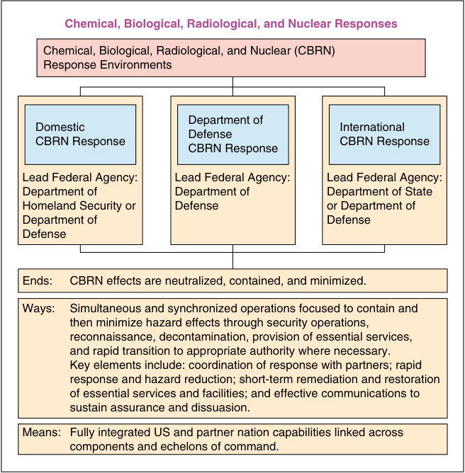

Chemical, Biological, Radiological, and Nuclear Responses Chemical, Biological, Radiological, and Nuclear (CBRN) Response Environments Department of Domestic International Defense CBRN Response CBRN Response CBRN Response Lead Federal Agency: Lead Federal Agency: Lead Federal Agency: Department of Department of Department of State Homeland Security or Defense or Department of Department of Defense Defense Ends: CBRN effects are neutralized, contained, and minimized. Ways: Simultaneous and synchronized operations focused to contain and then minimize hazard effects through security operations, reconnaissance, decontamination, provision of essential services, and rapid transition to appropriate authority where necessary. Key elements include: coordination of response with partners; rapid response and hazard reduction; short-term remediation and restoration of essential services and facilities; and effective communications to sustain assurance and dissuasion. Means: Fully integrated US and partner nation capabilities linked across components and echelons of command. 

**Fig. 64.11 US Department of Defense CBRN Response table.** (Adapted from: Joint Publication 3- 41, Chemical, Biological, Radiological, and Nuclear Response, 09 Sept 2016.)

Senators at their congressional offices in Washington DC. Postal workers who came into contact with the packages experienced the toxic effects of inhalation anthrax. As these CBRN terrorist threats have become more apparent toward civilian populations, anesthesia providers have become more involved with onsite and prehospital medical management of these exposures. Anesthesiologists are essential in resuscitation efforts and continued life- supporting measures during sustained CBRN and terrorists attacks.

### HISTORY OF CHEMICAL, BIOLOGICAL, RADIOLOGICAL, AND NUCLEAR WARFARE

Chemical, biological, radiological, and nuclear (CBRN) warfare is deeply imbedded in the history of world conflicts. The search for tactical wartime and war- fighting advantages have been documented since Ancient Babylon. Chemical weapons can be traced back to 10,000 years BCE when the San society of Southern Africa utilized natural poisons from snakes on the tips of their spears while hunting antelope. One of the first suspected uses of chemical agents in war can be found between the Persians and Romans in the year 256.29 According to archeologic evidence, Persia exposed Roman soldiers to a noxious gas derived from combustion of sulfur crystals, causing death by asphyxiation.

World War I represented an uptick in the use of chemical agents as offensive weapons. Chemical agents included phosgene gas, chlorine gas, and mustard gas during the infamous trench warfare encounters from 1915 through 1918. Technology during World War I continued to

advance these chemical and biological weapons into ballistic explosive devices, which ultimately led to approximately 1.3 million casualties.30 This is why many historians consider World War I as the “Chemist’s War.”

The landmark international regulation of 1925 in Geneva outlined, outlawed, and made utilization of chemical weapons a crime against humanity, which led to a near cessation of chemical and biological weapons development as history moved forward towards World War II.

Several countries have been implicated in the development and advancement of chemical and biological weapons since 1930.31 A major discovery by the German scientist Gerhard Schrader in 1936 led to the invention of anticholinesterase nerve agents. The Biological Weapons Convention in 1972 put an effective, if temporary, stop to most of the worldwide research and stockpiling of chemical, biological, and nerve agents for weaponization.32 Some nations continued to conduct research, develop, and produce chemical and biological weapons. The production of these agents as offensive weapons contributed to these weapons being transferred to terrorist groups because of decreased accountability for these weapons by the end of the Cold War.

The 1980s saw a shift to chemical and biological weapons as a true first- line offensive weapon. The United Nations had documented the combined uses of vesicants and nerve agents, such as mustard gas and tabun toxin, to increase the lethality of chemical and biological weapons.33,34 These agents were not as lethal as expected, and they accounted for about 27,000 Iranian casualties, or about 1% of the

<!-- PDF page 13 -->

Domestic Chemical, Biological, Radiological, and Nuclear Response

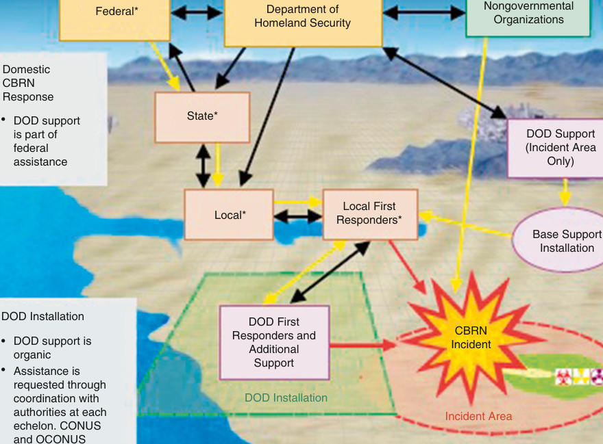

Federal* Department of Nongovernmental Homeland Security Organizations Domestic CBRN Response • DOD support State* is part of DOD Support federal (Incident Area assistance Only) Local First Local* Responders* Base Support Installation DOD Installation DOD First CBRN • DOD support is Responders and Incident Additional organic • Assistance is Support requested through coordination with DOD Installation authorities at each Incident Area echelon. CONUS and OCONUS 

*Tribal response may require special consideration during coordination.

Legend

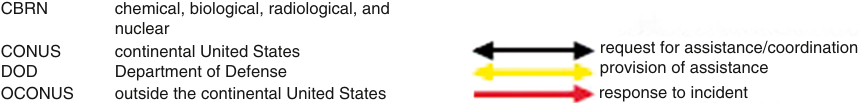

CBRN chemical, biological, radiological, and nuclear CONUS continental United States request for assistance/coordination DOD Department of Defense provision of assistance OCONUS outside the continental United States response to incident 

**Fig. 64.12 US Department of Defense CBRN Response Graphic.** (Adapted from: Joint Publication 3- 41, Chemical, Biological, Radiological, and Nuclear Response, 09 Sept 2016.)

casualty total of the Iran–Iraq war, despite widespread use. The noted reason for the ineffectiveness or decline in lethality of these chemical weapons can be accounted for by the availability of antidotes and improved care on and around the battlefield. In contrast to the organized battlefield during the Iran–Iraq war, when this agent was released on a civilian population of Halabja, Iraq it accounted for more than 5000 deaths, or a large percentage of the Kurdish village population.35 This contrast in lethality demonstrates the improvement to battlefield medicine as well as the effectiveness of the antidotes.

The last part of the 20th century saw several civilian attacks utilizing different combinations of chemical, biological, and/or nerve agents. In one of the most notorious nerve agent attacks in Tokyo, Japan, sarin gas was used in the subway system and was responsible for multiple fatalities

and injuries. Unfortunately, during this mass casualty experience civilian medical personnel lacked knowledge, training, and understanding of appropriate medical treatments and became casualties themselves.36,37 The lack of training for civilian medical providers and emergency staff brought home important lessons for all, especially anesthesia providers. Box 64.1 outlines the lessons learned from this nerve agent attack.29

In the 1950s, because of the Tizard report, chemical, biological, and nerve agents were added to be included within the term _weapons of mass destruction_ . In this report the term _weapon of mass destruction_ referred solely to the massive loss of life the weapon was capable of creating. Overall, regardless of the mechanism and explosive power of the weapon employed, chemical, biological, nerve agents, and nuclear isotopes are all considered very lethal threats. The massive

<!-- PDF page 14 -->

release of chemical, biological, or nerve agents among a very large population is possible in theory, but would require a delivery modality such as a missile, rocket, or violent explosive vehicle.28

### CBRN HAZARDS DEFINED

### Chemical

Historically, chemical agents were purely a military issue, because there was only a small number of persons with access or knowledge to chemical agents or weapons. However, over the past 20 years the types of chemical hazards have expanded significantly because of the increased use of toxic chemicals required for industrial manufacturing. Chemical hazards are chemicals that can cause death or harm because of their toxic properties. The characteristics of the most commonly discussed chemical agents are presented in Table 64.2.

Most chemical agents, whether industrialized or weaponized, have the ability to severely incapacitate a person or cause death. Chemical agents begin their onset of physiological symptoms when the body comes in contact with a concentration of agent that is more than one’s body can tolerate. As an anesthesiologist, traumatologist, or first

responder, one must be able to rapidly identify the difference between mild and severe symptoms of chemical agent exposure, as outlined in Table 64.3. The main categories of chemical agents include the following:

1.  Blistering agents (vesicants) generally damage eyes, mucous membranes, and respiratory epithelium. Airway management in these patients can be challenging because of sloughing of epithelium and necrotic tissue that can occlude the glottis and supraglottic anatomy.38 The effect and toxicity depend on the type of agent, the concentration of the agent, the environment, and the exposure time.

2.  Blood agents (nerve agents) generally inhibit oxygen transfer from blood or hemoglobin to the cells of the body, or in another way cause tissue hypoxemia. The higher the concentration of blood agents, the more rapidly fatal these agents are. Most blood agents inhibit acetylcholinesterase activity, increasing the concentration of acetylcholine at the muscarinic and nicotinic receptors, causing cholinergic toxicity.39 This excessive acetylcholine in the body can cause a myriad of symptoms, and for the anesthesiologist airway interventions can be hindered because of significant airway occlusion from

|Box 64.1**Tokyo Sarin Gas Lessons Learned** **for First Responders**|
|---|
|Lesson 1 Military grade chemical, biological, and nerve agents can be easily employed by terrorist groups|
|Lesson 2 HAZMAT and incidence management training for chemical, biological, and nerve agent mass casualties were not sufficient|
|Lesson 3 Lack of situational (scene) control, protection, and personnel decontamination contributed to additional casualties and fatalities|
|Lesson 4 Lack of resuscitation efforts at the site of chemical and biological release contributed to further casualties|
|Lesson 5 This incident led to a significant database for medical management of patients exposed to nerve agents|

**Table 64.3** Typical Chemical Agent Exposure Symptoms

|**Mild Symptoms***|**Severe Symptoms***|
|---|---|
|ᑏRunny nose|ᑏSudden confusion|
|ᑏSudden severe headache ᑏDrooling|ᑏWheezing, labored breathing ᑏMiosis|
|ᑏBlurry vision|ᑏPainful tearing eyes|
|ᑏChest pain i|ᑏSudden profound vomiting|
|ᑏDifficulty breathing ᑏSweating|ᑏSevere muscle twitching/ seizures|
|ᑏMuscle twitching/cramps|ᑏUncontrolled urination|
|ᑏStomach cramps|ᑏUncontrolled defecation i|
|ᑏNausea|ᑏProfound respiratory difficulties|

- *Some symptoms of chemical agent intoxication can be confused with severe heat stroke.

- Adapted from the Multi- Service Doctrine for Chemical, Biological Radiological and Nuclear Operations. FM 3- 11, MCWP 3- 37.1, NWP 3- 11, AFTTP 3- 2.42.

**Table 64.2** Most Commonly Discussed Chemical Weapon Agents

|**Name**|**Type**|**Properties**|**Mechanism of Action**|**Physiologic Symptoms**|**Onset of Action**|
|---|---|---|---|---|---|
|Sarin gas|Nerve|Colorless, odorless, volatile|Anticholinesterase agent|Choking, miosis, headache, nausea, respiratory distress, convulsions, death|Minutes|
|VX (VR) gas|Nerve|Colorless, odorless, oily liquid|Anticholinesterase agent|Choking, miosis, headache, nausea, respiratory distress, convulsions, death|&lt;30 minutes|
|Mustard gas|Blistering|_Garlic odor_, oily liquid|Vesicant, bone marrow suppression, alkylating agent, damages deoxyribonucleic acid|Blisters skin, eyes, lungs|∼4–6 hours|
|Cyanide gas|Blood|_Almond odor_, volatile|Interferes with oxygen utilization at the cellular level|Hinders oxygen transfer, _respiratory paralysis_|Minutes|

Adapted from the Multi- Service Doctrine for Chemical, Biological Radiological and Nuclear Operations. FM 3- 11, MCWP 3- 37.1, NWP 3- 11, AFTTP 3- 2.42.

::: details 原始表格與符號（PDF 第 14 頁）

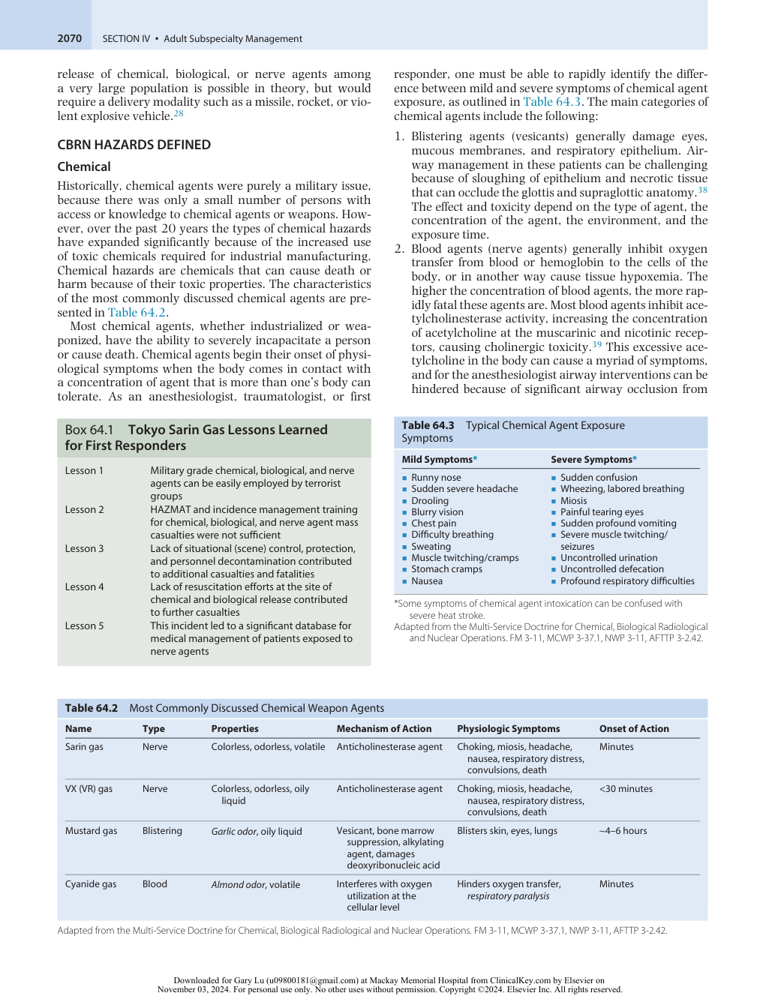

:::

<!-- PDF page 15 -->

secretions and profound bronchospasm. Because of this risk, atropine should be administered prior to any airway intervention.13,40,41

3.  Choking agents (pulmonary agents) generally cause shift of fluid into the small airways at lower doses, while at higher doses all the major airways become irritated and dried out, causing choking, poor gas exchange, and ultimately death. Rapid, shallow breathing, painful cough, and cyanotic skin are indicative of fluid filling the lungs and preventing oxygenation. Commonly, these patients will present with pulmonary physiology that mimics acute respiratory distress syndrome (ARDS) because of the fluid shifts, airway irritation, and inflammation.

4.  Riot control agents generally cause lacrimation or vomiting. Unlike the choking agents they are irritants that are used to cause a brief period of misery and harassment to incapacitate aggressive persons. Most of these agents inhibit multiple different enzymes and invariably increase bradykinin release.17 These agents do not typically require significant medical attention except flushing of the eyes and removal of the persons affected from the environment (Figs. 64.13–64.15).

### Biological

Biological hazards are relatively easy to produce, especially since production facilities are more difficult to detect than facilities producing more conventional weaponry. A wide variety of microbes and organisms can pose a significant threat to human and animal welfare. Biological agents differ from chemical agents in that the agents are organisms, viruses, toxins, and/or microtoxins utilized to disable, disrupt, or kill human beings or other organisms. Modern biological agents are orders of magnitude more potent and

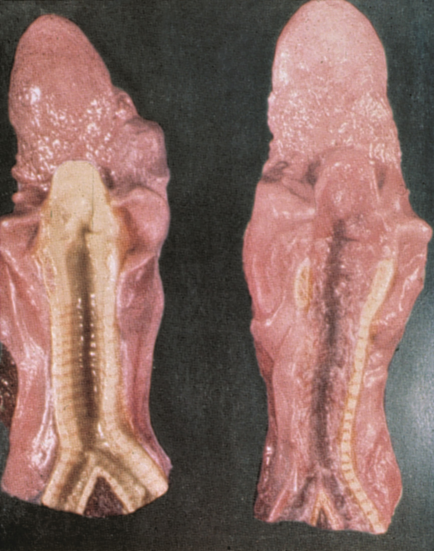

**Fig. 64.13 Tracheal injury caused by mustard gas.** (Courtesy Her Majesty’s Stationery Office, London, United Kingdom.)

more lethal than most chemical agents. These agents are outlined in Table 64.4. A common limitation of many biological agents is that they can be degraded by changes in the environmental conditions such as UV light, temperature, pressure and humidity.

Many of the initial symptoms of biological warfare and a biological attack are vague and non- specific. However, in the event there is high index of suspicion for a biological attack, steps must be taken to protect first responders and medical personnel. Physical protective barriers and personal protective equipment (PPE) are essential primary preventive measures. By protecting primary responders and health care providers during biological attacks, they

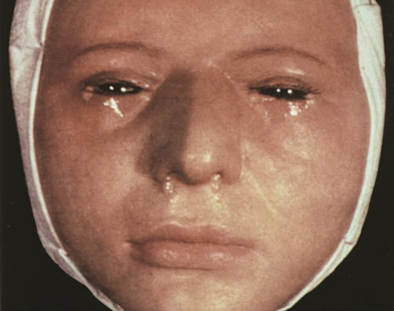

**Fig. 64.14 Eye injury caused by mustard gas.** (Courtesy Her Majesty’s Stationery Office, London, United Kingdom.)

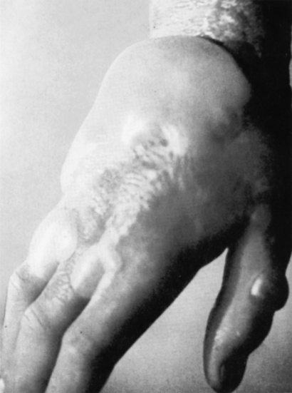

**Fig. 64.15 Cutaneous vesication caused by mustard gas exposure.** (Courtesy Her Majesty’s Stationery Office, London, United Kingdom.)

<!-- PDF page 16 -->

are more able to care for those directly and immediately in danger. PPE will be explored in more detail in Section 4, Epidemic and Pandemic Infectious Outbreaks.

### Mass Casualty Situations and CBRN Attacks

Overall, the structure, function, and focus of the US military’s approach to CBRN can be adapted to the civilian sector wherever feasible to help improve patient care while minimizing collateral damage. Table 64.5 demonstrates the sources and types of CBRN hazards. There are three basic reasons why CBRN situations occur:

1.  Intentional – a deliberate action to induce harm by the release of toxic agents or radiological agents, or detonation of explosive material to cause terror for political, religious, or ideological purposes.

2.  Accidental – a human error–induced release of toxic agents or radiological agents into the environment, or inadvertent detonation of explosive material.

3.  Natural – caused directly by or in response to a natural disaster, which leads to the release of toxic agents or radiological agents, or detonation of explosive material.

Currently the American Society of Anesthesiologists (ASA) has several suggested protocols and SOPs for CBRN attacks, all of which require system- wide training. Disaster preparedness and coordination is not simply an emergency department (ED) problem to manage. In fact, it is a hospital/ facility- wide management issue for optimal patient care. Anesthesiologists must prepare themselves by determining their immediate role prior to a massive casualty event,

during a natural disaster, or during a potential CBRN attack. Box 64.2 outlines the basic CBRN rules all providers should follow during a CBRN attack. In civilian hospitals, training for CBRN as an entire unit is extremely challenging, because it is almost impossible to shut down an entire hospital for a day or several hours to properly practice,

### Box 64.2 CBRN Basic Provider Rules and Guidelines for Safety

|Rule 1|DO NOT become the casualty yourself|
|---|---|
|Rule 2|Always decontaminate the scene, situation, and patient prior to any movement to the operating room|
|Rule 3|Never assume any vaccine is 100% protective|
|Rule 4|“SAFE ZONES” should always protect themselves from contaminated “WALK- INS”|
|Rule 5|When in doubt call infectious diseases, the CDC, or WHO|
|Rule 6|Always decontaminate the casualties, then immediately begin ACLS, ATLS, and resuscitation measures to stabilize patients|
|Rule 7|Pay careful attention to sterile technique, as many patients will have compromised immune systems and or already be neutropenic|
|Rule 8|Brain irradiation can cause many primary, secondary, and tertiary CNS symptoms|
|Rule 9|Ionizing radiation victims are less of a risk to providers compared to chemical/biological casualties|

**Table 64.4** Most Commonly Discussed Weaponized Biological Agents

|**Common Name**|**Agent**|**Physiological Effects**|**Onset**|
|---|---|---|---|
|Anthrax|_Bacillus anthracis_|Fever, fatigue, severe respiratory impairment, high fever, and excessively rapid pulse rate. Pulmonary anthrax is fatal more than 90% of the time.|1–5 days|
|Plague|_Yersinia pestis_|Fever, headache, and rapid heart rate, followed by pneumonia and hemorrhage of the skin and mucous membranes. Untreated plague pneumonia fatalities approach 100%, but early treatment can reduce mortality to as low as 5%.|2–3 days|
|Tularemia|_Francisella tularensis_|Fever, chills, headache, and muscular pain. Untreated tularemia can result in 30%–60% mortality; treated, mortality rate is reduced to 1%.|3–5 days|
|Botulism|_Clostridium botulinum_|Extreme weakness, nausea, headaches, and intestinal pain leading to respiratory paralysis that may cause death.|2–26 hours|

Adapted from the Multi- Service Doctrine for Chemical, Biological, Radiological, and Nuclear Operations. FM 3- 11, MCWP 3- 37.1, NWP 3- 11, AFTTP 3- 2.42.

**Table 64.5** CBRN Threats and Hazards

|**Chemical**|**Biological**|**Radiological**|**Nuclear**|
|---|---|---|---|
|**WEAPONS OF MASS DESTRUCTION**||||
|ᑏChemical weapons ᑏChemical agents ᑏNontraditional agents|ᑏBiological weapons ᑏBiological agents ᑏNontraditional agents|ᑏRadiological dispersal devices ᑏRadiological exposure devices|ᑏNuclear weapons ᑏImprovised nuclear device (IED/IND)|
|**TOXIC INDUSTRIAL MATERIALS**||||
|Toxic industrial chemicals|Toxic industrial biologicals|Toxic industrial radiologicals||
|Other Sources||||

Adapted from the Multi- Service Doctrine for Chemical, Biological, Radiological, and Nuclear Operations. FM 3- 11, MCWP 3- 37.1, NWP 3- 11, AFTTP 3- 2.42.

::: details 原始表格與符號（PDF 第 16 頁）

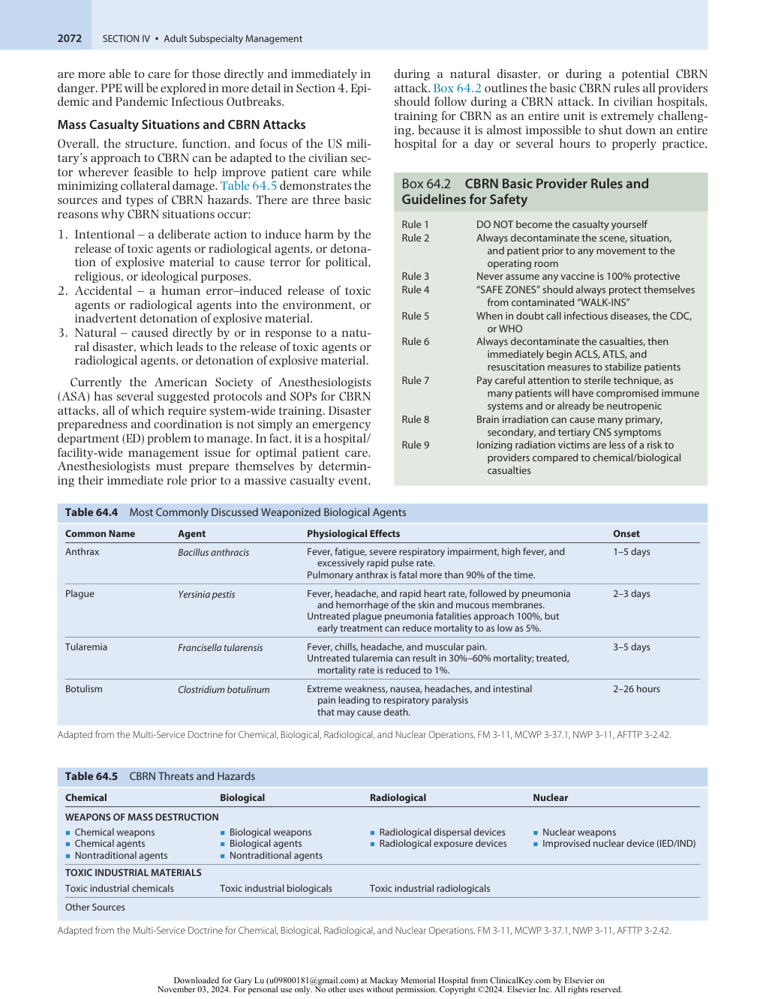

:::

<!-- PDF page 17 -->

train, and prepare. Nonetheless, each health system should provide clarification about when and how to address issues related to potential CBRN risk and management in the event of an attack. US military hospitals and their health care personnel have required unit, battalion, and command training exercises on US soil and abroad for CBRN attacks, which helps maintain order, direction, and patient care during times of turmoil and civil unrest.

reasonable tactile dexterity and contact with the patient to provide essential life support and antidote therapy onsite.43 Level C protection is equivalent to that used by the military to provide protection against the most toxic chemical warfare agents and virulent biologic warfare organisms.44

### Decontamination

In most situations the initial hazard is unknown, however, protecting oneself is one of the major principles to ensure on- scene and in- hospital care of the afflicted patients. Many hazards are short- lived or transient, but it should be assumed that the hazard released would be persistent and transmissible through the on- scene decontamination zones. Immediately establishing the level of personal protection required for medical staff, paramedics, and ancillary search and research personnel by the on- scene commander is vital to preventing an increased number of casualties among the medical and rescue personnel. Triage personnel and medical personnel are vital to providing immediate (1) triage, (2) life- support measures (TOXALS – toxicology advanced life support), and (3) antidote and other pharmacologic support.

### Incident Management During a CBRN Attack and PPE

In the face of a mass casualty event from a CBRN attack, panic and chaos are to be expected and systems should be put in place to focus management on the key issues to reduce risk and complications. Successful response to a CBRN attack requires command and control personnel and the medical providers to prioritize the following: personnel safety, personnel protection, command establishment, and site- wide communication. Similar to the US military, the civilian sector has command control entities in the form of local, state, and federal response systems. Once the command structure is established for the incident in question, the commander is responsible for directing and controlling all available resources.

Decontamination is a critical component for addressing the risks associated with the hazard. Establishing a decontamination zone and early life- support measures in the decontamination zone is critical.45,46 A unique perspective to CBRN on- scene decontamination and resuscitation was introduced in 1996. It was uniquely termed TOXALS (Toxicology Advanced Life Support) to be used in conjunction with ACLS, ATLS, and BLS in the setting of chemical, biological, and/or radiological attacks. TOXALS expands the on- scene and in- hospital resuscitation efforts of medical personnel and ACLS, ATLS, and/or BLS can be expanded to the mnemonic ABCDDEE, which includes: airway, breathing, circulation, disability, drugs, exposure, and environment.

The first rule for CBRN casualty treatment and maintenance states, “Do not become the casualty yourself.” The incident commander or officer in charge must set the protection level to ensure maximal barrier protection and adequate PPE for all providers and first responders. The US military has adapted their personal protective equipment levels from the US Environmental Agencies’ _Hazardous Waste Operations and Emergency Response_ protocols.42 During any time when intubation, exposure to bodily fluids, and/or airborne infection may occur, the minimum protection level should be Level C. In addition to this protection level in an unknown CBRN attack, all severe casualties or those severely negatively impacted by the CBRN attack should be thoroughly evaluated (Table 64.6).

### SUMMARY OF CBRN SECTION

Protection is the key feature of incident management, and anesthesia providers should be familiar with several levels of PPE suits and masks, and the techniques of decontamination listed in Table 64.7. Several levels of protection are used in the management of toxic releases, but the appropriate level for medical intervention is Level C, which allows

As an anesthesiologist, the main responsibility within a health system is to optimize perioperative anesthetic care.

**Table 64.7** Levels of Personal Protective Equipment (PPE) in CBRN incidents43

|**Level**|**Minimum PPE Required**|
|---|---|
|A|ᑏPositive pressure SCBA ᑏFully encapsulated chemical- resistant suit ᑏDouble layer of chemical- resistant gloves ᑏChemical- resistant boots ᑏAirtight seal between suit and gloves and boots|
|B|ᑏPositive pressure SCBA ᑏChemical- resistant, long- sleeved suit ᑏDouble layer of chemical- resistant gloves ᑏChemical- resistant boots|
|C|ᑏFull- face air- purification device (respirator) ᑏChemical- resistant suit ᑏChemical- resistant outer gloves ᑏChemical- resistant boots|
|D|ᑏEquipment does not provide specific respiratory or skin protection and usually consists of regular work clothes|

**Table 64.6** Initial Workup for Severely Injured Casualties During CBRN Attack

|**Investigation**|**Lab Tests**|
|---|---|
|Chemistry|ᑏArterial blood gas ᑏComprehensive metabolic panel ᑏGlucose ᑏLactate ᑏCalcium/phosphorus/magnesium|
|Complete blood count|ᑏStore sample for later analysis ᑏConsider coagulation/clotting studies|
|Urinalysis|ᑏStore urine for later analysis|
|Electrocardiogram||
|Chest radiograph||

Store all blood samples in a safe containment area for personnel protection and for future analysis.

_SCBA_ , self- contained breathing apparatus.

::: details 原始表格與符號（PDF 第 17 頁）

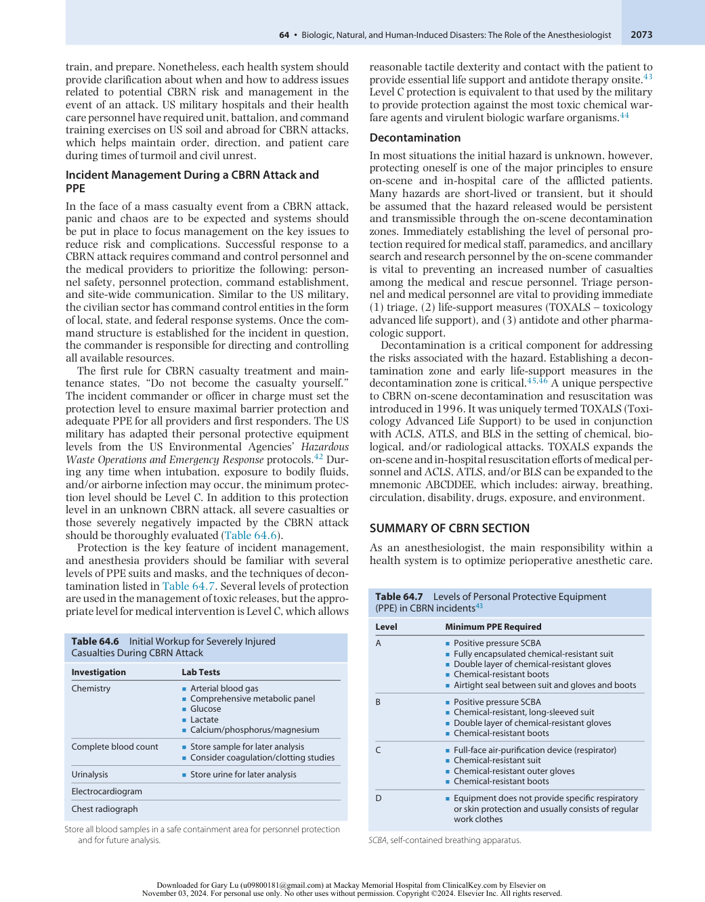

:::

<!-- PDF page 18 -->

However, anesthesiologists’ advanced knowledge of medicine, pharmacology, trauma, and resuscitation makes them ideal members of the emergency response team. Not all patients during CBRN attacks or natural disasters immediately go to the operating room for stabilization. Many of the emergency responders and providers will need support either in triage, for emergency department consultations, pain management, or intensive care support for stabilization, pharmacology expertise, and/or procedural skills. An anesthesiologist’s role is to stabilize and ensure conditions for casualties of any CBRN attack. It is imperative to be proactive within the hospital system or emergency response system to help triage and stabilize patients prior to arrival at the preoperative area or the ICU.

## Section 4: Epidemic and Pandemic Infectious Outbreaks

In the last edition of this textbook, many of the concepts of the anesthesiologist responding to a pandemic were either on a small scale or remained in the abstract. In 2020 and 2021, anesthesiologists all over the world experienced firsthand how they must respond to an infectious pandemic. The COVID- 19 pandemic stressed hospitals, public health programs, communities, and indeed entire nations in a way that no infectious disaster had in the prior 100 years. During this period of inadequate resources, uncertainty, and fear, anesthesiologists rose to the occasion and helped to save thousands of lives. The COVID- 19 pandemic, its impact on the health care system, and lessons learned will be discussed in more detail later in this section.

Until recently, the role of anesthesiologists in infectious epidemics and pandemics, had been discussed only in the most general terms. While the life- saving application of positive pressure ventilation by Danish anesthesiologist Dr. Bjorn Ibsen saved many lives during the Copenhagen polio epidemic of 1952, the role of anesthesiologists as critical members of the management team in biologic disasters was not fully exploited until the severe acute respiratory syndrome (SARS) epidemic of 2003, the West African Ebola epidemic of 2014, and the COVID- 19 pandemic spanning from 2020 until present day.47,48 During these worldwide events, anesthesiologists not only played critical roles as caregivers but also risked personal safety functioning in their role as specialists in airway management and critical care. Knowledge of the disease, management options, and importantly, infection control measures necessary to protect oneself, are all critical for anesthesiologists to contribute maximally and mitigate personal vulnerability during any major epidemic or pandemic.49

Health emergencies in the form of regional epidemics and global pandemics have the capacity to kill millions of people across continents and around the world.50 While this number sounds excessive and perhaps even alarmist, it is in fact a conservative estimate when compared to pandemics over past centuries. Smallpox is the deadliest pandemic in human history. In the 20th century alone, estimates of deaths due to smallpox exceeded 300 million people, with 30% of all persons infected succumbing to the disease.51 The causative agent, variola virus, is thought to date back possibly as far as 3000 years to the time of the Egyptian Empire. Its global

spread paralleled the advance of modern civilization, exploration, and expanding trade. Thanks to the success of worldwide vaccination, the last person to die of smallpox was in 1978 and on May 8, 1980 the 33rd World Health Assembly officially declared the world smallpox free52,53 Unfortunately, unlike viruses that have a human reservoir such as smallpox, polio, and measles, and hence are targets for eradication, future pandemics are more likely to be the result of zoonotic transmission.54

### PANDEMIC INFLUENZA A

Past influenza pandemics have occurred when genetic mutations in an enzootic cycle resulted in reassortment of gene segments creating what is functionally a novel infectious agent with major changes in surface proteins, capable of sustained human- to- human transmission in a global population with little existing immunity.55 Pathogenic influenza A viruses arising from this antigenic shift have been the source of influenza A pandemics for centuries. In fact, there have been no less than ten pandemic influenza A events over the past 300 years.56 In the preceding century alone, there were three episodes of pandemic flu. A recent analysis of the “Spanish Flu” H1N1 pandemic of 1918–1919 estimated that at least 50 to 100 million people died worldwide. Less severe, but also with considerable mortality (approximately 1 million globally; 100,000 in the United States), were the 1957 “Asian Flu” H2N2 and the 1968 “Hong Kong Flu” H3N2.57,58 Such events underscore the pandemic threat posed by influenza viruses, emphasizing the need for advanced preparation necessary to augment both the clinical and research response to future global health emergencies. In fact, given the incidence and variety of influenza viruses circulating in zoonotic populations, a virus possessing the necessary properties to cause a pandemic can emerge at any time59 (Fig. 64.16).

In 2009, the world experienced the first influenza A event of the 21st century. This worldwide influenza outbreak has been described by the Centers for Disease Control as the 2009 H1N1 Pandemic. The virus contained a unique combination of influenza genes not previously identified in animals or humans. The genes were most closely related to North American swine

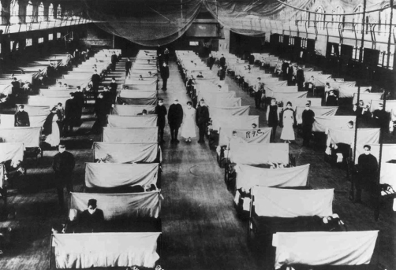

**Fig. 64.16 Mass care of patients during 1918 flu pandemic.** (From Clements BW, Casani J, eds. _Disasters and Public Health: Planning and Response_ , 2nd edition. Oxford: Butterworth- Heinemann (Elsevier); 2016. Butterworth- Heinemann is an imprint of Elsevier.)

<!-- PDF page 19 -->

and Eurasian swine H1N1 influenza viruses. Because of this, initial reports referred to the virus as a swine influenza virus. However, it quickly became apparent that this new virus was circulating among humans and not among US pig herds. In the United States, there were over 60 million cases over the course of a year from April 2009 to April 2010. Loss of life attributable to this event was estimated at 12,500 lives lost in the United States and 284,000 globally.60,61

Central to disaster planning for pandemic flu is an understanding of the strategies to minimize transmission of influenza between patients and health care workers. Despite vast clinical experience, there is still debate over how influenza is transmitted. Possible modes of transmission included in past discussions are airborne, droplet, and contact transmission. Each requires a different infection control approach and almost certainly different personal protective equipment (PPE). Recent analysis of multiple human and animal studies concluded that natural influenza transmission in human beings occurs over short distances primarily via droplet and contact routes.57 Transmission of influenza virus via large- particle droplets generated from the respiratory tract of infected individuals during coughing, sneezing, talking, or during procedures such as suctioning or bronchoscopy requires close contact between the infected source and the recipient (6 feet or less). Large droplets do not remain suspended in the air and hence special ventilation or airflow systems are not required since true aerosolization does not occur. Preferential airborne transmission has not been documented as a method of human- to- human influenza transmission.62 However, many procedures such as intubation and bronchoscopy have the potential to be aerosolgenerating. The current literature does not define conditions under which influenza could become opportunistically airborne. Given the paucity of data in this regard, it may be reasonable to employ airborne precautions and higher levels of PPE such as N95 masks when such procedures are medically necessary. This perspective is important for anesthesiologists to consider when caring for patients with influenza in the intensive care unit or managing their airway in the emergency department, hospital ward, or operating room.

### SEVERE ACUTE RESPIRATORY SYNDROME

Severe acute respiratory syndrome (SARS) caused by a novel coronavirus, called SARS- associated coronavirus (SARS- CoV), was first reported in Guangdong Province in China in November 2002. The first case appears to be a businessman from the city of Foshan who subsequently died from the disease. However, it was three months later, when a physician from the same province became ill while staying in a hotel in Hong Kong, that SARS rose to international attention. Twelve guests staying at the same hotel subsequently became infected, including seven whose rooms were on the same floor as the physician. These hotel guests subsequently became the index patients transporting the virus around the globe as they traveled home by airplane. SARS was first identified in Toronto, Canada, in March 2003. Because of the speed of international travel, in less than four months, about 4000 cases and 550 deaths from SARS could be traced to the guests infected in Hong Kong. Ultimately, a total of 8096 people in 29 countries became infected with the SARS- CoV, and 774 of them died63,64 (Table 64.8).

Toronto was the epicenter of the disease in North America. The Ontario Ministry of Health reported 361 SARS cases, including 33 deaths (9%). Over half infected were health care workers including three anesthesiologists and one intensivist.54,65 Overall case fatality was approximately 15% but over 50% for patients over the age of 65.66 On July 4, 2003, the WHO announced the global SARS outbreak was contained.66

SARS, like influenza, is of zoonotic origin. The virus is ubiquitous and has been isolated from swine, cattle, dogs, cats, and chickens. In 2002, SARS- CoV was isolated from Himalayan palm civets found in Chinese live animal markets where demand for freshly killed meat and poultry served as the source of SARS- CoV crossing species.67 This led to culling of the animals, although subsequent studies have not validated infection in either farm- raised or wild civets. More recent data suggest that bats are the likely natural reservoirs of SARS- like coronavirus68 (Fig. 64.17).

**Table 64.8** Mortality of Severe Acute Respiratory Syndrome Based Upon Age

|**Age (years)**|**Mortality**|
|---|---|
|**&lt;24**|&lt;1%|
|**24–44**|6%|
|**45–64**|15%|
|**>65**|>50%|

Modified from Peng PW, Wong DT, Bevan D, et al. Infection control and anesthesia: lessons learned from the Toronto SARS outbreak. _Can J Anaesth_ . 2003;50(10):989–997.

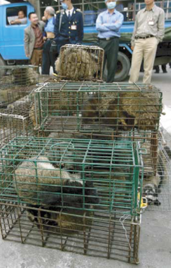

**Fig. 64.17** Live animal markets are the interface where animal-tohuman interspecies transmission of SARS- CoV occurred. Guangzhou government officers seized civets in Xinyuan wildlife market in Guangzhou to prevent the spread of SARS- CoV. (From Lau YL, Peiris JS. Pathogenesis of severe acute respiratory syndrome. _Curr Opin Immunol_ . 2005;17(4):404–410.)

::: details 原始表格與符號（PDF 第 19 頁）

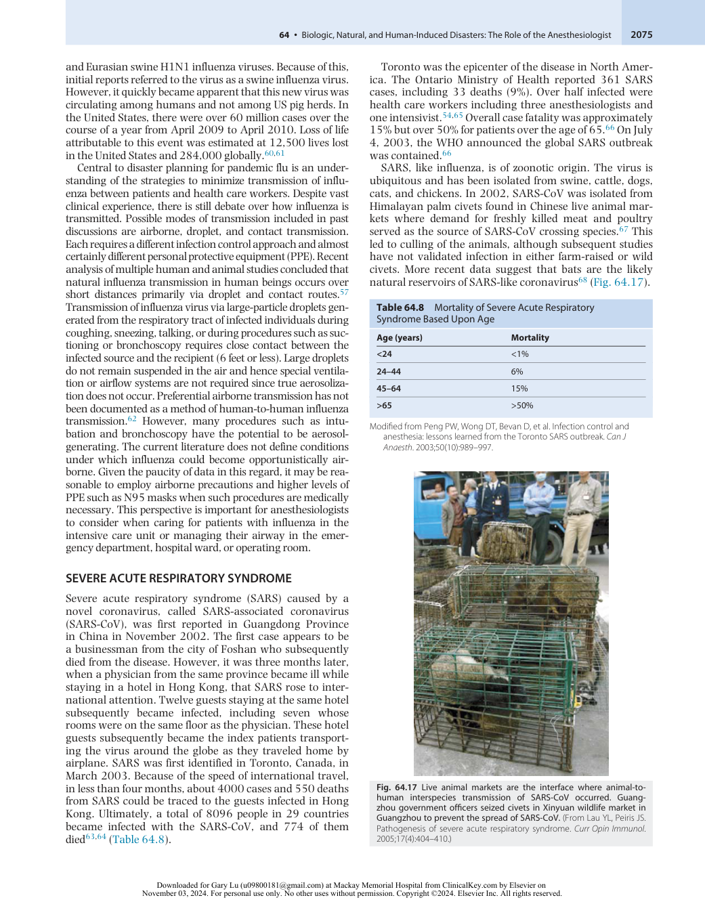

:::

<!-- PDF page 20 -->

Spread largely by droplets and direct contact, the virus demonstrates tropism to multiple organs and has been found not only in the lung but also in the liver, kidney, sweat glands, parathyroid, pituitary, pancreas adrenal glands, and the brain. As such, the disease is considered a true systemic illness with both pulmonary and extrapulmonary manifestations amplifying opportunity for health care worker exposure. This is important for anesthesiologists, intensivists, and other health care workers as viral shedding may occur not only in respiratory secretions but also in stool, urine, and even sweat.69 Appropriate PPE providing protection beyond droplet and contact precautions is indicated when caring for SARS patients.

### MIDDLE EAST RESPIRATORY SYNDROME

Like SARS, Middle East respiratory syndrome (MERS) is caused by a novel coronavirus, MERS- CoV. The first two cases of MERS- CoV infection as a cause of communityacquired pneumonia were identified in Saudi Arabia and reported to the WHO in September 2012. As of February 2023, laboratory- confirmed cases of MERS number 2604, with 936 associated deaths (36% case fatality rate) in 27 countries.70,71 The majority of cases have been reported in Saudi Arabia, United Arab Emirates, and the Republic of Korea (South Korea); 80% of reported cases to date have been in Saudi Arabia72 (Fig. 64.18).

MERS- CoV, like SARS- CoV, is a zoonotic virus. Dromedary camels are the major reservoir host and animal source of MERS infection in humans through either direct or indirect contact. The specific method of transmission remains unclear, although poorly cooked camel meat and

unpasteurized camel milk remain suspect; consumption of raw or undercooked animal products carries a high risk of infection. Human- to- human transmission in the _non– health care_ setting appears rare, with little to no such cases documented.73

Human- to- human transmission from ill people to others through close contact within the _health care setting_ accounts for the majority of reported cases to date. The largest outbreak today outside of Saudi Arabia occurred in South Korea in 2015.74 In that hospital- associated cluster, a single infected person admitted to a hospital in South Korea led to 186 cases and 36 deaths across multiple health care facilities.69,74 This particular case highlights the consequences of substandard infection control practices and inadequate use of PPE as the virus does not pass easily from person to person unless there is close contact.72 Health care workers must remain alert for the continued threat of MERS as global travel continues to accelerate.

### EBOLA VIRUS DISEASE

Ebola virus disease (EVD) is a zoonotic disease affecting people and nonhuman primates. The presumptive enzootic reservoir is believed to be African fruit bats although this is still not definitive. There are six species of Ebola virus, of which four are pathogenic to humans. The most common and possessing the highest case fatality rate (60%–90%) is _Zaire ebolavirus_ . _Sudan ebolavirus, Ivory Coast ebolavirus, Bundibugyo ebolavirus_ all are pathogenic to humans but at lower fatality rates. The _Reston ebolavirus_ , while known to cause disease in nonhuman primates and swine, has not been indicted as a cause of human disease.75 Marburg virus, the first known

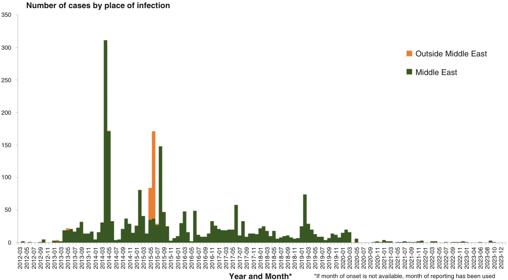

Number of cases by place of infection 350 300 Outside Middle East Middle East 250 200 150 100 50 0 Year and Month* *If month of onset is not available, month of reporting has been used 2012-03 2012-05 2012-07 2012-09 2012-11 2013-01 2013-03 2013-05 2013-07 2013-09 2013-11 2014-01 2014-03 2014-05 2014-07 2014-09 2014-11 2015-01 2015-03 2015-05 2015-07 2015-09 2015-11 2016-01 2016-03 2016-05 2016-07 2016-09 2016-11 2017-01 2017-03 2017-05 2017-07 2017-09 2017-11 2018-01 2018-03 2018-05 2018-07 2018-09 2018-11 2019-01 2019-03 2019-05 2019-07 2019-09 2019-11 2020-01 2020-03 2020-05 2020-07 2020-09 2020-11 2021-01 2021-03 2021-05 2021-07 2021-09 2021-11 2022-01 2022-03 2022-05 2022-07 2022-09 2022-11 2023-01 2023-04 2023-06 2023-08 2023-10 2023-12 

**Fig. 64.18 Global distribution of Middle East respiratory syndrome coronavirus (MERS-Cov).** (From the European Centre for Disease Prevention and Control – https://www.ecdc.europa.eu/en/publications-data/distribution-confirmed-cases-mers-cov-place-infection-and-month-onset-march-3.)

<!-- PDF page 21 -->

filovirus, was first described in 1967 and is known to cause viral hemorrhagic fever in humans with high fatality rates. Ebola is an RNA filovirus and a member of the _Filoviridae_ family. The Ebola virus is a highly infectious pathogen, with an infectious dose of fewer than 10 virion particles. Given that patients’ blood viral titers can exceed 108 virion particles per mL, it is not surprising that even highly trained health care workers have become infected.76,77 The high fatality rate of EVD makes it an important biothreat pathogen and given the severity of recent outbreaks worthy of more detailed discussion.78,79

Historically, the virus has been isolated to rural regions of Sub- Saharan Central Africa. EVD outbreaks have occurred relatively frequently over the past 30 years since the first outbreak in 1976, alongside the Ebola River in the village of Yambuku, Zaire, in what is now the northern Democratic Republic of Congo and South Sudan.80 Ultimately, two

genetically distinct species of virus were isolated bearing the names of their respective geographic areas.79 In 2014, the beginnings of what would become the largest outbreak of EVD on record took hold in West Africa. On March 21, 2014, the WHO was notified of a growing outbreak in southeastern Guinea. The disease spread quickly to its capital Conakry and then to the neighboring countries of Liberia and Sierra Leone.78 West Africa had never experienced an EVD outbreak and, given the socioeconomic conditions of these nations, the region was poorly equipped to respond. By the time the outbreak was declared over in June of 2016 there were 28,610 cases and 11,308 deaths, yielding a mortality rate of 39%. For perspective, from 1976 to 2014 there were less than 2500 cases reported worldwide (Table 64.9).81

The Ebola virus is transmitted through contact with infected secretions. Ebola has been found in blood, saliva,

|**Table 64.9**Number of cases and de|aths during Ebo|la outbreaks worldwid|e, 1976 to 2014.|||
|---|---|---|---|---|---|
|**Country**|**Year**|**Town**|**No. of cases**|**No. of deaths**|**Species**|
|Democratic Republic of the Congo|2014|Multiple|66|49|_Zaire ebolavirus_|
|Uganda|2012|Luwero District|6*|3*|_Sudan ebolavirus_|
|Democratic Republic of the Congo|2012|Isiro Health Zone|36*|13*|_Bundibugyo ebolavirus_|
|Uganda|2012|Kibaale District|11*|4*|_Sudan ebolavirus_|
|Uganda|2011|Luwero District|1|1|_Sudan ebolavirus_|
|Democratic Republic of the Congo|2008|Luebo|32|15|_Zaire ebolavirus_|
|Uganda|2007|Bundibugyo|149|37|_8undibugyo ebolavirus_|
|Democratic Republic of the Congo|2007|Luebo|264|187|_Zaire ebolavirus_|
|South Sudan†|2004|Yambio|17|7|_Zaire ebolavirus_|
|Republic of the Congo|2003|Mbomo|35|29|_Zaire ebolavirus_|
|Republic of the Congo|2002|Mbomo|143|128|_Zaire ebolavirus_|
|Republic of the Congo|2001|Not specified|57|43|_Zaire ebolavirus_|
|Gabon|2001|Libreville|65|S3|_Zaire ebolavirus_|
|Uganda|2000|Gutu|425|224|_Sudan ebolavirus_|
|South Africa|1996|Johannesburg|2|1|_Zaire ebolavirus_|
|Gabon|1996|Booue|60|45|_Zaire ebolavirus_|
|Gabon|19%|Mayibout|37|21|_Zaire ebolavirus_|
|Democratic Republic of the Congo‡|199S|Kikwit|315|250|_Zaire ebolavirus_|
|Côte d’lvoire|1994|Tai Forest|1|0|_Taï Forest ebolavirus_|
|Gabon|1994|Mekouka|52|31|_Zaire ebolavirus_|
|South Sudan†|1979|Nzara|34|22|_Sudan ebolavirus_|
|Democratic Republic of the Congo‡|1977|Tandala|1|1|_Zaire ebolavirus_|
|South Sudan†|1976|Nzara|284|1S1|_Sudan ebolavirus_|
|Democratic Republic of the Congo‡|1976|Yambuku|318|280|_Zaire ebolavirus_|

*Numbers reflect laboratory- confirmed cases only. †Formerly part of Sudan.

‡Formerly Zaire. _Ebola_ , Ebola virus disease. Table excludes 2014–2016 epidemic and 2017–2018 outbreaks in Democratic Republic of Congo.

Source: CDC. Outbreaks chronology: Ebola virus disease. Atlanta. GA: CDC: 201S. From Bell BP, et al. Overview, control strategies, and lessons learned in the CDC response to the 2014–2016 Ebola epidemic. _MMWR Suppl_ . 2016;65(3):4–11.

::: details 原始表格與符號（PDF 第 21 頁）

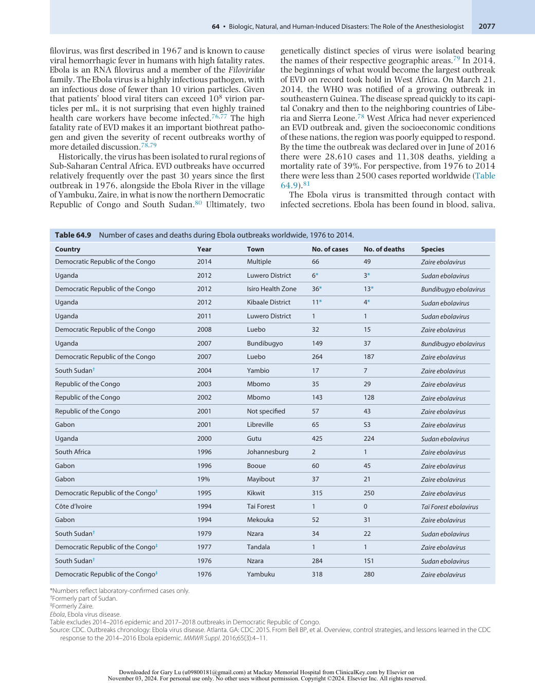

:::

<!-- PDF page 22 -->

vomit, feces, urine, sweat, nasal secretions, semen, and genital secretions. There is no evidence that there is airborne spread. Hence, Ebola enters the host through mucosal surfaces or breaks in the skin.78 This route of transmission reinforces the necessity of appropriate PPE use for all health care workers. Once in the body, the incubation period is anywhere from 2 to 21 days. The mean incubation period in the 2014 epidemic was noted to be 11.4 days, which did not vary by country.82 The most common symptoms reported between symptom onset and case detection included fever (87.1%), fatigue (76.4%), loss of appetite (64.5%), vomiting (67.6%), diarrhea (65.6%), headache (53.4%), and abdominal pain (44.3%). The most prominent feature in the 2014 outbreak was the progression of the gastrointestinal symptoms and resultant dehydration, severe electrolyte disorders, acute kidney injury, hypoperfusion, systemic inflammatory response syndrome, and shock.80,82 Capillary leak syndrome becomes profound in the late stages of the disease and can be associated with respiratory failure. Preterminal events include decreased level of consciousness which can progress to seizure and coma, disseminated intravascular coagulation, hepatic necrosis, renal failure, and gastrointestinal hemorrhage. Non- survivors succumb to multiorgan failure refractory to supportive care78,80,82,83 (Fig. 64.19).

During the West African Ebola outbreak, 27 patients were treated for EVD in resource- rich nations, of which 11 were in the United States. A total of three patients who contracted EVD in West Africa and subsequently were treated in the US experienced multiorgan failure requiring mechanical ventilation and renal replacement therapy. One patient lived and two died. Advanced life- sustaining therapy was managed in the Serious Communicable Disease Unit of Emory University Hospital, the Nebraska Biocontainment Unit at the University of Nebraska Medical Center – Nebraska Medicine, and at Texas Health Presbyterian Dallas. All three patients were male and presented with severe gastrointestinal symptoms including severe diarrhea and multiorgan dysfunction notable for respiratory, cardiovascular, renal, and hepatic insufficiency. Two patients were encephalopathic. All had extremely high viral loads. Of the two patients that died, the last 12 hours of life were characterized by refractory lactic acidosis and abdominal distention suggesting gastrointestinal perforation or ischemia84,85 (Figs. 64.20 and 64.21).

The 2014 West African Ebola outbreak is notable for the fact that approximately 27 patients with EVD have now been cared for in resource- rich settings. Signs and symptoms of EVD at the time of presentation to a hospital in the United States or Europe were not dissimilar to those presenting to Ebola treatment centers in West Africa. However, mortality in this setting was 18.5%, significantly better than the mortality of patients in the more resource- challenged environment of the West African Ebola treatment units (37%–74%) and the historic mortality of 66%.81,86 That said, EVD remains a highly fatal disease despite full access to advanced life support, modern diagnostic and laboratory support, and aggressive ICU care. Also notable is the fact that critically ill patients who have survived have presented early in the continuum of the disease. While no one can assume early support translates to better outcomes, the

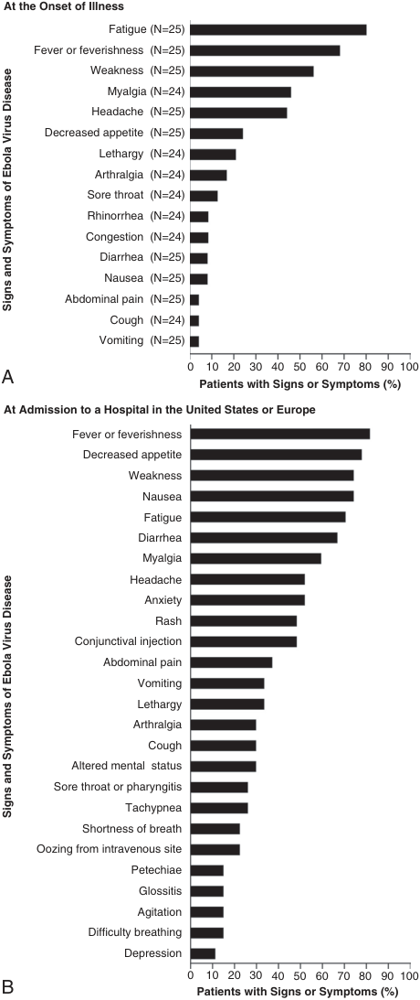

At the Onset of Illness Fatigue (N=25) Fever or feverishness  (N=25) Weakness  (N=25) Myalgia (N=24) Headache  (N=25) Decreased appetite  (N=25) Lethargy  (N=24) Arthralgia  (N=24) Sore throat  (N=24) Rhinorrhea  (N=24) Congestion  (N=24) Diarrhea  (N=25) Nausea  (N=25) Abdominal pain  (N=25) Cough  (N=24) Vomiting  (N=25) 0 10 20 30 40 50 60 70 80 90 100 A Patients with Signs or Symptoms (%) At Admission to a Hospital in the United States or Europe Fever or feverishness Decreased appetite Weakness Nausea Fatigue Diarrhea Myalgia Headache Anxiety Rash Conjunctival injection Abdominal pain Vomiting Lethargy Arthralgia Cough Altered mental  status Sore throat or pharyngitis Tachypnea Shortness of breath Oozing from intravenous site Petechiae Glossitis Agitation Difficulty breathing Depression 0 10 20 30 40 50 60 70 80 90 100 B Patients with Signs or Symptoms (%) Signs and Symptoms of Ebola Virus Disease Signs and Symptoms of Ebola Virus Disease 

**Fig. 64.19 Signs and symptoms of the 27 Ebola virus disease patients admitted to hospitals in the United States and Europe.** From Uyeki TM, et al. Clinical management of Ebola virus disease in the United States and Europe. _N Engl J Med_ . 2016;374(7):636–646.

first- world experience with EVD suggests that early intervention may improve outcomes.85

### COVID- 19 (SARS-CoV-2)

The COVID- 19 pandemic, caused by the severe acute respiratory syndrome coronavirus 2 (SARS- CoV- 2) has resulted in over 758 million confirmed cases and 6.8 million worldwide deaths as of March 1, 2023, with dramatic medical,

<!-- PDF page 23 -->

social, and economic impacts.87 The outbreak first came to international attention in December 2019 when cases of pneumonia of unknown etiology were reported in Wuhan City in the Hubei province of China.88 Cases were characterized as having fever, imaging characteristics of pneumonia or acute respiratory distress syndrome, reduced or normal white blood cells in the early stages of illness, and failure to improve with antibiotic treatment.89 The causative agent was identified as a novel betacoronavirus initially referred to as 2019

novel coronavirus (2019- nCoV), and subsequently named severe acute respiratory syndrome coronavirus 2 (SARSCoV- 2).90 SARS- CoV- 2- related coronaviruses are known to naturally infect bats and pangolins, which may have served as the zoonotic origin of the COVID- 19 pandemic, though investigations have been inconclusive and the possibility of a laboratory origin has also been considered.76,91

Transmission dynamics were poorly understood early in the outbreak, making it exceedingly difficult to control

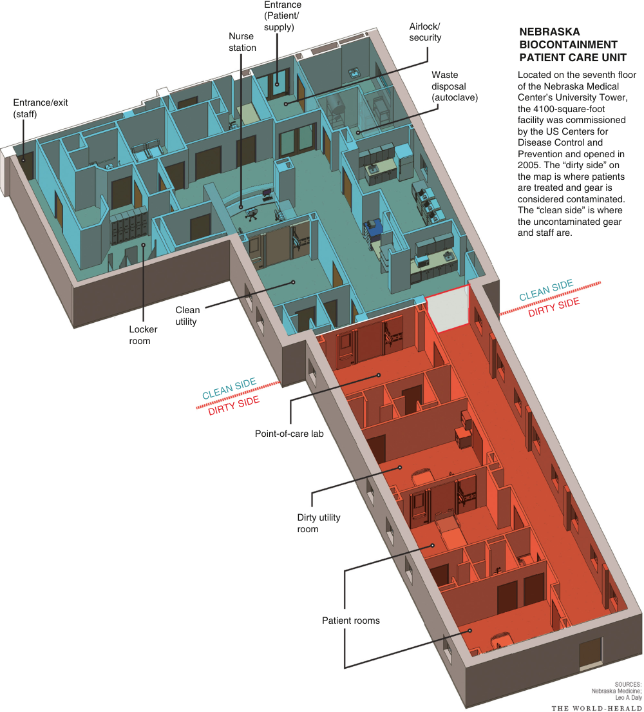

Entrance (Patient/ supply) Airlock/ NEBRASKA Nurse security station BIOCONTAINMENT PATIENT CARE UNIT Waste Located on the seventh floor disposal of the Nebraska Medical Entrance/exit (autoclave) Center’s University Tower, the 4100-square-foot (staff) facility was commissioned by the US Centers for Disease Control and Prevention and opened in 2005. The “dirty side” on the map is where patients are treated and gear is considered contaminated. The “clean side” is where the uncontaminated gear and staff are. Clean utility Locker room Point-of-care lab Dirty utility room Patient rooms DIRTY SIDE DIRTY SIDE CLEAN SIDE CLEAN SIDE 

**Fig. 64.20 Nebraska Biocontainment Unit, where three patients with Ebola virus disease received care from anesthesiologist–intensivists in 2014.**

<!-- PDF page 24 -->

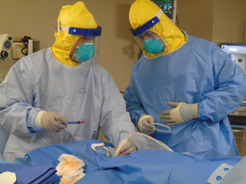

**Fig. 64.21 Anesthesiologist placing ultrasound-guided central venous line in the Nebraska Biocontainment Unit.**

despite aggressive containment measures. By the end of January 2020, China had reported 7711 confirmed and 12,167 suspected cases and 170 deaths, and the virus had spread rapidly beyond China, infecting people in at least 18 countries with Germany, Japan, USA, and Vietnam all reporting cases of human- to- human transmission leading to the declaration of a public health emergency of international concern (PHEIC) by the World Health Organization (WHO) Director General on January 30, 2020.89,92 Germany’s first cluster of cases was linked to transmission from an asymptomatic contact, a visiting resident from Shanghai.93 Although the index case later developed mild upper respiratory symptoms prior to testing positive for the novel coronavirus upon returning to China, it raised the alarm to the possibility of asymptomatic infection and presymptomatic transmission contributing to the unrelenting spread of the virus.

The WHO officially characterized the outbreak as a pandemic on March 11, 2020 when more than 118,000 cases had been reported in 114 countries, including 4292 deaths.94 Massive outbreaks erupted around the globe, overwhelming health care systems’ ability to manage the influx of patients and health departments’ ability to effectively identify and trace contacts, leading government officials to enact unprecedented measures of strict lockdowns including school and workplace closures, travel restrictions, curfews, and quarantine orders. While early guidance from the WHO focused primarily on respiratory droplet and contact transmission, evidence for transmission via small aerosols mounted, leading 239 scientists to sign an open letter published online in _Clinical Infectious Diseases_ on July 6, 2020. They urged the medical community, national, and international organizations to recognize the potential for airborne transmission of SARS- CoV- 2.95 Limiting spread within health care settings early in the pandemic proved difficult amidst limited or absent airborne infection isolation rooms. Supply chain disruptions and shortages in personal protective equipment led to guidance for extended use and reuse of N95 respirators for health care workers. Nonpharmaceutical interventions to limit the spread within communities included cancellation of public gatherings, mask wearing, physical distancing, avoidance of poorly ventilated and

crowded spaces, hand hygiene, and cleaning of high touch surfaces.

SARS- CoV- 2 causes a spectrum of illness from asymptomatic infection to mild, moderate, or severe illness with a range of symptoms including fever, chills, cough, shortness of breath, fatigue, myalgias, headache, smell or taste disturbances, sore throat, nasal congestion or runny nose, nausea, vomiting, or diarrhea to critical illness with respiratory failure, septic shock, and multiorgan failure.96 Hypoxemia has been a common reason for hospitalization with some patients presenting with “silent hypoxia,” or significant hypoxemia without dyspnea or signs of respiratory distress, particularly with early strains of the virus.97,98 Older age and underlying medical conditions are recognized risk factors for severe COVID- 19 with certain racial and ethnic minority groups being disproportionately affected99 (Fig. 64.22).

Since identification of COVID- 19 infections, a wide range of therapeutics have been investigated as potential treatment options for patients with COVID- 19. Repurposed drugs such as lopinavir/ritonavir, hydroxychloroquine, and ivermectin demonstrated _in vitro_ activity against SARS- CoV- 2, but failed to demonstrate conclusive therapeutic benefit in clinical trials and are not currently recommended for treatment of COVID- 19.100 Remdesivir was the first antiviral drug to receive approval by the US Food and Drug Administration (FDA) in October 2020 for patients 12 years of age and older for hospitalized patients requiring treatment for COVID- 19, following analysis of three randomized controlled trials including the Adaptive COVID19 Treatment Trial (ACTT- 1), a double- blind, randomized, placebo- controlled trial that demonstrated shortened time to recovery in adult patients hospitalized with COVID- 19 who had evidence of lower respiratory infection.101,102 Dexamethasone became the first drug to demonstrate a mortality benefit among hospitalized patients with COVID19 receiving supplemental oxygen or invasive mechanical ventilation in the RECOVERY trial, offering an accessible treatment option at relatively low cost.103 Additional antivirals, immunomodulators such as janus kinase (JAK) inhibitors (baricitinib) and interleukin-6 (IL-6) pathway inhibitors (tocilizumab), and monoclonal antibodies have received authorization by the FDA and European Medicines Agency (EMA) with indications for use that vary based on age, severity of illness, and current data as scientific evidence accumulates and the pandemic evolves.104,105

December 2020 heralded authorizations by the FDA and EMA for two mRNA COVID- 19 vaccines, Pfizer and BioNTech’s COMIRNATY and Moderna’s Spikevax, critical tools to combat the pandemic. Both vaccines have since received FDA approval based on safety and efficacy and are among 11 COVID- 19 vaccines with WHO’s Emergency Use Listing as of July 14, 2022.106

Anesthesiologists played several major roles in the response to COVID- 19. During the early COVID- 19 surges in Europe and New York, anesthesiologists from around the world participated in planning for a response to inevitable COVID- 19 surges. Expertise in PPE, resource allocation, and staffing plans allowed anesthesiologists to help their institutions be ready for COVID- 19 patients before any actually arrived for care. In most parts of the United States, hospitals heeded the advice of the American Society of Anesthesiologists, the Surgeon General Jerome Adams (an

<!-- PDF page 25 -->

Weekly trends in number of COVID-19 deaths in the United States reported to CDC

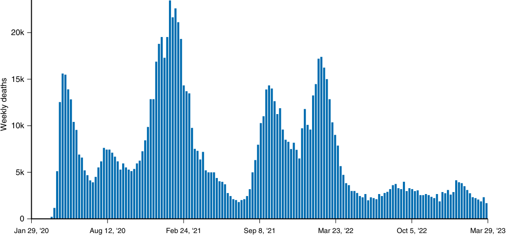

20k 15k 10k 5k 0 Jan 29, '20 Aug 12, '20 Feb 24, '21 Sep 8, '21 Mar 23, '22 Oct 5, '22 Mar 29, '23 Weekly deaths 

**Fig. 64.22 US deaths from COVID- 19.** (From the CDC COVID Data Tracker. Available at https://covid.cdc.gov/covid- data- tracker/#trends_weeklydeath s_select_00.)

anesthesiologist), and the American College of Surgeons to halt all elective surgeries to help create hospital capacity and reduce the utilization of precious PPE. This massive draw- down in surgical cases, and the eventual ramp- up back to normal caseloads required significant efforts on the part of leaders in anesthesiology. In an effort to help “flatten the curve” and avoid the health care system becoming overwhelmed, anesthesiologists used traditional media and social media platforms to appeal to the lay public to take nonpharmaceutical measures to avoid becoming infected.

PPE plans were modified to reflect the need for safety combined with sustainability particularly in light of significant shortages of equipment. Anesthesiologists were instrumental in promoting the conservation, recycling, and reuse of PPE, and they collaborated with colleagues to create safety protocols for the intraoperative care of COVID- positive patients. In the spring of 2020, anesthesiologists and surgeons devised protocols to allow for minor surgery to be performed within patient rooms in COVID- designated units, reducing risk for health care colleagues. In many hospitals around the world, anesthesiologists invented and produced novel equipment to respond to the threat of transmission of SARS- CoV- 2 from patients to health care workers. The aerosol capture mask depicted in Fig. 64.23 was designed to be placed on COVID- 19 patients’ faces and connected to suction in order to successfully reduce the viral load in the immediate environment. This is just one of many innovations that anesthesiologists created during the COVID- 19 pandemic.

Many departments of anesthesiology collaborated with departments of medicine, surgery, and others to ensure that all the resources of adult critical care would be working as a cohesive team to confront the pandemic. Silos of critical care appropriately disappeared. Everyone shared the same goal: save as many lives as possible and achieve this with

the smallest risk of harm to health care workers. COVID ICUs were designated and often staffed by anesthesiologist– intensivists, and in heavily affected areas, non- intensivist anesthesiologists were called upon to lead critical care teams.

Anesthesiologist–intensivists in many locations contributed to the creation of a critical care tiered surge staffing response. Throughout numerous surges in COVID- 19 patient census, normal workflow in the ICU was modified to ensure optimal care despite limited resources. Throughout the world, anesthesiologists provided a significant proportion of the critical care necessary to respond to the massive uptick in ARDS secondary to COVID- 19. COVID- 19 required health care systems to leverage the extraordinary skill set of physician anesthesiologists, who take care of critically ill patients with respiratory failure in the operating room on a daily basis. Physician anesthesiologists are experts at managing mechanical ventilation on extremely ill patients, and the COVID- 19 pandemic required hospitals to call upon these doctors to work outside of their normal environment in order to save lives (Fig. 64.24).

### PERSONAL PROTECTION

The logistics of caring for patients with disease due to highly contagious pathogens is complex and outside of the scope of this chapter as is a detailed discussion of PPE. That said, it is relevant to note some consistencies which are likely to reduce human- to- human transmission whether patient to patient or patient to health care worker. More important than the unique physical structure of the special pathogen units located in the United States and Europe is the culture of safety and preparedness through which the system works to train health care workers to care not only for the patient but also for themselves.107

<!-- PDF page 26 -->

Providers caring for patients on hospital wards, in the operating room, and in the intensive care unit have the highest risk of contracting the disease themselves. This is reflected in the experience with the SARS- CoV, MERS- CoV, Ebola virus, and SARS- CoV- 2. In all situations there are preventable infections and on occasion unnecessary deaths due to a lack of appropriate training and a lack of the critical knowledge specific to the pathophysiology of each disease as well as the logistics of caring for patients while protecting oneself.107

While adherence to standard infection control universal precautions is advisable when caring for all patients, anesthesia providers need to pay particular attention to elements of hospital protocols that apply to patients with respiratory infections. In addition to precautions necessary to prevent contact routes of transmission _vis- à- vis_ hand hygiene, gloves, and gowns; droplet precautions should be

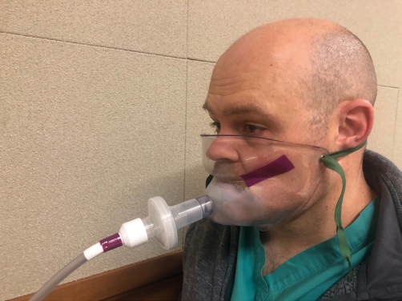

**Fig. 64.23 Aerosol capture mask invented by anesthesiologists Nicholas Markin and Steven Lisco during the initial surge of COVID- 19 acute respiratory distress syndrome (ARDS) patients.** (Photo courtesy of Dr. Nicholas Markin, Nebraska Medicine, Omaha, NE.)

in place for all patients with suspected or confirmed influenza, SARS, or MERS. Airborne precautions are necessary when caring for patients with SARS- CoV- 2. At a minimum, providers should be wearing a face mask when entering the room of a patient with suspected influenza, including perioperative areas such as preop or postanesthesia care unit (PACU). When moving a suspected influenza patient on droplet precautions from one area of the hospital to another, having the patient wear a face mask during transport is prudent. This would of course include transport to and from the operating room if deemed medically safe and appropriate.62

Anesthesiologists routinely perform medical procedures that are aerosol- generating in patients with highly contagious pathogens. When patients have suspected or confirmed disease, procedures should be limited to those deemed entirely medically necessary. As an example, for EVD patients, central venous catheters should generally not be placed for hemodynamic monitoring, but primarily to provide critical vascular access, ensuring low-risk access to blood samples, delivering electrolyte replacement, and for administration of vasoactive medications. Similarly, when considering respiratory support for patients with EVD, early intubation may be preferable despite the inherent risk of aerosolization when compared to noninvasive positive pressure ventilation (NIPPV) and the risk of vomiting or hematemesis. NIPPV may also result in aerosolization of fluids containing viruses, putting caregivers at excess risk not only from Ebola but also from other highly contagious diseases. If intubation is necessary, having a thoughtful predetermined plan for semi- elective non- emergent intubation is essential. Similar approaches should be considered for other infections based on an understanding of routes of transmission and other considerations. In all cases, appropriate airway management options and advanced airway management equipment and all medications must be easily and readily available, and providers must take into account the time necessary for donning appropriate PPE prior to entering the patient care environment.80,84

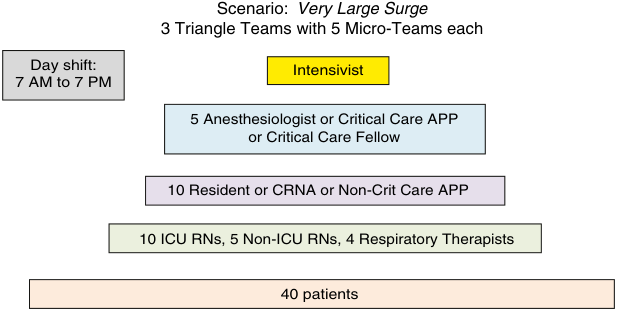

Scenario: Very Large Surge 3 Triangle Teams with 5 Micro-Teams each Day shift: Intensivist 7 AM to 7 PM 5 Anesthesiologist or Critical Care APP or Critical Care Fellow 10 Resident or CRNA or Non-Crit Care APP 10 ICU RNs, 5 Non-ICU RNs, 4 Respiratory Therapists 40 patients 

Each anesthesiologist or Critical Care APP or Crit Care Fellow will supervise a microteam of 8 patients.  Each team will have 2 rounders (resident, CRNA, or non-crit care APP).  The ICU RN to patient ratio is 1:4 (each micro-team of 8 will have a nonICU RN to assist the ICU RNs), and the RT to patient ratio is 1:10.

**<mark>Fig. 64.24 Tiered critical care staffing model for COVID- 19 surge.</mark>** <mark>(Source: Daniel Johnson, MD.)</mark>

<!-- PDF page 27 -->

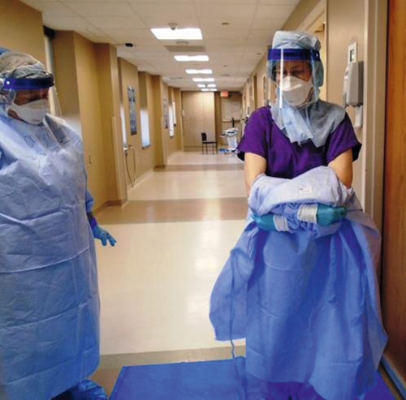

**Fig. 64.25 Strict supervision of the personal protective equipment (PPE) doffing process by a dedicated doffing partner in the Nebraska Biocontainment Unit.**

Finally, it is the authors’ recommendation that all health care staff understand the guidelines for personal protection appropriate for each pathogen. Certainly, when caring for EVD patients, the lowest level of PPE staff should wear includes disposable water- resistant suite or coverall, including a hood, an N95 mask, a disposable full- face shield, two sets of gloves (appropriately sealed), and impermeable foot and leg coverings. It is highly recommended that the addition of a powered air- purifying respirator be included when providers are doing any medical procedure with high risk of aerosolization.78,84 Doffing of PPE is perhaps the highestrisk moment for unrecognized contamination with highly infectious diseases. For this reason, the entire doffing process should be strictly supervised by a doffing partner. The doffing partner should have no other role besides supervising the health care worker who is removing PPE. Based on the recent experience in the care of COVID- 19- infected patients, availability of vaccines and medications to treat the infection and other issues should be taken into account in defining the most appropriate way to identify patients at risk, manage their care, and ensure protection of all providers (Fig. 64.25).

8.  Missair A, et al. _Prehosp Disaster Med_ . 2010;25(6):487.

9.  Firth PG, et al. _Anesth Analg_ . 2011;113(3):545.

10.  Firth PB. _N Engl J Med_ . 2010;362(14):e50.

11.  Mathias JM. _OR Manag_ . 2011;27(7):6.

12.  Carlton PK. _Am J Disaster Med_ . 2012;7(4):321.

13.  Neblett Fanfair R, et al. _N Engl J Med_ . 2012;367(23):2214.

14.  Charuluxananan S, et al. _Acta Anaesthesiol Scand_ . 2006;50:320.

15.  Fitzsimons MG, et al. _Mil Med_ . 2007;172:227.

16.  National Hurricane Center. _Hurricanes in History: Katrina_ ; 2009. htt ps://www.nhc.noaa.gov/outreach/history/#katrina.

17.  Krane NK, et al. _JAMA_ . 2007;298(9):1052.

18.  Hutson LR, et al. _Ochsner J_ . 2011;11:29.

19.  Santos- Lozada AR, et al. _JAMA_ . 2018;320(14):1491.

20.  Santos- Burgoa C, et al. _Lancet Planet Health_ . 2018;2(11):e478.

21.  Sacks CA, et al. _JAMA Intern Med_ . 2018;178(7):885.

22.  Roccaforte JD. _Crit Care_ . 2001;5(6):307.

23.  Gurrey S, et al. _Prev Med Rep_ . 2021;24:101604.

24.  The Violence Project. _Key Findings: Mass Public Shootings Today Are More Frequent and Deadlier_ . 2023. https://www.theviolenceproject.o rg/key- findings/.

25.  Sher H. _The Atlantic_ ; 2018. https://www.theatlantic.com/politics/ar chive/2018/2.

26.  King DR, et al. _J Trauma Acute Care Surg_ . 2015;78(3):594.

27.  Gates JD, et al. _Ann Surg_ . 2014;260(6):960.

28.  Joint Chiefs of Staff. Multiservice Doctrine Chemical, Biological, Radiological and Nuclear Response – September 2016. JP 3- 41.

29.  James S. _AJA_ . 2011;115(1):69.

30.  Reddy C. _The Growing Menace of Chemical War_ . Woods Hole Oceanographic Institute; 2007.

31.  Haris R, et al. _A Higher Form of Killing_ . 2nd ed. Arrow Books; 1982. 32.  HQ Department of the Army. Multiservice Doctrine for Chemical, Biological, Radiological and Nuclear Operations – July 2001. FM 3- 11, MCWP 3- 37.1, NWP 3- 11, AFTTP 3- 2.42.

33.  United Nations. _Report of the Mission Dispatched by the Secretary General to Investigate Allegations of the Use of Chemical Weapons in the Conflict between the Islamic Republics of Iran and Iraq. UN Document No. 18852_ . United Nations; 1987.

34.  Hammick M. _Int Defense Rev_ . 1991:1323.

35.  Hiltermann, et al. _A Poisonous Affair: America, Iraq, and the Gassing of Halabja_ . Cambridge University Press; 2007:183.

36.  Tu AT. In: _Proceedings of the 6th BCW Protective Symposium, Stockholm, NDRE. FOR–R–98, 00949–862–6E_ . Defense Research Establishment; 1998.

37.  Okumura T, et al. In: Marrs TC, et al., ed. _Chemical Warfare Agents: Toxicology and Treatment_ . 2nd ed. John Wiley and Sons; 2007:277.

38.  White SM. _Br J Anaesth_ . 2002;89:306.

39.  Nicholson- Roberts TC. _J R Army Med Corps_ . 2010;156(suppl):327.

40.  US Department of the Army, et al. _NATO Handbook on the Medical Aspects of NBC Defensive Operations. AMedP- 6© Vol III_ . DA, USN, USAF; 2006: Chap 2.

41.  Eddleston M, et al. _Lancet_ . 2008;371:597.

42.  U.S. Code of Federal Regulations. Title 29, Labor, Subtitle B, Chapter XVII, Part 1910, Subpart H, Section 1910.120, _Hazardous Waste Operations and Emergency Response_ .

43.  Borak J, et al. _Hazardous Materials Exposure: Emergency Response and Patient Care_ . Prentice Hall; 1991.

44.  US Public Health Service. _Guidance on Emergency Responder Personal Protective Equipment (PPE) for Response to CBRN Terrorism Incidents_ . DHHS (NIOSH) Publication 2008- 132; 2008.

45.  Baker DJ. _Resuscitation_ . 1999;42:125.

### Complete references available online at expertconsult.com.

46.  UK Ministry of Defence. _Clinical Guidelines for Operations_ . Joint Doctrine Publication 4- 03.1. MOD; 2011.

47.  Lassen HC. _Proc R Soc Med_ . 1954;47(1):67.

### References

1.  Everytown for Gun Safety Action Fund. Mass Shootings. https://ww w.everytown.org/issues/mass- shootings/.

2.  Polonsky J, et al. _PLoS Currents_ . 2013;5:ecurrents.dis.6aec18e8481 6c055b8c2a06456811c7a.

3.  Daniell JE, et al. _Natural Hazards and Earth System Sciences Discussions_ . 2013;1:1913.

4.  McCunn M, et al. _Anesth Analg_ . 2010;111(6):1438.

5.  Walk RM, et al. _Disaster Med Public Health Prep_ . 2012;6(4):370.

6.  Sechriest VF, et al. _Am J Disaster Med_ . 2012;7(4):281.

7.  Walk R, et al. _Disaster Med Public Health Prep_ . 2012;6(4):370.

48.  Ortega R, et al. _Br J Anaesth_ . 2020;125(4):444.

49.  Kamming D, et al. _Br J Anaesth_ . 2003;90(6):715.

50.  Gates B. _N Engl J Med_ . 2015;372(15):1381.

51.  Flight C. _Smallpox: Eradicating the Scourge_ ; 2017. http://www.bbc.co .uk/history/british/empire_seapower/smallpox_01.shtml.

52.  CDC. _History of Smallpox_ . 2017. https://www.cdc.gov/smallpox/hist ory/history.html.

53.  Radetsky M. _Pediatr Infect Dis J_ . 1999;18(2):85.

54.  Belser JA, et al. _Virology_ . 2018;524:45.

55.  Webb SA, et al. _Crit Care Med_ . 2018;46(3):442.

56.  Osterholm MT. _N Engl J Med_ . 2005;352(18):1839.

57.  Brankston G, et al. _Lancet Infect Dis_ . 2007;7(4):257.

<!-- PDF page 28 -->

58.  Cox NJ, et al. _Vaccine_ . 2003;21(16):1801.

59.  Webby RJ, et al. _Science_ . 2003;302(5650):1519.

60. _CDC. Past Pandemics: Pandemic Influenza (Flu)_ . 2018. https://www.cdc.gov/flu/pandemic- resources/basics/pastpandemics.html.

61.  Dawood FS, et al. _Lancet Infect Dis_ . 2012;12(9):687.

62.  CDC. _Prevention Strategies for Seasonal Influenza in Healthcare Settings_ ; 2018. https://www.cdc.gov/flu/professionals/infectioncontrol/heal thcaresettings.htm.

63.  CDC. _SARS (10 Years after)_ ; 2018. https://www.cdc.gov/dotw/sars/.

64.  Wenzel RP, et al. _N Engl J Med_ . 2003;348(20):1947.

65.  Wallington T, et al. _Can Commun Dis Rep_ . 2003;29(13):113.

66.  CDC. _SARS Response Timeline_ ; 2013. https://www.cdc.gov/about/hi story/sars/timeline.htm.

67.  Lau YL, Peiris JS. _Curr Opin Immunol_ . 2005;17(4):404.

68.  Li W, et al. _Science_ . 2005;310(5748):676.

69.  Ki M. _Epidemiol Health_ . 2015;37:e2015033.

70.  Assiri A, et al. _N Engl J Med_ . 2013;369(5):407.

71.  World Health Organization. _Epidemic and Pandemic- Prone Diseases: MERS Situation Update_ ; 2023. https://www.emro.who.int/healthtopics/mers- cov/mers- outbreaks.html.

72.  Arabi YM, et al. _N Engl J Med_ . 2017;376(6):584.

73.  World Health Organization. _Middle East Respiratory Syndrome Coronavirus (MERS- CoV)_ ; 2018. http://www.who.int/en/newsroom/fact- sheets/detail/middle- east- respiratory- syndromecoronavirus- (mers- cov).

74.  Kim KM, et al. _Epidemiol Health_ . 2015;37:e2015041.

75.  CDC. _Ebola (Ebola Virus Disease)_ ; 2023. https://www.cdc.gov/vhf/eb ola/about.html.

76.  Holmes EC, et al. _Cell_ . 2021;184:4848.

77.  Iwen PC, et al. _Am J Clin Pathol_ . 2015;143(1):4.

78.  Funk DJ, Kumar A. _Can J Anaesth_ . 2015;62(1):80.

79.  Feldmann H, Geisbert TW. _Lancet_ . 2011;377(9768):849.

80.  Fowler RA, et al. _Am J Respir Crit Care Med_ . 2014;190(7):733.

81.  Bell BP, et al. _MMWR Suppl_ . 2016;65(3):4.

82.  WHO Ebola Response Team. _N Engl J Med_ . 2014;371(16):1481.

83.  Hunt L, et al. _Lancet Infect Dis_ . 2015;15(11):1292.

84.  Johnson DW, et al. _Crit Care Med_ . 2015;43(6):1157.

85.  Sueblinvong V, et al. _Crit Care Med_ . 2015;43(10):2066.

86.  Uyeki TM, et al. _N Engl J Med_ . 2016;374(7):636.

87.  World Health Organization. _COVID- 19 Weekly Epidemiological Update – March 2023, Edition 132_ ; 2023. https://www.who .int/publications/m/item/weekly- epidemiological- update- oncovid- 19.

88. _ProMED- mail. Undiagnosed Pneumonia – China (Hubei): Request for Information. International Society for Infectious Diseases_ . 2019. https://promedmail.org/promed- post/?id=6864153.

89.  World Health Organization. _Timeline: WHO’s COVID- 19 Response_ . 2022. https://www.who.int/emergencies/diseases/novel- coronavirus2019/interactive- timeline#.

90.  World Health Organization. _Naming the Coronavirus Disease (COVID19) and the Virus that Causes it_ . WHO; 2020.

91.  Morens DM, et al. _Am J Trop Med Hyg_ . 2020;103:955.

92.  World Health Organization. _Statement on the Second Meeting of the International Health Regulations (2005) Emergency Committee Regarding the Outbreak of Novel Coronavirus (2019- nCoV)_ ; 2020. https://www.who.int/news/item/30- 01- 2020- statement- onthe- second- meeting- of- the- international- health- regulations(2005)- emergency- committee- regarding- the- outbreak- of- novel- - coronavirus- (2019- ncov).

93.  Rothe C, et al. _N Engl J Med_ . 2020;382:970.

94.  World Health Organization. _Coronavirus Disease 2019 (COVID- 19) Situation Report – 21_ ; 2020. https://www.who.int/docs/defaultsource/coronaviruse/situation- reports/20200311- sitrep- 51- covid19.pdf?sfvrsn=1ba62e57_10.

95.  Morawska L, Milton DK. _Clin Infect Dis_ . 2020;71(9):2311.

96.  Centers for Disease Control and Prevention. _COVID- 19 Clinical Presentation_ ; 2022. https://www.cdc.gov/coronavirus/2019ncov/hcp/clinical- care/clinical- considerations- presentation.html.

97.  Tobin MJ, et al. _Am J Respir Crit Care Med_ . 2020;202:356.

98.  Bickler PE, et al. _Anesthesiology_ . 2021;134:262.

99.  Lopez III L, et al. _JAMA_ . 2021;325:719.

100.  World Health Organization. _Therapeutics and COVID- 19 – Living Guideline_ ; 2022. https://www.who.int/publications/i/item/WHO2019- nCoV- therapeutics- 2022.4.

101.  Food and Drug Administration. _FDA Approves First Treatment for COVID- 19_ ; 2020. https://www.fda.gov/news- events/pressannouncements/fda- approves- first- treatment- covid- 19.

102.  Beigel JH, et al. _N Engl J Med_ . 2020;383:1813.

103.  The RECOVERY Collaborative Group. _N Engl J Med_ . 2021;384:693.

104.  European Medicines Agency. _COVID- 19 Treatments_ ; 2022. https://w ww.ema.europa.eu/en/medicines/human/EPAR/veklury.

105.  National Institutes of Health. _Coronavirus Disease 2019 (COVID- 19) Treatment Guidelines_ . NIH; 2022.

106.  World Health Organization. _COVID- 19 Vaccines with WHO Emergency Use Listing_ ; 2022. https://extranet.who.int/pqweb/vaccines/ vaccinescovid- 19- vaccine- eul- issued.

107.  Adams JJ, Lisco SJ. _Simul Healthc_ . 2016;11(2):72.

<!-- PDF page 29 -->

### References

1.  Everytown for Gun Safety Action Fund. Mass Shootings. https://ww w.everytown.org/issues/mass- shootings/.

2.  Polonsky J, Luquero F, Francois G, et al. Public health surveillance after the 2010 Haiti earthquake: the experience of Médecins Sans Frontières. _PLoS Currents_ . 2013;5. ecurrents.dis.6aec18e84816c05 5b8c2a06456811c7a.

3.  Daniell JE, Kazai B, Wenzel F. Uncovering the 2010 Haiti earthquake death toll. _Natural Hazards and Earth System Sciences Discussions_ . 2013;1:1913–1942.

4.  McCunn M, Ashburn M, Floyd TF, et al. An organized, comprehensive, and security- enabled strategic response to the Haiti Earthquake: a description of pre- deployment readiness preparation and preliminary experience from an academic anesthesiology department with no preexisting international disaster response program. _Anesth Analg_ . 2010;111(6):1438–1444.

5.  Walk RM, Donahue TF, Stockinger Z, et al. Haitian earthquake relief: disaster response aboard the USNS Comfort. _Disaster Med Public Health Prep_ . 2012;6(4):370–377.

6.  Sechriest VF, Wing V, Walker GJ, et al. Healthcare delivery aboard US Navy hospital ships following earthquake disasters: implications for future disaster relief missions. _Am J Disaster Med_ . 2012;7(4):281– 294.

7.  Walk R, Donahue T, Stockinger Z, et al. Haitian earthquake relief: disaster response aboard the USNS Comfort. _Disaster Med Public Health Prep_ . 2012;6(4):370–377.

8.  Missair A, Gebhard R, Pierre E, et al. Surgery under extreme conditions in the aftermath of the 2010 Haiti earthquake: the importance of regional anesthesia. _Prehosp Disaster Med_ . 2010;25(6):487–493.

9.  Firth PG, Solomon JB, Roberts LL, et al. Airway management of tetanus after the Haitian earthquake: new aspects of old observations. _Anesth Analg_ . 2011;113(3):545–547.

10.  Firth PB. Disaster- relief anesthesia – notes on coming home. _N Engl J Med_ . 2010;362(14):e50.

11.  Mathias JM. Surgery by flashlight as Joplin team operates through tornado. _OR Manag_ . 2011;27(7):6–7.

12.  Carlton PK. Business continuity after catastrophic medical events: the Joplin medical business continuity report. _Am J Disaster Med_ . 2012;7(4):321.

13.  Neblett Fanfair R, Benedict K, Bos J, et al. Necrotizing cutaneous mucormycosis after a tornado in Joplin, Missouri, in 2011. _N Engl J Med_ . 2012;367(23):2214–2215.

14.  Charuluxananan S, Bunburaphong P, Tuchinda L, et al. Anesthesia for Indian Ocean tsunami- affected patients at a southern Thailand provincial hospital. _Acta Anaesthesiol Scand_ . 2006;50:320–323.

15.  Fitzsimons MG, Sparks JW, Jones SF, et al. Anesthesia services during operation unified assistance, aboard the USNS Mercy, after the tsunami in southeast Asia. _Mil Med_ . 2007;172:227–231.

16.  National Hurricane Center. _Hurricanes in History: Katrina_ ; 2009. htt ps://www.nhc.noaa.gov/outreach/history/#katrina.

17.  Krane NK, DiCarlo RP, Kahn MJ. Medical education in postKatrina New Orleans, a story of survival and renewal. _JAMA_ . 2007;298(9):1052–1055.

18.  Hutson LR, Vega J, Schubert A. Impact of hurricanes Katrina and Rita on the anesthesiology workforce. _Ochsner J_ . 2011;(11):29– 33.

19.  Santos- Lozada AR, Howard JT. Use of death counts from vital statistics to calculate excess deaths in Puerto Rico following Hurricane Maria. _JAMA_ . 2018;320(14):1491–1493.

20.  Santos- Burgoa C, Sandberg J, Suarez E, et al. Differential and persistent risk of excess mortality from Hurricane Maria in Puerto Rico: a time- series analysis. _Lancet Planet Health_ . 2018;2(11):e478–e488.

21.  Sacks CA, Kesselheim AS, Fralick M. The shortage of normal saline in the wake of Hurricane Maria. _JAMA Intern Med_ . 2018;178(7):885– 886.

22.  Roccaforte JD. The world trade center attack: observations from New York’s Bellevue Hospital. _Crit Care_ . 2001;5(6):307–309.

23.  Gurrey S, McCauley H, Benson M, et al. Firearm- related research articles in health sciences by funding status and type, a scoping review. _Prev Med Rep_ . 2021;24:101604.

24.  The Violence Project. _Key Findings: Mass Public Shootings Today Are More Frequent and Deadlier_ ; 2023. https://www.theviolenceproject.o rg/key- findings/.

25.  Sher H. What I saw treating the victims from Parkland should change the debate on guns _. The Atlantic_ . 2018. https://www.theatla ntic.com/politics/archive/2018/2.

26.  King DR, Larentzakis A, Ramly EP. Tourniquet use at the Boston Marathon bombing: lost in translation. _J Trauma Acute Care Surg_ . 2015;78(3):594–599.

27.  Gates JD, Arabian S, Biddinger P, et al. The initial response to the Boston Marathon bombing: lessons learned to prepare for the next disaster. _Ann Surg_ . 2014;260(6):960–966.

28.  Joint Chiefs of Staff. Multiservice Doctrine Chemical, Biological, Radiological and Nuclear Response – September 2016. JP 3- 41.

29.  James S. Stratagems, combat, and “chemical warfare” in the siege mines of Dura- Europos. _AJA_ . 2011;115(1):69–101.

30.  Reddy C. _The Growing Menace of Chemical War_ . Woods Hole Oceanographic Institute; 2007.

31.  Haris R, Paxman J. _A Higher Form of Killing_ . 2nd ed. London: Arrow Books; 1982.

32.  Multiservice Doctrine for Chemical, Biological, Radiological and Nuclear Operations – July 2001 – HQ Department of the Army – FM 3- 11, MCWP 3- 37.1, NWP 3- 11, AFTTP 3- 2.42.

33.  United Nations. _Report of the Mission Dispatched by the Secretary General to Investigate Allegations of the Use of Chemical Weapons in the Conflict between the Islamic Republics of Iran and Iraq. UN Document No. 18852_ . New York: United Nations; 1987.

34.  Hammick M. All stick and no carrot. _Int Defense Rev_ . 1991:1323.

35.  Hiltermann JR. _A Poisonous Affair: America, Iraq, and the Gassing of Halabja_ . Cambridge University Press; 2007:183.

36.  Tu AT. Overview of the sarin terrorist incidents in Japan in 1994 and 1995. In: _Proceedings of the 6th BCW Protective Symposium, Stockholm, NDRE. FOR–R–98, 00949–862–6E_ . Umea, Sweden: Defense Research Establishment; 1998.

37.  Okumura T, Nomura T, Suzuki S, et al. The Dark Morning: the experiences and lessons learned from the Tokyo subway sarin attack. In: Marrs TC, Maynard RL, Sidell FR, eds. _Chemical Warfare Agents: Toxicology and Treatment_ . 2nd ed. Chichester, UK: John Wiley and Sons; 2007:277–286.

38.  White SM. Chemical and biological weapons. Implications for anaesthesia and intensive care. _Br J Anaesth_ . 2002;89:306–324.

39.  Nicholson- Roberts TC. Toxicology and military anesthesia. _J R Army Med Corps_ . 2010;156(suppl):327–334.

40.  US Department of the Army, US Department of the Navy, US Department of the Air Force. _NATO Handbook on the Medical Aspects of NBC Defensive Operations. AMedP- 6© Vol III_ . Washington, DC: DA, USN, USAF; 2006. Chap 2.

41.  Eddleston M, Buckley NA, Eyer P, Dawson AH. Management of acute organophosphate pesticide poisoning. _Lancet_ . 2008;371:597–607.

42.  U.S. Code of Federal Regulations. Title 29, Labor, Subtitle B, Chapter XVII, Part 1910, Subpart H, Section 1910.120. _Hazardous Waste Operations and Emergency Response_ .

43.  Borak J, et al. _Hazardous Materials Exposure: Emergency Response and Patient Care_ . Engelwood Cliffs, NJ: Prentice Hall; 1991.

44.  US Public Health Service, Centers for Disease Control and Prevention, Department of Health and Human Services, National Institute for Occupational Safety and Health. _Guidance on Emergency Responder Personal Protective Equipment (PPE) for Response to CBRN Terrorism Incidents_ . DHHS (NIOSH) Publication 2008- 132; 2008.

45.  Baker DJ. Management of respiratory failure in toxic disasters. _Resuscitation_ . 1999;42:125.

46.  UK Ministry of Defence. _Clinical Guidelines for Operations. Joint Doctrine Publication 4- 03.1_ . London, England: MOD; 2011.

47.  Lassen HC. The epidemic of poliomyelitis in Copenhagen, 1952. _Proc R Soc Med_ . 1954;47(1):67–71.

48.  Ortega R, Chen R. Beyond the operating room: the role of anaesthesiologists in pandemics. _Br J Anaesth_ . 2020;125(4):444–447.

49.  Kamming D, Gardam M, Chung F. Anaesthesia and SARS. _Br J Anaesth_ . 2003;90(6):715–718.

50.  Gates B. The next epidemic –  lessons from Ebola. _N Engl J Med_ . 2015;372(15):1381–1384.

51.  Flight C. _Smallpox: Eradicating the Scourge_ ; 2017. http://www.bbc.co .uk/history/british/empire_seapower/smallpox_01.shtml.

52.  CDC. _History of Smallpox_ ; 2017. https://www.cdc.gov/smallpox/hist ory/history.html.

53.  Radetsky M. Smallpox: a history of its rise and fall. _Pediatr Infect Dis J_ . 1999;18(2):85–93.

<!-- PDF page 30 -->

54.  Belser JA, Maines TR, Tumpey TM. Importance of 1918 virus reconstruction to current assessments of pandemic risk. _Virology_ . 2018;524:45–55.

55.  Webb SA, Nichol AD. Bending the pandemic curve: improving decision- making with clinical research. _Crit Care Med_ . 2018;46(3):442–446.

56.  Osterholm MT. Preparing for the next pandemic. _N Engl J Med_ . 2005;352(18):1839–1842.

57.  Brankston G, Gitterman L, Hirji Z, et al. Transmission of influenza A in human beings. _Lancet Infect Dis_ . 2007;7(4):257–265.

58.  Cox NJ, Tamblyn SE, Tam T. Influenza pandemic planning. _Vaccine_ . 2003;21(16):1801–1803.

59.  Webby RJ, Webster RG. Are we ready for pandemic influenza? _Science_ . 2003;302(5650):1519–1522.

60.  CDC. _Past Pandemics: Pandemic Influenza (Flu)_ ; 2018. https://www.cdc.gov/flu/pandemic- resources/basics/pastpandemics.html.

61.  Dawood FS, Iuliano AD, Reed C, et al. Estimated global mortality associated with the first 12 months of 2009 pandemic influenza A H1N1 virus circulation: a modelling study. _Lancet Infect Dis_ . 2012;12(9):687–695.

62.  CDC. _Prevention Strategies for Seasonal Influenza in Healthcare Settings_ ; 2018. https://www.cdc.gov/flu/professionals/infectioncontrol/heal thcaresettings.htm.

63.  CDC. _SARS (10 Years after)_ ; 2018. https://www.cdc.gov/dotw/sars/.

64.  Wenzel RP, Edmond MB. Managing SARS amidst uncertainty. _N Engl J Med_ . 2003;348(20):1947–1948.

65.  Wallington T, Berger L, Henry B, et al. Update: severe acute respiratory syndrome – Toronto, 2003. _Can Commun Dis Rep_ . 2003;29(13):113–117.

66.  CDC. _SARS Response Timeline_ ; 2013. https://www.cdc.gov/about/hi story/sars/timeline.htm.

67.  Lau YL, Peiris JS. Pathogenesis of severe acute respiratory syndrome. _Curr Opin Immunol_ . 2005;17(4):404–410.

68.  Li W, Shi Z, Yu M, et al. Bats are natural reservoirs of SARS- like coronaviruses. _Science_ . 2005;310(5748):676–679.

69.  Ki M. 2015 MERS outbreak in Korea: hospital- to- hospital transmission. _Epidemiol Health_ . 2015;37:e2015033.

70.  Assiri A, McGeer A, Perl TM, et al. Hospital outbreak of Middle East respiratory syndrome coronavirus. _N Engl J Med_ . 2013;369(5):407– 416.

71.  World Health Organization. _Epidemic and Pandemic- Prone Diseases: MERS Situation Update_ ; 2023. https://www.emro.who.int/healthtopics/mers- cov/mers- outbreaks.html.

72.  Arabi YM, Balkhy HH, Hayden FG, et al. Middle East respiratory syndrome. _N Engl J Med_ . 2017;376(6):584–594.

73.  World Health Organization. _Middle East Respiratory Syndrome Coronavirus (MERS- CoV)_ ; 2018. http://www.who.int/en/newsroom/fact- sheets/detail/middle- east- respiratory- syndromecoronavirus- (mers- cov.

74.  Kim KM, Ki M, Cho SI, et al. Epidemiologic features of the first MERS outbreak in Korea: focus on Pyeongtaek St. Mary’s Hospital. _Epidemiol Health_ . 2015;37:e2015041.

75.  CDC. _Ebola (Ebola Virus Disease)_ ; 2023. https://www.cdc.gov/vhf/eb ola/about.html.

76.  Holmes EC, et al. The origins of SARS- CoV- 2: a critical review. _Cell_ . 2021;184:4848–4856.

77.  Iwen PC, Smith PW, Hewlett AL, et al. Safety considerations in the laboratory testing of specimens suspected or known to contain Ebola virus. _Am J Clin Pathol_ . 2015;143(1):4–5.

78.  Funk DJ, Kumar A. Ebola virus disease: an update for anesthesiologists and intensivists. _Can J Anaesth_ . 2015;62(1):80–91.

79.  Feldmann H, Geisbert TW. Ebola haemorrhagic fever. _Lancet_ . 2011;377(9768):849–862.

80.  Fowler RA, Fletcher T, Fischer WA 2nd, et al. Caring for critically ill patients with ebola virus disease. Perspectives from West Africa. _Am J Respir Crit Care Med_ . 2014;190(7):733–737.

81.  Bell BP, Damon IK, Jernigan DB, et al. Overview, control strategies, and lessons learned in the CDC response to the 2014- 2016 Ebola epidemic. _MMWR Suppl_ . 2016;65(3):4–11.

82.  WHO Ebola Response Team. Ebola virus disease in West Africa – the first 9 months of the epidemic and forward projections. _N Engl J Med_ . 2014;371(16):1481–1495.

83.  Hunt L, Gupta- Wright A, Simms V, et al. Clinical presentation, biochemical, and haematological parameters and their association with outcome in patients with Ebola virus disease: an observational cohort study. _Lancet Infect Dis_ . 2015;15(11):1292– 1299.

84.  Johnson DW, Sullivan JN, Piquette CA, et al. Lessons learned: critical care management of patients with Ebola in the United States. _Crit Care Med_ . 2015;43(6):1157–1164.

85.  Sueblinvong V, Johnson DW, Weinstein GL, et al. Critical care for multiple organ failure secondary to Ebola virus disease in the United States. _Crit Care Med_ . 2015;43(10):2066–2075.

86.  Uyeki TM, Mehta AK, Davey RT Jr, et al. Clinical management of Ebola virus disease in the United States and Europe. _N Engl J Med_ . 2016;374(7):636–646.

87.  World Health Organization. _COVID- 19 Weekly Epidemiological Update – March 2023, Edition 132_ ; 2023. https://www.who.int/pub lications/m/item/weekly- epidemiological- update- on- covid- 19.

88. _ProMED- mail. Undiagnosed Pneumonia – China (Hubei): Request for Information. International Society for Infectious Diseases_ . 2019. https://promedmail.org/promed- post/?id=6864153.

89.  World Health Organization. _Timeline: WHO’s COVID- 19 Response_ ; 2022. https://www.who.int/emergencies/diseases/novelcoronavirus- 2019/interactive- timeline#.

90.  World Health Organization. _Naming the Coronavirus Disease (COVID19) and the Virus that Causes it_ . WHO; 2020.

91.  Morens DM, et al. The origin of COVID- 19 and why it matters. _Am J Trop Med Hyg_ . 2020;103:955–959.

92.  World Health Organization. _Statement on the Second Meeting of the International Health Regulations (2005) Emergency Committee Regarding the Outbreak of Novel Coronavirus (2019- nCoV)_ ; 2020. https://www.who.int/news/item/30- 01- 2020- statement- onthe- second- meeting- of- the- international- health- regulations(2005)- emergency- committee- regarding- the- outbreak- of- novel- - coronavirus- (2019- ncov).

93.  Rothe C, et al. Transmission of 2019- nCoV infection from an asymptomatic contact in Germany. _N Engl J Med_ . 2020;382:970–971.

94.  World Health Organization. _Coronavirus Disease 2019 (COVID- 19) Situation Report – 21_ ; 2020. https://www.who.int/docs/defaultsource/coronaviruse/situation- reports/20200311- sitrep- 51- covid19.pdf?sfvrsn=1ba62e57_10.

95.  Morawska L, Milton DK. It is time to address airborne transmission of coronavirus disease 2019 (COVID- 19). _Clin Infect Dis_ . 2020;71(9):2311–2313.

96.  Centers for Disease Control and Prevention. _COVID- 19 Clinical Presentation_ ; 2022. https://www.cdc.gov/coronavirus/2019n c o v / h c p / c l i n i c a l - c a r e / c l i n i c a l - c o n s i d e r a t i o n s - presentation.html.

97.  Tobin MJ, Laghi F, Jubran A. Why COVID- 19 silent hypoxemia is baffling to physicians. _Am J Respir Crit Care Med_ . 2020;202:356–360.

98.  Bickler PE, et al. “Silent” presentation of hypoxemia and cardiorespiratory compensation in COVID- 19. _Anesthesiology_ . 2021;134:262– 269.

99.  Lopez III L, Hart III LH, Katz MH. Racial and ethnic health disparities related to COVID- 19. _JAMA_ . 2021;325:719–720.

100.  World Health Organization. _Therapeutics and COVID- 19 – Living Guideline_ ; 2022. https://www.who.int/publications/i/item/WHO2019- nCoV- therapeutics- 2022.4.

101.  Food and Drug Administration. _FDA Approves First Treatment for COVID- 19_ ; 2020. https://www.fda.gov/news- events/pressannouncements/fda- approves- first- treatment- covid- 19.

102.  Beigel JH, et al. Remdesivir for the treatment of COVID- 19 – final report. _N Engl J Med_ . 2020;383:1813–1826.

103.  The RECOVERY Collaborative Group. Dexamethasone in hospitalized patients with COVID- 19. _N Engl J Med_ . 2021;384:693–704.

104.  European Medicines Agency. _COVID- 19 Treatments_ ; 2022. https://w ww.ema.europa.eu/en/medicines/human/EPAR/veklury.

105.  National Institutes of Health. _Coronavirus Disease 2019 (COVID- 19) Treatment Guidelines_ . NIH; 2022.

106.  World Health Organization. _COVID- 19 Vaccines with WHO Emergency Use Listing_ ; 2022. https://extranet.who.int/pqweb/vaccines/ vaccinescovid- 19- vaccine- eul- issued.

107.  Adams JJ, Lisco SJ. Ebola: urgent need, rapid response. _Simul Healthc_ . 2016;11(2):72–74.
