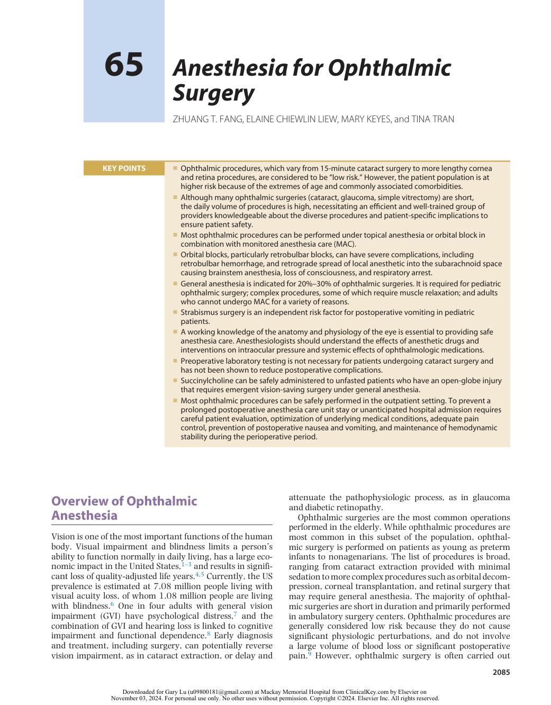
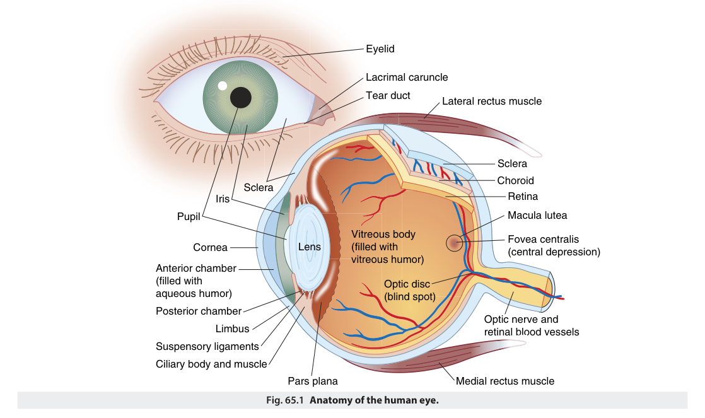
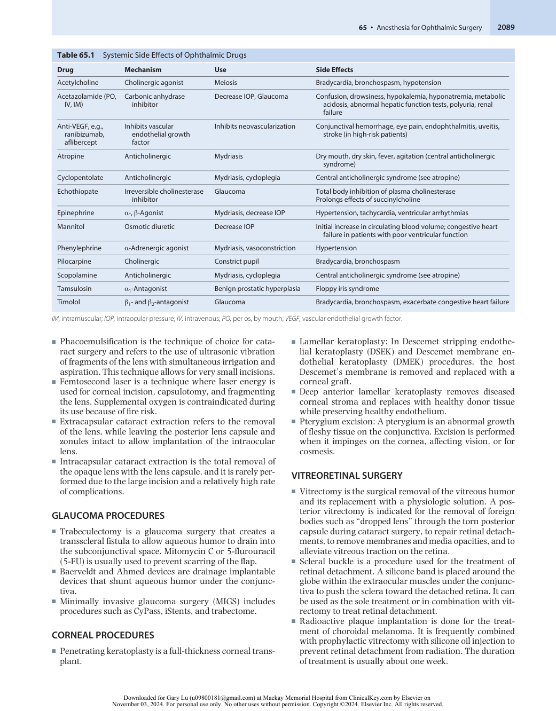
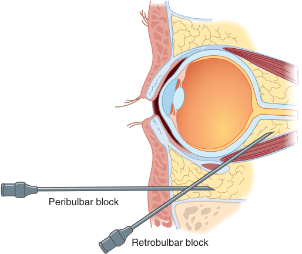
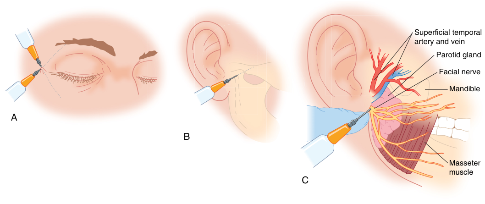
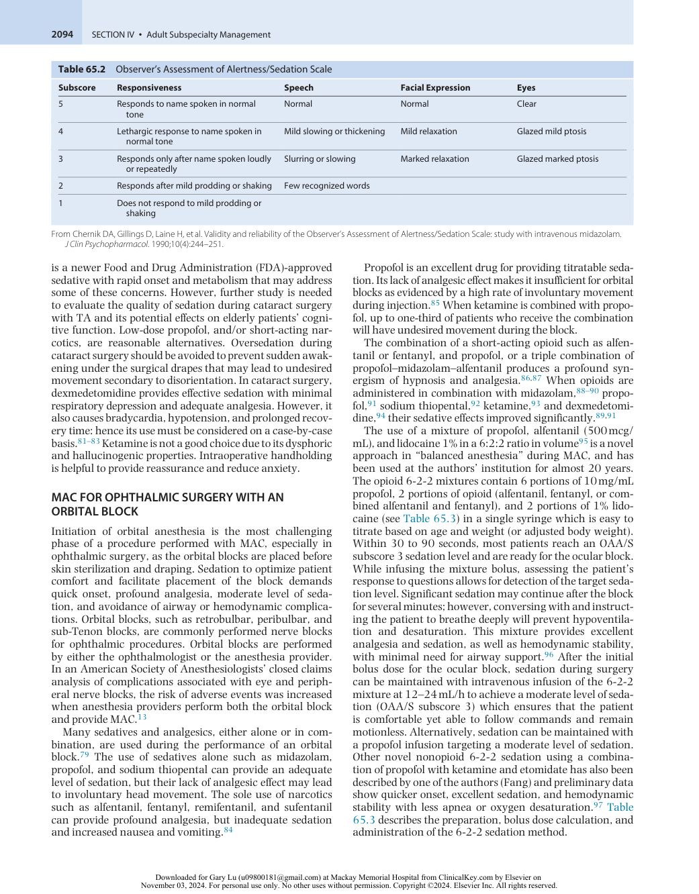
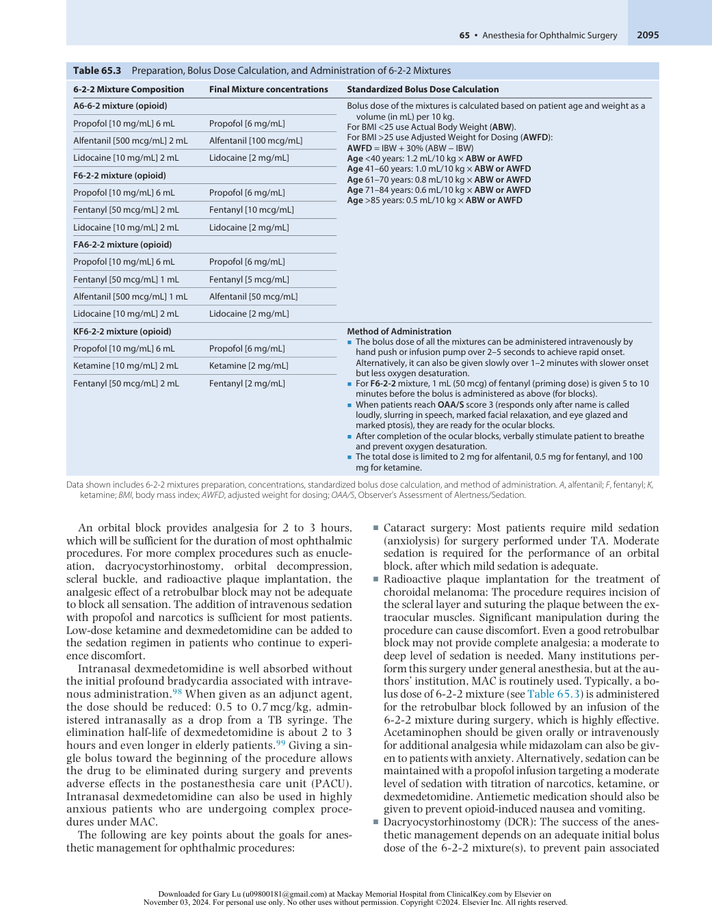

# Anesthesia for Ophthalmic Surgery

<!-- PDF page 1 -->

ZHUANG T. FANG, ELAINE CHIEWLIN LIEW, MARY KEYES, and TINA TRAN

|**KEY POINTS**|ᑏOphthalmic procedures, which vary from 15- minute cataract surgery to more lengthy cornea and retina procedures, are considered to be “low risk.” However, the patient population is at higher risk because of the extremes of age and commonly associated comorbidities. ᑏAlthough many ophthalmic surgeries (cataract, glaucoma, simple vitrectomy) are short, the daily volume of procedures is high, necessitating an efficient and well- trained group of providers knowledgeable about the diverse procedures and patient- specific implications to ensure patient safety. ᑏMost ophthalmic procedures can be performed under topical anesthesia or orbital block in combination with monitored anesthesia care (MAC). ᑏOrbital blocks, particularly retrobulbar blocks, can have severe complications, including retrobulbar hemorrhage, and retrograde spread of local anesthetic into the subarachnoid space causing brainstem anesthesia, loss of consciousness, and respiratory arrest. ᑏGeneral anesthesia is indicated for 20%–30% of ophthalmic surgeries. It is required for pediatric ophthalmic surgery; complex procedures, some of which require muscle relaxation; and adults who cannot undergo MAC for a variety of reasons. ᑏStrabismus surgery is an independent risk factor for postoperative vomiting in pediatric patients. ᑏA working knowledge of the anatomy and physiology of the eye is essential to providing safe anesthesia care. Anesthesiologists should understand the effects of anesthetic drugs and interventions on intraocular pressure and systemic effects of ophthalmologic medications. ᑏPreoperative laboratory testing is not necessary for patients undergoing cataract surgery and has not been shown to reduce postoperative complications. ᑏSuccinylcholine can be safely administered to unfasted patients who have an open- globe injury that requires emergent vision- saving surgery under general anesthesia. ᑏMost ophthalmic procedures can be safely performed in the outpatient setting. To prevent a prolonged postoperative anesthesia care unit stay or unanticipated hospital admission requires careful patient evaluation, optimization of underlying medical conditions, adequate pain control, prevention of postoperative nausea and vomiting, and maintenance of hemodynamic stability during the perioperative period.|
|---|---|

## Overview of Ophthalmic Anesthesia

Vision is one of the most important functions of the human body. Visual impairment and blindness limits a person’s ability to function normally in daily living, has a large economic impact in the United States,1–3 and results in significant loss of quality- adjusted life years.4,5 Currently, the US prevalence is estimated at 7.08 million people living with visual acuity loss, of whom 1.08 million people are living with blindness.6 One in four adults with general vision impairment (GVI) have psychological distress,7 and the combination of GVI and hearing loss is linked to cognitive impairment and functional dependence.8 Early diagnosis and treatment, including surgery, can potentially reverse vision impairment, as in cataract extraction, or delay and

attenuate the pathophysiologic process, as in glaucoma and diabetic retinopathy.

Ophthalmic surgeries are the most common operations performed in the elderly. While ophthalmic procedures are most common in this subset of the population, ophthalmic surgery is performed on patients as young as preterm infants to nonagenarians. The list of procedures is broad, ranging from cataract extraction provided with minimal sedation to more complex procedures such as orbital decompression, corneal transplantation, and retinal surgery that may require general anesthesia. The majority of ophthalmic surgeries are short in duration and primarily performed in ambulatory surgery centers. Ophthalmic procedures are generally considered low risk because they do not cause significant physiologic perturbations, and do not involve a large volume of blood loss or significant postoperative pain.9 However, ophthalmic surgery is often carried out

::: details 原始表格與符號（PDF 第 1 頁）

:::

<!-- PDF page 2 -->

in patients at extremes of age, including premature infants with associated medical conditions to elderly patients7 with coexisting illnesses such as diabetes, hypertension, coronary artery disease, and chronic obstructive pulmonary disease. As a result, adequate preoperative evaluation and optimization are important to prevent last- minute cancellation or to minimize the risk of need for unplanned hospital admission.

As is true for all anesthesia care, patient safety is paramount in ophthalmic anesthesia. The closed claims analysis from the Ophthalmology Mutual Insurance Company (OMIC) reported in 2021 found that all 13 patients who died during eye surgery under general anesthesia and ocular blocks or topical with monitored anesthesia care (MAC) were classified as American Society of Anesthesiologists’ (ASA) Physical Status 3.10 In the ASA Closed Claims Project from 1980 to 2000, the identifiable causes of severe eye injury include intraoperative patient movement, either under general anesthesia or MAC, and needle trauma related to an orbital block with or without patient movement.11,12 In a closed claims analysis of injury and liability associated with MAC for ophthalmic and nonophthalmic surgeries, the major mechanisms of injury included inadequate oxygenation or ventilation, cardiovascular event, equipment failure, operating room fire, inadequate anesthesia leading to patient movement, and oversedation leading to death or permanent brain damage.13 Presently, there are few studies available addressing postoperative complications associated with ophthalmic anesthesia. A retrospective study of prolonged postanesthesia care unit (PACU) stay following ophthalmic surgery found the incidence was about 0.6%,14 the most common factors being hypotension, bradycardia, postoperative nausea and vomiting (PONV), and oversedation. A similar study found new- onset cardiac dysrhythmia, pain, PONV, and pulmonary- related events (hypoxia and pulmonary aspiration) were the primary reasons for unintended hospital admission after ophthalmic surgery, with an incidence of 0.23%.15 Overall, ophthalmic surgery has a low incidence of anesthesia- related complications.

Ambulatory and fast- track surgery have been successfully implemented in ophthalmic surgery to facilitate early discharge home and to allow patients to resume normal activities of daily living.16 To accomplish these goals, each patient’s anesthetic plan should be personalized based on the type, duration, invasiveness of surgery, underlying comorbidities, degree of anxiety, and anesthetic history. The concept of the perioperative surgical home which optimizes a patient- centric, team- based model of care for this and other patient populations has been demonstrated to reduce costs and satisfy patients.17 It can improve outcome18 and may be a particularly useful model of care for ambulatory surgery settings providing ophthalmic surgery. Patient satisfaction has also become a standard indicator of value in health care, including anesthesia care.19,20 Patient satisfaction is particularly important for the patient undergoing ophthalmic surgery, because most procedures are performed on outpatients who are discharged shortly after the surgical procedure. As a result, providing appropriate information, communication, good pain control, and support are the most important predictors of patient satisfaction in the perioperative period for this patient population.21,22

### OCULAR ANATOMY

The eye is a delicate and complex organ that allows us to see images, color, and movement, and helps with depth perception and balance. The eye is a sphere measuring approximately 24 mm in diameter. It is situated in the pyramidal bony orbit. The wall of the globe has three layers: the sclera, the uveal tract, and the retina. Fig. 65.1 shows the individual components of the eye.

The sclera is the outermost layer. It is the tough, fibrous white of the eye, and it is continuous with the cornea anteriorly. The tissue where the cornea and sclera meet is the limbus, which contains stem cells responsible for regeneration of the epithelium. About 60% of the focus power of the eye is from the curvature of the cornea.

The middle layer, the uveal tract, has three structures: the choroid, the iris, and the ciliary body. The choroid is a layer of blood vessels located posteriorly. Bleeding in this layer is one cause of intraoperative expulsive hemorrhage. The pigmented iris controls light entry with muscle fibers that change the size of the pupil. Sympathetic stimulation dilates the pupil by causing iris dilator muscles to contract, whereas parasympathetic stimulation causes meiosis, or pupillary constriction by causing the iris sphincter muscles to contract. The ciliary body lies just behind the iris; it produces aqueous humor. Ciliary muscle fibers adjust the focus by releasing tension on the suspensory fibers, or zonules, of the lens. Opacification of the lens causes a cataract. Uveitis is an inflammatory condition of these structures (iris, choroid, and ciliary body).

The innermost eye layer is the retina, which is a membrane consisting of highly specialized nerve tissue continuous with the optic nerve. Light stimulates retinal photoreceptors to produce neural signals that the optic nerve carries to the brain. There are no capillaries in the retina; the choroid layer provides oxygen and nourishment to the retina. Retinal detachment from the choroid layer compromises the retinal blood supply and is a major cause of vision loss. The retinal layer ends approximately 4 mm behind the iris. The area between the limbus of the cornea and the retina is called the _pars plana_ . Because there is no retinal layer there, it is a safe entrance site for vitrectomy procedures.

The center of the eye is filled with vitreous gel. This thick fluid has attachments to blood vessels and the optic nerve. Traction of the vitreous on the retina is a cause of retinal detachment. Scarring, bleeding, or opacification of the vitreous is treated by vitrectomy.

The extraocular muscles move the globe within the orbit. They arise from a fibrous ring near the apex of the orbit and insert on the sclera. The six extraocular muscles lie within a cone behind the eye surrounding the optic nerve, ophthalmic artery and vein, and ciliary ganglion.

The eyelids have an outer layer of skin, a muscle layer, a tarsal plate of cartilage, and a layer of conjunctiva. The conjunctiva is a mucous membrane that lines the inner eyelids and covers the globe up to the corneal–scleral junction.

The lacrimal gland sits in the superior temporal orbit. It releases tears across the surface of the globe. Tears drain via the puncta near the medial canthus of the eyelids. Tears flow through the canaliculi to the lacrimal sac and duct, to drain into the nasopharynx.

<!-- PDF page 3 -->

Eyelid Lacrimal caruncle Tear duct Lateral rectus muscle Sclera Choroid Sclera Iris Retina Pupil Macula lutea Vitreous body Fovea centralis Cornea Lens (filled with (central depression) vitreous humor) Anterior chamber (filled with Optic disc aqueous humor) (blind spot) Posterior chamber Optic nerve and Limbus retinal  blo od vessels Suspensory ligaments Ciliary body and muscle Pars plana Medial rectus muscle Fig. 65.1 Anatomy of the human eye. 

The ophthalmic artery provides most of the blood supply to the orbital structures. It is a branch of the internal carotid artery, close to the circle of Willis. The superior and inferior ophthalmic veins drain directly into the cavernous sinus.

Cranial nerves (CN) innervate the ocular structures. The optic nerve (CN II) carries the neural signals from the retina. The oculomotor (CN III), trochlear (CN IV), and abducens (CN VI) nerves control the extraocular muscles. Touch and pain sensations are carried via the trigeminal nerve (CN V). Sensation to the lower lid is via the maxillary nerve (CN V2). Sensation to the upper lid is via the frontal branch of the ophthalmic nerve (CN V1). The nasociliary branch of the ophthalmic nerve sends sensory fibers to the medial canthus, lacrimal sac, and ciliary ganglion.

The ciliary ganglion provides sensory innervation to the cornea, iris, and ciliary body. Parasympathetic fibers originate from the oculomotor nerve (CN III) and synapse in the ciliary ganglion before supplying the iris sphincter muscle. Sympathetic fibers originate from the carotid plexus and travel through the ciliary ganglion to innervate the dilator muscle of the iris. Local anesthetic blockade of the ciliary ganglion produces a fixed, mid- dilated pupil.

The facial nerve (CN VII) exits the base of the skull from the stylomastoid foramen. It supplies motor innervation to the orbicularis muscle via the zygomatic branch. Local anesthetic block of the facial nerve can prevent lid squeezing.

### OCULOCARDIAC REFLEX

The oculocardiac reflex was first described by Aschner and Dagnini in 1908. It is also known as the _trigeminovagal reflex_ . Traction on the extraocular muscles or pressure on the

globe causes bradycardia, atrioventricular block, ventricular ectopy, or asystole. It is seen with traction on the medial rectus muscle, but it can occur with stimulation of any of the orbital contents, including the periosteum. The pain, pressure or traction impulses are conducted by the ciliary nerves to the ciliary ganglion and then via the ophthalmic division of the trigeminal nerve to the Gasserian ganglion and the sensory nucleus of the trigeminal nerve. Here, the afferent limb synapses with the motor nucleus of the vagus nerve. The efferent impulses travel to the heart via the vagus nerve, leading to decreases in both heart rate and contractility of the heart. The response is minimized with repeated stimulation.23

Although the oculocardiac reflex can occur for any age group, it is more frequent in children undergoing strabismus surgery. Premedication with atropine or glycopyrrolate can reduce the incidence of the oculocardiac reflex, as can the choice of anesthetic agents. Choi _et al._ reported that the oculocardiac reflex was lowest in children undergoing induction of anesthesia with ketamine instead of propofol.24 The use of opioids such as fentanyl, alfentanil, and remifentanil may contribute to the oculocardiac reflex.25 Retrobulbar block is not uniformly effective at preventing the oculocardiac reflex. Orbital injections can also trigger the response; hypercapnia and hypoxemia can exacerbate the oculocardiac reflex.23,26

In the event of arrhythmia associated with the oculocardiac reflex, the anesthesiologist should first ask the surgeon to cease surgical stimulation. Evaluation to determine if the patient is experiencing any condition that may exaggerate the reflex such as hypoxia, hypercapnia, or inadequate depth of anesthesia should be completed and the patient should receive immediate treatment if the rhythm

<!-- PDF page 4 -->

disturbance persists. Treatment options include administration of intravenous glycopyrrolate 0.1–0.2 mg/(pediatric dose, 10  mcg/kg) or atropine 10–20  mcg/kg. Rarely, epinephrine may be required to treat severe bradycardia or asystole.

### INTRAOCULAR PRESSURE

Normal intraocular pressure (IOP) is necessary to maintain cornea curvature and a proper refracting index of the eye. Normal IOP is 16 ± 5 mm Hg and a value more than 25 mm Hg is considered pathologic. The intraocular perfusion pressure, defined as the difference between the mean arterial pressure and the IOP, is part of the system regulating blood perfusion to the eye’s internal structures. High IOP impairs the blood supply, leading to a loss of optic nerve function.

The globe is a relatively noncompliant compartment. The volume of the internal structures is fixed except for aqueous fluid and choroidal blood volume. The quantity of these two factors regulates IOP. Aqueous formation of 80% to 90% occurs through active secretion by the ciliary body mediated by Na- K ATPase and carbonic anhydrase enzymes. The remainder is from passive filtration and ultrafiltration across the ciliary epithelium. It then enters the angle of the anterior chamber to flow through the trabecular meshwork into the Schlemm canal and the episcleral veins. IOP is primarily regulated by the resistance at the trabecular meshwork.27

Impairment of aqueous drainage at any point can elevate the IOP. Sclerosis of the trabecular meshwork is believed to cause the chronic pressure elevation in open- angle glaucoma. Closed- angle glaucoma occurs when there is an obstruction to aqueous drainage from closure of the anterior chamber angle. This happens from peripheral iris swelling or anterior displacement. Patients with a preexisting narrow angle may be predisposed to this condition. The acute increase in pressure causes severe pain and is an ophthalmologic emergency.

Anesthetic drugs and the conduct of anesthesia have important effects on IOP. All volatile anesthetic drugs cause a decrease in IOP.28–30 Nitrous oxide (N2O) has no effect on IOP. The commonly used intravenous induction anesthetics such as propofol, thiopental, and etomidate all reduce IOP, with propofol causing a moderate reduction in IOP even when used as low- dose intravenous sedation.31 Ketamine does not increase IOP (see the section titled Anesthesia for Pediatric Ophthalmology). The mechanism by which anesthetic drugs reduce IOP is not fully elucidated but involves depression of central nervous system ocular centers, resulting in relaxation of extraocular muscle tone.31 Short- acting opioids such as fentanyl, alfentanil, and remifentanil decrease IOP on induction of anesthesia.32,33 Midazolam has little effect on IOP,34 and sedation with midazolam has been used to facilitate the measurement of IOP in children.35 Nondepolarizing neuromuscular blocking agents (NMBAs) such as rocuronium, vecuronium, and atracurium have little effect on IOP. Succinylcholine increases IOP by about 8 to 10 mm Hg36 due to a variety of postulated mechanisms including reduced aqueous humor outflow, increased choroidal blood volume, and increased central venous pressure.37,38 IOP increases after reversal of nondepolarizing NMBA with

neostigmine and atropine but remains unchanged with sugammadex.39

The most significant rise in IOP during general anesthesia occurs at laryngoscopy and emergence; the increase in IOP is even greater with repeat laryngoscopy.40 Video- guided laryngoscopy causes a smaller increase in IOP than direct laryngoscopy.41,42 Insertion of a laryngeal mask airway results in little or no increase in IOP.43,44 Other anesthetic interventions that increase IOP include compression of the eyes during ventilation, hypoxia, hypercapnia, and hypertension.38 Coughing, straining, or vomiting can increase IOP 30 to 40 mm Hg. A poorly placed anesthesia mask can put enough pressure on the eye to reduce blood flow to zero. Ocular blocks initially increase IOP by 5 to 10 mm Hg, but this falls to below baseline values within 5 minutes. Peribulbar blocks cause the greatest increase in IOP, likely due to the greater volume of local anesthetic that is injected.45

Physiologic factors that increase IOP include being placed in supine, prone, or Trendelenburg positions. A normal blink increases the IOP by 10 mm Hg, while a forceful lid squeeze can increase IOP to more than 70 mm Hg.46

### OPHTHALMIC DRUGS

Ophthalmic medications can be delivered by topical, ocular (intravitreal, subconjunctival, retrobulbar, and intracameral), and systemic methods. Topical eye drops may be absorbed systemically; significant routes of systemic absorption occur at conjunctival capillaries and nasal mucosa. Less significant absorption can occur through the lacrimal drainage system, pharynx, gastrointestinal tract, skin at the cheek and eyelids, and at the aqueous humor and inner ocular tissues.47 When systemic therapy is required, the blood–ocular barrier may inhibit passage of lipophilic drugs; however, this barrier may be impaired by ocular inflammation, intraocular surgery and trauma, or ocular diseases.48 The population at risk of systemic side effects of eye drops are children and the elderly because of anatomic differences, risk of toxicity, the presence of concomitant diseases, and polypharmacy. Most drugs have negligible excretion into breastmilk, with the exception of timolol eye drops, which can potentially cause adverse effects in the nursing infant.49 The total dose of a drug delivered by topical eye drop can be significant. Consider that one drop (typically 50 mcL) of 10% phenylephrine contains 5 mg of drug, which is appreciably more than the intravenous dose of phenylephrine (0.05–0.1 mg). Adverse reactions such as hypertension, arrhythmias, and adverse cardiac events have been reported.50 Systemically administered drugs such as acetazolamide and mannitol can produce side effects such as fluid or electrolyte disturbance that can affect anesthetic management of these patients. Table 65.1 lists the systemic effects of ophthalmic medications.

## Ophthalmic Procedures

### CATARACT EXTRACTION

Cataracts are opacities of the crystalline lens of the eye. Cataract extraction is performed under topical or regional block. General anesthesia is rarely used.

<!-- PDF page 5 -->

**Table 65.1** Systemic Side Effects of Ophthalmic Drugs

|**Drug**|**Mechanism**|**Use**|**Side Effects**|
|---|---|---|---|
|Acetylcholine|Cholinergic agonist|Meiosis|Bradycardia, bronchospasm, hypotension|
|Acetazolamide (PO, IV, IM)|Carbonic anhydrase inhibitor|Decrease IOP, Glaucoma|Confusion, drowsiness, hypokalemia, hyponatremia, metabolic acidosis, abnormal hepatic function tests, polyuria, renal failure|
|Anti- VEGF, e.g., ranibizumab, aflibercept|Inhibits vascular endothelial growth factor|Inhibits neovascularization|Conjunctival hemorrhage, eye pain, endophthalmitis, uveitis, stroke (in high- risk patients)|
|Atropine|Anticholinergic|Mydriasis|Dry mouth, dry skin, fever, agitation (central anticholinergic syndrome)|
|Cyclopentolate|Anticholinergic|Mydriasis, cycloplegia|Central anticholinergic syndrome (see atropine)|
|Echothiopate|Irreversible cholinesterase inhibitor|Glaucoma|Total body inhibition of plasma cholinesterase Prolongs effects of succinylcholine|
|Epinephrine|α- ,β- Agonist|Mydriasis, decrease IOP|Hypertension, tachycardia, ventricular arrhythmias|
|Mannitol|Osmotic diuretic|Decrease IOP|Initial increase in circulating blood volume; congestive heart failure in patients with poor ventricular function|
|Phenylephrine|α- Adrenergic agonist|Mydriasis, vasoconstriction|Hypertension|
|Pilocarpine|Cholinergic|Constrict pupil|Bradycardia, bronchospasm|
|Scopolamine|Anticholinergic|Mydriasis, cycloplegia|Central anticholinergic syndrome (see atropine)|
|Tamsulosin|α1- Antagonist|Benign prostatic hyperplasia|Floppy iris syndrome|
|Timolol|β1- andβ2- antagonist|Glaucoma|Bradycardia, bronchospasm, exacerbate congestive heart failure|

_IM,_ intramuscular; _IOP,_ intraocular pressure; _IV,_ intravenous; _PO,_ per os, by mouth; _VEGF,_ vascular endothelial growth factor.

- n  Phacoemulsification is the technique of choice for cataract surgery and refers to the use of ultrasonic vibration of fragments of the lens with simultaneous irrigation and aspiration. This technique allows for very small incisions.

- n  Femtosecond laser is a technique where laser energy is used for corneal incision, capsulotomy, and fragmenting the lens. Supplemental oxygen is contraindicated during its use because of fire risk.

- n  Extracapsular cataract extraction refers to the removal of the lens, while leaving the posterior lens capsule and zonules intact to allow implantation of the intraocular lens.

- n  Intracapsular cataract extraction is the total removal of the opaque lens with the lens capsule, and it is rarely performed due to the large incision and a relatively high rate of complications.

### GLAUCOMA PROCEDURES

- n  Trabeculectomy is a glaucoma surgery that creates a transscleral fistula to allow aqueous humor to drain into the subconjunctival space. Mitomycin C or 5- flurouracil (5- FU) is usually used to prevent scarring of the flap.

- n  Baerveldt and Ahmed devices are drainage implantable devices that shunt aqueous humor under the conjunctiva.

- n  Minimally invasive glaucoma surgery (MIGS) includes procedures such as CyPass, iStents, and trabectome.

### CORNEAL PROCEDURES

- n  Penetrating keratoplasty is a full- thickness corneal transplant.

- n  Lamellar keratoplasty: In Descemet stripping endothelial keratoplasty (DSEK) and Descemet membrane endothelial keratoplasty (DMEK) procedures, the host Descemet’s membrane is removed and replaced with a corneal graft.

- n  Deep anterior lamellar keratoplasty removes diseased corneal stroma and replaces with healthy donor tissue while preserving healthy endothelium.

- n  Pterygium excision: A pterygium is an abnormal growth of fleshy tissue on the conjunctiva. Excision is performed when it impinges on the cornea, affecting vision, or for cosmesis.

### VITREORETINAL SURGERY

- n  Vitrectomy is the surgical removal of the vitreous humor and its replacement with a physiologic solution. A posterior vitrectomy is indicated for the removal of foreign bodies such as “dropped lens” through the torn posterior capsule during cataract surgery, to repair retinal detachments, to remove membranes and media opacities, and to alleviate vitreous traction on the retina.

- n  Scleral buckle is a procedure used for the treatment of retinal detachment. A silicone band is placed around the globe within the extraocular muscles under the conjunctiva to push the sclera toward the detached retina. It can be used as the sole treatment or in combination with vitrectomy to treat retinal detachment.

- n  Radioactive plaque implantation is done for the treatment of choroidal melanoma. It is frequently combined with prophylactic vitrectomy with silicone oil injection to prevent retinal detachment from radiation. The duration of treatment is usually about one week.

::: details 原始表格與符號（PDF 第 5 頁）

:::

<!-- PDF page 6 -->

### OCULOPLASTIC SURGERY

- n  Eyelid procedures include the correction of ectropion (eyelid turning outward), entropion (eyelid turning inward), ptosis (drooping of the upper eyelid), and blepharoplasty (to remove redundant tissue of the eyelid).

- n  Dacryocystorhinostomy refers to the surgical reopening of the obstructed channel between the lacrimal sac and the nasal cavity caused by a congenital defect or chronic infection.

- n  Orbital surgery includes repair of blowout fractures, drainage of an orbital abscess, decompression for exophthalmos caused by hyperthyroidism, or tumor excision in the orbit or optic nerve.

- n  Evisceration, enucleation, and exenteration. Evisceration refers to the removal of the contents of the eye. Enucleation refers to removal of the eye itself including the globe, but leaving orbital contents such as bone, extraocular muscles, and fat in place. Exenteration refers to the removal of the entire contents of the orbit including the lacrimal gland, optic nerve, and orbital bones.

### Box 65.1 Comorbidities that Require Optimization Prior to Proceeding with Cataract Surgery

   - Myocardial infarction, within 30 days for uncomplicated infarction and within 60 days for complicated infarction

   - Percutaneous coronary interventions, within 14 days without stents or 30 days with stents

   - Significant arrhythmias with hemodynamic compromise, e.g., ventricular tachycardia, atrial fibrillation with rapid ventricular rates

   - Decompensated heart failure

   - Acute serious pulmonary conditions, e.g., active pneumonia,

   - upper respiratory infection with active symptoms, pulmonary embolus in past 3 months

   - Acute or recent severe neurologic conditions (e.g., altered mental status, stroke or transient ischemic attacks [TIA] within 3

   - months, uncontrolled epilepsy, increased intracranial pressure)

   - Malignant hypertension

   - Diabetic ketoacidosis or hyperosmolar hyperglycemic nonketotic syndrome

- n  Tarsorrhaphy is the partial or total suturing together of the eyelids.

## Preoperative Evaluation

Most ophthalmic surgery can be performed electively in an outpatient surgery setting with local or regional anesthesia and minimal to light sedation. Pre- anesthesia evaluation should include a review of the patient’s medical records, interview, and physical examination, with special attention paid to the clinical implications of the systemic effects of ophthalmic medications. Recent eye surgery in general as well as the presence of an intraocular gas bubble must be recognized; nitrous oxide should be avoided in this situation. Special note of the axial length of the eye, a history of staphyloma, or scleral buckle should be made especially if an eye block is to be performed. An inability to recline properly presents significant challenge during ophthalmic surgery. It is important to ascertain that the patient can lie comfortably supine if the plan is for topical or regional anesthesia under monitored anesthesia care. Patients with cervical and lumbar spine disease may require modifications to patient positioning such as padding under the neck and pillow under the knees to alleviate back strain. A history of generalized anxiety disorder, panic attacks, or claustrophobia in patients may require preoperative education and counseling, reassurance, clear communication, and the administration of anxiolytic medication before and during surgery.

As with other ambulatory surgery procedures, preoperative medical tests are not required and should not be ordered routinely in patients undergoing ophthalmic surgery.51 Any laboratory testing, including an electrocardiography, should be ordered only if a patient presents with an acute medical condition that would require further testing irrespective of surgery.

### PREOPERATIVE EVALUATION FOR CATARACT SURGERY

Patients undergoing cataract surgery are often elderly with multiple comorbidities. However, as it is a short, low- risk

surgery, there is very little that precludes cataract surgery if the patient can lie flat for the duration of the surgery.

The Society of Ambulatory Anesthesia published a list of comorbidities which might reasonably delay cataract surgery (Box 65.1).51

Some patients presenting for cataract surgery may have significantly elevated blood pressure or hyperglycemia on the day of surgery, but there is little evidence that these conditions increase adverse events warranting delay of surgery.52,53 Patients should be advised to take all routine medications including antihypertensives on the day of surgery. They do not need to stop their antiplatelet and anticoagulation medications prior to cataract surgery. Occasionally, a patient may present with new- onset (or newly discovered) atrial fibrillation on the day of surgery. Provided that the patient is asymptomatic and hemodynamically stable, cataract surgery may proceed before referring the patient for early evaluation and management of atrial fibrillation.51 History and physical examination before cataract surgery is no longer required by the Centers for Medicare and Medicaid Services (CMS), and routine medical testing including cardiac risk assessment is not recommended before cataract surgery.51

### ANTICOAGULATION

Many elderly patients undergoing eye surgery are on antiplatelet or warfarin therapy. Perioperative management of anticoagulants involves weighing the risks of thrombosis versus hemorrhagic complications. The risk of hemorrhagic complications depends on the degree of anticoagulation and the hemorrhagic potential of the surgical procedure. Serious hemorrhagic complications are most probable in orbital and oculoplastic surgery; of intermediate probability in vitreoretinal, glaucoma, and corneal transplant surgery; and least likely in cataract surgery. Potential bleeding complications include intraretinal hemorrhage, choroidal hemorrhage, vitreous hemorrhage, hyphema, and retrobulbar hemorrhage; however, the incidence of these events is low and estimated to be less than 0.4%.54

<!-- PDF page 7 -->

In a study of more than 19,000 cataract procedures, the incidence of hemorrhagic and thrombotic complications was low.54 It is safe to proceed with cataract surgery without stopping antiplatelet or warfarin therapy provided that the international normalized ratio level is within the therapeutic range.55 Strabismus surgery is associated with a low risk of bleeding and perioperative cessation of anticoagulant therapy is unnecessary. Ocular blocks are rarely associated with severe hemorrhagic complications. For intermediaterisk surgery such as glaucoma surgery, warfarin and antiplatelet drugs may increase the risk of intraoperative or postoperative bleeding.56,57 Survey studies show that 30%– 80% of glaucoma surgeons discontinue anticoagulants 4–7 days prior to surgery and restart it the day after surgery, but other surgeons do not stop anticoagulants at all. If an interruption of anticoagulation treatment is needed, an individualized approach is recommended to minimize the risk of perioperative bleeding. Bridging therapy should be considered in patients with a high risk for thromboembolic events. The consensus in vitreoretinal surgery is that it is safe to proceed with surgery if anticoagulation is within therapeutic range. Oculoplastic surgery can lead to orbital hemorrhage, which is a rare, albeit vision- threatening complication. Many studies support continuing warfarin therapy in most patients undergoing ophthalmic surgeries. There are few data supporting the management of NOAC in ophthalmic surgeries, but some authors recommend cessation of NOACs one day before surgeries that have a higher risk of bleeding complications.

## Orbital Blocks

Intraocular surgery can be performed under local, regional, or general anesthesia. Regional anesthesia is standard for most ophthalmic procedures such as cataract, glaucoma, cornea, and vitreoretinal surgeries.58 Regional anesthesia provides akinesia (immobility) and anesthesia of the eye. The requirement for akinesia will vary by type of surgery and surgeon preference. Facial nerve block may be required to obtain akinesia of the orbicularis oculi muscle of the lid, as its motor innervation is located outside the cone. Regional anesthesia techniques are generally reliable, safe, and provide good postoperative analgesia. Compared with general anesthesia, regional anesthesia is less likely to be associated with PONV. Patients are often able to bypass phase 1 recovery with a quicker discharge home. Patients often view eye blocks with anxiety and apprehension and may be fearful of being aware and awake during their block procedure. Some patients may not be able to cooperate, to lay flat, or lie still during surgery, and therefore may not be able to tolerate surgery under regional anesthesia alone.

### RETROBULBAR BLOCK

Retrobulbar block had long been considered the gold standard of regional techniques for ophthalmic surgery until the 1990s with the introduction of peribulbar block and sub- Tenon block. Retrobulbar block is achieved by injecting local anesthetic inside the muscular cone (Fig. 65.2).

With the globe in primary gaze, a 3- cm, 23- to 27- gauge needle with its bevel opening faced toward the globe is placed at the junction of the inferior and lateral walls of

Peribulbar block Retrobulbar block 

**Fig. 65.2 Position of needles for retrobulbar and peribulbar blocks.** (Redrawn from Spaeth GL. _Ophthalmic Surgery: Principles and Practice._ Philadelphia: WB Saunders; 1982.)

the orbit just above the inferior orbital rim.59 The needle is advanced parallel to the orbit floor (with a 10- degree elevation from the transverse plane) for approximately 15 mm until it is past the equator of the eye. The needle is turned medially and slightly upward to aim toward an imaginary point behind the globe on the axis formed by the pupil and the macula where 2 to 5 mL of local anesthetic solution is injected. The needle tip approaches but does not pass the midsagittal plane of the globe.

Some intorsion on downgaze is expected because the superior oblique muscle is outside the muscle cone and may not be blocked. Many modifications to the classical retrobulbar anesthetic injection have been described to minimize complications of the block. Traditionally, blunt- tipped needles were advocated because they were thought to protect against ocular trauma and because they allowed more accurate definition of tissue planes. However, studies have shown that blunt needles are as likely as sharp needles to cause globe penetration and optic nerve injury. Fine cutting needles produce minimal tissue distortion with little pain.60 Compared with peribulbar block, retrobulbar block has a quicker onset and is associated with less chemosis. Retrobulbar hemorrhage complicates about 1% of retrobulbar injections.61 Venous hemorrhage spreads slowly and does not usually result in long- term visual problems. Arterial hemorrhage can produce rapid orbital swelling, marked proptosis with immobility of the globe, inability to close the lids, and massive blood staining of the lids and conjunctiva. Compressive hematoma can threaten retinal perfusion, leading to severe visual loss. Ophthalmoscopic examination should be performed to evaluate for ischemic damage to the optic nerve or retina. IOP should be measured and a lateral canthotomy may need to be performed to decompress the orbit. Intravascular injection can occur despite a negative aspiration test. The total dose of local anesthetic used is small, and systemic effects are unlikely, even if the total dose is given intravenously. Accidental intra- arterial injection can cause central nervous system excitation and seizures. This occurs because of retrograde passage of local anesthetic solution from the ophthalmic artery to the

<!-- PDF page 8 -->

internal carotid artery and delivery to the thalamus and other midbrain structures. Injection of local anesthetic or retrograde tracking of local anesthetic along the optic nerve sheath into the subdural or subarachnoid space causes partial or total progressive brainstem anesthesia. Wideranging symptoms occur, from aphasia, confusion, and dysphagia to apnea, cardiac arrest, loss of consciousness, and seizures.62,63 Management is supportive and should result in total recovery within several hours. Optic nerve damage, or globe perforation with retinal detachment and vitreous hemorrhage, are devastating complications of retrobulbar block. Risk factors include physician inexperience and a highly myopic eye (axial length longer than 25 mm). This complication is associated with a poor prognosis, particularly in cases of delayed diagnosis.64

### PERIBULBAR BLOCK

Peribulbar block was first described in 1986.65 For this block, the needle is introduced outside the cone, thus preventing retrobulbar hemorrhage and reducing the risk of optic nerve injury (see Fig. 65.2). Many modifications of this block have been described. The classic technique involves two injections: one inferiorly and temporally and the second superiorly and nasally. Peribulbar anesthesia may also be administered with one injection; a 3- cm, 23- gauge Atkinson needle is placed at the junction of the middle and lateral thirds of the lower lid just above the inferior orbital rim. The needle should be directed vertically backwards, parallel to the floor of the orbit. The needle insertion depth should be less than 25 mm. If contact is made with bone, the needle should be redirected slightly upward; then 5 to 10 mL of local anesthetic is injected.66 Studies support the use of peribulbar block in providing equivalent patient analgesia and operating conditions as retrobulbar block for a variety of ophthalmic procedures.67,68

### SUB- TENON BLOCK

To avoid the complications associated with the use of sharp needles, a technique was developed using a blunt cannula under the fascia of Tenon.69 Various lengths of cannulas have been used. Using topical anesthesia with sedation, a speculum is placed to retract the lids. A 2- to 3- mm spot of cautery can be made 5 mm from the limbus in the inferonasal or inferolateral quadrant. A 2- mm incision is made in the conjunctiva with blunt dissection through the fascia. A blunt cannula is directed posteriorly, but not beyond the equator of the globe, with injection of 1 to 3 mL of local anesthetic. A small degree of conjunctival edema is often seen. Analgesia is usually excellent.

### FACIAL NERVE BLOCK

A facial nerve block is performed to prevent squeezing of the eyelids, which interferes with surgery and increases IOP. Akinesia of the orbicularis muscle, which is supplied by the facial nerve, can be achieved by blocking the nerve at its terminal branches (modified van Lint block), superior branches (Atkinson block), or proximal trunk (O’Brien or Nadbath block).

- n  Modified van Lint block: The needle is placed 1 cm lateral to the orbital rim, and 2 to 4 mL of anesthetic is injected deep on the periosteum just lateral to the superolateral and inferolateral orbital rim. The disadvantages of this block include discomfort, proximity to the eye, and postoperative ecchymoses (Fig. 65.3).

- n  Atkinson block: The needle is inserted at the inferior margin of the zygomatic bone below the lateral margin of the orbit and 3 to 4 mL of anesthetic solution is injected as the needle is advanced upward and temporally across the bone at 30 degrees from the vertical.

- n  O’Brien block: The mandibular condyle is palpated inferior to the posterior zygomatic process and anterior to the tragus of the ear as the patient opens and closes the jaw. The needle is inserted perpendicular to the skin, approximately 1 cm to the periosteum. As the needle is withdrawn, 3 mL of anesthetic is injected (see Fig. 65.3).

- n  Nadbath–Rehman block: A 12- mm, 25- gauge needle is inserted perpendicular to the skin between the mastoid process and the posterior border of the mandible. The needle is advanced its full length, and after careful aspiration, 3 mL of anesthetic is injected as the needle is withdrawn. This blocks the entire trunk of the facial nerve. The patient should be told to expect a lower facial droop for several hours postoperatively. The major disadvantage to this block is the proximity of the injection to important structures, such as the carotid artery and the glossopharyngeal nerve.

### LOCAL ANESTHETIC SOLUTIONS FOR REGIONAL TECHNIQUES

For local anesthesia, a 1:1 ratio of bupivacaine 0.75% and lidocaine 2% without epinephrine is administered. Hyaluronidase is added to speed tissue penetration. Hyaluronidase can also be important in preventing anesthetic- related damage to the extraocular muscles. A human recombinant brand of hyaluronidase (Hylenex) is commercially available.

## Monitored Anesthesia Care

In the US, approximately 70% to 80% of ophthalmic procedures can be accomplished by a combination of orbital blocks and monitored anesthesia care (MAC). In the last three decades, the dramatic advancements in ophthalmic surgical techniques have had significant impact on anesthesia management with procedures that are less invasive and shorter in duration.

MAC with regional anesthesia provides many advantages over general anesthesia in lowering postoperative morbidity, mortality, and pulmonary complications.70,71 There is better postoperative pain control,72 a lower incidence of intraoperative hypotension, faster postoperative recovery,73 less PONV, and fewer unplanned hospital admissions.74

Other than cataract surgery, most ophthalmic procedures require orbital blocks that are quick to perform but painful for the patient. Intravenous sedation and analgesia is provided to prevent pain and anxiety.75 Patient movement during orbital blocks, either from pain, anxiety,

<!-- PDF page 9 -->

Superficial temporal artery and vein Parotid gland Facial nerve Mandible A B Masseter muscle C 

**Fig. 65.3 Facial nerve blocks.** (A) van Lint. (B) O’Brien. (C) Nadbath. (Redrawn from Spaeth GL. _Ophthalmic Surgery: Principles and Practice._ Philadelphia: WB Saunders; 1982.)

undersedation, or oversedation, has been linked to complications leading to blindness. Other unique intraoperative conditions make ophthalmic surgery challenging. Many elderly patients are anxious22 and cognitively impaired,76 making it difficult for them to lie flat and remain still during surgery. Covering the face with surgical drapes and rotation of the bed 90 or 180 degrees away from the anesthesia provider also limits access to the airway in the event of a complication or unrecognized patient movement.

The technique for MAC is highly variable and depends on the training and experience of the anesthesia provider, the environment of practice, availability of drugs, and the surgeon’s and patient’s expectation for sedation. While monitoring of the patient during the procedure is critical, there is no universal regimen for MAC.77

Intravenous sedation is a continuum ranging from mild and moderate sedation to deep sedation that overlaps with general anesthesia.78 The depth of sedation can quickly increase to a deeper level depending on age, weight, cardiac function, genetics, and general health. Some patients have a high tolerance to sedatives while others may be more sensitive. This variability presents a challenge for the fast- track practice of ophthalmic anesthesia. The published _Practice Guidelines for Moderate Procedural Sedation and Analgesia 2018_79 provides evidence- based recommendations for MAC which is also applicable in ophthalmic anesthesia. However, for those patients requiring increasing levels of sedation that risk compromise of the airway, presence of the anesthesia provider is critical to patient management and outcome.

The challenge of MAC in ophthalmic surgery is to sedate a patient adequately, quickly, and safely for an ocular block, prevent loss of the airway, and simultaneously maintain operating room efficiency. Ideally, the metrics of intravenous sedation in ophthalmic surgery should be quantitatively measurable; the time required to reach the targeted level of sedation and analgesia, and the efficacy of pain control while avoiding respiratory depression or apnea. It is not necessary to use loss of consciousness as an end point of

sedation. To do so can lead to apnea, hypoxia, involuntary movement in reaction to pain, and hemodynamic instability. During orbital blocks and surgery, patients should be sedated to a moderate level such as subscore 3 of the Observer’s Assessment of Alertness/Sedation (OAA/S) Scale (Table 65.2). The objective of MAC is to provide patient analgesia and anxiolysis without loss of respiration and protective airway reflexes, thus preventing movement and possible ocular trauma during performance of ocular block. Treating complications that occur during orbital blocks, and being prepared to convert to general anesthesia if MAC is inadequate or there is airway compromise, are important responsibilities of the anesthesia provider.

### MAC FOR CATARACT SURGERY UNDER TOPICAL ANESTHESIA

Topical anesthesia (TA) has become popular due to its ease of administration and avoidance of complications of orbital blocks. TA requires patient cooperation due to the lack of ocular akinesia. Patients undergoing cataract surgery with TA may experience some discomfort and require intravenous analgesic medication in small doses.80 Most patients undergoing cataract surgery want sedation, which can be given either intravenously or orally.81 Local anesthetic eye drops, such as 0.5% tetracaine, 0.75% bupivacaine, and 2% lidocaine, are very effective in producing analgesia although their effects can dissipate with constant irrigation.

When the femtosecond laser is used for the procedures, it may take up to 5 minutes to appropriately dock and position the patient, although actual laser delivery takes only 30 seconds. Discomfort during the procedure is managed with TA. Ideally, sedation should be avoided to allow patient cooperation. If necessary, a small dose of a sedative or analgesic can be given.

Midazolam is the primary sedative used for anxiolysis during cataract surgery with TA. Its side effects of oversedation, paradoxical reaction, postoperative delirium, and memory deficit are concerning in the elderly. Remimazolam

<!-- PDF page 10 -->

**Table 65.2** Observer’s Assessment of Alertness/Sedation Scale

|**Subscore**|**Responsiveness**|**Speech**|**Facial Expression**|**Eyes**|
|---|---|---|---|---|
|5|Responds to name spoken in normal tone|Normal|Normal|Clear|
|4|Lethargic response to name spoken in normal tone|Mild slowing or thickening|Mild relaxation|Glazed mild ptosis|
|3|Responds only after name spoken loudly or repeatedly|Slurring or slowing|Marked relaxation|Glazed marked ptosis|
|2|Responds after mild prodding or shaking|Few recognized words|||
|1|Does not respond to mild prodding or shaking||||

From Chernik DA, Gillings D, Laine H, et al. Validity and reliability of the Observer’s Assessment of Alertness/Sedation Scale: study with intravenous midazolam. _J Clin Psychopharmacol_ . 1990;10(4):244–251.

is a newer Food and Drug Administration (FDA)- approved sedative with rapid onset and metabolism that may address some of these concerns. However, further study is needed to evaluate the quality of sedation during cataract surgery with TA and its potential effects on elderly patients’ cognitive function. Low- dose propofol, and/or short- acting narcotics, are reasonable alternatives. Oversedation during cataract surgery should be avoided to prevent sudden awakening under the surgical drapes that may lead to undesired movement secondary to disorientation. In cataract surgery, dexmedetomidine provides effective sedation with minimal respiratory depression and adequate analgesia. However, it also causes bradycardia, hypotension, and prolonged recovery time: hence its use must be considered on a case-by-case basis.81–83 Ketamine is not a good choice due to its dysphoric and hallucinogenic properties. Intraoperative handholding is helpful to provide reassurance and reduce anxiety.

### MAC FOR OPHTHALMIC SURGERY WITH AN ORBITAL BLOCK

Initiation of orbital anesthesia is the most challenging phase of a procedure performed with MAC, especially in ophthalmic surgery, as the orbital blocks are placed before skin sterilization and draping. Sedation to optimize patient comfort and facilitate placement of the block demands quick onset, profound analgesia, moderate level of sedation, and avoidance of airway or hemodynamic complications. Orbital blocks, such as retrobulbar, peribulbar, and sub- Tenon blocks, are commonly performed nerve blocks for ophthalmic procedures. Orbital blocks are performed by either the ophthalmologist or the anesthesia provider. In an American Society of Anesthesiologists’ closed claims analysis of complications associated with eye and peripheral nerve blocks, the risk of adverse events was increased when anesthesia providers perform both the orbital block and provide MAC.13

Many sedatives and analgesics, either alone or in combination, are used during the performance of an orbital block.79 The use of sedatives alone such as midazolam, propofol, and sodium thiopental can provide an adequate level of sedation, but their lack of analgesic effect may lead to involuntary head movement. The sole use of narcotics such as alfentanil, fentanyl, remifentanil, and sufentanil can provide profound analgesia, but inadequate sedation and increased nausea and vomiting.84

Propofol is an excellent drug for providing titratable sedation. Its lack of analgesic effect makes it insufficient for orbital blocks as evidenced by a high rate of involuntary movement during injection.85 When ketamine is combined with propofol, up to one-third of patients who receive the combination will have undesired movement during the block.

The combination of a short- acting opioid such as alfentanil or fentanyl, and propofol, or a triple combination of propofol–midazolam–alfentanil produces a profound synergism of hypnosis and analgesia.86,87 When opioids are administered in combination with midazolam,88–90 propofol,91 sodium thiopental,92 ketamine,93 and dexmedetomidine,94 their sedative effects improved significantly.89,91

The use of a mixture of propofol, alfentanil (500 mcg/ mL), and lidocaine 1% in a 6:2:2 ratio in volume95 is a novel approach in “balanced anesthesia” during MAC, and has been used at the authors’ institution for almost 20 years. The opioid 6- 2- 2 mixtures contain 6 portions of 10 mg/mL propofol, 2 portions of opioid (alfentanil, fentanyl, or combined alfentanil and fentanyl), and 2 portions of 1% lidocaine (see Table 65.3) in a single syringe which is easy to titrate based on age and weight (or adjusted body weight). Within 30 to 90 seconds, most patients reach an OAA/S subscore 3 sedation level and are ready for the ocular block. While infusing the mixture bolus, assessing the patient’s response to questions allows for detection of the target sedation level. Significant sedation may continue after the block for several minutes; however, conversing with and instructing the patient to breathe deeply will prevent hypoventilation and desaturation. This mixture provides excellent analgesia and sedation, as well as hemodynamic stability, with minimal need for airway support.96 After the initial bolus dose for the ocular block, sedation during surgery can be maintained with intravenous infusion of the 6- 2- 2 mixture at 12–24 mL/h to achieve a moderate level of sedation (OAA/S subscore 3) which ensures that the patient is comfortable yet able to follow commands and remain motionless. Alternatively, sedation can be maintained with a propofol infusion targeting a moderate level of sedation. Other novel nonopioid 6- 2- 2 sedation using a combination of propofol with ketamine and etomidate has also been described by one of the authors (Fang) and preliminary data show quicker onset, excellent sedation, and hemodynamic stability with less apnea or oxygen desaturation.97 Table 65.3 describes the preparation, bolus dose calculation, and administration of the 6- 2- 2 sedation method.

::: details 原始表格與符號（PDF 第 10 頁）

:::

<!-- PDF page 11 -->

**Table 65.3** Preparation, Bolus Dose Calculation, and Administration of 6- 2- 2 Mixtures

|**6- 2- 2 Mixture Composition**|**Final Mixture concentrations**|**Standardized Bolus Dose Calculation**|
|---|---|---|
|**A6- 6- 2 mixture (opioid)**||Bolus dose of the mixtures is calculated based on patient age and weight as a l i    k|
|Propofol [10 mg/mL] 6 mL|Propofol [6 mg/mL]|voume (n mL) per 10 g. For BMI &lt;25 use Actual Body Weight (**ABW**).|
|Alfentanil [500 mcg/mL] 2 mL|Alfentanil [100 mcg/mL]|For BMI >25 use Adjusted Weight for Dosing (**AWFD**): **~~A~~WFD**= IBW + 30% (ABW − IBW)|
|Lidocaine [10 mg/mL] 2 mL|Lidocaine [2 mg/mL]|**Age**&lt;40 years: 1.2 mL/10 kg ×**ABW or AWFD** |
|**F6- 2- 2 mixture (opioid)**||**~~A~~ge**41–60 years: 1.0 mL/10 kg ×**ABW or AWFD** **Age**61–70 years: 0.8 mL/10 kg ×**ABW or AWFD**|
|Propofol [10 mg/mL] 6 mL|Propofol [6 mg/mL]|**Age**71–84 years: 0.6 mL/10 kg ×**ABW or AWFD** **~~A~~ge**>85 years: 0.5 mL/10 kg ×**ABW or AWFD**|
|Fentanyl [50 mcg/mL] 2 mL|Fentanyl [10 mcg/mL]||
|Lidocaine [10 mg/mL] 2 mL|Lidocaine [2 mg/mL]||
|**FA6- 2- 2 mixture (opioid)**|||
|Propofol [10 mg/mL] 6 mL|Propofol [6 mg/mL]||
|Fentanyl [50 mcg/mL] 1 mL|Fentanyl [5 mcg/mL]||
|Alfentanil [500 mcg/mL] 1 mL|Alfentanil [50 mcg/mL]||
|Lidocaine [10 mg/mL] 2 mL|Lidocaine [2 mg/mL]||
|**KF6- 2- 2 mixture (opioid)**||**Method of Administration** |
|Propofol [10 mg/mL] 6 mL|Propofol [6 mg/mL]|~~ᑏ~~The bolus dose of all the mixtures can be administered intravenously by hand push or infusion pump over 2–5 seconds to achieve rapid onset.|
|Ketamine [10 mg/mL] 2 mL|Ketamine [2 mg/mL]|Alternatively, it can also be given slowly over 1–2 minutes with slower onset but less oxygen desaturation.|
|Fentanyl [50 mcg/mL] 2 mL|Fentanyl [2 mg/mL]| ᑏFor**F6- 2- 2**mixture, 1 mL (50 mcg) of fentanyl (priming dose) is given 5 to 10 minutes before the bolus is administered as above (for blocks). ᑏWhen patients reach**OAA/S**score 3 (responds only after name is called loudly, slurring in speech, marked facial relaxation, and eye glazed and marked ptosis), they are ready for the ocular blocks. ᑏAfter completion of the ocular blocks, verbally stimulate patient to breathe and prevent oxygen desaturation. ᑏThe total dose is limited to 2 mg for alfentanil, 0.5 mg for fentanyl, and 100 mg for ketamine.|

Data shown includes 6- 2- 2 mixtures preparation, concentrations, standardized bolus dose calculation, and method of administration. _A_ , alfentanil; _F_ , fentanyl; _K_ , ketamine; _BMI_ , body mass index; _AWFD_ , adjusted weight for dosing; _OAA/S_ , Observer’s Assessment of Alertness/Sedation.

An orbital block provides analgesia for 2 to 3 hours, which will be sufficient for the duration of most ophthalmic procedures. For more complex procedures such as enucleation, dacryocystorhinostomy, orbital decompression, scleral buckle, and radioactive plaque implantation, the analgesic effect of a retrobulbar block may not be adequate to block all sensation. The addition of intravenous sedation with propofol and narcotics is sufficient for most patients. Low- dose ketamine and dexmedetomidine can be added to the sedation regimen in patients who continue to experience discomfort.

Intranasal dexmedetomidine is well absorbed without the initial profound bradycardia associated with intravenous administration.98 When given as an adjunct agent, the dose should be reduced: 0.5 to 0.7 mcg/kg, administered intranasally as a drop from a TB syringe. The elimination half- life of dexmedetomidine is about 2 to 3 hours and even longer in elderly patients.99 Giving a single bolus toward the beginning of the procedure allows the drug to be eliminated during surgery and prevents adverse effects in the postanesthesia care unit (PACU). Intranasal dexmedetomidine can also be used in highly anxious patients who are undergoing complex procedures under MAC.

The following are key points about the goals for anesthetic management for ophthalmic procedures:

- n  Cataract surgery: Most patients require mild sedation (anxiolysis) for surgery performed under TA. Moderate sedation is required for the performance of an orbital block, after which mild sedation is adequate.

- n  Radioactive plaque implantation for the treatment of choroidal melanoma: The procedure requires incision of the scleral layer and suturing the plaque between the extraocular muscles. Significant manipulation during the procedure can cause discomfort. Even a good retrobulbar block may not provide complete analgesia; a moderate to deep level of sedation is needed. Many institutions perform this surgery under general anesthesia, but at the authors’ institution, MAC is routinely used. Typically, a bolus dose of 6- 2- 2 mixture (see Table 65.3) is administered for the retrobulbar block followed by an infusion of the 6- 2- 2 mixture during surgery, which is highly effective. Acetaminophen should be given orally or intravenously for additional analgesia while midazolam can also be given to patients with anxiety. Alternatively, sedation can be maintained with a propofol infusion targeting a moderate level of sedation with titration of narcotics, ketamine, or dexmedetomidine. Antiemetic medication should also be given to prevent opioid- induced nausea and vomiting.

- n  Dacryocystorhinostomy (DCR): The success of the anesthetic management depends on an adequate initial bolus dose of the 6- 2- 2 mixture(s), to prevent pain associated

::: details 原始表格與符號（PDF 第 11 頁）

:::

<!-- PDF page 12 -->

with the injection of local anesthetics near the tear duct and inside the nose. A continuous infusion of low- dose propofol and intermittent doses of narcotics, such as fentanyl, or the 6- 2- 2 mixture(s) is necessary to provide adequate analgesia. The patient must be awake enough to protect their airway from aspiration of blood that enters the oropharynx from the nasolacrimal system. Adding intravenous low- dose ketamine or intranasal dexmedetomidine can provide additional analgesia if necessary. If the procedure is bilateral or a re- operation, general anesthesia is likely a better choice.

- n  Orbitotomy: This can be done under MAC if the procedure is primarily for debulking of soft tissue without bony involvement. The anesthetic approach is similar to that of radioactive plaque implantation or DCR discussed above.

- n  Cornea transplant: Partial- thickness corneal transplant and penetrating keratoplasty can be carried out under retrobulbar block and MAC. Some surgeons also perform a facial nerve block to prevent eyelid squeezing. The approach of MAC for retrobulbar block and intraoperative sedation is similar to that of the procedures discussed above. The patient must be awake enough so they will not move inadvertently, especially during penetrating keratoplasty.

- n  Enucleation: This can be done with MAC in appropriate patients. In addition to a retrobulbar block, infiltration of the orbital area with bupivacaine at the end of the procedure will be helpful for postoperative analgesia. The anesthetic management is similar to that of radioactive plaque implantation discussed above.

- n  Ruptured globe: Ruptured globe injury can be repaired under an orbital block and MAC depending on the degree of injury.100 It is crucial to minimize elevation of IOP during the block and surgery. The 6- 2- 2 sedation method is very effective in the prevention of patient pain and head movement during ocular blocks.

### SPECIAL CONSIDERATIONS

- n  Morbid obesity/OSA: Morbid obesity has been identified as an independent predictor of sedation- related cardiopulmonary complications.101 In addition to obesityassociated comorbidities, such as obstructive sleep apnea (OSA), restrictive lung disease, diabetes mellitus (DM), and coronary artery disease, obese patients are at increased risk of airway closure and hypoxia during sedation.102 The pharmacokinetics of drugs is altered in the morbidly obese. Many drugs, including narcotics, should be dosed based on ideal body weight (IBW). When the 6- 2- 2 mixtures (see Table 65.3) were given based on adjusted body weight, IBW + 30% (total body weight − IBW), the time for patient readiness of blocks, sedation level, analgesic effect, and incidence of airway events were comparable to normal- weight patients.95,96 Administration of 100% oxygen for several minutes, in addition to supplemental oxygen via nasal cannula before sedation, may alleviate hypoxemia during the orbital block in morbidly obese patients with chronic lung diseases.

- n  Elderly patients have increased sensitivity to all sedatives and narcotics,77,103 as well as an increased risk of complications associated with MAC.13 In addition to a reduction in drug dose requirement, the onset of action will be slower compared to younger patients.77,95

## General Anesthesia

General anesthesia is indicated in approximately 20%–30% of ophthalmic procedures, primarily for pediatric patients and in adults undergoing complex or invasive procedures whose anesthetic requirement cannot be met by orbital blocks and MAC. Some adults with cognitive impairment, claustrophobia, or who have a contraindication for an orbital block are also candidates for general anesthesia. The special considerations for general anesthesia in ophthalmic surgery should focus on the prevention of intraoperative patient movement that can lead to complications, coughing and bucking, which dramatically increases IOP38 and risks periorbital hemorrhage after procedures such as orbital decompression or enucleation. PONV can cause elevation of IOP, prolonged PACU stay, and unanticipated hospital admission.

Fluid shifts are generally minimal in ophthalmic procedures. Significant blood loss is uncommon except for procedures such as orbital decompression, enucleation and evisceration, and lacrimal duct procedures. The main contributors to hemodynamic instability during general anesthesia in these patients are the patient’s underlying comorbidity, such as advanced age, DM, and hypertension. Fluid deficits caused by fasting, autonomic dysfunction due to vascular disease, DM, and Parkinson’s disease, exaggerate the anesthetic effects on the cardiovascular system.

The laryngeal mask airway (LMA) is widely used in both adult and pediatric patients undergoing ophthalmic procedures that do not require paralysis or airway protection from aspiration. Those procedures include strabismus repair, scleral buckle, orbitotomy, enucleation, glaucoma, and cataract surgery in adults. The advantages of the LMA over an ETT include less hemodynamic changes upon insertion, minimal effect on IOP,104,105 and the lack of requirement for muscle relaxants or intubating equipment.106 A disadvantage of the LMA in ophthalmic surgery is that if there is difficulty with ventilation after the surgery is underway, the airway is difficult to access because it is close to the surgical field and often the patient’s head is turned 90 degrees away from the anesthesia provider. If it becomes necessary to adjust the LMA or perform endotracheal intubation, the sterility of the surgical field can become compromised during those maneuvers.

Endotracheal intubation is required for selected ophthalmic procedures, including penetrating keratoplasty, deep anterior lamellar keratoplasty, combined corneal transplantation and vitrectomy, and some vitreoretinal procedures requiring muscle relaxation. Prevention of patient movement is critical during penetrating keratoplasty. In addition to ensuring an adequate depth of anesthesia, profound muscle relaxation must be ensured by using a nerve stimulator where 0/4 twitches and minimal posttetanic count are present while the diseased cornea has been removed and the eye is completely open. Movement at this time could result in loss of ocular contents or choroidal hemorrhage. Profound relaxation is required until the donor cornea is secured with 8 sutures, when ocular contents are no longer open to the atmosphere. Sudden movement during vitreoretinal procedures where there are instruments inside the eye can also lead to injury that

<!-- PDF page 13 -->

must be prevented. Profound levels of muscle relaxation after administration of rocuronium or vecuronium can be reversed with sugammadex.

Intraoperative hypotension can occur, particularly for elderly patients. It must be treated aggressively. Multiple studies have shown intraoperative hypotension (variously defined as systolic blood pressure &lt;90 mm Hg or mean arterial pressure &lt;50–55 mm Hg, depending on the studies) to be associated with acute kidney injury, myocardial injury, stroke, and mortality.107–112 Intraoperative hypotension should be managed with a continuous infusion of phenylephrine instead of repeated phenylephrine boluses to maintain hemodynamic stability. In this situation, decreasing anesthetic depth to correct hypotension could potentially result in patient movement if there is inadequate muscle relaxation.

The prevention of coughing and bucking during emergence is another important goal in ophthalmic surgery because they both dramatically increase IOP,38 and the incidence of hemorrhage in both intraocular and extraocular surgery. If there is no contraindication, a “deep” endotracheal extubation should be performed in patients who are breathing adequately at a deep level of anesthesia.113,114 A number of other strategies are also useful in preventing coughing, such as the use of an LMA where appropriate. Total intravenous anesthesia with propofol is superior to sevoflurane, especially in smokers,115 but it can delay emergence and PACU discharge. Propofol and sevoflurane are additive pharmacodynamically.86 A combination of 0.5 minimum alveolar concentration of sevoflurane and infusion of propofol at 50 to 100 mcg/kg/min is a reasonable approach to prevent coughing and postoperative delirium without delaying PACU discharge. In intubated patients, topical intratracheal lidocaine works slightly better than intravenous lidocaine. However, in cases lasting greater than 2 hours, the benefits of intratracheal lidocaine diminish.116,117 If a “deep” endotracheal extubation is contraindicated, the patient should be suctioned while at a deep level of anesthesia, intravenous lidocaine given, and extubation performed as soon as safely possible.

Prevention of IOP fluctuation, especially in an open eye, glaucoma, and retinal detachment, can potentially reduce the risk of further eye injury. Video- guided laryngoscopy, can significantly decrease the rise of IOP compared to direct laryngoscopy as well as attenuate hemodynamic alterations.41,118

Prevention of PONV in ophthalmic surgery is important to improve patient satisfaction,119 and to prevent increases in IOP that are potentially harmful in relation to the procedure just performed. The treatment for the prevention of PONV should be determined by the Consensus Guidelines for the Management of PONV by Gan and colleagues.120

Nitrous oxide, if used as part of the anesthetic management, should be discontinued 15 to 20 minutes prior to the injection of sulfur hexafluoride (SF6), or octafluoropropane (C3F8) used for retinal tamponade. N2O is avoided for 3 weeks after SF6, or 8 weeks after C3F8 as it may increase the size of the gas bubble through diffusion. Patients are also advised to avoid air travel or high altitude because the reduced atmospheric pressure will lead to expansion of the intraocular gas bubble. Silicone oil is used for retinal tamponade in patients who need longer duration of tamponade,

have difficulty in positioning, or cannot avoid air travel after surgery. Unlike gases, silicone oil is permanent and remains in the eye until surgically removed.121

## Anesthesia for Pediatric Ophthalmology

Anesthesia for pediatric ophthalmology encompasses a diverse group of patients and procedures. Patients range from the premature infant with all the attendant comorbidities, to children with congenital syndromes, to healthy children and adolescents. Many ophthalmic procedures that are performed in adults under MAC require general anesthesia for a pediatric patient.

### GLAUCOMA

Measurement of IOP and a thorough ocular examination in the awake child is often difficult due to lack of cooperation and therefore frequently requires general anesthesia. Anesthetic drugs and interventions such as laryngoscopy affect IOP. While accurate IOP measurement is important to the diagnosis and treatment of pediatric glaucoma, it is one of numerous diagnostic criteria. Examination of the optic nerve, pachymetry to measure corneal thickness, and gonioscopy of the iridocorneal angle are all important components of the examination. Trends in measurement of the IOP in the same patient over time, under the same conditions, are also useful in management.

An inhalation induction with sevoflurane is commonly performed in pediatric patients and is associated with a reduction in IOP within minutes. Premedication with oral midazolam facilitates a smooth induction as agitation and crying will falsely elevate IOP. Oral midazolam appears to have no significant effect on IOP.35 Oberacher and colleagues studied the effect of oral midazolam in a group of young children and found no significant difference between the IOPs measured when awake versus sedated. Ketamine, which is thought to have minimal impact on IOP, has been used for sedation and IOP measurement in children. However, agitation and hallucinations during recovery has led to limited usefulness.

The ophthalmologist in coordination with the anesthesiologist is able to measure the IOP before a deep level of anesthesia is achieved. The ophthalmologist needs to be in the room with instruments ready prior to induction. The mask is positioned so that the ophthalmologist has unobstructed access to the eye. If necessary, the mask can be removed briefly to allow IOP measurement and then replaced. Unlike adults with glaucoma who are most often managed medically, pediatric patients are primarily treated with surgical interventions such as goniotomy, trabeculectomy, and pressure- lowering devices.

About 10% of primary congenital glaucoma is inherited. Secondary glaucoma can be the result of a systemic condition such as neurofibromatosis, rubella, or Sturge–Weber syndrome (congenital capillary hemangiomatosis). However, most cases of pediatric glaucoma have no identifiable cause. These children must come to the operating room for frequent examinations under anesthesia to monitor therapy. It is essential to establish a good rapport with the patient

<!-- PDF page 14 -->

and family and to use premedication with midazolam and/ or parental presence to achieve a smooth induction of anesthesia. An LMA is suitable for examination under anesthesia except for the very young infant where endotracheal intubation is preferred. If a surgical intervention is required, the LMA may be changed to an endotracheal tube at the choice of the anesthesia provider.

### STRABISMUS

Strabismus surgery is the most common type of ophthalmic surgery performed in children. It has historically been associated with an incidence of postoperative vomiting (POV) of over 50% in numerous studies. Eberhart _et al._ identified strabismus surgery as an independent predictor for POV in children.122 Additional independent predictors include age over 3 years, duration of surgery greater than 30 minutes, and a history of POV or PONV in the patient, sibling, or parent. When two, three, or four risk factors are present, the risk of POV is 30%, 55%, and 70%, respectively. With the development of risk scores and the Consensus Guidelines by Gan and colleagues120 to predict and manage POV in children and PONV in adults, the incidence of these events has been dramatically reduced.

For children at high risk for POV (>2 risk factors), as those having strabismus surgery are, a combination of a 5- HT3 antagonist and a steroid should be administered prophylactically. Dexamethasone in a dose of 0.1–0.2 mg/ kg at the beginning of the procedure, and ondansetron 0.1 mg/kg toward the end of the case is the recommended strategy. A propofol infusion at a subhypnotic dose in combination with other antiemetics also reduces the incidence of POV.123 Those children with all four risk factors should avoid receiving nitrous oxide and inhalational anesthetics. Total intravenous anesthesia (TIVA) with propofol should be implemented in such cases. Droperidol is an effective antiemetic; however, the FDA “black box” warning has so restricted its use that it is no longer a viable option.

The oculocardiac reflex (OCR) is frequently elicited during strabismus repair by traction on the extraocular muscles (see Oculocardiac Reflex, above). When the response is profound, removal of the stimulus by the surgeon is the first step in resolution. The reflex usually accommodates over time and is rarely hemodynamically significant in healthy children. If, however, the bradycardia persists, it may be treated with an anticholinergic agent, either atropine or glycopyrrolate. A lesser-known reflex, the oculorespiratory reflex (ORR) leads to bradypnea and respiratory pauses.124 The afferent limb is the same as for the OCR; the efferent limb has not been clearly established. It is not responsive to anticholinergics. The ORR may be less appreciated because of the use of assisted modes of ventilation commonly used during strabismus surgery. Airway management is typically with an LMA unless a contraindication is present.

### RETINOPATHY OF PREMATURITY

Retinopathy of prematurity (ROP) is a major cause of blindness and other visual disabilities in children throughout the world. Improved survival of extremely premature babies has led to an increased incidence of ROP. ROP was first linked with liberal oxygen use in premature infants in the

1940s. Setting target ranges of oxygen saturation in the 91%–95% range has decreased the impact of oxygen as a risk factor.125 Gestational age and low birth weight are major risk factors for the development of ROP. Other factors such as anemia, sepsis, and bronchopulmonary dysplasia (BPD) are also important predictors. Screening guidelines for ROP include a dilated fundus examination for all premature infants less than 30 weeks’ gestational age or 1500 g at birth. Most of these initial screening exams are done in the neonatal intensive care unit (NICU) without intervention from an anesthesia provider. Older infants may need to come to the operating room for surgery or laser treatments.

Care of the ex- premature infant is complex and starts with a thorough history with attention to gestational age, birth weight, NICU course, duration of intubation and ventilation, history of apnea and bradycardia, the presence of BPD, and any congenital anomalies. Abnormalities of pulmonary function are common in children with BPD and many have increased airway reactivity.126 This is an important consideration when any formerly premature child who has had BPD undergoes a surgical procedure. As with ROP, younger infants are surviving with BPD and the long- term sequelae are not completely known.

Although it has been more than 30 years since the initial recommendation for monitoring the formerly preterm infant following general or regional anesthesia, those recommendations are still current.127 There is interinstitutional variation, with the most conservative centers recommending monitoring for apnea and bradycardia for at least 12 hours until 60 weeks’ postconception age (PCA). Some infants who have had a complicated NICU course and continue to be oxygen dependent at home, have anemia, or continue to have episodes of apnea and bradycardia would not be suitable to have surgery performed in an outpatient setting despite being greater than 60 weeks’ PCA.

General anesthesia is required for infants and children having laser treatments and other surgical interventions for ROP. The need for a motionless field is best ensured by endotracheal intubation and the use of muscle relaxants. Some infants may have been recently extubated and it may be difficult to extubate at the end of the surgical procedure. Premature infants often experience periodic breathing upon emergence from anesthesia, in which case the patient should be returned to the NICU, extubated when fully recovered, and closely monitored for evidence of hypoventilation or apneic episodes.

## Postoperative Considerations in Ophthalmic Surgery

It is commonly assumed that ophthalmic surgery is associated with little postoperative pain. While this may be true of cataract surgery,128 significant postoperative pain is associated with posterior segment surgery, corneal surgery, ocular muscle surgery, and enucleations.129 Yet pain in ophthalmic surgery is often underrecognized, and postoperative pain management in complex ophthalmic surgery is frequently inadequate.130 Postoperative pain after ophthalmic surgery is preferably treated with multimodal analgesia such as acetaminophen (oral or intravenous), nonsteroidal anti- inflammatory medications, gabapentin, and regional

<!-- PDF page 15 -->

block. Opioid use should be limited, as opioid prescription after short- stay surgery is a risk factor for chronic opioid use one year after discharge.131

Postoperative pain after cataract surgery is usually associated with ocular dryness, stinging, burning associated with topical medications, photophobia, or corneal abrasion because of the eyelid speculum being inserted or removed or corneal surface desiccation during surgery. Pain after cataract surgery is usually short- lived. Persistent pain may indicate complications such as choroidal effusion, suprachoroidal hemorrhage, and aqueous misdirection syndrome.132 In the PACU, it is additionally important to consider elevated IOP as a potential cause of postoperative pain and PONV. Vasovagal syncope may also occur in the PACU, especially in patients who have undergone strabismus surgery, and in those who have preexisting autonomic dysfunction. It is also seen in patients who sit up too quickly after being in a head- down position for an hour or two following insertion of a gas bubble during vitreoretinal surgery. Treatment is supportive and should include administration of oxygen, intravenous fluids, and anticholinergic drugs. The patient should be positioned supine with the head lower than the level of the heart. Visual impairment is associated with an increased risk of falls, which is a leading cause of death and significant morbidity in the elderly.133 Special care must be extended to minimize the risk of falls in elderly patients who have undergone ophthalmic surgery and have a patched eye; this is even more important in those with poor vision in the nonsurgical eye.

### OPHTHALMIC EMERGENCIES

Most urgent ophthalmic procedures do not need to be performed on an emergent basis. This is important because the anesthetic plan must consider the fasting status and general medical condition of the patient. In true eye emergencies, however, treatment should be initiated within minutes to hours of their recognition to optimize outcome.

True emergencies such as ocular burns and central retinal artery occlusion require immediate intervention to prevent loss of sight. Urgent situations include open- globe injuries, endophthalmitis, acute narrow- angle glaucoma, acute retinal detachment, corneal foreign body, and lid laceration. Semi- urgent conditions include ocular tumors, blowout fractures of the orbit, congenital cataract, and chronic retinal detachment. Treatment for these conditions should be started within days, but in some cases can be safely scheduled within weeks if necessary.

### OPEN GLOBE AND FULL STOMACH

In a patient with a penetrating eye injury who requires emergent or urgent surgery, the anesthesia provider must protect the patient from pulmonary aspiration of stomach contents while protecting the eye from acute changes in IOP. Succinylcholine, used as part of a rapid- sequence induction of anesthesia to permit rapid intubation and airway protection, causes a modest increase in IOP of 8 to 10 mm Hg. There has been long-standing controversy surrounding the use of succinylcholine based primarily on anecdotal reports of vitreous loss during open eye surgery.26 There have been a number of studies where no extrusion of ocular contents

has occurred following succinylcholine use.134–136 There are also no claims for such injury since 2000 in the ASA Closed Claims Project that is designed to detect patterns of injury during anesthesia.137 It should be stressed that during induction of anesthesia, there are many factors that may increase IOP such as crying, coughing, bucking, or straining, particularly during suboptimal intubating conditions. All these events increase IOP significantly more than succinylcholine. Based on the current evidence, succinylcholine may be used to facilitate endotracheal intubation in open eye injuries, despite its effect on IOP. An alternative option for those at risk for aspiration is to use higher-dose rocuronium (0.9–1.2 mg/kg) and to reverse neuromuscular blockade with sugammadex. Attempts to perform laryngoscopy and intubation before onset of complete neuromuscular blockade may result in straining or coughing that will dramatically increase IOP; therefore, a peripheral nerve stimulator should be used to ensure adequate relaxation. This technique leaves the patient at risk for aspiration of gastric contents for a longer period of time (90–120 seconds) than if succinylcholine is used. A smooth emergence from anesthesia can be achieved by the well- timed use of narcotics to prevent strenuous coughing and bucking prior to extubation. Additional factors implicated in increasing IOP are mask pressure, hypercarbia, hypoxia, and elevated arterial blood pressure. Regional anesthetic techniques with intravenous sedation can also be used in selected cases of open- globe injuries.138

## Anesthesia- Related Eye Injuries

Eye injuries that occur during anesthesia for non- ocular surgery are uncommon. Corneal abrasion is the most common eye injury,11 and may be due to direct contact from the face mask, surgical drapes, or other foreign objects that come in contact with the eye. General anesthesia predisposes to corneal abrasion because it suppresses corneal reflexes, increases lagophthalmos (incomplete eyelid closure), and decreases tear production and stability.139 Patients complain of a foreign body sensation – pain that is made worse by blinking, tearing, and photophobia. In some instances, the pain from corneal abrasion is far worse than the pain from the surgical site. Corneal abrasion can be prevented by lubricating the eyes with ophthalmic ointment, taping the eyes during surgery, and vigilantly monitoring patients to ensure that they do not rub their face or eyes during emergence from anesthesia. Treatment of corneal abrasion consists of antibiotic ointment to the affected eye and patching the eye for 48 to 72 hours.

Risk factors for postoperative ophthalmic complications include cardiopulmonary surgery, intraoperative hypotension, massive blood loss, anemia, and patients placed in prone or steep Trendelenburg positions. IOP can increase by an average of 13 mm Hg higher than pre- anesthesia induction values when a patient is placed in steep Trendelenburg position,140 and remains significantly elevated while the patient remains in this position.141 Mechanisms for increased IOP in the Trendelenburg position include (1) raised central venous pressure due to gravitational forces that leads to increased orbital venous pressure and IOP, and (2) pneumoperitoneum causing increased choroidal blood

<!-- PDF page 16 -->

volume, which, in turn, increases IOP.141 Dexmedetomidine has been shown to be effective in lowering IOP142 and its use has been shown to attenuate the increase in IOP during laparoscopic surgery in steep Trendelenburg position without decreasing ocular perfusion pressure.143

In an ASA closed claims analysis of eye injuries during ophthalmic surgery associated with anesthesia in 1992, Gild _et al._ found that patient movement such as bucking or coughing was the most common single mechanism of injury. The majority of patient movement occurred during general anesthesia, and the outcome in all these cases was blindness.11 The use of a peripheral nerve stimulator to monitor neuromuscular blockade during ophthalmic surgery should ensure that patients do not move during general anesthesia. Acute glaucoma, manifested as dull periorbital pain, during the early postoperative period may occur due to the administration of mydriatic agents such as atropine, scopolamine, and ephedrine. Management consists of lowering IOP with acetazolamide or an osmotic diuretic and timely referral to an ophthalmologist.

### PERIOPERATIVE VISION LOSS

Perioperative vision loss (POVL) is a rare yet devastating, permanent damage or complete loss of vision that occurs prior to patient discharge from an acute care facility. It is important to identify the patient, medical, and surgical risk factors that increase the risk of POVL so that preparations and interventions can be taken to decrease these risks.144–146

Pathology affecting the structure of the eye itself or any of the components of the visual pathway may result in POVL. Central retinal arterial occlusion occurs at the optic disc in the retina, ischemic optic neuropathy (ION) affects the optic nerves, and cortical blindness results from damage (ischemic or embolic) to the visual cortex or the optic nerve. Although POVL is generally the result of pathology on the arterial side, various pathologies may affect venous drainage, resulting in thrombosis of the single central retinal vein. As the globe is a closed, rigid space, perfusion of the eye or retinal perfusion pressure can be thought of as the difference between mean arterial pressure (MAP) and intraocular pressure (IOP).147

Vascular risk factors increase the risk of perioperative visual loss. Patients undergoing cardiac, spinal fusion, and lower extremity joint replacement surgery have the greatest risk of developing POVL. The preoperative presence of anemia, prolonged procedures that exceed 6 hours, significant blood loss reaching an average of 45% of estimated blood volume (EBV), especially the combination of prolonged procedures and substantial blood loss, all increase the risk of perioperative visual loss.

### Etiology and Risk Factors for POVL

The primary etiologies of POVL include:

- n  Occlusion of the retinal vessels can result in interruption of the arterial supply: This process occurs most commonly from increased intraocular pressure (IOP) resulting from external pressure during surgical positioning. Other causes of increased IOP include processes within

the globe such as vitreous hemorrhage and thrombotic or embolic processes that may result in occlusive disease of the retinal vasculature.

n  Ischemic optic neuropathy (ION): ION is the most frequently reported condition associated with permanent POVL. ION is caused by any process that leads to inadequate delivery of oxygen to the optic nerves, including low mean arterial pressure (MAP), cardiac and spine surgeries, prone positioning, vasculature vasoconstriction due to hypocarbia, or factors affecting oxygen delivery such as decreased cardiac output, worsening anemia, or hypoxia. There are two types of ION. Anterior ION (AION) is caused by acute disruption of the blood supply to the posterior ciliary body and characterized by swelling of the optic nerve head. Posterior ION (PION) occurs when there is ischemia due to compromise of blood supply to watershed areas in the posterior aspect of the optic nerve. The blood supply to the optic nerve is tenuous and damage can be caused by impaired autoregulation in the presence of any stress factor leading to capillary filling pressure falling below a critical level. The associated risk factors include systemic hypertension, diabetes mellitus, hyperlipidemia, hypercoagulable disorders, sleep apnea, anemia, smoking, and age over 50 years.148 Clinical findings include unilateral or bilateral visual acuity or visual field changes, an afferent pupillary defect, and an abnormal- appearing optic nerve when the ION is anterior. Both surgery- and patient- related factors are assumed to be potential risks for ION. Surgery- related conditions include the prone position, prolonged surgical duration, substantial blood loss, and prolonged use of intraoperative vasoactive agents in high- risk patients. High-risk patients are those with medical comorbidities that predispose them to atherosclerotic disease, such as hypertension, diabetes, hyperlipidemia, peripheral vascular disease, coronary artery disease, tobacco use, and obesity.149–152

- n  Cortical blindness: Cortical blindness results from a stroke in the parietooccipital areas of the cortex responsible for reception and integration of visual input. Etiologies include hypoxic and/or ischemic events such as hypoperfusion injuries as well as thrombotic and embolic events. Shen _et al._ reported that patients younger than 18 years undergoing spine surgery had the greatest risk of developing POVL and cortical blindness, in particular.148

- n  Central retinal artery occlusion (CRAO): Central retinal artery occlusion is an ocular emergency and is the equivalent of a cerebral stroke. Patients typically present with profound, acute, painless monocular visual loss. The clinical approach and management are relatively similar to the management of stroke, in which clinicians treat the acute event, identify the site of vascular occlusion, and try to prevent further occurrences. Patients with CRAO usually present with sudden and profound unilateral loss of vision. More than 90% of CRAOs are non- arteritic in origin. Ipsilateral carotid artery atherosclerosis or branch retinal artery occlusion are the most common causes of CRAO. Other causes of CRAO include cardiogenic embolism, hematologic hypercoagulable states, and vascular diseases.153

<!-- PDF page 17 -->

### Intraoperative Considerations for POVL

In addition to identifying patients at high risk, perioperative preparation and management to decrease these risks can prevent adverse events.154

- n  Blood pressure management: Deliberate hypotension techniques may be used in patients without preoperative chronic hypertension or with well- controlled preoperative chronic hypertension, with blood pressure maintained on average within 24% of estimated baseline mean arterial pressure or with a minimum average systolic blood pressure of 84 mm Hg. Systemic blood pressure and intravascular volume should be monitored continually in high- risk patients. Central venous pressure (CVP) monitoring should be considered for high- risk patients.

- n  Intraoperative fluid management: The literature is insufficient to assess the relationship between the monitoring of intravascular volume and the occurrence of visual loss among spine surgery patients. Large volumes of crystalloids may be associated with increased intraoperative ocular pressure, periorbital edema, and double vision in patients undergoing cardiopulmonary bypass. CVP monitoring should be considered in high- risk patients. Balanced administration of colloids and crystalloids should be used to maintain intravascular volume and resuscitate patients who have substantial blood loss.

- n  Management of anemia: Hemoglobin or hematocrit values should be monitored periodically during surgery in high- risk patients who experience substantial blood loss. There is no documented transfusion threshold that would eliminate the risk of perioperative visual loss related to anemia.

- n  Use of vasopressors: There is insufficient evidence to provide guidance for the use of α- adrenergic agonists in high- risk patients during spine surgery. The decision to use α- adrenergic agonists should be optimized to the patient’s needs.

- n  Patient positioning: Direct pressure on the eye should be avoided to reduce the risk of CRAO and other ocular damage. There is no pathophysiologic mechanism by which facial edema can cause perioperative ION and there is no evidence that ocular compression causes isolated perioperative anterior ION or posterior ION. Highrisk patients should be positioned so that the head is level with or higher than the heart when possible, avoiding Trendelenburg or prolonged prone positions. The head should be maintained in a neutral supported position, without significant rotation or flexion/extension when possible. Headrests that do not apply direct pressure to the immediate periorbital structures should be utilized. In prone patients, perform regular assessment and confirm that there is no visual or tactile pressure on the eyes.

- n  Staging of surgical procedures: Most spine surgery patients who experience perioperative ION undergo prolonged procedures with substantial blood loss while they are positioned prone. In 94% of ION cases listed in the ASA Visual Loss Registry, anesthetic duration exceeded 6 hours. Task force groups agree with the staging of procedures that are anticipated to be lengthy (>6.5 hours) and have substantial blood loss (>44.7% of estimated blood volume).155,156

### Postoperative Management of POVL

While there is no proven treatment for perioperative ION, immediate clinical recognition of vision changes and emergent ophthalmologic consultation is suggested in all cases.157,158

Magnetic resonance imaging (MRI) may detect intracranial causes of visual loss other than ION and CRAO. Highrisk patients should have their vision assessed when they are not sedated from anesthesia. In high- risk patients for whom ION is suspected, interventions should include optimizing hemoglobin or hematocrit values, stabilizing cardiovascular parameters, and increasing arterial oxygenation. There is no recommendation for antiplatelet therapy, steroids, or IOP-lowering agents in the treatment of perioperative ION.

Given that there are no proven treatment for various causes of POVL, it is essential to identify patients at highest risk, develop a collaborative effort between surgeons and anesthesiologists to minimize medical and surgical risks, and monitor vision changes early and often in the postoperative period.159

## Conclusion

Ophthalmic surgery has been rapidly evolving with the development of new technology that leads to less-invasive procedures and a shorter duration, affecting the anesthesia management significantly. Other than cataract surgery, many ophthalmic procedures can now be performed in adults under monitored anesthesia care (MAC) in combination with ocular blocks without general anesthesia. The quality of intravenous sedation during MAC can affect both patient safety and operating room efficiency. A working knowledge of the anatomy and physiology of the eye, an indepth understanding of ophthalmic diseases, medications, and surgery, adequate preoperative evaluation and optimization, and expertise in ophthalmic anesthesia care are essential components of anesthesia for ophthalmic surgery.

### Complete references available online at expertconsult.com.

### References

1.  Glen FC, et al. _BMC Ophthalmol_ . 2011;11(1):2.

2.  Varma R, et al. _Ophthalmology_ . 2006;113(10):1846.

3.  Brown G. _Trans Am Ophthalmol Soc_ . 1999;129(6):833.

4.  Frick KD. _Arch Ophthalmol_ . 2007;125(4):544.

5.  Broman AT, et al. _Investig Ophthalmol Vis Sci_ . 2002;43(11):3393.

6.  Flaxman AD, et al. _JAMA Ophthalmol_ . 2021;139(7):717.

7.  Lundeen EA, et al. _Ophthalmic Epidemiol_ . 2022;29(2):171.

8.  Davidson JGS, Guthrie DM. _J Aging Health_ . 2019;31(1):85.

9.  Breslin PP. _Int Ophthalmol Clin_ . 1973;13(2):215.

10.  Morley M, et al. _Ophthalmology_ . 2020;127(7):852.

11.  Gild WM, et al. _Anesthesiology_ . 1992;76:204.

12.  Lee LA, et al. _Reg Anesth Pain Med_ . 2008;33(5):416.

13.  Bhananker SM, et al. _Anesthesiology_ . 2006;104:228.

14.  Steckelberg RS, et al. _ASA Abstract_ . 2015:A4222. www.asaabstract s.com.

15.  Neelakanta G, Fang ZF. _ASA Abstract_ . 2016:A1023. www.asaabstra cts.com.

16.  Twersky RS, et al. _Anesth Analg_ . 2008;106(5):1421.

17.  American Society of Anesthesiologists. Perioperative Surgical Home. http://www.asahq.org/psh.

18.  Qiu C, et al. _Anesth Analg_ . 2016;123(3):597.

<!-- PDF page 18 -->

19.  Centers for Medicare & Medicaid Services. Outpatient and Ambulatory Surgery CAHPS (OAS CAHPS). CMS.

20.  Neuman MD. _Anesthesiology_ . 2011;114(5):1019.

21.  Heidegger T, et al. _Best Pract Res Clin Anaesthesiol_ . 2006;20(2):331.

22.  Fung D, et al. _Anesth Analg_ . 2005;100(6):1644.

23.  Moonie GT, et al. _Can Anaesth Soc J_ . 1964;11(6):621.

24.  Choi SH, et al. _Acta Anaesthesiol Scand_ . 2007;51(6):759.

25.  Arnold RW. _Clin Ophthalmol_ . 2021;15:2693.

26.  Alexander JP. _Br J Ophthalmol_ . 1975;59:518.

27.  Goel M, et al. _Open Ophthalmol J_ . 2010;4:52.

28.  Mirakhur RK, et al. _Acta Anaesthesiol Scand_ . 1990;34(4):282.

29.  Park JT, et al. _Korean J Anesthesiol_ . 2013;64(2):117.

30.  Dominguez A, et al. _Eur J Anaesthesiol_ . 2009;26(9):801.

31.  Neel S, et al. _Br J Ophthalmol_ . 1995;79(12):1093.

32.  Sator- Katzenschlager SM, et al. _Eur J Anaesthesiol_ . 2004;21:95.

33.  Sweeney J, et al. _BJA Br J Anaesth_ . 1989;63(6):688.

34.  Carter K, et al. _J Glaucoma_ . 1999;8(3):204.

35.  Oberacher- Velten I, et al. _Br J Ophthalmol_ . 2011;95(8):1102.

36.  Cook JH. _Anaesthesia_ . 1981;36:359.

37.  Adams AK, Barnett KC. _Anaesthesia_ . 1966;21(2):202.

38.  Kelly DJ, Farrell SM. _Anesth Analg_ . 2018;126(5):1551.

39.  Yagan Ö, et al. _J Pak Med Assoc_ . 2015;65(11):1219.

40.  Bithal PK, et al. _Eur J Anaesthesiol_ . 2004;21(6):496.

41.  Karaman T, et al. _J Clin Anesth_ . 2016;34:358.

42.  Ahmad N, et al. _Saudi J Anaesth_ . 2015;9(2):195.

43.  Watcha MF, et al. _Anesth Analg_ . 1992;75(3):355.

44.  Barclay K, et al. _Anaesthesia_ . 1994;49:159.

45.  Bowman R, et al. _Br J Ophthalmol_ . 1996;80(5):394.

46.  Coleman DJ, et al. _Arch Ophthalmol_ . 1969;82(5):637.

47.  Farkouh A, et al. _Clin Ophthalmol_ . 2016;10:2433.

48.  Chen M, et al. _Tzu Chi Med J_ . 2008;20(1):25.

49.  Lustgarten JS, Podos SM. _Arch Ophthalmol_ . 1983;101(9):1381.

50.  Lai YK. _Br J Ophthalmol_ . 1989;73(6):468.

51.  Sweitzer BJ, et al. _Anesth Analg_ . 2021;133(6):1431.

52.  Guerrier G, et al. _Anaesth Crit Care Pain Med_ . 2016;35(5):343.

53.  Kumar CM, et al. _Br J Anaesth_ . 2016;117(6):687.

54.  Katz J, et al. _Ophthalmology_ . 2003;110(9):1784.

55.  Keay L, et al. _Anesthesiology_ . 2017;32(2):3.

56.  Law SK, et al. _Am J Ophthalmol_ . 2008;145(4):736.

57.  Cobb CJ, et al. _Eye_ . 2007;21(5):598.

58.  Ripart J, et al. _Anesthesiology_ . 2001;94(1):56.

59.  Hamilton RC. _J Cataract Refract Surg_ . 1996;22(9):1147.

60.  Wong DHW. _Can J Anaesth_ . 1993;40(7):635.

61.  Feibel RM. _Surv Ophthalmol_ . 1985;30(2):102.

62.  Dahle JM, Iserson KV. _Am J Emerg Med_ . 2007;25(1):105.

63.  Chang J, et al. _Anesthesiology_ . 1984;61(6):789.

64.  Nouvellon E, et al. _Anesthesiology_ . 2010;113(5):1236.

65.  Davis DB, Mandel MR. _J Cataract Refract Surg_ . 1986;12(2):182.

66.  Parness G, Underhill S. _Contin Educ Anaesth Crit Care Pain_ . 2003;5(3):93.

67.  Riad W, Akbar F. _J Clin Anesth_ . 2012;24(3):193.

68.  Alhassan MB, et al. _Cochrane Database Syst Rev_ . 2015;2(7):CD004083.

69.  Stevens JD. _Br J Ophthalmol_ . 1992;76:670.

70.  Qiu C, et al. _J Orthop Trauma_ . 2018;32(3):116.

71.  Neuman MD, et al. _Anesthesiology_ . 2012;117(1):72.

72.  Kettner SC, et al. _Br J Anaesth_ . 2011;107(suppl. 1):i90.

73.  Sato M, et al. _J Anesth_ . 2016;30(2):244.

74.  Morales R, et al. _Ambul Surg_ . 2002;9(4):197.

75.  Roizen MF, et al. _Anesthesiology_ . 1981;54:390.

76.  Chung F, Mezei G. _Anesth Analg_ . 1999;89(6):1352.

77.  Heuss LT, et al. _Aliment Pharmacol Ther_ . 2003;17(12):1493.

78.  American Society of Anesthesiologists. Continuum of Depth of Sedation: Definition of General Anesthesia and Levels of Sedation/Analgesia. ASA.

79. _Anesthesiology_ . 2018;128(3):437.

80.  Dole K, et al. _Indian J Ophthalmol_ . 2014;62(9):927.

81.  Friedman DS. _Br J Ophthalmol_ . 2004;88(3):333.

82.  Candiotti KA, et al. _Anesth Analg_ . 2010;110(1):47.

83.  Jalowiecki P, et al. _Anesthesiology_ . 2005;103(2):269.

84.  Edmunds MR, et al. _Orbit_ . 2012;31(1):53.

85.  Frey K, et al. _Anesth Analg_ . 1999;89(2):317.

86.  Hendrickx JFA, et al. _Anesth Analg_ . 2008;107(2):494.

87.  Mertens MJ, et al. _Anesthesiology_ . 2004;100(4):795.

88.  Dundee JW, et al. _Anaesthesia_ . 1986;41:159.

89.  Gold MI, et al. _Anesthesiology_ . 1997;87:51.

90.  Avramov MN, et al. _Anesthesiology_ . 1996;85:1283.

91.  Iselin- Chaves IA, et al. _Anesth Analg_ . 1998;87(4):949.

92.  Veselis RA, et al. _Anesth Analg_ . 1997;87:749.

93.  Edwards SR, et al. _Br J Anaesth_ . 2002;88(1):94.

94.  Angst MS, et al. _Anesthesiology_ . 2004;101(3):744.

95.  Fang ZT, Keyes MA. _J Clin Anesth_ . 2006;18(2):114.

96.  Wingert T, et al. _ASA Abstract_ . 2021:A4002.

97.  Progushev S, et al. _ASA Abstract_ . 2021:1004.

98.  Iirola T, et al. _Eur J Clin Pharmacol_ . 2011;67(8):825.

99.  Iirola T, et al. _Br J Anaesth_ . 2012;108(3):460. 100.  McClellan A, et al. _Ophthalmol Retin_ . 2017;1(3):188. 101.  Wani S, et al. _Gastrointest Endosc_ . 2011;74(6):1238. 102.  Hillman DR, et al. _Anesthesiology_ . 2009;111(1):63. 103.  Lemmens HJ, et al. _Clin Pharmacokinet_ . 1990;19(5):416. 104.  Lamb K, et al. _Br J Anaesth_ . 1992;69(2):143. 105.  Alipour M, et al. _J Ocul Pharmacol Ther_ . 2014;30(8):665. 106.  Cork RC, et al. _Anesth Analg_ . 1994;79(4):719. 107.  Sessler DI, et al. _Anesthesiology_ . 2018;128:317. 108.  Salmasi V, et al. _Anesthesiology_ . 2017;126(1):47. 109.  Walsh M, et al. _Anesthesiology_ . 2013;119(3):507. 110.  Sun LY, et al. _Anesthesiology_ . 2015;123(3):515. 111.  Mashour GA, et al. _Anesthesiology_ . 2011;114:1289. 112.  Monk TG, et al. _Anesthesiology_ . 2007;123(2):307. 113.  Valley RD, et al. _Anesth Analg_ . 1999;88(4):742. 114.  Valley RD, et al. _Anesth Analg_ . 2003;96(5):1320. 115.  Hans P, et al. _Br J Anaesth_ . 2008;101(5):731. 116.  Gonzalez RM, et al. _Anesth Analg_ . 1994;79:792. 117.  D’Aragon F, et al. _Can J Anaesth_ . 2013;60(4):370. 118.  Ahmad N, et al. _Saudi J Anaesth_ . 2015;9(2):195. 119.  Stadler M, et al. _Anaesthesia_ . 2003;98(1):46. 120.  Gan TJ, et al. _Anesth Analg_ . 2020;131(2):411. 121.  Vaziri K, et al. _Clin Ophthalmol_ . 2016;10:471. 122.  Eberhart LHJ, et al. _Anesth Analg_ . 2004;99(6):1630. 123.  Erdem AF, et al. _Paediatr Anaesth_ . 2008;18(9):878. 124.  Blanc VF, et al. _Can J Anaesth_ . 1988;35(5):468. 125.  Carlo WA, et al. _N Engl J Med_ . 2010;362(21):1959. 126.  Halvorsen T, et al. _Pediatr Allergy Immunol_ . 2005;16(6):487. 127.  Steward DJ. _Anesthesiology_ . 1982;56(4):304.

128.  Koay P, et al. _Br J Ophthalmol_ . 1992;76(4):225. 129.  Henzler D, et al. _Eur J Anaesthesiol_ . 2004;21(2):101. 130.  Lesin M, et al. _Surv Ophthalmol_ . 2015;60(3):196. 131.  Hah JM, et al. _Anesth Analg_ . 2017;125(5):1733. 132.  Assam JH, et al. _Surv Ophthalmol_ . 2018;63(1):75.

133.  Kramarow E, et al. _NCHS Data Brief_ . 2015;199:199.

134.  Vachon CA, et al. _Anesthesiology_ . 2003;99:220.

135.  McGoldrick KE. _J Clin Anesth_ . 1993;5:1.

136.  Libonati M, et al. _Anesthesiology_ . 1985;62(5):637.

137.  Posner K (personal communication). _Anesthesia Closed Claims Project_ .

138.  Scott IU, et al. _Am J Ophthalmol_ . 2002;134(5):707. 139.  Cross DA, Krupin T. _Anesth Analg_ . 1977;56(1):35.

140.  Awad H, et al. _Anesth Analg_ . 2009;109(2):473.

141.  Hoshikawa Y, et al. _Br J Ophthalmol_ . 2014;98(3):305.

142.  Mowafi HA, et al. _Br J Anaesth_ . 2008;100(4):485.

143.  Joo J, et al. _J Korean Med Sci_ . 2016;31(6):989.

144.  Berg KT, et al. _Clin Ophthalmol_ . 2010;4:531.

145.  Roth S. _Br J Anaesth_ . 2009;103(suppl):i31.

146.  Kla KM, Lee LA. _Best Pract Res Clin Anaesthesiol_ . 2016;30(1):69. 147.  Patel HR, Margo CE. _Arch Pathol Lab Med_ . 2017;141(1):162.

148.  Shen Y, et al. _Anesth Analg_ . 2009;109(5):1534.

149.  Roth S, Moss HE. _Front Neurol_ . 2018;9:557.

150.  Buono LM, Foroozan R. _Surv Ophthalmol_ . 2005;50(1):15. 151.  Goepfert CE, et al. _Curr Opin Anaesthesiol_ . 2010;23(5):582. 152.  Pierce V, Kendrick P. _AANA J_ . 2010;78(2):141. 153.  Mac Grory B, et al. _Stroke_ . 2021;52(6):e282. 154.  Lee LA. _Curr Opin Anaesthesiol_ . 2013;26(3):375. 155.  Li A, et al. _World Neurosurg_ . 2015;84(6):2010. 156.  Gabel BC, et al. _Glob Spine J_ . 2017;7(1 suppl):91S. 157.  Kitaba A, et al. _J Anesth_ . 2013;27:919. 158.  Alwon K, Hewer I. _AANA J_ . 2016;84(5):363. 159.  Du A, et al. _J Healthc Risk Manag_ . 2020;39(3):20.

<!-- PDF page 19 -->

### References

1.  Glen FC, Crabb DP, Garway- Heath DF. The direction of research into visual disability and quality of life in glaucoma. _BMC Ophthalmol_ . 2011;11(1):2–7.

2.  Varma R, Wu J, Chong K, et al. Impact of severity and bilaterality of visual impairment on health- related quality of life. _Ophthalmology_ . 2006;113(10):1846–1853.

3.  Brown G. Vision and quality- of- life. _Trans Am Ophthalmol Soc_ . 1999;129(6):833.

4.  Frick KD. Economic impact of visual impairment and blindness in the United States. _Arch Ophthalmol_ . 2007;125(4):544.

5.  Broman AT, Munoz B, Rodriguez J, et al. The impact of visual impairment and eye disease on vision- related quality of life in a MexicanAmerican population: proyecto VER. _Investig Ophthalmol Vis Sci_ . 2002;43(11):3393–3398.

6.  Flaxman AD, Wittenborn JS, Robalik T, et al. Prevalence of visual acuity loss or blindness in the US: a Bayesian meta- analysis. _JAMA Ophthalmol_ . 2021;139(7):717–723.

7.  Lundeen EA, Saydah S, Ehrlich JR, Saaddine J. Self- reported vision impairment and psychological distress in U.S. adults. _Ophthalmic Epidemiol_ . 2022;29(2):171–181.

8.  Davidson JGS, Guthrie DM. Older adults with a combination of vision and hearing impairment experience higher rates of cognitive impairment, functional dependence, and worse outcomes across a set of quality indicators. _J Aging Health_ . 2019;31(1):85–108.

9.  Breslin PP. Mortality in ophthalmic surgery. _Int Ophthalmol Clin_ . 1973;13(2):215–226.

10.  Morley M, Menke AM, Nanji KC. Ocular anesthesia- related closed claims from ophthalmic mutual insurance company 2008–2018. _Ophthalmology_ . 2020;127(7):852–858.

11.  Gild WM, Posner KL, Caplan RA, Cheney FW. Eye injuries associated with anesthesia. _Anesthesiology_ . 1992;76:204–208.

12.  Lee LA, Posner KL, Cheney FW, et al. Complications associated with eye blocks and peripheral nerve blocks: an American Society of Anesthesiologists closed claims analysis. _Reg Anesth Pain Med_ . 2008;33(5):416–422.

13.  Bhananker SM, Posner KL, Cheney FW, et al. Injury and liability associated with monitored anesthesia. _Anesthesiology_ . 2006;104:228– 234.

14.  Steckelberg RS, Fang ZF, Keyes MA. Prolonged PACU stay following outpatient ophthalmologic surgery: a retroactive review. _ASA Abstract_ . 2015:A4222. www.asaabstracts.com.

15.  Neelakanta G, Fang ZF. Incidence and causes of unexpected admission following ambulatory eye surgery. _ASA Abstract_ . 2016:A1023. www.asaabstracts.com.

16.  Twersky RS, Sapozhnikova S, Toure B. Risk factors associated with fast- track ineligibility after monitored anesthesia care in ambulatory surgery patients. _Anesth Analg_ . 2008;106(5):1421–1426.

17.  American Society of Anesthesiologists. Perioperative Surgical Home. http://www.asahq.org/psh.

18.  Qiu C, Cannesson M, Morkos A, et al. Practice and outcomes of the perioperative surgical home in a California integrated delivery system. _Anesth Analg_ . 2016;123(3):597–606.

19.  Centers for Medicare & Medicaid Services. Outpatient and Ambulatory Surgery CAHPS (OAS CAHPS). CMS.

20.  Neuman MD. Patient satisfaction and value in anesthesia care. _Anesthesiology_ . 2011;114(5):1019–1020.

21.  Heidegger T, Saal D, Nuebling M. Patient satisfaction with anaesthesia care: what is patient satisfaction, how should it be measured, and what is the evidence for assuring high patient satisfaction? _Best Pract Res Clin Anaesthesiol_ . 2006;20(2):331–346.

22.  Fung D, Davies A, Cohen MM, Stewart S. What determines patient satisfaction with cataract care under topical local anesthesia and monitored sedation in a community hospital setting? _Anesth Analg_ . 2005;100(6):1644–1650.

23.  Moonie GT, Rees DL, Elton D. The oculocardiac reflex during strabismus surgery. _Can Anaesth Soc J_ . 1964;11(6):621–632.

24.  Choi SH, Lee SJ, Kim SH, et al. Single bolus of intravenous ketamine for anesthetic induction decreases oculocardiac reflex in children undergoing strabismus surgery. _Acta Anaesthesiol Scand_ . 2007;51(6):759–762.

25.  Arnold RW. The oculocardiac reflex: a review. _Clin Ophthalmol_ . 2021;15:2693–2725.

26.  Alexander JP. Reflex disturbances of cardiac rhythm during ophthalmic surgery. _Br J Ophthalmol_ . 1975;59:518.

27.  Goel M, Picciani RG, Lee RK, Bhattacharya SK. Aqueous humor dynamics: a review. _Open Ophthalmol J_ . 2010;4:52–59.

28.  Mirakhur RK, Elliott P, Shepherd WF, McGalliard JN. Comparison of the effects of isoflurane and halothane on intraocular pressure. _Acta Anaesthesiol Scand_ . 1990;34(4):282–285.

29.  Park JT, Lim HK, Jang KY, Um DJ. The effects of desflurane and sevoflurane on the intraocular pressure associated with endotracheal intubation in pediatric ophthalmic surgery. _Korean J Anesthesiol_ . 2013;64(2):117–121.

30.  Dominguez A, Garcia- Miguel FJ, Alsina E, Gilsanz F. Intraocular pressure measurement in children under general anesthesia with sevoflurane. _Eur J Anaesthesiol_ . 2009;26(9):801–803.

31.  Neel S, Deitch R, Moorthy SS, et al. Changes in intraocular pressure during low dose intravenous sedation with propofol before cataract surgery. _Br J Ophthalmol_ . 1995;79(12):1093–1097.

32.  Sator- Katzenschlager SM, Oehmke MJ, Deusch E, et al. Effects of remifentanil and fentayl on intraocular pressure during the maintenance and recovery of anaesthesia in patients undergoing nonophthalmic surgery. _Eur J Anaesthesiol_ . 2004;21:95–100.

33.  Sweeney J, Underhill S, Dowd T, Mostafa SM. Modification by fentanyl and alfentanil of the intraocular pressure response to suxamethonium and tracheal intubation. _BJA Br J Anaesth_ . 1989;63(6):688– 691.

34.  Carter K, Faberowski LK, Sherwood MB, et al. A randomized trial of the effect of midazolam on intraocular pressure. _J Glaucoma_ . 1999;8(3):204–207.

35.  Oberacher- Velten I, Prasser C, Rochon J, et al. The effects of midazolam on intraocular pressure in children during examination under sedation. _Br J Ophthalmol_ . 2011;95(8):1102–1105.

36.  Cook JH. The effect of suxamethonium on intraocular pressure. _Anaesthesia_ . 1981;36:359–365.

37.  Adams AK, Barnett KC. Anaesthesia and intraocular pressure. _Anaesthesia_ . 1966;21(2):202–210.

38.  Kelly DJ, Farrell SM. Physiology and role of intraocular pressure in contemporary anesthesia. _Anesth Analg_ . 2018;126(5):1551–1562.

39.  Yagan Ö, Karakahya RH, Tas N, et al. Intraocular pressure changes associated with tracheal extubation: comparison of sugammadex with conventional reversal of neuromuscular blockade. _J Pak Med Assoc_ . 2015;65(11):1219–1225.

40.  Bithal PK, Mohanty B, Reddy TS, Prabhakar H. Effect of repeat laryngoscopy on intraocular pressure. _Eur J Anaesthesiol_ . 2004;21(6):496–503.

41.  Karaman T, Dogru S, Karaman S, et al. Intraocular pressure changes: the McGrath video laryngoscope vs the Macintosh laryngoscope; A randomized trial. _J Clin Anesth_ . 2016;34:358–364.

42.  Ahmad N, Zahoor A, Riad W, Al Motowa S. Influence of GlideScope assisted endotracheal intubation on intraocular pressure in ophthalmic patients. _Saudi J Anaesth_ . 2015;9(2):195–198.

43.  Watcha MF, White PF, Tychsen L, Stevens JL. Comparative effects of laryngeal mask airway and endotracheal tube insertion on intraocular pressure in children. _Anesth Analg_ . 1992;75(3):355–360.

44.  Barclay K, Wall T, Wareham K, Asai T. Intra- ocular pressure changes in patients with glaucoma. Comparison between the laryngeal mask airway and tracheal tube. _Anaesthesia_ . 1994;49:159–162.

45.  Bowman R, Liu C, Sarkies N. Intraocular pressure changes after peribulbar injections with and without ocular compression. _Br J Ophthalmol_ . 1996;80(5):394–397.

46.  Coleman DJ, Trokel S, York N. Direct- recorded intraocular pressure variations in a human subject. _Arch Ophthalmol_ . 1969;82(5):637– 640.

47.  Farkouh A, Frigo P, Czejka M. Systemic side effects of eye drops: a pharmacokinetic perspective. _Clin Ophthalmol_ . 2016;10:2433– 2441.

48.  Chen M, Hou P, Tai T, Lin BJ. Blood- ocular barriers. _Tzu Chi Med J_ . 2008;20(1):25–34.

49.  Lustgarten JS, Podos SM. Topical timolol and the nursing mother. _Arch Ophthalmol_ . 1983;101(9):1381–1382.

50.  Lai YK. Adverse effect of intraoperative phenylephrine 10%: case report. _Br J Ophthalmol_ . 1989;73(6):468–469.

51.  Sweitzer BJ, Rajan N, Schell D, et al. Preoperative care for cataract surgery: the Society for Ambulatory Anesthesia position statement. _Anesth Analg_ . 2021;133(6):1431–1436.

<!-- PDF page 20 -->

52.  Guerrier G, Rondet S, Hallal D, et al. Risk factors for intraoperative hypertension in patients undergoing cataract surgery under topical anaesthesia. _Anaesth Crit Care Pain Med_ . 2016;35(5):343–346.

53.  Kumar CM, Seet E, Eke T, et al. Glycaemic control during cataract surgery under loco- regional anaesthesia: a growing problem and we are none the wiser. _Br J Anaesth_ . 2016;117(6):687–691.

54.  Katz J, Feldman MA, Bass EB, et al. Risks and benefits of anticoagulant and antiplatelet medication use before cataract surgery. _Ophthalmology_ . 2003;110(9):1784–1788.

55.  Keay L, Lindsley K, Tielsch JM, et al. The Cataract National Dataset electronic multicentre audit of 55 567 operations: antiplatelet and anticoagulant medications. _Anesthesiology_ . 2017;32(2):3–5.

56.  Law SK, Song BJ, Yu F, et al. Hemorrhagic complications from glaucoma surgery in patients on anticoagulation therapy or antiplatelet therapy. _Am J Ophthalmol_ . 2008;145(4):736–746.

57.  Cobb CJ, Chakrabarti S, Chadha V, Sanders R. The effect of aspirin and warfarin therapy in trabeculectomy. _Eye_ . 2007;21(5):598– 603.

58.  Ripart J, Lefrant J- Y, de La Coussaye J- E, et al. Peribulbar versus retrobulbar anesthesia for ophthalmic surgery. _Anesthesiology_ . 2001;94(1):56–62.

59.  Hamilton RC. Retrobulbar block revisited and revised. _J Cataract Refract Surg_ . 1996;22(9):1147–1150.

60.  Wong DHW. Regional anaesthesia for intraocular surgery. _Can J Anaesth_ . 1993;40(7):635–657.

61.  Feibel RM. Current concepts in retrobulbar anesthesia. _Surv Ophthalmol_ . 1985;30(2):102–110.

62.  Dahle JM, Iserson KV. ED treatment of brainstem anesthesia after retrobulbar block. _Am J Emerg Med_ . 2007;25(1):105–106.

63.  Chang J, Gonzaalez- Abola E, Larson CE, Lobes L. Brain stem anesthesia following retrobulbar block. _Anesthesiology_ . 1984;61(6):789– 790.

64.  Nouvellon E, Cuvillon P, Ripart J. Regional anesthesia and eye surgery. _Anesthesiology_ . 2010;113(5):1236–1242.

65.  Davis DB, Mandel MR. Posterior peribulbar anesthesia: an alternative to retrobulbar anesthesia. _J Cataract Refract Surg_ . 1986;12(2):182– 184.

66.  Parness G, Underhill S. Regional anaesthesia for intraocular surgery. _Contin Educ Anaesth Crit Care Pain_ . 2003;5(3):93–97.

67.  Riad W, Akbar F. Ophthalmic regional blockade complication rate: a single center audit of 33,363 ophthalmic operations. _J Clin Anesth_ . 2012;24(3):193–195.

68.  Alhassan MB, Kyari F, Ejere HO. Peribulbar versus retrobulbar anaesthesia for cataract surgery. _Cochrane Database Syst Rev_ . 2015;2(7):CD004083.

69.  Stevens JD. A new local anaesthesia technique for cataract extraction by one quadrant sub- Tenon’s infiltration. _Br J Ophthalmol_ . 1992;76:670–674.

70.  Qiu C, Chan P, Zohman G, et al. Impact of anesthesia on hospital mortality and morbidities in geriatric patients following emergency hip fracture surgery. _J Orthop Trauma_ . 2018;32(3):116–123.

71.  Neuman MD, Silber JH, Elkassabany NM. Comparative effectiveness of regional versus general anesthesia for hip fracture surgery in adults. _Anesthesiology_ . 2012;117(1):72–92.

72.  Kettner SC, Willschke H, Marhofer P. Does regional anaesthesia really improve outcome? _Br J Anaesth_ . 2011;107(suppl. 1):i90–i95.

73.  Sato M, Gotaro S, Fukuda K. Comparison of general anesthesia and monitored anesthesia care in patients undergoing breast cancer surgery using a combination of ultrasound- guided thoracic paravertebral block and local infiltration anesthesia: a retrospective study. _J Anesth_ . 2016;30(2):244–251.

74.  Morales R, Esteve N, Casas I, Blanco C. Why are ambulatory surgical patients admitted to hospital? Prospective study. _Ambul Surg_ . 2002;9(4):197–205.

75.  Roizen MF, Horrigan RW, Frazer BM. Anesthetic doses blocking adrenergic (stress) and cardiovascular responses to incision- MAC BAR. _Anesthesiology_ . 1981;54:390–398.

76.  Chung F, Mezei G. Factors contributing to a prolonged stay after ambulatory surgery. _Anesth Analg_ . 1999;89(6):1352–1359.

77.  Heuss LT, Schnieper P, Drewe J, et al. Conscious sedation with propofol in elderly patients: a prospective evaluation. _Aliment Pharmacol Ther_ . 2003;17(12):1493–1501.

78.  American Society of Anesthesiologists. Continuum of Depth of Sedation: Definition of General Anesthesia and Levels of Sedation/Analgesia. ASA.

79.  Practice guidelines for moderate procedural sedation and analgesia 2018. _Anesthesiology_ . 2018;128(3):437–479.

80.  Dole K, Kulkarni S, Shisode KD, et al. Comparison of clinical outcomes, patient, and surgeon satisfaction following topical versus peribulbar anesthesia for phacoemulsification and intraocular lens implantation: a randomized, controlled trial. _Indian J Ophthalmol_ . 2014;62(9):927–930.

81.  Friedman DS. Patient preferences for anaesthesia management during cataract surgery. _Br J Ophthalmol_ . 2004;88(3):333–335.

82.  Candiotti KA, Bergese SD, Bokesch PM, et al. Monitored anesthesia care with dexmedetomidine: a prospective, randomized, doubleblind, multicenter trial. _Anesth Analg_ . 2010;110(1):47–56.

83.  Jalowiecki P, Rudner R, Gonciarz M, et al. Sole use of dexmedetomidine has limited utility for conscious sedation during outpatient colonoscopy. _Anesthesiology_ . 2005;103(2):269–273.

84.  Edmunds MR, Kyprianou I, Berry- Brincat A, et al. Alfentanil sedation for oculoplastic surgery: the patient experience. _Orbit_ . 2012;31(1):53–58.

85.  Frey K, Sukhani R, Pawlowski J, et al. Propofol versus propofolketamine sedation for retrobulbar nerve block: comparison of sedation quality, intraocular pressure changes, and recovery profiles. _Anesth Analg_ . 1999;89(2):317–321.

86.  Hendrickx JFA, Eger EI, Sonner JM, Shafer SL. Is synergy the rule? a review of anesthetic interactions producing hypnosis and immobility. _Anesth Analg_ . 2008;107(2):494–506.

87.  Mertens MJ, Olofsen E, Burm AGL, et al. Mixed- effects modeling of the influence of alfentanil on propofol pharmacokinetics. _Anesthesiology_ . 2004;100(4):795–805.

88.  Dundee JW, Halliday NJ, McMurray TJ, Harper KW. Pretreatment with opioids. _Anaesthesia_ . 1986;41:159–161.

89.  Gold MI, Watkins D, Sung Y- F, et al. Remifentanil versus remifentanil/midazolam for ambulatory surgery during monitored anesthesia care. _Anesthesiology_ . 1997;87:51–57.

90.  Avramov MN, Smith I, White PF. Interactions between midazolam and remifentanil during monitored anesthesia care. _Anesthesiology_ . 1996;85:1283–1289.

91.  Iselin- Chaves IA, Flaishon R, Sebel PS, et al. The effect of the interaction of propofol and alfentanil on recall, loss of consciousness, and the Bispectral Index. _Anesth Analg_ . 1998;87(4):949–955.

92.  Veselis RA, Reinsel RA, Feshchenko VA, Wronski M. The comparative amnestic effects of midazolam, propofol, thiopental, and fentanyl at equisedative concentrations. _Anesth Analg_ . 1997;87: 749–764.

93.  Edwards SR, Minto CF, Mather LE. Concurrent ketamine and alfentanil administration: pharmacokinetic considerations. _Br J Anaesth_ . 2002;88(1):94–100.

94.  Angst MS, Ramaswamy B, Davies MF, Maze M. Comparative analgesic and mental effects of increasing plasma concentrations of dexmedetomidine and alfentanil in humans. _Anesthesiology_ . 2004;101(3):744–752.

95.  Fang ZT, Keyes MA. A novel mixture of propofol, alfentanil, and lidocaine for regional block with monitored anesthesia care in ophthalmic surgery. _J Clin Anesth_ . 2006;18(2):114–117.

96.  Wingert T, Zamora A, Macdougall N, et al. Safety and efficacy of rapid, patient- tailored sedation method with dense analgesia, patent airway, and stable hemodynamics. _ASA Abstract_ . 2021:A4002. htt p://asaabstracts.com/strands/asaabstracts/abstract.htm?year=202 1&index=1&absnum=6274.

97.  Progushev S, Colosimo S, Nakyeyune G, Fang ZT. Novel non- opioid anesthetic mixture more effective than opioid- based 6- 2- 2 for ocular block and ophthalmic surgery. _ASA Abstract_ . 2021:1004. http://a saabstracts.com/strands/asaabstracts/abstract.htm?year=2021&in dex=1&absnum=5036.

98.  Iirola T, Vilo S, Manner T, et al. Bioavailability of dexmedetomidine after intranasal administration. _Eur J Clin Pharmacol_ . 2011;67(8):825–831.

99.  Iirola T, Ihmsen H, Laitio R, et al. Population pharmacokinetics of dexmedetomidine during long- term sedation in intensive care patients. _Br J Anaesth_ . 2012;108(3):460–468.

100.  McClellan A, Daubert J, Relhan N, et al. Comparison of regional vs. general anesthesia for surgical repair of open- globe injuries at a university referral center. _Ophthalmol Retin_ . 2017;1(3):188–191.

101.  Wani S, Azar R, Hovis CE, et al. Obesity as a risk factor sedation- related complications during propofol- mediated sedation for advanced endoscopic procedures. _Gastrointest Endosc_ . 2011;74(6):1238–1247.

<!-- PDF page 21 -->

102.  Hillman DR, Walsh JH, Maddison KJ, et al. Evolution of changes in upper airway collapsibility during slow induction of anesthesia with propofol. _Anesthesiology_ . 2009;111(1):63–71.

103.  Lemmens HJ, Burm AGL, Hennis PJ, et al. Influence of age on the pharmacokinetics of alfentanil. _Clin Pharmacokinet_ . 1990;19(5):416– 422.

104.  Lamb K, James MFM, Janicki PK. The laryngeal mask airway for intraocular surgery: effects on intraocular pressure and stress responses. _Br J Anaesth_ . 1992;69(2):143–147.

105.  Alipour M, Derakhshan A, Pourmazar R, et al. Effects of propofol, etomidate, and thiopental on intraocular pressure and hemodynamic responses in phacoemulsification by insertion of laryngeal mask airway. _J Ocul Pharmacol Ther_ . 2014;30(8):665–669.

106.  Cork RC, Depa RM, Standen JR. Prospective comparison of use of the laryngeal mask and endotracheal tube for ambulatory surgery. _Anesth Analg_ . 1994;79(4):719–727.

107.  Sessler DI, Meyhoff CS, Zimmerman NM, et al. Period- dependent associations between hypotension during and for four days after noncardiac surgery and a composite of myocardial infarction and death: a substudy of the POISE- 2 Trial. _Anesthesiology_ . 2018;128:317–327.

108.  Salmasi V, Maheshwari K, Dongsheng Y, et al. Relationship between intraoperative hypotension, defined by either reduction from baseline or absolute thresholds, and acute kidney and myocardial injury after noncardiac surgery: a retrospective cohort analysis. _Anesthesiology_ . 2017;126(1):47–65.

109.  Walsh M, Kurz A, Turan A, et al. Relationship between intraoperative mean arterial pressure and clinical outcomes after noncardiac surgery: toward an empirical definition of hypotension. _Anesthesiology_ . 2013;119(3):507–515.

110.  Sun LY, Wijeysundera DN, Tait GA, Beattie WS. Association of intraoperative hypotension with acute kidney injury after elective noncardiac surgery. _Anesthesiology_ . 2015;123(3):515–523.

111.  Mashour GA, Shanks AM, Kheterpal S. Perioperative stroke and associated mortality after noncardiac, nonneurologic surgery. _Anesthesiology_ . 2011;114:1289–1296.

112.  Monk TG, Bronsert MR, Henderson WG, et al. Association between intraoperative hypotension and hypertension and 30day postoperative mortality in noncardiac surgery. _Anesthesiology_ . 2007;123(2):307–319.

113.  Valley RD, Ramza JT, Calhoun P, et al. Tracheal extubation of deeply anesthetized pediatric patients: a comparison of isoflurane and sevoflurane. _Anesth Analg_ . 1999;88(4):742–745.

114.  Valley RD, Freid EB, Bailey AG, et al. Tracheal extubation of deeply anesthetized pediatric patients: a comparison of desflurane and sevoflurane. _Anesth Analg_ . 2003;96(5):1320–1324.

115.  Hans P, Marechal H, Bonhomme V. Effect of propofol and sevoflurane on coughing in smokers and non- smokers awakening from general anaesthesia at the end of a cervical spine surgery. _Br J Anaesth_ . 2008;101(5):731–737.

116.  Gonzalez RM, Bjerke RJ, Drobycki T, et al. Prevention of endotracheal tube- induced coughing during emergence from general anesthesia. _Anesth Analg_ . 1994;79:792–795.

117.  D’Aragon F, Beaudet N, Gagnon V, et al. The effects of lidocaine spray and intracuff alkalinized lidocaine on the occurrence of cough at extubation: a double- blind randomized controlled trial. _Can J Anaesth_ . 2013;60(4):370–376.

118.  Ahmad N, Zahoor A, Riad W, Al Motowa S. Influence of GlideScope assisted endotracheal intubation on intraocular pressure in ophthalmic patients. _Saudi J Anaesth_ . 2015;9(2):195–198.

119.  Stadler M, Bardiau F, Seidel L, et al. Difference in risk factors for postoperative nausea and vomiting. _Anaesthesia_ . 2003;98(1):46–52.

120.  Gan TJ, Belani KG, Bergese S, et al. Fourth Consensus Guidelines for the Management of Postoperative Nausea and Vomiting. _Anesth Analg_ . 2020;131(2):411–448.

121.  Vaziri K, Schwartz SG, Kishor KS, Flynn HW. Tamponade in the surgical management of retinal detachment. _Clin Ophthalmol_ . 2016;10:471–476.

122.  Eberhart LHJ, Geldner G, Kranke P, et al. The development and validation of a risk score to predict the probability of postoperative vomiting in pediatric patients. _Anesth Analg_ . 2004;99(6):1630–1637.

123.  Erdem AF, Yoruk O, Alici HA, et al. Subhypnotic propofol infusion plus dexamethasone is more effective than dexamethasone alone for the prevention of vomiting in children after tonsillectomy. _Paediatr Anaesth_ . 2008;18(9):878–883.

124.  Blanc VF, Jacob JL, Milot J, Cyrenne L. The oculorespiratory reflex revisited. _Can J Anaesth_ . 1988;35(5):468–472.

125.  Carlo WA, Finer NN, Walsh MC, Rich W. Target ranges of oxygen saturation in extremely preterm infants. _N Engl J Med_ . 2010;362(21):1959–1969.

126.  Halvorsen T, Skadberg BT, Eide GE, et al. Characteristics of asthma and airway hyper- responsiveness after premature birth. _Pediatr Allergy Immunol_ . 2005;16(6):487–494.

127.  Steward DJ. Preterm infants are more prone to complications following minor surgery than are term infants. _Anesthesiology_ . 1982;56(4):304–306.

128.  Koay P, Laing A, Adams K, et al. Ophthalmic pain following cataract surgery: a comparison between local and general anaesthesia. _Br J Ophthalmol_ . 1992;76(4):225–227.

129.  Henzler D, Kramer R, Steinhorst UH, et al. Factors independently associated with increased risk of pain development after ophthalmic surgery. _Eur J Anaesthesiol_ . 2004;21(2):101–106.

130.  Lesin M, Domazet Bugarin J, Puljak L. Factors associated with postoperative pain and analgesic consumption in ophthalmic surgery: a systematic review. _Surv Ophthalmol_ . 2015;60(3):196–203.

131.  Hah JM, Bateman BT, Ratliff J, et al. Chronic opioid use after surgery: implications for perioperative management in the face of the opioid epidemic. _Anesth Analg_ . 2017;125(5):1733–1740.

132.  Assam JH, Bernhisel A, Lin A. Intraoperative and postoperative pain in cataract surgery. _Surv Ophthalmol_ . 2018;63(1):75–85.

133.  Kramarow E, Chen L- H, Hedegaard H, Warner M. Deaths from unintentional injury among adults aged 65 and over: United States, 2000–2013. _NCHS Data Brief_ . 2015;(199):199.

134.  Vachon CA, Warner DO, Bacon DR. Succinylcholine and the open globe. _Anesthesiology_ . 2003;99:220–223.

135.  McGoldrick KE. The open globe: is an alternative to succinylcholine necessary? _J Clin Anesth_ . 1993;5:1–4.

136.  Libonati M, Leahy J, Ellison N. The use of succinylcholine in open eye surgery. _Anesthesiology_ . 1985;62(5):637–640.

137.  Posner K (personal communication). _Anesthesia Closed Claims Project_ .

138.  Scott IU, Mccabe CM, Flynn HW, et al. Local anesthesia with intravenous sedation for surgical repair of selected open globe injuries. _Am J Ophthalmol_ . 2002;134(5):707–711.

139.  Cross DA, Krupin T. Implications of the effects of general anesthesia on basal tear production. _Anesth Analg_ . 1977;56(1):35–37.

140.  Awad H, Santilli S, Ohr M, et al. The effects of steep Trendelenburg positioning on intraocular pressure during robotic radical prostatectomy. _Anesth Analg_ . 2009;109(2):473–478.

141.  Hoshikawa Y, Tsutsumi N, Ohkoshi K, et al. The effect of steep Trendelenburg positioning on intraocular pressure and visual function during robotic- assisted radical prostatectomy. _Br J Ophthalmol_ . 2014;98(3):305–308.

142.  Mowafi HA, Aldossary N, Ismail SA, Alqahtani J. Effect of dexmedetomidine premedication on the intraocular pressure changes after succinylcholine and intubation. _Br J Anaesth_ . 2008;100(4):485– 489.

143.  Joo J, Koh H, Lee K, Lee J. Effects of systemic administration of dexmedetomidine on intraocular pressure and ocular perfusion pressure during laparoscopic surgery in a steep Trendelenburg position: prospective, randomized, double- blinded study. _J Korean Med Sci_ . 2016;31(6):989–996.

144.  Berg KT, Harrison AR, Lee MS. Perioperative visual loss in ocular and nonocular surgery. _Clin Ophthalmol_ . 2010;4:531–546.

145.  Roth S. Perioperative visual loss: what do we know, what can we do?. _Br J Anaesth_ . 2009;103(suppl):i31–i40.

146.  Kla KM, Lee LA. Perioperative visual loss. _Best Pract Res Clin Anaesthesiol_ . 2016;30(1):69–77.

147.  Patel HR, Margo CE. Pathology of ischemic optic neuropathy. _Arch Pathol Lab Med_ . 2017;141(1):162–166.

148.  Shen Y, Drum M, Roth S. The prevalence of perioperative visual loss in the United States: a 10- year study from 1996 to 2005 of spinal, orthopedic, cardiac, and general surgery. _Anesth Analg_ . 2009;109(5):1534–1545.

149.  Roth S, Moss HE. Update on perioperative ischemic optic neuropathy associated with non- ophthalmic surgery. _Front Neurol_ . 2018;9:557.

150.  Buono LM, Foroozan R. Perioperative posterior ischemic optic neuropathy: review of the literature. _Surv Ophthalmol_ . 2005;50(1):15– 26.

<!-- PDF page 22 -->

151.  Goepfert CE, Ifune C, Tempelhoff R. Ischemic optic neuropathy: are we any further? _Curr Opin Anaesthesiol_ . 2010;23(5):582–587.

152.  Pierce V, Kendrick P. Ischemic optic neuropathy after spine surgery. _AANA J_ . 2010;78(2):141–145.

153.  Mac Grory B, Schrag M, Biousse V, et al. Management of central retinal artery occlusion: a scientific statement from the American Heart Association. _Stroke_ . 2021;52(6):e282–e294.

154.  Lee LA. Perioperative visual loss and anesthetic management. _Curr Opin Anaesthesiol_ . 2013;26(3):375–381.

   156.  Gabel BC, Lam A, Chapman JR, et al. Perioperative vision loss in cervical spinal surgery. _Glob Spine J_ . 2017;7(1 suppl):91S–95S.

   157.  Kitaba A, Martin DP, Gopalakrishnan S, Tobias JD. Perioperative visual loss after nonocular surgery. _J Anesth_ . 2013;27:919–926.

   158.  Alwon K, Hewer I. Perioperative vision loss: considerations and management. _AANA J_ . 2016;84(5):363–370.

   159.  Du A, Saba R, Brovman EY, et al. A contemporary medicolegal analysis of perioperative vision loss from 2007 to 2016. _J Healthc Risk Manag_ . 2020;39(3):20–27.

155.  Li A, Swinney C, Veeravagu A, et al. Postoperative visual loss following lumbar spine surgery: a review of risk factors by diagnosis. _World Neurosurg_ . 2015;84(6):2010–2021.
