# Anesthesia for Otolaryngologic and Head–Neck Surgery

<!-- PDF page 1 -->

ANIL PATEL

### KEY POINTS

- Difficult airways are more frequently encountered in patients undergoing ear, nose, and throat (ENT) surgery, especially for cancer. Reviewing the results of a preoperative computed tomography (CT) scan or an endoscopic airway examination may help identify pathologic features likely to produce airflow obstruction or complicate tracheal intubation.

- Although the tracheas of ENT patients are often intubated using ordinary polyvinyl chloride endotracheal tubes (ETTs), microlaryngeal, laser- safe, and wire- reinforced tubes are frequently employed to improve access to the operative site, ensure laser safety, and minimize risk of tube compression during the surgical procedure.

- Endotracheal intubation in an awake patient (awake tracheal intubation [ATI]) with a flexible bronchoscope is commonly used when intubation following the induction of general anesthesia is predicted to be difficult or impossible.

- Fiberoptic endotracheal intubation performed in an awake patient (ATI) is usually welltolerated, is gentle on the airway, and does not require force to obtain glottic exposure.

- When an airway disorder is so extensive that awake endotracheal intubation is too risky or impractical, tracheostomy performed using local anesthesia (with or without judicious intravenous sedation) is usually the best alternative. In urgent or emergent airway management situations, a cricothyrotomy may be preferable to a tracheostomy because cricothyrotomy generally takes much less time to complete for experienced physicians.

- For some head and neck surgical procedures, such as parotid resections or to provide facial nerve monitoring during ear surgery, the need for electrical testing of the facial nerve precludes the extended use of neuromuscular blocking drugs.

- In many patients with head and neck disorders, gentle emergence from anesthesia, free of coughing and straining, is vitally important to prevent emergence rebleeding as a result of venous engorgement and hypertensive episodes associated with agitation or discomfort.

- Bleeding following tonsillectomy within the first 24 hours is classified as a primary bleed and usually occurs within the first 6 postoperative hours. A secondary bleed (after 24 hours) can also occur as long as several days later.

- Upper airway and facial trauma create challenging situations for anesthesiologists. Facial trauma can produce unremitting bleeding as well as the risk of aspiration of teeth, blood, bone, and tissue fragments, and can be associated with cervical spine injury. Airway trauma can result from blunt or penetrating injuries, burns, inhalational injury, and iatrogenic causes. In all of these situations, initial management is dictated by the degree of airway compromise, presence of respiratory distress, as well as the clinical experience of the clinician and what equipment is available.

- Intubating the trachea of a patient with laryngeal trauma may result in further injury to the airway or even complete airway loss. If intubation is attempted, it is advised to use a fiberoptic bronchoscope with a small ETT. If there is airway disruption, initiation of positive- pressure ventilation may initiate or worsen subcutaneous emphysema. In some cases, a tracheostomy may be the most prudent approach to securing the airway.

ᑏ Causes of stridor include inhaled foreign bodies, bilateral vocal cord palsy, airway edema, angioedema, epiglottitis, traumatic injury, subglottic stenosis, and other pathologic entities. Regardless of the etiology, the initial assessment should focus on whether endotracheal intubation or a surgical approach to the airway is immediately necessary to rescue the patient from death or injury. For patients with stridor but satisfactory gas exchange, a helium:oxygen (heliox) blend of inspired gas administered with a non- rebreathing face mask or high- flow nasal oxygen can be helpful to improve airflow temporarily while assessing and managing the cause for stridor.

- The chosen anesthetic technique for endoscopic procedures varies with patient and lesion particulars (site, size, and nature), clinical preferences, and the selected surgical tools (laser, rigid bronchoscope). Total intravenous anesthesia is a popular choice for many of these cases.

<!-- PDF page 2 -->

- Lasers are often used to vaporize otolaryngologic lesions; when used, special precautions are needed to prevent accidental thermal injury or an airway fire, a potentially deadly complication that may also occur during tracheotomy surgery. Oxygen concentration must be kept to a minimum when a significant potential for an airway fire exists. Moreover, nitrous oxide should not be used during airway surgery because it supports combustion like oxygen.

On October 16, 1846, Dr. William Morton used ether delivered by inhalation to provide general anesthesia to Gilbert Abbott and allow surgeon Dr. John Warren to remove a tumor from Abbott’s neck.1,2 From this first public demonstration of ether anesthesia onward, the relationship between anesthesiology and head and neck surgery, including ear, nose, and throat (ENT) procedures, has been recognized as vital to the safe care of patients. Indeed, no other branch of surgery has as great a need for a mutual understanding between the surgeon and the anesthesiologist, with joint procedural planning and close cooperation both during and after the procedures being crucial to ensure a satisfactory outcome. As one example, many ENT surgical procedures require that the anesthesia provider “share” the airway with the surgeon; consequently, the anesthesia provider must be very knowledgeable about airway anatomy, ENT procedures, and the possible implications of both the procedure and airway management on the patient.

Anesthesia for head and neck surgery encompasses a wide variety of procedures with different levels of complexity, duration, and potential for complications.3 On any given day, ENT anesthesiologists may be assigned to simple high- volume cases, such as myringotomies and tonsillectomies, or to all- day procedures in patients with cancer. They may also encounter patients with severely distorted airway anatomy, sometimes even causing airway obstruction, as well as procedures involving tracheal, glottic, or subglottic surgery that require sharing of the airway in conjunction with the use of special equipment such as surgical lasers. Nasal procedures usually require airway protection from blood and secretions, as well as gentle emergence from anesthesia. Intraoral ENT procedures, such as tonsillectomies, may employ instruments intended to keep the mouth open but that may also unintentionally obstruct the airway or occlude an endotracheal tube during manipulation. Extreme lateral rotation of the head may be required for some ear procedures. These are just some of the special perils of providing anesthesia for ENT procedures.

## Synopsis of Ear, Nose, and Throat Anatomy

Figs. 66.1 to 66.4 illustrate various aspects of ENT anatomy. The oropharynx extends from the uvula to the hyoid bone. The hypopharynx extends from the hyoid to the cricoid cartilage. The glottis includes both vocal cords, the anterior commissure, and the posterior intra- arytenoid area. The subglottis extends 5 mm (anteriorly) to 10 mm (posteriorly) below the apex of the vocal cords (also known as vocal folds) in the adult patient. The larynx, essential to respiration and speech, has a clinically important glottic closure reflex mediated through bilateral superior laryngeal nerves.

This reflex serves to protect the airway against aspiration. For example, swallowing activates this protective reflex. On occasion this protective reflex can be problematic because when sustained spasm of the glottic muscles (a condition known as laryngospasm) occurs,4–6 this phenomenon will reduce the airway, size and caliber resulting in audible stridor; at its extreme the laryngospasm can cause complete closure of the airway preventing any gas exchange. Laryngospasm is associated with light anesthesia and is frequently triggered by blood or secretions irritating the vocal cords, as often occurs after septoplasty and rhinoplasty surgery. Because it can make ventilation very difficult or ineffective, laryngospasm may constitute a true anesthetic emergency.

Branches of the right and left vagus nerves innervate the larynx. The right vagus nerve gives rise to the right recurrent laryngeal nerve and left vagus nerve gives rise to the left recurrent laryngeal nerve. The two recurrent laryngeal nerves provide motor innervation to all the intrinsic muscles of the larynx, except the cricothyroid and inferior pharyngeal constrictor muscles, which are innervated by the branches of the superior laryngeal nerves. The internal laryngeal nerve is the internal branch of the superior

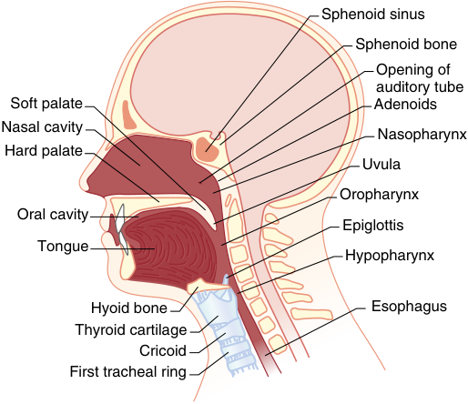

Sphenoid sinus Sphenoid bone Opening of auditory tube Soft palate Adenoids Nasal cavity Nasopharynx Hard palate Uvula Oropharynx Oral cavity Epiglottis Tongue Hypopharynx Hyoid bone Esophagus Thyroid cartilage Cricoid First tracheal ring 

**Fig. 66.1 Highlights of otolaryngologic anatomy.** Note (1) the anterior position of the trachea relative to the esophagus; (2) the oropharynx, extending from the uvula to the hyoid bone; (3) the hypopharynx extending from the hyoid bone to the cricoid cartilage; (4) the cricoid ring, a structure that is pushed posteriorly during the Sellick maneuver component of rapid- sequence induction, done with the intention of occluding the esophagus to help prevent regurgitation of gastric contents; and (5) the location of the first tracheal ring, important as a surgical landmark because most tracheostomies are performed between the second and third tracheal rings. (From Feldman MA, Patel A. Anesthesia for eye, ear, nose, and throat surgery. In: Miller RD, ed. _Miller’s Anesthesia_ , 7th ed. Philadelphia: Churchill Livingstone; 2010:2357–2388.)

<!-- PDF page 3 -->

laryngeal nerve (see Fig. 66.3). It descends to the thyrohyoid membrane, pierces it along with the superior laryngeal artery, and provides sensory innervation to the larynx down to the vocal cords. Sensory innervation below the vocal cords and to the upper trachea is supplied by the recurrent laryngeal nerves (see Fig. 66.3).

Injury to the recurrent laryngeal nerves, which supply most of the laryngeal intrinsic muscles, is a feared but often preventable complication after thyroid surgery and a host of other procedures, including a potential complication of tracheal intubation.7–12 If the damage is unilateral, the patient may present with hoarseness from unilateral loss of vocal cord abduction occurring in conjunction with

intact cricothyroid- mediated adduction. The hoarseness may not be apparent during normal, slow respirations, but becomes obvious as airway flows increase. With unilateral vocal cord palsy, the affected vocal cord assumes a paramedian position. Bilateral nerve damage causes significantly greater compromise, including dyspnea, stridor even during normal breathing, as well as complete airway obstruction due to bilateral vocal cord paramedian positioning. Patients with bilateral vocal cord palsies often require a tracheostomy. Intraoperative neuromonitoring is often used to reduce the chance of injury to the recurrent laryngeal nerves, particularly during neck procedures, such as thyroidectomy.13–15

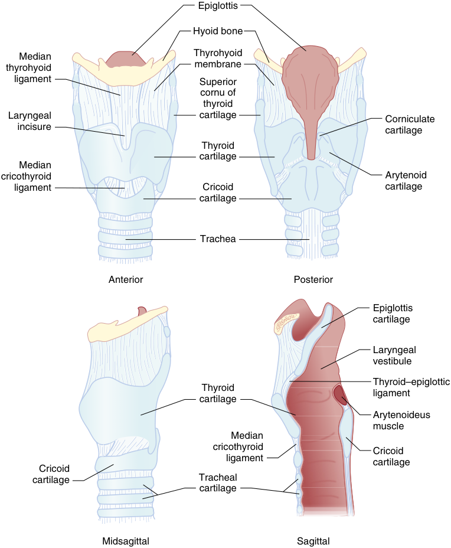

Epiglottis Hyoid bone Median Thyrohyoid membrane thyrohyoid ligament Superior cornu of thyroid Laryngeal cartilage Corniculate incisure cartilage Thyroid cartilage Median cricothyroid Arytenoid ligament Cricoid cartilage cartilage Trachea Anterior Posterior Epiglottis cartilage Laryngeal vestibule Thyroid–epiglottic Thyroid ligament cartilage Arytenoideus muscle Median cricothyroid Cricoid ligament cartilage Cricoid cartilage Tracheal cartilage Midsagittal Sagittal 

**Fig. 66.2 Anterior, posterior, midsagittal, and sagittal views of laryngeal anatomy.** Note (1) how the cartilaginous tracheal rings are incomplete posteriorly to allow the trachea to collapse slightly to facilitate the passage of food down the esophagus (and to provide orientation during bronchoscopic procedures!); (2) the superior cornu of the thyroid cartilage, an important landmark in the superior laryngeal nerve block because this is close to where the internal branch of the superior laryngeal nerve penetrates the thyrohyoid membrane; and (3) the median cricothyroid ligament and (not labeled) the twin lateral cricothyroid ligaments, known collectively as the cricothyroid ligament and entered in both emergency cricothyrotomy procedures and with emergency transtracheal jet ventilation. (From Feldman MA, Patel A. Anesthesia for eye, ear, nose, and throat surgery. In: Miller RD, ed. _Miller’s Anesthesia_ , 7th ed. Philadelphia: Churchill Livingstone; 2010:2357–2388.)

<!-- PDF page 4 -->

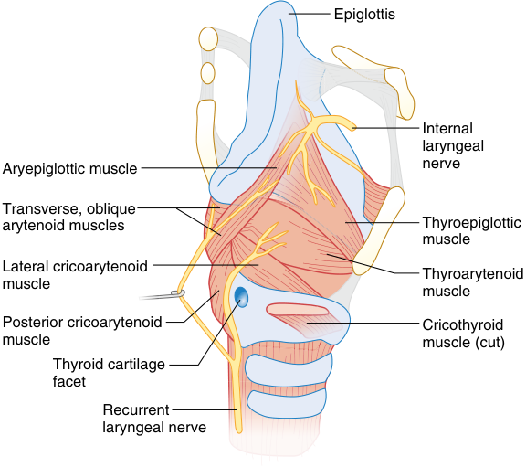

Epiglottis Internal laryngeal Aryepiglottic muscle nerve Transverse, oblique arytenoid muscles Thyroepiglottic muscle Lateral cricoarytenoid Thyroarytenoid muscle muscle Posterior cricoarytenoid Cricothyroid muscle muscle (cut) Thyroid cartilage facet Recurrent laryngeal nerve 

**Fig. 66.3 Laryngeal anatomy focusing primarily on the internal laryngeal nerve and the recurrent laryngeal nerve.** The two recurrent laryngeal nerves provide motor innervation to all the intrinsic muscles of the larynx, except the cricothyroid and inferior pharyngeal constrictor muscles, which are innervated by the external branches of the two superior laryngeal nerves (external laryngeal nerve). Sensory innervation of the larynx down to the vocal cords is supplied by the internal laryngeal nerve branches of the superior laryngeal nerves (internal laryngeal nerve), these in turn being branches of the vagus. Sensory innervation below the vocal cords and to the upper trachea is supplied by the recurrent laryngeal nerves. (From Schuller DE, Schleuning AJ. _Otolaryngology: Head and Neck Surgery,_ 8th ed. St. Louis: Mosby; 1994:252.)

## Preoperative Evaluation for Ear, Nose, and Throat Surgery

Although the preoperative evaluation of the surgical patient is discussed in detail in Chapter 28, a few specific issues are pertinent to ENT cases. Many ENT patients, especially those with malignant head and neck diseases, have histories of prolonged tobacco and alcohol use, whereas many others suffer from obesity or obstructive sleep apnea (OSA). A history of hoarseness may signal recurrent laryngeal nerve injury or worse, whereas the presence of stridor is always a cause for immediate concern. In cases involving the airway, the anesthesiologist and surgeon frequently review available radiographic and video studies to establish an airway plan collaboratively. A history of snoring may signal that the patient has undiagnosed sleep apnea and is prone to airway obstruction. Patients with chronic airway obstruction may develop pulmonary hypertension, sometimes leading to right- sided heart failure (cor pulmonale). A history of head and neck radiation for malignancy treatment frequently makes intubation difficult because the structures may become tough and fibrotic (“like wood”). These patients are predisposed to significant bleeding associated with any surgical intervention.

Although many ENT procedures involve infrequent risk, some of the large head and neck operations are considered to have “intermediate” surgical risk. A preoperative resting 12- lead electrocardiogram (ECG) is recommended for patients with known coronary heart disease, peripheral arterial disease, or cerebrovascular disease who are undergoing such procedures. Additionally, patients with a history of heart failure, diabetes mellitus, or renal failure who

are undergoing intermediate- risk operative procedures benefit from an ECG. Preoperative ECG testing is not indicated in asymptomatic persons undergoing infrequent- risk procedures. ENT cases frequently involve geriatric patients, many of whom are at a high risk for postoperative delirium and cognitive dysfunction.16–18 Since delirium and cognitive dysfunction impact perioperative management and often increase length of hospitalization or other undesirable outcomes, for this patient population, a preoperative risk assessment may be helpful in defining optimal perioperative care needs.

A preoperative endoscopic airway examination may be required for selected patients. This technique uses an ordinary flexible fiberscope usually used for awake endotracheal intubation to conduct a quick transnasal laryngoscopic examination using topical anesthesia. This examination allows the clinician to determine whether a problematic laryngeal disorder exists, such as supraglottic lesions that would not be apparent by ordinary means. The procedure requires minimal time and patient preparation, and it is well tolerated by most patients. A review by Rosenblatt provides ample details.19

## Airway Management in Otolaryngology

Both easy and difficult airways are frequently encountered in ENT anesthesia. The American Society of Anesthesiologists (ASA) Difficult Airway Algorithm (or similar algorithm)20–28 should ordinarily be a starting point for nearly all aspects of ENT airway management. The algorithm defines options for managing a patient for whom airway management is not

<!-- PDF page 5 -->

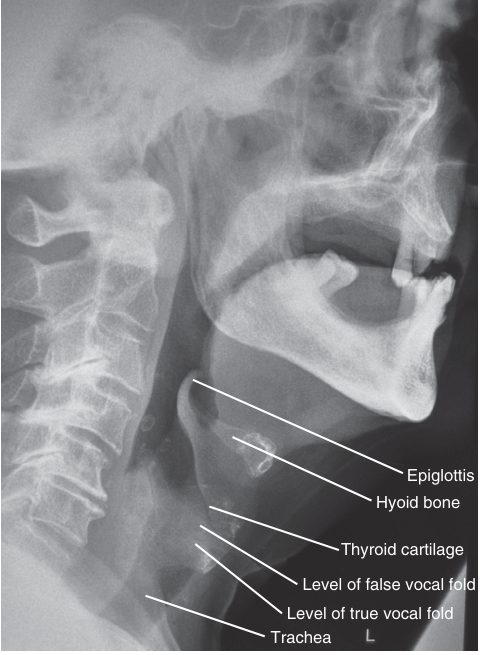

Epiglottis Hyoid bone Thyroid cartilage Level of false vocal fold Level of true vocal fold Trachea 

**Fig. 66.4 Lateral radiograph demonstrating laryngeal anatomy.** Notice (1) the normally wafer- thin epiglottis, which serves as a protective cover to the laryngeal inlet during swallowing and may become much larger and “thumb shaped” when edematous (e.g., as a result of pediatric epiglottitis); (2) the limited amount of prevertebral soft tissue in the oropharyngeal and hypopharyngeal regions; when edematous (e.g., as a result of a retropharyngeal abscess), this tissue may expand anteriorly to obstruct the airway; and (3) the hyoid bone, which aids in tongue movement and swallowing and which, if found fractured on autopsy, is suggestive of foul play by throttling or strangulation. (From Feldman MA, Patel A. Anesthesia for eye, ear, nose, and throat surgery. In Miller RD, ed. _Miller’s Anesthesia_ , 7th ed. Philadelphia: Churchill Livingstone; 2010:2357–2388.)

straightforward. In addition, however, the skills and experience of the physician managing the airway also dictate management options. To a large extent, the specific airway management techniques chosen depend on clinical circumstances, the airway management skills and preferences of the anesthesiologist and surgeon, as well as availability of equipment to address specific clinical conditions.

The following general management options exist:

1.  general endotracheal anesthesia

2.  general anesthesia using a supraglottic airway (SGA) device (e.g., laryngeal mask airway or flexible laryngeal mask airway [LMA, FLMA])

3.  general anesthesia using an ENT laryngoscope (to expose the airway) in conjunction with jet ventilation

4.  use of intermittent apnea

5.  general anesthesia using the patient’s natural airway, with or without adjuncts such as jaw positioning devices or nasopharyngeal airways

6.  local anesthesia in conjunction with intravenous sedation, with the patient breathing spontaneously.

The first option is the most commonly performed approach to the airway. However, the technique chosen and implemented depends on factors such as the perceived difficulty of intubating the trachea with ordinary methods. Evaluation of the airway is also discussed in Chapter 40.

The airway can become obstructed for many reasons. Examples include the following: aspirated foreign bodies; infections such as epiglottitis, diphtheria, or Ludwig’s angina; laryngospasm; tumors and hematomas impinging on the airway; trauma to the airway; OSA; tonsillar hypertrophy; and airway edema (e.g., from anaphylaxis, prolonged laryngoscopy, or smoke inhalation or burn injury). In most cases, airway management strategies require close collaboration between the anesthesia and surgical teams, particularly when these complications occur during manipulation of the airway during and immediately after the surgical procedure.

Most patients undergoing ENT surgery have their airway managed by tracheal intubation or flexible laryngeal mask airway. Although under ordinary circumstances tracheal intubation is straightforward, patients whose tracheas are expected to be difficult to intubate can be identified and usually managed with techniques such as video laryngoscopy or fiberoptic intubation. A key decision in such cases is whether the tracheal intubation should be performed with the patient awake or following the induction of general anesthesia. Another important decision is what tools or interventions to employ in the event that difficulty with ventilation or intubation is encountered. In exceptional cases, a tracheostomy using local anesthesia may be required.

Patients for ENT surgery are often managed using an ordinary polyvinyl chloride (PVC) endotracheal tube (ETT), but microlaryngeal tubes (MLTs), laser tubes, and wirereinforced tubes are also frequently used. Reinforced tubes have the advantages that they are unlikely to kink; they also fit especially well into tracheostomy stomas because of their excellent flexibility when the procedure requires removal of the tracheostomy tube. Selection of laser- resistant ETTs should be made based on the material appropriate to the type of laser being used for the procedure. In addition, when concerned about potential cuff damage by the laser, the tracheal cuff can be filled with saline dyed with methylene blue to allow immediate detection of a cuff leak. Another consideration to address with the surgeon is how the airway tube will be secured during the procedures. Most often the tube is secured using tape; some maxillofacial surgeons suture the tube to the side of the mouth or even tie the tube to the teeth with wire. Each of these techniques has advantages and disadvantages that must be considered during the case, particularly if the airway becomes dislodged during head manipulation or other times during the surgical procedure. In addition, to minimize the risk of ischemic damage to the tracheal mucosa, the ETT cuff pressures ordinarily must be kept less than 25 mm Hg. When nitrous oxide is used as part of the anesthetic technique, cuff volume will gradually increase as nitrous oxide enters the cuff by diffusion, increasing the cuff pressure and risk to the tracheal wall. This is of particular concern in surgical procedures of long duration, such as free- flap surgery. If nitrous oxide is used, the cuff volume and pressure should be monitored during the procedure and adjusted to minimize the risk of ischemia.

<!-- PDF page 6 -->

Before attempting tracheal intubation, particularly in selected patients for whom concerns have been identified preoperatively, indirect laryngoscopy can be helpful in guiding decisions about how best to secure the airway. The 11- point airway assessment tool included with the 2003 ASA Difficult Airway Algorithm is an excellent source of information and advice.20 In addition, following the completion of tracheal intubation, the difficulty (if any) encountered should be documented in the medical record and added to the problem list. The intubation difficulty scale (IDS) introduced by Adnet and associates can be a useful tool.29–33 IDS is a numeric score indicating overall intubation difficulty based on seven descriptors associated with intubation difficulty: number of supplementary intubation attempts, number of supplementary operators, alternative techniques used, laryngoscopic grade, subjective lifting force, the use of external laryngeal manipulation, and the characteristics of the vocal cords.

Most endotracheal intubations are achieved using traditional Macintosh and Miller laryngoscopes, although several alternative laryngoscopes have been advocated. When the view at laryngoscopy is suboptimal, the use of introducers such as the Eschmann stylet (gum elastic bougie) can sometimes be very helpful.34–39 It is used as follows: when a poor laryngoscopic view of the glottic structures is obtained, the introducer should be inserted into the patient’s mouth and gently advanced through the glottic opening (in the case of a grade II view) or anteriorly under the epiglottis (in the case of a grade III view). Subtle clicks resulting from the introducer passing over the tracheal rings help confirm proper placement of the introducer. With the introducer held steady, one then “railroads” a tracheal tube over the introducer into the glottis.

Video laryngoscopes such as the GlideScope (Verathon, Bothell, WA), the McGrath (Covidien, Mansfield, MA) video laryngoscope, the Storz video laryngoscope (Karl Storz, Tuttlingen, Germany), and the Pentax AWS (Hoya Corporation, Tokyo) have become particularly valuable, especially in patients with an “anterior” larynx or in patients with cervical spine immobilization.40–50 The gum elastic bougie can also be useful with video laryngoscopy. As discussed in Chapter 40, awake endotracheal intubation involves ETT insertion in a conscious or lightly sedated patient. It is usually performed because endotracheal intubation during general anesthesia is judged to be too risky. Some concerns may reflect possible difficulties with ventilation or endotracheal intubation or possible aspiration of gastric contents. Although fiberoptic intubation using topical anesthesia is the most common approach to awake endotracheal intubation, other methods include awake blind nasal intubation using an Endotrol (Shiley) (or similar) ETT or the use of a Macintosh, Miller, GlideScope, or other laryngoscope with topical anesthesia. Certain airway blocks can be used in addition to topical anesthesia. The blade options are discussed in more detail in Chapter 40. The use of fiberoptic intubation for the airway management of patients undergoing otolaryngologic surgery is popular because this technique is a very effective way of securing the airway in the presence of many kinds of upper airway disease. Although fiberoptic intubation can often be safely performed during complete general anesthesia,51 many clinicians opt to perform this technique using topical

anesthesia with the patient only lightly sedated (awake fiberoptic intubation), depending on the skill level of the anesthesiologist, the cooperation of the patient, and the severity of the pathologic process. A central consideration behind the choice of “awake” versus “asleep” fiberoptic intubation is the safety margin an awake technique allows: if intubation is not successfully accomplished, the patient’s ability to maintain his or her own airway remains intact. In addition, during awake intubation, airway reflexes are generally maintained sufficiently to guard against pulmonary aspiration, an important point in patients with a high risk of aspiration of gastric contents. Patients who have recently eaten and have undergone trauma are at especially high risk, so in an emergency situation the airway management may be optimized during awake intubation to minimize the risk of aspiration of gastric contents.

Awake endotracheal intubation is not synonymous with fiberoptic intubation. Awake intubation can be accomplished safely using many other airway approaches. Other possible options for awake intubation include, but are not limited to, direct laryngoscopy with Macintosh and Miller laryngoscopes, blind nasal intubation, use of a GlideScope or other video laryngoscope, use of a lighted stylet, and so on.

Typically, in intubation of the trachea in an awake patient, the airway is initially anesthetized with gargled and atomized 4% lidocaine. Superior laryngeal and transtracheal blocks are occasionally also employed. In addition, judicious sedation is often required. Midazolam, fentanyl, remifentanil, ketamine, propofol, and clonidine have all been used in this setting. More recently, the use of dexmedetomidine, a selective α2- agonist with sedative, analgesic, amnestic, and antisialagogue properties, has been reported. A key advantage of dexmedetomidine is that it allows the patient to maintain spontaneous respiration and causes minimal respiratory depression.52–55 Patients being sedated with dexmedetomidine are generally easy to arouse. However, this advantage, along with that of maintaining spontaneous respiration, may not be achieved when very large doses are administered.

Doyle described the successful use of the GlideScope in four cases of awake endotracheal intubation.56 The potential advantages are as follows: first, the view is generally excellent. Second, the method is less affected by the presence of secretions or blood as compared with the use of fiberoptic intubation. Third, no special restrictions exist on the type of ETT that can be placed when using the GlideScope, but this is not the case for fiberoptic methods. Fourth, the GlideScope is much more rugged than a fiberoptic bronchoscope and is far less likely to be damaged with use. Advancing the ETT into the trachea over the fiberoptic bronchoscope often fails because of ETT impingement on the arytenoid cartilages; this is generally not a problem with the GlideScope.

Despite the list of other options for securing the airway, awake fiberoptic intubation in the setting of the patient with airway disease remains popular because it is gentle to the airway, is generally well tolerated, and does not require the application of force to obtain glottic exposure.

While having experience with the diverse options for securing the airway is essential for every anesthesiologist, it is also essential to be prepared to address life- threatening airway emergencies, whether anticipated or not. To do

<!-- PDF page 7 -->

### Box 66.1 Possible Items for an Ear, Nose, and Throat Airway Emergencies Cart

- Bag- valve- mask resuscitator (Ambu bag)

- Oropharyngeal and nasopharyngeal airways

- Supraglottic airway collection ᑏ Endotracheal tubes, including microlaryngeal tubes and laser tubes

- Malleable stylets

- Topical anesthesia, with syringes, and atomizers ᑏ Laryngoscope collection with extra bulbs and batteries

tumors may be present as oral or tongue malignancies, as glottic, supraglottic, and infraglottic tumors, or as anterior mediastinal masses. Other pathologic conditions may also complicate airway management, such as congenital malformations (Pierre Robin sequence, Goldenhar syndrome), periglottic edema (e.g., following rigid bronchoscopy), recurrent laryngeal nerve injury (e.g., following thyroid surgery), maxillofacial trauma, or OSA. Some of the more important of these conditions are discussed in the following paragraphs.

- Magill forceps (useful for nasal intubation)

- Boedeker forceps (for use with video laryngoscopes)*

|ᑏAirway introducer (gum elastic bougie)|
|---|

- Tube exchange catheters

|ᑏCarbon dioxide detection system|
|---|

|ᑏVideo laryngoscope (e.g., GlideScope, McGrath, Pentax- AWS)|
|---|

|ᑏSurgical airway kit (e.g., Melker cricothyrotomy kit)|
|---|

- Emergency tracheotomy tray

|ᑏFiberoptic bronchoscope|
|---|

- High-flow heated and humidified nasal oxygen

*The Boedeker (curved) intubation forceps is useful for removal of foreign bodies when a video laryngoscope is used.57

so requires coordination with the surgeon, if available to perform an emergent tracheostomy, if other approaches including cricothyrotomy fail. Ensuring availability of a wide variety of equipment options, either in a special ENT airway cart with equipment such as that listed in Box 66.157 or another airway management supply cart. In addition to these items and unlisted items favored by individual practitioners, ENT surgeons want ready access to an emergency tracheotomy tray, as well as to some form of suspension laryngoscope or rigid bronchoscope. Special attention to the maintenance and cleaning of fiberoptic bronchoscopes is also important, given that they must always be easily accessible and reliable when needed. In the case of electronic fiberscopes incorporating a video display, it is particularly important to establish that illumination settings and white balancing have been correctly set before use.

## Airway Disorders in Otolaryngology

Otolaryngologic airway disorders can sometimes present the clinician with significant airway and anesthetic management challenges. In many such cases, awake endotracheal intubation (e.g., by fiberoptic methods) is the method of choice. When awake intubation is impractical (e.g., overwhelming tumor invasion of the airway, inadequate equipment, limited experience), tracheostomy using local anesthesia (with minimal sedation, or no sedation in extreme cases) is sometimes preferred. In such cases, complete airway obstruction is the outcome most feared; this can occur when anesthetic drugs or neuromuscular blocking drugs decrease the tone of the airway musculature, thereby unfavorably changing the airway architecture.

Many ENT pathologic conditions can make airway management difficult. Airway infections can include upper airway abscesses, retropharyngeal abscesses, quinsy, Ludwig’s angina, and epiglottitis (supraglottitis). Airway

### ANGIOEDEMA

Angioedema (formerly referred to as angioneurotic edema) is a rapid form of tissue swelling mediated by anomalous activation of the complement system with release of histamine and other inflammatory mediators.58 It is usually the result of an allergic reaction. Hereditary angioedema is a variant family that arises from an autosomal dominant genetic mutation. Complete loss of the airway can occur in severe cases of either form. Just as with anaphylaxis, epinephrine may be life- saving when the cause of angioedema is allergic, but treatment with epinephrine is not helpful in cases of hereditary angioedema.59 Intubation of the trachea is often required in affected patients, usually utilizing topical anesthesia with the patient awake or lightly sedated.

### ACUTE EPIGLOTTITIS

Epiglottitis, an inflammatory disease of the epiglottis, arytenoids, and aryepiglottic folds, is among the most dreaded of airway- related infections, especially in the pediatric population.60–64 In the past, victims were usually children 2 to 6 years of age, who were often infected with _Haemophilus influenzae_ . Today, a vaccine against _H. influenzae_ has reduced the frequency of this serious complication. Nonetheless, epiglottitis is an airway emergency requiring immediate attention. The clinical presentation often includes a sore throat, dysphagia, muffled voice, and fever. Difficulty with swallowing leading to drooling from the mouth may occur. Victims may appear to be systemically ill (“toxic”) and assume an open- mouth “tripod” position to ease breathing. Stridor, respiratory distress, and complete airway obstruction may occur. The chief differential diagnosis when stridor occurs in children is epiglottitis versus laryngotracheobronchitis (croup), though the presentation does vary.65,66

When a child presents with upper airway compromise, due to epiglottitis or other causes, evaluation of the airway is particularly challenging. Examining the child’s airway at the bedside may exacerbate the condition, and anything that could bring the child to cry (e.g., needles) should be avoided when possible, since the crying increases air flow and worsens stridor. A common management approach involves careful inhaled induction of anesthesia using sevoflurane with the child sitting in the anesthesiologist’s lap. Then oral intubation of the trachea can be performed using a smaller than usual tracheal tube. The child should receive “deep” anesthesia before manipulating the airway but should still be breathing spontaneously. Intravenous access and full monitoring should be established as anesthesia is deepened to ensure access for administration of medications. If at laryngoscopy the airway cannot be identified,

::: details 原始表格與符號（PDF 第 7 頁）

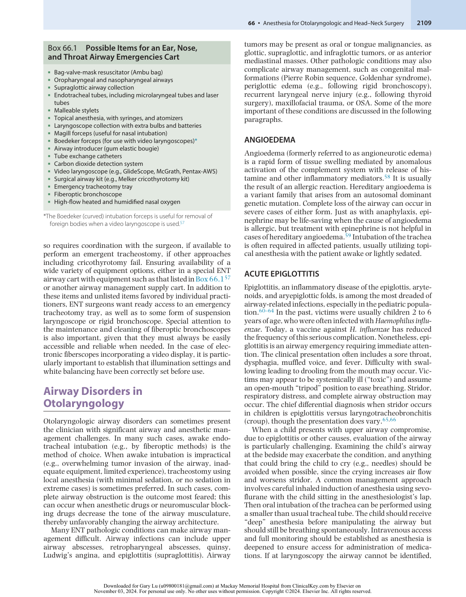

:::

<!-- PDF page 8 -->

one trick is to have another provider compress the child’s chest, thus generating a small air bubble in the glottis that the person performing the anesthetic can aim for in the trachea. Failure to secure the airway in this manner may necessitate rescue through rigid bronchoscopy, by establishing a surgical airway, or by other means. In the past these children were often then managed by performing a tracheostomy to secure the airway until the inflammation resolves; contemporary management usually includes tracheal intubation, generally in an operating room environment, intensive care unit (ICU) admission, throat and blood cultures, conversion to nasotracheal intubation, and intravenous antibiotic therapy.

Epiglottitis can also occur in adults.67 The first president of the United States, George Washington, is said to have died of it, although being repeatedly phlebotomized (as was the custom of the day) undoubtedly contributed to his demise. Here the situation is less ominous because the adult airway is larger. In cooperative adults, cautious oropharyngeal examination and fiberoptic nasopharyngoscopy help assess the degree of disease. The current consensus is that many adults can be adequately treated in an ICU with inhaled mist, antibiotics, and corticosteroids, and that tracheal intubation is necessary only if symptoms of respiratory distress develop. Should intubation be needed, awake fiberoptic laryngoscopy is probably the best way to secure the airway in cooperative adults, whereas the use of inhaled induction of anesthesia in adults with a compromised airway is now considered to be more perilous than was once thought.

### RETROPHARYNGEAL ABSCESS

Retropharyngeal abscess formation may occur from bacterial infection of the retropharyngeal space following dental or tonsillar infections.68–74 If the condition is untreated, the posterior pharyngeal wall may advance anteriorly into the oropharynx, with resulting dyspnea and airway obstruction. Other clinical findings include difficulty in swallowing, trismus, and a fluctuant posterior pharyngeal mass. An abscess cavity may be evident on lateral neck radiographs, and anterior displacement of the esophagus and upper pharynx may be present. Airway management may be complicated by trismus or partial airway obstruction. Because abscess rupture can lead to tracheal soiling, contact with the posterior pharyngeal wall during laryngoscopy and intubation should be minimized. Incision and drainage are the mainstays of treatment. Tracheostomy is often, but not always, required.

### LUDWIG’S ANGINA

Ludwig’s angina is a multispace infection of the floor of the mouth.75–79 The infection usually starts with infected mandibular molars and spreads to submandibular, sublingual, submental, and buccal spaces. The tongue becomes elevated and displaced posteriorly, which may lead to loss of the airway, especially when the patient is in the supine position. As with retropharyngeal abscess, an additional concern is the potential for abscess rupture into the hypopharynx (with possible lung soiling) either spontaneously or with attempts at laryngoscopy and intubation. Airway

management options depend on clinical severity, imaging findings (e.g., computed tomography [CT] or magnetic resonance imaging [MRI] findings), and surgical preferences, but elective tracheostomy before incision and drainage remains a classic, if dated, treatment modality.79 Most experts advocate fiberoptic intubation when possible. In addition, because Ludwig’s angina is often associated with trismus, nasal fiberoptic intubation is frequently needed.

### AIRWAY TUMORS, POLYPS, AND GRANULOMAS

Airway tumors can be benign or malignant (Figs. 66.5– 66.7), but regardless of their pathologic characteristics, airway obstruction is always a potential concern.80–83 Discussion with the surgical team concerning the size and location of the tumor, along with a review of any videorecorded nasopharyngeal video examinations, will help determine whether awake endotracheal intubation is needed. Polyps may also be found throughout the airway and can lead to partial or complete airway obstruction. Vocal cord polyps, cysts, and granulomas may result from traumatic intubation, vocal cord irritation from ETT movement, or other causes, especially in women.84–90 Vocal cord cancer can also occur.91 The potential also exists for exacerbation of asthma in patients with nasal polyps who receive aspirin, ketorolac (Toradol), and other nonsteroidal anti- inflammatory drugs (NSAIDs) (the Samter triad).92,93

### LARYNGEAL PAPILLOMATOSIS

Patients with laryngeal papillomatosis caused by human papillomavirus (HPV) infection may require frequent application of laser treatment for attempted papilloma eradication.94–99 In some cases the airway may be close to obstruction because of an overgrowth of lesions. During laser treatment, inspired oxygen concentration should be kept to a minimum, with the avoidance of nitrous oxide, to reduce the chance of an airway fire. After treatment, the airway is raw and edematous. Laryngotracheomalacia may occasionally be present, often due to repeated attempts to address the recurrent papillomas, sometimes leading to complete upper airway collapse following extubation of the trachea.

## Anesthesia for Panendoscopy

Panendoscopy, sometimes known as triple endoscopy, involves three diagnostic components: laryngoscopy, bronchoscopy, and esophagoscopy. Such procedures and others involving the larynx, pharynx, or trachea often require specialized ENT laryngoscopes, frequently in conjunction with a small- diameter ETT or a tube specifically designed for laser surgery. Panendoscopy is used in patients with head and neck cancer to search for vocal cord lesions, obtain tissue biopsies, monitor for tumor recurrence, and so on. In such cases, one should consider the following specific issues in discussion with the surgical team: What is the anticipated pathologic process, and how is it expected to affect intubation or ventilation? (In some cases, the patient’s disease may not allow the use of an ETT, so that jet ventilation or a rigid bronchoscope is needed.) What is the plan for airway

<!-- PDF page 9 -->

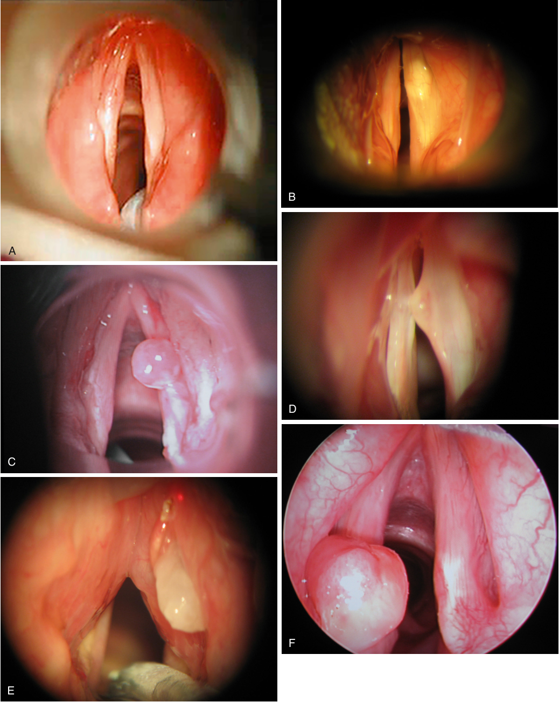

B A D C F E 

**Fig. 66.5 Vocal cord lesions with little or no airway compromise.** (A) Normal vocal cord. (B) Minor right vocal cord lesion. (C) Granuloma on the middle right vocal cord. (D) Kissing nodule on the right vocal cord. (E) Anterior webbing of the vocal cord. (F) Intubation granuloma. (From Feldman MA, Patel A. Anesthesia for eye, ear, nose, and throat surgery. In: Miller RD, ed. _Miller’s Anesthesia_ . 7th ed. Philadelphia: Churchill Livingstone; 2010:2357–2388.)

<!-- PDF page 10 -->

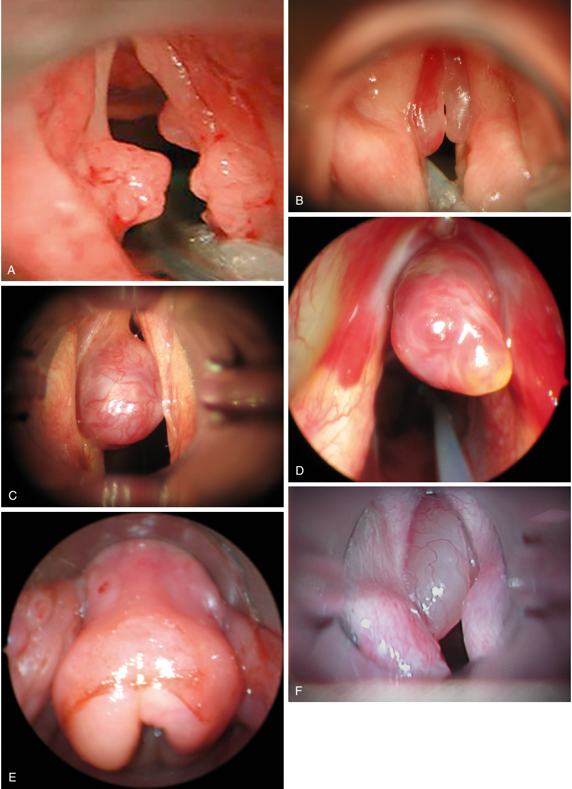

B A D C F E 

**Fig. 66.6 Vocal cord lesions with significant airway compromise.** (A) Papilloma of both vocal cords. (B) Bilateral Reinke edema. (C) Left vocal cord polyp. (D) Anterior glottic granuloma. (E) Epiglottic edema. (F) Vocal cord cyst. (From Feldman MA, Patel A. Anesthesia for eye, ear, nose, and throat surgery. In: Miller RD, ed. _Miller’s Anesthesia._ 7th ed. Philadelphia: Churchill Livingstone; 2010:2357–2388.)

<!-- PDF page 11 -->

management, and how does it affect the delivery of anesthesia? How does the presence of coexisting disease (e.g., coronary artery disease, chronic obstructive pulmonary disease, gastroesophageal reflux disease) affect management? What specialized equipment may be needed? (For example, when airway obstruction is present, the surgeon may employ dilatational balloons, lasers, or a microdebrider to open up the airway.)

Five airway options for panendoscopy exist: (1) use of an ETT, typically a narrow- bore MLT that provides the surgeon with a superior glottic view; (2) jet ventilation in conjunction with a rigid ENT laryngoscope, without the use of an ETT; (3) hybrid methods, such as the intermittent use of an SGA or an

MLT tube in conjunction with a rigid laryngoscope, jet ventilation, or intermittent apnea; (4) tracheostomy using local anesthesia before inducing general anesthesia; and (5) elective placement of a specially designed transtracheal jet ventilation cannula (e.g., Ravussin jet ventilation catheter before induction100 ). The last two options are only occasionally used for patients with a suspected difficult airway; awake tracheal intubation is the most common approach in patients with a difficult airway. Moreover, when jet ventilation is used, total intravenous anesthesia (TIVA), for example with infusions of propofol and remifentanil, is required. Finally, when panendoscopy is combined with laser surgery, a laser- safe ETT is often used.101,102

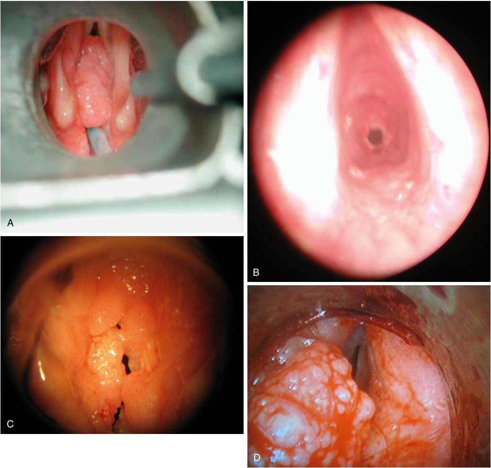

A B C D 

**Fig. 66.7 Vocal cord lesions with severe airway compromise.** (A) Papilloma of vocal cord. (B) Severe subglottic stenosis (2- mm airway). (C) Bilateral papilloma. (D) Extensive supraglottic carcinoma.

<!-- PDF page 12 -->

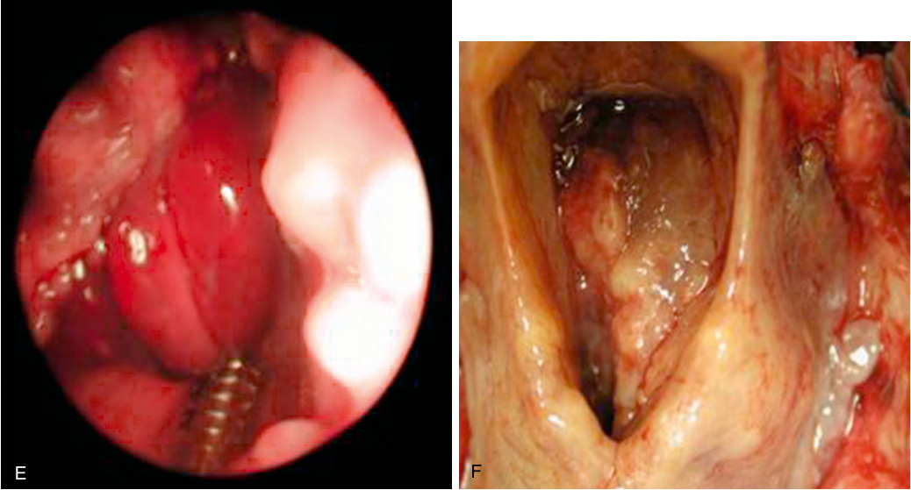

E F 

**Fig. 66.7, cont’d** (E) Acute epiglottitis. (F) Laryngeal carcinoma. (From Feldman MA, Patel A. Anesthesia for eye, ear, nose, and throat surgery. In: Miller RD, ed. _Miller’s Anesthesia._ 7th ed. Philadelphia: Churchill Livingstone; 2010:2357–2388.)

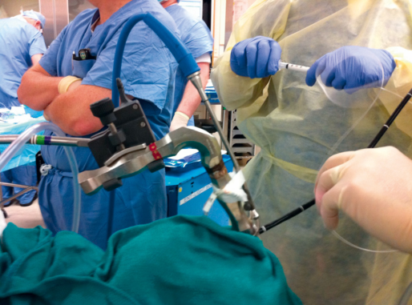

**Fig. 66.8 Patient undergoing an ear, nose, and throat procedure using a suspended anterior commissure laryngoscope.** A jet ventilation attachment is taped to the handle. A fiberoptic bronchoscope with a laser fiber is in use to deliver laser pulses to areas of pathologic tissue. (Image courtesy Dr. Basem Abdelmalak, Cleveland Clinic.)

Panendoscopy is generally done while the patient is under general anesthesia with the patient’s neck flexed and the head extended, usually employing a shoulder roll and a head ring (Jackson position). Typically, an anterior commissure laryngoscope is used and fixed into position by suspension (Fig. 66.8). This technique allows the surgeon’s hands to be free and the operating microscope to be used. Other specialized ENT surgical laryngoscopes that are commonly used, often in conjunction with a microscope

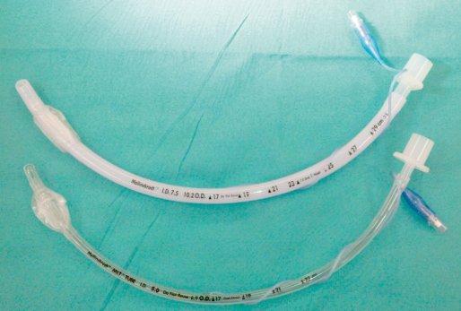

**Fig. 66.9** Regular 7.5- mm inner diameter (ID) tracheal tube ( _top_ ) in comparison with a 5.0- mm ID microlaryngeal (MLT)- type tracheal tube ( _bottom_ ). The MLT tube has a narrow lumen that provides the surgeon with improved glottic exposure at the cost of higher ventilation pressures.

for laryngeal microsurgery, include the Dedo laryngoscope (Elmed, Addison, IL) and the Universal Modular Glottiscope (Endocraft, Providence, RI). Here, once the laryngoscope is correctly configured (“suspended”), the surgeon brings the operating microscope into the field and uses a variety of microlaryngeal instruments to treat the patient.

A variety of anesthetic techniques can be used for panendoscopy procedures. The most common approach is to perform the procedure while the patient is under general anesthesia with muscle relaxation in conjunction with an MLT- type tracheal tube (Fig. 66.9). This technique is

<!-- PDF page 13 -->

familiar to anesthesiologists, provides both airway protection and control of ventilation, allows for reliable measurement of end- tidal carbon dioxide (ETCO2), and allows for the administration of volatile anesthetics without polluting the operating room. Disadvantages of the technique include higher than usual ventilatory pressures because of the tube’s narrow diameter, somewhat hindered surgical access, and concerns for tube ignition when a laser is in use.

Since the tracheal tube may impair access to some glottic structures, some cases are performed using intermittent apnea during general anesthesia and administration of neuromuscular blocking drugs. Disadvantages of this approach include the need for a TIVA technique, the need for repeated intubation–extubation cycles (potentially producing glottic trauma), fragmentation of the surgical work into brief apneic segments, and the repeated interruption of ventilation and oxygenation.

Panendoscopy is also often performed using supraglottic jet ventilation.103,104 This technique requires TIVA and entails some special issues because it involves the delivery of high- pressure oxygen pulses (typically 20–50 psi in adults, frequently delivered 1 second on/3 seconds off), usually through an adapter that attaches to the surgical laryngoscope. Additionally, subglottic methods (e.g., using a Hunsaker catheter105,106 ) and transtracheal methods of jet ventilation107–110 have been described. Each pulse of oxygen entrains room air, thus increasing the gas volume delivered and diluting the oxygen concentration (Venturi effect based on Bernoulli principle). Disadvantages of jet ventilation include the need for TIVA, the potential for barotrauma (remember that a pressure of 50 psi is equivalent to 3515 cmH2O), an inability to measure either ETCO2 or tidal volume easily, and the fact that the technique is often suboptimal in obese individuals. Finally, a variant of jet ventilation known as high- frequency jet ventilation is sometimes used in these cases,111,112 often in conjunction with a special ventilator, an intratracheal catheter, and transcutaneous CO2 monitoring.

## Otolaryngologic Trauma

Although the topic of anesthesia care for the trauma patient is the subject of Chapter 62,113 a few special points pertaining to patients who have undergone head and neck trauma should be emphasized. First, patients with head and neck trauma may have a concurrent brain injury or injury to the cervical spine. Until cleared of a possible cervical spine injury, patients should be placed in a rigid cervical collar. In addition, although placing the patient’s head in the customary “sniffing” position can facilitate laryngoscopy, this technique is contraindicated in patients with a suspected cervical spine injury for fear of exacerbating any injury. Additionally, jaw thrust and chin lift maneuvers can be more difficult when a cervical collar is used or when comminuted mandibular fractures are present.

Second, facial injuries can produce extensive bleeding, as well as the aspiration of blood, bone, cartilage, teeth, and tissue fragments. Third, the airway may be compromised, especially when bilateral mandibular fractures are

present. Airway trauma from blunt or penetrating injuries, burns, inhalational injury, or even iatrogenic causes may be present. Immediate airway management options include orotracheal intubation (awake versus rapid- sequence induction), a surgical airway carried out using local anesthesia, or even intubation through an open airway in cases of tracheal transection. Oropharyngeal airways may not be tolerated in patients with an intact gag reflex, and inserting a nasopharyngeal airway may exacerbate bleeding.

Although fiberoptic intubation would seem to offer many advantages in trauma cases, clinical experience suggests otherwise, at least in some cases, because navigating through a distorted airway filled with blood and foamy secretions challenges even the most experienced bronchoscopists. Special concerns exist when the trachea is intubated in a patient with laryngeal trauma because this may result in further injury or even complete airway loss (e.g., in the event of inadvertent ETT placement through a laryngeal fracture into the mediastinum). Clinical findings suggestive of laryngeal trauma include abrasions, discoloration, indentation, bleeding, or pain in the region of the larynx, as well as dyspnea, dysphagia, dysphonia, stridor, hemoptysis, subcutaneous emphysema, and hoarseness. Signs of pneumothorax may also be present. Fiberoptic endoscopic examination may reveal edema, the presence of bleeding or hematoma, or abnormal vocal cord function. If endotracheal intubation is attempted in this setting, a fiberoptic bronchoscope with a small- diameter ETT can be used carefully, bearing in mind the foregoing concerns about fiberoptic intubation in the trauma setting. Additionally, if the patient has clinical evidence of upper airway disruption or subcutaneous air, positive- pressure ventilation by mask or SGA in this setting may worsen the air leak. A tracheostomy may be the most prudent approach to the airway for some of these cases. Finally, the application of cricoid pressure in blunt laryngeal trauma may result in cricotracheal separation, so is contraindicated. In any event, when a patient presents with facial and/or airway trauma, initial management is dictated by the degree of respiratory distress or potential airway compromise, the available equipment, and clinical preferences.

Midfacial fractures deserve special mention. These fractures are defined by the Le Fort classification. A Le Fort I fracture is a horizontal fracture that involves the inferior nasal aperture, separating the maxillary alveolus from the rest of the midfacial skeleton. Le Fort II fractures are pyramidal nasomaxillary fractures that break from the upper craniofacial skeleton. Le Fort III fractures, less commonly encountered than the others, involve the separation of the facial skeleton from the skull base. These fractures are illustrated in Fig. 66.10.

## Nasal Surgery

Nasal surgery can involve external procedures, procedures within the nasal cavity, surgery involving the nasal bones, and nasal sinus surgery. Besides the usual concerns, preoperative assessment should focus on the suitability of topical nasal vasoconstrictor use, the possibility of undiagnosed OSA, and the potential presence of the Samter triad (nasal

<!-- PDF page 14 -->

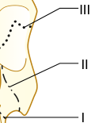

III II I 

**Fig. 66.10 Classification of midfacial fractures.** Le Fort I: alveolar fracture. Le Fort II: zygomatic–maxillary complex fracture. Le Fort III: cranial facial dysostosis with separation of the midface from the skull. (From Schuller DE, Schleuning AJ. _Otolaryngology: Head and Neck Surgery._ 8th ed. St. Louis: Mosby; 1994:157.)

polyps, asthma, and a sensitivity to aspirin and NSAIDs that may produce deadly bronchospasm). Because postoperative bleeding is a common complication after nasal surgery, patients should not be taking NSAIDs and aspirin for 1 to 2 weeks preoperatively.

Preoperative planning begins by deciding whether the procedure is best performed with local (usually accompanied by intravenous sedation) or general anesthesia. Although local anesthesia may be suitable for simple procedures such as cauterization or straightforward polypectomy or turbinectomy surgery in adults, often general anesthesia is required. When general anesthesia is chosen, a choice must then be made among a simple face mask (as may be appropriate for pediatric myringotomy surgery), an SGA device (e.g., flexible LMA), and a tracheal tube (e.g., an unkinkable wire- reinforced design). This decision should be made jointly with the surgeon. Although the use of an SGA during ENT surgery has its enthusiasts, negative experiences, such as airway obstruction related to device malpositioning, have led many clinicians to prefer a tracheal tube for such cases.

Patients undergoing rhinoplasty are typically young, healthy individuals requiring reconstruction of the external nose for deformity treatment.114,115 Septoplasty (correction of a deviated septum)116–118 and surgery to remove nasal polyps119,120 are often performed to improve nasal airflow and ventilation of the sinuses. Some malignant lesions require excision of the entire nose with follow- up staged reconstruction using a forehead flap. Open nasal fracture reduction procedures are usually performed after the initial swelling has resolved; if the injury is corrected too late, the bones can be difficult to align and can lead to significant surgical bleeding. General endotracheal anesthesia

is usually carried out in such cases, often using a midline reinforced ETT taped to the chin. In closed nasal fracture reduction, the surgeon applies forceful pressure to realign the nasal bones, a procedure that usually takes only a few seconds but nevertheless is so intensely painful that the procedure is usually preceded by a single induction dose of propofol, followed by airway support as needed as a nasal cast is applied. However, when the reduction is expected to be bloody or otherwise complicated, the airway is usually protected with an ETT or an SGA device. In many of these procedures, nasal packs, stents, and/or casts are placed; nasal stents offer an advantage over packs in that one can breathe through them.

For many ENT cases, a “throat pack” made of a long piece of saline- soaked gauze is placed around the ETT to prevent blood and surgical debris from entering the pharynx and larynx. Typically, a few inches of gauze are kept outside the mouth as a reminder of its presence, because an inadvertently retained pack can lead to catastrophic airway obstruction after extubation.121 In addition to suctioning, many clinicians follow throat pack removal with pre- extubation laryngoscopy and a neck flexion–extension maneuver to encourage any residual clot (the so- called “coroner’s clot”) to fall past the soft palate into a position where it can be removed under direct vision.

Gentle awakening in nasal surgery is important because coughing and bucking on emergence frequently produce undesirable bleeding. Techniques that are often helpful include the use of a remifentanil infusion and the application of lidocaine down the ETT with the cuff temporarily deflated while the patient is still under deep anesthesia. Oral and gastric suction before emergence will decrease the incidence of postoperative nausea and vomiting (PONV). When nasal packing is used, patients should be advised before induction of anesthesia that, on emergence, they should breathe through the mouth. On awakening, applying pressure on the nose with a face mask may displace the surgical field and should not be routinely undertaken. In addition, all postoperative patients for whom nasal packs have been inserted will have obstructed nasal passages unless nasopharyngeal airways are incorporated into the nasal pack. Patients with OSA are in particular need of careful postoperative respiratory monitoring. Finally, postoperative pain in these procedures usually does not require opiates, and the use of oral acetaminophen and an NSAID usually suffices.

For many of these procedures, a topical vasoconstrictor such as phenylephrine, oxymetazoline, or cocaine is applied. Although these topical agents are important drugs that reduce bleeding and improve visualization during nasal and endoscopic procedures, they sometimes produce cardiovascular toxicity.122 The cardiovascular effects of cocaine, usually administered as a 4% (40 mg/mL) topical solution, result from the drug’s blocking the reuptake of norepinephrine at sympathetic nerve terminals. Consequently, cocaine would not be a first- choice vasoconstrictor in patients with coronary artery disease or hypertension, or in patients taking monoamine oxidase inhibitors.123 When cocaine use is appropriate, the dose should not ordinarily exceed 1.5 mg/kg.

Phenylephrine is an α- adrenergic agonist topical vasoconstrictor either used alone or in combination with

<!-- PDF page 15 -->

lidocaine. The initial dose should not exceed 500 mcg (&lt;20 mcg/kg in children ≤25 kg). Because severe hypertension sometimes results following phenylephrine use, blood pressure monitoring is particularly important. Instances of unacceptable hypertension should be treated with direct vasodilators or α- receptor antagonists; the use of β- adrenergic and calcium channel blockers should be avoided because they may worsen cardiac output and produce pulmonary edema.124

Oxymetazoline, a selective α1- agonist and partial α2agonist imidazoline derivative, is perhaps the most popular topical vasoconstrictor in ENT surgery, primarily because of its excellent safety profile and availability as an over- thecounter product.125–127 Three sprays of 0.05% solution are administered in each nostril. This drug should be avoided in patients taking monoamine oxidase inhibitors. However, despite its relative safety, complications have been reported.128,129

## Tonsillectomy and Adenoidectomy

The adenoids are a mass of lymphoid tissue located posterior to the nasal cavity, in the roof of the nasopharynx. If this tissue becomes hyperplasic, nasopharyngeal obstruction and several related problems can occur such that the adenoids merit surgical removal (adenoidectomy). When removed, the tonsils are usually taken as well. Other indications for tonsillectomy include tonsillar hyperplasia, recurrent tonsillitis, and malignant disease.130 An especially important consideration here is that chronic oropharyngeal airway obstruction because of tonsillar hypertrophy can lead to OSA and its attendant complications (daytime somnolence, cor pulmonale, pulmonary hypertension, right ventricular hypertrophy, cardiomegaly). In addition to the usual, preoperative assessment focuses on findings suggestive of OSA, possible cardiac comorbidities, and a history of recurrent upper respiratory tract infections. The presence of a fever or a productive cough may be grounds for postponement of the surgery or for postoperative care in the setting of increased vigilance (e.g., ICU or step- down facility), especially in infants.

Induction of anesthesia in adults usually entails administration of intravenous drugs, whereas inhaled inductions are commonly used for children, followed by placement of an intravenous catheter and administration of glycopyrrolate. Oral RAE (named after the inventors Ring, Adair, and Elwyn) tracheal tubes or wire- reinforced tubes, taped in the midline to the mandible, are often preferred by surgeons and are less likely to kink following retractor placement. When a tonsillar or parapharyngeal abscess is present, the patient may have a compromised airway complicated by trismus and pharyngeal edema. Although awake abscess decompression by needle aspiration before the induction of anesthesia is sometimes done, awake fiberoptic intubation is the usual approach in this setting.

At the end of the surgical procedure, the throat pack, if previously placed, should be removed, the oropharynx should then be suctioned, and an orogastric tube should be used to empty the stomach. Extubation is sometimes performed under deep anesthesia but more commonly is

deferred until the patient regains airway reflexes. Coughing on the tracheal tube on emergence may be attenuated by the administration of lidocaine, either given intravenously or placed down the tracheal tube with the cuff temporarily deflated. Emergence while receiving a light remifentanil infusion can also be beneficial.

Posttonsillectomy hemorrhage is a dreaded surgical emergency, especially in children.131–133 It usually occurs within the first six hours postoperatively, but it can also occur several days later. When possible, the patient should receive appropriate intravenous fluids preoperatively (including blood products when necessary). The presence of hypovolemia may dictate a reduction in induction drug dosage or the use of etomidate. Because the stomach may contain a considerable amount of blood, a rapid- sequence induction with cricoid pressure is usually performed with a view to protect the airway from aspiration of gastric contents. Vigorous suctioning is also needed to remove the copious oropharyngeal blood likely to be found during laryngoscopy. A previously easy laryngoscopy in the presence of bleeding and swelling can quickly become difficult. Planning and preparation for an unexpected difficult laryngoscopy should be made with a variety of laryngoscopes, immediate suction, and smaller tube sizes available.

## Endoscopic Sinus Surgery

Endoscopic sinus surgery has become a common ENT procedure. Indications are varied and include conditions such as nasal polyposis, recurrent or chronic sinusitis, epistaxis control, tumor excision, orbital decompression (e.g., for Graves ophthalmopathy), foreign body removal, treatment of sinus mucoceles, and more.134–136

Careful anesthetic management helps ensure a good outcome. Considerations in such cases include local versus general anesthesia, SGA device versus ETT, and inhaled anesthesia versus TIVA, and preferences of the surgeon and anesthesiologist as well as patient comorbidities are considered. The most important goals are a blood- free surgical field, patient immobility, stable cardiorespiratory conditions, and gentle emergence from anesthesia. Controlled hypotension is sometimes used to improve surgical conditions; when this approach is used, intraoperative β- adrenergic blockade is associated with better operating conditions than when vasodilation drugs are administered.

Despite minimal arterial blood pressure differences, propofol–remifentanil intravenous anesthesia may provide better surgical conditions as compared with a traditional balanced technique (e.g., using an isoflurane– opiate technique), possibly because of lower heart rates and cardiac output achieved with this technique.137 Use of an SGA device is preferred to an ETT because of better surgical conditions and smoother emergence. However, SGA devices are prone to malpositioning and provide less protection from gastric regurgitation as compared with an ETT.138

The procedure typically begins with decongestion of the nose and infiltration of 1% lidocaine with 1:100,000

<!-- PDF page 16 -->

epinephrine, often followed by the bilateral nasal placement of pledgets soaked in 4% cocaine. In most cases, an imageguided surgical system is used; this allows the surgeon to know exactly where he or she is operating by using a preoperative CT scan. This technology allows the surgeon to visualize four different views simultaneously: the coronal, sagittal, and axial CT scan images at the same time as the real- time endoscopic view.

Given the proximity of major blood vessels and nerves, the orbit, and the brain, complications are possible, especially when the surgical landmarks are obscured by blood. Some major complications include orbital hematoma formation, blindness from orbital trauma or damage to the optic nerve, formation of cerebrospinal fluid leak, carotid or ethmoid artery invasion, entry into the cranial cavity, severe hemorrhage, and death.

Finally, not all sinus surgery is performed endoscopically. For example, although now largely replaced by endoscopic methods, the once common Caldwell–Luc procedure is still performed by some surgeons. It involves fenestration of the anterior wall of the maxillary sinus with surgical drainage of this sinus into the nose through an antrostomy.

## Thyroid and Parathyroid Surgery

The usual indications for thyroid surgery include thyroid cancer, symptomatic thyroid goiter, and failed medical management of hyperthyroidism; the surgical procedure is almost always elective.139 The most common indication for parathyroid surgery is hypercalcemia from hyperparathyroidism secondary to a benign parathyroid adenoma. When the hypercalcemia is severe, preoperative treatment (e.g., fluids, furosemide, bisphosphonates) may be needed.

Hyperthyroid patients should be treated preoperatively to reduce the risk of thyroid storm (thyrotoxicosis). Thyrotoxic patients may experience sinus tachycardia, atrial fibrillation, myocardial ischemia, congestive heart failure, nervousness, tremulousness, insomnia, heat intolerance, weight loss, and other findings.140,141

Large goiters may result in deviation of the larynx, tracheal compression leading to considerable airway narrowing, tracheomalacia, Horner syndrome, or superior vena cava obstruction, especially when there is retrosternal extension of the goiter.142,143 Preoperative airway evaluation by endoscopic examination and by CT is often useful to determine the extent of the disease and the possibility that sternotomy will be needed.

General anesthesia with tracheal intubation and muscle relaxation is usually employed, although many surgeons routinely use a nerve integrity monitor (NIM) ETT for neuromonitoring,144–146 in which case neuromuscular blocking drugs must be avoided in the postintubation period. Gentle emergence from anesthesia is necessary to avoid coughing on the ETT and the possibility of hematoma formation from venous engorgement. The use of a smalldose remifentanil infusion (0.01–0.05 mcg/kg/min) in the extubation period is a popular means to diminish coughing on the ETT. Although deep extubation also reduces the incidence of bucking and straining, many clinicians

avoid this technique wherever possible because of airway obstruction.

Complications associated with thyroid and parathyroid surgery include hematoma formation (possibly resulting in airway impairment), vocal cord dysfunction from recurrent laryngeal nerve injury, pneumothorax, and other conditions. In patients with compressive goiters, postthyroidectomy tracheomalacia may occur following goiter excision. In postoperative patients who have undergone parathyroid and total thyroidectomy, serial calcium levels must be carefully monitored to detect hypocalcemia.

## Airway Fires

An airway fire is a potentially deadly complication that may occur during tracheotomy surgery, during laser surgery to the airway, and elsewhere. For a fire to occur, the triad of fuel (e.g., ETT, drapes, sponges), oxygen, and an ignition source (e.g., laser or electrocautery) is needed. The ASA published an Operating Room Fires Algorithm (Fig. 66.11),147 to which the reader is referred. An additional helpful resource is a checklist developed by Dr. B. Abdelmalak (Box 66.2). Prevailing conventional wisdom, at least until recently, holds that cases of airway fire call for immediate removal of the ETT. Although this is a reasonable rule of thumb, it should also be noted that in some patients removal of the ETT would result in irreversible loss of the airway. Clinicians in such a setting face a particularly difficult choice: leave the ETT in place and risk fire- related injury to the patient or remove the ETT and risk deadly loss of the airway.

## Ear Surgery

Ear operations range from simple, brief procedures such as myringotomy and tube placement to much more involved procedures such as skull- based surgery. These procedures are best divided into external ear procedures (e.g., removal of exostoses or foreign bodies), middle ear procedures (e.g., myringotomy, tympanoplasty, stapedectomy), mastoid operations (e.g., mastoidectomy), and inner ear procedures (e.g., cochlear implant placement). In such procedures, and especially with inner ear procedures, patients are particularly prone to PONV.

Although many simple procedures can be performed in well- selected individuals by using local anesthesia and intravenous sedation, more complex procedures, especially those requiring an operating microscope (for which immobility is essential), are usually best accomplished using general anesthesia with the presence of a secure airway. Regardless, in all such cases the anesthesiologist must consider issues such as the appropriate form of airway management, whether nitrous oxide is contraindicated, the possibility that postintubation muscle relaxants should be avoided to permit facial nerve monitoring, and the possible need for antiemetic prophylaxis. Most patients require a tracheal tube; the unkinkable, wire- reinforced variety is commonly used to avoid airway trouble following head rotation. Alternatively, preformed tracheal tubes (e.g., RAE tubes) are commonly used.

<!-- PDF page 17 -->

### OPERATING ROOM FIRES ALGORITHM

### Fire Prevention:

- Avoid using ignition sources1 in proximity to an oxidizer-enriched atmosphere2

- Configure surgical drapes to minimize the accumulation of oxidizers

- Allow sufficient drying time for flammable skin prepping solutions

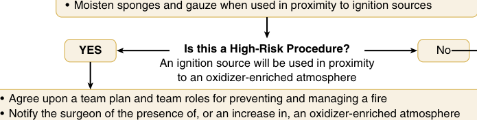

•  Moisten sponges and gauze when used in proximity to ignition sources YES Is this a High-Risk Procedure? No An ignition source will be used in proximity to an oxidizer-enriched atmosphere • Agree upon a team plan and team roles for preventing and managing a fire • Notify the surgeon of the presence of, or an increase in, an oxidizer-enriched atmosphere 

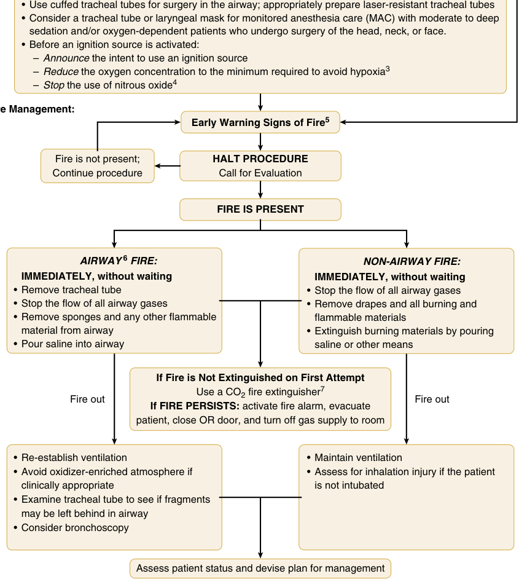

• Use cuffed tracheal tubes for surgery in the airway; appropriately prepare laser-resistant tracheal tubes • Consider a tracheal tube or laryngeal mask for monitored anesthesia care (MAC) with moderate to deep  sedation and/or oxygen-dependent patients who undergo surgery of the head, neck, or face. • Before an ignition source is activated: –   Announce  the intent to use an ignition source –   Reduce  the oxygen concentration to the minimum required to avoid hypoxia 3 –   Stop  the use of nitrous oxide 4 Fire Management: Early Warning Signs of Fire 5 Fire is not present; HALT PROCEDURE Continue procedure Call for Evaluation FIRE IS PRESENT AIRWAY 6  FIRE: NON-AIRWAY FIRE: IMMEDIATELY, without waiting  IMMEDIATELY, without waiting • Remove tracheal tube  • Stop the flow of all airway gases • Stop the flow of all airway gases • Remove drapes and all burning and • Remove sponges and any other flammable  flammable materials  material from airway  • Extinguish burning materials by pouring • Pour saline into airway  saline or other means If Fire is Not Extinguished on First Attempt Use a CO2 fire extinguisher 7 Fire out Fire out If FIRE PERSISTS:  activate fire alarm, evacuate patient, close OR door, and turn off gas supply to room • Re-establish ventilation • Maintain ventilation • Avoid oxidizer-enriched atmosphere if • Assess for inhalation injury if the patient  clinically appropriate  is not intubated • Examine tracheal tube to see if fragments  may be left behind in airway • Consider bronchoscopy Assess patient status and devise plan for management 

### Fire Management:

**Fig. 66.11 American Society of Anesthesiologists’ Operating Room Fires Algorithm.** (1) Ignition sources include but are not limited to electrosurgery or electrocautery units and lasers. (2) An oxidizer- enriched atmosphere occurs when there is any increase in oxygen concentration above room air level, and/or the presence of any concentration of nitrous oxide. (3) After minimizing delivered oxygen, wait a period of time (e.g., 1–3 min) before using an ignition source. For oxygen- dependent patients, reduce supplemental oxygen delivery to the minimum required to avoid hypoxia. Monitor oxygenation with pulse oximetry, and if feasible, inspired, exhaled, and/or delivered oxygen concentration. (4) After stopping the delivery of nitrous oxide, wait a period of time (e.g., 1–3 min) before using an ignition source. (5) Unexpected flash, flame, smoke or heat, unusual sounds (e.g., a “pop,” snap or “foomp”) or odors, unexpected movement of drapes, discoloration of drapes or breathing circuit, unexpected patient movement or complaint. (6) In this algorithm, airway fire refers to a fire in the airway or breathing circuit. (7) A CO2 fire extinguisher may be used on the patient if necessary. _CO2_ , carbon dioxide; _OR,_ operating room. (From American Society of Anesthesiologists. Practice advisory for the prevention and management of operating room fires. _Anesthesiology._ 2008;108:786–801. Copyright 2013, the American Society of Anesthesiologists, Inc. Lippincott Williams & Wilkins.)

<!-- PDF page 18 -->

### Box 66.2 Management of Airway Fires

### Prevention and Preparedness

1.  Keep the O2 concentration at approximately 30%, or less if possible. Use an O2/air mixture. Avoid N2O.

2.  Use a “laser- safe” endotracheal tube.

3.  Inflate the endotracheal tube cuff with dyed normal saline to provide an early indicator of cuff rupture.

4.  Use a pre- prepared 50- mL syringe of saline to extinguish any fire and flood the surgical field if a fire occurs.

5.  Have an extra endotracheal tube available for reintubation in case a fire occurs.

6.  Inform the surgical team working on the airway of any situation in which high concentrations of O2 are being used.

### In the Case of an Airway Fire

1.  Stop lasering. Stop ventilation. Turn O2 off (as well as N2O if it was mistakenly in use).

2.  Inform the surgical team and assign someone to call the control desk for help.

3.  Remove the burning endotracheal tube* and drop it in the bucket of water, if available.

4.  Put out the fire with your improvised fire extinguisher.

5.  The area should be flushed with saline. **When the Fire Is Extinguished**

1.  Ventilate the patient with 100% O2 by face mask (or supraglottic airway if appropriate).

2.  When the patient is stable, assess the extent of airway damage. Consider using a ventilating rigid bronchoscope; debris and foreign bodies should be removed.

3.  Reintubate the patient if significant airway damage is found.

4.  When appropriate, arrange for admission to an ICU.

5.  Provide supportive therapy, including ventilation and antibiotics, and extubate when appropriate.

6.  Tracheotomy may be needed.

_ICU,_ intensive care unit; _N2O,_ nitrous oxide; _O2,_ oxygen.

*Removing the endotracheal tube may be inappropriate in some cases (see text).

Courtesy Dr. B. Abdelmalak, Cleveland Clinic, Cleveland, Ohio.

Nitrous oxide is avoided in middle ear procedures because it diffuses from blood to the middle ear, thereby increasing middle ear pressure and potentially distending any carefully placed tympanic membrane grafts. However, many ENT surgeons now use “underlay” grafts, in which increased middle ear pressures can help hold the graft in place, as opposed to older “overlay” grafts, in which a high middle ear pressure would dislocate the graft.

Many middle ear operations are performed to ameliorate hearing loss from infection or inflammation. The most frequent of these procedures, myringotomy with tube placement, is most commonly performed in children by using simple sevoflurane mask anesthesia, in conjunction with acetaminophen or (less commonly) fentanyl to treat postoperative pain. The procedure can usually be safely accomplished without establishing intravenous access.148

Stapedectomy, typically performed to treat otosclerosis, is usually performed using general anesthesia and may involve the use of surgical lasers (hence a potential need for laser precautions), as well as facial nerve monitoring (hence a potential need for periods with minimal neuromuscular blockade). The use of a volatile anesthetic in

combination with a remifentanil infusion helps provide mild hypotension (which reduces blood loss), as well as surgical immobility. Nitrous oxide can theoretically be used early in the procedure, but it must be avoided later to avoid damaging possible “overlay” grafts to the tympanic membrane. However, most clinicians simply avoid nitrous oxide entirely, to reduce the incidence of PONV. Gentle emergence, often involving a remifentanil infusion, helps avoid coughing or “bucking” with the tracheal tube present, with possible displacement of the bone prosthesis. Not surprisingly, extubation of the trachea during deep anesthesia is sometimes performed. Ossiculoplasty procedures involve similar considerations.

Common inner ear procedures include surgery to the cochlea, endolymphatic sac, and labyrinth. Patients with pathologic processes in the labyrinth and endolymphatic sac, such as patients with Meniere disease, often suffer from vertigo and hearing loss and are especially prone to postoperative PONV. In cochlear implant surgery, mastoidectomy is performed to implant the signal coupler while the electrode array is implanted into the cochlea, a procedure often taking over 4 hours. Considerations similar to those for stapedectomy apply, including the potential need for nerve monitoring, the avoidance of PONV, and gentle emergence from anesthesia. Some surgeons also request a degree of hypotension to reduce blood loss.

Untreated chronic otitis media often leads to mastoiditis, tympanic membrane perforation, and damage to the ossicular chain. Additionally, the formation of a cholesteatoma (an invasive growth of keratinizing squamous epithelium) may spread into the mastoid cavity, inner ear, and even the brain to cause additional damage. When antibiotic treatment fails, mastoidectomy (removing infected material, draining subperiosteal abscesses, and reestablishing middle ear ventilation) may be indicated. Because blood loss can be substantial, controlled hypotension is sometimes requested. The nerve identification and gentle emergence issues discussed earlier often apply as well. Nitrous oxide is often avoided, at least in the later stages, because of the tympanoplasty component of the procedure.

Surgical procedures of the outer ear may be performed to correct congenital and acquired malformations. Although these patients often present no special challenges, every anesthesiologist should determine if the malformation is part of Goldenhar syndrome or Treacher Collins syndrome, since these patients frequently offer airway challenges. General anesthesia is typically employed, and postoperative pain can be substantial, particularly when a rib graft is used as part of the repair.

## Parotid and Other Salivary Gland Surgery

The salivary glands comprise a pair of parotid glands, two submandibular glands, two principal sublingual glands, and several minor salivary glands. As exocrine glands, their function is variously to produce saliva, digestive enzymes (amylase), and lubrication, as well as to provide a bacteriostatic function. Indications for submandibular gland surgery include tumors, chronic sialadenitis refractory to medical treatment, and removal of

<!-- PDF page 19 -->

impacted stones. The most frequent parotid disease warranting surgery is a benign neoplasm, frequently a pleomorphic adenoma. Superficial parotidectomy (complete or limited) with facial nerve dissection is the most commonly performed procedure for these lesions, although a simpler enucleation procedure is sometimes also performed.149–151 Identification of the facial nerve and its branches, often employing nerve stimulation methods, is central to the procedure to reduce the risk of nerve injury. For this reason, the surgical team usually requests that muscle relaxants be avoided after endotracheal intubation has been achieved.

Besides the usual considerations applying to all surgical patients, preoperative evaluation of patients for salivary gland surgery should consider any previous head and neck surgery and any history of radiation therapy (which can make mask ventilation difficult). The physical examination should look for tumor displacement of the airway, as well as impaired temporomandibular joint (TMJ) mobility and other predictors of airway difficulties. Available head and neck CT scans or MRI studies should be reviewed with the surgical team, with a focus on airway issues.

During these procedures, complete immobility of the patient is important. Consequently, general anesthesia with endotracheal intubation is usually required, although cases of parotid surgery performed using local anesthesia have been reported.152 Management of the airway with an LMA for parotid surgery has been described; however, the typical 2- to 4- hour duration of the operation and the need for an operative side- up head position lead most anesthesiologists to use a tracheal tube. Sufficient anesthetic depth and patient immobility are usually achieved using relatively large doses of opioid and inhaled anesthetics, with muscle relaxants avoided to allow facial nerve monitoring for both parotid and (less commonly) submandibular surgery. A single, small dose of rocuronium to facilitate endotracheal intubation is often employed, followed by sevoflurane anesthesia in conjunction with a remifentanil infusion (e.g., 0.1 mcg/kg/min) to provide immobility. Finally, preservation of the facial nerve is of prime importance in these operations; consequently, the surgeon often must identify the facial nerve by using a nerve stimulator. This crucial step is not possible if neuromuscular blockade is present.

## Sleep Apnea Surgery

OSA involves repetitive partial or complete upper airway obstruction because of collapse of the pharyngeal airway during sleep.153–158 This condition typically occurs despite continued movement of the diaphragm and can lead to apneic episodes (with complete obstruction), hypopneas (with partial obstruction), and respiratory effort–related arousals. The last of these can occur without oxygen desaturation, whereas hypoxia itself leads to arousal from sleep, with reopening of the airway and the intake of a breath. Severity of the OSA is related to the number of these respiratory events per hour as determined by polysomnography. Patients in whom conservative treatment (e.g., weight loss, continuous positive airway pressure, bilevel positive airway pressure, oral appliances) fails may benefit from either surgical modification of the upper airway or,

rarely, tracheostomy. Commonly performed procedures include uvulopalatopharyngoplasty, uvulopalatal flap surgery, tonsillectomy and adenoidectomy, genioglossus advancement, and maxillomandibular advancement. Sometimes these procedures are performed in combination. Possible comorbidities such as obesity, metabolic syndrome, type 2 diabetes, coronary artery disease, or cor pulmonale should be identified. Patients with OSA can be difficult to intubate or ventilate by mask, and they are especially prone to postoperative hypoxia. In addition, they frequently have conditions such as macroglossia, redundant pharyngeal tissue, lingual tonsil hypertrophy, or an anterior larynx, all of which can make direct laryngoscopy difficult.

Clinical features that increase the likelihood of OSA include a body mass index greater than 30 kg/m2 , large neck circumference (>17 inches in men; >16 inches in women), a high Mallampati score (3 or 4), and the presence of features such as a large uvula, macroglossia, retrognathia, tonsillar hypertrophy, or a high arched palate. The airway features that predispose to OSA may also contribute to difficulty during airway management and tracheal intubation. Difficult intubation is encountered five to eight times more often in patients with OSA compared with other patients. Additionally, snoring and OSA are independent risk factors for difficult ventilation by mask.

General endotracheal anesthesia is preferable for patients undergoing a procedure to address the airway obstruction, since it minimizes the risk of aspiration of blood from the surgical site and the risk of laryngospasm should blood or secretions contact the vocal cords.

Postoperative vigilance is critically important in patients with OSA, even after surgical interventions. The patient with a history of OSA has a high incidence of postoperative obstructive episodes, peaking on postoperative day 3 and returning to preoperative levels after a week. Consequently, patients with OSA who are undergoing airway surgery are not usually outpatient candidates. Postoperative airway edema is also a potential finding. As a result, the administration of any respiratory depressants such as opioids and sedatives postoperatively should be minimized. Dexamethasone is often administered postoperatively to reduce airway edema.

## Zenker Diverticulum

Zenker diverticulum, first described in 1874, is a herniation or outpouching of pharyngeal mucosa through the posterior wall of the hypopharynx (often between the oblique and horizontal components of cricopharyngeus).159,160 Typically seen in the sixth to ninth decades of life and occurring in approximately 1 in 800 upper gastrointestinal barium studies, patients may describe regurgitation of undigested food when supine and food caught in the throat (i.e., in the mucosal pouch), as well as coughing, dysphagia, and halitosis. Confirmation of the clinical diagnosis is usually by barium swallow and/or endoscopy.

Surgery can be performed as an open or endoscopic procedure. In the open (transcervical) approach, the diverticulum is exposed through a lateral neck incision and is then resected (diverticulectomy) or tacked superiorly to

<!-- PDF page 20 -->

the prevertebral fascia (diverticulopexy). Cricopharyngeal myotomy may be added to help prevent recurrence. In the endoscopic approach, no skin incision is required; here the surgical procedure usually involves ablating the common wall between the pouch and the cervical esophagus by using an endoscopic stapler, surgical laser, or other means.

Several anesthetic considerations apply. First, patients are frequently older, with applicable comorbidities, such as coronary artery disease. Second, the possibility that food caught in the pouch could end up in the airway is a concern. Additionally, oral medications such as antihypertensives administered the day of surgery may lodge in the pouch and be aspirated. Historically, preoperative evacuation of the pouch was performed by applying external pressure before anesthesia, but this is not commonly done because of concerns of causing iatrogenic pulmonary aspiration. More commonly, the patient is positioned with a 30- degree headup tilt before the induction of anesthesia.

Although awake endotracheal intubation should provide protection against the risk of aspiration of pouch contents, a theoretical concern is that any coughing during the procedure, either from the use of transtracheal local anesthesia or from the instrumentation, could lead to regurgitation of pouch contents with possible aspiration. A more common technique is the use of rapid- sequence induction of anesthesia, usually with the modification that cricoid pressure is not used, for fear of discharging the pouch contents with the applied pressure. (Application of cricoid pressure is recommended only if the neck of the pouch is below the cricoid cartilage; Fig. 66.12.) Some experts have expressed the concern that using succinylcholine, especially if it is not preceded by a nondepolarizing muscle relaxant, could produce muscle fasciculations that could cause pouch compression. Even after endotracheal intubation, seepage of material around the ETT cuff can occur with surgical manipulation; some clinicians place a moist gauze throat pack to prevent aspiration of this material. Finally, the procedure is occasionally performed using regional anesthesia with deep and superficial cervical plexus blocks.

Care should be taken to avoid perforation of the diverticulum, such as with blind placement of a nasogastric tube or during difficult tracheal intubation. During the surgical procedure, retraction of the carotid sheath may stimulate baroreceptors and initiate arrhythmias, especially bradycardia, whereas significant blood loss and air embolism may occur if major vessels are accidentally cut. A smooth awakening from anesthesia that is free from coughing and straining is important to avoid the risks of neck hematoma and the attendant possibility of a compromised airway.

## Anesthesia for Surgical Airways: Cricothyrotomy and Tracheostomy

Two general approaches are used to create a surgical airway. In dire emergencies a cricothyrotomy is most often performed since it can be accomplished quickly when

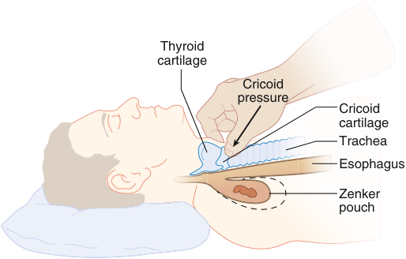

Thyroid cartilage Cricoid pressure Cricoid cartilage Trachea Esophagus Zenker pouch 

**Fig. 66.12 Anatomic relationship of the diverticulum to the cricoid cartilage during application of cricoid pressure.** (From Thiagarajah S, Lear E, Keh M. Anesthetic implications of Zenker diverticulum. _Anesth Analg._ 1990;70:109–111.)

performed by a skilled clinician.161,162 The airway is entered through the cricothyroid membrane. This is done either by inserting a narrow- bore transtracheal ventilation catheter percutaneously through the cricothyroid membrane and employing emergency high- pressure jet ventilation or by inserting a wider- bore tube of sufficient diameter to allow low- pressure ventilation through a conventional resuscitator bag (e.g., “Ambu” bag). This second approach through the cricothyroid membrane can be achieved by using a vertical scalpel incision, identifying the cricothyroid membrane, cutting through the membrane with a horizontal stab incision, and placing (for example) a 6- mm inner- diameter tracheal tube. Alternately, one can use a commercial kit employing (for example) the Seldinger technique (e.g., Melker cricothyrotomy kit, Cook Medical, Bloomington, Ind.). An educational cricothyrotomy video is available at http://www.cookmedical.com/cc/education Media.do?mediaId=1522.

The second approach to achieving a surgical airway is a tracheostomy.163,164 (Although the terms “tracheotomy” and “tracheostomy” are used interchangeably by clinicians, based on their Greek roots, the former term refers to cutting into the trachea, whereas the latter refers to the opening that has been created.) This approach is best suited for situations that are not critical, time- sensitive emergencies, since they generally take longer to complete, and usually involve entering the airway between the second and third tracheal rings following a careful dissection of the neck tissues. Although it is very often performed using general anesthesia in an intubated ICU patient in whom ventilator weaning has failed, it is sometimes performed using local anesthesia, either employing no sedation (this is the usual case in stridulous patients, especially those requiring heliox) or using a drug such as dexmedetomidine because of its lack of respiratory depression. In any event, the decision to perform a tracheostomy using local anesthesia is made jointly with the surgeon and depends on the extent of airway disease, the experience of the surgical team, and the degree to which the patient can tolerate lying supine with their head in extension. In some cases, the procedure must be performed with the patient in a semi- upright sitting position. Percutaneous tracheostomy kits are also available

<!-- PDF page 21 -->

to allow performance of the procedures without requiring access to the trachea using a scalpel and formal incision.

In the case of patients who have an endotracheal tube in place and airway secured prior to performing a tracheotomy, at one point in the procedure the anesthesia provider will be asked to withdraw the tracheal tube slowly to permit the airway to be entered without obstruction. Additionally, at this time the airway should be entered using a scalpel and not using cautery, to prevent an airway fire in an oxygenrich environment.

Several problems may arise in the postoperative period following a tracheotomy.165–167 Bleeding, pneumothorax, subcutaneous or mediastinal emphysema, and hypoventilation or airway obstruction may occur immediately after the procedure, whereas possible late complications include tracheal stenosis, tracheoesophageal fistula formation, tracheomalacia, and even tracheal necrosis. Although posttracheotomy bleeding is usually inconsequential, bleeding into the airway may cause the patient to cough and buck forcefully. In addition, major bleeding from a large artery or vein (often the communicating branch of the superior thyroid artery) may necessitate immediate exploration of the surgical field, whereas bleeding from the innominate artery may occur from erosion by the distal end of the cannula, more often later in the patient’s course than as an acute early cause of bleeding. One clinical clue that the tracheostomy could be applying pressure to the innominate artery is the finding of pulsations in the tracheotomy cannula after initial insertion. Treatment includes inflating the tube cuff and pulling the tube assembly anteriorly to tamponade the bleeding. An oral tracheal tube should then be inserted to secure the airway prior to surgical procedure to gain control of the bleeding.

Frequently, tracheotomy tubes must be changed for a variety of reasons, including cuff leak or obstruction of the tube with secretions or blood that cannot be cleared with removal of an inner cannula. Changing a tracheotomy tube can be challenging, particularly early after the procedure. If the tube needs to be replaced or is dislodged for any reason, blindly replacing the tube can create a false passage into the soft tissue. If an attempt is made to ventilate through the misplaced tube, subcutaneous emphysema will result, making it even more difficult to reestablish the airway. This potential problem is most likely shortly after the initial tracheotomy is performed. Over time, the stoma matures to form a well- defined and self- supporting orifice. However, this rigidity and tissue support are lacking in a fresh tracheostomy, so that following removal of the tracheostomy tube, the tissue may “collapse in” on itself to block the passage. Consequently, certain precautions when dealing with a fresh tracheostomy tube must be borne in mind. First, for the first week or so, tube changes should be performed in the operating room with a full set of tracheotomy instruments (e.g., cricoid hooks) and a means to intubate “from above” as a last resort if the airway is lost. Second, once the tracheotomy site has begun to mature, it is no longer necessary to carry out tube changes in the operating room, but a full set of instruments (especially cricoid hooks) should still be available. Additionally, changing the tube over a tube changer may also be useful, but some clinicians find that it may unnecessarily complicate matters. Third, before any tube change, the patient should receive 100% oxygen to

provide an oxygen reservoir should replacement be delayed. Finally, a fiberoptic bronchoscope may be potentially useful in confirming tracheal placement of a tracheostomy tube before attempting any positive- pressure ventilation that could lead to subcutaneous emphysema should the tube, in fact, be malpositioned.

## Neck Dissection and Laryngectomy

Neck dissection is commonly performed in isolation or during laryngectomy to prevent or treat any local spread of head and neck malignancy.168,169 The extent of a neck dissection operation is based on the extent to which the neck’s six lymph node levels are involved, as well as on the extent to which additional structures (spinal accessory nerve, internal jugular vein, and sternocleidomastoid muscle) are removed. Depending on the degree to which the tumor can be removed and recurrence or spread can be prevented, as well as the extent that phonation and swallowing can be preserved, various surgical options are exercised. Limited disease is sometimes managed by radiation, by laser and microsurgery, or by partial laryngectomy, thus preserving organ function. In total laryngectomy, the larynx is removed in its entirety, with the airway ending in a stoma formed by bringing the cut end of the trachea to the neck surface (with the result that the trachea now becomes independent of the esophagus). Often a perforation between the trachea and the esophagus (tracheoesophageal puncture) is made to allow eventual placement of a voice prosthesis.170 In some cases the procedure is supplemented with microvascular free tissue transfer (free flap).

Anesthesia can be induced through a standard intravenous line, followed by large- bore intravenous and arterial lines placed after induction. A central line can usually be avoided, with systolic pressure variation of the arterial line tracing and other clinical findings to guide fluid replacement. Although nerve function monitoring is usually required during the neck dissection phase, neuromuscular blockade is acceptable at the beginning. When neuromuscular blockade is no longer desirable, opioid infusions (e.g., remifentanil) are often used to maintain adequate analgesia in conjunction with an inhaled anesthetic agent. Many clinicians prefer using a balanced technique in preference to deep inhalational anesthesia or TIVA (propofol with or without remifentanil) to avoid the troublesome hypotension. Excessive intravenous crystalloid administration should be avoided to prevent operative site edema.

For patients undergoing total laryngectomy cases, a tracheostomy is customarily performed near the beginning of the procedure by using a wire- reinforced ETT placed into the stoma. (Warning: accidental endobronchial intubation commonly occurs in this setting.) In some cases, the patient is turned 180 degrees from the anesthesia machine; care must be taken to ensure that nothing is disconnected in the process. Extubation in such cases is extraordinarily simple; the ETT should be removed from the stoma when extubation criteria are met. Should reintubation ever become necessary, one merely reintroduces the tracheal tube into the stoma. The patient is then

<!-- PDF page 22 -->

simply brought to the postanesthesia care unit with an oxygen mask placed over the stoma, although when a free flap has been performed, the patient is often brought to the ICU intubated, ventilated, and sedated (depending on the surgeon’s preferences and local protocols). After total laryngectomy, the patient’s chart and all providers should be informed that should the patient have any airway difficulties requiring manipulation, there should be no attempts to intubate from the mouth.

### Box 66.3 Some Otolaryngologic Clinical Situations in Which Laser Techniques Can Be Useful

### Nose

- Turbinate reduction

- Septoplasty

- Removal of nasal obstructions, polyps, synechiae

- Treatment of rhinophyma

- Treatment of keloids and hypertrophic scars

## Maxillary, Mandibular, and Temporomandibular Joint Surgery

### Oropharynx and Pharynx

- Vaporization of papillomas, leukoplakias, and hemangiomas

- Tumor surgery (e.g., partial glossectomy)

Maxillectomy surgery may be limited (e.g., removal of one antral wall, such as in a medial maxillectomy), subtotal (e.g., removal of two walls of the antrum), or total (removal of the total maxilla).171–173 Orbital exenteration sometimes accompanies the procedure should the intraorbital contents be violated by tumor. Indications for maxillectomy include the following: tumors of the maxillary sinus, palate, and other structures; some intractable fungal infections; and other conditions. The procedure is performed using general anesthesia with tracheal intubation and invasive monitoring appropriate to the patient’s condition and the extent of the surgery. Although massive blood loss is unusual, precautions should be taken because hemorrhage may occur (e.g., with transection of the internal maxillary artery). Hypotensive anesthesia, when appropriate, can help reduce blood loss. Medial maxillectomy procedures conducted endoscopically do not require anything different from ordinary sinus surgery for anesthesia. When electromyography- based cranial nerve monitoring is employed, long- acting paralytic agents should be avoided. Surgery of the mandible and TMJ may be carried out by maxillofacial surgeons, as well as by otolaryngologists and plastic surgeons.174–176 Mandibular surgery can range from simple biopsies to all- day radical procedures involving microvascular osteocutaneous flaps. Awake nasal intubation may be required in some cases. Hypotensive anesthesia is often used for orthognathic procedures to minimize blood loss. In some cases, the jaw is wired shut, and reintubation, should it be required postoperatively, can be a challenge. TMJ dysfunction often manifests with pain and decreased mouth opening. Conditions such as osteoarthritis, synovitis, or fibrosis may be responsible. Most TMJ procedures are performed using general nasotracheal anesthesia. As with mandibular surgery, the presence of very limited mouth opening may dictate that the procedure be done with awake nasal intubation.

## Ear, Nose, and Throat Laser Surgery

Lasers are commonly used in ENT surgery (Box 66.3 and Table 66.1).177–180 The most widely used laser in ENT surgery is the CO2 laser, which allows precise cutting with a particularly fine zone of coagulation that reduces bleeding. Tissue vaporization is particularly efficient with this laser because of the excellent absorption of the produced far- infrared photons (10,600- nm wavelength) by water

- Laser- assisted uvulopalatoplasty

- Tonsillectomy

### Larynx

- Removal of vocal cord polyps and granulomas ᑏ Epiglottectomy ᑏ Cordectomy ᑏ Arytenoidectomy

### Tracheobronchial Tree

- Treatment of tracheal stenosis

- Removal of nodules, polyps, tumors, and fibromas

### Ear

- Surgery of the stapes

- Laser- assisted myringotomy

- Cholesteatoma

From Abdelmalak B, Doyle DJ, eds. _Anesthesia for Otolaryngologic Surgery._ Cambridge, UK: Cambridge University Press; 2012.

**Table 66.1** A Sampling of Various Kinds of Lasers Available for Clinical Use

|**Type**|**Gas or** **Solid**|**Wavelength*** **(nm)**|**Color**|**Fiberoptic** **Transmissible?**|
|---|---|---|---|---|
|Helium/ neon|Gas|633|Red|Yes|
|Argon†|Gas|500|Blue–green|Yes|
|CO2|Gas|10,600|Invisible (far infrared)|No|
|Ruby|Solid|695|Red|Yes|
|Nd:YAG|Solid|1064|Invisible (near infrared)|Yes|
|KTP|Solid|532|Green|Yes|

_KTP,_ potassium titanyl phosphate; _Nd:YAG,_ neodymium:yttrium–aluminum– garnet.

*Wavelengths are given in nanometers (nm). There are 109 nm to a meter. †The argon laser produces blue–green coherent light at several wavelengths but most of the energy is at wavelengths 488 nm and 514 nm. From Abdelmalak B, Doyle DJ, eds. _Anesthesia for Otolaryngologic Surgery_ . Cambridge, UK: Cambridge University Press; 2012.

present in tissue. This laser is used in the removal of laryngeal tumors and lingual tonsillar tissue, in the ablation of hemangiomas, and for the resection of some oropharyngeal malignant tumors.

::: details 原始表格與符號（PDF 第 22 頁）

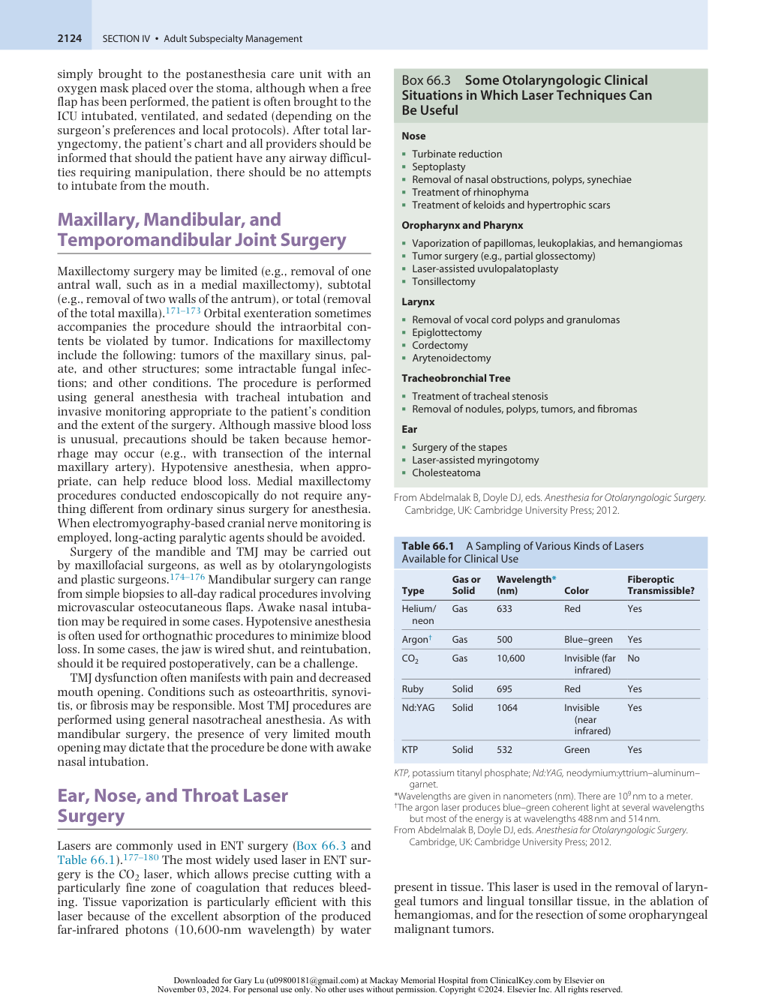

:::

<!-- PDF page 23 -->

**Table 66.2** Some Types of Laser Endotracheal Tubes in Clinical Use

|**Name**|**Description**|**Intended Use**|
|---|---|---|
|Laser- Flex|Airtight stainless steel corrugated spiral with a PVC Murphy eye tip and double cuffs. More information is available athttp://www.cardin al.com/us/en/distributedprod ucts/ASP/43168- 145.asp|CO2or KTP lasers|
|Laser- Shield II|Silicone rubber tube wrapped with aluminum and wrapped over with Teflon. More information athttps://www. medtronic.com/covidien/en-gb/ products/intubation/shiley-laser- oral-endotracheal-tubes.html|CO2or KTP lasers|
|Lasertubus|Soft white rubber, reinforced with corrugated copper foil and an absorbent sponge; double cuffed. More information athttps://www. medtronic.com/covidien/en-gb/ products/intubation/shiley-laser- oral-endotracheal-tubes.html|CO2or KTP lasers|
|Sheridan Laser- Trach|Red rubber design with embossed copper foil and outer covering designed to reduce damage to mucosal surfaces and vocal cords. More information athttp:// www.teleflex.com/en/usa/p roductAreas/anesthesia/do cuments/Sheridan- ET- Tube- Guide.pdf|CO2or KTP lasers|

_CO2,_ carbon dioxide; _KTP,_ potassium titanyl phosphate; _PVC,_ polyvinyl chloride. From Abdelmalak B, Doyle DJ, eds. _Anesthesia for Otolaryngologic Surgery_ . Cambridge, UK: Cambridge University Press; 2012.

Another popular laser in ENT surgery is the neodymium:yttrium–aluminum–garnet (Nd:YAG) laser, which emits photons with a wavelength of 1064 nm. These photons are poorly absorbed by water and thus tend to penetrate tissue more deeply than do those from a CO2 laser. In addition, light from an Nd:YAG laser can be transmitted through flexible quartz fibers that can be used in conjunction with a flexible fiberoptic bronchoscope for use in treating tracheobronchial lesions.

Because surgical lasers involve high amounts of energy, they have the potential for unintended tissue damage, as well as for causing fires. Stray laser beams can ignite surgical drapes. To mitigate these risks, one should place warning signs outside the operating room, provide opaque coverings on any operating room windows, and issue protective goggles. The presence of high oxygen concentrations near the patient’s face can facilitate ignition in this region, so delivering supplementary oxygen by face mask or nasal cannula requires special care. American National Standards Institute Z136.3 (Safe Use of Lasers in Health Care Facilities) provides additional information on this and related matters.

One special concern is that the laser can cause a regular ETT to ignite. In the past, metallic tape was applied around the ETT in a spiral manner. Today, however, several

special- purpose ETTs are available to minimize any risk of the tube igniting (Table 66.2). The choice of anesthetic technique depends on the clinical circumstances. TIVA techniques for laser ENT surgery are particularly popular and are essential when patients are unintubated and jet ventilation is used. When patients are intubated, a potent inhalational agent such as sevoflurane is often used, although frequently an infusion of remifentanil is used as an anesthetic adjunct in such cases (typical rate: 0.05–0.1 mcg/kg/min). (Remifentanil, with its vagomimetic effect, is especially useful to limit the heart rate in the face of intense sympathetic stimulation from the effects of the suspension laryngoscope.) Finally, to reduce the chance of a fire, while lasers are in use the oxygen concentration should be limited to the lowest concentration necessary to maintain acceptable arterial oxygen saturation levels and nitrous oxide should not be used.

Airway management is often a challenge throughout laser surgery cases. As a result, the surgeon and anesthesiologist must work together to devise a plan. One issue is whether general anesthesia should be preceded by awake intubation because the presence of airway disease may complicate both ventilation and intubation. Another issue is whether the procedure should be performed using general anesthesia with the patient breathing spontaneously, albeit with assistance, as is sometimes desirable when an anterior mediastinal mass is present. Muscle relaxation is often employed to help ensure an immobile surgical field. With the widespread availability of sugammadex, most clinicians can use rocuronium as a relaxant, followed by a “sugammadex rescue” should the airway become unmanageable following relaxant administration. Many clinicians, however, simply intubate the patient awake whenever issues of this kind arise.

In some cases, the entire surgical procedure is done without tracheal intubation. The advantages of this approach include decreased risk of fire (no ETT to ignite) and improved access to airway structures. Disadvantages include the risk of aspiration with an unprotected airway and potential difficulties in ventilating the patient. Typically in such cases, an anterior commissure laryngoscope or similar device is used in conjunction with TIVA and jet ventilation. In other cases, the laryngoscope is used in conjunction with a small- diameter ETT (e.g., MLT size 5.0), and the procedure is performed while the patient has brief periods of apnea in conjunction with intermittent removal of the ETT to allow unimpaired access to the glottic structures.

Laser vaporization of tissue, especially from CO2 lasers, often results in a plume of smoke that can be hazardous. The use of a smoke evacuator at the surgical site along with protective masks that filter out particulate material is often advised, especially when virus particles are present in the vaporized tissue.

Extubation of the trachea in these cases can be challenging. Some patients benefit from the administration of intravenous dexamethasone to reduce edema. Stridor is sometimes encountered after extubation; although this condition may require reintubation, one can sometimes avoid this by using inhaled racemic epinephrine or the use of heliox, a mixture of helium (typically 70%) and oxygen. Extubation over a tube exchanger can be helpful when the need for reintubation is a concern and is expected to be challenging.

::: details 原始表格與符號（PDF 第 23 頁）

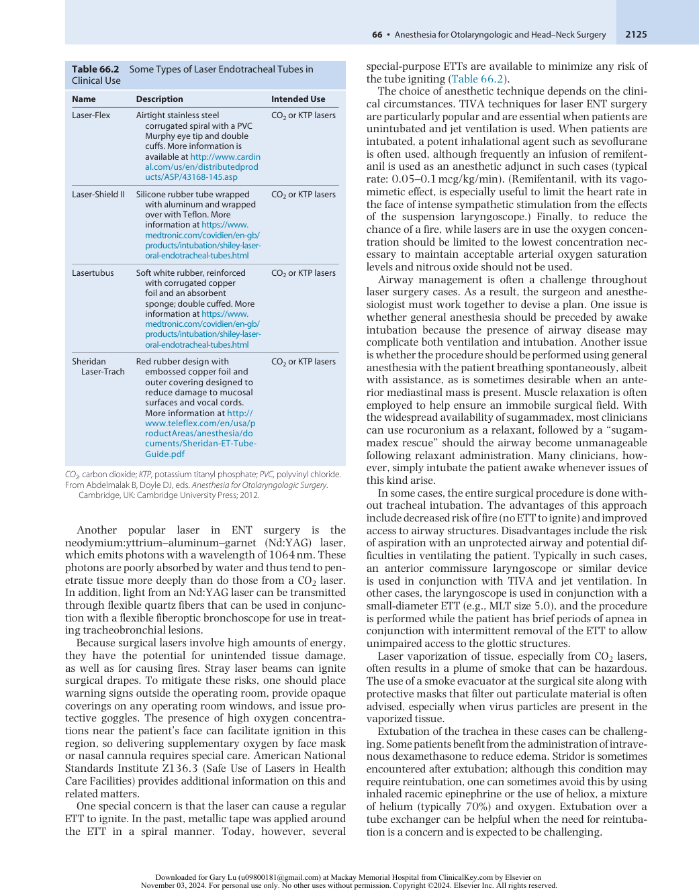

:::

<!-- PDF page 24 -->

Even when the tracheas of patients are extubated conservatively following laser surgery, airway problems can arise later. In cases of immediate respiratory distress following laser procedures, consider the following possibilities: tissue edema (e.g., after Nd:YAG laser use), residual muscle relaxant or anesthetic effects, airway secretions, pneumothorax, bleeding, and pneumomediastinum.

## Phonosurgery

Phonosurgery is surgery conducted to improve a patient’s voice.181–185 In many cases the patient’s voice has been damaged because of unilateral vocal cord paralysis. One common operation used in this setting is medialization of the paralyzed vocal cord (laryngoplasty) so that the normal vocal cord can contact the paralyzed side. This procedure is undertaken using local anesthesia with minimal sedation (e.g., 20 mg propofol administered just before the injection of the local anesthetic) because the patient needs to phonate on request. Continuous intraoperative imaging of the vocal cords, especially during phonation, is carried out to achieve the repair. An infusion of dexmedetomidine is sometimes used.

## Head and Neck Flap Reconstructive Surgery

Tissue transfer in the form of pedicle flap or a microvascular free flap is commonly employed to reconstruct defects created following tumor surgery.186–188 Potential advantages of such flaps include the avoidance of staged procedures, improved wound healing, superior cosmetic results, and improved tolerance for postoperative radiation therapy. For optimal anesthetic care, anesthesiologists must have a clear understanding of these procedures and their implications for anesthetic management.

A _pedicle flap_ is one in which the flap vessels are transferred intact with the rotated flap. If the flap is moved from a distant “donor” site and the flap vessels are reanastomosed to the recipient site vessels, then the tissue is termed a _microvascular free flap._ Examples of myocutaneous pedicled flaps are the pectoralis major flap and the latissimus flap used (for instance) to cover the carotid artery after the point where it is sacrificed and reconstructed using a vein graft. In contrast to pedicle flaps, free flaps provide the surgeon with more options for donor sites. Frequently, separate surgical teams for the donor and recipient sites are employed. Surgery in relation to free flaps can be elective, or it may be performed on an emergency basis to rescue an ischemic flap. Elective procedures tend to be long- duration operations conducted using general anesthesia. An arterial cannula is generally used, although special care must be taken to ensure that the arterial cannula and any additional intravenous catheters are not inadvertently placed at a site where tissue harvesting is planned (e.g., radial forearm flap). Central lines are not usually placed, in part because information about volume status can usually be better achieved using less-invasive means such as systolic blood pressure variability. Many of these procedures begin with

a tracheostomy and end with the patient being cared for in an ICU while intubated and ventilated. Intraoperative and postoperative flap monitoring is achieved clinically (examination for color, turgor, edema, and capillary refill), as well as by using technical means of blood flow assessment, such as Doppler ultrasound.

Intravenous crystalloids and colloids are administered liberally but cautiously to prevent hypovolemia and hypotension that could lead to ischemic flap failure. Conversely, excessive fluid leads to detrimental edema formation within the flap. Fluid management is particularly challenging in patients with any degree of cardiovascular instability, since both hypo- and hypervolemia put the flap at risk. The use of vasopressors such as phenylephrine or norepinephrine is generally discouraged during free flap procedures because these drugs may contribute to graft ischemia because of vasoconstriction.

## Stridor Management

_Stridor_ is noisy inspiration resulting from turbulent gas flow in the upper airway. Stridor should always command clinical attention because it is almost always the result of airway obstruction.189–194 The first issue of clinical concern in the setting of stridor is whether intubation is immediately necessary. If intubation can be delayed for a period of time, several potential options can be considered, depending on the severity of the situation and other clinical details. These options include the following: expectant management with full monitoring, 100% oxygen by face mask, and positioning the head of the bed for optimum conditions (e.g., 45–90 degrees); use of nebulized racemic epinephrine (e.g., 0.5– 0.75 mL 2.25% solution in 2.5 mL normal saline) and dexamethasone ([Decadron] 4–8 mg intravenously every 8–12 hours) when airway edema may be the cause of the stridor; and use of heliox (70% helium, 30% oxygen) or high- flow heated and humidified nasal oxygen. Dexamethasone can take several hours to take full effect, and nebulized cocaine in a dose not exceeding 3 mg/kg can be used instead of racemic epinephrine. Finally, whenever possible, immediate attempts should be made to establish the cause of the stridor (e.g., foreign body, vocal cord edema, arytenoid cartilage dislocation, tracheal compression by tumor).

Frequently, stridor occurring after extubation is the result of laryngeal edema, and it may be more problematic in children because of their small airway size. Be aware that as laryngeal edema progresses, diminished stridor may reflect impending total airway obstruction. The specific cause of laryngeal edema can often be established with fiberoptic nasopharyngeal examination, and causes are often classified as supraglottic or subglottic. Supraglottic edema most commonly follows surgical instrumentation, impaired venous drainage, eclampsia or preeclampsia, hematoma formation, or excessive fluid administration. Subglottic edema may result from traumatic intubation attempts, bucking on the ETT, prolonged intubation, tightfitting tubes, or excessive cuff pressures.

The way heliox helps relieve airway obstruction is worthy of note. Some airway- obstructing conditions may be thought of as breathing through an orifice, involving flow

<!-- PDF page 25 -->

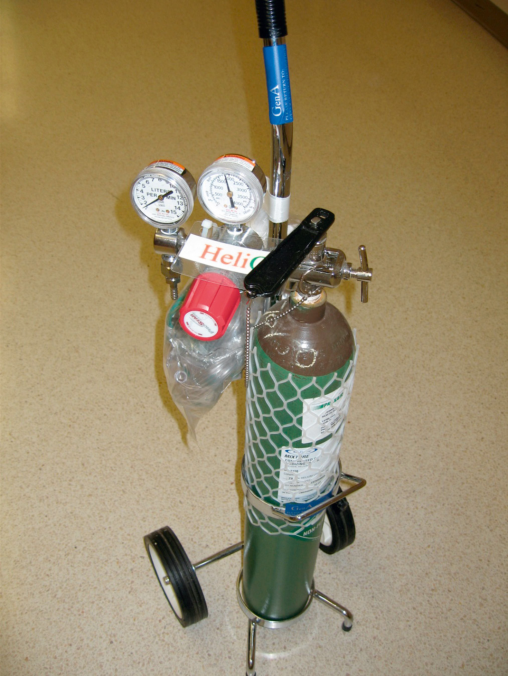

**Fig. 66.13 An E- size tank of heliox, with an attached nonrebreathing face mask in a plastic bag.** In this case, the mixture is 70% helium and 30% oxygen, although other mixtures are available. This gas mixture is usually given using a nonrebreathing face mask with a gas flow of 10 L/min as a temporizing measure in stridulous individuals.

through a tube whose length is smaller than its radius. Gas flow through an orifice is always somewhat turbulent. Under such conditions, the approximate flow across the orifice varies inversely with the square root of the gas _density_ . This contrasts with laminar flow conditions, in which gas flow varies inversely with gas _viscosity_ . Although the viscosity values for helium and oxygen are similar, their densities are very different. For example, the density for air and oxygen at 20°C is 1.293 and 1.429 g/L, respectively. However, the density of helium at that temperature is only 0.178 g/L. Clinically, heliox is usually administered from an E- size cylinder through a nonrebreathing face mask starting at a flow of 10 L/min (Fig. 66.13). When the usual 30% oxygen concentration is too low, one trick is to titrate in additional oxygen by nasal cannula. In summary, a setup to administer heliox and high- flow heated and humidified nasal oxygen should be readily available in every ENT operating room suite to assist in the treatment of stridor.

## Anesthesia for Face Transplantation

Face transplantation remains a very rare procedure (Fig. 66.14).195,196 The procedure can be total or partial. The

recipient must be able to undergo a very prolonged anesthetic and be free of serious comorbidities. Each procedure is unique with respect to indications, as well as with respect to the nature and the extent of the graft. In the case of the donor, although anesthetic principles similar to conventional organ procurement apply, because of the surgical complexity and time involved, harvesting of the facial graft should ordinarily be performed before harvesting other organs. Although the donor usually has an ETT in place at the time of tissue procurement, a tracheostomy may be performed first to avoid interference with the surgical field. Recipient patients who do not have a tracheostomy may first require awake fiberoptic oral intubation, followed by a tracheostomy. A wire- reinforced ETT is often used. Large- bore catheters are placed to facilitate fluid resuscitation, whereas a central line may be useful to monitor central venous pressure. If a central line is used, however, it must not impinge on the surgical field. Blood and fluid management is no different from that during other long surgical procedures involving microvascular free flaps. As with microvascular surgery, pressors such as phenylephrine or norepinephrine, commonly used to treat hypotension, are discouraged because of the risk of compromising graft perfusion. Finally, there may be periods when muscle relaxation must be avoided to allow nerve identification using electrical stimulation.

## Conclusion

Anesthesia for otolaryngologic and head and neck procedures are challenging for anesthesiologists not only because of the complexity of the procedures and some of the underlying clinical conditions of the patients, but also because of the proximity of the surgery to the airway. For both the anesthesiologist and surgeon, it is critical to have an understanding of the airway implications of the underlying pathology and the positioning required to safely complete the surgery. Preoperative airway assessment often requires more extensive evaluation than is required for other procedures due to the airway pathology or implications of previous surgery or radiation therapy. In addition, the anesthesiologist must coordinate intraoperative airway management with the surgeon to be sure to select the most appropriate approach to securing the airway without compromising the surgical field. Finally, the anesthesiologist must consider the implications of the surgery and underlying disease on postoperative management strategies that address airway edema, stridor, or other potential causes for postoperative gas exchange abnormalities or potential risk of aspiration.

### Acknowledgment

This chapter is a consolidation of two chapters in the 8th edition, Anesthesia for Ear, Nose, and Throat Surgery by D. John Doyle and Anesthesia for Laser Surgery by Vicki E. Modest and Paul H. Alfille. Their chapters have served as the foundation for the current chapter. The editors and publisher would like to thank the authors for their contributions to the earlier edition of this work.

<!-- PDF page 26 -->

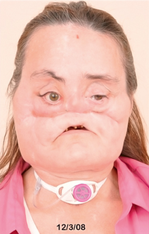

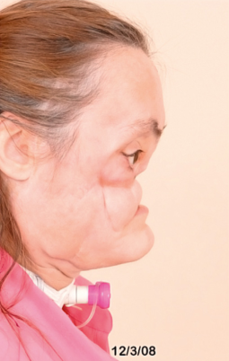

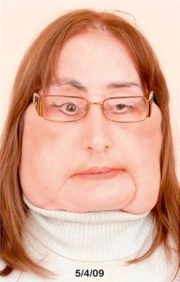

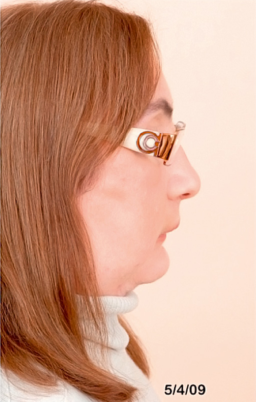

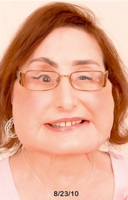

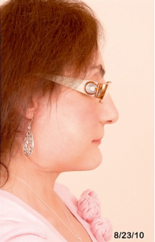

**Fig. 66.14** Ms. Connie Culp before and after the two stages of her face transplant at the Cleveland Clinic. Stage 1 was carried out in December 2008 (lead surgeon: Dr. Maria Siemionow). (Images courtesy the Cleveland Clinic, Cleveland, Ohio.)

### Complete references available online at expertconsult.com.

22.  Ezri T, et al. _J Clin Anesth_ . 2003;15:418.

23.  Combes X, et al. _Anesthesiology_ . 2004;100:1146.

### References

1.  Martin RF, et al. _Anesthesiology_ . 2012;117:10.

2.  Robinson DH, Toledo AH. _J Invest Surg_ . 2012;25:141.

3.  Abdelmalak B, Doyle DJ, eds. _Anesthesia for Otolaryngologic Surgery_ . Cambridge University Press; 2012.

4.  Al- alami AA, et al. _Paediatr Anaesth_ . 2008;18:281.

5.  Al- alami AA, et al. _Curr Opin Anaesthesiol_ . 2009;22:388.

6.  Salem MR, et al. _Anesthesiology_ . 2012;117:441.

7.  Apfelbaum RI, et al. _Spine (Phila Pa 1976)_ . 2000;25:2906.

8.  Cavo Jr JW. _Laryngoscope_ . 1985;95:1352.

9.  Brandwein M, et al. _Arch Otolaryngol Head Neck Surg_ . 1986;112:877.

10.  Wason R, et al. _Anaesth Intensive Care_ . 2004;32:417.

11.  Lim EK, et al. _Anaesth Intensive Care_ . 1987;15:342.

12.  Tekin M, et al. _J Craniofac Surg_ . 2012;23:135.

13.  Chiang FY, et al. _World J Surg_ . 2010;34:223.

14.  Dralle H, et al. _World J Surg_ . 2008;32:1358.

15.  Chiang FY, et al. _Surgery_ . 2008;143:743.

16.  White PF, et al. _Anesth Analg_ . 2012;114:1190.

17.  Krenk L, et al. _Br J Anaesth_ . 2012;108:607.

18.  Guenther U, Radtke FM. _Curr Opin Anaesthesiol_ . 2011;24:670.

19.  Rosenblatt WH. In: Abdelmalak B, Doyle DJ, eds. _Anesthesia for Otolaryngologic Surgery_ . Cambridge University Press; 2012.

20.  American Society of Anesthesiologists Task Force on Management of the Difficult Airway. _Anesthesiology_ . 2003;98:1269. [Erratum in _Anesthesiology_ . 2004;101:565.]

21.  Saxena S. _Anesth Analg_ . 2009;108:1052.

24.  Sudrial J, et al. _Emerg Med Int_ . 2010;826231:2010.

25.  Heard AM, et al. _Anaesthesia_ . 2009;64:601.

26.  Rosenblatt WH. _J Clin Anesth_ . 2004;16:312.

27.  Crosby ET. _Anaesthesia_ . 2011;66(suppl 2):112.

28.  Frova G, Sorbello M. _Minerva Anestesiol_ . 2009;75:201.

29.  Adnet F, et al. _Anesthesiology_ . 1997;87:1290.

30.  Benumof JL. _Anesthesiology._ 1997;87:1273.

31.  Adnet F, et al. _Acta Anaesthesiol Scand_ . 2001;45:327.

32.  Lavi R, et al. _J Clin Anesth_ . 2009;21:264.

33.  McElwain J, et al. _Anaesthesia_ . 2011;66:1127.

34.  Miller JA, et al. _West J Emerg Med_ . 2010;11:16.

35.  Harvey K, et al. _Eur J Anaesthesiol_ . 2007;24:76.

36.  Heegaard WG, et al. _Air Med J_ . 2003;22:28.

37.  Chung YT, et al. _Acta Anaesthesiol Taiwan_ . 2004;42:141.

38.  Sahin M, et al. _Can J Anaesth_ . 2012;59:963.

39.  Eschertzhuber S, et al. _Anesth Analg_ . 2008;107:1253.

40.  Healy DW, et al. _BMC Anesthesiol_ . 2012;12:11.

41.  Andersen LH, et al. _Acta Anaesthesiol Scand_ . 2011;55:1090.

42.  Gaszyński T, et al. _Anaesthesiol Intensive Ther_ . 2014;46:14.

43.  Griesdale DE, et al. _Can J Anaesth_ . 2012;59:41–52.

44.  Kim HJ, et al. _Paediatr Anaesth_ . 2011;21:1165.

45.  Jeon WJ, et al. _Korean J Anesthesiol_ . 2011;61:19.

46.  Huang J, Chase C. _J Clin Anesth_ . 2011;23:427.

47.  Corso RM, et al. _Eur J Anaesthesiol_ . 2012;29:495.

48.  Viernes D, et al. _Anesthesiol Res Pract_ . 2012;2012:820961.

49.  Aziz MF, et al. _Anesth Analg_ . 2012;115:904.

50.  Noppens RR, et al. _Crit Care_ . 2012;16:R103.

<!-- PDF page 27 -->

51.  Abdelmalak BB, et al. _Anaesthesia_ . 2011;66:550.

52.  Abdelmalak B, et al. _J Anesth_ . 2010;24:607.

53.  Carollo DS, et al. _Curr Opin Anaesthesiol_ . 2008;21:457.

54.  Arcangeli A, et al. _Curr Drug Targets_ . 2009;10:687.

55.  Shukry M, Miller JA. _Ther Clin Risk Manag_ . 2010;6:111.

56.  Doyle DJ. _Can J Anaesth_ . 2004;51:520.

57.  Boedeker BH, et al. _J Clin Anesth_ . 2012;24:25.

58.  Greenberger PA. _Immunol Allergy Clin North Am_ . 2006;26:753.

59.  Krassilnikova SI, et al. _Recent Pat Inflamm Allergy Drug Discov_ . 2008;2:166.

60.  Shah RK, Stocks C. _Laryngoscope_ . 2010;120:1256.

61.  D’Agostino J. _Emerg Med Clin North Am_ . 2010;28:119.

62.  Jenkins IA. _Paediatr Anaesth_ . 2009;19(suppl 1):118.

63.  Guldfred LA, et al. _J Laryngol Otol_ . 2008;122:818.

64.  Glynn F, Fenton JE. _Curr Infect Dis Rep_ . 2008;10:200.

65.  Tibballs J, Watson T. _J Paediatr Child Health_ . 2011;47:77.

66.  Sobol SE, Zapata S. _Otolaryngol Clin North Am_ . 2008;41:551, ix.

67.  Ames WA, et al. _Br J Anaesth_ . 2000;85:795.

68.  Reilly BK, Reilly JS. _Infect Disord: Drug Targets_ . 2012;12:291.

69.  Haug RH, et al. _Br J Oral Maxillofac Surg_ . 1990;28:34.

70.  Osborn TM, et al. _Oral Maxillofac Surg Clin North Am_ . 2008;20:353.

71.  Philpott CM, et al. _J Laryngol Otol_ . 2004;118:919.

72.  Hari MS, Nirvala KD. _Anaesthesia_ . 2003;58:714.

73.  Stein S, Daud AS. _Eur J Anaesthesiol_ . 1999;16:133.

74.  Gaglani MJ, Edwards MS. _Am J Emerg Med_ . 1995;13:333.

75.  Hasan W, et al. _Int J Otolaryngol_ . 2011;231816:2011.

76.  Greenberg SL, et al. _ANZ J Surg_ . 2007;77:540.

77.  Kulkarni AH, et al. _Cases J_ . 2008;1:19.

78.  Loughnan TE, Allen DE. _Anaesthesia_ . 1985;40:295.

79.  Allen D, et al. _J Oral Maxillofac Surg_ . 1985;43:436.

80.  Shadmehr MB, et al. _Eur J Cardiothoracic Surg_ . 2011;39:749.

81.  Hartl DM, et al. _Head Neck_ . 2011;33:1638.

82.  Rigby MH, Taylor SM. _J Otolaryngol Head Neck Surg_ . 2011;40:113.

83.  Lucioni M, et al. _Eur Arch Oto Rhino Laryngol_ . 2011;268:1771.

84.  Martins RH, et al. _J Voice_ . 2011;25:98.

85.  Kim HT, Auo HJ. _Acta Otolaryngol_ . 2008;128:1043.

86.  Dikkers FG, Nikkels PG. _Ann Otol Rhinol Laryngol_ . 1995;104:698.

87.  Johns MM. _Curr Opin Otolaryngol Head Neck Surg_ . 2003;11:456.

88.  Martins RH, et al. _J Voice_ . 2011;25:107.

89.  Chowdhury FR, et al. _Ear Nose Throat J_ . 2011;90:566.

90.  Aksoy EA, et al. _Int J Pediatr Otorhinolaryngol_ . 2012;76:240.

91.  Schultz P. _Eur Ann Otorhinolaryngol Head Neck Dis_ . 2011;128:301.

92.  Kamani T, Sama A. _Curr Opin Otolaryngol Head Neck Surg_ . 2011;19:6.

93.  Zeitz HJ. _Clin Chest Med_ . 1988;9:567.

94.  Li SQ, et al. _Paediatr Anaesth_ . 2010;20:1084.

95.  Bo L, et al. _Int J Pediatr Otorhinolaryngol_ . 2011;75:1442.

96.  Burns JA, et al. _Laryngoscope_ . 2007;117:1500.

97.  Mikkelsen PG. _Acta Anaesthesiol Scand_ . 2001;45:645.

98.  Theroux MC, et al. _Paediatr Anaesth_ . 1998;8:357.

99.  Depierraz B, et al. _Can J Anaesth_ . 1994;41:1200.

100.  Putti S, et al. _Br J Oral Maxillofac Surg_ . 2009;47:627.

101.  Lai HC, et al. _Acta Anaesthesiol Sin_ . 2002;40:47.

102.  Sesterhenn AM, et al. _Lasers Surg Med_ . 2003;32:384.

103.  Biro P. _Anesthesiol Clin_ . 2010;28:397.

104.  Cook TM, Alexander R. _Br J Anaesth_ . 2008;101:266.

105.  Hunsaker DH. _Laryngoscope_ . 1994;104(suppl 65):1.

106.  Davies JM, et al. _Can J Anaesth_ . 2009;56:284.

107.  Gulleth Y, Spiro J. _Arch Otolaryngol Head Neck Surg_ . 2005;131:886.

108.  Bourgain JL, et al. _Br J Anaesth_ . 2001;87:870.

109.  Ross- Anderson DJ, et al. _Br J Anaesth_ . 2011;106:140.

110.  Bould MD, Bearfield P. _Anaesthesia_ . 2008;63:535.

111.  Leiter R, et al. _Br J Anaesth_ . 2012;108:690.

112.  Elkassabany N, et al. _J Cardiothorac Vasc Anesth_ . 2012;26:433.

113.  Eng RM, Kaplan MB. In: Abdelmalak B, Doyle DJ, eds. _Anesthesia for Otolaryngologic Surgery_ . Cambridge University Press; 2012.

114.  Anwari JS, Bhatti J. _Saudi Med J_ . 2005;26:494.

115.  Wadhwa R, Kalra S. _Indian J Anaesth_ . 2010;54:363.

116.  Anderson PJ, Nizam M. _Rhinology_ . 1998;36:204.

117.  Dogan R, et al. _Eur J Anaesthesiol_ . 2010;27:960.

118.  Ashchi M, et al. _Arch Otolaryngol Head Neck Surg_ . 1995;121:681.

119.  Hsu J, Peters AT. _Am J Rhinol Allergy_ . 2011;25:285.

120.  Aouad RK. _Am J Rhinol Allergy_ . 2011;25:291.

121.  To EW, et al. _Anaesthesia_ . 2001;56:383.

122.  Higgins TS, et al. _Laryngoscope_ . 2011;121:422.

123.  Latorre F, Klimek L. _Drug Saf_ . 1999;20:9.

124.  Macmillan M, Barker K. _Eur J Anaesthesiol_ . 2008;25:426.

125.  Graf P. _Laryngoscope_ . 1998;108:1255.

   127.  Johnson PE, et al. _Otolaryngol Head Neck Surg_ . 2003;128:452.

   128.  Arendt KW, et al. _Int J Obstet Anesth_ . 2011;20:246.

   129.  Loewen AH, et al. _CMAJ (Can Med Assoc J)_ . 2004;171:593.

   130.  Isaacson G. _Pediatrics_ . 2012;130:324.

   131.  Statham MM, Myer 3rd CM. _Curr Opin Otolaryngol Head Neck Surg_ . 2010;18:539.

   132.  Arweiler- Harbeck D, et al. _Laryngoscope_ . 2010;120:1784.

   133.  Windfuhr JP. _Laryngoscope_ . 2008;118:1389.

   134.  Baker AR, Baker AB. _Acta Anaesthesiol Scand_ . 2010;54:795.

   135.  Amorocho MR, Sordillo A. _Anesthesiol Clin_ . 2010;28:497.

   136.  Ankichetty SP, et al. _J Anaesthesiol Clin Pharmacol_ . 2011;27:328.

   137.  Eberhart LH, et al. _Laryngoscope_ . 2003;113:1369.

   138.  Luba K, Cutter TW. _Anesthesiol Clin_ . 2010;28:295.

   139.  Russell T, Cooper RM. In: Abdelmalak B, Doyle DJ, eds. _Anesthesia for Otolaryngologic Surgery_ . Cambridge University Press; 2012.

   140.  Nayak B, Burman K. _Endocrinol Metab Clin North Am_ . 2006;35:663.

   141.  Burch HB, Wartofsky L. _Endocrinol Metab Clin North Am_ . 1993;22:263.

   142.  Kumar KV, et al. _Indian J Endocrinol Metab_ . 2012;16:664.

   143.  Shaha A, et al. _Surgery_ . 1987;102:1068.

   144.  Singer MC, et al. _Otolaryngol Head Neck Surg_ . 2012;146:895.

   145.  Cernea CR, et al. _Curr Opin Otolaryngol Head Neck Surg_ . 2012;20:125.

   146.  Dionigi G, et al. _World J Surg_ . 2012;36:748.

   147.  American Society of Anesthesiologists. _Anesthesiology_ . 2013;118.

   148.  Allen AH. _Ear Nose Throat J_ . 2007;86(672):681.

   149.  Zbar AP, et al. _Ir Med J_ . 1997;90:228.

   150.  Jones R. _Ann R Australas Coll Dent Surg_ . 2000;15:357.

   151.  Witt RL. _Ear Nose Throat J_ . 2005;84:308.

   152.  Reece PH, et al. _J Laryngol Otol_ . 2000;114:983.

   153.  Porhomayon J, et al. _Lung_ . 2011;189:359.

   154.  Dhanda Patil R, Patil YJ. _Otolaryngol Head Neck Surg_ . 2012;146:156.

   155.  Ankichetty S, et al. _J Anaesthesiol Clin Pharmacol_ . 2011;27:447.

   156.  Chung F, et al. _Br J Anaesth_ . 2012;108:768.

   157.  Vasu TS, et al. _J Clin Sleep Med_ . 2012;8:199.

   158.  Ankichetty S, Chung F. _Curr Opin Anaesthesiol_ . 2011;24:605.

   159.  Khanna A, et al. In: Abdelmalak B, Doyle DJ, eds. _Anesthesia for Otolaryngologic Surgery_ . Cambridge University Press; 2012.

   160.  Thiagarajah S, et al. _Anesth Analg_ . 1990;70:109.

   161.  Salvino CK, et al. _J Trauma_ . 1993;34:503.

   162.  Fortune JB, et al. _J Trauma_ . 1997;42:832.

   163.  Engels PT, et al. _Can J Surg_ . 2009;52:427.

   164.  Davidson SB, et al. _J Trauma Acute Care Surg_ . 2012;73(suppl 1):S83.

   165.  Haspel AC, et al. _J Oral Maxillofac Surg_ . 2012;70:890.

   166.  Dulguerov P, et al. _Crit Care Med_ . 1999;27:1617.

   167.  Kim WH, Kim BH. _Korean J Anesthesiol_ . 2012;62:488.

   168.  Healy W, Bradford CR. In: Abdelmalak B, Doyle DJ, eds. _Anesthesia for Otolaryngologic Surgery_ . Cambridge University Press; 2012.

   169.  Robbins KT, et al. _Arch Otolaryngol Head Neck Surg_ . 2008;134:536.

   170.  Eliachar I, et al. _Otolaryngol Head Neck Surg_ . 1994;110:242.

   171.  Weber RK, et al. _Am J Rhinol Allergy_ . 2010;24:132.

   172.  Suzuki M, et al. _Laryngoscope_ . 2011;121:2399.

   173.  Wang EW, et al. _Int Forum Allergy Rhinol_ . 2011;1:493.

   174.  Westermark A. _Int J Oral Maxillofac Surg_ . 2010;39:951.

   175.  Singh V, et al. _Int J Oral Maxillofac Surg_ . 2011;40:260.

   176.  Bulgannawar BA, et al. _J Oral Maxillofac Surg_ . 2011;69:1031.

   177.  Rampil IJ. _Anesth Analg_ . 1992;74:424.

   178.  Sheinbein DS, Loeb RG. _Anesthesiol Clin_ . 2010;28:485.

   179.  Van Der Spek AFL, et al. _Br J Anaesth_ . 1998;60:709.

   180.  Absten GT. _Obstet Gynecol Clin North Am_ . 1991;18:407.

   181.  Geyer M, et al. _Eur Arch Oto Rhino Laryngol_ . 2010;267:87. 182.  Stajner- Katusić S, et al. _Clin Linguist Phon_ . 2008;22:857. 183.  Friedrich G, et al. _Eur Arch Oto Rhino Laryngol_ . 2007;264:1191.

   184.  Dailey S. _Otolaryngol Clin North Am_ . 2006;39:11.

   185.  Zeitels SM, Healy GB. _N Engl J Med_ . 2003;349:882.

   186.  Pereira CM, et al. _Rev Bras Anestesiol_ . 2012;62:563. 187.  Ross G, et al. _J Plast Reconstr Aesthet Surg_ . 2012;265:1165. 188.  Pohlenz P, et al. _Int J Oral Maxillofac Surg_ . 2012;41:739. 189.  Bharti N. _Anaesth Intensive Care_ . 2012;40:354.

   190.  Kumar KV, et al. _Indian J Endocrinol Metab_ . 2012;16:664.

   191.  Keeratichananont W, et al. _J Med Assoc Thai_ . 2012;95:752.

   192.  Rodrigues AJ, et al. _J Bras Pneumol_ . 2012;38:138.

   193.  Tan AH, et al. _Chest_ . 2012;141:809.

   194.  Daniel M, Cheng A. _Int J Pediatr_ . 2012;859104:2012.

   195.  Cywinski JB, et al. In: Abdelmalak B, Doyle DJ, eds. _Anesthesia for Otolaryngologic Surgery_ . Cambridge University Press; 2012.

   196.  Shanmugarajah K, et al. _Curr Opin Otolaryngol Head Neck Surg_ . 2012;20:291.

126.  Aukema AA, Fokkens WJ. _Treat Respir Med_ . 2004;3:97.

<!-- PDF page 28 -->

### References

1.  Martin RF, Wasan AD, Desai SP. An appraisal of William Thomas Green Morton’s life as a narcissistic personality. _Anesthesiology_ . 2012;117:10–14.

2.  Robinson DH, Toledo AH. Historical development of modern anesthesia. _J Invest Surg_ . 2012;25:141–149.

3.  Abdelmalak B, Doyle DJ, eds. _Anesthesia for Otolaryngologic Surgery_ . Cambridge, UK: Cambridge University Press; 2012.

4.  Al- alami AA, Ayoub CM, Baraka AS. Laryngospasm: review of different prevention and treatment modalities. _Paediatr Anaesth_ . 2008;18:281–288.

5.  Al- alami AA, Zestos MM, Baraka AS. Pediatric laryngospasm: prevention and treatment. _Curr Opin Anaesthesiol_ . 2009;22:388–395.

6.  Salem MR, Crystal GJ, Nimmagadda U. Understanding the mechanics of laryngospasm is crucial for proper treatment. _Anesthesiology_ . 2012;117:441–442.

7.  Apfelbaum RI, Kriskovich MD, Haller JR. On the incidence, cause, and prevention of recurrent laryngeal nerve palsies during anterior cervical spine surgery. _Spine (Phila Pa 1976)_ . 2000;25:2906–2912.

8.  Cavo Jr JW. True vocal cord paralysis following intubation. _Laryngoscope_ . 1985;95:1352–1359.

9.  Brandwein M, Abramson AL, Shikowitz MJ. Bilateral vocal cord paralysis following endotracheal intubation. _Arch Otolaryngol Head Neck Surg_ . 1986;112:877–882.

10.  Wason R, Gupta P, Gogia AR. Bilateral adductor vocal cord paresis following endotracheal intubation for general anaesthesia. _Anaesth Intensive Care_ . 2004;32:417–418.

11.  Lim EK, Chia KS, Ng BK. Recurrent laryngeal nerve palsy following endotracheal intubation. _Anaesth Intensive Care_ . 1987;15:342–345.

12.  Tekin M, Acar GO, Kaytaz A, et al. Bilateral vocal cord paralysis secondary to head and neck surgery. _J Craniofac Surg_ . 2012;23:135– 137.

13.  Chiang FY, Lee KW, Chen HC, et al. Standardization of intraoperative neuromonitoring of recurrent laryngeal nerve in thyroid operation. _World J Surg_ . 2010;34:223–229.

14.  Dralle H, Sekulla C, Lorenz K, et al. Intraoperative monitoring of the recurrent laryngeal nerve in thyroid surgery. _World J Surg_ . 2008;32:1358–1366.

15.  Chiang FY, Lu IC, Kuo WR, et al. The mechanism of recurrent laryngeal nerve injury during thyroid surgery: the application of intraoperative neuromonitoring. _Surgery_ . 2008;143:743–749.

16.  White PF, White LM, Monk T, et al. Perioperative care for the older outpatient undergoing ambulatory surgery. _Anesth Analg_ . 2012;114:1190–1215.

17.  Krenk L, Rasmussen LS, Hansen TB, et al. Delirium after fast- track hip and knee arthroplasty. _Br J Anaesth_ . 2012;108:607–611.

18.  Guenther U, Radtke FM. Delirium in the postanaesthesia period. _Curr Opin Anaesthesiol_ . 2011;24:670–675.

19.  Rosenblatt WH. Preoperative endoscopic airway examination (PEAE). In: Abdelmalak B, Doyle DJ, eds. _Anesthesia for Otolaryngologic Surgery_ . Cambridge, UK: Cambridge University Press; 2012.

20.  American Society of Anesthesiologists Task Force on Management of the Difficult Airway: practice guidelines for management of the difficult airway: an updated report by the American Society of Anesthesiologists Task Force on Management of the Difficult Airway. _Anesthesiology_ . 2003;98:1269–1277. [Erratum in _Anesthesiology_ 101:565, 2004].

21.  Saxena S. The ASA difficult airway algorithm: is it time to include video laryngoscopy and discourage blind and multiple intubation attempts in the nonemergency pathway? _Anesth Analg_ . 2009;108:1052.

22.  Ezri T, Szmuk P, Warters RD, et al. Difficult airway management practice patterns among anesthesiologists practicing in the United States: have we made any progress? _J Clin Anesth_ . 2003;15:418– 422.

23.  Combes X, Le Roux B, Suen P, et al. Unanticipated difficult airway in anesthetized patients: prospective validation of a management algorithm. _Anesthesiology_ . 2004;100:1146–1150.

24.  Sudrial J, Birlouez C, Guillerm AL, et al. Difficult airway management algorithm in emergency medicine: do not struggle against the patient, just skip to next step. _Emerg Med Int_ . 2010:826231.

25.  Heard AM, Green RJ, Eakins P. The formulation and introduction of a “can’t intubate, can’t ventilate” algorithm into clinical practice. _Anaesthesia_ . 2009;64:601–608.

26.  Rosenblatt WH. The airway approach algorithm: a decision tree for organizing preoperative airway information. _J Clin Anesth_ . 2004;16:312–316.

27.  Crosby ET. An evidence- based approach to airway management: is there a role for clinical practice guidelines? _Anaesthesia_ . 2011;66(suppl 2):112–118.

28.  Frova G, Sorbello M. Algorithms for difficult airway management: a review. _Minerva Anestesiol_ . 2009;75:201–209.

29.  Adnet F, Borron SW, Racine SX, et al. The intubation difficulty scale (IDS): proposal and evaluation of a new score characterizing the complexity of endotracheal intubation. _Anesthesiology_ . 1997;87:1290–1297.

30.  Benumof JL. Intubation difficulty scale: anticipated best use. _Anesthesiology_ . 1997;87:1273–1274.

31.  Adnet F, Racine SX, Borron SW, et al. A survey of tracheal intubation difficulty in the operating room: a prospective observational study. _Acta Anaesthesiol Scand_ . 2001;45:327–332.

32.  Lavi R, Segal D, Ziser A. Predicting difficult airways using the intubation difficulty scale: a study comparing obese and non- obese patients. _J Clin Anesth_ . 2009;21:264–267.

33.  McElwain J, Simpkin A, Newell J, Laffey JG. Determination of the utility of the intubation difficulty scale for use with indirect laryngoscopes. _Anaesthesia_ . 2011;66:1127–1133.

34.  Miller JA, Levsky ME, Givens ML, Miller MA. Eschmann introducer through laryngeal mask airway: a cadaveric trial of an alternate means of rescue intubation. _West J Emerg Med_ . 2010;11:16–19.

35.  Harvey K, Davies R, Evans A, et al. A comparison of the use of Trachlight and Eschmann multiple- use introducer in simulated difficult intubation. _Eur J Anaesthesiol_ . 2007;24:76–81.

36.  Heegaard WG, Black C, Pasquerella C, Miner J. Use of the endotracheal tube introducer as an adjunct for oral tracheal intubation in the prehospital setting. _Air Med J_ . 2003;22:28–31.

37.  Chung YT, Wu HS, Lin YH, et al. Frequent use of alternative airway techniques makes difficult intubations less and easier. _Acta Anaesthesiol Taiwan_ . 2004;42:141–145.

38.  Sahin M, Anglade D, Buchberger M, et al. Case reports: iatrogenic bronchial rupture following the use of endotracheal tube introducers. _Can J Anaesth_ . 2012;59:963–967.

39.  Eschertzhuber S, Brimacombe J, Hohlrieder M, et al. Gum elastic bougie- guided insertion of the ProSeal laryngeal mask airway is superior to the digital and introducer tool techniques in patients with simulated difficult laryngoscopy using a rigid neck collar. _Anesth Analg_ . 2008;107:1253–1256.

40.  Healy DW, Picton P, Morris M, Turner C. Comparison of the GlideScope, C- MAC, Storz DCI with the Macintosh laryngoscope during simulated difficult laryngoscopy: a manikin study. _BMC Anesthesiol_ . 2012;12:11.

41.  Andersen LH, Rovsing L, Olsen KS. GlideScope videolaryngoscope vs. Macintosh direct laryngoscope for intubation of morbidly obese patients: a randomized trial. _Acta Anaesthesiol Scand_ . 2011;55:1090– 1097.

42.  Gaszyński T. Clinical experience with the C- MAC videolaryngoscope in morbidly obese patients. _Anaesthesiol Intensive Ther_ . 2014;46:14– 16.

43.  Griesdale DE, Liu D, McKinney J, Choi PT. GlideScope® videolaryngoscopy versus direct laryngoscopy for endotracheal intubation: a systematic review and meta- analysis. _Can J Anaesth_ . 2012;59:41–52.

44.  Kim HJ, Kim JT, Kim HS, Kim CS. A comparison of GlideScope videolaryngoscopy with direct laryngoscopy for nasotracheal intubation in children. _Paediatr Anaesth_ . 2011;21:1165–1166.

45.  Jeon WJ, Kim KH, Yeom JH, et al. A comparison of the Glidescope® to the McGrath® videolaryngoscope in patients. _Korean J Anesthesiol_ . 2011;61:19–23.

46.  Huang J, Chase C. The GlideScope in current clinical practice. _J Clin Anesth_ . 2011;23:427.

47.  Corso RM, Piraccini E, Agnoletti V, Gambale G. Comparison of video laryngoscopes with direct laryngoscopy for tracheal intubation: some clarification needed. _Eur J Anaesthesiol_ . 2012;29:495–496.

48.  Viernes D, Goldman AJ, Galgon RE, Joffe AM. Evaluation of the GlideScope Direct: a new video laryngoscope for teaching direct laryngoscopy. _Anesthesiol Res Pract_ . 2012:820961.

49.  Aziz MF, Kim D, Mako J, et al. A retrospective study of the performance of video laryngoscopy in an obstetric unit. _Anesth Analg_ . 2012;115:904–906.

<!-- PDF page 29 -->

50.  Noppens RR, Geimer S, Eisel N, et al. Endotracheal intubation using the C- MAC® video laryngoscope or the Macintosh laryngoscope: a prospective, comparative study in the ICU. _Crit Care_ . 2012;16:R103.

51.  Abdelmalak BB, Bernstein E, Egan C, et al. GlideScope® vs flexible fibreoptic scope for elective intubation in obese patients. _Anaesthesia_ . 2011;66:550–555.

52.  Abdelmalak B, Marcanthony N, Abdelmalak J, et al. Dexmedetomidine for anesthetic management of anterior mediastinal mass. _J Anesth_ . 2010;24:607–610.

53.  Carollo DS, Nossaman BD, Ramadhyani U. Dexmedetomidine: a review of clinical applications. _Curr Opin Anaesthesiol_ . 2008;21:457– 461.

54.  Arcangeli A, D’Alò C, Gaspari R. Dexmedetomidine use in general anaesthesia. _Curr Drug Targets_ . 2009;10:687–695.

55.  Shukry M, Miller JA. Update on dexmedetomidine: use in nonintubated patients requiring sedation for surgical procedures. _Ther Clin Risk Manag_ . 2010;6:111–121.

56.  Doyle DJ. Awake intubation using the GlideScope video laryngoscope: initial experience in four cases. _Can J Anaesth_ . 2004;51:520– 521.

57.  Boedeker BH, Bernhagen MA, Miller DJ, Doyle DJ. Comparison of the Magill forceps and the Boedeker (curved) intubation forceps for removal of a foreign body in a manikin. _J Clin Anesth_ . 2012;24:25– 27.

58.  Greenberger PA. Anaphylactic and anaphylactoid causes of angioedema. _Immunol Allergy Clin North Am_ . 2006;26:753–767.

59.  Krassilnikova SI, Nikiforov YS, Craig TJ. Treatment of hereditary angioedema: current perspectives. _Recent Pat Inflamm Allergy Drug Discov_ . 2008;2:166–174.

60.  Shah RK, Stocks C. Epiglottitis in the United States: national trends, variances, prognosis, and management. _Laryngoscope_ . 2010;120:1256–1262.

61.  D’Agostino J. Pediatric airway nightmares. _Emerg Med Clin North Am_ . 2010;28:119–126.

62.  Jenkins IA, Saunders M. Infections of the airway. _Paediatr Anaesth_ . 2009;19(suppl 1):118–130.

63.  Guldfred LA, Lyhne D, Becker BC. Acute epiglottitis: epidemiology, clinical presentation, management and outcome. _J Laryngol Otol_ . 2008;122:818–823.

64.  Glynn F, Fenton JE. Diagnosis and management of supraglottitis (epiglottitis). _Curr Infect Dis Rep_ . 2008;10:200–204.

65.  Tibballs J, Watson T. Symptoms and signs differentiating croup and epiglottitis. _J Paediatr Child Health_ . 2011;47:77–82.

66.  Sobol SE, Zapata S. Epiglottitis and croup. _Otolaryngol Clin North Am_ . 2008;41:551–566, ix.

67.  Ames WA, Ward VM, Tranter RM, Street M. Adult epiglottitis: an under- recognized, life- threatening condition. _Br J Anaesth_ . 2000;85:795–797.

68.  Reilly BK, Reilly JS. Retropharyngeal abscess: diagnosis and treatment update. _Infect Disord: Drug Targets_ . 2012;12:291–296.

69.  Haug RH, Picard U, Indresano AT. Diagnosis and treatment of the retropharyngeal abscess in adults. _Br J Oral Maxillofac Surg_ . 1990;28:34–38.

70.  Osborn TM, Assael LA, Bell RB. Deep space neck infection: principles of surgical management. _Oral Maxillofac Surg Clin North Am_ . 2008;20:353–365.

71.  Philpott CM, Selvadurai D, Banerjee AR. Paediatric retropharyngeal abscess. _J Laryngol Otol_ . 2004;118:919–926.

72.  Hari MS, Nirvala KD. Retropharyngeal abscess presenting with upper airway obstruction. _Anaesthesia_ . 2003;58:714–715.

73.  Stein S, Daud AS. Retropharyngeal abscess: an unusual complication of tracheal intubation. _Eur J Anaesthesiol_ . 1999;16:133–136.

74.  Gaglani MJ, Edwards MS. Clinical indicators of childhood retropharyngeal abscess. _Am J Emerg Med_ . 1995;13:333–336.

75.  Hasan W, Leonard D, Russell J. Ludwig’s angina: a controversial surgical emergency. How we do it. _Int J Otolaryngol_ . 2011:231816.

76.  Greenberg SL, Huang J, Chang RS, Ananda SN. Surgical management of Ludwig’s angina. _ANZ J Surg_ . 2007;77:540–543.

77.  Kulkarni AH, Pai SD, Bhattarai B, et al. Ludwig’s angina and airway considerations: a case report. _Cases J_ . 2008;1(19):2008.

78.  Loughnan TE, Allen DE. Ludwig’s angina: the anaesthetic management of nine cases. _Anaesthesia_ . 1985;40:295–297.

79.  Allen D, Loughnan TE, Ord RA. A re- evaluation of the role of tracheostomy in Ludwig’s angina. _J Oral Maxillofac Surg_ . 1985;43:436– 439.

80.  Shadmehr MB, Farzanegan R, Graili P, et al. Primary major airway tumors: management and results. _Eur J Cardiothoracic Surg_ . 2011;39:749–754.

81.  Hartl DM, Ferlito A, Brasnu DF, et al. Evidence- based review of treatment options for patients with glottic cancer. _Head Neck_ . 2011;33:1638–1648.

82.  Rigby MH, Taylor SM. Review of transoral laser microsurgery for cancer of the upper aerodigestive tract. _J Otolaryngol Head Neck Surg_ . 2011;40:113–121.

83.  Lucioni M, Marioni G, Bertolin A, et al. Glottic laser surgery: outcomes according to 2007 ELS classification. _Eur Arch Oto Rhino Laryngol_ . 2011;268:1771–1778.

84.  Martins RH, Defaveri J, Domingues MA. Vocal polyps: clinical, morphological, and immunohistochemical aspects. _J Voice_ . 2011;25:98– 106.

85.  Kim HT, Auo HJ. Office- based 585 nm pulsed dye laser treatment for vocal polyps. _Acta Otolaryngol_ . 2008;128:1043–1047.

86.  Dikkers FG, Nikkels PG. Benign lesions of the vocal folds: histopathology and phonotrauma. _Ann Otol Rhinol Laryngol_ . 1995;104:698– 703.

87.  Johns MM. Update on the etiology, diagnosis, and treatment of vocal fold nodules, polyps, and cysts. _Curr Opin Otolaryngol Head Neck Surg_ . 2003;11:456–461.

88.  Martins RH, Santana MF, Tavares EL. Vocal cysts: clinical, endoscopic, and surgical aspects. _J Voice_ . 2011;25:107–110.

89.  Chowdhury FR, Reddy N, Sataloff RT. Hemorrhage into a vocal fold cyst. _Ear Nose Throat J_ . 2011;90:566–570.

90.  Aksoy EA, Elsürer C, Serin GM, Unal OF. Evaluation of pediatric subglottic cysts. _Int J Pediatr Otorhinolaryngol_ . 2012;76:240–243.

91.  Schultz P. Vocal fold cancer. _Eur Ann Otorhinolaryngol Head Neck Dis_ . 2011;128:301–308.

92.  Kamani T, Sama A. Management of nasal polyps in “aspirin sensitive asthma” triad. _Curr Opin Otolaryngol Head Neck Surg_ . 2011;19:6–10.

93.  Zeitz HJ. Bronchial asthma, nasal polyps, and aspirin sensitivity: Samter’s syndrome. _Clin Chest Med_ . 1988;9:567–576.

94.  Li SQ, Chen JL, Fu HB, et al. Airway management in pediatric patients undergoing suspension laryngoscopic surgery for severe laryngeal obstruction caused by papillomatosis. _Paediatr Anaesth_ . 2010;20:1084–1091.

95.  Bo L, Wang B, Shu SY. Anesthesia management in pediatric patients with laryngeal papillomatosis undergoing suspension laryngoscopic surgery and a review of the literature. _Int J Pediatr Otorhinolaryngol_ . 2011;75:1442–1445.

96.  Burns JA, Zeitels SM, Akst LM, et al. 532 nm pulsed potassiumtitanyl- phosphate laser treatment of laryngeal papillomatosis under general anesthesia. _Laryngoscope_ . 2007;117:1500–1504.

97.  Mikkelsen PG. Laryngeal papillomatosis with airway obstruction in an infant. _Acta Anaesthesiol Scand_ . 2001;45:645–648.

98.  Theroux MC, Grodecki V, Reilly JS, Kettrick RG. Juvenile laryngeal papillomatosis: scary anaesthetic!. _Paediatr Anaesth_ . 1998;8:357– 361.

99.  Depierraz B, Ravussin P, Brossard E, Monnier P. Percutaneous transtracheal jet ventilation for paediatric endoscopic laser treatment of laryngeal and subglottic lesions. _Can J Anaesth_ . 1994;41:1200– 1207.

100.  Putti S, McGuire B, Laverick S. Postoperative management of the airway with a Ravussin cricothyroid cannula in head and neck surgery. _Br J Oral Maxillofac Surg_ . 2009;47:627–628.

101.  Lai HC, Juang SE, Liu TJ, Ho WM. Fires of endotracheal tubes of three different materials during carbon dioxide laser surgery. _Acta Anaesthesiol Sin_ . 2002;40:47–51.

102.  Sesterhenn AM, Dünne AA, Braulke D, et al. Value of endotracheal tube safety in laryngeal laser surgery. _Lasers Surg Med_ . 2003;32:384–390.

103.  Biro P. Jet ventilation for surgical interventions in the upper airway. _Anesthesiol Clin_ . 2010;28:397–409.

104.  Cook TM, Alexander R. Major complications during anaesthesia for elective laryngeal surgery in the UK: a national survey of the use of high- pressure source ventilation. _Br J Anaesth_ . 2008;101:266– 272.

105.  Hunsaker DH. Anesthesia for microlaryngeal surgery: the case for subglottic jet ventilation. _Laryngoscope_ . 1994;104(suppl 65):1–30.

106.  Davies JM, Hillel AD, Maronian NC, Posner KL. The Hunsaker MonJet tube with jet ventilation is effective for microlaryngeal surgery. _Can J Anaesth_ . 2009;56:284–290.

<!-- PDF page 30 -->

107.  Gulleth Y, Spiro J. Percutaneous transtracheal jet ventilation in head and neck surgery. _Arch Otolaryngol Head Neck Surg_ . 2005;131:886– 890.

108.  Bourgain JL, Desruennes E, Fischler M, Ravussin P. Transtracheal high frequency jet ventilation for endoscopic airway surgery: a multicentre study. _Br J Anaesth_ . 2001;87:870–875.

109.  Ross- Anderson DJ, Ferguson C, Patel A. Transtracheal jet ventilation in 50 patients with severe airway compromise and stridor. _Br J Anaesth_ . 2011;106:140–144.

110.  Bould MD, Bearfield P. Techniques for emergency ventilation through a needle cricothyroidotomy. _Anaesthesia_ . 2008;63:535– 539.

111.  Leiter R, Aliverti A, Priori R, et al. Comparison of superimposed highfrequency jet ventilation with conventional jet ventilation for laryngeal surgery. _Br J Anaesth_ . 2012;108:690–697.

112.  Elkassabany N, Garcia F, Tschabrunn C, et al. Anesthetic management of patients undergoing pulmonary vein isolation for treatment of atrial fibrillation using high- frequency jet ventilation. _J Cardiothorac Vasc Anesth_ . 2012;26:433–438.

113.  Eng RM, Kaplan MB. Anesthesia for ENT trauma. In: Abdelmalak B, Doyle DJ, eds. _Anesthesia for Otolaryngologic Surgery_ . Cambridge, UK: Cambridge University Press; 2012.

114.  Anwari JS, Bhatti J. Use of laryngeal mask airway for the care of rhinoplasty. _Saudi Med J_ . 2005;26:494–495.

115.  Wadhwa R, Kalra S. Negative pressure pulmonary oedema after rhinoplasty. _Indian J Anaesth_ . 2010;54:363–364.

116.  Anderson PJ, Nizam M. Septorhinoplasty under general anaesthesia. _Rhinology_ . 1998;36:204.

117.  Dogan R, Erbek S, Gonencer HH, et al. Comparison of local anaesthesia with dexmedetomidine sedation and general anaesthesia during septoplasty. _Eur J Anaesthesiol_ . 2010;27:960–964.

118.  Ashchi M, Wiedemann HP, James KB. Cardiac complication from use of cocaine and phenylephrine in nasal septoplasty. _Arch Otolaryngol Head Neck Surg_ . 1995;121:681–684.

119.  Hsu J, Peters AT. Pathophysiology of chronic rhinosinusitis with nasal polyp. _Am J Rhinol Allergy_ . 2011;25:285–290.

120.  Aouad RK, Chiu AG. State of the art treatment of nasal polyposis. _Am J Rhinol Allergy_ . 2011;25:291–298.

121.  To EW, Tsang WM, Yiu F, Chan M. A missing throat pack. _Anaesthesia_ . 2001;56:383–384.

122.  Higgins TS, Hwang PH, Kingdom TT, et al. Systematic review of topical vasoconstrictors in endoscopic sinus surgery. _Laryngoscope_ . 2011;121:422–432.

123.  Latorre F, Klimek L. Does cocaine still have a role in nasal surgery? _Drug Saf_ . 1999;20:9–13.

124.  Macmillan M, Barker K. Phenylephrine toxicity. _Eur J Anaesthesiol_ . 2008;25:426–427.

125.  Graf P. Oxymetazoline nasal spray. _Laryngoscope_ . 1998;108:1255.

126.  Aukema AA, Fokkens WJ. Chronic rhinosinusitis: management for optimal outcomes. _Treat Respir Med_ . 2004;3:97–105.

127.  Johnson PE, Belafsky PC, Postma GN. Topical nasal anesthesia for transnasal fiberoptic laryngoscopy: a prospective, double- blind, cross- over study. _Otolaryngol Head Neck Surg_ . 2003;128:452– 454.

128.  Arendt KW, Khan K, Curry TB, Tsen LC. Topical vasoconstrictor use for nasal intubation during pregnancy complicated by cardiomyopathy and preeclampsia. _Int J Obstet Anesth_ . 2011;20:246–249.

129.  Loewen AH, Hudon ME, Hill MD. Thunderclap headache and reversible segmental cerebral vasoconstriction associated with use of oxymetazoline nasal spray. _CMAJ (Can Med Assoc J)_ . 2004;171:593– 594.

130.  Isaacson G. Tonsillectomy care for the pediatrician. _Pediatrics_ . 2012;130:324–334.

131.  Statham MM, Myer 3rd CM. Complications of adenotonsillectomy. _Curr Opin Otolaryngol Head Neck Surg_ . 2010;18:539–543.

132.  Arweiler- Harbeck D, Oztürk E, Bankfalvi A, et al. Posttonsillectomy hemorrhage: blame on surgeons or genes? _Laryngoscope_ . 2010;120:1784–1787.

133.  Windfuhr JP, Schloendorff G, Baburi D, Kremer B. Life- threatening posttonsillectomy hemorrhage. _Laryngoscope_ . 2008;118:1389– 1394.

134.  Baker AR, Baker AB. Anaesthesia for endoscopic sinus surgery. _Acta Anaesthesiol Scand_ . 2010;54:795–803.

135.  Amorocho MR, Sordillo A. Anesthesia for functional endoscopic sinus surgery: a review. _Anesthesiol Clin_ . 2010;28:497–504.

136.  Ankichetty SP, Ponniah M, Cherian V, et al. Comparison of total intravenous anesthesia using propofol and inhalational anesthesia using isoflurane for controlled hypotension in functional endoscopic sinus surgery. _J Anaesthesiol Clin Pharmacol_ . 2011;27:328–332.

137.  Eberhart LH, Folz BJ, Wulf H, Geldner G. Intravenous anesthesia provides optimal surgical conditions during microscopic and endoscopic sinus surgery. _Laryngoscope_ . 2003;113:1369–1373.

138.  Luba K, Cutter TW. Supraglottic airway devices in the ambulatory setting. _Anesthesiol Clin_ . 2010;28:295–314.

139.  Russell T, Cooper RM. Anesthesia for thyroid and parathyroid surgery. In: Abdelmalak B, Doyle DJ, eds. _Anesthesia for Otolaryngologic Surgery_ . Cambridge, UK: Cambridge University Press; 2012.

140.  Nayak B, Burman K. Thyrotoxicosis and thyroid storm. _Endocrinol Metab Clin North Am_ . 2006;35:663–686, vii.

141.  Burch HB, Wartofsky L. Life- threatening thyrotoxicosis: thyroid storm. _Endocrinol Metab Clin North Am_ . 1993;22:263–277.

142.  Kumar KV, Saini M, Kapoor U, Banga P. Massive multinodular goiter with stridor. _Indian J Endocrinol Metab_ . 2012;16:664–665.

143.  Shaha A, Alfonso A, Jaffe BM. Acute airway distress due to thyroid pathology. _Surgery_ . 1987;102:1068–1074.

144.  Singer MC, Rosenfeld RM, Sundaram K. Laryngeal nerve monitoring: current utilization among head and neck surgeons. _Otolaryngol Head Neck Surg_ . 2012;146:895–899.

145.  Cernea CR, Brandão LG, Brandão J. Neuromonitoring in thyroid surgery. _Curr Opin Otolaryngol Head Neck Surg_ . 2012;20:125–129.

146.  Dionigi G, Bacuzzi A, Boni L, et al. Visualization versus neuromonitoring of recurrent laryngeal nerves during thyroidectomy: what about the costs? _World J Surg_ . 2012;36:748–754.

147.  American Society of Anesthesiologists. Practice advisory for the prevention and management of operating room fires: an updated report by the American Society of Anesthesiologists Task Force on Operating Room Fires. _Anesthesiology_ . 2013;118:271–290.

148.  Allen AH. Is IV access necessary for myringotomy with tubes? _Ear Nose Throat J_ . 2007;86:672–674.

149.  Zbar AP, Hill AD, Shering SG, et al. A 25- year review of parotid surgery. _Ir Med J_ . 1997;90:228–230.

150.  Jones R. Surgical management of parotid disease. _Ann R Australas Coll Dent Surg_ . 2000;15:357–362.

151.  Witt RL. Minimally invasive surgery for parotid pleomorphic adenoma. _Ear Nose Throat J_ . 2005;84(308):310–311.

152.  Reece PH, Papesch ME, Tolley NS. Superficial parotidectomy under local anaesthesia. _J Laryngol Otol_ . 2000;114:983–984.

153.  Porhomayon J, El- Solh A, Chhangani S, Nader ND. The management of surgical patients with obstructive sleep apnea. _Lung_ . 2011;189:359–367.

154.  Dhanda Patil R, Patil YJ. Perioperative management of obstructive sleep apnea: a survey of Veterans Affairs health care providers. _Otolaryngol Head Neck Surg_ . 2012;146:156–161.

155.  Ankichetty S, Wong J, Chung F. A systematic review of the effects of sedatives and anesthetics in patients with obstructive sleep apnea. _J Anaesthesiol Clin Pharmacol_ . 2011;27:447–458.

156.  Chung F, Subramanyam R, Liao P, et al. High STOP- Bang score indicates a high probability of obstructive sleep apnoea. _Br J Anaesth_ . 2012;108:768–775.

157.  Vasu TS, Grewal R, Doghramji K. Obstructive sleep apnea syndrome and perioperative complications: a systematic review of the literature. _J Clin Sleep Med_ . 2012;8:199–207.

158.  Ankichetty S, Chung F. Considerations for patients with obstructive sleep apnea undergoing ambulatory surgery. _Curr Opin Anaesthesiol_ . 2011;24:605–611.

159.  Khanna A, Wood B, Abdelmalak B. Anesthesia for Zenker’s diverticulectomy. In: Abdelmalak B, Doyle DJ, eds. _Anesthesia for Otolaryngologic Surgery_ . Cambridge, UK: Cambridge University Press; 2012.

160.  Thiagarajah S, Lear E, Keh M. Anesthetic implications of Zenker’s diverticulum. _Anesth Analg_ . 1990;70:109–111.

161.  Salvino CK, Dries D, Gamelli R, et al. Emergency cricothyroidotomy in trauma victims. _J Trauma_ . 1993;34:503–505.

162.  Fortune JB, Judkins DG, Scanzaroli D, et al. Efficacy of prehospital surgical cricothyrotomy in trauma patients. _J Trauma_ . 1997;42:832– 836; discussion 837–838.

163.  Engels PT, Bagshaw SM, Meier M, Brindley PG. Tracheostomy: from insertion to decannulation. _Can J Surg_ . 2009;52:427–433.

164.  Davidson SB, Blostein PA, Walsh J, et al. Percutaneous tracheostomy: a new approach to the emergency airway. _J Trauma Acute Care Surg_ . 2012;73(suppl 1):S83–S88.

<!-- PDF page 31 -->

165.  Haspel AC, Coviello VF, Stevens M. Retrospective study of tracheostomy indications and perioperative complications on oral and maxillofacial surgery service. _J Oral Maxillofac Surg_ . 2012;70:890–895.

166.  Dulguerov P, Gysin C, Perneger TV, Chevrolet JC. Percutaneous or surgical tracheostomy: a meta- analysis. _Crit Care Med_ . 1999;27:1617–1625.

167.  Kim WH, Kim BH. Bilateral pneumothoraces, pneumomediastinum, pneumoperitoneum, pneumoretroperitoneum, and subcutaneous emphysema after percutaneous tracheostomy: a case report. _Korean J Anesthesiol_ . 2012;62:488–492.

168.  Healy W, Bradford CR. Neck dissection and laryngectomy. In: Abdelmalak B, Doyle DJ, eds. _Anesthesia for Otolaryngologic Surgery_ . Cambridge, UK: Cambridge University Press; 2012.

169.  Robbins KT, Shaha AR, Medina JE, et al. Consensus statement on the classification and terminology of neck dissection. _Arch Otolaryngol Head Neck Surg_ . 2008;134:536–538.

170.  Eliachar I, Wood BG, Lavertu P, Tucker HM. Improved endoscopic technique for establishment of tracheo- esophageal puncture. _Otolaryngol Head Neck Surg_ . 1994;110:242–245; discussion 245–246.

171.  Weber RK, Werner JA, Hildenbrand T. Endonasal endoscopic medial maxillectomy with preservation of the inferior turbinate. _Am J Rhinol Allergy_ . 2010;24:132–135.

172.  Suzuki M, Nakamura Y, Nakayama M, et al. Modified transnasal endoscopic medial maxillectomy with medial shift of preserved inferior turbinate and nasolacrimal duct. _Laryngoscope_ . 2011;121:2399–2401.

173.  Wang EW, Gullung JL, Schlosser RJ. Modified endoscopic medial maxillectomy for recalcitrant chronic maxillary sinusitis. _Int Forum Allergy Rhinol_ . 2011;1:493–497.

174.  Westermark A. Total reconstruction of the temporomandibular joint: up to 8 years of follow- up of patients treated with Biomet(®) total joint prostheses. _Int J Oral Maxillofac Surg_ . 2010;39:951–955.

175.  Singh V, Verma A, Kumar I, Bhagol A. Reconstruction of ankylosed temporomandibular joint: sternoclavicular grafting as an approach to management. _Int J Oral Maxillofac Surg_ . 2011;40:260–265.

176.  Bulgannawar BA, Rai BD, Nair MA, Kalola R. Use of temporalis fascia as an interpositional arthroplasty in temporomandibular joint ankylosis: analysis of 8 cases. _J Oral Maxillofac Surg_ . 2011;69:1031– 1035.

177.  Rampil IJ. Anesthetic considerations for laser surgery. _Anesth Analg_ . 1992;74:424–435.

178.  Sheinbein DS, Loeb RG. Laser surgery and fire hazards in ear, nose, and throat surgeries. _Anesthesiol Clin_ . 2010;28:485–496.

179.  Van Der Spek AFL, Spargo PM, Norton ML. The physics of lasers and implications for their use during airway surgery. _Br J Anaesth_ . 1998;60:709–729.

180.  Absten GT. Physics of light and lasers. _Obstet Gynecol Clin North Am_ . 1991;18:407–427.

181.  Geyer M, Ledda GP, Tan N, et al. Carbon dioxide laser- assisted phonosurgery for benign glottic lesions. _Eur Arch Oto Rhino  Laryngol_ . 2010;267:87–93.

182.  Stajner- Katusić S, Horga D, Zrinski KV. A longitudinal study of voice before and after phonosurgery for removal of a polyp. _Clin Linguist Phon_ . 2008:857–863.

183.  Friedrich G, Remacle M, Birchall M, et al. Defining phonosurgery: a proposal for classification and nomenclature by the Phonosurgery Committee of the European Laryngological Society (ELS). _Eur Arch Oto  Rhino  Laryngol_ . 2007;264:1191–1200.

184.  Dailey S. Diagnostic and therapeutic pitfalls in phonosurgery. _Otolaryngol Clin North Am_ . 2006;39:11–22.

185.  Zeitels SM, Healy GB. Laryngology and phonosurgery. _N Engl J Med_ . 2003;349:882–892.

186.  Pereira CM, Figueiredo ME, Carvalho R, et al. Anesthesia and surgical microvascular flaps. _Rev Bras Anestesiol_ . 2012;62:563–579.

187.  Ross G, Yla- Kotola TM, Goldstein D, et al. Second free flaps in head and neck reconstruction. _J Plast Reconstr Aesthet Surg_ . 2012;65:1165–1168.

188.  Pohlenz P, Klatt J, Schön G, et al. Microvascular free flaps in head and neck surgery: complications and outcome of 1000 flaps. _Int J Oral Maxillofac Surg_ . 2012;41:739–743.

189.  Bharti N. Dexmedetomidine for the treatment of severe postoperative functional stridor. _Anaesth Intensive Care_ . 2012;40:354–355.

190.  Kumar KV, Saini M, Kapoor U, Banga P. Massive multinodular goiter with stridor. _Indian J Endocrinol Metab_ . 2012;16:664–665.

191.  Keeratichananont W, Limthong T, Keeratichananont S. Cuff leak volume as a clinical predictor for identifying post- extubation stridor. _J Med Assoc Thai_ . 2012;95:752–755.

192.  Rodrigues AJ, Cardoso SR, Cereda DC, Gonçalves ME. Subglottic cyst: a rare cause of laryngeal stridor. _J Bras Pneumol_ . 2012;38:138–139.

193.  Tan AH, Low SY, Al Jajeh I. An elderly woman with stridor. _Chest_ . 2012;141:809–813.

194.  Daniel M, Cheng A. Neonatal stridor. _Int J Pediatr_ . 2012:859104.

195.  Cywinski JB, Edrich T, Doyle DJ. Anesthetic care for face transplantation. In: Abdelmalak B, Doyle DJ, eds. _Anesthesia for Otolaryngologic Surgery_ . Cambridge, UK: Cambridge University Press; 2012.

196.  Shanmugarajah K, Hettiaratchy S, Butler PE. Facial transplantation. _Curr Opin Otolaryngol Head Neck Surg_ . 2012;20:291–297.
