# Anesthesia for Robotic Surgery

<!-- PDF page 1 -->

A. SASSAN SABOURI and YASMINE TAMEZE

- **KEY POINTS** Robotic surgery has witnessed exponential growth: since 2000, more than 8.5 million procedures have been performed using the da Vinci system worldwide.1

- Robotic surgery has been successfully adopted for patients receiving urologic, gynecologic, abdominal, otolaryngologic, cardiac, thoracic, neurosurgery, and orthopedic procedures.

- Robotic surgical systems can be classified into three types: (1) conducting robotic system; (2) robotic remote system, or (3) combined robotic system.

- 1.  Conoducting robotic system: the surgeon plans and downloads the surgical plan to the robot’s software. Then, the robot performs the procedure while the surgeon oversees the procedure.

- 2.  Robotic remote system: the surgeon controls the robot remotely and in real- time using haptic interface technology. The surgeon will receive feedback from the robotic interface and the three- dimensional views of the surgical field.

- 3.  Combined robotic system: the robot joins the surgeon in the surgical field to enhance the accuracy of manipulating the surgical instruments.

- Robotic surgical systems allow precise and accurate geometric movements and can enhance a surgeon’s ability to visualize pathologies and perform complex procedures.

- There is a great learning curve in adaptation to robotic surgical systems, which leads to increased time and the cost of robotic surgeries.

- Robotic surgery presents unique challenges for anesthesiologists, including physiologic changes associated with steep Trendelenburg positioning and difficulty accessing the patient once the robot is docked, which can lead to patient injury.

- Due to the expanding technology of robotic systems, the area of robotic surgical systems is still evolving, and many of the short- term and long- term outcomes of different robotic surgical systems still need to be clarified.

## Introduction

Robots were developed in the 1980s by the National Aeronautics and Space Administration (NASA) as remotely controlled devices that allow tasks to be performed in spaces removed from human presence, such as space. While the initial concept of robotic science was useful in space exploration, the US government sought to find other applications of the technology. The United States Department of Defense (DOD) found a way to translate robotic technology from space to the battlefield to save wounded soldiers. The DOD used the technology in surgical theaters to have a surgeon remotely operate on patients in difficult- to- reach locations, such as battlefields. At the same time, the world’s first laparoscopic cholecystectomy was performed in France. This landmark procedure altered the course of traditional surgery by marking the beginning of the era of minimally invasive surgical procedures.

In the 1990s, various medical robots were created, each contributing to what is now known as modern robotic surgery: from devices used to pulverize bone in orthopedic

surgery to voice recognition software to control laparoscope positions and aid in organ retraction during traditional laparoscopic surgery.

Arguably the greatest advancement in robotic surgery occurred in 1991, when a remotely located surgeon version of a robot was developed, which allowed a surgeon to sit apart from their patient and remotely control the articulating arms. Eventually, high- definition, three- dimensional cameras were added to robots, allowing surgeons to explore a patient’s anatomy and access traditionally difficult- toreach surgical sites from a console next to the operating table. Today, one of the most commonly used robots in robotic surgeries is the da Vinci Robotic Surgical System (Intuitive Surgical, Sunnyvale, CA, USA). We will refer to the da Vinci system to describe the robot- assisted technique.

The da Vinci robot has three primary components (Fig. 67.1)

1.  Surgical console: surgeon viewing and control console (see Fig. 67.1A)

2.  Patient side- cart: a mobile cart with three or four movable arms (see Fig. 67.1B)

<!-- PDF page 2 -->

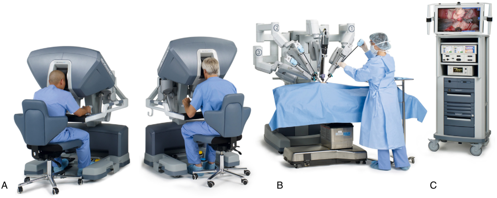

A B C 

**Fig. 67.1 The da Vinci Robotic Surgical System: components.** (A) Surgical console(s). (B **)** Patient- side cart with three or four mounted surgical arms. (C) Optical vision cart. (Courtesy Intuitive Surgical, Sunnyvale, CA, USA.)

3.  The optical vision cart, which holds the video and air inflation equipment. This makes the communication between components possible (see Fig. 67.1C).

The surgeon sits at the console (see Fig. 67.1A) and remotely controls the EndoWrist instruments attached to the patient cart (see Fig. 67.1B). Anesthesia personnel, surgical assistants, and circulating nursing staff may see the procedure in real- time via the screen on the optical vision cart (see Fig. 67.1B).

The surgeon views two high- definition monitors that mimic a binocular or microscope during an operation. This two- monitor view creates three- dimensional images. The surgeon’s arms rest on the master controls and the surgeon’s fingers manipulate the levers that control the EndoWrist articulation (Fig. 67.2). Foot pedals control electrocautery, movement of the robotic camera, and disengagement of robotic instruments. To facilitate collaboration and training, the da Vinci machine often has two consoles allowing two surgeons to participate in patient care.

## Advantages of Robotic Surgery

The robot is preferred to open procedures for several reasons: similar to laparoscopic surgery, it offers less tissue manipulation, small incisions, a lower risk of infection, and a faster recovery than its open counterpart.2 Additionally, robotic surgery allows for better precision and dexterity than laparoscopy, which is helpful in microsurgical dissection and re- attachment of tissues. Compared to human arms, robotic arms permit seven degrees of free movement. These movements can be categorized into gross arm movement by the da Vinci robot, fine movements by the articulating arms, and surgical actions performed by the articulating arms (Table 67.1, Fig. 67.3). These articulating arms are not limited by constraints associated with human wrist joints. Additionally, the robot allows larger, more coarse movements to be miniaturized in the operating

field. For example, moving the controls by 5 mm may move the articulating arms by only 1 mm. This miniaturization permits finer control. Furthermore, robotic software can reduce or eliminate hand tremors, thereby improving the safety and precision of surgery.3

The robot is used in various specialties, including gynecology, urology, abdominal, head and neck, thoracic, cardiac, orthopedic, and neurosurgery. Robotic surgery provides increased dexterity, image resolution, and degrees of freedom, making it an attractive technique for microanastomoses. One drawback of this technology is the lack of haptic feedback. However, in most surgical specialties, there is a lack of high- quality evidence showing robotic surgery as superior to laparoscopic surgery concerning longterm patient outcomes.4,5

## Robotically Assisted Intubation

There have been reports of successful robotic intubations. The Kepler Intubation System (KIS), developed by Thomas Hemmerling, has been shown to intubate mannequins successfully by an operator with either a direct or indirect view of the patient.6 KIS is a low- cost system consisting of a joystick, a robot arm, the Pentax video laryngoscope, and software control. The intubations occurred within 40 to 60 seconds, with a 100% success rate on the first attempt. This system also allowed for semiautomated (a computer system replayed prior operator- driven movement sequences) intubations that occurred in less than 45 seconds and had a 100% success rate.7 The system has also been used on 12 patients and was successful with the first- pass intubation in 11 of the 12 patients. The intubations were done in approximately 93 seconds.8 It remains uncertain if a robot intubation system will have widespread use. However, it may have applications in settings where it would be difficult to transport a trained anesthesia provider to the location, such as battlefields or deep space exploration.

<!-- PDF page 3 -->

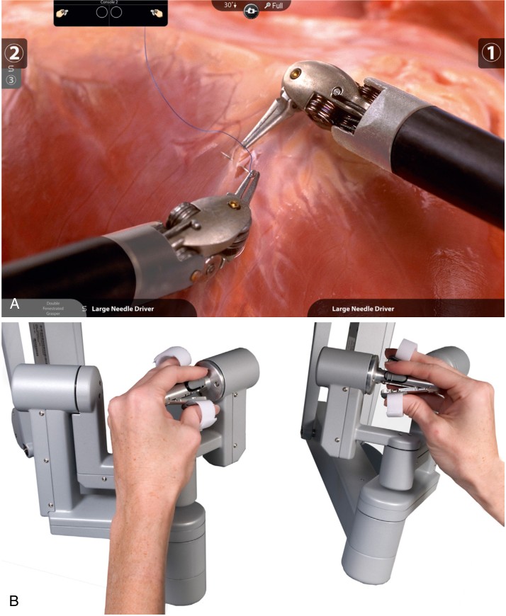

A B 

**Fig. 67.2 The da Vinci Robotic Surgical System.** (A) Virtual three- dimensional stereoscopic image of the surgical field. (B) Master controls (the EndoWrist instrument) translate the surgeon’s hand, wrist, and finger movements into real- time movements of surgical instruments inside the patient. (Courtesy Intuitive Surgical, Sunnyvale, CA, USA.)

**Table 67.1** Seven Degrees of Free Movement Permitted by Robotic Arms

|**Gross Arm Movements**|**Wrist Movements**|**Surgical Actions**|
|---|---|---|
|In and out|Yaw (side- to- side and left–right)|Grasp or cut|
|Up and down|Pitch (up and down)||
|Side to side|Rotation and roll||

## Anesthesia for Robotic Surgery: Urology, Gynecology, and Abdominal Surgery

Although similar in some respects to laparoscopic surgery, robotic surgery introduced a different set of challenges for the anesthesia provider. In addition to the physiologic changes associated with (1) pneumoperitoneum, robotic

surgery adds the challenge of (2) extreme positioning and (3) limited access to the patient. Understanding these nuances will allow the anesthesiologist to be prepared for the complications that these types of procedures can cause and therefore create compensatory plans.

### PNEUMOPERITONEUM

For most robotic surgical procedures, inert gas must be insufflated into a patient’s body cavity to visualize the surgical field. Carbon dioxide (CO2) is the inert gas of choice for laparoscopy due to its high diffusion coefficient and its lower risk of gas emboli since it is easily excreted from the body through the respiratory system.9 Most complications from pneumoperitoneum stem from hypercarbia due to (a) respiratory, (b) systemic effects, and (c) gas extravasation.

### Respiratory Effects of Hypercarbia

Insufflating the surgical site with CO2 may lead to sudden increases in CO2 in the bloodstream because it is absorbed

::: details 原始表格與符號（PDF 第 3 頁）

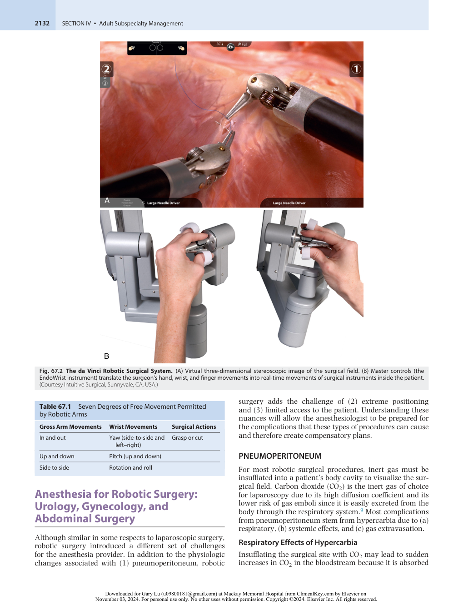

:::

<!-- PDF page 4 -->

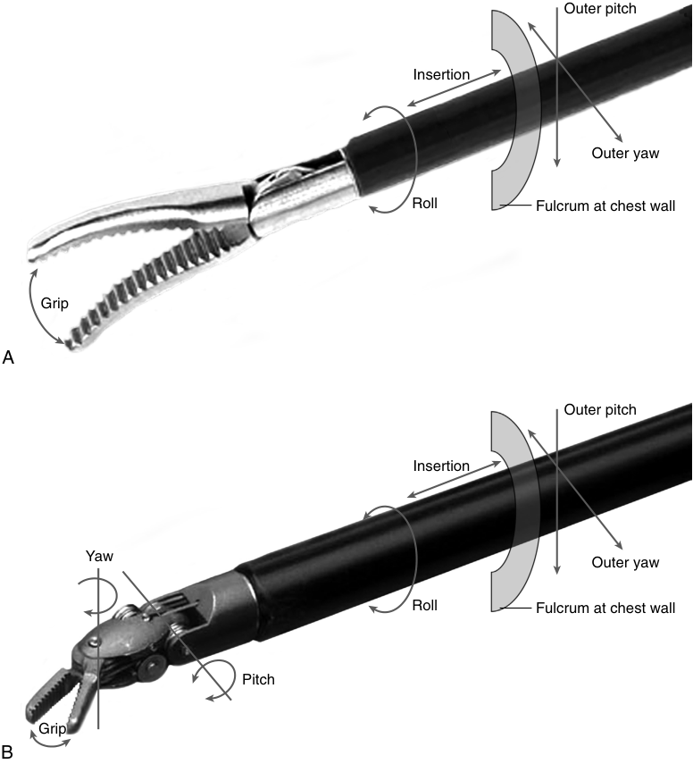

Outer pitch Insertion Outer yaw Roll Fulcrum at chest wall Grip A Outer pitch Insertion Yaw Outer yaw Roll Fulcrum at chest wall Pitch Grip B 

**Fig. 67.3 Degrees of freedom (DOF) in motion.** (A) Conventional laparoscopic instruments have only four DOF and grip. Insertion (i.e., movement in the _z_ - axis), roll, and movement along the _x-_ and _y-_ axes outside the body relative to a fulcrum point constitute the four DOF. (B) The EndoWrist instrument of the da Vinci Robotic Surgical System mimics the natural kinematics of the surgeon’s hand and wrist. This design allows more degrees of freedom. (Copyright 1999 Intuitive Surgical, Sunnyvale, CA, USA.)

from lymphatic and venous plexi.10 As a result, increasing minute ventilation is necessary to maintain normocarbia.

**Pulmonary Vasoconstriction.** Pulmonary vasoconstriction during pneumoperitoneum is secondary to (a) hypercarbia and (b) hypoxia. To optimize gas exchange, the pulmonary vasculature constricts in order to preferentially shunt blood away from less ventilated portions of the lungs. In addition to pulmonary vasoconstriction, pneumoperitoneum results in compression atelectasis, creating an intrapulmonary shunt. Nasogastric or orogastric tubes may facilitate gastric decompression and help reduce, albeit not eliminate, increased intra- abdominal pressures. In addition, recruitment maneuvers, low tidal volume, and adequate positive end- expiratory pressure (PEEP) can prevent the development of atelectasis.11 Finding the optimal PEEP for patients undergoing robotic surgery in the Trendelenburg position is a fine balance between preserving the arterial oxygenation and avoiding hemodynamic effects and

barotrauma.12 While applying higher PEEP improves respiratory elastance and compliance, it causes increased peak airway pressure.12,13 However, this increase in airway pressure may not reflect true transpulmonary pressure, which is a better measure of the risk of lung injury.13 Changes in the chest wall and lung elastance during pneumoperitoneum and Trendelenburg positioning determine the partition of driving pressures (driving pressure = Pawplateau − PEEP) between the chest wall in the lungs.13 The driving pressure is not entirely transmitted to the lungs; therefore, high driving pressures do not translate to increased transpulmonary pressures during the docking stage.13 Therefore higher limits of plateau pressure can be tolerated without lung injury.13 The esophageal balloon can clarify the transpulmonary pressure, allowing for individual PEEP titration and improvement in oxygenation and respiratory system mechanics.13,14 This phenomenon, combined with vasoconstriction due to hypercarbia, increases the ventilation/ perfusion (V/Q) mismatch, which can lead to hypoxia.

<!-- PDF page 5 -->

The resulting hypoxia caused by V/Q mismatch also leads to hypoxic pulmonary vasoconstriction (HPV). This compensatory mechanism allows the body to preferentially divert blood from oxygen- poor regions of the lungs to oxygen- rich regions and improves gas exchange by shunting blood to areas of the lung that are ventilating normally.10

In addition to pulmonary vasoconstriction, hypercarbia leads to a shift in the oxyhemoglobin dissociation curve to the right (the Haldane effect), which results in easier unloading of the oxygen molecules from hemoglobin, thus further attenuating hypoxia.15,16

### Systemic Effects of Hypercapnia

Carbon dioxide (CO2) insufflation may result in hypercarbia and respiratory acidosis, especially in patients with difficulty removing CO2 secondary to intrinsic lung disease or difficulty ventilating intraoperatively due to positioning or body habitus. Furthermore, hypercapnia will augment anesthetic effects. Acute hypercapnia also results in depressed consciousness when PaCO2 exceeds 80 mm Hg.17 Increased CO2 decreases myocyte contractility and can increase myocardial susceptibility to arrhythmias.18

**Cerebral Vascular Effects.** Hypercarbia also leads to cerebrovascular dilation. Although CO2 leads to blood being preferentially shunted away from the pulmonary vasculature, CO2 in the cerebral circulation leads to cerebral vascular dilation. Anesthesiologists must be mindful of the potential increase in intracranial pressure (ICP) that may arise from elevated CO2 levels.19,20 Additionally, several robotic procedures require steep Trendelenburg positioning to allow surgical visualization of pelvic structures, resulting in increased ICP. Direct measurement of ICP is invasive and not without risks; thus, sonographically measured optic nerve sheath diameter (ONSD) has been used as a noninvasive way to measure ICP. ONSD has been shown to increase with pneumoperitoneum and Trendelenburg.21,22 Some studies have investigated whether a total intravenous anesthesia (TIVA) approach leads to less diameter changes than inhaled anesthetic, but the results thus far are mixed.23–25 Therefore, careful patient selection is necessary to avoid neurologic complications.

### Gas Extravasation

The lack of external visualization and the haptic feedback with the robot can lead to increased gas extravasation, leading to pneumomediastinum or subcutaneous emphysema.26,27 Although this finding typically has no clinical consequences, it may be associated with prolonged CO2 excretion postoperatively, causing hypercarbia and acidosis. There have been reported cases of pneumothorax caused by the extension of insufflated gas through congenital diaphragmatic channels into pleural cavities.27 A higher risk of pneumothorax is associated with an increased number and size of trocars, longer surgical time, higher gas flow rate, intensified gas pressure, loose trocars, and difficult trocar placement.27

**Gas Embolism.** Gas embolism is another potential untoward effect of CO2 insufflation.10 Although rare, a gas embolus may have catastrophic effects on the

cardiopulmonary system if the embolus becomes lodged in the pulmonary system. Additionally, patients with an atrioseptal or ventriculoseptal defect may develop a gas embolus in the cerebrovasculature with potentially devastating complications.10

**Vagal Response.** Lastly, keeping intra- abdominal pressures below 20 cmH2O during initial insufflation is important to avoid the vagal stimulation that often results from elevated intra- abdominal pressures. If the patient has a particularly pronounced resting vagal tone or a significant vagal response to peritoneal insufflation, pharmacologic intervention by the anesthesia provider or reduction of pneumoperitoneum may be necessary.

### PATIENT POSITIONING

Patient positioning is particularly challenging during robotic surgery for several reasons. First, in order to get adequate visualization during certain types of surgeries (i.e., urologic and gynecologic), the patient is often required to be in a steep Trendelenburg position with or without lithotomy. First, this extremely steep Trendelenburg position is associated with various physiologic changes. Second, given that the robot is removed from the operators, it is crucial that the patient does not move or slide, as the robot would not recognize the patient’s motion quickly. Lastly, the presence of the bulky robot can apply excess pressure on various parts of the patient’s body if not properly padded.

### Physiologic Changes Associated with Positioning of the Patient

The patient will be in extreme reverse Trendelenburg for upper abdominal procedures, such as bariatric surgery. In this case, the main physiologic consequence is venous pooling of the blood, leading to an increased risk of deep vein thrombosis (DVT) and hypotension.28 For mid- abdominal procedures such as colectomies, the table remains neutral or varies during the case. Urologic, gynecologic, and lower abdominal surgeries require steep Trendelenburg positioning to improve visualization of the organs. This positioning is associated with cardiopulmonary and intracranial physiologic changes that should be considered when planning the anesthesia (Fig. 67.4).29

**Cardiopulmonary Effects.** When patients are in a steep Trendelenburg or “head- down” position, blood is funneled from the lower extremities to the right atrium, thereby increasing pre- load. Patient comorbidities, anesthetized state, and preoperative medications may alter the cardiac output changes induced by Trendelenburg positioning. In general, healthier patients with a robust cardiovascular system are better able to adjust for hemodynamic changes and tend to have unaltered cardiac output.30,31

Steep Trendelenburg positioning also leads to cephalad movement of the diaphragm by the abdomen. Combined with pneumoperitoneum, this leads to decreased functional residual capacity (FRC) and vital capacity (VC), peak and plateau airway pressures increase, and a V/Q mismatch worsens.32 Furthermore, pulmonary compliance is decreased, leading to a decrease in tidal volume and difficulty ventilating. Switching mode from volume control

<!-- PDF page 6 -->

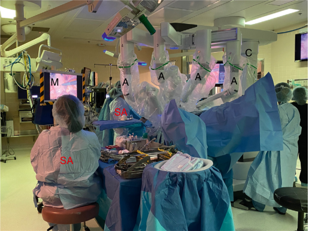

C A A M A A SA SA 

**Fig. 67.4 Patient positioning during da Vinci robotic urology surgery.** Da Vinci–assisted urologic surgeries require steep Trendelenburg positioning to improve visualization of the organs/exposure to the organ/visual field. _SA_ , surgical assistants; _M_ , accessory monitors; _C_ , side cart; _A_ , robotic arms.

ventilation to pressure control ventilation (PCV) has been recommended to improve ventilation. Randomized control studies have shown that PCV lowers peak airway pressures and improves pulmonary compliance during robotic surgery in steep Trendelenburg positions.33 This diaphragmatic movement also can lead to mainstem intubation if the endotracheal tube is not secured carefully.

**Intracranial Effects.** Steep Trendelenburg positioning and pneumoperitoneum can also increase cerebral blood flow and intracranial and intraocular pressure. Intraocular pressure increases with progressively steeper Trendelenburg positioning. Additionally, longer procedures tend to correlate with greater increases in intraocular pressure.34–36 In addition to brain edema, prolonged time in the steep Trendelenburg can also lead to swelling of the airway and periorbital areas.29

### Need for Complete Immobility During Procedure and Padding for Nerve Injuries

The robot arms and the patient’s operating room table may not move together. Therefore, once the robot is docked and the robot arms are inside the patient, it is paramount to avoid dyssynchronous movement of the operating room table to avoid tearing tissue injuries inside the patient.

Given the need for patient immobility during a procedure, continuous neuromuscular blockade is paramount, as patient movement resulting from intense surgical stimulation in inadequate anesthesia or insufficient neuromuscular blockade may lead to significant patient injury. As a result, continual monitoring of neuromuscular blockade is imperative.

Furthermore, to ensure immobility, it is important that the patient does not slide during cases where extreme Trendelenburg or reverse Trendelenburg is required. If the patient is not well secured, the patient risks friction injuries, nerve injuries, or a fall from the operating table.37 To avoid sliding, the patient is usually placed on an anti- skid foam that prevents shifting (Fig. 67.5).38

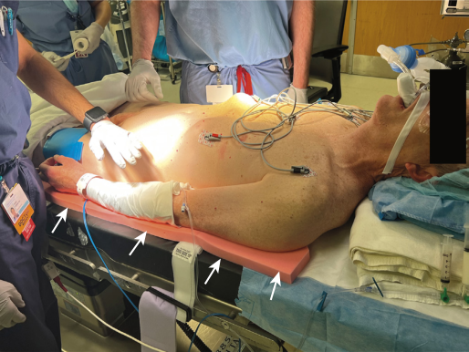

**Fig. 67.5 Anti- slip mat.** Patient laying on anti- skid foam ( _arrows_ ) to help prevent sliding while in the Trendelenburg position.

To prevent nerve injuries, it is preferable to have both of the patient’s arms tucked to their sides to minimize brachial plexopathy from hyperextension of the arms. This also gives the robot more access to the patient. While proper padding of the pressure point is necessary, adjuncts such as shoulder braces and iliac support have been associated with neuropathic injury and should be avoided.39,40 Additional paddings may be necessary to protect a patient’s face, head, and neck from robotic arm movements, and vigilance by an anesthesia team is mandatory.

### BULKY ROBOT AND LIMITED ACCESS TO PATIENT

As the patient’s arms are tucked at their sides, they are often inaccessible to the anesthesia provider during an operation (see Fig. 67.5). Therefore, if an anesthesia provider is considering additional intravenous/arterial access, these lines should be placed after anesthesia induction and before the robot’s docking. The ideal practice is to place at least two intravenous catheters. This allows more flexibility with intraoperative patient management even during periods of very minimal access.

Patient positioning during robotic surgery can present a challenge as much of the normal feedback between surgeon and patient is altered and as surgeons are removed from their patients and replaced by bulky steel instrumentation. Therefore, patients are at a much higher risk of iatrogenic injury than their nonrobotic peers.41 This separation from the patient adds to the complexity of the room setup and requires efficient communication between the team members. This is particularly important during situations that call for quick undocking of the robot, such as during codes. Many institutions have used simulation with the operating room team members to improve efficiency during these high-acuity situations.

### OTHER CONSIDERATIONS

Providers have begun performing robotic procedures on morbidly obese patients, given the physical surgical demands associated with traditional42 laparoscopies

<!-- PDF page 7 -->

and the greatly increased morbidity associated with an open abdominal approach. In general, the advantages of a robotic approach on perioperative outcomes are not clearly defined.43 However, positioning morbidly obese patients in the steep Trendelenburg position can be very challenging. Steep Trendelenburg positioning, combined with the pneumoperitoneum necessary to facilitate surgical exposure, can create cardiovascular and ventilation challenges. While it is possible that this subgroup of patients, who would otherwise require an open abdominal approach, could benefit from minimally invasive robot surgery, these cases involve many anesthetic challenges. Consideration can be made to incrementally transition to the Trendelenburg position to see if the patient tolerates the position prior to surgery initiation.

## Types of Robotic Surgery

Robotic surgery has gained popularity over the last decades and continues to expand to cover an increasing number of surgical specialties. For example, the da Vinci robot has been Food and Drug Administration (FDA)- approved for various urologic, gynecologic, abdominal, otolaryngologic cardiothoracic, orthopedic, and neurosurgical procedures.

### UROLOGIC PROCEDURES (SEE ALSO CHAPTER 55)

Urologists have led the way in integrating robotic surgery into their clinical practice, with robotic- assisted retropubic prostatectomy (RARP) being the most common robotic procedure performed worldwide.44 Beginning with the use of robot assistance for transurethral resection of prostatic tissue (TURP), robotic surgery is now used in a variety of cases, including prostatectomies, nephrectomies, and cystectomies.

### Robotic- Assisted Radical Prostatectomies

Robotic- assisted radical prostatectomies (RARP) are the most common robotic procedure worldwide.44 While there have not been any randomized clinical trials to date to show the superiority of this approach compared to the open approach, RARP has been associated with a shorter hospital stay, less estimated blood loss, fewer perioperative complications, and equivalent oncologic outcomes.44

The anesthetic plan for a RARP is similar to that for a laparoscopic prostatectomy. A standard intravenous induction followed by tracheal intubation is required. Most clinicians advocate for two intravenous (IV) lines, as the patient’s arms will be tucked at his sides after he is placed in the lithotomy position. A blood bank sample is necessary, as trocars may invade large blood vessels unexpectedly. Neuromuscular blockade is also of extreme importance, as the movement by the patient while the robot is docked may lead to significant and serious complications.

Patients are often placed in a steep (25 to 45 degrees) Trendelenburg position to facilitate surgical exposure of deep pelvic organs.36,45 As described above, insufflation of the abdomen with steep Trendelenburg positioning leads to increased ICP and intraocular pressures. As a result, several cases of postoperative blindness and visual field defects have been reported during RARP.46,47 Gastric contents

may drain via gravity over the face and onto the eyes and potentially cause ocular damage. Although the exact mechanism of ocular damage is not completely understood, decompressing the stomach with an orogastric tube may help minimize the risk of a trocar advancing into the stomach in addition to protecting the patient’s eyes. In addition, increased ICP can lead to strokes or hemorrhages in vulnerable populations.

Fluid management is also crucial during robot prostatectomies and requires a delicate balance. While a liberal fluid strategy is associated with an increased risk of postoperative anastomotic leak48 and worsening of glottic and periocular edema, a restrictive fluid approach has been associated with acute tubular necrosis. Lower extremity compartment syndrome risk is associated with longer cases, obesity, and poor positioning.49

### Robotic- Assisted Radical Cystectomy (RARC)

Radical cystectomy is the gold standard treatment for muscle invasive and high grade non-invasive bladder cancer. Cystectomies are traditionally difficult operations, as fluid shifts, fluid management, and patient comorbidities present unique challenges. Perioperative management of these patients is sufficiently challenging that nearly 25% of patients are readmitted to the hospital following radical cystectomy.50 The RARC, while not inferior to open radical cystectomy (ORC) regarding disease progression and recurrence, has lower estimated blood loss, shorter length of stay, and longer operative times than ORC.51 Of note, there does not appear to be a difference in two- week readmission rates.52

Anesthetic considerations for patients receiving roboticassisted radical cystectomy mirror those for patients receiving robotic- assisted radical prostatectomy. The patient will be positioned in a steep Trendelenburg position, and pneumoperitoneum will be obtained. Some surgeons prefer a fluid restrictive management approach until the ureteral anastomosis is completed. Given the patient population’s frailty, the surgery’s length, and the potential for fluid shifts, anesthesia providers can consider an arterial line for frequent gas sampling to guide fluid therapy.

### Robotic- Assisted Nephrectomy

Nephrectomies are performed to address a multitude of kidney pathologies. In general, a simple nephrectomy is a preferred method for non- neoplastic disease, whereas radical nephrectomies are mainly used for neoplastic disease.53 This procedure can be done using an open, laparoscopic, and robotic technique, each with its indications and advantages. In tumors amenable to minimally invasive surgery, the robotic approach is gaining popularity as it provides similar outcomes to its laparoscopic counterpart while giving the surgeon finer manipulation, higher definition display, and an increased degree of articulation of the surgical arms.54,55 Anesthetic considerations in robotic- assisted nephrectomy are similar to other robotic urologic surgeries except for positioning. The patient will be in lateral decubitus with various degrees of Trendelenburg and flexing; therefore, particular attention should be placed on padding pressure points, preventing nerve injury, and maintaining a neutral spine.

<!-- PDF page 8 -->

### GYNECOLOGIC SURGERY

Gynecologists were also early adopters of robotic surgery, with the first tubal anastomosis done with robotic assistance in 2000.56 The FDA approved robotic surgery for gynecologic procedures in 2005, and since then, the applications of robotic surgery in gynecology have expanded to include hysterectomy, salpingo- oophorectomy, vesicovaginal fistula repair, sacrocolpopexy, and ovarian cystectomy.56

### Robotic- Assisted Hysterectomy

After the first gynecologic robot- assisted surgery, robotic assistance was quickly applied to hysterectomies, the most common gynecologic procedure in the United States.57,58 However, despite the large number of patients receiving robotic hysterectomies, it is unclear whether robotics is superior to traditional laparoscopic approaches.59

Robotic surgery for endometrial cancer resection requires more surgical operating time, particularly as surgical teams become proficient in performing the surgery; however, the surgical time appears to improve after 20 to 30 cases.60,61 There has been increased concern about the utilization of the robot during endometrial cancer resection surgery since the outcomes appear similar to laparoscopic hysterectomies, but the cost and operative times are greater.43,62 The American College of Obstetricians and Gynecologists (ACOG) recommends vaginal hysterectomy as the preferred approach for benign disease, where feasible, due to its lower complication rate and faster recovery time. ACOG states that robotic surgery needs to be better studied to discover if this approach would best serve a particular subgroup of patients.43

### Other Gynecologic Surgeries

Due to the steep learning curve for sacrocolpopexy, robot assistance is believed to facilitate this technically difficult procedure. Randomized controlled trials have shown similar outcomes with robotic versus laparoscopic surgeries. However, robotic cases can have increased operative time, postoperative pain, and cost.43 Myomectomies with robot assistance may allow for more minimally invasive surgeries that would otherwise occur due to fibroid location and high patient body mass index (BMI).

Robot- assisted surgery for gynecologic malignancies has been poorly studied, with only retrospective comparisons available. A recent meta- analysis on endometrial cancer concluded that robotic surgery, compared to laparoscopy, had a similar duration of surgery but a shorter hospital stay, less blood loss, fewer conversions to laparotomy, and fewer overall complications despite a higher cost.63

ACOG does not recommend using the robot for shortduration and low- complexity surgeries such as tubal ligation, simple ovarian cystectomy, ectopic pregnancy, or bilateral salpingo- oophorectomy.58

Anesthetic management for robotic gynecologic surgery is similar to the urologic procedure: arms tucked and inaccessible after robot docking in addition to steep Trendelenburg. Like in urology, it is preferable to have two IV lines as it is very difficult to place a second IV once the robot is docked.

### GENERAL SURGERY (SEE ALSO CHAPTER 14)

Robotic surgery in general surgery has continued to grow since the first robotic cholecystectomy in 1997.64 While robotic surgery has gained traction with urology and gynecology, the growth in general surgery has been limited mainly due to an overall increase in cost without significant improvement in outcomes over laparoscopy.65

Procedures performed with robotic assistance today include inguinal/ventral hernia repairs, cholecystectomies, hepatobiliary, colorectal, and bariatric surgery. For most abdominal surgeries the arms will be tucked to allow for the docking of the robot, and the head of the patient will be on the same side as the anesthesiologist (Fig. 67.6).

### Inguinal Hernia Repair

For simple unilateral inguinal hernia repair, the robotic approach was more expensive and longer in duration without providing any advantage regarding postoperative pain, quality of life, and complications.66

### Cholecystectomy

Robot- assisted cholecystectomy can be done with only one incision on the abdomen compared to laparoscopy.67 While this allows for less surgical scarring, data on postoperative pain are heterogeneous.68 However, robotic- assisted cholecystectomy is associated with a significantly higher risk of re- operation and incisional hernia.69–71 Furthermore, depending on the surgeon’s experience, robotic cholecystectomy showed increased operative times compared to laparoscopy.67

### Colorectal

Robotic- assisted colorectal dissection is considered safe and feasible with similar outcomes to the laparoscopic approach: no difference in hemoglobin change or conversion rate between the two approaches while showing equal oncologic radicality.72 While some surgical steps – such as rectal mobilization – are facilitated by the robot, surgical time for some surgeries has been particularly long due to the need to reposition the robot and its arms for other steps (i.e., splenic flexure mobilization). Robotic colectomies have similar postoperative outcomes to their laparoscopic counterpart but were associated with statistically significant increases in operative costs and operative times.73 Furthermore, robotic lower anterior resections (LAR) were associated with a higher rate of diverting ostomy but with lower conversion rates and lower septic complications.74

### Hepatobiliary

The liver’s unique location in the abdominal cavity and abundant blood supply initially slowed surgeons from adopting laparoscopic techniques.75 The benefits of laparoscopic liver resections are well known and include less blood loss and shorter hospital stay than its open counterpart without compromising tumor recurrence, tumor spread, or patient survival.76 While robotic surgeries are associated with increased intraoperative costs, overall costs of these robotic procedures may be decreased as they generally are associated with shorter lengths of stay compared to open procedures.77 Robotic surgery in managing patients requiring hepatobiliary surgery remains an evolving field.

<!-- PDF page 9 -->

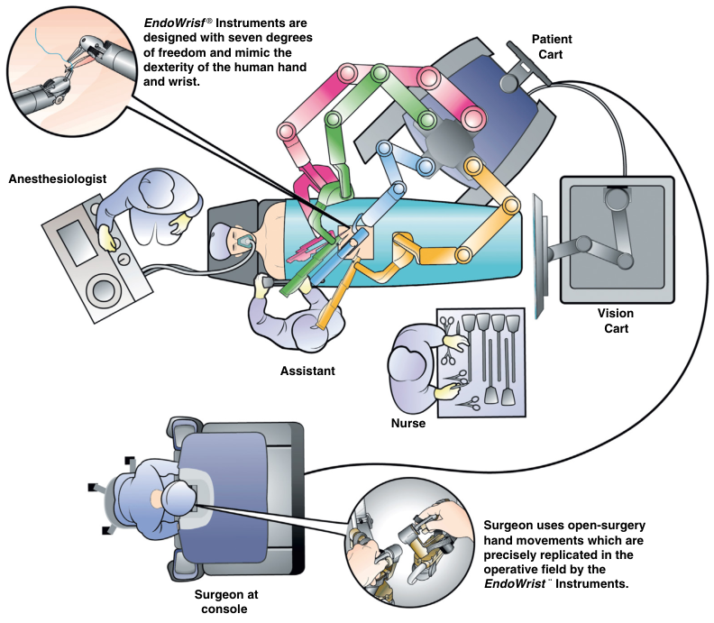

EndoWrisf  ®  Instruments are designed with seven degrees  Patient of freedom and mimic the    Cart dexterity of the human hand and wrist. Anesthesiologist Vision   Cart Assistant Nurse Surgeon uses open-surgery hand movements which are precisely replicated in the operative field by the EndoWrist ¨  Instruments. Surgeon at   console 

**Fig. 67.6 Setup for robotic- assisted abdominal surgery.** The schematic usage of the da Vinci Robotic System in general surgery. (Courtesy Intuitive Surgical, Sunnyvale, CA, USA.)

### Gastrectomy

Gastrectomy is the main treatment for gastric cancer. Similar to the rest of robotic abdominal surgery, high- quality data are limited, but the few randomized controlled trials (RCTs) available show short- term evidence of faster postoperative recovery, allowing patients to initiate adjuvant therapy earlier.78

For gastric bypass surgery, the complication rate and length of hospital stay between laparoscopic and robotic are similar, but the cost of robotic surgery is significantly higher.79,80

Anesthetic management for robotic upper abdominal surgery has different challenges: the patient will be positioned in reverse Trendelenburg,2 which has the advantage of increased head and neck venous drainage and reduction in ICP, and less likelihood of passive regurgitation. However, there is a higher risk of refractory hypotension. The patient’s arms may need to be tucked by their side, as the surgical cart will dock at the head of the patient,2 with the head of the bed rotated away from the anesthetic machine, further limiting access to the airway and increasing the risk of head and neck injury (see Fig. 67.6).81

### HEAD AND NECK AND OTOLARYNGOLOGIC

### SURGERIES (SEE ALSO CHAPTER 66)

The FDA approved transoral robotic surgery (TORS) in 2009 for treating all benign and selected malignant head and neck tumors. TORS allows for a three- dimensional

endoscopic vision of the surgical field, improving twodimensional endoscopes. Overall, TORS has shown less estimated blood loss, reduced risk of wound infection, shorter recovery time, quicker return to preoperative speech, and increased quality of life.82 Similar to robotic surgery in other fields, robotic surgery in otolaryngology has lengthened the operating room time, which is thought to decrease as the experience of the surgeon and the operating room staff increases.83 Since the FDA approved TORS for head and neck cancer, there has been a growing interest in using TORS in sleep surgery, skull base surgery, and pediatric airway surgery. Adoption of this technology has even spread to encompass transaxillary thyroid and parathyroid resection and uvulopalatopharyngoplasty.84

### Anesthesia Management

The operating room setup differs slightly from general surgery cases (Fig. 67.7). Like most transoral otolaryngology procedures, the anesthesiologist is removed from the patient’s airway. The anesthesiologist and the anesthesia machine are at the feet of the patient. In this case, the room is typically dark, and the surgeon is also removed from the patient’s airway and out of view from the anesthesia team sitting at the surgeon’s console. A surgical assistant will be at the patient’s head and assist with retraction and suction.

At the beginning of the case, the patient undergoes tracheal intubation using either a standard laser or wire-reinforced tube, which is then secured to the patient’s face. It

<!-- PDF page 10 -->

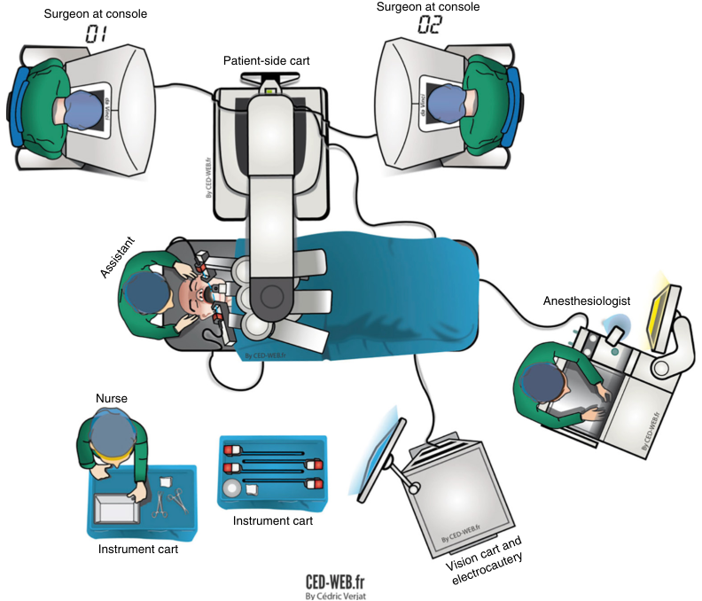

Surgeon at console Surgeon at console Patient-side cart Anesthesiologist Nurse Instrument cart Instrument cart Vision cart and electrocautery Assistant 

**Fig. 67.7 Operating room setup for transoral robotic surgery.** The operating room setup for transoral robotic surgery differs from general surgery. (From Gorphe P, Von Tan J, El Bedoui S, et al. Early assessment of feasibility and technical specificities of transoral robotic surgery using the da Vinci Xi. _J Robot Surg_ . 2017;11(4):455–461.)

is preferable to induce and intubate at the final position of the bed (180 degrees away from the anesthesia machine) to allow for prompt setup of the robot and avoid disconnecting and reconnecting IV lines and monitors. Furthermore, if the table needs to be rotated after induction, there is potential for a vigilance gap in this period. If there is concern about the patient’s airway prior to induction, a clear difficult intubation plan should be discussed. The ear, nose, and throat (ENT) surgeon will often have tools such as a suspension laryngoscope to assist with the intubation.85 The patient’s teeth and eyes are protected using a dental guard and patient safety goggles. If the laser is used, standard patient safety precautions should be implemented. The robot is docked, and the three robotic arms through the mouth are introduced into the patient’s airway (see Fig. 67.7). After the completion of the surgery and confirmation of a bloodless field, a decision is made on whether to extubate based on an airway exam.

To maintain anesthesia, a total intravenous anesthesia technique is preferred to avoid postoperative nausea and vomiting. The decision to paralyze is made between the anesthesiologist and surgeon. Given that the patient’s head is far from the anesthesia machine, having another set of hands familiar with anesthesia helps assist with mask ventilation and administrating induction medications. Without an assistant, the anesthesiologist can set the ventilator in a control mode with 100% oxygen and use the two- hand mask ventilation technique.86

Depending on the procedure and the location of the dissection (especially if it is near the vallecula or epiglottis), duration of the case, or supraglottic partial laryngectomy, patients are usually kept intubated in the intensive care unit (ICU) after the surgery until the swelling has subsided. In patients where postoperative emergency intubation would be difficult, such as in the morbidly obese, prior head and neck radiation, or in cases where the epiglottis and base of the tongue are resected, tracheostomies are performed at the end of the case. Most patients will have steroids to help with postinflammation swelling.86

### ROBOTIC- ASSISTED THORACOSCOPIC SURGERY (SEE CHAPTER 49)

In the last two decades, robotic- assisted thoracoscopic surgery (RATS) has been more frequently used as a new modality in thoracic surgery. RATS is considered a minimally invasive version of video- assisted thoracoscopic surgery (VATS). RATS has been used for cancerous tumor resection (wedge resections and lobectomies), thymoma resection, fundoplication surgery, esophagectomy, hiatal hernia, and lung volume reduction.87–94 VATS is preferred to open procedures when possible to reduce the length of stay, blood loss, pain, and morbidity as long as clinical outcomes are equivalent.95 However, it is difficult to perform complex surgeries that contain confounded anatomic barriers

<!-- PDF page 11 -->

(e.g., a pneumonectomy or a thymectomy) using minimally invasive techniques such as VATS.

The growing popularity of RATS is largely attributed to the three- dimensional stereoscopic image of the robotic binocular eye, which increases precision and allows for more complex surgeries with similar benefits as open procedures.96,97

### Anesthetic Considerations

Preoperative consideration of RATS, including preoperative assessment, rehabilitation, and medical optimization, is similar to the VATS approach. The most common system that is used for RATS is the da Vinci Robotic Surgical System (Intuitive Surgical, Sunnyvale, CA, USA) with four arms, as described at the beginning of this chapter.

Intraoperative consideration is also similar to VATS, but as the robotic device has to be positioned in close vicinity of the surgical table and considering the size and complexity of the robotic equipment and its arms, there is limited accessibility to the patient for both anesthesiologist and the surgeon. Positioning of the anesthesia machine, breathing circuit, and venous and arterial lines must adapt to this limitation98 (Fig. 67.8).

In general, the airway management of RATS is similar to VATS and generally performed under one- lung ventilation, achieved either by double- lumen tubes or bronchial blockers. The anesthesiologist should be aware of the displacement of the airway tube during positioning; even small changes may impair one- lung ventilation. Intraoperative confirmation of lung isolation will be difficult, so a plan for accessing the airway with a fiberoptic bronchoscope should be established before initiating the robotic portion of the case. It is important to note that a failure of lung isolation will result in an inability to complete the surgery via RATS.93,99–101

Patient positioning is particularly important to expose largely inaccessible areas, as mediastinal structures are heavy and mobile and change position in response to gravity. To access the anterior mediastinum, the patient should ideally be placed in a supine or slight lateral decubitus position (raising one side 15–30 degrees). This position requires the elevated arm to be at the patient’s side as far back as possible, allowing the robot to dock successfully. However, hyperabduction of the elevated arm can cause a brachial plexus injury.102,103 For lobectomies and hilar masses, the patient should ideally be positioned in a full lateral decubitus position (90 degrees). Alternately, a prone or slightly modified prone position can create better exposure for posterior mediastinal masses. The operating table might be extended up to 30 degrees for optimal exposure. The head and neck should be supported appropriately to avoid cervical spine injuries.88,89,104 The robotic instruments are inserted through trocars between ribs using intercostal incisions.

Since the patient will generally be rotated 90 degrees to allow the robot to dock, it is important to achieve lung isolation before rotation. This unique 90- degree rotation, not required in VATS procedures, puts the patient’s airway away from the anesthesiologist, and therefore the fiberoptic bronchoscope may need to be located on the other side of the table. Furthermore, the anesthesia circuit, IV line, and arterial line tubing may require extensions. It is suggested

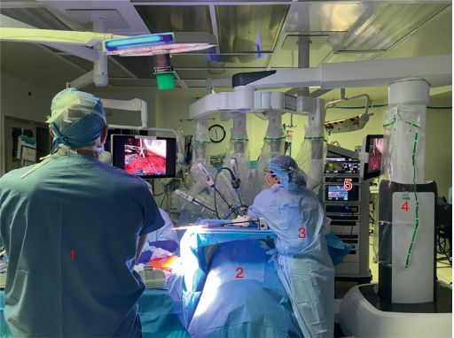

5 4 3 1 2 

**Fig. 67.8 Surgical arrangement during robotic- assisted thoracic surgery.** Special arrangement of the surgery team member (1), patient (2), surgical assistant (3), robotic surgical cart with extended arms (4), and equipment tower (5) during RATS. Considering all the attachments during docking, there is limited access to the patient and all the vital connections. They should be visible and arranged so they can be accessed.

that the circuit and lines be combined into one bundle to move them out of the way of surgical personnel and monitoring devices. Two large- bore IV lines are also recommended since the arms will be difficult to access once the robot is docked. The patient undergoing RATS should generally have an arterial line placed prior to the robot being docked to allow for close monitoring of blood pressure (BP) and PaCO2.

### Intrathoracic CO2 Insufflation

CO2 insufflation helps achieve adequate surgical exposure by mobilizing the mediastinum and simultaneously compressing the lung away from the operative site. Intrathoracic CO2 insufflation can produce similar physiologic effects as tension pneumothorax, and therefore the anesthesiologist should know the hemodynamic and respiratory effects of intrathoracic CO2 insufflation.105,106 Intrathoracic CO2 insufflation can lead to increased intrathoracic pressure and therefore, added to ineffective ventilation, may cause respiratory acidosis. This effect is more pronounced with one- lung ventilation and possible absorption of CO2. Like laparoscopic procedures, CO2 is insufflated with a flow rate of 5–10 L/min and maximum intrapleural pressure of 5–10 mm Hg.107 High intrathoracic insufflation can compress the mediastinal vessels and cause hemodynamic instability. CO2 insufflation can also cause venous gas embolism, decreased venous return, and cardiac collapse if right heart failure develops.108,109 To prevent barotrauma, a tidal volume of 5–6 mL/kg (ideal body weight) and peak pressure of 30 cmH2O with permissive hypercapnia with a pH of 7.25 have been suggested.107,110,111

The anesthesiologist must also be ready for potential conversion to open thoracotomy due to bleeding or an inability to obtain adequate surgical exposure. In this case, undocking the robot immediately and being ready for open thoracotomy is needed.112–114 In a recent meta- analysis, the incidence of conversion from RATS to open thoracotomy

<!-- PDF page 12 -->

during pulmonary resections was 0% to 19%.115 An increase in operative issues must be anticipated for surgeons learning to use the robot.116,117

Another possible pitfall of RATS is that damage to the pleura may allow CO2 insufflation to spread to the ventilated lung, causing difficult ventilation and possibly causing a tension pneumothorax or severe subcutaneous emphysema – both of which can produce a hemodynamic compromise.116 Hypotension and ventricular arrhythmias occur during robotic arm manipulation and usually concern manipulating the cardiac structure. Therefore, close observation of the surgical field on the monitor and communication with the surgical team is essential.

RATS’ extubating criteria and pain control modalities do not differ from other thoracic surgery. Multimodal analgesia with a combination of regional anesthesia and oral and IV analgesic medications seems to be the best strategy for post- RATS analgesia.97,107,118 The need for neuraxial blocks such as thoracic epidural has decreased due to the minimally invasive nature of RATS. Surgeons’ subpleural paravertebral intercostal block has been used routinely for postoperative analgesia.118

Studies comparing outcome data from VATS versus RATS in more common procedures are increasing. As might be expected for any complex procedure, outcomes for RATS lobectomies are better at high- volume centers.119 Despite increasing interest in teaching and improving outcomes of RATS, this educational path is still evolving. The presence of the second optional console (see Fig. 67.1) permits the presence of the second surgeon or trainee without compromising the patient’s outcome.120

While several centers are exploring RATS lobectomies, segmentectomies, and mediastinal mass resections, RATS pneumonectomies have only been reported at a few pioneering centers.121,122 RATS is associated with increased operative time and cost compared to its alternative.93,123–127 However, it reduces the length of hospital stay and postoperative pain.128–130 In the case of esophagectomies, RATS has a similar outcome profile while having a longer surgical duration than a video- assisted minimally invasive approach.131

Although the cost of robotic surgery and the potential for serious malfunction of the robot remain a concern, robotic approaches in thoracic surgeries are being used in more complex surgeries, including pediatric patients.132,133 It is expected that RATS will improve patient outcomes and possibly reduce costs.122,134

### CARDIAC (SEE ALSO CHAPTER 50)

Since the first reported robotic cardiac surgery (RCS) in 1998,135,136 cardiothoracic applications of robotic- assisted surgery have expanded to involve congenital cardiac surgery, including atrial septal defect closures and patent ductus arteriosus ligations,137–145 mitral valve repairs or replacement,146–151 totally endoscopic coronary artery bypass grafting (TECAB) and minimally invasive direct coronary artery bypass (MIDCAB),152–156 minimally invasive atrial fibrillation surgery and left ventricular pacemaker lead placement,157–162 and other atrial procedures like tricuspid valve repair and myxoma resection.163–165 Although minimally invasive surgery may eventually make surgical

sternotomy obsolete, surgeons must still be prepared to convert to an open sternotomy if needed.

The main difference between RCS and sternotomy cardiac surgery is the requirement of prolonged one- lung ventilation (OLV) and thoracic CO2 insufflation. Therefore, anesthesiologists must be familiar with cardiac (including intraoperative transesophageal echocardiography [TEE]) and thoracic anesthesia when performing robotic- assisted cardiac procedures. Poor pulmonary function test results or pulmonary hypertension may be contraindications to robotically assisted cardiac surgery since prolonged OLV may not be tolerated. Other relative contraindications of RCS include decompensated congestive heart failure (New York Heart Association [NYHA] class III–IV) or cardiomyopathy with ejection fraction (EF) &lt;30% with or without pulmonary edema, associated ventricular or aortic aneurysm, significant peripheral vascular disease, uncontrolled hypertension, and high BMI (>35).166

Anesthesia preparation of RCS is similar to a cardiopulmonary bypass (CPB) with sternotomy, except it involves preparation for OLV using different lung isolation techniques (see Chapter 49). The effects of CO2 thoracic insufflation were addressed earlier in this chapter during robotic- assisted thoracic surgery.109 It is essential to use TEE during CPB placement for appropriate transthoracic aortic root cannulation, venous cannula, and mitral valve assessments.

Due to the proximity of the robotic arms and side cart to the patient’s torso, the anesthesiologist’s accessibility to the patient is limited. In the case of serious airway or cardiovascular events, the robot’s position will interfere with effective cardiopulmonary resuscitation or airway management. The surgical and anesthesia team should be able to disengage the robot if those emergencies arise.167 The patient is usually in the left or right semi- lateral decubitus position. The side- up arm is flexed at the elbow and abducted from the torso. Caution is required to avoid brachial plexus stretch and injury in this position.102

After the achievement of the OLV, the robotic arms will access the thoracic cavity. As with most robotic- assisted surgeries, the operating table movement is locked after the robotic docking with the patient. Access to the heart is limited due to minithoracotomy, so external cardiac defibrillation may be used. Due to CO2 pneumothorax, the transthoracic electrical impedance and defibrillation insulators should be increased.168 Occasionally, the chest cavity must be deflated to improve the defibrillator threshold.169 Communication between the surgery and anesthesia teams is crucial for a successful RCS. The postoperative course of the RCS is similar to traditional cardiac surgery, with patient transfer to the cardiac surgery ICU and postoperative hemodynamic management.170

### Robotic- Assisted Minimally Invasive Mitral Valve Surgery (R- MIMVS)

MIMVS using the da Vinci Robotic Surgical System is commonly used for mitral valve surgery.171,172 It has been shown that MIMVS is effective, safe, and associated with fewer long- term and short- term complications and shorter ICU and hospital length of stay.148,151,173,174 Appropriate selection of patients is essential for successful MIMVS (Box 67.1).163,175

<!-- PDF page 13 -->

### Box 67.1 Exclusion Criteria for RoboticAssisted Mitral Valve Repair

- Severely calcified mitral annulus

- Severe pulmonary hypertension

- Ischemic heart disease

- Surgery requiring multiple valve repairs

- Previous surgery to the right hemithorax

- Severe aortic and peripheral atherosclerosis

### Box 67.2 Exclusion Criteria for Robotic- Assisted Endoscopic Coronary Artery Bypass Grafting

- Contraindications to one- lung ventilation

- Ejection fraction &lt;30% or decompensated heart failure (NYHA class III or IV)

- Moderate to severe aortic or mitral valve disease

- MI in the preceding 30 days or MI requiring emergent CABG or postinfarction angina

- Calcified or intramyocardial LAD artery or diffuse LAD artery disease

Anesthesia care is based on the pathophysiologic changes associated with mitral valve stenosis or insufficiency (see Chapter 13) combined with OLV and CO2- induced pneumothorax.176 Increased pulmonary vascular resistance after the CO2 pneumothorax may not be tolerated in patients with mitral valve–induced pulmonary hypertension. Optimizing volume and preventing tachyarrhythmias and hypoxia during OLV are critical parts of anesthesia care during MIMVS.177

For the robotic MIMVS after the establishment of OLV, the patient is positioned with their right shoulder elevated by 30 degrees while their pelvis remains supine. Keeping the pelvis in a supine position allows the femoral vessels to be more easily accessed.

After CO2 insufflation, the surgical team introduces trocars into the fourth or fifth intercostal space, and exposure is achieved before the robot is docked.

Cardiopulmonary bypass is initiated using femoral cannulae, and cardioplegia is introduced into the coronary vasculature. The ascending aorta is subsequently cross- clamped, and the mitral valve is replaced. Following replacement, the valve’s function is evaluated using TEE.

The procedure concludes with the aortic cross- clamp removed, and the patient is weaned from cardiopulmonary bypass. The patient’s double- lumen endotracheal tube is ultimately exchanged for a single- lumen endotracheal tube if the patient is left intubated postoperatively.

### Robotic- Assisted Coronary Artery Bypass Grafting (R- CABG)

Robotic- assisted coronary artery bypass graft surgery is a safe and effective procedure that is gaining popularity.152 Potential exclusion criteria for robotic coronary artery bypass grafting are listed in Box 67.2.152,178

R- CABG on an off- pump case includes two types of procedures: TECAB and MIDCAB, in which, by using the robot, the left internal mammary artery (LIMA) is harvested, and LIMA to left anterior descending (LAD) anastomosis is performed using small left anterior thoracotomy.170,179 CPB with the perfusionist should be on standby in the event of cardiovascular collapse. Keeping the heart rate slow and stable during off- CABG is essential.170

For robotic coronary artery bypass graft procedures, patients are prepared and monitored for anesthesia as for mitral valve surgery (above). Cardiac function and cannulae placement are verified using TEE. In addition, anesthesiologists may consider pulmonary artery catheters when appropriate.

To harvest the internal mammary artery for the bypass grafts, single- lung ventilation is initiated using a doublelumen tube or a standard endotracheal tube with a bronchial blocker. Once single- lung ventilation commences, the

- Large heart within the left chest

- Morbid obesity (BMI >35 kg/m2 )

- Severe peripheral vascular disease

- Severe noncardiac health issues

- Previous thoracic surgery, pleural adhesions, or radiation therapy of mediastinum or thorax

- _BMI,_ body mass index; _CABG,_ coronary artery bypass grafting; New York Heart Association; _LAD,_ left anterior descending; _MI,_ myocardial infarction; _NYHA_ , New York Heart Association.

patient is placed in a modified right lateral decubitus position, a 30- degree tilt to the right from the supine position. External defibrillation and pacing pads are applied to the left posterior chest and anterolateral right chest. The left arm is raised to improve surgical exposure to the left internal mammary artery. Conversely, the right arm is subsequently raised to allow better exposure to the right internal mammary artery (Fig. 67.9). Very minimal CO2 insufflation (usually 5–10 mm Hg) is needed to displace the mediastinal fat pad and allow surgical exposure.

Bilateral arteries can often be visualized when singlelung ventilation is initiated and the left hemithorax is insufflated with CO2.180 When cardiopulmonary bypass is anticipated, the left femoral artery is cannulated with a 17- or 21- Fr remote access perfusion catheter (Fig. 67.10) with an aortic occlusion balloon. The remote access perfusion catheter allows an anterograde flow of 4 or 5 L/min. The aortic cannula is subsequently positioned in the ascending aorta, roughly 2 cm above the aortic valve, using TEE (Fig. 67.11). The endovascular balloon is inflated with a volume equal to the diameter (in millimeters) of the sinotubular junction of the aorta. A balloon pressure greater than 300 mm Hg usually provides complete aortic occlusion.181 Residual flow around the balloon can be seen and monitored with the color flow on TEE. The use of bilateral radial arterial lines is useful in detecting the migration of the occlusion balloon toward the innominate artery. Proximal migration of the balloon can be seen most easily with TEE, preventing balloon herniation through the aortic valve.

Single- lung ventilation is then initiated, and the left lung is collapsed. By insufflating the left hemithorax with CO2, three 1- cm ports may be placed at the anterior axillary line’s third, fourth, and fifth intercostal spaces (see Fig. 67.9) The patient’s pericardium is then dissected to expose the heart. Arrhythmias in the early postoperative period are common.

Although the knowledge and experience of R- CABG are evolving, R- CABG with or without CPB has reduced the need for blood transfusion and the ICU and hospital length of stay compared to open sternotomy CABG.145,148,156,182

<!-- PDF page 14 -->

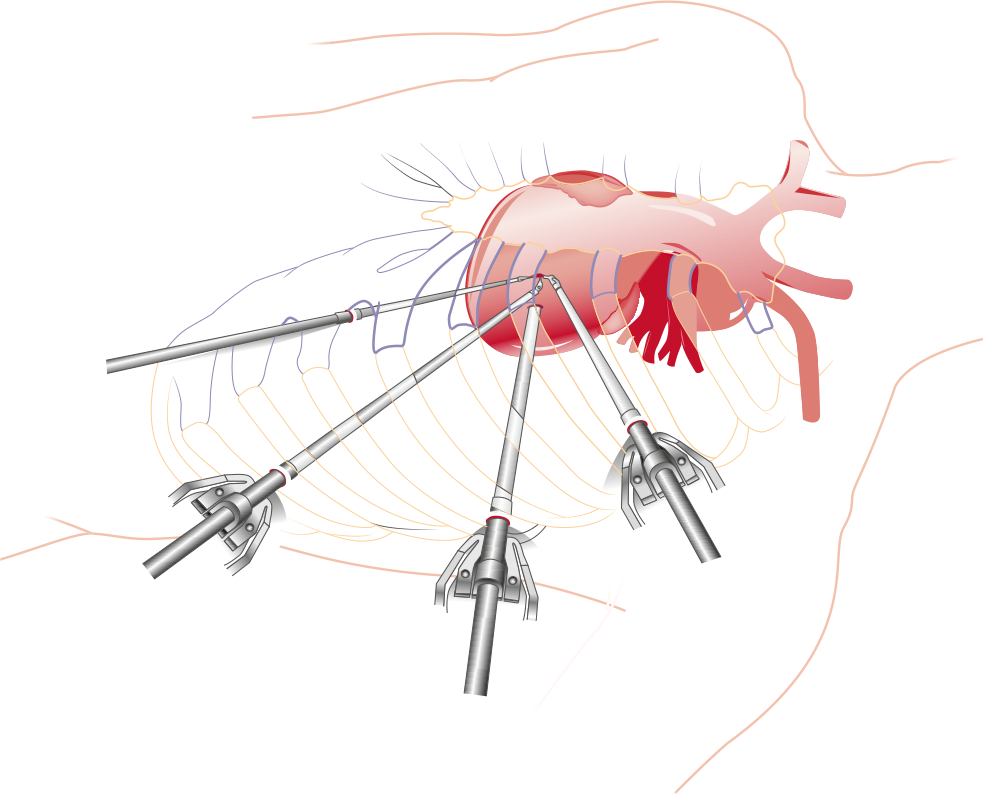

**Fig. 67.9 Incision ports for coronary artery bypass grafting.** Trocars are placed in the third, sixth, and eighth intercostal spaces. Similar port positions are used for bilateral internal mammary artery dissection.

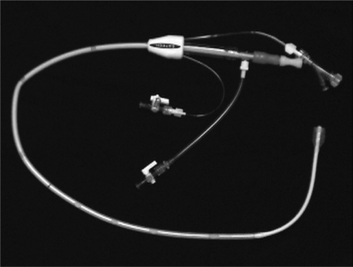

**Fig. 67.10 Remote access perfusion catheter.** The endovascular catheter (Estech Systems, Plano, TX, USA) has a cylindrical balloon for endovascular aortic clamping. The catheter provides anterograde perfusion of the aortic arch at a rate of 5 L/min.

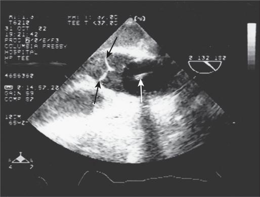

**Fig. 67.11 Ultrasound image of remote access perfusion catheter balloon** **_in situ_ .** Transesophageal echocardiography allows the anesthesiologist to keep track of the migration of the catheter balloon. The balloon ( _white arrow_ ) should be positioned in the ascending aorta 2 to 4 cm distal to the aortic valve ( _black arrows_ ). Right radial pressure catheter signal damping can detect balloon malposition when occlusion of the innominate artery occurs.

<!-- PDF page 15 -->

### ROBOTIC ORTHOPEDIC SURGERY (SEE ALSO

### CHAPTER 60)

Unlike other robotic surgeries, the robot in robotic orthopedic surgery is used as a navigation- assisted device, which affords an interface through which the surgeon receives feedback from the robotic device regarding the threedimensional position of instruments in the surgical field to aid their coordination and guide the surgeon to perform the procedure more accurately. Robotic orthopedic surgery has focused on joint surgeries, especially knee and hip joint arthroplasties.183,184

### Robotic- Assisted Knee Surgeries (RAKS)

RAKS aims to provide more accurate surgical incisions, osteotomies, and soft tissue alignment to restore the best knee kinematics during total knee arthroplasty (TKA).185 Multiple studies have shown that RAKS can restore the knee’s mechanical axis more accurately and improve the balance and position of the implant.185–189 However, like other robotic or robotic- assisted surgeries, it will increase the duration of the surgeries (probably related to the learning curve among orthopedic surgeons) and cost.190–195 Although RAKS improved early functional recovery and hospital discharge, there is insufficient data to support its long- term outcomes.196–202

In RAKS, predetermined parameters are set in the preoperative plan, and the semiactive robotic system stops the saw when the bone resection exceeds those parameters (Fig. 67.12A). Most systems use CT images to create a threedimensional (3D) image of the anatomic landmarks of the knee, or a digital knee representation will be generated. This image will allow intraoperative adjustments and alignments using the navigation system (like Stryker OrthoMap Express Knee Navigation System – Rio; Mako Stryker, Fort Lauderdale, FL).203

Anesthesia management of a patient having RAKS is very similar to a patient who is having a non- robotic TKA. Preoperative analgesia after the TKA emphasizes

multimodal analgesia with or without regional anesthesia methods like adductor canal block (see Chapter 42). In addition, the surgeon may use periarticular infiltration of the mixture of local anesthetic (like ropivacaine 0.2%) with morphine, ketorolac, and epinephrine. Key injection sites are the posterior capsule, medial and lateral capsular flaps, subcutaneous tissue, pin site, and drain site (if applicable).204 Intraoperative management is similar to TKA, with some modifications in the patient arm positioning to generate space for the robot. This means that the arm and hand on the opposite side of the surgery are flexed and rotated over the thorax to create space for the robot to approach the surgical site.

### Robotic- Assisted Hip Surgeries (RAHS)

Unlike TKA, RAHS versus conventional total hip arthroplasty (THA) has produced mixed short- term and long- term outcomes regarding the functional status and disability.205–210 It is believed that optimizing the positioning, alignment, and accurate implant fit will prevent artificial hip joint malfunction and revision.208,211–214

The basic concept and execution of RAHS are very similar to RAKS and started with preoperative planning using a CT- based 3D digital image of the hip joint to optimize acetabular cup implantation. The robot uses a semi- active system that allows surgeons to keep the depth and size of the acetabulum ream (Fig. 67.12B).215–217 Anesthetic management of the RAHS is essentially similar to the traditional THA, considering that using a robot usually extends the time of the surgery due to the existing learning curve and increases cost.218–220 However, compared to traditional THA, blood loss might be similar or more (especially in fem ales).207,219,221

### Other Orthopedic Surgeries

Robotic technology has been applied in orthopedic trauma, shoulder surgeries, and foot and ankle surgery, with insufficient or conflicting evidence to recommend for or against using robots for the abovementioned surgeries.184,222

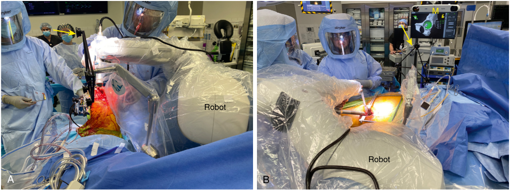

M Robot Robot A B 

**Fig. 67.12 Robotic- assisted knee and hip replacement surgery.** (A) Robotic- assisted total knee arthroplasty. Robotic arm approaches from the opposite side of the surgery. The navigation system ( _yellow arrow_ ) directs the actual and digitally prepared image interface. (B) Robotic- assisted total hip arthroplasty. _M_ , monitor with digitally prepared hip joint.

<!-- PDF page 16 -->

### ROBOTIC- ASSISTED NEUROSURGERY (SEE ALSO

### CHAPTER 53)

Neurosurgery has also adopted robots to enhance the accuracy of specific neurosurgical procedures, especially robotic- assisted stereotaxy, deep brain stimulation (DBS), stereoelectroencephalography, and tumor biopsy or resection.223–230

### Stereotactic Neurosurgery

Stereotactic neurosurgery has been one of the main uses of robotic neurosurgeries. It has been used to optimize the accuracy of the lead placements for DBS and functional neurosurgery.228,231–235 The ROSA Brain System (Medtech, Zimmer Biomet, Montpellier, France) for DBS stereoelectroencephalography is one of the most recent robots, which gained FDA approval for cranial surgery in 2012.

**Surgical and Anesthesia Workflow Description.** Anesthesia care for ROSA- assisted DBS (RADBS) is similar to the placement of DBS without a robot.236,237 The procedure can be done under monitored anesthesia care (MAC), also called awake, or under general anesthesia (GA) with an endotracheal tube (GAET) with an arterial line for tight blood pressure control during the procedure. The patient may also need a Foley catheter as the procedure may take hours to perform. For the MAC patient, moderate or deep sedation can usually be planned for the pinning frame, Foley placement, skin incision, and eventually burr holes. The sedation agent, like propofol, is ideal as the patient needs to wake up later in the procedure and follow commands for neuromonitoring. However, despite controversies, it has been shown that GA compared to awake/MAC, does not affect the microelectrode recording.145,228,229,236,238,239

The procedure is usually performed in an operating room with a CT scan built in- place or with a CT scan close to the operating room. The Lekshell frame (Elekta) is the metal frame pinned on the patient’s skull and is used to register the ROSA system using four points on the frame. Enough local anesthetics are used at the site of the four screw points for moderate/deep sedation during pinning. Immediately after placement of the frame, a thin- sliced, volumetric CT scan is obtained. The CT scan images are combined with the ROSA software’s preoperative MRI. Then target planning, including trajectory angle and distance to the target, is accomplished with the same software (Fig. 67.13A). The patient position is usually a beach- chair position with the neck slightly extended. The height of the ROSA system limits the bed’s height. As soon as the ROSA Brain System is engaged, the operative bed position controls are disconnected to prevent accidental movement, which can cause serious injuries (Fig. 67.13B). Once the ROSA system is registered to that patient, the DBS entry points are marked, and 14- mm burr holes are produced using the small incisions. In the next step, ROSA’s Microdrive will be fixed for the DBS lead placement. At this point, the sedation level will usually be reduced to minimal or conscious sedation or awake stage, as the patient’s participation in the examination is needed. It is advised to check the patient’s neck and comfort before ROSA’s registration, as the position cannot be changed afterward. Due to the weight of the ROSA machine and stable attachment of the

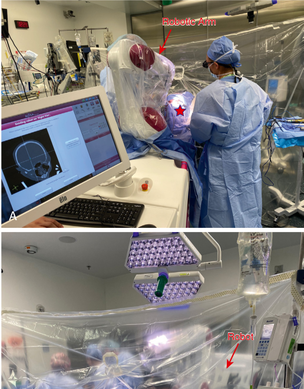

Robotic Arm A Robot 

B 

**Fig. 67.13 Robotic- assisted stereotactic surgery.** (A) The position of the ROSA’s robotic arm concerning the patient’s skull ( _star_ ), the surgical staff, and the monitor. ROSA’s software calculates the stimulator placement depth and direction based on the CT images and four- point Lekshell frame. (B) The patient positioning during engagement of ROSA’s arm is usually the reclined beach- chair position, and bed control is fully disengaged from accidental movement.

ROSA arm to the Lekshell frame, some degree of patient movement and anxiety can be tolerated. However, verbal communication with the patient is essential at this stage to prevent untoward events. Tight blood control may be needed at this phase, and direct arterial blood pressure monitoring is essential (systolic BP &lt;120 mm Hg and

<!-- PDF page 17 -->

mean arterial BP &lt;80 mm Hg). It is also essential to keep the patient euvolemic. If the patient needs GAET, inhalation anesthetics should be reduced to half MAC at this phase. The microelectrode and lead implantation are carried out in a typical fashion. After placement of the leads, the head and frame will be disengaged from ROSA. The Lekshell frame will be removed, and if GAET were planned, the patient would be extubated and transferred to the postanesthesia care unit (PACU). Usually, a postprocedure CT scan is performed to confirm the placement of the electrodes.240

Complications and treatment during robotic- assisted DBS are similar to the traditional approach. In case of airway complications, equipment should be accessible for opening the Lekshell frame.236 Seizure, venous air embolism, intracranial hemorrhage, and autonomic instability with sweating and hemodynamic changes are other potential complications of DBS insertion.236,237

Although robotic- assisted DBS is still considered novel and its safety on a large scale is not clear, it is associated with more precision, accuracy, and fewer attempts and, therefore, less operation time for electrode placement compared to traditional frame- based surgery.190,224,241,242

### Robotic Spine Surgery

Robots have been used for intraoperative image- guided navigation during minimally invasive spinal surgeries.243–246 The aim is to provide robotic assistance combined with intraoperative fluoroscopy to provide 3D reconstruction images for intraoperative verification of implant/screw placement or spine biopsy.243,247 Traditionally, a non- robotic navigation system with or without computer- assisted navigation has been used. Many robotic spine surgery platforms have been introduced, but their acceptance has been limited. More evidence is needed to support the efficacy, safety, and value of adding a robot to supine surgeries.247–251

### References

1.  Intuitive. https://www.intuitive.com/en- us/healthcare- professional s/surgeons?gclid=Cj0KCQjw2MWVBhCQARIsAIjbwoN6KYVZ1X4 N3MbhJRisBEg9yNL8sfzARO8IFZQfJQaq0QMzeQVUIlcaAgWHEAL w_wcB.

2.  Lee JR. _Korean J Anesthesiol_ . 2014;66(1):3.

3.  Lanfranco AR, et al. _Ann Surg_ . 2004;239(1):14.

4.  Hemmerling TM, et al. _Br J Anaesth_ . 2012;108(6):1011.

5.  Köckerling F. _Front Surg_ . 2014;1:15.

6.  Hemmerling TM, et al. _Br J Anaesth_ . 2012;108(6):1011.

7.  Hemmerling TM, et al. _Curr Opin Anaesthesiol_ . 2012;25(6):736.

8.  Hemmerling TM, et al. _Anesth Analg_ . 2012;114(3):590.

9.  Zorko N, et al. _J Int Med Res_ . 2011;39(3):1084.

10.  Kaye AD, et al. _Ochsner J_ . 2013;13(4):517.

11.  Grott K, et al. Atelectasis. In: _StatPearls_ . 2022.

12.  Lee HJ, et al. _Korean J Anesthesiol_ . 2013;65(3):244.

13.  Brandão JC, et al. _Anesth Analg_ . 2019;129(6):1564.

14.  Cammarota G, et al. _Respir Care_ . 2020;65(5):625.

15.  Dick CR, et al. _Am J Respir Crit Care Med_ . 1997;155(2):609.

16.  Strang CM, et al. _Minerva Anestesiol_ . 2013;79(6):617.

17.  Kazemi H, et al. _Physiol Rev_ . 1986;66(4):953.

18.  Gutt CN, et al. _Dig Surg_ . 2004;21(2):95.

19.  Price HL. _Anesthesiology_ . 1960;21:652.

20.  Grubb RL, et al. _Stroke_ . 1974;5(5):630.

21.  Kim MS, et al. _J Endourol_ . 2014;28(7):801.

22.  Chin JH, et al. _BMC Anesthesiol_ . 2015;15:43.

23.  Lee YY, et al. _Anesth Pain Med (Seoul)_ . 2019;14(4):393.

24.  Kim Y, et al. _BioMed Res Int_ . 2019;2019:5617815.

25.  Sujata N, et al. _J Robot Surg_ . 2019;13(2):267.

26.  Ott DE. _J Soc Laparoendosc Surg_ . 2014;18(1):1.

27.  Choi SJ, et al. _Anaesthesia_ . 2006;61(5):439.

28.  Knight DJ, et al. _Cont Educ Anaesth Crit Care Pain_ . 2004;4(5):160.

29.  Phong SV, et al. _Anaesth Intensive Care_ . 2007;35(2):281.

30.  Geerts BF, et al. _J Clin Anesth_ . 2012;24(8):668.

31.  Martin JT. _AANA J (Am Assoc Nurse Anesth)_ . 1995;63(1):29.

32.  Carry PY, et al. _Anesth Analg_ . 1998;87(6):1393.

33.  Oğurlu M, et al. _J Minim Invasive Gynecol_ . 2010;17(3):295.

34.  Raz O, et al. _J Urol_ . 2015;193(4):1213.

35.  Awad H, et al. _Anesth Analg_ . 2009;109(2):473.

36.  Hoshikawa Y, et al. _Br J Ophthalmol_ . 2014;98(3):305.

37.  Hsu RL, et al. _Rev Urol_ . 2013;15(4):178.

38.  Klauschie J, et al. _J Minim Invasive Gynecol_ . 2010;17(4):504.

39.  Barnett JC, et al. _J Minim Invasive Gynecol_ . 2007;14(5):664.

40.  Irvin W, et al. _Obstet Gynecol_ . 2004;103(2):374.

41.  Alemzadeh H, et al. _PLoS One_ . 2016;11(4):e0151470.

42.  Geppert B, et al. _Acta Obstet Gynecol Scand_ . 2011;90(11):1210.

## Summary

Anesthesia for robotic surgery is an exciting and dynamic field. As surgeons and patients look for innovations and technologically rich approaches to health care, it is reasonable to expect that more robotic procedures will be performed. However, there is a real need to investigate a robotic approach’s outcomes, safety, and costs versus a more traditional approach. In addition, the new generation of surgeons and anesthesiologists must be familiar with this technology to incorporate it into their practice. Recognizing the unique challenges of robotic surgery for anesthesiologists requires knowledge updates to provide the best patient outcome.

43.  American College of Obstetricians and Gynecologists’ Committee on Gynecologic Practice, The Society of Gynecologic Surgeons. Robotassisted surgery for noncancerous gynecologic conditions: ACOG Committee Opinion, Number 810. _Obstet Gynecol_ . 2020;136(3):e22.

44.  Dasgupta P, et al. _Asian J Androl_ . 2009;11(1):90.

45.  Kalmar AF, et al. _Br J Anaesth_ . 2010;104(4):433.

46.  Taketani Y, et al. _PLoS One_ . 2015;10(4):e0123361.

47.  Olympio MA. _BJU Int_ . 2013;112(8):1060.

48.  Piegeler T, et al. _BMC Anesthesiol_ . 2014;14:61.

49.  Pridgeon S, et al. _BJU Int_ . 2013;112(4):485.

50.  Hu M, et al. _Cancer_ . 2014;120(9):1409.

51.  Gul ZG, et al. _Translat Androl Urol_ . 2019;10(5):2209.

52.  Borza T, et al. _Urology_ . 2017;104:77.

53.  Chapman E, et al. _BJA Education_ . 2015;16(3):98.

54.  Pavan N, et al. _Ann Surg Oncol_ . 2017;24(8):2420.

55.  Leow JJ, et al. _J Urol_ . 2016;196(5):1371.

56.  Truong MD, et al. _Obstet Gynecol Clin North Am_ . 2022;49(2):273.

57.  Ramdhan RC, et al. _Clin Anat_ . 2017;30(7):946.

58. _Obstet Gynecol_ . 2015;125(3):760.

### Acknowledgment

The authors would like to acknowledge Dan B. Ellis and Meredith A. Albrecht for their contributions to prior versions of this chapter.

59.  Lim PC, et al. _Int J Gynaecol Obstet_ . 2016;133(3):359.

60.  Torng PL, et al. _Taiwan J Obstet Gynecol_ . 2017;56(6):781.

61.  Lin JF, et al. _Int J Gynaecol Obstet_ . 2014;124(1):88.

62.  Wright JD, et al. _JAMA_ . 2013;309(7):689.

63.  Ind T, et al. _Int J Med Robot_ . 2017;13(4).

64.  Himpens J, et al. _Surg Endosc_ . 1998;12(8):1091.

65.  Zaman JA, et al. _Hepatobiliary Surg Nutr_ . 2018;7(1):21.

66.  Prabhu AS, et al. _JAMA Surg_ . 2020;155(5):380.

**Complete references available online at expertconsult.com.**

67.  Huang Y, et al. _Surgery_ . 2017;161(3):628.

<!-- PDF page 18 -->

68.  Phillips MS, et al. _Surg Endosc_ . 2012;26(5):1296.

69.  Hagen ME, et al. _Surg Endosc_ . 2018;32(3):1550.

70.  Balachandran B, et al. _World J Surg_ . 2017;41(5):1246.

71.  Marks JM, et al. _J Am Coll Surg_ . 2013;216(6):1037.

72.  Baik SH, et al. _Surg Endosc_ . 2008;22(7):1601.

73.  Dolejs SC, et al. _Surg Endosc_ . 2017;31(6):2387.

74.  Miller PE, et al. _J Am Coll Surg_ . 2016;223(2):369.

75.  Cherqui D. _Br J Surg_ . 2003;90(6):644.

76.  Croome KP, et al. _Arch Surg_ . 2010;145(11):1109.

77.  Beard RE, et al. _Cancer Control_ . 2017;24(3):1073274817729234.

78.  Lu J, et al. _Ann Surg_ . 2021;273(5):858.

79.  Scozzari G, et al. _Surg Endosc_ . 2011;25(2):597.

80.  Hubens G, et al. _Surg Endosc_ . 2008;22(7):1690.

81.  Pathirana S, et al. _Anaesth Intensive Care_ . 2018;46(1):25.

82.  Holsinger FC, et al. _Arch Otolaryngol Head Neck Surg_ . 2005; 131(7):583.

83.  Moore EJ, et al. _Laryngoscope_ . 2009;119(11):2156.

84.  De Ceulaer J, et al. _Int J Oral Maxillofac Surg_ . 2012;41(11):1311.

85.  Pinar E, et al. _Eur Arch Oto- Rhino- Laryngol_ . 2009;266(5):699.

86.  Chi JJ, et al. _Anesthesiol Clin_ . 2010;28(3):411.

87.  Melfi FM, et al. _Thorac Surg Clin_ . 2014;24(2):143.

88.  Marulli G, et al. _J Thorac Cardiovasc Surg_ . 2012;144(5):1125.

89.  van Boxel GI, et al. _J Thorac Dis_ . 2020;12(2):54.

90.  Augustin F, et al. _Int J Med Robot_ . 2006;2(3):262.

91.  Bodner JC, et al. _Ann Thorac Surg_ . 2005;80(4):1202.

92.  Kernstine KH, et al. _Surg Endosc_ . 2007;21(12):2285.

93.  Steenwyk B, et al. _Anesthesiol Clin_ . 2012;30(4):699.

94.  Savitt MA, et al. _Ann Thorac Surg_ . 2005;79(2):450.

95.  Elsayed HH, et al. _Anaesth Crit Care Pain Med_ . 2021;40(2):100846.

96.  Zirafa CC, et al. _Ann Cardiothorac Surg_ . 2019;8(2):210.

97.  Park BJ, et al. _J Thorac Cardiovasc Surg_ . 2006;131(1):54.

98.  Heller JA, et al. _Minerva Anestesiol_ . 2018;84(1):108.

99.  Meggiolaro KM, et al. _Anaesthesist_ . 2018;67(8):555.

100.  Bernasconi F, et al. _Tumori_ . 2017;103(6):495.

101.  Kreft T, et al. _Anasthesiol Intensivmed Notfallmed Schmerzther_ . 2018; 53(3):198.

102.  Campos JH. _Curr Opin Anaesthesiol_ . 2010;23(1):1.

103.  Pandey R, et al. _J Cardiothorac Vasc Anesth_ . 2009;23(4):584.

104.  Möller T, et al. _Chirurg_ . 2020;91(8):689.

105.  Light RW. _Intensive Care Med_ . 1994;20(7):468.

106.  Connolly JP. _Crit Care Med_ . 1993;21(2):294.

107.  Pauli H, et al. _Ann Cardiothorac Surg_ . 2019;8(2):263.

108.  Brock H, et al. _Anaesthesia_ . 2000;55(1):10.

109.  Ohtsuka T, et al. _Ann Thorac Surg_ . 1999;68(1):29.

110.  Niklas C, et al. _Current Anesthesiology Reports_ . 2021;11(4):429.

111.  Tuğrul M, et al. _Br J Anaesth_ . 1997;79(3):306.

112.  Zhang Y, et al. _Ann Transl Med_ . 2015;3(5):71.

113.  Casiraghi M, et al. _Thorac Cardiovasc Surg_ . 2019;67(7):564.

114.  Jang HJ, et al. _Innovations (Phila)_ . 2011;6(5):305.

115.  Cerfolio RJ, et al. _Ann Thorac Surg_ . 2016;102(2):394.

116.  Campos J, et al. _Minerva Anestesiol_ . 2014;80(1):83.

117.  Emmert A, et al. _Medicine (Baltimore)_ . 2017;96(35):e7633.

118.  Geraci TC, et al. _Thorac Surg Clin_ . 2020;30(3):293.

119.  Tchouta LN, et al. _Chest_ . 2017;151(2):329.

120.  Cerfolio RJ, et al. _J Thorac Cardiovasc Surg_ . 2016;152(4):991.

121.  Patton BD, et al. _Innovations (Phila)_ . 2021;16(2):136.

122.  Louie BE. _Thorac Surg Clin_ . 2014;24(2):169.

123.  Novellis P, et al. _J Thorac Dis_ . 2018;10(2):790.

124.  Veluswamy RR, et al. _Chest_ . 2020;157(5):1313.

125.  Park BJ. _Ann Cardiothorac Surg_ . 2012;1(1):56.

126.  Bao F, et al. _J Thorac Dis_ . 2016;8(7):1798.

127.  Louie BE, et al. _Ann Thorac Surg_ . 2016;102(3):917.

128.  Darr C, et al. _Surg Endosc_ . 2017;31(10):4126.

129.  Kass KS, et al. _J Geriatr Oncol_ . 2017;8(2):102.

130.  Qian L, et al. _J Thorac Dis_ . 2017;9(7):1997.

131.  He H, et al. _J Cardiothorac Surg_ . 2018;13(1):52.

132.  Gonsette K, et al. _Saudi J Anaesth_ . 2021;15(3):356.

133.  Wakimoto M, et al. _Robot Surg_ . 2021;8:9.

134.  Kuo SW, et al. _J Thorac Dis_ . 2017;9(9):3105.

135.  Carpentier A, et al. _C R Acad Sci III_ . 1998;321(5):437.

136.  Doulamis IP, et al. _J Robot Surg_ . 2019;13(1):41.

137.  Argenziano M, et al. _Circulation_ . 2003;108(suppl 1):Ii191.

138.  Bonaros N, et al. _Ann Thorac Surg_ . 2006;82(2):687.

139.  Morgan JA, et al. _Ann Thorac Surg_ . 2004;77(4):1328.

140.  Argenziano M, et al. _Heart Surg Forum_ . 2002;5(3):294.

141.  Li X, et al. _Int J Med Robot_ . 2021;17(5):e2304.

142.  Kadan M, et al. _Int J Med Robot_ . 2022;18(4):e2395.

143.  Suematsu Y, et al. _Ann Thorac Surg_ . 2005;80(6):2309.

144.  Ren C, et al. _Asian J Surg_ . 2022;45(10):1912.

145.  Badhwar V, et al. _J Thorac Cardiovasc Surg_ . 2023;165(2):779.

146.  Rodríguez E, et al. _Int J Med Robot_ . 2006;2(3):211.

147.  Loulmet DF, et al. _J Thorac Cardiovasc Surg_ . 2021;161(1):80.

148.  Bonatti J, et al. _Innovations (Phila)_ . 2021;16(4):317.

149.  Wang A, et al. _Ann Thorac Surg_ . 2018;106(5):1388.

150.  Arghami A, et al. _Ann Thorac Surg_ . 2022;114(5):1587.

151.  Kypson AP, et al. _Am J Surg_ . 2004;188(4, Supplement 1):83.

152.  Argenziano M, et al. _Ann Thorac Surg_ . 2006;81(5):1666.

153.  Bonatti J, et al. _J Thorac Dis_ . 2021;13(3):1922.

154.  Nambala S, et al. _Curr Opin Cardiol_ . 2021;36(6):735.

155.  Balkhy HH, et al. _Ann Thorac Surg_ . 2022;114(2):476.

156.  Van Praet KM, et al. _Interv Cardiol_ . 2021;16:e08.

157.  Kypson AP. _Cardiology_ . 2007;107(3):147.

158.  Gillinov AM. _J Interv Card Electrophysiol_ . 2005;13(2):115.

159.  DeRose JJ, et al. _Am J Surg_ . 2004;188(4A Suppl):104s.

160.  Roberts HG, et al. _J Cardiovasc Electrophysiol_ . 2021;32(10):2879.

161.  Gerosa G, et al. _Eur J Cardiothoracic Surg_ . 2004;26(2):450.

162.  Thomas D, et al. _J Electrocardiol_ . 2012;45(2):95.

163.  Tang RC, et al. _Can J Cardiol_ . 2021;37(7):1117.

164.  Islam A. _World J Cardiol_ . 2022;14(4):206.

165.  Poterucha TJ, et al. _Curr Treat Options Oncol_ . 2019;20(8):66.

166.  Mishra YK, et al. _Asian Cardiovasc Thorac Ann_ . 2006;14(6):447.

167.  Parr KG, et al. _J Clin Anesth_ . 2002;14(3):228.

168.  Furman S. _Pacing Clin Electrophysiol_ . 1998;21(2):337.

169.  Hatton KW, et al. _Anesth Analg_ . 2006;103(5):1113.

170.  Hemli JM, et al. _Surg Clin North Am_ . 2020;100(2):219.

171.  Athanasiou T, et al. _Future Cardiol_ . 2011;7(4):511.

172.  Suri RM, et al. _Mayo Clin Proc_ . 2011;86(9):838.

173.  Suri RM, et al. _Ann Thorac Surg_ . 2012;93(3):761.

174.  Rodriguez E, et al. _Scand J Surg_ . 2009;98(2):120.

175.  Burns DJP, et al. _Cardiol Clin_ . 2021;39(2):211.

176.  Harky A, et al. _Prog Cardiovasc Dis_ . 2021;67:98.

177.  Vernick WJ, et al. _Semin Cardiothorac Vasc Anesth_ . 2012;16(1):11.

178.  Nataf P, et al. _J Card Surg_ . 2000;15(4):278.

179.  Srivastava S, et al. _Innovations (Phila)_ . 2008;3(2):52.

180.  Vassiliades TA. _Heart Surg Forum_ . 2002;5(2):119.

181.  Reichenspurner H, et al. _Ann Thorac Surg_ . 2000;69(4):1176.

182.  Gong W, et al. _J Thorac Dis_ . 2016;8(3):459.

183.  Grande DA, et al. _J Am Acad Orthop Surg_ . 2011;19(1):59.

184.  Chen AF, et al. _J Bone Joint Surg Am_ . 2018;100(22):1984.

185.  Jacofsky DJ, et al. _J Arthroplasty_ . 2016;31(10):2353.

186.  Lang JE, et al. _J Bone Joint Surg Br_ . 2011;93(10):1296.

187.  Liow MH, et al. _J Arthroplasty_ . 2014;29(12):2373.

188.  Hampp EL, et al. _J Knee Surg_ . 2019;32(3):239.

189.  Kayani B, et al. _J Arthroplasty_ . 2018;33(8):2496.

190.  Bautista M, et al. _J Knee Surg_ . 2019;32(7):600.

191.  Kurtz S, et al. _J Bone Joint Surg Am_ . 2007;89(4):780.

192.  Swank ML, et al. _Am J Orthop (Belle Mead NJ)_ . 2009;38(2 Suppl):32.

193.  Moschetti WE, et al. _J Arthroplasty_ . 2016;31(4):759.

194.  Cool CL, et al. _J Comp Eff Res_ . 2019;8(5):327.

195.  Kayani B, et al. _Knee Surg Sports Traumatol Arthrosc_ . 2019; 27(4):1132.

196.  St Mart JP, et al. _EFORT Open Rev_ . 2021;6(4):270.

197.  Abdel MP, et al. _J Bone Joint Surg Am_ . 2018;100(6):472.

198.  van Hamersveld KT, et al. _J Bone Joint Surg Am_ . 2019;101(13):1203.

199.  Dorr LD. _Clin Orthop Relat Res_ . 2020;478(2):276.

200.  Kim YH, et al. _Clin Orthop Relat Res_ . 2020;478(2):266.

201.  Smith AF, et al. _J Knee Surg_ . 2021;34(7):730.

202.  Archer A, et al. _J Knee Surg_ . 2023;36(4):404.

203.  Khlopas A, et al. _J Arthroplasty_ . 2018;33(7):2002.

204.  Pearle AD, et al. _Am J Orthop (Belle Mead NJ)_ . 2009;38(2 Suppl):16. 205.  Honl M, et al. _J Bone Joint Surg Am_ . 2003;85(8):1470. 206.  Nakamura N, et al. _Clin Orthop Relat Res_ . 2010;468(4):1072. 207.  Bukowski BR, et al. _Surg Technol Int_ . 2016;29:303.

208.  Banerjee S, et al. _Expert Rev Med Devices_ . 2016;13(1):47.

209.  Kumar V, et al. _Postgrad Med J_ . 2023;99(1171):375. 210.  Emara AK, et al. _Bone Joint Lett J_ . 2021;103- b(9):1488.

211.  Perets I, et al. _Hip Int_ . 2020;30(2):118.

212.  Kouyoumdjian P, et al. _SICOT J_ . 2020;6:45.

213.  Hepinstall MS, et al. _Ann Transl Med_ . 2018;6(22):433. 214.  Subramanian P, et al. _Hip Int_ . 2019;29(3):232.

<!-- PDF page 19 -->

215.  Elson L, et al. _Hip Int_ . 2015;25(6):531.

216.  Nodzo SR, et al. _Bone Joint Lett J_ . 2018;100- b(10):1303.

217.  Tarwala R, et al. _Curr Rev Musculoskelet Med_ . 2011;4(3):151. 218.  Redmond JM, et al. _J Arthroplasty_ . 2015;30(1):50.

219.  Caldora P, et al. _J Biol Regul Homeost Agents_ . 2020;34(4 suppl. 3):37. 220.  Clement ND, et al. _Adv Orthop_ . 2022;2022:5962260.

221.  Heng Y, et al. _J Arthritis_ . 2018;7(4).

222.  Wright JG. _J Bone Joint Surg Am_ . 2006;88(5):1161.

223.  Lefranc M, et al. _Acta Neurochir (Wien)_ . 2012;154(11):2069.

224.  Neudorfer C, et al. _Stereotact Funct Neurosurg_ . 2018;96(5):327. 225.  Eljamel MS. _Stereotact Funct Neurosurg_ . 2009;87(2):88.

226.  Candela S, et al. _J Neurosurg Pediatr_ . 2018;22(4):416.

227.  González- Martínez J, et al. _Neurosurgery_ . 2016;78(2):169.

228.  Vadera S, et al. _World Neurosurg_ . 2017;97:762.e711.

229.  Lefranc M, et al. _World Neurosurg_ . 2017;106:602.

230.  Guo Z, et al. _World Neurosurg_ . 2018;116:77.

231.  Haegelen C, et al. _Neurochirurgie_ . 2010;56(5):363.

232.  Bekelis K, et al. _J Neurosurg_ . 2012;116(5):1002. 233.  Benabid AL, et al. _Appl Neurophysiol_ . 1987;50(1–6):153.

234.  Young RF. _Neurol Res_ . 1987;9(2):123.

235.  Heuer GG, et al. _Neurosurgery_ . 2008;62(3 suppl 1):245.

236.  Dinsmore M, et al. _Curr Opin Anaesthesiol_ . 2021;34(5):563. 237.  Grant R, et al. _Curr Opin Anaesthesiol_ . 2015;28(5):505.

238.  Tsai ST, et al. _Parkinsons Dis_ . 2019;2019:5676345. 239.  Venkatraghavan L, et al. _J Neurosurg Anesthesiol_ . 2016;28(3):256. 240.  Faraji AH, et al. _Oper Neurosurg (Hagerstown)._ 2020;19(4):444. 241.  Lefranc M, et al. _Stereotact Funct Neurosurg_ . 2014;92(4):242. 242.  VanSickle D, et al. _Ann Biomed Eng_ . 2019;47(5):1212.

243.  Stüer C, et al. _Acta Neurochir Suppl_ . 2011;109:241. 244.  Vo CD, et al. _Global Spine J_ . 2020;10(2 Suppl):34s. 245.  Vijayan R, et al. _Phys Med Biol_ . 2019;64(16):165020.

246.  De Biase G, et al. _World Neurosurg_ . 2021;148:93.

247.  Huang M, et al. _Ann Transl Med_ . 2021;9(1):86.

248.  Devito DP, et al. _Spine (Phila Pa 1976)_ . 2010;35(24):2109. 249.  Mattei TA, et al. _Neurosurg Rev_ . 2014;37(3):357. 250.  Nathoo N, et al. _Neurosurgery_ . 2005;56(3):421. 251.  Rizun PR, et al. _Semin Laparosc Surg_ . 2004;11(2):99.

<!-- PDF page 20 -->

### References

1.  Intuitive. https://www.intuitive.com/en- us/healthcare- professional s/surgeons?gclid=Cj0KCQjw2MWVBhCQARIsAIjbwoN6KYVZ1X4 N3MbhJRisBEg9yNL8sfzARO8IFZQfJQaq0QMzeQVUIlcaAgWHEAL w_wcB.

2.  Lee JR. Anesthetic considerations for robotic surgery. _Korean J Anesthesiol_ . 2014;66(1):3–11.

3.  Lanfranco AR, Castellanos AE, Desai JP, Meyers WC. Robotic surgery: a current perspective. _Ann Surg_ . 2004;239(1):14–21.

4.  Hemmerling TM, Taddei R, Wehbe M, et al. First robotic tracheal intubations in humans using the Kepler intubation system. _Br J Anaesth_ . 2012;108(6):1011–1016.

5.  Köckerling F. Robotic vs. standard laparoscopic technique – what is better? _Front Surg_ . 2014;1:15.

6.  Hemmerling TM, Taddei R, Wehbe M, et al. First robotic tracheal intubations in humans using the Kepler intubation system. _Br J Anaesth_ . 2012;108(6):1011–1016.

7.  Hemmerling TM, Terrasini N. Robotic anesthesia: not the realm of science fiction any more. _Curr Opin Anaesthesiol_ . 2012;25(6):736– 742.

8.  Hemmerling TM, Wehbe M, Zaouter C, et al. The Kepler intubation system. _Anesth Analg_ . 2012;114(3):590–594.

9.  Zorko N, Mekiš D, Kamenik M. The influence of the Trendelenburg position on haemodynamics: comparison of anaesthetized patients with ischaemic heart disease and healthy volunteers. _J Int Med Res_ . 2011;39(3):1084–1089.

10.  Kaye AD, Vadivelu N, Ahuja N, M, et al. Anesthetic considerations in robotic- assisted gynecologic surgery. _Ochsner J_ . 2013;13(4):517–524.

11.  Grott K, Chauhan S, Dunlap JD. Atelectasis. In: _StatPearls_ . Treasure Island (FL): StatPearls Publishing Copyright © 2022, StatPearls Publishing LLC; 2022.

12.  Lee HJ, Kim KS, Jeong JS, et al. Optimal positive end- expiratory pressure during robot- assisted laparoscopic radical prostatectomy. _Korean J Anesthesiol_ . 2013;65(3):244–250.

13.  Brandão JC, Lessa MA, Motta- Ribeiro G, et al. Global and regional respiratory mechanics during robotic- assisted laparoscopic surgery: a randomized study. _Anesth Analg_ . 2019;129(6):1564–1573.

14.  Cammarota G, Lauro G, Sguazzotti I, et al. Esophageal pressure versus gas exchange to set PEEP during intraoperative ventilation. _Respir Care_ . 2020;65(5):625–635.

15.  Dick CR, Liu Z, Sassoon CS, et al. O2- induced change in ventilation and ventilatory drive in COPD. _Am J Respir Crit Care Med_ . 1997;155(2):609–614.

16.  Strang CM, Ebmeyer U, Maripuu E, et al. Improved ventilationperfusion matching by abdominal insufflation (pneumoperitoneum) with CO2 but not with air. _Minerva Anestesiol_ . 2013;79(6):617–625.

17.  Kazemi H, Johnson DC. Regulation of cerebrospinal fluid acid- base balance. _Physiol Rev_ . 1986;66(4):953–1037.

18.  Gutt CN, Oniu T, Mehrabi A, et al. Circulatory and respiratory complications of carbon dioxide insufflation. _Dig Surg_ . 2004;21(2):95– 105.

19.  Price HL. Effects of carbon dioxide on the cardiovascular system. _Anesthesiology_ . 1960;21:652–663.

20.  Grubb Jr RL, Raichle ME, Eichling JO, Ter- Pogossian MM. The effects of changes in PaCO2 on cerebral blood volume, blood flow, and vascular mean transit time. _Stroke_ . 1974;5(5):630–639.

21.  Kim MS, Bai SJ, Lee JR, et al. Increase in intracranial pressure during carbon dioxide pneumoperitoneum with steep Trendelenburg positioning proven by ultrasonographic measurement of optic nerve sheath diameter. _J Endourol_ . 2014;28(7):801–806.

22.  Chin JH, Seo H, Lee EH, et al. Sonographic optic nerve sheath diameter as a surrogate measure for intracranial pressure in anesthetized patients in the Trendelenburg position. _BMC Anesthesiol_ . 2015;15:43.

23.  Lee YY, Lee H, Park HS, et al. Optic nerve sheath diameter changes during gynecologic surgery in the Trendelenburg position: comparison of propofol- based total intravenous anesthesia and sevoflurane anesthesia. _Anesth Pain Med (Seoul)_ . 2019;14(4):393–400.

24.  Kim Y, Choi S, Kang S, Park B. Propofol affects optic nerve sheath diameter less than sevoflurane during robotic surgery in the steep trendelenburg position. _BioMed Res Int_ . 2019;2019:5617815.

25.  Sujata N, Tobin R, Tamhankar A, et al. A randomised trial to compare the increase in intracranial pressure as correlated with the optic nerve sheath diameter during propofol versus

- sevoflurane- maintained anesthesia in robot- assisted laparoscopic pelvic surgery. _J Robot Surg_ . 2019;13(2):267–273.

- 26.  Ott DE. Subcutaneous emphysema –  beyond the pneumoperitoneum. _J Soc Laparoendosc Surg_ . 2014;18(1):1–7.

27.  Choi SJ, Gwak MS, Ko JS, et al. The effects of the exaggerated lithotomy position for radical perineal prostatectomy on respiratory mechanics. _Anaesthesia_ . 2006;61(5):439–443.

28.  Knight DJ, Mahajan RP. Patient positioning in anaesthesia. _Cont Educ Anaesth Crit Care Pain_ . 2004;4(5):160–163.

29.  Phong SV, Koh LK. Anaesthesia for robotic- assisted radical prostatectomy: considerations for laparoscopy in the Trendelenburg position. _Anaesth Intensive Care_ . 2007;35(2):281–285.

30.  Geerts BF, van den Bergh L, Stijnen T, et al. Comprehensive review: is it better to use the Trendelenburg position or passive leg raising for the initial treatment of hypovolemia? _J Clin Anesth_ . 2012;24(8):668– 674.

31.  Martin JT. The Trendelenburg position: a review of current slants about head down tilt. _AANA J (Am Assoc Nurse Anesth)_ . 1995;63(1):29–36.

32.  Carry PY, Gallet D, François Y, et al. Respiratory mechanics during laparoscopic cholecystectomy: the effects of the abdominal wall lift. _Anesth Analg_ . 1998;87(6):1393–1397.

33.  Oğurlu M, Küçük M, Bilgin F, et al. Pressure- controlled vs volumecontrolled ventilation during laparoscopic gynecologic surgery. _J Minim Invasive Gynecol_ . 2010;17(3):295–300.

34.  Raz O, Boesel TW, Arianayagam M, et al. The effect of the modified Z Trendelenburg position on intraocular pressure during robotic assisted laparoscopic radical prostatectomy: a randomized, controlled study. _J Urol_ . 2015;193(4):1213–1219.

35.  Awad H, Santilli S, Ohr M, et al. The effects of steep Trendelenburg positioning on intraocular pressure during robotic radical prostatectomy. _Anesth Analg_ . 2009;109(2):473–478.

36.  Hoshikawa Y, Tsutsumi N, Ohkoshi K, et al. The effect of steep Trendelenburg positioning on intraocular pressure and visual function during robotic- assisted radical prostatectomy. _Br J Ophthalmol_ . 2014;98(3):305–308.

37.  Hsu RL, Kaye AD, Urman RD. Anesthetic challenges in roboticassisted urologic surgery. _Rev Urol_ . 2013;15(4):178–184.

38.  Klauschie J, Wechter ME, Jacob K, et al. Use of anti- skid material and patient- positioning to prevent patient shifting during robotic- assisted gynecologic procedures. _J Minim Invasive Gynecol_ . 2010;17(4):504– 507.

39.  Barnett JC, Hurd WW, Rogers Jr RM, et al. Laparoscopic positioning and nerve injuries. _J Minim Invasive Gynecol_ . 2007;14(5):664–672; quiz 673.

40.  Irvin W, Andersen W, Taylor P, Rice L. Minimizing the risk of neurologic injury in gynecologic surgery. _Obstet Gynecol_ . 2004;103(2):374–382.

41.  Alemzadeh H, Raman J, Leveson N, et al. Adverse events in robotic surgery: a retrospective study of 14 years of FDA data. _PLoS One_ . 2016;11(4):e0151470.

42.  Geppert B, Lönnerfors C, Persson J. Robot- assisted laparoscopic hysterectomy in obese and morbidly obese women: surgical technique and comparison with open surgery. _Acta Obstet Gynecol Scand_ . 2011;90(11):1210–1217.

43.  American College of Obstetricians and Gynecologists’ Committee on Gynecologic Practice, The Society of Gynecologic Surgeons. Robotassisted surgery for noncancerous gynecologic conditions: ACOG Committee Opinion, Number 810. _Obstet Gynecol_ . 2020;136(3):e22–e30.

44.  Dasgupta P, Kirby RS. The current status of robot- assisted radical prostatectomy. _Asian J Androl_ . 2009;11(1):90–93.

45.  Kalmar AF, Foubert L, Hendrickx JFA, et al. Influence of steep Trendelenburg position and CO2 pneumoperitoneum on cardiovascular, cerebrovascular, and respiratory homeostasis during robotic prostatectomy. _Br J Anaesth_ . 2010;104(4):433–439.

46.  Taketani Y, Mayama C, Suzuki N, et al. Transient but significant visual field defects after robot- assisted laparoscopic radical prostatectomy in deep Trendelenburg position. _PLoS One_ . 2015;10(4):e0123361.

47.  Olympio MA. Postoperative visual loss after robotic pelvic surgery. _BJU Int_ . 2013;112(8):1060–1061.

48.  Piegeler T, Dreessen P, Graber SM, et al. Impact of intraoperative fluid administration on outcome in patients undergoing roboticassisted laparoscopic prostatectomy – a retrospective analysis. _BMC Anesthesiol_ . 2014;14:61.

<!-- PDF page 21 -->

49.  Pridgeon S, Bishop CV, Adshead J. Lower limb compartment syndrome as a complication of robot- assisted radical prostatectomy: the UK experience. _BJU Int_ . 2013;112(4):485–488.

50.  Hu M, Jacobs BL, Montgomery JS, et al. Sharpening the focus on causes and timing of readmission after radical cystectomy for bladder cancer. _Cancer_ . 2014;120(9):1409–1416.

51.  Gul ZG, Katims AB, Winoker JS, et al. Robotic assisted radical cystectomy versus open radical cystectomy: a review of what we do and don’t know. _Translat Androl Urol_ . 2019;10(5):2209–2215.

52.  Borza T, Jacobs BL, Montgomery JS, et al. No differences in population- based readmissions after open and robotic- assisted radical cystectomy: implications for post- discharge care. _Urology_ . 2017;104:77–83.

53.  Chapman E, Pichel A. Anaesthesia for nephrectomy. _BJA Education_ . 2015;16(3):98–101.

54.  Pavan N, Derweesh IH, Mir CM, et al. Outcomes of laparoscopic and robotic partial nephrectomy for large (>4 cm) kidney tumors: systematic review and meta- analysis. _Ann Surg Oncol_ . 2017;24(8):2420– 2428.

55.  Leow JJ, Heah NH, Chang SL, et al. Outcomes of robotic versus laparoscopic partial nephrectomy: an updated meta- analysis of 4,919 patients. _J Urol_ . 2016;196(5):1371–1377.

56.  Truong MD, Tholemeier LN. Role of robotic surgery in benign gynecology. _Obstet Gynecol Clin North Am_ . 2022;49(2):273–286.

57.  Ramdhan RC, Loukas M, Tubbs RS. Anatomical complications of hysterectomy: a review. _Clin Anat_ . 2017;30(7):946–952.

58.  Committee Opinion No. 628: robotic surgery in gynecology. _Obstet Gynecol_ . 2015;125(3):760–767.

59.  Lim PC, Crane JT, English EJ, et al. Multicenter analysis comparing robotic, open, laparoscopic, and vaginal hysterectomies performed by high- volume surgeons for benign indications. _Int J Gynaecol Obstet_ . 2016;133(3):359–364.

60.  Torng PL, Pan SP, Hwang JS, et al. Learning curve in concurrent application of laparoscopic and robotic- assisted hysterectomy with lymphadenectomy in endometrial cancer. _Taiwan J Obstet Gynecol_ . 2017;56(6):781–787.

61.  Lin JF, Frey M, Huang JQ. Learning curve analysis of the first 100 robotic- assisted laparoscopic hysterectomies performed by a single surgeon. _Int J Gynaecol Obstet_ . 2014;124(1):88–91.

62.  Wright JD, Ananth CV, Lewin SN, et al. Robotically assisted vs laparoscopic hysterectomy among women with benign gynecologic disease. _JAMA_ . 2013;309(7):689–698.

63.  Ind T, Laios A, Hacking M, Nobbenhuis M. A comparison of operative outcomes between standard and robotic laparoscopic surgery for endometrial cancer: a systematic review and meta- analysis. _Int J Med Robot_ . 2017;13(4).

64.  Himpens J, Leman G, Cadiere GB. Telesurgical laparoscopic cholecystectomy. _Surg Endosc_ . 1998;12(8):1091.

65.  Zaman JA, Singh TP. The emerging role for robotics in cholecystectomy: the dawn of a new era? _Hepatobiliary Surg Nutr_ . 2018;7(1):21– 28.

66.  Prabhu AS, Carbonell A, Hope W, et al. Robotic inguinal vs transabdominal laparoscopic inguinal hernia repair: the RIVAL randomized clinical trial. _JAMA Surgery_ . 2020;155(5):380–387.

67.  Huang Y, Chua TC, Maddern GJ, Samra JS. Robotic cholecystectomy versus conventional laparoscopic cholecystectomy: a meta- analysis. _Surgery_ . 2017;161(3):628–636.

68.  Phillips MS, Marks JM, Roberts K, et al. Intermediate results of a prospective randomized controlled trial of traditional four- port laparoscopic cholecystectomy versus single- incision laparoscopic cholecystectomy. _Surg Endosc_ . 2012;26(5):1296–1303.

69.  Hagen ME, Balaphas A, Podetta M, et al. Robotic single- site versus multiport laparoscopic cholecystectomy: a case- matched analysis of short- and long- term costs. _Surg Endosc_ . 2018;32(3):1550–1555.

70.  Balachandran B, Hufford TA, Mustafa T, et al. A comparative study of outcomes between single- site robotic and multi- port laparoscopic cholecystectomy: an experience from a tertiary care center. _World J Surg_ . 2017;41(5):1246–1253.

71.  Marks JM, Phillips MS, Tacchino R, et al. Single- incision laparoscopic cholecystectomy is associated with improved cosmesis scoring at the cost of significantly higher hernia rates: 1- year results of a prospective randomized, multicenter, single- blinded trial of traditional multiport laparoscopic cholecystectomy vs single- incision laparoscopic cholecystectomy. _J Am Coll Surg_ . 2013;216(6):1037–1047.

72.  Baik SH, Ko YT, Kang CM, et al. Robotic tumor- specific mesorectal excision of rectal cancer: short- term outcome of a pilot randomized trial. _Surg Endosc_ . 2008;22(7):1601–1608.

73.  Dolejs SC, Waters JA, Ceppa EP, Zarzaur BL. Laparoscopic versus robotic colectomy: a national surgical quality improvement project analysis. _Surg Endosc_ . 2017;31(6):2387–2396.

74.  Miller PE, Dao H, Paluvoi N, et al. Comparison of 30- day postoperative outcomes after laparoscopic vs robotic colectomy. _J Am Coll Surg_ . 2016;223(2):369–373.

75.  Cherqui D. Laparoscopic liver resection. _Br J Surg_ . 2003;90(6):644– 646.

76.  Croome KP, Yamashita MH. Laparoscopic vs open hepatic resection for benign and malignant tumors: an updated meta- analysis. _Arch Surg_ . 2010;145(11):1109–1118.

77.  Beard RE, Tsung A. Minimally invasive approaches for surgical management of primary liver cancers. _Cancer Control_ . 2017;24(3):1073274817729234.

78.  Lu J, Zheng C- H, Xu B- B, et al. Assessment of robotic versus laparoscopic distal gastrectomy for gastric cancer: a randomized controlled trial. _Ann Surg_ . 2021;273(5):858–867.

79.  Scozzari G, Rebecchi F, Millo P, et al. Robot- assisted gastrojejunal anastomosis does not improve the results of the laparoscopic Rouxen- Y gastric bypass. _Surg Endosc_ . 2011;25(2):597–603.

80.  Hubens G, Balliu L, Ruppert M, et al. Roux- en- Y gastric bypass procedure performed with the da Vinci robot system: is it worth it? _Surg Endosc_ . 2008;22(7):1690–1696.

81.  Pathirana S, Kam P. Anaesthetic issues in robotic- assisted minimally invasive surgery. _Anaesth Intensive Care_ . 2018;46(1):25–35.

82.  Holsinger FC, McWhorter AJ, Ménard M, et al. Transoral lateral oropharyngectomy for squamous cell carcinoma of the tonsillar region: I. Technique, complications, and functional results. _Arch Otolaryngol Head Neck Surg_ . 2005;131(7):583–591.

83.  Moore EJ, Olsen KD, Kasperbauer JL. Transoral robotic surgery for oropharyngeal squamous cell carcinoma: a prospective study of feasibility and functional outcomes. _Laryngoscope_ . 2009;119(11):2156– 2164.

84.  De Ceulaer J, De Clercq C, Swennen GR. Robotic surgery in oral and maxillofacial, craniofacial and head and neck surgery: a systematic review of the literature. _Int J Oral Maxillofac Surg_ . 2012;41(11):1311–1324.

85.  Pinar E, Calli C, Oncel S, et al. Preoperative clinical prediction of difficult laryngeal exposure in suspension laryngoscopy. _Eur Arch OtoRhino- Laryngol_ . 2009;266(5):699–703.

86.  Chi JJ, Mandel JE, Weinstein GS, O’Malley Jr BW. Anesthetic considerations for transoral robotic surgery. _Anesthesiol Clin_ . 2010;28(3):411–422.

87.  Melfi FM, Fanucchi O, Davini F, Mussi A. VATS- based approach for robotic lobectomy. _Thorac Surg Clin_ . 2014;24(2):143–149, v.

88.  Marulli G, Rea F, Melfi F, et al. Robot- aided thoracoscopic thymectomy for early- stage thymoma: a multicenter European study. _J Thorac Cardiovasc Surg_ . 2012;144(5):1125–1130.

89.  van Boxel GI, Kingma BF, Voskens FJ, et al. Robotic- assisted minimally invasive esophagectomy: past, present and future. _J Thorac Dis_ . 2020;12(2):54–62.

90.  Augustin F, Schmid T, Bodner J. The robotic approach for mediastinal lesions. _Int J Med Robot_ . 2006;2(3):262–270.

91.  Bodner JC, Zitt M, Ott H, et al. Robotic- assisted thoracoscopic surgery (RATS) for benign and malignant esophageal tumors. _Ann Thorac Surg_ . 2005;80(4):1202–1206.

92.  Kernstine KH, DeArmond DT, Shamoun DM, Campos JH. The first series of completely robotic esophagectomies with three- field lymphadenectomy: initial experience. _Surg Endosc_ . 2007;21(12):2285– 2292.

93.  Steenwyk B, Lyerly 3rd R. Advancements in robotic- assisted thoracic surgery. _Anesthesiol Clin_ . 2012;30(4):699–708.

94.  Savitt MA, Gao G, Furnary AP, et al. Application of robotic- assisted techniques to the surgical evaluation and treatment of the anterior mediastinum. _Ann Thorac Surg_ . 2005;79(2):450–455; discussion 455.

95.  Elsayed HH, Moharram AA. Tailored anaesthesia for thoracoscopic surgery promoting enhanced recovery: the state of the art. _Anaesth Crit Care Pain Med_ . 2021;40(2):100846.

96.  Zirafa CC, Romano G, Key TH, et al. The evolution of robotic thoracic surgery. _Ann Cardiothorac Surg_ . 2019;8(2):210–217.

<!-- PDF page 22 -->

97.  Park BJ, Flores RM, Rusch VW. Robotic assistance for video- assisted thoracic surgical lobectomy: technique and initial results. _J Thorac Cardiovasc Surg_ . 2006;131(1):54–59.

98.  Heller JA, Bhora FY, Heller BJ, Cohen E. Robotic- assisted thoracoscopic lung surgery: anesthetic impact and perioperative experience. _Minerva Anestesiol_ . 2018;84(1):108–114.

99.  Meggiolaro KM, Wulf H, Feldmann C, et al. Airway management for lung separation in thoracic surgery: an update. _Anaesthesist_ . 2018;67(8):555–567.

100.  Bernasconi F, Piccioni F. One- lung ventilation for thoracic surgery: current perspectives. _Tumori_ . 2017;103(6):495–503.

101.  Kreft T, Hachenberg T. Use of bronchial blockers for lung isolation. _Anasthesiol Intensivmed Notfallmed Schmerzther_ . 2018;53(3):198– 210.

102.  Campos JH. An update on robotic thoracic surgery and anesthesia. _Curr Opin Anaesthesiol_ . 2010;23(1):1–6.

103.  Pandey R, Elakkumanan LB, Garg R, et al. Brachial plexus injury after robotic- assisted thoracoscopic thymectomy. _J Cardiothorac Vasc Anesth_ . 2009;23(4):584–586.

104.  Möller T, Steinert M, Becker T, Egberts JD. Robotics in thoracic surgery. _Chirurg_ . 2020;91(8):689–698.

105.  Light RW. Tension pneumothorax. _Intensive Care Med_ . 1994;20(7):468–469.

106.  Connolly JP. Hemodynamic measurements during a tension pneumothorax. _Crit Care Med_ . 1993;21(2):294–296.

107.  Pauli H, Eladawy M, Park J. Anesthesia for robotic thoracic surgery. _Ann Cardiothorac Surg_ . 2019;8(2):263–268.

108.  Brock H, Rieger R, Gabriel C, et al. Haemodynamic changes during thoracoscopic surgery the effects of one- lung ventilation compared with carbon dioxide insufflation. _Anaesthesia_ . 2000;55(1):10–16.

109.  Ohtsuka T, Imanaka K, Endoh M, et al. Hemodynamic effects of carbon dioxide insufflation under single- lung ventilation during thoracoscopy. _Ann Thorac Surg_ . 1999;68(1):29–32; discussion 32–33.

110.  Niklas C, Fakundiny B, Popov A, Walles T. Special anesthesiologic considerations in robot- assisted thoracic surgery. _Current Anesthesiology Reports_ . 2021;11(4):429–436.

111.  Tuğrul M, Camci E, Karadeniz H, et al. Comparison of volume controlled with pressure controlled ventilation during one- lung anaesthesia. _Br J Anaesth_ . 1997;79(3):306–310.

112.  Zhang Y, Wang S, Sun Y. Anesthesia of robotic thoracic surgery. _Ann Transl Med_ . 2015;3(5):71.

113.  Casiraghi M, Galetta D, Borri A, et al. Ten years’ experience in robotic- assisted thoracic surgery for early stage lung cancer. _Thorac Cardiovasc Surg_ . 2019;67(7):564–572.

114.  Jang HJ, Lee HS, Park SY, Zo JI. Comparison of the early robotassisted lobectomy experience to video- assisted thoracic surgery lobectomy for lung cancer: a single- institution case series matching study. _Innovations (Phila)._ 2011;6(5):305–310.

115.  Cerfolio RJ, Bess KM, Wei B, Minnich DJ. Incidence, results, and our current intraoperative technique to control major vascular injuries during minimally invasive robotic thoracic surgery. _Ann Thorac Surg_ . 2016;102(2):394–399.

116.  Campos J, Ueda K. Update on anesthetic complications of robotic thoracic surgery. _Minerva Anestesiol_ . 2014;80(1):83–88.

117.  Emmert A, Straube C, Buentzel J, Roever C. Robotic versus thoracoscopic lung resection: a systematic review and meta- analysis. _Medicine (Baltimore)_ . 2017;96(35):e7633.

118.  Geraci TC, Sasankan P, Luria B, Cerfolio RJ. Intraoperative anesthetic and surgical concerns for robotic thoracic surgery. _Thorac Surg Clin_ . 2020;30(3):293–304.

119.  Tchouta LN, Park HS, Boffa DJ, et al. Hospital volume and outcomes of robot- assisted lobectomies. _Chest_ . 2017;151(2):329–339.

120.  Cerfolio RJ, Cichos KH, Wei B, Minnich DJ. Robotic lobectomy can be taught while maintaining quality patient outcomes. _J Thorac Cardiovasc Surg_ . 2016;152(4):991–997.

121.  Patton BD, Zarif D, Bahroloomi DM, et al. Robotic pneumonectomy for lung cancer: perioperative outcomes and factors leading to conversion to thoracotomy. _Innovations (Phila)_ . 2021;16(2):136–141.

122.  Louie BE. Robotic pneumonectomy. _Thorac Surg Clin_ . 2014; 24(2):169–175, vi.

123.  Novellis P, Bottoni E, Voulaz E, et al. Robotic surgery, video- assisted thoracic surgery, and open surgery for early stage lung cancer: comparison of costs and outcomes at a single institute. _J Thorac Dis_ . 2018;10(2):790–798.

124.  Veluswamy RR, Whittaker Brown SA, Mhango G, et al. Comparative effectiveness of robotic- assisted surgery for resectable lung cancer in older patients. _Chest_ . 2020;157(5):1313–1321.

125.  Park BJ. Cost concerns for robotic thoracic surgery. _Ann Cardiothorac Surg_ . 2012;1(1):56–58.

126.  Bao F, Zhang C, Yang Y, et al. Comparison of robotic and videoassisted thoracic surgery for lung cancer: a propensity- matched analysis. _J Thorac Dis_ . 2016;8(7):1798–1803.

127.  Louie BE, Wilson JL, Kim S, et al. Comparison of video- assisted thoracoscopic surgery and robotic approaches for clinical stage I and stage II non- small cell lung cancer using the Society of Thoracic Surgeons Database. _Ann Thorac Surg_ . 2016;102(3):917–924.

128.  Darr C, Cheufou D, Weinreich G, et al. Robotic thoracic surgery results in shorter hospital stay and lower postoperative pain compared to open thoracotomy: a matched pairs analysis. _Surg Endosc_ . 2017;31(10):4126–4130.

129.  Kass KS, Velez- Cubian FO, Zhang WW, et al. Effect of advanced age on peri- operative outcomes after robotic- assisted pulmonary lobectomy: retrospective analysis of 287 consecutive cases. _J Geriatr Oncol_ . 2017;8(2):102–107.

130.  Qian L, Chen X, Huang J, et al. A comparison of three approaches for the treatment of early- stage thymomas: robot- assisted thoracic surgery, video- assisted thoracic surgery, and median sternotomy. _J Thorac Dis_ . 2017;9(7):1997–2005.

131.  He H, Wu Q, Wang Z, et al. Short- term outcomes of robot- assisted minimally invasive esophagectomy for esophageal cancer: a propensity score matched analysis. _J Cardiothorac Surg_ . 2018;13(1):52.

132.  Gonsette K, Tuna T, Szegedi LL. Anesthesia for robotic thoracic surgery. _Saudi J Anaesth_ . 2021;15(3):356–361.

133.  Wakimoto M, Michalsky M, Nafiu O, Tobias J. Anesthetic implications of robotic- assisted surgery in pediatric patients. _Robot Surg_ . 2021;8:9–19.

134.  Kuo SW, Huang PM, Lin MW, et al. Robot- assisted thoracic surgery for complex procedures. _J Thorac Dis_ . 2017;9(9):3105–3113.

135.  Carpentier A, Loulmet D, Aupècle B, et al. Computer assisted open heart surgery. First case operated on with success. _C R Acad Sci III_ . 1998;321(5):437–442.

136.  Doulamis IP, Spartalis E, Machairas N, et al. The role of robotics in cardiac surgery: a systematic review. _J Robot Surg_ . 2019;13(1):41– 52.

137.  Argenziano M, Oz MC, Kohmoto T, et al. Totally endoscopic atrial septal defect repair with robotic assistance. _Circulation_ . 2003; 108(suppl 1):Ii191–194.

138.  Bonaros N, Schachner T, Oehlinger A, et al. Robotically assisted totally endoscopic atrial septal defect repair: insights from operative times, learning curves, and clinical outcome. _Ann Thorac Surg_ . 2006;82(2):687–693.

139.  Morgan JA, Peacock JC, Kohmoto T, et al. Robotic techniques improve quality of life in patients undergoing atrial septal defect repair. _Ann Thorac Surg_ . 2004;77(4):1328–1333.

140.  Argenziano M, Oz MC, DeRose Jr JJ, et al. Totally endoscopic atrial septal defect repair with robotic assistance. _Heart Surg Forum_ . 2002;5(3):294–300.

141.  Li X, Liu Z, Kong R, et al. Robot- assisted beating- heart surgery for atrial septal defect repair in a case of situs inversus totalis with dextrocardia. _Int J Med Robot_ . 2021;17(5):e2304.

142.  Kadan M, Erol G, Kubat E, et al. Robotic repair of atrial septal defect with partial pulmonary venous return anomaly: our 5 year experience. _Int J Med Robot_ . 2022;18(4):e2395.

143.  Suematsu Y, Mora BN, Mihaljevic T, del Nido PJ. Totally endoscopic robotic- assisted repair of patent ductus arteriosus and vascular ring in children. _Ann Thorac Surg_ . 2005;80(6):2309–2313.

144.  Ren C, Yan H, Zhao J, Zhang L. Da Vinci robotic system assists in the treatment of patent ductus arteriosus for a 7 kg child: the first case report. _Asian J Surg_ . 2022;45(10):1912–1913.

145.  Badhwar V, Wei LM, Geirsson A, et al. Contemporary robotic cardiac surgical training. _J Thorac Cardiovasc Surg_ . 2023;165(2):779–783.

146.  Rodríguez E, Kypson AP, Moten SC, et al. Robotic mitral surgery at East Carolina University: a 6 year experience. _Int J Med Robot_ . 2006;2(3):211–215.

147.  Loulmet DF, Ranganath NK, Neragi- Miandoab S, et al. Advanced experience allows robotic mitral valve repair in the presence of extensive mitral annular calcification. _J Thorac Cardiovasc Surg_ . 2021;161(1):80–88.

<!-- PDF page 23 -->

148.  Bonatti J, Crailsheim I, Grabenwöger M, Winkler B. Minimally invasive and robotic mitral valve surgery: methods and outcomes in a 20- year review. _Innovations (Phila)._ 2021;16(4):317–326.

149.  Wang A, Brennan JM, Zhang S, et al. Robotic mitral valve repair in older individuals: an analysis of the Society of Thoracic Surgeons Database. _Ann Thorac Surg_ . 2018;106(5):1388–1393.

150.  Arghami A, Jahanian S, Daly RC, et al. Robotic mitral valve repair: a decade of experience with echocardiographic follow- up. _Ann Thorac Surg_ . 2022;114(5):1587–1595.

151.  Kypson AP, Chitwood WR. Robotic mitral valve surgery. _Am J Surg_ . 2004;188(4, Supplement 1):83–88.

152.  Argenziano M, Katz M, Bonatti J, et al. Results of the prospective multicenter trial of robotically assisted totally endoscopic coronary artery bypass grafting. _Ann Thorac Surg_ . 2006;81(5):1666–1674; discussion 1674–1675.

153.  Bonatti J, Wallner S, Crailsheim I, et al. Minimally invasive and robotic coronary artery bypass grafting –  a 25- year review. _J Thorac Dis_ . 2021;13(3):1922–1944.

154.  Nambala S, Mishra YK, Ruel M. Less invasive multivessel coronary artery bypass grafting: now is the time. _Curr Opin Cardiol_ . 2021;36(6):735–739.

155.  Balkhy HH, Nisivaco SM, Hashimoto M, et al. Robotic total endoscopic coronary bypass in 570 patients: impact of anastomotic technique in two eras. _Ann Thorac Surg_ . 2022;114(2):476–482.

156.  Van Praet KM, Kofler M, Shafti TZN, et al. Minimally invasive coronary revascularisation surgery: a focused review of the available literature. _Interv Cardiol_ . 2021;16:e08.

157.  Kypson AP. Recent trends in minimally invasive cardiac surgery. _Cardiology_ . 2007;107(3):147–158.

158.  Gillinov AM. Surgical ablation of atrial fibrillation. _J Interv Card Electrophysiol_ . 2005;13(2):115–124.

159.  DeRose Jr JJ, Kypson AP. Robotic arrhythmia surgery and resynchronization. _Am J Surg_ . 2004;188(4A Suppl):104s–111s.

160.  Roberts HG, Wei LM, Dhamija A, et al. Robotic assisted cryothermic biatrial Cox- Maze. _J Cardiovasc Electrophysiol_ . 2021;32(10):2879– 2883.

161.  Gerosa G, Bianco R, Buja G, di Marco F. Totally endoscopic robotic- guided pulmonary veins ablation: an alternative method for the treatment of atrial fibrillation. _Eur J Cardiothoracic Surg_ . 2004;26(2):450–452.

162.  Thomas D, Scholz EP, Schweizer PA, et al. Initial experience with robotic navigation for catheter ablation of paroxysmal and persistent atrial fibrillation. _J Electrocardiol_ . 2012;45(2):95–101.

163.  Tang RC, Murphy DA, Moss E. Choosing the ideal candidate for a robotic valve intervention. _Can J Cardiol_ . 2021;37(7):1117– 1120.

164.  Islam A. Cardiac myxomas: a narrative review. _World J Cardiol_ . 2022;14(4):206–219.

165.  Poterucha TJ, Kochav J, O’Connor DS, Rosner GF. Cardiac tumors: clinical presentation, diagnosis, and management. _Curr Treat Options Oncol_ . 2019;20(8):66.

166.  Mishra YK, Wasir H, Sharma KK, et al. Totally endoscopic coronary artery bypass surgery. _Asian Cardiovasc Thorac Ann_ . 2006;14(6):447– 451.

167.  Parr KG, Talamini MA. Anesthetic implications of the addition of an operative robot for endoscopic surgery: a case report. _J Clin Anesth_ . 2002;14(3):228–233.

168.  Furman S. Defibrillation threshold and pneumothorax. _Pacing Clin Electrophysiol_ . 1998;21(2):337–338.

169.  Hatton KW, Kilinski LC, Ramaiah C, Schell RM. Multiple failed external defibrillation attempts during robot- assisted internal mammary harvest for myocardial revascularization. _Anesth Analg_ . 2006;103(5):1113–1114.

170.  Hemli JM, Patel NC. Robotic cardiac surgery. _Surg Clin North Am_ . 2020;100(2):219–236.

171.  Athanasiou T, Ashrafian H, Rowland SP, Casula R. Robotic cardiac surgery: advanced minimally invasive technology hindered by barriers to adoption. _Future Cardiol_ . 2011;7(4):511–522.

172.  Suri RM, Burkhart HM, Rehfeldt KH, et al. Robotic mitral valve repair for all categories of leaflet prolapse: improving patient appeal and advancing standard of care. _Mayo Clin Proc_ . 2011;86(9):838– 844.

173.  Suri RM, Antiel RM, Burkhart HM, et al. Quality of life after early mitral valve repair using conventional and robotic approaches. _Ann Thorac Surg_ . 2012;93(3):761–769.

174.  Rodriguez E, Chitwood WR. Robotics in cardiac surgery. _Scand J Surg_ . 2009;98(2):120–124.

175.  Burns DJP, Wierup P, Gillinov M. Minimally invasive mitral surgery: patient selection and technique. _Cardiol Clin_ . 2021;39(2):211–220.

176.  Harky A, Botezatu B, Kakar S, et al. Mitral valve diseases: pathophysiology and interventions. _Prog Cardiovasc Dis_ . 2021;67:98–104.

177.  Vernick WJ, Woo JY. Anesthetic considerations during minimally invasive mitral valve surgery. _Semin Cardiothorac Vasc Anesth_ . 2012;16(1):11–24.

178.  Nataf P, Al- Attar N, Ramadan R, et al. Thoracoscopic IMA takedown. _J Card Surg_ . 2000;15(4):278–282.

179.  Srivastava S, Gadasalli S, Agusala M, et al. Robotically assisted beating heart totally endoscopic coronary artery bypass (TECAB). Is there a future? _Innovations (Phila)_ . 2008;3(2):52–58.

180.  Vassiliades Jr TA. Technical aids to performing thoracoscopic robotically- assisted internal mammary artery harvesting. _Heart Surg Forum_ . 2002;5(2):119–124.

181.  Reichenspurner H, Boehm DH, Gulbins H, et al. Three- dimensional video and robot- assisted port- access mitral valve operation. _Ann Thorac Surg_ . 2000;69(4):1176–1181; discussion 1181–1182.

182.  Gong W, Cai J, Wang Z, et al. Robot- assisted coronary artery bypass grafting improves short- term outcomes compared with minimally invasive direct coronary artery bypass grafting. _J Thorac Dis_ . 2016;8(3):459–468.

183.  Grande DA, Shah NV, Catanzano A, et al. On the horizon from the ORS. _J Am Acad Orthop Surg_ . 2011;19(1):59–62.

184.  Chen AF, Kazarian GS, Jessop GW, Makhdom A. Robotic technology in orthopaedic surgery. _J Bone Joint Surg Am_ . 2018;100(22):1984– 1992.

185.  Jacofsky DJ, Allen M. Robotics in arthroplasty: a comprehensive review. _J Arthroplasty_ . 2016;31(10):2353–2363.

186.  Lang JE, Mannava S, Floyd AJ, et al. Robotic systems in orthopaedic surgery. _J Bone Joint Surg Br_ . 2011;93(10):1296–1299.

187.  Liow MH, Xia Z, Wong MK, et al. Robot- assisted total knee arthroplasty accurately restores the joint line and mechanical axis. A prospective randomised study. _J Arthroplasty_ . 2014;29(12):2373– 2377.

188.  Hampp EL, Chughtai M, Scholl LY, et al. Robotic- arm assisted total knee arthroplasty demonstrated greater accuracy and precision to plan compared with manual techniques. _J Knee Surg_ . 2019;32(3):239–250.

189.  Kayani B, Konan S, Pietrzak JRT, Haddad FS. Iatrogenic bone and soft tissue trauma in robotic- arm assisted total knee arthroplasty compared with conventional jig- based total knee arthroplasty: a prospective cohort study and validation of a new classification system. _J Arthroplasty_ . 2018;33(8):2496–2501.

190.  Bautista M, Manrique J, Hozack WJ. Robotics in total knee arthroplasty. _J Knee Surg_ . 2019;32(7):600–606.

191.  Kurtz S, Ong K, Lau E, et al. Projections of primary and revision hip and knee arthroplasty in the United States from 2005 to 2030. _J Bone Joint Surg Am_ . 2007;89(4):780–785.

192.  Swank ML, Alkire M, Conditt M, Lonner JH. Technology and costeffectiveness in knee arthroplasty: computer navigation and robotics. _Am J Orthop (Belle Mead NJ)_ . 2009;38(2 Suppl):32–36.

193.  Moschetti WE, Konopka JF, Rubash HE, Genuario JW. Can robotassisted unicompartmental knee arthroplasty be cost- effective? A Markov decision analysis. _J Arthroplasty_ . 2016;31(4):759–765.

194.  Cool CL, Jacofsky DJ, Seeger KA, et al. A 90- day episode- of- care cost analysis of robotic- arm assisted total knee arthroplasty. _J Comp Eff Res_ . 2019;8(5):327–336.

195.  Kayani B, Konan S, Huq SS, et al. Robotic- arm assisted total knee arthroplasty has a learning curve of seven cases for integration into the surgical workflow but no learning curve effect for accuracy of implant positioning. _Knee Surg Sports Traumatol Arthrosc_ . 2019;27(4):1132–1141.

196.  St Mart JP, Goh EL. The current state of robotics in total knee arthroplasty. _EFORT Open Rev_ . 2021;6(4):270–279.

197.  Abdel MP, Ollivier M, Parratte S, et al. Effect of postoperative mechanical axis alignment on survival and functional outcomes of modern total knee arthroplasties with cement: a concise follow- up at 20 years. _J Bone Joint Surg Am_ . 2018;100(6):472–478.

198.  van Hamersveld KT, Marang- van de Mheen PJ, Nelissen R. The effect of coronal alignment on tibial component migration following total knee arthroplasty: a cohort study with long- term radiostereometric analysis results. _J Bone Joint Surg Am_ . 2019;101(13):1203–1212.

<!-- PDF page 24 -->

199.  Dorr LD. CORR Insights®: does robotic- assisted TKA result in better outcome scores or long- term survivorship than conventional TKA? A randomized, controlled trial. _Clin Orthop Relat Res_ . 2020;478(2):276–278.

200.  Kim YH, Yoon SH, Park JW. Does robotic- assisted TKA result in better outcome scores or long- term survivorship than conventional TKA? A randomized, controlled trial. _Clin Orthop Relat Res_ . 2020;478(2):266–275.

201.  Smith AF, Eccles CJ, Bhimani SJ, et al. Improved patient satisfaction following robotic- assisted total knee arthroplasty. _J Knee Surg_ . 2021;34(7):730–738.

202.  Archer A, Salem HS, Coppolecchia A, Mont MA. Lengths of stay and discharge dispositions after total knee arthroplasty: a comparison of robotic- assisted and manual techniques. _J Knee Surg_ . 2023;36(4):404–410.

203.  Khlopas A, Sodhi N, Sultan AA, et al. Robotic arm- assisted total knee arthroplasty. _J Arthroplasty_ . 2018;33(7):2002–2006.

204.  Pearle AD, Kendoff D, Stueber V, et al. Perioperative management of unicompartmental knee arthroplasty using the MAKO robotic arm system (MAKOplasty). _Am J Orthop (Belle Mead NJ)_ . 2009;38(2 Suppl):16–19.

205.  Honl M, Dierk O, Gauck C, et al. Comparison of robotic- assisted and manual implantation of a primary total hip replacement. A prospective study. _J Bone Joint Surg Am_ . 2003;85(8):1470–1478.

206.  Nakamura N, Sugano N, Nishii T, Kakimoto A, Miki H. A comparison between robotic- assisted and manual implantation of cementless total hip arthroplasty. _Clin Orthop Relat Res_ . 2010;468(4):1072– 1081.

207.  Bukowski BR, Anderson P, Khlopas A, et al. Improved functional outcomes with robotic compared with manual total hip arthroplasty. _Surg Technol Int_ . 2016;29:303–308.

208.  Banerjee S, Cherian JJ, Elmallah RK, et al. Robot- assisted total hip arthroplasty. _Expert Rev Med Devices_ . 2016;13(1):47–56.

209.  Kumar V, Patel S, Baburaj V, et al. Does robotic- assisted surgery improve outcomes of total hip arthroplasty compared to manual technique? A systematic review and meta- analysis. _Postgrad Med J_ . 2023;99(1171):375–383.

210.  Emara AK, Zhou G, Klika AK, et al. Is there increased value in robotic arm- assisted total hip arthroplasty? : a nationwide outcomes, trends, and projections analysis of 4,699,894 cases. _Bone Joint Lett J_ . 2021;103- b(9):1488–1496.

211.  Perets I, Mu BH, Mont MA, et al. Current topics in robotic- assisted total hip arthroplasty: a review. _Hip Int_ . 2020;30(2):118–124.

212.  Kouyoumdjian P, Mansour J, Assi C, et al. Current concepts in robotic total hip arthroplasty. _SICOT J_ . 2020;6:45.

213.  Hepinstall MS, Sodhi N, Ehiorobo JO, et al. Robotic- arm assisted total hip arthroplasty. _Ann Transl Med_ . 2018;6(22):433.

214.  Subramanian P, Wainwright TW, Bahadori S, Middleton RG. A review of the evolution of robotic- assisted total hip arthroplasty. _Hip Int_ . 2019;29(3):232–238.

215.  Elson L, Dounchis J, Illgen R, et al. Precision of acetabular cup placement in robotic integrated total hip arthroplasty. _Hip Int_ . 2015;25(6):531–536.

216.  Nodzo SR, Chang CC, Carroll KM, et al. Intraoperative placement of total hip arthroplasty components with robotic- arm assisted technology correlates with postoperative implant position: a CT- based study. _Bone Joint Lett J_ . 2018;100- b(10):1303–1309.

217.  Tarwala R, Dorr LD. Robotic assisted total hip arthroplasty using the MAKO platform. _Curr Rev Musculoskelet Med_ . 2011;4(3):151– 156.

218.  Redmond JM, Gupta A, Hammarstedt JE, et al. The learning curve associated with robotic- assisted total hip arthroplasty. _J Arthroplasty_ . 2015;30(1):50–54.

219.  Caldora P, D’Urso A, Banchetti R, et al. Blood transfusion, hospital stay and learning curve in robotic assisted total hip arthroplasty. _J Biol Regul Homeost Agents_ . 2020;34(4 suppl. 3):37–49. Congress of the Italian Orthopaedic Research Society.

220.  Clement ND, Gaston P, Hamilton DF, et al. A cost- utility analysis of robotic arm- assisted total hip arthroplasty: using robotic data from the private sector and manual data from the National Health Service. _Adv Orthop_ . 2022;2022:5962260.

221.  Heng Y, Gunaratne R, Ironside C, Taheri A. Conventional vs robotic arm assisted total hip arthroplasty (THA) surgical time, transfusion rates, length of stay, complications and learning curve. _J Arthritis_ . 2018;7(4).

222.  Wright JG. Revised grades of recommendation for summaries or reviews of orthopaedic surgical studies. _J Bone Joint Surg Am_ . 2006;88(5):1161–1162.

223.  Lefranc M, Le Gars D. Robotic implantation of deep brain stimulation leads, assisted by intra- operative, flat- panel CT. _Acta Neurochir (Wien)_ . 2012;154(11):2069–2074.

224.  Neudorfer C, Hunsche S, Hellmich M, et al. Comparative study of robot- assisted versus conventional frame- based deep brain stimulation stereotactic neurosurgery. _Stereotact Funct Neurosurg_ . 2018;96(5):327–334.

225.  Eljamel MS. Robotic neurological surgery applications: accuracy and consistency or pure fantasy? _Stereotact Funct Neurosurg_ . 2009;87(2):88–93.

226.  Candela S, Vanegas MI, Darling A, et al. Frameless robot- assisted pallidal deep brain stimulation surgery in pediatric patients with movement disorders: precision and short- term clinical results. _J Neurosurg Pediatr_ . 2018;22(4):416–425.

227.  González- Martínez J, Bulacio J, et al. Technique, results, and complications related to robot- assisted stereoelectroencephalography. _Neurosurgery_ . 2016;78(2):169–180.

228.  Vadera S, Chan A, Lo T, et al. Frameless stereotactic robot- assisted subthalamic nucleus deep brain stimulation: case report. _World Neurosurg_ . 2017;97:762.e711–762.e714.

229.  Lefranc M, Zouitina Y, Tir M, et al. Asleep robot- assisted surgery for the implantation of subthalamic electrodes provides the same clinical improvement and therapeutic window as awake surgery. _World Neurosurg_ . 2017;106:602–608.

230.  Guo Z, Leong MC, Su H, et al. Techniques for stereotactic neurosurgery: beyond the frame, toward the intraoperative magnetic resonance imaging- guided and robot- assisted approaches. _World Neurosurg_ . 2018;116:77–87.

231.  Haegelen C, Touzet G, Reyns N, et al. Stereotactic robot- guided biopsies of brain stem lesions: experience with 15 cases. _Neurochirurgie_ . 2010;56(5):363–367.

232.  Bekelis K, Radwan TA, Desai A, Roberts DW. Frameless robotically targeted stereotactic brain biopsy: feasibility, diagnostic yield, and safety. _J Neurosurg_ . 2012;116(5):1002–1006.

233.  Benabid AL, Cinquin P, Lavalle S, et al. Computer- driven robot for stereotactic surgery connected to CT scan and magnetic resonance imaging. Technological design and preliminary results. _Appl Neurophysiol_ . 1987;50(1–6):153–154.

234.  Young RF. Application of robotics to stereotactic neurosurgery. _Neurol Res_ . 1987;9(2):123–128.

235.  Heuer GG, Zaghloul KA, Jaggi JL, Baltuch GH. Use of an integrated platform system in the placement of deep brain stimulators. _Neurosurgery_ . 2008;62(3 suppl 1):245–247; discussion 247–248.

236.  Dinsmore M, Venkatraghavan L. Anesthesia for deep brain stimulation: an update. _Curr Opin Anaesthesiol_ . 2021;34(5):563–568.

237.  Grant R, Gruenbaum SE, Gerrard J. Anaesthesia for deep brain stimulation: a review. _Curr Opin Anaesthesiol_ . 2015;28(5):505–510.

238.  Tsai ST, Chen TY, Lin SH, Chen SY. Five- year clinical outcomes of local versus general anesthesia deep brain stimulation for Parkinson’s disease. _Parkinsons Dis_ . 2019;2019:5676345.

239.  Venkatraghavan L, Rakhman E, Krishna V, et al. The effect of general anesthesia on the microelectrode recordings from pallidal neurons in patients with dystonia. _J Neurosurg Anesthesiol_ . 2016;28(3):256–261.

240.  Faraji AH, Kokkinos V, Sweat JC, et al. Robotic- assisted stereotaxy for deep brain stimulation lead implantation in awake patients. _Oper Neurosurg (Hagerstown)._ 2020;19(4):444–452.

241.  Lefranc M, Capel C, Pruvot AS, et al. The impact of the reference imaging modality, registration method and intraoperative flat- panel computed tomography on the accuracy of the ROSA® stereotactic robot. _Stereotact Funct Neurosurg_ . 2014;92(4):242–250.

242.  VanSickle D, Volk V, Freeman P, et al. Electrode placement accuracy in robot- assisted asleep deep brain stimulation. _Ann Biomed Eng_ . 2019;47(5):1212–1222.

243.  Stüer C, Ringel F, Stoffel M, et al. Robotic technology in spine surgery: current applications and future developments. _Acta Neurochir Suppl_ . 2011;109:241–245.

244.  Vo CD, Jiang B, Azad TD, et al. Robotic spine surgery: current state in minimally invasive surgery. _Global Spine J_ . 2020;10(2 Suppl):34s– 40s.

245.  Vijayan R, De Silva T, Han R, et al. Automatic pedicle screw planning using atlas- based registration of anatomy and reference trajectories. _Phys Med Biol_ . 2019;64(16):165020.

<!-- PDF page 25 -->

246.  De Biase G, Chen S, Akinduro O, et al. Awake robotic minimally invasive L4- 5 transforaminal lumbar interbody fusion. _World Neurosurg_ . 2021;148:93.

247.  Huang M, Tetreault TA, Vaishnav A, et al. The current state of navigation in robotic spine surgery. _Ann Transl Med_ . 2021;9(1):86.

248.  Devito DP, Kaplan L, Dietl R, et al. Clinical acceptance and accuracy assessment of spinal implants guided with SpineAssist surgical robot: retrospective study. _Spine (Phila Pa 1976)_ . 2010;35(24):2109– 2115.

249.  Mattei TA, Rodriguez AH, Sambhara D, Mendel E. Current state- ofthe- art and future perspectives of robotic technology in neurosurgery. _Neurosurg Rev_ . 2014;37(3):357–366; discussion 366.

250.  Nathoo N, Cavuşoğlu MC, Vogelbaum MA, Barnett GH. In touch with robotics: neurosurgery for the future. _Neurosurgery_ . 2005;56(3):421–433; discussion 421–433.

251.  Rizun PR, McBeth PB, Louw DF, Sutherland GR. Robot- assisted neurosurgery. _Semin Laparosc Surg_ . 2004;11(2):99–106.
