# Ambulatory (Outpatient) Anesthesia

<!-- PDF page 1 -->

JAIME B. HYMAN, OR GOREN, SYLVIA H. WILSON, and BEVERLY PHILIP

|**KEY POINTS**|ᑏThe use of ambulatory surgery continues to increase, mostly as a result of less invasive surgical techniques, improved patient selection and preparation, and an expansion of ambulatory non– operating room and office- based practice. ᑏFew absolute contraindications exist to ambulatory surgery. Patients should not be excluded on the basis of arbitrary limits, such as age, body mass index, or American Society of Anesthesiologists’ physical status classification system. There are some restrictions on payment for some procedures in the outpatient and ambulatory surgery center setting in the United States for patients on Medicare. ᑏEffective preoperative assessment is required to evaluate and prepare patients and is essential for the delivery of safe, high- quality, and efficient ambulatory surgical care. ᑏMany anesthetics and techniques can be used for ambulatory surgery. Of prime importance, provider experience and careful attention to detail are required to deliver high- quality rapid recovery with minimal side effects. ᑏSpinal anesthesia may extend the range of patients and procedures suitable for ambulatory surgery, and chloroprocaine, prilocaine, and mepivacaine may offer advantages over bupivacaine. ᑏSedative techniques can facilitate a wide variety of procedures performed in the hospital, office, or remote settings. However, sedation is no safer than general anesthesia and requires the same standards of personnel, monitoring, and perioperative care as for patients undergoing general or regional anesthesia. ᑏMultimodal analgesia, using combinations of local or regional anesthesia, acetaminophen, and nonsteroidal anti- inflammatory drugs, provides effective relief of pain and should be used whenever possible. The reduced need for opioids decreases the incidence and intensity of adverse effects including the need for admission after surgery. ᑏPostoperative nausea and vomiting (PONV) risk should be assessed for each patient, and antiemetic prophylaxis should be given to all patients with risk factors. Combination therapies and multimodal regimens are required for patients and procedures known to be associated with increased risk for PONV. ᑏPatients should be discharged with written instructions concerning aftercare, return to normal activities, follow- up evaluation, and a contact telephone number. This advice must include early warning signs and the appropriate action to take. ᑏAmbulatory surgery remains very popular with patients with infrequent rates of adverse events and complications.|
|---|---|

## Introduction

Ambulatory surgery has its origins in Glasgow, Scotland, where, between 1898 and 1908, James Henderson Nicoll performed almost 9000 ambulatory surgical procedures on children, nearly half of whom were younger than 3 years of age.1 Contrary to the prevailing philosophy, which advocated prolonged bed rest after surgery, Nicoll encouraged early mobilization and home follow- up by a visiting nurse to reduce high cross- infection rates and overcome bed shortages and financial constraints. A few years later, Ralph Milton Waters opened his Downtown Anesthesia Clinic in Sioux City, Iowa, allowing adult patients to

return home within a few hours of difficult dental extractions, abscess drainage, or reduction of minor fractures.2 Further progress was slow until the dangers of prolonged bed rest and the economic advantages of shorter stays began to be recognized toward the middle of the 20th century. The first hospital- based ambulatory surgical units were opened in Grand Rapids, Michigan, in 1951, and in Los Angeles, California, in 1952, and somewhat later at London’s Hammersmith Hospital in the United Kingdom in 1969.3 The first freestanding ambulatory surgery center opened in Phoenix, Arizona in 1970,4 rapidly followed by many others across North America in the 1970s and 1980s.

::: details 原始表格與符號（PDF 第 1 頁）

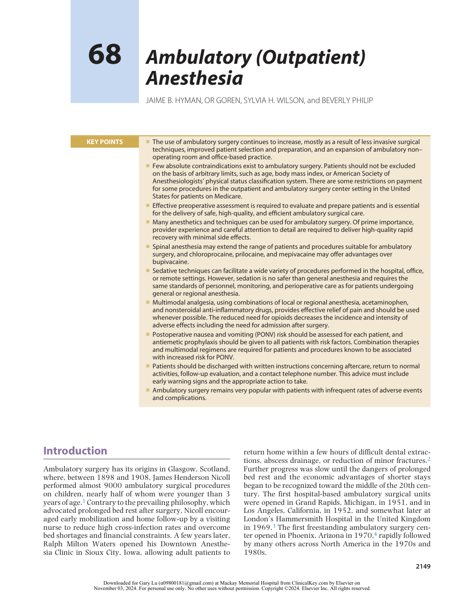

:::

<!-- PDF page 2 -->

The development of ambulatory anesthesia as a recognized subspecialty was enhanced by the formation of the Society for Ambulatory Anesthesia (SAMBA) in 19845 and the British Association of Day Surgery in 1989. These and nine other national societies came together in 1995 to form the International Association for Ambulatory Surgery (IAAS), an umbrella organization dedicated to the worldwide promotion of ambulatory surgery.

The American Society of Anesthesiologists’ Committee on Ambulatory Surgical Care created and approved guidelines for ambulatory anesthesia and surgery in 2003, which were updated in 2018 (https://www.asahq.org/standardsand- guidelines/guidelines- for- ambulatory- anesthesia- andsurgery). In general, the anesthesiologist should play a leadership role as the perioperative physician in all hospitals, ambulatory surgical facilities, and office- based settings. Further details regarding staffing and facility requirements, quality assurance, and patient care are included.

Since its inception, ambulatory surgery has expanded far beyond the performance of simple procedures on healthy patients. Currently, a broad range of major procedures are performed on patients who frequently have complex preexisting medical conditions. The availability of improved anesthetic and analgesic drugs minimizes the anesthetic side effects and facilitates the recovery process, as do the increasing availability of minimally invasive surgical techniques. Equally important has been a philosophical change that challenged outdated and conservative practices, demanding unnecessary postoperative inpatient admission. Ambulatory surgery now accounts for approximately 80% of the elective surgeries in the United States.6 Ambulatory surgery also constitutes a large proportion of elective surgical activity in many other countries worldwide, although rates for individual procedures still vary.7

### DEFINITIONS

Although ambulatory surgery is widely practiced, the precise definition can vary across countries and health care systems. For consistency, we have used the definition proposed by the cofounder of the IAAS: “A surgical day case is a patient who is admitted for investigation or operation on a planned non- resident basis and who none the less requires facilities for recovery. The procedure should not require an overnight stay in a hospital bed.”8 This definition requires the patient to be managed with the intention of same- day discharge from the outset, in addition to admission, operation, and discharge all occurring on the same calendar day. Including management intention in the definition ensures no incentive is provided to discharge a planned inpatient at short notice, who would be without all of the preparation and support required for optimal postoperative care.

_Short- stay surgery_ embraces all of the principles of ambulatory surgery and includes a postoperative overnight hospital stay. Extended observation may be prudent for certain patients with significant comorbidities, lack of social support, or for those who have undergone a procedure that is either too extensive or performed too late in the day to be compatible with same- day discharge. We have included short- stay surgery in this chapter because the objectives of minimizing physiologic disturbance to improve the quality of recovery and reduce the length of stay are the same as

those of ambulatory surgery and much of the perioperative management is similar.

## Benefits of Ambulatory Surgery

In order for surgery to be performed on an ambulatory basis there must be reduced tissue trauma, enhanced recovery with minimal adverse events, and the provision of effective postoperative analgesia, appropriate information, and postoperative support. Patients appreciate the more efficient scheduling of surgery, and the comfort and convenience of recovering in the familiar home environment. There are also financial advantages associated with ambulatory surgery due to the elimination of costs associated with overnight admission. In both the United States and the United Kingdom, procedures that are compatible with ambulatory surgery receive the same payment (from many insurance companies and regional budget holders, respectively), irrespective of the length of stay. Therefore, if a patient does stay overnight, the extra costs are borne by the facility. Since 2010 in the United Kingdom, a higher level of funding has been available for an increasing number of procedures when performed on an ambulatory basis,9 in order to incentivize best practice and finance any necessary pathway redesign.

## Facilities for Ambulatory Surgery

In the United States, the American Society of Anesthesiologists (ASA) provides guidelines for ambulatory surgical facilities,10 and quality standards are set and enforced by government regulation, licensing, or accreditation. In the United States and Canada, hospital- based ambulatory surgical facilities receive accreditation through The Joint Commission (TJC), Det Norske Veritas (DNV), and the Healthcare Facilities Accreditation Program. Ambulatory surgery centers and office- based surgery locations can receive accreditation through the Accreditation Association for Ambulatory Health Care, American Association for Accreditation of Ambulatory Surgery Facilities, or TJC. In the United States, the Centers for Medicare & Medicaid Services (CMS) has its own inspection program in addition to accepting accreditation decisions from the listed organizations. In the United States, the individual states can have separate guidelines for the facilities.

A multitude of designs exist for ambulatory surgical facilities. Some have been purpose designed, and others have evolved by adapting existing facilities. The facilities delivering ambulatory care services also vary by country, but they can be broadly categorized into four models of care, each with its own advantages and disadvantages.11

### HOSPITAL INTEGRATED

The simplest model of ambulatory surgery is one with shared inpatient surgical facilities, but with separate areas for preoperative preparation and recovery of ambulatory patients. This model of care is most often inefficient and brings the risk for ambulatory procedures being delayed or even canceled in favor of urgent or emergent inpatient

<!-- PDF page 3 -->

procedures. However, by dedicating certain operating sessions to ambulatory surgery and using strict protocols, efficiency in one such unit has been described as almost equal to that of a self- contained unit.12 The design is flexible, allowing the proportions of ambulatory and inpatient surgery to vary from day to day, and, as new procedures are transferred to ambulatory surgery, it does not require duplication of equipment and skills in a separate facility.

### HOSPITAL SELF- CONTAINED

These self- contained units are functionally and structurally separate from inpatient facilities with their own reception, admission areas, operating rooms, recovery areas, and administrative facilities. This design promotes a patientfocused flow of care. It ensures functional separation from urgent and emergency work while maintaining the accessibility of resources available in the main hospital. In many ways it is an ideal model of care. However, the local capacity for ambulatory surgery may be reached, and duplication of operating room equipment and skills may then occur for those procedures still commonly performed on both an ambulatory and inpatient basis.

### FREESTANDING

Freestanding ambulatory surgery centers (ASCs) ensure complete separation of perioperative care from inpatient and emergency work. This improves efficiency and allows complete focus on a workflow designed for ambulatory care. While rare perioperative complications may occur that require elevation of care or additional resources, appropriate patient selection and preparation minimize this risk. Some freestanding units have the capacity for overnight stays to provide additional nurse- monitored recovery. However, all freestanding units must have a detailed plan for the care of patients who need urgent or emergent transfer to a nearby hospital. ASCs vary from highly specialized, single- surgery facilities performing ambulatory total joint replacements or bariatric procedures to those that can accommodate multiple specialties and support a variety of service lines.

### OFFICE- BASED

Performing ambulatory surgery, diagnostic procedures, or both in a facility associated with a physician’s office is a rapidly expanding model of care within the United States.6 The main advantages are increased convenience for the patient and surgeon, and lower total procedure costs. Office- based services and facilities have historically been subject to less regulatory requirements when compared to those imposed on ambulatory surgery centers. Furthermore, they may have more significant limitations with respect to equipment, personnel, and environment along with reduced capability when managing perioperative complications. These limitations, however, are rapidly changing. In the United States, physician offices that provide services that include procedures involving moderate to deep sedation or general anesthesia may be subject to state regulatory requirements for accreditation and adherence to standards with respect to governance, facility environment of care, availability of equipment, credentialing of staff, and

continued medical education for personnel. A more detailed discussion of office- based anesthesia can be found later in the chapter.

## Patient Selection Criteria

### SURGICAL FACTORS

The development of minimally invasive surgery, improvements in surgical technique and pain control, and the availability of shorter- acting anesthetics have dramatically increased the range of surgical procedures compatible with same- day discharge. While the duration of surgery has traditionally been a determinant of outcome, the extent of surgical trauma now appears to be the more significant determinant. There should be no expectation of significant blood loss, large perioperative fluid shifts, or the need for complex or specialized postoperative care. Surgical complications remain the single greatest cause of unanticipated hospital admission.13,14 In the United States an overnight stay for patients who have undergone an ambulatory surgery procedure in any venue receives no additional payment, so the extra costs are borne by the facility. CMS publishes a list of covered surgical procedures that are eligible for ASC payment (https://www.cms.gov/Medicar e/Medicare- Fee- for- Service- Payment/ASCPayment/ASCRegulations- and- Notices). The British Association of Day Surgery publishes a directory of over 200 different surgical procedures and suggests aspirational targets for the proportions of each that are suitable for either ambulatory or short- stay surgery.15 A selection of these are shown in Table 68.1.

Laparoscopic cholecystectomy is now a routine ambulatory surgical procedure in many countries, and increasingly same- day discharge is seen as safe and beneficial after a variety of advanced laparoscopic procedures, including fundoplication,16 hysterectomy,17 nephrectomy,18 pyeloplasty,19 radical prostatectomy,20 and gastric banding.21 Minimally invasive approaches and enhanced recovery pathways have also facilitated same- day discharge following total joint arthroplasty.22 One series of 2000 patients undergoing laparoscopic Roux- en- Y gastric bypass for morbid obesity reported 84% being discharged within 23 hours with a readmission rate of less than 2%.23

Even specialties like neurosurgery, traditionally associated with complex inpatient care, have begun to embrace day surgery. Same- day discharge of selected patients undergoing awake craniotomy for supratentorial tumors was first described in 2001.24 More recently, some patients requiring general anesthesia for tumor resection25 and even aneurysm clipping26 have been discharged on the day of surgery. Increasingly, a number of non- elective procedures, such as abscesses, incarcerated hernia repairs, and appendectomies, are being managed through day surgery pathways.27,28 In parallel, several less invasive procedures, such as diagnostic or therapeutic hysteroscopy, are moving from ambulatory surgery into the procedure room, outpatient clinic, or office.29

While postoperative pain control in the home environment may present substantial challenges, perhaps the greatest barrier to the development of ambulatory surgery

<!-- PDF page 4 -->

**Table 68.1** A Selection of Surgical Procedures Which Can be Performed on an Ambulatory Basis

|**Specialty**|**Examples of Surgical Procedures**|
|---|---|
|Breast surgery|Excision/biopsy including wide local excision, sentinel node biopsy, simple mastectomy, microdochectomy, and other operations on nipple|
|General surgery|Perianal fistulae, pilonidal sinus, hemorrhoidectomy, open or laparoscopic hernia repair, laparoscopic cholecystectomy, adrenalectomy, splenectomy, fundoplication, gastric banding|
|Gynecology|Cervical surgery, laparoscopic tubal ligation, oophorectomy, hysterectomy, anterior and posterior repair|
|Head and neck|Dental procedures, excision of salivary glands, thyroidectomy, and parathyroidectomy|
|Ophthalmology|Cataract surgery, strabismus surgery, vitrectomy, nasolacrimal and all eyelid surgery|
|Orthopedics|Diagnostic and therapeutic arthroscopic surgery, anterior cruciate ligament repair, carpal tunnel release, bunion surgery, fracture reductions and removal of metalwork, lumbar microdiscectomy, total joint arthroplasty|
|Otolaryngology|Myringotomy and tympanoplasty, rhinoplasty, procedures on nasal septum and turbinates, polypectomy, adenotonsillectomy, laryngoscopy, and endoscopic sinus surgery|
|Urology|Endoscopic bladder and ureteric surgery, transurethral laser prostatectomy, circumcision, orchidectomy, laparoscopic nephrectomy, pyeloplasty, and prostatectomy|
|Vascular surgery|Varicose vein surgery, dialysis fistula creation, transluminal arterial surgery|

is conservatism, based on incorrect perceptions and concern about serious complications that might occur following discharge. For example, despite convincing data that most primary hemorrhages are evident within 6 to 8 hours of tonsillectomy,30,31 an overnight stay is still routine in some countries while others discharge 80% of patients or more on the day of surgery.7 Similarly, ambulatory thyroid surgery was first shown to be safe and effective in 1986,32 yet its widespread adoption has been slow,33 predominantly because of concerns about bleeding and airway compromise. Such complications are rare, especially when surgery is undertaken by specialists who perform a high volume of cases with assiduous hemostasis, allowing short times to discharge to be achieved.34 Performing thyroidectomy under local anesthesia also appears to increase ambulatory surgery rates,35 perhaps because of the careful surgical technique required. In the case of breast surgery, concerns about postoperative psychological support have delayed transfer of mastectomy and other cancer operations into ambulatory care in the United Kingdom, although it is now recognized that early discharge improves the psychological well- being of these patients by minimizing the time away from home.36 Close patient follow- up utilizing technology can reduce nursing phone call utilization and hasten a reduction in anxiety scores postoperatively after cancer surgery.37 Challenging surgical conventional wisdom also

may be beneficial; for example, discontinuing the routine use of drains after mastectomy or axillary node clearance does not increase morbidity, including from wound seroma, while facilitating same- day discharge.38 Day surgery management of breast cancer is associated with fewer complications than inpatient care.39

Cataract surgery deserves special mention as it is among the most common procedures requiring anesthetic care. SAMBA published a position statement on perioperative care for cataract surgery in 2021.40 As cataract surgery is typically done with topical local anesthetic and minimal sedation, with minimal physiologic stress and no fluid shifts or need to disrupt medications, there are very few comorbidities that preclude safely proceeding with anesthetic care for cataracts. These contraindications include: myocardial infarction within the previous 30 days (60 days if complicated), percutaneous coronary interventions (without stents 14 days, with stents 30 days), arrhythmia with hemodynamic compromise, decompensated heart failure, acute serious pulmonary condition, recent severe neurologic condition, malignant hypertension (elevated blood pressure with acute end- organ damage in at least 3 different target organs), diabetic ketoacidosis, or hyperosmolar hyperglycemic nonketotic syndrome. In the absence of these conditions, cataract surgery can proceed without the need for preoperative testing. Despite guidelines recommending against routine preoperative testing for cataract surgery, unnecessary testing continues with approximately the same frequency in more recent years,41 causing unwarranted burden for the patient and increasing costs.

### MEDICAL FACTORS

In the past, ambulatory surgery has relied on relatively rigid patient selection criteria in the attempt to limit the occurrence of postoperative complications. In practice, however, most of these criteria predict the occurrence of treatable perioperative adverse events, but not the need for unanticipated admission or readmission.42 Although an index combining age, length of surgery, and preexisting conditions, such as peripheral or cerebrovascular disease, can identify a group at higher risk for hospital admission, the specificity is poor and same- day discharge is still the most likely outcome.43 Ambulatory surgery is very safe, with a perioperative mortality less than 1 in 11,000,44 better than that in the general population. More recent studies have confirmed the continuing safety of ambulatory surgery, despite increasing surgical and patient complexity.45–47

Relatively few absolute contraindications now exist to ambulatory surgery. Patient suitability should be assessed on the basis of overall health, taking into account both the risks and benefits of early discharge, and certainly not determined by arbitrary limits, such as age, body mass index (BMI), or ASA physical status.48 While increasing ASA physical status is associated with a stepwise increased in the risk of complications, readmission, and mortality after ambulatory surgery,49 there is a lack of evidence to support that overnight stay mitigates risk.50 Chronic conditions should be relatively stable and must be optimally treated before any elective procedure, irrespective of the planned postoperative management. Many stable chronic diseases, such as diabetes, asthma, or epilepsy, are often

::: details 原始表格與符號（PDF 第 4 頁）

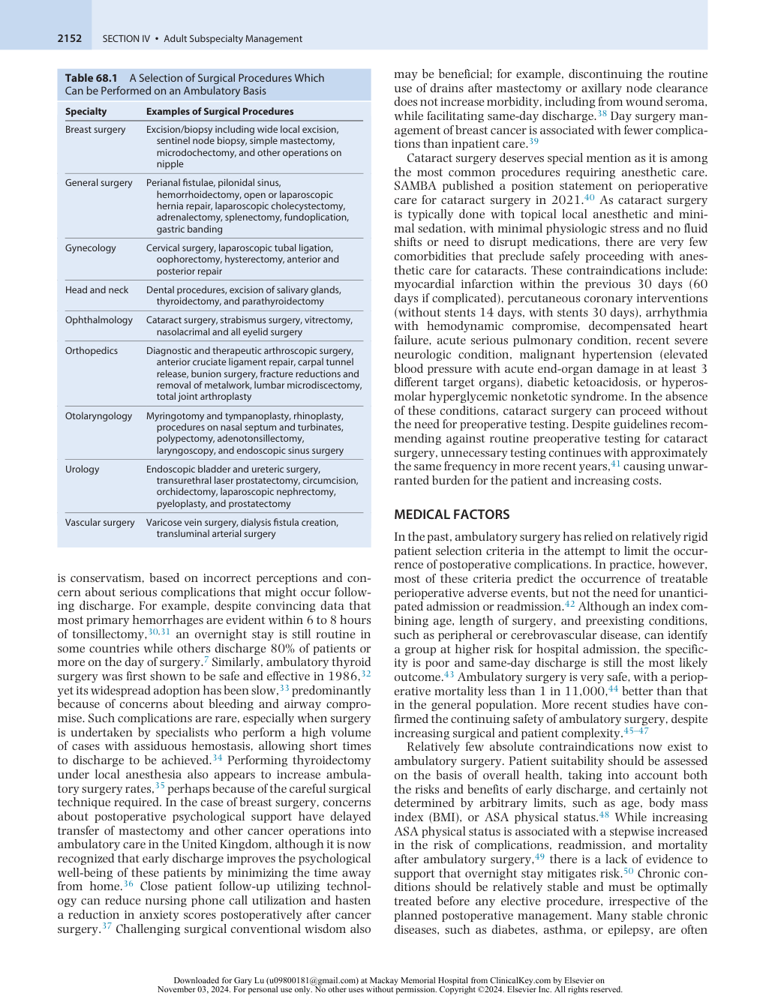

:::

<!-- PDF page 5 -->

better managed by the patients than by the perioperative team, and ambulatory surgery facilitates this by easing the disruption to their daily routine.48 A distinction should be made between preexisting conditions that make a patient more difficult to manage on the day of surgery and those that increase the occurrence of late postoperative problems, which are a relative contraindication to ambulatory surgery.51

A good example is obesity, which is associated with numerous perioperative problems for the surgeon, anesthesiologist, and operating room personnel (see also Chapter 54). Safe care of the obese patient may require the availability of experienced staff and specialized equipment, such as longer instruments and wider operating tables, but any risks are resolved soon after immediate recovery and are not prevented by postoperative overnight hospitalization. Obese patients benefit from ambulatory management with early mobilization, the use of short- acting drugs, and avoidance of opioid analgesia.51 Obesity does not increase the rate of unanticipated admission, postoperative complications, readmission, or other unplanned contact with health professionals following discharge.52 Even morbid obesity (BMI >40 kg/m2 )48 and super obesity (BMI >50 kg/m2 )53 are no longer considered absolute contraindications to sameday discharge. Obesity increases the likelihood of further comorbidities, but these should be evaluated individually.

### Obstructive Sleep Apnea

Obstructive sleep apnea (OSA) occurs in the general population but is much more common in obesity. Nonetheless, most cases can be managed safely and effectively on an ambulatory basis.54 Perioperative problems such as difficult tracheal intubation and airway obstruction should be anticipated.55 However, patients undergoing more invasive surgery, especially involving the chest or airway, or those requiring more than minimal doses of perioperative opioids, may be less suitable.54 Frequently, OSA is suspected but has not yet been definitively diagnosed and treated. A simple questionnaire, supplemented with some basic measurements (e.g., STOP- Bang), can identify most patients at high risk for OSA,56 but there is insufficient evidence to recommend delaying surgery until the diagnosis is confirmed.57 In children, OSA is now one of the main indications for tonsillectomy and this has been seen as a relative contraindication to ambulatory surgery. However, one study has shown that same- day discharge is still safe in the absence of other comorbidities.58

### Age and Frailty

Medical and social problems increase with age and should be evaluated and managed individually rather than applying an arbitrary upper age limit for ambulatory surgery. The risk for death or readmission within 7 days of surgery in patients over 65 years of age are 41/100,000 and 2.53%, respectively.59 Although somewhat more frequent than values from younger patients, the major risk factors appear to be very advanced age (older than 85 years of age), more invasive surgery, and recent inpatient hospital care.59 The frequency of perioperative adverse cardiovascular events also increases with age. Overall, older patients had a twofold increase in the risk for intraoperative adverse cardiovascular events; however, this was seen not as a contraindication

to ambulatory surgery but rather as indicating the need for more careful intraoperative management.60 In contrast, the incidence of postoperative complications seems to be reduced in older patients.60,61 In particular, older patients appear to experience far less postoperative pain, dizziness, nausea, and vomiting than younger patients,60,62 and do not require a higher rate of unplanned admission or readmission. It is important to note, however, that despite chronologic age not being associated with postoperative adverse outcomes, frailty is, with increasing scores on a frailty index associated with a stepwise increase in risk of adverse events after ambulatory surgery.63 There are several validated scales to assess frailty.64 One example is the Clinical Frailty Scale detailed in Box 68.1.

Frailty assessment can be included in patient selection criteria for ambulatory surgery and, importantly, nonfrail elderly patients should not be denied ambulatory surgery based on age. Notably, there is a reduced incidence of postoperative cognitive dysfunction in older patients after ambulatory surgery compared to similar procedures performed on an inpatient basis,65 presumably because of the use of short- acting anesthetic techniques and reduced separation from their familiar home environment.

At the other age extreme, the lower limit for ambulatory surgery may vary depending on the expertise and specialization of the individual facility. Premature babies have a higher risk for postoperative apnea, and hence ambulatory surgery may be inadvisable until they have reached an appropriate postconceptual age (PCA). Evaluation of several historic and retrospective studies suggests the risk for postoperative apnea is less than 5% once PCA exceeds 48 weeks, provided gestational age was at least 35 weeks, the infant was not anemic, and no apnea occurred in the recovery room.66 However, because considerable variability exists in the incidence of apnea and the relatively small sample size of these studies, the PCA at which risk becomes acceptably low is controversial,67 with a value of 60 weeks most commonly taken as the cutoff for ambulatory management.68,69 Caffeine administration appears to markedly reduce the incidence of postoperative apnea in babies who were premature,70 but this is not seen as a substitute for careful patient selection.68 Spinal anesthesia may offer advantages to infants who were premature undergoing abdominal surgery in the first week of life, but

### Box 68.1 Clinical Frailty Scale

1. **Very fit:** People who are robust, active, energetic, and motivated. These people commonly exercise regularly

2. **Well:** People who have no active disease symptoms but are less fit than category 1

3. **Well, with treated comorbid disease:** People whose disease symptoms are well controlled

4. **Apparently vulnerable:** While not dependent on others for daily help, often symptoms limit activities

5. **Mildly frail** : These people demonstrate need for help in some activities of daily living

6. **Moderately frail:** Help is needed with all activities of daily living

7. **Severely frail:** Completely dependent on others for activities of daily living

From Rockwood K, Song X, MacKnight C, et al. A global clinical measure of fitness and frailty in elderly people. _CMAJ_ . 2005;173(5):489–495.

<!-- PDF page 6 -->

it is distressing to the infant and has a high (28%) failure rate.71 Compared with older studies involving more soluble anesthetics, sevoflurane and desflurane were associated with lower rates of postoperative apnea after hernia surgery in infants born at less than 37 weeks’ gestation and under 47 weeks’ PCA.72 Although no airway interventions were required to manage apnea, episodes still occurred throughout the 12- hour postoperative observation period and were equally common with either anesthetic.72

### Cardiovascular Disease

Hypertension is the most common cardiovascular disease and has been a frequent cause for delay and cancellation of ambulatory surgery. Although hypertension is an important risk factor for long- term health, a meta- analysis of nearly 13,000 patients showed that it increased the risk for perioperative complications by only 1.35 times,73 an amount that may be clinically insignificant. In ambulatory surgery patients, hypertension resulted in an approximate 2.5- fold increase in the risk for perioperative cardiovascular events,61 but these were relatively minor. Hypertension is not an independent risk factor for perioperative cardiovascular complications if the diastolic pressure is less than 110 mm Hg.74 Higher arterial blood pressures may predispose to perioperative ischemia, arrhythmias, and cardiovascular lability, but no clear evidence indicates that deferring surgery reduces perioperative risk.73 In the United Kingdom, patients with documented blood pressures below 160 mm Hg systolic and 100 mm Hg diastolic in the community can be accepted for elective surgery without further measurement.75 In practice, poorly controlled hypertension is usually identified at the preoperative evaluation and can be treated before surgery is scheduled. Delaying surgery until hypertension is controlled is unlikely to be beneficial.76

Patients with known hypertension should continue to take their chronic medication, especially β- adrenergic blockers. β- Adrenergic blockers should not be abruptly stopped,77 and it may be less likely that they will be unintentionally omitted if patients are advised to take all of their cardiac medications up to and including the day of surgery.78 Controversy surrounds angiotensin- converting enzyme inhibitors (ACEIs) and angiotensin receptor blockers (ARBs). It has been considered “reasonable”79 to continue these, as any hypotension after induction of anesthesia is usually transient and responds to intravenously administered fluids and repeated vasopressor administration. However, evidence is accumulating of an increase in mortality, stroke, and myocardial injury if ACEIs and ARBs are continued,80 and current practice is to hold these on the day of surgery.

Patients are generally unsuitable for ambulatory surgery if they have severe unstable angina that causes marked limitation of activity or pain at rest. In the absence of complications, such as arrhythmias or ventricular dysfunction, cardiac risk after myocardial infarction or revascularization procedures returns to baseline after 3 months.81 Exercise tolerance is a major determinant of perioperative risk81 and the inability to climb a flight of stairs (∼4 metabolic equivalent tasks of activity) is highly predictive (89%) of a postoperative cardiopulmonary complication.82

Pulmonary hypertension increases the risk of morbidity and mortality in patients undergoing sedation and general

anesthesia for surgery and endoscopy.83,84 Pulmonary vascular resistance is dynamic, and both procedural and anesthetic events can have detrimental effects (see also Chapter 12). Patients with pulmonary hypertension should therefore have procedures performed in centers with pulmonary hypertension specialists and postoperative intensive care unit capabilities.85

Patients taking anticoagulants and antiplatelet drugs require careful evaluation to balance the risk for perioperative bleeding against the risk in withholding therapy. For minimally invasive procedures, the international normalized ratio can be briefly decreased to the low or subtherapeutic range, with the usual dose of oral anticoagulation resumed immediately after the procedure.77,78 If the risk for bleeding or thromboembolism is high, low- molecularweight heparin can be used as bridging therapy.86 Patients are increasingly being managed with oral direct thrombin or factor Xa inhibitors (e.g., dabigatran, apixaban, rivaroxaban, and edoxaban). The effects of these agents are not reliably measured by commonly used coagulation tests, such as prothrombin time and activated partial thromboplastin time,87 but their shortened half- lives may make bridging therapy unnecessary. Antiplatelet therapy should be continued for the recommended intervals in patients with bare metal and drug- eluting coronary artery stents, because premature discontinuation is associated with a 25% to 30% risk for stent occlusion, which in turn has a more than 60% risk for myocardial infarction and 20% to 45% risk for death.88

### SOCIAL FACTORS

In general, if patients’ living arrangements were adequate before surgery, they should also be suitable after surgery. Some adaptations may be necessary if the patient’s mobility is severely compromised by the procedure – for example, by the use of casts. Access to a telephone to summon assistance is a minimum requirement but is rarely problematic with the worldwide ubiquitous availability of mobile telephones. Patients usually live within a reasonable traveling distance of the surgical unit, but this may be impractical in rural or sparsely populated areas. Journeys of hundreds or thousands of miles are not unheard of in parts of Scandinavia after ambulatory surgery.51 For patients who live far away, consideration should be given to the provision of emergency care close to home and for the comfort of the patient during the journey. Patients who choose to travel long distances after ambulatory surgery usually are very satisfied with their care.89 Hospital hotels, which provide nearby accommodation but little or no nursing care, are a higher- cost alternative for the patient and have largely been abandoned as an impractical option.

A universal safety feature is to require all patients having surgery under general anesthesia or sedation to be discharged with a responsible escort and the recommendation to have someone stay with them for the next 24 hours. If the 24- hour companion is mandated, patients often disregard postoperative instructions and send their escorts away if they feel well at home.90 In the United States, it is standard practice to require that patients who have received other than unsupplemented local anesthesia be discharged

<!-- PDF page 7 -->

with a responsible person10 ; if not, surgery is postponed. A Canadian single- institution study reported discharging patients alone when their escort fails to arrive,91 yet this practice did not appear to increase emergency room visits or readmission rates within 30 days. The Association of Anaesthetists of Great Britain and Ireland has suggested that an escort may be required in most (but not all) cases,48 with exceptions when the surgery is relatively minor and anesthesia brief so the patient is not compromised by the sedative effects of anesthesia or analgesia by the time of discharge.51 If patients are discharged alone, they should not drive themselves home92 ; several serious accidents have occurred, especially after the use of sedative doses of benzodiazepines.

## Preoperative Assessment

### THE ROLE OF PREOPERATIVE ASSESSMENT

An effective preoperative assessment process is essential for the delivery of safe, high- quality, and efficient ambulatory surgery.93 Rather than trying to select specific, low- risk groups of patients, ambulatory surgery is increasingly seen as the default option for a wide range of surgical procedures, with inpatient care chosen only for those with insurmountable barriers to early discharge. Other than identifying this small group of patients, preoperative assessment is primarily required to evaluate and optimize patients and to provide appropriate information (Table 68.2). These assessment and optimization functions can be further distilled into three key questions:

**Table 68.2** The Four Key Functions of a Preoperative Assessment and Preparation Service for Ambulatory Surgery

|**Function**|**Examples**|
|---|---|
|1.  Identify absolute contraindications to ambulatory surgery|Inability to identify a responsible carer other than for minor surgery with full and rapid recovery anticipated; severe uncorrectable cardiovascular disease|
|2.  Identify need for optimization|Patient requires further investigation, therapeutic modification, or intervention to improve functional status; identify a friend, relative, or neighbor to act as carer|
|3.  Highlight issues for anesthesiologist or other staff (which may alter management but which do not preclude ambulatory surgery)|Potentially difficult intubation necessitating advanced airway management skills; malignant hyperpyrexia susceptible patient requiring trigger- free anesthetic; latex allergy; obese patient requiring operating table/trolley with high weight limit and extra width|
|4.  Provide patient information|Written information on preoperative preparation, medication management, preoperative fasting, etc.|

1.  “Is there any benefit to overnight admission in a hospital for this patient after surgery?” (e.g., surgery related, need for postoperative monitoring, need for postoperative pain control that cannot be adequately managed on an outpatient basis.)

2.  “Will a delay in performing a procedure or surgery for a patient at a particular ambulatory location result in worse outcomes?” (e.g., need to establish a cancer diagnosis where delayed treatment impacts prognosis, risk of injury due to vision impairment from cataracts.)

3.  “Is there anything that needs to be done to enable this patient to have same- day discharge after surgery?”93 (E.g., comorbidities that can be further optimized, need for visiting nurse services at home after surgery, need to arrange for a responsible adult to accompany patient upon discharge.)

### MECHANISMS AND TIMING OF PREOPERATIVE ASSESSMENT

The timing of preoperative assessment is crucial, because it must be done early enough in the pathway to allow for any necessary investigations and optimization without delaying the planned procedure. This becomes increasingly difficult as the interval between the decision to operate and the date of surgery becomes shorter. Ideally, preoperative assessment should immediately follow the decision to operate, by providing a “one- stop shop.” This type of service, in which preoperative assessment immediately follows the surgical consultation, is highly valued by patients,94 although it can be difficult to manage because of variations in the demand for the service. An alternative is to use a basic screening tool to identify those patients who can proceed directly to surgery and those who require further investigation or management (Fig. 68.1).

A case can be made for all patients to be seen in a preoperative assessment clinic; however, in practice this places a major demand on resources and is also inconvenient for patients who may need to take additional time off work. Screening allows many patients to undergo assessment by telephone or questionnaire, with clinic attendance required only if unexpected problems are uncovered or if requested by the patient. When telephone assessment was chosen for all young healthy patients scheduled for minor breast surgery, only 2% of patients had problems identified that required further assessment in the ambulatory surgery center.95 By using a computerized information- gathering and triage tool, combined with some basic information about the planned procedure, approximately one- third of ambulatory patients did not need to see an anesthesiologist before the day of surgery.96 This approach eliminates the need for a face- to- face assessment before the day of surgery but does not eliminate an evaluation of the patient’s medical information in advance of surgery. In contrast, advance faceto- face preoperative assessment is more advisable for older patients, in whom multiple comorbidities, polypharmacy, and social problems are all more likely.97 Early discharge planning is also important for older patients, to address environmental issues that can be improved to support recovery.98

In the United Kingdom, preoperative assessment is usually performed by nurses working closely using protocols

::: details 原始表格與符號（PDF 第 7 頁）

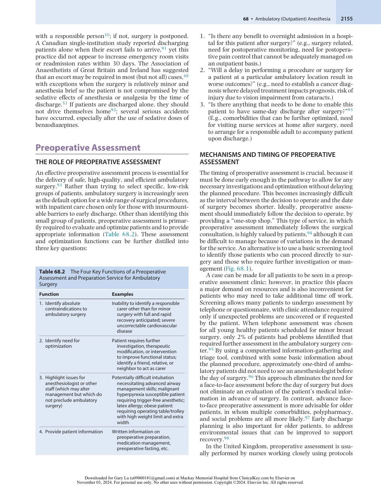

:::

<!-- PDF page 8 -->

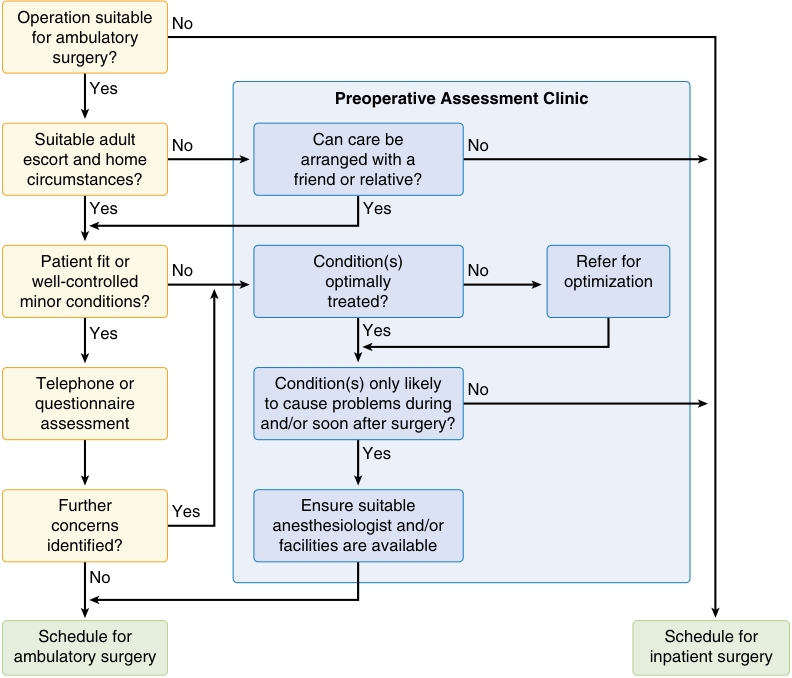

Operation suitable No for ambulatory surgery? Yes Preoperative Assessment Clinic Suitable adult No Can care be No escort and home arranged with a circumstances? friend or relative? Yes Yes Patient fit or No Condition(s) No Refer for well-controlled optimally optimization minor conditions? treated? Yes Yes Telephone or Condition(s) only likely No questionnaire to cause problems during assessment and/or soon after surgery? Yes Further Yes Ensure suitable concerns anesthesiologist and/or identified? facilities are available No Schedule for Schedule for ambulatory surgery inpatient surgery 

**Fig. 68.1 Flowchart illustrating the basic process for selecting patients for ambulatory surgery.** The pathway incorporates a screening process for patients who may not require a full face- to- face assessment in the clinic. (Modified and adapted from Smith I, Hammond C. Day case surgery. In: Radford M, Williamson A, Evans C, eds. _Preoperative Assessment and Perioperative Management_ . Keswick: M&K Books; 2011:267–280. With permission.)

and supported by anesthesiologists who provide advice and personally assess the more complex patients.99 In the United States, anesthesiologist- led, protocol- driven preoperative assessment is often used for healthy patients having minor procedures. However, these preoperative evaluation clinics are frequently used in US hospitals, not just for ambulatory patients with more complex medical or surgical issues, but also for the majority of inpatient surgery cases that are admitted on the morning of surgery. More complex patients have their anesthesia preassessment performed by an anesthesiologist. A comprehensive preoperative history and physical evaluation by a physician extender is often also provided in the preoperative assessment clinic for the surgeon. Using a physician extender to assist in preoperative evaluation maintains patient safety and satisfaction, promotes flexibility with scheduling of providers, and increases staff satisfaction.100 Appropriately trained nurses were just as effective as trainee medical staff in detecting information likely to influence subsequent patient management, but they ordered significantly fewer unnecessary tests.101

Patients generally rate their preoperative assessment clinic experience very favorably, with their greatest concerns relating to waiting times.102 Scheduling appointments of approximately twice as long for patients of ASA physical status grades III and IV than for those of grades I and II has been shown to reduce backlogs and maximum waiting times for preoperative evaluation to an acceptable level of about 10 minutes.103

### PREOPERATIVE INVESTIGATION

The history and physical examination remain key elements of preoperative risk assessment, despite the availability of more sophisticated technologies.81 In fact, most useful information can be obtained from the history, supplemented by simple observation of the patient.104 Basic physical examination, such as routine chest auscultation, is often considered unhelpful in adult ambulatory surgery patients,93,105 because findings that are unaccompanied by symptoms or functional limitation do not alter management. Although aortic stenosis may remain asymptomatic until it is quite severe, chest auscultation may be unreliable in its detection. In one high- risk population, 31% of patients without a detectable murmur nevertheless had some degree of aortic stenosis that was moderate or severe in 10% of cases,106 whereas 31% of patients with a suggestive murmur did not have aortic stenosis on echocardiography. Ten patients with severe aortic stenosis (valve area 1 cm2 or less, gradient 35–58 mm Hg) tolerated an unmodified anesthesia regimen for electroconvulsive therapy on 144 occasions without problems,107 suggesting that ambulatory surgical patients with undiagnosed aortic stenosis may not inevitably be at excessive risk, when combined with appropriate procedure selection.

It is recognized that routine laboratory investigations are unhelpful because they may generate false- positive results or do not alter subsequent management.108 In addition, such

<!-- PDF page 9 -->

tests increase costs, are unpleasant and time- consuming for patients, and may lead to repeat testing with even further expense and delays. Consequently, many authorities recommend selective testing, based on indications from the patient’s clinical evaluation and demographics.109,110

Although comorbidities become more prevalent with age, additional preoperative testing for older patients may still be unnecessary. In patients 70 years of age or older, routine preoperative blood test results were not predictive of postoperative complications.111 While preoperative electrocardiograms of patients over 50 years of age detected abnormalities, such as bundle branch blocks, predictive of postoperative myocardial infarction, the recordings did not provide additional predictive value to that obtained from the patient history.112 The National Institute for Health and Care Excellence no longer advocates patient age be used as a criteria for routine preoperative testing and also recommends few, if any, tests for healthy patients undergoing minor or intermediate surgery.110 One large pilot study demonstrated that the elimination of all preoperative testing resulted in no increase in adverse events in the perioperative period and did not alter the rate of unanticipated admission or readmission within 30 days compared to indicated testing.113

## Patient Preparation

Preoperative assessment plays a fundamental role in preparing patients for their ambulatory surgery experience. This may include ensuring appropriate social support is in place, checking that preexisting conditions are optimally treated, and providing information.

### PROVISION OF INFORMATION

Patients need to be informed about what will happen on the day of surgery, because a well- prepared patient is likely to be more relaxed and more satisfied with the service provided.93 A well- informed patient is also more likely to comply with important instructions and protocols, such as fasting intervals and management of regular medications. Many patients are disproportionately worried about highly unlikely outcomes, such as death and awareness,114 yet somewhat less concerned about more common consequences such as nausea, vomiting, and postoperative discomfort. The preoperative discussion should help to allay the anxiety associated with unlikely risks. It was found that a specially designed website with text, animation, and video significantly increased patients’ knowledge about anesthesia when compared with a combination of verbal and written information.115

Patients should be given specific information, preferably supplemented in writing, about how to manage their usual medications in the preoperative period. Some drugs (e.g., warfarin) should be stopped several days before surgery86 and some hypoglycemic agents omitted before surgery.116,117 However, other important medications should not be omitted.78,79,88

Information about medications should include over- thecounter and herbal products, which are commonly used but often regarded by patients as harmless and safe.118 Despite some serious consequences and interactions associated

with herbal medications,119 not all practices specifically ask and advise patients about these products on a routine basis (see also Chapter 28).120

### PREOPERATIVE FASTING

Almost universal agreement now exists that the safe fasting interval for clear liquids is no more than 2 hours, in contrast to 6 hours for light meals.121,122 These fasting intervals result in safe gastric volumes even in obese adults,123 children,124 and patients with diabetes and gastrointestinal (GI) reflux.122 Indeed, a 2- hour interval is probably conservative, given that the stomach empties clear fluids exponentially, with a half- time of approximately 10 minutes.125

Despite guidelines based on decades of research, implementation remains poor, with many patients fasting for excessive periods and experiencing significant discomfort.126–128 Rather than focusing on a minimum fasting time, patients should be encouraged to keep drinking until the latest time necessary for safety to reduce preoperative dehydration and its associated consequences.122 In practice, this may mean asking patients to have a drink just before they leave home or even providing a drink on arrival if surgery is still more than 2 hours away. Advising patients to drink on the morning of surgery also makes it easier for them to take their medications. Milk added to tea or coffee does not appear to delay gastric emptying129–131 and, in the United Kingdom, may provide more palatable choices of preoperative beverage. The US practice is for clear fluids only. Recently, it has been shown that allowing patients unrestricted access to water right up until they were called to the operating room significantly reduced the incidence of postoperative nausea and vomiting (PONV) without increasing the occurrence of clinically significant pulmonary aspiration.132 Practices such as chewing gum before surgery also may not be harmful. No consistent evidence exists of a clinically important increase in gastric volume associated with gum chewing in adults,122,133 while in children it may promote gastric emptying and could also serve as a useful route for premedication.134

Besides feelings of thirst and hunger, excessive fasting also results in hypoglycemia in significant numbers of patients, with 14% of fasted healthy female ambulatory surgical patients having an admission blood glucose value of 45 mg/ dL (2.5 mmol/L) or less.135 Preoperative oral carbohydrates have been shown to improve subjective well- being, reduce thirst and hunger, and reduce postoperative insulin resistance, although convincing evidence of reduced length of stay is lacking,122 at least for shorter procedures.136

### PREMEDICATION

Premedication traditionally refers to the administration of medications to relieve anxiety before surgery. However, the term encompasses any medication given in the preoperative period and therefore includes prophylactic analgesia and antiemesis agents, as well as drugs used to promote gastric emptying or counteract acid secretions.

### Management of Anxiety

The use of anxiolytic premedication is now uncommon in ambulatory anesthesia,137,138 probably because of

<!-- PDF page 10 -->

concerns that these medications will delay recovery. In fact, one meta- analysis found no evidence that anxiolytic premedication delayed the discharge of ambulatory patients, although impaired performance in some tests of psychomotor function was found and the authors questioned the relevance of some of the older studies to modern ambulatory practice now that short- acting anesthetics are the norm.139

Anxiety is nevertheless common in ambulatory surgery patients,137 with up to two- thirds showing symptoms. A preoperative consultation more than 2 weeks before surgery can reduce patient anxiety and improve satisfaction, especially if the anesthesiologist was perceived as empathic.140 Patient satisfaction was further improved when intraoperative care was provided by the same anesthesiologist who performed the preoperative consultation.140

### Anxiolytic Premedication

Given that anxiety was commonly reported, doubtless some patients will benefit from anxiolytic premedication, but what is the optimal regimen? Oral midazolam provided more anxiolysis than temazepam but also produced more sedation and amnesia, resulted in more oversedated patients, and delayed recovery.141 Oral alprazolam produced comparable anxiety reduction to midazolam without causing amnesia,142 but it also caused greater impairment of psychomotor function in the early postoperative period. Neither anxiolytic premedication delayed clinical recovery, but this may be a relatively crude assessment tool, because recovery primarily depends on other factors. Intravenous midazolam given shortly before induction of anesthesia reduced both anxiety and postoperative nausea.143 Such relatively late administration will not reduce anxiety while the patient waits preoperatively, but may be useful in a patient who needs to have an uncomfortable procedure before surgery, such as mammographic needle localization, in which satisfaction with both the procedure and subsequent breast biopsy was improved.144

Premedication is more commonly used in children. In one investigation, premedication with oral midazolam 0.2 mg/kg reduced emergence agitation associated with sevoflurane anesthesia without significant delay in recovery,145 and doses up to 0.5 mg/kg did not delay recovery.146 However, other patients have experienced delayed recovery at this dose147,148 while not always having a reduction in anxiety.148 The less stringent recovery end points needed for children compared with the independent functioning needed for adults should be kept in mind. Premedication with oral midazolam may itself provoke anxiety in children, but giving the child a small toy to play with first has been shown to be effective in reducing this anxiety.149 Unfortunately, the effect of the toy as an alternative to midazolam was not evaluated. Play therapy and distraction can be more effective than midazolam in reducing anxiety in children, although this may require an elaborate approach.150 A preoperative educational program portrayed as a “Saturday morning club” also reduced anxiety,151 although the authors questioned whether the benefits achieved were worth the time and resources required. A simpler and highly effective approach is to allow children to watch ageappropriate video clips or movies during anesthetic induction with intravenous (South Korea) or inhaled (Canada) techniques.152,153 A preoperative educational video also

encouraged more positive parental involvement during the recovery period and reduced children’s postoperative pain.154

Because of variable efficacy and the potential for delayed recovery, alternatives to benzodiazepine premedication have been sought. In children, oral transmucosal fentanyl reduced preoperative anxiety and postoperative agitation, but a high incidence of predictable side effects, such as PONV and delayed discharge, limited its usefulness.155 Selective α2- adrenergic agonists have potentially useful sedative and analgesic effects, yet despite years of study they still have no clearly defined role in ambulatory surgery where the risks for adverse events outweigh their advantages.156 Clonidine is commonly used in pediatric practice, particularly to reduce agitation during emergence,157 but the promising results of clinical trials do not always translate well into routine clinical practice and its effects on induction anxiety are less persuasive.158

### Analgesic Premedication

Ambulatory patients are commonly premedicated with prophylactic oral nonopioid analgesia in the expectation of achieving analgesic levels in the early postoperative period. Because the duration of action of acetaminophen (paracetamol) is relatively short (4–6 hours), it is unlikely to provide worthwhile postoperative analgesia, other than for an extremely short procedure. When patients received oral acetaminophen 1 g an hour before arthroscopic knee surgery, barely a third had plasma levels in the therapeutic analgesic range 30 minutes after arriving in recovery, whereas therapeutic levels were consistently achieved with intraoperative intravenous administration.159

The nonsteroidal anti- inflammatory drugs (NSAIDs) are consistently more effective as analgesic premedications. Some evidence indicates that NSAIDs have a small preemptive analgesic effect (i.e., they achieve a superior effect if given before rather than after surgery),160,161 although one of the studies most strongly supporting this conclusion has been called into question.162 Preoperative parecoxib followed by postoperative valdecoxib significantly reduced the opioid analgesic requirements and the incidence of opioid- related adverse effects after laparoscopic cholecystectomy.163 As well as providing effective postoperative analgesia, etoricoxib premedication had an anestheticsparing effect during ambulatory ankle surgery.164 Using a common dental model of postoperative pain, preoperative ibuprofen, diclofenac, and acetaminophen with codeine effectively controlled early postoperative pain.165 Similarly, rofecoxib and ketorolac were equally effective in controlling postoperative pain after ambulatory surgery,166 as were ibuprofen and ketorolac.167 Sustained- release preparations of NSAIDs improve convenience by allowing earlier preoperative administration and a prolonged postoperative effect. Modified- release ibuprofen 1.6 g delayed the time until rescue analgesia was required after ambulatory third molar surgery in contrast to standard ibuprofen.168 Several of these NSAIDs and most cyclooxygenase- 2 (COX- 2) inhibitors are unavailable in the United States.

Selective COX- 2 inhibitors are no more effective and offer few advantages over traditional NSAIDs in ambulatory surgery. Despite any inhibition of platelet function, the amount of blood loss seen during high- risk surgery,

<!-- PDF page 11 -->

such as tonsillectomy, was not reduced in comparison with nonselective NSAIDs.169,170 Nonetheless, COX- 2 inhibitors are preferred by surgeons, so age- appropriate doses of oral celecoxib are used as premedication in the United States. Attempts to limit GI adverse effects, which are rare in acute use, has introduced other side effects and led to some drugs being withdrawn.171 Selective COX- 2 inhibitors may be better tolerated in patients with aspirin- sensitive asthma.172

Several other drugs have been evaluated for premedication without strong evidence for this use. In combination with ibuprofen, pregabalin 150 mg reduced median pain scores at rest and in motion after gynecologic laparoscopic surgery, but did not reduce postoperative analgesic requirements.173 Perioperative administration of pregabalin 75 mg provided short- lived pain reduction after laparoscopic cholecystectomy, and a meta- analysis confirmed limited analgesic benefit, no reduction in opioid side effects, and increased sedation from its use.174 Pretreatment with magnesium sulfate 4 g had no impact on postoperative pain or analgesic consumption in patients undergoing ambulatory ilioinguinal hernia repair or varicose vein surgery.175

### Antacid and Gastrokinetic Premedication

The incidence of aspiration of gastric contents is infrequent in fasted elective surgical patients. Despite improvements in several surrogate measures, insufficient evidence exists of clinical benefit (i.e., a reduction in morbidity or mortality from aspiration) to recommend the routine use of antacids, metoclopramide, H2- receptor antagonists, or proton pump inhibitors before elective ambulatory surgery.121,122 Patients who are receiving these medications chronically should take them before surgery. Patients who regularly suffer from significant acid reflux in the fasted state will also benefit from the head- up tilt position during induction of anesthesia. This approach also may be useful in the supermorbidly obese patient undergoing bariatric surgery, in whom the use of prophylactic proton pump inhibitors and sodium citrate may be considered.55

## Anesthetic Techniques

### CHOICE OF TECHNIQUE

Ambulatory surgery requires the same basic standards as inpatient surgery in terms of facilities, staffing, and provision of equipment for delivery of anesthetic drugs, monitoring, and resuscitation. Quality, safety, efficiency, and the cost of drugs and equipment are all important considerations in choosing an anesthetic technique for ambulatory surgery. The choice of specific anesthetic drugs or techniques should enable appropriate and controllable intraoperative conditions followed by rapid recovery with minimal side effects and a prompt return to normal psychomotor activity. Achieving these aims also requires careful attention to the details of analgesia, antiemesis, and fluid management, and requires experienced staff to deliver a high- quality, efficient, and cost- effective service.

No single ideal anesthetic drug or technique for ambulatory surgery exists, and the choice depends on both surgical and patient factors. General anesthesia commonly

remains the most popular technique with both patients and surgeons, in some cases despite clear benefits of local or regional anesthetic techniques.176 Spinal anesthesia can be useful for lower extremity and perineal procedures, but a low bupivacaine dose may be needed in the ambulatory setting177,178 to prevent delays in discharge because of residual motor or sympathetic block. Thus, prilocaine, chloroprocaine, and mepivacaine are receiving new attention for ambulatory surgery.179–181 Infiltration of local anesthesia, peripheral nerve blocks, or both facilitate the recovery process by reducing postoperative pain and minimizing the need for opioid analgesics after general anesthesia and should be used whenever possible. Many ambulatory procedures also can be performed using local anesthetic techniques, supplemented, if necessary, with sedatives, analgesic drugs, or both.

### GENERAL ANESTHESIA

Induction of general anesthesia is typically achieved with a rapid and short- acting intravenous anesthetic, although inhaled induction is often used in children and needle- phobic adults. Intravenous drugs are also popular for maintenance of anesthesia, especially where the availability of targetcontrolled infusion (TCI) systems simplifies delivery,182 but the use of short- acting inhaled anesthetics, usually without nitrous oxide (N2O), is more common due to greater ease of administration and lower risk of intraoperative awareness. No single anesthetic technique is clearly superior for ambulatory surgery. Other factors, such as the experience of the anesthesiologist, the use of adjuvant drugs, and the art of anesthesia, are still important to deliver the best quality care.183

### INTRAVENOUS ANESTHESIA

Barbiturates, such as methohexital and thiopental, are of little more than historical interest in ambulatory anesthesia. The same applies to benzodiazepines and ketamine when used at the doses needed to induce general anesthesia. Etomidate is associated with myoclonus, pain on injection, and a high incidence of PONV. Although reformulation of etomidate in a lipid solvent can reduce some of these disadvantages,184 persisting concerns about suppression of adrenal steroidogenesis185 have curtailed its use. The search for new and improved intravenous anesthetic drugs has seen several promising compounds evaluated,186,187 but no really novel anesthetics have yet become available188 and propofol remains the most practical intravenous anesthetic for ambulatory anesthesia.

### Propofol

Propofol has many of the properties of an ideal anesthetic induction drug and is popular because it rapidly and smoothly induces anesthesia without airway irritation and results in a rapid recovery with an infrequent incidence of early PONV189 and a “clear head.” Propofol has some disadvantages, however, including pain on injection, involuntary movements, transient apnea, and hypotension after induction of anesthesia. Numerous strategies have been proposed to reduce pain on injection, of which the use of a large antecubital vein or pretreatment with lidocaine in conjunction

<!-- PDF page 12 -->

with venous occlusion are the most effective,190 and superior to altering the formulation of propofol.191

Some of the adverse effects of propofol can be minimized by reducing the propofol dose by co- induction with adjuvant drugs, the most common being midazolam. Pretreatment with midazolam 0.1 mg/kg allowed anesthesia to be induced with a decreased propofol dose and also attenuated the resultant hemodynamic changes.192 A substantial decrease in the propofol dose can be achieved even when midazolam is administered up to 10 minutes before induction of anesthesia, a technique that also can make the induction experience for the patient more pleasant.193 However, this approach may delay recovery. Midazolam 0.03 mg/kg halved the required propofol dose but significantly impaired psychomotor recovery, even though awakening times were not delayed.194 Co- induction with short- acting opioids, such as alfentanil, can improve the quality of induction and ease of laryngeal mask airway (LMA) insertion, but at the expense of an increased incidence of hypotension and prolonged apnea.195 Similarly, fentanyl reduced propofol dose and improved conditions for LMA insertion, but also prolonged respiratory depression.196 Furthermore, the use of 1 mcg/kg197 or fixed doses of 75 mcg198 to 100 mcg199 of perioperative fentanyl increase the incidence of PONV. Giving an initial bolus of 30 mg of propofol reduced the total propofol induction dose to a degree similar to that achieved by 2 mg of midazolam.200 This technique, which has been termed propofol autocoinduction,201 can reduce propofol dose and hypotension to a degree comparable to that with midazolam pretreatment but without delaying recovery. Following the concepts of opioid minimization and enhanced recovery after surgery, propofol co- induction can also be performed with intravenous lidocaine 1 mg/kg.

The pharmacokinetics of propofol allow it to be used as a variable-rate infusion to maintain anesthesia. Recovery after anesthesia maintained with propofol is typically no faster compared to volatile anesthetics after an induction dose of propofol,189 and initial awakening may be delayed compared to that with the shorter- acting inhaled anethetics.202 These differences in emergence times are no more than 2 to 3 minutes203 and so not of clinical significance. Recovery to home readiness may occur up to 15 minutes sooner after propofol than isoflurane but is no faster than sevoflurane or desflurane. There are conflicting reports on whether propofol may be more204 or less205 likely than inhaled anesthetics to impair cognitive dysfunction after ambulatory anesthesia in older patients. One consistent feature of propofol anesthesia is a less frequent incidence of early PONV in contrast to the use of inhaled anesthetics.189,203,206 However, this benefit is clinically significant only when the baseline incidence of PONV is very high.206 The reduction in PONV achieved by total IV anesthesia (TIVA), specifically the use of propofol and the omission of N2O, was similar to that produced by the use of single- drug antiemetic prophylaxis.207 Furthermore, any reduction in PONV from TIVA appears to be confined to the early recovery phase.208

Outside of the United States, delivery of propofol is increasingly performed by TCI, which makes the delivery of propofol easier, with fewer interventions required by the anesthesiologist, in contrast to manual infusions.209 However, it does not improve the quality of anesthesia, shorten recovery time, or reduce adverse events,209,210 based on limited literature

to date. A further issue is that TCI systems calculate the predicted plasma propofol concentration and considerable variation exists between this and the actual measured value.210 Further sources of error are introduced when the effect site, rather than the plasma concentration, is targeted.211 Currently two different pharmacokinetic models are in common use, both derived from healthy subjects. The choice of model may make relatively little difference in the young, fit patient, but performance differs considerably in older patients211 and neither model is reliable in the morbidly obese.211,212 Even newer pharmacokinetic models developed specifically with data from obese patients have a tendency to underestimate plasma propofol concentrations.213

### INHALED ANESTHETICS

Volatile anesthetics remain the most popular choice for the maintenance of ambulatory anesthesia because of their ease of administration, controllability, and rapid emergence. Halothane and enflurane are now of historical interest only, and use of isoflurane has declined considerably in ambulatory anesthesia as less- soluble, shorter- acting drugs have become available.

### Sevoflurane

The low solubility and minimal airway irritation of sevoflurane make it a readily controllable, short- acting anesthetic for ambulatory surgery.202 In contrast to isoflurane, sevoflurane resulted in significantly earlier awakening and orientation, caused less postoperative drowsiness, and facilitated earlier discharge by an average of 25 minutes.203 Compared to propofol, orientation occurred earlier but the time to home readiness was similar.203 The lack of airway irritation with sevoflurane means that rapid increases in inspired concentration are well tolerated,214 facilitating control of anesthetic depth. This is in contrast to the cough reflex215 and transient increases in heart rate and blood pressure, which sudden changes in isoflurane or desflurane concentration may provoke.216

Lack of airway irritation makes sevoflurane ideal for inhaled induction, which may be especially desirable in children and needle- phobic adults.202 An 8% bolus induction of sevoflurane in adult patients can be faster than with propofol, with a similar rate of different side effects.217 Sevoflurane induction also caused significantly less depression of mean arterial pressure than propofol in older patients and was equally as well accepted as an induction choice.218 Using sevoflurane for volatile induction and maintenance of anesthesia (VIMA) has several benefits for ambulatory patients, but is associated with a greater incidence of PONV than when propofol is used for induction, maintenance, or both, of anesthesia.202 The increased PONV appears to be related to co- administered opioids, which are rarely needed with VIMA, and omitting the opioids minimizes the problem.197,217,219 In children, the rapid emergence from sevoflurane (and desflurane) anesthesia is associated with a high incidence of emergence delirium, especially if inadequate measures are in place to control postoperative pain.220 Numerous strategies have been evaluated to reduce emergence delirium. Midazolam premedication is ineffective, but supplemental use of fentanyl 1 mcg/kg, propofol, ketamine, and α2- adrenergic agonists all reduce

<!-- PDF page 13 -->

agitation to some degree.157 Although emergence delirium is undesirable, it is not associated with any long- term consequences and does not delay recovery room discharge.221 There is insufficient evidence of adequate quality to show whether propofol TIVA reduces the risk of behavioral disturbances (or PONV) compared with inhaled anesthesia.222

### Desflurane

With its low blood solubility, desflurane should be an ideal anesthetic for ambulatory anesthesia. However, metaanalysis of 25 randomized studies showed that patients receiving desflurane followed commands, had their trachea extubated, and were oriented only 1.0 to 1.2 minutes earlier than those receiving sevoflurane for up to 3.1 hours.223 No differences were found in recovery room stay224 or incidence of PONV.223 Concerns about the more frequent incidence of airway irritation with desflurane may limit the rapidity with which anesthetic depth can be altered,217 although relatively few problems were encountered in patients spontaneously breathing desflurane through an LMA when co- administered with fentanyl.225,226 Although desflurane has lower fat solubility than sevoflurane, the rate of diffusion into the fat compartment is extremely slow with either inhaled anesthetic; therefore, lower fat solubility does not make the case for use of desflurane as the ideal agent for morbidly obese patients unless procedure length is very long. In practice, some studies of ambulatory surgery in the morbidly obese have found more rapid recovery after desflurane than sevoflurane,227 whereas others found emergence and recovery to be similar with either drug.228 As desflurane has a disproportionately high climate impact with a life- cycle greenhouse gas emission 15 times that of isoflurane and 20 times that of sevoflurane, consideration of the use of desflurane should weigh its negative environmental impact as a greenhouse gas in the context of patient benefit.229,230

### ANESTHETIC ADJUVANTS

Some adjuvant drugs are administered to supplement the effects of general anesthesia and in an effort to reduce adverse effects.

### Nitrous Oxide

Although N2O is by far the oldest anesthetic drug still in use, its role is regularly questioned. N2O is weakly emetogenic, yet its omission only significantly decreases vomiting when the baseline incidence is high and has no effect on nausea or the complete control of PONV.231 Others have found the effects of omitting N2O to be “modest.”232 This may be because the alternatives, specifically the use of supplemental opioids or higher inhaled anesthetic concentration, also induce PONV. The effect of N2O on PONV appears to be time dependent. There was no clinically significant effect from at least an hour’s exposure,233 allowing N2O to retain a place in modern ambulatory anesthesia, where its use also improves the quality and speed of induction of anesthesia, facilitates faster recovery, and reduces overall costs.234

### Opioid Analgesics

The indiscriminate use of opioid analgesics should be discouraged in ambulatory surgery to avoid PONV and

unplanned admission.235,236 Although long- lasting drugs such as morphine are especially detrimental, even the ultrashort- acting opioid remifentanil (discussed in more detail below) resulted in a 35% incidence of PONV when used with desflurane and multimodal prophylaxis, compared with only 4% when all opioids were avoided.237 For minor to intermediate ambulatory surgery procedures, the routine administration of as little as 1 mcg/kg of fentanyl serves only to increase the incidence of PONV,238 and its omission does not worsen postoperative pain, provided prophylactic analgesia is ensured with local anesthetic infiltration and preoperative NSAIDs.197 However, small doses of fentanyl may be useful to provide additional postoperative analgesia when given near the end of more painful procedures.

Remifentanil is a μ- opioid receptor agonist with a rapid onset and short duration of action. These qualities make it an appealing drug for the ambulatory setting. However, concerns exist with the use of remifentanil due to the association with acute opioid tolerance and hyperalgesia, with some evidence that remifentanil may more readily cause tolerance and hyperalgesia than other opioids.239

Some remifentanil- related postoperative pain may be attributed to abrupt drug withdrawal. However, high- dose remifentanil may also cause aggravated postoperative pain independent of drug cessation, especially when administering high cumulative doses >40–80 mcg/kg for major surgery. Lower cumulative doses have not been consistently associated with acute tolerance or hyperalgesia in that setting.240 A meta- analysis of 21 randomized controlled trials (RCTs) concluded that high intraoperative doses of remifentanil (i.e. 3 mcg/mg/min or greater) are associated with a small but statistically significant increase in acute pain, as measured by pain scores at rest and opioid consumption in the first 24 hours after surgery.241 Looking specifically at ambulatory surgery, it is notable that intraoperative remifentanil use was associated with the highest need for postoperative fentanyl after laparoscopic cholecystectomy compared with intraoperative fentanyl or esmolol.242 Particularly concerning is that opioid- induced hyperalgesia may last up to a week,243 and a possible correlation between acute surgical wound hyperalgesia and chronic pain may exist.244 When using remifentanil, and all opioid analgesics, multimodal analgesia with nonopioid medications and local/regional analgesia is an essential part of controlling postoperative pain.

### Cardiovascular Drugs Including Esmolol

Although intraoperative hemodynamic disturbances are usually managed by increasing the primary anesthetic concentration, administering an opioid analgesic, or both, it may be more appropriate to treat these responses with cardiovascular drugs. One study found that using an infusion of esmolol as an alternative to alfentanil to control heart rate reduced emergence times after arthroscopy.245 Additionally, substituting esmolol for remifentanil reduced nausea after gynecologic laparoscopy,237 and reduced early postoperative opioid consumption and postanesthesia care unit (PACU) length of stay after laparoscopic cholecystectomy.242 Using a combination of esmolol and nicardipine to blunt increases in heart rate and arterial blood pressure, respectively, prevented the need for increases in inspired anesthetic concentration and consequently shortened

<!-- PDF page 14 -->

emergence and recovery times.246 Ambulatory patients who received esmolol intraoperatively for hemodynamic control also had significantly smaller requirements for postoperative opioid analgesia.246,247 Administration of a continuous infusion of esmolol during laparoscopic gynecologic surgery reduced sevoflurane consumption by 18%, shortened recovery room stay, reduced postoperative pain scores, and reduced fentanyl requirements.248 In a similar study, an esmolol infusion decreased intraoperative remifentanil requirements and again resulted in lower postoperative pain scores and halved the dose of rescue fentanyl.249 Labetalol may be a cost- effective alternative to esmolol for longer cases, especially in older patients in whom it is less likely to cause unintended hypotension.250

### Neuromuscular Blocking Drugs

Neuromuscular blocking drugs (NMBDs) may be used in ambulatory anesthesia to facilitate endotracheal intubation or to provide profound surgical relaxation. Although several of the available compounds are suitable, muscle pain after administration of succinylcholine and concerns about residual neuromuscular block from intermediate- duration NMBDs after brief procedures have fueled the search for alternatives. The search for a nondepolarizing equivalent to succinylcholine has been unsuccessful to date. The most promising candidate, rapacuronium, was withdrawn from clinical use because of a frequent incidence of severe bronchospasm, although other factors such as inconvenient administration, declining use of endotracheal intubation, and high costs also contributed to its lack of commercial success.251 The search for a rapid- onset, short- acting nondepolarizing NMBD continues with investigation of several fumarate compounds, of which gantacurium was found to have rapid onset and brief duration, but was also associated with histamine release.252 Subsequent attention has moved toward designing a molecule of intermediate duration, but which can be rapidly reversed at any time by administering L- cysteine.252

An alternative to short- acting NMBDs is terminating the neuromuscular blockade with sugammadex, which can rapidly and completely reverse rocuronium (or vecuronium) independent of the degree of residual neuromuscular block.253 Sugammadex is very expensive compared to neostigmine, although in the United States the cost of neostigmine has risen dramatically. Currently no reliable evaluations have been done on the cost- effectiveness of sugammadex in routine clinical practice. Although improved recovery times resulting from the elimination of residual neuromuscular block by sugammadex may potentially be cost- effective, this depends on the productivity of staff during the time saved and would probably require major changes to the workflow for actual benefits to be realized.253

Endotracheal intubation also can be achieved without the use of NMBDs, thereby avoiding all of their adverse effects. This practice is most common in children, for procedures in which airway protection, but not prolonged muscle relaxation, is required. The optimum technique depends on personal experience and preference, but most commonly involves deep sevoflurane anesthesia254 or propofol supplemented by remifentanil or alfentanil.255 For adults, a dose of remifentanil 3 mcg/kg with propofol 2 mg/kg

is recommended,256 but satisfactory conditions may be obtained with remifentanil 2 mcg/kg, thereby reducing the side effects of bradycardia and hypotension.

### AIRWAY MANAGEMENT

Many ambulatory surgical patients can be managed with a supraglottic airway (SGA), which results in a significantly less frequent incidence of sore throat, hoarseness, coughing, and laryngospasm compared to inserting a tracheal tube.257 The SGA can occasionally cause pressure trauma to a variety of cranial nerves, in particular the recurrent laryngeal nerve, whereas hoarseness and vocal cord injuries are more common after the use of endotracheal intubation during short- term anesthesia.258 SGAs are relatively easy to insert with patients in the prone position,259 making it a simple way of managing procedures such as pilonidal sinus repair or surgery to the short saphenous vein.

Traditionally, endotracheal intubation has been advocated for laparoscopic procedures and surgery in obese patients, but further development of first- generation SGAs, such as the laryngeal mask airway (LMA) into secondgeneration SGAs, combined with more confidence in their use may be changing this. Compared to the original LMA, second- generation SGAs provide increased seal pressure, reduce gastric inflation, provide for gastric drainage, and therefore allow potentially better protection against aspiration of gastric contents while maintaining similar insertion characteristics.260 At least one large consecutive series by an experienced user appears to support these benefits in routine clinical practice, although without the structure of a clinical trial.261 During laparoscopic cholecystectomy, a second- generation SGA, the ProSeal LMA, provided adequate pulmonary ventilation without gastric distention in nonobese patients, although it was somewhat less effective than endotracheal intubation in the obese.262 A review article concluded that second- generation supraglottic airways achieve adequate ventilation during laparoscopic cholecystectomy with a very low incidence of regurgitation and aspiration, but cannot yet be regarded as completely safe.263

Provided safety can be ensured, avoiding endotracheal intubation by using a second generation SGA for laparoscopic surgery appears to offer considerable advantages, including smoother emergence with significantly less coughing.262,264 In laparoscopic gynecologic procedures, the ProSeal LMA was associated with lower pain scores at 2 and 6 hours, with reduced analgesic requirements and less nausea at the same times.265 Similarly, in females undergoing gynecologic laparoscopic or breast surgery, it reduced the absolute risk for PONV by 40% and also reduced sore throat, analgesic requirements, and recovery room stay.266 During laparoscopic gastric banding, the ProSeal LMA reduced the intraoperative stress response and also shortened recovery room stay and hospital discharge.267

Since the expiration of LMA patents, many manufacturers have introduced similar designs, often using different materials to produce a low- cost disposable product. Often little or no data are available on the effectiveness or safety of these generic products.268 Furthermore, the success of the LMA led to the development of many new supraglottic airways of myriad designs. Some of these may offer advantages

<!-- PDF page 15 -->

in ambulatory surgery,269 although there is often little or no comparative data with the LMA. Anesthesiologists should therefore be wary of the claims made for new airway devices until they have been adequately evaluated.270

One supraglottic airway that has been extensively evaluated is the i- gel, which has a contoured non- inflating cuff and gastric drainage channel. The i- gel is faster to insert and results in less sore throat than the LMA with a seal pressure intermediate between first- and second- generation SGAs.271

### REGIONAL ANESTHESIA

Regional anesthesia (see also Chapters 41 and 42) may make ambulatory surgery accessible to some patients for whom the risks of general anesthesia are excessive. It also increases patient choice, allows participation in intraoperative decision- making (e.g., in sports injuries), expedites recovery, and can provide beneficial postoperative analgesia.

### Spinal Anesthesia

Various ambulatory surgical procedures, such as transurethral prostatectomy, female incontinence surgery, ankle and foot surgery, and lower extremity arthroplasty, are well suited to spinal anesthesia (see also Chapter 41). As finegauge, pencil- point spinal needles have reduced the incidence of significant post–dural puncture headache to 0.5% to 1%,272 the main challenge of spinal anesthesia in ambulatory surgery is to prevent prolonged motor block delaying discharge or physical therapy assessment. Although lidocaine has an optimal duration for ambulatory spinal anesthesia, its incidence of transient neurologic syndrome (TNS), estimated as high as 18%, has resulted in relative cessation of use of lidocaine.273 TNS is not limited to lidocaine and has been reported with prilocaine,274 2- chloroprocaine,273,275 mepivacaine,273 and bupivacaine.276 However, a 2019 Cochrane systematic review noted no increased risk with prilocaine, procaine, ropivacaine, bupivacaine, or levobupivacaine, but an increased risk of TNS with spinal chloroprocaine and mepivacaine.273 Notably, TNS was only noted in one small study for chloroprocaine, and mepivacaine studies had issues with inadequate blinding and loss of patients to follow- up.

Optimal spinal anesthesia provides rapid onset, predictable resolution, and timely return of motor function and spontaneous voiding. Lower dose bupivacaine (≤10 mg) is associated with decreased time to urination and discharge home; however, recovery time is less predictable and can be prolonged.277 While unilateral spinal anesthesia may be achieved with low- dose bupivacaine (5–7.5 mg) by placing the patient operative side dependent for 10–15 minutes, block failure rates are increased with these low doses, dense motor block should not be expected, and recovery times may persist for 3 to 6 hours. Additionally, spinal anesthesia may make postoperative urinary retention more likely in older patients when >7 mg of bupivacaine is used,278 and this risk is particularly high after inguinal hernia surgery279 where local anesthetic infiltration may offer sufficient anesthesia.176,280

As spinal bupivacaine may cause unacceptable discharge delays, prilocaine, chloroprocaine, and mepivacaine are

receiving new attention for ambulatory surgery.179,180,181 Hyperbaric prilocaine has a faster onset and shorter duration than the plain preparation,281 with patients receiving 40 mg of 2% hyperbaric prilocaine being home ready in 208 ± 68 minutes.282 This is comparable to discharge times reported with low- dose bupivacaine plus fentanyl,283 although 13% of the patients receiving hyperbaric prilocaine required supplementation for inadequate analgesia toward the end of surgery, which was scheduled to last for less than an hour.282 Doses of 40 to 60 mg achieve analgesia of about 90 minutes duration for lower abdominal or limb procedures, while 10 to 30 mg is adequate for perineal surgery of up to 40 minutes, with home discharge usually achievable within 4 hours.281 Spinal 2- chloroprocaine has an even shorter and faster recovery than low- dose bupivacaine283 and is comparable284 or faster181 than lidocaine. For limb surgery, 40- and 50- mg doses had longer block regression (2.13 ± 0.46 and 2.23 ± 0.38 hours, respectively) than 30 mg (1.76 ± 0.35 hours); however, the 30- mg dose had an increased failure rate.285 The addition of fentanyl appears to extend the block duration of both 2- chloroprocaine275 and prilocaine281 with little delay in recovery in either case. However, as use of intrathecal opioids may also increase postoperative nausea and vomiting, pruritus and urinary retention,277 routine use of intrathecal additives is not recommended for the ambulatory setting.179,286

With increased focus on same- day discharge after lower extremity arthroplasty, spinal mepivacaine has also received renewed interest. Patients receiving mepivacaine (52.5-60 mg) for total hip arthroplasty were more likely to ambulate 3–3.5 hours after spinal placement and achieve same- day discharge compared to patients receiving bupivacaine (11.25 mg hyperbaric or 12.5 mg isobaric), although patients in the mepivacaine group did have increased pain in the early postoperative period.276 Notably, TNS symptoms were noted in 10% of mepivacaine patients, but did not differ from hyperbaric (11.3%) or isobaric (3.9%) bupivacaine subjects (Table 68.3).

### Epidural Anesthesia

Epidural analgesia is seldom used in adult ambulatory anesthesia. Although it allows the block duration to be extended by using a catheter technique, this is offset by the time required in establishing the block and less certainty of success, as well as the risk for inadvertent intravascular injection or dural puncture. In knee arthroscopy, recovery after 15 to 20 mL of epidural 3% 2- chloroprocaine was more rapid than spinal procaine with 20 mcg fentanyl287 and also had a decreased incidence of pruritus. Recovery after epidural 3% 2- chloroprocaine required fewer top- up injections and permitted discharge an hour sooner after ambulatory knee arthroscopy than with 1.5% epidural lidocaine.288 However, the use of epidural 2- chloroprocaine has a more frequent incidence of back pain.289

In children, caudal epidural analgesia – for example, using levobupivacaine 0.5 to 1 mL/kg of 0.25% – is popular for postoperative pain relief.69 The technique is most useful for bilateral surgery or other situations in which the maximum safe dose would not permit an adequate volume for wound infiltration. After circumcision, caudal analgesia was no better than parenteral or systemic analgesia or dorsal nerve block in reducing analgesic requirements, nausea,

<!-- PDF page 16 -->

or vomiting.290 However, motor block and leg weakness were significantly more common in patients receiving a caudal block. The addition of clonidine291 or dexmedetomidine292 augments caudal analgesia, but concerns remain about the frequency of sedative and hemodynamic side effects and the risk for neurotoxicity.156,290

### Intravenous Regional Anesthesia

Intravenous regional anesthesia (IVRA) (Bier block) is a simple, reliable method of anesthesia for upper limb surgery and is sometimes also used in the lower extremity.293 In the United Kingdom and Europe, prilocaine is the preferred local anesthetic because of its high therapeutic index.294 Lidocaine has also been used for many years,293 and appears to be a safe alternative.295 Ropivacaine has also been extensively evaluated for IVRA. Compared to lidocaine, 0.2% to 0.375% ropivacaine resulted in prolonged and improved postoperative analgesia.296–298 However, compared to prilocaine, ropivacaine’s onset was slower, no useful prolongation of postoperative analgesia occurred, and ropivacaine plasma concentrations were more than double those of prilocaine, despite a 60% lower dose.294

IVRA may offer a cost- effective alternative to general anesthesia for outpatient hand surgery, as it is easy to administer with faster recovery and fewer postoperative complications.299 However, analgesia may be inadequate in some cases, and require supplemental local

anesthesia, repeat of the block, or conversion to general anesthesia.299,300 Compared to mepivacaine (280 mg) axillary nerve block for hand surgery, IVRA with lidocaine (300 mg) was found noninferior. Notably, induction times were longer for the axillary block group, while tourniquet discomfort, intraoperative pain scores, and postoperative pain scores were higher in the IVRA group.301

A variety of IVRA adjuvants have been described to decrease tourniquet pain, improve block quality, and prolong analgesia after cuff deflation.301 Opioids are relatively ineffective and cause nausea, vomiting, and dizziness after tourniquet deflation,301 but several NSAIDs have been shown to be beneficial. Lornoxicam302 decreased tourniquet pain and improved postoperative analgesia and tenoxicam improved postoperative pain,301 but the effects of ketorolac are unclear after most of the evidence showing its efficacy in IVRA was withdrawn.162 Dexamethasone improved both block quality and postoperative analgesia.303 Similar results have been observed with the α2- adrenoceptor agonist dexmedetomidine,304,305 whereas clonidine delayed tourniquet pain without improving postoperative analgesia.306

### Peripheral Nerve Blocks and Infiltration

A wide range of regional anesthetic techniques can be used to facilitate ambulatory surgery or provide postoperative analgesia (Table 68.4).307 While peripheral nerve block techniques and indications are reviewed in greater detail

**Table 68.3** Local Anesthetics for Spinal Anesthesia

|**Local** **Anesthetic**|**Dosing**|**Duration**|**Regression**|**Potential Concerns**|
|---|---|---|---|---|
|Bupivacaine (0.5%, 0.75%)|5–15 mg|90–240 mins|240–480 mins|Prolonged blockade|
|2- Chloroprocaine (1%)|40–60 mg|40–90 mins|70–150 mins|Possible TNS risk|
|Lidocaine (2%, 5%)|20–50 mg|60–90 mins|130–170 mins|High rates of TNS|
|Mepivacaine (1.5%, 2%, 4%)|45–60 mg|90–180 mins||Possible TNS risk. Not licensed in UK or US|
|Prilocaine (2%)|40–60 mg|60–120 mins|180–220 mins|Not licensed in US. Metabolites associated with methemoglobinemia|
|Procaine (5%)|100 mg|60–90 mins||Not licensed in UK or US. Nausea|
|Ropivacaine (0.5%)|15–20 mg|120–210 mins|210–300 mins|Prolonged blockade. Not licensed in UK or US|

_TNS_ , transient neurologic syndrome.

**Table 68.4** Core Peripheral Nerve Blocks for Ambulatory Surgery

|**Location**|**Block**|**Anesthetic Dose**|**Analgesic Dose**|
|---|---|---|---|
|Shoulder|Interscalene brachial plexus block|Bupivacaine or ropivacaine 0.5%; 15–20 mL|Bupivacaine or ropivacaine 0.25%; 20 mL|
|Lower arm, forearm, & hand|Axillary or supraclavicular brachial plexus block|Bupivacaine or ropivacaine 0.5%, mepivacaine 2%, or lidocaine 2%; 15–20 mL|Bupivacaine or ropivacaine 0.25%; 20 mL|
|Knee|Adductor canal block|Bupivacaine or ropivacaine 0.5%, 15–20 mL|Bupivacaine or ropivacaine 0.25%; 20 mL|
|Foot & ankle|Popliteal (sciatic) nerve block Adductor canal block for medial ankle|Bupivacaine or ropivacaine 0.5%, mepivacaine 2%, or lidocaine 2%; 15–20 mL|Bupivacaine or ropivacaine 0.25%; 20–30 mL|
|Chest wall|Pectoral blocks or erector spinae plane blocks|Bupivacaine or ropivacaine 0.5%; 20–30 mL|Bupivacaine or ropivacaine 0.25%; 20–40 mL|
|Abdominal wall|Transversus abdominus plane (TAP) or rectus sheath block|Bupivacaine or ropivacaine 0.5%; 20–30 mL|Bupivacaine or ropivacaine 0.25%; 20–40 mL|

*Adductor canal block should be performed in addition to the popliteal block if medial ankle coverage is needed. Doses are approximations. The lowest effective dose should be utilized and within a safe dosing range considering a patient’s weight, age, and medical comorbidities.

::: details 原始表格與符號（PDF 第 16 頁）

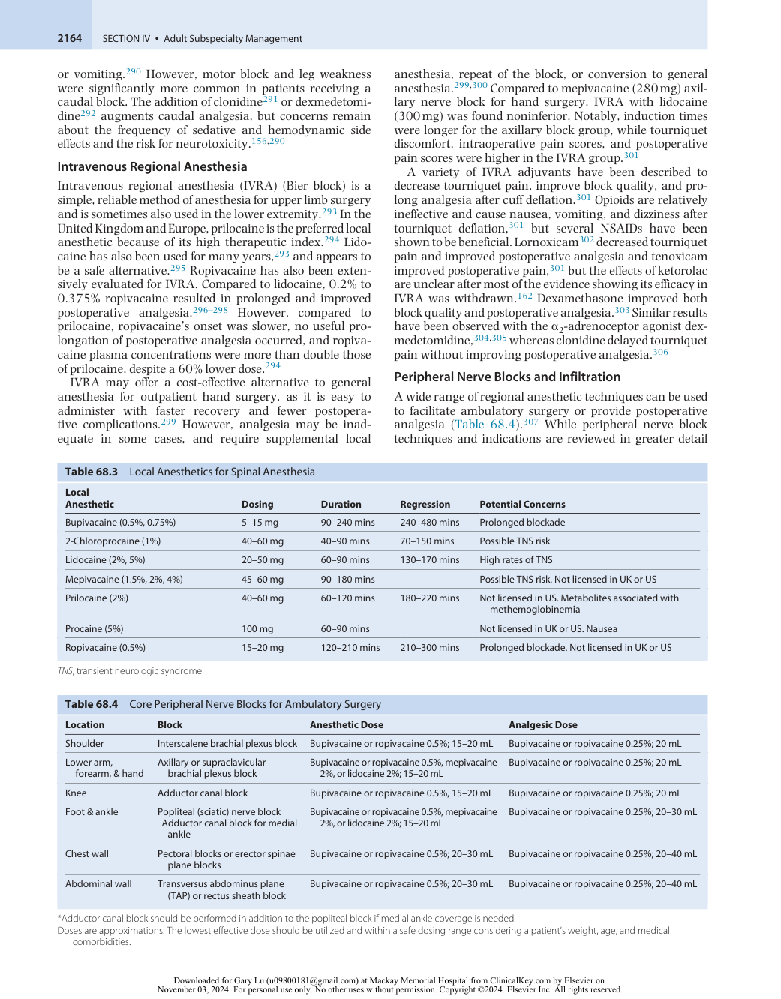

:::

<!-- PDF page 17 -->

in Chapter 42, the ambulatory anesthesiologist may not necessarily need to know a vast array of regional techniques but should be proficient with a core set of peripheral blocks.308,309 The applicability of these techniques depends on the nature of the planned procedure, the patient, the preferences of the surgeon and anesthesiologist, and the skill and experience of the anesthesiologist performing the block.

Benefits of peripheral nerve blocks include excellent postoperative analgesia and reduced PONV, but this must be balanced with patient discomfort while performing the block, the transition to satisfactory analgesia with block cessation, and the risk for perioperative nerve injuries. Despite the benefits of regional anesthesia, a retrospective study of almost 13 million patients in the US found peripheral nerve blocks were placed in only 3.3% of appropriate ambulatory surgery cases.310 While regional anesthesia can have a higher failure rate in inexperienced hands, especially in morbidly obese patients, ultrasound guidance has reduced times for peripheral nerve block placement and onset while increasing block analgesia duration and success.311 However, there is no conclusive evidence that ultrasound guidance reduces the incidence of peripheral nerve injury.312

Simpler locoregional techniques may be more appropriate for some procedures. Intra- articular local anesthesia produces a moderate and relatively brief reduction in postoperative pain after arthroscopic knee surgery, but this is still considered to be of clinical significance in ambulatory surgery.313 In many cases, simple wound infiltration may be as effective as central and proximal peripheral blocks and allows patients to mobilize more quickly.314 While previous reports asserted that the risk of systemic toxicity resulting from large volumes of local anesthetic infiltration were unfounded,314 more recent reviews reported that 11% of reported local anesthetic systemic toxicity (LAST) cases occurred following subcutaneous infiltration, 14% from intraurethral or intravaginal administration, 17% from airway infiltration or topicalization, and others from stellate ganglion blocks and liposuction.315 Furthermore, in a survey of providers outside the field of anesthesia, only 2% were aware that lipid emulsion should be used in the treatment of LAST.316

Infiltration anesthesia offers advantages for many ambulatory procedures. Utilization of local infiltration versus general anesthesia was associated with decreased operative times, recovery room stay, and postoperative complications compared to general anesthesia, regardless of age.280,317 Infiltration anesthesia also avoids the increased risk for urinary retention associated with spinal anesthesia, especially in older patients.280 Simple wound infiltration has been modified to local infiltration analgesia (LIA) for major orthopedic ambulatory surgery. Originally developed for analgesia after major knee and hip surgery,318 the original technique involved infiltration of a mixture (300 mg ropivacaine, 30 mg ketorolac, 1.5 mg epinephrine diluted to 150–200 mL with saline) into all the tissue planes of the surgical field over approximately an hour and a catheter was placed into the wound to permit later repeat dosing. In the original series of 325 patients, mainly undergoing elective hip resurfacing but including some primary hip and knee replacements, pain was well controlled (numerical

pain score 0–3) without morphine in two- thirds of patients, most of whom could walk with assistance 5 to 6 hours after surgery; 71% were discharged, walking independently after a single- night stay (Fig. 68.2).318 In a blinded, randomized trial in patients undergoing unicompartmental knee arthroplasty, LIA significantly reduced pain and opioid consumption and decreased the median length of stay by 2 days compared with placebo, and 68% of patients were discharged after a 1- night stay.319 Compared with no injection or placebo, systematic reviews conclude that LIA is effective for acute pain management after knee arthroplasty320,321 in the first postoperative 24 hours; however, LIA adds little additional analgesia after hip surgery when a multimodal regimen is also used.320,322,323

A limitation of infiltration anesthesia is the relatively short duration of pain relief it provides. Continuous wound or perineural catheter techniques can extend analgesia duration, reducing pain scores, opioid- related side effects, and length of hospital stay, as well as improving patient satisfaction.324 Since catheters may be more complex to place and require organized home follow- up, avenues to prolong single- injection techniques are constantly sought. Local anesthetic adjuncts are easily added, but the quality of evidence remains low, with high heterogeneity among studies as additives are frequently not approved for perineural use.325,326 Although not approved by the US Food and Drug Administration (FDA) for perineural use, perineural and intravenous dexamethasone have shown promising results in prolonging both perineural analgesia and reducing rebound pain,327 which can occur in up to 50% of patients after ambulatory orthopedic surgery.328

**Novel Local Anesthetics.** Novel local anesthetics have also been developed to extend analgesic duration. Encapsulation of bupivacaine into a biodegradable carrier offers the prospect of potential analgesic effects for 96 hours.329 Widespread application requires that the large doses of local anesthetic contained within the carrier are not rapidly released, leading to toxicity, and that the encapsulating materials do not break down into harmful products.330 One extended- duration preparation of bupivacaine, Exparel, which uses an established liposomal- based drug delivery system (Lipo Foam, ContourMD ), is currently approved by the FDA. Although early industry- sponsored trials were promising compared to placebo, systematic reviews and meta- analyses have not shown Exparel to provide superior analgesia compared to non- liposomal bupivacaine when used for surgical site or periarticular infiltration331,332 or peripheral nerve block analgesia.331,332 The acidity of the surgical wound is theorized as a reason liposomal bupivacaine may not have performed as anticipated.

Another extended- release local anesthetic, HTX- 011 (Zynrelef), combines bupivacaine with low- dose meloxicam to normalize the local pH in the incision.333 The bupivacaine–meloxicam combination is formulated in a polymer and applied in the desired area with a needleless syringe prior to wound closure. This drug received European Commission authorization in September of 2020 and approval by the FDA in May 2021. Phase 2b and 3 studies examined HTX011 (400 mg bupivacaine/12 mg meloxicam) versus both bupivacaine alone and placebo, and found that bupivacaine/

<!-- PDF page 18 -->

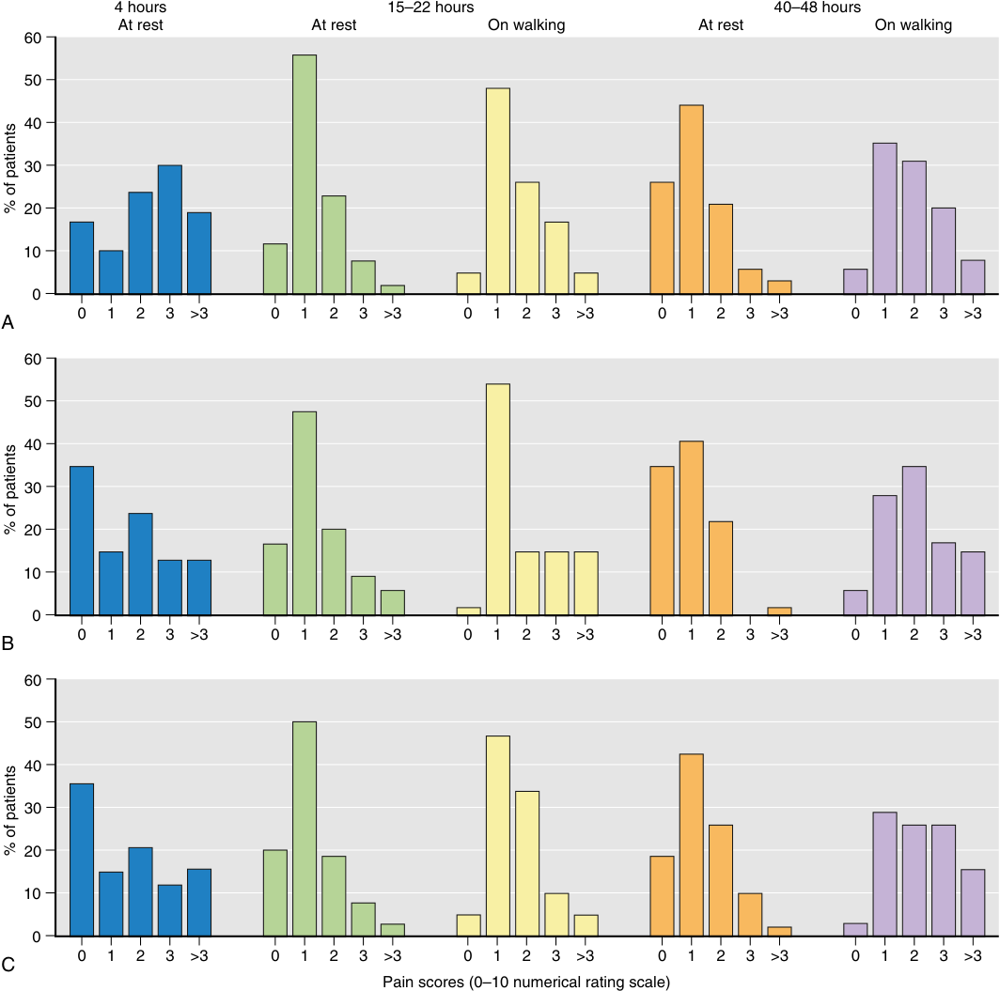

4 hours 15–22 hours 40–48 hours At rest At rest On walking At rest On walking 60 50 40 30 20 10 0 0 1 2 3 >3 0 1 2 3 >3 0 1 2 3 >3 0 1 2 3 >3 0 1 2 3 >3 A 60 50 40 30 20 10 0 0 1 2 3 >3 0 1 2 3 >3 0 1 2 3 >3 0 1 2 3 >3 0 1 2 3 >3 B 60 50 40 30 20 10 0 0 1 2 3 >3 0 1 2 3 >3 0 1 2 3 >3 0 1 2 3 >3 0 1 2 3 >3 C Pain scores (0–10 numerical rating scale) % of patients % of patients % of patients 

**Fig. 68.2** Numerical pain scores at various time points after hip resurfacing arthroplasty (A; _n_ = 185), total hip replacement (B; _n_ = 54), and total knee replacement (C; _n_ = 86) in patients receiving local infiltration anesthesia. (Data from Kerr DR, Kohan L. Local infiltration analgesia: a technique for the control of acute postoperative pain following knee and hip surgery: a case study of 325 patients. _Acta Orthop._ 2008;79[2]:174–183.)

meloxicam reduced postoperative pain and opioid consumption through 72 hours following primary total knee arthroplasty,334 bunionectomy,335 and herniorrhaphy.336 Compared to bupivacaine or placebo, subjects who received bupivacaine/meloxicam also had earlier discharge readiness after knee arthroplasty334 and were more likely to remain opioid- free through 72 hours following bunionectomy335 and herniorrhaphy.336 Bupivacaine/meloxicam also appears to be effective and well tolerated in geriatric patients.337

Several naturally occurring alkaloid toxins, which may have the potential to provide longer-lasting and

safer local anesthesia, have been considered.330 A preliminary study with neosaxitoxin, an extracellular sodium channel blocker, described superior analgesia compared to that with bupivacaine at 12 hours after laparoscopic cholecystectomy.338 Subcutaneous injection of neosaxitoxin in combination with bupivacaine and epinephrine produced a five- fold increase in analgesic duration compared with bupivacaine alone, without an apparent increase in toxicity.339 Tetrodotoxin, a reversible site 1 sodium channel toxin derived from shellfish and puffer fish, is also under investigation in animal models both

<!-- PDF page 19 -->

in and out of liposomes and in combinations with other medications.340,341

### SEDATION

Although some procedures may be performed with local or regional anesthesia alone, additional drugs are often required for anxiolysis, to provide additional analgesia and to attain suitable operating conditions by helping the patient lie still in an appropriate position. The level of sedation required varies with each therapeutic, diagnostic, or surgical procedure and must be individually adjusted to achieve a balance of patient comfort and safety.342

The ASA defines three levels of sedation according to the responsiveness of the patient.343 With minimal sedation a degree of anxiolysis is reached, but the patient is normally responsive and has a clear airway. During moderate (conscious) sedation the patient is sleepier but responds purposefully to verbal or tactile stimuli. Spontaneous ventilation is usually adequate and interventions are not required to maintain a patent airway. With deep sedation, the patient can respond purposefully only to repeated or painful stimuli and may require a degree of airway or ventilatory support. Far from being discrete, these sedative levels lie on a continuum (Fig. 68.3), which becomes general anesthesia when the patient loses consciousness and is unarousable even with painful stimuli.343 Careful monitoring is essential, and the standard of care for patients receiving sedation should be the same as for patients undergoing general or regional anesthesia and includes all of the usual aspects of anesthesia care.344 Unfortunately, a widely held belief among physicians and patients is that sedation is a safer form of care,345 but an ASA closed claims database analysis revealed that the risks for death or permanent brain damage are similar to those of general anesthesia.346 Predictably, the greatest risk for harm comes from respiratory depression by opioids and sedative–hypnotic drugs, and many cases could have been prevented by better monitoring and improved vigilance.347

The US term _monitored anesthesia care_ (MAC) is sometimes erroneously used to describe sedation administered by an anesthesiologist. However, the ASA has a specific definition of MAC, which is a billing term used to describe an anesthesia service that includes all perianesthesia aspects of care.344

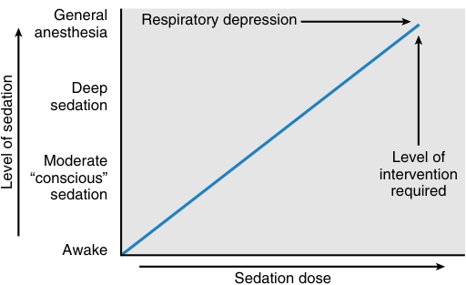

General Respiratory depression anesthesia Deep sedation Moderate Level of       “conscious” intervention sedation required Awake Sedation dose Level of sedation 

**Fig. 68.3 The continuum of sedation and general anesthesia.** (Reproduced from Ahuja M, Armstrong I. Sedation. In: Smith I, McWhinnie D, Jackson I, eds. _Day Case Surgery_ . London: Oxford University Press; 2012:109–132. With permission.)

MAC may include varying levels of sedation, including conversion to general anesthesia, when necessary. However, “if the patient loses consciousness and the ability to respond purposefully, the anesthesia care is a general anesthetic, irrespective of whether airway instrumentation is required.”344 The State Operating Manual Guidance for the CMS Conditions of Participation for Anesthesia Services (42 CFR §482.52, Interpretive Guidelines) describe MAC similarly, as “anesthesia care that includes the monitoring of the patient by a practitioner who is qualified to administer anesthesia,” and includes deep sedation/analgesia, requiring delivery or supervision by an appropriate anesthesia professional.

### Choice of Sedatives

The specific requirements for supplemental sedative and analgesic drugs depend on the procedure undertaken, the skill of the operator in using local anesthesia, and the experiences and expectations of the individual patient. The use of pharmacologic agents can be reduced by compassionate patient management at every stage, preoperative explanation, and the use of distractions, such as deep breathing, conversation, and listening to music.345 Adjuvant drugs should be chosen to deliver those specific aspects that are required,348 such as reduction of anxiety, sedation to relieve boredom or aid immobility, and analgesia for pain that is not amenable to further infiltration of local anesthetic.

### Midazolam

Midazolam produces anxiolysis and dose- related hypnosis and is a popular component of sedation. It also produces marked antegrade amnesia. At times this may be beneficial, but it is not always welcomed by patients.349 Midazolam is preferred to other benzodiazepines because it is watersoluble, does not cause venoirritation or pain on injection, is rapid- acting, and has a relatively short elimination halflife of about 2 to 4 hours. As sole anesthetic, a single dose of 0.05 to 0.1 mg/kg allows reasonably predictable recovery after brief procedures, but individual responses are highly variable.350 Recovery is also considerably slower if repeat or prolonged administration is required.

### Propofol

Propofol is an excellent sedative–hypnotic because its pharmacokinetic properties result in a rapid recovery from the effects of a single bolus dose and a continuous infusion. Propofol is a relatively pure hypnotic, providing no analgesia and only moderate amnesia. Infusion rates of 25 to 75 mcg/ kg/min are typically used,351 but the short duration of action facilitates titration to effect.

Because of the excellent conditions that can be achieved and the superiority of recovery compared with that of midazolam,352 demand for propofol sedation is growing rapidly in areas such as endoscopy. Propofol can rapidly cause apnea, before loss of consciousness, even in sedative doses, and unintended transition to general anesthesia is a constant risk. The safety of non- anesthesiologist administration of propofol is therefore controversial. In the United Kingdom, the Royal College of Anaesthetists and the British Society of Gastroenterology jointly state that propofol sedation for complex upper GI endoscopic procedures should be administered only by an “appropriately trained anaesthetist.”353 In the United States, the FDA package

<!-- PDF page 20 -->

insert states that propofol may be given “only by persons trained in the administration of general anesthesia,” which the ASA supports.354 However, the American Society for Gastrointestinal Endoscopy considers propofol use safe by anyone “proficient in the management of upper and lower airway complications, including manual techniques for reestablishing airway patency” and holding at least basic life support certification.355

Advocates of endoscopist- administered propofol claim a very low rate of airway complications (0.1%) and a mortality (4 in 646,080) less than that associated with endoscopist- administered midazolam–opioid sedation.356 Their data also reveal a wide range for the frequency with which rescue airway support was required, suggesting considerable variation, either in technique or willingness to intervene to protect the airway.356 When anesthesiologists administered propofol for patients undergoing endoscopic retrograde cholangiopancreatography (ERCP), deeper levels of sedation or general anesthesia were often intended and sedation- related events were far more common (21%), especially in patients of higher ASA physical status classification, but were managed without adverse consequence or delay, and high levels of patient and operator satisfaction were achieved.357 A more recent study of anesthesiologist- administered propofol sedation has revealed a very similar (23%) incidence of significant unplanned events.358

### Remimazolam

Remimazolam is an ester- based benzodiazepine designed to be rapidly broken down by carboxylesterase- 1 (CES- 1) to the inactive metabolite CNS7054 with negligible hypnotic activity. It produces hypnotic effects by binding selectively to γ-aminobutyric acid A (GABAA) receptors.359 Remimazolam has a fast onset and a short clinical effect with only minimal accumulation. Remimazolam is approved in the US for the induction and maintenance of procedural sedation in adults, lasting 30 minutes or less. In the European Union (EU), it is approved with no specified duration.359 Remimazolam may be reversed with flumazenil, but it is rarely needed due to remimazolam’s short duration of action. The concurrent use of fentanyl with remimazolam may increase the incidence of adverse drug reactions.359 Remimazolam has a similar effect on heart rate and blood pressure compared with midazolam360–362 and less hypotension and need for vasopressors compared with propofol.363,364 In clinical trials, remimazolam had similar or fewer events of desaturation or respiratory depression than midazolam.364 Remimazolam was successfully tested in procedural anesthesia such as colonoscopy, upper gastrointestinal endoscopy, and bronchoscopy360–362 with a procedure success rate >80%359 and was used safely in high- risk patients (ASA 3 and 4) undergoing colonoscopy.361

The dosage of remimazolam should be titrated according to the desired sedation level and procedure and taking into account the patient’s general condition. The recommended dose is 2.5–5 mg as an initial bolus and re- dosing of 1.25–2.5 mg as needed. In the EU, the initial dose may be increased to 7 mg if no supplemental opioids are used.

The sedative effects of remimazolam may be increased in severe hepatic impairment359 ; however, a clinical trial showed no requirement for dose adjustments in subjects

with hepatic or renal impairment.365 Remimazolam has low oral bioavailability.359 Attempts to use remimazolam intranasally show promising results.366

### Analgesic Adjuvants for Sedation

Opioids are useful for procedures in which pain cannot reliably be blocked with local anesthesia alone.342 Compared to alfentanil in women undergoing breast biopsy, remifentanil resulted in lower pain scores during deep dissection and reduced the need for supplemental local anesthesia.367 Remifentanil was a useful adjuvant to propofol sedation during transvaginal tape insertion368 and in achieving optimal conditions for awake craniotomy,369 surgery that is increasingly being performed as a day and short- stay procedure.28 Remifentanil produced lower pain scores than fentanyl in patients receiving propofol sedation during hysteroscopy, but it did not improve recovery or patient satisfaction.370 For hysteroscopic surgery, paracervical block supplemented by a remifentanil infusion permitted earlier mobilization and discharge compared to TIVA, and the sedation technique was also preferred by a higher proportion of patients. Remifentanil is usually delivered by infusion, but intermittent bolus doses may be more effective for some procedures.371 Hyperalgesia after remifentanil administration remains a concern, as described above.

Both clonidine and dexmedetomidine have potentially useful analgesic, anxiolytic, and sedative properties. The slow onset and offset of clonidine and frequent reports of cardiovascular instability mean that neither drug has established a routine place in sedation,156,372 although dexmedetomidine may be a useful analgesic adjuvant in awake craniotomy.373 Ketamine improves analgesia when used to supplement propofol sedation, but an increase in PONV, psychomimetic side effects, and delay in discharge may be observed at higher doses.374

### Delivery of Sedation

Because of the varying needs to provide combinations of hypnosis, anxiolysis, analgesia, and amnesia, use of drug combinations is common during anesthesiologistadministered sedation. Preceding a propofol infusion with a 2- mg dose of midazolam improved anxiety, sedation, and amnesia for early intraoperative events with no detrimental effect on postoperative sedation, amnesia, or recovery times.375 However, using drug combinations increases the risk for interactions, leading to adverse effects. At sedative doses, propofol and remifentanil each have only a modest effect on heart rate and arterial blood pressure, but their effect on respiration is strikingly synergistic, with the potential for severe respiratory depression.376 Respiratory depression is also enhanced by the interaction of midazolam and remifentanil.377 Antagonists of benzodiazepines and opioids may be useful in cases of unintended overdose, but should not be routinely relied on to reverse deep sedation because of their short duration of action, which may permit resedation before378 or after discharge.379 It is also possible to achieve high rates of patient satisfaction without procedural recall when using intermittent bolus doses of propofol alone for endoscopic procedures.380

As with TIVA, the stability and control of sedation regimens can be improved by using TCI systems.381 Target concentrations of 0.5 to 2 mcg/mL for propofol and 0.5 to 1 ng/mL for

<!-- PDF page 21 -->

remifentanil are typical,342,372 but should be titrated to individual effect. Effective sedation is usually judged by clinical end points or scores. Bispectral index (BIS) (see below section on Monitoring Depth of Anesthesia) changes with increasing sedation, but is too variable382 to be useful routinely and was not effective as an end point for midazolam sedation.383 BIS monitoring did not improve the quality of sedation or reduce the propofol dose or rates of hypoxemic, bradycardic, or hypotensive complications during ERCP.384 However, BIS- guided TCI propofol may be useful in the management of patients with intellectual disability,385 in whom clinical signs may be less reliable. Allowing patients to adjust their own sedation level by patient- controlled sedation resulted in less propofol being used compared with a continuous infusion and was significantly more popular with patients.386 However, this approach necessarily requires comparatively light levels of sedation and appears to be an undesirable option for a significant proportion of patients.387

Inhaled sedation by a low dose of sevoflurane is an alternative technique that provides good control of sedation and rapid recovery.388,389 However, it can be complicated by a frequent incidence of perioperative excitement and an increased risk for transition to general anesthesia.390

## Monitoring Depth of Anesthesia

Technology to monitor the impact of anesthetic medications on the central nervous system has lagged behind other physiologic monitors and is not considered a standard of care. However, processed electroencephalography (EEG) and cerebral oximetry and are increasingly discussed for perioperative brain health and may be beneficial in specific ambulatory populations.

### PROCESSED ELECTROENCEPHALOGRAPHY (EEG) AND CEREBRAL OXIMETRY

As EEG signals can be used as a surrogate measure of hypnosis, a variety of EEG- derived indices have been developed to measure the hypnotic component of anesthesia. While the number of products has grown and they use comparable principles, they differ in their utilized algorithms, which have proprietary information.391 With a primary focus on the degree of hypnosis, EEG- derived scaled indices commonly range from 100 (“awake”) to 0 (“no detectable brain electrical activity”) and are inversely correlated with the hypnotic drug concentrations.392 BIS was the first licensed monitor and is the most extensively studied. Other processed EEG devices available worldwide include SedLine, Entropy, and Narcotrend.393

More recently and less-studied, monitors have also investigated measuring sympathetic system responsiveness (“analgesic”) indices.394–397 Notably, EEG- derived indices have overall not demonstrated an impact on patient outcomes.398

In ambulatory anesthesia, interest has focused on whether processed EEGs can reduce anesthetic delivery, improving the speed and quality of recovery, and reduce costs. In meta- analyses, titrating anesthesia to achieve BIS values of 40 to 60 resulted in small (2–4 minutes) reductions in awakening times and recovery room stay (4–8 minutes), but failed to facilitate earlier home discharge.399,400

BIS titration also produced modest reductions in PONV (32% vs. 38%),399 and cost savings were substantially less than the disposable costs associated with BIS.399 Compared to BIS, auditory evoked potential monitoring achieved similar small reductions in drug usage and awakening times,401,402 with unchanged401 or shortened discharge times.402 Spectral entropy monitoring also achieved only small reductions in drug use and recovery times, although the quality of evidence was rather poor.403

Concerns have been raised when using processed EEGs to optimize anesthetic delivery. Although anesthesia is usually adequate at values below 60, some patients may form memories at 40.404 Thus, titrating anesthesia to BIS values of 40 to 50, to reduce costs and recovery times, may unintentionally increase the risk for awareness.405 Conversely, the geriatric population is a growing proportion of ambulatory surgical patients, and acute delirium can delay or prevent ambulatory discharge. While our understanding of anesthesia’s possible impact on postoperative cognitive dysfunction (POCD) is still evolving,406,407 a Cochrane review of almost 3000 patients concluded that anesthesia optimized by processed EEG indices or evoked potentials decreased both acute postoperative delirium and POCD incidence at three months.408 Future studies are needed to determine if this translates into reductions in unplanned admissions or reduced recovery room times for the geriatric surgical outpatient. Although a lack of clear clinical or financial benefit exists from processed EEG it notably involves minimal clinical effort or patient risk. There is cost. As with any monitor, use does not prevent adverse events or improve patient care unless someone interprets the presented information and acts accordingly.409

### TARGET- CONTROLLED INHALATIONAL ANESTHESIA

End- tidal target- controlled inhalational anesthesia may also be used to monitor and maintain anesthetic depth. In 2022, the FDA approved the first software to semi- automate inhalational anesthetic delivery during surgery for use in the US (https://www.accessdata.fda.gov/cdrh_docs/pdf2 1/P210018B.pdf), although such systems have been sold in Europe for several years. The software, compatible with General Electric’s (GE’s) Aisys CS2 Anesthesia Delivery System, allows anesthesia providers to preset the desired end- tidal concentrations of oxygen and volatile anesthetic agents. The system can then adjust to maintain these preset levels throughout surgery. Other systems on the market in Europe include FLOW- i (Maquet, Solna, Sweden) and Zeus (Dräger, Lübeck, Germany).

Publications report that end- tidal control may improve efficiency, reducing drug waste and decreasing the associated costs on both the health care system and environment.410,411

## Recovery from Ambulatory Anesthesia

Recovery is traditionally divided into three stages. Early, phase 1 recovery occurs in a PACU and entails further awakening and management of pain and nausea, with monitoring of hemodynamic stability. Intermediate

<!-- PDF page 22 -->

recovery continues in the phase 2 (step- down) recovery or in a separate ward area and ends when the patient achieves the criteria for home discharge (see later discussion). The phase 1 and phase 2 aspects of recovery may occur in separate locations or within the same room.

### EARLY RECOVERY

The recovery room or PACU should be centrally placed to all operating rooms and requires the same standard of staffing and equipment as are provided for inpatients.412 The PACU may be shared with inpatients in some facilities, but recovery times can be shortened dramatically if there is a separated phase 1 PACU dedicated to ambulatory patients.11 In the United States, the ratio of nurses to patients is usually lower than in the inpatient PACU, for ambulatory typically 1:3, reflecting the lower acuity of postprocedural needs.6 Patient care should be adequately transferred to the PACU nursing staff, relaying preoperative and intraoperative problems and postoperative instructions. The nature and frequency of monitoring in the PACU is determined by the nature of surgery and the state of recovery. Because ambulatory anesthetics are typically short- acting, supplemental oxygen (O2) administration may be unnecessary in the PACU,413 provided the patient’s saturation level of O2 in hemoglobin (SpO2) remains above 92% on air.

In the United Kingdom, patients may be discharged from phase 1 to phase 2 of recovery when they are awake and oriented, normothermic, able to maintain their own airway and ventilation, and demonstrate cardiovascular stability. Wounds should be reasonably dry, and pain and PONV should be minimal and adequately treated. This assessment is usually made on clinical judgment.412 In the United States, transfer from phase 1 to phase 2 is commonly based on predefined, physician- determined criteria. Typical ambulatory criteria include being awake with stable vital signs, minimal pain, minimal nausea, and the ability to sit with minimal dizziness.414 If more standardized data are desired, a scoring system can be used. The most commonly used system is the modified Aldrete score,415 which assigns points on the basis of activity, ventilation, blood pressure, consciousness, and oxygenation (Table 68.5). Length of PACU stay is one of the key end points, along with awakening, orientation, and extubation times, used to evaluate early recovery in ambulatory anesthesia research.

### SECOND- STAGE RECOVERY

Second- stage recovery prepares patients for leaving the ambulatory surgery unit and taking over their own care. Patients should sit upright on beds or reclining chairs as an aid to mobilization. After low- dose spinal anesthesia, mobilization is usually possible within an hour of the return of full motor function, or about 2.5 to 3 hours after the start of spinal anesthesia.177,416

### FAST- TRACK RECOVERY

With the increased use of short- acting drugs and techniques, many patients will have already met the discharge criteria before, or by the time, they reach the PACU.417 If this is the case, admission to the PACU will only generate

**Table 68.5** The Modified Aldrete Recovery Score

|||**Score**|
|---|---|---|
|Activity:|Able to move 4 extremities voluntarily or on command Able to move 2 extremities voluntarily or on command Unable to move extremities voluntarily or on command|2 1 0|
|Respiration:|Able to breathe deeply and cough freely Dyspnea or limited breathing Apneic|2 1 0|
|Circulation:|BP ± 20% of pre- anesthetic level BP ± 20%–49% of pre- anesthetic level BP ± 50% of pre- anesthetic level|2 1 0|
|Consciousness:|Fully awake|2|
||Arousable on calling Not responding|1 0|
|Oxygenation:|Able to maintain saturation >92% on room air|2|
||Needs oxygen to maintain saturation >90% Saturation &lt;90% even with oxygen|1 0|

The total possible score is 10; patients scoring ≥9 are fit for discharge from phase 1 recovery. _BP_ , blood pressure. Reproduced from Aldrete JA. The post- anesthesia recovery score revisited (letter). _J Clin Anesth_ . 1995;7:89–91. With permission.

unnecessary delay while further observations are performed. Instead, these patients may bypass phase 1 recovery and go directly to the phase 2 unit; this is known as fast- track recovery.

The modified Aldrete score can also be used to assess fast- track eligibility.418 Because this score does not assess pain or PONV, which are traditionally treated in the PACU, White and Song419 added two additional categories to derive their fast- track recovery score. Although using this score reduced the proportion of patients who met the fasttrack criteria on PACU arrival, it also significantly reduced the number of patients who required parenteral analgesia or antiemetics in the step- down area.419

The criteria for transfer from phase 1 to phase 2 and the criteria for direct entry to phase 2 should be the same. Fast- track recovery is the norm for patients who have had local anesthesia, but it is also appropriate for many patients receiving sedation420,421 and low- dose spinal anesthesia.177 Patients receiving general anesthesia also may be able to undergo fast- track recovery, which is appealing because improved recovery provides the patient with a higherquality experience, enabling them to return toward normal in a more pleasant, comfortable, and facilitative environment. It also frees up the more intensive resources of phase 1 recovery for those patients who need them.

Accomplishing fast- track recovery is complex. In one facility, fast- track recovery was only achieved in just over 60% of those who met the PACU bypass criteria.422 The use of depth of anesthesia monitoring has been claimed to facilitate fast- track recovery,423 whereas others have not found it advantageous.424 Accomplishing fast- track recovery requires not only anesthesia recovery readiness, but also the support of a facility- based process, including nursing and surgeon participation and environment support.

The economic case for fast- track recovery should be considered separately.425 In some cases, fast- track recovery has shortened overall recovery stay, comparable to,426 or even

::: details 原始表格與符號（PDF 第 22 頁）

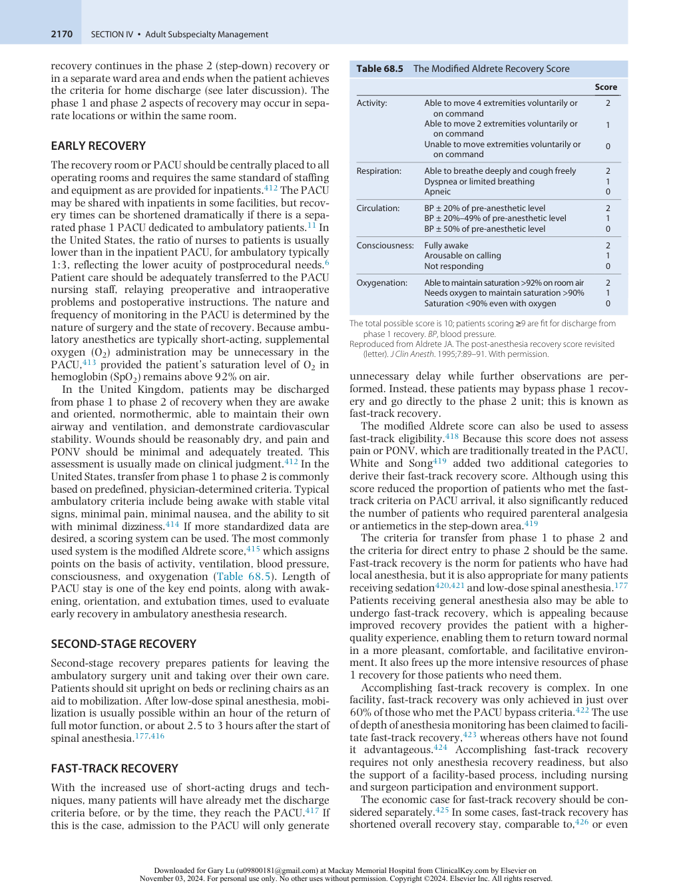

:::

<!-- PDF page 23 -->

longer than,420 the time that would have been spent in the PACU. However, nursing workload was not reduced,426 and others have found no difference in overall recovery time.422 Nurses in the step- down unit are not always readily available to receive patients and often report patients arriving cold or without all the fast- track criteria actually being met.427 Although fast- track recovery appears financially beneficial, actual savings will be made only if the PACU is not needed at all or if staffing levels can be reduced, which is not supported by the evidence to date.425 Nursing workload and costs may simply be shifted from one area to another, with no overall savings.426 Fast- track recovery may still help to improve patient flow and may work best in small units that use staff flexibly between different areas.425 But the most productive approach may be to enable the fastest possible path for all patients through their recovery to discharge home.

## Postoperative Pain

The management of postoperative pain should begin well before the patient undergoes surgery. Patients need to have appropriate expectations about what they are likely to experience during their recovery.428 At preoperative assessment, patients should be provided with information about the likely extent and duration of pain after surgery. They should also be advised about simple measures to reduce pain, including advice to rest in a comfortable position, raising swollen limbs, use of heat or cold packs, and the benefits of distraction. Prevention is the mainstay of pain management, yet studies have shown that pain management after ambulatory surgery is often inadequate.429–431 Common causes are a lack of adherence to analgesic guidelines and a failure to provide multimodal analgesia.431 Too often there is over- reliance on opioid analgesia, resulting in predictable adverse effects,432 that are second only to inadequate pain relief in causing unnecessary hospital admission.429

### MULTIMODAL ANALGESIA

Multimodal analgesia relies on the additive or synergistic combination of drugs acting at various points on the pain pathway.433 Typical combinations include local anesthetic wound infiltration or regional techniques and routine NSAIDs, with small doses of opioids added as needed. Topical therapies may also be of some benefit, with both lidocaine and glyceryl trinitrate patches found to provide effective topical analgesia after a variety of ambulatory procedures.434 Multimodal regimens have been shown to be effective after several ambulatory surgical procedures.435,436 An opioid- sparing effect exists for several drug combinations,437 but most evidence is limited to an opioid plus one other drug, with little evaluation of true multimodal analgesia or attempts to identify optimal combinations.431 Analgesic efficacy appears to differ with the nature of surgery,438 suggesting that multimodal analgesic regimens should be specifically tailored.439 Nevertheless, reducing the opioid dose does decrease the incidence of PONV to a corresponding degree and may also reduce other opioid adverse effects, such as sedation, sleep disturbances, urinary retention, and respiratory depression.432 As yet, no evidence indicates that multimodal analgesia improves

long- term patient outcome440 because of the small number of subjects studied and the infrequent incidence of adverse outcomes after ambulatory surgery.

### Acetaminophen

Often considered a weak analgesic, acetaminophen has equivalent and sustained effects compared with other perioperative analgesics.441 Acetaminophen may be given orally, rectally, or via an intravenous route. Studies regarding the opioid- sparing effects of acetaminophen are inconsistent.442 A large retrospective study and several RCTs showed no such benefit443–445 while other RCTs and meta- analyses demonstrated a reduction in opioid consumption.446–448 Since these studies were conducted in different surgical populations using different protocols, it is challenging to compare them. When balancing the relatively high safety profile of acetaminophen and the evidence of an opioid- sparing effect in some studies, it seems reasonable to continue the use of acetaminophen as an adjuvant analgesic.

### NSAIDs

NSAIDs encompass anti- inflammatory, antipyretic, antithrombotic, and analgesic qualities. NSAIDs and COX- 2 inhibitors are part of multimodal analgesia throughout the perioperative period in the ambulatory patient. Nonselective NSAIDs (naproxen, ibuprofen, diclofenac) inhibit both COX- 1 and COX- 2. Selective NSAIDs (celecoxib, lumiracoxib) inhibit mainly COX- 2.

NSAIDs may be given orally, rectally, intramuscular, and via the intravenous route. Recently, several meta- analyses evaluated the efficacy and safety of single- dose intravenous NSAIDs for acute postoperative pain. Diclofenac and ketorolac were found to give good pain relief, but not enough data was found to support or refute the use of IV ibuprofen.449–451

Dipyrone is an NSAID banned in some countries and used in others. It gives good pain relief, but the risk of lifethreatening blood disorders makes its use questionable.452

NSAIDs should be used with caution, or their use may even be restricted in patients with active peptic ulcer disease, increased risk of bleeding, cardiovascular disease, chronic kidney, and chronic liver disease.

Concerns regarding the use of NSAIDs and a possible deleterious effect on bone healing have been raised in the past. A meta- analysis of observational studies found no such correlation when only high- quality studies were analyzed.453 NSAIDs may cause a transient reduction in the creatinine clearance on the first postoperative day but with no significant long- term effect.454 A recent meta- analysis found no correlation between the perioperative use of NSAIDs and operative bleeding.455

### Gabapentinoids

Gabapentinoids were initially marketed as anticonvulsants but are also effective for chronic neuropathic pain. In the past couple of decades gabapentinoids gained popularity as a treatment for acute postoperative pain. However, their routine use can cause neurologic and respiratory adverse reactions. In the context of the ambulatory patient, these adverse events can delay discharge.456 A meta- analysis evaluated the influence of gabapentinoids on postoperative pain at 6, 12, 24, 48, and 72 hours. No clinically significant difference in postoperative

<!-- PDF page 24 -->

acute, subacute, and chronic pain was observed. Gabapentinoids were associated with a lower risk of PONV, but with an increased length of stay in the hospital and increased risk of dizziness and visual disturbance.457 Thus, the routine use of gabapentinoids as perioperative analgesics is not justified.

### Dexamethasone

Dexamethasone may be used as part of multimodal analgesia in higher doses than when administered as an antiemetic. The onset of action of dexamethasone is 1–2 hours, hence the recommendation to administer it prior to surgical trauma. A meta- analysis found a small but significant advantage in the use of dexamethasone as an analgesic. Patients treated with dexamethasone experienced less postoperative pain, required fewer postoperative opioids, and had shorter PACU stays. Twenty- four hours after the operation, patients that received dexamethasone had higher blood glucose levels, but there was no increase in wound infection or delayed healing.458

Another meta- analysis examined the effect of single- dose dexamethasone in abdominal surgery. Single- dose dexamethasone effectively reduced pain scores, was more effective when given preoperatively, and was most effective when administered in an intermediate dose (6.4–10 mg). No difference in PACU length of stay was found, but that can be attributed to the population investigated (abdominal surgery) and may not be relevant to the ambulatory patient.459

The frequent use of dexamethasone has raised concerns regarding surgical site infections. In a recent large RCT, 8 mg of intraoperative dexamethasone did not increase the incidence of surgical-site infections.460

### RESCUE ANALGESIA

Despite prophylactic measures, some patients will experience pain on awakening after surgery. Milder cases may be

amenable to treatment with additional oral analgesia, but more severe pain will usually require parenteral opioids. Long- acting parenteral opioids are rarely indicated. Fentanyl is commonly used for this purpose, and small boluses (20– 25 mcg) rapidly achieve analgesia. Compared to morphine, fentanyl results in more rapid control of pain and reduces the occurrence of PONV.461 Rescue fentanyl also produced fewer adverse effects than oxycodone.462 Administration of additional oral analgesia as soon as the pain is controlled will usually prevent a recurrence at a later stage of recovery. During the recovery period, pain should be assessed on a regular basis and treated according to protocols (Fig. 68.4).

### PAIN MANAGEMENT AT HOME

In the United States, patients are often given prescriptions for postoperative analgesics, including weak opioids, preferably before surgery so the medications will be at home when the patient needs them. In the United Kingdom, patients may be given standardized take- home analgesic packs that can be dispensed from the ambulatory surgery unit, avoiding pharmacy delays. These should be used when necessary for pain not adequately controlled with acetaminophen and NSAIDs.

### Managing Opioid Complications

Although multimodal techniques aim to minimize opioid use, strong opioids can be necessary as a rescue option after more invasive surgery. Analgesics such as morphine and oxycodone provide more intense and prolonged effects, but are associated with more intense and prolonged typical opioid side effects. Novel delivery techniques, such as iontophoretic463 or nasal464 fentanyl, or sublingual sufentanil,465 may improve patient convenience but do nothing to reduce adverse effects. In addition to multimodal analgesia, attempts to limit these adverse effects have included the development of drugs such as tramadol, which combine

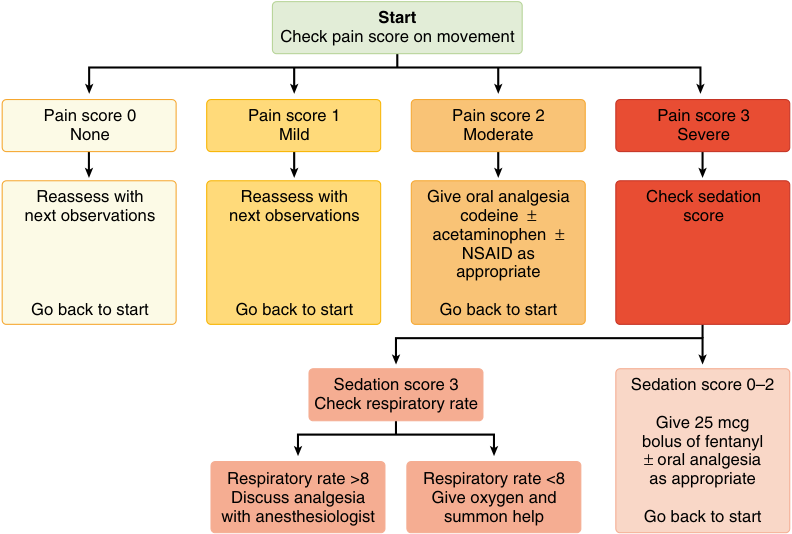

Start Check pain score on movement Pain score 0 Pain score 1 Pain score 2 Pain score 3 None Mild Moderate Severe Reassess with Reassess with Give oral analgesia Check sedation next observations next observations codeine  ± score acetaminophen  ± NSAID as appropriate Go back to start Go back to start Go back to start Sedation score 3 Sedation score 0–2 Check respiratory rate Give 25 mcg bolus of fentanyl ± oral analgesia Respiratory rate >8 Respiratory rate &lt;8 as appropriate Discuss analgesia Give oxygen and with anesthesiologist summon help Go back to start 

**Fig. 68.4 Example of a pain management protocol for ambulatory surgery patients.** _NSAID_ , nonsteroidal anti- inflammatory drug. (Modified from Lipp A, Jackson I. Adult day surgery analgesia. In: Smith I, McWhinnie D, Jackson I, eds. _Day Case Surgery_ . London: Oxford University Press; 2012:133–145. With permission.)

<!-- PDF page 25 -->

opioid and nonopioid mechanisms of action. Tramadol is effective after ambulatory surgery,466,467 but it is still associated with a frequent incidence of unwanted effects, including sedation, dizziness, and particularly PONV.468 Tapentadol is licensed in both the United States and the United Kingdom. It has a dual action similar to that of tramadol, with comparable efficacy to oxycodone but fewer GI adverse effects, such as nausea, vomiting, and constipation.469 Unlike tramadol, it does not require metabolic activation or suffer from isomer- dependent pharmacodynamics.171

Combining oral oxycodone with naloxone (Targinact) antagonizes the GI effects, in particular preventing opioidinduced constipation, but has little effect on analgesia because first- pass metabolism prevents much naloxone from reaching the central nervous system.171 Alvimopan is another peripherally acting μ- opioid (MOP) receptor antagonist intended to reduce opioid- induced constipation. Since peripheral MOP receptors also may partially mediate opioidassociated PONV, delayed gastric emptying, and urinary retention,171 these drugs offer the hope that opioid analgesia without serious adverse effects may yet be a possibility.

### Local Anesthetic Administration at Home

Sending patients home with perineural or incisional catheters is an increasingly utilized option for postoperative pain management.470 Patient- controlled regional anesthesia (PCRA) with an elastomeric balloon pump has provided effective analgesia and reduced pain intensity during mobilization when ropivacaine is delivered into a perioperatively placed wound catheter after subacromial decompression.471 Notably, most local anesthetics, including bupivacaine, lidocaine, and ropivacaine, are chondrotoxic to human articular cartilage _in vitro_ , and the risk may be increased with longer exposure to higher concentrations of local anesthetic, such as with a pain pump, compared to that associated with a single injection.472 As analysis of evidence indicated a causal relationship between intraarticular local anesthetic infusions and chondrolysis,473 the use of intra- articular catheters has largely ceased after shoulder and knee surgery.

Excellent analgesia with continuous interscalene block continued at home can allow and expedite same- day discharge after a variety of shoulder operations, including open rotator cuff repair, subacromial decompression, and joint replacement.474

A variety of infusion pump designs are available for local anesthesia infusions or PCRA after discharge. Technical problems have been found with electronic pumps,475 which seem to be unreliable for home use.474 Patient satisfaction475 has been reported with disposable elastomeric pumps, which are more reliable, although not all types function equally well and _in vivo_ performance does not necessarily match results obtained _in vitro_ .476

## Postoperative Nausea and Vomiting

PONV occurs in as many as 30% of a general surgical inpatient population given no antiemetics.477 Some patients undergoing day surgery have a much smaller risk for symptoms, cited as less than 5%60,478 for very minor surgery,

with reduced requirement for intraoperative and postoperative opioids. However, in the same studies, other ambulatory surgery patients had a predischarge incidence of PONV as high as 41%. When the potential occurrence of emetic sequelae after discharge is included in the estimation of overall risk, some authors cite an overall incidence of more than 40%, even after receiving an antiemetic.479

### RISK ASSESSMENT AND STRATEGIES

Some have recommended that the management of PONV for ambulatory patients should involve universal multimodal pharmacologic prophylaxis to minimize the symptoms that might delay timely discharge or subsequent recurrence in the home environment.480 However, current recommendations481 advocate a more focused approach toward the use of preventive pharmacotherapy, having first minimized baseline risk resulting from emetogenic stimuli, such as adequate hydration, the use of local–regional techniques, or if a general anesthetic is needed, reducing exposure to volatile anesthetics, N2O, and opioid- based analgesia. Avoiding neostigmine was previously advocated, but may not be beneficial.482 Individual patient factors should then be identified to stratify relative risk. The scoring system originally derived from a cohort of ear, nose, and throat patients by Apfel and colleagues in 1998483 is popular because of its relative simplicity; yet debate continues regarding discriminating power480 and its applicability to ambulatory surgery patients, because the predicted risk for PONV (Table 68.6) seems to be overestimated in this population, presumably as a result of the original scoring system having been developed for inpatients. This seems to be confirmed in a subsequent paper by the same author,479 where PACU- only rates of nausea were 19.9%, vomiting 3.9%, and nausea and/or vomiting 20.7% across an ambulatory patient cohort with characteristics that would seem to predict greater risk from the original algorithm. However, in the same study, postdischarge rates of PONV until the second postoperative day were higher: 36.6% nausea, 11.9% vomiting, 13.3% severe nausea, and 5.0% severe vomiting. From these data, the authors developed a predictive scoring

**Table 68.6** Risk Factors for, and Predicted Rates of, Postoperative Nausea and Vomiting According to the Apfel Score

|**Risk Factors**|**Scoring**|
|---|---|
|Female|1 point|
|Non- smoker|1 point|
|History of previous PONV|1 point|
|Postoperative use of opioids|1 point|
|Maximum possible score|4 points|
|**Number of Points**|**Risk of PONV (%)**|
|0|10|
|1|21 (≈20)|
|2|39 (≈40)|
|3|61 (≈60)|
|4|79 (≈80)|

_PONV_ , postoperative nausea and vomiting.

Data from Apfel CC, Laara E, Koivuranta M, et al. A simplified risk score for predicting postoperative nausea and vomiting: conclusions from crossvalidations between two centers. _Anesthesiology_ . 1999;91(3):693–700.

::: details 原始表格與符號（PDF 第 25 頁）

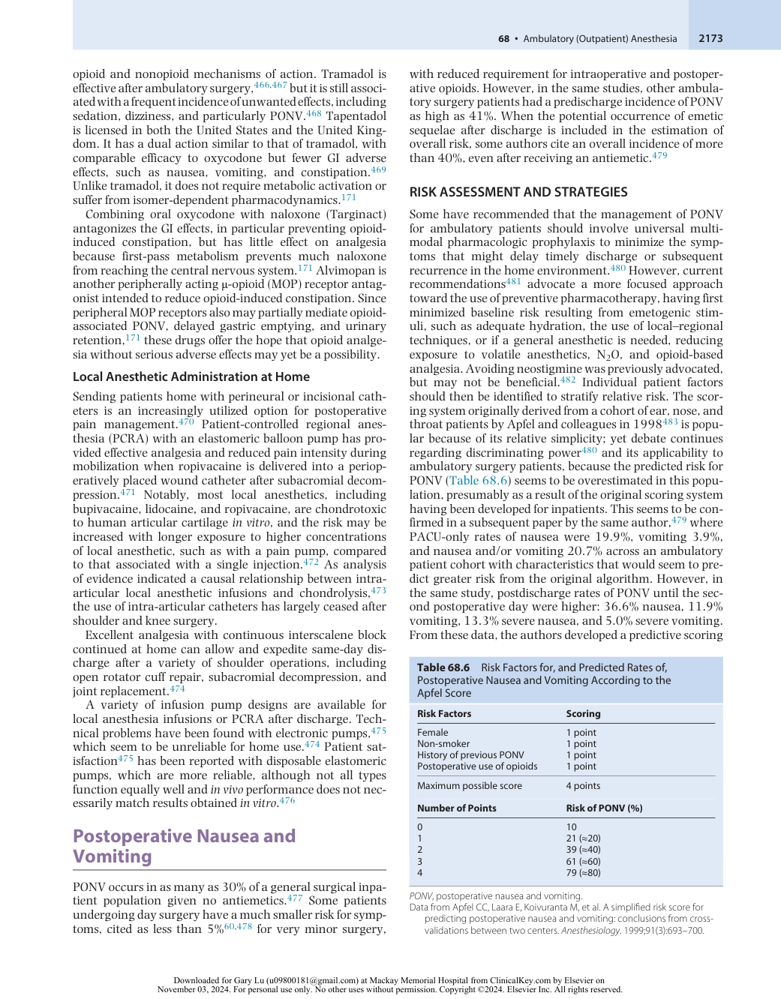

:::

<!-- PDF page 26 -->

algorithm for postdischarge nausea and vomiting (PDNV) (Table 68.7). Other scoring algorithms exist for prediction of risk for PONV in the ambulatory environment, but their relative complexity mandates the use of a calculator or computer.478 A reevaluation of risk factors for PONV484 reiterated the importance of those characteristics included in the original Apfel score,477 but this algorithm included younger age and duration but not type of surgery. A simple policy whereby two antiemetic interventions were administered to all male patients and three to all females485 resulted in better compliance and greater effectiveness than several previously published strategies,486 although at the risk of exposing more patients to the potential side effects of unnecessary antiemetics.

Antiemetic prophylaxis should therefore be tailored to assessment of likely risk for symptoms with the use of two agents for patients with 1–2 risk factors and 3–4 agents for those with >2 risk factors, using drugs with different modes of action.481 The IMPACT study207 demonstrated that ondansetron 4 mg, droperidol 1.25 mg, and dexamethasone 4 mg were equally effective in reducing the risk for PONV by an order of 25% and that using these three drugs together would be approximately additive. Specifically, the prophylactic use of one of these drugs decreases the estimated risk for PONV from 60% to 44%; use of two drugs would further decrease the incidence from 44% to 33% and three drugs to 24%. The use of TIVA with propofol with the concomitant avoidance of N2O had similar equivalence to the use of one antiemetic.207 However, the antiemetic effectiveness of TIVA is time- limited and patients receiving TIVA appear to have a higher risk of late PONV, starting 2 to 6 hours after surgery.487 Simple measures, such as the routine administration of approximately 1 to 2 L of intravenous crystalloid fluids, reduce the incidence and severity of PONV, decrease dizziness and drowsiness,488 and reduce postoperative pain in high- risk groups.489 Allowing patients to drink clear liquids for as long as possible before surgery can also reduce PONV.132

**Table 68.7** Risk Factors for, and Predicted Rates of, Postdischarge Nausea and Vomiting

|**Risk Factors**|**Scoring**|
|---|---|
|Female|1 point|
|Age &lt;50 years|1 point|
|History of previous PONV|1 point|
|Postoperative use of opioids|1 point|
|Nausea in PACU|1 point|
|Maximum possible score|5 points|
|**Number of Points**|**Risk of PONV (%)**|
|0|10.9 (≈10)|
|1|18.3 (≈20)|
|2|30.5 (≈30)|
|3|48.7 (≈50)|
|4|58.5 (≈60)|
|5|79.7 (≈80)|

_PACU_ , postanesthesia care unit; _PONV_ , postdischarge nausea and vomiting. Data from Apfel CC, Philip BK, Cakmakkaya OS, et al. Who is at risk for postdischarge nausea and vomiting after ambulatory surgery? _Anesthesiology_ . 2012;117(3):475–486.

### ANTIEMETIC AGENTS

### First- Generation Drugs

Metoclopramide is a dopaminergic (D2) and serotonergic (5- HT3, peripheral 5- HT4 at higher doses) antagonist with gastric prokinetic properties that was first described in 1964. A meta- analysis of a standard clinical dose of 10 mg showed little evidence of pharmacologic benefit for PONV,490 but after a number of studies by Fujii were withdrawn, reanalysis suggests that there may be some benefit.491 However, current guidelines still do not list metoclopramide for first- line treatment.482 Higher doses, such as 20 to 25 mg, are more effective492 but are associated with more akathisia.

Droperidol is a butyrophenone with an antiemetic effect resulting from dopaminergic receptor (D2) antagonism that received a black box warning for the FDA- approved dose of 2.5 mg493 or greater because of potential QT interval prolongation. This and other side effects of droperidol, such as sedation and akathisia, were significant but at higher doses than are commonly used for PONV prophylaxis,493 which are typically 1.25 mg or less. A meta- analysis494 confirmed the antiemetic action of low- dose droperidol. Droperidol use is less in the United States since the black box warning was added but primarily for medicolegal reasons rather than because of concerns with efficacy or side effects.

Antagonists of the histamine H1 receptor have a particular efficacy in the management of nausea and vomiting precipitated by vestibular pathways, with a documented benefit in the management of travel sickness and surgical procedures for strabismus or involving the middle ear. Dimenhydrinate (a combination of diphenhydramine and 8- chlorotheophylline that was added to reduce drowsiness) has an antiemetic effectiveness deemed similar to that of both droperidol and 5- HT3 antagonists,495 but potential adverse reactions from these antihistamines include marked sedation, dry mouth, urinary retention, and blurred vision as a result of associated muscarinic receptor antagonism. Meclizine, an H1- receptor antagonist and anti–motion sickness medication, is minimally sedating, long- acting, and effective for treatment of PONV and for prevention of PDNV.496 In the United States, it is inexpensive and available without prescription, making it an attractive postdischarge choice. A transdermal scopolamine delivery system is also available. This patch was designed to deliver a total dose of 1 mg of scopolamine at a sustained, constant rate over a period of 3 days.497 Numerous studies have shown transdermal scopolamine to be effective in reducing the incidence and severity of PONV and PDNV, with efficacy comparable to that of ondansetron or droperidol. It has a prolonged duration of over 24 hours, but the onset is delayed, becoming effective within 2 to 4 hours of applying the patch.498 When applying the patch the night before surgery, the incidence of nausea and vomiting was reduced from 62.5% and 37.5% to 20.8% and 8.3%, respectively, compared to placebo in the first 24 hours after gynecologic laparoscopy.499 In the United States, clinicians apply the patch preoperatively, knowing that onset of PDNV efficacy will be in the early recovery period for shorter surgery, but that it is one of the few drugs that continues to be effective significantly postdischarge.497 Adverse effects, particularly dry mouth

::: details 原始表格與符號（PDF 第 26 頁）

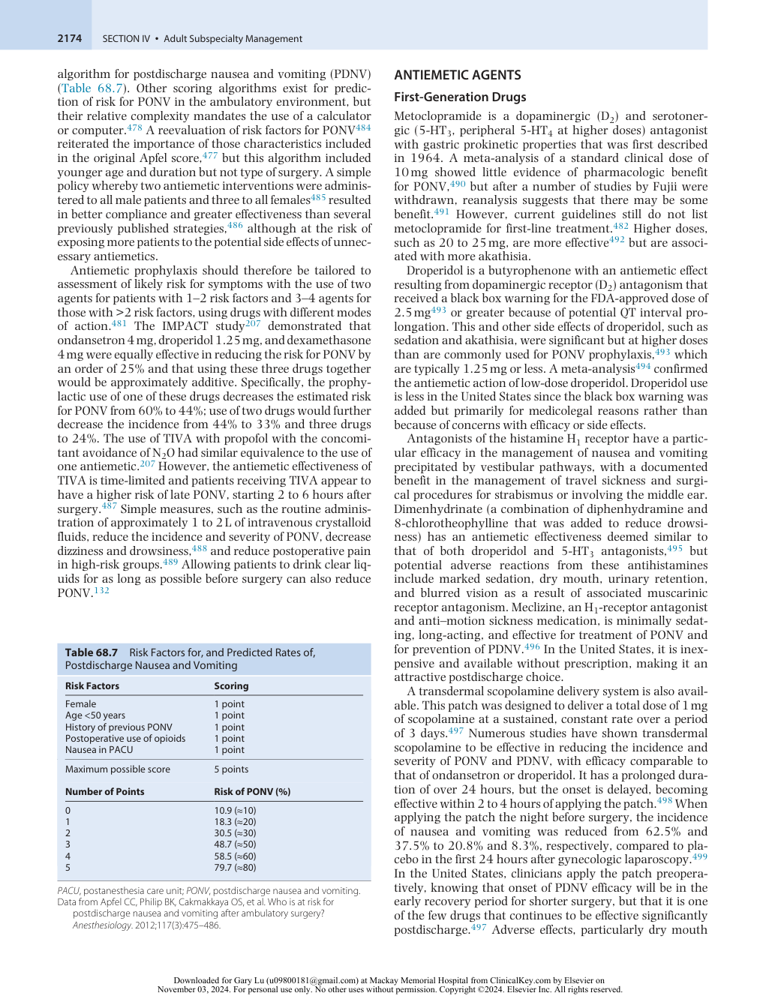

:::

<!-- PDF page 27 -->

but also somnolence, dizziness, and blurred vision, are relatively common but minor.497,499

### Serotonin 5- HT3 Receptor Antagonists

The 5- HT3 antagonists have played a substantial role in the management of PONV since their introduction in the 1980s, because of their relatively benign adverse reaction profile compared with those of the then available drugs. Their prophylactic use is more effective when given just before the end of surgery.500 They are effective drugs for emetic rescue therapy, with ondansetron seeming to have a more preferential effect on vomiting (number needed to treat [NNT] = 4) rather than nausea (NNT = 7).501 Although relatively well tolerated, their side- effect profile includes an increased risk for headache (number needed to harm [NNH] = 36) and elevated liver enzymes (NNH = 31).501 All serotonin subtype 3 antagonists have also been associated with QT interval prolongation. More recently released serotonin 5- HT3 receptor antagonists, such as palonosetron,502 seem to exhibit similar characteristics with equal reduction of PONV rates in high- risk patients when used for prophylaxis, though the longer half- life (40 hours) may afford better protection against symptoms after discharge.503 A large cost remains a significant barrier to use of newer nongeneric serotonin antagonists.

### Steroids

Dexamethasone is an effective antiemetic at intravenous doses of 4 to 8 mg.481,504 This steroid may act centrally to either modulate the release of endorphins or inhibit prostaglandin synthesis. Given its delayed onset of action, dexamethasone should be administered as early as possible after induction of anesthesia.505 Prophylactic dexamethasone is also effective in reducing postoperative pain and improving the quality of recovery,506,507 although at somewhat higher doses (typically 8 mg).

### Neurokinin- 1 Antagonists

The role of tachykinins in the emetic pathway was first elucidated by immunohistologic studies identifying substance P in the dorsal vagal complex of the ferret, an area of the brain deemed essential in the vomiting reflex.508 Subsequent research identified the potential value of specific antagonists to the neurokinin- 1 receptor, at which substance P and neurokinins A and B interact both centrally and peripherally in the gut to suppress vomiting. Aprepitant was the first commercially released drug of this class. A pooled analysis of trials comparing aprepitant to other commonly used antiemetics found that it is particularly superior in preventing postoperative vomiting.509 Due to cost constraints, neurokinin- 1 antagonists may be reserved for patients at very high risk for PONV, or those in whom postoperative vomiting could be especially detrimental.

### MANAGING PERSISTENT NAUSEA AND VOMITING

The presence of continuing symptoms after antiemetic rescue therapy requires further clinical review. Consideration should be given to alternative causes for these symptoms, particularly hydration status, covert hypovolemia, or early infection. Review of vital signs (temperature, pulse, and

arterial blood pressure), allied with clinical examination to exclude an association with concomitant worsening of abdominal pain, potential septic foci, or urinary retention, is important to exclude more sinister causes, before consideration is given to symptomatic relief.

Administering 20 mL/kg of an isotonic electrolyte solution reduces the risk for nausea and dizziness after ambulatory surgery and volume repletion should be considered to attenuate continuing symptoms.488,510 Ephedrine 0.5 mg/ kg intramuscularly is effective for prophylaxis and treatment, with efficacy comparable to that of droperidol and sedation scores lower than placebo.511 No value exists in prescribing a previously used antiemetic drug within 6 hours of previous administration,482 but other second- line drugs may be considered should first- line management fail. Some options include small- dose promethazine (6.25 mg); small- dose intravenous naloxone; propofol 20 mg; phenothiazines, including prochlorperazine, perphenazine, or a neurokinin antagonist. For patients who have not received prophylaxis, the 5- HT3 antagonists are the preferred first treatment of PONV and the class of drugs with best proven efficacy for treatment.482

## Enhanced Recovery after Surgery (ERAS)

Enhanced Recovery After Surgery (ERAS) are programs that standardize and optimize perioperative care and postoperative outcomes. ERAS was introduced at the beginning of the millennium, emphasizing the quality of the surgical end point rather than the speed of recovery, as was implicated by the term Fast Track Recovery. ERAS protocols address issues of systemic inflammation, catabolic response to the surgical insult, fluid hemostasis, anemia, PONV, and pain. Accordingly, ERAS includes several elements: a multidisciplinary team caring for the surgical patient and a multimodal approach addressing recovery- delaying issues and complications.

The ERAS Society (erassociety.org) publishes guidelines specific to different surgical specialties and disease- specific scenarios. However, many of these protocols are based on expert opinion in the absence of high- quality evidence.

The implementation of ERAS protocols may allow surgeries otherwise requiring hospitalization to be discharged on the same day.512 Since ERAS was initially developed for the inpatient setting, translatability to the ambulatory setting is partial. However, ERAS protocols that were implemented in ambulatory centers show promise. In one example, ERAS implementation in an ambulatory surgery center led to a decrease in opioid consumption.513 In a breast cancer surgical center, the implementation of an ERAS protocol led to a significant increase in sameday discharge (from 7.2% to 58.6%) and a decrease in the length of stay in those admitted (from 1.6 days to 1.2 days514 ). A large retrospective study showed the impact of implementing an ERAS program in an ambulatory oncologic surgical center. They reported a decreased intraoperative opioid use and transition time to oral analgesics. The median time to first ambulation was 5–6 hours, the rate of patient readmissions within 30 days was 2.6%, and urgent care visits were 6.8%.515

<!-- PDF page 28 -->

In a randomized clinical trial, 108 patients admitted for acute uncomplicated appendectomy were divided into an ERAS group and a conventional care group. The ERAS group was discharged after a mean of 9.7 hours (compared with 23.2 hours in the conventional care group) and had a significantly reduced time to resume diet and less moderate to severe postoperative pain. The rate of readmissions was similar.516

In several studies on ambulatory patients, different modified ERAS protocols were used. The framework for ambulatory ERAS is opioid minimization pre- , intra- , and postoperatively. The common features of these protocols are the following:

Preoperative:

- Adequate outpatient support, education, and communication

- Feasible postoperative support and communication (telemedicine, phone calls, home visits)

- No major comorbidities

Intraoperative:

- Pre- emptive and intraoperative opioid- sparing multimodal analgesia

- Peripheral nerve blocks

- Local anesthetic wound infiltration by the surgeons

- Preferential use of regional anesthesia and/or sedation over general anesthesia when possible

- PONV prophylaxis pre- and intraoperative

Postoperative:

- Resume a full diet as soon as the patient is fit

- Early mobilization

The readmission rates were low across studies. Failure to void remains a problem delaying discharge, although ERAS protocols may decrease the incidence of urinary retention.515,517–520 In conclusion, although ERAS was not initially designed for ambulatory centers, a modified ambulatory ERAS protocol can be well suited for the outpatient.

## Special Areas

### OFFICE- BASED PRACTICE

Office- based anesthesia is a form of ambulatory anesthesia that is rapidly expanding in North America and some parts of Europe. Arguably, the first ambulatory surgery center in the United States (the Downtown Anesthesia Clinic in Sioux City, Iowa) was an office- based practice.2 Simple, minimally invasive surgical procedures have been performed in physicians’ offices for many years, using either local anesthesia or sedation. There is now a growing involvement of anesthesiologists, especially as the complexity of office- based surgery increases.

Advantages of office- based surgery include improved convenience for the patient, but the primary driver has been more control over scheduling and the work environment for the surgeon. The potential exists for significant profit going directly to the surgeon, but in addition, the lower overhead costs in this setting result in significantly lower overall costs for the procedure. For example, the total cost of a laparoscopic inguinal hernia repair was three and a half times

greater when performed in a hospital setting compared with an office facility.521 The costs of open hernia repair521 and various rhinology procedures522 were approximately 2.5 times less when performed in the office. In the United States, office- based surgery covers a wide range of procedures.

However, legitimate concerns have been raised about the safety of office- based surgery. One comparative study showed a more than 10- fold increase in adverse incidents and deaths for procedures performed in a physician’s office compared with an ambulatory surgical center.523 These disasters are often the result of unqualified or untrained individuals administering sedation in unsuitable or unaccredited facilities.523,524 Deep sedation appears to be a considerable risk factor. From the ASA closed claims database, 40% of the deaths related to MAC occurred during facial and eye surgery, which are commonly performed in the office setting.343 Hypoxia and hypoventilation resulting from oversedation was the most common cause of death, with poor vigilance, inadequate monitoring, and delayed resuscitation contributing to the deaths, half of which were judged to be preventable.343 The common perception that sedation is safer than general anesthesia is not supported by these data.

In the United States, the regulation of office facilities is the responsibility of individual states, with nearly 30 states having some degree of oversight as of 2014.525 Regulation does appear to improve safety, because no deaths were reported in a series of more than 23,000 cases from a fully accredited office staffed by board- certified anesthesiologists and surgeons.526 In addition, safety appears to be improving in parallel with greater regulation.525 Guidance on office- based anesthesia is available from the ASA and SAMBA,527 and comprehensive recommendations from other organizations and experts have been published. Typical recommendations for safe office- based anesthesia are summarized in Box 68.2.

### Box 68.2 A Summary of Office- Based Surgery Practice Guidelines Collated from US Regulatory Bodies

Employment of appropriately trained and credentialed anesthesia personnel

Availability of properly maintained anesthesia equipment appropriate to the anesthesia care being provided

As complete documentation of the care provided as that required at other surgical sites

- Use of standard monitoring equipment according to the American Society of Anesthesiologists policies and guidelines

- Provision of a postanesthesia care unit or recovery area that

- is staffed by appropriately trained nursing personnel and provision of specific discharge instructions

- Availability of emergency equipment (e.g., airway equipment, cardiac resuscitation)

- Establishment of a written plan for emergency transport of patients to a site that provides more comprehensive care should an untoward event or complication occur that requires more extensive monitoring or overnight admission of the patient

Maintenance and documentation of a quality assurance program Establishment of a continuing education program for physicians and other facility personnel

- Safety standards that cannot be jeopardized for patient convenience or cost savings

<!-- PDF page 29 -->

In essence, the office setting must adhere to the same standards of care required in a hospital- based or freestanding ambulatory surgery facility. Strong safety processes must be in place, because the isolated office- based environment means that outside help is not immediately available.

The selection of patients for office- based anesthesia should adhere to robust guidelines for safe anesthetic care. Because perioperative complications are harder to manage in an isolated environment, selection criteria may need to be more restrictive than those currently advocated for ambulatory surgery in the hospital setting.48 The selection process must include a matrix of procedure invasiveness, patient complexity, and the capabilities and comfort levels of the facility and its personnel.527 Preoperative preparation should be guided by the same clinical acumen and common sense that drives the decision- making process at freestanding surgery centers, with any coexisting diseases under good control. Anesthetic techniques suitable for office- based surgical procedures are similar to those used for hospital- based and freestanding ambulatory surgery procedures. MAC remains common, although clearly a great challenge exists in “the judicious and skillful use of MAC anesthesia to achieve adequate sedation and analgesia for increasingly invasive procedures.”528 Increasingly a move toward light general anesthesia is occurring – that is, using an SGA or face mask for airway management.529,530 Propofol, sevoflurane, and desflurane are all suitable within the office setting, although an anesthesia machine is required to deliver volatile anesthetics. Standard equipment can be installed in frequently used offices, and portable equipment has been developed for less frequent use.524 Fast- track recovery is the ideal with patients who are awake, alert, and able to transfer themselves from operating room table to a reclining chair, thus facilitating room turnover in approximately 10 minutes and home discharge within an hour of awakening.524 It is important to minimize PDNV.531 Recommendations have been made for other outcome measures that should routinely be audited after office- based anesthesia.527,532 The American Medical Association and American College of Surgeons issued a set of Office- Based Surgery Core Principles to promote safety and quality of health care services for office procedures requiring sedation and anesthesia.533 In the United Kingdom, a similar practice of office- based anesthesia for dental procedures was in place for several decades. A series of anesthetic deaths in dental offices led to several reviews, culminating in recommendations that all anesthetics be administered by accredited anesthesiologists with specific training and experience in dental anesthesia, as well as recommendations regarding resuscitation equipment and the availability of drugs needed for emergency use.534 Partly because of the high costs of equipment and maintenance, the net result was the movement of all anesthesia out of the dental office and back into the hospital environment.535 Subsequently, office- based anesthesia has never developed in the United Kingdom. Minor surgery under local anesthesia is performed in some specially equipped primary care surgery centers, whereas the majority of procedures that are performed in offices in the United States are managed in hospital- affiliated day surgery units, procedure rooms, or surgical outpatient clinics in the United Kingdom.

### ANESTHESIA IN NON- OPERATING- ROOMS AND REMOTE LOCATIONS

Many surgical conditions that formerly needed treatment in a hospital outpatient operating room are now being managed by interventional procedures done by non- surgeon physicians in radiology, cardiology, and endoscopy (see also Chapter 69). In many cases, deep sedation or anesthesia is still required, meaning the anesthesiologist has to move into unfamiliar and often hazardous environments. Collectively, they are sometimes called NORA (non- OR anesthesia). The problems associated with these diverse locations are considered in detail in Chapter 69, but because many of the procedures are performed on an ambulatory basis or require anesthetic management according to all of the usual short- stay principles, a brief description is required here. The basic sedative and anesthetic techniques already described are suitable for most cases, but the conduct of anesthesia is likely to have to be modified according to the specific environment.

Administration of anesthesia or sedation at remote locations is associated with significant risk.536 Some of these risks are specific to particular areas (Table 68.8) but commonly

**Table 68.8** Some of the Hazards Associated with Anesthesia in Remote Environments

|**Area**|**Examples of Specific Hazards**|
|---|---|
|Magnetic resonance imaging (MRI) scanner|Noise. Strong magnetic fields; no ferromagnetic equipment within scanner. Peculiarities of MRI- compatible equipment. Remote monitoring may introduce delays (e.g., capnography). Risk of induced currents causing burns in coiled cables. Compliance and dead space within extra- long breathing circuits|
|X- ray and interventional radiology|Radiation exposure; mobility limited by lead gowns. Often low light levels. Restricted access and unexpected movement of X- ray equipment. Patients may have significant comorbidities. Allergic reactions to contrast media. Limited patient access in CT scanner|
|Endoscopy suite|Dark environment, limited access. Patients may have significant comorbidities. Risk of hemodynamic disturbance with bowel preparation or vagal stimulation. Shared airway in upper endoscopy. ERCP performed in prone position with added hazards of radiology|
|General issues|Unfamiliar environment. Old or unfamiliar equipment. Emergency drugs and equipment may be rarely used or checked. Lack of dedicated or trained assistance. Scavenging may be difficult or absent|

_CT_ , computed tomography; _ERCP_ , endoscopic retrograde cholangiopancreatography.

::: details 原始表格與符號（PDF 第 29 頁）

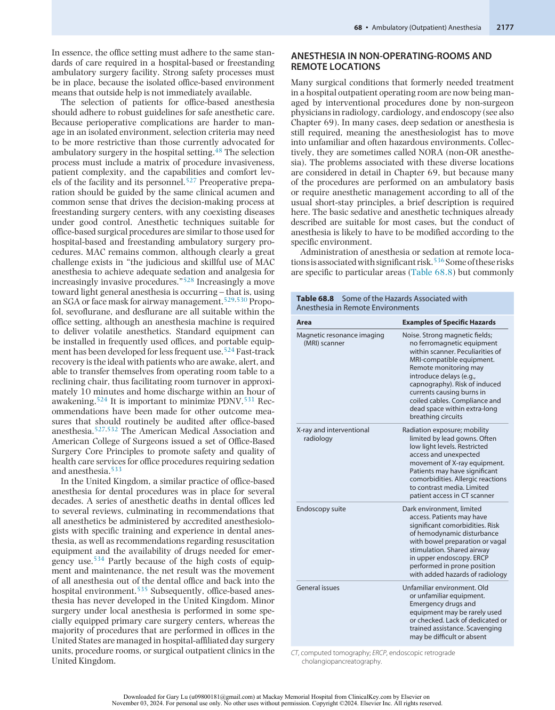

:::

<!-- PDF page 30 -->

include an unfamiliar environment; small, cramped, or dark rooms; restricted patient access; inadequate or poorly trained support; restrictions on patient monitoring; and inadequate resources. An analysis of ASA closed claims arising from anesthesia care in remote locations revealed that adverse events had a higher probability of death than those arising in the operating room537 and were primarily caused by an adverse respiratory event (44%). MAC was the most common anesthetic technique, and respiratory depression secondary to oversedation accounted for over a third of the claims. Care that was substandard and preventable by better monitoring was implicated in the majority of claims associated with death.537 Many of these anesthetics appear to be intravenous general anesthesia without airway devices. In the United States, the CMS mandates that the chiefs of anesthesia services monitor and evaluate sedation practices throughout the hospital, and accrediting organizations, such as TJC and DNV, audit for compliance.

## Home Readiness and Beyond

### PATIENT INFORMATION

Before discharge, patients should receive postoperative instructions concerning aftercare, their transition to normal activities, and any requirements for follow- up. These instructions should be in writing538 because retention of information is impaired during early recovery from anesthesia,539 and ideally they should be repeated to the patient’s escort. Besides general advice, discharge information should include the early warning signs for the main complications of the specific procedure the patient has undergone538 and the action to take should these occur.

### CRITERIA FOR DISCHARGE

Discharge of the patient after ambulatory surgery and anesthesia is a physician responsibility in the United States,10 fulfilled by physician- written discharge criteria (Box 68.3). Typically, patients should be oriented and comfortable with cardiovascular stability (including when standing) and problem- free wounds. Alternatively, discharge criteria may be incorporated into a scoring system, such as the Postanesthetic Discharge Scoring System (Box 68.4).540 Voiding urine is no longer considered an essential prerequisite for

### Box 68.3 Criteria for Facility Discharge Used at the Brigham and Women’s Hospital, United States

discharge in those at low risk for urinary retention, even after spinal anesthesia.541 For patients at higher risk, the bladder volume should be assessed by ultrasound scanning,542 and the patient managed accordingly (Fig. 68.5). Actual discharge is frequently nurse- managed,538,543 provided patients have been managed according to an appropriate protocol and have met all the necessary discharge criteria.

No rationale exists for a minimum observation period after ambulatory surgery in most cases, although patients clearly must be observed for a sufficient period to ensure cardiovascular stability. One possible exception is tonsillectomy, in which a minimum observation period of 6 to 8 hours has been advocated to detect most primary hemorrhages.30 However, even this has been challenged, with a 4- hour observation period544,545 or less546 regarded as safe.

### AFTERCARE AND FOLLOW- UP

Appropriate aftercare is one of the main safety features of ambulatory surgery. Acute complications may be related to anesthesia or surgery, and patients should receive careful predischarge education about what may occur for both. All patients should be provided with a 24- hour telephone number for emergency contact. This is often the ambulatory surgery unit during the daytime, but it may be necessary to provide another number or better still to automatically transfer calls when the unit closes at night.538 In the United States, patients are also routinely given their surgeon’s office and answering service number to contact directly for surgical issues. If the patient’s call to the facility or physician does raise concerns, it is important that the patient be

### Box 68.4 Postanesthetic Discharge Scoring System (PADSS)

### Vital Signs

- 2: Within 20% preprocedure value

1: 20%–40% preprocedure value

- 0: >40% of preprocedure value

### Activity, Mental Status

- 2: Oriented and steady gait

1: Oriented or steady

0: Neither

### Pain, Nausea, Vomiting

2: Minimal 1: Moderate 0: Severe

### Surgical Bleeding

- 2: Minimal

Alert and oriented to time and place Stable vital signs Pain controlled by oral analgesia Nausea or emesis mild, if present No unexpected bleeding from operative site Able to walk without dizziness Patient has been given discharge instructions and prescriptions Patient accepts readiness for discharge Adult present to accompany patient home

Courtesy of B.K. Phillip.

1: Moderate

0: Severe

### Intake and Output

2: PO fluids and voided

1: PO fluids or voided

0: Neither

_PO,_ per os (oral).

From Chung F. Recovery pattern and home- readiness after ambulatory surgery. _Anesth Analg_ . 1995;80(5):896–902.

<!-- PDF page 31 -->

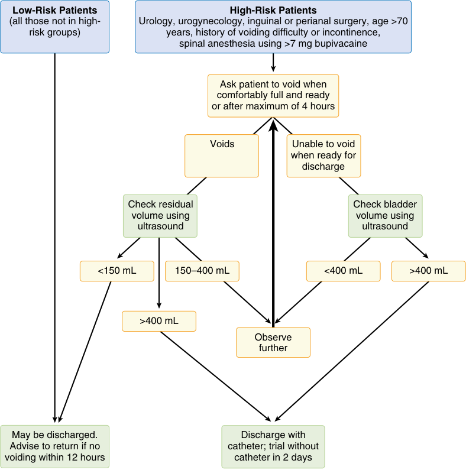

Low-Risk Patients High-Risk Patients (all those not in high- Urology, urogynecology, inguinal or perianal surgery, age >70 risk groups) years, history of voiding difficulty or incontinence, spinal anesthesia using >7 mg bupivacaine Ask patient to void when comfortably full and ready or after maximum of 4 hours Voids Unable to void when ready for discharge Check residual Check bladder volume using volume using ultrasound ultrasound &lt;150 mL 150–400 mL &lt;400 mL >400 mL >400 mL Observe further May be discharged. Discharge with Advise to return if no catheter; trial without voiding within 12 hours catheter in 2 days 

**Fig. 68.5 Flowchart illustrating the management of patients who fail to void urine after ambulatory surgery.** (Reproduced from British Association of Day Surgery. Spinal anaesthesia for day surgery patients. London. http://www.bads.co.uk; 2010. With permission.)

brought back for early surgical review; going to the emergency department also can introduce unnecessary delay. Because the ambulatory patient is self- caring and likely to mobilize early, symptoms of surgical complications are noticed and reported sooner than if the patient were recovering in the hospital environment, allowing earlier detection and increased safety. Daily assessment of various recovery parameters at home using a smartphone- based app was popular with patients and also appeared to improve quality of recovery, probably by providing additional reassurance.547 The system could also be used to request contact from a nurse and was found to be more cost- effective than other forms of postdischarge contact,548 although others found a simple telephone call, which would be cheaper still, was similarly effective.549

### Follow- Up and Outcome Measures

The ASA has developed a set of outcome indicators specifically for ambulatory and office- based surgery and anesthesia.550 These include outcome events of interest for days 1, 14, and 30 and ongoing continuous quality indicators. The IAAS551 has developed a series of indicators (Table 68.9) useful in the evaluation of the overall success of organizational performance, and these mirror the advice from other

national specialist societies.48,552 Lemos and Barros553 further defined the value of outcome reporting in a range of domains subdivided into clinical, organizational, social, and economic factors that allows the reporting of both individual and institutional performance (Table 68.10). Returnmail questionnaires can be used for patient follow- up after ambulatory surgery to help identify common sequelae that ambulatory patients should realistically expect to experience.428 No matter how data are collected, it is important that information from quality indicators is fed back in an effective way to individual clinicians and clinical units to support continuous improvement.554

### Adverse Effects After Ambulatory Surgery

Minor adverse events are common after ambulatory surgery and anesthesia (86%).428 Drowsiness is the most common effect persisting after discharge (62%), and aches and sore throat are common in intubated patients (47% and 49%, respectively). Headache (25%) and dizziness (20%) also occur, but nausea and vomiting after discharge are less common (17% and 7%, respectively). Patients may take 2 to 3 days before they are able to resume their usual activities.428 Information about these known side effects should be incorporated into the preoperative patient education

<!-- PDF page 32 -->

**Table 68.9** Outcome Indicators for Ambulatory Surgery Suggested by the International Association for Ambulatory Surgery

**Table 68.10** Outcome Measures in Ambulatory Surgery

|**Category**|**Specific Outcome Measures**|
|---|---|
|Clinical|Perioperative cardiovascular and respiratory adverse events Minor postoperative morbidity: pain, nausea and vomiting; other: sore throat, headache, drowsiness Unplanned return to the operating room on the same day of surgery Unplanned overnight admission Unplanned return or admission to the day surgery unit or hospital: &lt;24 hours, >24 hours and &lt;28 days|
|Organizational|Proportion of elective surgery performed as day case Accessibility to ambulatory surgery programs: number of different procedures included Cancellation of booked procedures; failure to arrive at the ambulatory surgery unit (ASU) Cancellation after arrival at the ASU|
|Social|Patient satisfaction Functional health status and quality of life|
|Economic|Efficiency rate of operating room utilization|

|**Indicator**|**Reason**|
|---|---|
|Failure to attend the ambulatory surgery center/unit|Acute medical condition Decision of the patient Organizational reasons Other reason (explain...)|
|Cancellation of the booked procedure after arrival at the ambulatory surgery center/unit|Pre- existing medical condition Acute medical condition Organizational reasons Other reason (explain...)|
|Unplanned return to the operating room on the same day||
|Unplanned overnight admission|Surgical reasons Anesthetic or medical reasons Social or administrative reasons|
|Unplanned return of the patient to an ambulatory surgery unit or hospital|&lt;24 hours >24 hours and &lt;28 days|
|Unplanned readmission of the patient to an ambulatory surgery unit or hospital|&lt;24 hours >24 hours and &lt;28 days|

_ASU_ , ambulatory surgery unit. Reproduced from Lemos P, Barros F. Outcome measures. In: Smith I, McWhinnie D, Jackson I, eds. _Day Case Surgery_ . London: Oxford University Press; 2012:335–344. With permission.

and, in the United States, may be incorporated in a separate consent for anesthesia.

of accurate information about the expected perioperative process is important; other factors that lead to higher satisfaction are effective postoperative analgesia, minimal emetic sequelae, staff courtesy and privacy in the unit, short waiting times before surgery, no perception of being rushed, postoperative telephone contact, and naturally, good surgical outcome.551

Acute cardiovascular events (hypertension and hypotension, dysrhythmias, cardiac ischemia, and arrest) occur with an overall frequency of 2.9%, with greater risk in patients with preexisting cardiovascular morbidity; respiratory events (hypoxemia, laryngospasm, bronchospasm, aspiration, pulmonary edema, and pneumothorax) occurred in 0.1% of the study population, with increased risk in smokers, asthmatics, and the obese.61 Unanticipated overnight admission has a worldwide reported incidence of between 1% and 6%. Caution is required in the use of this indicator as a standard to achieve, however, unless the reasons for the admission are documented. Although the indicator may provide evidence of inadequate preoperative assessment and patient optimization, differences in surgical case mix and complexity may explain any variation across institutions. Ultraconservative selection criteria could result in an extremely low overnight admission rate and inappropriately give the impression of a highly performing unit rather than one that was excessively cautious with patient selection. Cross- comparison of this indicator with rates of ambulatory care as a proportion of all elective surgery, either by specialty or specific operation, could assist with interpretation.

### Complete references available online at expertconsult.com.

### References

1.  Nicoll JH. _BMJ_ . 1909;2:753.

2.  Waters RM. _Am J Surg (Anesth Suppl)_ . 1919;33:71.

3.  Smith I, et al. In: Smith I, McWhinnie D, Jackson I, eds. _Oxford Specialist Handbook of Day Surgery_ . Oxford University Press; 2011.

4.  Reed WA, et al. _Int Anesthesiol Clin_ . 1976;14:113.

5.  Philip BK. _Amb Surg_ . 1993;1:77.

6.  Twersky RS, Philip BK, eds. _Handbook of Ambulatory Anesthesia_ . 2nd ed. Springer; 2008.

7.  Toftgaard C. _Amb Surg_ . 2012;17:53.

8.  Ogg TW. In: Lemos P, et al., ed. _Day Surgery Development and Practice._ Porto: International Association for Ambulatory Surgery; 2006:15.

9.  NHS England. _2016/17 National Tariff Payment System_ ; 2017.

10.  American Society of Anesthesiologists. _Guidelines for Ambulatory Anesthesia and Surgery_ . ASA; 2013.

### Patient Satisfaction with Ambulatory Surgery

11.  Philip BK. In: _Successful Management of Ambulatory Surgery Programs_ . Vol. II. American Health Consultants; 1985:167.

Patient satisfaction is a difficult metric to define, depending somewhat on the patient’s expectation of care. Nevertheless, patient satisfaction is generally very high after ambulatory surgery. The patient experience was improved when facility staff were thought to be friendly and the surgeons discussed findings before discharge,555 and these factors were perceived by postoperative ambulatory surgery patients as being more important than management of postoperative pain, starting the intravenous line smoothly, and avoidance of delays. Others have found that provision

12.  Fehrmann K, et al. _J One- Day Surg_ . 2009;19:39.

13.  Junger A, et al. _Eur J Anaesthesiol_ . 2001;18:314.

14.  Tewfik MA, et al. _J Otolaryngol_ . 2006;35:235.

15.  British Association of Day Surgery. _BADS Directory of Procedures_ , 5th ed. London: BADS; 2016. http://www.bads.co.uk.

16.  Trondsen E, et al. _Br J Surg_ . 2000;87:1708.

17.  Thiel J, et al. _J Am Assoc Gynecol Laparosc_ . 2003;10:481.

18.  Ilie CP, et al. _J Endourol_ . 2011;25:631.

19.  Ilie CP, et al. _J Endourol_ . 2011;25:797.

20.  Abboudi H, et al. Day case laparoscopic radical prostatectomy. _Arch Ital Urol Androl_ . 2017;89(3):182.

::: details 原始表格與符號（PDF 第 32 頁）

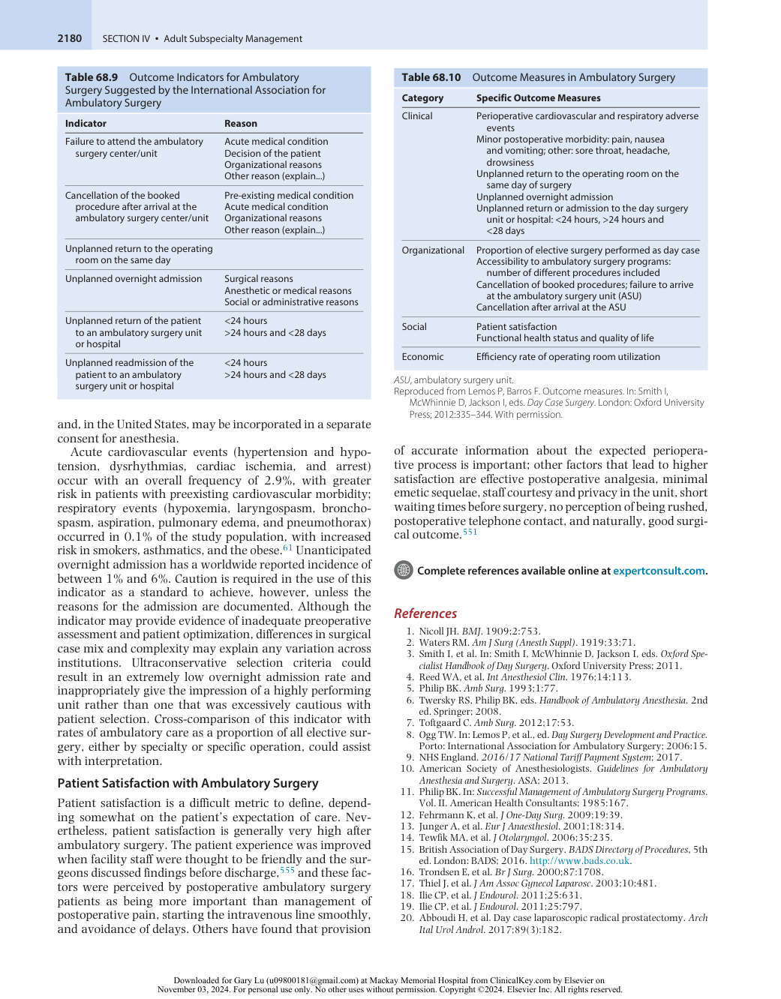

:::

<!-- PDF page 33 -->

21.  Watkins BM, et al. _Obes Surg_ . 2005;15:1045.

22.  Bemelmans YFL, et al. _Arch Orthop Trauma Surg_ . 2022;142(8):1775.

23.  McCarty TM, et al. _Ann Surg_ . 2005;242:494.

24.  Blanshard HJ, et al. _Anesth Analg_ . 2001;92(1):89.

25.  Au K, et al. _J Neurosurg_ . 2016;125(5):1130.

26.  Goettel N, et al. _J Neurosurg Anesth_ . 2014;26(1):60.

27.  Hotchen AJ, et al. _Br J Hosp Med_ . 2016;77(3):180.

28.  McGillion MH, et al. _BMJ_ . 2021;374:n2209.

29.  Bettocchi S, et al. _Human Reprod_ . 2002;17:2435.

30.  Moralee SJ, et al. _J Laryngol Otol_ . 1995;109:1166.

31.  Bennett AMD, et al. _Clin Otolaryngol_ . 2005;30:418.

32.  Steckler RM. _Am J Surg_ . 1986;152:417.

33.  Rajeev P, Sadler GP. In: Smith I, et al., ed. _Oxford Specialist Handbook of Day Surgery_ . London: Oxford University Press; 2011:241.

34.  Stavrakis AI, et al. _Surgery_ . 2007;142:887.

35.  Hisham AN. _J One- Day Surg_ . 2006;16:13.

36.  Smith I, et al. In: Smith I, McWhinnie D, Jackson I, eds. _Oxford Specialist Handbook of Day Surgery_ . Oxford University Press; 2011:345.

37.  Pusic AL, et al. _Ann Surg_ . 2021;274(3):441. 38.  Brown H. In: Smith I, et al., ed. _Oxford Specialist Handbook of Day Surgery_ . Oxford University Press; 2011:199.

39.  Cordeiro E, et al. _Ann Surg Oncol_ . 2016;23(8):2480.

40.  Sweitzer B, et al. _Anesth Analg_ . 2021;133(6):1431.

41.  Chen CL, et al. _N Engl J Med_ . 2015;372(16):1530.

42.  Lermitte J, et al. _Curr Opin Anesthesiol_ . 2005;18:598.

43.  Fleisher LA, et al. _Arch Surg_ . 2007;142:263.

44.  Warner MA, et al. _JAMA_ . 1993;270:1437.

45.  Ansell GL, Montgomery JE. _Br J Anaesth_ . 2004;92(1):71.

46.  Engbaek J, et al. _Acta Anaesthesiol Scand_ . 2006;50:911.

47.  Majholm B, et al. _Acta Anaesthesiol Scand_ . 2012;56:323.

48.  Association of Anaesthetists of Great Britain and Ireland, et al. _Anaesthesia_ . 2011;66:417.

49.  Foley C, et al. _BMC Surg_ . 2021;21(1):253.

50.  Pang G, et al. _J Surg Res_ . 2021;263:71.

51.  Smith I, Jakobsson J. In: Smith I, et al., ed. _Oxford Specialist Handbook of Day Surgery_ . Oxford University Press; 2011:41.

52.  Davies KE, et al. _Anaesthesia_ . 2001;56:1112.

53.  Joshi GP, et al. _Anesth Analg_ . 2013;117(5):1082.

54.  Ankichetty S, et al. _Curr Opin Anesthesiol_ . 2011;24:605.

55.  Raeder J. _Curr Opin Anesthesiol_ . 2007;20:508.

56.  Chung F, et al. _Br J Anaesth_ . 2012;108:768.

57.  Chung F, et al. _Anesth Analg_ . 2016;123(2):452.

58.  Youshani AS, et al. _Int J Pediatr Otorhin_ . 2011;75:207.

59.  Fleisher LA, et al. _Arch Surg_ . 2004;139:67.

60.  Chung F, et al. _Can J Anaesth_ . 1999;46:309.

61.  Chung F, et al. _Br J Anaesth_ . 1999;83:262.

62.  Aldwinckle RJ, et al. _Anaesthesia_ . 2004;59:57.

63.  Seib CD, et al. _JAMA Surg_ . 2018;153(2):160.

64.  Dent E, et al. _Eur J Intern Med_ . 2016;31:3.

65.  Canet J, et al. _Acta Anaesthesiol Scand_ . 2003;47:1204.

66.  Coté CJ, et al. _Anesthesiology_ . 1995;82:809.

67.  Fisher DM. _Anesthesiology_ . 1995;82:807.

68.  Bryson GL, et al. _Can J Anaesth_ . 2004;51:782.

69.  Short J, Bew S. In: Smith I, et al., ed. _Oxford Specialist Handbook of Day Surgery_ . Oxford University Press; 2011:161.

70.  Henderson- Smart DJ, et al. _Cochrane Database Syst Rev_ . 2001; 4:CD000048.

71.  Williams JM, et al. _Br J Anaesth_ . 2001;86:366.

72.  Sale SM, et al. _Br J Anaesth_ . 2006;96:774.

73.  Howell SJ, et al. _Br J Anaesth_ . 2004;92:570.

74.  Eagle KA, et al. _Circulation_ . 2002;105:1257.

75.  Hartle A, et al. _Anaesthesia_ . 2016;71(3):326.

76.  Carlisle J. _Anaesthesia_ . 2015;70(7):773.

77.  Fleisher LA, et al. _Circulation_ . 2014;130(24):2215.

78.  Fleisher LA, et al. _J Am Coll Cardiol_ . 2007;50:1707.

79.  Smith I, et al. _Curr Opin Anesthesiol_ . 2010;23:687.

80.  Roshanov PS, et al. _Anesthesiology_ . 2017;126(1):16.

81.  Chassot PG, et al. _Br J Anaesth_ . 2002;89:747.

82.  Girish M, et al. _Chest_ . 2001;120:1147.

83.  Smilowitz NR. _Am J Cardiol_ . 2019;123(9):1532.

84.  Kaw R. _Respir Med_ . 2011;105(4):619.

85.  Price LC, et al. _Br J Anaesth_ . 2021;126(4):774.

86.  Sweitzer BJ. _Curr Opin Anesthesiol_ . 2008;21:711.

87.  Daniels PR. _BMJ_ . 2015;351(8018):27.

88.  Grines CL, et al. _J Am Coll Cardiol_ . 2007;49:734.

89.  Fogg KJ, et al. _Amb Surg_ . 1995;3:209.

90.  Cheng CJC, et al. _Anaesthesia_ . 2002;57:805.

91.  Chung F, et al. _Can J Anaesth_ . 2005;52:1022.

92.  Chung F, et al. _Anesth Analg_ . 2008;106:817.

93.  Carlisle JB, Stocker ME. In: Smith I, et al., ed. _Oxford Specialist Handbook of Day Surgery_ . Oxford University Press; 2011:51.

94.  Fraczyk L, et al. _J Clin Nurs_ . 2010;19:2849.

95.  Law TT, et al. _Hong Kong Med J_ . 2009;15:179.

96.  Parker BM, et al. _J Clin Anesth_ . 2000;12:350.

97.  Bettelli G. _Curr Opin Anesthesiol_ . 2010;23:726.

98.  Burden N. _J Perianesth Nurs_ . 2004;19:401.

99.  British Association of Day Surgery. _Organisational Issues in Preoperative Assessment for Day Surgery_ . London: BADS; 2010.

100.  Varughese AM, et al. _Paediatr Anaesth_ . 2006;16:723.

101.  Kinley H, et al. _BMJ_ . 2002;325:1323.

102.  Edward GM, et al. _Br J Anaesth_ . 2008;100:322.

103.  Edward GM, et al. _Br J Anaesth_ . 2008;100:195.

104.  Arvidsson S. _Acta Anaesthesiol Scand_ . 1996;40(8 Part 2):962.

105.  Smith I, et al. _Day Case Surgery (Oxford Specialist Handbook Series)_ . Oxford University Press; 2012.

106.  Loxdale SJ, et al. _Anaesthesia_ . 2011;67:51.

107.  Mueller PS, et al. _Mayo Clin Proc_ . 2007;82:1360.

108.  Klein AA, et al. _Anaesthesia_ . 2010;65:974.

109.  American Society of Anesthesiologists Committee on Standards and Practice Parameters, et al. _Anesthesiology_ . 2012;116(3):522.

110.  National Institute for Health and Care Excellence. _Routine Preoperative Tests for Elective Surgery_ . NICE guideline [NG45]; 2016.

111.  Dzankic S, et al. _Anesth Analg_ . 2001;93:301.

112.  van Klei WA, et al. _Ann Surg_ . 2007;246:165.

113.  Chung F, et al. _Anesth Analg_ . 2009;108:467.

114.  Matthey P, et al. _Can J Anaesth_ . 2001;48:333.

115.  Edward GM, et al. _Br J Anaesth_ . 2011;106:319.

116.  British Association of Day Surgery. _Managing Patients with Diabetes for Day and Short Stay Surgery_ , 3rd ed. http://www.bads.co.uk.

117.  Association of Anaesthetists of Great Britain and Ireland. _Anaesthesia_ . 2015;70(12):1427.

118.  Sehgal A, et al. _Anaesthesia_ . 2002;57:947.

119.  Lee A, et al. _Anesthesiology_ . 2006;105:454.

120.  Hogg LA, et al. _Eur J Anaesthesiol_ . 2010;27:11.

121.  American Society of Anesthesiologists. _Anesthesiology_ . 2017; 126(3):376.

122.  Smith I, et al. _Eur J Anaesthesiol_ . 2011;28:556.

123.  Maltby JR, et al. _Can J Anaesth_ . 2004;51:111.

124.  Cook- Sather SD, et al. _Anesth Analg_ . 2009;109:727.

125.  Søreide E, et al. _Acta Anaesthesiol Scand_ . 2005;49:1041.

126.  Engelhardt T, et al. _Paediatr Anaesth_ . 2011;21:964.

127.  Crenshaw JT. _Am J Nurs_ . 2011;111:38.

128.  Kyrtatos PG, et al. _J Periop Practice_ . 2014;24(10):228.

129.  Hillyard S, et al. _Br J Anaesth_ . 2014;112(1):66.

130.  Okabe T, et al. _Br J Anaesth_ . 2015;114(1):77.

131.  Larsen B, et al. _Eur J Anaesthesiol_ . 2016;33:1.

132.  McCracken GC, Montgomery J. _Eur J Anaesthesiol_ . 2018;35(5):337.

133.  Ouanes J- PP, et al. _J Clin Anesth_ . 2015;27(2):146.

134.  Poulton TJ. _Paediatr Anaesth_ . 2012;22:288.

135.  Doze VA, et al. _Anesthesiology_ . 1987;66:223.

136.  Fawcett WJ, Ljungqvist O. _BJA Education_ . 2017;17(9):312.

137.  Carroll JK, et al. _Br J Nurs_ . 2012;21:479.

138.  Segerdahl M, et al. _Acta Anaesthesiol Scand_ . 2008;52(117).

139.  Walker KJ, et al. _Cochrane Database Syst Rev_ . 2009;4:CD002192. 140.  Soltner C, et al. _Br J Anaesth_ . 2011;106:680.

141.  Hargreaves J. _Br J Anaesth_ . 1988;61:611.

142.  De Witte JL, et al. _Anesth Analg_ . 2002;95:1601.

143.  Bauer KP, et al. _J Clin Anesth_ . 2004;16:177.

144.  van Vlymen JM, et al. _Anesthesiology_ . 1999;90:740. 145.  Ko YP, et al. _Acta Anaesthesiol Sinica_ . 2001;39:169. 146.  Horgesheimer JJ, et al. _Pediatr Dent_ . 2001;23:491.

147.  Viitanen H, et al. _Anesth Analg_ . 1999;89:75.

148.  Bevan JC, et al. _Anesth Analg_ . 1997;85:50.

149.  Golden L, et al. _Anesth Analg_ . 2006;102:1070.

150.  Vagnoli L, et al. _Paediatr Anaesth_ . 2010;20:937.

151.  Rice M, et al. _Paediatr Anaesth_ . 2008;18:426.

152.  Lee J, et al. _Anesth Analg_ . 2012;115:1168. 153.  Mifflin KA, et al. _Anesth Analg_ . 2012;115:1162. 154.  Chartrand J, et al. _J Adv Nurs_ . 2017;73(3):599.

155.  Binstock W, et al. _Paediatr Anaesth_ . 2004;14:759.

<!-- PDF page 34 -->

156.  Smith I. _Curr Opin Anesthesiol_ . 2011;24:644.

157.  Dahmani S, et al. _Br J Anaesth_ . 2010;104:216.

158.  Jöhr M. _Eur J Anaesthesiol_ . 2011;28:325.

159.  Brett CN, et al. _Anaesth Intens Care_ . 2012;40:166.

160.  Ong CKS, et al. _Anesth Analg_ . 2005;100:757.

161.  Ochroch EA, et al. _Drugs_ . 2003;63:2709.

162.  White PF, et al. _Anesth Analg_ . 2009;108:1364.

163.  Gan TJ, et al. _Acta Anaesthesiol Scand_ . 2004;48:1194.

164.  Turan I, et al. _J Orthopaed Surg_ . 2008;3:40.

165.  Joshi A, et al. _Br J Oral Max Surg_ . 2004;42:299.

166.  Kaeding C, et al. _Am J Orthoped_ . 2004;33:510.

167.  Mixter 3rd CG, et al. _Arch Surg_ . 1998;133:432.

168.  Yong SL, et al. _Int J Surg_ . 2010;8:283.

169.  Pickering AE, et al. _Br J Anaesth_ . 2002;88:72.

170.  Louizos AA, et al. _Ann Oto Rhinol Laryngol_ . 2006;115:201.

171.  Power I. _Br J Anaesth_ . 2011;107:19.

172.  Kowalski ML, et al. _Treatments Resp Med_ . 2006;5:399.

173.  Jokela R, et al. _Br J Anaesth_ . 2008;100:834.

174.  Peng PWH, et al. _Br J Anaesth_ . 2010;105:155.

175.  Tramèr MR, et al. _Anesth Analg_ . 2007;104:1374.

176.  Kehlet H, et al. _Acta Anaesthesiol Scand_ . 2005;49:143.

177.  British Association of Day Surgery. _Spinal Anaesthesia for Day Surgery Patients_ . London: BADS; 2010. http://www.bads.co.uk. 178.  Korhonen A- M. _Curr Opin Anesthesiol_ . 2006;19:612.

179.  Rattenberry W, et al. _BJA Educ_ . 2019;19(10):321.

180.  Saporito A, et al. _J Clin Anesth_ . 2019;52:99.

181.  Teunkens A, et al. _Reg Anesth Pain Med_ . 2016;41(5):576.

182.  Sahinovic MM, et al. _Curr Opin Anesthesiol_ . 2010;23:734.

183.  Lloyd S. _Curr Anaesth Crit Care_ . 2007;18:188.

184.  Doenicke A, et al. _Anesth Analg_ . 1994;79:933.

185.  Bloomfield R, et al. _Br J Anaesth_ . 2006;97:116.

186.  Sneyd JR, et al. _Br J Anaesth_ . 2010;105:246.

187.  Trudell JR, et al. _Anesth Analg_ . 2012;115:270.

188.  Vlassakov KV, Kissin I. _Trends Pharmacol Sci_ . 2016;37(5):344.

189.  Smith I, et al. _Anesthesiology_ . 1994;81:1005.

190.  Jalota L, et al. _BMJ_ . 2011;342:d1110. 191.  Mallick A, et al. _Eur J Anaesthesiol_ . 2007;24:403. 192.  Win NN, et al. _Anaesthesia_ . 2007;62:561.

193.  Ong LB, et al. _Anaesth Intens Care_ . 2000;28:527.

194.  Tighe KE, et al. _Anaesthesia_ . 1997;52:1000.

195.  Ang S, et al. _Anaesth Intens Care_ . 1999;27:175.

196.  Goyagi T, et al. _Acta Anaesthesiol Scand_ . 2003;47:771. 197.  Smith I, et al. _Eur J Anaesthesiol_ . 2008;25:790. 198.  Rosenblum M, et al. _Anesth Analg_ . 1991;73:255. 199.  Sukhani R, et al. _Anesth Analg_ . 1996;83:975.

200.  Anderson L, Robb H. _Anaesthesia_ . 1998;53:1117.

201.  Djaiani G, et al. _Anaesthesia_ . 1999;54:63.

202.  Ghatge S, et al. _Acta Anaesthesiol Scand_ . 2003;47:917.

203.  Gupta A, et al. _Anesth Analg_ . 2004;98:632.

204.  Goswami U, et al. _Indian J Anaesth_ . 2015;59(3):150.

205.  Geng YJ, et al. _J Clin Anesth_ . 2017;38:165.

206.  Tramèr M, et al. _Br J Anaesth_ . 1997;78:247.

207.  Apfel CC, et al. _N Engl J Med_ . 2004;350:2441.

208.  Kumar G, et al. _Anaesthesia_ . 2014;69(10):1138.

209.  Leslie K, et al. _Cochrane Database Syst Rev_ . 2008;3:CD006059. 210.  Chen G, et al. _Eur J Anaesthesiol_ . 2009;26:928.

211.  Absalom AR, et al. _Br J Anaesth_ . 2009;103:26.

212.  Coetzee JF. _Eur J Anaesthesiol_ . 2009;26:359.

213.  Cortinez LI, et al. _Anesth Analg_ . 2014;119(2):302.

214.  Ebert TJ, et al. _Anesthesiology_ . 1995;83:88.

215.  Doi M, et al. _Can J Anaesth_ . 1993;40:122.

216.  Weiskopf RB, et al. _Anesthesiology_ . 1994;80:1035.

217.  Philip BK, et al. _Anesth Analg_ . 1999;89:623.

218.  Kirkbride DA, et al. _Anesth Analg_ . 2001;93:1185.

219.  Karthikeyan S, et al. _Anaesthesia_ . 2002;57:1114.

220.  Lerman J. _Curr Opin Anesthesiol_ . 2007;20:221.

221.  Picard V, et al. _Acta Anaesthesiol Scand_ . 2000;44:307.

222.  Ortiz AC, et al. _Cochrane Database Syst Rev_ . 2014;2:CD009015.

223.  Macario A, et al. _Am J Health Syst Pharm_ . 2005;62:63.

224.  Tarazi EM, et al. _J Clin Anesth_ . 1998;10:272.

225.  Ashworth J, et al. _Anesth Analg_ . 1998;87:312.

226.  Saros GB, et al. _Acta Anaesthesiol Scand_ . 2006;50:549.

227.  McKay RE, et al. _Br J Anaesth_ . 2010;104:175.

228.  De Baerdemaeker LEC, et al. _Obes Surg_ . 2006;16:728. 229.  Sherman J, et al. _Anesth Analg_ . 2012;114:1086.

230.  Devlin- Hegedus JA, et al. _Anaesthesia_ . 2022;77:1023.

231.  Tramèr M, et al. _Br J Anaesth_ . 1996;76:186.

232.  Fernandez- Guisasola J, et al. _Anaesthesia_ . 2010;65:379.

233.  Peyton PJ, Wu CY. _Anesthesiology_ . 2014;120:1137.

234.  Billingham S, Smith I. _Curr Anesthesiol Rep_ . 2014;4(4):275.

235.  Jakobson J. _Anaesthesia for Day Case Surgery_ . Oxford University Press; 2009.

236.  Stocker ME, Philip BK. In: Smith I, et al., ed. _Oxford Specialist Handbook of Day Surgery_ . Oxford University Press; 2011:63.

237.  Coloma M, et al. _Anesth Analg_ . 2001;92:352.

238.  Shakir AAK, et al. _J One- Day Surg._ 1997;6:10.

239.  Hayhurst CJ, et al. _Anesthesiology_ . 2016;124:483.

240.  Angst MS. _J Cardiothorac Vasc Anesth_ . 2015;29(suppl 1):S16.

241.  Fletcher D, et al. _Br J Anaesth_ . 2014;112(6):991.

242.  Collard V, et al. _Anesth Analg_ . 2007;105(5):1255.

243.  Richebé P, et al. _J Cardiothorac Vasc Anesth_ . 2011;25(6):917.

244.  Salengros JC, et al. _J Cardiothorac Vasc Anesth_ . 2010;24(4):608.

245.  Smith I, et al. _Anesth Analg_ . 1991;73:540.

246.  White PF, et al. _Anesth Analg_ . 2003;97:1633.

247.  Collard V, et al. _Anesth Analg_ . 2007;105:1255.

248.  Moon YE, et al. _J Int Med Res_ . 2011;39:1861.

249.  Hwang W- J, et al. _J Clin Anesth_ . 2013;24.

250.  Singh PP, et al. _Can J Anaesth_ . 1992;39:559.

251.  White PF. _Br J Anaesth_ . 2002;88:163.

252.  Heerdt PM, et al. _Curr Opin Anesthesiol_ . 2015;28(4):403.

253.  Fuchs- Buder T, et al. _Curr Opin Anesthesiol_ . 2012;25:217.

254.  Kimura T, et al. _Anesth Analg_ . 1994;79:378.

255.  Woods AW, et al. _Br J Anaesth_ . 2005;94:150.

256.  Stevens JB, et al. _Anesth Analg_ . 1998;86:45.

257.  Yu SH, et al. _J Oral Maxillofac Surg_ . 2010;68:2359.

258.  Mendels EJ, et al. _Arch Otolaryngol Head Neck Surg_ . 2012;138:257. 259.  Abrishami A, et al. _Can J Anaesth_ . 2010;57:1014.

260.  Cook TM, et al. _Can J Anaesth_ . 2005;52:739.

261.  Cook TM, et al. _Br J Anaesth_ . 2007;99:436.

262.  Maltby JR, et al. _Can J Anaesth_ . 2002;49:857.

263.  Belena JM, et al. _World J Gastrointest Surg_ . 2015;7(11):319.

264.  Nicholson A, et al. _Cochrane Database Syst Rev_ . 2013;9:CD010105. 265.  Hohlrieder M, et al. _Anaesthesia_ . 2007;62:913.

266.  Hohlrieder M, et al. _Br J Anaesth_ . 2007;99:576.

267.  Carron M, et al. _Anesthesiology_ . 2012;117:309.

268.  Cook TM. _Br J Anaesth_ . 2006;96:149.

269.  Jolliffe L, et al. _Curr Opin Anesthesiol_ . 2008;21:719.

270.  Hernandez MR, et al. _Anesth Analg_ . 2012;114:349.

271.  de Montblanc J, et al. _Anaesthesia_ . 2014;69(10):1151.

272.  Despond O, et al. _Can J Anaesth_ . 1998;45(11):1106.

273.  Forget P, et al. _Cochrane Database Syst Rev_ . 2019;12:CD003006.

274.  Boublik J, et al. _Anaesth Crit Care Pain Med_ . 2016;35(6):417.

275.  Goldblum E, et al. _Acta Anaesthesiol Scand_ . 2013;57(5):545.

276.  Schwenk ES, et al. _Anesthesiology_ . 2020;133(4):801.

277.  Nair GS, et al. _Br J Anaesth_ . 2009;102(3):307.

278.  Watson B, Allen J. In: Smith I, et al., ed. _Day Case Surgery_ . Oxford University Press; 2012:79–91.

279.  Linares Gil MJ, et al. _Am J Surg_ . 2009;197:182.

280.  Bay- Nielsen M, et al. _Acta Anaesthesiol Scand_ . 2008;52:169.

281.  Manassero A, Fanelli A. _Local Regional Anesth_ . 2017;10:15.

282.  Camponovo C, et al. _Anesth Analg_ . 2010;111:568.

283.  Lacasse M- A, et al. _Can J Anaesth_ . 2011;58:384.

284.  Vaghadia H, et al. _Acta Anaesthesiol Scand_ . 2012;56:217.

285.  Ghisi D, et al. _BMC Anesthesiol_ . 2021;21(1):58.

286.  Stewart J, et al. _Curr Opin Anaesthesiol_ . 2020;33(6):746.

287.  Mulroy MF, et al. _Anesth Analg_ . 2000;91:860.

288.  Neal JM, et al. _Reg Anesth Pain Med_ . 2001;26:35.

289.  Stevens RA, et al. _Anesthesiology_ . 1993;78:492.

290.  Cyna AM, et al. _Cochrane Database Syst Rev_ . 2008;4:CD003005.

291.  Ansermino M, et al. _Paediatr Anaesth_ . 2003;13:561.

292.  Saadawy I, et al. _Acta Anaesthesiol Scand_ . 2009;53:251.

293.  Brown EM, et al. _Can J Anaesth_ . 1989;36:307.

294.  Niemi TT, et al. _Br J Anaesth_ . 2006;96:640.

295.  Simon MA, et al. _Eur J Anaesthesiol_ . 1998;15:32.

296.  Atanassoff PG, et al. _Anesthesiology_ . 2001;95:627.

297.  Peng PWH, et al. _Reg Anesth Pain Med_ . 2002;27:595.

298.  Asik I, et al. _J Clin Anesth_ . 2009;21:401.

299.  Löser B, et al. _J Anesth Hist_ . 2019;5(3):99.

300.  Teunkens A, et al. _Eur J Anaesthesiol_ . 2020;37(10):847. 301.  Choyce A, et al. _Can J Anaesth_ . 2002;49:32.

<!-- PDF page 35 -->

302.  Sen S, et al. _Br J Anaesth_ . 2006;97:408.

303.  Bigat Z, et al. _Anesth Analg_ . 2006;102:605.

304.  Esmaoglu A, et al. _Eur J Anaesthesiol_ . 2005;22:447.

305.  Memis D, et al. _Anesth Analg_ . 2004;98:835.

306.  Alayurt S, et al. _Anaesth Intens Care_ . 2004;32:22.

307.  Gupta A, et al. In: Smith I, et al., ed. _Oxford Specialist Handbook of Day Surgery_ . Oxford University Press; 2011:93.

308.  Turbitt LR, et al. _Anaesthesia_ . 2020;75(3):293.

309.  Desai N, et al. _Curr Opin Anaesthesiol_ . 2020;33(6):760.

310.  Gabriel RA, et al. _Anesth Analg_ . 2018;126(6):2078.

311.  Abrahams MS, et al. _Br J Anaesth_ . 2009;102(3):408.

312.  Neal JM. _Reg Anesth Pain Med_ . 2010;35(suppl 2):S59.

313.  Møiniche S, et al. _Reg Anesth Pain Med_ . 1999;24:430.

314.  Scott NB. _Anaesthesia_ . 2010;65(suppl 1):67.

315.  Macfarlane AJR, et al. _Anaesthesia_ . 2021;76(suppl 1):27.

316.  Sagir A, et al. _J Anesth_ . 2015;29(2):299.

317.  Balentine CJ, et al. _Am J Surg_ . 2021;221(5):902.

318.  Kerr DR, et al. _Acta Orthop_ . 2008;79:174.

319.  Essving P, et al. _Acta Orthop_ . 2009;80:213.

320.  Andersen LØ, Kehlet H. _Br J Anaesth_ . 2014;113(3):360.

321.  Seangleulur A, et al. _Eur J Anaesthesiol_ . 2016;33(11):816.

322.  Bernaus M, et al. _Hip Int_ . 2021:1120700021992684.

323.  Lunn TH, et al. _Reg Anesth Pain Med_ . 2011;36(5):424.

324.  Liu SS, et al. _J Am Coll Surg_ . 2006;203(6):914.

325.  Bei T, et al. _Pain Physician_ . 2021;24(6):E693.

326.  Sehmbi H, et al. _Anaesthesia_ . 2021;76(7):974.

327.  Woo JH, et al. _Reg Anesth Pain Med_ . 2021;46(11):965.

328.  Barry GS, et al. _Br J Anaesth_ . 2021;126(4):862.

329.  Pedersen JL, et al. _Anesth Analg_ . 2004;99:912.

330.  Weiniger CF, et al. _Anaesthesia_ . 2012;67:906.

331.  Ilfeld BM, et al. _Anesthesiology_ . 2021;134(2):283.

332.  Hussain N, et al. _Reg Anesth Pain Med_ . 2021;46(1):61.

333.  Ottoboni T, et al. _Reg Anesth Pain Med_ . 2019.

334.  Lachiewicz PF, et al. _J Arthroplasty_ . 2020;35(10):2843.

335.  Viscusi E, et al. _Reg Anesth Pain Med_ . 2019.

336.  Viscusi E, et al. _Hernia_ . 2019;23(6):1071.

337.  Yip T, et al. _Pain Manag_ . 2022;12(1):45.

338.  Rodriguez- Navarro AJ, et al. _Reg Anesth Pain Med_ . 2011;36:103.

339.  Lobo K, et al. _Anesthesiology_ . 2015;123(4):873.

340.  Padera RF, et al. _Muscle Nerve_ . 2006;34(6):747.

341.  Shomorony A, et al. _Anesth Analg_ . 2019;129(3):709.

342.  Raeder J. _Anesth Analg_ . 2009;108:704.

343.  American Society of Anesthesiologists. _Continuum of Depth of Sedation: Definition of General Anesthesia and Levels of Sedation/analgesia_ ; 2014.

344.  American Society of Anesthesiologists. _ASA Position on Monitored Anesthesia Care_ ; 2013.

345.  Ahuja M, Armstrong I. In: Smith I, et al., ed. _Oxford Specialist Handbook of Day Surgery_ . Oxford University Press; 2011:109.

346.  Bhananker SM, et al. _Anesthesiology_ . 2006;104:228.

347.  Hug CC Jr. _Anesthesiology_ . 2006;104:221.

348.  Smith I. _J Clin Anesth_ . 1996;8:76S.

349.  Philip BK. _Anesth Analg_ . 1987;66:97.

350.  Richards A, et al. _Oral Surg Oral Med Oral Path_ . 1993;76:408.

351.  Smith I, et al. _Anesth Analg_ . 1994;79:313.

352.  Heuss LT, Inauen W. _Digestion_ . 2004;69(1):20.

353.  Royal College of Anaesthetists and British Society of Gastroenterology Joint Working Party. _Guidance for the Use of Propofol Sedation for Adult Patients Undergoing Endoscopic Retrograde Cholangiopancreatography (ERCP) and Other Complex Upper GI Endoscopic Procedures_ . 2011.

354.  American Society of Anesthesiologists. _Statement on Safe Use of Propofol_ ; 2014.

355.  Vargo JJ, et al. _Gastroint Endosc_ . 2009;70:1053.

356.  Rex DK, et al. _Gastroenterology_ . 2009;137:1229.

357.  Berzin TM, et al. _Gastroint Endosc_ . 2011;73:710.

358.  Leslie K, et al. _Br J Anaesth_ . 2017;118(1):90.

359.  Lee A, et al. _Drugs_ . 2021;81(10):1193.

360.  Pastis NJ, et al. _Chest_ . 2019;155(1):137.

361.  Rex DK, et al. _Gastrointest Endosc_ . 2018;88(3):427.e6.

362.  Borkett KM, et al. _Anesth Analg_ . 2015;120(4):771.

363.  Wesolowski AM, et al. _Pharmacotherapy_ . 2016;36(9):1021.

364.  Sneyd JR, et al. _Br J Anaesth_ . 2021;127(1):41.

365.  Stöhr T, et al. _Br J Anaesth_ . 2021;127(3):415.

366.  Pesic M, et al. _Eur J Clin Pharmacol_ . 2020;76(11):1505.

367.  Dilger JA, et al. _Can J Anaesth_ . 2004;51:20.

368.  Winton AL, et al. _Anaesthesia_ . 2008;63:932.

369.  Berkenstadt H, et al. _J Neurosurg Anesth_ . 2001;13:246.

370.  Ryu J- H, et al. _J Clin Anesth_ . 2008;20:328.

371.  Sá Rêgo MM, et al. _Anesth Analg_ . 1999;88:518.

372.  Höhener D, et al. _Br J Anaesth_ . 2008;100:8.

373.  Frost EAM, et al. _Curr Opin Anesthesiol_ . 2007;20:331.

374.  Badrinath S, et al. _Anesth Analg_ . 2000;90:858.

375.  Taylor E, et al. _J Clin Anesth_ . 1992;4:213.

376.  Nieuwenhuijs DJF, et al. _Anesthesiology_ . 2003;98:312.

377.  Avramov M, et al. _Anesthesiology_ . 1996;85:1283.

378.  Philip BK, et al. _Anesth Analg_ . 1990;71:371.

379.  Ghouri AF, et al. _Anesthesiology_ . 1994;81:333.

380.  Smith I, et al. _Frontline Gastro_ . 2018;9:185.

381.  Casati A, et al. _Can J Anaesth_ . 1999;46:235.

382.  Ibrahim AE, et al. _Anesthesiology_ . 2001;95:1151.

383.  Cheung CW, et al. _Anaesthesia_ . 2008;63:1302.

384.  von Delius S, et al. _Endoscopy_ . 2012;44:258.

385.  Sakaguchi M, et al. _J Clin Anesth_ . 2011;23:636.

386.  Osborne GA, et al. _Anaesthesia_ . 1994;49:287.

387.  Heuss LT, et al. _Am J Gastroenterol_ . 2004;99(3):511.

388.  Philip JH, et al. _J Clin Anesth_ . 1997;9:608.

389.  Hartmann T, et al. _Acta Anaesthesiol Scand_ . 1998;42(suppl 112):221.

390.  Ibrahim AE, et al. _Anesthesiology_ . 2001;94:87.

391.  Marchant N, et al. _Clin EEG Neurosci_ . 2014;45(1):22.

392.  Heyse B, et al. _Acta Anaesthesiol Belg_ . 2009;60(1):19.

393.  Fahy BG, et al. _Anesth Analg_ . 2018;126(1):111.

394.  Jensen EW, et al. _Acta Anaesthesiol Scand_ . 2014;58(8):933.

395.  Ellerkmann RK, et al. _Anesth Analg_ . 2013;116(3):580.

396.  Sahinovic MM, et al. _Anesth Analg_ . 2014;119(2):288.

397.  Shoushtarian M, et al. _J Clin Monit Comput_ . 2016;30(6):833.

398.  Escallier KE, et al. _Anaesthesia_ . 2014;69(8):899.

399.  Liu SS. _Anesthesiology_ . 2004;101:311.

400.  Punjasawadwong Y, et al. _Cochrane Database Syst Rev_ . 2007;4: CD003843.

401.  Recart A, et al. _Anesth Analg_ . 2003;97:1667.

402.  White PF, et al. _Anesthesiology_ . 2004;100:811.

403.  Chhabra A, et al. _Cochrane Database Syst Rev_ . 2016;3:CD010135.

404.  Drummond JC. _Anesthesiology_ . 2000;93:876.

405.  Kalkman CJ, et al. _Anesthesiology_ . 2002;96(4):784.

406.  Farag E, et al. _Anesth Analg_ . 2006;103(3):633.

407.  Ballard C, et al. _PLoS One_ . 2012;7(6):e37410.

408.  Punjasawadwong Y, et al. _Cochrane Database Syst Rev_ . 2018;5: CD011283.

409.  Berger M, et al. _Anesth Analg_ . 2020;130(5):1274.

410.  Tay S, et al. _Anaesth Intensive Care_ . 2013;41(1):95.

411.  Ponsonnard S, et al. _Anaesth Crit Care Pain Med_ . 2017;36(1):33.

412.  British Association of Day Surgery. _Recovery for Day Surgery Units_ . London: BADS; 2007. http://www.bads.co.uk.

413.  Gift AG, et al. _Anesth Analg_ . 1995;80:368.

414.  Philip BK. In: Gullo A, ed. _Anaesthesia, Pain, Intensive Care and Emergency Medicine_ . Springer- Verlag; 1996:1003.

415.  Aldrete JA. _J Clin Anesth_ . 1995;7:89.

416.  Imarengiaye CO, et al. _Anesthesiology_ . 2003;98:511.

417.  Apfelbaum JL. _Can J Anaesth_ . 1998;45(5 suppl 1):R91.

418.  Song D, et al. _Anesth Analg_ . 1998;86:267.

419.  White PF, et al. _Anesth Analg_ . 1999;88:1069.

420.  Apfelbaum JL, et al. _Anesthesiology_ . 2002;97:66.

421.  Li S, et al. _Anesthesiology_ . 2000;93:1225.

422.  Coloma M, et al. _Anesth Analg_ . 2001;93:112.

423.  Song D, et al. _Anesth Analg_ . 1998;87:1245. 424.  Ahmad S, et al. _Anesthesiology_ . 2003;98:849.

425.  Millar J. _Br J Anaesth_ . 2004;93:756.

426.  Song D, et al. _Br J Anaesth_ . 2004;93:768.

427.  Duncan PG, et al. _Can J Anaesth_ . 2001;48:630.

428.  Philip BK. _J Clin Anesth_ . 1992;4:355.

429.  Wu CL, et al. _Anesthesiology_ . 2002;96:994.

430.  Fahmy N, et al. _Br J Pain_ . 2016;10(2):84.

431.  Schug SA, et al. _Curr Opin Anesthesiol_ . 2009;22:738. 432.  Kehlet H. _Anesthesiology_ . 2005;102:1083.

433.  Kehlet H, et al. _Anesth Analg_ . 1993;77:1048.

434.  McCleane G. _J One- Day Surg_ . 2008;18:4.

435.  Michaloliakou C, et al. _Anesth Analg_ . 1996;82:44.

436.  Eriksson H, et al. _Acta Anaesthesiol Scand_ . 1996;40:151. 437.  White PF, et al. _Anesth Analg_ . 2007;104:1380.

438.  Gray A, et al. _Br J Anaesth_ . 2005;94:710.

439.  White PF, et al. _Anesthesiology_ . 2010;112:220.

<!-- PDF page 36 -->

440.  Liu SS, et al. _Anesth Analg_ . 2007;104:689. 441.  Hoshijima H, et al. _J Pain Res_ . 2021;14:3521. 442.  Nelson AM, et al. _Anesth Analg_ . 2018;127(5):1099. 443.  Mörwald EE, et al. _Anesth Analg_ . 2018;127(5):1221. 444.  Greenberg S, et al. _World Neurosurg_ . 2018;109:e554. 445.  Sivakumar W, et al. _J Neurosurg_ . 2018;130(3):766. 446.  Olbrecht VA, et al. _Clin J Pain_ . 2018;34(7):593. 447.  Yang L, et al. _Int J Surg_ . 2017;47:135. 448.  Xuan C, et al. _Pain Physician_ . 2021;24(2):E153.

449.  Ferguson MC, et al. _Cochrane Database Syst Rev_ . 2021;9:CD013264. 450.  McNicol ED, et al. _Cochrane Database Syst Rev_ . 2021;5:CD013263. 451.  McNicol ED, et al. _Cochrane Database Syst Rev_ . 2018;8:CD012498. 452.  Hearn L, et al. _Cochrane Database Syst Rev_ . 2016;4:CD011421. 453.  Dodwell ER, et al. _Calcif Tissue Int_ . 2010;87(3):193. 454.  Lee A, et al. _Cochrane Database Syst Rev_ . 2007;(2):CD002765. 455.  Bongiovanni T, et al. _J Am Coll Surg_ . 2021;232(5):765.e1. 456.  Kumar AH, et al. _Curr Opin Anaesthesiol_ . 2019;32(5):629. 457.  Verret M, et al. _Anesthesiology_ . 2020;133(2):265. 458.  Waldron NH, et al. _Br J Anaesth_ . 2013;110(2):191. 459.  Mitchell C, et al. _Perioper Med (Lond)_ . 2022;11(1):13. 460.  Corcoran TB, et al. _N Engl J Med_ . 2021;384(18):1731. 461.  Claxton AR, et al. _Anesth Analg_ . 1997;84:509. 462.  Koch S, et al. _Acta Anaesthesiol Scand_ . 2008;52:845. 463.  Mattia C, et al. _Eur J Anaesthesiol_ . 2010;27:433. 464.  Hippard HK, et al. _Anesth Analg_ . 2012;115:356. 465.  van de Donk T, et al. _Anaesthesia_ . 2018;73(2):231. 466.  Chauvin M. _Eur J Anaesthesiol_ . 2003;20(suppl 28):3. 467.  Scott LJ, et al. _Drugs_ . 2000;60:139.

468.  Rawal N, et al. _Anesth Analg_ . 2001;92:347.

469.  Etropolski M, et al. _Adv Ther_ . 2011;28:401.

470.  Rawal N. _Best Pract Res Clin Anaesthesiol_ . 2007;21(1):129. 471.  Axelsson K, et al. _Acta Anaesthesiol Scand_ . 2003;47:993. 472.  Piper SL, et al. _Am J Sport Med_ . 2011;39:2245.

473.  Matsen 3rd FA, et al. _J Bone Joint Surg Am_ . 2013;95(12):1126. 474.  Russon K, et al. _Br J Anaesth_ . 2006;97(6):869.

475.  Capdevila X, et al. _Anesth Analg_ . 2003;96:414. 476.  Remerand F, et al. _Anesth Analg_ . 2008;107:2079. 477.  Apfel CC, et al. _Anesthesiology_ . 1999;91:693. 478.  Sinclair DR, et al. _Anesthesiology_ . 1999;91:109. 479.  Apfel CC, et al. _Anesthesiology_ . 2012;117:475. 480.  Eberhart LH, et al. _Eur J Anaesthesiol_ . 2011;28(3):155. 481.  Gan TJ, et al. _Anesth Analg_ . 2020;131(2):411. 482.  Gan TJ, et al. _Anesth Analg_ . 2007;105:1615. 483.  Apfel CC, et al. _Acta Anaesthesiol Scand_ . 1998;42:495. 484.  Apfel CC, et al. _Br J Anaesth_ . 2012;109:742. 485.  Dewinter G, et al. _Br J Anaesth_ . 2018;120(1):156. 486.  Kappen TH. _Br J Anaesth_ . 2018;120(1):9.

487.  Schaefer MS, et al. _Eur J Anaesthesiol_ . 2016;33(10):750. 488.  Apfel CC, et al. _Br J Anaesth_ . 2012;108:893. 489.  Maharaj CH, et al. _Anesth Analg_ . 2005;100:675. 490.  Henzi I, et al. _Br J Anaesth_ . 2000;83:761.

491.  De Oliveira Jr GS, et al. _Br J Anaesth_ . 2012;109:688. 492.  Wallenborn J, et al. _BMJ_ . 2006;333:324.

493.  Gan TJ, et al. _Anesthesiology_ . 2002;97:287.

494.  Schaub I, et al. _Eur J Anaesthesiol_ . 2012;29:286.

495.  Kranke P, et al. _Acta Anaesthesiol Scand_ . 2002;46:238.

496.  Forrester CM, et al. _AANA J (Am Assoc Nurse Anesth)_ . 2007;75:27. 497.  Pergolizzi JV Jr, et al. _J Clin Anesth_ . 2012;24:334. 498.  Kotelko DM, et al. _Anesthesiology_ . 1989;71:675.

499.  Einarsson JI, et al. _J Min Invas Gynecol_ . 2008;15:26. 500.  Tang J, et al. _Anesth Analg_ . 1998;86:274.

501.  Tramèr MR, et al. _Anesthesiology_ . 1997;87:1277. 502.  Ho K- Y, et al. _Curr Opin Anesthesiol_ . 2006;19:606. 503.  Apfel CC, et al. _Br J Anaesth_ . 2012;108:371. 504.  De Oliveira Jr GS, et al. _Anesth Analg_ . 2013;116(1):58. 505.  Wang JJ, et al. _Anesth Analg_ . 2000;91:136.

506.  De Oliveira Jr GS, et al. _Br J Anaesth_ . 2011;107(3):362.

507.  Murphy GS, et al. _Anesthesiology_ . 2011;114(4):882.

508.  Diemunsch P, et al. _Br J Anaesth_ . 2009;103:7.

509.  Apfel CC, et al. _Curr Opin Anaesthesiol_ . 2008;21(4):427.

510.  Yogendran S, et al. _Anesth Analg_ . 1995;80:682.

511.  Rothenberg DM, et al. _Anesth Analg_ . 1991;72:58.

512.  Ljungqvist O, et al. _J Surg Oncol_ . 2017;116(5):608.

513.  Lide RC, et al. _Head Neck_ . 2021;43(5):1545.

514.  Jogerst K, et al. _Ann Surg Oncol_ . 2020;27(9):3436.

515.  Afonso AM, et al. _Anesth Analg_ . 2021;133(6):1391.

516.  Trejo- Ávila ME, et al. _Surg Endosc_ . 2019;33(2):429.

517.  Broderick RC, et al. _Surg Endosc_ . 2022;36(9):6742.

518.  Curfman KR, et al. _Am J Surg_ . 2022;224(2):757.

519.  Parrish AB, et al. _World J Surg_ . 2018;42(7):1929.

520.  Gupta S, et al. _J Obstet Gynaecol_ . 2022;42(5):1415.

521.  Schultz LS. _Int Surg_ . 1994;79:273.

522.  Prickett KK, et al. _Int Forum Allergy Rhinol_ . 2012;2:207.

523.  Vila H Jr, et al. _Arch Surg_ . 2003;138:1991.

524.  Vila H Jr, et al. In: Twersky RS, Philip BK, eds. _Handbook of Ambulatory Anesthesia_ . 2nd ed. Springer; 2008:283.

525.  Shapiro FE, et al. _Anesth Analg_ . 2014;119(2):276.

526.  Hoefflin SM, et al. _Plast Reconstr Surg_ . 2001;107:243.

527.  Twersky RS, et al. _Considerations in Setting up and Maintaining a Safe Office Anesthesia Environment_ . American Society of Anesthesiologists, Society for Ambulatory Anesthesia; 2008.

528.  Desai MS. _Curr Opin Anesthesiol_ . 2008;21:699.

529.  Tang J, et al. _Anesthesiology_ . 1999;91:253.

530.  Tang J, et al. _Anesth Analg_ . 2001;92:95.

531.  Kolodzie K, et al. _Curr Opin Anesthesiol_ . 2009;22:532.

532.  Shnaider I, et al. _Curr Opin Anesthesiol_ . 2006;19:622.

533.  American Medical Association, American College of Surgeons. _B Am Coll Surg_ . 2004;89(4):32.

534.  Poswillo DE. General anaesthesia, sedation and resuscitation in dentistry. In: _Report of an Expert Working Party._ Standing Dental Advisory Committee, Department of Health. 1990.

535.  James DW. _Br Dent J_ . 1991;171:345.

536.  Robbertze R, et al. _Curr Opin Anesthesiol_ . 2006;19:436.

537.  Metzner J, et al. _Curr Opin Anesthesiol_ . 2009;22:502.

538.  Hammond C. In: Smith I, et al., ed. _Oxford Specialist Handbook of Day Surgery_ . Oxford University Press; 2011:309.

539.  Blandford CM, et al. _Anaesthesia_ . 2011;66:1088.

540.  Chung F, et al. _J Clin Anesth_ . 1995;7:500.

541.  Mulroy MF, et al. _Anesthesiology_ . 2002;97:315.

542.  Pavlin DJ, et al. _Anesthesiology_ . 1999;91:42.

543.  British Association of Day Surgery. _Nurse Led Discharge._ London: BADS; 2009. http://www.bads.co.uk.

544.  Gabalski EC, et al. _Laryngoscope_ . 1996;106(77).

545.  Ovesen T, et al. _Dan Med J_ . 2012;59:A4382.

546.  Kalantar N, et al. _Int J Pediatr Otorhin_ . 2006;70:2103.

547.  Jaensson M, et al. _Br J Anaesth_ . 2017;119(5):1030.

548.  Dahlberg K, et al. _Br J Anaesth_ . 2017;119(5):1039.

549.  Daniels SA, et al. _Am J Surg_ . 2016;211(5):963.

550.  American Society of Anesthesiologists Committee on Ambulatory Surgical Care and the Task Force on Office- Based Anesthesia. _Outcome Indicators for Office- Based and Ambulatory Surgery_ . American Society of Anesthesiologists; 2003.

551.  Lemos P, Regalado AM. In: Lemos P, et al., ed. _Day Surgery, Development and Practice_ . International Association for Ambulatory Surgery; 2006:257.

552.  Australian Council on Healthcare Standards. _Equipment and Clinical Indicators: Day Surgery_ ; 2012.

553.  Lemos P, Barros F. In: Smith I, et al., ed. _Oxford Specialist Handbook of Day Surgery_ . Oxford University Press; 2011:335.

554.  Benn J, et al. _Br J Anaesth_ . 2012;109:80.

555.  Tarazi EM, et al. _Am J Anesthesiol_ . 1998;25:154.

<!-- PDF page 37 -->

### References

1.  Nicoll JH. The surgery of infancy. _BMJ_ . 1909;2:753–754.

2.  Waters RM. The downtown anesthesia clinic. _Am J Surg (Anesthesia Supplement)_ . 1919;33:71–73.

3.  Smith I, McWhinnie D, Jackson I. An overview of ambulatory surgery. In: Smith I, McWhinnie D, Jackson I, eds. _Day Case Surgery_ . London: Oxford University Press; 2012:1–11.

4.  Reed WA, Ford JL. Development of an independent outpatient surgical center. _Int Anesthesiol Clin_ . 1976;14(2):113–130.

5.  Philip BK. A history of the Society for Ambulatory Anesthesia. _Amb Surg_ . 1993;1(2):77–79.

6.  Twersky RS, Philip BK, eds. _Handbook of Ambulatory Anesthesia_ . 2nd ed. New York: Springer; 2008.

7.  Toftgaard C. Day surgery activities 2009. International survey on ambulatory surgery conducted 2011. _Amb Surg_ . 2012;17(3):53– 63.

8.  Ogg TW. Preface. In: Lemos P, Jarrett P, Philip B, eds. _Day Surgery Development and Practice._ Porto: International Association for Ambulatory Surgery; 2006:15–19.

9.  NHS England. 2016/17 National Tariff Payment System. https:// http://www.gov.uk/government/uploads/system/uploads/ attachment_data/file/509697/2016- 17_National_Tariff_ Payment_System.pdf; 2017.

10.  American Society of Anesthesiologists. _Guidelines for Ambulatory Anesthesia and Surgery_ . http://www.asahq.org/sitecore/ shell/∼/media/sites/asahq/files/public/resources/standardsguidelines/guidelines- for- ambulatory- anesthesia- and- surgery.pdf; ASA; 2013.

11.  Philip BK. Starting up a hospital- based ambulatory surgery program. In: _Successful Management of Ambulatory Surgery Programs_ . Vol. II. Atlanta: American Health Consultants; 1985:167–184.

12.  Fehrmann K, Matthews CM, Stocker ME. Day surgery in different guises: a comparison of outcomes. _J One- Day Surg_ . 2009;19(2):39– 47.

13.  Junger A, Klasen J, Benson M, et al. Factors determining length of stay of surgical day- case patients. _Eur J Anaesthesiol_ . 2001;18:314– 321.

14.  Tewfik MA, Frenkiel S, Gasparrini R, et al. Factors affecting unanticipated hospital admission following otolaryngologic day surgery. _J Otolaryngol_ . 2006;35(4):235–241.

15.  British Association of Day Surgery. _BADS Directory of Procedures_ . 5th ed. London: BADS; 2016. http://www.bads.co.uk.

16.  Trondsen E, Mjaland O, Raeder J, Buanes T. Day- case laparoscopic fundoplication for gastro- oesophageal reflux disease. _Br J Surg_ . 2000;87:1708–1711.

17.  Thiel J, Gamelin A. Outpatient total laparoscopic hysterectomy. _J Am Assoc Gynecol Laparosc_ . 2003;10(4):481–483.

18.  Ilie CP, Luscombe CJ, Smith I, et al. Day case laparoscopic nephrectomy. _J Endourol_ . 2011;25(4):631–634.

19.  Ilie CP, Luscombe CJ, Smith I, et al. Routine day case laparoscopic pyeloplasty – a paradigm shift? _J Endourol_ . 2011;25(5):797–801.

20.  Abboudi H, Doyle P, Winkler M. Day case laparoscopic radical prostatectomy. _Arch Ital Urol Androl_ . 2017;89(3):182–185.

21.  Watkins BM, Montgomery KF, Ahroni JH, et al. Adjustable gastric banding in an ambulatory surgery center. _Obes Surg_ . 2005;15:1045– 1049.

22.  Bemelmans YFL, Keulen MHF, Heymans M, et al. Safety and efficacy of outpatient hip and knee arthroplasty: a systematic review with meta- analysis. _Arch Orthop Trauma Surg_ . 2022;142(8):1775–1791.

23.  McCarty TM, Arnold DT, Lamont JP, et al. Optimizing outcomes in bariatric surgery: outpatient laparoscopic gastric bypass. _Ann Surg_ . 2005;242(4):494–498.

24.  Blanshard HJ, Chung F, Manninen PH, et al. Awake craniotomy for removal of intracranial tumor: considerations for early discharge. _Anesth Analg_ . 2001;92(1):89–94.

25.  Au K, Bharadwaj S, Venkatraghavan L, Bernstein M. Outpatient brain tumor craniotomy under general anesthesia. _J Neurosurg_ . 2016;125(5):1130–1135.

26.  Goettel N, Chui J, Venkatraghavan L, et al. Day surgery craniotomy for unruptured cerebral aneurysms: a single center experience. _J Neurosurg Anesth_ . 2014;26(1):60–64.

27.  Hotchen AJ, Coleman G, O’Callaghan JM, McWhinnie D. Safe and sustainable increases in day case emergency surgery. _Br J Hosp Med_ . 2016;77(3):180–183.

28.  McGillion MH, Parlow J, Borges FK, et al. Post- discharge after surgery Virtual Care with Remote Automated Monitoring- 1 (PVCRAM- 1) technology versus standard care: randomised controlled trial. _BMJ_ . 2021;374:n2209.

29.  Bettocchi S, Ceci O, Di Venere R, et al. Advanced operative office hysteroscopy without anaesthesia: analysis of 501 cases treated with a 5 Fr. bipolar electrode. _Human Reprod_ . 2002;17(9):2435–2438.

30.  Moralee SJ, Murray JAM. Would day- case adult tonsillectomy be safe? _J Laryngol Otol_ . 1995;109:1166–1167.

31.  Bennett AMD, Clark AB, Bath AP, Montgomery PQ. Meta- analysis of the timing of haemorrhage after tonsillectomy: an important factor in determining the safety of performing tonsillectomy as a day case procedure. _Clin Otolaryngol_ . 2005;30(5):418–423.

32.  Steckler RM. Outpatient thyroidectomy: a feasibility study. _Am J Surg_ . 1986;152(4):417–419.

33.  Rajeev P, Sadler GP. Thyroid and parathyroid surgery. In: Smith I, McWhinnie D, Jackson I, eds. _Day Case Surgery_ . London: Oxford University Press; 2012:241–254.

34.  Stavrakis AI, Ituarte PH, Ko CY, Yeh MW. Surgeon volume as a predictor of outcomes in inpatient and outpatient endocrine surgery. _Surgery_ . 2007;142(6):887–899.

35.  Hisham AN. Day care thyroid surgery: the way of the future. _J Oneday Surg_ . 2006;16(1):13–15.

36.  Smith I, McWhinnie D, Jackson I. Developing day surgery. In: Smith I, McWhinnie D, Jackson I, eds. _Day Case Surgery_ . London: Oxford University Press; 2012:345–354.

37.  Pusic AL, Temple LK, Carter J, et al. A randomized controlled trial evaluating electronic outpatient symptom monitoring after ambulatory cancer surgery. _Ann Surg_ . 2021;274(3):441–448.

38.  Brown H. Breast surgery. In: Smith I, McWhinnie D, Jackson I, eds. _Day Case Surgery_ . London: Oxford University Press; 2012:199–206.

39.  Cordeiro E, Jackson T, Cil T. Same- day major breast cancer surgery is safe: an analysis of short- term outcomes using NSQIP data. _Ann Surg Oncol_ . 2016;23(8):2480–2486.

40.  Sweitzer B, Rajan N, Schell D, et al. Preoperative care for cataract surgery: the Society for Ambulatory Anesthesia position statement. _Anesth Analg_ . 2021;133(6):1431–1436.

41.  Chen CL, Lin GA, Bardach NS, et al. Preoperative medical testing in Medicare patients undergoing cataract surgery. _N Engl J Med_ . 2015;372(16):1530–1538.

42.  Lermitte J, Chung F. Patient selection in ambulatory surgery. _Curr Opin Anesthesiol_ . 2005;18:598–602.

43.  Fleisher LA, Pasternak LR, Lyles A. A novel index of elevated risk of inpatient hospital admission immediately following outpatient surgery. _Arch Surg_ . 2007;142:263–268.

44.  Warner MA, Shields SE, Chute CG. Major morbidity and mortality within 1 month of ambulatory surgery and anesthesia. _JAMA_ . 1993;270(12):1437–1441.

45.  Ansell GL, Montgomery JE. Outcome of ASA III patients undergoing day case surgery. _Br J Anaesth_ . 2004;92(1):71–74.

46.  Engbaek J, Bartholdy J, Hjortsø NC. Return hospital visits and morbidity within 60 days after day surgery: a retrospective study of 18,736 day surgical procedures. _Acta Anaesthesiol Scand_ . 2006;50(7):911–919.

47.  Majholm B, Engbaek J, Bartholdy J, et al. Is day surgery safe? A Danish multicentre study of morbidity after 57,709 day surgery procedures. _Acta Anaesthesiol Scand_ . 2012;56(3):323–331.

48.  Association of Anaesthetists of Great Britain and Ireland, British Association of Day Surgery, Verma R, et al. Day case and short stay surgery: 2. _Anaesthesia_ . 2011;66(5):417–434.

49.  Foley C, Kendall MC, Apruzzese P, De Oliveira GS. American Society of Anesthesiologists Physical Status Classification as a reliable predictor of postoperative medical complications and mortality following ambulatory surgery: an analysis of 2,089,830 ACS- NSQIP outpatient cases. _BMC Surg_ . 2021;21(1):253.

50.  Pang G, Kwong M, Schlachta CM, et al. Safety of same- day discharge in high- risk patients undergoing ambulatory general surgery. _J Surg Res_ . 2021;263:71–77.

51.  Smith I, Jakobsson J. Selection criteria. In: Smith I, McWhinnie D, Jackson I, eds. _Day Case Surgery_ . London: Oxford University Press; 2012:41–50.

52.  Davies KE, Houghton K, Montgomery JE. Obesity and day- case surgery. _Anaesthesia_ . 2001;56(11):1112–1115.

53.  Joshi GP, Ahmad S, Riad W, et al. Selection of obese patients undergoing ambulatory surgery: a systematic review of the literature. _Anesth Analg_ . 2013;117(5):1082–1091.

<!-- PDF page 38 -->

54.  Ankichetty S, Chung F. Considerations for patients with obstructive sleep apnea undergoing ambulatory surgery. _Curr Opin Anesthesiol_ . 2011;24:605–611.

55.  Raeder J. Bariatric procedures as day/short stay surgery: is it possible and reasonable? _Curr Opin Anesthesiol_ . 2007;20(6):508–512.

56.  Chung F, Subramanyam R, Liao P, et al. High STOP- Bang score indicates a high probability of obstructive sleep apnoea. _Br J Anaesth_ . 2012;108(5):768–775.

57.  Chung F, Memtsoudis SG, Ramachandran SK, et al. Society of Anesthesia and Sleep Medicine guidelines on preoperative screening and assessment of adult patients with obstructive sleep apnea. _Anesth Analg_ . 2016;123(2):452–473.

58.  Youshani AS, Thomas L, Sharma RK. Day case tonsillectomy for the treatment of obstructive sleep apnoea syndrome in children: Alder Hey experience. _Int J Pediatr Otorhin_ . 2011;75(2):207–210.

59.  Fleisher LA, Pasternak LR, Herbert R, Anderson GF. Inpatient hospital admission and death after outpatient surgery in elderly patients: importance of patient and system characteristics and location of care. _Arch Surg_ . 2004;139(1):67–72.

60.  Chung F, Mezei G, Tong D. Adverse events in ambulatory surgery. A comparison between elderly and younger patients. _Can J Anaesth_ . 1999;46(4):309–321.

61.  Chung F, Mezei G, Tong D. Pre- existing medical conditions as predictors of adverse events in day- case surgery. _Br J Anaesth_ . 1999;83(2):262–270.

62.  Aldwinckle RJ, Montgomery JE. Unplanned admission rates and post discharge complications in patients over the age of 70 following day case surgery. _Anaesthesia_ . 2004;59(1):57–59.

63.  Seib CD, Rochefort H, Chomsky- Higgins K, et al. Association of patient frailty with increased morbidity after common ambulatory general surgery operations. _JAMA Surg_ . 2018;153(2):160–168.

64.  Dent E, Kowal P, Hoogendijk EO. Frailty measurement in research and clinical practice: a review. _Eur J Intern Med_ . 2016;31:3–10.

65.  Canet J, Raeder J, Rasmussen LS, et al. Cognitive dysfunction after minor surgery in the elderly. _Acta Anaesthesiol Scand_ . 2003;47(10):1204–1210.

66.  Coté CJ, Zaslavsky A, Downes JJ, et al. Postoperative apnea in former preterm infants after inguinal herniorrhaphy. A combined analysis. _Anesthesiology_ . 1995;82(4):809–822.

67.  Fisher DM. When is the ex- premature infant no longer at risk for apnea? (Editorial). _Anesthesiology_ . 1995;82(4):807–808.

68.  Bryson GL, Chung F, Cox RG, et al. Patient selection in ambulatory anesthesia – an evidence- based review: Part II. _Can J Anaesth_ . 2004;51(8):782–794.

69.  Short J, Bew S. Paediatric day surgery. In: Smith I, McWhinnie D, Jackson I, eds. _Day Case Surgery (Oxford Specialist Handbooks)_ . London: Oxford University Press; 2012:161–197.

70.  Henderson- Smart DJ, Steer P. Prophylactic caffeine to prevent postoperative apnea following general anesthesia in preterm infants. _Cochrane Database Syst Rev_ . 2001;4:CD000048.

71.  Williams JM, Stoddart PA, Williams SA, Wolf AR. Post- operative recovery after inguinal herniotomy in ex- premature infants: comparison between sevoflurane and spinal anaesthesia. _Br J Anaesth_ . 2001;86(3):366–371.

72.  Sale SM, Read JA, Stoddart PA, Wolf AR. Prospective comparison of sevoflurane and desflurane in formerly premature infants undergoing inguinal herniotomy. _Br J Anaesth_ . 2006;96(6):774–778.

73.  Howell SJ, Sear JW, Foëx P. Hypertension, hypertensive heart disease and perioperative cardiac risk. _Br J Anaesth_ . 2004;92(4):570–583.

74.  Eagle KA, Berger PB, Calkins H, et al. ACC/AHA Guideline update for perioperative cardiovascular evaluation for noncardiac surgery – executive summary: a report of the American College of Cardiology/American Heart Association task force on practice guidelines. _Circulation_ . 2002;105:1257–1267.

75.  Hartle A, McCormack T, Carlisle J, et al. The measurement of adult blood pressure and management of hypertension before elective surgery: joint guidelines from the Association of Anaesthetists of Great Britain and Ireland and the British Hypertension Society. _Anaesthesia_ . 2016;71(3):326–337.

76.  Carlisle J. Too much blood pressure? (Editorial). _Anaesthesia_ . 2015;70(7):773–778.

77.  Fleisher LA, Fleischmann KE, Auerbach AD, et al. 2014 ACC/AHA guideline on perioperative cardiovascular evaluation and management of patients undergoing noncardiac surgery: executive summary: a report of the American College of Cardiology/American

Heart Association task force on practice guidelines. _Circulation_ . 2014;130(24):2215–2245.

78.  Fleisher LA, Beckman JA, Brown KA, et al. ACC/AHA 2007 guidelines on perioperative cardiovascular evaluation and care for noncardiac surgery: executive summary. _J Am Coll Cardiol_ . 2007;50(17):1707–1732.

79.  Smith I, Jackson I. Beta- blockers, calcium channel blockers, angiotensin converting enzyme inhibitors and angiotensin receptor blockers: should they be stopped or not before ambulatory anaesthesia? _Curr Opin Anesthesiol_ . 2010;23:687–690.

80.  Roshanov PS, Rochwerg B, Patel A, et al. Withholding versus continuing angiotensin- converting enzyme inhibitors or angiotensin II receptor blockers before noncardiac surgery: an analysis of the Vascular events in noncardiac Surgery patIents cOhort evaluatioN prospective cohort. _Anesthesiology_ . 2017;126(1):16–27.

81.  Chassot PG, Delabays A, Spahn DR. Preoperative evaluation of patients with, or at risk of, coronary artery disease undergoing noncardiac surgery (Review). _Br J Anaesth_ . 2002;89(5):747–759.

82.  Girish M, Trayner E, Damman O, et al. Symptom- limited stair climbing as a predictor of postoperative cardiopulmonary complications after high- risk surgery. _Chest_ . 2001;120:1147–1151.

83.  Smilowitz NR, Armanious A, Bangalore S, et al. Cardiovascular outcomes of patients with pulmonary hypertension undergoing noncardiac surgery. _Am J Cardiol_ . 2019;123(9):1532–1537.

84.  Kaw R, Pasupuleti V, Deshpande A, et al. Pulmonary hypertension: an important predictor of outcomes in patients undergoing noncardiac surgery. _Respir Med_ . 2011;105(4):619–624.

85.  Price LC, Martinez G, Brame A, et al. Perioperative management of patients with pulmonary hypertension undergoing noncardiothoracic, non- obstetric surgery: a systematic review and expert consensus statement. _Br J Anaesth_ . 2021;126(4):774– 790.

86.  Sweitzer BJ. Preoperative screening, evaluation, and optimization of the patient’s medical status before outpatient surgery. _Curr Opin Anesthesiol_ . 2008;21(6):711–718.

87.  Daniels PR. Peri- procedural management of patients taking oral anticoagulants. _BMJ_ . 2015;351(8018):27–30.

88.  Grines CL, Bonow RO, Casey Jr DE, et al. Prevention of premature discontinuation of dual antiplatelet therapy in patients with coronary artery stents: a science advisory from the American Heart Association, American College of Cardiology, Society for Cardiovascular Angiography and Interventions, American College of Surgeons, and American Dental Association, with representation from the American College of Physicians. _J Am Coll Cardiol_ . 2007;49(6):734–739.

89.  Fogg KJ, Saunders PRI. Folly! The long distance day surgery patient. _Amb Surg_ . 1995;3(4):209–210.

90.  Cheng CJC, Smith I, Watson BJ. A multicentre telephone survey of compliance with post- operative instructions. _Anaesthesia_ . 2002;57(8):805–811.

91.  Chung F, Imasogie N, Ho J, et al. Frequency and implications of ambulatory surgery without a patient escort. _Can J Anaesth_ . 2005;52(10):1022–1026.

92.  Chung F, Assmann N. Car accidents after ambulatory surgery in patients without an escort. _Anesth Analg_ . 2008;106(3):817– 820.

93.  Carlisle JB, Stocker ME. Preoperative assessment. In: Smith I, McWhinnie D, Jackson I, eds. _Day Case Surgery_ . London: Oxford University Press; 2012:51–62.

94.  Fraczyk L, Godfrey H. Perceived levels of satisfaction with the preoperative assessment service experienced by patients undergoing general anaesthesia in a day surgery setting. _J Clin Nurs_ . 2010;19(19–20):2849–2859.

95.  Law TT, Suen DTK, Tam YF, et al. Telephone pre- anaesthesia assessment for ambulatory breast surgery. _Hong Kong Med J_ . 2009;15(3):179–182.

96.  Parker BM, Tetzlaff JE, Litaker DL, Maurer WG. Redefining the preoperative evaluation process and the role of the anesthesiologist. _J Clin Anesth_ . 2000;12(5):350–356.

97.  Bettelli G. Anaesthesia for the elderly outpatient: preoperative assessment and evaluation, anaesthetic technique and postoperative pain management. (Review). _Curr Opin Anesthesiol_ . 2010;23(6):726– 731.

98.  Burden N. Discharge planning for the elderly ambulatory surgical patient. _J Perianesth Nurs_ . 2004;19(6):401–405.

<!-- PDF page 39 -->

99.  British Association of Day Surgery. _Organisational Issues in Pre Operative Assessment for Day Surgery_ ; London: BADS; 2010. http://www.b ads.co.uk.

100.  Varughese AM, Byczkowski TL, Wittkugel EP, et al. Impact of a nurse practitioner- assisted preoperative assessment program on quality. _Paed Anaesth_ . 2006;16(7):723–733.

101.  Kinley H, Czoski- Murray C, George S, et al. Effectiveness of appropriately trained nurses in preoperative assessment: randomised controlled equivalence/non- inferiority trial. _BMJ_ . 2002;325(7376):1323.

102.  Edward GM, de Haes JCJM, Oort FJ, et al. Setting priorities for improving the preoperative assessment clinic: the patients’ and the professionals’ perspective. _Br J Anaesth_ . 2008;100(3):322–326.

103.  Edward GM, Das SF, Elkhuizen SG, et al. Simulation to analyse planning difficulties at the preoperative assessment clinic. _Br J Anaesth_ . 2008;100(2):195–202.

104.  Arvidsson S. Preparation of adult patients for anaesthesia and surgery. _Acta Anaesthesiol Scand_ . 1996;40(8 Part 2):962–970.

105.  Smith I, McWhinnie D, Jackson I, eds. _Day Case Surgery (Oxford Specialist Handbook Series)_ . London: Oxford University Press; 2012.

106.  Loxdale SJ, Sneyd JR, Donovan A, et al. The role of routine preoperative bedside echocardiography in detecting aortic stenosis in patients with a hip fracture. _Anaesthesia_ . 2012;67(1):51–54.

107.  Mueller PS, Barnes RD, Varghese R, et al. The safety of electroconvulsive therapy in patients with severe aortic stenosis. _Mayo Clin Proc_ . 2007;82:1360–1363.

108.  Klein AA, Arrowsmith JE. Should routine pre- operative testing be abandoned? (Editorial). _Anaesthesia_ . 2010;65(10):974–976.

109.  American Society of Anesthesiologists Committee on Standards and Practice Parameters, Apfelbaum JL, Connis RT, et al. Practice advisory for preanesthesia evaluation: an updated report by the American Society of Anesthesiologists task force on preanesthesia evaluation. _Anesthesiology_ . 2012;116(3):522–538.

110.  National Institute for Health and Care Excellence. Routine preoperative tests for elective surgery. _NICE guideline_ [NG45]; 2016. http:// www.nice.org.uk/guidance/ng45/resources.

111.  Dzankic S, Pastor D, Gonzalez C, Leung JM. The prevalence and predictive value of abnormal preoperative laboratory tests in elderly surgical patients. _Anesth Analg_ . 2001;93(2):301–308.

112.  van Klei WA, Bryson GL, Yang H, et al. The value of routine preoperative electrocardiography in predicting myocardial infarction after noncardiac surgery. _Ann Surg_ . 2007;246(2):165–170.

113.  Chung F, Yuan H, Yin L, et al. Elimination of preoperative testing in ambulatory surgery. _Anesth Analg_ . 2009;108(2):467–475.

114.  Matthey P, Finucane BT, Finegan BA. The attitude of the general public towards preoperative assessment and risks associated with general anesthesia. _Can J Anaesth_ . 2001;48(4):333–339.

115.  Edward GM, Naald NVD, Oort FJ, et al. Information gain in patients using a multimedia website with tailored information on anaesthesia. _Br J Anaesth_ . 2011;106(3):319–324.

116.  British Association of Day Surgery. _Managing Patients with Diabetes for Day and Short Stay Surgery_ . 3rd ed. London; 2011. http://www. bads.co.uk.

117.  Association of Anaesthetists of Great Britain and Ireland. Perioperative management of the surgical patient with diabetes 2015. _Anaesthesia_ . 2015;70(12):1427–1440.

118.  Sehgal A, Hall JE. Herbal medicines – harmless or harmful? _Anaesthesia_ . 2002;57(10):947–948.

119.  Lee A, Chui PT, Aun CST, et al. Incidence and risk of adverse perioperative events among surgical patients taking traditional Chinese herbal medicines. _Anesthesiology_ . 2006;105(3):454–461.

120.  Hogg LA, Foo I. Management of patients taking herbal medicines in the perioperative period: a survey of practice and policies within anaesthetic departments in the United Kingdom. _Eur J Anaesthesiol_ . 2010;27(1):11–15.

121.  American Society of Anesthesiologists. Practice guidelines for preoperative fasting and the use of pharmacologic agents to reduce the risk of pulmonary aspiration: application to healthy patients undergoing elective procedures: an updated report by the American Society of Anesthesiologists task force on preoperative fasting and the use of pharmacologic agents to reduce the risk of pulmonary aspiration. _Anesthesiology_ . 2017;126(3):376–393.

122.  Smith I, Kranke P, Murat I, et al. Perioperative fasting in adults and children: guidelines from the European Society of Anaesthesiology. _Eur J Anaesthesiol_ . 2011;28:556–569.

123.  Maltby JR, Pytka S, Watson NC, et al. Drinking 300 mL of clear fluid two hours before surgery has no effect on gastric fluid volume and pH in fasting and non- fasting obese patients. _Can J Anaesth_ . 2004;51(2):111–115.

124.  Cook- Sather SD, Gallagher PR, Kruge LE, et al. Overweight/obesity and gastric fluid characteristics in pediatric day surgery: implications for fasting guidelines and pulmonary aspiration risk. _Anesth Analg_ . 2009;109(3):727–736.

125.  Søreide E, Eriksson LI, Hirlekar G, et al. Pre- operative fasting guidelines: an update. (Review). _Acta Anaesthesiol Scand_ . 2005;49(8):1041–1047.

126.  Engelhardt T, Wilson G, Horne L, et al. Are you hungry? Are you thirsty? – fasting times in elective outpatient pediatric patients. _Paed Anaesth_ . 2011;21(9):964–968.

127.  Crenshaw JT. Preoperative fasting: will the evidence ever be put into practice? _Am J Nurs_ . 2011;111(10):38–43.

128.  Kyrtatos PG, Constandinou N, Loizides S, Mumtaz T. Improved patient education facilitates adherence to preoperative fasting guidelines. _J Periop Practice_ . 2014;24(10):228–231.

129.  Hillyard S, Cowman S, Ramasundaram R, et al. Does adding milk to tea delay gastric emptying? _Br J Anaesth_ . 2014;112(1):66–71.

130.  Okabe T, Terashima H, Sakamoto A. Determinants of liquid gastric emptying: comparisons between milk and isocalorically adjusted clear fluids. _Br J Anaesth_ . 2015;114(1):77–82.

131.  Larsen B, Larsen LPP, Sivesgaard K, Juul S. Black or white coffee before anaesthesia? Gastric volume measured by MRI. A randomised crossover trial. _Eur J Anaesthesiol_ . 2016;33:1–6.

132.  McCracken GC, Montgomery J. Postoperative nausea and vomiting after unrestricted clear fluids before day surgery. A retrospective analysis. _Eur J Anaesthesiol_ . 2018;35(5):337–342.

133.  Ouanes J- PP, Bicket MC, Togioka B, et al. The role of perioperative chewing gum on gastric fluid volume and gastric pH: a metaanalysis. _J Clin Anesth_ . 2015;27(2):146–152.

134.  Poulton TJ. Gum chewing during pre- anesthetic fasting. _Paed Anaesth_ . 2012;22(3):288–296.

135.  Doze VA, White PF. Effects of fluid therapy on serum glucose levels in fasted outpatients. _Anesthesiology_ . 1987;66(2):223–226.

136.  Fawcett WJ, Ljungqvist O. Starvation, carbohydrate loading, and outcome after major surgery (Review). _BJA Education_ . 2017;17(9):312–316.

137.  Carroll JK, Cullinan E, Clarke L, Davis NF. The role of anxiolytic premedication in reducing preoperative anxiety. _Br J Nurs_ . 2012;21(8):479–483.

138.  Segerdahl M, Warren- Stomberg M, Rawal N, et al. Clinical practice and routines for day surgery in Sweden: results from a nation- wide survey. _Acta Anaesthesiol Scand_ . 2008;52(1):117–124.

139.  Walker KJ, Smith AF. Premedication for anxiety in adult day surgery. _Cochrane Database Syst Rev_ . 2009;4:CD002192.

140.  Soltner C, Giquello JA, Monrigal- Martin C, Beydon L. Continuous care and empathic anaesthesiologist attitude in the preoperative period: impact on patient anxiety and satisfaction. _Br J Anaesth_ . 2011;106(5):680–686.

141.  Hargreaves J. Benzodiazepine premedication in minor day- case surgery: comparison of oral midazolam and temazepam with placebo. _Br J Anaesth_ . 1988;61(5):611–616.

142.  De Witte JL, Alegret C, Sessler DI, Cammu G. Preoperative alprazolam reduces anxiety in ambulatory surgery patients: a comparison with oral midazolam. _Anesth Analg_ . 2002;95(6):1601–1606.

143.  Bauer KP, Dom PM, Ramirez AM, O’Flaherty JE. Preoperative intravenous midazolam: benefits beyond anxiolysis. _J Clin Anesth_ . 2004;16(3):177–183.

144.  van Vlymen JM, Sa Rego MM, White PF. Benzodiazepine premedication: can it improve outcome in patients undergoing breast biopsy procedures? _Anesthesiology_ . 1999;90(3):740–747.

145.  Ko YP, Huang CJ, Hung YC, et al. Premedication with low- dose oral midazolam reduces the incidence and severity of emergence agitation in pediatric patients following sevoflurane anesthesia. _Acta Anaesthesiol Sinica_ . 2001;39(4):169–177.

146.  Horgesheimer JJ, Pribble CG, Lugo RA. The effect of midazolam premedication on discharge time in pediatric patients undergoing general anesthesia for dental restorations. _Pediatr Dentistry_ . 2001;23(6):491–494.

147.  Viitanen H, Annila P, Viitanen M, Tarkkila P. Premedication with midazolam delays recovery after ambulatory sevoflurane anesthesia in children. _Anesth Analg_ . 1999;89(1):75–79.

<!-- PDF page 40 -->

148.  Bevan JC, Veall GR, Macnab AJ, et al. Midazolam premedication delays recovery after propofol without modifying involuntary movements. _Anesth Analg_ . 1997;85(1):50–54.

149.  Golden L, Pagala M, Sukhavasi S, et al. Giving toys to children reduces their anxiety about receiving premedication for surgery. _Anesth Analg_ . 2006;102(4):1070–1072.

150.  Vagnoli L, Caprilli S, Messeri A. Parental presence, clowns or sedative premedication to treat preoperative anxiety in children: what could be the most promising option? _Paed Anaesth_ . 2010;20(10):937–943.

151.  Rice M, Glasper A, Keeton D, Spargo P. The effect of a preoperative education programme on perioperative anxiety in children: an observational study. _Paed Anaesth_ . 2008;18(5):426–430.

152.  Lee J, Lee J, Lim H, et al. Cartoon distraction alleviates anxiety in children during induction of anesthesia. _Anesth Analg_ . 2012;115(5):1168–1173.

153.  Mifflin KA, Hackmann T, Chorney JM. Streamed video clips to reduce anxiety in children during inhaled induction of anesthesia. _Anesth Analg_ . 2012;115(5):1162–1167.

154.  Chartrand J, Tourigny J, MacCormick J. The effect of an educational pre- operative DVD on parents’ and children’s outcomes after a same- day surgery: a randomized controlled trial. _J Adv Nurs_ . 2017;73(3):599–611.

155.  Binstock W, Rubin R, Bachman C, et al. The effect of premedication with OTFC, with or without ondansetron, on postoperative agitation, and nausea and vomiting in pediatric ambulatory patients. _Paed Anaesth_ . 2004;14(9):759–767.

156.  Smith I. Alpha- 2- agonists in day case anaesthesia. _Curr Opin Anesthesiol_ . 2011;24:644–648.

157.  Dahmani S, Stany I, Brasher C, et al. Pharmacological prevention of sevoflurane- and desflurane- related emergence agitation in children: a meta- analysis of published studies. (Review). _Br J Anaesth_ . 2010;104(2):216–223.

158.  Jöhr M. Clonidine in paediatric anaesthesia. _Eur J Anaesthesiol_ . 2011;28:325–326.

159.  Brett CN, Barnett SG, Pearson J. Postoperative plasma paracetamol levels following oral or intravenous paracetamol administration: a double- blind randomised controlled trial. _Anaesth Intens Care_ . 2012;40(1):166–171.

160.  Ong CKS, Lirk P, Seymour RA, Jenkins BJ. The efficacy of preemptive analgesia for acute postoperative pain management: a metaanalysis. _Anesth Analg_ . 2005;100(3):757–773.

161.  Ochroch EA, Mardini IA, Gottschalk A. What is the role of NSAIDs in pre- emptive analgesia? _Drugs_ . 2003;63(24):2709–2723.

162.  White PF, Kehlet H, Liu S. Perioperative analgesia: what do we still know? (Editorial). _Anesth Analg_ . 2009;108(4):1364–1367.

163.  Gan TJ, Joshi GP, Zhao SZ, et al. Presurgical intravenous parecoxib sodium and follow- up oral valdecoxib for pain management after laparoscopic cholecystectomy surgery reduces opioid requirements and opioid- related adverse effects. _Acta Anaesthesiol Scand_ . 2004;48(9):1194–1207.

164.  Turan I, Hein A, Jacobson E, Jakobsson JG. Sevoflurane requirement during elective ankle day surgery: the effects of etirocoxib premedication, a prospective randomised study. _J Orthopaed Surg_ . 2008;3:40.

165.  Joshi A, Parara E, Macfarlane TV. A double- blind randomised controlled clinical trial of the effect of preoperative ibuprofen, diclofenac, paracetamol with codeine and placebo tablets for relief of postoperative pain after removal of impacted third molars. _Brit J Oral Max Surg_ . 2004;42(4):299–306.

166.  Kaeding C, Pedroza A, Sharkey J. Comparison of efficacy of oral rofecoxib and ketorolac in controlling early postoperative outpatient orthopedic surgical pain. _Am J Orthoped_ . 2004;33(10):510–513.

167.  Mixter 3rd CG, Meeker LD, Gavin TJ. Preemptive pain control in patients having laparoscopic hernia repair: a comparison of ketorolac and ibuprofen. _Arch Surg_ . 1998;133(4):432–437.

168.  Yong SL, Coulthard P. Pain after surgery: can protective analgesia reduce pain? A randomised clinical trial. _Int J Surg_ . 2010;8(4):283– 289.

169.  Pickering AE, Bridge HS, Nolan J, Stoddart PA. Double- blind, placebo- controlled analgesic study of ibuprofen or rofecoxib in combination with paracetamol for tonsillectomy in children. _Br J Anaesth_ . 2002;88(1):72–77.

170.  Louizos AA, Pandazi AB, Koraka CP, et al. Preoperative administration of rofecoxib versus ketoprofen for pain relief after tonsillectomy. _Ann Oto Rhinol Laryngol_ . 2006;115(3):201–204.

171.  Power I. An update on analgesics. _Br J Anaesth_ . 2011;107(1):19–24.

172.  Kowalski ML, Makowska J. Use of nonsteroidal anti- inflammatory drugs in patients with aspirin hypersensitivity: safety of cyclooxygenase- 2 inhibitors. _Treatments Resp Med_ . 2006;5(6):399– 406.

173.  Jokela R, Ahonen J, Tallgren M, et al. Premedication with pregabalin 75 or 150 mg with ibuprofen to control pain after day- case gynaecological laparoscopic surgery. _Br J Anaesth_ . 2008;100(6):834–840.

174.  Peng PWH, Li C, Farcas E, et al. Use of low- dose pregabalin in patients undergoing laparoscopic cholecystectomy. _Br J Anaesth_ . 2010;105(2):155–161.

175.  Tramèr MR, Glynn CJ. An evaluation of a single dose of magnesium to supplement analgesia after ambulatory surgery: randomized controlled trial. _Anesth Analg_ . 2007;104(6):1374–1379.

176.  Kehlet H. Bay Nielsen M: anaesthetic practice for groin hernia repair – a nation- wide study in Denmark 1998–2003. _Acta Anaesthesiol Scand_ . 2005;49(2):143–146.

177.  British Association of Day Surgery. _Spinal Anaesthesia for Day Surgery Patients_ . London: BADS; 2010. http://www.bads.co.uk.

178.  Korhonen A- M. Use of spinal anaesthesia in day surgery. _Curr Opin Anesthesiol_ . 2006;19(6):612–616.

179.  Rattenberry W, Hertling A, Erskine R. Spinal anaesthesia for ambulatory surgery. _BJA Educ_ . 2019;19(10):321–328.

180.  Saporito A, Ceppi M, Perren A, et al. Does spinal chloroprocaine pharmacokinetic profile actually translate into a clinical advantage in terms of clinical outcomes when compared to low- dose spinal bupivacaine? A systematic review and meta- analysis. _J Clin Anesth_ . 2019;52:99–104.

181.  Teunkens A, Vermeulen K, Van Gerven E, et al. Comparison of 2- chloroprocaine, bupivacaine, and lidocaine for spinal anesthesia in patients undergoing knee arthroscopy in an outpatient setting: a double- blind randomized controlled trial. _Reg Anesth Pain Med_ . 2016;41(5):576–583.

182.  Sahinovic MM, Absalom AR, Struys MMRF. Administration and monitoring of intravenous anesthetics. _Curr Opin Anesthesiol_ . 2010;23(6):734–740.

183.  Lloyd S. General anaesthesia for day surgery: preventing the problems. _Curr Anaesth Crit Care_ . 2007;18:188–192.

184.  Doenicke A, Roizen MF, Nebauer AE, et al. A comparison of two formulations for etomidate, 2- hydroxypropyl- β- cyclodextrin (HPCD) and propylene glycol. _Anesth Analg_ . 1994;79(5):933–939.

185.  Bloomfield R, Noble DW. Etomidate and fatal outcome – even a single bolus dose may be detrimental for some patients (letter). _Br J Anaesth_ . 2006;97(1):116–117.

186.  Sneyd JR, Rigby- Jones AE. New drugs and technologies, intravenous anaesthesia is on the move (again). _Br J Anaesth_ . 2010;105(3):246– 254.

187.  Trudell JR, Bertaccini E, Maciver MB. Special article: teaching an old GABA receptor new tricks. _Anesth Analg_ . 2012;115(2):270–273.

188.  Vlassakov KV, Kissin I. Decline in the development of new anesthetics. _Trends Pharmacol Sci_ . 2016;37(5):344–352.

189.  Smith I, White PF, Nathanson M, Gouldson R. Propofol: an update on its clinical use. _Anesthesiology_ . 1994;81(4):1005–1043.

190.  Jalota L, Kalira V, George E, et al. Prevention of pain on injection of propofol: systematic review and meta- analysis. _BMJ_ . 2011;342:d1110.

191.  Mallick A, Elliot SC, Krishnan K, Vucevic M. Lidocaine is more efficient than the choice of propofol formulations to reduce incidence of pain on induction. _Eur J Anaesthesiol_ . 2007;24(5):403–407.

192.  Win NN, Kohase H, Yoshikawa F, et al. Haemodynamic changes and heart rate variability during midazolam- propofol co- induction. _Anaesthesia_ . 2007;62(6):561–568.

193.  Ong LB, Plummer JL, Waldow WC, Owen H. Timing of midazolam and propofol administration for co- induction of anaesthesia. _Anaesth Intens Care_ . 2000;28(5):527–531.

194.  Tighe KE, Warner JA. The effect of co- induction with midazolam upon recovery from propofol infusion anaesthesia. _Anaesthesia_ . 1997;52(10):1000–1004.

195.  Ang S, Cheong KF, Ng TI. Alfentanil co- induction for laryngeal mask insertion. _Anaesth Intens Care_ . 1999;27(2):175–178.

196.  Goyagi T, Tanaka M, Nishikawa T. Fentanyl decreases propofol requirement for laryngeal mask airway insertion. _Acta Anaesthesiol Scand_ . 2003;47(6):771–774.

197.  Smith I, Walley G, Bridgman S. Omitting fentanyl reduces nausea and vomiting, without increasing pain, after sevoflurane for day surgery. _Eur J Anaesthesiol_ . 2008;25(10):790–799.

<!-- PDF page 41 -->

198.  Rosenblum M, Weller RS, Conard PL, et al. Ibuprofen provides longer lasting analgesia than fentanyl after laparoscopic surgery. _Anesth Analg_ . 1991;73(3):255–259.

199.  Sukhani R, Vazquez J, Pappas AL, et al. Recovery after propofol with and without intraoperative fentanyl in patients undergoing ambulatory gynecologic laparoscopy. _Anesth Analg_ . 1996;83(5):975–981.

200.  Anderson L, Robb H. A comparison of midazolam co- induction with propofol predosing for induction of anaesthesia. _Anaesthesia_ . 1998;53(11):1117–1120.

201.  Djaiani G, Ribes- Pastor MP. Propofol auto- co- induction as an alternative to midazolam co- induction for ambulatory surgery. _Anaesthesia_ . 1999;54(1):63–67.

202.  Ghatge S, Lee J, Smith I. Sevoflurane: an ideal agent for adult daycase anaesthesia? _Acta Anaesthesiol Scand_ . 2003;47(8):917–931.

203.  Gupta A, Stierer T, Zuckerman R, et al. Comparison of recovery profile after ambulatory anesthesia with propofol, isoflurane, sevoflurane and desflurane: a systematic review. _Anesth Analg_ . 2004;98(3):632–641.

204.  Goswami U, Babbar S, Tiwari S. Comparative evaluation of the effects of propofol and sevoflurane on cognitive function and memory in patients undergoing laparoscopic cholecystectomy: a randomised prospective study. _Indian J Anaesth_ . 2015;59(3):150–155.

205.  Geng YJ, Wu QH, Zhang RQ. Effect of propofol, sevoflurane, and isoflurane on postoperative cognitive dysfunction following laparoscopic cholecystectomy in elderly patients: a randomized controlled trial. _J Clin Anesth_ . 2017;38:165–171.

206.  Tramèr M, Moore A, McQuay H. Propofol anaesthesia and postoperative nausea and vomiting: quantitative systemic review of randomized controlled studies. _Br J Anaesth_ . 1997;78(3):247–255.

207.  Apfel CC, Korttila K, Abdalla M, et al. A factorial trial of six interventions for the prevention of postoperative nausea and vomiting. _N Engl J Med_ . 2004;350:2441–2451.

208.  Kumar G, Stendall C, Mistry R, et al. A comparison of total intravenous anaesthesia using propofol with sevoflurane or desflurane in ambulatory surgery: systematic review and meta- analysis. _Anaesthesia_ . 2014;69(10):1138–1150.

209.  Leslie K, Clavisi O, Hargrove J. Target- controlled infusion versus manually- controlled infusion of propofol for general anaesthesia or sedation in adults. _Cochrane Database Syst Rev_ . 2008;3:CD006059.

210.  Chen G, Buell O, Gruenewald M, et al. A comparison between target- controlled and manually controlled propofol infusions in patients undergoing routine surgical procedures. _Eur J Anaesthesiol_ . 2009;26(11):928–935.

211.  Absalom AR, Mani V, De Smet T, Struys MMRF. Pharmacokinetic models for propofol – defining and illuminating the devil in the detail. _Br J Anaesth_ . 2009;103(1):26–37.

212.  Coetzee JF. Total intravenous anaesthesia to obese patients: largely guesswork? _Eur J Anaesthesiol_ . 2009;26:359–361.

213.  Cortinez LI, De la Fuente N, Eleveld DJ, et al. Performance of propofol target- controlled infusion models in the obese: pharmacokinetic and pharmacodynamic analysis. _Anesth Analg_ . 2014;119(2):302–310.

214.  Ebert TJ, Muzi M, Lopatka CW. Neurocirculatory responses to sevoflurane in humans. A comparison to desflurane. _Anesthesiology_ . 1995;83(1):88–95.

215.  Doi M, Ikeda K. Airway irritation produced by volatile anaesthetics during brief inhalation: comparison of halothane, enflurane, isoflurane and sevoflurane. _Can J Anaesth_ . 1993;40(2):122–126.

216.  Weiskopf RB, Moore MA, Eger II EI, et al. Rapid increase in desflurane concentration is associated with greater transient cardiovascular stimulation than with rapid increase in isoflurane concentration in humans. _Anesthesiology_ . 1994;80(5):1035–1045.

217.  Philip BK, Lombard LL, Roaf ER, et al. Comparison of vital capacity induction with sevoflurane to intravenous induction with propofol for adult ambulatory anesthesia. _Anesth Analg_ . 1999;89(3):623–627.

218.  Kirkbride DA, Parker JL, Williams GD, Buggy DJ. Induction of anesthesia in the elderly ambulatory patient: a double- blind comparison of propofol and sevoflurane. _Anesth Analg_ . 2001;93(5):1185–1187.

219.  Karthikeyan S, Balachandran S, Cort J, et al. Anaesthesia for cardioversion: a comparison of sevoflurane and propofol. _Anaesthesia_ . 2002;57(11):1114–1119.

220.  Lerman J. Inhalation agents in pediatric anaesthesia – an update. _Curr Opin Anesthesiol_ . 2007;20(3):221–226.

221.  Picard V, Dumont L, Pellegrini M. Quality of recovery in children: sevoflurane versus propofol. _Acta Anaesthesiol Scand_ . 2000;44(3):307–310.

222.  Ortiz AC, Atallah AN, Matos D, da Silva EM. Intravenous versus inhalational anaesthesia for paediatric outpatient surgery. _Cochrane Database Syst Rev_ . 2014;2:CD009015.

223.  Macario A, Dexter F, Lubarsky D. Meta- analysis of trials comparing postoperative recovery after anesthesia with sevoflurane or desflurane. _Am J Health Syst Pharm_ . 2005;62(1):63–68.

224.  Tarazi EM, Philip BK. A comparison of recovery after sevoflurane or desflurane in ambulatory anesthesia. _J Clin Anesth_ . 1998;10:272– 277.

225.  Ashworth J, Smith I. Comparison of desflurane with isoflurane or propofol in spontaneously breathing ambulatory patients. _Anesth Analg_ . 1998;87(2):312–318.

226.  Saros GB, Doolke A, Anderson RE, Jakobsson JG. Desflurane vs. sevoflurane as the main inhaled anaesthetic for spontaneous breathing via a laryngeal mask for varicose vein day surgery: a prospective randomized study. _Acta Anaesthesiol Scand_ . 2006;50(5):549–552.

227.  McKay RE, Malhotra A, Cakmakkaya OS, et al. Effect of increased body mass index and anaesthetic duration on recovery of protective airway reflexes after sevoflurane vs desflurane. _Br J Anaesth_ . 2010;104(2):175–182.

228.  De Baerdemaeker LEC, Jacobs S, Den Blauwen NMM, et al. Postoperative results after desflurane or sevoflurane combined with remifentanil in morbidly obese patients. _Obes Surg_ . 2006;16(6):728–733.

229.  Sherman J, Le C, Lamers V, Eckelman M. Life cycle greenhouse gas emissions of anesthetic drugs. _Anesth Analg_ . 2012;114(5):1086– 1090.

230.  Devlin- Hegedus JA, McGain F, Harris RD, Sherman JD. Action guidance for addressing pollution from inhalational anaesthetics. _Anaesthesia_ . 2022;77(9):1023–1029.

231.  Tramèr M, Moore A, McQuay H. Omitting nitrous oxide in general anaesthesia: meta- analysis of intraoperative awareness and postoperative emesis in randomized controlled trials. _Br J Anaesth_ . 1996;76(2):186–193.

232.  Fernandez- Guisasola J, Gomez- Arnau JI, Cabrera Y, del Valle SG. Association between nitrous oxide and the incidence of postoperative nausea and vomiting in adults: a systematic review and metaanalysis. _Anaesthesia_ . 2010;65(4):379–387.

233.  Peyton PJ, Wu CY. Nitrous oxide–related postoperative nausea and vomiting depends on duration of exposure. _Anesthesiology_ . 2014;120(5):1137–1145.

234.  Billingham S, Smith I. Role of nitrous oxide in ambulatory anaesthesia. _Curr Anesthesiol Rep_ . 2014;4(4):275–283.

235.  Jakobsson J. _Anaesthesia for Day Case Surgery_ . New York: Oxford University Press; 2009.

236.  Stocker ME, Philip BK. Adult general anaesthesia. In: Smith I, McWhinnie D, Jackson I, eds. _Day Case Surgery_ . London: Oxford University Press; 2012:63–77.

237.  Coloma M, Chiu JW, White PF, Armbruster SC. The use of esmolol as an alternative to remifentanil during fast- track outpatient gynecologic laparoscopic surgery. _Anesth Analg_ . 2001;92(2):352–357.

238.  Shakir AAK, Ramachandra V, Hasan MA. Day surgery postoperative nausea and vomiting at home related to peroperative fentanyl. _J One- Day Surg._ 1997;6(3):10–11.

239.  Hayhurst CJ, Durieux ME. Differential opioid tolerance and opioid- induced hyperalgesia: a clinical reality. _Anesthesiology_ . 2016;124(2):483–488.

240.  Angst MS. Intraoperative use of remifentanil for TIVA: postoperative pain, acute tolerance, and opioid- induced hyperalgesia. _J Cardiothorac Vasc Anesth_ . 2015;29(suppl 1):S16–S22.

241.  Fletcher D, Martinez V. Opioid- induced hyperalgesia in patients after surgery: a systematic review and a meta- analysis. _Br J Anaesth_ . 2014;112(6):991–1004.

242.  Collard V, Mistraletti G, Taqi A, et al. Intraoperative esmolol infusion in the absence of opioids spares postoperative fentanyl in patients undergoing ambulatory laparoscopic cholecystectomy. _Anesth Analg_ . 2007;105(5):1255–1262.

243.  Richebé P, Pouquet O, Jelacic S, et al. Target- controlled dosing of remifentanil during cardiac surgery reduces postoperative hyperalgesia. _J Cardiothorac Vasc Anesth_ . 2011;25(6):917–925.

244.  Salengros JC, Huybrechts I, Ducart A, et al. Different anesthetic techniques associated with different incidences of chronic postthoracotomy pain: low- dose remifentanil plus presurgical epidural analgesia is preferable to high- dose remifentanil with postsurgical epidural analgesia. _J Cardiothorac Vasc Anesth_ . 2010;24(4):608– 616.

<!-- PDF page 42 -->

245.  Smith I, Van Hemelrijck J, White PF. Efficacy of esmolol versus alfentanil as a supplement to propofol- nitrous oxide anesthesia. _Anesth Analg_ . 1991;73(5):540–546.

246.  White PF, Wang B, Tang J, et al. The effect of intraoperative use of esmolol and nicardipine on recovery after ambulatory surgery. _Anesth Analg_ . 2003;97(6):1633–1638.

247.  Collard V, Mistraletti G, Taqi A, et al. Intraoperative esmolol infusion in the absence of opioids spares postoperative fentanyl in patients undergoing ambulatory laparoscopic cholecystectomy. _Anesth Analg_ . 2007;105(5):1255–1262.

248.  Moon YE, Hwang WJ, Koh HJ, et al. The sparing effect of low- dose esmolol on sevoflurane during laparoscopic gynaecological surgery. _J Int Med Res_ . 2011;39(5):1861–1869.

249.  Hwang W- J, Moon Y- E, Cho S- J, Lee J. The effect of a continuous infusion of low- dose esmolol on the requirement for remifentanil during laparoscopic gynecologic surgery. _J Clin Anesth_ . 2013;25(1):36–41.

250.  Singh PP, Dimich I, Sampson I, Sonnenklar N. A comparison of esmolol and labetalol for the treatment of perioperative hypertension in geriatric ambulatory surgical patients. _Can J Anaesth_ . 1992;39(6):559–562.

251.  White PF. Rapacuronium: why did it fail as a replacement for succinylcholine? (Editorial). _Br J Anaesth_ . 2002;88(2):163–165.

252.  Heerdt PM, Sunaga H, Savarese JJ. Novel neuromuscular blocking drugs and antagonists (Review). _Curr Opin Anesthesiol_ . 2015;28(4):403–410.

253.  Fuchs- Buder T, Meistelman C, Schreiber JU. Is sugammadex economically viable for routine use? _Curr Opin Anesthesiol_ . 2012;25(2):217– 220.

254.  Kimura T, Watanabe S, Asakura N, et al. Determination of endtidal sevoflurane concentration for tracheal intubation and minimum alveolar anesthetic concentration in adults. _Anesth Analg_ . 1994;79(2):378–381.

255.  Woods AW, Allam S. Tracheal intubation without the use of neuromuscular blocking agents. _Br J Anaesth_ . 2005;94(2):150–158.

256.  Stevens JB, Wheatley L. Tracheal intubation in ambulatory surgery patients: using remifentanil and propofol without muscle relaxants. _Anesth Analg_ . 1998;86(1):45–49.

257.  Yu SH, Beirne OR. Laryngeal mask airways have a lower risk of airway complications compared with endotracheal intubation: a systematic review. _J Oral Maxillofac Surg_ . 2010;68(10):2359–2376.

258.  Mendels EJ, Brunings JW, Hamaekers AEW, et al. Adverse laryngeal effects following short- term general anesthesia: a systematic review. _Arch Otolaryngol Head Neck Surg_ . 2012;138(3):257–264.

259.  Abrishami A, Zilberman P, Chung F. Brief review: airway rescue with insertion of laryngeal mask airway devices with patients in the prone position. _Can J Anaesth_ . 2010;57(11):1014–1020.

260.  Cook TM, Lee G, Nolan JP. The ProSeal laryngeal mask airway: a review of the literature. _Can J Anaesth_ . 2005;52(7):739–760.

261.  Cook TM, Gibbison B. Analysis of 1000 consecutive uses of the ProSeal laryngeal mask airway by one anaesthetist at a district general hospital. _Br J Anaesth_ . 2007;99(3):436–439.

262.  Maltby JR, Beriault MT, Watson NC, et al. The LMA- ProSeal is an effective alternative to tracheal intubation for laparoscopic cholecystectomy. _Can J Anaesth_ . 2002;49(8):857–862.

263.  Belena JM, Ochoa EJ, Nunez M, et al. Role of laryngeal mask airway in laparoscopic cholecystectomy (Review). _World J Gastrointest Surg_ . 2015;7(11):319–325.

264.  Nicholson A, Cook TM, Smith AF, et al. Supraglottic airway devices versus tracheal intubation for airway management during general anaesthesia in obese patients. _Cochrane Database Syst Rev_ . 2013;9:CD010105.

265.  Hohlrieder M, Brimacombe J, Eschertzhuber S, et al. A study of airway management using the ProSeal LMA laryngeal mask airway compared with the tracheal tube on postoperative analgesia requirements following gynaecological laparoscopic surgery. _Anaesthesia_ . 2007;62(9):913–918.

266.  Hohlrieder M, Brimacombe J, von Goedecke A, Keller C. Postoperative nausea, vomiting, airway morbidity, and analgesic requirements are lower for the ProSeal laryngeal mask airway than the tracheal tube in females undergoing breast and gynaecological surgery. _Br J Anaesth_ . 2007;99(4):576–580.

267.  Carron M, Veronese S, Gomiero W, et al. Hemodynamic and hormonal stress responses to endotracheal tube and ProSeal laryngeal mask airway™ for laparoscopic gastric banding. _Anesthesiology_ . 2012;117(2):309–320.

268.  Cook TM. The classic laryngeal mask airway: a tried and tested airway. What now? _Br J Anaesth_ . 2006;96(2):149–152.

269.  Jolliffe L, Jackson I. Airway management in the outpatient setting: new devices and techniques. _Curr Opin Anesthesiol_ . 2008;21(6):719– 722.

270.  Hernandez MR, Klock Jr PA, Ovassapian A. Evolution of the extraglottic airway: a review of its history, applications, and practical tips for success. _Anesth Analg_ . 2012;114(2):349–368.

271.  de Montblanc J, Ruscio L, Mazoit JX, Benhamou D. A systematic review and meta- analysis of the i- gel vs laryngeal mask airway in adults. _Anaesthesia_ . 2014;69(10):1151–1162.

272.  Despond O, Meuret P, Hemmings G. Postdural puncture headache after spinal anaesthesia in young orthopaedic outpatients using 27- g needles. _Can J Anaesth_ . 1998;45(11):1106–1109.

273.  Forget P, Borovac JA, Thackeray EM, Pace NL. Transient Neurological Symptoms (TNS) following spinal anaesthesia with lidocaine versus other local anaesthetics in adult surgical patients: a network meta- analysis. _Cochrane Database Syst Rev_ . 2019;12:CD003006.

274.  Boublik J, Gupta R, Bhar S, Atchabahian A. Prilocaine spinal anesthesia for ambulatory surgery: a review of the available studies. _Anaesth Crit Care Pain Med_ . 2016;35(6):417–421.

275.  Goldblum E, Atchabahian A. The use of 2- chloroprocaine for spinal anaesthesia (Review). _Acta Anaesthesiol Scand_ . 2013;57(5):545– 552.

276.  Schwenk ES, Kasper VP, Smoker JD, et al. Mepivacaine versus bupivacaine spinal anesthesia for early postoperative ambulation. _Anesthesiology_ . 2020;133(4):801–811.

277.  Nair GS, Abrishami A, Lermitte J, Chung F. Systematic review of spinal anaesthesia using bupivacaine for ambulatory knee arthroscopy. _Br J Anaesth_ . 2009;102(3):307–315.

278.  Watson B, Allen J. Spinal anesthesia. In: Smith I, McWhinnie D, Jackson I, eds. _Day Case Surgery_ . London: Oxford University Press; 2012:79–91.

279.  Linares Gil MJ, Esteve Gomez A, Blanco Vargas D, et al. Factors associated with delayed postsurgical voiding interval in ambulatory spinal anesthesia patients: a prospective cohort study in 3 types of surgery. _Am J Surg_ . 2009;197(2):182–188.

280.  Bay- Nielsen M, Kehlet H. Anaesthesia and post- operative morbidity after elective groin hernia repair: a nation- wide study. _Acta Anaesthesiol Scand_ . 2008;52(2):169–174.

281.  Manassero A, Fanelli A. Prilocaine hydrochloride 2% hyperbaric solution for intrathecal injection: a clinical review. _Local Reg Anesth_ . 2017;10:15–24.

282.  Camponovo C, Fanelli A, Ghisi D, et al. A prospective, doubleblinded, randomized, clinical trial comparing the efficacy of 40 mg and 60 mg hyperbaric 2% prilocaine versus 60 mg plain 2% prilocaine for intrathecal anesthesia in ambulatory surgery. _Anesth Analg_ . 2010;111(2):568–572.

283.  Lacasse M- A, Roy J- D, Forget J, et al. Comparison of bupivacaine and 2- chloroprocaine for spinal anesthesia for outpatient surgery: a double- blind randomized trial. _Can J Anaesth_ . 2011;58(4):384– 391.

284.  Vaghadia H, Neilson G, Lennox PH. Selective spinal anesthesia for outpatient transurethral prostatectomy (TURP): randomized controlled comparison of chloroprocaine with lidocaine. _Acta Anaesthesiol Scand_ . 2012;56(2):217–223.

285.  Ghisi D, Boschetto G, Spinelli AM, et al. Spinal anaesthesia with Chloroprocaine HCl 1% for elective lower limb procedures of short duration: a prospective, randomised, observer- blind study in adult patients. _BMC Anesthesiol_ . 2021;21(1):58.

286.  Stewart J, Gasanova I, Joshi GP. Spinal anesthesia for ambulatory surgery: current controversies and concerns. _Curr Opin Anaesthesiol_ . 2020;33(6):746–752.

287.  Mulroy MF, Larkin KL, Hodgson PS, et al. A comparison of spinal, epidural, and general anesthesia for outpatient knee arthroscopy. _Anesth Analg_ . 2000;91(4):860–864.

288.  Neal JM, Deck JJ, Kopacz DJ, Lewis MA. Hospital discharge after ambulatory knee arthroscopy: a comparison of epidural 2- chloroprocaine versus lidocaine. _Reg Anesth Pain Med_ . 2001;26(1):35–40.

289.  Stevens RA, Urmey WF, Urquhart BL, Kao TC. Back pain after epidural anesthesia with chloroprocaine. _Anesthesiology_ . 1993;78(3):492–497.

290.  Cyna AM, Middleton P. Caudal epidural block versus other methods of postoperative pain relief for circumcision in boys. _Cochrane Database Syst Rev_ . 2008;4:CD003005.

<!-- PDF page 43 -->

291.  Ansermino M, Basu R, Vandebeek C, Montgomery C. Nonopioid additives to local anaesthetics for caudal blockade in children: a systematic review. (Review). _Paed Anaesth_ . 2003;13(7):561– 573.

292.  Saadawy I, Boker A, Elshahawy MA, et al. Effect of dexmedetomidine on the characteristics of bupivacaine in a caudal block in pediatrics. _Acta Anaesthesiol Scand_ . 2009;53(2):251–256.

293.  Brown EM, McGriff JT, Malinowski RW. Intravenous regional anaesthesia (Bier block): review of 20 years’ experience. _Can J Anaesth_ . 1989;36(3):307–310.

294.  Niemi TT, Neuvonen PJ, Rosenberg PH. Comparison of ropivacaine 2 mg mL–1 and prilocaine 5 mg mL–1 for i.v. regional anaesthesia in outpatient surgery. _Br J Anaesth_ . 2006;96(5):640–644.

295.  Simon MA, Gielen MJ, Vree TB, Booij LH. Disposition of lignocaine for intravenous regional anaesthesia during day- case surgery. _Eur J Anaesthesiol_ . 1998;15(1):32–37.

296.  Atanassoff PG, Ocampo CA, Bande MC, et al. Ropivacaine 0.2% and lidocaine 0.5% for intravenous regional anesthesia in outpatient surgery. _Anesthesiology_ . 2001;95(3):627–631.

297.  Peng PWH, Coleman MM, McCartney CJL, et al. Comparison of anesthetic effect between 0.375% ropivacaine versus 0.5% lidocaine in forearm intravenous regional anesthesia. _Reg Anesth Pain Med_ . 2002;27(6):595–599.

298.  Asik I, Kocum AI, Goktug A, et al. Comparison of ropivacaine 0.2% and 0.25% with lidocaine 0.5% for intravenous regional anesthesia. _J Clin Anesth_ . 2009;21(6):401–407.

299.  Löser B, Petzoldt M, Löser A, et al. Intravenous regional anesthesia: a historical overview and clinical review. _J Anesth Hist_ . 2019;5(3):99– 108.

300.  Teunkens A, Vermeulen K, Belmans A, et al. Patient satisfaction with intravenous regional anaesthesia or an axillary block for minor ambulatory hand surgery: a randomised controlled study. _Eur J Anaesthesiol_ . 2020;37(10):847–856.

301.  Choyce A, Peng P. A systematic review of adjuncts for intravenous regional anesthesia for surgical procedures. _Can J Anaesth_ . 2002;49(1):32–45.

302.  Sen S, Ugur B, Aydin ON, et al. The analgesic effect of lornoxicam when added to lidocaine for intravenous regional anaesthesia. _Br J Anaesth_ . 2006;97(3):408–413.

303.  Bigat Z, Boztug N, Hadimioglu N, et al. Does dexamethasone improve the quality of intravenous regional anesthesia and analgesia? A randomized, controlled clinical study. _Anesth Analg_ . 2006;102(2):605– 609.

304.  Esmaoglu A, Mizrak A, Akin A, et al. Addition of dexmedetomidine to lidocaine for intravenous regional anaesthesia. _Eur J Anaesthesiol_ . 2005;22(6):447–451.

305.  Memis D, Turan A, Karamanlioglu B, et al. Adding dexmedetomidine to lidocaine for intravenous regional anesthesia. _Anesth Analg_ . 2004;98(3):835–840.

306.  Alayurt S, Memis D, Pamukcu Z. The addition of sufentanil, tramadol or clonidine to lignocaine for intravenous regional anaesthesia. _Anaesth Intens Care_ . 2004;32:22–27.

307.  Gupta A, Smith I. Local and regional anaesthesia. In: Smith I, McWhinnie D, Jackson I, eds. _Day Case Surgery_ . London: Oxford University Press; 2012:93–108.

308.  Turbitt LR, Mariano ER, El- Boghdadly K. Future directions in regional anaesthesia: not just for the cognoscenti. _Anaesthesia_ . 2020;75(3):293–297.

309.  Desai N, El- Boghdadly K, Albrecht E. Peripheral nerve blockade and novel analgesic modalities for ambulatory anesthesia. _Curr Opin Anaesthesiol_ . 2020;33(6):760–767.

310.  Gabriel RA, Ilfeld BM. Use of regional anesthesia for outpatient surgery within the United States: a prevalence study using a nationwide database. _Anesth Analg_ . 2018;126(6):2078–2084.

311.  Abrahams MS, Aziz MF, Fu RF, Horn JL. Ultrasound guidance compared with electrical neurostimulation for peripheral nerve block: a systematic review and meta- analysis of randomized controlled trials. _Br J Anaesth_ . 2009;102(3):408–417.

312.  Neal JM. Ultrasound- guided regional anesthesia and patient safety: update of an evidence- based analysis. _Reg Anesth Pain Med_ . 2016;41(2):195–204.

313.  Møiniche S, Mikkelsen S, Wetterslev J, Dahl JB. A systematic review of intra- articular local anesthesia for postoperative pain relief after arthroscopic knee surgery (Review). _Reg Anesth Pain Med_ . 1999;24:430–437.

314.  Scott NB. Wound infiltration for surgery. (Review). _Anaesthesia_ . 2010;65(Suppl s1):67–75.

315.  Macfarlane AJR, Gitman M, Bornstein KJ, et al. Updates in our understanding of local anaesthetic systemic toxicity: a narrative review. _Anaesthesia_ . 2021;76(suppl 1):27–39.

316.  Sagir A, Goyal R. An assessment of the awareness of local anesthetic systemic toxicity among multi- specialty postgraduate residents. _J Anesth_ . 2015;29(2):299–302.

317.  Balentine CJ, Meier J, Berger M, et al. Using local rather than general anesthesia for inguinal hernia repair is associated with shorter operative time and enhanced postoperative recovery. _Am J Surg_ . 2021;221(5):902–907.

318.  Kerr DR, Kohan L. Local infiltration analgesia: a technique for the control of acute postoperative pain following knee and hip surgery: a case study of 325 patients. _Acta Orthop_ . 2008;79(2):174–183.

319.  Essving P, Axelsson K, Kjellberg J, et al. Reduced hospital stay, morphine consumption, and pain intensity with local infiltration analgesia after unicompartmental knee arthroplasty. _Acta Orthop_ . 2009;80(2):213–219.

320.  Andersen LØ, Kehlet H. Analgesic efficacy of local infiltration analgesia in hip and knee arthroplasty: a systematic review. _Br J Anaesth_ . 2014;113(3):360–374.

321.  Seangleulur A, Vanasbodeekul P, Prapaitrakool S, et al. The efficacy of local infiltration analgesia in the early postoperative period after total knee arthroplasty: a systematic review and meta- analysis. _Eur J Anaesthesiol_ . 2016;33(11):816–831.

322.  Bernaus M, Novellas M, Bartra A, et al. Local infiltration analgesia does not have benefits in fast- track hip arthroplasty programmes: a double- blind, randomised, placebo- controlled, clinical trial. _Hip Int_ . 2021. 1120700021992684.

323.  Lunn TH, Husted H, Solgaard S, et al. Intraoperative local infiltration analgesia for early analgesia after total hip arthroplasty: a randomized, double- blind, placebo- controlled trial. _Reg Anesth Pain Med_ . 2011;36(5):424–429.

324.  Liu SS, Richman JM, Thirlby RC, Wu CL. Efficacy of continuous wound catheters delivering local anesthetic for postoperative analgesia: a quantitative and qualitative systematic review of randomized controlled trials. (Review). _J Am Coll Surg_ . 2006;203(6):914–932.

325.  Bei T, Liu J, Huang Q, et al. Perineural versus intravenous dexamethasone for brachial plexus block: a systematic review and meta- analysis of randomized controlled trials. _Pain Physician_ . 2021;24(6):E693–E707.

326.  Sehmbi H, Brull R, Ceballos KR, et al. Perineural and intravenous dexamethasone and dexmedetomidine: network meta- analysis of adjunctive effects on supraclavicular brachial plexus block. _Anaesthesia_ . 2021;76(7):974–990.

327.  Woo JH, Lee HJ, Oh HW, et al. Perineural dexamethasone reduces rebound pain after ropivacaine single injection interscalene block for arthroscopic shoulder surgery: a randomized controlled trial. _Reg Anesth Pain Med_ . 2021;46(11):965–970.

328.  Barry GS, Bailey JG, Sardinha J, et al. Factors associated with rebound pain after peripheral nerve block for ambulatory surgery. _Br J Anaesth_ . 2021;126(4):862–871.

329.  Pedersen JL, Lilleso J, Hammer NA, et al. Bupivacaine in microcapsules prolongs analgesia after subcutaneous infiltration in humans: a dose- finding study. _Anesth Analg_ . 2004;99(3):912–918.

330.  Weiniger CF, Golovanevski L, Domb AJ, Ickowicz D. Extended release formulations for local anaesthetic agents. _Anaesthesia_ . 2012;67(8):906–916.

331.  Ilfeld BM, Eisenach JC, Gabriel RA. Clinical effectiveness of liposomal bupivacaine administered by infiltration or peripheral nerve block to treat postoperative pain. _Anesthesiology_ . 2021;134(2):283–344.

332.  Hussain N, Brull R, Sheehy BT, et al. The mornings afterperiarticular liposomal bupivacaine infiltration does not improve analgesic outcomes beyond 24 hours following total knee arthroplasty: a systematic review and meta- analysis. _Reg Anesth Pain Med_ . 2021;46(1):61–72.

333.  Ottoboni T, Quart B, Pawasauskas J, et al. Mechanism of action of HTX- 011: a novel, extended- release, dual- acting local anesthetic formulation for postoperative pain. _Reg Anesth Pain Med_ . 2019. Online ahead of print.

334.  Lachiewicz PF, Lee GC, Pollak RA, et al. HTX- 011 reduced pain and opioid use after primary total knee arthroplasty: results of a randomized phase 2b trial. _J Arthroplasty_ . 2020;35(10):2843–2851.

<!-- PDF page 44 -->

335.  Viscusi E, Gimbel JS, Pollack RA, et al. HTX- 011 reduced pain intensity and opioid consumption versus bupivacaine HCl in bunionectomy: phase III results from the randomized EPOCH 1 study. _Reg Anesth Pain Med_ . 2019. Online ahead of print.

336.  Viscusi E, Minkowitz H, Winkle P, et al. HTX- 011 reduced pain intensity and opioid consumption versus bupivacaine HCl in herniorrhaphy: results from the phase 3 EPOCH 2 study. _Hernia_ . 2019 D;23(6):1071–1080.

337.  Yip T, Hu J, Hawn PS, et al. HTX- 011 effectively reduces postoperative pain intensity and opioid use in the elderly. _Pain Manag_ . 2022;12(1):45–57.

338.  Rodriguez- Navarro AJ, Berde CB, Wiedmaier G, et al. Comparison of neosaxitoxin versus bupivacaine via port infiltration for postoperative analgesia following laparoscopic cholecystectomy: a randomized, double- blind trial. _Reg Anesth Pain Med_ . 2011;36(2):103–109.

339.  Lobo K, Donado C, Cornelissen L, et al. A phase 1, dose- escalation, double- blind, block- randomized, controlled trial of safety and efficacy of neosaxitoxin alone and in combination with 0.2% bupivacaine, with and without epinephrine, for cutaneous anesthesia. _Anesthesiology_ . 2015;123(4):873–885.

340.  Padera RF, Tse JY, Bellas E, Kohane DS. Tetrodotoxin for prolonged local anesthesia with minimal myotoxicity. _Muscle Nerve_ . 2006;34(6):747–753.

341.  Shomorony A, Santamaria CM, Zhao C, et al. Prolonged duration local anesthesia by combined delivery of capsaicin- and tetrodotoxinloaded liposomes. _Anesth Analg_ . 2019;129(3):709–717.

342.  Raeder J. Opioid or propofol: what kind of drug for what kind of sedation? Manual dosing or target- controlled infusion? _Anesth Analg_ . 2009;108(3):704–706.

343.  American Society of Anesthesiologists. _Continuum of Depth of Sedation: Definition of General Anesthesia and Levels of Sedation/analgesia_ ; 2014. http://www.asahq.org/sitecore/shell/∼/media/sites/asahq/ files/public/resources/standards- guidelines/continuum- of- depthof- sedation- definition- of- general- anesthesia- and- levels- of- sedationanalgesia.pdf.

344.  American Society of Anesthesiologists. ASA _Position on Monitored Anesthesia Care_ . http://www.asahq.org/sitecore/shell/∼/media/s ites/asahq/files/public/resources/standards- guidelines/positionon- monitored- anesthesia- care.pdf; 2018.

345.  Ahuja M, Armstrong I. Sedation. In: Smith I, McWhinnie D, Jackson I, eds. _Day Case Surgery_ . London: Oxford University Press; 2012:109–132.

346.  Bhananker SM, Posner KL, Cheney FW, et al. Injury and liability associated with monitored anesthesia care: a closed claims analysis. _Anesthesiology_ . 2006;104(2):228–234.

347.  Hug Jr CC. MAC should stand for maximum anesthesia caution, not minimal anesthesiology care (editorial). _Anesthesiology_ . 2006;104(2):221–223.

348.  Smith I. Monitored anesthesia care: how much sedation, how much analgesia? _J Clin Anesth_ . 1996;8:76S–80S.

349.  Philip BK. Hazards of amnesia after midazolam in ambulatory surgical patients (letter). _Anesth Analg_ . 1987;66(1):97–98.

350.  Richards A, Griffiths M, Scully C. Wide variation in patient response to midazolam sedation for outpatient oral surgery. _Oral Surg Oral Med Oral Path_ . 1993;76:408–411.

351.  Smith I, Monk TG, White PF, Ding Y. Propofol infusion during regional anesthesia: sedative, amnestic and anxiolytic properties. _Anesth Analg_ . 1994;79(2):313–319.

352.  Heuss LT, Inauen W. The dawning of a new sedative: propofol in gastrointestinal endoscopy (Review). _Digestion_ . 2004;69(1):20–26.

353.  Royal College of Anaesthetists and British Society of Gastroenterology Joint Working Party. _Guidance for the Use of Propofol Sedation for Adult Patients Undergoing Endoscopic Retrograde Cholangiopancreatography (ERCP) and Other Complex Upper GI Endoscopic Procedures_ . 2011.

354.  American Society of Anesthesiologists. _Statement on Safe Use of Propofol_ ; 2014. http://www.asahq.org/sitecore/shell/∼/media/si tes/asahq/files/public/resources/standards- guidelines/statement- on- safe- use- of- propofol.pdf.

355.  Vargo JJ, Cohen LB, Rex DK, Kwo PY. Position statement: nonanesthesiologist administration of propofol for GI endoscopy. _Gastrointest Endosc_ . 2009;70(6):1053–1059.

356.  Rex DK, Deenadayalu VP, Eid E, et al. Endoscopist- directed administration of propofol: a worldwide safety experience. (Review). _Gastroenterology_ . 2009;137(4):1229–1237.

357.  Berzin TM, Sanaka S, Barnett SR, et al. A prospective assessment of sedation- related adverse events and patient and endoscopist satisfaction in ERCP with anesthesiologist- administered sedation. _Gastrointest Endosc_ . 2011;73(4):710–717.

358.  Leslie K, Allen ML, Hessian EC, et al. Safety of sedation for gastrointestinal endoscopy in a group of university- affiliated hospitals: a prospective cohort study. _Br J Anaesth_ . 2017;118(1):90–99.

359.  Lee A, Shirley M. Remimazolam: a review in procedural sedation. _Drugs_ . 2021;81(10):1193–1201.

360.  Pastis NJ, Yarmus LB, Schippers F, et al. Safety and efficacy of remimazolam compared with placebo and midazolam for moderate sedation during bronchoscopy. _Chest_ . 2019;155(1):137–146.

361.  Rex DK, Bhandari R, Desta T, et al. A phase III study evaluating the efficacy and safety of remimazolam (CNS 7056) compared with placebo and midazolam in patients undergoing colonoscopy. _Gastrointest Endosc_ . 2018;88(3):427–437.e6.

362.  Borkett KM, Riff DS, Schwartz HI, et al. A phase IIa, randomized, double- blind study of remimazolam (CNS 7056) versus midazolam for sedation in upper gastrointestinal endoscopy. _Anesth Analg_ . 2015;120(4):771–780.

363.  Wesolowski AM, Zaccagnino MP, Malapero RJ, et al. Remimazolam: pharmacologic considerations and clinical role in anesthesiology. _Pharmacotherapy_ . 2016;36(9):1021–1027.

364.  Sneyd JR, Gambus PL, Rigby- Jones AE. Current status of perioperative hypnotics, role of benzodiazepines, and the case for remimazolam: a narrative review. _Br J Anaesth_ . 2021;127(1):41–55.

365.  Stöhr T, Colin PJ, Ossig J, et al. Pharmacokinetic properties of remimazolam in subjects with hepatic or renal impairment. _Br J Anaesth_ . 2021;127(3):415–423.

366.  Pesic M, Schippers F, Saunders R, et al. Pharmacokinetics and pharmacodynamics of intranasal remimazolam –  a randomized controlled clinical trial. _Eur J Clin Pharmacol_ . 2020;76(11):1505–1516.

367.  Dilger JA, Sprung J, Maurer W, Tetzlaff J. Remifentanil provides better analgesia than alfentanil during breast biopsy surgery under monitored anesthesia care. _Can J Anaesth_ . 2004;51(1):20–24.

368.  Winton AL, Eastwood J, Powell MC, Norris AM. An evaluation of conscious sedation using propofol and remifentanil for tension- free vaginal tape insertion. _Anaesthesia_ . 2008;63(9):932–937.

369.  Berkenstadt H, Perel A, Hadani M, et al. Monitored anesthesia care using remifentanil and propofol for awake craniotomy. _J Neurosurg Anesth_ . 2001;13(3):246–249.

370.  Ryu J- H, Kim J- H, Park K- S, Do S- H. Remifentanil- propofol versus fentanyl- propofol for monitored anesthesia care during hysteroscopy. _J Clin Anesth_ . 2008;20(5):328–332.

371.  Sá Rêgo MM, Inagaki Y, White PF. Remifentanil administration during monitored anesthesia care: are intermittent boluses an effective alternative to a continuous infusion? _Anesth Analg_ . 1999;88(3):518– 522.

372.  Höhener D, Blumenthal S, Borgeat A. Sedation and regional anaesthesia in the adult patient. _Br J Anaesth_ . 2008;100(1):8–16.

373.  Frost EAM, Booij LHDJ. Anesthesia in the patient for awake craniotomy. _Curr Opin Anesthesiol_ . 2007;20(4):331–335.

374.  Badrinath S, Avramov MN, Shadrick M, et al. The use of a ketaminepropofol combination during monitored anesthesia care. _Anesth Analg_ . 2000;90(4):858–862.

375.  Taylor E, Ghouri AF, White PF. Midazolam in combination with propofol for sedation during local anesthesia. _J Clin Anesth_ . 1992;4(3):213–216.

376.  Nieuwenhuijs DJF, Olofsen E, Romberg RR, et al. Response surface modeling of remifentanil- propofol interaction on cardiorespiratory control and bispectral index. _Anesthesiology_ . 2003;98(2):312–322.

377.  Avramov M, Smith I, White PF. Interactions between midazolam and remifentanil during monitored anesthesia care. _Anesthesiology_ . 1996;85(6):1283–1289.

378.  Philip BK, Simpson TH, Hauch MA, Mallampati SR. Flumazenil reverses sedation after midazolam- induced general anesthesia in ambulatory surgery patients. _Anesth Analg_ . 1990;71(4):371–376.

379.  Ghouri AF, Ramirez Ruiz MA, White PF. Effect of flumazenil on recovery after midazolam and propofol sedation. _Anesthesiology_ . 1994;81(2):333–339.

380.  Smith I, Durkin D, Lau KW, Hebbar S. Establishing an anaesthetistdelivered propofol sedation service for advanced endoscopic procedures: implementing the RCA/BSG guidelines. _Frontline Gastro_ . 2018;9:185–191.

<!-- PDF page 45 -->

381.  Casati A, Fanelli G, Casaletti E, et al. Clinical assessment of targetcontrolled infusion of propofol during monitored anesthesia care. _Can J Anaesth_ . 1999;46(3):235–239.

382.  Ibrahim AE, Taraday JK, Kharasch ED. Bispectral index monitoring during sedation with sevoflurane, midazolam, and propofol. _Anesthesiology_ . 2001;95(5):1151–1159.

383.  Cheung CW, Irwin MG, Chiu WK, Ying CLA. A study to assess the value of bispectral analysis in intravenous sedation with midazolam during third molar surgery under local anaesthesia. _Anaesthesia_ . 2008;63(12):1302–1308.

384.  von Delius S, Salletmaier H, Meining A, et al. Bispectral index monitoring of midazolam and propofol sedation during endoscopic retrograde cholangiopancreatography: a randomized clinical trial (the EndoBIS study). _Endoscopy_ . 2012;44(3):258–264.

385.  Sakaguchi M, Higuchi H, Maeda S, Miyawaki T. Dental sedation for patients with intellectual disability: a prospective study of manual control versus bispectral index- guided target- controlled infusion of propofol. _J Clin Anesth_ . 2011;23(8):636–642.

386.  Osborne GA, Rudkin GE, Jarvis DA, et al. Intra- operative patientcontrolled sedation and patient attitude to control. A crossover comparison of patient preference for patient- controlled propofol and propofol by continuous infusion. _Anaesthesia_ . 1994;49(4):287–292.

387.  Heuss LT, Drewe J, Schnieper P, et al. Patient- controlled versus nurse- administered sedation with propofol during colonoscopy. A prospective randomized trial. _Am J Gastroenterol_ . 2004;99(3):511– 518.

388.  Philip JH, Meyers TP, Philip BK. Inhalation sedation/analgesia with sevoflurane (letter). _J Clin Anesth_ . 1997;9:608–609.

389.  Hartmann T, Hoerauf K, Zavrski A, et al. Light to moderate sedation with sevoflurane during spinal anesthesia. _Acta Anaesthesiol Scand_ . 1998;42(suppl 112):221–222.

390.  Ibrahim AE, Ghoneim MM, Kharasch ED, et al. Speed of recovery and side- effect profile of sevoflurane sedation compared with midazolam. _Anesthesiology_ . 2001;94(1):87–94.

391.  Marchant N, Sanders R, Sleigh J, et al. How electroencephalography serves the anesthesiologist. _Clin EEG Neurosci_ . 2014;45(1):22–32.

392.  Heyse B, Van Ooteghem B, Wyler B, et al. Comparison of contemporary EEG derived depth of anesthesia monitors with a 5 step validation process. _Acta Anaesthesiol Belg_ . 2009;60(1):19–33.

393.  Fahy BG, Chau DF. The technology of processed electroencephalogram monitoring devices for assessment of depth of anesthesia. _Anesth Analg_ . 2018;126(1):111–117.

394.  Jensen EW, Valencia JF, López A, et al. Monitoring hypnotic effect and nociception with two EEG- derived indices, qCON and qNOX, during general anaesthesia. _Acta Anaesthesiol Scand_ . 2014;58(8):933–941.

395.  Ellerkmann RK, Grass A, Hoeft A, Soehle M. The response of the composite variability index to a standardized noxious stimulus during propofol- remifentanil anesthesia. _Anesth Analg_ . 2013;116(3):580– 588.

396.  Sahinovic MM, Eleveld DJ, Kalmar AF, et al. Accuracy of the composite variability index as a measure of the balance between nociception and antinociception during anesthesia. _Anesth Analg_ . 2014;119(2):288–301.

397.  Shoushtarian M, McGlade DP, Delacretaz LJ, Liley DTJ. Evaluation of the brain anaesthesia response monitor during anaesthesia for cardiac surgery: a double- blind, randomised controlled trial using two doses of fentanyl. _J Clin Monit Comput_ . 2016;30(6):833–844.

398.  Escallier KE, Nadelson MR, Zhou D, Avidan MS. Monitoring the brain: processed electroencephalogram and peri- operative outcomes. _Anaesthesia_ . 2014;69(8):899–910.

399.  Liu SS. Effects of bispectral index monitoring on ambulatory anesthesia: a meta- analysis of randomized controlled trials and a cost analysis. _Anesthesiology_ . 2004;101(2):311–315.

400.  Punjasawadwong Y, Phongchiewboon A, Bunchungmongkol N. Bispectral index for improving anaesthetic delivery and postoperative recovery. _Cochrane Database Syst Rev_ . 2014;6:CD003843.

401.  Recart A, Gasanova I, White PF, et al. The effect of cerebral monitoring on recovery after general anesthesia: a comparison of the auditory evoked potential and bispectral index devices with standard clinical practice. _Anesth Analg_ . 2003;97(6):1667–1674.

402.  White PF, Ma H, Tang J, et al. Does the use of electroencephalographic bispectral index or auditory evoked potential index monitoring facilitate recovery after desflurane anesthesia in the ambulatory setting? _Anesthesiology_ . 2004;100(4):811–817.

403.  Chhabra A, Subramaniam R, Srivastava A, et al. Spectral entropy monitoring for adults and children undergoing general anaesthesia. _Cochrane Database Syst Rev_ . 2016;3:CD010135.

404.  Drummond JC. Monitoring depth of anesthesia. _Anesthesiology_ . 2000;93(3):876–882.

405.  Kalkman CJ, Drummond JC. Monitors of depth of anesthesia, Quo Vadis? (Editorial). _Anesthesiology_ . 2002;96(4):784–787.

406.  Farag E, Chelune GJ, Schubert A, Mascha EJ. Is depth of anesthesia, as assessed by the Bispectral Index, related to postoperative cognitive dysfunction and recovery? _Anesth Analg_ . 2006;103(3):633–640.

407.  Ballard C, Jones E, Gauge N, et al. Optimised anaesthesia to reduce Post Operative Cognitive Decline (POCD) in older patients undergoing elective surgery, a randomised controlled trial. _PLoS One_ . 2012;7(6):e37410.

408.  Punjasawadwong Y, Chau- In W, Laopaiboon M, et al. Processed electroencephalogram and evoked potential techniques for amelioration of postoperative delirium and cognitive dysfunction following non- cardiac and non- neurosurgical procedures in adults. _Cochrane Database Syst Rev_ . 2018;5:CD011283.

409.  Berger M, Mark JB, Kreuzer M. Of parachutes, speedometers, and EEG: what evidence do we need to use devices and monitors? _Anesth Analg_ . 2020;130(5):1274–1277.

410.  Tay S, Weinberg L, Peyton P, et al. Financial and environmental costs of manual versus automated control of end- tidal gas concentrations. _Anaesth Intensive Care_ . 2013;41(1):95–101.

411.  Ponsonnard S, Galy A, Cros J, Daragon AM, Nathan N. Targetcontrolled inhalation anaesthesia: a cost- benefit analysis based on the cost per minute of anaesthesia by inhalation. _Anaesth Crit Care Pain Med_ . 2017;36(1):33–37.

412.  British Association of Day Surgery. _Recovery for Day Surgery Units_ . London: BADS; 2007. http://www.bads.co.uk.

413.  Gift AG, Stanik J, Karpenick J, et al. Oxygen saturation in postoperative patients at low risk for hypoxemia: is oxygen therapy needed? _Anesth Analg_ . 1995;80(2):368–372.

414.  Philip BK. Anesthesiologist as manager in the U.S.A: the ambulatory surgery experience. In: Gullo A, ed. _Anaesthesia, Pain, Intensive Care and Emergency Medicine_ . Milano: Springer- Verlag; 1996:1003–1011.

415.  Aldrete JA. The post- anesthesia recovery score revisited (letter). _J Clin Anesth_ . 1995;7:89–91.

416.  Imarengiaye CO, Song D, Prabhu AJ, Chung F. Spinal anesthesia: functional balance is impaired after clinical recovery. _Anesthesiology_ . 2003;98(2):511–515.

417.  Apfelbaum JL, Bypassing PACU. a cost effective measure. _Can J Anaesth_ . 1998;45(1, Suppl):R91–R92.

418.  Song D, Joshi GP, White PF. Fast- track eligibility after ambulatory anesthesia: a comparison of desflurane, sevoflurane, and propofol. _Anesth Analg_ . 1998;86(2):267–273.

419.  White PF, Song D. New criteria for fast- tracking after outpatient anesthesia: a comparison with the modified Aldrete’s scoring system. _Anesth Analg_ . 1999;88(5):1069–1072.

420.  Apfelbaum JL, Walawander CA, Grasela TH, et al. Eliminating intensive postoperative care in same- day surgery patients using shortacting anesthetics. _Anesthesiology_ . 2002;97(1):66–74.

421.  Li S, Coloma M, White PF, et al. Comparison of the costs and recovery profiles of three anesthetic techniques for ambulatory anorectal surgery. _Anesthesiology_ . 2000;93(4):1225–1230.

422.  Coloma M, Zhou T, White PF, et al. Fast- tracking after outpatient laparoscopy: reasons for failure after propofol, sevoflurane, and desflurane anesthesia. _Anesth Analg_ . 2001;93(1):112–115.

423.  Song D, van Vlymen J, White PF. Is the bispectral index useful in predicting fast- track eligibility after ambulatory anesthesia with propofol and desflurane? _Anesth Analg_ . 1998;87(6):1245–1248.

424.  Ahmad S, Yilmaz M, RMarcus R- J, et al. Impact of bispectral index monitoring on fast tracking of gynecologic patients undergoing laparoscopic surgery. _Anesthesiology_ . 2003;98(4):849–852.

425.  Millar J. Fast- tracking in day surgery. Is your journey to the recovery room really necessary? (Editorial). _Br J Anaesth_ . 2004;93(6):756– 758.

426.  Song D, Chung F, Ronayne M, et al. Fast- tracking (bypassing the PACU) does not reduce nursing workload after ambulatory surgery. _Br J Anaesth_ . 2004;93(6):768–774.

427.  Duncan PG, Shandro J, Bachand R, Ainsworth L. A pilot study of recovery room bypass (“fast- track protocol”) in a community hospital. _Can J Anaesth_ . 2001;48(7):630–636.

<!-- PDF page 46 -->

428.  Philip BK. Patient’s assessment of ambulatory anesthesia and surgery. _J Clin Anesth_ . 1992;4:355–358.

429.  Wu CL, Berenholtz SM, Pronovost PJ, Fleisher LA. Systematic review and analysis of postdischarge symptoms after outpatient surgery (Review). _Anesthesiology_ . 2002;96(4):994–1003.

430.  Fahmy N, Siah J, Umo- Etuk J. Patient compliance with postoperative analgesia after day case surgery: a multisite observational study of patients in North East London. _Br J Pain_ . 2016;10(2):84–89.

431.  Schug SA, Chong C. Pain management after ambulatory surgery. _Curr Opin Anesthesiol_ . 2009;22(6):738–743.

432.  Kehlet H. Postoperative opioid sparing to hasten recovery: what are the issues? (Editorial). _Anesthesiology_ . 2005;102(6):1083–1085.

433.  Kehlet H, Dahl JB. The value of “multimodal” or “balanced analgesia” in postoperative pain treatment (Review). _Anesth Analg_ . 1993;77(5):1048–1056.

434.  McCleane G. Novel approaches to postoperative analgesia for day case surgery: a review. _J One- Day Surg._ 2008;18(1):4–8.

435.  Michaloliakou C, Chung F, Sharma S. Preoperative multimodal analgesia facilitates recovery after ambulatory laparoscopic cholecystectomy. _Anesth Analg_ . 1996;82(1):44–51.

436.  Eriksson H, Tenhunen A, Korttila K. Balanced analgesia improves recovery and outcome after outpatient tubal ligation. _Acta Anaesthesiol Scand_ . 1996;40(2):151–155.

437.  White PF, Kehlet H, Neal JM, et al. The role of the anesthesiologist in fast- track surgery: from multimodal analgesia to perioperative medical care. _Anesth Analg_ . 2007;104(6):1380–1396.

438.  Gray A, Kehlet H, Bonnet F, Rawal N. Predicting postoperative analgesia outcomes: NNT league tables or procedure- specific evidence? _Br J Anaesth_ . 2005;94(6):710–714.

439.  White PF, Kehlet H. Improving postoperative pain management: what are the unresolved issues? _Anesthesiology_ . 2010;112(1):220– 225.

440.  Liu SS, Wu CL. Effect of postoperative analgesia on major postoperative complications: a systematic update of the evidence. _Anesth Analg_ . 2007;104(3):689–702.

441.  Hoshijima H, Hunt M, Nagasaka H, Yaksh T. Systematic review of systemic and neuraxial effects of acetaminophen in preclinical models of nociceptive processing. _J Pain Res_ . 2021;14:3521–3552.

442.  Nelson AM, Wu CL. “Randomization at the expense of relevance.” L. J. Cronbach and intravenous acetaminophen as an opioid- sparing adjuvant. _Anesth Analg_ . 2018;127(5):1099–1100.

443.  Mörwald EE, Poeran J, Zubizarreta N, et al. Intravenous acetaminophen does not reduce inpatient opioid prescription or opioid- related adverse events among patients undergoing spine surgery. _Anesth Analg_ . 2018;127(5):1221–1228.

444.  Greenberg S, Murphy GS, Avram MJ, et al. Postoperative intravenous acetaminophen for craniotomy patients: a randomized controlled trial. _World Neurosurg_ . 2018;109:e554–e562.

445.  Sivakumar W, Jensen M, Martinez J, et al. Intravenous acetaminophen for postoperative supratentorial craniotomy pain: a prospective, randomized, double- blinded, placebo- controlled trial. _J Neurosurg_ . 2018;130(3):766– 722.

446.  Olbrecht VA, Ding L, Spruance K, et al. Intravenous acetaminophen reduces length of stay via mediation of postoperative opioid consumption after posterior spinal fusion in a pediatric cohort. _Clin J Pain_ . 2018;34(7):593–599.

447.  Yang L, Du S, Sun Y. Intravenous acetaminophen as an adjunct to multimodal analgesia after total knee and hip arthroplasty: A systematic review and meta- analysis. _Int J Surg_ . 2017;47:135– 146.

448.  Xuan C, Yan W, Wang D, et al. Effect of preemptive acetaminophen on opioid consumption: a meta- analysis. _Pain Physician_ . 2021;24(2):E153–E160.

449.  Ferguson MC, Schumann R, Gallagher S, McNicol ED. Singledose intravenous ibuprofen for acute postoperative pain in adults. _Cochrane Database Syst Rev_ . 2021;9:CD013264.

450.  McNicol ED, Ferguson MC, Schumann R. Single- dose intravenous ketorolac for acute postoperative pain in adults. _Cochrane Database Syst Rev_ . 2021;5:CD013263.

451.  McNicol ED, Ferguson MC, Schumann R. Single- dose intravenous diclofenac for acute postoperative pain in adults. _Cochrane Database Syst Rev_ . 2018;8:CD012498.

452.  Hearn L, Derry S, Moore RA. Single dose dipyrone (metamizole) for acute postoperative pain in adults. _Cochrane Database Syst Rev_ . 2016;4:CD011421.

453.  Dodwell ER, Latorre JG, Parisini E, et al. NSAID exposure and risk of nonunion: a meta- analysis of case- control and cohort studies. _Calcif Tissue Int_ . 2010;87(3):193–202.

454.  Lee A, Cooper MG, Craig JC, et al. Effects of nonsteroidal antiinflammatory drugs on postoperative renal function in adults with normal renal function. _Cochrane Database Syst Rev_ . 2007;(2):CD002765.

455.  Bongiovanni T, Lancaster E, Ledesma Y, et al. Systematic review and meta- analysis of the association between non- steroidal antiinflammatory drugs and operative bleeding in the perioperative period. _J Am Coll Surg_ . 2021;232(5):765–790.e1.

456.  Kumar AH, Habib AS. The role of gabapentinoids in acute and chronic pain after surgery. _Curr Opin Anaesthesiol_ . 2019;32(5):629– 634.

457.  Verret M, Lauzier F, Zarychanski R, et al. Perioperative use of gabapentinoids for the management of postoperative acute pain: a systematic review and meta- analysis. _Anesthesiology_ . 2020;133(2):265–279.

458.  Waldron NH, Jones CA, Gan TJ, et al. Impact of perioperative dexamethasone on postoperative analgesia and side- effects: systematic review and meta- analysis. _Br J Anaesth_ . 2013;110(2):191–200.

459.  Mitchell C, Cheuk SJ, O’Donnell CM, et al. What is the impact of dexamethasone on postoperative pain in adults undergoing general anaesthesia for elective abdominal surgery: a systematic review and meta- analysis. _Perioper Med (Lond)_ . 2022;11(1):13.

460.  Corcoran TB, Myles PS, Forbes AB, et al. Dexamethasone and surgical- site infection. _N Engl J Med_ . 2021;384(18):1731–1741.

461.  Claxton AR, McGuire G, Chung F, Cruise C. Evaluation of morphine _versus_ fentanyl for postoperative analgesia after ambulatory surgical procedures. _Anesth Analg_ . 1997;84(3):509–514.

462.  Koch S, Ahlburg P, Spangsberg N, et al. Oxycodone vs. fentanyl in the treatment of early post- operative pain after laparoscopic cholecystectomy: a randomised double- blind study. _Acta Anaesthesiol Scand_ . 2008;52(6):845–850.

463.  Mattia C, Coluzzi F, Sonnino D, Anker- Moller E. Efficacy and safety of fentanyl HCl iontophoretic transdermal system compared with morphine intravenous patient- controlled analgesia for postoperative pain management for patient subgroups. _Eur J Anaesthesiol_ . 2010;27(5):433–440.

464.  Hippard HK, Govindan K, Friedman EM, et al. Postoperative analgesic and behavioral effects of intranasal fentanyl, intravenous morphine, and intramuscular morphine in pediatric patients undergoing bilateral myringotomy and placement of ventilating tubes. _Anesth Analg_ . 2012;115(2):356–363.

465.  van de Donk T, Ward S, Langford R, Dahan A. Pharmacokinetics and pharmacodynamics of sublingual sufentanil for postoperative pain management (Review). _Anaesthesia_ . 2018;73(2):231–237.

466.  Chauvin M. State of the art of pain treatment following ambulatory surgery. _Eur J Anaesthesiol_ . 2003;20(suppl 28):3–6.

467.  Scott LJ, Perry CM. Tramadol: a review of its use in perioperative pain. _Drugs_ . 2000;60(1):139–176.

468.  Rawal N, Allvin R, Amilon A, et al. Postoperative analgesia at home after ambulatory hand surgery: a controlled comparison of tramadol, metamizol, and paracetamol. _Anesth Analg_ . 2001;92(2):347– 351.

469.  Etropolski M, Kelly K, Okamoto A, Rauschkolb C. Comparable efficacy and superior gastrointestinal tolerability (nausea, vomiting, constipation) of tapentadol compared with oxycodone hydrochloride. _Adv Ther_ . 2011;28(5):401–417.

470.  Rawal N. Postoperative pain treatment for ambulatory surgery. _Best Pract Res Clin Anaesthesiol_ . 2007;21(1):129–148.

471.  Axelsson K, Nordenson U, Johanzon E, et al. Patient- controlled regional analgesia (PCRA) with ropivacaine after arthroscopic subacromial decompression. _Acta Anaesthesiol Scand_ . 2003;47(8):993– 1000.

472.  Piper SL, Kramer JD, Kim HT, Feeley BT. Effects of local anesthetics on articular cartilage. _Am J Sport Med_ . 2011;39(10):2245–2253.

473.  Matsen 3rd FA, Papadonikolakis A. Published evidence demonstrating the causation of glenohumeral chondrolysis by postoperative infusion of local anesthetic via a pain pump. _J Bone Joint Surg Am_ . 2013;95(12):1126–1134.

474.  Russon K, Sardesai AM, Ridgway S, et al. Postoperative shoulder surgery initiative (POSSI): an interim report of major shoulder surgery as a day case procedure. _Br J Anaesth_ . 2006;97(6):869–873.

475.  Capdevila X, Macaire P, Aknin P, et al. Patient- controlled perineural analgesia after ambulatory orthopedic surgery: a comparison of

<!-- PDF page 47 -->

electronic versus elastomeric pumps. _Anesth Analg_ . 2003;96(2):414– 417.

476.  Remerand F, Vuitton AS, Palud M, et al. Elastomeric pump reliability in postoperative regional anesthesia: a survey of 430 consecutive devices. _Anesth Analg_ . 2008;107(6):2079–2084.

477.  Apfel CC, Laara E, Koivuranta M, et al. A simplified risk score for predicting postoperative nausea and vomiting: conclusions from cross- validations between two centers. _Anesthesiology_ . 1999;91(3):693–700.

478.  Sinclair DR, Chung F, Mezei G. Can postoperative nausea and vomiting be predicted? _Anesthesiology_ . 1999;91(1):109–118.

479.  Apfel CC, Philip BK, Cakmakkaya OS, et al. Who is at risk for postdischarge nausea and vomiting after ambulatory surgery? _Anesthesiology_ . 2012;117(3):475–486.

480.  Eberhart LH, Morin AM. Risk scores for predicting postoperative nausea and vomiting are clinically useful tools and should be used in every patient: con – ‘life is really simple, but we insist on making it complicated’ (Review). _Eur J Anaesthesiol_ . 2011;28(3):155–159.

481.  Gan TJ, Belani KG, Bergese S, et al. Fourth Consensus Guidelines for the Management of Postoperative Nausea and Vomiting. _Anesth Analg_ . 2020;131(2):411–448.

482.  Gan TJ, Diemunsch P, Habib AS, et al. Consensus guidelines for the management of postoperative nausea and vomiting. _Anesth Analg_ . 2014;118(1):85–113.

483.  Apfel CC, Greim CA, Haubitz I, et al. A risk score to predict the probability of postoperative vomiting in adults. _Acta Anaesthesiol Scand_ . 1998;42(5):495–501.

484.  Apfel CC, Heidrich FM, Jukar- Rao S, et al. Evidence- based analysis of risk factors for postoperative nausea and vomiting. _Br J Anaesth_ . 2012;109(5):742–753.

485.  Dewinter G, Staelens W, Veef E, et al. Simplified algorithm for the prevention of postoperative nausea and vomiting: a before- and- after study. _Br J Anaesth_ . 2018;120(1):156–163.

486.  Kappen TH. Risk- tailored prophylaxis for postoperative nausea and vomiting: has the big little problem gotten any smaller? (Editorial). _Br J Anaesth_ . 2018;120(1):9–13.

487.  Schaefer MS, Kranke P, Weibel S, et al. Total intravenous anaesthesia versus single- drug pharmacological antiemetic prophylaxis in adults. A systematic review and meta- analysis. _Eur J Anaesthesiol_ . 2016;33(10):750–760.

488.  Apfel CC, Meyer A, Orhan- Sungur M, et al. Supplemental intravenous crystalloids for the prevention of postoperative nausea and vomiting: quantitative review. _Br J Anaesth_ . 2012;108(6):893–902.

489.  Maharaj CH, Kallam SR, Malik A, et al. Preoperative intravenous fluid therapy decreases postoperative nausea and pain in high risk patients. _Anesth Analg_ . 2005;100(3):675–682.

490.  Henzi I, Walder B, Tramèr MR. Metoclopramide in the prevention of postoperative nausea and vomiting: a quantitative systematic review of randomized, placebo- controlled studies. _Br J Anaesth_ . 1999;83(5):761–771.

491.  De Oliveira Jr GS, Castro- Alves LJ, Chang R, et al. Systemic metoclopramide to prevent postoperative nausea and vomiting: a metaanalysis without Fujii’s studies. _Br J Anaesth_ . 2012;109(5):688–697.

492.  Wallenborn J, Gelbrich G, Bulst D, et al. Prevention of postoperative nausea and vomiting by metoclopramide combined with dexamethasone: randomised double blind multicentre trial. _BMJ_ . 2006;333(7563):324.

493.  Gan TJ, White PF, Scuderi PE, et al. FDA “black box” warning regarding use of droperidol for postoperative nausea and vomiting: is it justified? _Anesthesiology_ . 2002;97(1):287.

494.  Schaub I, Lysakowski C, Elia N, Tramer MR. Low- dose droperidol (≤1 mg or ≤15 μg kg- 1 ) for the prevention of postoperative nausea and vomiting in adults: quantitative systematic review of randomised controlled trials. _Eur J Anaesthesiol_ . 2012;29(6):286–294.

495.  Kranke P, Morin AM, Roewer N, Eberhart LHJ. Dimenhydrinate for prophylaxis of postoperative nausea and vomiting: a metaanalysis of randomized controlled trials. _Acta Anaesthesiol Scand_ . 2002;46(3):238–244.

496.  Forrester CM, Benfield Jr DA, Matern CE, et al. Meclizine in combination with ondansetron for prevention of postoperative nausea and vomiting in a high- risk population. _AANA J (Am Assoc Nurse Anesth)_ . 2007;75(1):27–33.

497.  Pergolizzi Jr JV, Philip BK, Leslie JB, et al. Perspectives on transdermal scopolamine for the treatment of postoperative nausea and vomiting. _J Clin Anesth_ . 2012;24(4):334–345.

498.  Kotelko DM, Rottman RL, Wright WC, et al. Transdermal scopolamine decreases nausea and vomiting following cesarean section in patients receiving epidural morphine. _Anesthesiology_ . 1989;71(5):675–678.

499.  Einarsson JI, Audbergsson BO, Thorsteinsson A. Scopolamine for prevention of postoperative nausea in gynecologic laparoscopy, a randomized trial. _J Min Invas Gynecol_ . 2008;15(1):26–31.

500.  Tang J, Wang B, White PF, et al. The effect of timing of ondansetron administration on its efficacy, cost- effectiveness, and cost- benefit as a prophylactic antiemetic in the ambulatory setting. _Anesth Analg_ . 1998;86(2):274–282.

501.  Tramèr MR, Reynolds JM, Moore RA, McQuay HJ. Efficacy, doseresponse, and safety of ondansetron in prevention of postoperative nausea and vomiting. A quantitative systematic review of randomized placebo- controlled trials. _Anesthesiology_ . 1997;87(6):1277– 1289.

502.  Ho K- Y, Gan TJ. Pharmacology, pharmacogenetics, and clinical efficacy of 5- hydroxytryptamine type 3 receptor antagonists for postoperative nausea and vomiting. _Curr Opin Anesthesiol_ . 2006;19(6):606–611.

503.  Apfel CC, Jukar- Rao S. Is palonosetron also effective for opioidinduced and post- discharge nausea and vomiting? _Br J Anaesth_ . 2012;108(3):371–373.

504.  De Oliveira Jr GS, Castro- Alves LJ, Ahmad S, et al. Dexamethasone to prevent postoperative nausea and vomiting: an updated meta- analysis of randomized controlled trials. _Anesth Analg_ . 2013;116(1):58–74.

505.  Wang JJ, Ho ST, Tzeng JI, Tang CS. The effect of timing of dexamethasone administration on its efficacy as a prophylactic antiemetic for postoperative nausea and vomiting. _Anesth Analg_ . 2000;91(1):136–139.

506.  De Oliveira GS Jr, Ahmad S, Fitzgerald PC, et al. Dose ranging study on the effect of preoperative dexamethasone on postoperative quality of recovery and opioid consumption after ambulatory gynaecological surgery. _Br J Anaesth_ . 2011;107(3):362–371.

507.  Murphy GS, Szokol JW, Greenberg SB, et al. Preoperative dexamethasone enhances quality of recovery after laparoscopic cholecystectomy: effect on in- hospital and postdischarge recovery outcomes. _Anesthesiology_ . 2011;114(4):882–890.

508.  Diemunsch P, Joshi GP, Brichant J- F. Neurokinin- 1 receptor antagonists in the prevention of postoperative nausea and vomiting. _Br J Anaesth_ . 2009;103(1):7–13.

509.  Apfel CC, Malhotra A, Leslie JB. The role of neurokinin- 1 receptor antagonists for the management of postoperative nausea and vomiting. _Curr Opin Anaesthesiol_ . 2008;21(4):427–432.

510.  Yogendran S, Asokumar B, Cheng DCH, Chung F. A prospective randomized double- blind study of the effect of intravenous fluid therapy on adverse outcomes on outpatient surgery. _Anesth Analg_ . 1995;80(4):682–686.

511.  Rothenberg DM, Parnass SM, Litwack K, et al. Efficacy of ephedrine in the prevention of postoperative nausea and vomiting. _Anesth Analg_ . 1991;72(1):58–61.

512.  Ljungqvist O, Thanh NX, Nelson G. ERAS- Value based surgery. _J Surg Oncol_ . 2017;116(5):608–612.

513.  Lide RC, Creighton EW, et al. Opioid reduction in ambulatory thyroid and parathyroid surgery after implementing enhanced recovery after surgery protocol. _Head Neck_ . 2021;43(5):1545–1552.

514.  Jogerst K, Thomas O, Kosiorek HE, et al. Same- day discharge after mastectomy: breast cancer surgery in the era of ERAS®. _Ann Surg Oncol_ . 2020;27(9):3436–3445.

515.  Afonso AM, McCormick PJ, Assel MJ, et al. Enhanced recovery programs in an ambulatory surgical oncology center. _Anesth Analg_ . 2021;133(6):1391–1401.

516.  Trejo- Ávila ME, Romero- Loera S, Cárdenas- Lailson E, et al. Enhanced recovery after surgery protocol allows ambulatory laparoscopic appendectomy in uncomplicated acute appendicitis: a prospective, randomized trial. _Surg Endosc_ . 2019;33(2):429–436.

517.  Broderick RC, Li JZ, Blitzer RR, et al. A steady stream of knowledge: decreased urinary retention after implementation of ERAS protocols in ambulatory minimally invasive inguinal hernia repair. _Surg Endosc_ . 2022;36(9):6742–6750.

518.  Curfman KR, Poola AS, Blair GE, et al. Ambulatory colectomy: A pilot protocol for same day discharge in minimally invasive colorectal surgery. _Am J Surg_ . 2022;224(2):757–760.

519.  Parrish AB, O’Neill SM, Crain SR, et al. An Enhanced Recovery After Surgery (ERAS) protocol for ambulatory anorectal surgery reduced

<!-- PDF page 48 -->

- postoperative pain and unplanned returns to care after discharge. _World J Surg_ . 2018;42(7):1929–1938.

520.  Gupta S, Rane A, Vengavati V, et al. Long- term experience with a modified ERAS protocol for urogynaecology day procedures. _J Obstet Gynaecol_ . 2022;42(5):1415–1418.

521.  Schultz LS. Cost analysis of office surgery clinic with comparison to hospital outpatient facilities for laparoscopic procedures. _Int Surg_ . 1994;79(3):273–277.

522.  Prickett KK, Wise SK, DelGaudio JM. Cost analysis of office- based and operating room procedures in rhinology. _Int Forum Allergy Rhinol_ . 2012;2(3):207–211.

523.  Vila H Jr, Soto R, Cantor AB, Mackey D. Comparative outcomes analysis of procedures performed in physician offices and ambulatory surgery centers. _Arch Surg_ . 2003;138(9):991–995.

524.  Vila Jr H, Desai MS, Miguel RV. Office- based anesthesia. In: Twersky RS, Philip BK, eds. _Handbook of Ambulatory Anesthesia_ . 2nd ed. New York: Springer; 2008:283–324.

525.  Shapiro FE, Punwani N, Rosenberg NM, et al. Office- based anesthesia: safety and outcomes (Review). _Anesth Analg_ . 2014;119(2):276– 285.

526.  Hoefflin SM, Bornstein JB, Gordon M. General anesthesia in an office- based plastic surgical facility: a report on more than 23,000 consecutive office- based procedures under general anesthesia with no significant anesthetic complications. _Plast Reconstr Surg_ . 2001;107(1):243–251.

527.  Twersky RS, Philip BK, Shapiro FE, eds. _Office- Based Anesthesia: Considerations in Setting up and Maintaining a Safe Office Anesthesia Environment_ . American Society of Anesthesiologists, Society for Ambulatory Anesthesia; 2008.

528.  Desai MS. Office- based anesthesia: new frontiers, better outcomes, and emphasis on safety. _Curr Opin Anesthesiol_ . 2008;21(6):699–703.

529.  Tang J, Chen L, White PF, et al. Recovery profile, costs, and patient satisfaction with propofol and sevoflurane for fast- track office- based anesthesia. _Anesthesiology_ . 1999;91(1):253–261.

530.  Tang J, White PF, Wender RH, et al. Fast- track office- based anesthesia: a comparison of propofol versus desflurane with antiemetic prophylaxis in spontaneously breathing patients. _Anesth Analg_ . 2001;92(1):95–99.

531.  Kolodzie K, Apfel CC. Nausea and vomiting after office- based anesthesia. _Curr Opin Anesthesiol_ . 2009;22(4):532–538.

532.  Shnaider I, Chung F. Outcomes in day surgery (Review). _Curr Opin Anesthesiol_ . 2006;19(6):622–629.

533.  American Medical Association, American College of Surgeons. Statement on patient safety principles for office- based surgery utilizing moderate sedation/analgesia, deep sedation/analgesia, or general anesthesia. _B Am Coll Surg_ . 2004;89(4):32–34.

534.  Poswillo DE. General anaesthesia, sedation and resuscitation in dentistry. In: _Report of an Expert Working party._ London: Standing Dental Advisory Committee. Department of Health; 1990.

535.  James DW. General anaesthesia, sedation and resuscitation in dentistry. _Br Dent J_ . 1991;171(11–12):345–347.

536.  Robbertze R, Posner KL, Domino KB. Closed claims review of anesthesia for procedures outside the operating room. _Curr Opin Anesthesiol_ . 2006;19(4):436–442.

537.  Metzner J, Posner KL, Domino KB. The risk and safety of anesthesia at remote locations: the US closed claims analysis. _Curr Opin Anesthesiol_ . 2009;22(4):502–508.

538.  Hammond C. Nursing care for advanced day surgery. In: Smith I, McWhinnie D, Jackson I, eds. _Day Case Surgery_ . London: Oxford University Press; 2012:309–326.

539.  Blandford CM, Gupta BC, Montgomery J, Stocker ME. Ability of patients to retain and recall new information in the post- anaesthetic recovery period: a prospective clinical study in day surgery. _Anaesthesia_ . 2011;66(12):1088–1092.

540.  Chung F, Chan VWS, Ong D. A post- anesthetic discharge scoring system for home readiness after ambulatory surgery. _J Clin Anesth_ . 1995;7:500–506.

541.  Mulroy MF, Salinas FV, Larkin KL, Polissar NL. Ambulatory surgery patients may be discharged before voiding after short- acting spinal and epidural anesthesia. _Anesthesiology_ . 2002;97(2):315–319.

542.  Pavlin DJ, Pavlin EG, Fitzgibbon DR, et al. Management of bladder function after outpatient surgery. _Anesthesiology_ . 1999;91(1):42– 50.

543.  British Association of Day Surgery. _Nurse Led Discharge_ . London: BADS; 2009. http://www.bads.co.uk.

544.  Gabalski EC, Mattucci KF, Moleski P. Ambulatory tonsillectomy and adenoidectomy. _Laryngoscope_ . 1996;106(1):77–80.

545.  Ovesen T, Kamarauskas G, Dahl M, Mainz J. Pain and bleeding are the main determinants of unscheduled contacts after outpatient tonsillectomy. _Dan Med J_ . 2012;59(2):A4382.

546.  Kalantar N, Takehana CS, Shapiro NL. Outcomes of reduced postoperative stay following outpatient pediatric tonsillectomy. _Int J Pediatr Otorhin_ . 2006;70(12):2103–2107.

547.  Jaensson M, Dahlberg K, Eriksson M, Nilsson U. Evaluation of postoperative recovery in day surgery patients using a mobile phone application: a multicentre randomized trial. _Br J Anaesth_ . 2017;119(5):1030–1038.

548.  Dahlberg K, Philipsson A, Hagberg L, et al. Cost- effectiveness of a systematic e- assessed follow- up of postoperative recovery after day surgery: a multicentre randomized trial. _Br J Anaesth_ . 2017;119(5):1039–1046.

549.  Daniels SA, Kelly A, Bachand D, et al. Call to care: the impact of 24hour postdischarge telephone follow- up in the treatment of surgical day care patients. _Am J Surg_ . 2016;211(5):963–967.

550.  American Society of Anesthesiologists Committee on Ambulatory Surgical Care and the Task Force on Office- Based Anesthesia. _Outcome Indicators for Office- Based and Ambulatory Surgery_ . Chicago: American Society of Anesthesiologists; 2003.

551.  Lemos P, Regalado AM. Patient outcomes and clinical indicators for ambulatory surgery. In: Lemos P, Jarrett P, Philip B, eds. _Day Surgery, Development and Practice_ . Porto: International Association for Ambulatory Surgery; 2006:257–280.

552.  Australian Council on Healthcare Standards. _Equipment and Clinical Indicators: Day Surgery;_ 2012.

553.  Lemos P, Barros F. Outcome measures. In: Smith I, McWhinnie D, Jackson I, eds. _Day Case Surgery_ . London: Oxford University Press; 2012:335–344.

554.  Benn J, Arnold G, Wei I, et al. Using quality indicators in anaesthesia: feeding back data to improve care. _Br J Anaesth_ . 2012;109(1):80– 91.

555.  Tarazi EM, Philip BK. Friendliness of OR staff is top determinant of patient satisfaction with outpatient surgery. _Am J Anesthesiol_ . 1998;25(4):154–157.
