# Clinical Care in Extreme Environments: Physiology at High Altitude and in Space

<!-- PDF page 1 -->

ANDREW F. CUMPSTEY, ALEXANDER I.R. JACKSON, and MICHAEL P.W. GROCOTT

- **KEY POINTS** High altitude or space environments present several extreme physiologic challenges that must be overcome to survive.

- Given sufficient time, humans can adapt to both hypobaric hypoxia and microgravity. ᑏ Lack of adaptation can lead to environment- specific illnesses, such as acute mountain sickness, high- altitude pulmonary edema, decompression illness, or the acute worsening of comorbid conditions.

- These conditions can rapidly become fatal if not treated appropriately (e.g., with either descent to lower altitudes or returning to the Earth’s surface).

- Providing critical care or anesthesia in such environments is further complicated by their extreme levels of remoteness.

- Exploratory missions to such environments depend on the development and vetting of robust and simple health care protocols.

## Introduction to Altitude and Explanation of Hypobaric Hypoxia and Its Effect on Physiologic Performance

An estimated 140 million individuals live at altitudes over 2500 m,1 whereas sojourns to altitude are undertaken by large numbers of individuals each year for leisure, work, and religious reasons.2–4 It can be expected that a significant proportion of these individuals will require medical care, either directly related to altitude or for any other reason. As such, there is a clear need for medical practitioners to appreciate the specific environment, physiology, and pathologic conditions at altitude.

At high altitude, several environmental changes may be observed. These include decreased temperature, increased ultraviolet exposure and, particularly in mountainous environments, remoteness combined with challenging access and egress, and challenging weather patterns. Overall, the area of primary focus to the critical care and anesthetic practitioner is hypobaric hypoxia and the resultant physiologic changes associated with altitude exposure.

As altitude (i.e., vertical height above sea level) increases, the barometric pressure (PB) decreases in a nonlinear manner (Fig. 70.1), resulting in a PB at the summit of Mount

Everest (8848 m) approximately one-third that of sea level. The relative concentrations of gases, including oxygen, remain static but because of the falling PB, the partial pressure of each gas decreases. The resultant hypoxia is of great clinical significance and results in many physiologic changes. These physiologic changes vary with the time course of exposure and several long- term adaptations in high- altitude populations have been observed.5 This chapter considers the high- altitude environment directly, and the consequences of it on clinical practice; however, it should be noted that many consider the hypoxia encountered at altitude to be of translational value to hypoxia at sea level, for example, in critically unwell patients.

## Physiologic Responses to Hypoxia/Acclimatization

### CARDIOVASCULAR RESPONSES

Initial cardiovascular changes occur rapidly. Following the initial ascent, however, more gradual changes may be observed over a period of weeks (Fig. 70.2). On exposure to hypoxia at altitude, peripheral arterial chemoreceptors are stimulated, triggering increased sympathetic activation. The resultant increased heart rate (HR) leads to a rise in cardiac output.6 A concurrent systemic vasodilation is

<!-- PDF page 2 -->

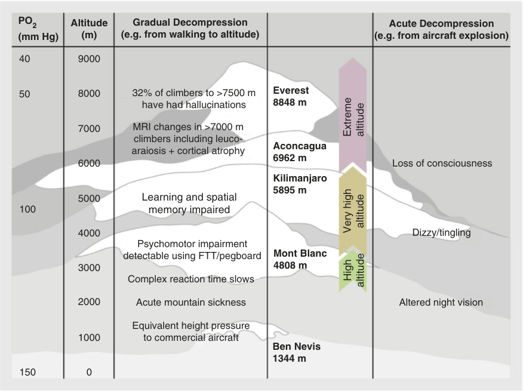

PO2 Altitude Gradual Decompression Acute Decompression (mm Hg) (m) (e.g. from walking to altitude) (e.g. from aircraft explosion) 40 9000 50 8000 32% of climbers to >7500 m Everest have had hallucinations 8848 m 7000 MRI changes in >7000 m climbers including leuco- Aconcagua araiosis + cortical atrophy 6962 m 6000 Loss of consciousness Kilimanjaro 5895 m 5000 Learning and spatial 100 memory impaired 4000 Dizzy/tingling Psychomotor impairment detectable using FTT/pegboard Mont Blanc 3000 4808 m Complex reaction time slows 2000 Acute mountain sickness Altered night vision Equivalent height pressure 1000 to commercial aircraft Ben Nevis 1344 m 150 0 Extreme altitude altitude Very high High altitude 

**Fig. 70.1** The symptoms and clinical effects associated with the nonlinear decrease in barometric pressure at increasing altitude. _MRI_ , magnetic resonance imaging. (From Wilson MH, Newman S, Imray CH. The cerebral effects of ascent to high altitude. _Lancet Neurol_ . 2009;8:175–191.)

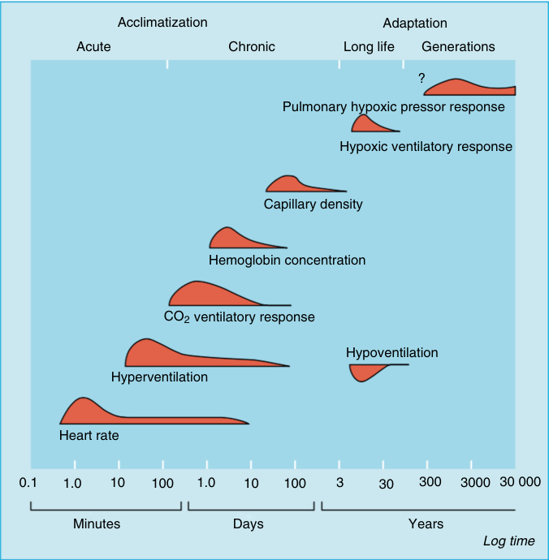

Acclimatization Adaptation Acute Chronic Long life Generations ? Pulmonary hypoxic pressor response Hypoxic ventilatory response Capillary density Hemoglobin concentration CO2 ventilatory response Hypoventilation Hyperventilation Heart rate 0.1 1.0 10 100 1.0 10 100 3 30 300 3000 30 000 Minutes Days Years Log time 

**Fig. 70.2** The time course of acclimatization and adaptive responses to hypobaric hypoxia with the curve of each response representing the relative rate of change (note the log time scale). (From Peacock AJ. Oxygen at high altitude. _BMJ._ 1998;317:1063–1066.)

<!-- PDF page 3 -->

seen on ascent to altitude. This is antagonized by increased sympathetic tone and the overall effect is one of increased blood pressure (BP), although in the early hours of exposure vasodilation may predominate.7 After several days, cardiac output returns to baseline but with a lower stroke volume (SV) and higher HR,8 while BP continues to rise for several weeks.

This pattern of increased HR and reduced SV persists across exercise states at altitude.9 In both athletes and nonathletes,10 maximal oxygen consumption (VO2 max) decreases with increasing altitude, estimated at approximately 1% per 100 m above 1500 m.7

Hematologically, a rise in hemoglobin (Hb) concentration is seen in response to altitude exposure. Over the initial days, this is related to a fall in plasma volume of approximately 20%,11 followed by a rise in red cell production secondary to increased levels of erythropoietin (EPO; which begins to rise within hours of ascent).12 This change in Hb concentration increases arterial oxygen content (CaO2) and theoretically improves oxygen delivery (DO2) to tissues.

However, this may be compromised because there is a marked increase in hematocrit and plasma viscosity. Viscosity has been observed to increase by 38% in healthy volunteers on ascent to 5800 m.13 Changes in microcirculation, important for the final phase of DO2, have been observed _in vivo_ at altitude with a significant reduction in microcirculatory flow seen in healthy volunteers during altitude exposure, although this does not seem to be directly related to the increase in hematocrit and viscosity.14 Subsequent studies have shown that this flow is significantly greater in the highly altitude- tolerant Sherpa population,15 raising the possibility that such microcirculatory adaptation may play an important role in optimizing DO2 and adaptation to high altitude.

### RESPIRATORY RESPONSES

The falling PB at altitude results in a decreased atmospheric partial pressure of oxygen (PO2). This in turn results in reduced alveolar (PAO2) and arterial (PaO2) partial pressures of oxygen. However, the reduction in PAO2 is accentuated because the saturated vapor pressure of water (PSVP Water) is unchanged (6.3 kPa) at altitude. Examining the alveolar gas equation, we can see that a proportionally higher saturated water vapor at body temperature (PH2O) will result in a decreased PAO2.

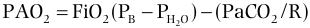

PAO2  FiO2(PB  PH2O )  (PaCO2 /R) 

This decrease in PAO2, and subsequently PaO2, leads to the hypoxic ventilatory response (HVR), which is the most important aspect of acclimatization to high altitude. Studies have found that successful climbers demonstrate an improved HVR.16 The decrease in PaO2 leads to hypoxic stimulation of peripheral arterial chemoreceptors,17 which in normoxia are normally suppressed by central chemoreceptors responding to changes in carbon dioxide (CO2). The peripheral arterial chemoreceptors trigger rapid increases in minute volume (VE) over seconds to minutes. A resulting decrease in PaCO2 also helps increase the PAO2, as explained by the alveolar gas equation, which demonstrates that any fall in PaCO2 will result in an increased PAO2.

The resultant hypocapnia following HVR leads to a leftward shift in the oxygen dissociation curve (ODC). This shift improves oxygen uptake at the lungs, but the increase in affinity may have consequences for DO2 at end organs.18 A leftward shift and increased oxygen affinity of Hb are key components of the adaptive response in several animals who live in hypoxic conditions.17 However, with altitude exposure in humans, this leftward shift is opposed by an increase in 2,3- diphosphoglycerate, over several days, causing a rightward shift. The final position of the curve varies depending on altitude exposure and level of acclimatization, but in sojourners it appears to equilibrate at almost sea level values, whereas certain groups of high- altitude natives can sustain a leftward shift through hyperventilation.19,20

As PaCO2 decreases, a respiratory alkalosis develops in both arterial blood and cerebral spinal fluid (CSF). This alkalosis initially antagonizes HVR; however, after several hours and continuing for over 2 weeks, the body begins to correct the alkalosis through bicarbonate (HCO3− ) excretion, as well as the increased concentrations of protein anions (such as phosphate and albumin). These processes allow the continued increase in VE (and thus improved acclimatization) to progress throughout this period.21,22

The pulmonary circulation is also modulated at altitude. In response to the reduced PAO2, hypoxic pulmonary vasoconstriction (HPV) occurs within minutes.23 The mechanism is a contraction of pulmonary smooth muscle cells. This process is independent of any external regulation and has been demonstrated in the laboratory setting in pulmonary smooth muscle cells completely isolated from all other tissues.24 The exact mechanism of oxygen sensing is a source of ongoing research, but it is known that the smooth muscle contraction itself, as in other tissues, relies upon a rise in intracellular Ca2+ . Although the contraction occurs in isolation, it is modulated by both the endothelium and systemic factors such as sympathetic activation. The process is biphasic in nature, with an initial contraction reaching its maximal effect between 2 and 15 minutes. A secondary phase occurs between 30 and 60 minutes, causing further vasoconstriction in sustained hypoxia. This secondary phase appears to be dependent on the presence of endothelial cells.7,24

In contrast to HPV in localized hypoxia (as seen in many pathologies found at sea level, such as pneumonia, atelectasis) where this response is beneficial for correcting ventilation–perfusion (V/Q) mismatch, the global alveolar hypoxia seen at high- altitude HPV can be significantly deleterious. Widespread vasoconstriction increases pulmonary vascular resistance 50% to 300%,23 with a consequent precipitous pulmonary arterial pressure (PAP) increase that may be responsible for altitude- specific pathologies such as highaltitude pulmonary edema (HAPE) (see later in this chapter).7 This rise in PAP is further exacerbated by physical exercise, with chamber studies reporting a PAP of 54 mm Hg on maximal exercise at a PB equivalent to 7620 m.25

### RENAL AND ENDOCRINE CHANGES

Renal responses play a key role in altitude acclimatization and have long been observed. The hypoxic diuretic response (HDR) was first observed in 1944.26 It is characterized by

<!-- PDF page 4 -->

both natriuresis and diuresis and is seen in humans and many other mammals.27,28

The earliest phase of the HDR occurs within hours of ascent and is in fact a diuresis alone, with a static fractional sodium clearance. Hypoxia and hypocapnia appear to be the driving factors (although the exact mechanism remains uncertain)29 and natriuresis soon follows. During the HDR, a total water loss of approximately 3 L is possible during initial exposure30 and a decrease of approximately 40% plasma volume.11

Several studies suggest that HDR undergoes humoral regulation.31,32 The renin–angiotensin–aldosterone system is one of the major systems regulating fluid balance at sea level. Renin and aldosterone promote retention of both water and sodium. However, although renin activity and aldosterone levels are observed to decrease in response to altitude,28,33,34 this response has not been consistently shown to be directly related to the level of natriuresis observed, suggesting there may be a mediation driven by chemoreceptor activation.28 It is also of note that although the aldosterone exercise response (leading to an increase in plasma aldosterone) remains present at altitude, it appears to be reduced.33 Indeed, further elements of the hormonal response also appear inconsistent. An increase in serum osmolality is reported with altitude ascent and although this may be expected to produce a concomitant increase in arginine vasopressin (AVP), such a response is often not observed, suggesting a change in AVP regulation at altitude in favor of a diuresis.35–37

The other side of the coin, from a fluid homeostasis perspective, is atrial natriuretic peptide (ANP). It is produced by cardiomyocytes in response to atrial distention and plays an important role in fluid balance; an increase in ANP will induce a natriuresis.38 It has been observed to increase in response to both pure hypoxia and altitude ascent and may play an important role in the initial diuresis,34,38,39 although any direct causal relationship between ANP levels and the observed diuresis/natriuresis have been questioned.28

Although controversy remains around the exact relationship between any hormonal changes and the observed diuresis/natriuresis, several studies have reported an association between a picture of increased fluid retention, or hormonal changes promoting fluid retention, and altitude pathologies such as acute mountain sickness (AMS) and HAPE.34,40 This suggests that, regardless of the underlying regulation, diuresis remains an important part of successful acclimatization.

In addition to fluid balance, the renal system is also important in mitigating the pH changes generated by the HVR, as discussed previously. Urinary bicarbonate excretion increases over a period of hours to more than 2 weeks, in a process that appears to be unrelated to the natriuresis previously discussed.41 This reduces blood pH and may play a role in facilitating the ongoing increase in VE and, therefore, acclimatization to altitude.

Additional endocrine changes may also be observed following altitude exposure. Cortisol, a stress hormone secreted by the adrenal glands, appears to increase at altitude,33,42,43 although exceptions are found in the literature.44 It may be that this variation is related to duration of exposure, exercise state, and other stress factors, such as coexisting pathology.37

As previously discussed, sympathetic activation forms an essential part of the response to acute altitude exposure, which drives many other physiologic changes. As expected, levels of norepinephrine and epinephrine increase,42,45 as does nerve fiber activity.46 However, after prolonged exposure and despite persistently elevated catecholamine levels, maximal HR and response to chronotropic drugs (e.g., isoprenaline) are both reduced, which suggests that a degree of desensitization is also occurring.47

### CENTRAL NERVOUS SYSTEM

Several central nervous system (CNS) changes are found at high altitude. Many of the most frequently observed were eloquently described by John West, one of the leading figures in respiratory and high- altitude physiology: “On ascending to altitude, unacclimatized lowlanders typically complain that they take longer to get to sleep, wake frequently, often have unpleasant dreams and do not feel refreshed in the morning. The resultant difficulties are not confined to the night because, as a result of poor sleep, people often feel somnolent and fatigued during the following day, their productivity is reduced, and they are more liable to make errors.”48

This quote encapsulates two separate changes observed at altitude: sleep disturbance and cognitive changes.

Sleep disturbance is a frequently occurring symptom, with incidences of up to 65% reported on ascent.49,50 Indeed, a network analysis of symptom scores in altitude sojourners identified the largest single cluster of symptoms to be one primarily characterized by sleep disturbance.51 Subjectively, individuals report reduced general sleep quality, difficulty in falling asleep, frequent wakening, as well as temperature- related discomfort.52

At high altitude, the sleep architecture is altered. The duration of light sleep, and non- rapid eye movement (NREM) sleep stages I and II, is increased. Deep sleep and NREM stages III and IV are reduced dramatically,53–55 whereas rapid eye movement (REM) sleep duration appears to be more variable in duration.54 Frequent awakenings are also observed, which appear to be closely linked to another phenomenon seen during sleep at altitude: periodic breathing.53,55,56

Periodic breathing, as described by John Cheyne and William Stokes in the 19th century and named eponymously for them,57,58 has long been observed at altitude. Reports date back as early as 1857 before it was first described fully by Angelo Mosso in 1894.59,60 Characterized by periods of crescendo–decrescendo hyperpnea followed by apnea at altitude, periodic breathing is seen most commonly during NREM stages I and II and appears to be largely absent during REM sleep.54 Periodic breathing may be responsible for the frequent awakenings seen at altitude that often occur at the transition from apnea to hyperpnea.53

This breathing pattern is caused largely by hypocapnia, which is itself a result of HVR. Although this hypocapnia during wakefulness does not adversely affect patterns of breathing during sleep, both the rate and depth of respiration can decline, culminating in apnea. During this apnea, the partial pressure of carbon dioxide (PCO2) increases as PO2 falls, ultimately leading to a return of ventilation with

<!-- PDF page 5 -->

hyperpnea.55 This theory is supported by the observation that those who demonstrated the most brisk HVR also experienced the highest rates of apnea,61 along with the efficacy of supplemental oxygen to improve sleep quality.62 Periodic breathing tends to increase with ascent55 and may even occur during REM sleep at extremes of altitude.63 With acclimatization, periodic breathing can be seen to decrease.54

The previous quote from John West also alludes to cognitive changes, which are frequently observed at altitude. Studies have demonstrated deficits across a wide range of domains under hypoxic conditions including arithmetic, memory, language, and motor skills.64–67 In addition to direct cognitive impairment, there are adverse changes in mood state and even new-onset anxiety disorders secondary to high altitude.68,69 The exact etiology of these cognitive changes has not been fully elucidated, although fatigue does appear to be correlated with a number of cognitive domains, and as such, sleep disturbance may be contributory.70

### GASTROINTESTINAL

On ascent to altitude, anorexia is frequently observed but not fully understood.71,72 Leptin, a hormone with elevated levels that are associated with satiety, has been hypothesized as playing an important role but the literature is conflicting; elevated, reduced, and unchanged levels have all been reported.42,44,73,74 Cholecystokinin, another satiety hormone, has been less widely studied but has been found to be elevated, particularly in those with marked anorexia at altitude.75

In concert with anorexia, weight loss of both fat and muscle occurs in response to prolonged exposure.73,76,77 This may be related primarily to reduced intake,78 although a modest increase in basal metabolic rate is observed and may be partly attributable to sympathetic drive.79

## Altitude Illness

Several distinct pathologies are observed in association with both acute and chronic altitude exposure. Although each is considered separately here, some share pathologic features. In addition, the hypoxic environment can also affect individuals with other ongoing health considerations, such as comorbidity or pregnancy.

### ACUTE MOUNTAIN SICKNESS

AMS is the most common acute altitude pathology. It is a clinical syndrome of nonspecific symptoms, occurring on ascent to altitude (>2500 m). The onset is usually seen between 4 and 12 hours after ascent.80–82

The prevalence of AMS is closely linked to altitude attained – approximately 25% at moderate altitude (&lt;3000 m)50 and approximately 50% above 4000 m.83 Other factors exerting a strong influence are rate of ascent, degree of acclimatization, and individual susceptibility.84 It is relevant to note that physical fitness appears to confer no risk reduction.85,86 Physical exertion at altitude may increase risk, although studies remain conflicted.85,87,88

The pathophysiology of AMS is not yet fully understood. Several theories have been suggested and current opinion appears to favor CNS dysfunction as the primary cause.80,81,89 Imaging studies in moderate–severe AMS have suggested some degree of cerebral edema,89 and increased intracranial pressure (ICP) has also been observed.80 In one remarkable study by Brian Cummins in 1985, three individuals, including Cummins himself, were fitted with invasive telemetric ICP monitoring. On ascent, two subjects remained well but one developed symptoms of AMS, including headache. This individual was also the only subject to demonstrate a raised ICP. The symptoms were seen on minimal exertion; turning his head increased ICP from 14 to 24 mm Hg, and a press- up led to an ICP of 51 mm Hg.90 This study has never been, and is unlikely to be, replicated but suggests elevated ICP may be pathologically significant and potentially related to reduced intracranial compliance.81,89,90 Cerebral blood flow (CBF) is known to increase transiently on ascent91 and, although wide interindividual variations have been observed, it may play a role. A unifying hypothesis has been proposed whereby hypoxia and hypoxemia result in increased CBF, which alongside changes in blood–brain barrier permeability, leads to brain swelling. Finally, in those with reduced intracranial compliance, this leads to AMS.92 This hypothesis, however, remains speculative, with some believing venous outflow may be more significant than intracranial compliance.80,93

The diagnosis of AMS is clinical. The symptoms are variable in presentation but may include headache, nausea, anorexia, dizziness, sleep disturbance, and fatigue.80,81 Headache is the most frequently observed indication and remains a mandatory symptom for diagnosis in a number of research tools.82,94 Several scoring systems51,82,94–96 of AMS exist for research purposes. A number of these have been applied to clinical practice, although they are not validated formally for this use. The most widely used, the Lake Louise Score,82 is ubiquitous in the literature and consists of five simple, self- reported symptom- related questions. This scoring system was revised in 201894 with the removal of sleep disturbance after studies suggested that it is likely to be a separate phenomenon unrelated to AMS (Table 70.1).51,97 Laboratory testing and clinical examination in AMS are both unremarkable.81 Oxygen saturation (SpO2) monitoring has been suggested as a useful tool but although SpO2 is seen to fall with ascent, there appears to be no independent relationship with AMS.98

Optimal clinical management of AMS begins with prevention. The most significant measure should be a slow ascent, with a limit of 300 m gain in sleeping altitude per day at altitudes above 3000 m generally accepted as best practice,80,89 although 600 m is proposed as an alternative.80,81 The sleeping altitude is generally accepted to be the most important consideration and the mantra of “climb high, sleep low” can be found widely in the literature. Other nonpharmacologic measures suggested, with some evidence, include: preacclimatization, avoidance of exercise, adequate hydration, and oxygen supplementation.81,89 Pharmacologic prophylaxis has been widely studied with acetazolamide the most recommended at an

<!-- PDF page 6 -->

**Table 70.1** Lake Louise Consensus on Acute Mountain Sickness 2018

|**20**|**18 Lake Louise Acute Mountain Sickness Scor**|**e**|
|---|---|---|
|**Symptom**|**Description**|**Score**|
|**Headache**|||
||None at all|0|
||A mild headache|1|
||Moderate headache|2|
||Severe headache, incapacitating|3|
|**Gastrointes**|**tinal symptoms**||
||Good appetite|0|
||Poor appetite or nausea|1|
||Moderate nausea or vomiting|2|
||Severe nausea and vomiting, incapacitating|3|
|**Fatigue and**|**/or weakness**||
||Not tired or weak|0|
||Mild fatigue/weakness|1|
||Moderate fatigue/weakness|2|
||Severe fatigue/weakness, incapacitating|3|
|**Dizziness/li**|**ght- headedness** ||
||No dizziness/light- headedness|0|
||Mild dizziness/light- headedness|1|
||Moderate dizziness/light- headedness|2|
||Severe dizziness/light- headedness, incapacitating|3|
||**AMS Clinical Functional Score**||
|**Overall, if y** **activities?**|**ou had AMS symptoms, how did they affect y**|**our**|
||Not at all|0|
||Symptoms present, but did not force any change in activity or itinerary My symptoms forced me to stop the ascent or to go down on my own power|1 2|
||Had to be evacuated to a lower altitude|3|

From Baillie JK. Lake Louise Consensus on Acute Mountain Sickness 2018. In: altitude.org. Apr 2019. http://www.altitude.org/lake_louise_AMS_score_ 2018.php.

adult dose of 125 mg twice daily.99 Higher doses of acetazolamide remain efficacious; however, they may be associated with more deleterious effects.100 Dexamethasone (2 mg every 6 hours or 4 mg every 12 hours) has also been shown to be beneficial,49,101 but remains a second- line chemoprophylaxis.100 Individual risk is highly variable based on both personal (e.g., previous history of AMS or high- altitude cerebral edema [HACE]) and environmental (e.g., rate of ascent, highest altitude attained) factors. Prescribing of prophylactic medications and indeed any recommendations regarding individuals should consider this personalized risk.

When treating AMS, because of the nonspecific nature of the symptoms, consideration must be given to other causes. There may be more severe altitude pathologies such as HACE, or common conditions related to the nature of much travel to altitude such as dehydration, exhaustion, hypothermia, hypoglycemia, or infection.100 In cases where AMS is diagnosed, then the single-most efficacious treatment is descent. This may present other dangers, given the terrain often found in the high-altitude environment; however, in severe cases, descent until resolution of symptoms (which typically occurs after a descent of as little as 300 m) remains the gold standard treatment.100 Measures aimed at correcting hypobaric

hypoxia, such as supplemental oxygen and hyperbaric chambers, can offer possible alternatives to descent but in a remote high- altitude setting these treatments present marked logistical challenges, may only offer temporary benefit, and also carry their own risks.100,102 Dexamethasone has been shown to be an effective treatment,102–104 but it does not aid acclimatization and further ascent is not recommended until the patient is asymptomatic without dexamethasone.

### HIGH- ALTITUDE CEREBRAL EDEMA

HACE is a severe, life- threatening pathology. It is rare, with a prevalence of 0.28% to 1%.4,105 Because of its rarity, there is limited systematic evidence regarding risk factors.81 However (and not yet conclusively proven), HACE is now considered to be a severe form of AMS and may share the same pathophysiology and risk factors.89,93,106 It is important to note though that while AMS may rapidly progress to HACE if left untreated, HACE may also present suddenly without any preceding symptoms of AMS. Both animal studies and postmortem examinations have demonstrated gross edema in HACE sufferers,107,108 with magnetic resonance imaging (MRI) studies suggesting this is likely vasogenic in nature.109 In contrast to AMS, in HACE there is evidence of microhemorrhage, primarily within the corpus callosum. The presence of microhemorrhage may indicate venous obstruction as a key pathologic process, which may differentiate AMS from HACE.93

HACE may be clinically differentiated from AMS by the presence of ataxia, confusion, psychiatric changes, or altered consciousness that may progress rapidly to coma and death.81,89,93,110 Investigations offer limited benefit on acute presentation; however, lumbar puncture may reveal elevated ICP,111 whereas MRI and computed tomography may reveal changes associated with edema.109

Prevention of HACE should be guided by the same principles as AMS, with slow ascent, preacclimatization, and pharmacologic strategies as previously described.100 The diagnosis should consider other possible causes for the observed presentation, but it is important to remember the mantra that any illness at altitude should be treated as altitude- related until proven otherwise. When HACE is diagnosed, its severity should not be underestimated, and prompt management is essential. Immediate actions include supplemental oxygen (aiming for an SpO2 >90%), administration of dexamethasone (initial dose of 8 mg by mouth, or intravenous or intramuscular injections; and immediately followed by a dose of 4 mg every 6 hours) and, where logistically possible, descent.81,100 If descent is not possible, and the airway is adequately protected, then a hyperbaric chamber is an acceptable temporary alternative.81,93

### HIGH- ALTITUDE PULMONARY EDEMA

HAPE is a form of noncardiogenic pulmonary edema that occurs in unacclimatized individuals on ascent to altitude (>2500 m).81 The condition was first described in South

::: details 原始表格與符號（PDF 第 6 頁）

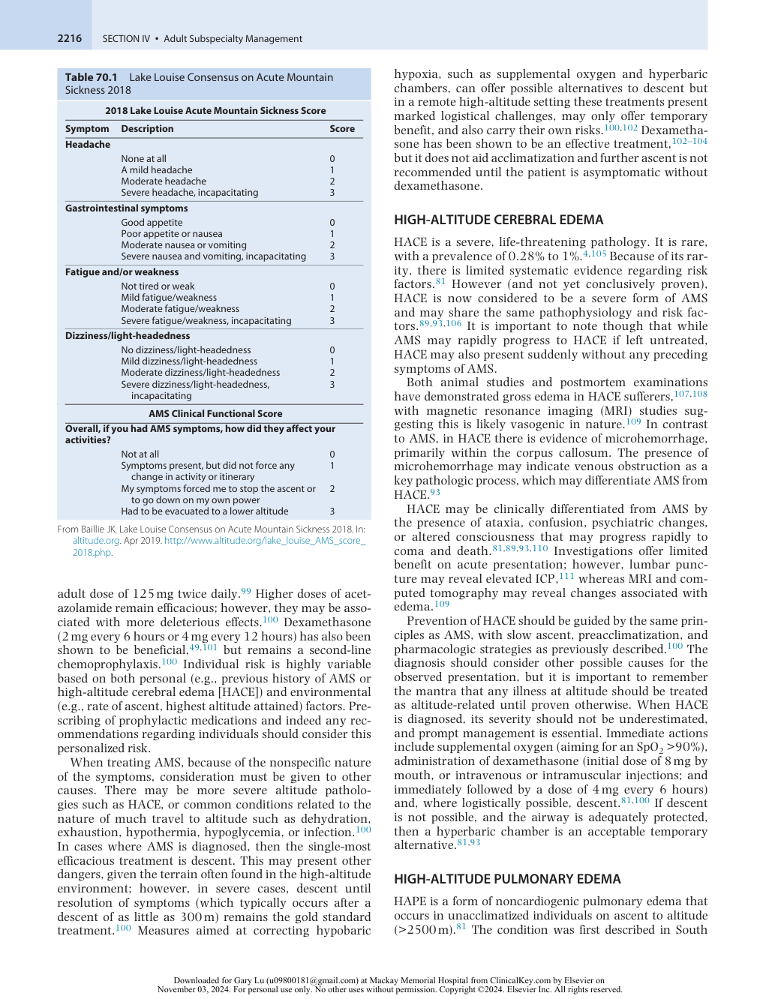

:::

<!-- PDF page 7 -->

American lowlanders on ascent to altitude in 1955,112 and subsequently in 1960 by two separate American physicians.113,114

The condition generally occurs within 2 to 5 days of ascent and is more common with greater altitude. It remains relatively uncommon under 3000 m and after more than 1 week at altitude.115,116 As with many altitude pathologies, the rate of ascent, altitude, and individual susceptibility are the most significant risk factors for the development of HAPE.7 There is evidence of other predisposing factors including: male sex,117 preexisting respiratory infection,118 and cold temperatures.119 Cardiorespiratory diseases, including anatomical abnormalities affecting pulmonary blood flow, have also been shown to increase risk of HAPE and it should be noted that altitude dwellers may suffer from “re- entry” HAPE following a sojourn to lower altitudes.115 The prevalence of HAPE varies greatly depending on the aforementioned risk factors. For example, in the general population prevalence of HAPE is estimated at less than 0.2% when climbing to 4500 m in 4 days. However, for a 1- to 2- day ascent to the same altitude, the prevalence rises dramatically to 6%. In those with a known susceptibility to HAPE, this could reach as high as 60%.116

The pathophysiology of HAPE is closely related to HPV and the increase in PAP. Pulmonary hypertension is seen on ascent to altitude prior to the development of HAPE.120 Individuals who are susceptible to HAPE tend to have a brisk HPV response, and often a relatively blunted HVR which further drives HPV. This accentuated rise in PAP of approximately 60 mm Hg in untreated HAPE on ascent may also be partly related to decreased nitric oxide (NO) bioavailability.121 The subsequent edema appears to be directly related to this increase in pressure, with bronchoalveolar lavage in early HAPE showing little inflammatory change, while pulmonary capillary pressure exceeds values shown in animal models to cause edema.121

Early clinical presentation is most commonly exertional dyspnea, often associated with a dry cough. This results in reduced exercise performance. Dyspnea is normally progressive, leading to dyspnea at rest, while the cough may become productive of pink frothy sputum – with hemoptysis of frank blood being rare.115 Orthopnea is additionally seen as edema progresses. Symptoms of AMS may coexist, but around 50% of sufferers display none.117 Examination findings typically include tachycardia and tachypnea. Cyanosis may be present and, although not universal, crepitations are invariably audible on auscultation of the lungs.7 SpO2 and blood gas analysis show more profound hypoxia than in healthy controls, while radiographic findings demonstrate patchy edema, generally starting peripherally.122

As with AMS, if appropriate steps are taken, the incidence of HAPE can be significantly reduced. Gradual ascent remains the single-most effective means of reducing HAPE occurrence.100 Individuals with a history of HAPE should take additional care and in such cases pharmacologic prophylaxis may be warranted. Nifedipine, a calcium channel blocker, has been shown through randomized control trial120 and clinical experience100 to be effective in highrisk individuals, delivering significantly lower PAP and improved prophylaxis of clinical HAPE over a placebo.

Other medications, such as salmeterol123 and tadalafil,124 have shown promise in clinical trials but clinical experience remains limited. Further research is required, although salmeterol is considered as an adjuvant to nifedipine in high- risk cases.100 Dexamethasone, which is used widely in AMS/HACE, is not as regularly utilized in HAPE. There are some data supporting its use,124 but again further study is advised to confirm.100

As with AMS/HACE, descent remains the most effective treatment for HAPE. Improvements may be seen after only minimal descent, although descent of 1000 m or until symptoms resolve is advocated. The degree of exertion on descent should be minimized as much as possible to reduce further rise in PAP.100 Supplemental oxygen and hyperbaric chambers are further measures to consider when descent is not possible. Nifedipine continues to have a role in treatment, with a single unblinded trial showing some clinical improvement125 and extensive clinical experience supporting its role.100 Phosphodiesterase inhibitors and dexamethasone may both confer some benefit and case reports of their use exist.126,127 It is important to point out that unlike other forms of pulmonary edema, the use of diuretics is not advocated in HAPE, particularly as patients may have concurrent hypovolemia.100 In the hospital setting it may be possible to manage HAPE without descent using supplemental oxygen and close observation. The use of continuous positive airway pressure has been advocated but remains unreported.100

### CHRONIC MOUNTAIN SICKNESS

Chronic mountain sickness (CMS), also known as Monge disease, is a syndrome affecting lifelong altitude dwellers and native populations. First described by Carlos Monge in 1928 in Peru,128 it is characterized by excessive erythrocytosis (EE), which may lead to pulmonary hypertension, cor pulmonale, and congestive cardiac failure.129

CMS prevalence varies widely among high- altitude populations around the world. Tibetans have a low prevalence, with 1.2% reported, while with the Han Chinese in the same region the rate is 5.6%. The rates in South America are also generally higher, with a prevalence of 4.5% in the general population,130 and increasing up to 33.7% in miners 60 to 69 years of age.131 These ethnic variations may be explained by significant differences in adaptation to high altitude. Tibetan natives have been dwelling at altitude for significantly longer than Andean natives and have adapted very differently. Andeans show lower HVR and stronger HPV than Tibetans and even in health show a preponderance for higher Hb than is observed in Tibetans.5 Other than ethnic variation, there appears to be a direct correlation with altitude; a study in North India observed no cases of CMS below 3000 m, yet a prevalence of 13% above this elevation.132

The underlying cause of the EE is not yet fully understood. It is generally accepted that chronic hypoxia, potentially exacerbated by a loss of ventilatory acclimatization leading to central hypoventilation, results in an erythrocytosis. The EE may be mediated by EPO, which is produced in response to hypoxia; however, the correlation between EPO levels, SpO2, and Hb is not consistent,

<!-- PDF page 8 -->

suggesting that it is not the sole factor.129 Recent gene studies have highlighted the potential role of _SENP1_ , a gene involved in EPO regulation. Individuals with CMS _SENP1_ appear to show a higher transcriptional response to hypoxia133–135 and the gene is the subject of ongoing research in this field. Clinically, CMS may be identified by the excessive erythropoiesis (females Hb ≥19 g/dL; males Hb ≥21 g/dL) and severe hypoxemia.136 Symptoms of this include headache, dyspnea, fatigue or sleep disturbance, and a burning sensation in the hands and feet. Meanwhile, signs include cyanosis (particularly marked in mucous membranes), finger clubbing, and dilatation of blood vessels. Further investigations may demonstrate pulmonary hypertension and cardiac failure. Of clinical relevance are family history, obesity, and sleep apnea, which are all risk factors for the development of CMS. The gold standard tool for diagnosis is the Qinghai score for CMS.136 It is important to note that the diagnosis of CMS should only be made in the absence of other systemic disease that may explain hypoxemia, such as chronic airway diseases. The optimal management of CMS is permanent relocation to a lower altitude; however, CMS will dissipate with the resumption of normoxia. When permanent relocation is not possible, sojourns to lower altitudes may help to stop Hb from hitting excessive levels.129 Venesection, with or without isovolumetric hemodilution, is used widely in clinical practice.129,136 However, supportive literature is of limited quality137,138 and there are concerns about a rebound effect on Hb, although these are unproven.129 In addition, recent evidence suggests that iron deficiency caused by venesection may worsen pulmonary hypertension and advocates the use of iron supplementation to ameliorate this effect.139 Numerous pharmacologic compounds have been studied with limited success including: angiotensin-converting enzyme (ACE) inhibitors, ventilatory stimulants, and dopaminergic antagonists. Recently, more focus has been given to acetazolamide with positive results, suggesting it is safe, able to reduce erythrocytosis, and improve pulmonary circulation, although side effects associated with long- term use remain unknown.140,141

### COMORBIDITY AT ALTITUDE

The acute altitude pathologies described previously have been largely studied in healthy populations and there is a limited body of evidence to characterize how existing disease may be affected by ascent to altitude.142 At the same time, travel to remote, high- altitude destinations is becoming easier, and people are living longer with a higher burden of chronic disease143 ; as a consequence, the challenges of managing chronic disease at altitude are likely to become increasingly relevant.

It is recommended that individuals with significant preexisting disease should consult an experienced altitude physician and undergo a risk assessment before travel. The assessment should consider existing conditions as well as details of the proposed trip, including ascent profile and level of exertion.144 The conditions most likely of concern at altitude are those affecting the cardiorespiratory system because these may cause additional difficulty in adapting to the hypoxic environment. Consideration should be given to

two separate issues: whether chronic disease will predispose individuals to the development of acute altitude pathologies and whether altitude exposure will exacerbate chronic disease.142

Ischemic heart disease is a pathology that may be worsened by altitude exposure. Acute altitude exposure increases cardiac output, and thus myocardial oxygen demand, while in the presence of reduced arterial oxygen content.145 Estimates of myocardial perfusion in healthy subjects suggest that there may be some reduction at altitude, which may be partly ameliorated by acetazolamide.146 However, several studies have exposed patients with stable coronary artery disease (CAD), who are deemed to be low risk and who have exercised at altitude with no adverse effects.147,148 A single study of eight patients with moderate- risk disease demonstrated that compensatory mechanisms of coronary circulation may be exhausted at even moderate altitude.149 Current recommendations advise cautious ascent to a maximum of 4200 m by low- risk patients, who have had a minimum of 6 months postmyocardial infarction or revascularization before travel. These recommendations also advise moderate- risk patients not to ascend above 2500 m, with only light exercise undertaken, while those at highest risk should avoid altitude entirely. Consideration should be given to acetazolamide, as it may aid coronary perfusion, but this has not been verified in patients with CAD.145

Patients with heart failure may pose a significant challenge at altitude, particularly as the condition is often closely linked to other comorbidities. However, studies on patients with stable disease (New York Heart Association Class II–IV) have demonstrated moderate altitude may be tolerated without significant compromise, although those with the most severe disease were significantly limited in their exercise tolerance.150,151 Medications used to manage heart failure should also be closely reviewed. Use of diuretics must be monitored, as fluid status is likely to alter at altitude and particular care should be paid to concomitant use of acetazolamide. Studies suggest that selective β1- receptor antagonists may improve exercise performance when compared to nonselective beta blockers and are advised where practical.145,152 In summary, those with the most severe disease should abstain from travel to altitude whereas those with mild to moderate disease should proceed with caution.145

In the presence of the hypobaric hypoxia found at altitude, there is concern for exacerbation of respiratory disease. Counterintuitively, however, observational data suggest that asthma is less common, and less severe, in those living at altitude.153,154 One likely reason for this is the reduced population of dust mites at altitude secondary to the cold, dry, and hypoxic conditions155 that result in a significant improvement in many pathologic features of asthma.156 However, such studies do not provide evidence regarding acute altitude exposure. There have been a number of observational studies exploring acute altitude exposure157–160 with conflicting results for physiologic measurements (e.g., peak expiratory flow, forced expiratory volume in 1 second [FEV1]), but all have demonstrated safe travel for patients with mild asthma to altitudes of up to 6410 m. Caution is advised, however, as upper airway infections, particularly in remote environments, remain a risk for asthmatic patients.161 Hence,

<!-- PDF page 9 -->

while travel to altitude is safe for well- controlled asthmatics, adequate supplies of rescue inhalers and oral steroids are advised.142 Measures may also be taken to limit cold, dry air exposure, which often exacerbates asthma.157 These can be as simple as covering the nose and mouth during outdoor exposure.142 Those with poorly controlled or severe asthma are at high risk because of the remoteness of the environment and variability of medical facilities, and travel should be avoided where possible in this group.142

Chronic obstructive pulmonary disease (COPD) poses a particular challenge at altitude. Studies of altitude dwellers with COPD demonstrate increased mortality and cor pulmonale.162,163 A number of studies simulating altitude as a model for commercial air flight have shown marked hypoxemia in response to moderately simulated altitude.164,165 A similar drop in PaO2 was observed in mild to moderate COPD sufferers on ascent to 1920 m, with a mean PaO2 fall from 8.8 kPa at sea level to 6.9 kPa.166 However, no adverse clinical events were reported in these studies and, given the chronic nature of the hypoxia, there is likely to be some degree of preexisting adaptation.142 Particular care must be taken in COPD patients with pulmonary hypertension. As previously discussed, the pathophysiology of HAPE indicates that preexisting pulmonary hypertension may increase susceptibility to HAPE.142 When assessing risk of hypoxemia at altitude, the use of formulae derived to predict PaO2 during flight may be helpful.167 In general, there are limited data on the safety of travel to altitudes for patients with COPD, and no data for their travel above 3048 m. Patients with COPD, and in particular those with pulmonary hypertension, should seek medical advice prior to traveling to high altitude.

## Special Situations at Altitude

### CHILDREN

Children represent an understudied group at altitude. While many of them either live at or sojourn to higher elevations, comparatively few studies have examined this. Children born and living at altitude are at increased risk of hypoxemia either secondary to acute pathology or congenital abnormalities. However, the risk and responses to living at altitude vary greatly among different ethnic populations because of the variations in adaptation as previously discussed.168

Studies on acute exposure to altitude suggest that children show similar patterns of acclimatization as adults.169,170 Altitude pathologies meanwhile present a significant problem in children. A study in Colorado at 2835 m estimated a 28% prevalence of AMS in children.171 However, the diagnosis of AMS remains problematic in children, as many symptoms of AMS may be associated with any travel in children. The same holds true for more serious altitude pathologies of HAPE and HACE, which may be overlooked in children (especially of younger age). As a result, extreme caution and descent is advised when a child becomes unwell at altitudes above 2500 m.172 Pharmacotherapy is less widely advocated in children, particularly for mild cases of AMS. In severe cases or where HAPE develops,

there may be a place for weight- appropriate doses of acetazolamide or nifedipine.173

### PREGNANCY

Maternal hypoxia may develop as a consequence of travel to high altitude (>1800 m) with obstetric guidelines identifying this as potentially hazardous for the fetus,174,175 although evidence suggests a number of pregnant women will travel to altitude.50,176 There are limited data available on this subject, with only a small number of studies exploring effects on sojourners to altitude.176,177 There is evidence of an increased rate of neonatal intensive care admission and oxygen administration at birth in infants of altitude residents.176 In addition, multiple population studies demonstrate a significant reduction in birth weight that is proportional to altitude gain above 2000 m. This is not due to increased prematurity but rather intrauterine growth restriction (IUGR).178,179 The effect of altitude on birth weight in these populations varies among different populations. It is more pronounced in recently arrived populations, such as the Han Chinese and Europeans, and least pronounced in groups such as Tibetans, who have resided at altitude for much longer.1 This suggests any results derived from sojourners or permanent residents are unlikely to be entirely transferable.

The limited number of physiologic studies on the fetal effects of maternal hypoxia suggests changes in the placental villous membrane facilitate increased gas exchange.180 With these changes, the fetuses of women exposed to short administrations of 10% oxygen show no signs of distress, with no significant change in fetal heart rate, HR variability, or Doppler velocimetry in the umbilical artery.181 However, studies on altitude dwellers have demonstrated a reduction in the pregnancy- associated increase in uterine artery blood flow,182 which may account for IUGR.

Additional research is required in this field and the paucity of evidence makes any firm recommendation challenging. There are clear physiologic sequelae for both mother and fetus in response to altitude, which in the chronically hypoxic mother appear deleterious. Consequently, any travel to altitude during pregnancy must be with caution, although conclusive data for sojourners are unavailable.

## Anesthesia at Altitude

### GENERAL PRINCIPLES

Most surgical facilities are not situated at extremes of altitude. However, several centers perform operations at high altitude,183,184 while at any altitude there may be an emergent need for general anesthesia.185 Practice under these conditions is guided largely by clinical experience, the setting, and select published case reports.

The anesthetic practitioner at altitude should be aware of the physiologic and pathologic changes, discussed previously, which may affect individuals. They should endeavor to assess on an individual basis how these changes can impact each patient. Consideration should be given to the altitude at which anesthesia is performed, the level of acclimatization of the individual, and any concomitant

<!-- PDF page 10 -->

pathology. When logistically feasible, it may be advisable, particularly in unacclimatized individuals, to descend before administration of anesthesia.186 At extremes of altitude, the risks associated with anesthesia are only outweighed by life- or limb- saving procedures.185

It is also important to establish the environment in which anesthesia will take place. The operating environment in a hospital with formal operating theaters and associated equipment is very different to emergency surgery undertaken in a remote and rural setting, regardless of altitude.

Several aspects require particular consideration, the most obvious of which is the increased risk of perioperative hypoxia. Medications used during anesthesia, notably opiates, depress both the tachycardia and tachypnea associated with the physiologic response to altitude.186 Slowed recovery from anesthesia has been reported,187 as has increased sensitivity to anesthetic medications.185 These factors combine to create a prolonged period where an individual may not be able to enact the full range of compensatory mechanisms to tolerate hypobaric hypoxia. Some of these consequences may be reversed by the administration of supplemental oxygen187 and certainly oxygen therapy at altitude is advised when possible.186 Care with analgesic agents in the postoperative period is necessary to ensure ventilation and oxygenation is not compromised; analgesia- induced respiratory depression was implicated in the death of a Sherpa who underwent a débridement at 4300 m.188

The second area of particular note in the perioperative period are reports of increased bleeding and challenging hemostasis during surgery at altitude.183,187 This is attributed to increased venous pressure and increased capillary density186 and, while not conclusively proven, still warrants consideration.

### ANESTHETIC EQUIPMENT

The most routinely considered implication of high altitude on anesthetic equipment is in relation to anesthetic vaporizers. As variable bypass vaporizers rely on the saturated vapor pressure of anesthetic agents, the partial pressure of anesthetic gas delivered remains constant regardless of altitude, although the FiAA will rise. This should in theory mean the same clinical effect.189 Chamber- based studies on vaporizers have confirmed a constant partial pressure delivery190 ; however, several caveats to this exist. First, desflurane vaporizers operate by using a measured flow principle.189 Such vaporizers will deliver a constant FiAA and, therefore, in hypobaria will deliver a reduced partial pressure. Second, consideration must be given to the monitoring and targeted dose of anesthetic gas. The minimum alveolar concentration is often used to guide dosing of anesthetics, but it is not appropriate for use at altitude. Instead, practitioners should consider their administration as a partial pressure rather than a fraction, or concentration, as it is the partial pressure that determines depth of anesthesia.191 This is most apparent when considering nitrous oxide, which when delivered at a given concentration is less effective at altitude, proportional to the drop in partial pressure.192

This recommendation regarding the use of partial pressure should also be considered for all forms of gas monitoring.

Modern anesthetic machines may interchangeably state partial pressure or concentrations for gas monitoring.191 However, the analyzers themselves physically detect partial pressure, not concentration. The reported concentration is derived mathematically, and, for example, an oxygen analyzer set to measure 21% in air at sea level will read 17.4% in air at 1500 m, unless recalibrated.190 Once again, the physiologic significance is in the partial pressure of oxygen. Therefore, direct measurement of partial pressure allows greater understanding of the physiologic effect of the gas mixture being delivered to the anesthetized patient.191

Flowmeters are also affected at altitude. Flowmeters rely on the density of gas to measure flow. Studies examining the floating flowmeters showed that with reducing PB, and therefore density of gas, these flowmeters were liable to be under- read.190 The percentage of error observed was not constant but reached a peak error of 21%, therefore making adjustments challenging. Studies have not been conducted to observe the impact of high altitude on flowmeters found in more modern anesthetic machines such as hot wire anemometers. Caution is advised when examining readings from flowmeters and where possible gas analyzers directly measuring partial pressure should be used to corroborate.

### GENERAL ANESTHESIA

Several considerations for anesthesia at altitude have already been discussed, including perioperative hypoxia and the effects of anesthetic drugs on mechanisms of acclimatization. As such, when considering anesthetic agents, the maintenance of these mechanisms, including tachycardia and hyperpnea, may be desirable. This is particularly relevant in the austere environment where supplemental oxygen may not be available. In such environments, the use of ketamine has been advocated in both emergency185 and elective193–196 settings. These reports have varied in their approach, with some using entirely ketamine anesthesia, whereas others have supplemented with inhalational anesthesia or benzodiazepines. Without supplemental oxygen, some degree of desaturation may be observed in the spontaneously breathing patient, but this was felt acceptable and could be managed with monitoring and simple airway maneuvers.194 However, total apnea may be seen with smaller doses of ketamine than would be expected at sea level, with a report of deep general anesthesia and apnea at a dose of only 0.5 mg/kg185 ; however, other studies have successfully used higher doses without any adverse outcome.196 Further caution is advised when using ketamine, as it may increase pulmonary vasoconstriction, with a single study at 1600 m suggesting certain susceptible patients may develop increased pulmonary vascular resistance with ketamine use.197 This may make it an undesirable agent for use in patients with active, or high risk of developing, HAPE.

Any anesthetic at altitude, particularly emergency remote surgery, remains comparatively high risk because there are limited data on which to base practice. There is some literature suggesting that ketamine may be used safely (either alone or in combination). Adequate monitoring, airway equipment, and appropriately trained practitioners are advised, alongside a careful risk–benefit analysis and consideration of alternative courses of action.

<!-- PDF page 11 -->

### REGIONAL ANESTHESIA

Spinal anesthesia may be desirable at altitude, as it allows the individual to maintain his or her own ventilatory parameters and reduces much of the risk surrounding perioperative hypoxia. Reports of very high rates of postdural puncture headache (PDPH) do exist187 ; however, these predate the use of modern spinal needles with narrower gauges and pencil- point needles now routinely used in modern practice.198 A single study examining spinal anesthesia at moderate altitude (1890 m) found that at altitude spinal blocks took longer to perform, and block duration was shorter than at sea level.199 They also observed a higher rate of PDPH (7.14 vs. 2.85%; _P_ &lt; .05) at altitude. Despite these limitations, spinal anesthesia provided adequate analgesia for lower extremity surgery in all patients and no significant complications were reported. Based on this limited evidence, spinal anesthesia may be the first choice for such procedures at high altitude, but further study is advised.

### APPLICATION TO FLIGHT, INCLUDING AIR TRANSPORT OF CRITICALLY UNWELL PATIENTS

The contents of this chapter remain relevant when considering air travel. Cabin pressure in commercial air travel is regulated but studies have shown peak cabin altitudes do vary, with an average value of 1933 m and the highest recorded being 2606 m.200 The physiologic changes are equivalent to those experienced by visitors to high altitude but with the caveat that ascent happens much more rapidly with less time to acclimatize. A small drop in SpO2 may be observed, and symptoms of AMS have been reported. Despite this, air travel is generally physiologically well tolerated.201 Greater concern may be associated with prolonged immobility and the risk of thromboembolic phenomena.202 However, patients with significant comorbidity may not tolerate air travel because of the rapid altitude gain and relative hypoxia. Extensive guidelines exist to guide the decision on flying with health conditions.203 In the rare event of cabin decompression, risks are considerably higher. In addition to acute hypoxia, which at altitudes above 13,716 m may induce unconsciousness in as little as 15 to 20 seconds, there are dangers posed by sudden air movement, cold, and debris.204

The transfer of an unwell patient is a significant undertaking that relies on careful planning, adequate infrastructure and equipment, and a thorough understanding of the patient’s physiology and pathology.205 In addition to hypoxia, there should be an awareness for gas expansion within body cavities.205,206 This expansion may affect pathologic processes, such as pneumocephalus, pneumothorax, or intestinal gas, which is particularly significant in cases such as volvulus. The presence of any of these pathologic processes is a relative contraindication for aeromedical evacuation,205 but the decision must ultimately be balanced against the need for ongoing treatment not available at the patient’s location. Gas expansion also changes the volume of air within medical devices, such as endotracheal cuffs. Ascent to 2500 m from sea level increases the volume in an endotracheal cuff by approximately 35%,207 which should be considered and accounted for both on ascent and descent. There are additional working challenges related to the enclosed space and moving of patients.205,207 A large

cohort (19,228) of aeromedical evacuations in Canada reports a critical event on 5.1% of evacuations at a rate of 1 per 12.6 hours of transport time.208 Critical events were more likely to occur in older patients, those with greater hemodynamic instability, and those requiring assisted ventilation. The most common critical event was hemodynamic deterioration and the need for intubation was the most common major resuscitative procedure required. The mortality in the cohort remained very low at 0.1%.208 These results demonstrate that with appropriately trained practitioners, aeromedical evacuation can be performed safely and with great benefit to patients.

## Space Medicine

Atmospheric pressure decreases exponentially with increasing distance from the Earth’s surface and becomes progressively hostile to human survival. At the cruising altitude of commercial airliners (approximately 39,000 feet), the atmospheric pressure outside the aircraft is only approximately 20% of the pressure at sea level. The International Aeronautics Federation defines the boundary of outer space, where the Earth’s atmosphere stops and space starts, as an altitude of 100 km above the Earth’s surface.209 However, at any particular time, astronauts on board the International Space Station (ISS) are 350 to 450 km above the Earth’s surface as they circle our planet at velocities of up to 17,500 mph. Yet, these extreme altitudes are still considered to be relatively low Earth orbits and future astronauts will travel much farther away from the protective environment of the Earth.210

### INTRODUCTION TO SPACE EXPLORATION AND MEDICINE

On November 5, 2015, the National Aeronautics and Space Administration (NASA) announced it was looking for astronauts for long- duration spaceflights, including extended missions on the ISS and possible journeys to Mars.211 In recent times, both the United States and Russia have announced their intentions to construct a new spaceport on the moon and to use this lunar base as a stepping stone to send their own astronauts to Mars. Private billionaire entrepreneurs (such as Richard Branson and Elon Musk) have outlined similar visions and promised to revolutionize air travel by transporting passengers using rockets traveling through space instead of traditional airplanes traveling through the Earth’s atmosphere. An international “space race” is undoubtedly already well underway.

Technology, skills, and knowledge have all developed rapidly since humans first entered space in 1961 when Yuri Gagarin orbited the Earth for the first time during a flight lasting less than 2 hours in total.212 Yet since then, only 12 men have ever walked on the moon and over four decades have passed since the last Apollo mission (Apollo 17) left Earth.211 A future that includes successfully leaving low Earth orbit again and sending astronauts on more distant missions, as well as making spaceflight safe for commercial purposes, poses many challenges, including how best to identify and manage any potential health issues among future crewmembers and passengers.

<!-- PDF page 12 -->

### RISK OF DISEASE AMONG ASTRONAUTS DURING SPACE TRAVEL

Although the absolute chance of a medical issue arising during spaceflight is low, the risk remains significant. Current conceptual plans for future missions to Mars from NASA predict crewed missions lasting up to 1100 days (approximately 3 years).213 Given the rate of emergencies among the general population is around 0.06 events per year, a crew of 6 astronauts would expect to encounter at least one medical emergency during a 3- year space mission (0.06 × 6 × 3 = 1.08 events).214

Astronauts can be affected by illness or disease just as any other human. For example, concern about possible exposure to the German measles virus meant that NASA astronaut Thomas K. Mattingly was famously removed from the crew of the ill- fated Apollo 13 mission just 72 hours prior to launch (Mattingly never actually developed measles and went on to successfully fly future missions including both Apollo 16 and STS4).215 However, the unique environmental conditions associated with spaceflight can also modify an astronaut’s susceptibility to such illnesses. Identifying these effects remains an active focus of research, such as the Longitudinal Study of Astronaut Health that NASA has been operating since 1992.216 This cohort study is generating data about all- cause astronaut mortality and morbidity, such as the reassuring finding that cancer mortality among astronauts is not significantly increased (as might be expected from increased exposure to harmful doses of radiation, as later discussed), suggesting the many preventive measures employed to mitigate these risks during spaceflight appear to be effective.216

Similarly, the spaceflight environment can also cause a number of specific health concerns to astronauts that are not normally experienced by the general population, and which can affect the physiologic and psychological performance of crewmembers. One survey of astronauts returning from 79 US space shuttle missions showed that as many as 94% of crewmembers took some form of medication at some stage during the flight and often to treat conditions not normally expected among similarly physically fit cohorts on Earth. These conditions included space motion sickness (SMS), sleeplessness, headache, or backache.217,218

## The Environmental Challenges Posed by Spaceflight

### EXTREME ACCELERATIONS/DECELERATIONS

Takeoff and landing (including re- entry to the Earth’s atmosphere) are two of the most important and dangerous periods of any spaceflight. Every human fatality during spaceflight to date (Challenger, Columbia, Soyuz 1, and T11) has occurred during one of these critical periods.210 Astronauts routinely experience extreme accelerative forces of around 4 to 5 G during takeoff and re- entry but these can be much higher; Yuri Gagarin remained conscious while experiencing forces of around 8 G during re- entry in his spacecraft Vostock 1 in 1961, and the Apollo astronauts typically experienced landing forces of around 17 G and tolerated them remarkably well.211,212 Current ISS crews

returning in Russian Mir spacecraft use seats with specially designed shock absorbers and liners to decrease these forces by 20% to 30% and bring them down below 22 G.211

These accelerative and decelerative forces are more than capable of dislodging incorrectly stowed items of equipment (causing trauma from the impact of flying objects or hard landings a real hazard) and generating extreme temperatures from friction with the surrounding air. During re- entry, the outside of the US space shuttle reached temperatures more than 15,000°C. This was high enough to ionize air and remove electrons from the outermost atoms on the protective heat tiles around the Shuttle spacecraft surface, generating significant amounts of electromagnetic disturbance that prevented any radio contact with the onboard crew for 17 minutes. On February 1, 2013, damage to one of the heat tiles during takeoff led to a weakness in the Space Shuttle Columbia’s critical heat- protective layer, leaving the vehicle unable to withstand these extreme temperatures on its return to Earth and causing the vehicle to burn up on re- entry, resulting in the loss of all seven crewmembers on board.211

### RADIATION

Solar radiation exposure (i.e., galactic cosmic rays, highenergy photons, high- energy and charge [HZE] neutrons and nuclei, and solar particle events) has always posed a major health concern for astronauts. These risks of both acute (mission- critical) and chronic (post- mission) radiation- related exposure are only going to increase on longer- term exploratory missions deeper into space.219 Crewmembers have not completely left the protection of the Earth’s magnetic field (i.e., gone beyond the Van Allen belts) since the Apollo missions, but crewmembers on any future mission to either the moon or to Mars will be at risk of direct exposure to full solar radiation doses for the first time in over 40 years and currently no adequate shielding strategy has been fully developed and tested.220 Chronic exposures of less than 1 sievert (Sv) per year are still thought to have long- term effects on tumor rates; acute exposures of 0.5 to 1.0 Sv could be sufficient to cause symptoms of acute radiation exposure. Some estimates predict exposure rates could almost reach such levels during a 940- day Mars mission.221 Other estimates have even projected radiation exposure levels during a simulated Mars mission, that would for the first time even exceed the strict occupational career limit NASA currently employs (i.e., upper confidence interval [CI] for risk of exposure- induced death [REID] of 3%), using the recommendations by the National Council on Radiation Protection.222 During a 1- year deep- space mission at minimum average solar radiation levels, the total risk of exposure- induced cancer in a 45- year- old male who has never smoked is predicted to be approximately 2% (CI 0.53%–7.84%), with the risk anticipated to be highest for lung cancer followed by colorectal cancers.219 However, our overall understanding of the long- term health risks from radiation exposure during spaceflight is still relatively limited and marked differences between current predictions and previously observed effects remain.223 Besides malignancy, other chronic radiation exposure health risks have been noted among astronauts. For example, increased rates of cataract formation have been reported in those

<!-- PDF page 13 -->

exposed to greater than 8 millisievert (mSv) of radiation after a 20- day space mission,216,224 reduced fertility (and/ or increased numbers of birth defects in animal studies),211 and a slightly (but not statistically significant) increased risk of developing clinical thyroid disease.216 Initially, the CNS was thought to be relatively resistant to the effects of radiation; however, widespread CNS changes have been reported including memory impairment, changing synapse plasticity, impaired executive function, and cognitive dysfunction.225–229 Moreover, many of these effects may be even further compounded by the significant neuropsychological challenges of spaceflight.

### ISOLATION, CONFINEMENT, SLEEP DISTURBANCE, AND OTHER PSYCHOLOGICAL CHALLENGES

Traveling at over 17,000 km/h, the crew of the ISS travel completely around the Earth—what we usually define as a typical “day”—every 90 minutes. This means that in every 24- hour period, the ISS crew experience no fewer than 16 sunrises and 16 sunsets; in other words, crewmembers could easily see 365 sunrises (a whole year’s worth) in just a 23- day space mission. The sleep–wake cycle is closely linked to biologic circadian rhythms regulated by the solar light,230 but astronauts also face many other challenges to sleeping comfortably, such as constant noise, physical discomfort (astronauts usually sleep in sleeping bags fixed tightly to the walls of the spacecraft), and hypercapnia. Sleep deprivation and fatigue are common complaints among crewmembers, with studies suggesting that on average astronauts experienced just 5.96 hours (SD 0.56) sleep during space shuttle missions, 6.09 hours (SD 0.67) during ISS missions, and less than 6.5 hours during their 3- month pre- launch period.231,232 Similar levels of sleep disturbance have been reported to impair cognitive performance and worsen long- term health outcomes.231,233 The constant stresses posed by extreme isolation and prolonged periods of confinement can also increase sleep disturbances and affect individual and team behavioral performances.234 Interestingly, though, these effects seem much more variable between different individuals and would also appear to be trainable. In the Mars 500 study, six males were confined for 520 days in a 550 m3 chamber simulating a highfidelity Mars mission. One crewmember reported depressive symptoms throughout 93% of the mission, whereas two other crewmembers had no symptoms of psychological distress at any point in the study.235 Similarly, after reviewing how their astronauts performed during missions on the ISS, all crewmembers participating in the study displayed unusually high levels of self- awareness and were generally positive about their time on the ISS, leading NASA to conclude that their training programs regarding interpersonal relationships, teamwork, and psychological support were effective.236

### DECOMPRESSION AND CHANGING OXYGEN CONCENTRATIONS

Foreign space objects pose a constant hazard to any manned space vehicle, as any penetrating impact could cause sudden depressurization of the internal cabin environment.

NASA estimates that there are now more than 21,000 orbital debris objects (usually human- made objects with no further usable purpose or the remains of such objects) in the Earth’s atmosphere, and approximately 200 kg of meteorite material (rocky material passing through the Earth’s atmosphere while orbiting the sun) is likely to be within 2000 km of the Earth surface at any particular time.211 Sudden loss of the crew’s artificial environment can cause acute hypoxia, decompression sickness (DCS), and ultimately death if the problem is not rapidly resolved or contained. According to the Federal Aviation Administration, the time of useful consciousness (i.e., the amount of time a person can effectively or adequately perform flight duties with an insufficient supply of oxygen) after rapid decompression at 50,000 feet is just 5 seconds.237

DCS (commonly known as “the bends”) arises when gases usually dissolved are forced out of solution by sudden pressure changes to form generalized bubbles (a process called _ebullism,_ body fluids boiling because of ambient pressure being less than the saturated vapor pressure of water). Soviet Cosmonaut Alexei Leonov reportedly gave himself DCS in 1965 as he finished making the world’s first spacewalk – he needed to reduce the size of his malfunctioning space suit in order to fit back through the airlock door into his spacecraft!238 Space suit design has since improved massively but the dangers associated with performing extravehicular activities (EVAs) remain significant.

American and Russian space suits maintain an internal environment of 100% oxygen at either 30 or 40 kPa, respectively. It is a major engineering challenge to build flexible suits durable enough to withhold higher pressures against the vacuum of space.239 Astronauts undergo pre- EVA procedures before leaving the main spacecraft to minimize the risk of developing DCS during a particular EVA, but despite being relatively time- consuming in spaceflight terms, these pre- EVA activities represent extremely rapid decompression times. Atmospheric pressures between 30 and 40 kPa are equivalent to standing on the summit of Mount Everest at 8848 m. While most climbers would typically take around 60 to 70 days to reach the summit of Mount Everest,240 astronauts are decompressed to these values within minutes to hours, thus making supplemental oxygen essential to prevent any of the altitude illnesses described earlier in this chapter. However, oxygen represents a major fire hazard to any spacecraft and no manned space programs currently use spacecraft with elevated oxygen levels for this reason. Therefore, some form of decompression procedure currently remains essential prior to any EVA.239 Although this may not be much of a concern to routine commercial passenger travel into space (passengers will not need to routinely exit their spacecraft), how best to manage these conflicting issues on longer missions to the moon or Mars remains unclear.

### MICROGRAVITY

The human body has carefully evolved over millions of years to perform optimally in an environment with gravity. In fact, the effects of gravity on our environment are so ubiquitous that it is challenging to contemplate just how significant a role gravity plays on human health and performance. Without gravity, just attempting to function and

<!-- PDF page 14 -->

interact appropriately with our surrounding environment becomes immensely difficult, and simple phenomena that we take for granted on earth no longer occur. Without gravity, there is also no convection, making temperature control difficult. As an example, burning flames are spherical and blue rather than yellow and pointy; there is no downward soot deposition or upward heat transfer, and the flame burns as soon as it reaches any oxygen and in all directions. Without gravity, there is no effect of buoyancy – bubbles do not rise to the surface but remain suspended in fluids (Fig. 70.3). In other words, to remove any bubbles from fluid in a syringe requires the application of an external accelerative force. Weightlessness has an impact on almost every organ system in the body, posing a number of both acute and chronic health risks to astronauts. A future mission

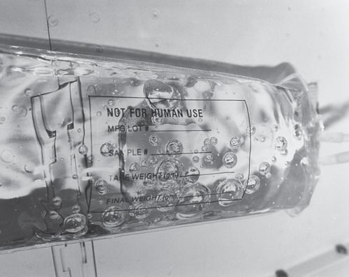

**Fig. 70.3** A 1- L bag of 0.9% saline during an orbital flight with air bubbles clearly visible throughout the bag because of the lack of gravitational forces. (From Norfleet WT. Anesthetic concerns of spaceflight. _Anesthesiology_ . 2000;92(5):1219–1219.)

to Mars raises further challenges as astronauts will need to be able to transition from weightlessness to functioning in a gravitational environment again within minutes after landing.211

## Cardiovascular Physiology During Spaceflight

The cardiovascular system is particularly susceptible to the effects of microgravity. Shortly after takeoff, an acute “fluid shift” quickly occurs as fluid usually held in the venous (high capacitance) side of the circulation starts to rapidly redistribute throughout other tissue beds (Fig. 70.4). This effect is most marked in the upper body, with up to 2 L of the blood normally pooled in the venous system in the legs by gravity being released upward into the central circulatory system within minutes of launching.241 Astronauts quickly develop facial edema and a so- called “chicken leg” syndrome because of this shift.210

Different studies suggest that cardiac output increases between 18% and 30% acutely in response to weightlessness and that this increase persists for at least 8 days.242– 244 This increase is driven predominantly by increases in stroke volume as overall HR appears to remain relatively unchanged.243–245 Systemic vascular resistance (SVR) also decreases by 14% to 35%, leaving systolic BP relatively unchanged,244,245 although some studies suggest that resting diastolic and mean arterial pressures might both decrease slightly in response to microgravity but still increase as normal in response to exercise.243,245 These decreases may turn out to be even more pronounced, however, on longer- duration space missions.245 Paradoxically, central venous pressure (CVP) acutely decreases after takeoff, possibly as a result of increased atrial distention.246,247 One study of space shuttle astronauts suggested that baroreflex sensitivity at rest might actually increase

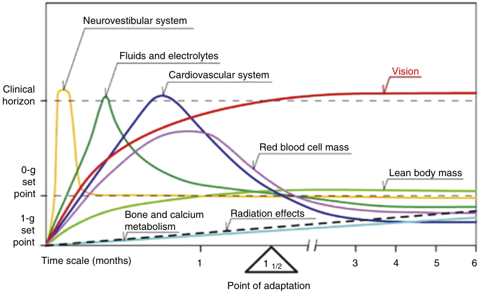

Neurovestibular system Fluids and electrolytes Cardiovascular system Vision Clinical horizon Red blood cell mass 0-g Lean body mass set point 1-g Bone and calcium Radiation effects set metabolism point Time scale (months) 1 1 1/2 3 4 5 6 Point of adaptation 

**Fig. 70.4** The time course of physiologic adaptation and acclimatization to microgravity. (From Komorowski M, Fleming S, Kirkpatrick AW. Fundamentals of anesthesiology for spaceflight. _J Cardiothorac Vasc Anesth_ . 2016;30(3):781–790.)

<!-- PDF page 15 -->

briefly initially before returning to baseline levels a few days later,248 but the baroreflex response seems to be chronically reduced after longer (e.g., 9 months) duration missions.249

As time in space increases, adaptation to microgravity slowly decreases SV (and cardiac output) again and allows ejection fraction to increase.250,251 This is presumed to be driven by anatomical changes to cardiac tissue, as left ventricular mass and mean sphericity index may decrease by 8.0% and 9.6%, respectively, together with a drop in total body fluid.252,253

Plasma volume decreases of up to 15% have been reported in both bedrest and spaceflight studies,254–256 accompanied by similar decreases in total red cell mass.254,257 Whereas plasma volume decreases within 24 hours, red cell changes take a week to become apparent, suggesting different mechanisms behind each change, but the exact cause of the decrease in red blood cells (RBCs) remains unclear.210,257 Elevated ferritin levels have been measured after space shuttle missions, but decreased reticulocyte counts suggest this process is because of reduced RBC production and not increased destruction/consumption.257 But this could also be a result of changes in tissue oxygen levels, particularly in the kidney, as a result of fluid shifting from the lower limbs toward the central (and renal) tissue beds.210

Although these fluid changes reverse within 2 to 3 weeks after returning to Earth, initially hypovolemia and orthostatic intolerance still cause astronauts significant problems when they arrive back on Earth. Current protocols require astronauts to “fluid load” with salt water approximately 1 hour before landing, which significantly reduces these risks.258

Microgravity itself does not appear to affect cardiac electrophysiology directly. However, a large number of arrhythmias have been reported during spaceflight and particularly during EVAs, possibly due to the many fluid shifts described above and the changes in catecholamine levels and adrenergic receptor sensitivity.210,259,260 Every one of the nine Skylab astronauts suffered some form of rhythm disturbance during their mission, NASA recorded multiple arrhythmias during its many space shuttle missions, and in 1987 one of the crewmembers on board the Russian MIR space station recorded a 14- beat run of ventricular tachycardia (VT).210,211

## Pulmonary Physiology During Spaceflight

Human lungs are normally exquisitely sensitive to gravity, which induces relevant gradients to both ventilation distribution and pulmonary blood flow. Consequently, it is not surprising that pulmonary function alters during spaceflight away from the Earth’s normal gravity environment.242,261 However, adaptive changes remain remarkably short lived and, unusually, no pulmonary recovery or rehabilitation is commonly necessary when astronauts do return to Earth.262 Whether this would also remain true after future space missions with durations longer than 6 months currently remains unproven.

More specifically, respiratory rate increases by around 9% in microgravity but tidal volume decreases by up to 15%, meaning that minute alveolar ventilation remains

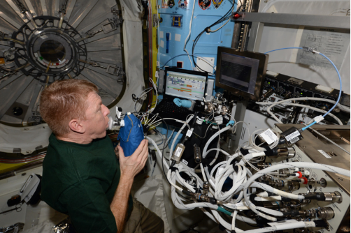

**Fig. 70.5** British European Space Agency (ESA) Astronaut Tim Peake performs pulmonary function tests while on the International Space Station. (Image courtesy ESA. From European Space Agency. http://m.e sa.int/spaceinimages/Images/2016/02/Taking_Tim_s_breath_away; 2016.)

essentially unchanged overall.210,242,263 Other respiratory measurements don’t alter significantly either with spaceflight. Measurements suggest that although vital capacity, forced vital capacity, and FEV1 may all decrease marginally (by around 2%–5%) within 24 hours of entering microgravity (Fig. 70.5), by the fourth day of spaceflight all have returned to pre- flight values.211,264 Residual volume decreases by around 18% in space (approximately 320 mL) and consequently functional residual capacity also reduces by around 15% (approximately 500 mL) in microgravity, possibly because of cranial movement of the diaphragm, more uniform alveolar expansion, and increased intrathoracic blood flow.263 However, although ventilation and blood flow are more uniform throughout the lung in microgravity, a small and clinically insignificant degree of ventilation–perfusion mismatch still remains, even in space.211,265

On average, ISS astronauts’ exercise capacity (as measured by VO˙ 2 peak) decreases in the initial stages of their spaceflight (by 17%) but then continues to gradually normalize again throughout the remainder of their mission. Although some astronauts were able to reach their preflight value, others were not, suggesting considerable interindividual variability in exercise responses to spaceflight.266 The fact that aerobic capacity increasingly recovers as flight durations lengthen suggests this is a successful response to exercise countermeasures employed during and throughout each ISS mission.267 All astronauts undergo an individually tailored daily exercise regime while in space to counter any aerobic deconditioning, but this countermeasure program has continued to evolve over the years as both knowledge and the equipment available for use on the ISS have changed and improved. While the relative contribution of both treadmill running and cycle ergometry has steadily decreased over the last 10 years of ISS missions to just 30 minutes of each on average per day, the number of resistance exercises in these programs has gradually increased to around an hour a day.268 HR only increases marginally on return to Earth after long-duration spaceflights, suggesting that these programs can successfully maintain astronauts’ cardiovascular fitness to enable them to meet the demands of daily mission activities.269 Another one of the

<!-- PDF page 16 -->

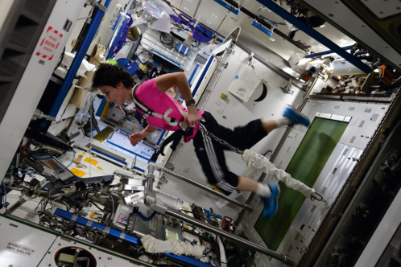

**Fig. 70.6** European Space Agency (ESA) Astronaut Samantha Cristoforetti exercising on the International Space Station. (Image courtesy ESA. From European Space Agency. http://m.esa.int/spaceinimages/Im ages/2015/09/Samantha_running_in_space; 2015.)

main aims of this rigorous exercise regime is to counter the significant muscle atrophy and bone demineralization that occurs under conditions of microgravity (Fig. 70.6).

## Musculoskeletal Physiology During Spaceflight

Marked bone demineralization starts immediately after entering space and leaving Earth’s gravity. Urinary and fecal calcium excretion increase by 60% to 70% in the first day of spaceflight, and this continues throughout the mission’s duration along with notable increases in urinary levels of bone resorption markers and decreases in blood levels of both parathyroid hormone and 1,25-dihydroxyvitamin D.241 On Earth, the average loss of bone density as a result of aging is approximately 1% per year, whereas in space, bone density decreases an average 1% per month and the rate can be double in the pelvic bones.210,211 Exercise countermeasure programs (particularly resistive exercise elements) can mitigate these effects and are improving each year, but they are not able to curtail these effects and the risks of fragility fractures and renal stones during spaceflight remain high among astronauts (and are major concerns for future Mars mission planners), as do long- term health risks such as osteoporosis.210,270,271

Similarly, studies of astronauts and cosmonauts on both US space shuttle missions and the Russian Mir missions of 16 and 28 weeks’ duration demonstrated significant decreases (5%–17%) in muscle volume in all muscle groups except the neck.272 Muscle groups normally required to maintain an upright posture are usually most affected (i.e., antigravity muscles). For example, muscle volume loss in ISS crewmembers was greatest in the calves (10%–16% reduction) and in the thighs (4%–7% reduction), whereas no change was seen in upper limb muscle volume.273 Vastus lateralis muscle biopsies taken from 8 astronauts on early space shuttle missions up to 11 days long confirmed that relative losses were greatest in type IIB and then type IIA (fast twitch) muscle fibers, with type I (slow twitch) fibers changing the least.274 Functional muscle impairment also occurs alongside these structural muscle changes in

response to microgravity, with increased muscle fatiguability and decreased muscle- fiber strength also seen most extensively in antigravity muscle groups.273 It is notable that decreases in muscle function during spaceflight are out of proportion with the loss of muscle structure alone. Other factors, including neuronal muscle control, may also contribute.275 A study by Antonutto found that maximal explosive power decreased between 45% and 65% in spaceflights of 1 to 3 months’ duration, while muscle mass only decreased by 9% to 13% during the same period.276 Electromyographic cycle period and burst durations were decreased in Rhesus monkeys after simulated spaceflight,277 and significant amounts of dendritic remodeling have been noted in rats on board the ISS.278

## Central Nervous System and Psychological Challenges During Spaceflight

Astronauts commonly experience neurologic changes soon after they arrive in space and rapidly after their return to Earth, with many of these deficits persisting for long periods after their return. For example, most crewmembers have had some form of locomotion dysfunction after transiting into or out of microgravity, such as ataxia or postural instability. Postural instability may be explained by a number of factors: differential muscle wasting affects postural tone; unloading of the spine means astronauts can gain 2 to 3 inches in height within 10 days of arriving in space, causing stretching of spinal nerve roots and altering the usual length–tension relationship of different muscle compartments (including antigravity muscles most affected by wasting in microgravity); and changes to vestibular feedback loops (the cerebellum and the vestibular system are usually finely tuned to the Earth’s gravity) can also significantly impair normal postural reflexes.275

The vestibular system, composed of the semicircular canals and otoliths that sense distant angular and linear forces, respectively, is constantly updating the brain about the head’s three- dimensional orientation and movement. However, this system has evolved and developed over thousands of years to be finely tuned to the Earth’s gravitational field and not a microgravity environment, making vestibular problems in space extremely common.275 Between 60% and 80% of all astronauts will experience “space motion sickness” within 48 hours of arriving in space, a condition characterized by symptoms of pallor, anorexia, nausea, sometimes vomiting, increased body warmth, and cold sweating.279 It is usually a short- lived phenomenon, with most cases either resolving spontaneously or with minimal pharmacologic treatment within 48 to 72 hours, but occasionally symptoms can persist longer. Rarely has this condition led to crewmembers being incapacitated for an entire space shuttle mission.241 It poses a real challenge to astronauts contemplating missions of long duration to either the moon or to Mars, where they may need to function normally in a new gravitational environment very shortly after landing to survive.

Terrestrial motion sickness commonly results from discrepancies between visual and vestibular perceptions of

<!-- PDF page 17 -->

motion. Similarly, lack of any vestibular sense of “up or down” in the unique, weightless environment of space may also contribute to the development of space motion sickness.241 Microgravity affects other sensory systems too. American and Russian astronauts have reported that foods taste and smell different in space, with requests for spices to enhance many foods tasting blander, as well as having less of a desire for coffee and sweets.211 Similarly, astronauts are constantly affected by noise during spaceflight with life support systems operating constantly. While ear plugs can block out the noise (typically at levels of 70 to 100 dBA running constantly in very close proximity, 24 hours a day), they do not attenuate the vibrations caused by these machines. However, the headward fluid shifts associated with microgravity may also impair middle ear function and may attenuate the sense of vibration to some degree.211 Microgravity also impairs proprioceptive sense of limb position and modifies tactile sensitivity with a significant degree of interindividual variability.280

The visual system is particularly affected by spaceflight. Anatomical and functional changes, including disc edema, cotton wool spots, choroidal folds, nerve fiber layer thickening, globe flattening, and consequent hyperopic shifts in vision have all been reported in seven astronauts examined after returning from long- duration spaceflights on the ISS.281 In one of these astronauts, who had initially only experienced relatively mild changes after his 6- month flight (unilateral choroidal folds and a single cotton wool spot in the right eye), these changes continued to progress during a second 6- month mission and he developed disc edema and more widespread choroidal folds in the same eye.282 Soon after returning from this second mission, globe flattening and moderate increases in optic nerve sheath diameters were noted bilaterally. Twenty- one months later, widespread choroidal folds remained in the right eye and spontaneous venous pulsations were also absent.283 Choroidal folds in astronauts were thought to be caused by increased ICP during spaceflight (possibly secondary to higher rates of resistive exercise, higher atmospheric levels of CO2 on board the spacecraft, or the cephalad fluid shifts associated with spaceflight), which are transmitted to the eye through increased levels of CSF transiting along the optic nerve sheath and putting more posterior pressure on both globes. In fact, this is “visual impairment intracranial pressure syndrome” as seen in spaceflight and it has similarities to some effects experienced by people visiting highaltitude regions.284 However, the long- term asymmetry of these findings in this subject suggests that ICPs may not be elevated over prolonged periods in space. Instead, visual impairment during spaceflight may be caused by localized changes to CSF flow within the intraorbital portion of the subarachnoid space – in effect causing an optic nerve sheath “compartment syndrome.”285,286

Unsurprisingly, the effects of these changes on vision during spaceflight are widespread, and particularly during longer-duration missions. Almost 30% of astronauts reported deteriorations in both near and distant visual acuity during short spaceflight missions, with this number increasing to 60% on long- duration missions.281 Older astronauts are more likely to notice changes as lens accommodation declines with age, and astronauts over the age of 40 are now routinely prescribed “Space Anticipation Glasses” to

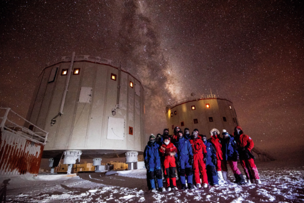

**Fig. 70.7** A small winter- over crew at the European Space Agency’s (ESA) remote Concordia Station in Antarctica. This crew experienced complete isolation, 24- hour darkness, and extremely cold temperatures (down to −80°C) for many months of the year. (Image courtesy ESA. European Space Agency. http://m.esa.int/spaceinimages/Images/2 016/07/Concordia_crew_2014- 2015; 2016.)

compensate for their new farsightedness in space. Anecdotal changes in visual fields and changes in intraocular pressure were also reported during the early years of the American space program and substantial amounts of evidence now show that transitioning to or from microgravity also impairs ocular movements and reflexes too.211

In addition to coping with changes to their perception, astronauts also experience numerous psychological challenges before, during, and after their mission. Astronaut selection is extremely competitive and the intensive international training schedule for crewmembers preparing for launch puts intense stresses on all members of the family unit even before the astronaut leaves Earth. Long periods of isolation have been shown to increase levels of stress as measured by activation of the hypothalamic–pituitary– adrenal axis (resulting in increased levels of cortisol production) and a degree of sleep impairment.287 The increased levels of insomnia astronauts experience are likely multifactorial and not simply explained by isolation alone. For example, low Earth orbit is associated with circadian desynchrony, increased levels of noise, hypoxia, hypercarbia, and extremes of temperatures. However, identifying how best to manage the psychological stress caused by long- term isolation is critical to the success of any future long- term space missions. International space agencies now run several ground- based spaceflight research analogue programs specifically to research this (and other) challenges to long- duration spaceflight. For example, the European Space Agency’s ground- based research analogue program is based at the Concordia Station situated high on the Antarctic plateau, which is completely inaccessible for half of the year, completely isolating the dozen crewmembers who “winter- over” there annually (Fig. 70.7). Reports from the Mars 500 project, the first highfidelity simulated mission to Mars isolating a multinational crew of 6 in a 550 m3 chamber for 520 days, recently suggested that appropriate selection of crewmembers is key. Substantial interindividual differences were seen in behavioral responses: two crewmembers with the highest ratings of stress and exhaustion accounted for more than 85% of all the perceived conflicts.235

<!-- PDF page 18 -->

## The Effect of Spaceflight on Other Physiologic Systems (Including the Immune and Gastric Systems)

Infectious diseases have been a major concern since the earliest days of space travel. Astronauts were at increased risk of catching infectious disease in the 1960s and 1970s. During that time, approximately 50% of all Apollo astronauts reported suffering from bacterial or viral infections either during or soon after spaceflight.241 Concerns about how microgravity affects the immune system’s responsiveness, and the likelihood of crewmembers becoming increasingly immunocompromised during spaceflight, will continue to grow as we look toward longer- duration missions in the future.288

Studies have shown that even short- duration spaceflights impair immune responsiveness with significant increases in inflammatory cytokine production (e.g., interleukin-4 [IL-4], IL- 10, IL- 12, and tumor necrosis factor- α [TNF- α]) during space shuttle missions, and reduced virus- specific T- cell functionality during spaceflight and soon after landing.289 The reductions in T- cell function persisted in astronauts participating in ISS missions lasting up to 6 months in duration. Crewmembers on longer missions were more likely to show chronic and persistent reductions in interleukins and TNF- α.290 Impairments in cell- mediated immunity and associated reductions in delayed- type hypersensitivity responses have also been observed in crewmembers on board the Russian Space Station Mir.291 Reactivation of latent virus activity is also seen in otherwise healthy astronauts; increased shedding of varicella–zoster virus, cytomegalovirus, and Epstein–Barr virus DNA have all been reported during spaceflight.292–294 Interestingly, an episode of thoracic zoster, typically only seen in either elderly or immunosuppressed patients (e.g., following organ transplant/acquired immunodeficiency syndrome), has been observed in an otherwise fit and healthy 47- year- old astronaut 2 days before launch, suggesting the chronic stress of astronauts’ rigorous training program may affect their immune responsiveness even before they leave the Earth’s atmosphere.293 Spaceflight may also increase the virulence of infective organisms in animal models, which could compound the problems of immunosuppression developing in crewmembers during longer missions.295 Ground- based analogue research programs (e.g., the Mars 500 project) have suggested that the long- term confinement of space travel could reduce overall microbial diversity and lead to increased selection of opportunistically pathogenic microorganisms.296 Microbiome changes were also observed during the Mars 500 study, although interestingly even prolonged periods of confinement were not able to compromise individual specificity of different microbiotic compositions.297 Similarly, changes to the balance of gut bacterial compositions have been seen in astronauts in space but initial findings suggest that overall gut microbial diversity does not alter,298 although the gastrointestinal system does undergo a number of other changes during spaceflight.

Assessment of nutritional status among astronauts shows that Mir crewmembers undergoing a 4- month mission could lose more than 10% of their pre- flight body mass, and often only manage to eat between 40% and 50% of their predicted energy requirements.299 ISS crewmembers

also lost weight during long missions (128–195 days in duration) and only consumed a mean of 80% of their recommended energy intake. In this study, hematocrit, serum iron, and transferrin levels all decreased, whereas ferritin levels increased even though other acute phase proteins remained unaltered.300 Serum ferritin levels appear to increase early in spaceflight but transferrin levels do not reduce until later on in the mission, suggesting iron is being mobilized and moved into storage tissues.301 Overall, gastric motility is significantly reduced for the first 72 hours of spaceflight, nausea and vomiting tends to increase in astronauts during the same time period, and increased levels of gastric acidity have also been reported.210,214

## Potential Medical Scenarios During Manned Space Missions

Despite all the physiologic challenges with spaceflight, mortality rates among astronauts have continued to steadily decline over the last 30 years,302 possibly due to improved screening, selection, and training of future astronauts. However, this could also represent a steady improvement in our understanding and ability to manage physiologic problems associated with spaceflight. Astronauts’ risk of dying from cardiovascular disease and cancer are now greatly reduced, yet they continue to be at increased risk of accidental death when compared to the general population.302 However, Apollo astronauts who flew to the moon (the only humans to have ever completely left the Earth’s atmosphere) experienced four to five times higher cardiovascular mortality rates than all other astronauts, suggesting that longer distance missions (with increasing radiation exposures) will pose even greater health risks to future crewmembers flying to the moon or Mars.303

Throughout 70 years of manned spaceflight, most fatalities and near misses have occurred during takeoff or re- entry/landing. Although increased rates of “in- flight” emergencies must be expected on longer deep space missions, astronauts are relatively young, highly screened individuals with very few medical comorbidities. When “space tourism” becomes more commonplace and members of the paying general public start entering low Earth orbits, then the need to be able to manage chronic conditions in space will become more of a concern. Until that time though, medical emergencies in space are likely to either be acute medical events (e.g., sudden-onset cardiac arrhythmia or traumatic injuries following a burn or explosion) or other conditions related to specific physiologic changes caused by spaceflight (e.g., space motion sickness/vision impairment, intracranial pressure syndrome, or radiation exposure).210,214 Astronauts may experience different health care needs for many years after spaceflight too. For example, astronauts may have long- term or permanent visual changes as discussed earlier and astronauts are more likely to develop atrial fibrillation at younger ages than the general population, possibly because of transient changes in left atrial structure that can occur after as little as 6 months in space.304

Because of the extreme distances involved in deep space missions, any crew will have to be totally autonomous in a medical emergency. Although “telemedicine consultations”

<!-- PDF page 19 -->

with an appropriate physician back on Earth might be possible for minor ailments, the transmission delays would render this useless if an acute event happened on the far side of the moon. Interestingly, when asked about future Mars missions, most American astronauts said they expected health problems to occur during any such mission and would want their crew to include an appropriately trained physician (with 4–6 years of experience including management of acute medicine, emergencies, and aerospace physiology).305 Anesthesiologists and critical care physicians should be well placed to manage space medical issues, both because of their familiarity with acute emergencies of this nature and their excellent understanding of human physiology and pharmacology. The Exploration Medical Capability (ExMC) arm of NASA’s Human Research Program has developed a list of at least 17 conditions that may potentially require general anesthesia or critical care techniques to successfully treat during an exploratory deep space mission. These include traumatic head injuries that require burr hole excision; cellulitis/abscess requiring incision and draining; or reducing a shoulder or elbow dislocation (Table 70.2).306 The European Space Agency estimates that there is approximately a 2.5% chance that a crew traveling to Mars may need to use general anesthesia to manage a medical emergency _en route_ – a highly challenging (and potentially mission-limiting) situation for a completely autonomous team to manage without an anesthetically trained physician on board.306

## Thoughts and Considerations for Anesthetic Provision in Space

### GENERAL PRINCIPLES

It is currently possible to evacuate a crewmember from the ISS and return them to Earth for treatment within 24 hours; however, this will not be possible on an exploratory mission deeper into space. No human has yet required general anesthesia to be performed in space and it is not ethical or appropriate to test protocols on healthy crewmembers in space, making it difficult to plan appropriate contingencies for future longer- duration missions.307 However, Earth- based models and accounts about the provision of anesthesia in remote and isolated environments do exist, such as at high altitude.185 Lessons can be extrapolated from these to plan for how best to deal with a medical situation that requires anesthesia during long- duration spaceflight. Common themes include a lack of space and medical equipment; limited skill sets and lack of support; little monitoring; need for flexibility and the ability to improvise appropriate solutions quickly; and increased levels of stress with potential negative impacts on performance.307 However, with adequate training and planning to ensure appropriate redundancy in skills and equipment, providing basic but safe anesthetic care should theoretically be possible in a deep space environment in an emergency.307

### PREOPERATIVE PERIOD

All astronauts undergo extensive selection and screening prior to leaving earth (Fig. 70.8). Most are extremely fit and healthy individuals who would initially appear to

**Table 70.2** A List of Possible Medical and Surgical Conditions That Could Potentially Require Anesthetic Intervention During Deep- Spaceflight

|**Condition**|**Example of Surgical** **Anesthesia**|**Suggested** **Anesthesia**|
|---|---|---|
|Abdominal injury|Splenectomy, bowel excision|GA ETI|
|Back injury, lumbar spine fracture, neck injury|Fracture reduction, halo traction application, osteosynthesis|GA ETI|
|Burns|Dressing, fasciotomy|GA SV|
|Cellulitis|Incision and drainage|GA SV|
|Chest injury/ pneumothorax|Thoracotomy for hemostasis|GA ETI|
|Compartment syndrome|Decompressive laparotomy|GA ETI|
|Elbow dislocation|Reduction|GA SV|
|Gastrointestinal bleeding|Hemostasis, ulcer suture, bowel excision|GA ETI|
|Head injury|Burr hole decompression|GA ETI|
|Hemorrhoids|Excision|GA SV|
|Hip/lower extremity fracture|Reduction, osteosynthesis, external fixation|GA SV|
|Intra- abdominal infection (diverticulitis, appendicitis, other)|Bowel excision, appendectomy|GA ETI|
|Nephrolithiasis|Percutaneous nephrostomy, cystoscopy|GA SV|
|Shoulder dislocation|Reduction|GA SV|
|Skin laceration|Suture, dressing|GA SV|
|Upper extremity fracture|Reduction, osteosynthesis|GA SV|

_GA ETI_ , general anesthesia with endotracheal intubation; _GA SV_ , general anesthesia with spontaneous ventilation.

From Komorowski M, Watkins SD, Lebuffe G, Clark JB. Potential anesthesia protocols for space exploration missions. _Aviat Space Environ Med_ . 2013;84(3):226–233.

benefit little from most preoperative interventions. However, one important consideration might be preventive surgery prelaunch to prevent on- board emergencies later. It is not known whether the physiologic changes associated with spaceflight will alter the relative risks of developing acute appendicitis or cholecystitis in crewmembers undertaking deep space missions. Increased rates of appendicitis and atypical presentations are seen in Antarctica, possibly because of altered immunologic responses, so a similar increase could be possible in space as well.308 Similarly, whether space travel might affect rates of gallstone formation (e.g., through altered lipid/cholesterol metabolism and fluid shifts) also remains unknown, although interestingly it is becoming more commonplace for patients recognized as being at higher risk of gallstone disease progression (e.g., obese patients undergoing bariatric surgery) to be offered prophylactic cholecystectomy surgery. Whether or not the minimal risks of prophylactic surgery on Earth would

::: details 原始表格與符號（PDF 第 19 頁）

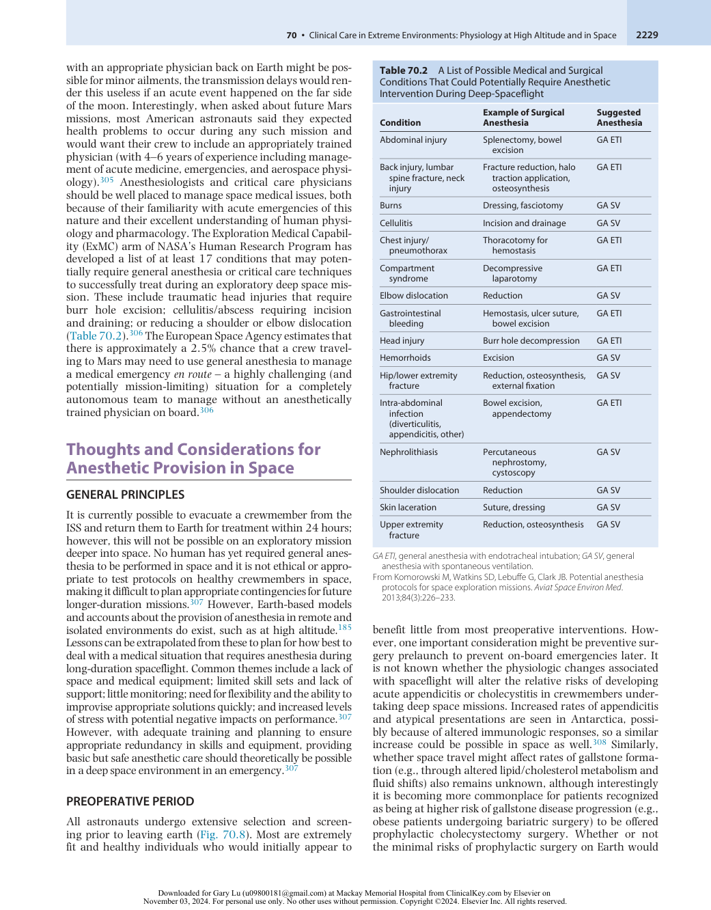

:::

<!-- PDF page 20 -->

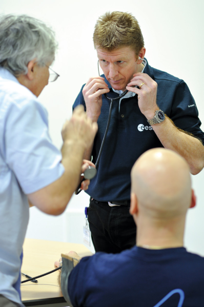

**Fig. 70.8** European Space Agency (ESA) Astronaut Timothy Peake undergoes practical lessons in medical procedures and techniques at the European Astronaut Centre (EAC) before his mission on the International Space Station. (Image courtesy ESA. From Baumbach D. European Space Agency. http://www.esa.int/spaceinimages/Images/2010/02/Ti mothy_Peake_during_training_at_EAC_January_2010; 2010.)

outweigh the risks of an emergency occurring during a 900- day mission to Mars remains unclear.308

### General Anesthesia in Space

In all probability, the skill set or experience of any crewmember performing anesthesia in space is likely to be limited. Consequently, it seems sensible to encourage simple, protocol- driven techniques that use minimal drugs and equipment for performing general anesthesia in space. Ketamine has been advocated as the induction agent of choice because of its ability to induce dissociative states of anesthesia and provide both analgesia, sedation, and hypnosis via multiple routes (intramuscularly, intravenously, orally, intranasally, intrarectally) while maintaining relative hemodynamic stability even in the relatively hypovolemic states that are likely to be encountered in space. Importantly, ketamine can also be stored in either crystal or powder forms for long periods and remains stable over a wide range of different temperatures. In addition, the relative contraindications to ketamine use (e.g., ischemic heart disease, valvular pathologies, epilepsy, severe arterial hypertension, or pulmonary hypertension) are not likely to be present in highly selected astronauts.306 Ketamine has been used to manage emergency situations in remote and resource- poor regions and maintains a reasonable safety profile.185,196,309–311

Tracheal intubation has been performed successfully in short flying simulations of microgravity environments, but any attempt at intubation in space is likely to be difficult for

multiple reasons. All intubation techniques in microgravity will necessitate both the intubator and the patient being firmly secured, plus the patient is likely to have significant facial—and possibly airway—edema. Use of laryngeal mask airways (LMAs), cuffed oropharyngeal airways, and intubating LMAs have all been demonstrated successfully in a simulated microgravity environment using a waterbath.312 However, none of these devices were universally inserted successfully; plus, gastroesophageal reflux is likely more common in space due to increased gastric acidity/decreased motility, as described, which makes aspiration a considerable risk during general anesthesia using any supraglottic airway device.

To maximize chances of intubation success, Komorowski and colleagues advocate the use of neuromuscular blocking agents despite the small but potentially serious anaphylaxis risk, and astronauts could always be tested for a possible allergy before launch.306 Depolarizing neuromuscular blocking agents should not be used during spaceflight because of the risk of cardiovascular collapse secondary to hyperkalemia. There is a possibility that increased acetylcholine receptor proliferation will occur in muscles that have atrophied under conditions of microgravity.313 Nondepolarizing muscular blocking agents can be used safely without this risk but there are concerns about the dose; based on findings in similarly immobilized patients and patients with neuromuscular diseases, resistance to these agents is expected and requires increased doses.314 However, this has never been tested or validated in astronauts in space and, unlike these cohorts, astronauts are continuously undergoing rigorous resistance exercise regimes during spaceflight to minimize muscle disuse. Rocuronium is likely to be the best choice of neuromuscular blocking agent for many reasons: chiefly, it has a rapid onset of action, and a rapid sequence induction is likely to be preferred given the increased aspiration risk.306 Additionally, it can now be rapidly reversed using sugammadex if needed (e.g., unexpected failed intubation, which is much more likely in space for all the reasons discussed earlier).315,316

Astronauts are likely to be both relatively anemic and hypovolemic, which increases the risk of cardiovascular collapse during any anesthetic induction in space. Available volume resuscitation products are likely to be limited and need to be prepared and used extremely carefully. All blood products currently have too limited a shelf- life to be carried on all but the shortest space missions, and in microgravity fluids and gases do not separate out based on their different densities (normally on earth, less dense air will always rise to the top of the fluid bag). Consequently, in space a drug vial or fluid bag will contain a fluid more like foam. All intravenous fluid bags will need to be “degassed” before use and likely need to be mechanically pumped in some way as flow will not be aided by gravity.313

Strict environmental controls are likely to enforce totally intravenous methods of maintaining anesthesia (total intravenous anesthesia [TIVA]), as scavenging of volatile gases could be challenging (and traditional vaporizers would not work in microgravity). Relatively simple methods for ketamine- only TIVA have already been described elsewhere and would minimize the need for training in and transporting different agents.306 It would also be essential to use the lowest safe inspired concentration of oxygen, as

<!-- PDF page 21 -->

exhaling large concentrations of oxygen will dangerously increase the onboard fire risk. Other considerations include the need to take care with endotracheal cuff pressures in the microgravity environment.

### Regional Anesthesia in Space

Regional anesthetic techniques and approaches could offer many advantages over the many risks associated with performing general anesthesia during spaceflight. In an emergency setting or situation with limited resources, it would be possible to perform almost any limb operation with the knowledge of just three regional blocking techniques. Together, a combined sciatic and femoral nerve block would give complete anesthesia of the leg, and an axillary brachial block would anesthetize the arm below the shoulder.210

Large systematic reviews have concluded that using ultrasound- guided techniques to deliver regional anesthesia improves both block safety and success rates.317 Astronauts have already successfully performed ultrasound examinations on themselves accurately and safely on the ISS,318 showing that they are capable of learning ultrasound techniques and this technology can be used safely in low Earth orbit. However, an ultrasound- guided regional block has not yet been performed in space and similar challenges would have to be expected. As for the intubation, both the operator and the patient need to be secured in some way, and success rates could considerably decrease due to neuromuscular and proprioceptive changes associated with spaceflight. In addition, regional anesthetic approaches would not always be suitable for any condition and still require a considerable amount of specialist training to develop reasonable levels of competency, again potentially decreasing their suitability for use by medically inexperienced crewmembers on board an exploratory deep space mission.

The use of telemedicine technology has also been proposed to aid astronauts in space and could theoretically allow a ground- based operator to remotely perform regional anesthesia on board a distant spacecraft in the future. Remotely operated robotic surgery has already been tested in consideration for use in future space missions; for example, over 30 robotic telesurgical procedures have been performed remotely across Canada using internet links with latencies of approximately 140 ms.319 However, a radiolink to a deep exploratory spacecraft orbiting Mars could expect to experience delays of nearer to 40 minutes because of the extreme distances involved!313

12.  West JB, et al. _High Altitude Medicine and Physiology_ . 5th ed. CRC Press; 2012.

13.  Singh MV, et al. _Aviat Space Environ Med_ . 2003;74(5):533.

14.  Martin DS, et al. _Eur J Appl Physiol_ . 2009;106(3):473.

15.  Gilbert- Kawai E, et al. _J Appl Physiol_ . 2017;122(4):1011.

16.  Schoene RB. _J Appl Physiol_ . 1982;53(4):886.

17.  West JB. _Integr Comp Biol_ . 2006;46(1):25.

18.  Møller K. _J Physiol_ . 2010;588(Pt 11):1811.

19.  Brown JPR, et al. _Con Edu Anaest Crit Care Pain_ . 2013;13(1):17.

20.  Winslow RM. _Respir Physiol Neurobiol_ . 2007;158(2–3):121.

21.  Hoiland RL, et al. _Clin Auton Res_ . 2018;28(4):423.

22.  West JB, et al. _West’s Respiratory Physiology: The Essentials_ . Lippincott Williams & Wilkins; 2015.

23.  Moudgil R, et al. _J Appl Physiol_ . 2005;98(1):390.

24.  Lumb AB, et al. _Anesthesiology_ . 2015;122(4):932.

25.  Groves BM, et al. _J Appl Physiol_ . 1987;63(2):521.

26.  Stämpfli R, et al. _Helv Physiol Pharmacol Acta_ . 1944;3(suppl 1):221.

27.  Colice G. _Aviat Space Environ Med_ . 1991;62(6):551.

28.  Swenson ER, et al. _J Appl Physiol_ . 1995;78(2):377.

29.  Hildebrandt W, et al. _J Appl Physiol_ . 2000;88(2):599.

30.  Jain SC, et al. _Aviat Space Environ Med_ . 1980;51(3):234.

31.  Olsen NV, et al. _J Appl Physiol_ . 1992;73(5):2036.

32.  Ramirez G, et al. _Aviat Space Environ Med_ . 1992;63(10):891.

33.  Zaccaria M, et al. _J Clin Endocrinol Metab_ . 1998;83(2):570.

34.  Bärtsch P, et al. _J Appl Physiol_ . 1991;71(1):136.

35.  Blume FD, et al. _JAMA_ . 1984;252(4):524.

36.  Maresh CM, et al. _Am J Physiol Endocrinol Metab_ . 2004;286(1):E20.

37.  Woods DR, et al. _J R Army Med Corps_ . 2011;157(1):33.

38.  Milledge JS, et al. _Clin Sci_ . 1989;77(5):509.

39.  Lawrence DL, et al. _Am J Physiol_ . 1990;258(2 Pt 1):E243.

40.  Hackett PH, et al. _Horm Metab Res_ . 1978;10(6):571.

41.  Höhne C, et al. _J Appl Physiol_ . 2002;92(5):2097.

42.  Barnholt KE, et al. _Am J Physiol Endocrinol Metab_ . 2006;290(6):E1078.

43.  Humpeler E, et al. _Eur J Appl Physiol Occup Physiol_ . 1980;45(2– 3):167.

44.  Benso A, et al. _Eur J Endocrinol_ . 2007;157(6):733.

45.  Richalet J- P, et al. _Am J Physiol Regul Integr Comp Physiol_ . 2010;299(6):R1685.

46.  Seals DR, et al. _J Appl Physiol_ . 1991;71(3):1032.

47.  Antezana AM, et al. _J Appl Physiol_ . 1994;76(3):1055.

48.  West JB. _High Alt Med Biol_ . 2002;3(2):223.

49.  Ellsworth AJ, et al. _Am J Med_ . 1987;83(6):1024.

50.  Honigman B, et al. _Ann Intern Med_ . 1993;118(8):587.

51.  Hall DP, et al. _PLoS One_ . 2014;9(1):e81229.

52.  Szymczak RK, et al. _Wilderness Environ Med_ . 2009;20(4):305.

53.  Reite M, et al. _Electroencephalogr Clin Neurophysiol_ . 1975;38(5):463.

54.  Weil JV. _High Alt Med Biol_ . 2004;5(2):180.

55.  Windsor JS, Rodway GW. _Curr Opin Pulm Med_ . 2012;18(6):554.

56.  Zieliński J, et al. _High Alt Med Biol_ . 2000;1(4):331.

57.  Cheyne J. _Dublin Hosp Rep_ . 1818;(2):216.

58.  Stokes W. _The Diseases of the Heart and Aorta_ ; 1854:320.

59.  Mosso A. _Life of Man in the High Alps_ . TF Unwin; 1898.

60.  Ward M. _Ann R Coll Surg Engl_ . 1973;52(5):330.

61.  Lahiri S, et al. _Respir Physiol_ . 1983;52(3):281.

62.  Windsor JS, Rodway GW. _High Alt Med Biol_ . 2006;7(4):307.

63.  Wickramasinghe H, Anholm JD. _Sleep Breath_ . 1999;3(3):89.

64.  Wu X, et al. _Space Med Med Eng_ . 1998;11(6):391.

65.  Berry DT, et al. _J Clin Exp Neuropsychol_ . 1989;11(2):241.

### Complete references available online at expertconsult.com.

66.  Hornbein TF, et al. _N Engl J Med_ . 1989;321(25):1714.

67.  Pelamatti G, et al. _Cortex_ . 2003;39(1):97.

68.  Nicolas M, et al. _Psychol Rep_ . 2000;86(1):119.

### References

1.  Moore LG. _High Alt Med Biol_ . 2001;2(2):257.

2.  Gonggalanzi, et al. _Arch Public Health_ . 2016;74:23.

3.  MacInnis MJ, et al. _PLoS One_ . 2013;8(10):e75644.

4.  Wu T- Y, et al. _High Alt Med Biol_ . 2007;8(2):88.

5.  Beall CM. _Integr Comp Biol_ . 2006;46(1):18.

6.  Douglas CG, Haldane JS. _J Physiol_ . 1922;56(1–2):69.

7.  Bärtsch P, et al. _Circulation_ . 2007;116(19):2191.

8.  Hornbein TF, et al. In: Hornbein TF, Schoene RB, eds. _High Altitude: An Exploration of Human Adaptation_ . Marcel Dekker; 2001.

9.  Sutton JR, et al. _J Appl Physiol_ . 1988;64(4):1309.

10.  Ferretti G, et al. _J Physiol_ . 1997;498(Pt 1):231.

11.  Hornbein TF, et al. In: Hornbein TF, Schoene RB, eds. _High Altitude: An Exploration of Human Adaptation_ . Marcel Dekker; 2001.

69.  Fagenholz PJ, et al. _Wilderness Environ Med_ . 2007;18(4):312.

70.  Bolmont B, et al. _Physiol Behav_ . 2000;71(5):469.

71.  Westerterp- Plantenga MS, et al. _J Appl Physiol_ . 1999;87(1):391.

72.  Kalson NS, et al. _Eur J Clin Invest_ . 2010;40(8):735.

73.  Lippl FJ, et al. _Obesity_ . 2010;18(4):675.

74.  Vats P, et al. _Nutr Neurosci_ . 2007;10(5–6):243.

75.  Bailey DM, et al. _High Alt Med Biol_ . 2000;1(1):9.

76.  Rose MS, et al. _J Appl Physiol_ . 1988;65(6):2545.

77.  Boyer SJ, Blume FD. _J Appl Physiol_ . 1984;57(5):1580.

78.  Westerterp KR, Kayser B. _Eur J Gastroenterol Hepatol_ . 2006;18(1):1.

79.  Hamad N, Travis SP. _Eur J Gastroenterol Hepatol_ . 2006;18(1):5.

80.  Basnyat B, Murdoch DR. _Lancet_ . 2003;361(9373):1967.

81.  Luks AM, et al. _Eur Respir Rev_ . 2017;26(143).

82.  Roach RC, et al. In: Sutton JR, et al., ed. _Hypoxia and Molecular Medicine_ . Queen City Printers; 1993:272.

<!-- PDF page 22 -->

83.  Maggiorini M, et al. _BMJ_ . 1990;301(6756):853.

84.  Schneider M, et al. _Med Sci Sports Exerc_ . 2002;34(12):1886.

85.  Bircher HP, et al. _J Wilderness Med_ . 1994;5(3):302.

86.  Milledge JS, et al. _Eur Respir J_ . 1991;4(8):1000.

87.  Roach RC, et al. _J Appl Physiol_ . 2000;88(2):581.

88.  Schommer K, et al. _J Appl Physiol_ . 2012;113(7):1068.

89.  Imray C, et al. _Prog Cardiovasc Dis_ . 2010;52(6):467.

90.  Wilson MH, Milledge J. _Neurosurgery._ 2008;63(5):970.

91.  Severinghaus JW, et al. _Circ Res_ . 1966;19(2):274.

92.  Roach RC, Hackett PH. _J Exp Biol_ . 2001;204(Pt 18):3161.

93.  Wilson MH, et al. _Lancet Neurol_ . 2009;8(2):175.

94.  Roach RC, et al. _High Alt Med Biol_ . 2018;19(1):4.

95.  Sampson JB, et al. _Aviat Space Environ Med_ . 1983;54(12 Pt 1):1063.

96.  Van Roo JD, et al. _Wilderness Environ Med_ . 2011;22(1):7.

97.  Macinnis MJ, et al. _High Alt Med Biol_ . 2013;14(4):334.

98.  Leichtfried V, et al. _Sleep Breath_ . 2016;20(1):435.

99.  Low EV, et al. _BMJ_ . 2012;345:e6779.

100.  Luks AM, et al. _Wilderness Environ Med_ . 2014;25(suppl 4):S4.

101.  Ellsworth AJ, et al. _West J Med_ . 1991;154(3):289.

102.  Keller HR, et al. _BMJ_ . 1995;310(6989):1232.

103.  Levine BD. _N Engl J Med_ . 1989;321(25):1707.

104.  Ferrazzini G, et al. _Br Med J_ . 1987;294(6584):1380.

105.  Bartsch P, Roach RC. In: Hornbein TF, Schoene RB, eds. _High Altitude: An Exploration in Human Adaptation_ . Lung Biology in Health and Disease; Vol. 161. Marcel Dekker; 2001.

106.  Bailey DM, et al. _Cell Mol Life Sci_ . 2009;66(22):3583.

107.  Dickinson J, et al. _Thorax_ . 1983;38(9):646.

108.  Krasney JA. _Med Sci Sports Exerc_ . 1994;26(2):195.

109.  Hackett PH, et al. _JAMA_ . 1998;280(22):1920.

110.  Hackett PH, Roach RC. _High Alt Med Biol_ . 2004;5(2):136.

111.  Singh I, et al. _N Engl J Med_ . 1969;280(4):175.

112.  Morla LL. _Anales de La Facultad de Medicina._ Vol 38. Universidad Nacional Mayor de San Marcos; 1955:244.

113.  Houston CS. _N Engl J Med_ . 1960;263:478.

114.  Hultgren H, Spickard W. _Stanford Med Bull_ . 1960;18:76.

115.  Stream JO, Grissom CK. _Wilderness Environ Med_ . 2008;19(4):293.

116.  Bärtsch P, Swenson ER. _N Engl J Med_ . 2013;368(24):2294.

117.  Hultgren HN, et al. _West J Med_ . 1996;164(3):222.

118.  Durmowicz AG, et al. _J Pediatr_ . 1997;130(5):838.

119.  Sophocles AM. _West J Med_ . 1986;144(5):569.

120.  Bärtsch P, et al. _N Engl J Med_ . 1991;325(18):1284.

121.  Bärtsch P, et al. _J Appl Physiol_ . 2005;98(3):1101.

122.  Vock P, et al. _Chest_ . 1991;100(5):1306.

123.  Sartori C, et al. _N Engl J Med_ . 2002;346(21):1631.

124.  Maggiorini M, et al. _Ann Intern Med_ . 2006;145(7):497.

125.  Oelz O, et al. _Lancet_ . 1989;2(8674):1241.

126.  Fagenholz PJ, et al. _High Alt Med Biol_ . 2007;8(2):139.

127.  Jones BE, et al. _Wilderness Environ Med_ . 2013;24(1):32.

128.  Monge - MC. _An Fac Med_ . 1928;14:1.

129.  Villafuerte FC, Corante N. _High Alt Med Biol_ . 2016;17(2):61.

130.  De Ferrari A, et al. _Chest_ . 2014;146(5):1327.

131.  León- Velarde F, et al. _J Wilderness Med_ . 1993;4(2):183.

132.  Sahota IS, Panwar NS. _Indian J Occup Environ Med_ . 2013;17(3):94. 133.  Cole AM, et al. _High Alt Med Biol_ . 2014;15(4):497.

134.  Hsieh MM, et al. _Exp Hematol_ . 2016;44(6):483 e2.

135.  Zhou D, et al. _Am J Hum Genet_ . 2013;93(3):452.

136.  León- Velarde F, et al. _High Alt Med Biol_ . 2005;6(2):147.

137.  Winslow RM, et al. _J Appl Physiol_ . 1985;59(5):1495.

138.  Cruz JC, et al. _Respiration_ . 1979;38(6):305.

139.  Smith TG, et al. _JAMA_ . 2009;302(13):1444.

140.  Richalet J- P, et al. _Am J Respir Crit Care Med_ . 2005;172(11):1427.

141.  Richalet J- P, et al. _Am J Respir Crit Care Med_ . 2008;177(12):1370.

142.  Luks AM, Swenson ER. _Eur Respir J_ . 2007;29(4):770.

143.  Lim SS, et al. _Lancet_ . 2012;380(9859):2224.

144.  Hoigné P, Gibbs JSR. _Practitioner_ . 2013;257(1760):27.

145.  Parati G, et al. _Eur Heart J_ . 2018;39(17):1546.

146.  Salvi P, et al. _Hypertension_ . 2013;61(4):793.

147.  Schmid J- P, et al. _Heart_ . 2006;92(7):921.

148.  de Vries ST, et al. _Neth Heart J_ . 2010;18(3):118.

149.  Wyss CA, et al. _Circulation_ . 2003;108(10):1202.

150.  Schmid J- P, et al. _Eur J Heart Fail_ . 2015;17(2):182.

151.  Agostoni P, et al. _Am J Med_ . 2000;109(6):450.

152.  Valentini M, et al. _Cardiovasc Ther_ . 2012;30(4):240. 153.  Gourgoulianis KI, et al. _Arch Med Res_ . 2001;32(5):429. 154.  Vargas MH, et al. _J Asthma_ . 1999;36(6):511.

155.  Spieksma FT, et al. _Br Med J_ . 1971;1(5740):82.

156.  Simon HU, et al. _Pediatr Pulmonol_ . 1994;17(5):304.

157.  Louie D, Paré PD. _Can Respir J_ . 2004;11(3):197.

158.  Huismans HK, et al. _J Asthma_ . 2010;47(6):614.

159.  Cogo A, et al. _Respiration_ . 1997;64(6):444.

160.  Allegra L, et al. _Eur Respir J_ . 1995;8(11):1842.

161.  Cogo A, Fiorenzano G. _High Alt Med Biol_ . 2009;10(2):117.

162.  Coté TR, et al. _Chest_ . 1993;103(4):1194.

163.  Moore LG, et al. _Am Rev Respir Dis_ . 1982;126(2):225.

164.  Christensen CC, et al. _Eur Respir J_ . 2000;15(4):635.

165.  Berg BW, et al. _Chest_ . 1992;101(3):638.

166.  Graham WG, Houston CS. _JAMA_ . 1978;240(14):1491.

167.  Dillard TA, et al. _Ann Intern Med_ . 1989;111(5):362.

168.  Niermeyer S, et al. _Arch Dis Child_ . 2009;94(10):806.

169.  Scrase E, et al. _Arch Dis Child_ . 2009;94(8):621.

170.  Garlick V, et al. _Curr Opin Pediatr_ . 2017;29(4):503.

171.  Theis MK, et al. _Am J Dis Child_ . 1993;147(2):143.

172.  Pollard AJ, et al. _BMJ_ . 1998;316(7135):874.

173.  Yaron M, Niermeyer S. _High Alt Med Biol_ . 2008;9(4):265.

174.  Committee on Obstetric Practice. _Int J Gynaecol Obstet_ . 2002; 77(1):79.

175.  ACOG Committee Opinion No. 650. _Obstet Gynecol_ . 2015; 126(6):e135.

176.  Keyes LE, et al. _Wilderness Environ Med_ . 2016;27(2):227.

177.  Artal R, et al. _Am J Obstet Gynecol_ . 1995;172(4 Pt 1):1170.

178.  Jensen GM, Moore LG. _Am J Public Health_ . 1997;87(6):1003.

179.  Mortola JP, et al. _J Pediatr_ . 2000;136(3):324.

180.  Reshetnikova OS, et al. _Am J Obstet Gynecol_ . 1994;171(6):1560.

181.  Polvi HJ, et al. _Obstet Gynecol_ . 1995;86(5):795.

182.  Julian CG, et al. _Am J Physiol Regul Integr Comp Physiol_ . 2008;295(3):R906.

183.  Zhen H- N, et al. _Chin Med J_ . 2015;128(7):993.

184.  Kumar AS, et al. _Natl Med J India_ . 2005;18(3):137.

185.  Grocott MPW, Johannson L. _Anaesthesia_ . 2007;62(9):959.

186.  Roy PK. _Indian J Anaesth_ . 2002;46(3):175.

187.  Safar P, Tenicela R. _Anesthesiology_ . 1964;25:515.

188.  Nunn JF. In: Ward MP, et al., ed. _High Altitude Medicine and Physiology_ . Chapman and Hall Medical; 1989:481.

189.  Young J, Kapoor V. _Anaesth Intensive Care Med_ . 2010;11(4):140.

190.  James MF, White JF, et al. _Anesth Analg_ . 1984;63(12):1097.

191.  James MFM, et al. _Br J Anaesth_ . 2015;115(6):824.

192.  James MFM, et al. _Anaesthesia_ . 1982;37(3):285.

193.  Maharjan SK. _Kathmandu Univ Med J_ . 2004;2(2):89.

194.  Pederson L, Benumof J, et al. _Anaesthesia_ . 1993;48(1):67.

195.  Streatfeild KA, et al. _Ethiop Med J_ . 1999;37(4):255.

196.  Bishop RA, et al. _High Alt Med Biol_ . 2000;1(2):111.

197.  Wolfe RR, et al. _Am J Cardiol_ . 1991;67(1):84.

198.  Xu H, et al. _Medicine_ . 2017;96(14):e6527.

199.  Aksoy M, et al. _BMC Anesthesiol_ . 2015;15:123.

200.  Hampson NB, et al. _Aviat Space Environ Med_ . 2013;84(1):27.

201.  Muhm JM, et al. _N Engl J Med_ . 2007;357(1):18.

202.  Philbrick JT, et al. _J Gen Intern Med_ . 2007;22(1):107.

203.  Thibeault C, et al. _Aerosp Med Hum Perform_ . 2015;86(7):656.

204.  Harding RM, et al. _Br Med J_ . 1983;286(6375):1408.

205.  Teichman PG, et al. _N Engl J Med_ . 2007;356(3):262.

206.  Donovan DJ, et al. _Aviat Space Environ Med_ . 2008;79(1):30.

207.  Essebag V, et al. _Chest_ . 2003;124(5):1937.

208.  Singh JM, et al. _CMAJ_ . 2009;181(9):579.

209.  Sanz Fernández de Córdoba S. _100km Altitude boundary for Astronautics_ . FAI.

210.  Komorowski M, et al. _J Cardiothorac Vasc Anesth_ . 2016;30(3):781.

211.  Nicogossian AE, Williams RS, Huntoon CL, et al., eds. _Space Physiology and Medicine_ . 4th ed. Springer; 2016.

212.  European Space Agency. _The Flight of Vostok 1_ . European Space Agency.

213.  Mahoney E. _NASA Releases Plan Outlining Next Steps in the Journey to Mars_ . NASA; 2015.

214.  Summers RL, et al. _Ann Emerg Med_ . 2005;46(2):177.

215.  National Aeronautical and Space Administration, Mattingly II Thomas K. _Biography_ . National Aeronautical and Space Administration; 1987.

216.  Institute of Medicine (US). Committee on the Longitudinal Study of Astronaut Health; Longnecker DE, Manning FJ, Worth MH. In: _Review of NASA’s Longitudinal Study of Astronaut Health_ . National Academies Press (US); 2004.

<!-- PDF page 23 -->

217.  Putcha L, et al. _Aviat Space Environ Med_ . 1999;70(7):705.

218.  Santy PA, Bungo MW. _J Clin Pharmacol_ . 2013;31(10):931.

219.  Cucinotta FA, et al. _Life Sci Space Res_ . 2017;13:1.

220.  Epelman S, Hamilton DR. _Aviat Space Environ Med_ . 2006;77(2):130.

221.  Hellweg CE, Baumstark- Khan C. _Naturwissenschaften_ . 2007; 94(7):517.

222.  Friedberg W, et al. _Radioact Food Environ_ . 2005;7(C):894.

223.  Chancellor JC, et al. _NPJ Microgravity_ . 2018;4:8.

224.  Maalouf M, et al. _J Radiat Res_ . 2011;52(2):126.

225.  Britten RA, et al. _Radiat Res_ . 2016;185(3):332.

226.  Lonart G, et al. _Radiat Res_ . 2012;178(4):289.

227.  Parihar VK, et al. _Sci Adv_ . 2015;1(4).

228.  Parihar VK, et al. _Sci Rep_ . 2016;6.

229.  Jandial R, et al. _Surg Neurol Int_ . 2018;9:9.

230.  LeGates TA, et al. _Nat Rev Neurosci_ . 2014;15(7):443.

231.  Basner M, Dinges DF. _Lancet Neurol_ . 2014;13(9):860.

232.  Barger LK, et al. _Lancet Neurol_ . 2014;13(9):904.

233.  Dongen V, et al. _Sleep_ . 2003;26(2):117.

234.  Pagel JI, Choukèr A. _J Appl Physiol_ . 2016;120(12):1449.

235.  Basner M, et al. _PLoS One_ . 2014;9(3):e93298.

236.  Stuster JW. _Behavioral Issues Associated with isolation and Confinement: Review and Analysis of Astronaut Journals (Journals) – 04.11.18_ . National Aeronautical and Space Administration; 2016.

237.  Federal Aviation Authority. AC 61- 107A – Operations of Aircraft at Altitudes Above 25,000 Feet MSL and/or Mach Numbers (MMO) Greater than 75.

238.  BBC. _The First Spacewalk_ .

239.  Katuntsev VP. _Acta Astronaut_ . 2010;66(1–2):96.

240.  Grocott MPW, et al. _N Engl J Med_ . 2009;360(2):140.

241.  Williams D, et al. _CMAJ_ . 2009;180(13):1317.

242.  Prisk GK. _Clin Chest Med_ . 2005;26(3):415.

243.  Shykoff BE, et al. _J Appl Physiol_ . 1996;81(1):26.

244.  Norsk P, et al. _Hypertension_ . 2006;47(1):69.

245.  Norsk P, et al. _J Physiol_ . 2015;593(Pt 3):573.

246.  Buckey JC, et al. _J Appl Physiol_ . 1996;81(1):19.

247.  Videbaek R, Norsk P. _J Appl Physiol_ . 1997;83(6):1862.

248.  Di Rienzo M, et al. _J Appl Physiol_ . 2008;105(5):1569.

249.  Cooke WH, et al. _J Appl Physiol_ . 2000;89(3):1039.

250.  Bungo MW, et al. _J Appl Physiol_ . 1987;62(1):278.

251.  Martin DS, et al. _Aviat Space Environ Med_ . 2002;73(6):532.

252.  Perhonen MA, et al. _J Appl Physiol_ . 2001;91(2):645.

253.  May C, et al. _J Am Coll Cardiol_ . 2014;63(suppl 12):A1096.

254.  Leach CS, et al. _J Appl Physiol_ . 1996;81(1):105.

255.  Watenpaugh DE. _J Exp Biol_ . 2001;204(18):3209.

256.  Platts SH, et al. _Aviat Space Environ Med_ . 2009;80(suppl 5):A29.

257.  Alfrey CP, et al. _J Appl Physiol_ . 1996;81(1):98.

258.  Bungo MW, et al. _Aviat Space Environ Med_ . 1985;56(10):985.

259.  Waters WW, et al. _J Appl Physiol_ . 2002;92(2):586.

260.  Meck JV, et al. _Am J Physiol Heart Circ Physiol_ . 2004;286(4):H1486.

261.  West JB, et al. _JAMA_ . 1997;277(24):1957.

262.  Prisk GK, et al. _Eur J Appl Physiol_ . 2008;103(6):617.

263.  Elliott AR, et al. _J Appl Physiol_ . 1994;77(4):2005.

264.  Elliott AR, et al. _J Appl Physiol_ . 1996;81(1):33.

265.  Prisk GK, et al. _J Appl Physiol_ . 2006;101(2):439. 266.  Moore AD, et al. _J Appl Physiol_ . 2014;117(3):231.

267.  Moore AD, et al. _Aerosp Med Hum Perform_ . 2015;86(suppl 12):A78.

268.  Petersen N, et al. _Extrem Physiol & Med._ 2016;5:9.

269.  Fraser KS, et al. _Aviat Space Environ Med_ . 2012;83(6):577.

270.  Whitson PA, et al. _Nephron_ . 2001;89(3):264.

271.  Smith SM, et al. _Bone_ . 2015;81:712.

272.  LeBlanc A, et al. _J Appl Physiol_ . 2000;89(6):2158.

273.  Gopalakrishnan R, et al. _Aviat Space Environ Med_ . 2010;81(2):91.

274.  Edgerton VR, et al. _J Appl Physiol_ . 1995;78(5):1733.

275.  Kalb R, Solomon D. _Arch Neurol_ . 2007;64(4):485.

276.  Antonutto G, et al. _J Gravit Physiol_ . 1998;5(1):63.

277.  Recktenwald MR, et al. _J Neurophysiol_ . 1999;81(5):2451.

278.  Inglis FM, et al. _Neuron_ . 2000;26(2):299.

279.  Heer M, Paloski WH. _Auton Neurosci_ . 2006;129(1–2):77.

280.  Young LR, et al. _J Vestib Res_ . 1993;3(3):231.

281.  Mader TH, et al. _Ophthalmology_ . 2011;118(10):2058.

282.  Mader TH, et al. _J Neuro Ophthalmol_ . 2013;33(3):249.

283.  Mader TH, et al. _J Neuro Ophthalmol_ . 2015;35(2):226.

284.  Wilson MH, et al. _N Engl J Med_ . 2018;378(6):581.

285.  Mader TH, et al. _Invest Ophthalmol Vis Sci_ . 2016;57(2):592.

286.  Mader TH, et al. _J Neuro Ophthalmol_ . 2017;37(2):133.

287.  Gemignani A, et al. _Int J Psychophysiol_ . 2014;93(2):211.

288.  Borchers AT, et al. _Nutrition_ . 2002;18(10):889.

289.  Crucian B, et al. _J Clin Immunol_ . 2013;33(2):456.

290.  Crucian B, et al. _NPJ Microgravity_ . 2015;1:15013.

291.  Gmünder FK, et al. _Aviat Space Environ Med_ . 1994;65(5):419.

292.  Mehta SK, et al. _J Infect Dis_ . 2000;182(6):1761.

293.  Mehta SK, et al. _J Med Virol_ . 2004;72(1):174.

294.  Pierson DL, et al. _Brain Behav Immun_ . 2005;19(3):235.

295.  Wilson JW, et al. _Proc Natl Acad Sci U S A_ . 2007;104(41):16299.

296.  Schwendner P, et al. _Microbiome_ . 2017;5(1):129.

297.  Turroni S, et al. _Microbiome_ . 2017;5(1):39.

298.  Fellman M. _Change in Astronaut’s Gut Bacteria Attributed to Spaceflight_ . Northwestern Now; 2017.

299.  Smith SM, et al. _J Nutr_ . 2001;131(7):2053.

300.  Smith SM, et al. _J Nutr_ . 2005;135(3):437.

301.  Zwart SR, et al. _Am J Clin Nutr_ . 2013;98(1):217.

302.  Reynolds RJ, Day SM. _Aviat Space Environ Med_ . 2010;81(11):1024.

303.  Delp MD, et al. _Sci Rep_ . 2016;6:29901.

304.  Khine HW, et al. _Circ Arrhythm Electrophysiol_ . 2018;11(5):e005959.

305.  Saluja IS, et al. _Acta Astronaut_ . 2008;63(5):586.

306.  Komorowski M, et al. _Aviat Space Environ Med_ . 2013;84(3):226.

307.  Komorowski M, et al. _NPJ Microgravity_ . 2018;4(1):5.

308.  Ball CG, et al. _Can J Surg_ . 2012;55(2):125.

309.  Ketcham DW. _Trop Doct_ . 1990;20(4):163.

310.  Bredmose PP, et al. _Acta Anaesthesiol Scand_ . 2009;53(4):543.

311.  Svenson JE, Abernathy MK. _Am J Emerg Med_ . 2007;25(8):977.

312.  Keller C, et al. _Anesthesiology_ . 2000;92(5):1237.

313.  Norfleet WT. _Anesthesiology_ . 2000;92(5):1219.

314.  Gronert GA. _Anesthesiology_ . 1981;55(5):547.

315.  Gijsenbergh F, et al. _Anesthesiology_ . 2005;103(4):695.

316.  Shields M, et al. _Br J Anaesth_ . 2006;96(1):36.

317.  Lewis SR, et al. _Cochrane Database Syst Rev_ . 2015;2015(9): CD006459.

318.  Zamboni P, et al. _Ultrasound Med Biol_ . 2018;44(3):726.

319.  Haidegger T, et al. _Surg Endosc_ . 2011;25(3):681.

<!-- PDF page 24 -->

### References

1.  Moore LG. Human genetic adaptation to high altitude. _High Alt Med Biol_ . 2001;2(2):257–279.

2.  Gonggalanzi L, Nafstad P, et al. Acute mountain sickness among tourists visiting the high- altitude city of Lhasa at 3658 m above sea level: a cross- sectional study. _Arch Public Health_ . 2016;74:23.

3.  MacInnis MJ, Carter EA, Freeman MG, et al. A prospective epidemiological study of acute mountain sickness in Nepalese pilgrims ascending to high altitude (4380 m). _PLoS One_ . 2013;8(10):e75644.

4.  Wu T- Y, Ding SQ, Liu JL, et al. Who should not go high: chronic disease and work at altitude during construction of the Qinghai- Tibet railroad. _High Alt Med Biol_ . 2007;8(2):88–107.

5.  Beall CM. Andean, Tibetan, and Ethiopian patterns of adaptation to high- altitude hypoxia. _Integr Comp Biol_ . 2006;46(1):18–24.

6.  Douglas CG, Haldane JS. The regulation of the general circulation rate in man. _J Physiol_ . 1922;56(1–2):69–100.

7.  Bärtsch P, Gibbs JSR. Effect of altitude on the heart and the lungs. _Circulation_ . 2007;116(19):2191–2202.

8.  Hornbein TF, Schoene RB, Wolfel EE, Levine BD. The cardiovascular system at high altitude. In: Hornbein TF, Schoene RB, eds. _High Altitude: An Exploration of Human Adaptation_ . New York: Marcel Dekker; 2001.

9.  Sutton JR, Reeves JT, Wagner PD, et al. Operation Everest II: oxygen transport during exercise at extreme simulated altitude. _J Appl Physiol_ . 1988;64(4):1309–1321.

10.  Ferretti G, Moia C, Thomet JM, Kayser B. The decrease of maximal oxygen consumption during hypoxia in man: a mirror image of the oxygen equilibrium curve. _J Physiol_ . 1997;498(Pt 1):231–237.

11.  Hornbein TF, Schoene RB, Grover RF, Bartsch P. Blood. In: Hornbein TF, Schoene RB, eds. _High Altitude: An Exploration of Human Adaptation_ . New York: Marcel Dekker; 2001.

12.  West JB, Schoene RB, Luks AM, Milledge JS. _High Altitude Medicine and Physiology_ . 5th ed. CRC Press; 2012.

13.  Singh MV, Salhan AK, Rawal SB, et al.; Blood gases, hematology, and renal blood flow during prolonged mountain sojourns at 3500 and 5800 m. _Aviat Space Environ Med_ . 2003;74(5):533–536.

14.  Martin DS, Ince C, Goedhart P, et al.; Caudwell Xtreme Everest Research Group. Abnormal blood flow in the sublingual microcirculation at high altitude. _Eur J Appl Physiol_ . 2009;106(3):473–478.

15.  Gilbert- Kawai E, Coppel J, Court J, et al. Sublingual microcirculatory blood flow and vessel density in Sherpas at high altitude. _J Appl Physiol_ . 2017;122(4):1011–1018.

16.  Schoene RB. Control of ventilation in climbers to extreme altitude. _J Appl Physiol_ . 1982;53(4):886–890.

17.  West JB. Human responses to extreme altitudes. _Integr Comp Biol_ . 2006;46(1):25–34.

18.  Møller K. Every breath you take: acclimatisation at altitude. _J Physiol_ . 2010;588(Pt 11):1811–1812.

19.  Brown JPR, Grocott MPW. Humans at altitude: physiology and pathophysiology. _Con Ed Anaest Cri Pain._ 2013;13(1):17–22.

20.  Winslow RM. The role of hemoglobin oxygen affinity in oxygen transport at high altitude. _Respir Physiol Neurobiol_ . 2007;158(2– 3):121–127.

21.  Hoiland RL, Howe CA, Coombs GB, Ainslie PN. Ventilatory and cerebrovascular regulation and integration at high- altitude. _Clin Auton Res_ . 2018;28(4):423–435.

22.  West JB, Luks A. _West’s Respiratory Physiology: The Essentials_ . Lippincott Williams & Wilkins; 2015.

23.  Moudgil R, Michelakis ED, Archer SL. Hypoxic pulmonary vasoconstriction. _J Appl Physiol_ . 2005;98(1):390–403.

24.  Lumb AB, Slinger P. Hypoxic pulmonary vasoconstriction physiology and anesthetic implications. _Anesthesiology_ . 2015; 122(4):932–946.

25.  Groves BM, Reeves JT, Sutton JR, et al. Operation Everest II: elevated high- altitude pulmonary resistance unresponsive to oxygen. _J Appl Physiol_ . 1987;63(2):521–530.

26.  Stämpfli R, Eberle A. Menge, spezifisches Gewicht und Leitfähigkeit des menschlichen Harns im Hochgebirge. _Helv Physiol Pharmacol Acta_ . 1944;3(suppl 1):221–232.

27.  Colice G, Yen S, Ramirez G, et al. Acute hypoxia- induced diuresis in rats. _Aviat Space Environ Med_ . 1991;62(6):551–554.

28.  Swenson ER, Duncan TB, Goldberg SV, et al. Diuretic effect of acute hypoxia in humans: relationship to hypoxic ventilatory responsiveness and renal hormones. _J Appl Physiol_ . 1995;78(2):377–383.

29.  Hildebrandt W, Ottenbacher A, Schuster M, et al. Diuretic effect of hypoxia, hypocapnia, and hyperpnea in humans: relation to hormones and O2 chemosensitivity. _J Appl Physiol_ . 2000;88(2):599– 610.

30.  Jain SC, Bardhan J, Swamy YV, et al. Body fluid compartments in humans during acute high- altitude exposure. _Aviat Space Environ Med_ . 1980;51(3):234–236.

31.  Olsen NV, Kanstrup IL, Richalet JP, et al. Effects of acute hypoxia on renal and endocrine function at rest and during graded exercise in hydrated subjects. _J Appl Physiol_ . 1992;73(5):2036–2043.

32.  Ramirez G, Hammond M, Agosti SJ, et al. Effects of hypoxemia at sea level and high altitude on sodium excretion and hormonal levels. _Aviat Space Environ Med_ . 1992;63(10):891–898.

33.  Zaccaria M, Rocco S, Noventa D, et al. Sodium regulating hormones at high altitude: basal and post- exercise levels. _J Clin Endocrinol Metab_ . 1998;83(2):570–574.

34.  Bärtsch P, Maggiorini M, Schobersberger W, et al. Enhanced exercise- induced rise of aldosterone and vasopressin preceding mountain sickness. _J Appl Physiol_ . 1991;71(1):136–143.

35.  Blume FD, Boyer SJ, Braverman LE, et al. Impaired osmoregulation at high altitude. studies on Mt Everest. _JAMA_ . 1984;252(4):524– 526.

36.  Maresh CM, Kraemer WJ, Judelson DA, et al. Effects of high altitude and water deprivation on arginine vasopressin release in men. _Am J Physiol Endocrinol Metab_ . 2004;286(1):E20–E24.

37.  Woods DR, Stacey M, Hill N, de Alwis N. Endocrine aspects of high altitude acclimatization and acute mountain sickness. _J R Army Med Corps_ . 2011;157(1):33–37.

38.  Milledge JS, Beeley JM, McArthur S, Morice AH. Atrial natriuretic peptide, altitude and acute mountain sickness. _Clin Sci_ . 1989;77(5):509–514.

39.  Lawrence DL, Skatrud JB, Shenker Y. Effect of hypoxia on atrial natriuretic factor and aldosterone regulation in humans. _Am J Physiol_ . 1990;258(2 Pt 1):E243–E248.

40.  Hackett PH, Forsling ML, Milledge J, Rennie D. Release of vasopressin in man at altitude. _Horm Metab Res_ . 1978;10(6):571.

41.  Höhne C, Boemke W, Schleyer N, et al. Low sodium intake does not impair renal compensation of hypoxia- induced respiratory alkalosis. _J Appl Physiol_ . 2002;92(5):2097–2104.

42.  Barnholt KE, Hoffman AR, Rock PB, et al. Endocrine responses to acute and chronic high- altitude exposure (4,300 meters): modulating effects of caloric restriction. _Am J Physiol Endocrinol Metab_ . 2006;290(6):E1078–E1088.

43.  Humpeler E, Skrabal F, Bartsch G. Influence of exposure to moderate altitude on the plasma concentraton of cortisol, aldosterone, renin, testosterone, and gonadotropins. _Eur J Appl Physiol Occup Physiol_ . 1980;45(2–3):167–176.

44.  Benso A, Broglio F, Aimaretti G, et al. Endocrine and metabolic responses to extreme altitude and physical exercise in climbers. _Eur J Endocrinol_ . 2007;157(6):733–740.

45.  Richalet J- P, Letournel M, Souberbielle J- C. Effects of high- altitude hypoxia on the hormonal response to hypothalamic factors. _Am J Physiol Regul Integr Comp Physiol_ . 2010;299(6):R1685–R1692.

46.  Seals DR, Johnson DG, Fregosi RF. Hypoxia potentiates exerciseinduced sympathetic neural activation in humans. _J Appl Physiol_ . 1991;71(3):1032–1040.

47.  Antezana AM, Kacimi R, Le Trong JL, et al. Adrenergic status of humans during prolonged exposure to the altitude of 6,542 m. _J Appl Physiol_ . 1994;76(3):1055–1059.

48.  West JB. Commuting to high altitude: value of oxygen enrichment of room air. _High Alt Med Biol_ . 2002;3(2):223–235.

49.  Ellsworth AJ, Larson EB, Strickland D. A randomized trial of dexamethasone and acetazolamide for acute mountain sickness prophylaxis. _Am J Med_ . 1987;83(6):1024–1030.

50.  Honigman B, Theis MK, Koziol- McLain J, et al. Acute mountain sickness in a general tourist population at moderate altitudes. _Ann Intern Med_ . 1993;118(8):587–592.

51.  Hall DP, MacCormick IJC, Phythian- Adams AT, et al. Network analysis reveals distinct clinical syndromes underlying acute mountain sickness. _PLoS One_ . 2014;9(1):e81229.

52.  Szymczak RK, Sitek EJ, Sławek JW, et al. Subjective sleep quality alterations at high altitude. _Wilderness Environ Med_ . 2009;20(4): 305–310.

53.  Reite M, Jackson D, Cahoon RL, Weil JV. Sleep physiology at high altitude. _Electroencephalogr Clin Neurophysiol_ . 1975;38(5):463–471.

<!-- PDF page 25 -->

54.  Weil JV. Sleep at high altitude. _High Alt Med Biol_ . 2004;5(2):180– 189.

55.  Windsor JS, Rodway GW. Sleep disturbance at altitude. _Curr Opin Pulm Med_ . 2012;18(6):554–560.

56.  Zieliński J, Koziej M, Mańkowski M, et al. The quality of sleep and periodic breathing in healthy subjects at an altitude of 3,200 m. _High Alt Med Biol_ . 2000;1(4):331–336.

57.  Cheyne J. A case of apoplexy in which the fleshy part of the heart was converted into fat. _Dublin Hosp Rep_ . 1818;(2):216–223.

58.  Stokes W. _Fatty Degeneration of the Heart_ . Dublin: The Diseases of the Heart and Aorta; 1854:320–327.

59.  Mosso A. _Life of Man in the High Alps_ . TF Unwin; 1898.

60.  Ward M. Periodic respiration. A short historical note. _Ann R Coll Surg Engl_ . 1973;52(5):330–334.

61.  Lahiri S, Maret K, Sherpa MG. Dependence of high altitude sleep apnea on ventilatory sensitivity to hypoxia. _Respir Physiol_ . 1983;52(3):281–301.

62.  Windsor JS, Rodway GW. Supplemental oxygen and sleep at altitude. _High Alt Med Biol_ . 2006;7(4):307–311.

63.  Wickramasinghe H, Anholm JD. Sleep and breathing at high altitude. _Sleep Breath_ . 1999;3(3):89–102.

64.  Wu X, Li X, Han L, et al. Effects of acute moderate hypoxia on human performance of arithmetic. _Space Med Med Eng_ . 1998;11(6):391–395.

65.  Berry DT, McConnell JW, Phillips BA, et al. Isocapnic hypoxemia and neuropsychological functioning. _J Clin Exp Neuropsychol_ . 1989;11(2):241–251.

66.  Hornbein TF, Townes BD, Schoene RB, et al. The cost to the central nervous system of climbing to extremely high altitude. _N Engl J Med_ . 1989;321(25):1714–1719.

67.  Pelamatti G, Pascotto M, Semenza C. Verbal free recall in high altitude: proper names vs common names. _Cortex_ . 2003;39(1):97–103.

68.  Nicolas M, Thullier- Lestienne F, Bouquet C, et al. A study of mood changes and personality during a 31- day period of chronic hypoxia in a hypobaric chamber (Everest- Comex 97). _Psychol Rep_ . 2000;86(1):119–126.

69.  Fagenholz PJ, Murray AF, Gutman JA, et al. New- onset anxiety disorders at high altitude. _Wilderness Environ Med_ . 2007;18(4):312– 316.

70.  Bolmont B, Thullier F, Abraini JH. Relationships between mood states and performances in reaction time, psychomotor ability, and mental efficiency during a 31- day gradual decompression in a hypobaric chamber from sea level to 8848 m equivalent altitude. _Physiol Behav_ . 2000;71(5):469–476.

71.  Westerterp- Plantenga MS, Westerterp KR, Rubbens M, et al. Appetite at “high altitude” [Operation everest III (Comex- ’97)]: a simulated ascent of Mount Everest. _J Appl Physiol_ . 1999;87(1):391–399.

72.  Kalson NS, Hext F, Davies AJ, et al. Do changes in gastro- intestinal blood flow explain high- altitude anorexia? _Eur J Clin Invest_ . 2010;40(8):735–741.

73.  Lippl FJ, Neubauer S, Schipfer S, et al. Hypobaric hypoxia causes body weight reduction in obese subjects. _Obesity_ . 2010;18(4):675– 681.

74.  Vats P, Singh VK, Singh SN, Singh SB. High altitude induced anorexia: effect of changes in leptin and oxidative stress levels. _Nutr Neurosci_ . 2007;10(5–6):243–249.

75.  Bailey DM, Davies B, Milledge JS, et al. Elevated plasma cholecystokinin at high altitude: metabolic implications for the anorexia of acute mountain sickness. _High Alt Med Biol_ . 2000;1(1):9–23.

76.  Rose MS, Houston CS, Fulco CS, et al. Operation Everest II: nutrition and body composition. _J Appl Physiol_ . 1988;65(6):2545–2551.

77.  Boyer SJ, Blume FD. Weight loss and changes in body composition at high altitude. _J Appl Physiol_ . 1984;57(5):1580–1585.

78.  Westerterp KR, Kayser B. Body mass regulation at altitude. _Eur J Gastroenterol Hepatol_ . 2006;18(1):1–3.

79.  Hamad N, Travis SP. Weight loss at high altitude: pathophysiology and practical implications. _Eur J Gastroenterol Hepatol_ . 2006;18(1):5–10.

80.  Basnyat B, Murdoch DR. High- altitude illness. _Lancet_ . 2003;361(9373):1967–1974.

81.  Luks AM, Swenson ER, Bärtsch P. Acute high- altitude sickness. _Eur Respir Rev_ . 2017;26(143):160096.

82.  Roach RC, Bartsch P, Hackett PH, Oelz O. The Lake Louise acute mountain sickness scoring system. In: Sutton JR, Houston CS, Coates G, eds. _Hypoxia and Molecular Medicine_ . Burlington, VT: Queen City Printers; 1993:272–274.

83.  Maggiorini M, Bühler B, Walter M, Oelz O. Prevalence of acute mountain sickness in the Swiss Alps. _BMJ_ . 1990;301(6756):853– 855.

84.  Schneider M, Bernasch D, Weymann J, et al. Acute mountain sickness: influence of susceptibility, preexposure, and ascent rate. A9. _Med Sci Sports Exerc_ . 2002;34(12):1886–1891.

85.  Bircher HP, Eichenberger U, Maggiorini M, et al. Relationship of mountain sickness to physical fitness and exercise intensity during ascent. _J Wilderness Med_ . 1994;5(3):302–311.

86.  Milledge JS, Beeley JM, Broome J, et al. Acute mountain sickness susceptibility, fitness and hypoxic ventilatory response. _Eur Respir J_ . 1991;4(8):1000–1003.

87.  Roach RC, Maes D, Sandoval D, et al. Exercise exacerbates acute mountain sickness at simulated high altitude. _J Appl Physiol_ . 2000;88(2):581–585.

88.  Schommer K, Hammer M, Hotz L, et al. Exercise intensity typical of mountain climbing does not exacerbate acute mountain sickness in normobaric hypoxia. _J Appl Physiol_ . 2012;113(7):1068–1074.

89.  Imray C, Wright A, Subudhi A, Roach R. Acute mountain sickness: pathophysiology, prevention, and treatment. _Prog Cardiovasc Dis_ . 2010;52(6):467–484.

90.  Wilson MH, Milledge J. Direct measurement of intracranial pressure at high altitude and correlation of ventricular size with acute mountain sickness: Brian Cummins’ results from the 1985 Kishtwar expedition. _Neurosurgery_ . 2008;63(5):970–974; discussion 974–975.

91.  Severinghaus JW, Chiodi H, Eger EI, et al. Cerebral blood flow in man at high altitude. Role of cerebrospinal fluid pH in normalization of flow in chronic hypocapnia. _Circ Res_ . 1966;19(2):274–282.

92.  Roach RC, Hackett PH. Frontiers of hypoxia research: acute mountain sickness. _J Exp Biol_ . 2001;204(Pt 18):3161–3170.

93.  Wilson MH, Newman S, Imray CH. The cerebral effects of ascent to high altitudes. _Lancet Neurol_ . 2009;8(2):175–191.

94.  Roach RC, Hackett PH, Oelz O, et al. The 2018 Lake Louise acute mountain sickness score. _High Alt Med Biol_ . 2018;19(1):4–6.

95.  Sampson JB, Cymerman A, Burse RL, et al. Procedures for the measurement of acute mountain sickness. _Aviat Space Environ Med_ . 1983;54(12 Pt 1):1063–1073.

96.  Van Roo JD, Lazio MP, Pesce C, et al. Visual analog scale (VAS) for assessment of acute mountain sickness (AMS) on Aconcagua. _Wilderness Environ Med_ . 2011;22(1):7–14.

97.  Macinnis MJ, Lanting SC, Rupert JL, Koehle MS. Is poor sleep quality at high altitude separate from acute mountain sickness? Factor structure and internal consistency of the Lake Louise score questionnaire. _High Alt Med Biol_ . 2013;14(4):334–337.

98.  Leichtfried V, Basic D, Burtscher M, et al. Diagnosis and prediction of the occurrence of acute mountain sickness measuring oxygen saturation— independent of absolute altitude? _Sleep Breath_ . 2016;20(1):435–442.

99.  Low EV, Avery AJ, Gupta V, et al. Identifying the lowest effective dose of acetazolamide for the prophylaxis of acute mountain sickness: systematic review and meta- analysis. _BMJ_ . 2012;345:e6779.

100.  Luks AM, McIntosh SE, Grissom CK, et al. Wilderness Medical Society practice guidelines for the prevention and treatment of acute altitude illness: 2014 update. _Wilderness Environ Med_ . 2014;25(suppl 4):S4–S14.

101.  Ellsworth AJ, Meyer EF, Larson EB. Acetazolamide or dexamethasone use versus placebo to prevent acute mountain sickness on Mount Rainier. _West J Med_ . 1991;154(3):289–293.

102.  Keller HR, Maggiorini M, Bärtsch P, Oelz O. Simulated descent v dexamethasone in treatment of acute mountain sickness: a randomised trial. _BMJ_ . 1995;310(6989):1232–1235.

103.  Levine BD, Yoshimura K, Kobayashi T, et al. Dexamethasone in the treatment of acute mountain sickness. _N Engl J Med_ . 1989;321(25):1707–1713.

104.  Ferrazzini G, Maggiorini M, Kriemler S, et al. Successful treatment of acute mountain sickness with dexamethasone. _Br Med J_ . 1987;294(6584):1380–1382.

105.  Bartsch P, Roach RC. Acute mountain sickness and high- altitude pulmonary edema. In: Hornbein TF, Schoene RB, eds. _High Altitude: An Exploration in Human Adaptation_ . Lung Biology in Health and Disease; Vol 161. New York: Marcel Dekker; 2001:731–776.

106.  Bailey DM, Bärtsch P, Knauth M, Baumgartner RW. Emerging concepts in acute mountain sickness and high- altitude cerebral edema: from the molecular to the morphological. _Cell Mol Life Sci_ . 2009;66(22):3583–3594.

<!-- PDF page 26 -->

107.  Dickinson J, Heath D, Gosney J, Williams D. Altitude- related deaths in seven trekkers in the Himalayas. _Thorax_ . 1983;38(9):646–656.

108.  Krasney JA. A neurogenic basis for acute altitude illness. _Med Sci Sports Exerc_ . 1994;26(2):195–208.

109.  Hackett PH, Yarnell PR, Hill R, et al. High- altitude cerebral edema evaluated with magnetic resonance imaging: clinical correlation and pathophysiology. _JAMA_ . 1998;280(22):1920–1925.

110.  Hackett PH, Roach RC. High altitude cerebral edema. _High Alt Med Biol_ . 2004;5(2):136–146.

111.  Singh I, Khanna PK, Srivastava MC, et al. Acute mountain sickness. _N Engl J Med_ . 1969;280(4):175–184.

112.  Morla LL. Soroche agudo: edema agudo del pulmón. _Anales de La Facultad de Medicina._ Vol 38. Universidad Nacional Mayor de San Marcos; 1955:244–274.

113.  Houston CS. Acute pulmonary edema of high altitude. _N Engl J Med_ . 1960;263:478–480.

114.  Hultgren H, Spickard W. Medical experiences in Peru. _Stanford Med Bull_ . 1960;18:76–95.

115.  Stream JO, Grissom CK. Update on high- altitude pulmonary edema: pathogenesis, prevention, and treatment. _Wilderness Environ Med_ . 2008;19(4):293–303.

116.  Bärtsch P, Swenson ER. Clinical practice: acute high- altitude illnesses. _N Engl J Med_ . 2013;368(24):2294–2302.

117.  Hultgren HN, Honigman B, Theis K, Nicholas D. High- altitude pulmonary edema at a ski resort. _West J Med_ . 1996;164(3):222–227.

118.  Durmowicz AG, Noordeweir E, Nicholas R, Reeves JT. Inflammatory processes may predispose children to high- altitude pulmonary edema. _J Pediatr_ . 1997;130(5):838–840.

119.  Sophocles Jr AM. High- altitude pulmonary edema in Vail, Colorado, 1975–1982. _West J Med_ . 1986;144(5):569–573.

120.  Bärtsch P, Maggiorini M, Ritter M, et al. Prevention of high- altitude pulmonary edema by nifedipine. _N Engl J Med_ . 1991;325(18):1284–1289.

121.  Bärtsch P, Mairbäurl H, Maggiorini M, Swenson ER. Physiological aspects of high- altitude pulmonary edema. _J Appl Physiol_ . 2005;98(3):1101–1110.

122.  Vock P, Brutsche MH, Nanzer A, Bärtsch P. Variable radiomorphologic data of high altitude pulmonary edema. Features from 60 patients. _Chest_ . 1991;100(5):1306–1311.

123.  Sartori C, Allemann Y, Duplain H, et al. Salmeterol for the prevention of high- altitude pulmonary edema. _N Engl J Med_ . 2002;346(21):1631–1636.

124.  Maggiorini M, Brunner- La Rocca H- P, Peth S, et al. Both tadalafil and dexamethasone may reduce the incidence of high- altitude pulmonary edema: a randomized trial. _Ann Intern Med_ . 2006;145(7):497– 506.

125.  Oelz O, Maggiorini M, Ritter M, et al. Nifedipine for high altitude pulmonary oedema. _Lancet_ . 1989;2(8674):1241–1244.

126.  Fagenholz PJ, Gutman JA, Murray AF, Harris NS. Treatment of high altitude pulmonary edema at 4240 m in Nepal. _High Alt Med Biol_ . 2007;8(2):139–146.

127.  Jones BE, Stokes S, McKenzie S, et al. Management of high altitude pulmonary edema in the Himalaya: a review of 56 cases presenting at Pheriche medical aid post (4240 m). _Wilderness Environ Med_ . 2013;24(1):32–36.

128.  Monge MC. La enfermedad de los Andes (Síndromes eritrémicos). _An Fac Med_ . 1928;14:1–314.

129.  Villafuerte FC, Corante N. Chronic mountain sickness: clinical aspects, etiology, management, and treatment. _High Alt Med Biol_ . 2016;17(2):61–69.

130.  De Ferrari A, Miranda JJ, Gilman RH, et al. Prevalence, clinical profile, iron status, and subject- specific traits for excessive erythrocytosis in Andean adults living permanently at 3,825 meters above sea level. _Chest_ . 2014;146(5):1327–1336.

131.  León- Velarde F, Arregui A, Monge C, Ruiz y Ruiz H. Aging at high altitudes and the risk of chronic mountain sickness. _J Wilderness Med_ . 1993;4(2):183–188.

132.  Sahota IS, Panwar NS. Prevalence of chronic mountain sickness in high altitude districts of Himachal Pradesh. _Indian J Occup Environ Med_ . 2013;17(3):94–100.

133.  Cole AM, Petousi N, Cavalleri GL, Robbins PA. Genetic variation in SENP1 and ANP32D as predictors of chronic mountain sickness. _High Alt Med Biol_ . 2014;15(4):497–499.

134.  Hsieh MM, Callacondo D, Rojas- Camayo J, et al. SENP1, but not fetal hemoglobin, differentiates Andean highlanders with chronic

mountain sickness from healthy individuals among Andean highlanders. _Exp Hematol_ . 2016;44(6):483–490.

135.  Zhou D, Udpa N, Ronen R, et al. Whole- genome sequencing uncovers the genetic basis of chronic mountain sickness in Andean highlanders. _Am J Hum Genet_ . 2013;93(3):452–462.

136.  León- Velarde F, Maggiorini M, Reeves JT, et al. Consensus statement on chronic and subacute high altitude diseases. _High Alt Med Biol_ . 2005;6(2):147–157.

137.  Winslow RM, Monge CC, Brown EG, et al. Effects of hemodilution on O2 transport in high- altitude polycythemia. _J Appl Physiol_ . 1985;59(5):1495–1502.

138.  Cruz JC, Diaz C, Marticorena E, Hilario V. Phlebotomy improves pulmonary gas exchange in chronic mountain polycythemia. _Respiration_ . 1979;38(6):305–313.

139.  Smith TG, Talbot NP, Privat C, et al. Effects of iron supplementation and depletion on hypoxic pulmonary hypertension: two randomized controlled trials. _JAMA_ . 2009;302(13):1444–1450.

140.  Richalet J- P, Rivera M, Bouchet P, et al. Acetazolamide: a treatment for chronic mountain sickness. _Am J Respir Crit Care Med_ . 2005;172(11):1427–1433.

141.  Richalet J- P, Rivera- Ch M, Maignan M, et al. Acetazolamide for Monge’s disease: efficiency and tolerance of 6- month treatment. _Am J Respir Crit Care Med_ . 2008;177(12):1370–1376.

142.  Luks AM, Swenson ER. Travel to high altitude with pre- existing lung disease. _Eur Respir J_ . 2007;29(4):770–792.

143.  Lim SS, Vos T, Flaxman AD, et al. A comparative risk assessment of burden of disease and injury attributable to 67 risk factors and risk factor clusters in 21 regions, 1990- 2010: a systematic analysis for the Global Burden of Disease study 2010. _Lancet_ . 2012;380(9859):2224–2260.

144.  Hoigné P, Gibbs JSR. Can my patient with CVD travel to high altitude? _Practitioner_ . 2013;257(1760):27–30.

145.  Parati G, Agostoni P, Basnyat B, et al. Clinical recommendations for high altitude exposure of individuals with pre- existing cardiovascular conditions: a joint statement by the European Society of Cardiology, the Council on Hypertension of the European Society of Cardiology, the European Society of Hypertension, the International Society of Mountain Medicine, the Italian Society of Hypertension and the Italian Society of Mountain Medicine. _Eur Heart J_ . 2018;39(17):1546–1554.

146.  Salvi P, Revera M, Faini A, et al. Changes in subendocardial viability ratio with acute high- altitude exposure and protective role of acetazolamide. _Hypertension_ . 2013;61(4):793–799.

147.  Schmid J- P, Noveanu M, Gaillet R, et al. Safety and exercise tolerance of acute high altitude exposure (3454 m) among patients with coronary artery disease. _Heart_ . 2006;92(7):921–925.

148.  de Vries ST, Komdeur P, Aalbersberg S, et al. Effects of altitude on exercise level and heart rate in patients with coronary artery disease and healthy controls. _Neth Heart J_ . 2010;18(3):118–121.

149.  Wyss CA, Koepfli P, Fretz G, et al. Influence of altitude exposure on coronary flow reserve. _Circulation_ . 2003;108(10):1202–1207.

150.  Schmid J- P, Nobel D, Brugger N, et al. Short- term high altitude exposure at 3454 m is well tolerated in patients with stable heart failure. _Eur J Heart Fail_ . 2015;17(2):182–186.

151.  Agostoni P, Cattadori G, Guazzi M, et al. Effects of simulated altitudeinduced hypoxia on exercise capacity in patients with chronic heart failure. _Am J Med_ . 2000;109(6):450–455.

152.  Valentini M, Revera M, Bilo G, et al. Effects of beta- blockade on exercise performance at high altitude: a randomized, placebo- controlled trial comparing the efficacy of nebivolol versus carvedilol in healthy subjects. _Cardiovasc Ther_ . 2012;30(4):240–248.

153.  Gourgoulianis KI, Brelas N, Hatziparasides G, et al. The influence of altitude in bronchial asthma. _Arch Med Res_ . 2001;32(5):429–431.

154.  Vargas MH, Sienra- Monge JJ, Díaz- Mejía G, DeLeón- González M. Asthma and geographical altitude: an inverse relationship in Mexico. _J Asthma_ . 1999;36(6):511–517.

155.  Spieksma FT, Zuidema P, Leupen MJ. High altitude and house- dust mites. _Br Med J_ . 1971;1(5740):82–84.

156.  Simon HU, Grotzer M, Nikolaizik WH, et al. High altitude climate therapy reduces peripheral blood T lymphocyte activation, eosinophilia, and bronchial obstruction in children with house- dust mite allergic asthma. _Pediatr Pulmonol_ . 1994;17(5):304–311.

157.  Louie D, Paré PD. Physiological changes at altitude in nonasthmatic and asthmatic subjects. _Can Respir J_ . 2004;11(3):197–199.

<!-- PDF page 27 -->

158.  Huismans HK, Douma WR, Kerstjens HAM, Renkema TEJ. Asthma in patients climbing to high and extreme altitudes in the Tibetan Everest region. _J Asthma_ . 2010;47(6):614–619.

159.  Cogo A, Basnyat B, Legnani D, Allegra L. Bronchial asthma and airway hyperresponsiveness at high altitude. _Respiration_ . 1997;64(6):444–449.

160.  Allegra L, Cogo A, Legnani D, et al. High altitude exposure reduces bronchial responsiveness to hypo- osmolar aerosol in lowland asthmatics. _Eur Respir J_ . 1995;8(11):1842–1846.

161.  Cogo A, Fiorenzano G. Bronchial asthma: advice for patients traveling to high altitude. _High Alt Med Biol_ . 2009;10(2):117–121.

162.  Coté TR, Stroup DF, Dwyer DM, et al. Chronic obstructive pulmonary disease mortality. A role for altitude. _Chest_ . 1993;103(4):1194– 1197.

163.  Moore LG, Rohr AL, Maisenbach JK, Reeves JT. Emphysema mortality is increased in Colorado residents at high altitude. _Am Rev Respir Dis_ . 1982;126(2):225–228.

164.  Christensen CC, Ryg M, Refvem OK, Skjønsberg OH. Development of severe hypoxaemia in chronic obstructive pulmonary disease patients at 2,438 m (8,000 ft) altitude. _Eur Respir J_ . 2000;15(4):635– 639.

165.  Berg BW, Dillard TA, Rajagopal KR, Mehm WJ. Oxygen supplementation during air travel in patients with chronic obstructive lung disease. _Chest_ . 1992;101(3):638–641.

166.  Graham WG, Houston CS. Short- term adaptation to moderate altitude. Patients with chronic obstructive pulmonary disease. _JAMA_ . 1978;240(14):1491–1494.

167.  Dillard TA, Berg BW, Rajagopal KR, et al. Hypoxemia during air travel in patients with chronic obstructive pulmonary disease. _Ann Intern Med_ . 1989;111(5):362–367.

168.  Niermeyer S, Andrade Mollinedo P, Huicho L. Child health and living at high altitude. _Arch Dis Child_ . 2009;94(10):806–811.

169.  Scrase E, Laverty A, Gavlak JCD, et al. The Young Everest Study: effects of hypoxia at high altitude on cardiorespiratory function and general well- being in healthy children. _Arch Dis Child_ . 2009;94(8):621–626.

170.  Garlick V, O’Connor A, Shubkin CD. High- altitude illness in the pediatric population: a review of the literature on prevention and treatment. _Curr Opin Pediatr_ . 2017;29(4):503–509.

171.  Theis MK, Honigman B, Yip R, et al. Acute mountain sickness in children at 2835 meters. _Am J Dis Child_ . 1993;147(2):143–145.

172.  Pollard AJ, Murdoch DR, Bärtsch P. Children in the mountains. _BMJ_ . 1998;316(7135):874–875.

173.  Yaron M, Niermeyer S. Travel to high altitude with young children: an approach for clinicians. _High Alt Med Biol_ . 2008;9(4):265–269.

174.  Committee on Obstetric Practice. ACOG Committee Opinion. Exercise during pregnancy and the postpartum period. Number 267, January 2002. American College of Obstetricians and Gynecologists. _Int J Gynaecol Obstet_ . 2002;77(1):79–81.

175.  ACOG Committee Opinion No. 650. Physical activity and exercise during pregnancy and the postpartum period. _Obstet Gynecol_ . 2015;126(6):e135–e142.

176.  Keyes LE, Hackett PH, Luks AM. Outdoor activity and high altitude exposure during pregnancy: a survey of 459 pregnancies. _Wilderness Environ Med_ . 2016;27(2):227–235.

177.  Artal R, Fortunato V, Welton A, et al. A comparison of cardiopulmonary adaptations to exercise in pregnancy at sea level and altitude. _Am J Obstet Gynecol_ . 1995;172(4 Pt 1):1170–1178; discussion 1178–1180.

178.  Jensen GM, Moore LG. The effect of high altitude and other risk factors on birthweight: independent or interactive effects? _Am J Public Health_ . 1997;87(6):1003–1007.

179.  Mortola JP, Frappell PB, Aguero L, Armstrong K. Birth weight and altitude: a study in Peruvian communities. _J Pediatr_ . 2000;136(3):324–329.

180.  Reshetnikova OS, Burton GJ, Milovanov AP. Effects of hypobaric hypoxia on the fetoplacental unit: the morphometric diffusing capacity of the villous membrane at high altitude. _Am J Obstet Gynecol_ . 1994;171(6):1560–1565.

181.  Polvi HJ, Pirhonen JP, Erkkola RU. The hemodynamic effects of maternal hypo- and hyperoxygenation in healthy term pregnancies. _Obstet Gynecol_ . 1995;86(5):795–799.

182.  Julian CG, Galan HL, Wilson MJ, et al. Lower uterine artery blood flow and higher endothelin relative to nitric oxide metabolite levels

are associated with reductions in birth weight at high altitude. _Am J Physiol Regul Integr Comp Physiol_ . 2008;295(3):R906–R915.

183.  Zhen H- N, Zhao W, Zhu J- Y, et al. One craniotomy at the highest altitude in the world and follow- up study. _Chin Med J_ . 2015;128(7):993– 994.

184.  Kumar AS, Mishra S, Dorjey M, et al. Cardiac surgery at high altitude. _Natl Med J India_ . 2005;18(3):137–138.

185.  Grocott MPW, Johannson L. Ketamine for emergency anaesthesia at very high altitude (4243 m above sea- level). _Anaesthesia_ . 2007;62(9):959–962.

186.  Roy PK. Physiological adaptation and anaesthesia at high altitude. _Indian J Anaesth_ . 2002;46(3):175.

187.  Safar P, Tenicela R. High altitude physiology in relation to anesthesia and inhalation therapy. _Anesthesiology_ . 1964;25:515–531.

188.  Nunn JF. Anaesthesia at altitude. In: Ward MP, Milledge JS, West JB, eds. _High Altitude Medicine and Physiology_ . London: Chapman and Hall Medical; 1989:481–486.

189.  Young J, Kapoor V. Principles of anaesthetic vaporizers. _Anaesth Intensive Care Med_ . 2010;11(4):140–143.

190.  James MF, White JF. Anesthetic considerations at moderate altitude. _Anesth Analg_ . 1984;63(12):1097–1105.

191.  James MFM, Hofmeyr R, Grocott MPW. Losing concentration: time for a new MAPP? _Br J Anaesth_ . 2015;115(6):824–826.

192.  James MFM, Manson EDM, Dennett JE. Nitrous oxide analgesia and altitude. _Anaesthesia_ . 1982;37(3):285–288.

193.  Maharjan SK. Anaesthesia for cleft lip surgery – challenge in rural Nepal. _Kathmandu Univ Med J_ . 2004;2(2):89–95.

194.  Pederson L, Benumof J. Incidence and magnitude of hypoxaemia with ketamine in a rural African hospital. _Anaesthesia_ . 1993;48(1):67– 69.

195.  Streatfeild KA, Gebremeskel A. Arterial oxygen saturation in Addis Ababa during diazepam- ketamine anaesthesia. _Ethiop Med J_ . 1999;37(4):255–261.

196.  Bishop RA, Litch JA, Stanton JM. Ketamine anesthesia at high altitude. _High Alt Med Biol_ . 2000;1(2):111–114.

197.  Wolfe RR, Loehr JP, Schaffer MS, Wiggins JW. Hemodynamic effects of ketamine, hypoxia and hyperoxia in children with surgically treated congenital heart disease residing greater than or equal to 1,200 meters above sea level. _Am J Cardiol_ . 1991;67(1):84–87.

198.  Xu H, Liu Y, Song W, et al. Comparison of cutting and pencil- point spinal needle in spinal anesthesia regarding postdural puncture headache: a meta- analysis. _Medicine_ . 2017;96(14):e6527.

199.  Aksoy M, Ince I, Ahıskalıoglu A, et al. Spinal anaesthesia at low and moderately high altitudes: a comparison of anaesthetic parameters and hemodynamic changes. _BMC Anesthesiol_ . 2015;15:123.

200.  Hampson NB, Kregenow DA, Mahoney AM, et al. Altitude exposures during commercial flight: a reappraisal. _Aviat Space Environ Med_ . 2013;84(1):27–31.

201.  Muhm JM, Rock PB, McMullin DL, et al. Effect of aircraft- cabin altitude on passenger discomfort. _N Engl J Med_ . 2007;357(1):18–27.

202.  Philbrick JT, Shumate R, Siadaty MS, Becker DM. Air travel and venous thromboembolism: a systematic review. _J Gen Intern Med_ . 2007;22(1):107–114.

203.  Thibeault C, Evans AD, Dowdall NP. AsMA Medical Guidelines for Air Travel: fitness to fly and medical clearances. _Aerosp Med Hum Perform_ . 2015;86(7):656.

204.  Harding RM, Mills FJ. Aviation medicine. Problems of altitude I: hypoxia and hyperventilation. _Br Med J_ . 1983;286(6375):1408– 1410.

205.  Teichman PG, Donchin Y, Kot RJ. International aeromedical evacuation. _N Engl J Med_ . 2007;356(3):262–270.

206.  Donovan DJ, Iskandar JI, Dunn CJ, King JA. Aeromedical evacuation of patients with pneumocephalus: outcomes in 21 cases. _Aviat Space Environ Med_ . 2008;79(1):30–35.

207.  Essebag V, Halabi AR, Churchill- Smith M, Lutchmedial S. Air medical transport of cardiac patients. _Chest_ . 2003;124(5):1937–1945.

208.  Singh JM, MacDonald RD, Bronskill SE, Schull MJ. Incidence and predictors of critical events during urgent air- medical transport. _CMAJ_ . 2009;181(9):579–584.

209.  Sanz Fernández de Córdoba S. _100km Altitude Boundary for Astronautics_ . FAI.

210.  Komorowski M, Fleming S, Kirkpatrick AW. Fundamentals of anesthesiology for spaceflight. _J Cardiothorac Vasc Anesth_ . 2016;30(3):781–790.

<!-- PDF page 28 -->

211.  Nicogossian AE, Williams RS, Huntoon CL, et al., eds. _Space Physiology and Medicine_ . 4th ed. Springer; 2016.

212.  European Space Agency. _The Flight of Vostok 1_ . European Space Agency. http://www.esa.int/About_Us/Welcome_to_ESA/ESA_his tory/50_years_of_humans_in_space/The_flight_of_Vostok_1.

213.  Mahoney E. _NASA Releases Plan Outlining Next Steps in the Journey to Mars_ . NASA; 2015. http://www.nasa.gov/press- release/nasareleases- plan- outlining- next- steps- in- the- journey- to- mars.

214.  Summers RL, Johnston SL, Marshburn TH, Williams DR. Emergencies in space. _Ann Emerg Med_ . 2005;46(2):177–184. https://doi. org/10.1016/j.annemergmed.2005.02.010.

215.  National Aeronautical and Space Administration, Mattingly II Thomas K. _Biography_ . National Aeronautical and Space Administration; 1987. https://www.nasa.gov/sites/default/files/atoms/files/m attingly_thomas.pdf.

216.  Institute of Medicine (US) Committee on the Longitudinal Study of Astronaut, Health; Longnecker DE, Manning FJ, Worth MH. _Review of NASA’s Longitudinal Study of Astronaut Health_ . National Academies Press (US); 2004.

217.  Putcha L, Berens KL, Marshburn TH, et al. Pharmaceutical use by U.S. astronauts on space shuttle missions. _Aviat Space Environ Med_ . 1999;70(7):705–708.

218.  Santy PA, Bungo MW. Pharmacologic considerations for shuttle astronauts. _J Clin Pharmacol_ . 2013;31(10):931–933.

219.  Cucinotta FA, To K, Cacao E. Predictions of space radiation fatality risk for exploration missions. _Life Sci Space Res_ . 2017;13:1–11.

220.  Epelman S, Hamilton DR. Medical mitigation strategies for acute radiation exposure during spaceflight. _Aviat Space Environ Med_ . 2006;77(2):130–139.

221.  Hellweg CE, Baumstark- Khan C. Getting ready for the manned mission to Mars: the astronauts’ risk from space radiation. _Naturwissenschaften_ . 2007;94(7):517–526.

222.  Friedberg W, Copeland K, Duke FE, et al. Health aspects of radiation exposure on a simulated mission to Mars. _Radioact Food Environ_ . 2005;7(C):894–901.

223.  Chancellor JC, Blue RS, Cengel KA, et al. Limitations in predicting the space radiation health risk for exploration astronauts. _NPJ Microgravity_ . 2018;4:8.

224.  Maalouf M, Durante M, Foray N. Biological effects of space radiation on human cells: history, advances and outcomes. _J Radiat Res_ . 2011;52(2):126–146.

225.  Britten RA, Jewell JS, Miller VD, et al. Impaired spatial memory performance in adult Wistar rats exposed to low (5–20 cGy) doses of 1 GeV/n 56Fe particles. _Radiat Res_ . 2016;185(3):332–337.

226.  Lonart G, Parris B, Johnson AM, et al. Executive function in rats is impaired by low (20 cGy) doses of 1 GeV/u (56)Fe particles. _Radiat Res_ . 2012;178(4):289–294.

227.  Parihar VK, Allen B, Tran KK, et al. What happens to your brain on the way to Mars. _Sci Adv_ . 2015;1(4):e1400256.

228.  Parihar VK, Allen BD, Caressi C, et al. Cosmic radiation exposure and persistent cognitive dysfunction. _Sci Rep_ . 2016;6:34774.

229.  Jandial R, Hoshide R, Waters JD, Limoli CL. Space–brain: the negative effects of space exposure on the central nervous system. _Surg Neurol Int_ . 2018;9:9.

230.  LeGates TA, Fernandez DC, Hattar S. Light as a central modulator of circadian rhythms, sleep and affect. _Nat Rev Neurosci_ . 2014;15(7):443–454.

231.  Basner M, Dinges DF. Lost in space: sleep. _Lancet Neurol_ . 2014;13(9):860–862.

232.  Barger LK, Flynn- Evans EE, Kubey A, et al. Prevalence of sleep deficiency and use of hypnotic drugs in astronauts before, during, and after spaceflight: an observational study. _Lancet Neurol_ . 2014;13(9):904–912.

233.  Dongen V, Maislin G, Mullington JM, Dinges DF. The cumulative cost of additional wakefulness: dose- response effects on neurobehavioral functions and sleep physiology from chronic sleep restriction and total sleep deprivation. _Sleep_ . 2003;26(2):117–126.

234.  Pagel JI, Choukèr A. Effects of isolation and confinement on humans –  implications for manned space explorations. _J Appl Physiol_ . 2016;120(12):1449–1457.

235.  Basner M, Dinges DF, Mollicone DJ, et al. Psychological and behavioral changes during confinement in a 520- day simulated interplanetary mission to Mars. _PLoS One_ . 2014;9(3):e93298.

236.  Stuster JW. _Behavioral Issues Associated with isolation and Confinement: Review and Analysis of Astronaut Journals (Journals) – 04.11.18_ . National Aeronautical and Space Administration; 2016. https://ww w.nasa.gov/mission_pages/station/research/experiments/991.htm l#overview.

237.  Federal Aviation Authority. AC 61- 107A – Operations of Aircraft at Altitudes Above 25,000 Feet MSL and/or Mach Numbers (MMO) Greater than 75. https://www.faa.gov/pilots/training/airman_educ ation/media/AC%2061- 107A.pdf.

238.  BBC. _The First Spacewalk_ . http://www.bbc.co.uk/news/special/2014 /newsspec_9035/index.html.

239.  Katuntsev VP. Approaches to decompression safety support of EVA for orbital and interplanetary missions. _Acta Astronaut_ . 2010;66(1– 2):96–101.

240.  Grocott MPW, Martin DS, Levett DZH, et al. Arterial blood gases and oxygen content in climbers on Mount Everest. _N Engl J Med_ . 2009;360(2):140–149.

241.  Williams D, Kuipers A, Mukai C, Thirsk R. Acclimation during space flight: effects on human physiology. _CMAJ_ . 2009;180(13): 1317–1323.

242.  Prisk GK. The lung in space. _Clin Chest Med_ . 2005;26(3):415–438.

243.  Shykoff BE, Farhi LE, Olszowka AJ, et al. Cardiovascular response to submaximal exercise in sustained microgravity. _J Appl Physiol_ . 1996;81(1):26–32.

244.  Norsk P, Damgaard M, Petersen L, et al. Vasorelaxation in space. _Hypertension_ . 2006;47(1):69–73.

245.  Norsk P, Asmar A, Damgaard M, Christensen NJ. Fluid shifts, vasodilatation and ambulatory blood pressure reduction during long duration spaceflight. _J Physiol_ . 2015;593(Pt 3):573–584.

246.  Buckey JC, Gaffney FA, Lane LD, et al. Central venous pressure in space. _J Appl Physiol_ . 1996;81(1):19–25.

247.  Videbaek R, Norsk P. Atrial distension in humans during microgravity induced by parabolic flights. _J Appl Physiol_ . 1997;83(6):1862– 1866.

248.  Di Rienzo M, Castiglioni P, Iellamo F, et al. Dynamic adaptation of cardiac baroreflex sensitivity to prolonged exposure to microgravity: data from a 16- day spaceflight. _J Appl Physiol_ . 2008;105(5):1569– 1575.

249.  Cooke WH, Ames JE, Crossman AA, et al. Nine months in space: effects on human autonomic cardiovascular regulation. _J Appl Physiol_ . 2000;89(3):1039–1045.

250.  Bungo MW, Goldwater DJ, Popp RL, Sandler H. Echocardiographic evaluation of space shuttle crewmembers. _J Appl Physiol_ . 1987;62(1):278–283.

251.  Martin DS, South DA, Wood ML, et al. Comparison of echocardiographic changes after short- and long- duration spaceflight. _Aviat Space Environ Med_ . 2002;73(6):532–536.

252.  Perhonen MA, Franco F, Lane LD, et al. Cardiac atrophy after bed rest and spaceflight. _J Appl Physiol_ . 2001;91(2):645–653.

253.  May C, Borowski A, Martin D, et al. Affect of microgravity on cardiac shape: comparison of pre- and in- flight data to mathematical modeling. _J Am Coll Cardiol_ . 2014;63(suppl 12):A1096.

254.  Leach CS, Alfrey CP, Suki WN, et al. Regulation of body fluid compartments during short- term spaceflight. _J Appl Physiol_ . 1996;81(1):105–116.

255.  Watenpaugh DE. Fluid volume control during short- term space flight and implications for human performance. _J Exp Biol_ . 2001;204(18):3209–3215. http://jeb.biologists.org/cont ent/204/18/3209.

256.  Platts SH, Martin DS, Stenger MB, et al. Cardiovascular adaptations to long- duration head- down bed rest. _Aviat Space Environ Med_ . 2009;80(5 Suppl):A29–A36.

257.  Alfrey CP, Udden MM, Leach- Huntoon C, et al. Control of red blood cell mass in spaceflight. _J Appl Physiol_ . 1996;81(1):98–104.

258.  Bungo MW, Charles JB, Johnson PC. Cardiovascular deconditioning during space flight and the use of saline as a countermeasure to orthostatic intolerance. _Aviat Space Environ Med_ . 1985;56(10):985– 990.

259.  Waters WW, Ziegler MG, Meck JV. Postspaceflight orthostatic hypotension occurs mostly in women and is predicted by low vascular resistance. _J Appl Physiol_ . 2002;92(2):586–594.

260.  Meck JV, Waters WW, Ziegler MG, et al. Mechanisms of postspaceflight orthostatic hypotension: low alpha1- adrenergic receptor responses before flight and central autonomic dysregulation

<!-- PDF page 29 -->

postflight. _Am J Physiol Heart Circ Physiol_ . 2004;286(4):H1486– H1495.

261.  West JB, Elliott AR, Guy HJ, Prisk GK. Pulmonary function in space. _JAMA_ . 1997;277(24):1957–1961.

262.  Prisk GK, Fine JM, Cooper TK, West JB. Lung function is unchanged in the 1 G environment following 6- months exposure to microgravity. _Eur J Appl Physiol_ . 2008;103(6):617–623.

263.  Elliott AR, Prisk GK, Guy HJ, West JB. Lung volumes during sustained microgravity on Spacelab SLS- 1. _J Appl Physiol_ . 1994;77(4):2005– 2014.

264.  Elliott AR, Prisk GK, Guy HJ, et al. Forced expirations and maximum expiratory flow- volume curves during sustained microgravity on SLS- 1. _J Appl Physiol_ . 1996;81(1):33–43.

265.  Prisk GK, Fine JM, Cooper TK, West JB. Vital capacity, respiratory muscle strength, and pulmonary gas exchange during long- duration exposure to microgravity. _J Appl Physiol_ . 2006;101(2):439–447.

266.  Moore AD, Downs ME, Lee SMC, et al. Peak exercise oxygen uptake during and following long- duration spaceflight. _J Appl Physiol_ . 2014;117(3):231–238.

267.  Moore AD, Lynn PA, Feiveson AH. The first 10 years of aerobic exercise responses to long- duration ISS flights. _Aerosp Med Hum Perform_ . 2015;86(suppl 12):A78–A86.

268.  Petersen N, Jaekel P, Rosenberger A, et al. Exercise in space: the European Space Agency approach to in- flight exercise countermeasures for long- duration missions on ISS. _Extrem Physiol Med_ . 2016;5:9.

269.  Fraser KS, Greaves DK, Shoemaker JK, et al. Heart rate and daily physical activity with long- duration habitation of the International Space Station. _Aviat Space Environ Med_ . 2012;83(6):577–584.

270.  Whitson PA, Pietrzyk RA, Morukov BV, Sams CF. The risk of renal stone formation during and after long duration space flight. _Nephron_ . 2001;89(3):264–270.

271.  Smith SM, Heer M, Shackelford LC, et al. Bone metabolism and renal stone risk during International Space Station missions. _Bone_ . 2015;81:712–720.

272.  LeBlanc A, Lin C, Shackelford L, et al. Muscle volume, MRI relaxation times (T2), and body composition after spaceflight. _J Appl Physiol_ . 2000;89(6):2158–2164.

273.  Gopalakrishnan R, Genc KO, Rice AJ, et al. Muscle volume, strength, endurance, and exercise loads during 6- month missions in space. _Aviat Space Environ Med_ . 2010;81(2):91–102.

274.  Edgerton VR, Zhou MY, Ohira Y, et al. Human fiber size and enzymatic properties after 5 and 11 days of spaceflight. _J Appl Physiol_ . 1995;78(5):1733–1739.

275.  Kalb R, Solomon D. Space exploration, Mars, and the nervous system. _Arch Neurol_ . 2007;64(4):485–490.

276.  Antonutto G, Bodem F, Zamparo P, di Prampero PE. Maximal power and EMG of lower limbs after 21 days spaceflight in one astronaut. _J Gravit Physiol_ . 1998;5(1):63–66.

277.  Recktenwald MR, Hodgson JA, Roy RR, et al. Effects of spaceflight on rhesus quadrupedal locomotion after return to 1g. _J Neurophysiol_ . 1999;81(5):2451–2463.

278.  Inglis FM, Zuckerman KE, Kalb RG. Experience- dependent development of spinal motor neurons. _Neuron_ . 2000;26(2):299–305.

279.  Heer M, Paloski WH. Space motion sickness: incidence, etiology, and countermeasures. _Auton Neurosci_ . 2006;129(1–2):77–79.

280.  Young LR, Oman CM, Merfeld D, et al. Spatial orientation and posture during and following weightlessness: human experiments on Spacelab Life Sciences 1. _J Vestib Res_ . 1993;3(3):231–239.

281.  Mader TH, Gibson CR, Pass AF, et al. Optic disc edema, globe flattening, choroidal folds, and hyperopic shifts observed in astronauts after longduration space flight. _Ophthalmology_ . 2011;118(10):2058–2069.

282.  Mader TH, Gibson CR, Pass AF, et al. Optic disc edema in an astronaut after repeat long- duration space flight. _J Neuro Ophthalmol_ . 2013;33(3):249–255.

283.  Mader TH, Gibson CR, Lee AG, et al. Unilateral loss of spontaneous venous pulsations in an astronaut. _J Neuro Ophthalmol_ . 2015;35(2):226.

284.  Wilson MH, Hargens AR, Imray CH. Effects of spaceflight on astronaut brain structure. _N Engl J Med_ . 2018;378(6):581–583.

285.  Mader TH, Gibson CR, Lee AG. Choroidal folds in astronauts. _Invest Ophthalmol Vis Sci_ . 2016;57(2):592.

286.  Mader TH, Gibson CR, Otto CA, et al. Persistent asymmetric optic disc swelling after long- duration space flight: implications for pathogenesis. _J Neuro Ophthalmol_ . 2017;37(2):133–139.

287.  Gemignani A, Piarulli A, Menicucci D, et al. How stressful are 105 days of isolation? Sleep EEG patterns and tonic cortisol in healthy volunteers simulating manned flight to Mars. _Int J Psychophysiol_ . 2014;93(2):211–219.

288.  Borchers AT, Keen CL, Gershwin ME. Microgravity and immune responsiveness: implications for space travel. _Nutrition_ . 2002;18(10):889–898.

289.  Crucian B, Stowe R, Mehta S, et al. Immune system dysregulation occurs during short duration spaceflight on board the space shuttle. _J Clin Immunol_ . 2013;33(2):456–465.

290.  Crucian B, Stowe RP, Mehta S, et al. Alterations in adaptive immunity persist during long- duration spaceflight. _Microgravity_ . 2015;1:15013.

291.  Gmünder FK, Konstantinova I, Cogoli A, et al. Cellular immunity in cosmonauts during long duration spaceflight on board the orbital MIR station. _Aviat Space Environ Med_ . 1994;65(5):419–423.

292.  Mehta SK, Stowe RP, Feiveson AH, et al. Reactivation and shedding of cytomegalovirus in astronauts during spaceflight. _J Infect Dis_ . 2000;182(6):1761–1764.

293.  Mehta SK, Cohrs RJ, Forghani B, et al. Stress- induced subclinical reactivation of varicella zoster virus in astronauts. _J Med Virol_ . 2004;72(1):174–179.

294.  Pierson DL, Stowe RP, Phillips TM, et al. Epstein- Barr virus shedding by astronauts during space flight. _Brain Behav Immun_ . 2005;19(3):235–242.

295.  Wilson JW, Ott CM, Höner zu Bentrup K, et al. Space flight alters bacterial gene expression and virulence and reveals a role for global regulator Hfq. _Proc Natl Acad Sci U S A_ . 2007;104(41):16299– 16304.

296.  Schwendner P, Mahnert A, Koskinen K, et al. Preparing for the crewed Mars journey: microbiota dynamics in the confined Mars500 habitat during simulated Mars fight and landing. _Microbiome_ . 2017;5(1):129.

297.  Turroni S, Rampelli S, Biagi E, et al. Temporal dynamics of the gut microbiota in people sharing a confined environment, a 520day ground- based space simulation, MARS500. _Microbiome_ . 2017;5(1):39.

298.  Fellman M. _Change in Astronaut’s Gut Bacteria Attributed to Spaceflight_ Northwestern Now; 2017. https://news.northwestern.edu/stories /2017/february/change- in- astronauts- gut- bacteria- attributed- tospaceflight/.

299.  Smith SM, Davis- Street JE, Rice BL, et al. Nutritional status assessment in semiclosed environments: ground- based and space flight studies in humans. _J Nutr_ . 2001;131(7):2053–2061.

300.  Smith SM, Zwart SR, Block G, et al. The nutritional status of astronauts is altered after long- term space flight aboard the International Space Station. _J Nutr_ . 2005;135(3):437–443.

301.  Zwart SR, Morgan JLL, Smith SM. Iron status and its relations with oxidative damage and bone loss during long- duration space flight on the International Space Station. _Am J Clin Nutr_ . 2013;98(1):217– 223.

302.  Reynolds RJ, Day SM. Mortality among U.S. astronauts: 1980- 2009. _Aviat Space Environ Med_ . 2010;81(11):1024–1027.

303.  Delp MD, Charvat JM, Limoli CL, et al. Apollo lunar astronauts show higher cardiovascular disease mortality: possible deep space radiation effects on the vascular endothelium. _Sci Rep_ . 2016;6:29901.

304.  Khine HW, Steding- Ehrenborg K, Hastings JL, et al. Effects of prolonged spaceflight on atrial size, atrial electrophysiology, and risk of atrial fibrillation. _Circ Arrhythm Electrophysiol_ . 2018;11(5):e005959.

305.  Saluja IS, Williams DR, Woodard D, et al. Survey of astronaut opinions on medical crewmembers for a mission to Mars. _Acta Astronaut_ . 2008;63(5):586–593.

306.  Komorowski M, Watkins SD, Lebuffe G, Clark JB. Potential anesthesia protocols for space exploration missions. _Aviat Space Environ Med_ . 2013;84(3):226–233.

307.  Komorowski M, Fleming S, Mawkin M, Hinkelbein J. Anaesthesia in austere environments: literature review and considerations for future space exploration missions. _Microgravity_ . 2018;4(1):5.

308.  Ball CG, Kirkpatrick AW, Williams DR, et al. Prophylactic surgery prior to extended- duration space flight: is the benefit worth the risk? _Can J Surg_ . 2012;55(2):125–131.

309.  Ketcham DW. Where there is no anaesthesiologist: the many uses of ketamine. _Trop Doct_ . 1990;20(4):163–166.

<!-- PDF page 30 -->

310.  Bredmose PP, Grier G, Davies GE, Lockey DJ. Pre- hospital use 316.  Shields M, Giovannelli M, Mirakhur RK, et al. Org 25969 (sugamof ketamine in paediatric trauma. _Acta Anaesthesiol Scand_ . madex), a selective relaxant binding agent for antagonism of pro2009;53(4):543–545. longed rocuronium- induced neuromuscular block. _Br J Anaesth_ .

311.  Svenson JE, Abernathy MK. Ketamine for prehospital use: new look 2006;96(1):36–43.

311.  Svenson JE, Abernathy MK. Ketamine for prehospital use: new look at an old drug. _Am J Emerg Med_ . 2007;25(8):977–980.

   317.  Lewis SR, Price A, Walker KJ, et al. Ultrasound guidance for upper and lower limb blocks. _Cochrane Database Syst Rev_ . 2015;2015(9):CD006459.

312.  Keller C, Brimacombe J, Giampalmo M, et al. Airway management during spaceflight: a comparison of four airway devices in simulated microgravity. _Anesthesiology_ . 2000;92(5):1237–1241.

   318.  Zamboni P, Sisini F, Menegatti E, et al. Ultrasound monitoring of jugular venous pulse during space missions: proof of concept. _Ultrasound Med Biol_ . 2018;44(3):726–733.

313.  Norfleet WT. Anesthetic concerns of spaceflight. _Anesthesiology_ . 2000;92(5):1219.

314.  Gronert GA. Disuse atrophy with resistance to pancuronium. _Anesthesiology_ . 1981;55(5):547–549.

   319.  Haidegger T, Sándor J, Benyó Z. Surgery in space: the future of robotic telesurgery. _Surg Endosc_ . 2011;25(3):681–690.

315.  Gijsenbergh F, Ramael S, Houwing N, van Iersel T. First human exposure of Org 25969, a novel agent to reverse the action of rocuronium bromide. _Anesthesiology_ . 2005;103(4):695–703.
