# Clinical Care in Extreme Environments: High Pressure, Immersion, Drowning, Hypo-, and Hyperthermia

<!-- PDF page 1 -->

ANNE D. CHERRY, ENRICO M. CAMPORESI, and RICHARD E. MOON

### KEY POINTS

- Hyperbaric oxygen exposure (breathing oxygen at increased ambient pressure, typically 2–3 atmospheres absolute [ATA]) causes an increase in arterial and tissue partial pressure of oxygen (PO2) and no significant change in arterial pH or partial pressure of carbon dioxide in arterial blood (PCO2).

- During hyperbaric oxygen therapy, cardiac output and pulmonary vascular resistance are decreased; systemic vascular resistance is increased.

- Acute illnesses for which hyperbaric oxygen is indicated include carbon monoxide (CO) poisoning (based on randomized, controlled studies), gas bubble injury (gas embolism and decompression sickness [DCS]), and soft tissue necrotizing infections (the latter two based upon clinical experience and meta- analyses).

- The decision to use hyperbaric oxygen to treat a patient with arterial gas embolism (AGE) or DCS should be based on clinical criteria, including the presence of symptoms, abnormal physical examination, or a history of AGE within a few hours, even in the absence of symptoms. Neither neurophysiologic testing nor radiographic imaging is useful except, rarely, to exclude other pathologies.

- The decision to use hyperbaric oxygen to treat a patient with CO poisoning should be based on clinical criteria, including a history of impaired consciousness or other neurologic manifestation, pregnancy, or severe exposure (e.g., peak carboxyhemoglobin [HbCO] greater than 25%). The HbCO level correlates poorly with the severity of the illness and is generally useful only to make the diagnosis and a rough estimate of the degree of exposure.

- Oxygen- induced seizures are rare, self- limited and have no sequelae. Appropriate management includes discontinuation of inhaled oxygen. Chamber pressure should not be altered during the seizure, as decompression while a seizure is occurring can result in pulmonary barotrauma (pneumothorax or pneumomediastinum) and AGE.

- Recent animal and human data support that pretreatment of patients with hyperbaric oxygen may ameliorate some adverse effects of cardiac surgery and invasive cardiac procedures.

- As ambient pressure is altered, anesthetic vaporizers (except for desflurane) deliver a variable concentration but fixed partial pressure of vapor. Therefore, there is no need to adjust vaporizer settings when delivering anesthesia in a hyperbaric chamber or at altitude. Desflurane vaporizers deliver a fixed concentration, requiring upward adjustment at altitude.

- Immersion in water causes an acute redistribution of blood from the extremities and splanchnic vessels to the heart and pulmonary vessels. This can precipitate pulmonary edema (immersion pulmonary edema [IPE], swimming- induced pulmonary edema [SIPE]) in some individuals, especially during heavy exercise or in the presence of myocardial dysfunction. SIPE usually responds to removal from the water and oxygen therapy.

- Prolonged immersion induces diuresis and plasma volume loss that can predispose to severe postural hypotension after extraction from the water.

- Care of a drowning victim includes resuscitation when necessary, oxygen, and supportive care. All drowning victims who require resuscitation should be transported to the hospital for evaluation and monitoring, even if they appear alert and demonstrate effective cardiorespiratory function at the scene.

- In victims of either hypothermia or hyperthermia, optimal temperature measurement should be core (e.g., rectal or other invasive method).

- Extracorporeal life support (ECLS) for circulatory support and controlled rewarming is usually recommended for core temperatures less than 30°C.

- Suspected victims of heat exhaustion or heat stroke should be assessed with rectal temperature measurement. Victims of heat exhaustion (temperature normal or slightly above normal) can usually be treated with minimal external cooling. Heat stroke (core temperature 40°C–47°C) should be treated aggressively, ideally with immersion in ice water until a core (rectal) of 39°C or less is reached.

<!-- PDF page 2 -->

## Introduction

Anesthesiologists and other intensivists are frequently required to evaluate and treat patients for high ambient pressure therapies or those suffering the consequences of gas embolism, decompression sickness (DCS), immersion, drowning, and exposure to high and low temperatures. Administration of oxygen (O2) at increased ambient pressure (hyperbaric O2, hyperbaric oxygen treatment [HBOT]) has been used since the early 20th century for selected conditions. It is an effective treatment for gas bubble diseases and other acute and chronic conditions. This chapter describes the use of HBOT for treatment and its indications for acute treatment, the physiology of immersion, hypo- , and hyperthermia, and their complications.

## Effects of Increased Gas Pressure

### HISTORY

Compressed air technology was developed in the 19th century, leading men to work in compressed air environments for bridge and tunnel construction. Surface- supplied compressed air, and later self- contained compressed air breathing apparatus (scuba), allowed divers involved in the collection of sponges, pearls, and ship salvage to spend significant periods breathing air under pressure. New occupational diseases due to _in situ_ formation of bubbles from inert gas supersaturation and pulmonary barotrauma were described: DCS and arterial gas embolism (AGE). Hyperbaric technology was later used in an attempt to treat a variety of diseases without any plausible rationale. This included tuberculosis, heart failure, emphysema, bronchitis, asthma, croup, whooping cough, anemia, anorexia, dyspepsia, leucorrhea, menorrhagia, neuralgic pain, and depression. An exception was the use by Fontaine in 1879 of a mobile hyperbaric chamber for anesthesia and surgery.1 Compressed to 1.25 to 1.33 atmospheres absolute (ATA), a

nitrous oxide–O2 mixture was provided to the patient (Fig. 71.1). Breathing air in Fontaine’s chamber would have provided an inspired partial pressure of O2 (PO2) equivalent to 26% to 28% O2 at 1 ATA. This was probably the first use of an elevated PO2 during anesthesia and the first administration of hyperbaric nitrous oxide.

The use of O2 at high pressure for the treatment of DCS had been proposed2 and later reported for the treatment of DCS,3 but remained an isolated medical curiosity until the early 1960s. A few indications, such as support of oxygenation in hyaline membrane disease of the newborn4 and during open heart surgery,5,6 were not useful. For other indications, such as CO poisoning, AGE, and DCS, HBOT proved effective, as evidenced by substantial clinical experience and randomized controlled studies. Indications are reviewed regularly by the Undersea and Hyperbaric Medical Society (headquarters in North Palm Beach, FL). This medical organization publishes an extensive bibliography with indications for hyperbaric oxygenation that is updated every 3 to 4 years.7 Laboratory and clinical data support the use of HBOT for a select number of acute and chronic illnesses (Box 71.1), and anesthesiologists are often called on to care for patients in this unique environment.

### INCREASED BAROMETRIC PRESSURE EFFECTS

Some effects of altered ambient pressure are summarized in Fig. 71.2.

An increase in environmental pressure is accompanied by significant adiabatic heat production, whereas decompression generates cooling. This results in increased chamber temperature during compression and cooling and precipitation of water droplets during decompression. These phenomena may limit the compression rate in manned chambers to maintain the temperature within a comfortable range.

During changes in ambient pressure, pockets of trapped gas will contract and expand on compression and decompression. Examples include gas in the middle

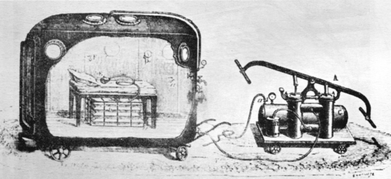

**Fig. 71.1 Mobile hyperbaric operating room described by Fontaine in 1879–1895.** Nitrous oxide storage tanks can be seen under the operating table. Compressed to 1.25 to 1.33 atmospheres absolute (ATA) with air, a nitrous oxide–oxygen mixture was provided to the patient. Breathing air in this chamber would have provided an inspired partial pressure of oxygen (PO2) equivalent to 26% to 28% O2 at 1 ATA. (From Fontaine J- A. Emploi chirurgical de l’air comprimé. _L’Union Médicale: journal des intérêts scientifiques et pratiques moraux et professionnels du corps médicale Paris_ . 1879;28[Ser 3]:445–448. Reprinted with permission of the New York Academy of Sciences.)

<!-- PDF page 3 -->

ear and paranasal sinuses, intestinal gas, pneumothorax, and gas pockets within medical equipment, including monitoring and life- support systems. Changes in the gas volume are inversely proportional to ambient pressure (Boyle’s law):

### PV = constant

At a constant temperature, a doubling of environmental pressure (P) will cause the volume (V) of a gas- filled cavity to decrease by half. This effect also underlies one of the significant beneficial effects of hyperbaric treatment of pathologic gas, as in AGE or DCS (see later).

A comparison of pressure units used clinically with those in common use in hyperbaric environments is shown in Table 71.1.

### Box 71.1 Selected Conditions for Which There Is Evidence of Hyperbaric Oxygen Treatment Effectiveness

### Gas- Bubble Disease

Air embolism*,7,95,332,333 Decompression sickness*,7,95,332,334

### Poisoning

Carbon monoxide*,51,57–60,67,68,73 Cyanide51 Carbon tetrachloride335,336 Hydrogen sulfide51

### Infections

Clostridial myonecrosis*,120–122 Other soft tissue necrotizing infections*,120,122,124,337,338 Refractory chronic osteomyelitis*,7,113,339 Intracranial abscess*,340,341 Mucormycosis*,124,342,343

### Acute Ischemia

Crush injury*,344,345 Compromised skin flaps*,346,347 Central retinal artery occlusion, central retinal vein occlusion*,137,138,348–350

### Chronic Ischemia

Radiation necrosis (soft tissue, radiation cystitis, and osteoradionecrosis)*,7,351–353 Ischemic ulcers, including diabetic ulcers*,7,19,354–357

### Acute Hypoxia

Exceptional blood loss anemia (when transfusion delayed or unavailable)*,7 Support of oxygenation during therapeutic lung lavage*,130,131

### Thermal Injury

Burns*,358–362

### Envenomation

Brown recluse spider bite363–365

### Miscellaneous

Idiopathic sudden sensorineural hearing loss*,366

*Approved by the Undersea and Hyperbaric Medical Society as an appropriate indication for hyperbaric oxygen treatment.

### INCREASED PARTIAL PRESSURE OF OXYGEN

Breathing O2 at increased ambient pressure will lead to elevation of alveolar O2 tension (PaO2), which can be calculated according to the alveolar gas equation for O28,9 :

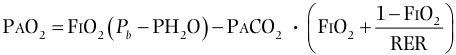

PAO2  F OI 2  P b  PH2O   PACO2   F OI 2  1  F OI 2   RER  

where FiO2 is the fraction of inspired O2 concentration; PH2O is saturated water vapor pressure at body temperature (typically 47 mm Hg); PaCO2 is the alveolar partial pressure of CO2 (PCO2), assumed to equal arterial PCO2 (PaCO2); and RER is respiratory exchange ratio (usually ≈0.8 at rest). Arterial PO2 (PaO2) at any given ambient pressure or FiO2 can be estimated from arterial blood gases measured while breathing air at atmospheric pressure by assuming that the arterial/alveolar (a/A) PO2 ratio remains constant.10,11

Whereas at 1 ATA, the fraction of O2 in arterial blood that is dissolved in the plasma is minimal, at an elevated PaO2 in the range of 1000 to 2000 mm Hg, significant quantities of O2 may exist in dissolved form (Table 71.2).

Increased PaO2 has at least five pharmacologic effects:

1.  Increased blood O2 content

2.  Vasoconstriction12

3.  Antibacterial action, particularly against anaerobic bacteria13

4.  Inhibition of endothelial neutrophil adhesion in injured tissue14,15

5.  Anti- inflammatory effect16,17

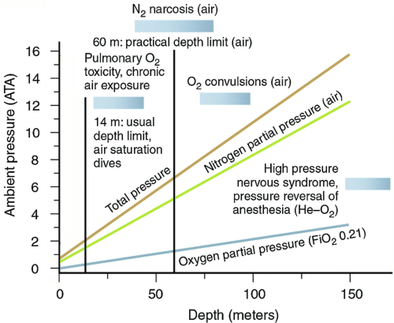

**Fig. 71.2 Ambient pressure as a function of water depth.** Ambient pressure increases linearly with depth, with pressure increasing by 1 ATM for each 10 m of depth. The oxygen partial pressure (PO2) line is shown for a constant fraction of inspired oxygen concentration (FiO2) of 21%. At increasing depth, inspired PO2 eventually exceeds the pulmonary toxic limit (approximately 14 m in depth) and the central nervous system toxic limit (approximately 70 m in depth). The threshold for high- pressure nervous syndrome and pressure reversal of anesthesia (observed in non- narcotic atmospheres, such as helium–oxygen) is 150 to 200 m depth. The _shaded blue bars_ represent the depth or altitude ranges over which risk progresses from low ( _light shading_ ) to high ( _dark shading_ ). _ATM,_ atmosphere; _He,_ helium; _N2,_ nitrogen.

<!-- PDF page 4 -->

**Table 71.1** Units of Pressure

|**Atmospheres Absolute (ATA)**|**Absolute Pressure (mm Hg)**|**Gauge Pressure (mm Hg)**|**Feet of Sea Water (fsw)**|**Meters of Sea Water (msw)**|
|---|---|---|---|---|
|1|760|0|0|0|
|2|1520|760|33|10|
|3|2280|1520|66|20|
|6|4560|3800|165|50|

**Table 71.2** Mean Blood Acid–Base and Cardiovascular Responses to Hyperbaric Oxygenation in 14 Normal Subjects

|**Atmospheric Pressure (ATA)**|1|3|
|---|---|---|
|**Inspired Gas**|Air|100% O2|
|**Arterial PO2** **(mm Hg)**|94|1542|
|**Arterial pH**|7.4|7.42|
|**Arterial PCO2** **(mm Hg)**|37|36|
|**Arterial O2** **Saturation (%)**|95.7|99.1|
|**Arterial Dissolved O2** **(mL/dL)**|0.3|4.6|
|**Arterial Total O2*** **(mL/dL)**|18.4|22.7|
|**Mixed Venous PO2** **(mm Hg)**|43|399|
|**Mixed Venous pH**|7.39|7.37|
|**Mixed Venous PCO2** **(mm Hg)**|42|43|
|**Mixed Venous HbO2** **Saturation (%)**|75.5|97.7|
|**Cardiac Output (L.min**−1**)**|6.5|5.8|
|**Mean Arterial Pressure (mm Hg)**|86|95|
|**Mean Pulmonary Artery Pressure (mm Hg)**|13|12|
|**Pulmonary Artery Wedge Pressure (mm Hg)**|9|9|
|**Systemic Vascular Resistance (dyne.sec.cm**−5**)**|1061|1286|
|**Pulmonary Vascular Resistance (dyne.sec.cm**−5**)**|64|41|

_ATA,_ atmospheres absolute; _O2,_ oxygen; _PCO2,_ partial pressure of carbon dioxide; _PO2,_ partial pressure of oxygen. *Assuming Hb = 13 g/dL. Data from McMahon TJ, Moon RE, Luschinger BP, et al. Nitric oxide in the human respiratory cycle. _Nat Med_ . 2002;8:711–717.

or humans, heart rate and cardiac output decrease, and systemic vascular resistance increases.12,23,26 In anesthetized dogs and awake humans, pulmonary vascular resistance decreases.12,27 At 2 ATA, 100% O2 in conscious dogs does not affect the coronary flow,26 whereas at 3 ATA, both coronary flow and myocardial O2 consumption are decreased.25 Cerebral blood flow is reduced by O2 administration over a range of pressures.21,26 Effects on abdominal organ blood have been variable, with one study suggesting no change,26 while another reported decreased liver blood flow.28 HBOT also has microcirculatory and cellular effects in various disease states (see later).

### ELEVATION OF INERT GAS PARTIAL PRESSURE

Elevation of the partial pressure of the inert gas (usually nitrogen) present in a breathing mixture is associated with a narcotic effect, predictable by the Meyer–Overton hypothesis. Based on its solubility in olive oil, nitrogen has 0.03 to 0.05 times the narcotic potency of nitrous oxide. At 3 to 4 ATA (breathing air), most people experience mild euphoria. At 6 ATA, there may be memory loss and poor judgment. At 10 ATA, some individuals lapse into unconsciousness. Nitrogen narcosis has been compared with alcoholic intoxication, with each increase in ambient pressure of 1.5 ATA breathing air resulting in an effect similar to drinking one martini. Argon and, to a lesser degree, hydrogen are also narcotic, whereas helium has minimal, if any, narcotic effect. In animals exposed to high partial nitrogen pressures, there is evidence of activation of γ-aminobutyric acid (GABA)A receptors of dopaminergic neurons in the nigrostriatal pathway, leading to a decrease in dopamine release.29

The increased arterial O2 content underlies the rationale for administering HBOT for treating ischemic conditions, for example, wounds that fail to heal due to insufficient blood supply. High PaO2 leads to an increase in tissue PO2, which can be estimated using transcutaneous PO2 electrodes.18–20 The second effect, vasoconstriction, explains the effectiveness of HBOT in treating traumatic edema (e.g., crush injury). The mechanism of HBOT- induced vasoconstriction appears to be the inactivation of nitric oxide as a result of increased production of superoxide21 and possibly decreased release of nitric oxide from circulating _S_ -nitrosohemoglobin.12,21,22

These two effects, increased O2 content and vasoconstriction, lead to hemodynamic changes,12,23 shown in Table 71.2. There is also a slight increase in mean arterial pressure. Studies of HBOT effects on myocardial contractility using denervated hearts24 or autonomically blocked animals25 have indicated no intrinsic effect. In intact animals

### ELEVATION OF ABSOLUTE PRESSURE

### High- Pressure Nervous Syndrome

High pressure induces a constellation of symptoms consisting of tremors, ataxia, nausea, and vomiting, known as high- pressure nervous syndrome (HPNS).30,31 It occurs at an ambient pressure greater than 15 to 20 ATA and was first described during the compression phase of deep dives with a helium–O2 atmosphere. HPNS is attenuated by slow compression and the addition of a narcotic gas (e.g., nitrogen) to the breathing mix.32 Its pathogenesis may be related to an increase in striatal dopamine.33

### Pressure Reversal of Anesthesia

Studies in animals have demonstrated that high pressure tends to reverse general anesthesia. Elevations in ambient pressure without a narcotic inert breathing gas will tend to decrease the effectiveness of both inhaled and intravenous

::: details 原始表格與符號（PDF 第 4 頁）

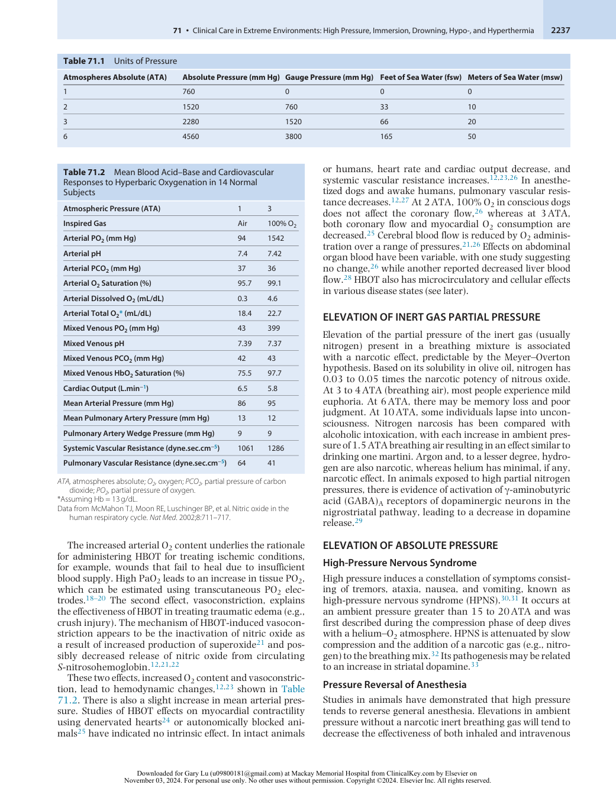

:::

<!-- PDF page 5 -->

anesthetics. At 50 ATA, a 20% increase in the 50% effective dose (ED50) occurs in mice with a variety of inhaled anesthetics. At 50 and 100 ATA, the effective dose of barbiturates increases by 30% to 60%.34 The ED50 for diazepam in rats is markedly reduced at 90 ATA in a helium–O2 atmosphere.35 At 31 ATA, the effective concentration for halfmaximal effect (EC50) of propofol for loss of righting reflex in tadpoles is increased by 19%, and at 61 ATA, by 38%.36 Using the same technique, the EC50 for dexmedetomidine at 31 ATA is nearly double the value at 1 ATA and increased 2.5- fold at 61 ATA.37 At 80 ATA, the minimum alveolar concentration. (MAC) of desflurane, as assessed by response to a noxious stimulus, is increased by 19%.38 The mechanisms of pressure reversal are not fully understood but may be secondary to physical–chemical effects of pressure on membranes39 or alterations in neurotransmitter release.33 However, within the range of pressures used for HBOT (up to 3 to 6 ATA), the effects of pressure on sedative or anesthetic drugs are not clinically significant.

### EFFECTS OF HYPERBARIC EXPOSURE ON DRUG DISPOSITION

Although possible effects on drug disposition have been suggested due to altered cardiac output and hepatic/renal blood flow, there is no known significant pharmacokinetic or pharmacodynamic effect of hyperbaric exposure for most drugs up to 6 ATA. Pharmacokinetic studies of a few drugs have shown that up to 6 ATA pressure and 2.8 ATA PO2, the pharmacokinetics of meperidine,40 pentobarbital,41 theophylline,42 and salicylate43 are unaffected.

The use of benzodiazepines, chlorpromazine, and lithium carbonate has been reported to treat agitation, auditory and visual illusions, and paranoia in a previously normal subject participating in an experimental dive to 650 m (66 ATA).44 The symptoms, poorly controlled with diazepam 120 mg/ day and temazepam 60 mg/day, ultimately responded to chlorpromazine 300 mg/day. Lithium carbonate administered in conventional doses appeared to display normal pharmacokinetics. Although the effect of chlorpromazine appeared clinically to be appropriate, the authors were uncertain as to whether the failure of benzodiazepines to elicit a desired therapeutic response was due to the patient’s condition or to a pressure- reversal phenomenon.

In summary, clinical experience and the published literature indicate that conventional parenteral drug dosing schedules are safe for various drugs administered under hyperbaric conditions at the pressures used for clinical treatment (up to 6 ATA).

## Hyperbaric Oxygen Therapy

### THE RATIONALE FOR HYPERBARIC TREATMENT OF SELECTED ACUTE CLINICAL ENTITIES

### Carbon Monoxide Poisoning

Hemoglobin (Hb) binds CO with an affinity much higher (by a factor of about 200) than O2. This binding of CO with Hb to form carboxyhemoglobin (HbCO) has two major effects. First, the proportion of Hb occupied by CO molecules is unavailable for O2 transport, resulting in functional

anemia. Second, the avidity with which the remaining Hb binds O2 increases (shift to the left of the Hb–O2 dissociation curve).45 The result of this is a decreased ability to unload O2 from blood to tissue at the capillary level and therefore a reduction in tissue PO2. Previously it was believed that these effects were responsible for the toxicity of CO. However, evidence has since been presented to show that the binding of CO to intracellular pigments (e.g., cytochrome aa3, myoglobin) and oxidative stress may contribute significantly to the toxicity of CO.46–53 CO exposure also triggers intravascular platelet–neutrophil aggregation and neutrophil activation.54 These mechanisms result in toxicity to multiple organ systems, including the brain and heart.51,55 Immune- mediated effects have also been described.56,57

Clinical effects include headache, nausea, vomiting, dizziness/ataxia, myocardial ischemia, loss of consciousness, and, during pregnancy, fetal distress. Persistent or delayed neurologic sequelae can occur, often after a clear window of lucidity.57–59 Increased risk factors for persistent sequelae include older age (≥36 years) and more prolonged CO exposure.60

The diagnosis of CO poisoning is made by a history of exposure (internal combustion engine exhaust, fire, improperly adjusted gas or oil heating, charcoal or gas grills, or exposure to paint stripper containing methylene chloride, which is metabolized by the liver to CO). The diagnosis is confirmed by finding an elevated HbCO level in either arterial or venous blood. HbCO concentration is stable for several days in anticoagulated blood samples. Therefore, if HbCO determination is unavailable at a referring facility, the diagnosis can be confirmed using a blood sample obtained at the initial evaluation and transported with the patient. Fetal hemoglobin (HbF) can produce a falsely elevated reading for HbCO on certain four- wavelength laboratory cooximeters.61 In the first few weeks of life, blood from normal infants may falsely indicate 7% to 8% HbCO.

Actual HbCO levels measured on arrival in the emergency room correlate poorly with clinical status and should not be used as the sole criterion to determine the need for treatment. Because of the lower intracellular PO2, the elimination of CO from intracellular binding sites occurs more slowly. Significant mental obtundation, vomiting, and headache may remain even in patients with a normal HbCO level.

Brain imaging may reveal various abnormalities in patients with CO poisoning, including hypodensities in the globus pallidus and subcortical white matter, cerebral cortical lesions, cerebral edema, hippocampal lesions, and loss of gray matter/white matter differentiation, and white matter hyperintensities.62–65 Except to exclude other pathologic processes, brain imaging does not help determine who should receive HBOT, but it may provide prognostic information. Lesions in both globus pallidus and white matter are associated with poor long- term outcomes.62,66

Oxygen is the primary treatment modality for CO poisoning. High PaO2 hastens the removal of CO from blood, as indicated by a reduced half- life of HbCO. Fig. 71.3 shows the HbCO half- time in a series of CO- poisoned patients during normobaric O2 administration; HBOT reduces the half- time even further, to around 20 minutes at 2.5 ATA.67 Additionally, the increased dissolved O2 in plasma may support tissue oxygenation pending the removal of CO from Hb and other proteins

<!-- PDF page 6 -->

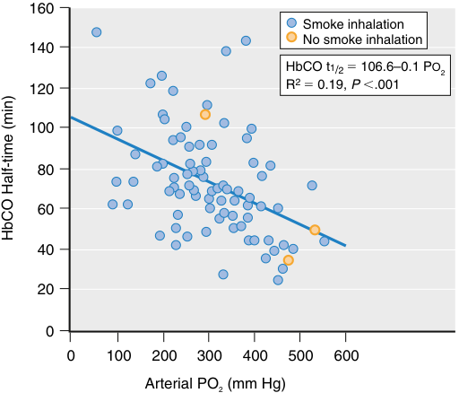

160 Smoke inhalation No smoke inhalation 140 HbCO t1/2 � 106.6–0.1 PO2 120 R 2  � 0.19,  P  �.001 100 80 60 40 20 0 0 100 200 300 400 500 600 Arterial PO2 (mm Hg) HbCO Half-time (min) 

**Fig. 71.3 Elimination half- time of carboxyhemoglobin in 93 carbon monoxide–poisoned patients.** Although there is scatter in the data, it is apparent that carbon monoxide dissociates from hemoglobin faster at higher partial pressure of oxygen (PO2). (Redrawn from Weaver LK, Howe S, Hopkins R, Chan KJ. Carboxyhemoglobin half- life in carbon monoxide- poisoned patients treated with 100% oxygen at atmospheric pressure. _Chest._ 2000;117[3]:801–808.)

necessary for O2 transport. Mounting evidence indicates that HBOT may decrease early and late morbidity for poisoning in which neurologic symptoms occur.57,68 Although the results of one randomized prospective trial of hyperbaric versus normobaric oxygen revealed no apparent benefit of HBOT,69 in four other trials with adequate pressure (100% O2 at 2.5– 3 ATA) HBOT resulted in improved outcomes compared with treatment at 1 ATA (Fig. 71.4),58,59,70,71 with greater efficacy of early treatment.72 HBOT has been observed to reduce mortality in CO poisoning.73

Commonly used guidelines for the application of HBOT in CO poisoning include the following57,59 :

- Neurologic impairment (including dizziness, and loss of consciousness), even if the patient seems normal at the time of medical evaluation.

- Cardiac abnormalities (ischemia, arrhythmias, ventricular failure)

- Metabolic acidosis (also consider concomitant cyanide poisoning)

- HbCO level that has been greater than 25%

Consensus guidelines recommend the administration of HBOT at 2.8–3 ATA for 1–3 treatments or until clinically stable.59

Fetuses are particularly susceptible to CO toxicity. Pregnant women who fulfill the listed criteria or are in fetal distress should be treated with HBOT. Case reports,74–76 published series,77–80 and a critical review81 support the concept that inadequately treated CO poisoning is a serious risk to the mother and fetus, and the benefits of HBOT outweigh the theoretical risks to the fetus from HBOT. Potential adverse effects of currently implemented HBOT protocols have not been confirmed in clinical practice.80

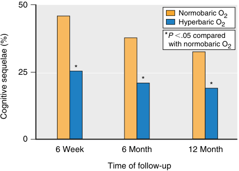

50 Normobaric O2 Hyperbaric O2 * P �.05 compared   with normobaric O2 * 25 * * 0 6 Week 6 Month 12 Month Time of follow-up Cognitive sequelae (%) 

**Fig. 71.4 Cognitive sequelae in a randomized prospective trial of hyperbaric oxygen (O2) in carbon monoxide poisoning.** Cognitive sequelae were defined as any T score for a neuropsychological subtest more than 2 standard deviations (SD) below the mean of demographically corrected standardized T scores, or if two or more T scores for subtests were more than 1 SD below the mean. If the patient reported difficulties with memory, attention, or concentration, then cognitive sequelae were defined as a T score on any neuropsychological subtest more than 1 SD below the mean of demographically corrected standardized T scores. (Drawn from data reported by Weaver LK, Hopkins RO, Chan KJ, et al. Hyperbaric oxygen for acute carbon monoxide poisoning. _N Engl J Med._ 2002;347[14]:1057–1067.)

### Gas Embolism and Decompression Sickness

The introduction of gas into the arterial circulation (AGE) has traditionally been associated with scuba divers and attributed to pulmonary barotrauma during ascent from a dive while breathing compressed gas. However, it may also occur iatrogenically in several clinical circumstances, such as during cardiopulmonary bypass or because of inadvertent injection of air during a diagnostic arteriogram or hemodialysis. Additionally, large amounts of gas may enter the venous system, for example, during neurosurgical procedures with the patient in the sitting position, accidental disconnection of hemodialysis access equipment, major back surgery, total hip replacement, cesarean section, laparoscopy, intrauterine laser surgery, arthroscopy (from air escaping from a faulty air- powered instrument), upper gastrointestinal (GI) endoscopy, and hydrogen peroxide irrigation or oral ingestion (due to elaboration of gaseous oxygen from tissue and blood catalase). Venous gas embolism (VGE) can also occur when a central venous catheter is opened to air, allowing air ingress due to subatmospheric intrathoracic pressure. Severe VGE has also occurred during pregnancy associated with sexual intercourse82 or during orogenital sex after blowing air intravaginally.83 VGE has been reported in patients with adult respiratory distress syndrome (ARDS) who are ventilated with positive endexpiratory pressure (PEEP).84 VGE in sufficient quantity may overwhelm the ability of the pulmonary vasculature to filter the gas, allowing bubbles to pass into the arterial circulation. Even small amounts of venous gas (e.g., VGE caused by decompression from diving) have recently been implicated in neurologic syndromes in scuba divers because of transatrial passage through a patent foramen ovale.85,86

The effects of gas embolism can be partly due to vessel obstruction by bubbles, but bubble–endothelial interaction causes increased capillary permeability and

::: warning 符號需核對
此頁有符號無法完整擷取，請展開下方原始頁面核對。
:::

::: details 原始表格與符號（PDF 第 6 頁）

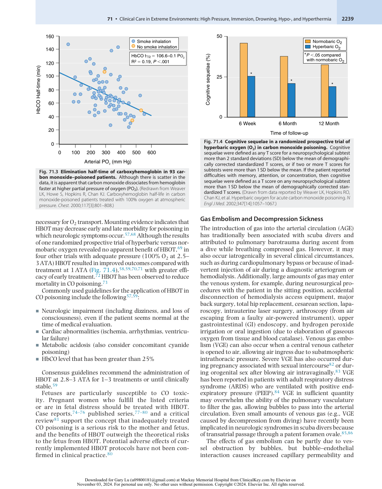

:::

<!-- PDF page 7 -->

extravasation of fluid,87–89,97 resulting in hemoconcentration. Impaired endothelial function also occurs.90 Another effect has been demonstrated in a model of AGE in anesthetized rabbits91,92 : small doses of intracarotid air may pass through the cerebral microcirculation yet produce vasoplegia, delayed reduction of cerebral blood flow, and neurophysiologic impairment. This reduction in blood flow is abolished when there is neutropenia; thus it has been concluded that leukocytes constitute a significant component of the pathophysiology.93 This delayed reduction of cerebral blood flow may be responsible for the clinical observation of initial neurologic improvement after AGE, followed by delayed deterioration.94

A related syndrome that results from the pathologic effects of tissue and blood gas bubbles is decompression sickness (DCS), seen in aviators and compressed gas divers. The gas bubbles in these situations occur because of a decrease in ambient pressure at a rate sufficient to induce local inert gas supersaturation, resulting in the formation of bubbles _in situ_ from tissue stores. Manifestations of AGE classically consist of impaired consciousness, hemiparesis, or seizures but may be less severe. At the same time, DCS commonly presents as any combination of joint pain, paresthesias, motor weakness, bladder or bowel sphincter dysfunction, vertigo, tinnitus, and hearing loss.95–97

Treatment principles for both forms of gas bubble disease, AGE, and DCS, are the same in most instances. First aid includes therapy with oxygen.98 High PO2 results in an increased resolution rate of gas bubbles because of the resulting higher partial pressure gradient for the diffusion of inert gas from the interior of the bubble into the surrounding tissue or blood. Fluid resuscitation will replenish intravascular volume, relieve hemoconcentration, and facilitate microcirculatory flow,99 principles confirmed by animal100 and human observations.87 However, excessive fluid administration can worsen pulmonary gas exchange in cardiorespiratory DCS (pulmonary edema from VGE), and aggressive fluid therapy is not indicated for isolated AGE.99 Although capillary leaks resulting from cerebral AGE can raise intracranial pressure, studies in anesthetized pigs have shown that hyperventilation is ineffective in reversing its effects.101

HBOT is the definitive treatment for AGE and DCS.97,102 The increased pressure causes a diminution in gas volume and thus further hastens resolution. The usefulness of HBOT for diving- related or aerospace- related gas embolism associated with rapid decompression is well documented.97,102,103 HBOT may affect neurologic improvement even after many hours and sometimes days between the embolic event and treatment,104–106 although some evidence suggests that severe abnormalities are less likely to resolve if not treated promptly.107 AGE treatment is usually performed at an ambient pressure of 2.8 ATA (see Hyperbaric Treatment Schedules, below).

The decision to administer recompression treatment should be based entirely on clinical evaluation.97 The only appropriate role for brain or spinal imaging (e.g., computed tomography [CT], magnetic resonance imaging [MRI]) is to exclude other pathologic processes such as hemorrhage, and only if there is a high degree of suspicion that bubbles are not the cause of a patient’s symptoms. Some authors have suggested that patients with AGE should only be

treated with HBOT if CT of the brain reveals air.108 However, brain and spinal cord imaging of patients with AGE or DCS reveals air in only a minority of instances106,107,109,110 ; thus the absence of air does not exclude either AGE or DCS. Neither the presence nor absence of intravascular gas predicts a response to hyperbaric treatment.106,107 Nuclear brain imaging using single-photon emission tomography (SPECT) or positron emission tomography (PET)111 does not provide clinically useful information in managing patients with bubble- induced neurologic injury. If either AGE or DCS is suspected, HBOT should be initiated as soon as possible unless there is a high suspicion of another condition that may require different treatment. Repetitive hyperbaric therapies should be administered daily or twice daily until manifestations resolve or until there is no further improvement.97

### Acute Infections

Anaerobic bacteria are susceptible to increased tissue PO2. High O2 tensions inhibit clostridial α- toxin production.112 Other mechanisms include reversal of hypoxiainduced neutrophil function,113–115 enhanced macrophage interleukin- 10 expression,116 and anti- inflammatory effects.117–119 Evidence of HBOT in clostridial and nonclostridial infections is provided by clinical series and database analyses.120–125

Recent analysis suggests a possible benefit of hyperbaric oxygen in COVID pneumonia,126 and is now supported by case series and randomized clinical trials.127 In one trial, 40 non- intubated patients with hypoxemia while receiving supplemental O2 were randomized to a single daily hyperbaric oxygen treatment at 1.45 ATA for 90 minutes. After an average of six sessions of HBOT, the time to correct hypoxemia was shorter in the treatment group (median three vs. nine days). However, the trial was underpowered to detect any statistically significant effect on ARDS, mechanical ventilation, or death within 30 days after admission.128 A trial planned for 200 patients is underway.129

### Support of Arterial Oxygenation in Therapeutic Lung Lavage

HBOT is a safe and effective method of supporting arterial oxygenation during therapeutic lung lavage, during which oxygenation has to be maintained by the contralateral (non- lavaged) lung.130,131 In the authors’ experience of over 100 procedures, using this technique to treat arterial oxygenation has been uniformly successful with no complications specific to HBOT. A reversible simulation of pulmonary gas exchange during the lavage procedure can be provided by temporarily ventilating the lung to be lavaged with 5% to 6% O2/balance nitrogen, which reduces PaO2 in that lung to approximately the level of mixed venous PO2 and confining O2 exchange to the contralateral lung. Hypoxemia within 5 minutes is predictive of hypoxemia during the actual lavage.

### Maintenance of Oxygen Transport in Severe Anemia

The ability of HBOT to increase arterial O2 content in plasma to clinically useful levels may allow support of tissue O2 delivery even without Hb. HBOT can therefore be used for temporary support of severely anemic patients pending

<!-- PDF page 8 -->

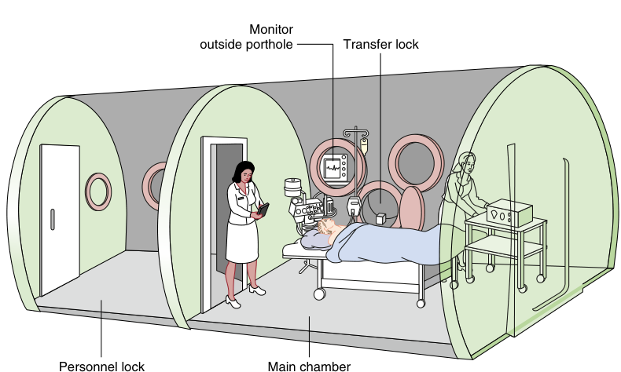

Monitor outside porthole Transfer lock Personnel lock Main chamber 

**Fig. 71.5 Multiplace hyperbaric chamber large enough for one or more patients and tenders.** The chamber atmosphere is compressed air. The patient receives 100% oxygen by mask, head tent, or endotracheal tube. Monitors are usually kept outside the chamber because of electrical safety considerations. Monitoring is possible through a porthole. A personnel lock and a transfer lock allow physicians, nurses, or other personnel, in addition to medications, food, and blood samples, to be moved into and out of the chamber without repeated compression and decompression of the patient.

the availability of definitive therapy in the form of crossmatched blood.

### Crush Injury

HBOT increases tissue oxygen tensions, reduces edema, and, consequently, increases blood flow through injured soft tissue and may mitigate ischemia- reperfusion injury.132–136

### Central Retinal Artery Occlusion and Central Retinal Vein Occlusion

Central retinal artery occlusion (CRAO) and central retinal vein occlusion (CRVO) are uncommon but devastating conditions resulting in sudden painless vision loss, which is usually permanent and with a poor outlook for recovery of vision. Intermittent HBOT can maintain the viability of the retina via diffusion of oxygen from the choroidal vessels pending recanalization of the occluded vessel. Urgent HBOT should be considered for patients presenting within 24 hours of symptom onset.137–142

### Idiopathic Sudden Sensorineural Hearing Loss

Sudden sensorineural hearing loss is defined as hearing loss of at least 30 dB, identified at three or more consecutive frequencies, occurring over less than 72 hours. The pathophysiology is unknown, but local hypoxia has been speculated as a possible cause. Empirical HBOT has been shown to offer benefits, with greater success, when it is administered soon after symptom onset but may be helpful even up to 3 months.143,144

### THERAPEUTIC SYSTEMS

The traditional method of administering hyperbaric therapy is with a multiplace chamber, which accommodates two or more persons (Fig. 71.5). Size may vary from a small, portable, 2- person chamber used for transporting patients in the

field to one 20 feet or more in diameter, in which up to 12 or more patients may be comfortably treated, in addition to tenders (attendants). Multiplace chambers are compressed with air while the patient breathes O2 with a head tent (Fig. 71.6), face mask, or endotracheal tube. Because of immediate access to the patient by accompanying nursing personnel or physicians, monitoring and resuscitative procedures are straightforward. However, multiplace chambers take up a significant amount of space and are expensive.

Monoplace chambers are large enough to accommodate only one patient (Fig. 71.7) or a tender with a small child. The chamber wall in most types is manufactured of Plexiglas, facilitating close visual observation of the patient. The chamber is usually compressed with 100% O2. The advantage of monoplace chambers is their lower cost and ease of installation. Chamber operation can often be implemented by connecting the O2 inlet to the hospital supply. Operation is relatively simple, but the patient inside is not directly accessible. Monitoring is somewhat more remote, and emergency airway management is not possible. Development of a pneumothorax during treatment, particularly a tension pneumothorax, can be fatal because pleural decompression with a needle or chest tube cannot be performed before decompression; however, this complication is infrequent. A minor disadvantage of these chambers is that the ambient pressure limit is 3 ATA, and treatment times are limited for practical reasons (psychological aversion to confinement). Moreover, intermittent air- breathing periods require an additional gas delivery system to decrease the risk of O2 toxicity during some types of treatment schedules (see later). Nevertheless, monoplace technology now permits intravenous fluid administration from outside the chamber, invasive intravascular monitoring, mechanical ventilation, and utilization of pleural drainage systems incorporating regulated suction.145,146

<!-- PDF page 9 -->

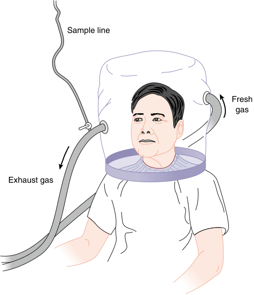

Sample line Fresh gas Exhaust gas 

**Fig. 71.6 Head tent circuit for use in a multiplace chamber.** Fresh gas (100% O2) flows at a constant rate (>30 L/min) through the head tent. Exhaust gas may be either vented outside the chamber or recirculated through a carbon dioxide scrubber. The sample line attached to the exhaust hose allows monitoring of the patient’s breathing gas.

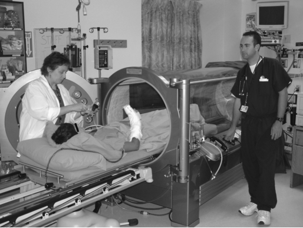

**Fig. 71.7 Monoplace chamber.** This type of chamber has room for one patient or a tender with a small child. The patient is moved into and out of the chamber on a wheeled gurney. The chamber atmosphere is usually 100% oxygen. The chamber is constructed of transparent Plexiglas to allow observation. Through- hull penetrators in the door on the left can be seen and allow monitoring, intravenous fluid administration, and control of a ventilator inside the chamber. (Photograph courtesy Dr. Lindell Weaver.)

### HYPERBARIC TREATMENT SCHEDULES

Ideally, a patient with a therapeutic indication for HBOT would be exposed for an unlimited time until the condition resolves. Unfortunately, several factors limit the dose and duration of HBOT:

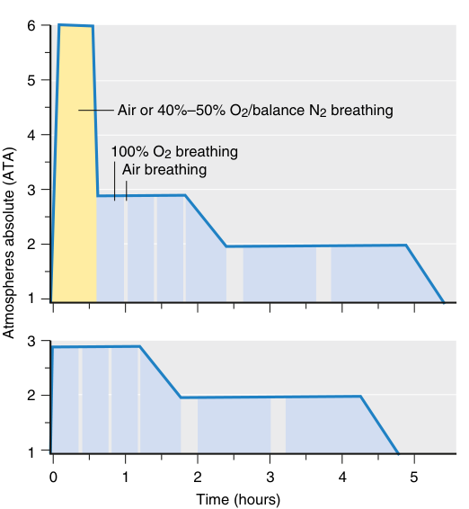

6 5 Air or 40%–50% O2/balance N2 breathing 4 100% O2 breathing Air breathing 3 2 1 3 2 1 0 1 2 3 4 5 Time (hours) Atmospheres absolute (ATA) 

**Fig. 71.8 US Navy treatment tables.** _Top:_ US Navy Table 6A. This schedule is occasionally used for the treatment of arterial gas embolism. During the 30- minute period at 6 atmospheres absolute, air or 40% to 50% oxygen (O2) can be administered. _Bottom:_ US Navy Table 6. This table was originally designed for the treatment of decompression sickness but is now the most commonly used table for gas embolism as well. The _shaded areas_ represent 100% O2 breathing; the _white areas_ represent air breathing periods. Further details can be found in the US Navy Diving Manual. (From Navy Department. U.S. Navy Diving Manual. Revision 7. Vol: Diving Medicine and Recompression Chamber Operations. NAVSEA 0910- LP- 115- 1921. Washington, DC: Naval Sea Systems Command; 2016.)

- Oxygen toxicity

- Decompression obligation for nursing staff (or other tenders) accompanying patient

- Adequacy of monitoring

- Patient isolation and boredom in a confined environment

Treatment schedules are compromises between O2 partial pressure and exposure time on one hand and O2 toxicity and other practical limiting factors on the other. The various navies of the world developed the original schedules (or “tables”) to treat DCS and gas embolism in divers (Fig. 71.8).

US Navy Table 6 (see Fig. 71.8) prescribes an initial exposure to 2.8 ATA (equivalent to 60 feet of seawater [fsw], or 18 m of seawater [msw]), followed by slow decompression to 1.9 ATA (30 fsw). Periods of O2 breathing are interspersed with 5- or 15- minute periods of air- breathing to decrease O2 toxicity (see later). This schedule remains the mainstay of treatment for DCS in multiplace chambers worldwide. Incomplete relief of signs or symptoms can be treated with repeated applications of US Navy Table 6 or a shorter treatment on a once- or twice- daily basis until resolution or lack of incremental improvement.

“Saturation” treatment consists of extended exposure to elevated pressure (e.g., 2.8 ATA) for an unspecified period

<!-- PDF page 10 -->

(often 1 to 2 days) until manifestations have stabilized. Periodic O2 breathing is given according to a recommended schedule as tolerated. Because saturation treatment results in a much larger degree of nitrogen uptake in both the patient and the tender, decompression must occur much more slowly, usually over 24 to 36 hours.147 Although this therapy avoids the theoretical disadvantage of intermittent treatment—failure of resolution of gas bubbles—it is also considerably more labor intensive. Because hyperbaric chambers used for saturation treatments require additional hardware (e.g., CO2 scrubbing capability) and personnel, their application outside military and commercial diving has been limited.

Examples of schedules used for treating patients with wound healing problems and with clostridial myonecrosis or other life- threatening anaerobic infections are shown in Fig. 71.9. One schedule for clostridial myonecrosis consists of 85 minutes at 3 ATA followed by a 33- minute decompression stop for the tenders at 1.3 ATA. This treatment schedule has been designed to maximize PaO2 (and hence tissue bactericidal activity resulting from O2) without an undue risk of hyperoxic seizures.

Treatment schedules for CO poisoning have varied. However, the proven efficacy of the schedule reported by Weaver (60 minutes at 3 ATA, 60 minutes at 2 ATA in addition to air breaks and compression–decompression time) supports the use of 2.8–3 ATA for at least the first treatment.57,59

Administration of HBOT to patients with chronic diseases (e.g., radionecrosis) is usually performed using shorter tables at lower ambient pressure, most commonly 1 to 2 hours at 2.0 to 2.5 ATA (see Fig. 71.6) once or twice daily. At this lower ambient pressure, the risk of O2 toxicity is minimal, and treatments are well tolerated by most patients.

### SIDE EFFECTS OF HYPERBARIC OXYGEN THERAPY

### Oxygen Toxicity

A vast body of evidence supports the notion that O2 toxicity is caused by the excessive production of oxygen- free radicals (e.g., superoxide, hydroxyl radicals, and singlet oxygen). At high O2 partial pressures, scavenging mechanisms can be overcome by increased rates of free radical production.148 With supplemental O2 at 1 ATA, the manifestations of O2 toxicity are almost exclusively confined to the lung; however, during hyperbaric O2 exposure, other organs can be affected as well.

O2 toxicity during HBOT can affect mainly the lung, the central nervous system (CNS), and the eye. Pulmonary toxicity in the conscious patient is heralded by symptoms of tracheobronchial irritation, namely, cough and burning chest pain. Prolonged exposure may result in a decrease in vital capacity, and if O2 administration continues, ARDS. In the rare instances in which prolonged HBOT is indicated, the rate of development of pulmonary O2 toxicity can be slowed by intermittent air- breathing periods (“air breaks”) (Fig. 71.10).

O2 toxicity is related to the PO2 of the inspired gas. At 1 ATA, 100% O2 is as toxic as 16.7% O2 at 6 ATA or 2% O2 at 50 ATA. One method of quantification of O2 exposure is the unit pulmonary toxic dose or UPTD.149 In this system, the number of UPTD units is calculated by the formula:

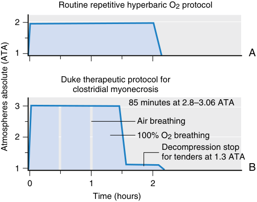

Routine repetitive hyperbaric O2 protocol 2 1 A Duke therapeutic protocol for clostridial myonecrosis 85 minutes at 2.8–3.06 ATA 3 Air breathing 2 100% O2 breathing Decompression stop for tenders at 1.3 ATA 1 B 0 1 2 Time (hours) Atmospheres absolute (ATA) 

**Fig. 71.9 Examples of clinical hyperbaric oxygen (O2) treatment schedules.** (A) The patient breathes 100% O2 for 2 hours at an ambient pressure of 2 ATA. Generally, this schedule is used for repetitive treatment of chronic conditions (e.g., osteoradionecrosis). (B) Therapeutic schedule often used for treatment of clostridial myonecrosis. The patient and tender spend 85 minutes at 2.8 to 3.06 ATA (3 ATA shown). The patient breathes 100% O2, except for two 5- minute air breaks to reduce pulmonary and central nervous system O2 toxicity. A decompression stop is made at 1.3 ATA, according to the US Navy standard air decompression table. The stop is designed to facilitate safe decompression of the tender, who breathes air at 3 ATA. _ATA,_ atmosphere absolute.

### U = t  m 0.5/  P  0.5 

where U is the unit; t is the exposure time in minutes; P is the inspired PO2 in ATA; and m is a slope constant with an empirical value of 1.2. After 1425 UPTD units of O2 exposure, an average 10% decrease in vital capacity occurs. After 2190 UPTD units, an associated reduction of 20% occurs. Complete reversal of vital capacity decrements as large as 40% of control has been observed after extended O2 exposure at 2 ATA.149

Reanalysis of a more extensive data set than the one used for the UPTD model, which included those data, resulted in a different prediction equation:

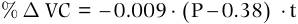

% D VC =  0.009   P  0.38   t 

where P and t are the same as for the previous equation (3).150

Using previously published data, Arieli and colleagues151 developed the following equation:

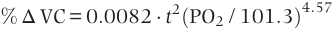

% Δ VC = 0 . 0082 ⋅ t 2 (PO2 / 101 . 3) 4 . 57 

where t is time in hours, and PO2 is measured in kilopascals (kPa).

Although these algorithms may be helpful as an approximate guide to safe O2 exposures in populations, interindividual variability is such that they cannot be relied on to predict the development of pulmonary O2 toxicity for a specific patient accurately.152 Furthermore, O2 toxicity can be modified by humidity, circulating catecholamine and corticosteroid levels, leukocyte accumulation in the lungs (e.g., with pneumonia), and circulating endotoxin. A more useful guide to developing pulmonary toxicity is the patient’s

<!-- PDF page 11 -->

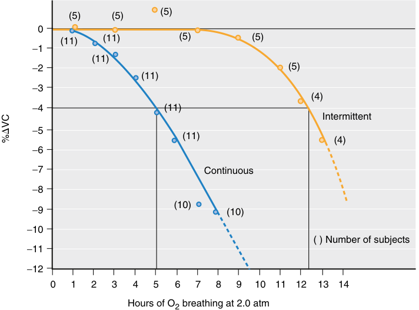

(5) (5) (5) 0 (11) (11) (5) (5) −1 (11) −2 (5) (11) −3 (4) −4 (11) Intermittent −5 (11) (4) −6 −7 Continuous −8 −9 (10) (10) −10 ( ) Number of subjects −11 −12 0 1 2 3 4 5 6 7 8 9 10 11 12 13 14 Hours of O2 breathing at 2.0 atm VC�% 

**Fig. 71.10** Decrease in vital capacity (VC) as a function of time breathing 100% oxygen (O2) at 2 ATA in humans. The figure illustrates the value of intermittent O2 (20 minutes O2, 5 minutes air) versus continuous O2 administration in the prevention of pulmonary O2 toxicity. The _numbers in parentheses_ represent the number of subjects tested. (From Clark JM. Oxygen toxicity. In: Bennett PB, Elliott DH, eds. _The Physiology and Medicine of Diving._ Philadelphia, PA: WB Saunders; 1993:121–169. With permission.)

symptoms, which include cough and inspiratory central burning chest pain. These symptoms do not occur during routine repetitive HBOT, but they may become evident during extensive O2 periods at 2.8 ATA (e.g., when treating neurologic DCS). Asymptomatic persons usually have minimal or no change in vital capacity. Minor changes in forced expiratory volume in 1 second (FEV1) reported during repetitive HBOT153 are of uncertain clinical importance.

Some antineoplastic agents, such as bleomycin154 and mitomycin C,155,156 appear to predispose to fatal pulmonary O2 toxicity (ARDS and respiratory failure) from what should otherwise have been well- tolerated doses of supplemental O2. The risk of pulmonary O2 toxicity from HBOT in patients with previous exposure to such agents is unknown. However, several individuals with a remote history of bleomycin treatment have been treated with repetitive HBOT at 2 ATA for 2 hours (initially once daily, then increased to twice daily).157 Occasional mild pulmonary O2 toxicity symptoms such as retrosternal chest tightness did occur, but none of these patients experienced severe O2 toxicity. The propensity to pulmonary O2 toxicity engendered by these drugs appears to diminish a few weeks after their discontinuation.

CNS O2 toxicity manifests as nausea, vomiting, numbness, twitching, dizziness, olfactory, acoustic, or gustatory sensations, and in its most severe form as non- focal tonic– clonic seizures.158,159 The probability of seizures increases with increasing PO2 and exposure time. In a study of 36 divers breathing 100% O2 at 3.7 ATA, all experienced one or more of these symptoms within 100 minutes or less.158,159 In clinical practice, convulsions in patients undergoing HBOT are rare at ambient PO2 up to 2.5 ATA (typically 0.008% to 0.035% of treatments160,161 ), and they often have another predisposing factor (hypoglycemia). The

probability of a convulsion is also greater when administered for acute indications such as CO poisoning.160 Metabolic factors may reduce the seizure threshold, such as administering high- dose penicillin (e.g., for clostridial infection), sepsis, and hypoglycemia.

The treatment of hyperoxic seizures is the immediate reduction of the inspired PO2 until the seizure stops. Some physicians then routinely administer an anticonvulsant such as phenobarbital, phenytoin, or benzodiazepine. It is recommended that the chamber should not be decompressed while the patient is actively convulsing because airway closure and failure to exhale during this period may cause pulmonary overexpansion and barotrauma, including arterial gas embolism. Hyperoxic seizures otherwise have no sequelae and rarely recur, even if HBOT is restarted after a seizure. Thus, the occurrence of CNS O2 toxicity should not preclude further HBOT. There is no evidence that hyperoxic seizures are more common in patients with preexisting seizure disorders.

An acute effect of HBOT on the eye is the narrowing of the visual fields,162 which is generally only observed at a PO2 of 3 ATA or greater and thus rarely, if ever, during routine HBOT. A subacute or chronic ocular effect is a change in the refractive index of the lens that results in myopia.163,164 Such refractive index change occurs during intermittent HBOT over several weeks and usually resolves in a similar period. However, some patients may be left with residual myopia, particularly older patients.165

Concern has been raised about the risk of retrolental fibroplasia in the unborn child of a woman who may require acute HBOT during pregnancy. Although many pregnant women have been treated with single exposures to HBOT (e.g., for CO poisoning), we are unaware of any subsequent occurrence of retrolental fibroplasia in the child. Pregnancy is not

::: warning 符號需核對
此頁有符號無法完整擷取，請展開下方原始頁面核對。
:::

::: details 原始表格與符號（PDF 第 11 頁）

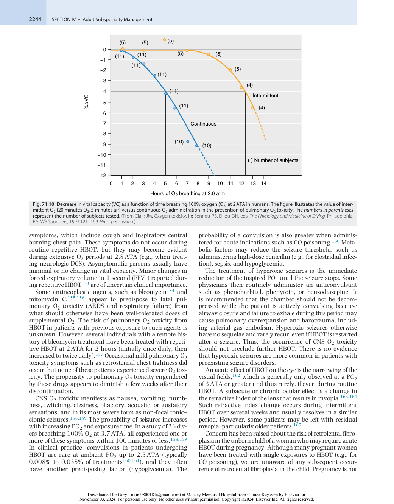

:::

<!-- PDF page 12 -->

a contraindication to HBOT for appropriate acute indications (e.g., CO poisoning75,77,78,80,81,166 ), as the risk to the fetus of the underlying condition exceeds that of the treatment.

### Inert Gas Uptake

Breathing air at high ambient pressure can result in nitrogen narcosis, a dose- dependent decrement in cerebral performance due to the anesthetic properties of nitrogen, as mentioned earlier. This mainly occurs at ambient pressures exceeding 4 ATA, a treatment pressure used only for severe AGE or DCS. Nitrogen uptake can also theoretically result in DCS during or after decompression (see earlier). However, chamber decompression schedules are designed to be sufficiently conservative that this rarely occurs (most hyperbaric facilities use standard compressed air decompression tables such as those published by the US Navy).167 Additional safety for the tender can be provided by 100% O2 breathing immediately before and during decompression. Rare episodes of DCS in hyperbaric tenders are usually minor, generally consisting of joint pain, although severe cases have been reported.168–170 Nitrogen narcosis and DCS could only occur in tenders in a multiplace hyperbaric chamber; patients breathe 100% O2 and are therefore not susceptible.

### Barotrauma

As the ambient pressure is altered, the pressure within gascontaining spaces in the body must equilibrate with the ambient pressure or undergo a volume change. Volume change can easily occur in compliant compartments such as the gastrointestinal tract. Still, suppose the free flow of gas into and out of containing spaces surrounded by a rigid shell (e.g., the lung, paranasal sinuses, and middle ear) is obstructed. In that case, tissue disruption and hemorrhage can occur. Indeed, the most common side effect of hyperbaric chamber use for patients is difficulty with middle ear pressure equilibration.171–174 This causes pain, bleeding into the middle ear cavity (“squeeze”), and rarely, tympanic membrane rupture. Difficulty equilibrating middle ear pressure could also result in labyrinthine window (round or oval window) rupture, which has been reported after HBOT,175 although it is scarce. Patients who previously had head and neck irradiation and acute respiratory tract infections are at particular risk. Squeeze may occasionally also affect the sinuses, resulting in acute pain. Despite the common occurrence of the middle ear or sinus squeeze on compression, symptoms on decompression, because of the inability of gas to exit through the Eustachian tubes or sinus ostia (“reverse squeeze”), are rare.

Areas of regional hypoventilation could lead to pulmonary over- pressurization during chamber decompression and alveolar rupture, causing pneumothorax, pneumomediastinum, or AGE.176,177 However, pulmonary barotrauma during HBOT is scarce, probably because of the slow decompression rates typically used. Although a pneumothorax should diminish in size and resorb more quickly after compression, continuing leakage of air from the lung could result in tension pneumothorax during decompression. Appropriate management of a pleural drainage unit can evacuate pleural air during decompression and prevent tension pneumothorax.178

Despite these potential adverse effects of HBOT, major complications are infrequent.171,173,174

### PRACTICAL ASPECTS OF HYPERBARIC THERAPY

### Middle Ear Pressure Equilibration

In awake patients, equilibration may be accomplished using several techniques, such as performing intermittent Valsalva maneuvers, swallowing while the nose is pinched, thrusting the jaw forward, or simply swallowing intermittently during compression. Equilibration may be facilitated by applying a topical nasal vasoconstrictor (e.g., oxymetazoline 0.05%) that shrinks the nasopharyngeal mucosa and increases the patency of the Eustachian tube. Myringotomy or tympanostomy tubes may be required for patients who cannot equalize despite these measures or for obtunded or intubated patients.

### Pulmonary Pressure Equilibration

Pneumothorax detected before HBOT is usually treated by inserting a chest tube and water seal or Heimlich- type valve (in this instance, before monoplace chamber treatment, a chest tube should always be inserted). Caution must be exercised when using certain commercially available pleural suction regulators, which can exert high negative pleural pressures during chamber compression.178 Such excessive suction can be relieved by an attendant inside a multiplace chamber by activating the manual pressure relief valve or opening a syringe port on the chest drainage unit. Patients with large bullous lesions in the lung are probably at increased risk of pulmonary barotrauma, and the risk versus benefit of HBOT should be considered before treatment.

### Patient Monitoring

Despite the changes in the acoustic properties of compressed air, blood pressure measurement may be performed without difficulty with a standard sphygmomanometer and stethoscope. Aneroid pressure gauges are preferred to mercury to avoid contamination of the closed environment. Monitoring the electrocardiogram (ECG) and intravascular pressures requires transducer cables to be plumbed through the chamber wall to preamplifiers outside the chamber. Standard intensive care monitors can simultaneously measure arterial and PA pressures and intermittent cardiac output measurement by thermodilution. If pressure bags are used to drive continuous flow systems, they must be re- pressurized during compression and vented before or during decompression. Pulmonary artery catheter balloon ports should also be left open to the chamber during compression and decompression.

Defibrillation could generate a fire if sparking occurs or combustible materials are in the vicinity of the paddles. Sparking and heat generation can be minimized by using a low- resistivity conductive gel between the electrodes and the skin or preapplied conductive disposable pads.179 To avoid pressure- related malfunction of the device, the defibrillator can remain outside the chamber and be connected to the patient via through- hull high- voltage wiring. Despite the fear of causing fire, defibrillation has been carried out in multiplace chambers numerous times without arcing, fire, or explosion.180,181 Defibrillation cannot safely perform inside a monoplace chamber compressed with O2.

<!-- PDF page 13 -->

### Intravenous Fluid Administration

In multiplace chambers, the air volume within the drip chamber will shrink during the compression phase of the HBOT and expand during decompression (which could force air into the intravenous line). Most intravenous infusion pumps work well inside a hyperbaric chamber at pressure (although there are electrical safety issues – see later). Glass bottles are best excluded from the chamber because of the possibility of explosive rupture during decompression.

Administration of fluids to patients inside a pressurized monoplace chamber requires an infusion pump outside the chamber capable of handling the pressure differential (up to 3 ATA or 1500 mm Hg pressure gradient across the chamber wall). Check valves can prevent unintended backflow of blood from the patient in the event of disconnection of the pump. Rigid arterial pressure transducer tubing helps to prevent kinking while the patient is inside the chamber.

### Blood Gas Assessment and Ventilator Management

Blood gas measurements on arterial samples obtained from a patient inside a hyperbaric chamber can be erroneous. There are two reasons. At 1 ATA, O2 tensions that exceed ambient pressure are supersaturated; thus, O2 will rapidly diffuse out of the blood, lowering its tension. An additional error (extrapolation error) results from the impossibility of accurate PO2 electrode calibration at PO2 values exceeding approximately 700 mm Hg. Blood gas tension measurement should ideally be performed inside the hyperbaric chamber using an appropriately calibrated analyzer. If such a capability is unavailable, rapid analysis at 1 ATA of decompressed samples can produce acceptably accurate values.182

Another approach is to estimate the hyperbaric PaO2 based on measurements obtained at 1 ATA. Using a measured PaO2 and a calculated alveolar PO2 (PaO2) the ratio

of the two (PaO2/PaO2, or a/A ratio) is a constant.10,11 On this basis, 1 ATA arterial blood gas values and the following equations can be used to predict PaO2 at pressure.

The alveolar gas equation is required to calculate PaO2:

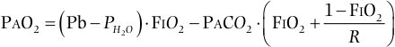

PAO2   Pb  PH 2 O   FI O 2  PAC O 2  F OI 2  1  F OI 2   R  

where Pb and PH2O are, respectively, ambient and saturated water vapor pressures, and R is the respiratory exchange ratio. If FiO2 = 0.2, R = 0.8, and body temperature = 37°C, then this equation can be simplified to:

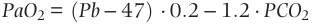

PaO 2 = ( Pb  − 47) ⋅ 0 . 2 − 1 . 2 ⋅ PCO 2 

Having calculated PaO2 and measured PaO2, the a/A ratio can then be obtained at 1 ATA. The predicted PaO2 (PaO2(pred)) at increased ambient pressure while breathing 100% O2 may then be obtained from this next equation:

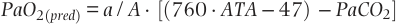

PaO 2( pred ) =  a  /  A  ⋅ [(760 ⋅ ATA  − 47) − PaCO 2] 

where ATA is the chamber pressure in atmospheres absolute, although as yet there are no dose–response curves for HBOT, a reasonable aim is to achieve PaO2 greater than or equal to 1000 mm Hg for routine chronic therapy and as high a level as possible for treatment of acute necrotizing infections (Fig. 71.11).

A better tissue oxygenation monitor may be mixed venous PO2 (PVO2), which, in the absence of a left- to- right shunt, may be a reasonably accurate estimate of mean tissue PO2.183 Thus, a low value may indicate inadequate tissue oxygenation despite HBOT due to insufficiently high cardiac output.

Normal values for pH and PCO2 under resting clinical hyperbaric conditions are the same as they are at 1 ATA.11,12,23 PCO2 (and hence pH) do not change significantly in blood samples that are decompressed.

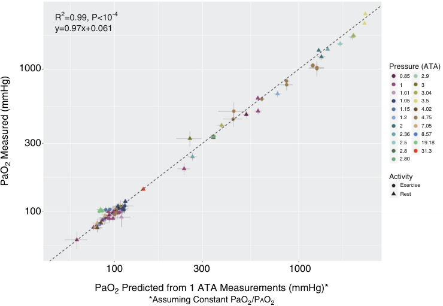

R 2 =0.99, P&lt;10 -4 y=0.97x+0.061 1000 Pressure (ATA) 0.85 2.9 1 3 1.01 3.04 1.05 3.5 1.15 4.02 1.2 4.75 2 7.05 2.36 8.57 300 2.5 19.18 2.8 31.3 2.80 Activity Exercise Rest 100 100 300 1000 PaO2 Predicted from 1 ATA Measurements (mmHg)* *Assuming Constant PaO2/PAO2 PaO Measured (mmHg)2 

**Fig. 71.11 Measured versus predicted arterial partial pressure of oxygen (PaO2) at increased ambient pressure.** Predicted PaO2 is calculated from room air arterial blood gases, assuming the arterial–alveolar PO2 ratio (PaO2/PaO2, or a/A ratio) is constant. Data are shown both for persons with normal lungs (a/A ratio ≥0.75) and for patients with gas exchange abnormalities (a/A ratio &lt;0.75). It is evident that PaO2 predicted this way is close to the actual measured PaO2. _ATA_ , atmospheres absolute. (Redrawn from Paganini M, Moon RE, Boccalon N, et al. Blood gas analyses in hyperbaric and underwater environments: a systematic review. _J Appl Physiol (1985)_ . 2022;132:283–293.)

<!-- PDF page 14 -->

Mechanical ventilation in a hyperbaric environment presents a variety of challenges. The ideal requirements for ventilation include small size, no electrical requirement, absence of flammable lubricants, ability to operate on a volume- cycled basis over a wide range of tidal volumes and respiratory rates, minimal modification requirement for installation, and ability to provide PEEP, as well as to ventilate in intermittent mandatory ventilation and assist/control modes.184 Additionally, the ideal gas source to actuate the ventilator should minimize the risk of combustion caused by a buildup of static electricity.

As ambient pressure increases, gas density is proportionately raised, whereas relatively little change occurs in gas viscosity. Therefore, airway resistance increases in regions of turbulent flow (i.e., in the large airways). Measurements of respiratory conductance (the reciprocal of resistance) during tidal breathing185 indicate that it varies with gas density according to the following formula:

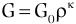

 G  G0  

where G is lung conductance at gas density ρ, G0 is the conductance at gas density 1.1 g/L (1 ATA), and κ is a constant that was found to have a mean value of −0.39. At 6 ATA, this equation predicts that lung conductance would decrease by 50%, equivalent to a doubling of pulmonary resistance. In addition, the higher gas density results in a less efficient ventilation distribution, manifested by an increase in physiologic dead space.186 The effects of these two phenomena include higher airway pressures during mechanical ventilation and an increased ventilatory requirement. If ventilator settings are not adjusted to compensate for the higher dead space, a rise in PaCO2 will occur.

Several types of ventilators have been used and tested in hyperbaric chambers. Pressure- cycled devices have been successfully used because their compactness admirably fulfills the requirement for a small size. However, continual adjustment of rate and cycling pressure is necessary with changes in ambient pressure. Volume- cycled ventilators generally work well, although, at increased pressure, some rate changes may occur.

Two specific safety considerations exist. First, in any ventilator delivering enriched O2, a possible fire hazard can occur from O2 buildup within the ventilator case or leakage of O2 into the chamber. Minor alterations can often offset this hazard (e.g., for a pneumatic ventilator, using air instead of O2 to drive the bellows).184 The risk of ignition can be substantially mitigated by purging the device with an inert gas such as 100% nitrogen (see later). Air- filled endotracheal tube cuffs tend to lose volume during compression and re- expand during decompression. Appropriate cuff inflation volume can be maintained by manually adjusting the air pressure within the cuff during compression and decompression or by filling the cuff with water.

### Other Medical Devices

Some electrical devices (e.g., pacemakers, automated internal cardioverter–defibrillators, intravenous infusion pumps) have been specifically tested at high ambient pressures; specific information can usually be obtained from the manufacturers. Ventricular assist devices may work satisfactorily187,188 ; however specific safety measures may be required for rechargeable batteries (typically lithium). To the authors’ knowledge, extracorporeal membrane oxygenation (ECMO) devices have not been tested or used during hyperbaric oxygen therapy.

### Atmosphere Control

Chamber atmosphere safety includes the management of levels of O2, CO2, and trace gases. In a multiplace chamber, the patient must breathe as high a concentration of O2 as possible (usually 98% or greater) while maintaining the chamber O2 concentration close to 21% to minimize fire hazard. In some hyperbaric units, head tent O2 concentration is routinely monitored. In others, the concentration is assumed to be high because of a high rate of O2 flow through the head tent. Leakage of O2 from head tents, masks, and ventilators tends to raise the chamber O2 concentration. Typically, an upper limit of approximately 23% is used as a criterion for ventilating the chamber with air or small volumes of 100% nitrogen until the O2 concentration decreases.

Significant elevations of inspired CO2 concentration cause cerebral vasodilatation, and increased cerebral blood flow, and tissue PO2, thus increasing the risk of CNS O2 toxicity. Therefore, a typical standard for the upper limit for head tent CO2 is 1% “surface equivalent” CO2, equal to a partial pressure of 7.6 mm Hg. Using a nonscrubbing (open circuit) system, head tent O2 flow rates of 40 to 60 L/min (measured at chamber pressure) are usually adequate to keep CO2 levels at such a level. Chamber CO2 is generally limited to less than 0.5% “surface equivalent” (3.8 mm Hg).

Trace gases that may enter the environment include CO and hydrocarbons from improperly functioning compressors or from automobile exhaust that may be near the compressor air intake. Volatile gases such as alcohol vapor from skin disinfectant solutions and mercury vapor from spillage of sphygmomanometer columns may also pollute the atmosphere. Trace gas concentrations innocuous at atmospheric pressure can be toxic under hyperbaric conditions because their pharmacologic or toxic effects are related to partial pressure. Mercury in any form should be excluded from hyperbaric chambers because spillage can cause acute toxicity in chamber occupants.

Considerations of battery use may have implications for chamber atmosphere control and fire hazards. All batteries release small quantities of hydrogen, although not usually in amounts that would be hazardous. Similarly, an objection exists to using mercury cells (now banned in the United States). Alkaline cells are safe, although temporary failure has been observed at extremely high ambient pressures (40–60 ATA).

### Fire Hazards

Although fires in hyperbaric chambers are rare, they are usually lethal. The effects of fire at elevated ambient pressure are so devastating, and so fast that fire extinguisher systems may not be effective.189 The genuine risk of fire in hyperbaric chambers has been illustrated by recent accidents in which chamber fires were started by a hand warmer, a sparking toy, and other sources of ignition carried into the chamber in the patient’s clothing. Minimization of these risks involves the following:

- Controlling chamber O2 concentrations (irrelevant in a monoplace chamber)

- Minimizing the use of combustible materials within the chamber

- Eliminating sources of heat and spark

- Having a chamber fire- extinguisher system

As already noted, the geometric increase in the burning rate with increases in O2 concentrations mandates careful

<!-- PDF page 15 -->

monitoring of chamber O2. At increased ambient pressure, burning occurs more rapidly, even when the O2 concentration is 21%. Cotton garments are recommended because of their reduced risk of static electricity. Eliminating hair grease and humidifying the O2 within the head tent can reduce the risk of hair ignition. Hydrocarbon lubricants (e.g., for stretcher wheels) can spontaneously ignite on contact with aluminum in the presence of high O2 tensions and should therefore be replaced with nonflammable fluorocarbon lubricants.

Sources of sparks from electrically powered equipment should be minimized. Cigarette lighters, matches, and other ignition sources should be excluded from the chamber. Plugging and unplugging electrical cables during hyperbaric treatments is a source of sparking that can be eliminated by taping all electrical plugs onto receptacles before compression. In multiplace chambers, the flammability of electrically powered devices (e.g., intravenous controllers) can be reduced by purging with 100% nitrogen through ports drilled in the covering at a rate sufficient to keep O2 concentration at a level that does not support combustion (typically at a flow rate of two to three times the internal volume per minute). Electrical systems used in monoplace chambers must comply with specific codes, which stipulate the types of switches, grounding, and insulation that can be used.190

Volatile anesthetics can be combustible at 1 ATA in high concentrations. However, isoflurane and sevoflurane Dräger vaporizers have been tested up to 3 ATA using 100% O2, with no evidence of spontaneous combustion at room temperature. Given the experience with halothane under hyperbaric conditions,191 without any reported fires, and the resistance to combustion in 100% O2 at 1 ATA in the absence of a source of ignition, it is unlikely that any of the modern fluorinated anesthetics pose a fire safety hazard in the hyperbaric environment.

### Evaluation of a Patient for Safety of Hyperbaric Oxygen Treatment

In addition to ensuring that HBOT is indicated for the disease process in question, it is essential to assess the patient in terms of the general effectiveness and safety of HBOT. The following issues are pertinent:

- Whether a sufficient elevation in PaO2 can be obtained

- Whether the patient can equilibrate middle ear pressure

- Optimization of reversible obstructive lung disease and the presence of pulmonary bullae or blebs

- Whether the patient is susceptible to claustrophobia

The calculation of predicted PaO2 in the hyperbaric chamber was described previously. For example, a patient who has sufficient lung disease or injury such that PaO2 during treatment would not exceed 1000 mm Hg would probably obtain marginal benefit from HBOT unless the reason for HBOT is gas bubble disease.

The ability to vent the middle ears may be assessed before treatment by observing the tympanic membrane directly with an otoscope. At the same time, the patient holds their nose or performs a Valsalva maneuver. Movement of the eardrums indicates a patent Eustachian tube and the ability to equilibrate middle ear pressure. If otic barotrauma is difficult to avoid (e.g., with mental obtundation or the presence of an endotracheal tube) or because of a condition that may render the patient susceptible to inner ear injury

(e.g., stapedotomy), myringotomy or tube placement can be performed before HBOT. The presence of pulmonary bullae or blebs represents a relative contraindication to HBOT because of the possibility of barotrauma. However, a large clinical experience suggests that the risk is extremely low.

For patients requiring more than 20 to 30 HBOT sessions, periodic checks of visual acuity may be helpful to detect hyperbaric myopia.

Because most hyperbaric chamber systems are small and cramped, patients who cannot tolerate enclosed spaces may require anxiolytic therapy to facilitate the toleration of the HBOT.

### Delivery of Anesthesia at Increased Ambient Pressure

A review of anesthesia problems under HBOT was published as a report to a committee of the American Society of Anesthesiologists.192 This report explored various issues, including the potential for nitrous oxide to be used as a sole anesthetic.

Anesthesia while breathing spontaneously in a 100% O2 atmosphere at 3 ATA was reported in the 1950s for radiation therapy using a combination of a barbiturate, meperidine, and chlorpromazine.193 Intubation was performed after succinylcholine and topical anesthesia of the airway, and patients breathed spontaneously.

Anesthesia may be required during hyperbaric exposure. Ross and associates discussed the challenges of anesthesia up to 35 ATA to provide care for injured divers while in a saturation diving system (e.g., in North Sea oil fields).194 These investigators suggested using intravenous instead of inhaled general anesthesia because of the problems of pollution of the chamber environment. Regional anesthesia was recommended whenever possible. The authors noted that muscle relaxants should be titrated to effect because some degree of pressure reversal at around 10 ATA has been reported.

Since the 1960s, anesthesia has been performed at increased ambient pressure using a variety of agents for carotid endarterectomy,195 cesarean section,195 therapeutic lung lavage for patients with alveolar proteinosis (Fig. 71.12),130,131 emergency surgery in a saturation dive (under local anesthesia),196 open heart surgery,197 and enhancement of the effectiveness of irradiation of carcinoma.198

**Inhaled Anesthesia.** Inhaled anesthesia of any type can pollute the enclosed chamber atmosphere with anesthetic gases, which may exert pharmacologic effects on medical personnel inside the chamber, particularly at high ambient pressures. During the administration of nitrous oxide in a hyperbaric chamber, Russell and associates199 reported nitrous oxide concentrations in chamber air of 2500 ppm; ventilation of the chamber with air at a high rate (3500 L/min of air) was required to reduce the concentration to 25 to 75 ppm.

**nitrous oxide.** The increased ambient pressure in a hyperbaric chamber allows nitrous oxide to be used at partial pressures exceeding its MAC.199–201 Although induction of anesthesia by nitrous oxide was rapid (&lt;60 seconds) in both studies, it was accompanied by tachypnea tachycardia, hypertension, diaphoresis, muscle rigidity, catatonic jerking of the extremities, eye- opening, and opisthotonus. After 2 to 4 hours of anesthesia, most subjects emerged rapidly from the anesthetic; however, the majority subsequently experienced nausea and vomiting, which was often severe.

<!-- PDF page 16 -->

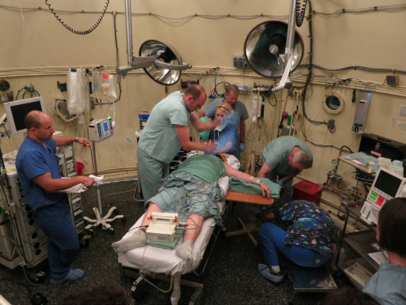

**Fig. 71.12** General anesthesia was administered in a multiplace hyperbaric chamber to support arterial oxygenation during therapeutic lung lavage. Lung lavage is performed by flooding one lung with normal saline via a double- lumen endotracheal tube. Protein washout is performed by cyclic filling and emptying with 400 L to 500 mL saline volumes until the effluent clears.331 After 60 minutes the contralateral lung is lavaged using the same technique. Depicted is a patient under general anesthesia with propofol/opioid receiving manual chest percussion during the emptying phase. (From Duke University Medical Center.)

A potential problem associated with nitrous oxide anesthesia at high ambient pressures is the possibility that tissues could become supersaturated during decompression, thus allowing nitrous oxide bubbles to form. Russell and associates did not observe this complication,202 and used an empiric staged decompression schedule with a decompression stop for 30 minutes at 1.3 ATA while the patients breathed 100% O2. Bubble formation can occur without decompression if the patient breathes one gas while surrounded by an atmosphere of another gas that is more diffusible. For example, breathing air in a helium–O2 environment at 5 to 7 ATA can lead to urticaria and vestibular dysfunction.203 The reason is the rapid diffusion of helium into tissues that causes local inert gas pressure to exceed ambient pressure (isobaric gas counterdiffusion). This phenomenon can occur even at normal atmospheric pressure if a person breathes nitrous oxide–O2 while surrounded by helium.204 Therefore, it is imperative that nitrous oxide never be administered in a helium–O2 atmosphere.

Another risk of hyperbaric nitrous oxide is the dilutional effect of large volumes of dissolved gas entering the lungs during decompression, causing dilutional hypoxia. This situation can be prevented by the administration of an O2- enriched breathing mix for several minutes before decompression.

In patients who have recently engaged in scuba diving or have suffered DCS, nitrous oxide should be avoided, even at 1 ATA, because its administration may result in tissue or blood bubble growth and recrudescence of pain or neurologic symptoms. Neurologic symptoms can occur after nitrous oxide anesthesia and apparent spontaneous resolution of DCS.205

**halogenated anesthetics.** The effect of a volatile anesthetic on a patient is proportional not to the alveolar concentration but to the partial pressure of the anesthetic. For example, the effect of 1% halothane at 1 ATA (with a partial pressure of 7.6 mm Hg) is equivalent to a 0.5% concentration at 2 ATA (with the same partial pressure). The anesthetic concentration of an anesthetic- specific calibrated vaporizer varies with ambient pressure but in such a manner that delivered partial pressure remains constant (see Fig. 71.9). Because of the effect of increased gas density on this flow ratio, in practice, the delivered partial pressure depends somewhat on ambient pressure. A slightly increased partial pressure of halothane delivered by a vaporizer at 3 ATA has been observed (Fig. 71.13).192 Our testing of a sevoflurane vaporizer revealed delivery of a constant partial pressure of anesthetic up to the maximum tested ambient pressure: 3 ATA.

Because of the increased gas density, the rotameter flowmeters calibrated at 1 ATA will indicate falsely high values at increased ambient pressure. McDowell206 reported the following relationship for rotameter flow:

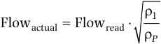

 1 Flowactual  Flowread   P 

where Flowactual and Flowread are the actual and scale reading flows, and ρ1 and ρP are the gas densities at 1 ATA and P ATA, respectively. This inaccuracy in rotameter performance up to 4 ATA has been confirmed by others (see Fig. 71.13).192

**Intravenous Anesthesia.** Intravenous anesthetics behave similarly and are unlikely to be affected within the usual clinical range of ambient pressure (see Chapter 23). There is no evident alteration in the pharmacokinetics of either meperidine40 or pentobarbital41 at ambient pressures up to 6 ATA. The authors have provided general anesthesia at ambient pressures up to 3 ATA for therapeutic lung lavage by using conventional doses of ketamine and benzodiazepines or propofol and narcotics with nondepolarizing muscle relaxants.

**Regional Anesthesia.** Regional anesthesia is likely to be both safe and effective in a hyperbaric environment by avoiding the requirement for mechanical ventilation. A bowel resection was performed at an ambient pressure of 6.75 ATA in a helium–O2 environment using local injection of lidocaine supplemented with parenteral meperidine.196 Extreme care should be taken to ensure sterile technique because of the propensity for enhanced bacterial growth in a hyperbaric chamber’s warm, humidified environment, particularly during saturation chamber exposures.

### FUTURE DIRECTIONS IN HYPERBARIC OXYGEN THERAPY

### Preoperative Hyperbaric Oxygenation

Preconditioning is described as the application of an insult to activate endogenous protective mechanisms to lessen the morphologic and functional sequelae of a subsequent insult. Ischemic preconditioning is the application of a brief period of ischemia, which activates endogenous protective

<!-- PDF page 17 -->

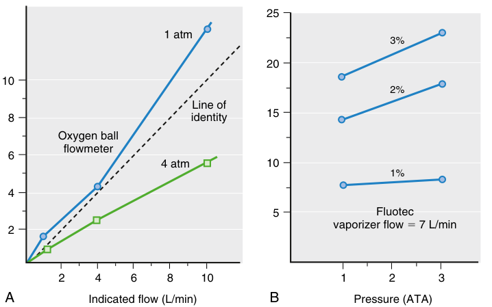

25 1 atm 3% 20 10 2% Line of 15 8 identity Oxygen ball flowmeter 6 4 atm 10 1% 4 5 Fluotec 2 vaporizer flow � 7 L/min 2 4 6 8 10 1 2 3 A Indicated flow (L/min) B Pressure (ATA) 

**Fig. 71.13 Performance of an anesthetic vaporizer system at increased ambient pressure.** (A) Flow characteristics of a rotameter system are shown. At 4 ATA, the actually delivered flow is less than 60% of the flow indicated by the rotameter. (B) Fluotec vaporizer output in partial pressure of halothane as a function of ambient pressure. Only small increases in delivered partial pressure are evident at 3 ATA, at the 2% and 3% settings. _ATA,_ atmospheres absolute. (From Committee on Hyperbaric Oxygenation. _Fundamentals of Hyperbaric Medicine. Publication No. 1298._ Washington, DC: National Academy Press; 1966.)

mechanisms to reduce the damage from subsequent ischemic insults. Ischemic preconditioning was first described in the canine myocardium and was shown to exist in the brain. Since then, intense research in pharmacology has ensued to identify other agents that lead to preconditioning, such as volatile anesthetic agents, lipopolysaccharide exposure, heat, CNS seizures, hypoxia, and hyperoxia, and more recently, hyperbaric hyperoxia.207

Clinical trials have shown that HBOT before cardiac or surgical procedures can improve outcomes.208 Sharifi and associates described the use of HBOT to inhibit restenosis after percutaneous coronary intervention in acute myocardial infarction.209 In 2005, Alex and associates observed that repetitive pretreatment with three sessions of HBOT at 2.4 ATA before on- pump coronary artery bypass graft (CABG) surgery reduced neuropsychometric dysfunction and modulated the inflammatory response favorably after cardiopulmonary bypass.210 Yogaratnam and associates reported that preconditioning with a single session of HBOT at 2.5 ATA before on- pump CABG surgery improved left ventricular stroke work post- CABG surgery while reducing intraoperative blood loss, intensive care unit (ICU) length of stay, and postoperative complications.211 In a prospective, randomized controlled trial Li and associates demonstrated in patients undergoing on- pump and off- pump CABG that HBOT preconditioning decreased the release of cerebral and myocardial biochemical markers. Patients in the on- pump group pretreated with hyperbaric oxygen had a reduced ICU stay and decreased use of inotropic drugs.212 A small randomized trial of a single hyperbaric treatment at 2.5 ATA for 116 minutes the day before pancreatic resection study vs. no HBOT revealed reduced pulmonary complications among those who received the hyperbaric exposure.213 In a retrospective analysis of 356 patients,214 83 underwent HBOT preoperatively: 1–3 daily sessions of 90 minutes of 100% oxygen at 2 ATA with 5- minute air breaks at 20- minute

intervals. In the patients who underwent HBOT, postoperative complications were significantly lower: 8.4% vs. 32.6%. In the control group, 6.2% of patients experienced necrosis vs. none in the HBOT group.

The mechanism by which HBOT can be protective is not currently known but does not involve support of metabolism by increased tissue oxygen stores since tissue and blood oxygenation are dissipated within minutes after hyperbaric exposure. The etiology of cerebral injuries is probably multifactorial, including cerebral microemboli, global cerebral hypoperfusion, inflammation, cerebral temperature modulation, and genetic susceptibility.207,215 The protection mechanism may include HBOT- induced oxidative stress due to increased reactive oxygen species (ROS) generation, which could induce ischemic tolerance similar to ischemia- reperfusion. Alternatively, HBOT preconditioning may reduce ischemia- reperfusion damage by reducing tissue leukocyte recruitment and activation, reduction of tissue edema, protecting from cellular necrosis, reduction of tissue apoptosis, and improving tissue outcome and preservation.216–218 Another possible mechanism is the upregulation of antioxidant enzymes such as superoxide dismutase,219 and possibly heme oxygenase- 1, as shown in a model of liver ischemia.220 The role of HBOT in these settings will be determined by larger clinical trials.

### Stroke

Several studies of middle cerebral artery occlusion in rats have demonstrated the beneficial effects of hyperbaric oxygen.167,221–224 In an unselected case series of patients with acute stroke treated within 5 hours of symptom onset, some patients improved with HBOT where arterial PO2 was 1100 to 1300 mm Hg.225 Since then, there have been several clinical studies, with mixed results,226 perhaps because of the failure to start HBOT in a timely fashion227 or use of subtherapeutic PO2. Interestingly, a recent doubleblind study reported improved outcomes when HBOT was

::: warning 符號需核對
此頁有符號無法完整擷取，請展開下方原始頁面核對。
:::

::: details 原始表格與符號（PDF 第 17 頁）

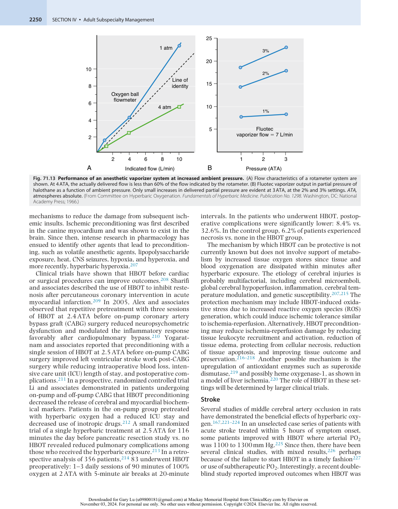

:::

<!-- PDF page 18 -->

administered after the acute stroke, suggesting some effect on neuroplasticity.228

### Acute Traumatic Brain Injury

Hyperoxia may have several protective mechanisms of action in severe traumatic brain injury (TBI), including improved oxidative metabolism and mitochondrial function and reductions in intracranial hypertension, apoptosis, neuroinflammation, and free radical–mediated damage. Small clinical trials and mechanistic observations provide support for the efficacy of HBOT.153,229–231 This has led to an NIH- supported multicenter trial of HBOT in acute TBI (Hyperbaric Oxygen Brain Injury Treatment Trial [HOBIT], ClinicalTrials.gov Identifier: NCT02407028).

### SUMMARY

Environmental exposures can cause specific types of clinical conditions that require targeted therapy. Experience with compressed air and diving has led to new treatments using hyperbaric oxygen. The increasingly widespread use of HBOT to treat critically ill patients has created a demand for individuals skilled in using this technology. Planning and design of monitoring capabilities will enable optimal control of hemodynamics and oxygenation. Patient safety in this environment can be achieved with careful attention to detail, including patient selection, monitoring, and chamber procedures. Optimized treatment schedules will evolve from studies of the mechanism of action and further clinical trials. Advances in preventing and treating O2 toxicity may allow more prolonged therapy than can be safely administered and a more aggressive approach to ischemic and infectious syndromes.

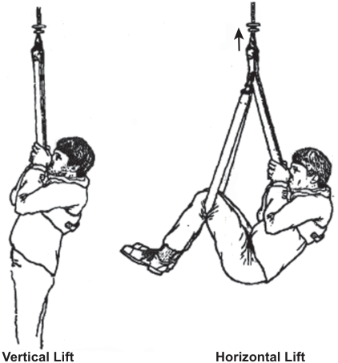

Vertical Lift Horizontal Lift 

**Fig. 71.14 Two methods of extracting a victim from the water.** After immersion for 30 minutes in 15°C water, heart rate changes were measured during removal in two different positions. During vertical lift mean heart rate increased by 16% due to reflex response to hypotension versus only a small nonsignificant increase during the horizontal lift. Extracting victims in the vertical position has resulted in death, presumably due to hypotension. (From Golden FS, Hervey GR, Tipton MJ. Circum- rescue collapse: collapse, sometimes fatal, associated with the rescue of immersion victims. _J R Nav Med Serv._ 1991;77[3]:139–149 [page 146, Fig. 3], with permission.)

significant time in the water be kept in the horizontal position during the rescue (Fig. 71.14).

### IMMERSION PULMONARY EDEMA

## Physiology of Immersion

### ACUTE EFFECTS OF IMMERSION

The upright posture of humans results in gravitational effects on the venous blood pool, which tends to be distributed into the lower half of the body. Because water and blood have almost the same density, immersion in water causes an immediate redistribution of blood from the legs and splanchnic bed into the heart and pulmonary circulation. This causes a reduction in lung volumes, a rise in central venous and pulmonary vascular pressures,232,233 and an increase in ventricular and stroke volumes.234 These effects are accentuated in the cold versus warm water due to peripheral vasoconstriction.235,236

### PROLONGED IMMERSION AND RESCUE

Because of atrial stretch, there is an increase in B- type natriuretic protein (BNP) secretion. In conjunction with the increase in cardiac output, this induces diuresis. Prolonged immersion, such as during loss at sea, can result in severe hypovolemia due to a lack of fluid intake and prolonged diuresis. Indeed, some marine accident survivors have died during extraction from the water in the vertical position.237 It is therefore recommended that victims who have spent

Pulmonary vascular pressures that are elevated due to immersion increase even further during exercise, particularly in cold water.236 Drinking water before immersion can activate the osmopressor response238,239 and further augment central translocation of venous blood. Blood centralization then raises pulmonary vascular pressures, which can be sufficiently elevated in susceptible individuals to induce acute pulmonary edema. This condition is called immersion pulmonary edema (IPE) or swimming- induced pulmonary edema (SIPE). Individuals with cardiovascular pathologies, such as hypertension, left ventricular hypertrophy, cardiac valve disease, and cardiomyopathy, are particularly susceptible because of their preexisting elevation of left atrial pressure.240 However, healthy individuals can also experience SIPE, particularly during heavy exercise in the water. SIPE has been reported during a long swim in approximately 0.5% of competitive long-distance swimmers,241 3% to 5% of US Navy special forces trainees,242 and up to 60% of Israel Defense Force recruits.243 SIPE tends to recur in some individuals and has been linked to higher than normal pulmonary artery (PA) and PA wedge pressures.244

The condition usually resolves within a few hours after removal from the water (which immediately reduces intravascular pressure within the pulmonary vessels) and administration of first aid O2. Nebulized β2- adrenergic agents may help treat bronchospasm and accelerate water reabsorption

<!-- PDF page 19 -->

from alveoli.245 Although resolution within a few hours is the norm, SIPE- induced death has been reported.246–248

## Drowning

### DEFINITION

A definition of drowning was proposed and adopted in 2002 by the World Health Organization as follows: _Drowning is the process of experiencing respiratory impairment from submersion/immersion in liquid_ .249 This definition was modified slightly by a consensus of international investigators on guidelines for the uniform reporting of data from drowning studies (Utstein style),250 which has subsequently been updated.251 A recent publication has reviewed 14 drowning publications based on this reporting convention.252

The evolution of the drowning syndrome in a patient depends on the extent of fluid aspiration into the airways, leading to hypoxemia and cardiac arrest, which can evolve into progressive and irreversible neurologic damage. Death at any time due to drowning is described as _fatal drowning_ . When drowning is interrupted, it is referred to as _nonfatal drowning_ . Any submersion incident without a respiratory impairment should be considered a _water rescue_ , not drowning. Other terms such as “near drowning,” or “dry,” or “wet drowning,” or similar distinctions should not be used to standardize appropriate reporting of outcomes.253–256

cardiac insult can rapidly progress through tachycardia, followed by bradycardia, pulseless electrical activity (PEA), and finally, asystole. Irreversible damage to the heart and the brain usually occurs within a few minutes. In exceptional but rare circumstances, such as drowning in ice water, cardiac and brain cooling can provide extended hypothermic protection and afford the possibility of reversible resuscitation after prolonged submersion times.261 However, systematic reviews have failed to find a correlation between water temperature and survival.262,263 Drowning in cold water may also be accompanied by several unique aspects related to gasp response, autonomic effects, hemodynamic changes, and hypothermia (see later).264

Water aspiration induces pulmonary edema with impairment of pulmonary gas exchange, partly due to surfactant dilution and dysfunction.254 Although conventional wisdom is that fresh- and saltwater drowning differ due to osmotically driven fluid exchange across the alveolar–capillary membrane with resulting changes in electrolyte concentrations, animal studies and clinical case reports have not supported differences in the clinical course. A study of hemodynamics and pulmonary mechanics in anesthetized dogs using tracheal instillation of 20 mL/kg of fluid with various sodium chloride (NaCl) concentrations (sterile water, 0.225%, 0.45%, 0.9%, 2%, and 3% NaCl) and anoxic controls failed to find any differences among the groups.265 This is supported by recent clinical series, where outcomes of drownings were similar in fresh- and saltwater.266

### PREVALENCE

The number of accidental drownings worldwide exceeds 500,000 persons per year,257 causing over 370,000 deaths.258 Undoubtedly, these numbers are underestimated due to additional unaccounted cases, such as the thousands of victims each year from floods, tsunamis, and asylum seekers seeking to flee by sea. Approximately 20% of people who die from drowning are children younger than 15 years. From 2005 to 2014, there was an average of nearly 3900 fatal unintentional drownings per year in the United States.258 It is estimated that 4000 children receive emergency department care for nonfatal submersion injuries. At least 50% of drowning victims treated in hospital emergency departments require inpatient care. Nonfatal drowning can lead to severe brain damage and long- term disability.259

These statistics show that drowning is a significant public health issue, surpassing the number of annual traffic accident deaths. However, multiple agencies at a national level follow and attempt to regulate traffic, whereas drowning has not elicited appropriate attention.260

### PATHOPHYSIOLOGY

After submersion in water, when a person cannot maintain a clear airway, water is voluntarily expelled from the nose and mouth, and breath- holding is initiated. This usually cannot last more than one minute because involuntarily inspiratory efforts produce swallowing attempts, water inhalation, and cough. Laryngospasm may occur for some time but will cease during progressive brain hypoxia.

Continued water aspiration leads to hypoxia, consciousness loss, and cardiac function deterioration. The hypoxic

### RESCUE AND RESUSCITATION

Enhanced local surveillance by lifeguards is highly effective in early rescue and improved outcomes from drowning; most rescued victims in areas of effective surveillance do not need medical attention and only 6% of all rescued persons require emergency medical admission, and very few require cardiopulmonary resuscitation (CPR).267,268

Safe rescue techniques comprise reaching the victim with a pole, a rope, or other buoyant life- saving device, avoiding rescuer entanglement with the victim. American Heart Association resuscitation guidelines recommend that rescuers remove drowning victims from the water by the fastest means available and begin resuscitation as quickly as possible. Since a cardiac arrest is caused by progressive hypoxia, any attempt to institute CPR must include ventilatory maneuvers to attempt to refill the alveoli with air or oxygen. For drowning victims who present in cardiac arrest, a shockable rhythm is predictive of survival, but one series reported that most drowning victims in the arrest have asystole or PEA.269

Rescuers should provide CPR, particularly rescue breathing, as soon as an unresponsive submersion victim is removed from the water. Mouth- to- mouth ventilation in the water may be helpful when administered by a trained rescuer, but chest compressions are challenging to perform in water and are often ineffective.270 Maneuvers to relieve foreign- body airway obstruction are not recommended. It is reasonable for the lone health care provider to give five cycles (about two minutes) of CPR before leaving the victim to activate the emergency medical service (EMS) system. Victims with obvious clinical signs of injury, alcohol intoxication, or a history of diving into shallow water are

<!-- PDF page 20 -->

**Table 71.3** Drowning Severity Scale Described by Szpilman with Outcomes of 1831 Cases

|**Grade**|**Description**|**Hospitalization** **(%)**|**Mortality** **(%)**|
|---|---|---|---|
|1|Normal pulmonary auscultation with coughing. Insufficient aspiration of water to cause alteration in alveolo- capillary gas exchange requiring medical intervention.|2.9|0.0|
|2|Abnormal pulmonary alveolo- capillary gas exchange; abnormal pulmonary auscultation with rales in some pulmonary fields.|14.8|4.0|
|3|Significant alveolo- capillary gas exchange alteration as well as a high degree of pulmonary arterial–venous shunt that generally requires early mechanical ventilation and PEEP. Pulmonary auscultation with rales in all pulmonary fields, in addition to presenting frequently with pinkish foam in the mouth and nose. No hypotension.|44.8|11.5|
|4|Same as Grade 3 with hypotension.|88.9*|19.4|
|5|Isolated respiratory arrest.|84.0*|33.3|
|6|Cardiopulmonary arrest.|12.4|43.5|

_PEEP,_ positive end- expiratory pressure. *Hospitalization &lt;100% in this group due to several patients reported dead before reaching hospital.

at higher risk of spinal cord injury. Thus stabilization of the cervical and thoracic spine for such individuals may be considered, although spinal cord injury among drowning victims is uncommon. Often the victim has swallowed variable volumes of water and can vomit early during rescue breathing; in patients with spontaneous circulation, the lateral position is recommended to minimize the risk of aspiration.202,271

The clinical presentation of the drowning victim is variable and stratifying risk based on clinical presentation may be helpful for initial triage (Table 71.3). American Heart Association guidelines recommend that all drowning victims who require resuscitation (including rescue breathing alone) should be transported to the hospital for evaluation and monitoring, even if they appear to be alert and demonstrate effective cardiorespiratory function at the scene.272

### HOSPITAL CARE

The resuscitation efforts after emergency department admission include securing a definitive airway, improving oxygenation, reestablishing circulation, inserting a gastric tube, and rewarming. Previous medical history should be addressed since trauma, cardiac arrhythmias, or seizures

may have precipitated the near- drowning episode. Toxicology evaluation for alcohol or drug intoxication may help establish causes of impaired consciousness and treatment. If the patient is unstable, intensive care unit (ICU) admission may require observation and weaning from mechanical ventilation, which can usually be accomplished using traditional algorithms. Bronchodilator support may be helpful in treating bronchoconstriction and to accelerate water clearance from alveoli,245 but glucocorticoids are not effective.273

Bronchoscopy might be required for pulmonary toilet or aspiration of solid materials, and secondary pneumonia can occur.274 It has been reported that aspiration of swimming pool water rarely results in pneumonia, whereas it is more common in saltwater aspiration and most common after polluted water aspiration; however, other studies have found no relationship between the type of water and development of pneumonia.274 In a small number of patients admitted to the ICU, the pulmonary function can deteriorate beyond the ability of conventional mechanical ventilation to maintain adequate gas exchange. In such cases, surfactant substitutes and nitric oxide administration has been tried. Case series of extracorporeal membrane oxygenation (ECMO) have also been published.273,275 Initiation of such measures is best determined based on individual patient requirements. It has been recommended that ECMO should be considered earlier in the course of therapy (e.g., when arterial pH &lt;7.2, PCO2 >60 mm Hg, oxygen saturation [SaO2] &lt;85%) before progressive respiratory failure leads to cardiovascular collapse.275

### Circulation and Renal Support

Inotropes may be required to maintain blood pressure. Renal insufficiency or failure has been described and documented in drowning cases,276,277 with proposed causative mechanisms including rhabdomyolysis, a systemic inflammatory response associated with multiorgan failure, and hypoxic renal injury, although dialysis is rarely required.277

### Neuroresuscitation

Neurologic outcome after effective CPR in drowning victims is similar to all victims of cardiac arrest from all other causes; however, in the rare cases where hypothermia was established in the rescued drowning subject, survival after prolonged periods of submersion has been demonstrated.261,264 Reports have documented possible beneficial effects of induced hypothermia after resuscitation.278 It has been suggested that drowning victims with a return of spontaneous circulation (ROSC) who remain comatose should NOT be actively rewarmed above 90°F to 93°F/32°C to 34°C, and victims with ROSC whose core temperature is 93°F/34°C or higher should be cooled to 90°F to 93°F/32°C to 34°C as soon as possible279 ; however, recommendations for optimal management of such patients await further studies.

### OUTCOME OF DROWNING

If a person is rescued, the outcome will depend on submersion duration, EMS response times, the volume of water aspirated and its effects, the skill of the providers, and the

::: details 原始表格與符號（PDF 第 20 頁）

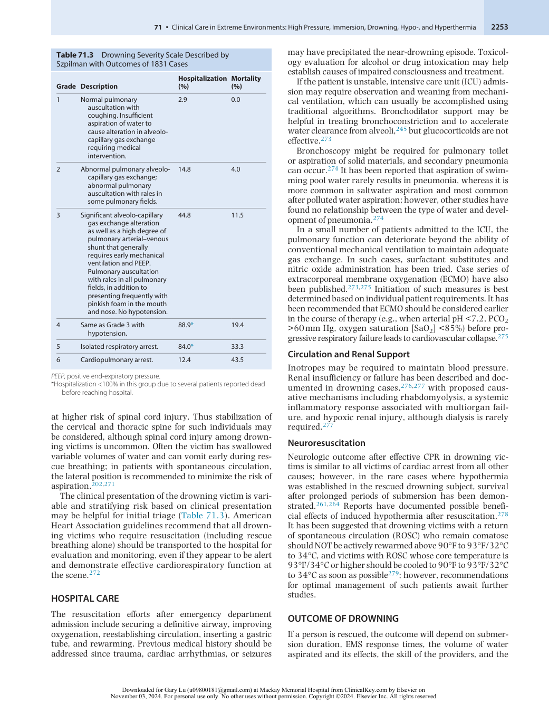

:::

<!-- PDF page 21 -->

availability of support systems.263,279 Outcomes of 1831 cases of drowning are shown in Table 71.3. In a series of 336 drowning- related cardiac arrests, EMS resuscitation, was attempted on 154, of whom 27% survived to hospital arrival, and 8% to hospital discharge. Only 6% were found in a shockable rhythm.269

### PREVENTION

Increasing documentation and international interest from institutions supported by coastal and fluvial societies and advocacy groups have demonstrated the value of prevention in drowning.280 Use of life vests in the water and instructions teaching swimming and/or floating202 and Dutch, Brazilian, South African, and Australian lifeguard experiences have shown that 85% of drowning cases can be prevented by public education, supervision, and public preparedness.264 The recent multiple tragedies of refugees drowning at sea have re- sensitized medical groups to renew efforts to prevent drowning.260

## Hypothermia

### PHYSIOLOGY OF HYPOTHERMIA

Hypothermia is defined by a low core body temperature (generally less than 35°C, with more conservative perioperative thresholds of 36°C281 ). Thresholds for further categorical breakdown into mild, moderate, and severe hypothermia are inconsistent within the literature and vary depending on context (e.g., trauma, immersion/environmental, therapeutic indication). Extremes of age, sepsis, burns, trauma, some endocrine disturbances, intoxication, exertional fatigue, or malnutrition can place patients at higher risk of developing both hypothermia and complications. However, there is a high degree of variability even among healthy individuals.282,283

On a molecular and cellular level, decreased temperature decreases the speed of chemical and enzymatic reactions, influences intracellular signaling cascades, and alters cellular structure.284 The overall metabolic rate for different tissues is suppressed to varying degrees. Cold exposure and hypothermia impact each tissue or organ system differently. The microvasculature of the skin and peripheral tissues manifests a rapid vasoconstrictive sympathetic response to either superficial cold exposure or decreased core body temperature. This response reduces skin blood flow and attenuates cutaneous heat flux while shifting blood volume to the central compartment. The high surface- to- volume ratio of the extremities can result in profound decreases in peripheral tissue temperatures while maintaining the core body temperature.

### Peripheral Cooling

Peripheral cooling impacts muscle and nerve function,264 which can impair a victim’s capability for self- rescue or preservation in the case of accidental hypothermia and has implications for monitoring in clinical settings (see Clinical Considerations, below). Muscle function declines due to impaired release and diffusion of calcium and acetylcholine and changes in elastic components. Furthermore,

as peripheral cooling progresses and the more superficial muscle fibers become impaired, fatigue occurs more quickly in muscle fibers left to bear the load. Peripheral cooling also impairs nerve conduction velocities and amplitudes, further impacting physical performance. Finally, accidental hypothermia or improper therapeutic cooling with ice packs or conductive cooling devices can lead to cold injury or frostbite of peripheral tissues (fingers, toes, nose, and ears are most susceptible). Treatment is conservative in mild to moderate cases through protection from mechanical injury, slow rewarming, and consideration of nerve blocks or improving oxygenation when possible. However, tissue salvage in severe injury may also benefit from early therapy with thrombolytics or iloprost.285,286

### The Cardiovascular System

The cardiovascular system is impacted in several ways. Peripheral sympathetic vasoconstriction leads to increased systemic vascular resistance, blood pressure, and central venous pressure due to the redistribution of blood volume to the central compartment. Shivering increases metabolic requirements; in combination with an increased sympathetic tone, this leads to increased cardiac output, tachycardia, and a propensity for atrial arrhythmias in mild hypothermia. With more severe hypothermia (&lt;32°C), cardiac conduction delays develop, including J waves (positive deflection at the QRS- ST junction) signaling abnormal early ventricular repolarization (also called Osborn waves, Fig. 71.15),287 and decreased spontaneous polarization of pacemaker cells, resulting in bradycardia. The likelihood of cardiac arrest increases with cooling below 32°C, with very high risk at 28°C to 24°C or below288 ; gentle handling and maintaining horizontal positioning in hypothermic patients can minimize the likelihood of arrhythmia or cardiovascular collapse. Therapeutic mild cooling has been studied to reduce the severity of myocardial infarction (either after cardiac arrest or in sedated patients). Still, thus far, it has not demonstrated myocardial protection outside of preclinical models.289

### The Neurologic System

Decreased cerebral metabolism in hypothermia290 is useful as the basis of neuroprotection for various therapeutic indications and in accidental hypothermia complicated by hypoxia (particularly if cooling occurs before the onset of hypoxia); however, the neurologic and respiratory function also declines with increasing severity of hypothermia. Impaired judgment progresses to hallucinations, delirium, and decreased consciousness as body temperature falls; loss of consciousness is common below 28°C. Reflexes, pupillary reactivity, and electroencephalographic (EEG) activity decline and become absent with progressive hypothermia, precluding neurologic assessment. From a respiratory standpoint, neurologic impairment can necessitate intervention for airway protection. With severe hypothermia, respiration may cease. Although decreased metabolic requirements afford some tolerance to hypoxia and decreased ventilation (tidal volume, respiratory rate, and compliance decrease), sensitivity to hypercapnia is diminished, leading to hypoventilation and acidosis, which can exacerbate electrolyte abnormalities and other physiologic changes.288 For mechanically ventilated hypothermic

<!-- PDF page 22 -->

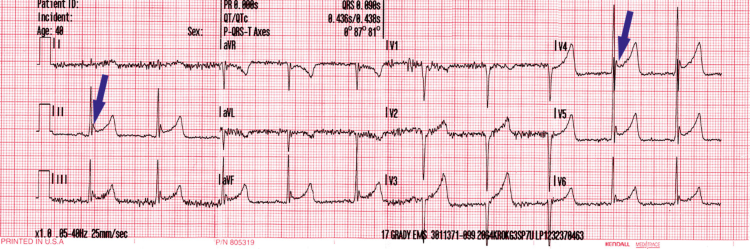

**Fig. 71.15 Osborn waves in a hypothermic patient.** ECG is from a 40- year- old male found sleeping on the street when the ambient temperature was close to 4°C. The rectal temperature on arrival at the hospital was 30.4°C. The 12- lead ECG shows a secondary wave closely following the S- wave _(arrows)_ , now referred to as an Osborn wave, after the pediatrician/intensivist who first described the pattern as a harbinger of ventricular fibrillation during hypothermia.287 _ECG,_ electrocardiogram.

patients, there can be a sizeable Pa- PETCO2 gradient, and arterial blood gases may be needed for adequate ventilation monitoring.291

### Hepatic and Renal Function

Hepatic and renal impairment have a variety of implications. Hepatic impairment decreases the clearance of lactate and other metabolic byproducts and the metabolism of some medications (see Clinical Considerations, below). Renal blood flow is increased in mild hypothermia due to increased blood volume in the central compartment. Increased renal blood flow, in combination with decreased antidiuretic hormone activity, results in diuresis. However, as hypothermia progresses, renal blood flow and glomerular filtration rate decrease, although diuresis may persist due to the inhibition of tubular water reabsorption.288 Additionally, edema that develops in damaged peripheral tissues can exacerbate the depletion of circulating blood volume.

### Electrolyte and Blood Gas Considerations

Respiratory, renal, and endocrine changes result in electrolyte imbalances in mild and moderate/severe hypothermia. Hypokalemia and hyperglycemia can be present in mild hypothermia, whereas acidosis, increased sodium excretion, and hyperkalemia manifest with progressive cooling.264 Hyperglycemia results from decreased insulin sensitivity and secretion, requiring intensive insulin therapy and frequent monitoring of blood glucose levels. Distal tubular transport of sodium is impaired, which also affects acid–base regulation.264 Finally, the threshold for cardiac toxicity from hyperkalemia diminishes with progressive hypothermia.292 Therapies and medications that increase serum potassium levels (blood transfusion, succinylcholine administration) should be carefully considered in these patients.

Because of increased gas solubility, with decreased temperature, arterial partial pressure of oxygen (PaO2) and arterial partial pressure of carbon dioxide (PaCO2) decrease, and pH increases. Blood gas values mathematically corrected to account for a lower patient body temperature will be relatively alkalotic and hypocarbic compared to uncorrected values assuming a patient temperature of 37°C. As such, results should be interpreted in the context of whether temperature correction was or was not performed. As discussed, in hypothermia, impaired ventilation and a higher ventilatory threshold for hypercapnia result in hypoventilation, which generally

tracks with the reduction in metabolic rate. However, since increased carbon dioxide (CO2) solubility leads to decreased PaCO2 and increased pH with decreasing temperature, cerebral blood flow is generally also decreased in proportion to reduced metabolic rate in hypothermia. Clinically, a strategy investigated in hypothermic cardiac surgical patients is the correction for known changes in PaCO2 solubility by adding CO2 to the oxygenator gas flow. This is known as pHstat blood gas management, as opposed to alpha- stat management, where hypocarbia and alkalosis are permitted. pH-stat management has the theoretical advantage of increasing cerebral blood flow. Some benefit has been shown in pediatric, but not adult populations, where there is a concern for increased cerebral embolic risk.293,294

### The Hematologic System

Hematologic changes in hypothermia are secondary to changes in blood volume, microvascular tone, and coagulation factor function. Contraction of the blood volume due to diuresis (possibly combined with dehydration due to environmental exposure, limited access, or exertion) increases blood viscosity. In combination with increased viscosity, vasomotor abnormalities in the microcirculation lead to sludging, stasis, and hypoperfusion. Impaired circulation prevents tissue oxygenation and clearance of metabolic byproducts, which accumulate in peripheral tissues. Leukocyte and platelet counts fall with severe hypothermia, and platelet activation and coagulation factor enzymatic function are highly sensitive to pH and temperature.295 This can result in a coagulopathic state with progressive hypothermia but may also be partially offset by simultaneous inhibition of anticoagulant factors, depending on relative concentrations.296

### CLINICAL CONSIDERATIONS

### Drug Metabolism and Effects

In general, hypothermia may impair drug absorption in the bowel. Both core and peripheral cooling, even to a mild degree (∼34°C), can significantly impact the recovery from, or nerve stimulator twitch response to, neuromuscular blockade. This is explained by impaired neuromuscular function and pharmacokinetic changes (increased plasma concentration) with decreased temperature.297 The minimum alveolar concentration (MAC) for volatile anesthetics decreases with hypothermia. With profound cooling

<!-- PDF page 23 -->

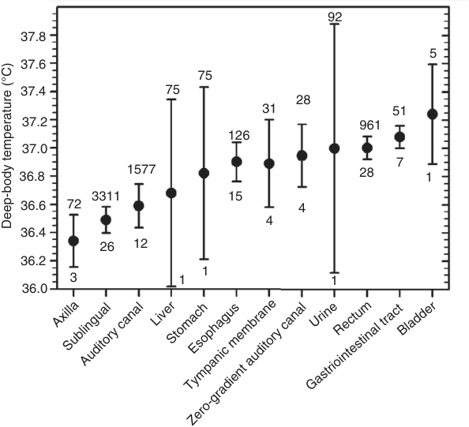

92 37.8 5 37.6 75 37.4 75 28 31 51 37.2 961 126 37.0 7 36.8 1577 28 1 36.6 72 3311 15 4 4 36.4 26 12 36.2 1 3 1 1 36.0 AxillaSublingualAuditory canal LiverStomachTympanic membraneZero-gradient auditory canalEsophagus Gastriointestinal tractUrineRectum Bladder Deep-body temperature (°C) 

**Fig. 71.16** Variations in resting, deep- body temperature in 12 measurement sites from published reports, with means and 95% confidence intervals for each total sample. Numbers above the confidence intervals are the total number of subjects; those below indicate the number of contributing investigations. (From Taylor NA, Tipton MJ, Kenny GP. Considerations for the measurement of core, skin, and mean body temperatures. _J Therm Biol._ 2014;46:72–101 [page 80, Fig. 6], with permission.)

(∼20°C), anesthesia may no longer be needed to prevent movement,2 although the precise temperature at which EEG silence is achieved is somewhat lower and demonstrates individual variability.298 Plasma concentrations of some intravenous anesthetics increase because of reduced compartmental clearance. The clearance of CYP450metabolized drugs (including propofol and ketamine) is also reduced in proportion to the decrease in body temperature.288 As a result, reduced infusion rates will achieve similar levels of sedation.299 In parallel, general anesthetic and some sedative medications impact thermoregulation (both vasoconstriction and shivering thresholds are reduced by up to ∼2°C to 4°C or more) and can contribute to hypothermia.299,300

### Monitoring

**Temperature Measurement.** There are also considerations for monitoring hypothermic patients, the most obvious being the temperature measurement itself. Even in thermoneutral conditions, there is very high variability in skin temperature at different sites, an effect which is attenuated but persistent for common core temperature measurement locations (Fig. 71.16).301 In hypothermia, changes in blood flow distribution exaggerate these temperature variations among site differences. Similarly, rewarming methods can have dynamic effects on temperatures in different tissue compartments (see Treatment of Hypothermia, below). A rational yet sometimes clinically challenging recommendation is “if one’s interest lies with the temperature of a specific body tissue, then measure temperature from that site, or a valid surrogate.”301 The guiding principles for measurement of core body temperature are to measure temperature in a location (1) where there is good tissue perfusion, which

promotes thermal equilibration with other body sites; (2) that is insulated from the external environment or peripheral tissues, which may be cooled to a greater degree than core tissues; and (3) that is as adjacent as possible to the organ of interest (e.g., the tympanic membrane or nasopharynx for the brain). Blood temperature can be an excellent surrogate for core temperature, with PA blood temperature often cited as a gold standard.288 However, even this invasive method may suffer some inaccuracy in the setting of acute mixing of fluids administered via central venous catheters or adjacent placement of invasive warming devices. Esophageal temperature is often used to represent blood temperature due to its proximity to the central circulation.

**Pulse Oximetry and Neuromuscular Blockade Monitoring.** The response time for pulse oximetry is limited, or the signal may fail altogether in conditions of local hypoperfusion, as occurs with peripheral vasoconstriction in hypothermia. Although there have been advances in device algorithms over time, pulse oximetry may not give a reliable reading from the digits in even mild hypothermia, with relatively preserved performance for ear sensors.302 Similarly, concerns for exaggerated or prolonged neuromuscular blockade can be complicated because local or body cooling decreases nerve stimulation (mechanomyography) twitch tensions, even in the absence of paralytic medications.297

**Accidental vs. Induced Hypothermia.** There are essential differences between accidental hypothermia due to environmental exposure and induced hypothermia in controlled, clinical situations such as therapeutic hypothermia for neuroprotection or during cardiac surgery. The most obvious difference is that the mechanism of cooling may

<!-- PDF page 24 -->

vary – environmental exposure results in cooling across the skin and body surface through radiation, evaporation, convection, or conduction from cold air, water, or contact surface (except drowning, where aspiration and swallowing of cold fluid can add internal cooling). In contrast, in addition to surface cooling, clinical hypothermia may be induced and maintained by more efficient, evenly distributed, and precisely controlled invasive methods, such as intravascular catheters, cold fluid infusion, or ECMO/cardiopulmonary bypass. Second, clinical support throughout the period of cooling, hypothermia, and rewarming can mitigate some of the significant physiologic perturbations that would otherwise limit hypothermia tolerance or resuscitation and therefore allow cooling to temperatures not tolerated outside of the clinical setting. Death is not uncommon in accidental hypothermia with body temperatures of 24°C to 28°C, and the lowest documented temperatures from which resuscitation has occurred for accidental hypothermia are ∼13°C for adult patients and 11.8°C for a small child using ECMO.264,303 On the other hand, recovery from induced hypothermia to 10°C and lower has been reported.2 Finally, accidental hypothermia is often complicated by immersion or drowning, prolonged fasting and/or hypovolemia, extreme exertion or exhaustion, trauma, or a variety of other clinically relevant conditions.

### TREATMENT OF HYPOTHERMIA

Supportive and anticipatory care for the previously mentioned physiologic perturbations should be provided, and hypothermic patients should be protected from further heat loss with insulation and/or a vapor barrier. They should be transferred to a controlled clinical setting when available. Intrinsic thermoregulatory responses should be addressed, including the vasoconstrictive sympathetic response in the skin and shivering in the muscles (primarily truncal muscles), which can be stimulated by skin or core cooling. Shivering effectively provides heat at the expense of increased metabolic requirements that cannot be maintained indefinitely.304 Similarly, after providing caloric supplementation to support increased metabolic requirements and taking steps to prevent a further drop in temperature, exercise is recommended to augment rewarming in the case of mild accidental hypothermia where the neurologic function is intact.305 Physiologically, shivering is blunted by exertional fatigue (termed thermoregulatory fatigue), hypoglycemia, and paradoxically, shivering is markedly attenuated and eventually stops as core temperatures continue to fall (&lt;∼31°C).306 Shivering may be undesirable in some clinical situations and can be treated with several interventions, pharmacologic and otherwise.300

### Vasodilation and Cutaneous Heat Transfer

The vasoconstrictive sympathetic response protects from heat loss during cold exposure but also impairs the effectiveness of transcutaneous warming. On application of external heat, local vasodilation does occur despite continued core hypothermia.307 Cutaneous warming can be applied using large heat packs (primarily in prehospital settings) or with forced air or circulating water devices when more advanced care is available. Radiant or resistive heating devices are

less commonly used. Limitations to all these methods include the potential for tissue damage from heat application (and therefore their maximum safe set temperature) and their reliance on adequate peripheral circulation to distribute heat from the periphery to the core. Regarding the latter point, cutaneous warming is significantly more effective when applied to areas of skin with optimal blood flow: that is, in nondependent areas that are not compressed by body weight.

As mentioned, cutaneous warming demonstrates improved heat transfer efficiency with peripheral vasodilation. General anesthesia and some sedative medications can also affect peripheral vasodilation. This can exacerbate cooling in the context of exposure to cold environments, but in the context of cutaneous rewarming, can conversely increase the effectiveness of warming if vasodilation is not already maximal. On the other hand, vasodilation also makes simultaneous cooling across exposed skin possible, even with warming devices covering other locations. Efforts should be made to cover or warm as much exposed skin as possible in patients under anesthesia (and those sedated using vasodilating agents) to prevent this inefficiency.

### Warmed Fluids

Administered fluids should be warmed, which is of increasing importance with the administration of large volumes, such as in severe diuresis, dehydration, or traumatic blood loss. However, the administration of warmed fluids rarely actively warms patients to any significant extent because of the small amounts given relative to the heat distribution volume in most patients and because it is unsafe to heat fluids much above normal body temperature. Similarly, airway heating and humidification can prevent further environmental heat loss, but its capacity for heat exchange is limited, and it should only be used in conjunction with other warming methods.

### Invasive Warming

Several invasive warming methods have been used, including heat exchange through intravascular warming catheters; hemodialysis circuits; and peritoneal, gastric, bladder, or pleural lavage. Increasing invasiveness generally also adds the potential for complications; primarily, it should be kept in mind that some of these methods can negatively impact the circulation (i.e., impaired preload, bleeding) and precipitate a circulatory collapse in at- risk patients. In general, these rewarming methods rely on the circulation for heat equilibration, and prolonged CPR may be logistically challenging or result in limited effectiveness. Therefore, in the case of arrested, severely compromised, or at- risk circulation, an increasing number of centers report and recommend the use of extracorporeal life support (ECLS) for both circulatory support and controlled rewarming in patients with profound hypothermia (typically core temperature &lt;30°C).288 As expected, these methods are not without pitfalls but can make resuscitation possible in extreme cases.308 Rewarming with these methods is relatively rapid, and is primarily limited by standard guidelines for (1) avoiding temperature gradients between blood return and patient blood of greater than 10°C, to avoid outgassing and generation of gaseous emboli when blood is returned to the

<!-- PDF page 25 -->

patient; and (2) an upper threshold of 37°C for outlet blood temperature to avoid cerebral hyperthermia.309

### Rescue Arrest and Afterdrop

Finally, it is worth reviewing issues present in hypothermia that may complicate the rewarming process. The most important are the concepts of rescue arrest and afterdrop. Hypothermic patients are likely to be hypovolemic, suffering from acidosis and electrolyte abnormalities, and are predisposed to significant cardiac arrhythmias. As such, changes in posture that impact preload or significant vasodilation that may occur on initiation of cutaneous rewarming can contribute to cardiovascular collapse. Peripheral vasodilation or improvement in tissue hypoperfusion can also allow accumulated metabolic byproducts to enter the circulation and exacerbate acidosis. Afterdrop refers to the phenomenon of continued core cooling even after rewarming has been initiated due to continued heat loss from the core to the cool periphery. As rewarming progresses, clinical and laboratory parameters must be followed closely to avoid overcorrection, particularly in the case of a pH or temperature- dependent phenomenon such as insulin sensitivity.

### HYPOTHERMIA OUTCOME

The outcome after hypothermia treatment is highly dependent on whether there has been coincidental trauma, cardiac arrest, significant hypoxia, or advanced age, all of which adversely affect prognosis.288 On the other hand, resuscitation from hypothermia with intact cardiac activity (core temperature typically >28°C) has low mortality. Of a series of 1028 children admitted to the hospital with accidental hypothermia, 91.5% survived.310 In a study of 572 adults with accidental hypothermia (core temperature ≤32°C), 83% of patients younger than 75 survived to hospital discharge.311

## Hyperthermia

### PHYSIOLOGY OF HYPERTHERMIA

Optimal physiologic and biochemical homeostasis requires regulating body temperature within a narrow range, typically 36.7°C to 37.5°C. Metabolism generates heat, which can vary several- fold from resting during sleep to heavy exercise. The internally generated heat is dissipated through the skin by conduction, radiation, convection, and evaporation of sweat. In an environment where the ambient temperature is greater than skin temperature (typically around 33°C), heat is gained from the environment, allowing only sweating as a mechanism for the maintenance of normal body temperature. Adaptation to hot environments (acclimatization) can occur over days or weeks. Acclimatization mechanisms include increased blood volume and body water, lower body temperature, enhanced skin vasodilatation and sweating, and a more dilute sweat.312

### Vasodilation and Hypovolemia

When core temperature increases, the normal adaptive response is cutaneous vasodilation and initiation of

sweating. There is redistribution of cardiac output to the skin, with a concomitant reduction in splanchnic and renal blood flow,313 which can lead to gut, liver, and kidney ischemia. Dehydration and the resulting hypovolemia attenuate the increase in skin blood flow and accentuate splanchnic vasoconstriction. With continued hyperthermia, a nitric oxide- mediated mechanism causes vasodilatation in the splanchnic bed, precipitating hypotension and shock,314 and possibly gastrointestinal ischemiareperfusion injury.315

### Cell Damage and Heat Shock Proteins

Heat- induced cell damage occurs at temperatures beyond a species- specific threshold. In humans, the critical temperature is between 41.6°C and 42°C sustained for 0.75 to 8 hours.253 The primary mechanism for body injury from high temperature is damage to macromolecules, including lipids, DNA, and proteins. Temperature increases can cause oxidative stress, protein unfolding, entanglement, and aggregation.315,316 Uncoupling of oxidative phosphorylation and a reduction in mitochondrial number lead to a decrease in adenosine triphosphate (ATP) levels. In parallel with adaptive physiologic mechanisms, there is a cellular stress response (CSR) triggered by the accumulation of damaged macromolecules.315,316 The CSR consists of altered gene expression that initiates the production of a series of heat shock proteins (HSPs) that fall into seven categories.316 The major HSP group consists of what is referred to as “molecular chaperones.” These chaperone proteins recognize unfolded proteins and either refold them into their normal functional state or direct them into degradation pathways. Another group of HSPs is proteolytic, to clear irreversibly damaged proteins. A third group mitigates DNA and ribonucleic acid (RNA) damage. A fourth group consists of enzymes that re-establish metabolic pathways after heat stress. A fifth group includes regulatory proteins. The sixth category comprises proteins that sustain cellular structures such as the cytoskeleton. The final class consists of proteins facilitating transport, detoxification, and membrane modulation.

### CLINICAL SCENARIOS

### Definitions

_Heat exhaustion_ is a mild form of heat illness notable for inadequate cardiac output accompanied by elevated body temperature, dehydration, and hot, dry skin. Symptoms include fatigue, dizziness, nausea and vomiting, headache, and hypotension.317 Heat exhaustion occurs in hot environments, often precipitated by exercise. It can also be precipitated by medications such as diuretics and inadequate water intake, often in older adults.317 Body temperature in heat exhaustion is usually between 37°C and 40°C.318 _Heat injury_ is more severe than heat exhaustion and may include organ and tissue damage after some hours.317 If patients with heat injury are not rapidly cooled, the condition may worsen to _heat stroke_ , which is life- threatening. Heat stroke is commonly classified as _exertional_ or _classic_ . Exertional heat stroke usually occurs in young, healthy individuals who are exercising in hot environments, often presenting with collapse. Classic heat stroke usually occurs in very

<!-- PDF page 26 -->

young or older individuals exposed to a hot environment without strenuous physical activity.315,317

### Signs and Symptoms

Manifestations of heat stroke include hot, dry skin, weakness, anorexia, dizziness, syncope, nausea and vomiting, headache, and confusion. Neurologic manifestations in heat stroke include mental status changes, delirium, coma, and convulsions. Still, there is often a lucid interval during which the patient may have normal mental status despite severe temperature elevation.

Body temperature in heat stroke is generally in the range of 40°C to 44°C, although temperatures extending from mild elevation to above normal to 47°C have been reported.315 Differentiating heat stroke from exerciserelated heat exhaustion requires an assessment of body temperature. Sensors placed on or close to sites on the body’s exterior (e.g., axillary, oral, tympanic, and skin) are not valid during or after intense exercise in the heat. The only good measurement sites in this setting are from sensors in the rectum or via radio telemetry from pre- ingested thermistor capsules.317,319,320

Metabolic acidosis occurs in most cases of severe heat stroke, especially in exertional heat stroke, often accompanied by respiratory alkalosis.317,321,322 Rhabdomyolysis, hyperkalemia, and disseminated intravascular coagulation are common. Renal failure commonly occurs in exertional heat stroke but not classic heat stroke. Hyperglycemia and hypophosphatemia are common in classic heat stroke, whereas biochemical features in exertional heat stroke include hyperphosphatemia, hypocalcemia, and hypoglycemia.

### Differential Diagnosis

The differential diagnosis of heat stroke includes status epilepticus, stroke, and drug use (including recreational drugs, antidepressants, antihistamines, and antiparkinsonian drugs).315 Another life- threatening condition that can be confused with heat stroke is exercise- associated hyponatremia (EAH). This condition, which occurs during prolonged exercise, has manifestations similar to heat shock: lightheadedness, nausea, headache, vomiting, altered mental status, and collapse, but often without hyperthermia. When these signs and symptoms occur during prolonged exercise, it is essential to exclude EAH as its treatment requires correction of serum sodium.323

### Hyperthermia in the Clinical Setting

When hyperthermia occurs in the perioperative environment, possible diagnoses include malignant hyperthermia (MH), neuroleptic malignant syndrome (NMS), thyroid storm, and serotonin syndrome. Assessment of MH is described in Chapter 31. NMS manifests as muscle rigidity, fever, mental disturbances such as delirium, and abnormal metabolic changes in patients treated with classic triggering agents such as antipsychotic drugs (e.g., phenothiazines, butyrophenones, lithium), metoclopramide, antidepressants, and some anticonvulsants.324 In addition to fever, manifestations of serotonin syndrome include clonus, agitation, tremor, muscle rigidity, and hyperreflexia in patients taking serotonergic medications.

### TREATMENT OF HYPERTHERMIA

### Supportive Care

As in treating hypothermia, supportive and anticipatory care to correct physiologic derangements and potential complications is as vital as rapid correction of the core temperature. Fluid management is a primary consideration in virtually any hyperthermic patient, with the degree of perturbation dependent on the heat source, duration of exposure, and amount of sweating. Electrolyte depletion from sweating may also be profound, and hypercalcemia, hyperor hypokalemia, hypophosphatemia, or hyper- /hypoglycemia may require correction in hyperthermic patients.317

### Treatment of Underlying Cause

The underlying cause of hyperthermia determines therapeutic options and impacts the effectiveness of selected cooling methods. Cooling in any hyperthermic patient should be expeditious to limit further organ damage, but excessive metabolic heat generation must also be addressed for cooling to be effective.

Fever induced by immunologic reaction may be responsive to antipyretics or anti- inflammatory medications, and discontinuation of fever- inducing drug or toxin is an obvious first step. Seizures or shivering can contribute significantly to hyperthermia, and several therapeutic options exist.300 In these conditions, pharmacologic treatments may be combined with cooling, depending on the degree of hyperthermia. The treatment of MH is described in Chapter 31. NMS is treated by discontinuation of suspected triggering drugs and supportive care. Pharmacotherapy may include dantrolene, bromocriptine, and amantadine.324 Treatment of serotonin syndrome also includes discontinuation of triggering agents, supportive care, and administration of a 5- HT2A antagonist such as cyproheptadine,325 and possibly benzodiazepines. For heat stroke, there is no recommended pharmacologic treatment (due to concerns for hepatic toxicity). Nonsteroidal anti- inflammatory drugs (NSAIDs) and aspirin are ineffective, and acetaminophen is contraindicated (see earlier).315,317 Dantrolene is ineffective in heat stroke.325

### Cooling

Heat exhaustion usually responds to simple cooling methods such as moving to an air- conditioned space, removing excessive clothing, and applying cloths soaked in cool water. Hyperthermia in heat stroke is managed by the institution of cooling as quickly as possible, combined with supportive treatment. The target to which cooling should be pursued is not well- supported by evidence, but many studies have used a target of less than 39°C rectal temperature.326 In the case of exercise- induced hyperthermia, studies suggest that a cooling rate of ≥0.155°C · min−1 is ideal, at least in the case of exercise- induced heat stroke.327 Water immersion and evaporative cooling are among the most effective noninvasive cooling methods. Still, they are not always logistically feasible, including in clinical settings where there are concerns for infection or significantly compromised integrity of the skin (e.g., dressings, burns, line sites).328 Ice packs (with a skin barrier to avoid direct contact and risk of tissue injury) can be applied to central areas with good blood flow, such as the groin, axillae, neck, and

<!-- PDF page 27 -->

torso. All these methods require ongoing refreshment of the cold source to maintain an effective temperature gradient. Attention to the skin at the site of application is critical to avoid cold injury to tissue. Adhesive cold- water circulating devices are contained, provide continuous refreshment of the temperature gradient, and may be equipped with thresholds and alarms to provide some margin of safety from cold injury. But, as in the case of cutaneous warming, adhesive pads require large areas of intact skin with good blood flow for practical use. These transcutaneous cooling methods also depend on cutaneous vasodilation for effective heat transfer from the core. But with cutaneous cooling, local vasoconstriction and shivering can be induced if temperatures are sufficiently low. As previously discussed, inhibition of shivering or vasoconstrictive responses may be used to offset these effects.

### Invasive Cooling

Effective but increasingly invasive cooling methods include bladder, gastric, or colonic irrigation with cold saline, intravascular cooling catheters, and administration of cold intravenous fluids.317,329 Immersion in ice water is safe and effective in young individuals suffering from exertional heat stroke; however, in classic heat stroke ice water immersion is poorly tolerated and may be associated with increased morbidity and mortality.315 As in the case of hypothermia treatment, the effectiveness of cold intravenous fluids is limited by concerns for overexpansion of intravascular volume, although the temperature gradient that can be achieved is larger than that for warmed fluids for treatment of hypothermia; cold fluids can be near 4°C, as opposed to warm fluids, which must be near 37°C to avoid local hyperthermia. For patients requiring ECLS (or ECMO), some degree of cooling can be achieved passively due to blood volume flowing through external circuit components. It is noteworthy that while it is common for extracorporeal support circuits to be equipped with heat exchangers to warm the blood, some cannot provide monitored active cooling (as opposed to cardiopulmonary bypass circuits, in which cooling capability is a standard feature). If cooling is a therapeutic goal, this should be considered at the time of equipment choice if multiple options are available.

### Post- Cooling Care

After cooling and successful resolution of hyperthermia, clinicians must continue to be vigilant for (1) hypothermia due to aggressive cooling or a dysregulated thermoregulatory response; (2) recurrent hyperthermia; and (3) the development and secondary effects of organ injury that occurred when body temperature was elevated.317 Shortand/or long- term lung, kidney, liver, cardiovascular, and neurologic injuries have all been described after heat stroke.

Mortality in exertional heat stroke is reported as 3% to 5%.315 As many as 60% of patients with classic heat stroke die before reaching the hospital, making it difficult to determine the actual mortality. Of those admitted to an ICU, inhospital mortality is 10% to 65%. However, there is also 10% to 28% mortality at one and two years after treatment. Persistent neurologic manifestations, including ataxia, dysarthria, and problems with coordination, occur in a high percentage of patients and are associated with imaging abnormalities such as cerebellar atrophy.315,317,321,330

### Complete references available online at expertconsult.com.

### References

1.  Fontaine JA. _L’Union Médicale_ . 1879;28:445.

2.  Zuntz N. _Fortschr Med_ . 1897;15:632.

3.  Yarbrough OD, et al. _J Industrial Hygiene Toxicol_ . 1939;21:213.

4.  Cochran WD, et al. _N Engl J Med_ . 1965;272:347.

5.  Boerema I, et al. _Surgery_ . 1962;52:796.

6.  Bernhard WF, et al. _Circulation_ . 1964;29(suppl):91.

7.  Huang ET (ed). _Hyperbaric Oxygen Indications Manual_ . North Palm Beach, FL: Undersea and Hyperbaric Medical Society; 2023.

8.  Fenn WO, et al. _Am J Physiol_ . 1946;146:637.

9.  Riley RL, et al. _J Appl Physiol_ . 1949;1:825.

10.  Gilbert R, et al. _Am Rev Respir Dis_ . 1974;109:142.

11.  Paganini M, et al. _J Appl Physiol_ . 2022;132:283.

12.  McMahon TJ, et al. _Nat Med_ . 2002;8:711.

13.  Camporesi EM, et al. _Undersea Hyperb Med_ . 2014;41:247.

14.  Buras JA, et al. _Neurol Res_ . 2007;29:127.

15.  Francis A, et al. _Plast Reconstr Surg Glob Open_ . 2017;5:e1497.

16.  Chen P, et al. _Therap Adv Gastroenterol_ . 2021;14:1756284821102 3394.

17.  Gottfried I, et al. _Biomolecules_ . 2021;11:1520.

18.  Mathieu D, et al. _Plast Reconstr Surg_ . 1993;91:329.

19.  Fife CE, et al. _Wound Repair Regen_ . 2002;10:198.

20.  Fife CE, et al. _Wound Repair Regen_ . 2007;15:322.

21.  Demchenko IT, et al. _Circ Res_ . 2002;91:1031.

22.  Stamler JS, et al. _Science_ . 1997;276:2034.

23.  Whalen R, et al. _Am J Cardiol_ . 1965;15:638.

24.  Ishikawa K, et al. _Jpn Circ J_ . 1983;47:824.

25.  Savitt MA, et al. _Undersea Hyperb Med_ . 1994;21:169.

26.  Berry JM, et al. _Aviat Space Environ Med_ . 1998;69:761.

27.  Abel FL, et al. _Undersea Hyperb Med_ . 2000;27:67.

28.  Gross DR, et al. _Aviat Space Environ Med_ . 1985;56:1203.

29.  Lavoute C, et al. _Brain Res_ . 2007;1176:37.

30.  Bennett PB, et al. _Aerosp Med_ . 1971;42:1147.

31.  Bennett PB, et al. _Electroencephalogr Clin Neurophysiol_ . 1971;31:383.

32.  Bennett PB, et al. _Undersea Biomed Res_ . 1981;8:85.

33.  Rostain JC, et al. _Undersea Hyperb Med_ . 2006;33:197.

34.  Winter PM, et al. _Anesthesiology_ . 1976;44:416.

35.  Gran L, et al. _Acta Anaesthesiol Scand_ . 1980;24:407.

36.  Tonner PH, et al. _Anesthesiology_ . 1992;77:926.

37.  Tonner PH, et al. _Anesth Analg_ . 1997;84:618.

38.  Koblin DD, et al. _Anesth Analg_ . 1998;87:419.

39.  Heimburg T, et al. _Biophys J_ . 2007;92:3159.

40.  Kramer WG, et al. _Aviat Space Environ Med_ . 1983;54:410.

41.  Kramer WG, et al. _Aviat Space Environ Med_ . 1983;54:1005.

42.  Kramer WG, et al. _Res Commun Chem Pathol Pharmacol_ . 1981;34:381.

43.  Kramer WG, et al. _Aviat Space Environ Med_ . 1983;54:682.

### HYPERTHERMIA OUTCOME

After cooling, sequelae can include ongoing encephalopathy, seizures, liver failure, renal failure, and adult respiratory distress syndrome (ARDS). Recurrent fever is common during recovery, does not respond to aspirin or NSAIDs, and may further exacerbate brain injury. Acetaminophen is sometimes prescribed but has been associated with liver failure and is contraindicated.315,317

44.  Stoudemire A, et al. _Am J Psychiatry_ . 1984;141:1251.

45.  Hampson NB. _Undersea Hyperb Med_ . 2018;45:165.

46.  Piantadosi CA, et al. _J Applied Physiol_ . 1988;65:878.

47.  Thom S. _Toxicol Appl Pharmacol_ . 1990;105:340.

48.  Thom SR. _J Applied Physiol_ . 1992;73:1584.

49.  Thom SR. _Toxicol Appl Pharmacol_ . 1993;123:248.

50.  Thom SR. _Toxicol Appl Pharmacol_ . 1993;123:234.

51.  Piantadosi CA. _Respir Care Clin North Am_ . 1999;5:183.

52.  Thom SR, et al. _Am J Physiology Heart Circ Physiol_ . 2001;281:H923.

53.  Thom SR, et al. _Toxicol Appl Pharmacol_ . 2006;213:152.

54.  Thom SR, et al. _Am J Respir Crit Care Med_ . 2006;174:1239.

<!-- PDF page 28 -->

55.  Kao LW, et al. _Clin Lab Med_ . 2006;26:99.

56.  Thom SR, et al. _Proc Natl Acad Sci U S A_ . 2004;101:13660.

57.  Hampson NB, et al. _Am J Respir Crit Care Med_ . 2012;186:1095.

58.  Thom S, et al. _Ann Emerg Med_ . 1995;25:474.

59.  Weaver LK, et al. _N Engl J Med_ . 2002;347:1057.

60.  Weaver LK, et al. _Am J Respir Crit Care Med_ . 2007;176:491.

61.  Shepherd Ali G, et al. _Clin Chimica Acta_ . 2001;307:249.

62.  Pracyk JB, et al. _Undersea Hyperb Med_ . 1995;22:1.

63.  Gale SD, et al. _Brain Inj_ . 1999;13:229.

64.  Parkinson RB, et al. _Neurology_ . 2002;58:1525.

65.  Beppu T. _AJNR Am J Neuroradiol_ . 2014;35:625.

66.  Moon JM, et al. _Clin Toxicol_ . 2018;56:161.

67.  Pace N, et al. _Science_ . 1950;111:652.

68.  Weaver LK. _Undersea Hyperb Med_ . 2020;47:151.

69.  Scheinkestel CD, et al. _Med J Aust_ . 1999;170:203.

70.  Ducassé JL, et al. _Undersea Hyperb Med_ . 1995;22:9.

71.  Mathieu D, et al. _Undersea Hyperb Med_ . 1996;23(suppl):7.

72.  Lee Y, et al. _Crit Care Med_ . 2021;49:e910.

73.  Rose JJ, et al. _Crit Care Med_ . 2018;46:e649.

74.  Hollander DI, et al. _J Reprod Med_ . 1987;32:615.

75.  Van Hoesen KB, et al. _JAMA_ . 1989;261:1039.

76.  Brown DB, et al. _Aviat Space Environ Med_ . 1992;63:1011.

77.  Elkharrat D, et al. _Intensive Care Med_ . 1991;17:289.

78.  Koren C, et al. _Reprod Toxicol_ . 1991;5:397.

79.  Mathieu D, et al. _Handb Hyperb Med_ . 1996:281.

80.  Ozgok- Kangal K. _Diving Hyperb Med_ . 2021;51:248.

81.  Camporesi EM. _Handb Hyperb Med_ . 1996:305.

82.  Lifschultz BD, et al. _J Forensic Sci_ . 1983;28:1021.

83.  Kaufman BS, et al. _Crit Care Med_ . 1987;15:703.

84.  Morris WP, et al. _Am Rev Respir Dis_ . 1993;147:1034.

85.  Wilmshurst PT, et al. _Diving Hyperb Med_ . 2015;45:89.

86.  Apostolos A, et al. _Ther Adv Neurol Disord_ . 2022;15:1756286422110 3459.

87.  Brunner F, et al. _Lancet_ . 1964;1:1071.

88.  Cockett AT, et al. _Surg Forum_ . 1963;14:7.

89.  Boussuges A, et al. _Int J Sports Med_ . 1996;17:351.

90.  Nossum V, et al. _Eur J Appl Physiol_ . 2002;86:209.

91.  Helps SC, et al. _Stroke_ . 1990;21:94.

92.  Helps SC, et al. _Stroke_ . 1990;21:1340.

93.  Helps SC, et al. _Stroke_ . 1991;22:351.

94.  Pearson RR, et al. _Undersea Biomed Res_ . 1982;9:283.

95.  Vann RD, et al. _Lancet_ . 2011;377:153.

96.  Xu W, et al. _PLoS One_ . 2012;7:e50079.

97.  Mitchell SJ, et al. _N Engl J Med_ . 2022;386:1254.

98.  Longphre JM, et al. _Undersea Hyperb Med_ . 2007;34:43.

99.  Moon RE. _Adjunctive Therapy for Decompression Illness_ . Undersea and Hyperbaric Medical Society; 2003.

100.  Merton DA, et al. _Aviat Space Environ Med_ . 1983;54:218.

101.  van Hulst RA, et al. _Intensive Care Med_ . 2004;30:944.

102.  Moon RE, et al. _Treatment of Decompression Illness_ . Undersea and Hyperbaric Medical Society; 1996:426.

103.  Chin W, et al. _Undersea Hyperb Med_ . 2017;44:399.

104.  Ziser A, et al. _J Thorac Cardiovasc Sur_ . 1999;117:818.

105.  Wherrett CG, et al. _Can J Anaesth_ . 2002;49:96.

106.  Benson J, et al. _Undersea Hyperb Med_ . 2003;30:117.

107.  Tekle WG, et al. _Neurocrit Care_ . 2013;18:228.

108.  Dexter F, et al. _Anesth Analg_ . 1997;84:1203.

109.  Gempp E, et al. _Aviat Space Environ Med_ . 2008;79:1112.

110.  Chung JM, et al. _Undersea Hyperb Med_ . 2017;44:57.

111.  Lowe VJ, et al. _Undersea Hyperb Med_ . 1994;21:103.

112.  Van Unnik AJM. _Antonie Leeuwenhoek_ . 1965;31:181.

113.  Mader JT, et al. _J Infect Dis_ . 1980;142:915.

114.  Allen DB, et al. _Arch Surg_ . 1997;132:991.

115.  Greif R, et al. _N Engl J Med_ . 2000;342:161.

116.  Buras JA, et al. _Crit Care Med_ . 2006;34:2624.

117.  Cuzzocrea S, et al. _Shock_ . 2000;13:197.

118.  Rachmilewitz D, et al. _Gut_ . 1998;43:512.

119.  Luongo C, et al. _Crit Care Med_ . 1998;26:1972.

120.  Clarke LA, et al. _Respir Care Clin North Am_ . 1999;5:203.

121.  Bakker DJ. _Undersea Hyperb Med_ . 2012;39:731.

122.  Soh CR, et al. _Intensive Care Med_ . 2012;38:1143.

123.  van Hulst RA, et al. In: Moon RE, ed. _Hyperbaric Oxygen Therapy Indications_ . Undersea & Hyperbaric Medical Society; 2019:105.

124.  Huang C, et al. _World J Emerg Surg_ . 2023;18(1):23.

125.  Mladenov A, et al. _World J Emerg Surg_ . 2022;17:43.

126.  Paganini M, et al. _Adv Exp Med Biol_ . 2021;1289:27.

127.  Boet S, et al. _Diving Hyperb Med_ . 2022;52:126.

128.  Cannellotto M, et al. _Emerg Med J_ . 2022;39:88.

129.  Kjellberg A, et al. _BMJ Open_ . 2021;11:e046738.

130.  Camporesi EM, et al. In: Bove AA, Bachrach AJ, Greenbaum Jr LJ, eds. _Underwater and Hyperbaric Physiology IX_ . Undersea and Hyperbaric Medical Society; 1987:955.

131.  Jansen HM, et al. _Chest_ . 1987;91:829.

132.  Strauss MB, et al. _J Bone Joint Surg Am_ . 1983;65:656.

133.  Nylander G, et al. _Plast Reconstr Surg_ . 1985;76:596.

134.  Garcia- Covarrubias L, et al. _Am Surg_ . 2005;71:144.

135.  Strauss MB. _Undersea Hyperb Med_ . 2012;39:847.

136.  Strauss MB. _Undersea Hyperb Med_ . 2022;49:233.

137.  Butler FK, et al. _Undersea Hyperb Med_ . 2008;35:333.

138.  Murphy- Lavoie H, et al. In: Moon RE, ed. _Hyperbaric Oxygen Therapy Indications_ . 14th ed. Undersea & Hyperbaric Medical Society; 2019:15.

139.  Cevik MO, et al. _Undersea Hyperb Med_ . 2020;47:65.

140.  Kim YS, et al. _Undersea Hyperb Med_ . 2020;47:57.

141.  Lifson N, et al. _Undersea Hyperb Med_ . 2021;48:425.

142.  Masters TC, et al. _Retin Cases Brief Rep_ . 2021;15:783.

143.  Rhee TM, et al. _JAMA Otolaryngol Head Neck Surg_ . 2018;144(12): 1153.

144.  LeGros TL, et al. _Undersea Hyperb Med_ . 2020;47:271.

145.  Lind F, et al. _Diving Hyperb Med_ . 2015;45:56.

146.  Clarke R. _Diving Hyperb Med_ . 2020;50:264.

147.  Navy Department. _U.S. Navy Diving Manual. Revision 7, Change A. Vol 5: Diving Medicine & Recompression Chamber Operations_ . Naval Sea Systems Command; 2018.

148.  Allen BW, et al. _J Appl Physiol_ . 2009;106:662.

149.  Clark JM, et al. _J Appl Physiol_ . 1971;30:739.

150.  Harabin AL, et al. _J Appl Physiol_ . 1987;63:1130.

151.  Arieli R, et al. _J Appl Physiol_ . 2002;92:248.

152.  Eckenhoff RG, et al. _Aviat Space Environ Med_ . 1987;58:658.

153.  Rockswold SB, et al. _J Neurosurg_ . 2001;94:403.

154.  Mathes DD. _Anesth Analg_ . 1995;81:624.

155.  Bilfinger TV, et al. _J Thorac Cardiovasc Surg_ . 1991;102:935.

156.  Thompson CC, et al. _Southern Med J_ . 1992;85:1257.

157.  Torp KD, et al. _Undersea Hyperb Med_ . 2012;39:873.

158.  Donald KW. _BMJ_ . 1947;1:667.

159.  Donald KW. _BMJ_ . 1947;1:712.

160.  Hampson N, et al. _Undersea Hyperb Med_ . 2003;30:147.

161.  Heyboer M, et al. _Undersea Hyperb Med_ . 2014;41:379.

162.  Behnke AR, et al. _Am J Physiol_ . 1936;114:436.

163.  Anderson B, et al. _Trans Am Ophthalmol Soc_ . 1978;76:116.

164.  Evanger K, et al. _Acta Ophthalmol Scand_ . 2004;82:449.

165.  Anderson B, et al. _Undersea Hyperb Med Soc_ . 1987:607.

166.  Wattel F, et al. _Presse Med_ . 1996;25:1425.

167.  Mu J, et al. _Neurobiol Dis_ . 2013;51:133.

168.  Clarke R. _Undersea Hyperb Med_ . 2017;44:509.

169.  Kot J, et al. _Diving Hyperb Med_ . 2021;51:103.

170.  Gelmann D, et al. _Undersea Hyperb Med_ . 2021;48:443.

171.  Plafki C, et al. _Aviat Space Environ Med_ . 2000;71:119.

172.  Heyboer M, et al. _Undersea Hyperb Med_ . 2014;41:393.

173.  Hadanny A, et al. _Undersea Hyperb Med_ . 2016;43:113.

174.  Heyboer M, et al. _Adv Wound Care_ . 2017;6:210.

175.  Yamamoto Y, et al. _Eur Arch Oto- Rhino- Laryngol_ . 2016;273:2487.

176.  Unsworth IP. _Anaesthesia_ . 1973;28:675.

177.  Wolf HK, et al. _Am J Forensic Med Pathol_ . 1990;11:149.

178.  Walker KJ, et al. _Anaesth Intensive Care_ . 2006;34:61.

179.  Martindale LG, et al. _J Hyperb Med_ . 1987;2:15.

180.  Moon RE, et al. _Respir Care Clin North Am_ . 1999;5:21.

181.  Van Meter K. _Respir Care Clin North Am_ . 1999;5:137.

182.  Weaver LK, et al. _Chest_ . 1992;102:1175.

183.  Tenney SM. _Respir Physiol_ . 1974;20:283.

184.  Moon RE, et al. _Chest_ . 1986;89:846.

185.  Anthonisen NR, et al. _Proceedings of the Fourth Symposium on Underwater Physiology_ ; 1971:339.

186.  Mummery HJ, et al. _J Appl Physiol_ . 2003;94:507.

187.  Orwig D, et al. _Undersea Hyperb Med_ . 2018;45:89.

188.  Kot J, et al. _Diving Hyperb Med_ . 2019;49:137.

189.  Sheffield PJ, et al. _Undersea Hyperb Med_ . 1997;24:153.

190.  Weaver LK, et al. _Monoplace Hyperbaric Chamber Safety Guidelines_ . Undersea and Hyperbaric Medical Society; 1991.

191.  Vermeulen- Cranch DM. _Proc R Soc Med_ . 1965;58:319.

192.  Severinghaus JW. _Anesthesiology_ . 1965;26:812.

<!-- PDF page 29 -->

193.  Sanger C, et al. _Br J Anaesth_ . 1955;27:436.

194.  Ross JAS, et al. _Proceedings of the Sixth International Congress on Hyperbaric Medicine_ ; 1977:449.

195.  Jacobson I, et al. _Lancet_ . 1963;2:546. 196.  Carter LH, et al. _Nutr Today_ . 1970;5:2. 197.  Smith RM. _Ann N Y Acad Sci_ . 1965;117:768. 198.  Holt JAG. _Br J Radiol_ . 1975;48:819. 199.  Russell JB, et al. _Anesth Analg_ . 1990;70:289. 200.  Smith WDA, et al. _Br J Anaesth_ . 1974;46:3. 201.  Hornbein TF, et al. _Anesth Analg_ . 1982;61:553. 202.  Manolios N, et al. _Med J Aust_ . 1988;148:165. 170. 203.  Blenkarn GD, et al. _Aerospace Med_ . 1971;42:141. 204.  Lambertsen CJ, et al. _J Appl Physiol_ . 1975;39:434. 205.  Acott CJ, et al. _Anaesth Intensive Care_ . 1992;20:249. 206.  McDowell DG. _Anaesthesia_ . 1964;19:321. 207.  Hentia C, et al. _Brain Behav_ . 2018;8:e00959.

208.  Boet S, et al. _Eur J Anaesthesiol_ . 2020;37:636. 209.  Sharifi M, et al. _Am J Cardiol_ . 2004;93:1533.

210.  Alex J, et al. _J Thorac Cardiovasc Surg_ . 2005;130:1623.

211.  Yogaratnam JZ, et al. _Cardiovasc Revascularization Med_ . 2010;11:8. 212.  Li Y, et al. _J Cardiothorac Vasc Anesth_ . 2011;25:908. 213.  Bosco G, et al. _Anticancer Res_ . 2014;34:2899.

214.  Friedman T, et al. _Plast Reconstr Surg Global Open_ . 2019;7.

215.  Yogaratnam JZ, et al. _Cardiovasc Revascularization Med_ . 2006;7:146. 216.  Yang ZJ, et al. _Eur J Appl Physiol_ . 2001;85:96. 217.  Bosco G, et al. _Clin Exp Pharmacol Physiol_ . 2007;34:70. 218.  Losada DM, et al. _Transplant Proc_ . 2014;46:56. 219.  Li J, et al. _Brain Res_ . 2008;1210:223.

220.  Liu Y, et al. _Clin Exp Pharmacol Physiol_ . 2011;38:675. 221.  Veltkamp R, et al. _Brain Res_ . 2000;853:68. 222.  Miljkovic- Lolic M, et al. _Brain Res_ . 2003;971:90. 223.  Yin D, et al. _J Cereb Blood Flow Metab_ . 2003;23:855. 224.  Guo ZN, et al. _Crit Care Med_ . 2016;44:e403.

225.  Heyman A, et al. _Circulation_ . 1966;33(suppl 5):1120. 226.  Michalski D, et al. _Acta Neurol Scand_ . 2011;123:85. 227.  McCormick JG, et al. _Undersea Hyperb Med_ . 2011;38:321. 228.  Efrati S, et al. _PLoS One_ . 2013;8:e53716. 229.  Rockswold SB, et al. _Neurol Res_ . 2007;29:162. 230.  Rockswold SB, et al. _J Neurosurg_ . 2013;118:1317. 231.  Rockswold SB, et al. _J Neurosurg_ . 2010;112:1080. 232.  Echt M, et al. _Pflugers Arch_ . 1974;352:211. 233.  Lange L, et al. _Pflugers Arch_ . 1974;352:219. 234.  Smith DE, et al. _Echocardiography_ . 1998;15:35. 235.  Kurss DI, et al. _Undersea Med Soc_ . 1981:297. 236.  Wester TE, et al. _J Appl Physiol_ . 2009;106:691. 237.  Golden FS, et al. _J R Nav Med Serv_ . 1991;77:139. 238.  May M, et al. _Am J Physiol Regul Integr Comp Physiol_ . 2011;300:R40. 239.  Mai TH, et al. _Auton Neurosci_ . 2017;203:58. 240.  Peacher DF, et al. _Med Sci Sports Exerc_ . 2015;47:1128. 241.  Hardstedt M, et al. _Chest_ . 2021;160:1789-98. 242.  Rodríguez J, et al. _J Spec Oper Med_ . 2006;6:22. 243.  Shupak A, et al. _Respir Physiol_ . 2000;121:25. 244.  Moon RE, et al. _Circulation_ . 2016;133:988. 245.  Sakuma T, et al. _Am J Respir Crit Care Med_ . 1994;150:305. 246.  Cochard G, et al. _Undersea Hyperb Med_ . 2005;32:39. 247.  Moon RE, et al. _BMJ Open Sport Exerc Med_ . 2016;2:e000146. 248.  Edmonds C, et al. _Undersea Hyperb Med_ . 2019;46:603. 249.  van Beeck EF, et al. _Bull World Health Organ_ . 2005;83:853. 250.  Idris AH, et al. _Circulation_ . 2003;108:2565. 251.  Idris AH, et al. _Resuscitation_ . 2017;118:147.

252.  Venema AM, et al. _Scand J Trauma Resusc Emerg Med_ . 2018;26:19. 253.  Bynum GD, et al. _Am J Physiol_ . 1978;235:R228.

254.  Szpilman D, et al. _N Engl J Med_ . 2012;366:2102.

255.  Szpilman D. _Chest_ . 1997;112(3):660-665. 256.  Tobin JM, et al. _Resuscitation_ . 2017;118:e5.

257.  Peden M, et al. _The Injury Chart Book: A Graphical Overview of the Global Burden of Injuries_ . World Health Organization; 2002.

258.  World Health Organization. _Global Report on Drowning: Preventing a Leading Killer_ . WHO; 2014.

259.  Centers for Disease Control. _Unintentional Drowning_ . CDC. 260.  The Lancet. _Lancet_ . 2017;389:1859.

261.  Golden FS, et al. _Br J Anaesth_ . 1997;79:214.

262.  Quan L, et al. _Resuscitation_ . 2014;85:790.

263.  Quan L, et al. _Resuscitation_ . 2016;104:75. 264.  Bierens JJ, et al. _Physiology_ . 2016;31:147.

265.  Orlowski JP, et al. _Ann Emerg Med_ . 1989;18:1044.

266.  Michelet P, et al. _Eur J Emerg Med_ . 2019;26(5):340.

267.  Borse N, et al. _Fam Community Health_ . 2009;32:189.

268.  Cantu RM, et al. _Am J Emerg Med_ . 2018;36:446.

269.  Dyson K, et al. _Resuscitation_ . 2013;84:1114.

270.  Schmidt AC, et al. _Wilderness Environ Med_ . 2019;30:S70.

271.  Cianchetti C. _Wilderness Environ Med_ . 2020;31:373.

272.  Panchal AR, et al. _Circulation_ . 2020;142:S366.

273.  Champigneulle B, et al. _Resuscitation_ . 2015;88:126.

274.  Cerland L, et al. _Int J Environ Res Publ Health_ . 2017;14:1402.

275.  Burke CR, et al. _Resuscitation_ . 2016;104:19.

276.  Alp A, et al. _Hemodial Int_ . 2016;20:E1.

277.  Gorelik Y, et al. _Kidney Int Rep_ . 2018;3:833.

278.  Polderman KH. _Intensive Care Med_ . 2004;30:556.

279.  Parenteau M, et al. _Mil Med_ . 2018;183:172.

280.  Wu Y, et al. _Int J Environ Res Publ Health_ . 2017;14:875.

281.  Sessler DI. _Anesthesiology_ . 2008;109:318.

282.  Cheung SS, et al. _Microcirculation_ . 2012;19:65.

283.  Kelsey RM, et al. _Hypertension_ . 2000;36:1013.

284.  Han HS, et al. _Curr Neuropharmacol_ . 2012;10:80.

285.  Handford C, et al. _Extreme Physiol Med_ . 2014;3:7.

286.  Lorentzen AK, et al. _Cochrane Database Syst Rev_ . 2020;12. Cd012980.

287.  Osborn JJ. _Am J Physiol_ . 1953;175:389.

288.  Paal P, et al. _Int J Environ Res Publ Health_ . 2022;19:501.

289.  Kelly FE, et al. _Anaesthesia_ . 2010;65:505.

290.  McCullough JN, et al. _Ann Thorac Surg_ . 1999;67:1895.

291.  Darocha T, et al. _Scand J Trauma Resusc Emerg Med_ . 2017;25:15. 292.  Sprung J, et al. _Acta Anaesthesiol Scand_ . 1992;36:825.

293.  Mackensen GB, et al. _J Neurotrauma_ . 2009;26:342.

294.  Abdul Aziz KA, et al. _Interact Cardiovasc Thorac Surg_ . 2010;10:271. 295.  Van Poucke S, et al. _Thromb J_ . 2014;12:31.

296.  Levi M. _Semin Thromb Hemost_ . 2018;44:651.

297.  Heier T, et al. _Anesthesiology_ . 2006;104:1070.

298.  Stecker MM, et al. _Ann Thorac Surg_ . 2001;71:14.

299.  Sessler DI. _Anesthesiology_ . 2021;134:111.

300.  Jain A, et al. _J Neurosci Nurs_ . 2018;50:63.

301.  Taylor NA, et al. _J Therm Biol_ . 2014;46:72.

302.  Poorzargar K, et al. _J Clin Monit Comput_ . 2022;36:961.

303.  Mroczek T, et al. _Eur J Cardio Thorac Surg_ . 2020;58:1091.

304.  Tikuisis P, et al. _J Appl Physiol_ . 1991;70:1996.

305.  Zafren K, et al. _Wilderness Environ Med_ . 2014;25:425.

306.  Castellani JW, et al. _Auton Neurosci_ . 2016;196:63.

307.  Clough D, et al. _Anesthesiology_ . 1996;85:281. 308.  Jarosz A, et al. _J Cardiothorac Vasc Anesth_ . 2016;30:1693. 309.  Engelman R, et al. _J Cardiothorac Vasc Anesth_ . 2015;29:1104. 310.  Totapally A, et al. _J Trauma Acute Care Surg_ . 2017;82:362.

311.  Okada Y, et al. _Am J Emerg Med_ . 2019;37:565. 312.  Brown HA, et al. _Sports Med_ . 2022;52:2111. 313.  Rowell LB. _Circ Res_ . 1983;52:367.

314.  Kregel KC, et al. _J Appl Physiol_ . 1988;64:2582. 315.  Al Mahri S, et al. _Handb Clin Neurol_ . 2018;157:531. 316.  Richter K, et al. _Mol Cell_ . 2010;40:253. 317.  Leon LR, et al. _Compr Physiol_ . 2015;5:611. 318.  Kenny GP, et al. _Handb Clin Neurol_ . 2018;157:505. 319.  Belval LN, et al. _Prehosp Emerg Care_ . 2018;22:392. 320.  Casa DJ, et al. _Curr Sports Med Rep_ . 2005;4:309. 321.  Argaud L, et al. _Arch Intern Med_ . 2007;167:2177. 322.  Bouchama A, et al. _Intensive Care Med_ . 2001;27:680. 323.  Bennett BL, et al. _Wilderness Environ Med_ . 2020;31:50. 324.  Oruch R, et al. _Neuropsychiatr Dis Treat_ . 2017;13:161. 325.  Bouchama A, et al. _Crit Care Med_ . 1991;19:176. 326.  Bouchama A, et al. _Crit Care_ . 2007;11:R54. 327.  McDermott BP, et al. _J Athl Train_ . 2009;44:84. 328.  Douma MJ, et al. _Resuscitation_ . 2020;148:173. 329.  Bouchama A, et al. _N Engl J Med_ . 2002;346:1978. 330.  Walter EJ, et al. _Crit Care_ . 2016;20:199. 331.  Michaud G, et al. _Chest_ . 2009;136:1678.

332.  Moon RE, et al. _Aviat Space Environ Med_ . 1997;68:234. 333.  Moon RE. _Undersea Hyperb Med_ . 2014;41:159. 334.  Moon RE, et al. _Undersea Hyperb Med_ . 2021;48:195. 335.  Truss CD, et al. _Gastroenterology_ . 1982;82:767.

336.  Burk RF, et al. _J Clin Invest_ . 1984;74:1996.

337.  Riseman JA, et al. _Surgery_ . 1990;108:847.

338.  Zamboni WA. _BMJ_ . 1993;307:936.

339.  Davis JC, et al. _J Bone Joint Surg Am_ . 1986;68:1210.

<!-- PDF page 30 -->

340.  Bartek J, et al. _Acta Neurochir_ . 2016;158:1259.

341.  Tomoye EO. In: Moon RE, ed. _Hyperbaric Oxygen Therapy Indications_ . Undersea & Hyperbaric Medical Society; 2019.

342.  Price JC, et al. _Laryngoscope_ . 1980;90:737.

343.  Yohai RA, et al. _Surv Ophthalmol_ . 1994;39:3.

344.  Bouachour G, et al. _J Trauma_ . 1996;41:333.

345.  Strauss MB. In: Moon RE, ed. _Hyperbaric Oxygen Therapy Indications_ . Undersea & Hyperbaric Medical Society; 2019.

346.  Zamboni WA, et al. _Arch Surg_ . 1996;131:756.

347.  Kleban SR, et al. In: Moon RE, ed. _Hyperbaric Oxygen Therapy Indications_ . Undersea & Hyperbaric Medical Society; 2019.

348.  Elder MJ, et al. _Diving Hyperb Med_ . 2017;47:233.

349.  Bagli BS, et al. _Undersea Hyperb Med_ . 2018;45:421.

350.  Murphy- Lavoie H, et al. _Undersea Hyperb Med_ . 2012;39:943.

351.  Clarke RE, et al. _Int J Radiat Oncol Biol Phys_ . 2008;72:134.

352.  Bennett MH, et al. _Cochrane Database Syst Rev_ . 2012:Cd005005.

353.  Hampson NB, et al. _Cancer_ . 2012;118:3860.

354.  Hammarlund C, et al. _Plast Reconstr Surg_ . 1994;93:829.

355.  Zamboni WA, et al. _Undersea Hyperb Med_ . 1997;24:175.

356.  Löndahl M, et al. _Diabetes Care_ . 2010;33:998.

357.  Löndahl M, et al. _Diabet Med_ . 2011;28:186.

358.  Hart GB, et al. _Surg Gynecol Obstet_ . 1974;139:693.

359.  Germonpré P. In: Dordrecht MD, ed. _Handbook on Hyperbaric Medicine_ . Springer; 2006:479.

360.  Cianci P, et al. _Undersea Hyperb Med_ . 2013;40:89.

361.  Niezgoda JA, et al. _Plast Reconstr Surg_ . 1997;99:1620.

362.  Cianci P, et al. In: Moon RE, ed. _Hyperbaric Oxygen Therapy Indications_ . Undersea & Hyperbaric Medical Society; 2019.

363.  Broughton G. _Mil Med_ . 1996;161:627.

364.  Maynor ML, et al. _Acad Emerg Med_ . 1997;4:184.

365.  Hadanny A, et al. _Adv Skin Wound Care_ . 2016;29:560.

366.  Murphy- Lavoie H, et al. _Undersea Hyperb Med_ . 2012;39:777.

<!-- PDF page 31 -->

### References

1.  Fontaine J- A. Emploi chirurgical de l’air comprimé. _L’Union Médicale. Journal des intérêts scientifiques et pratiques moraux et professionnels du corps médicale Paris_ . 1879;28(3):445–448.

2.  Zuntz N. Zur Pathogenese und Therapie der durch rasche Luftdruckänderungen erzeugten Krankheiten. _Fortschr Med_ . 1897;15:632–639.

3.  Yarbrough OD, Behnke AR. The treatment of compressed air illness using oxygen. _J Industrial Hygiene Toxicol_ . 1939;21:213–218.

4.  Cochran WD, Levison H, Muirhead Jr DM, et al. A clinical trial of high oxygen pressure for the respiratory- distress syndrome. _N Engl J Med_ . 1965;272:347.

5.  Boerema I, Meijne NG, Vermeulen- Cranch DME. Observations during operation on deeply cyanotic young children breathing oxygen at three atmospheres absolute. _Surgery_ . 1962;52:796–799.

6.  Bernhard WF, Frittelli G, Tank ES, Carr JG. Surgery under hyperbaric oxygenation in infants with congenital cardiac disease. _Circulation_ . 1964;29(suppl):91–94.

7.  Huang ET (ed). _Hyperbaric Oxygen Indications Manual_ . North Palm Beach, FL: Undersea and Hyperbaric Medical Society; 2023.

8.  Fenn WO, Rahn H, Otis AB. A theoretical study of the composition of the alveolar air at altitude. _Am J Physiol_ . 1946;146:637–653.

9.  Riley RL, Cournand A. Ideal alveolar air and the analysis of ventilation- perfusion relationships in the lungs. _J Appl Physiol_ . 1949;1:825–847.

10.  Gilbert R, Keighley JF. The arterial- alveolar oxygen tension ratio. An index of gas exchange applicable to varying inspired oxygen concentrations. _Am Rev Respir Dis_ . 1974;109:142–145.

11.  Paganini M, Moon RE, Boccalon N, et al. Blood gas analyses in hyperbaric and underwater environments: a systematic review. _J Appl Physiol_ . 2022;132:283–293.

12.  McMahon TJ, Moon RE, Luschinger BP, et al. Nitric oxide in the human respiratory cycle. _Nat Med_ . 2002;8:711–717.

13.  Camporesi EM, Bosco G. Mechanisms of action of hyperbaric oxygen therapy. _Undersea Hyperb Med_ . 2014;41:247–252.

14.  Buras JA, Reenstra WR. Endothelial- neutrophil interactions during ischemia and reperfusion injury: basic mechanisms of hyperbaric oxygen. _Neurol Res_ . 2007;29:127–131.

15.  Francis A, Kleban SR, Stephenson LL, et al. Hyperbaric oxygen inhibits reperfusion- induced neutrophil polarization and adhesion via plasmin- mediated VEGF release. _Plast Reconstr Surg Glob Open_ . 2017;5:e1497.

16.  Chen P, Li Y, Zhang X, Zhang Y. Systematic review with meta- analysis: effectiveness of hyperbaric oxygenation therapy for ulcerative colitis. _Therap Adv Gastroenterol_ . 2021;14. 17562848211023394.

17.  Gottfried I, Schottlender N, Ashery U. Hyperbaric oxygen treatment- from mechanisms to cognitive improvement. _Biomolecules_ . 2021;11:1520.

18.  Mathieu D, Neviere R, Pellerin P, et al. Pedicle musculocutaneous flap transplantation: prediction of final outcome by transcutaneous oxygen measurements in hyperbaric oxygen. _Plast Reconstr Surg_ . 1993;91:329–334.

19.  Fife CE, Buyukcakir C, Otto GH, et al. The predictive value of transcutaneous oxygen tension measurement in diabetic lower extremity ulcers treated with hyperbaric oxygen therapy: a retrospective analysis of 1,144 patients. _Wound Repair Regen_ . 2002;10:198–207.

20.  Fife CE, Buyukcakir C, Otto G, et al. Factors influencing the outcome of lower- extremity diabetic ulcers treated with hyperbaric oxygen therapy. _Wound Repair Regen_ . 2007;15:322–331.

21.  Demchenko IT, Oury TD, Crapo JD, Piantadosi CA. Regulation of the brain’s vascular responses to oxygen. _Circ Res_ . 2002;91:1031–1037.

22.  Stamler JS, Jia L, Eu JP, et al. Blood flow regulation by S- nitrosohemoglobin in the physiological oxygen gradient. _Science_ . 1997; 276:2034–2037.

23.  Whalen R, Saltzman H, Holloway D, et al. Cardiovascular and blood gas responses to hyperbaric oxygenation. _Am J Cardiol_ . 1965;15:638–646.

24.  Ishikawa K, Kanamasa K, Yamakado T, et al. The failure of oxygen breathing to decrease the myocardial contractile force in denervated dogs. _Jpn Circ J_ . 1983;47:824–829.

25.  Savitt MA, Rankin JS, Elberry JR, et al. Influence of hyperbaric oxygen on left ventricular contractility, total coronary blood flow, and myocardial oxygen consumption in the conscious dog. _Undersea Hyperb Med_ . 1994;21:169–183.

26.  Berry JM, Doursout MF, Butler BD. Effects of hyperbaric hyperoxia on cardiac and regional hemodynamics in conscious dogs. _Aviat Space Environ Med_ . 1998;69:761–765.

27.  Abel FL, McNamee JE, Cone DL, et al. Effects of hyperbaric oxygen on ventricular performance, pulmonary blood volume, and systemic and pulmonary vascular resistance. _Undersea Hyperb Med_ . 2000;27:67–73.

28.  Gross DR, Kramer WG, Gentile BJ, et al. Plasma volume and estimated liver plasma flow during hyperbaric and hyperoxic exposures in awake dogs. _Aviat Space Environ Med_ . 1985;56:1203– 1208.

29.  Lavoute C, Weiss M, Rostain JC. The role of NMDA and GABA(A) receptors in the inhibiting effect of 3 MPa nitrogen on striatal dopamine level. _Brain Res_ . 2007;1176:37–44.

30.  Bennett PB, Towse EJ. Performance efficiency of men breathing oxygen- helium at depths between 100 feet and 1500 feet. _Aerosp Med_ . 1971;42:1147–1156.

31.  Bennett PB, Towse EJ. The high pressure nervous syndrome during a simulated oxygen- helium dive to 1500 ft. _Electroencephalogr Clin Neurophysiol_ . 1971;31:383–393.

32.  Bennett PB, Coggin R, Roby J. Control of HPNS in humans during rapid compression with trimix to 650 m (2131 ft). _Undersea Biomed Res_ . 1981;8:85–100.

33.  Rostain JC, Balon N. Recent neurochemical basis of inert gas narcosis and pressure effects. _Undersea Hyperb Med_ . 2006;33:197– 204.

34.  Winter PM, Smith RA, Smith M, Eger II EI. Pressure antagonism of barbiturate anesthesia. _Anesthesiology_ . 1976;44:416–419.

35.  Gran L, Coggin R, Bennett PB. Diazepam under hyperbaric conditions in rats. _Acta Anaesthesiol Scand_ . 1980;24:407–411.

36.  Tonner PH, Poppers DM, Miller KW. The general anesthetic potency of propofol and its dependence on hydrostatic pressure. _Anesthesiology_ . 1992;77:926–931.

37.  Tonner PH, Scholz J, Koch C, Schulte am Esch J. The anesthetic effect of dexmedetomidine does not adhere to the Meyer- Overton rule but is reversed by hydrostatic pressure. _Anesth Analg_ . 1997;84:618– 622.

38.  Koblin DD, Fang Z, Eger 2nd EI, et al. Minimum alveolar concentrations of noble gases, nitrogen, and sulfur hexafluoride in rats: helium and neon as nonimmobilizers (nonanesthetics). _Anesth Analg_ . 1998;87:419–424.

39.  Heimburg T, Jackson AD. The thermodynamics of general anesthesia. _Biophys J_ . 2007;92:3159–3165.

40.  Kramer WG, Gross DR, Moreau PM, Fife WP. Drug disposition under hyperbaric and hyperbaric- hyperoxic conditions: meperidine in the dog. _Aviat Space Environ Med_ . 1983;54:410–412.

41.  Kramer WG, Welch DW, Fife WP, et al. Pharmacokinetics of pentobarbital under hyperbaric and hyperbaric hyperoxic conditions in the dog. _Aviat Space Environ Med_ . 1983;54:1005–1008.

42.  Kramer WG, Gross DR, Fife WP, Chaikin BN. Theophylline pharmacokinetics during hyperbaria and hyperbaric hyperoxia in the dog. _Res Commun Chem Pathol Pharmacol_ . 1981;34:381–388.

43.  Kramer WG, Welch DW, Fife WP, et al. Salicylate pharmacokinetics in the dog at 6 ATA in air and at 2.8 ATA in 100% oxygen. _Aviat Space Environ Med_ . 1983;54:682–684.

44.  Stoudemire A, Miller J, Schmitt F, et al. Development of an organic affective syndrome during a hyperbaric diving experiment. _Am J Psychiatry_ . 1984;141:1251–1254.

45.  Hampson NB. Carboxyhemoglobin: a primer for clinicians. _Undersea Hyperb Med_ . 2018;45:165–171.

46.  Piantadosi CA, Lee PA, Sylvia AL. Direct effects of CO on cerebral energy metabolism in bloodless rats. _J Appl Physiol_ . 1988;65:878– 887.

47.  Thom S. Antagonism of carbon monoxide- mediated brain lipid peroxidation by hyperbaric oxygen. _Toxicol Appl Pharmacol_ . 1990;105:340–344.

48.  Thom SR. Dehydrogenase conversion to oxidase and lipid peroxidation in brain after carbon monoxide poisoning. _J Appl Physiol_ . 1992;73:1584–1589.

49.  Thom SR. Functional inhibition of leukocyte B2 integrins by hyperbaric oxygen in carbon monoxide- mediated brain injury in rats. _Toxicol Appl Pharmacol_ . 1993;123:248–256.

50.  Thom SR. Leukocytes in carbon monoxide- mediated brain oxidative injury. _Toxicol Appl Pharmacol_ . 1993;123:234–247.

<!-- PDF page 32 -->

51.  Piantadosi CA. Diagnosis and treatment of carbon monoxide poisoning. _Respir Care Clin North Am_ . 1999;5:183–202.

52.  Thom SR, Fisher D, Manevich Y. Roles for platelet- activating factor and *NO- derived oxidants causing neutrophil adherence after CO poisoning. _Am J Physiol Heart Circ Physiol_ . 2001;281:H923–930.

53.  Thom SR, Bhopale VM, Fisher D. Hyperbaric oxygen reduces delayed immune- mediated neuropathology in experimental carbon monoxide toxicity. _Toxicol Appl Pharmacol_ . 2006;213:152–159.

54.  Thom SR, Bhopale VM, Han ST, et al. Intravascular neutrophil activation due to carbon monoxide poisoning. _Am J Respir Crit Care Med_ . 2006;174:1239–1248.

55.  Kao LW, Nanagas KA. Toxicity associated with carbon monoxide. _Clin Lab Med_ . 2006;26:99–125.

56.  Thom SR, Bhopale VM, Fisher D, et al. Delayed neuropathology after carbon monoxide poisoning is immune- mediated. _Proc Natl Acad Sci U S A_ . 2004;101:13660–13665.

57.  Hampson NB, Piantadosi CA, Thom SR, Weaver LK. Practice recommendations in the diagnosis, management, and prevention of carbon monoxide poisoning. _Am J Respir Crit Care Med_ . 2012;186:1095– 1101.

58.  Thom S, Taber R, Mendiguren I, et al. Delayed neuropsychologic sequelae after carbon monoxide poisoning: prevention by treatment with hyperbaric oxygen. _Ann Emerg Med_ . 1995;25:474–480.

59.  Weaver LK, Hopkins RO, Chan KJ, et al. Hyperbaric oxygen for acute carbon monoxide poisoning. _N Engl J Med_ . 2002;347:1057–1067.

60.  Weaver LK, Valentine KJ, Hopkins RO. Carbon monoxide poisoning: risk factors for cognitive sequelae and the role of hyperbaric oxygen. _Am J Respir Crit Care Med_ . 2007;176:491–497.

61.  Shepherd Ali G, Ashoka Ali A, Steinke JM, Shepherd AP. A simple method for measuring fetal hemoglobin by co- oximetry. _Clin Chimica Acta_ . 2001;307:249–252.

62.  Pracyk JB, Stolp BW, Fife CE, et al. Brain computerized tomography after hyperbaric oxygen therapy for carbon monoxide poisoning. _Undersea Hyperb Med_ . 1995;22:1–7.

63.  Gale SD, Hopkins RO, Weaver LK, et al. MRI, quantitative MRI, SPECT, and neuropsychological findings following carbon monoxide poisoning. _Brain Inj_ . 1999;13:229–243.

64.  Parkinson RB, Hopkins RO, Cleavinger HB, et al. White matter hyperintensities and neuropsychological outcome following carbon monoxide poisoning. _Neurology_ . 2002;58:1525–1532.

65.  Beppu T. The role of MR imaging in assessment of brain damage from carbon monoxide poisoning: a review of the literature. _AJNR Am J Neuroradiol_ . 2014;35:625–631.

66.  Moon JM, Chun BJ, Baek BH, Hong YJ. Initial diffusion- weighted MRI and long- term neurologic outcomes in charcoal- burning carbon monoxide poisoning. _Clin Toxicol_ . 2018;56:161–169.

67.  Pace N, Strajman E, Walker E. Acceleration of carbon monoxide elimination in man by high pressure oxygen. _Science_ . 1950;111:652– 654.

68.  Weaver LK. Carbon monoxide poisoning. _Undersea Hyperb Med_ . 2020;47:151–169.

69.  Scheinkestel CD, Bailey M, Myles PS, et al. Hyperbaric or normobaric oxygen for acute carbon monoxide poisoning: a randomised controlled clinical trial. _Med J Aust_ . 1999;170:203–210.

70.  Ducassé JL, Celsis P, Marc- Vergnes JP. Non- comatose patients with acute carbon monoxide poisoning: hyperbaric or normobaric oxygenation? _Undersea Hyperb Med_ . 1995;22:9–15.

71.  Mathieu D, Wattel F, Mathieu- Nolf M, et al. Randomized prospective study comparing the effect of HBO versis 12 hours NBO in non- comatose CO poisoned patients: results of the interim analysis. _Undersea Hyperb Med_ . 1996;23(suppl):7–8.

72.  Lee Y, Cha YS, Kim SH, Kim H. Effect of hyperbaric oxygen therapy initiation time in acute carbon monoxide poisoning. _Crit Care Med_ . 2021;49:e910–e919.

73.  Rose JJ, Nouraie M, Gauthier MC, et al. Clinical outcomes and mortality impact of hyperbaric oxygen therapy in patients with carbon monoxide poisoning. _Crit Care Med_ . 2018;46:e649–e655.

74.  Hollander DI, Nagey DA, Welch R, Pupkin M. Hyperbaric oxygen therapy for the treatment of acute carbon monoxide poisoning in pregnancy. A case report. _J Reprod Med_ . 1987;32:615–617.

75.  Van Hoesen KB, Camporesi EM, Moon RE, et al. Should hyperbaric oxygen be used to treat the pregnant patient for acute carbon monoxide poisoning? A case report and literature review [published erratum appears in _JAMA_ . 1990;273:2750]. _JAMA_ . 1989;261:1039–1043.

76.  Brown DB, Mueller GL, Golich FC. Hyperbaric oxygen treatment for carbon monoxide poisoning in pregnancy: a case report. _Aviat Space Environ Med_ . 1992;63:1011–1014.

77.  Elkharrat D, Raphael JC, Korach JM, et al. Acute carbon monoxide intoxication and hyperbaric oxygen in pregnancy. _Intensive Care Med_ . 1991;17:289–292.

78.  Koren C, Sharav T, Pastuszak A, et al. A multicenter, prospective study of fetal outcome following accidental carbon monoxide poisoning in pregnancy. _Reprod Toxicol_ . 1991;5:397–403.

79.  Mathieu D, Wattel F, Nevière R, Mathieu- Nolf M. Carbon monoxide poisoning: mechanism, clinical presentation and management. In: Oriani G, Marroni A, Wattel F, eds. _Handbook on Hyperbaric Medicine_ . New York, NY: Springer- Verlag; 1996:281–296.

80.  Ozgok- Kangal K. Long- term infant outcomes after hyperbaric oxygen treatment for acute carbon monoxide poisoning during pregnancy. _Diving Hyperb Med_ . 2021;51:248–255.

81.  Camporesi EM. Hyperbaric oxygen therapy for CO intoxication during pregnancy. In: Oriani G, Marroni A, Wattel F, eds. _Handbook on Hyperbaric Medicine_ . New York, NY: Springer- Verlag; 1996:305– 311.

82.  Lifschultz BD, Donoghue ER. Air embolism during intercourse in pregnancy. _J Forensic Sci_ . 1983;28:1021–1022.

83.  Kaufman BS, Kaminsky SJ, Rackow EC, Weil MH. Adult respiratory distress syndrome following orogenital sex during pregnancy. _Crit Care Med_ . 1987;15:703–704.

84.  Morris WP, Butler BD, Tonnesen AS, Allen SJ. Continuous venous air embolism in patients receiving positive end- expiratory pressure. _Am Rev Respir Dis_ . 1993;147:1034–1037.

85.  Wilmshurst PT, Morrison WL, Walsh KP. Comparison of the size of persistent foramen ovale and atrial septal defects in divers with shunt- related decompression illness and in the general population. _Diving Hyperb Med_ . 2015;45:89–93.

86.  Apostolos A, Drakopoulou M, Trantalis G, et al. The management of patent foramen ovale in divers: where do we stand? _Ther Adv Neurol Disord_ . 2022;15. 17562864221103459.

87.  Brunner F, Frick P, Bühlmann A. Post- decompression shock due to extravasation of plasma. _Lancet_ . 1964;1:1071–1073.

88.  Cockett AT, Nakamura RM, Franks JJ. Delayed shock in experimental dysbarism. _Surg Forum_ . 1963;14:7–8.

89.  Boussuges A, Blanc P, Molenat F, et al. Haemoconcentration in neurological decompression illness. _Int J Sports Med_ . 1996;17:351–355.

90.  Nossum V, Hjelde A, Brubakk AO. Small amounts of venous gas embolism cause delayed impairment of endothelial function and increase polymorphonuclear neutrophil infiltration. _Eur J Appl Physiol_ . 2002;86:209–214.

91.  Helps SC, Parsons DW, Reilly PL, Gorman DF. The effect of gas emboli on rabbit cerebral blood flow. _Stroke_ . 1990;21:94–99.

92.  Helps SC, Meyer- Witting M, Rilley PL, Gorman DF. Increasing doses of intracarotid air and cerebral blood flow in rabbits. _Stroke_ . 1990;21:1340–1345.

93.  Helps SC, Gorman DF. Air embolism of the brain in rabbits pretreated with mechlorethamine. _Stroke_ . 1991;22:351–354.

94.  Pearson RR, Goad RF. Delayed cerebral edema complicating cerebral arterial gas embolism: case histories. _Undersea Biomed Res_ . 1982;9:283–296.

95.  Vann RD, Butler FK, Mitchell SJ, Moon RE. Decompression illness. _Lancet_ . 2011;377:153–164.

96.  Xu W, Liu W, Huang G, et al. Decompression illness: clinical aspects of 5278 consecutive cases treated in a single hyperbaric unit. _PLoS One_ . 2012;7:e50079.

97.  Mitchell SJ, Bennett MH, Moon RE. Decompression sickness and arterial gas embolism. _N Engl J Med_ . 2022;386:1254–1264.

98.  Longphre JM, Denoble PJ, Moon RE, et al. First aid normobaric oxygen for the treatment of recreational diving injuries. _Undersea Hyperb Med_ . 2007;34:43–49.

99.  Moon RE. _Adjunctive Therapy for Decompression Illness_ . Kensington, MD: Undersea and Hyperbaric Medical Society; 2003.

100.  Merton DA, Fife WP, Gross DR. An evaluation of plasma volume expanders in the treatment of decompression sickness. _Aviat Space Environ Med_ . 1983;54:218–222.

101.  van Hulst RA, Haitsma JJ, Lameris TW, et al. Hyperventilation impairs brain function in acute cerebral air embolism in pigs. _Intensive Care Med_ . 2004;30:944–950.

102.  Moon RE, Sheffield PJ. _Treatment of Decompression Illness_ . Kensington, MD: Undersea and Hyperbaric Medical Society; 1996:426.

<!-- PDF page 33 -->

103.  Chin W, Joo E, Ninokawa S, et al. Efficacy of the U.S. Navy Treatment Tables in treating DCS in 103 recreational scuba divers. _Undersea Hyperb Med_ . 2017;44:399–405.

104.  Ziser A, Adir Y, Lavon H, Shupak A. Hyperbaric oxygen therapy for massive arterial air embolism during cardiac operations. _J Thorac Cardiovasc Surg_ . 1999;117:818–821.

105.  Wherrett CG, Mehran RJ, Beaulieu MA. Cerebral arterial gas embolism following diagnostic bronchoscopy: delayed treatment with hyperbaric oxygen. _Can J Anaesth_ . 2002;49:96–99.

106.  Benson J, Adkinson C, Collier R. Hyperbaric oxygen therapy of iatrogenic cerebral arterial gas embolism. _Undersea Hyperb Med_ . 2003;30:117–126.

107.  Tekle WG, Adkinson CD, Chaudhry SA, et al. Factors associated with favorable response to hyperbaric oxygen therapy among patients presenting with iatrogenic cerebral arterial gas embolism. _Neurocrit Care_ . 2013;18:228–233.

108.  Dexter F, Hindman BJ. Recommendations for hyperbaric oxygen therapy of cerebral air embolism based on a mathematical model of bubble absorption. _Anesth Analg_ . 1997;84:1203–1207.

109.  Gempp E, Blatteau JE, Stephant E, et al. MRI findings and clinical outcome in 45 divers with spinal cord decompression sickness. _Aviat Space Environ Med_ . 2008;79:1112–1116.

110.  Chung JM, Ahn JY. Relationship between clinical and radiologic findings of spinal cord injury in decompression sickness. _Undersea Hyperb Med_ . 2017;44:57–62.

111.  Lowe VJ, Hoffman JM, Hanson MW, et al. Cerebral imaging of decompression injury patients with 18F- 2- fluoro- 2- deoxyglucose positron emission tomography. _Undersea Hyperb Med_ . 1994;21:103–113.

112.  Van Unnik AJM. Inhibition of toxin production in _Clostridium perfringens_ in vitro by hyperbaric oxygen. _Antonie Leeuwenhoek_ . 1965;31:181–186.

113.  Mader JT, Brown GL, Guckian JC, et al. A mechanism for the amelioration by hyperbaric oxygen of experimental staphylococcal osteomyelitis in rabbits. _J Infect Dis_ . 1980;142:915–922.

114.  Allen DB, Maguire JJ, Mahdavian M, et al. Wound hypoxia and acidosis limit neutrophil bacterial killing mechanisms. _Arch Surg_ . 1997;132:991–996.

115.  Greif R, Akca O, Horn EP, et al. Supplemental perioperative oxygen to reduce the incidence of surgical- wound infection. Outcomes Research Group. _N Engl J Med_ . 2000;342:161–167.

116.  Buras JA, Holt D, Orlow D, et al. Hyperbaric oxygen protects from sepsis mortality via an interleukin- 10- dependent mechanism. _Crit Care Med_ . 2006;34:2624–2629.

117.  Cuzzocrea S, Imperatore F, Costantino G, et al. Role of hyperbaric oxygen exposure in reduction of lipid peroxidation and in multiple organ failure induced by zymosan administration in the rat. _Shock_ . 2000;13:197–203.

118.  Rachmilewitz D, Karmeli F, Okon E, et al. Hyperbaric oxygen: a novel modality to ameliorate experimental colitis. _Gut_ . 1998;43:512–518.

119.  Luongo C, Imperatore F, Cuzzocrea S, et al. Effects of hyperbaric oxygen exposure on a zymosan- induced shock model. _Crit Care Med_ . 1998;26:1972–1976.

120.  Clarke LA, Moon RE. Hyperbaric oxygen in the treatment of life threatening soft tissue infections. _Respir Care Clin North Am_ . 1999;5:203–219.

121.  Bakker DJ. Clostridial myonecrosis (gas gangrene). _Undersea Hyperb Med_ . 2012;39:731–737.

122.  Soh CR, Pietrobon R, Freiberger JJ, et al. Hyperbaric oxygen therapy in necrotising soft tissue infections: a study of patients in the United States Nationwide Inpatient Sample. _Intensive Care Med_ . 2012;38:1143–1151.

123.  van Hulst RA, Bakker DJ, Cherng B, Soh CR. Clostridial myonecrosis (gas gangrene). In: Moon RE, ed. _Hyperbaric Oxygen Therapy Indications_ . North Palm Beach, FL: Undersea & Hyperbaric Medical Society; 2019:105–115.

124.  Huang C, Zhong Y, Yue C, et al. The effect of hyperbaric oxygen therapy on the clinical outcomes of necrotizing soft tissue infections: a systematic review and meta-analysis. _World J Emerg Surg_ . 2023;18(1):23.

125.  Mladenov A, Diehl K, Muller O, et al. Outcome of necrotizing fasciitis and Fournier’s gangrene with and without hyperbaric oxygen therapy: a retrospective analysis over 10 years. _World J Emerg Surg_ . 2022;17:43.

126.  Paganini M, Bosco G, Perozzo FAG, et al. The role of hyperbaric oxygen treatment for COVID- 19: a review. _Adv Exp Med Biol_ . 2021;1289:27–35.

127.  Boet S, Etherington C, Ghanmi N, et al. Efficacy and safety of hyperbaric oxygen treatment to treat COVID- 19 pneumonia: a living systematic review update. _Diving Hyperb Med_ . 2022;52:126–135.

128.  Cannellotto M, Duarte M, Keller G, et al. Hyperbaric oxygen as an adjuvant treatment for patients with COVID- 19 severe hypoxaemia: a randomised controlled trial. _Emerg Med J_ . 2022;39:88–93.

129.  Kjellberg A, Douglas J, Pawlik MT, et al. Randomised, controlled, open label, multicentre clinical trial to explore safety and efficacy of hyperbaric oxygen for preventing ICU admission, morbidity and mortality in adult patients with COVID- 19. _BMJ Open_ . 2021;11:e046738.

130.  Camporesi EM, Moon RE. Hyperbaric oxygen as an adjunct to therapeutic lung lavage in pulmonary alveolar proteinosis. In: Bove AA, Bachrach AJ, Greenbaum Jr LJ, eds. _Underwater and Hyperbaric Physiology IX. Proceedings of the Ninth International Symposium on Underwater and Hyperbaric Physiology_ . Bethesda, MD: Undersea and Hyperbaric Medical Society; 1987:955–960.

131.  Jansen HM, Zuurmond WW, Roos CM, et al. Whole- lung lavage under hyperbaric oxygen conditions for alveolar proteinosis with respiratory failure. _Chest_ . 1987;91:829–832.

132.  Strauss MB, Hargens AR, Gershuni DH, et al. Reduction of skeletal muscle necrosis using intermittent hyperbaric oxygen in a model compartment syndrome. _J Bone Joint Surg Am_ . 1983;65:656–662.

133.  Nylander G, Lewis D, Nordstrom H, Larsson J. Reduction of postischemic edema with hyperbaric oxygen. _Plast Reconstr Surg_ . 1985;76:596–603.

134.  Garcia- Covarrubias L, McSwain Jr NE, Van Meter K, Bell RM. Adjuvant hyperbaric oxygen therapy in the management of crush injury and traumatic ischemia: an evidence- based approach. _Am Surg_ . 2005;71:144–151.

135.  Strauss MB. The effect of hyperbaric oxygen in crush injuries and skeletal muscle- compartment syndromes. _Undersea Hyperb Med_ . 2012;39:847–855.

136.  Strauss MB. The role of hyperbaric oxygen for acute traumatic ischemias. _Undersea Hyperb Med_ . 2022;49:233–248.

137.  Butler Jr FK, Hagan C, Murphy- Lavoie H. Hyperbaric oxygen therapy and the eye. _Undersea Hyperb Med_ . 2008;35:333–387.

138.  Murphy- Lavoie H, Butler F, Hagan C. Arterial insufficiencies- central retinal artery occlusion. In: Moon RE, ed. _Hyperbaric Oxygen Therapy Indications_ . 14th ed. North Palm Beach, FL: Undersea & Hyperbaric Medical Society; 2019:15–30.

139.  Cevik MO, Bagli BS, Cevik SG. Hyperbaric oxygen treatment results in a group of Turkish central retinal artery occlusion patients with a combined presence of thrombophilic mutations. _Undersea Hyperb Med_ . 2020;47:65–73.

140.  Kim YS, Nam MS, Park EJ, et al. The effect of adjunctive hyperbaric oxygen therapy in patients with central retinal artery occlusion. _Undersea Hyperb Med_ . 2020;47:57–64.

141.  Lifson N, Salloum G, Kurochkin P, et al. Treatment outcomes on neovascularization after CRAO treated with hyperbaric oxygen. _Undersea Hyperb Med_ . 2021;48:425–430.

142.  Masters TC, Westgard BC, Hendriksen SM, et al. Case series of hyperbaric oxygen therapy for central retinal artery occlusion. _Retin Cases Brief Rep_ . 2021;15:783–788.

143.  Rhee TM, Hwang D, Lee JS, et al. Addition of hyperbaric oxygen therapy vs medical therapy alone for idiopathic sudden sensorineural hearing loss: a systematic review and meta- analysis. _JAMA Otolaryngol Head Neck Surg_ . 2018;144(12):1153–1161.

144.  LeGros TL, Murphy- Lavoie H. HbO2 for sudden sensorineural hearing loss. _Undersea Hyperb Med_ . 2020;47:271–295.

145.  Lind F. A pro/con review comparing the use of mono- and multiplace hyperbaric chambers for critical care. _Diving Hyperb Med_ . 2015;45:56–60.

146.  Clarke R. Monoplace chamber treatment of decompression illness: review and commentary. _Diving Hyperb Med_ . 2020;50:264–272.

147.  Navy Department. _U.S. Navy Diving Manual. Revision 7, Change A. Vol 5 : Diving Medicine & Recompression Chamber Operations. NAVSEA 0910- LP- 115- 1921_ . Washington, DC: Naval Sea Systems Command; 2018.

148.  Allen BW, Demchenko IT, Piantadosi CA. Two faces of nitric oxide: implications for cellular mechanisms of oxygen toxicity. _J Appl Physiol_ . 2009;106:662–667.

<!-- PDF page 34 -->

149.  Clark JM, Lambertsen CJ. Rate of development of pulmonary O2 toxicity in man during O2 breathing at 2.0 Ata. _J Appl Physiol_ . 1971;30:739–752.

150.  Harabin AL, Homer LD, Weathersby PK, Flynn ET. An analysis of decrements in vital capacity as an index of pulmonary oxygen toxicity. _J Appl Physiol_ . 1987;63:1130–1135.

151.  Arieli R, Yalov A, Goldenshluger A. Modeling pulmonary and CNS O(2) toxicity and estimation of parameters for humans. _J Appl Physiol_ . 2002;92:248–256.

152.  Eckenhoff RG, Dougherty Jr JH, Messier AA, et al. Progression and recovery of pulmonary oxygen toxicity in humans exposed to 5 ATA air. _Aviat Space Environ Med_ . 1987;58:658–667.

153.  Rockswold SB, Rockswold GL, Vargo JM, et al. Effects of hyperbaric oxygenation therapy on cerebral metabolism and intracranial pressure in severely brain injured patients. _J Neurosurg_ . 2001;94:403– 411.

154.  Mathes DD. Bleomycin and hyperoxia exposure in the operating room. _Anesth Analg_ . 1995;81:624–629.

155.  Bilfinger TV, Hartman AR. Acute pulmonary failure with neoadjuvant protocol including mitomycin C and surgical therapy. _J Thorac Cardiovasc Surg_ . 1991;102:935.

156.  Thompson CC, Bailey MK, Conroy JM, Bromley HR. Postoperative pulmonary toxicity associated with mitomycin C therapy. _Southern Med J_ . 1992;85:1257–1259.

157.  Torp KD, Carraway MS, Ott MC, et al. Safe administration of hyperbaric oxygen after bleomycin: a case series of 15 patients. _Undersea Hyperb Med_ . 2012;39:873–879.

158.  Donald KW. Oxygen poisoning in man. I. _BMJ_ . 1947;1:667–672.

159.  Donald KW. Oxygen poisoning in man. II. _BMJ_ . 1947;1:712–717.

160.  Hampson N, Atik D. Central nervous system oxygen toxicity during routine hyperbaric oxygen therapy. _Undersea Hyperb Med_ . 2003;30:147–153.

161.  Heyboer 3rd M, Jennings S, Grant WD, et al. Seizure incidence by treatment pressure in patients undergoing hyperbaric oxygen therapy. _Undersea Hyperb Med_ . 2014;41:379–385.

162.  Behnke AR, Forbes HS, Motley EP. Circulatory and visual effects of oxygen at 3 atmospheres pressure. _Am J Physiol_ . 1936;114:436– 442.

163.  Anderson Jr B, Farmer JC Jr. Hyperoxic myopia. _Trans Am Ophthalmol Soc_ . 1978;76:116–124.

164.  Evanger K, Haugen OH, Irgens A, et al. Ocular refractive changes in patients receiving hyperbaric oxygen administered by oronasal mask or hood. _Acta Ophthalmol Scand_ . 2004;82:449–453.

165.  Anderson Jr B, Shelton DL. Axial length in hyperoxic myopia. In: Bove AA, Bachrach AJ, Greenbaum LJ Jr, eds. _Underwater and Hyperbaric Physiology IX. Proceedings of the Ninth International Symposium on Underwater and Hyperbaric Physiology_ . Bethesda, MD: Undersea and Hyperbaric Medical Society; 1987:607–611.

166.  Wattel F, Mathieu D, Neviere R, et al. [Carbon monoxide poisoning]. _Presse Med_ . 1996;25:1425–1429.

167.  Mu J, Ostrowski RP, Soejima Y, et al. Delayed hyperbaric oxygen therapy induces cell proliferation through stabilization of cAMP responsive element binding protein in the rat model of MCAoinduced ischemic brain injury. _Neurobiol Dis_ . 2013;51:133– 143.

168.  Clarke R. Health care worker decompression sickness: incidence, risk and mitigation. _Undersea Hyperb Med_ . 2017;44:509–519.

169.  Kot J, Lenkiewicz E, Lizak E, et al. Spinal cord decompression sickness in an inside attendant after a standard hyperbaric oxygen treatment session. _Diving Hyperb Med_ . 2021;51:103–106.

170.  Gelmann D, Jasani G, Moayedi S, Sward D. Inner ear decompression sickness in a hyperbaric chamber inside tender: a case report. _Undersea Hyperb Med_ . 2021;48:443–448.

171.  Plafki C, Peters P, Almeling M, et al. Complications and side effects of hyperbaric oxygen therapy. _Aviat Space Environ Med_ . 2000;71:119– 124.

172.  Heyboer 3rd M, Wojcik SM, Grant WD, et al. Middle ear barotrauma in hyperbaric oxygen therapy. _Undersea Hyperb Med_ . 2014;41:393– 397.

173.  Hadanny A, Meir O, Bechor Y, et al. The safety of hyperbaric oxygen treatment – retrospective analysis in 2,334 patients. _Undersea Hyperb Med_ . 2016;43:113–122.

174.  Heyboer 3rd M, Sharma D, Santiago W, McCulloch N. Hyperbaric oxygen therapy: side effects defined and quantified. _Adv Wound Care_ . 2017;6:210–224.

175.  Yamamoto Y, Noguchi Y, Enomoto M, et al. Otological complications associated with hyperbaric oxygen therapy. _Eur Arch OtoRhino- Laryngol_ . 2016;273:2487–2493.

176.  Unsworth IP. Case report. Pulmonary barotrauma in a hyperbaric chamber. _Anaesthesia_ . 1973;28:675–678.

177.  Wolf HK, Moon RE, Mitchell PR, Burger PC. Barotrauma and air embolism in hyperbaric oxygen therapy. _Am J Forensic Med Pathol_ . 1990;11:149–153.

178.  Walker KJ, Millar IL, Fock A. The performance and safety of a pleural drainage unit under hyperbaric conditions. _Anaesth Intensive Care_ . 2006;34:61–67.

179.  Martindale LG, Milligan M, Friese P. Test of an R- 2 defibrillator adaptor in a hyperbaric chamber. _J Hyperb Med_ . 1987;2:15–25.

180.  Moon RE, Hart BB. Operational use and patient monitoring in a multiplace hyperbaric chamber. _Respir Care Clin North Am_ . 1999;5:21– 49.

181.  Van Meter K. Medical field management of the injured diver. _Respir Care Clin North Am_ . 1999;5:137–177.

182.  Weaver LK, Howe S. Normobaric measurement of arterial oxygen tension in subjects exposed to hyperbaric oxygen. _Chest_ . 1992;102:1175–1181.

183.  Tenney SM. A theoretical analysis of the relationship between venous blood and mean tissue oxygen pressures. _Respir Physiol_ . 1974;20:283–296.

184.  Moon RE, Bergquist LV, Conklin B, Miller JN. Monaghan 225 ventilator use under hyperbaric conditions. _Chest_ . 1986;89:846–851.

185.  Anthonisen NR, Bradley ME, Vorosmarti J, Linaweaver PG. Mechanics of breathing with helium- oxygen and neon- oxygen breathing mixtures in deep saturation diving. In: Lambertson CJ, ed. _Underwater Physiology IV: Proceedings of the Fourth Symposium on Underwater Physiology_ . New York, NY: Academic Press; 1971:339–345.

186.  Mummery HJ, Stolp BW, Dear GL, et al. Effects of age and exercise on physiological dead space during simulated dives at 2.8 ATA. _J Appl Physiol_ . 2003;94:507–517.

187.  Orwig D, Logue C, Hendriksen S, et al. An approach to treating a patient with a HeartMate II left ventricularassist device in a multiplace hyperbaric chamber: a case report. _Undersea Hyperb Med_ . 2018;45:89–93.

188.  Kot J, Siondalski P, Lenkiewicz E. The Hyperbaric Protective Tube: a housing for a left ventricular assist device (LVAD) in a multiplace hyperbaric chamber. _Diving Hyperb Med_ . 2019;49:137–140.

189.  Sheffield PJ, Desautels DA. Hyperbaric and hypobaric chamber fires – a 73- year analysis. _Undersea Hyperb Med_ . 1997;24:153–164.

190.  Weaver LK, Strauss MB. _Monoplace Hyperbaric Chamber Safety Guidelines_ . Kensington, MD: Undersea and Hyperbaric Medical Society; 1991.

191.  Vermeulen- Cranch DM. Hyperbaric oxygen. Anaesthesia in a high pressure chamber. _Proc R Soc Med_ . 1965;58:319–324.

192.  Severinghaus JW. Hyperbaric oxygenation: anesthesia and drug effects. _Anesthesiology_ . 1965;26:812–824.

193.  Sanger C, Churchill- Davidson I, Thomlinson RH. Anaesthesia for radiotherapy under high- pressure oxygen. _Br J Anaesth_ . 1955;27:436–446.

194.  Ross JAS, Manson HJ, Shearer A, Dundas CR. Some aspects of anaesthesia in high pressure environments. In: Smith G, ed. _Proceedings of the Sixth International Congress on Hyperbaric Medicine_ . Aberdeen: Aberdeen University Press; 1977:449–452.

195.  Jacobson I, Bloor K, McDowall DG, Norman JN. Internal carotid endarterectomy at two atmospheres of pressure. _Lancet_ . 1963;2:546– 549.

196.  Carter LH, Goldsmith GA. The ordeal of Donald Boone. _Nutr Today_ . 1970;5:2–9.

197.  Smith RM. Anesthesia during hyperbaric oxygenation. _Ann N Y Acad Sci_ . 1965;117:768–773.

198.  Holt JAG. The principles of hyperbaric and anoxic radiotherapy. _Br J Radiol_ . 1975;48:819–826.

199.  Russell JB, Snider MT, Richard RB, Loomis JL. Hyperbaric nitrous oxide as a sole anesthetic agent in humans. _Anesth Analg_ . 1990;70:289–295.

200.  Smith WDA, Mapleson WW, Siebold K, et al. Nitrous oxide anaesthesia induced at atmospheric and hyperbaric pressures. I. Measured pharmacokinetic and EEG data. _Br J Anaesth_ . 1974;46:3–12.

201.  Hornbein TF, Eger II EI, Winter PM, et al. The minimum alveolar concentration of nitrous oxide in man. _Anesth Analg_ . 1982;61:553– 556.

<!-- PDF page 35 -->

202.  Manolios N, Mackie I. Drowning and near- drowning on Australian beaches patrolled by life- savers: a 10- year study, 1973–1983. _Med J Aust_ . 1988;148:165–167, 170–171.

203.  Blenkarn GD, Aquadro C, Hills BA, Saltzman HA. Urticaria following the sequential breathing of various inert gases at a constant ambient pressure of 7 ATA: a possible manifestation of gas- induced osmosis. _Aerospace Med_ . 1971;42:141–146.

204.  Lambertsen CJ, Idicula J. A new gas lesion syndrome in man, induced by “isobaric gas counterdiffusion”. _J Appl Physiol_ . 1975;39:434–443.

205.  Acott CJ, Gorman DF. Decompression illness and nitrous oxide anaesthesia in a sports diver. _Anaesth Intensive Care_ . 1992;20:249– 250.

206.  McDowell DG. Anaesthesia in a pressure chamber. _Anaesthesia_ . 1964;19:321–336.

207.  Hentia C, Rizzato A, Camporesi E, et al. An overview of protective strategies against ischemia/reperfusion injury: the role of hyperbaric oxygen preconditioning. _Brain Behav_ . 2018;8:e00959.

208.  Boet S, Martin L, Cheng- Boivin O, et al. Can preventive hyperbaric oxygen therapy optimise surgical outcome? A systematic review of randomised controlled trials. _Eur J Anaesthesiol_ . 2020;37:636–648.

209.  Sharifi M, Fares W, Abdel- Karim I, et al. Usefulness of hyperbaric oxygen therapy to inhibit restenosis after percutaneous coronary intervention for acute myocardial infarction or unstable angina pectoris. _Am J Cardiol_ . 2004;93:1533–1535.

210.  Alex J, Laden G, Cale AR, et al. Pretreatment with hyperbaric oxygen and its effect on neuropsychometric dysfunction and systemic inflammatory response after cardiopulmonary bypass: a prospective randomized double- blind trial. _J Thorac Cardiovasc Surg_ . 2005;130:1623–1630.

211.  Yogaratnam JZ, Laden G, Guvendik L, et al. Hyperbaric oxygen preconditioning improves myocardial function, reduces length of intensive care stay, and limits complications post coronary artery bypass graft surgery. _Cardiovasc Revascularization Med_ . 2010;11:8–19.

212.  Li Y, Dong H, Chen M, et al. Preconditioning with repeated hyperbaric oxygen induces myocardial and cerebral protection in patients undergoing coronary artery bypass graft surgery: a prospective, randomized, controlled clinical trial. _J Cardiothorac Vasc Anesth_ . 2011;25:908–916.

213.  Bosco G, Casarotto A, Nasole E, et al. Preconditioning with hyperbaric oxygen in pancreaticoduodenectomy: a randomized doubleblind pilot study. _Anticancer Res_ . 2014;34:2899–2906.

214.  Friedman T, Menashe S, Landau G, et al. Hyperbaric oxygen preconditioning can reduce postabdominoplasty complications: a retrospective cohort study. _Plast Reconstr Surg Global Open_ . 2019;7.

215.  Yogaratnam JZ, Laden G, Madden LA, et al. Hyperbaric oxygen: a new drug in myocardial revascularization and protection? _Cardiovasc Revascularization Med_ . 2006;7:146–154.

216.  Yang ZJ, Bosco G, Montante A, et al. Hyperbaric O2 reduces intestinal ischemia- reperfusion- induced TNF- alpha production and lung neutrophil sequestration. _Eur J Appl Physiol_ . 2001;85:96–103.

217.  Bosco G, Yang ZJ, Nandi J, et al. Effects of hyperbaric oxygen on glucose, lactate, glycerol and anti- oxidant enzymes in the skeletal muscle of rats during ischaemia and reperfusion. _Clin Exp Pharmacol Physiol_ . 2007;34:70–76.

218.  Losada DM, Jordani ME, Jordani MC, et al. Should preconditioning hyperbaric oxygenation protect the liver against ischemiareperfusion injury? An experimental study in a rat model. _Transplant Proc_ . 2014;46:56–62.

219.  Li J, Liu W, Ding S, et al. Hyperbaric oxygen preconditioning induces tolerance against brain ischemia- reperfusion injury by upregulation of antioxidant enzymes in rats. _Brain Res_ . 2008;1210:223–229.

220.  Liu Y, Sun XJ, Liu J, et al. Heme oxygenase- 1 could mediate the protective effects of hyperbaric oxygen preconditioning against hepatic ischemia- reperfusion injury in rats. _Clin Exp Pharmacol Physiol_ . 2011;38:675–682.

221.  Veltkamp R, Warner DS, Domoki F, et al. Hyperbaric oxygen decreases infarct size and behavioral deficit after transient focal cerebral ischemia in rats. _Brain Res_ . 2000;853:68–73.

222.  Miljkovic- Lolic M, Silbergleit R, Fiskum G, Rosenthal RE. Neuroprotective effects of hyperbaric oxygen treatment in experimental focal cerebral ischemia are associated with reduced brain leukocyte myeloperoxidase activity. _Brain Res_ . 2003;971:90–94.

223.  Yin D, Zhou C, Kusaka I, et al. Inhibition of apoptosis by hyperbaric oxygen in a rat focal cerebral ischemic model. _J Cereb Blood Flow Metab_ . 2003;23:855–864.

224.  Guo ZN, Xu L, Hu Q, et al. Hyperbaric oxygen preconditioning attenuates hemorrhagic transformation through reactive oxygen species/ thioredoxin- interacting protein/NOD-like receptor protein 3 pathway in hyperglycemic middle cerebral artery occlusion rats. _Crit Care Med_ . 2016;44:e403–411.

225.  Heyman A, Saltzman HA, Whalen RE. The use of hyperbaric oxygenation in the treatment of cerebral ischemia and infarction. _Circulation_ . 1966;33(suppl 5):1120–1127.

226.  Michalski D, Hartig W, Schneider D, Hobohm C. Use of normobaric and hyperbaric oxygen in acute focal cerebral ischemia – a preclinical and clinical review. _Acta Neurol Scand_ . 2011;123:85–97.

227.  McCormick JG, Houle TT, Saltzman HA, et al. Treatment of acute stroke with hyperbaric oxygen: time window for efficacy. _Undersea Hyperb Med_ . 2011;38:321–334.

228.  Efrati S, Fishlev G, Bechor Y, et al. Hyperbaric oxygen induces late neuroplasticity in post stroke patients – randomized, prospective trial. _PLoS One_ . 2013;8:e53716.

229.  Rockswold SB, Rockswold GL, Defillo A. Hyperbaric oxygen in traumatic brain injury. _Neurol Res_ . 2007;29:162–172.

230.  Rockswold SB, Rockswold GL, Zaun DA, Liu J. A prospective, randomized Phase II clinical trial to evaluate the effect of combined hyperbaric and normobaric hyperoxia on cerebral metabolism, intracranial pressure, oxygen toxicity, and clinical outcome in severe traumatic brain injury. _J Neurosurg_ . 2013;118:1317– 1328.

231.  Rockswold SB, Rockswold GL, Zaun DA, et al. A prospective, randomized clinical trial to compare the effect of hyperbaric to normobaric hyperoxia on cerebral metabolism, intracranial pressure, and oxygen toxicity in severe traumatic brain injury. _J Neurosurg_ . 2010;112:1080–1094.

232.  Echt M, Lange L, Gauer OH. Changes of peripheral venous tone and central transmural venous pressure during immersion in a thermoneutral bath. _Pflugers Arch_ . 1974;352:211–217.

233.  Lange L, Lange S, Echt M, Gauer OH. Heart volume in relation to body posture and immersion in a thermo- neutral bath. A roentgenometric study. _Pflugers Arch_ . 1974;352:219–226.

234.  Smith DE, Kaye AD, Mubarek SK, et al. Cardiac effects of water immersion in healthy volunteers. _Echocardiography_ . 1998;15:35– 42.

235.  Kurss DI, Lundgren CEG, Pasche AJ. Effect of water temperature on vital capacity in head- out immersion. In: Bachrach AJ, Matzen MM, eds. _Underwater Physiology VII. Proceedings of the 7th Symposium on Underwater Physiology_ . Bethesda, MD: Undersea Medical Society; 1981:297–301.

236.  Wester TE, Cherry AD, Pollock NW, et al. Effects of head and body cooling on hemodynamics during immersed prone exercise at 1 ATA. _J Appl Physiol_ . 2009;106:691–700.

237.  Golden FS, Hervey GR, Tipton MJ. Circum- rescue collapse: collapse, sometimes fatal, associated with rescue of immersion victims. _J R Nav Med Serv_ . 1991;77:139–149.

238.  May M, Jordan J. The osmopressor response to water drinking. _Am J Physiol Regul Integr Comp Physiol_ . 2011;300:R40–46.

239.  Mai TH, Garland EM, Diedrich A, Robertson D. Hepatic and renal mechanisms underlying the osmopressor response. _Auton Neurosci_ . 2017;203:58–66.

240.  Peacher DF, Martina SD, Otteni CE, et al. Immersion pulmonary edema and comorbidities: case series and updated review. _Med Sci Sports Exerc_ . 2015;47:1128–1134.

241.  Hardstedt M, Kristiansson L, Seiler C, et al. Incidence of swimminginduced pulmonary edema: a cohort study based on 47,600 openwater swimming distances. _Chest_ . 2021;160:1789–98.

242.  Rodríguez J, Hammes J. Differentiating causes of hypoxemia in special operations trainees. _J Spec Oper Med_ . 2006;6:22–26.

243.  Shupak A, Weiler- Ravell D, Adir Y, et al. Pulmonary oedema induced by strenuous swimming: a field study. _Respir Physiol_ . 2000;121:25– 31.

244.  Moon RE, Martina SD, Peacher DF, et al. Swimming- induced pulmonary edema: pathophysiology and risk reduction with sildenafil. _Circulation_ . 2016;133:988–996.

245.  Sakuma T, Okaniwa G, Nakada T, et al. Alveolar fluid clearance in the resected human lung. _Am J Respir Crit Care Med_ . 1994;150:305– 310.

246.  Cochard G, Arvieux J, Lacour JM, et al. Pulmonary edema in scuba divers: recurrence and fatal outcome. _Undersea Hyperb Med_ . 2005;32:39–44.

<!-- PDF page 36 -->

247.  Moon RE, Martina SD, Peacher DF, Kraus WE. Deaths in triathletes: immersion pulmonary oedema as a possible cause. _BMJ Open Sport Exerc Med_ . 2016;2:e000146.

248.  Edmonds C, Lippmann J, Bove A. Immersion pulmonary edema: an analysis of 31 cases from Oceania. _Undersea Hyperb Med_ . 2019;46:603–610.

249.  van Beeck EF, Branche CM, Szpilman D, et al. A new definition of drowning: towards documentation and prevention of a global public health problem. _Bull World Health Organ_ . 2005;83:853–856.

250.  Idris AH, Berg RA, Bierens J, et al. American Heart Association. Recommended guidelines for uniform reporting of data from drowning: the “Utstein style”. _Circulation_ . 2003;108:2565–2574.

251.  Idris AH, Bierens J, Perkins GD, et al. 2015 revised Utstein- style recommended guidelines for uniform reporting of data from drowningrelated resuscitation: an ILCOR advisory statement. _Resuscitation_ . 2017;118:147–158.

252.  Venema AM, Absalom AR, Idris AH, Bierens J. Review of 14 drowning publications based on the Utstein style for drowning. _Scand J Trauma Resusc Emerg Med_ . 2018;26:19.

253.  Bynum GD, Pandolf KB, Schuette WH, et al. Induced hyperthermia in sedated humans and the concept of critical thermal maximum. _Am J Physiol_ . 1978;235:R228–236.

254.  Szpilman D, Bierens JJ, Handley AJ, Orlowski JP. Drowning. _N Engl J Med_ . 2012;366:2102–2110.

255.  Szpilman D, Near-drowning and drowning classification: a proposal to stratify mortality based on the analysis of 1,831 cases. _Chest_ . 1997;112(3):660–665.

256.  Tobin JM, Rossano JW, Wernicki PG, et al. Dry drowning: a distinction without a difference. _Resuscitation_ . 2017;118:e5–e6.

257.  Peden M, McGee K, Sharma K. _The Injury Chart Book: A Graphical Overview of the Global Burden of Injuries_ . Geneva: World Health Organization; 2002.

258.  World Health Organization. _Global Report on Drowning: Preventing a Leading Killer_ . Geneva: World Health Organization; 2014.

259.  Centers for Disease Control and Prevention. _Unintentional Drowning_ . CDC.

260.  The Lancet. Drowning: a silent killer. _Lancet_ . 2017;389:1859.

261.  Golden FS, Tipton MJ, Scott RC. Immersion, near- drowning and drowning. _Br J Anaesth_ . 1997;79:214–225.

262.  Quan L, Mack CD, Schiff MA. Association of water temperature and submersion duration and drowning outcome. _Resuscitation_ . 2014;85:790–794.

263.  Quan L, Bierens JJ, Lis R, et al. Predicting outcome of drowning at the scene: a systematic review and meta- analyses. _Resuscitation_ . 2016;104:63–75.

264.  Bierens JJ, Lunetta P, Tipton M, Warner DS. Physiology of drowning: a review. _Physiology_ . 2016;31:147–166.

265.  Orlowski JP, Abulleil MM, Phillips JM. The hemodynamic and cardiovascular effects of near- drowning in hypotonic, isotonic, or hypertonic solutions. _Ann Emerg Med_ . 1989;18:1044–1049.

266.  Michelet P, Dusart M, Boiron L, et al. Drowning in fresh or salt water: respective influence on respiratory function in a matched cohort study. _Eur J Emerg Med_ . 2019;26(5):340–344.

267.  Borse N, Sleet DA. CDC childhood injury report: patterns of unintentional injuries among 0- to 19- year olds in the United States, 2000– 2006. _Fam Community Health_ . 2009;32:189.

268.  Cantu RM, Pruitt CM, Samuy N, Wu CL. Predictors of emergency department discharge following pediatric drowning. _Am J Emerg Med_ . 2018;36:446–449.

269.  Dyson K, Morgans A, Bray J, et al. Drowning related out- of- hospital cardiac arrests: characteristics and outcomes. _Resuscitation_ . 2013;84:1114–1118.

270.  Schmidt AC, Sempsrott JR, Hawkins SC, et al. Wilderness Medical Society clinical practice guidelines for the treatment and prevention of drowning: 2019 update. _Wilderness Environ Med_ . 2019;30:s70– s86.

271.  Cianchetti C. First aid for a drowning child. _Wilderness Environ Med_ . 2020;31:373–374.

272.  Panchal AR, Bartos JA, Cabañas JG, et al. Part 3: adult basic and advanced life support: 2020 American Heart Association guidelines for cardiopulmonary resuscitation and emergency cardiovascular care. _Circulation_ . 2020;142:s366–s468.

273.  Champigneulle B, Bellenfant- Zegdi F, Follin A, et al. Extracorporeal life support (ECLS) for refractory cardiac arrest after drowning: an 11- year experience. _Resuscitation_ . 2015;88:126–131.

274.  Cerland L, Mégarbane B, Kallel H, et al. Incidence and consequences of near- drowning- related pneumonia – a descriptive series from Martinique, French West Indies. _Int J Environ Res Publ Health_ . 2017;14:1402.

275.  Burke CR, Chan T, Brogan TV, et al. Extracorporeal life support for victims of drowning. _Resuscitation_ . 2016;104:19–23.

276.  Alp A, Akdam H, Meteoğlu İ., et al. Acute kidney injury after near drowning: the way from the beach to hemodialysis. _Hemodial Int_ . 2016;20:E1–4.

277.  Gorelik Y, Darawshi S, Yaseen H, et al. Acute renal failure following near- drowning. _Kidney Int Rep_ . 2018;3:833–840.

278.  Polderman KH. Application of therapeutic hypothermia in the ICU: opportunities and pitfalls of a promising treatment modality. Part 1: indications and evidence. _Intensive Care Med_ . 2004;30:556–575.

279.  Parenteau M, Stockinger Z, Hughes S, et al. Drowning management. _Mil Med_ . 2018;183:172–179.

280.  Wu Y, Huang Y, Schwebel DC, Hu G. Unintentional child and adolescent drowning mortality from 2000 to 2013 in 21 countries: analysis of the WHO Mortality Database. _Int J Environ Res Publ Health_ . 2017;14:875.

281.  Sessler DI. Temperature monitoring and perioperative thermoregulation. _Anesthesiology_ . 2008;109:318–338.

282.  Cheung SS, Daanen HA. Dynamic adaptation of the peripheral circulation to cold exposure. _Microcirculation_ . 2012;19:65–77.

283.  Kelsey RM, Patterson SM, Barnard M, Alpert BS. Consistency of hemodynamic responses to cold stress in adolescents. _Hypertension_ . 2000;36:1013–1017.

284.  Han HS, Park J, Kim J- H, Suk K. Molecular and cellular pathways as a target of therapeutic hypothermia: pharmacological aspect. _Curr Neuropharmacol_ . 2012;10:80–87.

285.  Handford C, Buxton P, Russell K, et al. Frostbite: a practical approach to hospital management. _Extreme Physiol Med_ . 2014;3:7.

286.  Lorentzen AK, Davis C, Penninga L. Interventions for frostbite injuries. _Cochrane Database Syst Rev_ . 2020;12:Cd012980.

287.  Osborn JJ. Experimental hypothermia; respiratory and blood pH changes in relation to cardiac function. _Am J Physiol_ . 1953;175:389–398.

288.  Paal P, Pasquier M, Darocha T, et al. Accidental hypothermia: 2021 update. _Int J Environ Res Publ Health_ . 2022;19:501.

289.  Kelly FE, Nolan JP. The effects of mild induced hypothermia on the myocardium: a systematic review. _Anaesthesia_ . 2010;65:505–515.

290.  McCullough JN, Zhang N, Reich DL, et al. Cerebral metabolic suppression during hypothermic circulatory arrest in humans. _Ann Thorac Surg_ . 1999;67:1895–1899; discussion 1919–1921.

291.  Darocha T, Kosiński S, Jarosz A, et al. Should capnography be used as a guide for choosing a ventilation strategy in circulatory shock caused by severe hypothermia? Observational case- series study. _Scand J Trauma Resusc Emerg Med_ . 2017;25:15.

292.  Sprung J, Cheng EY, Gamulin S, et al. The effect of acute hypothermia and serum potassium concentration on potassium cardiotoxicity in anesthetized rats. _Acta Anaesthesiol Scand_ . 1992;36:825–830.

293.  Mackensen GB, McDonagh DL, Warner DS. Perioperative hypothermia: use and therapeutic implications. _J Neurotrauma_ . 2009;26:342– 358.

294.  Abdul Aziz KA, Meduoye A. Is pH- stat or alpha- stat the best technique to follow in patients undergoing deep hypothermic circulatory arrest? _Interact Cardiovasc Thorac Surg_ . 2010;10:271–282.

295.  Van Poucke S, Stevens K, Marcus AE, Lance M. Hypothermia: effects on platelet function and hemostasis. _Thromb J_ . 2014;12:31.

296.  Levi M. Hemostasis and thrombosis in extreme temperatures (hypoand hyperthermia). _Semin Thromb Hemost_ . 2018;44:651–655.

297.  Heier T, Caldwell JE. Impact of hypothermia on the response to neuromuscular blocking drugs. _Anesthesiology_ . 2006;104:1070–1080.

298.  Stecker MM, Cheung AT, Pochettino A, et al. Deep hypothermic circulatory arrest: I. Effects of cooling on electroencephalogram and evoked potentials. _Ann Thorac Surg_ . 2001;71:14–21.

299.  Sessler DI. Perioperative temperature monitoring. _Anesthesiology_ . 2021;134:111–118.

300.  Jain A, Gray M, Slisz S, et al. Shivering treatments for targeted temperature management: a review. _J Neurosci Nurs_ . 2018;50:63–67.

301.  Taylor NA, Tipton MJ, Kenny GP. Considerations for the measurement of core, skin and mean body temperatures. _J Therm Biol_ . 2014;46:72–101.

302.  Poorzargar K, Pham C, Ariaratnam J, et al. Accuracy of pulse oximeters in measuring oxygen saturation in patients with poor peripheral perfusion: a systematic review. _J Clin Monit Comput_ . 2022;36:961–973.

<!-- PDF page 37 -->

303.  Mroczek T, Gladki M, Skalski J. Successful resuscitation from accidental hypothermia of 11.8°C: where is the lower bound for human beings? _Eur J Cardio Thorac Surg_ . 2020;58:1091–1092.

304.  Tikuisis P, Bell DG, Jacobs I. Shivering onset, metabolic response, and convective heat transfer during cold air exposure. _J Appl Physiol_ . 1991;70:1996–2002.

305.  Zafren K, Giesbrecht GG, Danzl DF, et al. Wilderness Medical Society practice guidelines for the out- of- hospital evaluation and treatment of accidental hypothermia. _Wilderness Environ Med_ . 2014;25:425–445.

306.  Castellani JW, Young AJ. Human physiological responses to cold exposure: acute responses and acclimatization to prolonged exposure. _Auton Neurosci_ . 2016;196:63–74.

307.  Clough D, Kurz A, Sessler DI, et al. Thermoregulatory vasoconstriction does not impede core warming during cutaneous heating. _Anesthesiology_ . 1996;85:281–288.

308.  Jarosz A, Kosinski S, Darocha T, et al. Problems and pitfalls of qualification for extracorporeal rewarming in severe accidental hypothermia. _J Cardiothorac Vasc Anesth_ . 2016;30:1693–1697.

309.  Engelman R, Baker RA, Likosky DS, et al. The Society of Thoracic Surgeons, the Society of Cardiovascular Anesthesiologists, and the American Society of ExtraCorporeal Technology: clinical practice guidelines for cardiopulmonary bypass – temperature management during cardiopulmonary bypass. _J Cardiothorac Vasc Anesth_ . 2015;29:1104–1113.

310.  Totapally A, Leoncio M, Beltramo F, et al. Epidemiology and outcomes of children with accidental hypothermia: a propensitymatched study. _J Trauma Acute Care Surg_ . 2017;82:362–367.

311.  Okada Y, Matsuyama T, Morita S, et al. Prognostic factors for patients with accidental hypothermia: a multi- institutional retrospective cohort study. _Am J Emerg Med_ . 2019;37:565–570.

312.  Brown HA, Topham TH, Clark B, et al. Seasonal heat acclimatisation in healthy adults: a systematic review. _Sports Med_ . 2022;52:2111– 2128.

313.  Rowell LB. Cardiovascular aspects of human thermoregulation. _Circ Res_ . 1983;52:367–379.

314.  Kregel KC, Wall PT, Gisolfi CV. Peripheral vascular responses to hyperthermia in the rat. _J Appl Physiol_ . 1988;64:2582–2588.

315.  Al Mahri S, Bouchama A. Heatstroke. _Handb Clin Neurol_ . 2018;157:531–545.

316.  Richter K, Haslbeck M, Buchner J. The heat shock response: life on the verge of death. _Mol Cell_ . 2010;40:253–266.

317.  Leon LR, Bouchama A. Heat stroke. _Compr Physiol_ . 2015;5:611– 647.

318.  Kenny GP, Wilson TE, Flouris AD, Fujii N. Heat exhaustion. _Handb Clin Neurol_ . 2018;157:505–529.

319.  Belval LN, Casa DJ, Adams WM, et al. Consensus statement – prehospital care of exertional heat stroke. _Prehosp Emerg Care_ . 2018;22:392–397.

320.  Casa DJ, Armstrong LE, Ganio MS, Yeargin SW. Exertional heat stroke in competitive athletes. _Curr Sports Med Rep_ . 2005;4:309– 317.

321.  Argaud L, Ferry T, Le QH, et al. Short- and long- term outcomes of heatstroke following the 2003 heat wave in Lyon, France. _Arch Intern Med_ . 2007;167:2177–2183.

322.  Bouchama A, De Vol EB. Acid- base alterations in heatstroke. _Intensive Care Med_ . 2001;27:680–685.

323.  Bennett BL, Hew- Butler T, Rosner MH, et al. Wilderness Medical Society clinical practice guidelines for the management of exerciseassociated hyponatremia: 2019 update. _Wilderness Environ Med_ . 2020;31:50–62.

324.  Oruch R, Pryme IF, Engelsen BA, Lund A. Neuroleptic malignant syndrome: an easily overlooked neurologic emergency. _Neuropsychiatr Dis Treat_ . 2017;13:161–175.

325.  Bouchama A, Cafege A, Devol EB, et al. Ineffectiveness of dantrolene sodium in the treatment of heatstroke. _Crit Care Med_ . 1991;19:176– 180.

326.  Bouchama A, Dehbi M, Chaves- Carballo E. Cooling and hemodynamic management in heatstroke: practical recommendations. _Crit Care_ . 2007;11:R54.

327.  McDermott BP, Casa DJ, Ganio MS, et al. Acute whole- body cooling for exercise- induced hyperthermia: a systematic review. _J Athl Train_ . 2009;44:84–93.

328.  Douma MJ, Aves T, Allan KS, et al. First aid cooling techniques for heat stroke and exertional hyperthermia: a systematic review and meta- analysis. _Resuscitation_ . 2020;148:173–190.

329.  Bouchama A, Knochel JP. Heat stroke. _N Engl J Med_ . 2002;346:1978– 1988.

330.  Walter EJ, Carraretto M. The neurological and cognitive consequences of hyperthermia. _Crit Care_ . 2016;20:199.

331.  Michaud G, Reddy C, Ernst A. Whole- lung lavage for pulmonary alveolar proteinosis. _Chest_ . 2009;136:1678–1681.

332.  Moon RE, Sheffield PJ. Guidelines for treatment of decompression illness. _Aviat Space Environ Med_ . 1997;68:234–243.

333.  Moon RE. Hyperbaric oxygen treatment for air or gas embolism. _Undersea Hyperb Med_ . 2014;41:159–166.

334.  Moon RE, Mitchell SJ. Hyperbaric oxygen for decompression sickness. _Undersea Hyperb Med_ . 2021;48:195–203.

335.  Truss CD, Killenberg PG. Treatment of carbon tetrachloride poisoning with hyperbaric oxygen. _Gastroenterology_ . 1982;82:767–769.

336.  Burk RF, Lane JM, Patel K. Relationship of oxygen and glutathione in protection against carbon tetrachloride- induced hepatic microsomal lipid peroxidation and covalent binding in the rat. Rationale for the use of hyperbaric oxygen to treat carbon tetrachloride ingestion. _J Clin Invest_ . 1984;74:1996–2001.

337.  Riseman JA, Zamboni WA, Curtis A, et al. Hyperbaric oxygen therapy for necrotizing fasciitis reduces mortality and the need for debridements. _Surgery_ . 1990;108:847–850.

338.  Zamboni WA. Author’s Reply: hyperbaric oxygen. Still unproved in necrotising fasciitis. _BMJ_ . 1993;307:936.

339.  Davis JC, Heckman JD, DeLee JC, Buckwold FJ. Chronic nonhematogenous osteomyelitis treated with adjuvant hyperbaric oxygen. _J Bone Joint Surg Am_ . 1986;68:1210–1217.

340.  Bartek J Jr, Jakola AS, Skyrman S, et al. Hyperbaric oxygen therapy in spontaneous brain abscess patients: a population- based comparative cohort study. _Acta Neurochir_ . 2016;158:1259–1267.

341.  Tomoye EO. MRE: intracranial abscess. In: Moon RE, ed. _Hyperbaric Oxygen Therapy Indications_ . North Palm Beach, FL: Undersea & Hyperbaric Medical Society; 2019.

342.  Price JC, Stevens DL. Hyperbaric oxygen in the treatment of rhinocerebral mucormycosis. _Laryngoscope_ . 1980;90:737–747.

343.  Yohai RA, Bullock JD, Aziz AA, Markert RJ. Survival factors in rhinoorbital- cerebral mucormycosis. _Surv Ophthalmol_ . 1994;39:3–22.

344.  Bouachour G, Cronier P, Gouello JP, et al. Hyperbaric oxygen therapy in the management of crush injuries: a randomized double- blind placebo- controlled clinical trial. _J Trauma_ . 1996;41:333–339.

345.  Strauss MB. The role of hyperbaric oxygen for acute traumatic ischemias. In: Moon RE, ed. _Hyperbaric Oxygen Therapy Indications_ . North Palm Beach, FL: Undersea & Hyperbaric Medical Society; 2019.

346.  Zamboni WA, Wong HP, Stephenson LL. Effect of hyperbaric oxygen on neutrophil concentration and pulmonary sequestration in reperfusion injury. _Arch Surg_ . 1996;131:756–760.

347.  Kleban SR, Baynosa RC. The effect of hyperbaric oxygen on compromised grafts and flaps. In: Moon RE, ed. _Hyperbaric Oxygen Therapy Indications_ . North Palm Beach, FL: Undersea & Hyperbaric Medical Society; 2019.

348.  Elder MJ, Rawstron JA, Davis M. Hyperbaric oxygen in the treatment of acute retinal artery occlusion. _Diving Hyperb Med_ . 2017;47:233– 238.

349.  Bagli BS, Çevik SG, Çevik MT. Effect of hyperbaric oxygen treatment in central retinal artery occlusion. _Undersea Hyperb Med_ . 2018;45:421–425.

350.  Murphy- Lavoie H, Butler F, Hagan C. Central retinal artery occlusion treated with oxygen: a literature review and treatment algorithm. _Undersea Hyperb Med_ . 2012;39:943–953.

351.  Clarke RE, Tenorio LM, Hussey JR, et al. Hyperbaric oxygen treatment of chronic refractory radiation proctitis: a randomized and controlled double- blind crossover trial with long- term follow- up. _Int J Radiat Oncol Biol Phys_ . 2008;72:134–143.

352.  Bennett MH, Feldmeier J, Hampson N, et al. Hyperbaric oxygen therapy for late radiation tissue injury. _Cochrane Database Syst Rev_ . 2012:Cd005005.

353.  Hampson NB, Holm JR, Wreford- Brown CE, Feldmeier J. Prospective assessment of outcomes in 411 patients treated with hyperbaric oxygen for chronic radiation tissue injury. _Cancer_ . 2012;118:3860– 3868.

354.  Hammarlund C, Sundberg T. Hyperbaric oxygen reduced size of chronic leg ulcers: a randomized double- blind study. _Plast Reconstr Surg_ . 1994;93:829–833; discussion 834.

<!-- PDF page 38 -->

355.  Zamboni WA, Wong HP, Stephenson LL, Pfeifer MA. Evaluation of hyperbaric oxygen for diabetic wounds: a prospective study. _Undersea Hyperb Med_ . 1997;24:175–179.

356.  Löndahl M, Katzman P, Nilsson A, Hammarlund C. Hyperbaric oxygen therapy facilitates healing of chronic foot ulcers in patients with diabetes. _Diabetes Care_ . 2010;33:998–1003.

357.  Löndahl M, Landin- Olsson M, Katzman P. Hyperbaric oxygen therapy improves health- related quality of life in patients with diabetes and chronic foot ulcer. _Diabet Med_ . 2011;28:186–190.

358.  Hart GB, O’Reilly RR, Broussard ND, et al. Treatment of burns with hyperbaric oxygen. _Surg Gynecol Obstet_ . 1974;139:693–696.

359.  Germonpré P. In: Dordrecht MD, ed. _Handbook on Hyperbaric Medicine_ . Netherlands: Springer; 2006:479–494.

360.  Cianci P, Slade JB Jr, Sato RM, Faulkner J. Adjunctive hyperbaric oxygen therapy in the treatment of thermal burns. _Undersea Hyperb Med_ . 2013;40:89–108.

   362.  Cianci P, Sato RM, Faulkner J. Adjunctive hyperbaric oxygen therapy in the treatment of thermal burns. In: Moon RE, ed. _Hyperbaric Oxygen Therapy Indications_ . North Palm Beach, FL: Undersea & Hyperbaric Medical Society; 2019.

   363.  Broughton 2nd G. Management of the brown recluse spider bite to the glans penis. _Mil Med_ . 1996;161:627–629.

   364.  Maynor ML, Moon RE, Klitzman B, et al. Brown recluse spider envenomation: a prospective trial of hyperbaric oxygen therapy. _Acad Emerg Med_ . 1997;4:184–192.

   365.  Hadanny A, Fishlev G, Bechor Y, et al. Nonhealing wounds caused by brown spider bites: application of hyperbaric oxygen therapy. _Adv Skin Wound Care_ . 2016;29:560–566.

   366.  Murphy- Lavoie H, Piper S, Moon RE, Legros T. Hyperbaric oxygen therapy for idiopathic sudden sensorineural hearing loss. _Undersea Hyperb Med_ . 2012;39:777–792.

361.  Niezgoda JA, Cianci P, Folden BW, et al. The effect of hyperbaric oxygen therapy on a burn wound model in human volunteers. _Plast Reconstr Surg_ . 1997;99:1620–1625.
