# Pediatric Anesthesia

<!-- PDF page 1 -->

LASZLO VUTSKITS, ANDREW DAVIDSON, and SULPICIO G. SORIANO

|**KEY POINTS**|ᑏAge- related differences in the anatomy and physiological responses to surgery and anesthesia and the surgical lesions underlie the relevant differences between pediatric patients and their adult counterparts. ᑏNeonates are at highest risk for perioperative morbidity and mortality, with respiratory and cardiac- related events accounting for most of these complications. ᑏAt birth, blood flow converts from a parallel to serial circulation. This transition places some newborns at risk of sudden hypoxemic respiratory failure due to persistence of fetal circulation. This condition may be triggered by hypoxia, hypercapnia, acidosis, and infection. ᑏThe neonatal airway differs from the adult airway in several ways: the larynx is located higher in the neck, the glottis is shaped differently and angled over the laryngeal inlet, and the vocal cords are angled. ᑏNeonates have relatively larger volumes of distribution and lower clearances for most drugs. Allometric scaling (e.g., body mass) is a more accurate way to determine the dose requirement for most drugs in children rather than relying on a mg/kg calculation. ᑏThe minimum alveolar concentration (MAC) of volatile anesthetic agents is higher in children and, for most agents, is lower in neonates when compared to adults. Neonates and infants achieve more rapid equilibration of inspired- to- brain concentrations of volatile agents. ᑏFormer preterm infants are at risk for postoperative apnea. The use of regional anesthesia in these children may reduce the incidence of immediate postanesthesia apnea, but ongoing monitoring of the preterm infant is critically important. ᑏNeonates and infants are vulnerable to intraoperative hypothermia due to their large body surface- to- weight ratio and require rigorous attention to shielding from cold environment and active warming. ᑏPreoperative anxiety is common in children. Behavioral techniques, premedication with hypnotic drugs, and parental presence at induction have all been shown to reduce anxiety. ᑏPreschool children are at risk of postoperative delirium and/or agitation. Agitation may be due to many factors including pain, fear, and hunger. ᑏAnesthetic- induced neurotoxicity and behavioral deficits are associated with exposure to both inhaled and intravenous anesthetic drugs in laboratory settings. Some human studies have found an association between exposure to anesthesia and surgery in early childhood and subsequent neurodevelopmental issues. This may be explained by confounding factors.|
|---|---|

## Physiological Considerations

Developmental changes in anatomy and physiology especially occurring at birth and during the first year of life have a major impact on the perioperative management of infants and children.

### FETAL DEVELOPMENT

The prenatal period is characterized by increased vulnerability to external factors which can impact development of several organ systems (Table 72.1) and is typically divided into three phases; germinal, embryonic, and fetal stage. The germinal stage starts with conception and ends approximately two weeks later with the implantation of the embryo into the uterine wall. One key feature of this period is the formation of the placenta. The embryonic

stage comprises the period between the third and eighth weeks of pregnancy and is characterized by rapid cell proliferation, migration, and differentiation leading to the establishment of all major organs. Maternal exposure to potential teratogens during this period can lead to developmental defects. The fetal stage lasts from the 9th week of pregnancy to birth and is characterized by the growth and functional differentiation of organs. Exogenous factors, such as environmental toxins, ionizing radiation, infections, and drugs can interfere with the physiological patterns of organ development throughout the fetal period which, in turn, will result in organ dysfunction of variable severity. Careful evaluation of prenatal history is therefore an important part of preoperative assessment and can guide further investigations.

Prematurity is stratified into mild preterm (32–37 weeks), very preterm (28–31 weeks), and extremely preterm (&lt;28 weeks) with increasing neonatal morbidity and

::: details 原始表格與符號（PDF 第 1 頁）

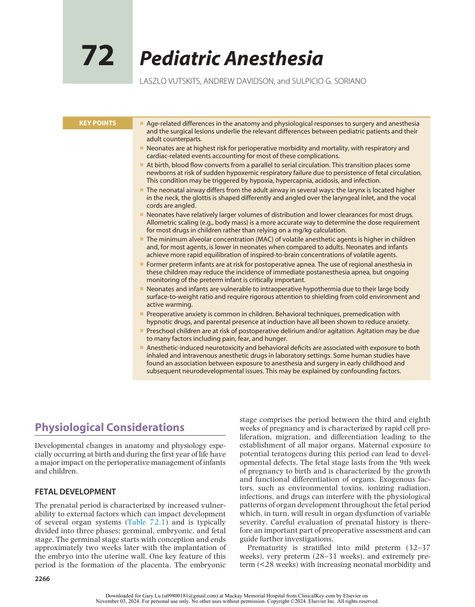

:::

<!-- PDF page 2 -->

**Table 72.1** Common Neonatal Problems Associated with Weight and Gestational Age

|**Gestation**|**Relative Weight**|**Neonatal Problems at Increased Incidence**|
|---|---|---|
|Preterm (&lt;37 weeks)|SGA|Respiratory distress syndrome Apnea Perinatal depression Hypoglycemia Polycythemia Hypocalcemia Hypomagnesemia Hyperbilirubinemia Viral infection Thrombocytopenia Congenital anomalies Maternal drug addiction Fetal alcohol syndrome|
||AGA|Respiratory distress syndrome Apnea|
|||Hypoglycemia Hypocalcemia|
|||Hypomagnesemia Hyperbilirubinemia|
||LGA|Respiratory distress syndrome Hypoglycemia; infant of diabetic mother Apnea Hypoglycemia Hypocalcemia Hyperbilirubinemia|
|Normal (37–42 weeks)|SGA AGA|Congenital anomalies Viral infection Thrombocytopenia Fetal alcohol syndrome Perinatal depression Hypoglycemia —|
||LGA|Birth trauma|
|||Hyperbilirubinemia |
|||Hypoglycemia; infant of diabetic mother|
|Postmature (>42 weeks)|SGA|Meconium aspiration syndrome Congenital anomalies Viral infection Thrombocytopenia|
|||Maternal drug addiction Perinatal depression|
|||Aspiration pneumonia Hypoglycemia|
||AGA|—|
||LGA|Birth trauma|
|||Hyperbilirubinemia Hypoglycemia; infant of diabetic mother|

_AGA,_ appropriate for gestational age; _LGA,_ large for gestational age; _SGA,_ small for gestational age. From Coté CJ, Lerman J, Anderson BJ, eds. _A Practice of Anesthesia for Infants and Children_ , 5th ed. Philadelphia: Saunders; 2013.

mortality1 (Fig. 72.1). Innovations in neonatology have allowed fetuses to reach an age of viability after 22 to 26 weeks gestational age.2 Normal birth weight at term ranges from 2500 g to 4200 g. Infants weighing less are classified as low birth weight (&lt;2500 g), very low birth weight (&lt;1500 g), and extremely low birth weight (&lt;1000 g).3 Plotting weight against gestational age allows further classification into three additional categories: small for gestational age, appropriate for gestational age, or large for gestational age (see Fig. 72.1). Infants who are small or large for gestational age often have developmental problems or difficulties associated with maternal disease which can impact perioperative care (see Table 72.1).

### NEONATAL AND INFANT PHYSIOLOGY

The transition from intra- to extrauterine life is rapid and involves a complex and well- orchestrated series of events aimed to ensure neonatal viability.4 A clinically useful measure to assess the condition of the newborn infant immediately after birth is the Apgar score at 1 minute and 5 minutes after birth (Table 72.2). Apgar scores between 7 and 10 are reassuring, a score of 4 to 6 is considered abnormal, while scores 3 and below are indicative of poor outcome. Despite the historic value of the Apgar scores, it has its limitations and cannot be used independently to diagnose perinatal asphyxia.5

::: details 原始表格與符號（PDF 第 2 頁）

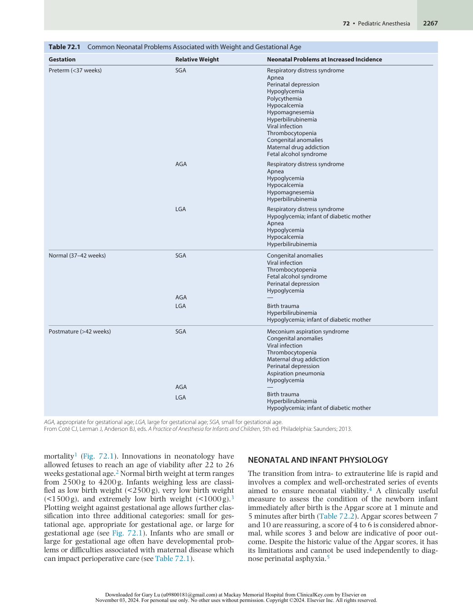

:::

<!-- PDF page 3 -->

### Cardiovascular System

The cardiovascular system undergoes anatomical and physiological changes during the first year of life.6 _In utero_ , most of the cardiac output flows from the placenta across the foramen ovale into the ascending aorta (oxygenated blood), whereas superior vena cava blood (deoxygenated) is directed to both the pulmonary artery and the ductus arteriosus (see also Chapter 73). At birth, lung expansion and oxygenation results in rapid decreases in pulmonary vascular resistance and increases in peripheral vascular resistance. As portal blood pressure falls, the ductus venosus and ductus arteriosus close. Pulmonary vascular resistance continues to decline as the architecture of the pulmonary vessels changes. Increasing pressure on the left side of the heart (caused by the increase in peripheral vascular resistance) leads to functional closure of the foramen ovale. Closure of the ductus arteriosus is primarily triggered by an increase in arterial oxygen concentration. Preterm infants frequently have patent ductus arteriosus. True mechanical closure by fibrosis does not occur until 2 to 3 weeks of age. Hypoxia, hypercapnia, and changes in peripheral or pulmonary vascular resistance cause reversion to the fetal circulation and hemodynamic instability and progressive

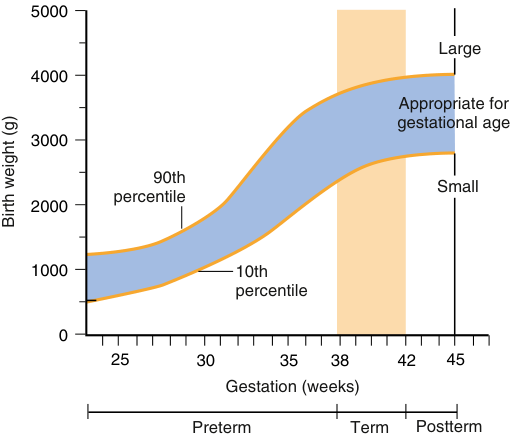

5000 Large 4000 Appropriate for gestational age 3000 90th Small percentile 2000 1000 10th percentile 0 25 30 35 38 42 45 Gestation (weeks) Preterm Term Postterm Birth weight (g) 

**Fig. 72.1 Plotting birth weight against gestational age for neonates determines whether infants are small, appropriate, or large for gestational age.** Infants who are either small or large for gestational age are particularly likely to have a variety of problems such as metabolic, developmental, infectious, or structural abnormalities. (Modified from Battaglia FC. Intrauterine growth retardation. _Am J Obstet Gynecol._ 1970;106:1103–1114. Used with permission.)

hypoxia.7 Blood is shunted away from the lungs via patent foramen ovale and ductus arteriosus and pathological increase of pulmonary artery pressure to systemic levels. A rapid downhill spiral may occur and lead to severe hypoxemia, which may be prolonged, despite adequate ventilation with 100% oxygen. Risk factors increasing persistent fetal circulation include prematurity, infection, acidosis, meconium aspiration, acidosis, hypothermia, and congenital heart disease.

The immature myocardium has poorly developed myofibrils, sarcoplasmic reticuli, and T- tubules resulting in less efficient contractility and less compliant ventricles. Therefore, cardiac output is relatively more dependent on the heart rate. Bradycardia is poorly tolerated while tachycardia supports cardiac output without any significant decrease in stroke volume. The most frequently encountered arrhythmia in pediatric populations is bradycardia, induced by hypoxia that can progress to asystole. Ventricular fibrillation is extremely rare in infants and children. Myocardial calcium stores are reduced because of the immaturity of the sarcoplasmic reticulum, leading to a greater dependence on exogenous (blood- ionized) calcium and probably increased susceptibility to myocardial depression by volatile anesthetics that have calcium channel–blocking activity.

### Pulmonary System

The lung bud rises from the foregut during the first trimester and the gas-exchanging portions of the airway are formed during the second trimester. Alveolar ductal development starts at 24 weeks while the septation of the air sacs begins around the 36th gestational week.8 Alveoli then increase in number and size until the child is approximately 8 years old. Further growth is exhibited as an increase in size of the alveoli and airways. At term, complete development of surface- active proteins helps maintain patency of the airways. If a child is born prematurely and these proteins are insufficient, then respiratory failure (respiratory distress syndrome) may follow.

Respiration is less efficient in infants. The small diameter of the airways increases resistance to airflow. The neonatal and infant tracheobronchial tree and chest wall are highly compliant, which can lead to airway obstruction and atelectasis. Thus, functional airway closure may accompany each breath. Dead space ventilation is proportionally like adults. However, oxygen consumption is two to three times higher. In preterm infants, the work of breathing is approximately three times that in adults and can be significantly increased by cold stress (due to increased metabolic demand for oxygen) or any degree of airway obstruction. Another important factor is the composition of the diaphragmatic

**Table 72.2** The Apgar Score

|**Score**|**0 Points**|**1 Point**|**2 Points**|
|---|---|---|---|
|Appearance (skin color)|Cyanotic/pale all over|Peripheral cyanosis only|Pink|
|Pulse (heart rate)|0|&lt;100|100–140|
|Grimace (reflex irritability)|No response to stimulation|Grimace (facial movement)/weak cry when stimulated|Cry when stimulated|
|Activity (tone)|Floppy|Some flexion|Well flexed and resisting extension|
|Respiration|Apneic|Slow, regular breathing|Strong cry|

::: details 原始表格與符號（PDF 第 3 頁）

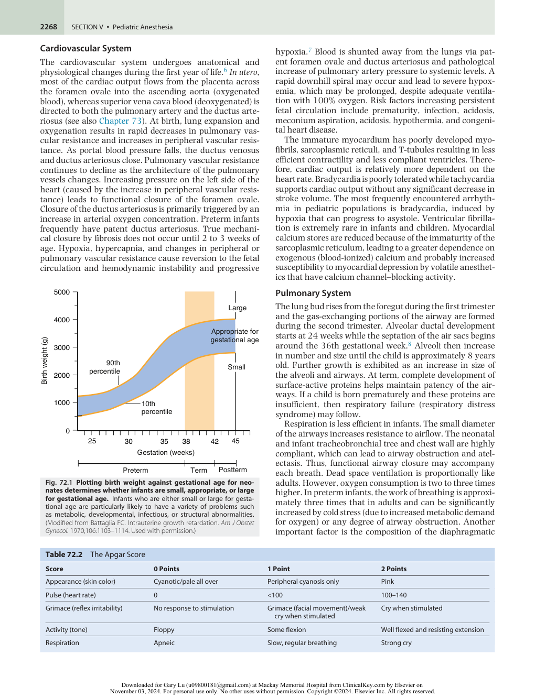

:::

<!-- PDF page 4 -->

and intercostal muscles. These muscles do not develop into mature type I muscle fibers until the child is approximately 2 years old (Fig. 72.2). Because type I muscle fibers provide the ability to sustain repeated contractions, any factor that increases the work of breathing contributes to early fatigue of the respiratory muscles. This partially accounts for the infant’s rapid respiratory rate and their propensity to develop fatigue and apnea with airway obstruction.

The airway of infants differs from adults.9,10 In relation to the oropharynx, the relatively large size of the infant’s tongue increases the likelihood of upper airway obstruction and technical difficulties during laryngoscopy. However, magnetic resonance imaging (MRI) studies demonstrate that soft tissues surrounding the upper airway grow proportionally to the skeletal structures during childhood.11 The larynx is located more cephalad in the neck and the epiglottis is relatively short, omega shaped, and angled over the laryngeal inlet. Finally, the infant larynx is funnel shaped, with the narrowest portion occurring at different levels depending on whether static or dynamic measurements were made (Fig. 72.3).10 Dynamic measurements reveal that the laryngeal tissue folds are pliable and change shape and position during each phase of respiration. Classic teaching has been that the adult larynx is cylindrical, and the infant larynx is funnel shaped. However, it is now known that the narrowest portion in 70% of adults is also in the subglottic region at the level of the cricoid cartilage. The opening is relatively large in adults so that commonly used tracheal tubes are usually easily advanced past the glottic opening.12 In infants and young children, a tracheal tube that easily passes the vocal cords may be tight in the subglottic region because of the relatively greater proportional narrowing at the level of the cricoid cartilage.

Neonates and infants are considered as obligate nasal breathers but revert to oral breathing in response to complete nasal obstruction.13 The prevalence of spontaneous oral breathing has been reported to be as high as 50% during sleep, and oral breathing could be consistently initiated in response to nasal obstruction.14,15

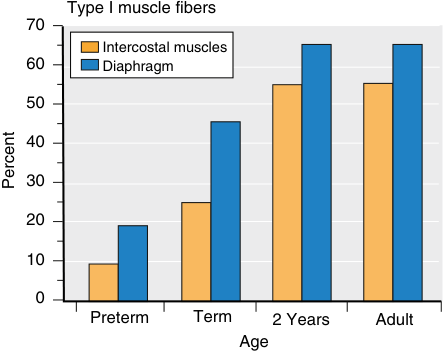

Type I muscle fibers 70 Intercostal muscles 60 Diaphragm 50 40 30 20 10 0 Preterm Term 2 Years Adult Age Percent 

**Fig. 72.2 The composition of the diaphragm and intercostal muscles significantly changes during the first 2 years of life.** The number of type I muscle fibers is inversely related to age and may account, in part, for the ease of inducing respiratory fatigue as the work of breathing increases. (Data from Keens TG, Bryan AC, Levison H, et al. Developmental pattern of muscle fiber types in human ventilatory muscles. _J Appl Physiol._ 1978;44:909–913.)

### Renal System

Renal function is diminished in neonates and even more in preterm infants because of relatively low perfusion pressures and immature glomerular and tubular function (Table 72.3; Fig. 72.4).16,17 Nearly complete maturation of glomerular filtration and tubular function occurs by approximately 20 weeks after birth, although delayed in preterm infants. Complete maturation of renal function occurs at approximately 2 years of age. Thus, the ability to excrete free water and solute loads may be impaired in neonates, and the half- life of medications excreted by means of glomerular filtration will be prolonged (e.g., antibiotics that therefore require longer intervals between doses in neonates).

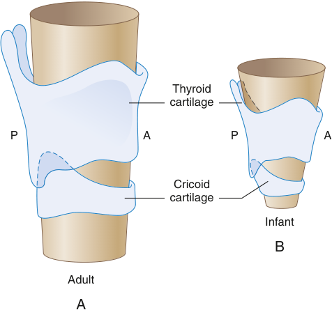

Thyroid cartilage P A P A Cricoid cartilage Infant B Adult A 

**Fig. 72.3 The narrowest part of the adult larynx and the pediatric larynx is at the level of the cricoid cartilage.** Traditionally, the adult larynx was thought to be cylindrically shaped, but autopsy data suggest that the narrowing in adults (A) is not as pronounced as it is in infants (B). The narrowest part of the infant larynx occurs at the level of the cricoid cartilage; the normal adult configuration of the larynx is not achieved until the teenage years. This anatomic difference is one of the reasons uncuffed tracheal tubes have been traditionally preferred for children younger than 6 years of age. _A,_ anterior; _P,_ posterior. (From Coté CJ, Lerman J, Anderson BJ, eds. _A Practice of Anesthesia for Infants and Children,_ 5th ed. Philadelphia: Saunders; 2013.)

**Table 72.3** Development of Glomerular Filtration Rate in the Term Newborn

|**Age**|**Glomerular Filtration Rate** **(mL/min/1.73 m**2**mean)**|**Range**|
|---|---|---|
|1 day|24|3–38|
|2–8 days|38|17–60|
|10–22 days|50|32–68|
|37–95 days|58|30–86|
|1–2 years|115|95–135|

From Heilbron DC, Holliday MA, al- Dahwi A, et al. Expressing glomerular filtration rate in children. _Pediatr Nephrol_ . 1991;5(1):5–11.

::: details 原始表格與符號（PDF 第 4 頁）

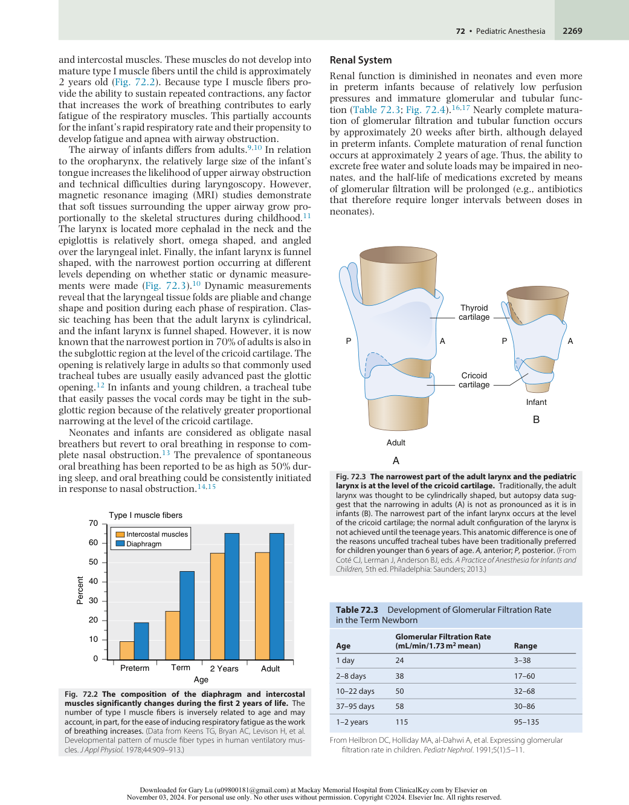

:::

<!-- PDF page 5 -->

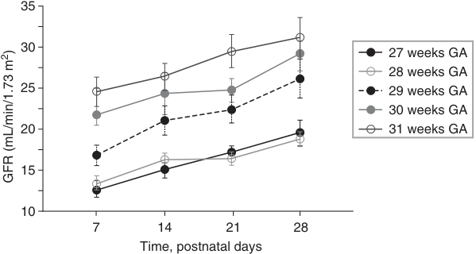

35 30 27 weeks GA 28 weeks GA 25 29 weeks GA 30 weeks GA 20 31 weeks GA 15 10 7 14 21 28 Time, postnatal days 2GFR (mL/min/1.73 m) 

**Fig. 72.4 Glomerular filtration rate (GFR) in the first month of life in preterm infants.** The ability of the kidney to regulate large amounts of solutes and water is also limited during the first several months of life. These developmental changes have significant implications for drug excretion and fluid therapy, particularly during the first 4 weeks of life. Maturation of renal function may be delayed in sick and preterm neonates. Data are means ± SEM. _GA,_ gestational age. (From Vieux R, Hascoet JM, Merdariu D, et al. Glomerular filtration rate reference values in very preterm infants. _Pediatrics._ 2010;125(5):e1186–e1192.)

### Hepatic System

Functional maturity of the liver is incomplete in full- term neonates.18,19 Most enzyme systems for drug metabolism are developed but not fully activated at birth. As the infant grows, the ability to metabolize medications rapidly increases as hepatic blood flow increases and enzyme systems are functionally induced. The cytochrome P450 system and phase I drug metabolism of lipophilic compounds is 50% of adult values at birth. CYP3A (cytochrome P450, family 3, subfamily A) is generally present at adult values at birth, whereas other cytochromes are absent or reduced. Phase II reactions, which conjugate drugs able to facilitate renal excretion, are often impaired in neonates and result in jaundice (decreased bilirubin breakdown) and long drug (and their active metabolites) half- lives. Some of these reactions do not achieve adult activity until after 1 year of age. A preterm infant’s liver has minimal glycogen stores and is unable to manage large protein loads. This accounts for the neonate’s tendency toward hypoglycemia and acidemia and for the failure to gain weight when the diet contains too much protein. Additionally, plasma levels of albumin and other proteins necessary for the binding of drugs are lower in full- term newborns (and are even lower in preterm infants) (Fig. 72.5). In addition, the binding of some drugs to albumin may be altered in the presence of hyperbilirubinemia in the neonatal period.

### Gastrointestinal System

Gastric pH is alkalotic at birth but is physiologically neutral by the second day of life. The ability to coordinate swallowing with respiration does not fully mature until infants are 4 to 5 months of age, thus resulting in a high incidence of gastroesophageal reflux, particularly in preterm newborns. Congenital anomalies of the gastrointestinal system will present with signs and symptoms within 24 to 36 hours of life. Upper intestinal abnormalities are exhibited as vomiting and regurgitation, whereas lower intestinal abnormalities produce abdominal distention and a failure to pass meconium.

### Hematology and Coagulation

The fetus uses two compensatory mechanisms to assure adequate oxygen delivery in the relatively hypoxemic _in_

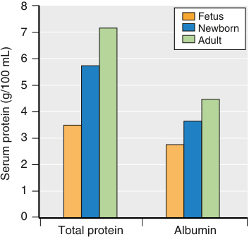

8 Fetus 7 Newborn Adult 6 5 4 3 2 1 0 Total protein Albumin Serum protein (g/100 mL) 

**Fig. 72.5 Total serum protein and albumin values change with maturation.** Total protein and albumin are less in preterm infants than in term infants and less in term infants than in adults. The result may be pharmacokinetic and pharmacodynamic alterations for drugs with a high degree of protein binding because less drug is protein bound and more is available for clinical effect. (From Ehrnebo M, Agurell S, Jalling B, et al. Age differences in drug binding by plasma proteins: studies on human foetuses, neonates and adults. _Eur J Clin Pharmacol._ 1971;3:189– 193; Coté CJ, Lerman J, Anderson BJ, eds. _A Practice of Anesthesia for Infants and Children,_ 5th ed. Philadelphia: Saunders; 2013.)

_utero_ environment. One of them is the increased red blood cell production resulting from increased fetal renal erythropoietin secretion in response to hypoxemia. The other compensatory mechanism is the production of fetal hemoglobin which has higher oxygen affinity leading to a leftward shift in the oxyhemoglobin dissociation curve. This facilitates increased oxygen binding at the lower oxygenated placental vascular bed. Hemoglobin (Hb) levels are high at birth (160–240 g/L) but rapidly decrease during the first 3 months of life because of decreased renal erythropoietin production. Fetal hemoglobin will be progressively replaced by adult hemoglobin during the first 6 months of postnatal life. This physiologic anemia in premature neonates and fullterm infants under 3 months of age increases the need for perioperative blood transfusion.

The coagulation system is also not mature at birth but improves over time.20 Levels of vitamin K–dependent coagulation factors are low at birth and reach adult values by 6

<!-- PDF page 6 -->

months of age. Fibrinogen levels are comparable between newborns and adults, but fibrinogen polymerization does not reach its full capacity during the first few postnatal months, leading thereby to prolonged thrombin time. The platelet count at birth is also comparable to adults, but platelet function is immature. The postnatal period represents a hypercoagulable state, since inhibitors of coagulation are also decreased by 30%–50% in the newborn. Antithrombin III and protein S levels reach maturity by 3 months of age while protein C and plasminogen levels reach adult levels 6 months after birth. The overall result of this hypercoagulable state is the higher risk of thrombotic complications in neonates and infants.21 Children between 1 and 16 years of age have been shown to have a 25% lower ability to form thrombin compared to adults, and the incidence of venous thrombosis in this population is very low (0.05%–0.08%).22 At adolescence, the coagulation system matures but additional risk factors such as smoking, obesity, pregnancy, and oral contraceptives may impair function. Recent guidelines recommend considering thromboprophylaxis in postpubertal adolescents.23

### Central Nervous System

The neural tube is formed between the third and fourth week of pregnancy and this event is followed by an active phase of cell proliferation and migration during the second trimester. Extensive brain development occurs between the beginning of the third trimester of pregnancy and the first few years of postnatal life. During this brain growth spurt period, the nervous system undergoes important differentiation, including the formation of myriads of synaptic contacts between neurons. Neural activity plays a preponderant role in these events especially during critical periods of development when the nervous system is particularly sensitive to and relies on external stimuli to drive differentiation of neuronal networks. Pharmacological interference with physiological activity patterns during this period may lead to impaired brain development.

Premature and term newborns exhibit physiologic and reflex responses to noxious stimulation that are diffuse and nonspecific when compared to older children and adults. The first functional and reflex responses to tactile and noxious stimuli are aimed at guarding against tissue damage and can trigger a range of physiological responses. The time of onset of pain awareness or “feelings” in humans remains undefined and largely debated. Nevertheless, there is evidence that early painful experiences, even if nonconscious, might alter subsequent central nervous system (CNS) function and that adequate pain relief can improve outcome.24,25

### Thermoregulation

Infants are especially vulnerable to hypothermia because of the large ratio of body surface area to weight, the thinness of the skin, and a limited ability to counter cold stress.26 Cold stress causes increased oxygen consumption and metabolic acidosis, particularly in preterm infants because of thin skin and limited fat stores. The infant compensates by shivering and nonshivering (cellular) thermogenesis (metabolism of brown fat). However, limited shivering during the first 3 months of life makes cellular thermogenesis the principal method of heat production. Placing the baby on a warming

mattress and warming the surgical unit (26°C or warmer) will reduce heat lost by conduction. Keeping the infant in an incubator and covered with blankets minimizes heat lost through convection. Heat lost through evaporation is lessened by humidification of inspired gases, use of plastic wraps, and warm skin disinfectant solutions. Although forced hot air blankets are the most effective means of warming, overheating can occur especially in neonates. Anesthetics alter many thermoregulatory mechanisms, particularly non- shivering thermogenesis in neonates.

## Pharmacology

Drug dosing in children differs from adults because of both pharmacokinetic and pharmacodynamic factors.27–30 Pharmacokinetics in infants and children varies with body composition and renal and hepatic function. Renal and hepatic function evolves as relative blood flow and organ maturity change with age. The changes in pharmacokinetics and pharmacodynamics are most pronounced in neonates. Evidence- based therapeutics is limited in pediatrics and many anesthesia drugs are used “off label” in small children.31

### PHARMACOKINETICS

### Body Composition

The body compartments (fat, muscle, water) change with age32 (Fig. 72.6). Total body water content is highest in preterm infants, and progressively decreases over the ensuing six months. Neonates and infants have a substantially greater extracellular fluid volume compared to intracellular fluid volume. Fat and muscle content increases with age. These alterations in body composition have several clinical implications for neonates. Since the neonate has less fat and muscle, drugs that depend on the redistribution into fat or

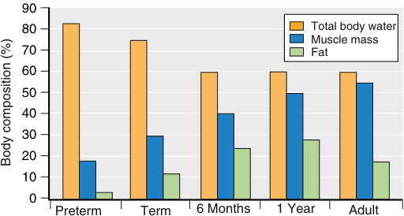

90 80 Total body water Muscle mass 70 Fat 60 50 40 30 20 10 0 Preterm Term 6 Months 1 Year Adult Body composition (%) 

**Fig. 72.6 Body composition rapidly changes in preterm and term infants during the first 12 months of life.** High water content provides a large volume of distribution for water- soluble medications, whereas low fat and muscle content provide a small reservoir for drugs that depends on redistribution into these tissues for the termination of the drug effect. Thus, body composition may significantly affect pharmacokinetics and pharmacodynamics. (Data from Friis- Hansen B. Body composition during growth. In vivo measurements and biochemical data correlated to differential anatomical growth. _Pediatrics._ 1971;47:264; Coté CJ, Lerman J, Anderson BJ, eds. _A Practice of Anesthesia for Infants and Children,_ 5th ed. Philadelphia: Saunders; 2013.)

<!-- PDF page 7 -->

muscle for the termination of their action will have a long clinical effect.

### Protein Binding

Neonates have reduced total plasma protein levels, including lower levels of albumin (which binds acidic drugs) and alpha- 1 acid glycoprotein (which binds neutral and basic drugs). Protein concentrations reach adult levels by the first year of life. As a result of reduced protein levels in the neonate, highly bound drugs will have a higher free fraction and greater drug effect. However, it is important to note that this is only clinically relevant for drugs that have a very high degree of protein binding, a high extraction ratio, and a narrow therapeutic index. Some drugs, such as caffeine and ceftriaxone may also displace bilirubin from plasma proteins, increasing the risk of kernicterus in sick neonates.33

### Clearance

Clearance changes with age in a complex manner.34 Clearance, expressed as L/h/kg, is greater in a toddler than in an older child. Increased clearance is a result of the nonlinear relationship between many aspects of organ function and size. This nonlinear relationship is not related to organ maturity and is surprisingly constant across different aspects of organ function, age, and species. It is known as allometry and can be expressed as:

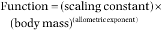

Function  (scaling constant)  (body mass)(allometricexponent) 

Using body surface area instead of body mass results in an allometric exponent of about 2/3 and is a reasonable predictor of clearance; other models claim that an allometric exponent of 3/4 reflects actual function.

Allometry alone, however, does not explain changes to clearance in the infant and neonate.

Organ maturity has a substantial impact. A sigmoid hyperbolic or Hill model, in addition to allometry, is needed

to predict clearance in this age group. Using postmenstrual age provides a better fit than chronologic age, consistent with organ maturity being on a continuum from fetal to postnatal life. The time to full maturation of renal and hepatic clearance varies between drugs. In general, the slope is steepest in the neonatal period and full maturity is achieved by 2 years of age27 (Fig. 72.7).

Many drugs are independent of clearance of the liver or kidney due to nonspecific esterases that are mature at birth.35 The clearances for these drugs do not require an adjustment for maturation and can be predicted largely through allometry alone. In neonates and infants, drugs that require hepatic or renal clearance will have a lower clearance, resulting in longer elimination half times. These drugs require infrequent dosing and lower infusion rates to achieve a steady state. In older children, elimination half times may appear to be shorter. However, this difference tends to disappear with allometric scaling. Additional perturbations in drug pharmacokinetic effects occur with factors such as sepsis, congestive heart failure, and increased intra- abdominal pressure.

### PHARMACODYNAMICS

In older children, pharmacodynamic properties of most anesthetic agents are probably similar to adults, albeit with some notable exceptions such as anticoagulants.36,37 Less is known about the pharmacodynamics of anesthetic agents in neonates and infants. Functional anesthetic end points such as pain, amnesia, and unconsciousness can be difficult to assess in infants. Surrogate measures of anesthesia effect, such as the raw and processed electroencephalogram (EEG), are also unreliable in infants.38 Our increasing understanding of the developmental neurobiology or pain and consciousness suggest there are likely to be clinically significant pharmacodynamic differences in infants and children.39

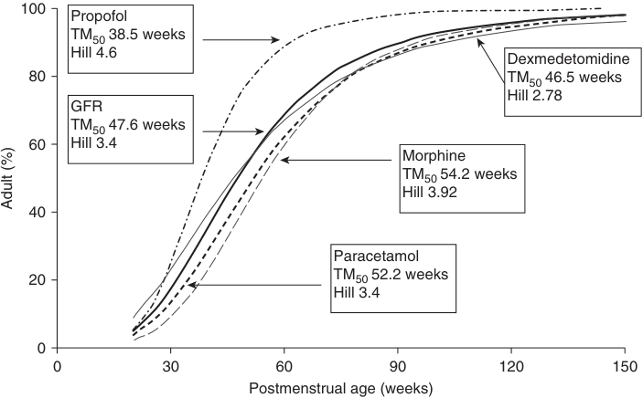

100 Propofol TM50 38.5 weeks Hill 4.6 Dexmedetomidine 80 TM50 46.5 weeks Hill 2.78 GFR TM50 47.6 weeks 60 Hill 3.4 Morphine TM50 54.2 weeks Hill 3.92 40 Paracetamol 20 TM50 52.2 weeks Hill 3.4 0 0 30 60 90 120 150 Postmenstrual age (weeks) Adult (%) 

**Fig. 72.7 Clearance maturation, expressed as a percentage of mature clearance, of drugs in which glucuronide conjugation plays a major role.** (From Sumpter A, Anderson BJ. Pediatric pharmacology in the first year of life. _Curr Opin Anaesthesiol._ 2009;22:469–475.)

<!-- PDF page 8 -->

## Anesthetic Drugs

### INHALED ANESTHETICS

### Uptake and Distribution of Inhaled Anesthetics

The rate of rise of inhalational anesthetic concentration depends on rate of delivery, which is determined by the inspired concentration, minute ventilation, and ratio of minute ventilation to residual functional capacity and blood/gas and tissue/blood partition coefficients40 (see Chapter 18).

Attainment of steady state, where the inspired, alveolar, and tissue (brain) fractions equilibrate, is faster in children than adults. This is traditionally due to a higher ratio of minute ventilation to functional residual capacity, which hastens equilibration of inspired and alveolar fractions. However, tissue/blood solubility also plays a role. The effect of age is greater with more soluble agents such as isoflurane and less for sevoflurane and desflurane.

The rapid attainment of steady state in neonates increases the risk of overdose, especially if an overpressure maneuver (using a high inspired concentration) is used. This risk may be greater for agents for which greater MAC multiples can be delivered by the vaporizer. For instance, a halothane vaporizer can deliver up to 5.75 MAC multiples versus 2.42 MAC multiples for a sevoflurane vaporizer (Table 72.4).

### Potency of Inhaled Anesthetics

The expired minimum alveolar concentration (MAC) of an inhaled anesthetic required in children changes with age41–48 (Fig. 72.8). MAC is lowest in the preterm neonate, increases by 30% from birth, and peaks between 1 to 6 months of age. Infants have a higher MAC than that of older children or adults; the reasons for these age- related differences in MAC are not known. Compared to adults, older children have a similar relationship between MAC and other measures of anesthetic effect. The ratio of MAC to MACawake, MACintubation, MACLMA insertion, MACextubation, and MACBAR are similar in children to adults.49–52 At the same time, the relationship between MAC and the electroencephalogram (EEG), and hence most anesthesia depth monitors, is not as consistent in children as in adults. Children have a higher bispectral index (BIS) for a specific fraction of MAC.53,54 In infants and neonates there are no data to determine how MAC relates to other aspects of anesthetic

**Table 72.4** Minimum Alveolar Concentration Multiples for a Neonate Allowed by Current Vaporizers

|**Agent**|**Maximum** **Vaporizer** **Output (%)**|**MAC (%)**|**Maximum** **Possible MAC** **Multiples**|
|---|---|---|---|
|Halothane|5|0.87|5.75|
|Isoflurane|5|1.20|4.2|
|Sevoflurane|8|3.3|2.42|
|Desflurane|18|9.16|1.96|

_MAC,_ minimum alveolar concentration. From Coté CJ, Lerman J, Anderson BJ, eds. _A Practice of Anesthesia for Infants and Children_ , 5th ed. Philadelphia: Saunders; 2013.

effect. The relationship between MAC and the EEG is substantially different in infants compared to adults, but the cause for this difference remains unknown.

All volatile anesthetics produce a dose- dependent reduction in systemic blood pressure. The myocardial depressant effect is greater in neonates compared to older children.55 All these agents also have a dose- and age- dependent effect on ventilatory drive and response to CO2.56,57

### Sevoflurane

Sevoflurane has a low blood solubility, facilitating a relatively rapid inhalational induction. Sevoflurane is less pungent than isoflurane and desflurane and hence has become the agent of choice for inhalational induction in children. Unlike other inhalational agents the MAC is similar between neonates and infants, but like other agents becomes lower with age after infancy: 3.3% for neonates, 3.2% for infants 1 to 6 months old, and 2.5% for children older than 6 months.41,42

Sevoflurane is associated with a greater incidence of emergence delirium compared to halothane and is reported to cause epileptiform changes in the EEG when delivered at high concentrations in children. The etiology of these findings is unknown.58

### Isoflurane

Isoflurane has a blood solubility between halothane and sevoflurane. Like sevoflurane it has a relatively lower MAC in neonates, peaks in infancy, and then declines with age. It is more potent than sevoflurane but has a relatively more noxious smell, which makes an inhalational induction with it unacceptable for most children.

### Desflurane

Desflurane has a blood solubility lower than isoflurane or sevoflurane and MAC is lower in neonates, peaks in infancy, and declines with age.44,59 However, it is not suitable for inhalational induction in children due to a pungent odor and is not recommended for maintenance in children who are not intubated due to an unacceptable incidence of laryngospasm.60

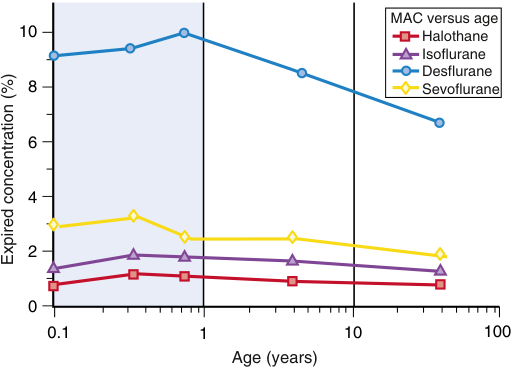

MAC versus age 10 Halothane Isoflurane Desflurane 8 Sevoflurane 6 4 2 0 0.1 1 10 100 Age (years) Expired concentration (%) 

**Fig. 72.8 The minimum alveolar concentrations (MACs) of four commonly used inhaled anesthetics are plotted versus age.**

::: details 原始表格與符號（PDF 第 8 頁）

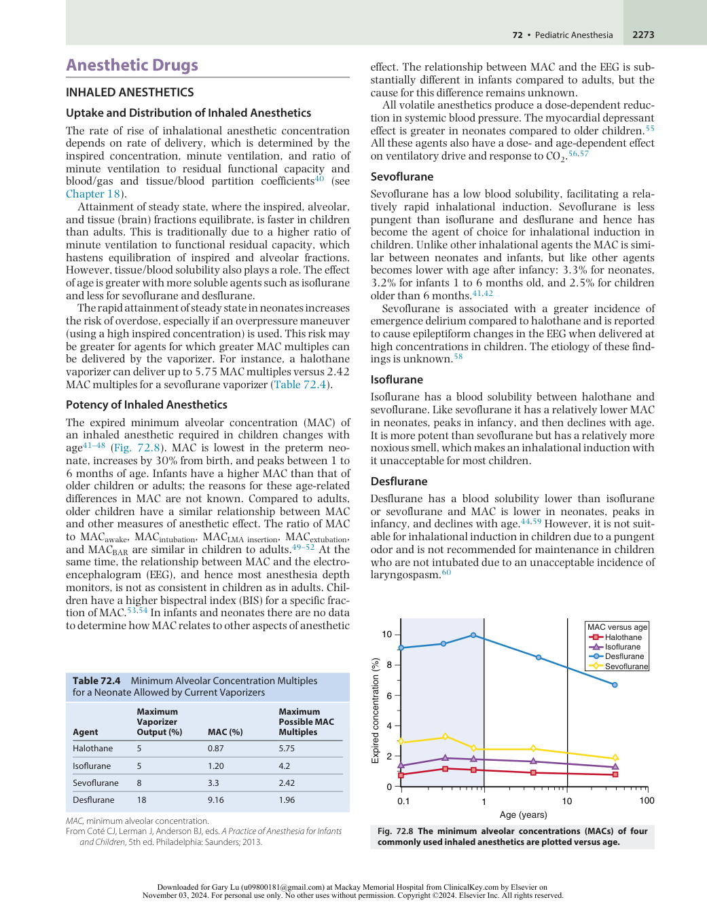

:::

<!-- PDF page 9 -->

### Nitrous Oxide

Nitrous oxide is an odorless gas that has a low solubility in blood but is relatively non- potent. The MAC of nitrous oxide has not been accurately determined in children. If used together with other inhalational anesthetics, it reduces the MAC of more potent agents. It may speed the uptake of more potent agents but the underlying theory behind this “second gas” effect has been challenged and it is almost certainly of minimal clinical relevance. Nitrous oxide is a weak analgesic and is often used in children alone, or in conjunction with other agents for procedural sedation and analgesia.61–63 Since it is odorless, it is also commonly used as an adjuvant for induction of general anesthesia. Breathing high concentrations for a short period can provide sedation before sevoflurane is added. When compared to adults, there is less evidence that nitrous oxide increases postoperative nausea and vomiting in children.64,65

### INTRAVENOUS GENERAL ANESTHETICS

### Hypnotic and Sedative Drugs

**Propofol.** In children the volume of distribution of propofol is greater than in adults due to rapid redistribution. Clearance is similar in children and adults, but longer in preterm neonates. The dose for induction increases with decreasing age. The median effective dose (ED50) for loss of eyelash reflex is 3 mg/kg in infants aged 1 to 6 months, and 1.3 to 1.6 mg/kg in children aged 1 to 12 years. Use of propofol has been associated with profound hypotension in neonates.66 A potential drawback to propofol is pain on injection. The most effective is the administration through a large vein or adding lidocaine (0.5–1.0 mg/kg) to the propofol, or injecting lidocaine before the propofol. Propofol is not contraindicated in children with egg allergy.67

Prolonged administration of propofol for children can lead to propofol infusion syndrome, which is characterized by lipemia, metabolic acidosis, rhabdomyolysis, and hyperkalemia followed by refractory cardiovascular collapse.68 It has been reported after high- dose infusions for an extended period and its onset may be subtle and unnoticed followed by rapid demise. The mechanism underlying propofol infusion syndrome remains unclear. It may be related to alterations in mitochondrial lipid metabolism69 (see Chapter 21).

**Ketamine.** Ketamine has a similar volume of distribution in children compared to adults, but the clearance is reduced in infants. It may be used for induction of anesthesia (1–3 mg/ kg intravenously or 5–10 mg/kg intramuscularly). The intramuscular route is well described for uncooperative patients where other premedication or intravenous and inhalational induction are not tolerated. The administration of a benzodiazepine when using an intramuscular dose of ketamine may reduce the risk of hallucinations and an anticholinergic agent may be required to reduce the risk of hypersecretion. If used for a relatively brief procedure, a large intramuscular dose of ketamine can lead to significantly delayed emergence.

Ketamine causes relatively little cardiovascular or respiratory depression, is less likely to result in airway obstruction, and is utilized as a safer agent in resourcepoor settings. It is also frequently used in the pediatric

emergency department for brief, painful procedures. Given its cardiovascular stability it may be the optimal premedication for children with congenital heart disease. Ketamine is increasingly used as an adjunct to other agents to optimize postoperative analgesia.

**Etomidate.** Clearance of etomidate is similar in children and adults. However, the volume of distribution is larger in children and hence a larger initial bolus is required. Concerns regarding anaphylactoid reactions and suppression of adrenal function have limited widespread use of this anesthetic in children. As with propofol, the incidence of pain on intravenous administration is frequent. Etomidate has minimal cardiovascular suppression and thus it is useful in children who are critically ill and those with a head injury.

### Alpha- 2 Receptor Agonists

Alpha- 2 receptor agonists are being used more commonly in pediatric anesthesia. Uses of these agents include sedation, premedication, analgesia, adjunct for general anesthesia, prevention of emergence delirium, and prolongation of regional nerve blockade. Alpha- 2 receptor agonists cause a dose- dependent reduction in heart rate and blood pressure. However, this hemodynamic effect is rarely clinically relevant in the doses commonly described.

**Clonidine.** Clonidine is increasingly used for premedication. There is some evidence that clonidine is superior to midazolam as a premedicant in terms of sedation, postoperative agitation, and postoperative pain.70 To be optimally effective, 4 mcg/kg clonidine should be given orally 45–60 minutes prior to induction. Like many other drugs, the clearance of clonidine is reduced in neonates, however, it rises to 82% of adult levels by 1 year of age.71

**Dexmedetomidine.** Dexmedetomidine has greater selectivity for the α2 receptor than clonidine, and hence produces less hypotension and bradycardia compared to clonidine. It also has minimal respiratory depressive effects. The sedation provided by dexmedetomidine is similar to natural sleep. Children may be more easily aroused from dexmedetomidine sedation compared to other sedative agents. Dexmedetomidine has been widely used as a sedative in the intensive care setting. It has also been used as a sole sedative for medical imaging procedures in children. The loading dose of 1–2 mcg/kg is typically given over 10 minutes followed by an infusion of 0.5 to 1 mcg/kg/h.72 Clearance is reduced in neonates.73

Dexmedetomidine is increasingly used intranasally for premedication, where it has a bioavailability of 80%. A dose of 1 to 2 mcg/kg is used for intranasal premedication, allowing for 30–40 minutes for its peak effect. Several studies have found intranasal dexmedetomidine to be superior to midazolam for premedication in children.74,75

### Benzodiazepines

Benzodiazepines are primarily administered as an anxiolytic and amnestic in pediatric patients. Artificially flavored oral preparations of midazolam are commonly administered to premedicate an anxious toddler prior to induction of general anesthesia. It can also be injected intramuscularly with ketamine to partially induce anesthesia in uncooperative

<!-- PDF page 10 -->

patients. As in adults, midazolam is an effective anxiolytic in patients with intravenous access.

### Opioids

**Morphine.** Morphine is frequently used for postoperative analgesia. There is also a large variability in pharmacodynamic and pharmacokinetic profile and thus doses should be titrated to effect. Morphine is metabolized by both glucuronidation and sulfation. In contrast to adults, sulfation is the dominant pathway of metabolism in infants. Clearance is low in neonates but reaches adult levels at 6 to 12 months of age. Neonates are more susceptible to respiratory depression, perhaps due to an immature blood–brain barrier and immature metabolism of the parent drug. There is some evidence that human neonates are also more susceptible to the respiratory depressive effects of morphine, however, the mechanism remains unclear. Nevertheless, it should be used cautiously in infants, particularly in preterm infants.

**Codeine.** Codeine is a morphine- like opioid with approximately 10% of the potency of morphine. It has rapid oral absorption and 90% bioavailability. These features resulted in it previously being used extensively as an oral analgesic (1 mg/kg). Approximately 10% of codeine is metabolized to morphine and thus a considerable amount of its analgesic action is through this mechanism of metabolism. There is considerable variation in this metabolism with poor, rapid, and ultra- rapid metabolizers. Ultra- rapid metabolizers are at risk of increased clinical response including profound respiratory depression that has been associated with death in children.76 For this reason, codeine is now rarely used for children. The US Food and Drug Administration (FDA) recently issued a “black box” warning against its use in children after tonsillectomy.77

**Meperidine.** The use of meperidine is declining in all clinical settings due to concerns over the accumulation of the metabolite normeperidine, which may cause seizures, particularly after multiple doses are administered. Meperidine has a potency of approximately one-tenth that of morphine and a shorter time to peak effect. The elimination of meperidine is reduced in neonates.

**Fentanyl.** Fentanyl is commonly used in pediatric anesthesia for intraoperative analgesia. It has greater hemodynamic stability than morphine. High doses of 10–100 mcg/ kg can be used to maintain cardiovascular stability. The clearance is markedly reduced in preterm infants but rises to 80% of adult values by term. Adult levels of clearance are achieved within the first few weeks post term. The volume of distribution is greatest in neonates (5.9–L/kg) and steadily declines with age to 1.6 L/kg in adults.

**Alfentanil.** The clearance of alfentanil in preterm neonates is markedly reduced and the volume of distribution is greater than older infants. Pharmacokinetic data are generally sparse and somewhat contradictory, but volume of distribution and elimination half- life are similar between infants aged 3–12 months and older children.78

**Sufentanil.** Sufentanil is used mainly for pediatric cardiac, complex neurosurgical, and craniofacial surgery. Its

shorter and predictable context- sensitive half- life, make it an ideal opioid for long surgical procedures that require rapid emergence from anesthesia. Like other similar agents, in neonates sufentanil has a greater volume of distribution, reduced clearance, and longer elimination half- life.

**Remifentanil.** The main advantage of remifentanil is its extremely brief half- life. The elimination half- life is 3–6 minutes and is independent of dose and duration. Remifentanil is degraded by nonspecific plasma and tissue esterases, and metabolism is not affected by butyrylcholinesterase deficiency. Since renal and hepatic function is minimal, it has great utility in infants with hepatic or renal failure. The differences in remifentanil’s half- life among neonates, infants, and adults are minimal. There are age- related differences in the volume of distribution and clearance but not in half- life, with volume of distribution being greater in infants compared to older children (Fig. 72.9).79 Contrary to the pharmacokinetics of most drugs, neonates clear the drug more rapidly than older children. Of further interest is the very small patient- to- patient variability in pharmacokinetic parameters when compared with similar studies examining other opioids, particularly in infants and neonates. The particularly favorable pharmacokinetics in neonates allows the provision of a deep opioid- induced plane of anesthesia while avoiding cardiovascular depression and the need for postoperative ventilation.

A loading dose of remifentanil may be required prior to infusion; however, rapid large bolus may produce hypotension and bradycardia. A bolus of remifentanil 3 mcg/ kg with propofol 3–4 mg/kg has been described as an alternative to succinylcholine to facilitate endotracheal intubation.80,81 Acute tolerance to remifentanil has been described in children. If postoperative pain is anticipated, adequate long- acting analgesia should be given well before the remifentanil infusion is discontinued.

**Tramadol.** Tramadol is a relatively weak opioid with less respiratory depressant effects. Two enantiomers provide analgesia; one is an opioid mu receptor agonist and the other inhibits uptake of serotonin and norepinephrine. Clearance is less in premature neonates but in children is similar to adults if standard allometric scaling is applied. Tramadol is metabolized by various pathways including via CYP2D6 to O- desmethyltramadol. This metabolite has mu- receptor affinity approximately 200 times greater than tramadol.30 The genetic polymorphism of CYP2D6 produces fast and slow metabolizers which may produce a variable response amongst children. The FDA has warned against using tramadol after tonsillectomy in children with obstructive sleep apnea.82 One oral formulation of tramadol for children has a concentration of 100 mg/mL and is administered in drops. This may increase the risk of errors in administration if milliliters are mistakenly given rather than drops, resulting in a potentially 10- fold overdose. This formulation has been replaced in some countries by an elixir of 10 mg/mL.

### Muscle Relaxants and Reversal Agents

**Succinylcholine.** Succinylcholine continues to have clinical utility for children undergoing surgery, though alternative muscle relaxants are gaining in popularity. It is highly

<!-- PDF page 11 -->

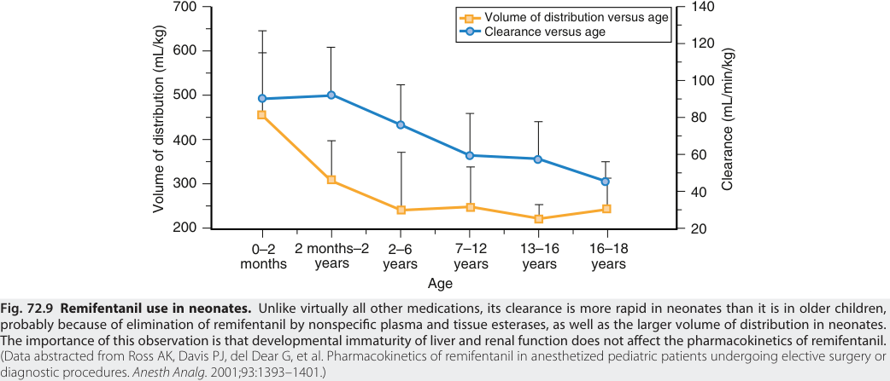

700 140 Volume of distribution versus age Clearance versus age 120 600 100 500 80 400 60 300 40 200 20 0–2 2 months–2 2–6 7–12 13–16 16–18 months years years years years years Age Fig. 72.9 Remifentanil use in neonates.  Unlike virtually all other medications, its clearance is more rapid in neonates than it is in older children, probably because of elimination of remifentanil by nonspecific plasma and tissue esterases, as well as the larger volume of distribution in neonates. The importance of this observation is that developmental immaturity of liver and renal function does not affect the pharmacokinetics of remifentanil. (Data abstracted from Ross AK, Davis PJ, del Dear G, et al. Pharmacokinetics of remifentanil in anesthetized pediatric patients undergoing elective surgery or diagnostic procedures.  Anesth Analg.  2001;93:1393–1401.) Clearance (mL/min/kg) Volume of distribution (mL/kg) 

water soluble and rapidly redistributes into the extracellular fluid volume. For this reason, the dose required for intravenous administration of this depolarizing muscle relaxant in infants (2.0 mg/kg) is approximately twice that for older children (1.0 mg/kg). Succinylcholine is also effective when given intramuscularly; reliable muscle relaxation occurs within 3 to 4 minutes after 5 mg/kg in infants and 4 mg/kg in children older than 6 months. The skeletal muscle relaxation produced by intramuscular administration may last up to 20 minutes. In an emergency, succinylcholine may be administered intralingually (via a submental approach), which will further speed the onset of relaxation because the drug is more rapidly absorbed from the tongue than from skeletal muscle.

Administration of atropine as a premedication reduces the incidence of bradyarrhythmias. Cardiac sinus arrest may follow the first dose of succinylcholine but is more common after repeated bolus administrations; sinus arrest may occur in children of any age. Therefore, a vagolytic drug should be administered just before the first dose of succinylcholine in all children, including teenagers, unless a contraindication to tachycardia exists. Succinylcholine has received significant attention because of the severity of some of its complications. The potential for rhabdomyolysis and hyperkalemia (particularly in boys younger than 8 years of age who have unrecognized muscular dystrophy), as well as the risk for malignant hyperthermia, suggest that succinylcholine should not be routinely used in children.83 Increased jaw muscle tone (masseter muscle spasm) after succinylcholine has been observed, particularly when halothane is used. Masseter muscle tetany, which prevents any mouth opening, is an extreme variation in increased masseter muscle tone. Such tetany may be an early sign of malignant hyperthermia, but certainly not all cases of tetany progress to malignant hyperthermia.

Despite these concerns, succinylcholine is still used for emergency airway management including the management of severe laryngospasm and as part of a rapid-sequence induction (RSI) where the child has a full stomach. Since large doses of rocuronium produce adequate intubating conditions almost as quickly as succinylcholine in adults,

it may be an alternative agent for pediatric airway management.84 High- dose propofol and remifentanil may also produce timely adequate intubating conditions, however, significant hypotension may result.

**Nondepolarizing Muscle Relaxants.** Infants are generally more sensitive to these nondepolarizing muscle relaxants and their responses vary to a greater degree. Although the initial dose per kilogram needed for neuromuscular blockade is often similar for children of all ages, the greater volume of distribution and reduced renal or hepatic function of neonates result in a slower rate of excretion and hence a prolongation of effect.

The choice of nondepolarizing muscle relaxant depends on the side effects and the duration of the desired muscle relaxation. Vecuronium, atracurium, rocuronium, and cisatracurium are useful for shorter procedures in infants and children; they may also be administered as a constant infusion. The method of excretion of atracurium and cisatracurium (Hofmann elimination and ester hydrolysis) makes these relaxants particularly useful in newborns and children with immature or abnormal hepatic or renal function. Vecuronium is valuable because no histamine is released; however, its duration of action is prolonged in newborns.

Rocuronium has a clinical profile similar to that of vecuronium, cisatracurium, and atracurium. Acceptable conditions for intubation are produced by rocuronium within 3 to 4 minutes after 1 mg/kg intramuscularly in infants and 1.8 mg/kg intramuscularly in children older than 1 year of age; these effects were more dependable with deltoid than with quadriceps muscle injection.85 Table 72.5 provides commonly recommended guidelines for doses. Routine pharmacologic antagonism of neuromuscular blockade is recommended in all children, even if they have clinically recovered. Recovery times vary between subjects and residual blockade may be difficult to detect and may be associated with increased postoperative complications.

**Sugammadex.** Sugammadex is a cyclodextrin that rapidly encapsulates rocuronium and vecuronium, forming a

<!-- PDF page 12 -->

**Table 72.5** Commonly Used Muscle Relaxants and Reversal Agents in Pediatrics

|**Drug**|**Average Intubation Dose (mg/kg)**|**Category**|**Approximate Duration (minutes)**|
|---|---|---|---|
|**MUSCLE RELAXANTS***||||
|Pancuronium|0.1|Long acting|∼45–60|
|Cisatracurium|0.1|Intermediate acting|∼30|
|Vecuronium|0.1|Intermediate acting|∼30|
|Rocuronium||Dose related:||
||0.3|Short acting|∼15–20|
||0.6|Intermediate acting|∼30–45|
||1.2|Long acting|∼45–75|
|**REVERSAL AGENTS**†||||
|Edrophonium|0.3–1.0 mg/kg + atropine, 0.02 mg/kg|||
|Neostigmine|0.02– 0.06 mg/kg + atropine, 0.02 mg/kg|||
|Sugammadex|2 mg/kg:≥2/4 TOF 4 mg/kg: 1/4–2/4 TOF|||

_TOF,_ train-of-four.

*The response of preterm and term neonates (who may be more sensitive to the drugs) to muscle relaxants varies greatly from patient to patient. Therefore, all doses should be titrated to response. The recommended tracheal intubation doses may be reduced 30% to 50% in the presence of a potent inhaled agent.

†The dose of the reversal agent given to antagonize nondepolarizing neuromuscular blockade should be determined by the degree of residual neuromuscular blockade (i.e., the dose should be titrated to clinical effect).

stable complex that prevents any further action of the muscle relaxant. The complex is excreted by the kidney. Clinical reports in children confirm that 2 mg/kg and 4 mg/kg reversed moderate and dense rocuronium- induced block, respectively.86–88

### TOTAL INTRAVENOUS ANESTHESIA IN CHILDREN

Total intravenous anesthesia (TIVA) is increasingly being utilized in pediatric anesthesia.89–91 Propofol and remifentanil are the main agents in these TIVA protocols. One limitation of TIVA in children is the need for specific and well- validated pediatric algorithms. Adult target- controlled infusion models are not best suited for children.92 However, pediatric- specific algorithms have been applied to pediatric patients but are primarily investigational.93

### ANESTHESIA AND THE DEVELOPING BRAIN

In 2016, the FDA issued a warning that general anesthetics and sedatives may have harmful effects on the child’s brain.94,95 The warning emphasizes that the risk is greater with prolonged and repeated anesthetics in children under the age of 3 years. This controversial warning is based on animal data and a limited number of human studies.

### Animal Data

There is substantial preclinical evidence that many general anesthetics have the capacity to cause morphological and functional changes to the developing brain.96–98 This has been demonstrated in a wide variety of species, ranging from the nematode to the nonhuman primate.99,100 Histological manifestations of this phenomenon include neuronal and glial apoptosis and altered dendritic morphology and arborization.101–103 Although the effects are age, dose, and time dependent, it is difficult to identify the upper limit

of duration of exposure which has no effect.97 In general, the effects are greater in the more immature brain, which translate to the late trimester of pregnancy or early infancy in humans, but some effects are also seen in older animals. Effects are greatest with γ-aminobutyric acid (GABA) agonists and _N_ -methyl-d-aspartate (NMDA) antagonists and hence have been seen with propofol, benzodiazepines, volatile anesthetics, and ketamine. There is contradictory evidence for an effect with alpha2- agonists. Deficits in learning and altered behavior have also been reported in laboratory animals, including nonhuman primates, exposed to anesthesia. However, not all experiments have demonstrated consistent functional deficits and it is unclear if they are a function of the morphological changes.

**Translating the Animal Data to Humans.** There are considerable problems translating the animal data to humans.104,105 Comparable developmental lifespan stage between species is not an exact science. Homeostasis may be deranged during anesthesia and concurrent surgery. Human brains are complex and develop and compensate over a longer period. Human brains can be extraordinarily vulnerable to injuries but have considerable plasticity and recovery. Importantly, genetic and environmental factors have a huge impact on resilience and recovery or vulnerability.

### Human Study Outcomes

Human studies on anesthesia and the developing brain can be broadly grouped according to their design and subsequent outcomes.106

The design of observational studies broadly consists of:

- _Data linkage population- based studies._ These use existing data sets which can be linked. They are inherently retrospective and limited by the outcomes and exposure variables that have already been collected. They can,

::: details 原始表格與符號（PDF 第 12 頁）

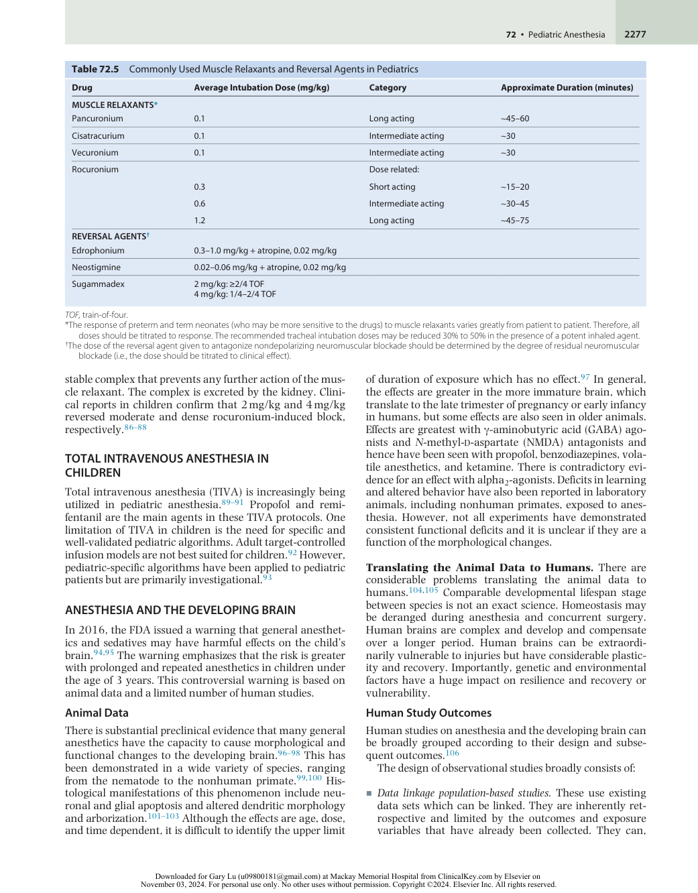

:::

<!-- PDF page 13 -->

however, be very large, examining whole of country or whole of state populations. The outcomes commonly used are preschool tests for school readiness, or school grades.

- _Use of existing birth cohorts or longitudinal studies._ These studies use existing data from longitudinal cohorts that have usually been set up for other investigations. They often include access to more detailed outcome from psychometric outcomes and diagnoses of disability and school grades. The details of anesthetic exposure may be limited but identify other factors that may contribute to outcome.

- _Purpose- built cohort studies._ These studies recruit children that have been exposed to anesthesia and match them to those that have not, and test for a range of psychometric outcomes. These studies enable researchers to focus on neurodevelopmental areas of greatest interest but logistically it is difficult to recruit large numbers of children. Children may be recruited in various ways including from existing longitudinal studies.

Various outcome measures have also been used107 :

- _School grades or school readiness tests._ These are relevant to families, but they are course measures of neurodevelopment. A deficit may exist in one aspect of neurodevelopment which is not reflected in school grades. Conversely, many other factors influence school grades, diluting any possible “injurious” effect. Their advantage is not only their importance to families, but also that they are easy to obtain in very large numbers.

- _Diagnosis of a learning disorder or specific neurodevelopmental disorder._ These are also of great importance to the families and the community. A major problem is that the diagnosis may not always be clear. Definitions of disorders vary between jurisdictions and over time. Another potential disadvantage is that these disorders are still not common enough to be able to produce precise results except in very large studies.

- _Psychometric testing._ Many tests are available to test a wide range of neurodevelopmental domains. Apical tests, such as intelligence quotient (IQ), are composite scores which pool results from several domains. Apical tests have the best value as far as predicting future function but using apical tests may miss deficits in some subdomains. Looking at multiple domains raises the problem of type 1 error (finding a “significant” association due to multiple testing). The psychology literature abounds with studies that are not replicable – partly because of this issue. If a “deficit” is found in only one or two of many subdomains tested, then the results must be interpreted very cautiously until they are replicated in following studies. Performing psychometric testing is labor intensive and must be done to a high standard to be useful.

- _Imaging._ Magnetic resonance imaging (MRI) studies are usually small due to logistic problems. Like psychometric testing, there are usually many outcomes measured, increasing the risk of type 1 error. While our understanding of MRI is rapidly increasing, there is still a degree of disconnect between what is seen on MRI and functional measures.

In all these studies it is important to consider the age of testing. Some aspects of neurodevelopment such as higher

executive function cannot be tested until the child is older. Furthermore, children will usually “grow into their deficit”. An injury in a particular aspect of brain function will become more apparent as the child develops and lacks that function. This is contrary to the idea that the brain will always have plasticity and recovery.

**Confounding Variables.** Confounding occurs when an observed association between A and B is not direct or causal but due to another factor, C. There are significant issues with confounding in all the observational studies looking at anesthesia and developmental outcome. Children have anesthesia because they are having surgery or a diagnostic procedure. The surgery or procedure may itself cause injury by inducing the stress response from surgery or poorly managed pain. Furthermore, the condition that warrants surgery may be associated with increased risk of poor neurodevelopmental outcome. This may be obvious in the case of genetic abnormalities or major illnesses, but it can also be more subtle. Children having ear tube insertion may be showing signs of delay and the pediatrician wants to optimize their hearing. A child requiring dental extractions may come from an environment where health care is suboptimal or have subtle behavioral problems that make dental care without out anesthesia or sedation more problematic.

It is important to note that confounding by indication could explain why the outcomes appear worse with multiple as opposed to single exposures.

Confounding can be reduced by careful sample selection, matching, or statistical adjustments in the analysis, but these measures are never mathematically perfect and thus cannot completely remove the influence of confounding. Importantly they can only reduce the influence of known confounding factors. The problem of confounding means that, by itself, any association seen in an observational study cannot ever be regarded as anything better than weak evidence for causation. Randomized controlled trials are by far the best way to reduce confounding.

**Results from Population-Based Clinical Studies.** Most, but not all, large population- based studies looking at school grades or readiness for school found evidence for a small difference in school grade or readiness in children that have had anesthesia in early childhood.108–113 The increase in risk is much smaller than the risk associated with gender or month of birth. Interestingly the studies do not indicate that exposure at 0–2 years is worse than 2–4 years, and some find the opposite. As far as frequency of exposure, some show weak evidence for a greater risk with multiple exposures, but most have insufficient power to determine if having multiple exposures poses any greater risk than single exposure. Several found that surgery increased the risk of not getting to school or not being able to sit the test. This may be consistent with an increased risk of developing a specific developmental disorder.

**Results from Studies that Look at Specific Developmental Disorders.** Most studies that have diagnosis of a learning or developmental disorder as their outcome found evidence for an association between anesthesia in early childhood and an increased risk of a diagnosis of a

<!-- PDF page 14 -->

behavioral disorder or learning disability.114–120 Most of these studies do find good evidence that the association is greater with multiple exposures.

**Results from Studies that Use Psychometric Testing for Outcomes.** Several reports demonstrate an association between anesthesia in early childhood and specific domains of psychometric testing. These domains include language, reading, abstract reasoning, executive function, some aspects of memory, processing speed, fine motor abilities, and some aspects of behavior.121–128 Some but not all find an association with a small reduction in IQ.110

Some robust studies such as PANDA found no evidence for an association with any deficit.129 The only randomized controlled trial, the GAS study, found no evidence for a difference in IQ and a range of other psychometric tests in children tested at age 2 or age 5 after being randomized to either general or awake regional anesthesia for hernia repair.112

**Summary and Recommendations.** Despite strong animal evidence, there is inconsistent human evidence for an association between anesthesia in early childhood and a range of later neurodevelopmental outcomes. A causal relationship cannot be ruled out, although evidence for a causal relationship in humans is weak. These associations could be simply explained by confounding variables. Clinical decisions need to be made based on the current preclinical and clinical data. Most pediatric anesthesia societies currently recommend that surgery not be delayed or modify the anesthetic technique. Some recommend delaying nonurgent procedures; however, very few purely elective procedures are done in children and delaying procedures is nearly always associated with an increased risk inherent in not treating the condition that warranted the procedure. Finally, if surgery is delayed, there are no data on a “safe” period for anesthesia. While not all agree that neurotoxicity should be included as part of informed consent, anesthesiologists should, however, be prepared to discuss the risk with parents and caretakers if they are asked about the risk or express concerns about proceeding with anesthesia and surgery.

**Ongoing Uncertainties.** There is some evidence that repeated exposure to anesthesia is potentially harmful, but it is unclear if this represents a cumulative effect or is a result of confounding.130 Two recent studies have identified the range of duration of anesthesia in children in the United States and the majority of children have anesthesia which is an hour or less in duration.106,131

Apart from the issue of anesthesia neurotoxicity, there is growing evidence that neonates having major surgery have a substantially higher risk of neurologic injury and poor neurologic outcome.132,133 This observation may be completely unrelated to exposure to anesthesia and be partly due to other factors in the perioperative period such as comorbidities, changes in cerebral perfusion, with or without hypotension, inflammation, hypoxia, hypercarbia, stress, and pain.134 Neonates have vulnerable brains and much more work needs to be done to identify optimal perioperative management strategies to protect the brain.

## Anesthetic Management

### PERIOPERATIVE MANAGEMENT

### Preoperative Evaluation

Preoperative evaluation is an essential component of perioperative management. Patients with significant congenital anomalies and other medical conditions should be evaluated well in advance of elective surgery to allow sufficient time for testing, planning, and any optimization of medical conditions to decrease perioperative risk. The designation of the pediatric American Society of Anesthesiologists (ASA) status provides the child and family with detailed and individualized information on perioperative management and decreases both perioperative communication and anxiety. Conducting this interview several days before anesthesia is a legal obligation in several countries to fulfill requirements for informed consent.

Corroborating the past medical history with the child’s pediatrician is very helpful when hospital chart reviews are not available. Physical examination should include a thorough assessment of the airway, cardiovascular, respiratory, and nervous systems along with the hydration state of the child. The anesthesiologist should order specific preoperative investigations related to suspected conditions (e.g., the presence of congenital heart disease), which may modify perioperative management and outcome or underlying clinical conditions (e.g., asthma) in which introduction of a specific treatment could decrease perioperative risks.135,136 Although a routine preoperative electrocardiogram (ECG) is not required for healthy children, there is an ongoing controversy about the value of routine neonatal screening for long QT syndrome (LQTS), which is the leading suspected cause of sudden infant death and mortality.137–139 Since both perioperative stress and a number of anesthetics can lengthen QT interval, performing ECG in neonates and infants under 6 months of age may be an option.140 The routine use of preoperative chest radiographs should be abandoned, especially in view of the harmful effects of ionizing radiation.136,140 In contrast, a pregnancy test may be recommended in any patient capable of childbearing after proper consent.

### Upper Respiratory Tract Infection

Upper respiratory tract infections (URIs) are common in childhood, with an annual incidence as frequent as 6–8 episodes in infants and preschool children.141 The infection usually lasts for 7–10 days, but symptoms may persist for up to 3 weeks. More than 200 viruses have been shown to be associated with URI.142 The viral invasion of the respiratory mucosa leads to an inflammatory response that results in airway edema and increased secretions.143 Bronchial hyperreactivity, resulting primarily from the impact of the viral infection on the autonomic nervous system, may persist for up to 6 weeks or longer, well beyond the disappearance of clinical symptoms.141 Therefore a child with a URI is a major challenge for pediatric anesthesia.141,144 The most common perioperative respiratory adverse events (PRAE) associated with a recent URI include laryngospasm, bronchospasm, breath-holding, atelectasis, arterial oxygen desaturation, bacterial pneumonia, and unplanned hospital admission.145 Fortunately, the incidence of serious of PRAE in children with “common cold” is low.141,146

<!-- PDF page 15 -->

Children presenting with signs of a significant URI (fever, productive cough, purulent rhinorrhea, or otitis media) are at increased risk for PRAE.147 Infants with a respiratory syncytial virus (RSV) infection present a particularly high- risk group during perioperative assessment and management.148 Primary pulmonary disease, such as bronchial asthma, prematurity, bronchopulmonary dysplasia, cystic fibrosis, pulmonary hypertension, and smoke exposure, will increase respiratory morbidity. Instrumentation of the airway (bronchoscopy and endotracheal intubation) are relevant surgical and anesthetic risk factors.141,147 Otorhinolaryngologic, ophthalmologic, upper abdominal, and thoracic surgeries also increase the risk of PRAE.

The decision to postpone an anesthetic for a child with URI is evolving and should be considered in the context of the patient’s medical history, frequency of URIs, timing of the surgery or procedure, and logistical factors (Fig. 72.10). Given the prevalence of URI in children, recent expert consensus statements note that it is not necessary to postpone surgery for 6 weeks after a URI in children and suggest an approximately 2- week- long time lag between the resolution of clinical symptoms and anesthesia.141,144 Premedication with inhaled salbutamol has been shown

to be effective in both the prevention and treatment of perioperative bronchospasm in children with bronchial hyperreactivity.149 While intravenous lidocaine (1 mg/kg) has also been proposed to decrease the incidence of PRAE, current evidence does not support this approach.141 Induction of anesthesia through an intravenous approach with propofol results in a lower incidence of PRAE in children with URI when compared to inhalational induction.147 Endotracheal intubation in patients with bronchial hyperreactivity has been shown to be associated with a higher incidence of PRAE.147 Finally, several lines of investigation point to the anesthesiologist’s experience as an important factor to prevent PRAE.141 Since 2019, the COVID- 19 pandemic has significantly impacted perioperative risk assessment and anesthetic management due to the infectious nature of this virus and its sequalae.150 Given the transmission of the virus through aerosolization, modifications to resuscitation, airway management, tracheal intubation, and aerosol- generating procedures have been proposed.151–153 This includes clarifying the appropriateness and timing of any intervention, identifying oxygenation and airway management techniques to minimal aerosolization risk, and ensuring availability of equipment

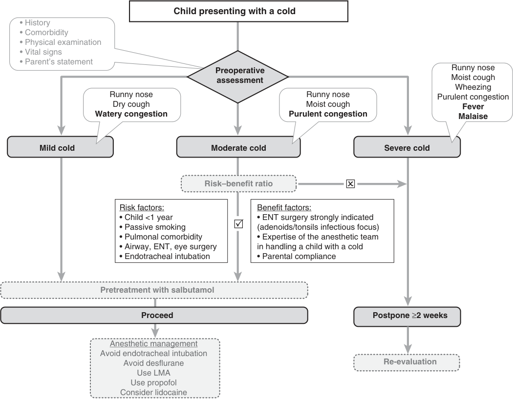

Child presenting with a cold • History • Comorbidity • Physical examination • Vital signs • Parent’s statement Preoperative Runny nose assessment Moist cough Wheezing Runny nose Runny nose Purulent congestion Dry cough Moist cough Fever Watery congestion Purulent congestion Malaise Mild cold Moderate cold Severe cold Risk–benefit ratio Risk factors: Benefit factors: • Child &lt;1 year • ENT surgery strongly indicated • Passive smoking (adenoids/tonsils infectious focus) • Pulmonal comorbidity • Expertise of the anesthetic team • Airway, ENT, eye surgery in handling a child with a cold • Endotracheal intubation • Parental compliance Pretreatment with salbutamol Proceed Postpone  ≥ 2 weeks Anesthetic management Avoid endotracheal intubation Avoid desflurane Re-evaluation Use LMA Use propofol Consider lidocaine 

**Fig. 72.10 Algorithm for a child with a “cold.”** _ENT,_ ear, nose, and throat; _LMA,_ laryngeal mask airway. (From Becke K. Anesthesia in children with a cold. _Curr Opin Anaesthesiol._ 2012;25[3]:333–339.)

<!-- PDF page 16 -->

to protect the health care providers. Timing for rescheduling postponed elective surgery to minimize pulmonary complications is variable and local practices should be observed.154,155

### Managing Perioperative Anxiety in Children

Children experience significant anxiety and stress before anesthesia.156 The pre- anesthetic visit provides an opportunity to identify the contributory factors and to provide interventions aimed to decrease anxiety levels.157,158 Planning of these interventions must consider the agespecific developmental differences in how children react to the stress of anesthesia and surgery. Infants up to 9 months of age are less prone to separation anxiety and will most probably accept parental surrogates (including soothing voices, gentle rocking, and being held).159 Separation anxiety is the greatest problem in children between 1 and 3 years of age. Some, but not all, of these children may respond to distraction techniques such as toys and stories. Although parental presence at anesthesia induction has been a standard of care in many pediatric centers, recent studies do not support routine parental presence as the optimal means of reducing anxiety.160 Children between 3 and 6 years of age have concerns about body mutilation and may require reassurance. Preoperative play therapy is especially useful in this age group. Children between 7 and 12 years of age usually require more explanation and wish to actively participate in their perioperative course. The use of virtual reality programs as distraction techniques has been shown to reduce the Modified Yale Preoperative Anxiety Scale scores in children.161 Videos, leaflets, and interactive computer applications are very helpful in this population. Assessing anxiety in adolescents is particularly difficult. Despite their outwardly calm appearance, teenagers can experience high anxiety, which may steadily escalate on their way from the preoperative holding area to the operating room. Risk factors to predict higher anxiety in this group include increased baseline anxiety, depression, somatization, and a fearful temperament.162

Prehospitalization programs, including tours of the hospital and the operating room, videos, leaflets, and other interactive books, should be implemented several days before surgery to achieve the desired effects.159,163 On the day of intervention, several distraction techniques have been shown to be equivalent or even superior to pharmacological premedication in several studies.164,165 Hypnosis, music, and non- aggressive lighting can also be used to provide a calm and soothing environment for the child upon arrival to the operating room.

Sedative and hypnotic drugs are useful for managing preoperative anxiety in children.166 In the absence of an intravenous line, the most used routes are the oral, nasal, and rectal routes in decreasing order of acceptability by most children. Midazolam is the most utilized benzodiazepine for premedication, with an appealing profile of safety and efficacy. It is usually administered orally at a dose of 0.5 mg/kg (up to a maximum of 15 mg) after which sedation and anxiolysis are achieved within approximately 20 minutes. It can also be administered by the intravenous route (0.05–0.1 mg/kg), the intranasal route (0.3 mg/kg), and the rectal route (0.5 mg/kg).157 Potential limitations

include prolonged effect and paradoxical reactions. Alpha2 adrenergic agonists are increasingly used for premedication for their sedative, analgesic, and opioid- sparing properties. Clonidine can be administered both orally (4 mcg/kg) or intranasally (4 mcg/kg) and, although it has a relatively long onset time (45 minutes), is very advantageous. Dexmedetomidine has a shorter onset and duration of action when compared with clonidine due to its low bioavailability when given orally (approx. 15%) but may be more effective, particularly when given intranasally.162 Ketamine is highly lipid soluble and is rapidly absorbed after either oral, intranasal, intramuscular, or intravenous administration. Onset of sedation occurs after 15–20 minutes following oral intake (5–8 mg/kg).158 Intramuscular administration of ketamine (4–5 mg/kg) is especially useful in uncooperative and combative children when the procedure cannot be delayed or rescheduled. Premedication with ketamine, however, can be associated with sialorrhea, hyperventilation, hallucinations, and emergence delirium.166 Fentanyl is rapidly absorbed by the transmucosal route and can be used for premedication as a pleasant- tasting lollipop. The bioavailability by this route is 33% but is reduced if the lollipop is chewed or swallowed.166

### Preoperative Fasting

Preoperative fasting is aimed to minimize the risk of pulmonary aspiration of gastric contents during anesthesia. Traditional guidelines recommend the “6- 4- 2 rule,” which is a minimum of 6- hour fast for solid foods, 4- hour fast for breast milk, and a 2- hour fast for clear fluids. These guidelines do not make any distinction between adults and children and are primarily based on expert opinion and are not backed by solid clinical evidence.167 Adherence to these guidelines in children may pose several problems. Fasting times often end up being much longer, and it is not uncommon to see young children fasting for clear liquids up to 12 hours or more prior to anesthesia induction.168–170 In addition to the obvious discomfort related to hunger and thirst, these prolonged fasting times may result in hypoglycemia, metabolic acidosis, dehydration, and cardiovascular instability. The incidence of pulmonary aspiration in otherwise healthy children is very low (1–2/104 ), and increasing evidence indicates that liberal clear fluid intake does not result in increased residual gastric volume or increase the incidence of pulmonary aspiration. The new European consensus statement on fasting in children recommends a onehour- long fasting after clear fluids.171 The ASA updated fasting guidelines to acknowledge the general trend toward one-hour fasting for clear liquids but stopped short of making a specific recommendation. However, they advocate the need to encourage drinking clear liquids as close to 2 hours before surgery as possible.172

### INTRAOPERATIVE MANAGEMENT

### Induction of General Anesthesia

Induction of general anesthesia should be guided by the medical condition of the child, the surgical procedure, the level of anxiety of the child, the child’s ability to cooperate and communicate, and the risk of aspiration pneumonitis. A recent evidence- based review of the existing

<!-- PDF page 17 -->

literature suggests that neither the child’s nor the parent’s anxiety is alleviated by parental presence upon anesthesia induction.173 Nevertheless, parental presence may be important with children presenting with behavioral problems or developmental delay as well as in children scheduled for multiple procedures. Some parents believe that they have an obligation to participate during induction of anesthesia and require counseling on the process to reduce anxiety.

Both the parents and the operating room staff should be involved in the perioperative plan and management, particularly for combative or overly stressed children. Reviewing previous anesthetics with the parents can be extremely useful to identify what works best for the child. In the absence of an existing intravenous line, intramuscular administration of ketamine (4–5 mg/kg) or inhalational induction using high concentrations of sevoflurane can be a helpful option to induce anesthesia. These latter approaches may necessitate physical restraint that raises ethical, legal, and practical issues. Relative contraindications to the use of restraints include lack of consent/concurrence by parents or staff, failure to exhaust all other techniques, and when the restraint- induced stress could significantly worsen the child’s state.174 The option of postponing elective surgery in these children should always be considered, though may not eliminate the challenges of managing these situations in the future.

The two most common anesthesia induction techniques in children are inhalational and intravenous. A retrospective study and a randomized trial suggested a benefit of intravenous induction of anesthesia in reducing respiratory complications.147,173 It is, nevertheless, important to note that these studies were focused only on adverse respiratory events in a group of at- risk children. Therefore, when deciding on the induction technique, care should be taken to weigh all the relevant factors including whether intravenous access is possible.175 The use of a RSI technique to prevent pulmonary aspiration has modifications due to the anatomical and physiological differences in pediatric patients.176,177 While the classic RSI relies on adequate preoxygenation, this often cannot be achieved in uncooperative children. Given the relatively lower functional residual capacity, preoxygenation in infants and children creates minimal oxygen reserve. Brief periods of apnea can lead to profound hypoxemia and related bradycardia. Cricoid pressure can easily compress the trachea in infants and toddlers, rendering difficulty in visualizing glottic structures and insertion of the endotracheal tube. Recent studies question the value and need for cricoid pressure.178 Altogether, these factors may lead to a higher incidence of forced mask ventilation and unsuccessful intubation attempts. Therefore, to balance the risk of pulmonary aspiration with the much more prevalent risk of hypoxemia, controlled forms of the RSI technique have become increasingly popular amongst pediatric anesthesiologists. The direct laryngoscopy under light anesthesia and incomplete muscle paralysis can induce regurgitation and vomiting with pulmonary aspiration.179–181 While the possibility of mask induction should always be evaluated, intravenous access must be considered mandatory in “at- risk” children. Intraosseous access is a suitable

alternative in this population where intravenous access cannot be established.182

### Airway Management and Ventilation

**Airway Management.** A wide range of syndromic and genetic conditions and congenital malformations are associated with potential airway problems, especially those involving facial dysmorphias.183,184 History of congenital anomalies, obstructive sleep apnea, head and neck trauma, previous surgery, and previous airway management must also be considered. During the physical examination, the anesthesiologist should check for facial dysmorphias, signs of stridor, dysphonia, swallowing disorders, difficulty in breathing, difficulty in speaking, and hoarseness.184 There are many difficult airway predictors in children, but their applicability, sensitivity, and specificity vary in the clinical setting. Among them, mandibular protrusion, Mallampati classification, movement of atlanto- occipital joint, reduced mandibular space, and increased tongue thickness have all been shown to be good predictors of airway problems.185,186 Other reported risk factors are age less than 1 year, ASA II– IV status, obesity, and maxillofacial and cardiac surgery.187

Mask ventilation is an essential component of pediatric airway management. Anesthetized children are particularly prone to upper airway collapse, and this can be easily relieved by a combination of moderate head tilt, chin lift, jaw thrust, and the application of continuous positive airway pressure.188,189 Additionally, both oropharyngeal and nasopharyngeal airway devices can be used during spontaneous or positive- pressure mask ventilation to relieve airway obstruction caused by the posterior displacement of the tongue in anesthetized children.190,191

Variations of the supraglottic airway devices are now commonly used in pediatric anesthesia. The two most popular among these are the classic laryngeal mask airway (LMA) and the modified LMA with a gastric port (Pro- seal, Teleflex, Westmeath, Ireland).189 Both devices have comparable safety and efficacy profiles in pediatric populations.192 Increasing evidence suggests the use of the LMA in children is associated with a decreased incidence of perioperative respiratory complications when compared to endotracheal intubation.193

Direct laryngoscopy is still the most common technique for intubation in children. Given the cephalad location of the larynx, straight blades may be useful to optimize exposure of the vocal cords in neonates and infants. Children can be managed with either curved or straight blades. Other devices have been developed over the past decade to facilitate endotracheal intubation.194,195 Video laryngoscopy enables better and faster glottic visualization and reduces the time of intubation, the number of attempts, and risk of dental trauma. Utilization of video laryngoscopy in infants has been shown to increase first- attempt success rates and reduce complications. It is important to note that each type of video laryngoscope device varies considerably.194 Video laryngoscopes may be technically superior and more intuitive than fiberoptic scopes.195 Furthermore, video laryngoscopy with standard blades rather than curved blades was associated with greater success rates.196

While awake fiberoptic intubation is generally considered the gold standard for the known or anticipated difficult airway in adults, this option is usually not feasible in

<!-- PDF page 18 -->

children due to the lack of cooperation. Most pediatric anesthesiologists respond best to an inhaled induction of general anesthesia and flexible fiberoptic- aided intubation under spontaneous ventilation.197 A comparison of sedation versus general anesthesia for tracheal intubation in pediatric patients with predicted difficult airways revealed similar first- attempt success rates. However, 27.6% of the sedated patients were converted to general anesthesia prior to intubation of the trachea.198

The use of cuffed endotracheal tubes is increasingly common in neonates, infants, and young children.189 Historically, uncuffed endotracheal tubes were recommended in children younger than 8 years of age, because it was thought that the narrowest part of the airway was the cricoid ring and to minimize potential cuff- induced damage of the tracheal mucosa and allow reduction of air flow resistance by inserting a larger size tube.199 Airway trauma can also occur, when using an uncuffed tube with acceptable leak pressures. Moreover, a higher incidence of laryngospasm with the use of uncuffed tubes has also been reported, and there is no data documenting increased subglottic airway trauma when cuffed versus uncuffed tubes are used.184 The use of a cuffed tube may provide a more accurate sampling of end- tidal CO2 and avoid pollution of the operating room. Finally, when using an uncuffed endotracheal tube, there may be the need for repeated manipulation of the

airway to ensure the correct tube size without too large a leak, resulting in more manipulation of the airway. Repeat laryngoscopy can be avoided by using a smaller cuffed tube. However, when using a smaller tube, there can be increased risk of kinking of the tube or accumulation of secretions with the smaller lumen.

International guidelines for the management of the unanticipated difficult airway in pediatric practice are based on a Delphi panel expert discussion focusing on airway management in children between 1 and 8 years of age.200 Three scenarios are identified: difficult mask ventilation, difficult tracheal intubation, and cannot intubate and cannot ventilate in anesthetized children with neuromuscular blockade. Detailed guidance for each of these scenarios is provided (Fig. 72.11). These guidelines were developed specifically for the non- anesthesiologist and can be adapted to standard pediatric anesthesia practice. Most importantly, each area for anesthetizing children should have access to a specific difficult airway trolley with appropriate equipment as well as a written plan of difficult airway algorithms along with a plan for whom to call for help. A recent analysis revealed increased complications with greater than two tracheal intubation attempts, infants less than 10 kg, short thyromental distance, and three direct laryngoscopy attempts before an indirect technique. These observations recommend that another anesthesiologist intubate the airway

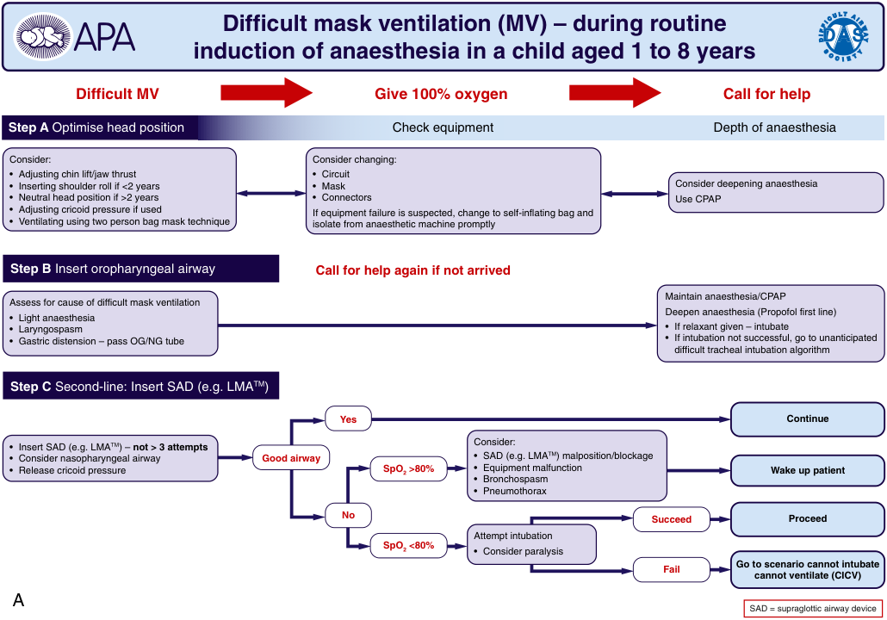

Difficult mask ventilation (MV) – during routine induction of anaesthesia in a child aged 1 to 8 years Difficult MV Give 100% oxygen Call for help Step A  Optimise head position Check equipment Depth of anaesthesia Consider: Consider changing: • Adjusting chin lift/jaw thrust • Circuit • Inserting shoulder roll if &lt;2 years • Mask Consider deepening anaesthesia • Neutral head position if >2 years • Connectors Use CPAP • Adjusting cricoid pressure if used If equipment failure is suspected, change to self-inflating bag and • Ventilating using two person bag mask technique isolate from anaesthetic machine promptly Step B  Insert oropharyngeal airway Call for help again if not arrived Maintain anaesthesia/CPAP Assess for cause of difficult mask ventilation Deepen anaesthesia (Propofol first line) • Light anaesthesia • Laryngospasm • If relaxant given – intubate • Gastric distension – pass OG/NG tube • If intubation not successful, go to unanticipated  difficult tracheal intubation algorithm Step C  Second-line: Insert SAD (e.g. LMA ) Yes Continue • Insert SAD (e.g. LMA ) –  not > 3 attempts Consider: • Consider nasopharyngeal airway  Good airway • SAD (e.g. LMA ) malposition/blockage • Release cricoid pressure SpO  >80% • Equipment malfunction Wake up patient • Bronchospasm • Pneumothorax No Succee d Proceed Attempt intubation SpO  &lt;80% • Consider paralysis Go to scenario cannot intubate Fail cannot ventilate (CICV) A SAD = supraglottic airway device 

**<mark>Fig. 72.11 Difficult airway algorithms in children aged 1 to 8 years.</mark>** <mark>(A) Guideline for the management of unanticipated diff</mark> i <mark>cult mask ventilation.</mark> Continued

<!-- PDF page 19 -->

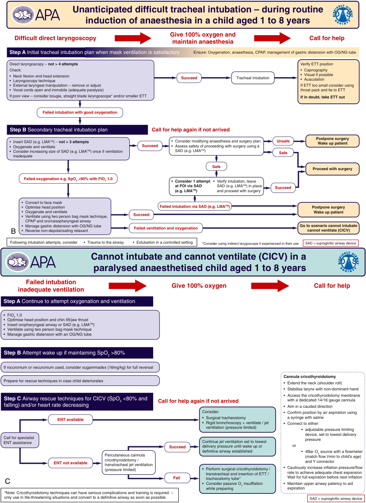

Unanticipated difficult tracheal intubation – during routine induction of anaesthesia in a child aged 1 to 8 years Give 100% oxygen and Difficult direct laryngoscopy Call for help maintain anaesthesia Step A  Initial tracheal intubation plan when mask ventilation is satisfactory  Ensure: Oxygenation, anaesthesia, CPAP, management of gastric distension with OG/NG tube Direct laryngoscopy –  not > 4 attempts Verify ETT position Check: • Capnography • Neck flexion and head extension• Laryngoscopy technique Succeed Tracheal intubatio n • Visual if possible• Ausculation • External laryngeal manipulation – remove or adjust If ETT too small consider using • Vocal cords open and immobile (adequate paralysis) throat pack and tie to ETT If poor view – consider bougie, straight blade laryngoscope* and/or smaller ETT If in doubt, take ETT out Failed intubation with good oxygenation Step B  Secondary tracheal intubation plan Call for help again if not arrived • Insert SAD (e.g. LMA• Oxygenate and ventilate) –  not > 3 attempts Succ eed • Consider modifying anaesthesia and surgery • Assess safety of proceeding with surgery using a  plan  Unsafe Postpone surgeryWake up patient • Consider increasing size of SAD (e.g. LMA ) once if ventilation   SAD (e.g. LMA ) Safe  inadequate Safe Proceed with surgery Failed oxygenation e.g. SpO  &lt;90% with FiO  1.0 • Consider 1 attempt  • Verify intubation, leave  at FOI via SAD   SAD (e.g. LMA ) in pl ace  Succeed  (e.g. LMA )  and proceed with surgery • Convert to face mask • Optimise head position Failed intubation via SAD  (e.g. LMA ) Postpone surgery • Oxygenate and ventilate• Ventilate using two person bag mask technique,  Succeed Wake up patient  CPAP and oro/nasopharyngeal airway • Manage gastric distension with OG/NG tub e Failed ventilation and o xygenation Go to scenario cannot intubate B • Reverse non-depolarisating relaxant cannot ventilate (CICV) Following intubation attempts, consider   • Trauma to the airway  • Extubation in a controlled setting *Consider using indirect larygoscope if experienced in their use SAD = supraglottic airway device Cannot intubate and cannot ventilate (CICV) in a paralysed anaesthetised child aged 1 to 8 years Failed intubation Give 100% oxygen Call for help inadequate ventilation Step A  Continue to attempt oxygenation and ventilation • FiO  1.0 • Optimise head position and chin lift/jaw thrust • Insert oropharyngeal airway or SAD (e.g. LMA ) • Ventilate using two person bag mask technique • Manage gastric distension with an OG/NG tube Step B  Attempt wake up if maintaining SpO  >80% If rocuronium or vecuronium used, consider sugammadex (16mg/kg) for full reversal Cannula cricothyroidotomy Prepare for rescue techniques in case child deteriorates • Extend the neck (shoulder roll) • Stabilise larynx with non-dominant hand • Access the cricothyroidotomy membrane Step C  Airway rescue techniques for CICV (SpO  &lt;80% and  Call for help again if not arrived  with a dedicated 14/16 gauge cannula falling) and/or heart rate decreasing • Aim in a caudad direction Consider: • Confirm position by air aspiration using ENT available • Surgical tracheostomy  a syringe with saline • Rigid bronchoscopy + ventilate / jet  • Connect to either:  ventilation (pressure limited) • adjustable pressure limiting  device, set to lowest delivery Call for specialist ENT assistance Continue jet ventilation set to lowest   pressure Suc ceed delivery pressure until wake up or  or definitive airway established • 4Bar O  source with a flowmeter Percutaneous cannula   (match flow l/min to child’s age) ENT not availa ble cricothyroidotomy / transtracheal jet ventilation   and Y connector (pressure limited) • Perform surgical cricothyroidotomy /  • Cautiously increase inflation pressure/flow  transtracheal and insertion of ETT /   rate to achieve adequate chest expansion C Fa il  tracheostomy tube*• Consider passive O  insufflation   Wait for full expiration before next inflation• Maintain upper airway patency to aid  while preparing  expiration *Note: Cricothyroidotomy techniques can have serious complications and training is required  – only use in life-threatening situations and convert to a definitive airway as soon as possible SAD = supraglottic airway device 

**Fig. 72.11, cont’d** (B) Guideline for the management of unanticipated tracheal intubation during routine induction of anesthesia. (C) Guideline for the management of can’t intubate, can’t ventilate (CICV) when there is a failure to intubate and failure to adequately ventilate an anesthetized and paralyzed child. (From Black AE, Flynn PE, Smith HL, et al. Development of a guideline for the management of the unanticipated difficult airway in pediatric practice. _Paediatr Anaesth._ 2015;25[4]:346–362.)

<!-- PDF page 20 -->

and utilize indirect tracheal intubation techniques after two fail attempts by the primary provider.201 A child with intrathoracic airway obstruction has expiratory stridor and prolonged expiration (e.g., bronchiolitis, asthma, intrathoracic foreign body).202 In contrast, a child with extrathoracic upper airway obstruction has inspiratory stridor (e.g.,

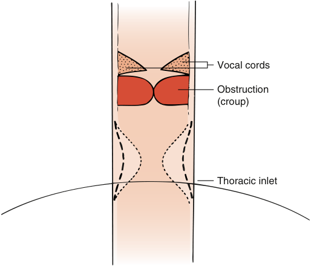

Vocal cords Obstruction (croup) Thoracic inlet 

**Fig. 72.12 Infants and young children have highly compliant airway structures.** With normal respiration, some dynamic collapse of the extrathoracic upper airway occurs ( _broken line_ ). When a child has upper airway obstruction, as in epiglottitis, laryngotracheobronchitis, or extrathoracic foreign body ( _dark brown_ ), and struggles to breathe against this obstruction, dynamic collapse of the trachea increases. This increase in dynamic collapse ( _dotted line_ ) augments the mechanical obstruction of the airway. Therefore until the airway is secured, avoiding procedures that will upset the child is important. (Modified from Coté CJ, Lerman J, Anderson BJ, eds. _A Practice of Anesthesia for Infants and Children,_ 5th ed. Philadelphia: Saunders; 2013.)

epiglottitis, laryngotracheobronchitis, laryngeal, subglottic foreign body). Agitation and crying may cause dynamic collapse of the airway (Fig. 72.12). Therefore events that can upset the child such as drawing of blood for analysis of gases, venipuncture for blood tests, and separation from parents, must be minimized. The surgical team should be mobilized and prepared to perform an emergency airway should mask ventilation or tracheal intubation not be possible.

One approach is to have the child brought to the operating room with a parent or caregiver holding the child during induction (preferably lying down in a semi- upright position). Slow induction of anesthesia with sevoflurane in oxygen by mask while maintaining spontaneous respirations is critical. If the stridor worsens or mild laryngospasm occurs, the addition of 10 to 15 cmH2O of continuous airway pressure may relieve dynamic collapse of the airway and loss of pharyngeal muscle tone (Fig. 72.13). As the level of anesthesia deepens, gentle assistance with ventilation may be necessary to assist with spontaneous respirations.

Any child with airway obstruction will have a long, slow induction of anesthesia before becoming sufficiently anesthetized to permit laryngoscopy and tracheal intubation. In this situation, concerns related to full stomach are secondary to the airway problem since rapid induction of anesthesia and paralysis is contraindicated in these children. Children with inflammation of the airway such as laryngotracheobronchitis or epiglottitis usually require placement of an uncuffed tracheal tube that is 0.5 to 1.0 mm internal diameter (ID) smaller than normal (Table 72.6).

**Ventilation Strategies.** (Details of respiratory care, ventilator equipment, and modalities are reviewed in Chapter 20). There is a paucity of evidence to guide optimal pediatric ventilation practices for children with or without lung injury.203 It is increasingly recognized that mechanical ventilation can

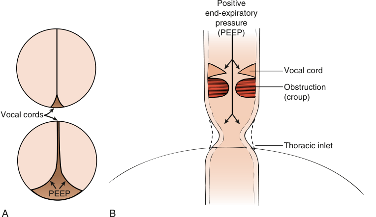

Positive end-expiratory pressure (PEEP) Vocal cord Obstruction (croup) Vocal cords Thoracic inlet PEEP A B 

**Fig. 72.13 Upper airway obstruction in children.** When a child has upper airway obstruction caused by laryngospasm (A) ( _top_ ) or mechanical obstruction (B), application of approximately 10 to 15 cmH2O of positive end- expiratory pressure (PEEP) ( _arrows_ ) during spontaneous breathing often relieves the obstruction. PEEP helps keep the vocal cords separated (A) ( _bottom_ ) and the airway open (B) ( _broken lines_ ). If this simple maneuver does not relieve the obstruction, then more vigorous positive- pressure ventilation may be necessary. Airway obstruction caused by the tongue requires insertion of an appropriately sized oral airway.

<!-- PDF page 21 -->

**Table 72.6** Recommended Sizes and Distance of Insertion of Endotracheal Tubes and Laryngoscope Blades for Use in Pediatric Patients

|**Age of Patient**|**Internal Diameter of Endotracheal** **Tube (mm)**|**Recommended Size of Laryngoscope** **Straight Blade**|**Distance of Insertion* (cm)**|
|---|---|---|---|
|Preterm (&lt;1250 g)|2.5 uncuffed|0|6–7|
|Full term|3.0–3.5 uncuffed|0–1|8–10|
|3 months–1 year|3.5–4.0 cuffed|1|11|
|2 years|4.5–5.0 cuffed|1–1.5|12|
|6 years|5.0–5.5 cuffed|1.5–2|15|
|10 years|6.0–6.5 cuffed|2–3|17|
|18 years|7.0–8.0 cuffed|3|19|

*Inserting the endotracheal tube these distances from the alveolar ridge of the mandible or maxilla usually places the distal end of the tube in the midtrachea.

lead to ventilator- induced lung injury (VILI).204 No study has examined the relationship between modalities of mechanical ventilation during pediatric anesthesia and patient outcome. A recent meta- analysis demonstrated no relationship between tidal volume and mortality in mechanically ventilated patients in the pediatric intensive care unit irrespective of the severity of disease.205 Therefore it may be that the susceptibility to VILI is age dependent.203 While no evidence- based recommendation can be made on the optimal tidal volume (Vt) in pediatric ventilation, it may be argued that targeting Vt between 6 and 10 mL/kg is justifiable, but Vt >10 mL/kg should be avoided.206 The effects of inspiratory pressures in pediatric patients with healthy lungs have not been studied but data from children with acute lung injury suggest a direct relationship between peak inspiratory pressures and mortality.207 Thus, pressure- controlled ventilation (PCV) with a decelerative flow may be favored over volume- controlled ventilation (VCV) with a continuous inspiratory flow pattern.203,208 One obvious disadvantage of PCV is the variable Vt due to the compliance and the resistance of the respiratory circuit. Advances in ventilator technology provide ventilatory modes combining PCV with volume guarantee.208,209 Positive end- expiratory pressure (PEEP) is an important part of protective lung ventilation strategies and is aimed to prevent atelectasis via stabilization of recruited alveoli.203,208 The optimal PEEP in pediatric ventilation is undetermined but is routinely set at a level of 5 cmH2O. Higher levels of PEEP (exceeding 10–15 cmH2O) may be necessary in case of lung injury but it should be noted that increasing PEEP levels can lead to hemodynamic compromise. PEEP should always be set to find an optimal balance between hemodynamics and ventilation.203

Equipment dead space, defined as any portion of the anesthesia circuit in which there is a bidirectional gas flow without gas exchange, is of concern in small patients.208 The dead space associated with the equipment adds to the anatomical and physiological dead space and may contribute to increase the dead space to tidal volume ratio which, in turn, can lead to an exponential increase in partial pressure of arterial carbon dioxide (PaCO2).210 Therefore, every effort should be made to minimize dead space, especially in neonates and infants.

### Equipment and Monitoring

There have been considerable advancements in the equipment and monitoring available for children over the past

decade.194,211,212 Pediatric patients require an anesthesiologist with pediatric anesthesia experience and ageappropriate equipment. A resuscitation cart for pediatric patients of all ages, including pediatric defibrillation paddles and resuscitation drugs, is mandatory. The drugs should be available in appropriate concentrations and with clear pediatric dose schedules. Pediatric- specific cognitive aids for the diagnosis/treatment of the most common emergencies and critical conditions should be immediately available both in the operating room and in the postanesthesia care unit. Age- specific airway equipment and airway cart for the management of the difficult pediatric airway should also be available. Ultrasound- guided peripheral and central venous access in children has consequently become a standard of care.213,214 When confronting challenging venous access options in an awake child, tablets and smartphones can be used as distraction techniques to reduce anxiety.215

Assessment of cardiac function has also become increasingly important in the care of infants and children undergoing complex surgical procedures. Transesophageal Doppler probes and Fick and dye dilution techniques can be used for children as small as 3 kg.216 Changes in thoracic electrical bioimpedance because of changes in blood volume and flow, and blood cell orientation can be used for continuous noninvasive monitoring of cardiac output and other cardiac parameters. The ICON monitor (Cardiotronic/Osypka Medical Inc., La Jolla, CA, USA), a portable noninvasive cardiac output monitor that is based on the principle of electrical velocimetry, has been validated against the Fick equation, thermodilution, and echocardiography in pediatric populations ranging from neonates to adolescents.216 Pulse oximetry–based noninvasive hemoglobin determination is also available and in clinical use; while a valuable new technology, it still requires validation in pediatric populations.212

Near- infrared spectroscopy (NIRS) monitoring can be used to monitor oxygenation and, thus indirectly, the blood flow and supply–demand relationship in the brain, liver, kidney, intestines, and muscles. Evidence that NIRS improves outcomes is lacking, as it is for many of the monitoring devices, but there is certainly potential for its use in goal- directed interventions to reduce organ hypoxemia and ischemia.212,217,218

There is limited evidence on the value of intraoperative EEG monitoring and its influence on improving management or outcomes in children. Bispectral index

::: details 原始表格與符號（PDF 第 21 頁）

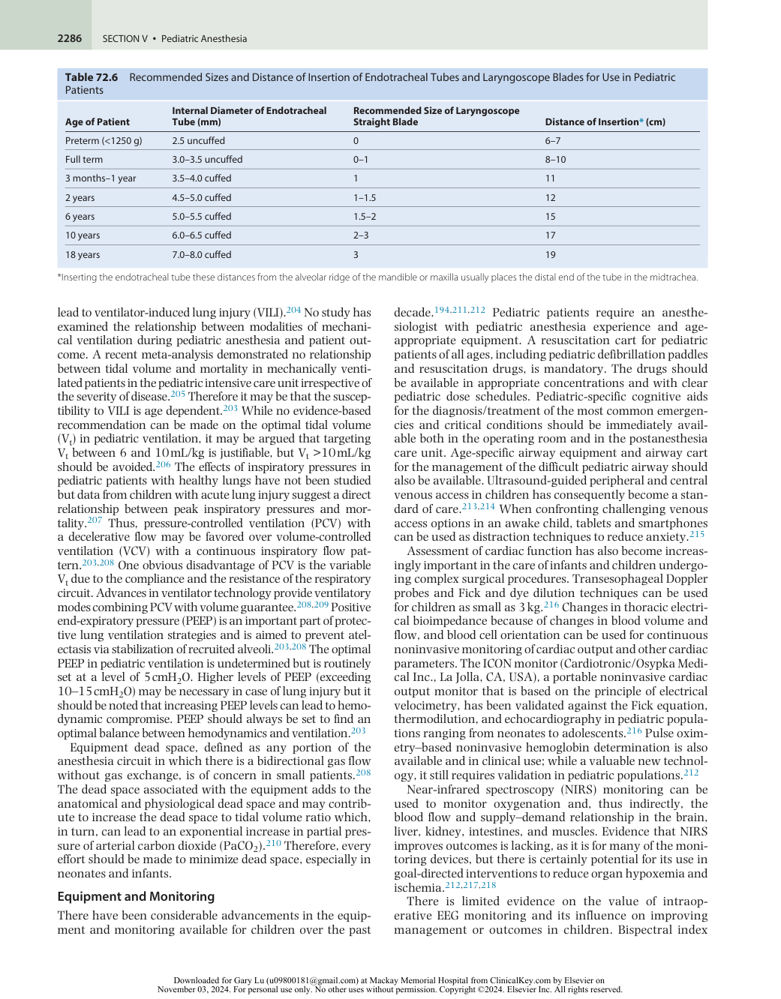

:::

<!-- PDF page 22 -->

monitoring (BIS) has been successfully used in older children to decrease the total amount of anesthesia drugs delivered and to enhance recovery.219 The utility of BIS in infants, particularly those less than 6 months old, is questionable as there is little correlation between BIS values and other measures of depth of anesthesia in these populations. In addition, isoelectric EEG patterns have been reported in young children under general anesthesia and associated with hypotension.39 More recently developed approaches, such as spectral frequency analysis, could be helpful, but currently its value remains unclear. Additional studies are necessary to validate these monitoring techniques.219,220

### Safety Issues

Perioperative mortality in neonates and infants is severalfold higher when compared to older children.221 It is important to realize that anesthesia- related death rarely occurs in infants and children without significant medical comorbidities. Nevertheless, critical events that could potentially lead to mortality or significant and lasting morbidity can be a direct consequence of anesthesia management. There are major approaches that can identify adverse outcomes in pediatric perioperative care, such as institutional audits, closed claims analysis, and large- scale registries of anesthesia- related cardiac arrest. The critical events are most often cardiac and/or respiratory. According to the Pediatric Perioperative Cardiac Arrest (POCA) Registry, the most common causes of perioperative cardiac arrest in children are cardiac in origin, including, in decreasing order of frequency, hypovolemia, myocardial ischemia, hyperkalemia, and sudden arrhythmias.222 Respiratory causes include laryngospasm, inadequate oxygenation, and difficult intubation. Based on closed claims analyses, critical events leading to serious respiratory morbidity have decreased since the introduction of minimal monitoring standards.223 These findings have been corroborated by large European pediatric anesthesia centers.224,225

There is circumstantial evidence suggesting an association between the level of expertise in pediatric anesthesia and perioperative morbidity. The incidence of respiratory complications has been repeatedly reported to be dependent on the anesthesiologist’s experience.147,224,226 There is also a relationship between perioperative complications and the number of pediatric anesthetics provided by the anesthesiologist.227,228 Specific training for pediatric anesthesia and maintaining a suitable volume of experience of pediatric anesthesia has therefore been recommended for those providing anesthesia care to children.229,230

### Fluids and Blood Component Management

Perioperative fluid management raises important challenges in pediatric populations. Hypovolemia is the most common cause of perioperative cardiac arrest in children.231 Age- specific changes in metabolism, extracellular fluid volume, and fluid turnover do not allow the direct extrapolation of adult guidelines to infants and children.

The three major goals of perioperative fluid management are to meet maintenance requirements, replace preoperative deficits, and compensate for ongoing losses occurring during the perioperative period. The most commonly used basic fluid maintenance formula in pediatric anesthesia

practice is the “4- 2- 1” rule, which is a weight- based formula stating that the hourly fluid requirements of children are 4 mL/kg for the first 10 kg of body weight followed by 2 mL/kg between 10 and 20 kg and 1 mL for each additional kg of body weight above 20 kg.232,233 However, there is an ongoing debate on how to compensate for preoperative fluid deficits.234 One of the simplest options to decrease preoperative fluid deficits is to decrease preoperative fasting times for clear liquids.168 Replacing the preoperative fasting deficit using the 4- 2- 1 rule, or a bolus of 25 mL/kg for children younger than 3 years of age and 25 mL/kg over 3 years of age, was the traditional practice.235 The German guidelines state that “the background infusion may be initiated with an initial infusion rate of 10 mL/kg/h and be adjusted to the actual requirement during the further course.”236 Moreover, in case of apparent clinical signs of dehydration, these guidelines recommend 10 mL/kg fluid bolus for every percent of estimated dehydration. The volume of fluids needed for ongoing losses during the perioperative period largely depends on the type of procedure as well as on the pathological state of the child. It can easily be as high as 10–15 mL/kg/h and, in some specific cases such as burns or extensive neonatal abdominal surgery, can exceed 50 mL/kg/h.234

The amount of insensible water loss is inversely proportional to gestational age. Premature neonates have increased skin permeability and ratio of body surface area to weight. The fact that the neonatal kidney is unable to excrete large amounts of excess water or electrolytes must also be considered. The extracellular fluid volume in a newborn is relatively large. Therefore term newborns have reduced fluid requirements for the first week of life. The daily fluid requirements for a term newborn in the days after birth are estimated to be 70 mL/kg on day 1, 80 mL/kg on day 3, 90 mL/kg on day 5, and 120 mL/kg on day 7. Daily fluid requirements would be slightly higher for preterm infants. The choice of type of fluid is at least as important as the amount administered. Based on the electrolyte composition of either human or cow milk, the original recommendation from Holliday and Segar defined the daily electrolyte requirements as 2 mEq/100 kcal/day for both potassium and chloride and 3 mEq/100 kcal/day for sodium.234 This electrolyte administration regimen, along with the 4- 2- 1 rule, resulted in the frequent use of excessive quantities of hypotonic fluid solution which, in turn, led to hyponatremia, seizures, cerebral edema, and death. Children are particularly susceptible to cerebral edema with acute hyponatremia. Hospital- acquired hyponatremia may occur rapidly in children and may present initially as vomiting and drowsiness.237 A recent meta- analysis that included large, randomized trials convincingly demonstrates that isotonic intravenous maintenance fluids with sodium concentrations similar to that of plasma reduce the risk of hyponatremia when compared with hypotonic intravenous fluids.238 Therefore isotonic crystalloid solutions should be administered to maintain homeostasis during the perioperative period.234,236 It is important to note that both hyponatremia and hypernatremia can still develop in children receiving isotonic saline solutions, and routine serial checking of serum sodium concentrations in children undergoing prolonged or extensive interventions is advised.237

<!-- PDF page 23 -->

The use of dextrose- containing intravenous fluids administered to pediatric surgical patients has evolved.234 It is well established that the incidence of preoperative hypoglycemia is less than 2.5% and is usually associated with fasting periods exceeding current recommended fasting guidelines.239 Conversely, the use of 5% dextrose- containing fluid during surgery in pediatric patients has invariably produced hyperglycemia.239,240 Therefore a growing consensus is that routine administration of dextrose is not necessary in otherwise healthy children receiving anesthesia.234 Patients receiving hyperalimentation and having endocrine/metabolic diseases (diabetes mellitus) are at highest risk of hypoglycemia. In these individuals, adjusting the rate of glucose infusion guided by glucose monitoring is recommended: 1%–2.5% dextrose- containing isotonic solutions administered in neonates and infants appear to be the best option, while serial blood glucose measurements are needed to maintain blood glucose levels in the optimal range.240

In the absence of well- controlled studies with clearly defined end points, there is currently no evidence supporting the role of crystalloids versus colloids in perioperative fluid loss replacement and volume expansion in neonatal and pediatric populations.234,241 Historically, albumin has been considered the gold standard for maintenance of colloid osmotic pressure in neonates and infants and is still the most frequently used plasma expander in these populations. Nevertheless, data supporting the continued use of albumin for general fluid resuscitation in children are lacking. Nonprotein synthetic colloids such as hydroxyethyl starch (HES), gelatin, and dextran have also been used as plasma expanders in children. While a prospective observational drug safety trial using a third-generation HES revealed no serious adverse drug reactions, such as anaphylaxis, renal failure, or clotting disorder, in children with normal renal and clotting function, further studies are needed before presuming safety in patients with renal failure or those at increased risk of bleeding.234,242 Both the efficacy, in terms of intravascular volume expansion, and the safety profile of HES have been reported comparable to albumin in the setting of pediatric cardiac surgery.243 Gelatins are polypeptides produced by degradation of bovine collagen. Although the initial formulations of this product induced a high incidence of hypersensitivity reactions, a more recent trial was unable to show evidence of any short- or long- term adverse effects.244 Dextrans are watersoluble glucose polymers. Although these molecules have excellent colloid oncotic powers, they probably should not be used because of their negative coagulation effects and high anaphylactic potential.

Transfusion guidelines for non- neonatal pediatric patients are similar to those for adults.245 Some precautions are necessary, especially in case of massive transfusion.246 In calculating need for blood replacement, the calculation should consider the maximal allowable blood loss (MABL) that will be tolerated to maintain an acceptable hematocrit. MABL considers the effect of patient age, weight, and starting hematocrit on blood volume. In general, blood volume is approximately 100 to 120 mL/kg for a preterm infant, 90 mL/kg for a full- term infant, 70 to 80 mL/kg for a child 3 to 12 months old, and 70 mL/kg for a child older than 1 year of age. These volumes are merely estimates of blood volume. The individual child’s blood volume is calculated by simple proportion by multiplying the child’s weight by

the estimated blood volume (EBV) per kilogram. Although several formulas are available, a simple relationship is easiest to remember.

Thus, if a 3- year- old child weighs 15 kg and has a starting hematocrit of 38% and if clinical judgment estimates the desired postoperative hematocrit to be 25%, then the calculation would be as follows:

MABL  [(15  70)  (38  25)]/38  360 mL 

The MABL would be replaced with 3 mL of lactated Ringer solution per milliliter of blood loss; that is, 3 mL of lactated Ringer solution times the 360 mL of blood loss equals approximately 1080 mL of lactated Ringer solution. If blood loss is less than or equal to the MABL and no further significant blood loss occurs or is anticipated in the postoperative period, then there is no need for transfusion of packed red blood cells (PRBCs). Normally, a child who has had adequate replacement of intravascular volume deficits will tolerate anemia very well. The decision to transfuse should be guided by the postoperative urinary output, heart rate, respiratory rate, and overall cardiovascular stability. The development of lactic acidosis is a late sign of inadequate oxygen- carrying capacity.

If the child has reached the MABL and significantly more blood loss is expected during surgery, then the child should receive PRBCs in sufficient quantity to maintain the hematocrit in the 20% to 25% range. The entire loss of red cell mass should not be replaced unless clinically indicated if these additional PRBCs would expose the child to additional units of blood products. Hematocrit values in the low 20% range are generally well tolerated by most children, the exception being preterm neonates and children with cyanotic congenital heart disease or those with respiratory failure in need of high oxygen- carrying capacity (also see Chapters 73 and 75). Older children with a history of sickle cell disease may require preoperative transfusion and should be managed in conjunction with their attending hematologist.

The indications and contraindication for the transfusion of fresh frozen plasma (FFP) are essentially the same for children as for adults (also see Chapters 45 and 46). Children with known clotting factor deficits, such as those with massive thermal injury or coagulopathy, may require transfusion of FFP. In contrast, healthy children who do not have coagulation factor deficits at the beginning of surgery do not need FFP until blood loss exceeds 1 blood volume.247,248 Despite the loss of 1 blood volume, prolongation of the prothrombin time (PT) and the partial thromboplastin time (PTT) will only be minor. This generalization applies to children given PRBCs; children given whole blood will not need FFP, even when blood loss exceeds several blood volumes.

If the clotting factor deficit is associated with abnormal oozing, then a PT exceeding 15 seconds (international normalized ratio [INR] >1.4) or a PTT greater than 60 seconds (>1.5 times baseline) warrants close observation. Usually, an INR &lt;2 does not warrant correction. If these abnormalities exist but oozing does not occur and the surgical field is relatively safe from the complications of hematoma formation, as in orthopedic surgery versus neurosurgery, then it seems appropriate to observe the child and withhold the transfusion of FFP.

In general, FFP therapy may require replacement of 30% or more of the child’s blood volume. Transfusion of FFP

<!-- PDF page 24 -->

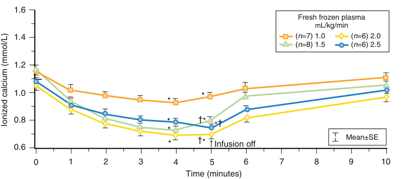

1.6 Fresh frozen plasma mL/kg/min 1.4 ( n =7) 1.0 ( n =6) 2.0 ( n =8) 1.5 ( n =6) 2.5 1.2 1.0 * * 0.8 * †* * * † * †* Infusion off Mean±SE 0.6 0 1 2 3 4 5 6 7 8 9 10 Time (minutes) Ionized calcium (mmol/L) 

**Fig. 72.14 Ionized hypocalcemia always accompanies the administration of citrated blood products.** Fresh frozen plasma has the highest concentration of citrate per unit volume of any blood product and is the most likely to cause ionized hypocalcemia during rapid infusion. Studies in children with thermal injuries suggest that rates exceeding 1 mL/kg/min produce severe ionized hypocalcemia. If no further citrated blood products are administered, then this abnormality corrects itself because of metabolism of the citrate. However, children with impaired hepatic blood flow – infants, patients undergoing liver transplantation, patients with trauma – may need exogenous calcium therapy. * _P,_ &lt;.001;† _P,_ &lt;.0021 versus baseline; _SE,_ standard error. (From Coté CJ, Drop LJ, Hoaglin DC, et al. Ionized hypocalcemia after fresh frozen plasma administration to thermally injured children: effects of infusion rate, duration, and treatment with calcium chloride. _Anesth Analg._ 1988;67:152–160. Used with permission.)

at rates exceeding 1 mL/kg/min is sometimes followed by severe ionized hypocalcemia and cardiac depression with hypotension, especially if FFP is administered during anesthesia with a potent inhaled anesthetic (Fig. 72.14).249,250 Therefore exogenous calcium chloride (2.5 to 5 mg/kg) or calcium gluconate (7.5 to 15 mg/kg) should be administered during rapid transfusion of FFP.251 Ionized hypocalcemia occurs very frequently in neonates given FFP, possibly because of their decreased ability to mobilize calcium and metabolize citrate. Children undergoing liver transplantation or those with compromised hepatic function or perfusion may also be at increased risk because of a decreased ability to metabolize citrate.

Massive blood transfusion (MBT) in children has been recently defined as transfusion of >50% of total blood volume (TBV) in 3 hours, transfusion of >100% of TBV in 24 hours, or transfusion support to replace ongoing blood loss of >10% of TBV per minute.252 The management of massive transfusion requires that circulating blood volume is restored and components are given such that hemostasis is maintained or returned to normal.253,254 A major concept in hemostatic resuscitation is the construction of a balanced transfusion strategy delivering PRBs, FFP, platelets, coagulation factors, and antifibrinolytics. Adult MBT strategies suggest a PRBC:FFP:platelet ratio of 1:1:1 with early consideration of fibrinogen replacement and the potential use of tranexamic acid. Laboratory evaluation of massive bleeding (prothrombin time, partial thromboplastic time, and platelet count) can be time- consuming and delay acute interventions. Thromboelastometry (TEG) and rotational thromboelastometry reduce time for availability of test results and can be an appealing alternative to standard laboratory investigations during MBT. Once bleeding has been controlled, appropriate targets after massive transfusion were suggested as Hb 80 g/L, fibrinogen >1 g/L, PT ratio >1.5, and platelet count >75 × 109 /L (100 × 109 /L in traumatic head injury). Permissive hypotension during MBT is an often- used strategy in the adult trauma setting until definite management of bleeding can be achieved. This

approach may not be an appropriate strategy in pediatric populations since children compensate for blood loss with minimal change in vital signs until significant compromise. Complications of MBT are similar to those in adults.252

Fluid and blood warmers are essential for any child receiving rapid infusions of fluids and blood products. During pediatric trauma, when massive hemorrhage is suspected, if no intravenous access is established after 90 seconds or two attempts, intraosseous access may be required until venous access can be accomplished, whether through a central line or peripheral cutdown. To ensure the ability to provide adequate volumes of fluid, the anesthesiologist should be familiar with the maximal flow rates that can be delivered via intravenous and intraosseous cannulas of different sizes (Table 72.7).255

### Regional Anesthesia and Analgesia (see Chapter 74)

Most regional anesthesia techniques used in adults can be safely administered to children if strict attention is paid to the dose of the local anesthetic and use of proper equipment. Perhaps the greatest advance in regional pediatric anesthesia has been the development of methods for postoperative analgesia (also see Chapters 41, 42, and 76). Recent advances in ultrasound equipment and techniques have further improved the accuracy of nerve blocks and reduced the dose of drug needed to provide a successful block.

Regional nerve blocks and direct local infiltration of surgical wounds with long- acting local anesthetics are simple yet very effective and safe methods of providing pain relief for all children.256,257 This practice has been especially helpful in the outpatient population; parents are encouraged to start analgesics when they observe their child becoming irritable but before the complete dissipation of the block.

### POSTANESTHESIA CARE

### Emergence Agitation and Delirium

It is not uncommon for children to be agitated on emergence or in the postanesthesia care unit (PACU). Agitation

<!-- PDF page 25 -->

**Table 72.7** Flow Rates of Intravenous and Intraosseous Cannulas

|**Intravenous Catheter**|**Maximum Rate of Flow with Gravity (mL/min)**|**Maximum Rate of Flow with Pressure (mL/min)**|
|---|---|---|
|14 G 50 mm cannula|236.1|384.2|
|16 G 50 mm cannula|154.7|334.4|
|18 G 45 mm cannula|98.1|153.1|
|20 G 33 mm cannula|64.4|105.1|
|22 G 25 mm cannula|35.7|71.4|
|15 G 25 mm intraosseous needle (tibial)|68.2|204.6|

From Reddick AD, Ronald J, Morrison WG. Intravenous fluid resuscitation: was Poiseuille right? _Emerg Med J_ . 2011;28(3):201–202.

may be due to many factors including pain, cold, full bladder, presence of restrictive casts, fear, anxiety due to parental separation, or simply having a “tantrum” and can be scored by different scales.258 In some cases, agitation may be due to delirium. Delirium is characterized by reduced awareness of the environment and altered cognition or perceptual disturbances. Typically, the child is disoriented and does not respond to their parents or staff. There is no eye contact and the child cannot be consoled.259 Emergence delirium is associated with thrashing around or violent movement and occurs frequently in preschool children. Although it is self- limited, it may persist for 10–20 minutes. Delirium may also be hypoactive with the child being inactive, and thus at less risk of doing harm to themselves. The cause for delirium is unknown. It may relate to the mode of awakening.260 It is more common after maintenance anesthesia using sevoflurane or desflurane. It is unusual to see postoperative delirium after TIVA with propofol. Several agents have been found to reduce the incidence of delirium in children.195,261,262 An effective method to reduce the incidence is using TIVA or by administering 2–3 mg/kg of propofol prior to emergence.263 Fentanyl and alpha2- receptor agonists have also been found to be effective.264 When managing delirium, other causes for agitation should be considered, particularly pain, a full bladder, and other causes unrelated to the anesthetic technique. Hypoxia, metabolic derangement, and hyponatremia may also cause agitation or delirium.

## Anesthetic Management for Specific Pediatric Conditions and Procedures

### NEONATAL ANESTHESIA

The neonate has a higher incidence of complications than older children.231,265–270 These complications primarily relate to oxygenation, ventilation, airway management, and response to anesthetic medications. Congenital lesions such as congenital heart disease and lesions of the pulmonary and central nervous system can complicate the perioperative course. A room air oxygen saturation should prompt an echocardiogram if low saturation values are detected. Neonates generally have limited cardiovascular and respiratory reserve, resulting in a narrow margin for error and the need for meticulous attention to detail in all

aspects of anesthesia care. Neonates are more likely to have a sudden deterioration provoked by persistent fetal circulation, undiagnosed congenital malformations, or genetic conditions during anesthesia and surgery.

Optimal neonatal anesthesia care requires thorough preoperative evaluation, optimization, and input from the neonatologists and surgeons, which will guide appropriate monitoring, ventilatory and hemodynamic support, and personnel both in the operating room and in the pediatric intensive care unit (PICU) or neonatal intensive care unit (NICU). Access to the neonate may be difficult once the sterile drapes are placed and surgery commences. Thus, the airway, intravenous access, and all monitoring should be checked and secured before surgery commences.

The anesthesiologist must devote particular attention to the calculation of drug dose and concentration. Air must also be removed from all intravenous devices and syringes before use to prevent air embolization, which can be catastrophic in a neonate. Intravenous fluids should be administered with volume- limiting devices; infusion pumps are particularly helpful in preventing overadministration of intravenous fluids.

Every effort must be made to maintain the neonate’s temperature to minimize thermal stress. The surgical environment should be warm, and exposure of the neonate kept to a minimum. Forced air warming is particularly useful for maintaining temperature.

Monitoring end- tidal carbon dioxide is essential to prevent hypo- or hypercapnia and significant changes in cerebral perfusion. However, it is not always accurate in prematurity and necessitates the confirmation by concurrent transcutaneous CO2 monitoring.

The optimal oxygen saturation for neonates is controversial. High oxygen saturations in premature neonates increase the risk of retinopathy of prematurity (ROP), however, some randomized trials have found that aiming for low (85%–89%) saturations in extremely preterm neonates may increase the risk of other neurologic morbidity.271 During stable operative conditions it is reasonable to aim for an oxygen saturation between 93% and 95% in preterm neonates. Given the relative inaccuracies of these monitors, the anesthesiologist must be extremely vigilant and prepared to respond rapidly to changes in oxygen saturation. Hypoxia or acidosis in the newborn can lead to significant pulmonary vasoconstriction, hypoxia, worsening pulmonary hypertension, acidosis, hypoxia, and eventual cardiovascular collapse.

::: details 原始表格與符號（PDF 第 25 頁）

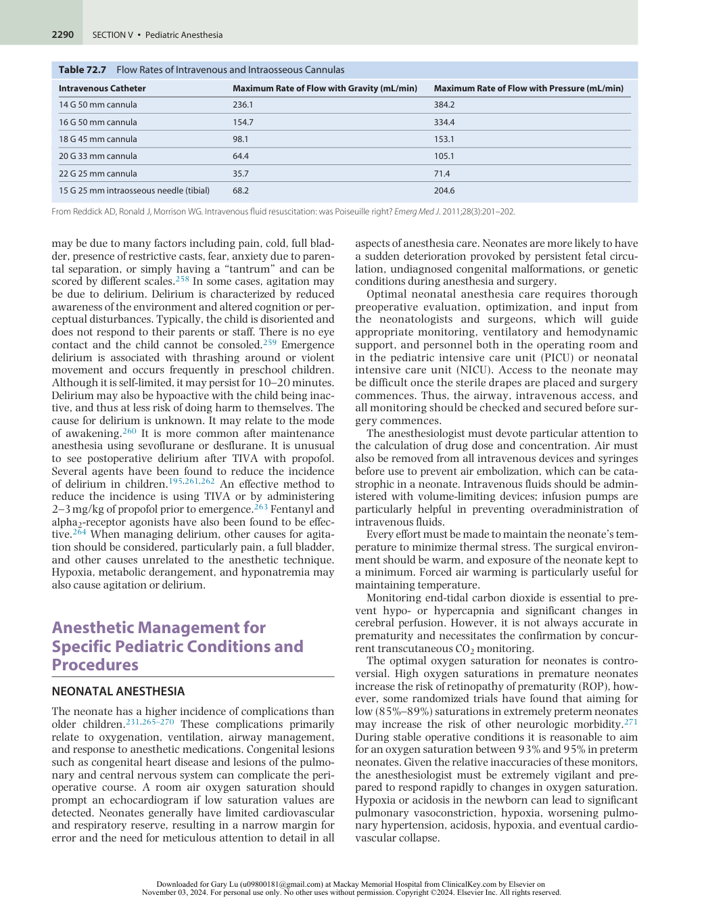

:::

<!-- PDF page 26 -->

The neonatal lung is fragile and particularly prone to injury from excessive tidal volumes. PEEP should be used. Even brief disconnection of the airway circuit or mechanical ventilator can lead to significant alveolar collapse. Conventional anesthesia machines equipped with ventilators optimized for volume- targeted modes of ventilation may not be suitable for premature and low- birthweight neonates. Therefore, neonatal ventilators with monitoring equipment that can accurately measure tidal volumes and pressures may provide optimal ventilation for these vulnerable populations. It is also increasingly recognized that intubated neonates should be transported to and from the operating room with neonatal ventilator equipment rather than simply a bag and T- piece. Transferring a neonate that is on an oscillator is particularly challenging. For an unstable neonate it may be safer to perform the surgery in the NICU.

The optimal blood pressure during neonatal anesthesia is unknown. Recent studies have suggested that the neonatal brain may be particularly susceptible to hypotension.272 Pain management in newborns is particularly challenging. Neonates, even extremely preterm neonates, can feel pain and will respond to painful stimuli; indeed, preterm neonates may be even more sensitive to painful stimuli.273 Adequate anesthesia and analgesia in the neonate is unclear.274,275

Propofol and inhaled anesthetics can result in profound cardiovascular depression in the neonate. In contrast, the synthetic opioids (e.g., fentanyl, sufentanil, alfentanil, remifentanil) are usually well tolerated, even by infants who are critically ill. These potent opioids must still be carefully titrated to a defined response, and anesthesiologists must remain cautious of opioid- induced bradycardia and its consequences on cardiac output. Low concentrations of potent inhaled anesthetics can be used with opioids to provide a means of controlling hemodynamic responses without significantly depressing the myocardium. The relative merits of one anesthetic technique over another are not well defined. Regional anesthesia can be highly effective in neonates. Caudal and spinal anesthesia are relatively straightforward, however, the safe placement of a lumbar or thoracic epidural block requires considerable skill. Epidural local anesthetic infusions can result in systemic toxicity due to immature metabolism.

### ANESTHESIA FOR SPECIFIC NEONATAL SURGICAL PROCEDURES

### Meningomyelocele

Meningomyelocele, the protrusion of a part of the meninges and spinal cord through a defect in the vertebral column, is becoming less common in developed countries due to improvements in maternal folic acid intake and antenatal screening. Specific management issues include, special positioning for tracheal intubation (i.e., the defect is placed on a “doughnut” and towels are placed under the head), underestimating insensible fluid and blood loss, association with hydrocephalus, cranial nerve (vocal cord) palsy, resulting in inspiratory stridor, and potential for brainstem herniation. Latex allergy precautions should be used with these children for their first and subsequent anesthetics.

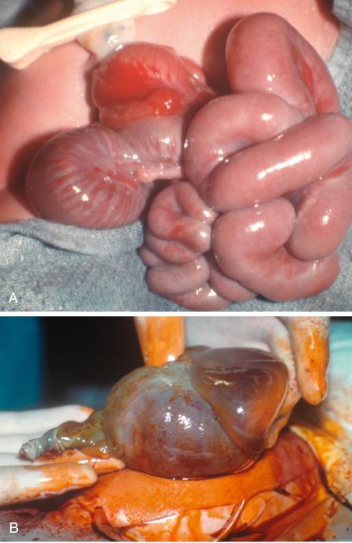

A B 

**Fig. 72.15** (A) Gastroschisis. The viscera have herniated outside the peritoneum. (B) Omphalocele. The viscera are still covered by peritoneum.

### Omphalocele and Gastroschisis

Omphalocele and gastroschisis are major defects in the closure of the abdominal wall that result in exposure of viscera that are either covered (omphalocele) or not covered (gastroschisis) by peritoneum (Fig. 72.15; Table 72.8). The major anesthesia- related problems with these defects include the following: severe dehydration and potential insensible fluid loss from the exposed visceral surfaces and due to partial bowel obstruction, heat loss, raised abdominal pressure with closure, and high association of these condition with prematurity and other congenital defects (congenital heart disease and omphalocele). These children must have an adequate preoperative workup that should include an echocardiogram.

Neonates with omphalocele or gastroschisis must be expeditiously cared for to reduce the potential for infection and compromise of bowel function. However, the child should have adequate fluid resuscitation prior to surgery and electrolyte imbalances corrected. The liberal use of muscle relaxants provides optimal surgical conditions

<!-- PDF page 27 -->

**Table 72.8** Comparison of Gastroschisis and Omphalocele Malformations

||**Gastroschisis**|**Omphalocele**|
|---|---|---|
|Pathophysiologic characteristics|Occlusion of the omphalomesenteric artery|Failure of gut migration from the yolk sac into the abdomen|
|Incidence|∼1 in 15,000 births|∼1 in 6000 births|
|Incidence of associated anomalies|∼10%–15%|∼40%–60%|
|Location of defect|Periumbilical|Within the umbilical cord|
|Problems associated with defect|Inflammation of exposed gut Edema Dilated and foreshortened gut (chemical peritonitis)|Congenital heart disease (∼20%) Exstrophy of the bladder Beckwith–Wiedemann syndrome (macroglossia, gigantism, hypoglycemia, hyperviscosity)|

From Coté CJ, Lerman J, Anderson, BA, eds. _A Practice of Anesthesia for Infants and Children_ , 5th ed. Philadelphia: Saunders; 2013.

for closure of the defect. Hypotension during closure may occur due to tension on the liver or caval compression. Similarly raised abdominal pressure during closure may impede adequate ventilation. If the surgeon is unable to close the defect in one procedure, then a staged procedure may be planned. Postoperative ventilation will be necessary until the abdominal wall has had time to stretch to accommodate the viscera. It should be noted that increased abdominal pressure after a tight closure (abdominal compartment syndrome) may compromise hepatic and renal function and significantly alter drug metabolism. Staged closure with a premade spring- loaded silastic silo is being used with increasing frequency, thus minimizing repeat trips to the operating room. A small percentage of children with omphalocele will also have Beckwith–Wiedemann syndrome, a condition characterized by profound hypoglycemia, hyperviscosity syndrome, congenital heart disease, and associated visceromegaly.

### Tracheoesophageal Fistula

A tracheoesophageal fistula can have five or more configurations, most of which are diagnosed after an inability to swallow because of an associated esophageal atresia (esophageal pouch). In these cases, the characteristic diagnostic test is an inability to pass a suction catheter into the stomach. Neonates may develop aspiration pneumonitis from a distal fistula connecting the stomach to the trachea through the esophagus or from a proximal connection of the esophagus with the trachea. Neonates with the rarer H- type fistulae have a fistula between esophagus and trachea, however, the esophagus is patent with no atresia. These children present later, typically with respiratory distress and chest infections.

The tracheoesophageal fistula may be part of constellation of congenital anomalies known as the VATER association ( **V** , vertebral; **A** , anal; **TE** , tracheoesophageal; **R** , renal) or the VACTERL association (VATER and **C** , cardiac; and **L** , limb). Any child with a tracheoesophageal fistula or esophageal atresia should be suspected of having the other anomalies. An echocardiogram to examine for a right- sided aortic arch and the presence of congenital heart disease should be performed before anesthesia.276 Abdominal ultrasound should also be performed to detect major renal abnormalities.

The major anesthetic issues include compromised respiratory function due to aspiration pneumonia, overdistention of the stomach from entry of air directly into the

stomach through the fistula from positive- pressure ventilation by mask, inability to ventilate the child’s lungs because of the large size of the fistula, and coexisting congenital heart disease.277 Prior to anesthesia, the neonate’s feedings are withheld, a catheter is placed in the esophagus, and the neonate is placed prone in a head- up position.

A major aim of anesthesia is to minimize positive- pressure ventilation until an endotracheal tube is placed distal to the fistula and/or the fistula is occluded or ligated. Positivepressure ventilation may inflate the stomach through the fistula, leading to distention of the stomach and reduction of functional residual capacity of the lungs. This risk is greater if the fistula is large, or the lung compliance is poor. Several different strategies for anesthesia have been described.278 An inhalational induction is generally preferred, and spontaneous ventilation is maintained until the fistula is ligated. This is not always possible. Bronchoscopy is usually performed after induction to assess the size and location of the fistula. At bronchoscopy, a balloon embolectomy catheter or similar device may be placed directly in the fistula to occlude it. The endotracheal tube is ideally placed in the trachea distal to the origin of the fistula. This may be done blindly by advancing the tube into a main bronchus and then carefully pulling it back until equal air entry is heard. The endotracheal tube may be inadvertently placed into the fistula, resulting in rapid gastric distention and arterial oxygen desaturation. If this occurs the tube should be withdrawn. Urgent transcutaneous gastric decompression or intra- abdominal clamping of the distal esophagus through an abdominal incision may be needed.

Most repairs are now done thoracoscopically. Invasive blood pressure monitoring is recommended as intraoperative arterial desaturation or hypotension may occur with manipulation of mediastinal structures. A preductal and postductal pulse oximeter can facilitate diagnosis of an intracardiac shunting. Extubation of tracheal and postoperative respiratory management should be coordinated with the surgeon. Postoperative pain may be managed with wound infiltration local anesthetic, caudal catheter threaded up to the thoracic level, or a paravertebral catheter.

### Congenital Diaphragmatic Hernia

A congenital diaphragmatic hernia (CDH) consists of herniation of the abdominal viscera through a defect in the diaphragm, most commonly the foramen of Bochdalek on the left side. Many of the abdominal viscera, including the

::: details 原始表格與符號（PDF 第 27 頁）

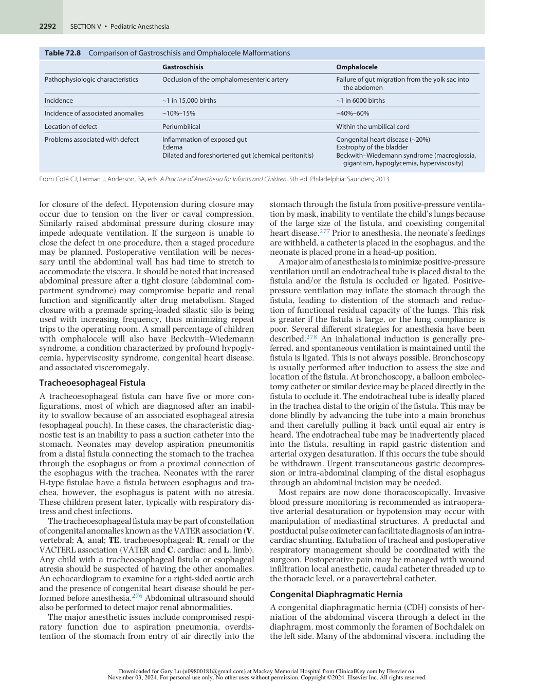

:::

<!-- PDF page 28 -->

liver and spleen, may be above the diaphragm. Approximately half the cases are diagnosed antenatally. More than half of CDHs are associated with pulmonary hypoplasia and other congenital anomalies and necessitate a full evaluation of all organ systems prior to surgery. It is important to note that surgical correction does not directly correct the pulmonary hypertension and respiratory status may acutely deteriorate postsurgery, thus surgery should not be rushed, but planned for when the child is in optimal condition. Unstable neonates with CDH may be require extracorporeal membrane oxygenation (ECMO) and inhaled nitric oxide in the neonatal or pediatric intensive care unit. However, there is limited evidence documenting that these combined techniques improve outcome. In general, ECMO should only be used in the most severe cases, though experience at each institution will impact management options.279,280 Sildenafil and prostacyclin may also be used to manage pulmonary hypertension. High- frequency oscillatory ventilation is often required, and permissive ventilation is also advocated (limiting peak inspiratory pressures and PEEP with resultant permissive hypercapnia).281

The surgery may be open via a subcostal incision or thoracoscopically. Bag and mask ventilation should be avoided prior to intubation of the trachea to minimize the risk of gastric distention within the chest. Pulmonary hypertension can be management by avoiding hypoxemia and excessive hypercapnia. Blunting the stress response can be achieved with deep levels of general anesthesia. The risk for barotrauma- induced pneumothorax on the ipsilateral or contralateral side necessitates meticulous control of mechanical ventilation. Fetoscopic endoluminal tracheal occlusion has been utilized in fetal surgery programs.

### ANESTHESIA FOR SPECIFIC SURGICAL PROCEDURES IN INFANTS

### Pyloric Stenosis

Pyloric stenosis is diagnosed from 1 week to 3 months of life, typically after persistent projectile vomiting. The child may be severely dehydrated with a profound hypochloremic, hypokalemic, metabolic alkalosis. This procedure is never a surgical emergency. The infant should be carefully evaluated, and any dehydration or metabolic imbalance be corrected before surgery. The metabolic imbalance and dehydration can be corrected slowly, provided there is no cardiovascular instability and hypovolemic shock. A persistent alkalosis increases the risk of postoperative apnea, and it should be noted that correction of the cerebrospinal fluid (CSF) pH may lag several hours after normalization of plasma pH.

Increasingly, the myotomy is performed laparoscopically. Nasogastric tubes are not always used preoperatively as they may worsen the electrolyte imbalance. Aspiration of gastric contents during induction is a primary concern. Even if the child arrives with a nasogastric tube in place, the stomach should still be immediately suctioned with a wide- bore vented catheter in the supine and the right and left lateral positions immediately before induction of anesthesia. This suctioning technique will remove 98% of the gastric contents.282 A wide variety of techniques have been described for the induction of children with pyloric stenosis.

Awake intubation was previously in vogue but is becoming less common because it can be traumatic to the infant. The use of an induction agent and muscle relaxants resulted in fewer attempts and time for successful intubation of the trachea.283 The classic rapid-sequence technique (preoxygenation, cricoid pressure, and avoiding mask ventilation) may not be appropriate for an infant with pyloric stenosis. Cricoid pressure can easily distort the anatomy, making laryngoscopy and insertion of the endotracheal tube difficult. It may also not be possible to avoid mask ventilation. Infants rapidly desaturate with apnea, so it is often necessary to gently ventilate the child with 100% oxygen prior to laryngoscopy to avoid hypoxemia and bradycardia. A variety of different intravenous anesthetic agents and neuromuscular blocking agents have been described in this situation. Atropine (0.02 mg/kg) should be given to prevent bradycardia if succinylcholine (2 mg/kg) is used. Postoperative analgesia is generally provided by local infiltration of the skin incision and acetaminophen. Rectus sheath and transversus abdominis plane (TAP) blocks have also been described in this setting.

Reports of apnea after pyloromyotomy have been reported.284 These children should be observed with apnea monitors and pulse oximetry postoperatively.

### Inguinal Hernia Repair

Inguinal hernia repair is one of the most common surgeries in infants. Inguinal hernia is often bilateral and is more common in males and premature infants. The optimal timing of surgery is controversial. Waiting until the child is older may reduce anesthesia risk. However, an unrepaired asymptomatic hernia is still at risk of incarceration, which may be a life- threatening complication. The repair may be performed laparoscopically or open. Laparoscopic hernia repairs require general anesthesia with endotracheal intubation, while open procedures can be accomplished with a regional technique or general anesthesia. The regional technique is usually with a spinal anesthetic. Caudal anesthesia has been described but usually requires substantial additional sedation. Spinal anesthesia has fewer complications in PACU and shorter PACU stay but fails in approximately 10%–20% of cases.106,285,286 This may be due to inability to find the subarachnoid space or the child failing to adequately settle even with an effective block. The spinal anesthetic usually provides 60–90 minutes of anesthesia and thus may not be appropriate for hernia repair that is anticipated to be complex. The spinal block may be augmented with a caudal local anesthetic block. A caudal local anesthetic block, ilioinguinal block, or local infiltration of local anesthetic by the surgeon can all provide adequate analgesia and obviate the need for opioids.

The major anesthesic concern around infant inguinal hernia repair is the risk of postoperative apnea, particularly for preterm infants. Most infants with postoperative apnea are former preterm infants (gestational age less than 37 completed weeks) or 44 weeks postmenstrual age (PMA). However, postoperative apnea can occur up to 60 weeks PMA.287 Studies examining postoperative apnea are difficult to interpret or compare due to widely varying definitions of apnea and methods to detect apnea. In one combined analysis the risk of postoperative apnea increases with lower PMA and lower gestational age.288 Anemia

<!-- PDF page 29 -->

(hematocrit &lt;30%) was also found to be an independent risk factor associated with apnea in former preterm infants. Apnea still occurs even with sevoflurane or desflurane.289 The risk of early apnea is less with awake- regional anesthesia, although the risk of late apnea may be similar.290,291 There is also some evidence that sedation with spinal anesthesia has increased risk of apnea compared to those that had no sedation.292

Prophylactic methylxanthine (caffeine) may reduce the risk of postoperative apnea but does not modify the risk of late apnea.293 In general, all former preterm infants younger than 56–60 weeks’ PMA should be admitted after inguinal hernia repair for apnea monitoring.288,294,295 While apnea in term infants is poorly defined, they should be considered vulnerable up to 44 weeks’ PMA.

### Cleft Lip and Palate

Cleft lip and palate are relatively common congenital malformations. Approximately a third are associated with a wide range of other syndromes, so careful and thorough preoperative assessment is required. Cleft lip is usually repaired at 3 to 6 months of age, while the palate is repaired at 9 to 12 months of age. Difficult airway may occur in a subset with retrognathia. In children with large or bilateral clefts the tongue may impinge on the cleft, obstructing the airway, or the laryngoscope blade may be lodged in the cleft. Correction of the lip is usually a straightforward procedure. Cleft palate repair may be complicated by postoperative airway obstruction. The child should be extubated awake. Postoperative analgesia is based on regular acetaminophen and the judicious use of opioids. Infraorbital nerve blocks also provide effective analgesia for cleft lip repair.296

### ANESTHESIA FOR SPECIFIC PROCEDURES AND CONDITIONS IN OLDER CHILDREN

### Foreign Body Ingestion and Aspiration

Foreign bodies of the airway and gastrointestinal tract are a major source of morbidity and mortality in infants and young children.297 Airway obstruction may be acute and may cause significant respiratory distress. Foreign bodies in the upper gastrointestinal tract can erode the gastrointestinal lumen, dislodge, and obstruct the airway. Partial obstruction may be undiagnosed for days or even weeks. The acute choking episode may not have been witnessed and the child may present late with signs of pneumonia. The urgency of removal depends on the degree of respiratory symptoms and the likely location of the obstruction. Several anesthetic techniques have been described. Clear, effective communication with the surgeon throughout the procedure is paramount. Anticholinergic agents are frequently administered prior to induction of anesthesia to reduce secretions and steroids given to reduce airway swelling. Ideally spontaneous ventilation is maintained to reduce the risk of positive ventilation moving the object distally, making extraction more technically challenging. Once the child is deep enough, local anesthetic should be directly applied to the glottis and trachea. Anesthesia may be maintained with volatile agents through the bronchoscope or with a propofol infusion, with the latter providing more reliable drug delivery and reducing waste gas exposure to the operating

room personnel. Remifentanil infusion may also be used to help obtund airway reflexes but should be used judiciously to avoid apnea. Muscle relaxation may be required in some situations, but muscle relaxants should never be given before establishing positive- pressure ventilation.

### Tonsillectomy and Adenoidectomy

Tonsillectomy and adenoidectomy are some of the most common surgical procedures in children. Common indications are recurrent infection and airway obstruction. A wide variety of techniques have been described for tonsillectomy and adenoidectomy. Either a volatile or intravenous- based regimen can be used for maintenance of general anesthesia. A flexible LMA or a preformed Ring–Adair–Elwyn (RAE) endotracheal tube may be used for the airway. Kinking or displacement of the LMA or RAE tube is not uncommon when the surgeon inserts the mouth gag. Children may be extubated awake or deep. Deep extubation may avoid bleeding associated with coughing during emergence, however, deep extubation is associated with an increased risk of airway obstruction after the airway device is removed. If children are extubated while still anesthetized, it is essential that they are subsequently managed in an environment that can rapidly and effectively detect and manage any airway obstruction.

Nausea and vomiting are common after this surgery; prophylactic antiemetics should be administered. Dexamethasone is often given to reduce swelling and antiemesis, however, dexamethasone should never be given if lymphoma is a likely cause of tonsillar hypertrophy as dexamethasone may produce lethal hyperkalemia from tumor lysis. Effective analgesia is a challenge after tonsillectomy and adenoidectomy. Acetaminophen alone is insufficient. Nonsteroidal anti- inflammatory drugs (NSAIDs) are used in many centers; however, some surgeons avoid their use due to concerns over bleeding even though there is good evidence that bleeding is not increased.298 Local anesthetic infiltration to the tonsillar bed may provide some analgesia and some surgeons infiltrate with epinephrine to reduce bleeding. Such infiltration must be done cautiously as injection into the major vessels beneath the tonsillar bed may result in seizures or cerebral infarction. Tonsillectomy is associated with significant pain for up to a week.299 Opioids are often required for tonsillectomy, both in the immediate recovery and early days after the child goes home. They should be used carefully in the presence of obstructive sleep apnea. Bleeding after tonsillectomy may occur immediately postoperatively or in the early days after discharge. Minor bleeding may be managed conservatively but active ongoing bleeding requires anesthesia for surgical management. Anesthesia for a bleeding tonsil requires consideration of acute hypovolemia, full stomach, and difficult laryngoscopy due to active bleeding and swelling.

Children scheduled for tonsillectomy/adenoidectomy frequently have preoperative obstructive sleep apnea (OSA), which is a “disorder of breathing during sleep characterized by prolonged upper airway obstruction and/or intermittent complete obstruction (obstructive apnea) that disrupts normal ventilation during sleep.” These children also have an altered response to CO2.300 The gold standard to diagnose severity of OSA is the polysomnogram.301 The

<!-- PDF page 30 -->

apnea–hypopnea index (AHI) and the respiratory disturbance index (RDI) are measurements of the presence and severity of OSA syndrome. The AHI is the number of discrete obstructive events per hour while the RDI includes central and obstructive sleep apnea. OSA is regarded as severe if the AHI is greater than 10 and the oxygen saturation nadir is less than 80%. Most children will have surgery for obstructive symptoms without having had a formal polysomnogram. A variety of other scores based on overnight oximetry, child factors, and degree of symptoms have been developed to assess degree of obstruction and hence perioperative risk.302

Given the risk of disordered breathing in children with OSA, management decisions related to timing of surgery, perioperative management, and postoperative disposition strategies are challenging. There is considerable variation in practice surrounding postoperative management of children with and without OSA.303 The ASA has published a set of guidelines.304 Certain day- surgery centers routinely send non- OSA children home after tonsillectomy. Others observe the children for at least 4 hours (the interval during which bleeding or respiratory compromise will most likely occur), and then an additional 7 hours if there have been any obstructive events. Children with known or suspected severe OSA should be kept overnight. Children with comorbidities such as Down syndrome, craniofacial abnormalities, younger age (less than 3 years), or obesity should also be considered for overnight admission.

The use of opioids for analgesia should be tempered in patients with OSA. Some centers completely avoid opioids and administer acetaminophen with NSAIDs. If opioids are used, some suggest that children with OSA should have reduced doses. Codeine is no longer recommended for analgesia after tonsillectomy/adenoidectomy as there have been reports of deaths after tonsillectomy related to altered conversion of the prodrug codeine to morphine.76,305 A small proportion of children have genetically determined rapid conversion to morphine.306 Thus, the combination of OSA- induced opioid sensitivity and rapid metabolism can lead to fatal outcomes. The FDA has issued a warning strongly recommending that codeine not be administered to children for post- tonsillectomy analgesia, particularly to those with OSA.

### Anterior Mediastinal Mass

Anterior mediastinal masses are commonly due to lymphomas, with acute lymphoblastic leukemia and germ cell tumors. Early tissue diagnosis is essential in the management of these tumors and requires general anesthesia or sedation to facilitate a surgical biopsy.307 These lesions may cause airway and/or vascular compression, which in an awake patient may be asymptomatic or result in dyspnea, orthopnea, pain, cough, or superior vena cava syndrome. These children frequently present for a biopsy of the lesion or other lymph node which, for accurate diagnosis and appropriate management, must be obtained prior to any chemotherapy or radiotherapy. The major anesthetic concern is profound cardiorespiratory collapse on induction of anesthesia. Such collapse can occur in a child that is asymptomatic. The exact etiology of this collapse is uncertain but probably relates to increasing compression of major vessels, heart and/or the tracheobronchial

tree. Preoperative assessment should include a careful history and examination to determine if positioning has any impact on symptoms and chest computed tomography (CT) and echocardiography. Occlusion of greater than 50% of the airway on CT is associated with increased risk of significant obstruction under anesthesia. Echocardiography will immediately verify if there is obstruction of the great vessels and tracheobronchial tree. The collapse may be triggered by neuromuscular blockade or positive- pressure ventilation; both advocate for maintenance of spontaneous ventilation. If hypotension or desaturation occurs on induction, repositioning the patient to lateral or prone may be lifesaving. In severe cases, every effort should be made to obtain the biopsy with mild sedation in the spontaneously ventilating patient.

### Scoliosis

Lateral and rotational derangements in the spine and vertebra angles, respectively, appear primarily in school- aged children. While the majority are idiopathic (70%–80%), more severe forms are attributable to congenital anomalies or neuromuscular disease. Corrective surgery often involves distraction and fusion of multiple levels of the thoracic and lumbar spine and is commonly associated with significant intraoperative problems including major blood loss, venous air embolism, and spinal cord injury (usually from spinal cord ischemia during straightening of the spine).

Hemodynamic stability and integrity of the spinal cord are goals of anesthesia during scoliosis surgery (see Chapter 35). Wide surgical exposure, paravertebral dissection, and vertebral distraction can precipitate massive blood loss and venous air embolus, leading to cardiovascular collapse. Therefore, normovolemia should be maintained throughout the procedure. Patients with neuromuscular scoliosis are three times more likely to have intraoperative cardiac arrests when compared with patients with idiopathic scoliosis. Somatosensory- evoked potentials (SSEPs) monitor the posterior columns of the spinal cord via signals in the somatosensory cortex generated in response to stimulation of ulnar, median, and posterior tibial nerves. Motor- evoked potentials (MEPs) assess the motor pathway by stimulating primary motor cortex and monitoring distal muscle group contraction. The motor pathway is not fully mature until about 13 years of age, so younger children often require a higher delivered cortical stimulation compared with adults to obtain reliable MEPs. MEPs are more sensitive to hypotension or vascular injury. Optimal positioning, avoidance of nondepolarizing muscle relaxants and anesthetics that depress SSEP and MEP monitoring and blood conservation techniques (blood salvaging and antifibrinolysis) are essential anesthetic goals for scoliosis surgery.

### Myopathies and Other Neurodegenerative Conditions

Children may require a muscle biopsy to assist the diagnosis of a myopathy or other neurodegenerative condition. There are a broad range of myopathies that present a range of issues for anesthesia that are associated with compromised cardiac or respiratory function, developmental delay, poor nutritional status, malignant hyperthermia, rhabdomyolysis, and propofol infusion syndrome. Thorough preoperative evaluation is essential, including an assessment

<!-- PDF page 31 -->

of respiratory and cardiac function.308 There must also be clear communication with the referring physician to identify and discuss the most likely diagnosis, and which tests will be performed on the biopsy.309

Awake- regional anesthesia would be the ideal option for cooperative older children but is rarely feasible in younger children.310 Succinylcholine is contraindicated in children with muscular dystrophy due to risk of acute rhabdomyolysis.

Volatile anesthetics have been associated with rhabdomyolysis with muscular dystrophy, particularly Duchenne and Becker muscular dystrophy, and children with an elevated creatinine kinase.311,312 Some children with mitochondrial disorders may be more likely to be susceptible to adverse metabolic and cardiac events after propofol.313,314 This may be linked to propofol infusion syndrome.

The impact of anesthesia on the biopsy specimen also needs consideration. A “non- triggering” anesthetic is required for a muscle biopsy for a contracture test. Care should also be taken that no local anesthetic contaminates the specimen. Some metabolic clinicians prefer propofol to be avoided if a mitochondrial enzyme analysis is planned.

There is no optimal anesthetic for children having a muscle biopsy. Choice of agents requires a clear understanding of the likely diagnosis and hence balance of risks, any anesthesia- related requirements stipulated by the laboratory analyzing the sample, and tailoring the plan to the child’s particular cardiorespiratory status and ability to tolerate an awake procedure.

### MANAGEMENT OF NEURODIVERGENT CHILDREN

Neurodivergent children are more likely to require anesthesia for surgery and a range of other procedures. They are, however, often neglected in terms of systematic research. For example, most studies looking at premedication exclude children with developmental disability, although they may need it, and benefit from it more than other children.

A key aspect in the perioperative care of these children is to appreciate that they are heterogeneous with a range of challenges and requirements. These children often have multiple diagnoses and several comorbidities. Even those with a single diagnosis, such as autism spectrum disorder (ASD), may present with a wide range of behavioral issues. No two children with ASD are the same and care must be tailored to each child.315,316 Another key element is to engage the parents or caregivers early in planning. They are best placed to give advice on what aspects of management will be challenging and what strategies are likely to work best.

Children with ASD often have fixed routines. Similarly, children with ASD may find particular actions, environments, noises, or smells distressing. Knowing and accommodating these will reduce distress. Children with ASD also may find communication easier if things are explained with pictures.

Cerebral palsy describes a broad spectrum of movement and posture disorders with varying severity. Anesthesia challenges include poor nutrition, concurrent poor

respiratory status, poor cough reflex, reflux of gastric contents, difficulty with positioning, susceptibility to pressure injuries, hypothermia, and difficult venous access.317,318 Muscle spasm after surgery may result in significant pain. Spasm may be effectively reduced with regional analgesia techniques and/or diazepam. Opioids are often required and must be used carefully to avoid respiratory depression. Titrating analgesia to effect may be difficult in children with cognitive impairment. Often parents or caregivers are the best judges of whether their child is in pain.

### PEDIATRIC SEDATION

Since most infants, children, and neurodivergent patients are unable to cooperate for brief noninvasive diagnostic and therapeutic procedures, sedation with intravenous hypnotic drugs is a less-invasive alternative to general anesthesia. Procedural sedation extends beyond the safe confines of the operating room suites where standardized monitoring and equipment are managed with trained personnel. Since the procedure and sedative agents can impede respiration, maintenance of a patent airway and spontaneous ventilation is paramount and should be closely monitored and managed by trained anesthesiologists and anesthetists. The American Academy of Pediatrics and ASA published separate guidelines for providing sedation. Both documents provide best practice periprocedural guidelines for systemic approach to sedating pediatric patients. Both emphasize preprocedural evaluation and preparation, continuous monitoring of cardiopulmonary function by trained personnel, postprocedural care, and quality improvement programs.319

### NON–OPERATING ROOM ANESTHESIA

Advances in diagnostic and interventional procedures in pediatric patients beyond the traditional operating room suites have steadily posed additional challenges (see Chapter 69). In contrast to adults, most pediatric patients require sedation or general anesthesia for these procedures.

### Diagnostic and Interventional Radiologic Procedures

Most diagnostic and interventional radiological procedures require patients to be motionless for a prolonged period. A variety of nonanesthetic techniques such as feed and wrap, video gaming, play therapy, and distraction techniques have been advocated. When these techniques fail, sedation or general anesthesia is required to render the patient safely motionless during the procedure. Most diagnostic imaging procedures should be painless and require sedation and spontaneous ventilation with a natural airway. These include CT and MRI. However, therapeutic and interventional radiological procedures can be painful and require periods of apnea, which are best managed with general anesthesia and endotracheal intubation.320 All caregivers are at risk for radiation exposure and should be equipped with lead aprons and have the ability to monitor the patient remotely.

<!-- PDF page 32 -->

### Gastrointestinal Endoscopy

Infants and children require deep levels of sedation and even general anesthesia for esophagogastroduodenoscopy. In some cases, the large caliber of the gastroscope may compromise the patient’s upper airway and require tracheal intubation. Endoscopic retrograde cholangiopancreatography requires significant insufflation of air or CO2, which is painful and requires general anesthesia.

### Radiation Therapy

Anesthesia for patients undergoing radiation therapy is to deliver therapeutic doses of radiation to the tumor while limiting damage to the surrounding healthy tissue. These sessions have two components. Three- dimensional X- ray imaging assures proper positioning of the patient and target lesion. This is followed by three- dimensional conformational radiation therapy and intensity- modulated radiation therapy, which focuses the energy beam on the tumor while reducing radiation to the normal surrounding tissue. Infants and young children must be immobile and may have their head and neck fixed in an immobilization cast. Given the health hazards of ionizing radiation exposure to the health care providers, the patient should be remotely monitored from a shielded area during the imaging and treatment segments. A course of treatments consists of five sessions a week for several weeks. Since most of these patients have implantable venous access systems (Port- A- Cath, ICU Medical, San Celementi, CA), deep sedation can be achieved with propofol infusion.

20.  Guzzetta NA, et al. _Paediatr Anaesth_ . 2011;21(1):3.

21.  Haley KM. _Front Pediatr_ . 2017;5:136.

22.  Stein PD, et al. _J Pediatr_ . 2004;145(4):563.

23.  Morgan J, et al. _Paediatr Anaesth_ . 2018;28(5):382.

24.  Fitzgerald M. _Nat Rev Neurosci_ . 2005;6(7):507.

25.  Fitzgerald M. _Exp Physiol_ . 2015;100(12):1451.

26.  Knobel RB. _Nborn Infant Nurs Rev_ . 2014;14:45.

27.  Sumpter A, et al. _Curr Opin Anaesthesiol_ . 2009;22(4):469.

28.  Kaufmann J, et al. _Br J Anaesth_ . 2017;118(5):670.

29.  van den Anker J, et al. _J Clin Pharmacol_ . 2018;58(suppl 10):S10.

30.  Anderson BJ. _Paediatr Anaesth_ . 2012;22(6):530.

31.  Barker CIS, et al. _Arch Dis Child_ . 2018;103(7):695.

32.  Friis- Hansen B. _Pediatrics_ . 1971;47(1):(suppl 2):264.

33.  Sethi PK, et al. _Pediatr Res_ . 2016;79(3):409.

34.  Anderson BJ, et al. _Drug Metabol Pharmacokinet_ . 2009;24(1):25.

35.  Welzing L, et al. _Anesthesiology_ . 2011;114(3):570.

36.  Hepponstall M, et al. _Blood Cells Mol Dis_ . 2017;67:41.

37.  Monagle P, et al. _Chest_ . 2012;141(suppl 2):e737S.

38.  Cornelissen L, et al. _Br J Anaesth_ . 2018;120(6):1274.

39.  Yuan I, et al. _Anesthesiology_ . 2022;137(2):187.

40.  Hendrickx JFA, et al. _Anesthesiology_ . 2022;136(6):985.

41.  Katoh T, et al. _Br J Anaesth_ . 1992;68(2):139.

42.  Lerman J, et al. _Anesthesiology_ . 1994;80(4):814.

43.  Lerman J, et al. _Anesthesiology_ . 1983;59(5):421.

44.  Taylor RH, et al. _Anesthesiology_ . 1991;75(6):975.

45.  LeDez KM, et al. _Anesthesiology_ . 1987;67(3):301.

46.  Gregory GA, et al. _Anesthesiology_ . 1969;30(5):488.

47.  Katoh T, et al. _Anesthesiology_ . 1987;66(3):301.

48.  Nicodemus HF, et al. _Anesthesiology_ . 1969;31(4):344.

49.  Katoh H, et al. _Masui_ . 1993;42(7):1017.

50.  Inomata S, et al. _Anesth Analg_ . 1998;87(6):1263.

51.  Taguchi M, et al. _Anesthesiology_ . 1994;81(3):628.

52.  Kihara S, et al. _Anesthesiology_ . 2003;99(5):1055.

53.  Davidson AJ, et al. _Anesth Analg_ . 2005;100(3):653.

54.  Wodey E, et al. _Br J Anaesth_ . 2005;94(6):810.

55.  Murray DJ, et al. _Anesth Analg_ . 1992;74(3):329.

56.  Murat I, et al. _Br J Anaesth_ . 1985;57(12):1197.

57.  Murat I, et al. _Anaesthesia_ . 1987;42(7):711.

## Conclusion

58.  Constant I, et al. _Paediatr Anaesth_ . 2005;15(4):266.

59.  Fisher DM, et al. _Anesthesiology_ . 1992;76(3):354.

60.  Zwass MS, et al. _Anesthesiology_ . 1992;76(3):373.

The developmental aspects of physiology, pharmacology, and medical conditions have a significant impact on the perioperative care of pediatric patients. An understanding of the evolving maturation of organ systems is essential in providing safe care and optimizing clinical outcomes.

61.  Tsze DS, et al. _J Pediatr_ . 2016;169:260.

62.  Babl FE, et al. _Emerg Med J_ . 2008;25(11):717.

63.  Babl FE, et al. _Pediatrics_ . 2008;121(3):e528.

64.  Villeret I, et al. _Paediatr Anaesth_ . 2002;12(8):712.

65.  Pandit UA, et al. _Anesth Analg_ . 1995;80(2):230.

66.  Veyckemans F. _Paediatr Anaesth_ . 2001;11(5):630.

67.  Fernandez PG, et al. _Paediatr Anaesth_ . 2017;27(5):461.

68.  Parke TJ, et al. _BMJ_ . 1992;305(6854):613.

### Complete references available online at expertconsult.com.

69.  Wolf A, et al. _Lancet_ . 2001;357(9256):606.

70.  Dahmani S, et al. _Acta Anaesthesiol Scand_ . 2010;54(4):397.

71.  Potts AL, et al. _Paediatr Anaesth_ . 2007;17(10):924.

### References

1.  Moutquin JM. _BJOG_ . 2003;110(suppl 20):30.

2.  Ausbeck EB, et al. _Am J Perinatol_ . 2021;38(9):880.

3.  Troutman JA, et al. _Birth Defects Res_ . 2018;110(11):916.

4.  Morton SU, et al. _Clin Perinatol_ . 2016;43(3):395.

5.  American Academy of Pediatrics Committee on Fetus And Newborn; American College of Obstetricians and Gynecologists Committee on Obstetric Practice. _Pediatrics_ . 2015;136(4):819.

6.  Vrancken SL, et al. _Front Pediatr_ . 2018;6:87.

7.  Lakshminrusimha S, et al. _J Perinatol_ . 2016;36(suppl 2):S3.

8.  Hillman NH, et al. _Clin Perinatol_ . 2012;39(4):769.

9.  Eckenhoff JE. _Anesthesiology_ . 1951;12(4):401.

10.  Holzki J, et al. _Paediatr Anaesth_ . 2018;28(1):13.

11.  Arens R, et al. _Am J Respir Crit Care Med_ . 2002;165(1):117.

12.  Seymour AH, et al. _J Cardiothorac Vasc Anesth_ . 2002;16(2):196.

13.  Miller MJ, et al. _J Pediatr_ . 1985;107(3):465.

14.  de Almeida VL, et al. _Pediatr Pulmonol_ . 1994;18(6):374.

15.  de Almeida V, et al. _Am J Perinatol_ . 1995;12(3):185.

16.  Heilbron DC, et al. _Pediatr Nephrol_ . 1991;5(1):5.

17.  Vieux R, et al. _Pediatrics_ . 2010;125(5):e1186.

18.  Beath SV. _Semin Neonatol_ . 2003;8(5):337.

19.  Grijalva J, et al. _Semin Pediatr Surg_ . 2013;22(4):185.

72.  Phan H, et al. _Paediatr Drug_ . 2008;10(1):49.

73.  Potts AL, et al. _Paediatr Anaesth_ . 2008;18(8):722.

74.  Sun Y, et al. _Paediatr Anaesth_ . 2014;24(8):863.

75.  Pasin L, et al. _Paediatr Anaesth_ . 2015;25(5):468.

76.  Ciszkowski C, et al. _N Engl J Med_ . 2009;361(8):827.

77.  U.S. Food and Drug Administration. Safety review update of codeine use in children; new Boxed Warning and Contraindication on use after tonsillectomy and/or adenoidectomy. https://www.fda.gov/m edia/85072/download.

78.  Goresky GV, et al. _Anesthesiology_ . 1987;67(5):654.

79.  Ross AK, et al. _Anesth Analg_ . 2001;93(6):1393.

80.  Crawford MW, et al. _Anesth Analg_ . 2005;100(6):1599.

81.  Morgan JM, et al. _Anaesthesia_ . 2007;62(2):135.

82.  U.S. Food and Drug Administration. _FDA Restricts Use of Prescription Codeine Pain and Cough Medicines and Tramadol Pain Medicines in Children; Recommends against Use in Breastfeeding Women_ ; 2018. https://www.fda.gov/drugs/drug- safety- and- availability/fda- drugsafety- communication- fda- restricts- use- prescription- codeine- painand- cough- medicines- and.

83.  Larach MG, et al. _Clin Pediatr_ . 1997;36(1):9.

84.  Tran DTT, et al. _Anaesthesia_ . 2017;72(6):765.

85.  Reynolds LM, et al. _Anesthesiology_ . 1996;85(2):231.

86.  Plaud B, et al. _Anesthesiology_ . 2009;110(2):284.

<!-- PDF page 33 -->

87.  Vieira Carlos R, et al. _Paediatr Anaesth_ . 2018;28(4):342. 88.  Thilen SR, et al. _Anesthesiology_ . 2023;138(1):13.

89.  Lerman J. _Paediatr Anaesth_ . 2010;20(3):273.

90.  Lauder GR. _Paediatr Anaesth_ . 2015;25(1):52.

91.  Mani V, et al. _Paediatr Anaesth_ . 2010;20(3):211.

92.  Gaynor J, et al. _BJA Education_ . 2016;16(11):369.

93.  Anderson BJ, et al. _Anesthesiology_ . 2019;131(1):164.

94.  U.S. Food and Drug Administration. _FDA Drug Safety Communication: FDA Review Results in New Warning about Using General Anesthetics and Sedation Drugs in Young Children and Pregnant Women_ ; 2016. https://www.fda.gov/drugs/drug- safety- and- availability/fda- drugsafety- communication- fda- review- results- new- warnings- aboutusing- general- anesthetics- and.

95.  U.S. Food and Drug Administration. _FDA Drug Safety Communication: FDA Approves Label Changes for Use of General Anesthetic and Sedation Drugs in Young Children_ ; 2017. https://www.fda.gov/drugs/drug- safety- and- availability/fda- drugsafety- communication- fda- approves- label- changes- use- generalanesthetic- and- sedation- drugs.

96.  Vutskits L, et al. _Nat Rev Neurosci_ . 2016;17(11):705. 97.  Lin EP, et al. _Neurotoxicol Teratol_ . 2017;60:117. 98.  Jevtovic- Todorovic V, et al. _J Neurosci_ . 2003;23(3):876. 99.  Paule MG, et al. _Neurotoxicol Teratol_ . 2011;33(2):220. 100.  Raper J, et al. _Anesthesiology_ . 2015;123(5):1084. 101.  Istaphanous GK, et al. _Anesth Analg_ . 2013;116(4):845. 102.  Briner A, et al. _Anesthesiology_ . 2010;112(3):546. 103.  Brambrink AM, et al. _Ann Neurol_ . 2012;72(4):525. 104.  Vutskits L, et al. _Curr Opin Anaesthesiol_ . 2017;30(3):337. 105.  Disma N, et al. _Paediatr Anaesth_ . 2018;28(9):758. 106.  Bartels DD, et al. _Paediatr Anaesth_ . 2018;28(6):520. 107.  Beers SR, et al. _Anesth Analg_ . 2014;119(3):661. 108.  Bartels M, et al. _Twin Res Hum Genet_ . 2009;12(3):246. 109.  Hansen TG, et al. _Anesthesiology_ . 2011;114(5):1076. 110.  Glatz P, et al. _JAMA Pediatr_ . 2017;171(1):e163470. 111.  O’Leary JD, et al. _Anesthesiology_ . 2016;125(2):272. 112.  Davidson AJ, et al. _Lancet_ . 2016;387(10015):239. 113.  Schneuer FJ, et al. _Paediatr Anaesth_ . 2018;28(6):528. 114.  Wilder RT, et al. _Anesthesiology_ . 2009;110(4):796. 115.  Flick RP, et al. _Pediatrics_ . 2011;128(5):e1053.

116.  Hu D, et al. _Anesthesiology_ . 2017;127(2):227.

117.  Ing C, et al. _Br J Anaesth_ . 2017;119(3):532.

118.  DiMaggio C, et al. _J Neurosurg Anesthesiol_ . 2009;21(4):286. 119.  Ko WR, et al. _Paediatr Anaesth_ . 2014;24(7):741.

120.  Ko WR, et al. _Eur J Anaesthesiol_ . 2015;32(5):303. 121.  Ing C, et al. _Pediatrics_ . 2012;130(3):e476.

122.  Stratmann G, et al. _Neuropsychopharmacology_ . 2014;39(10):2275. 123.  Backeljauw B, et al. _Pediatrics_ . 2015;136(1):e1. 124.  de Heer IJ, et al. _Anaesthesia_ . 2017;72(1):57. 125.  Warner DO, et al. _Br J Anaesth_ . 2019;122(4):470. 126.  Warner DO, et al. _Anesthesiology_ . 2018;129(1):89. 127.  Walkden GJ, et al. _Anesthesiology_ . 2020;133(5):1007. 128.  Bong CL, et al. _J Neurosurg Anesthesiol_ . 2023;35(4):394. 129.  Sun LS, et al. _JAMA_ . 2016;315(21):2312.

130.  Ing C, et al. _Anesthesiology_ . 2022;136(3):500. 131.  Shi Y, et al. _Paediatr Anaesth_ . 2018;28(6):513. 132.  Stolwijk LJ, et al. _J Pediatr_ . 2017;182:335.

133.  Gunn- Charlton JK. _Front Physiol_ . 2022;13:880891. 134.  McCann ME, et al. _Anesth Analg_ . 2019;129(5):1354. 135. _Pediatrics_ . 1996;98(3 Pt 1):502.

136.  Apfelbaum JL, et al. _Anesthesiology_ . 2012;116(3):522. 137.  Skinner JR, et al. _Heart Rhythm_ . 2014;11(12):2322. 138.  Saul JP, et al. _Heart Rhythm_ . 2015;12(3):610.

139.  Van Niekerk C, et al. _J Clin Pathol_ . 2017;70(9):808.

140.  Section on Anesthesiology and Pain Medicine. _Pediatrics_ . 2014;134(3):634.

141.  Becke K. _Curr Opin Anaesthesiol_ . 2012;25(3):333.

142.  Makela MJ, et al. _J Clin Microbiol_ . 1998;36(2):539.

143.  Empey DW, et al. _Am Rev Respir Dis_ . 1976;113(2):131. 144.  Tait AR. _Curr Opin Anaesthesiol_ . 2005;18(6):603. 145.  Tait AR, et al. _Anesthesiology_ . 2001;95(2):299.

146.  von Ungern- Sternberg BS, et al. _JAMA Pediatr_ . 2019;173(6):527. 147.  von Ungern- Sternberg BS, et al. _Lancet_ . 2010;376(9743):773. 148.  Worner J, et al. _Anaesthesist_ . 2009;58(10):1041. 149.  Scalfaro P, et al. _Anesth Analg_ . 2001;93(4):898. 150.  Lee- Archer P, et al. _Paediatr Anaesth_ . 2020;30(6):136.

151.  Edelson DP, et al. _Circulation_ . 2020;141(25):e933.

152.  Matava CT, et al. _Anesth Analg_ . 2020;131(1):61.

153.  Potter T, et al. _Anaesthesia_ . 2023;78(1):23.

154.  Nielson C, et al. _Am J Infect Control_ . 2022;50(6):602.

155.  Lee DR, et al. _Paediatr Anaesth_ . 2022;32(10):1172.

156.  Kain ZN, et al. _Arch Pediatr Adolesc Med_ . 1996;150(12):1238.

157.  O’Sullivan M, et al. _Cont Educ Anaesth Crit Care Pain_ . 2013;13(6):196.

158.  Tan L, et al. _Cont Educ Anaesth Crit Care Pain_ . 2010;10(2):48.

159.  Watson AT, et al. _Paediatr Anaesth_ . 2003;13(3):188.

160.  Chundamala J, et al. _Can J Anaesth_ . 2009;56(1):57.

161.  Jung MJ, et al. _Anesth Analg_ . 2021;132(3):798.

162.  Strom S. _Curr Opin Anaesthesiol_ . 2012;25(3):321.

163.  Caldas JC, et al. _Paediatr Anaesth_ . 2004;14(11):910.

164.  Marechal C, et al. _Br J Anaesth_ . 2017;118(2):247.

165.  Liu PP, et al. _Br J Anaesth_ . 2018;121(2):438.

166.  Bozkurt P. _Curr Opin Anaesthesiol_ . 2007;20(3):211.

167. _Anesthesiology_ . 2017;126(3):376.

168.  Frykholm P, et al. _Br J Anaesth_ . 2018;120(3):469.

169.  Mesbah A, et al. _BJA Education_ . 2017;17(10):346.

170.  Schmidt AR, et al. _Br J Anaesth_ . 2018;121(3):647.

171.  Frykholm P, et al. _Eur J Anaesthesiol_ . 2022;39(1):4.

172.  Joshi GP, et al. _Anesthesiology_ . 2023;138(2):132.

173.  Ramgolam A, et al. _Anesthesiology_ . 2018;128(6):1065.

174.  Christiansen E, et al. _Paediatr Anaesth_ . 2005;15(5):421.

175.  Davidson AJ. _Anesthesiology_ . 2018;128(6):1051.

176.  Newton R, et al. _BJA Eduction_ . 2016;16(4):120.

177.  Eich C, et al. _Acta Anaesthesiol Scand_ . 2009;53(9):1167.

178.  Birenbaum A, et al. _JAMA Surg_ . 2019;154(1):9.

179.  Warner MA, et al. _Anesthesiology_ . 1993;78(1):56.

180.  Kalinowski CP, et al. _Best Pract Res Clin Anaesthesiol_ . 2004;18(4):719.

181.  Warner MA, et al. _Anesthesiology_ . 1999;90(1):66.

182.  Weiss M, et al. _Eur J Anaesthesiol_ . 2012;29(6):257.

183.  Gleich SJ, et al. _Contemp Clin Trials_ . 2015;41:45.

184.  Klucka J, et al. _BioMed Res Int_ . 2015;2015:368761.

185.  Frei FJ, et al. _Paediatr Anaesth_ . 1996;6(4):251.

186.  Karkouti K, et al. _Can J Anaesth_ . 2000;47(8):730.

187.  Heinrich S, et al. _Paediatr Anaesth_ . 2012;22(8):729.

188.  Meier S, et al. _Anesth Analg_ . 2002;94(3):494.

189.  Harless J, et al. _Int J Crit Illn Inj Sci_ . 2014;4(1):65.

190.  Brambrink AM, et al. _Best Pract Res Clin Anaesthesiol_ . 2005; 19(4):675.

191.  Holm- Knudsen R, et al. _Paediatr Anaesth_ . 2005;15(10):839.

192.  White MC, et al. _Paediatr Anaesth_ . 2009;19(suppl 1):55.

193.  Luce V, et al. _Paediatr Anaesth_ . 2014;24(10):1088.

194.  Leslie D, et al. _Anaesth Intensive Care Med_ . 2015;16(8):389.

195.  Scholman C, et al. _Eur Arch Oto Rhino Laryngol_ . 2021;278(6):1927.

196.  Peyton J, et al. _Br J Anaesth_ . 2021;126(1):331.

197.  Brooks P, et al. _Can J Anaesth_ . 2005;52(3):285.

198.  Sequera- Ramos L, et al. _Anesthesiology_ . 2022;137(4):418.

199.  Brambrink AM, et al. _Curr Opin Anaesthesiol_ . 2002;15(3):329.

200.  Black AE, et al. _Paediatr Anaesth_ . 2015;25(4):346.

201.  Fiadjoe JE, et al. _Lancet Respir Med_ . 2016;4(1):37.

202.  Maloney E, et al. _Cont Educ Anaesth Crit Care Pain_ . 2007;7:183.

203.  Kneyber MC. _Best Pract Res Clin Anaesthesiol_ . 2015;29(3):371.

204.  Slutsky AS, et al. _N Engl J Med_ . 2013;369(22):2126.

205.  de Jager P, et al. _Crit Care Med_ . 2014;42(12):2461.

206.  Randolph AG. _Crit Care Med_ . 2009;37(8):2448.

207.  Erickson S, et al. _Pediatr Crit Care Med_ . 2007;8(4):317.

208.  Feldman JM. _Anesth Analg_ . 2015;120(1):165.

209.  Dos Santos Rocha A, et al. _Paediatr Anaesth_ . 2022;32(2):286.

210.  Pearsall MF, et al. _Anesth Analg_ . 2014;118(4):776.

211.  Section on Anesthesiology and Pain Medicine, et al. _Pediatrics_ . 2015;136(6):1200.

212.  Holtby H, et al. _Paediatr Anaesth_ . 2012;22(10):952.

213.  Schindler E, et al. _Paediatr Anaesth_ . 2012;22(10):1002.

214.  Benkhadra M, et al. _Paediatr Anaesth_ . 2012;22(5):449.

215.  Seiden SC, et al. _Paediatr Anaesth_ . 2014;24(12):1217.

216.  Cote CJ, et al. _Paediatr Anaesth_ . 2015;25(2):150.

217.  Yu Y, et al. _Cochrane Database Syst Rev_ . 2018;1:CD010947.

218.  Olbrecht VA, et al. _Anesthesiology_ . 2018;128(1):85.

219.  Ganesh A, et al. _Curr Opin Anaesthesiol_ . 2004;17(3):229.

220.  Cornelissen L, et al. _Elife_ . 2015;4:e06513.

221.  van der Griend BF, et al. _Anesth Analg_ . 2011;112(6):1440. 222.  Ramamoorthy C, et al. _Anesth Analg_ . 2010;110(5):1376. 223.  Jimenez N, et al. _Anesth Analg_ . 2007;104(1):147.

<!-- PDF page 34 -->

224.  Habre W, et al. _Lancet Respir Med_ . 2017;5(5):412.

225.  Disma N, et al. _Br J Anaesth_ . 2021;126(6):1157.

226.  Schreiner MS, et al. _Anesthesiology_ . 1996;85(3):475.

227.  Auroy Y, et al. _Anesth Analg_ . 1997;84(1):234.

228.  Zgleszewski SE, et al. _Anesth Analg_ . 2016;122(2):482.

229.  Lunn JN. _Paediatr Anaesth_ . 1992;2:69.

230.  Weiss M, et al. _Curr Opin Anaesthesiol_ . 2015;28(3):302.

231.  Bhananker SM, et al. _Anesth Analg_ . 2007;105(2):344.

232.  Holliday MA, et al. _Pediatrics_ . 1957;19(5):823.

233.  Oh TH. _Anesthesiology_ . 1980;53(4):351.

234.  Bailey AG, et al. _Anesth Analg_ . 2010;110(2):375.

235.  Furman EB, et al. _Anesthesiology_ . 1975;42(2):187.

236.  Sumpelmann R, et al. _Paediatr Anaesth_ . 2017;27(1):10.

237.  Oh GJ, et al. _Pediatr Nephrol_ . 2016;31(1):53.

238.  McNab S, et al. _Cochrane Database Syst Rev_ . 2014;12:CD009457.

239.  Leelanukrom R, et al. _Paediatr Anaesth_ . 2000;10(4):353.

240.  Datta PK, et al. _Anesth Essays Res_ . 2017;11(3):539.

241.  Osborn DA, et al. _Cochrane Database Syst Rev_ . 2004;(2):CD002055.

242.  Sumpelmann R, et al. _Paediatr Anaesth_ . 2008;18(10):929.

243.  Brutocao D, et al. _J Cardiothorac Vasc Anesth_ . 1996;10(3):348.

244. _Eur J Pediatr_ . 1996;155(7):580–588.

245.  Hume HA, et al. _Am J Ther_ . 2002;9(5):396.

246.  Valentine SL, et al. _Anesth Analg_ . 2022;135(3):545.

247.  Barcelona SL, et al. _Paediatr Anaesth_ . 2005;15(9):716.

248.  Barcelona SL, et al. _Paediatr Anaesth_ . 2005;15(10):814.

249.  Cote CJ, et al. _Anesth Analg_ . 1988;67(2):152.

250.  Cote CJ. _Anesthesiology_ . 1987;67(5):676.

251.  Cote CJ, et al. _Anesthesiology_ . 1987;66(4):465.

252.  Diab YA, et al. _Br J Haematol_ . 2013;161(1):15.

253.  Chidester SJ, et al. _J Trauma Acute Care Surg_ . 2012;73(5):1273.

254.  Blain S, et al. _BJA Education_ . 2016;16(8):269.

255.  Reddick AD, et al. _Eng Manag J_ . 2011;28(3):201.

256.  Polaner DM, et al. _Anesth Analg_ . 2012;115(6):1353.

257.  Suresh S, et al. _Anesthesiol Clin_ . 2012;30(1):101.

258.  Bajwa SA, et al. _Paediatr Anaesth_ . 2010;20(8):704.

259.  Malarbi S, et al. _Paediatr Anaesth_ . 2011;21(9):942.

260.  Martin JC, et al. _Anesthesiology_ . 2014;121(4):740.

261.  Dahmani S, et al. _Curr Opin Anaesthesiol_ . 2014;27(3):309.

262.  Moore AD, et al. _Paediatr Drug_ . 2017;19(1):11.

263.  van Hoff SL, et al. _Paediatr Anaesth_ . 2015;25(7):668.

264.  Kim N, et al. _Paediatr Anaesth_ . 2017;27(9):885.

265.  Morray JP, et al. _Anesthesiology_ . 2000;93(1):6.

266.  Flick RP, et al. _Anesthesiology_ . 2007;106(2):226.

267.  Murat I, et al. _Paediatr Anaesth_ . 2004;14(2):158.

268.  Tay CL, et al. _Paediatr Anaesth_ . 2001;11(6):711.

269.  Tiret L, et al. _Br J Anaesth_ . 1988;61(3):263.

270.  Walker SM, et al. _Paediatr Anaesth_ . 2022;32(7):801.

271.  Askie LM, et al. _Cochrane Database Syst Rev_ . 2017;4:CD011190.

272.  McCann ME, et al. _Pediatrics_ . 2014;133(3):e751. 273.  Chang PS, et al. _Anesthesiology_ . 2016;124(4):885.

274.  Davidson A. _Paediatr Anaesth_ . 2014;24(1):3.

275.  Davidson AJ. _Anesthesiology_ . 2012;116(3):507.

276.  Diaz LK, et al. _Paediatr Anaesth_ . 2005;15(10):862.

277.  Broemling N, et al. _Paediatr Anaesth_ . 2011;21(11):1092.

278.  Knottenbelt G, et al. _Paediatr Anaesth_ . 2012;22(3):268.

279.  Putnam LR, et al. _JAMA Pediatr_ . 2016;170(12):1188.

280.  Kays DW. _Semin Pediatr Surg_ . 2017;26(3):166.

281.  Snoek KG, et al. _Neonatology_ . 2016;110(1):66.

282.  Cook- Sather SD, et al. _Can J Anaesth_ . 1997;44(2):168.

283.  Cook- Sather SD, et al. _Anesth Analg_ . 1998;86(5):945. 284.  Andropoulos DB, et al. _Anesthesiology_ . 1994;80(1):216.

285.  Frawley G, et al. _Anesthesiology_ . 2015;123(1):55.

286.  Silins V, et al. _Paediatr Anaesth_ . 2012;22(3):230.

287.  Kurth CD. _Anesthesiology_ . 1987;66(4):483.

288.  Cote CJ, et al. _Anesthesiology_ . 1995;82(4):809.

289.  Sale SM, et al. _Br J Anaesth_ . 2006;96(6):774.

290.  Davidson AJ, et al. _Anesthesiology_ . 2015;123(1):38.

291.  William JM, et al. _Br J Anaesth_ . 2001;86(3):366.

292.  Welborn LG, et al. _Anesthesiology_ . 1990;72(5):838.

293.  Henderson- Smart DJ, et al. _Cochrane Database Syst Rev_ . 2001;4: CD000048.

294.  Walther- Larsen S, et al. _Acta Anaesthesiol Scand_ . 2006;50(7):888.

295.  Murphy JJ, et al. _J Pediatr Surg_ . 2008;43(5):865.

296.  Bosenberg AT, et al. _Br J Anaesth_ . 1995;74(5):506.

297.  Chandler MD, et al. _Pediatrics_ . 2022;150(3):e2022056709.

298.  Lewis SR, et al. _Cochrane Database Syst Rev_ . 2013;7:CD003591.

299.  Stewart DW, et al. _Paediatr Anaesth_ . 2012;22(2):136.

300.  Strauss SG, et al. _Anesth Analg_ . 1999;89(2):328.

301.  Section on pediatric pulmonology, subcommittee on obstructive sleep apnea syndrome. _Pediatrics_ . 2002;109(4):704.

302.  Nixon GM, et al. _Pediatrics_ . 2004;113(1 Pt 1):e19.

303.  Gowda S, et al. _Clin Otolaryngol_ . 2022;47(5):553.

304.  Gross JB, et al. _Anesthesiology_ . 2006;104(5):1081.

305.  Kelly LE, et al. _Pediatrics_ . 2012;129(5):e1343.

306.  Voronov P, et al. _Paediatr Anaesth_ . 2007;17(7):684.

307.  Tan A, et al. _Paediatr Anaesth_ . 2022;32(1):4.

308.  Birnkrant DJ, et al. _Chest_ . 2007;132(6):1977.

309.  Allison KR. _Paediatr Anaesth_ . 2007;17(1):1.

310.  Shapiro F, et al. _Paediatr Anaesth_ . 2016;26(7):710.

311.  Brandom BW, et al. _Paediatr Anaesth_ . 2013;23(9):765.

312.  Veyckemans F. _Curr Opin Anaesthesiol_ . 2010;23(3):348.

313.  Litman RS, et al. _Anesthesiology_ . 2018;128(1):159.

314.  Parikh S, et al. _Genet Med_ . 2017;19(12). https://doi.org/10.1038/ gim.2017.107.

315.  Vlassakova BG, et al. _Curr Opin Anaesthesiol_ . 2016;29(3):359.

316.  Taghizadeh N, et al. _Paediatr Anaesth_ . 2015;25(11):1076.

317.  Wongprasartsuk P, et al. _Paediatr Anaesth_ . 2002;12(4):296. 318.  Theroux MC, et al. _Anesthesiol Clin North Am_ . 2005;23(4):733.

319. _Anesthesiology_ . 2018;128(3):437.

320.  Bello C, et al. _Curr Opin Anaesthesiol_ . 2022;35(4):457.

<!-- PDF page 35 -->

### References

1.  Moutquin JM. Classification and heterogeneity of preterm birth. _BJOG_ . 2003;110(suppl 20):30–33.

2.  Ausbeck EB, Allman PH, Szychowski JM, et al. Neonatal outcomes at extreme prematurity by gestational age versus birth weight in a contemporary cohort. _Am J Perinatol_ . 2021;38(9):880–888.

3.  Troutman JA, Sullivan MC, Carr GJ, Fisher J. Development of growth equations from longitudinal studies of body weight and height in the full term and preterm neonate: from birth to four years postnatal age. _Birth Defects Res_ . 2018;110(11):916–932.

4.  Morton SU, Brodsky D. Fetal physiology and the transition to extrauterine life. _Clin Perinatol_ . 2016;43(3):395–407.

5.  American Academy of Pediatrics Committee on Fetus and Newborn; American College of Obstetricians and Gynecologists Committee on Obstetric Practice. The Apgar score. _Pediatrics_ . 2015;136(4):819– 822.

6.  Vrancken SL, van Heijst AF, de Boode WP. Neonatal hemodynamics: from developmental physiology to comprehensive monitoring. _Front Pediatr_ . 2018;6:87.

7.  Lakshminrusimha S, Saugstad OD. The fetal circulation, pathophysiology of hypoxemic respiratory failure and pulmonary hypertension in neonates, and the role of oxygen therapy. _J Perinatol_ . 2016;36(suppl 2):S3–S11.

8.  Hillman NH, Kallapur SG, Jobe AH. Physiology of transition from intrauterine to extrauterine life. _Clin Perinatol_ . 2012;39(4):769– 783.

9.  Eckenhoff JE. Some anatomic considerations of the infant larynx influencing endotracheal anesthesia. _Anesthesiology_ . 1951;12(4):401–410.

10.  Holzki J, Brown KA, Carroll RG, Cote CJ. The anatomy of the pediatric airway: has our knowledge changed in 120 years? A review of historic and recent investigations of the anatomy of the pediatric larynx. _Paediatr Anaesth_ . 2018;28(1):13–22.

11.  Arens R, McDonough JM, Corbin AM, et al. Linear dimensions of the upper airway structure during development: assessment by magnetic resonance imaging. _Am J Respir Crit Care Med_ . 2002;165(1):117– 122.

12.  Seymour AH, Prakash N. A cadaver study to measure the adult glottis and subglottis: defining a problem associated with the use of double- lumen tubes. _J Cardiothorac Vasc Anesth_ . 2002;16(2):196– 198.

13.  Miller MJ, Martin RJ, Carlo WA, et al. Oral breathing in newborn infants. _J Pediatr_ . 1985;107(3):465–469.

14.  de Almeida VL, Alvaro RA, Haider Z, et al. The effect of nasal occlusion on the initiation of oral breathing in preterm infants. _Pediatr Pulmonol_ . 1994;18(6):374–378.

15.  de Almeida V, Alvaro R, al- Alaiyan S, et al. Prevalence and characterization of spontaneous oral breathing in preterm infants. _Am J Perinatol_ . 1995;12(3):185–188.

16.  Heilbron DC, Holliday MA, al- Dahwi A, Kogan BA. Expressing glomerular filtration rate in children. _Pediatr Nephrol_ . 1991;5(1):5–11.

17.  Vieux R, Hascoet JM, Merdariu D, et al. Glomerular filtration rate reference values in very preterm infants. _Pediatrics_ . 2010;125(5):e1186–e1192.

18.  Beath SV. Hepatic function and physiology in the newborn. _Semin Neonatol_ . 2003;8(5):337–346.

19.  Grijalva J, Vakili K. Neonatal liver physiology. _Semin Pediatr Surg_ . 2013;22(4):185–189.

20.  Guzzetta NA, Miller BE. Principles of hemostasis in children: models and maturation. _Paediatr Anaesth_ . 2011;21(1):3–9.

21.  Haley KM. Neonatal venous thromboembolism. _Front Pediatr_ . 2017;5:136.

22.  Stein PD, Kayali F, Olson RE. Incidence of venous thromboembolism in infants and children: data from the National Hospital Discharge Survey. _J Pediatr_ . 2004;145(4):563–565.

23.  Morgan J, Checketts M, Arana A, et al. Prevention of perioperative venous thromboembolism in pediatric patients: guidelines from the Association of Paediatric Anaesthetists of Great Britain and Ireland (APAGBI). _Paediatr Anaesth_ . 2018;28(5):382–391.

24.  Fitzgerald M. The development of nociceptive circuits. _Nat Rev Neurosci_ . 2005;6(7):507–520.

25.  Fitzgerald M. What do we really know about newborn infant pain? _Exp Physiol_ . 2015;100(12):1451–1457.

26.  Knobel RB. Fetal and neonatal thermal physiology. _Nborn Infant Nurs Rev_ . 2014;14:45–49.

27.  Sumpter A, Anderson BJ. Pediatric pharmacology in the first year of life. _Curr Opin Anaesthesiol_ . 2009;22(4):469–475.

28.  Kaufmann J, Wolf AR, Becke K, et al. Drug safety in paediatric anaesthesia. _Br J Anaesth_ . 2017;118(5):670–679.

29.  van den Anker J, Reed MD, Allegaert K, Kearns GL. Developmental changes in pharmacokinetics and pharmacodynamics. _J Clin Pharmacol_ . 2018;58(suppl 10):S10–S25.

30.  Anderson BJ. My child is unique; the pharmacokinetics are universal. _Paediatr Anaesth_ . 2012;22(6):530–538.

31.  Barker CIS, Standing JF, Kelly LE, et al. Pharmacokinetic studies in children: recommendations for practice and research. _Arch Dis Child_ . 2018;103(7):695–702.

32.  Friis- Hansen B. Body composition during growth. In vivo measurements and biochemical data correlated to differential anatomical growth. _Pediatrics_ . 1971;47(suppl 2):264.

33.  Sethi PK, White CA, Cummings BS, et al. Ontogeny of plasma proteins, albumin and binding of diazepam, cyclosporine, and deltamethrin. _Pediatr Res_ . 2016;79(3):409–415.

34.  Anderson BJ, Holford NH. Mechanistic basis of using body size and maturation to predict clearance in humans. _Drug Metabol Pharmacokinet_ . 2009;24(1):25–36.

35.  Welzing L, Ebenfeld S, Dlugay V, et al. Remifentanil degradation in umbilical cord blood of preterm infants. _Anesthesiology_ . 2011;114(3):570–577.

36.  Hepponstall M, Chan A, Monagle P. Anticoagulation therapy in neonates, children and adolescents. _Blood Cells Mol Dis_ . 2017;67:41– 47.

37.  Monagle P, Chan AKC, Goldenberg NA, et al. Antithrombotic therapy in neonates and children: antithrombotic therapy and prevention of thrombosis, 9th ed: American College of Chest Physicians evidence- based clinical practice guidelines. Practice guideline. _Chest_ . 2012;141(suppl 2):e737S–e801S.

38.  Cornelissen L, Kim SE, Lee JM, et al. Electroencephalographic markers of brain development during sevoflurane anaesthesia in children up to 3 years old. _Br J Anaesth_ . 2018;120(6):1274–1286.

39.  Yuan I, Xu T, Skowno J, et al. Isoelectric electroencephalography in infants and toddlers during anesthesia for surgery: an International Observational Study. _Anesthesiology_ . 2022;137(2):187–200.

40.  Hendrickx JFA, De Wolf AM. End- tidal anesthetic concentration: monitoring, interpretation, and clinical application. _Anesthesiology_ . 2022;136(6):985–996.

41.  Katoh T, Ikeda K. Minimum alveolar concentration of sevoflurane in children. _Br J Anaesth_ . 1992;68(2):139–141.

42.  Lerman J, Sikich N, Kleinman S, Yentis S. The pharmacology of sevoflurane in infants and children. Clinical Trial Comparative Study. _Anesthesiology_ . 1994;80(4):814–824.

43.  Lerman J, Robinson S, Willis MM, Gregory GA. Anesthetic requirements for halothane in young children 0- 1 month and 1- 6 months of age. _Anesthesiology_ . 1983;59(5):421–424.

44.  Taylor RH, Lerman J. Minimum alveolar concentration of desflurane and hemodynamic responses in neonates, infants, and children. _Anesthesiology_ . 1991;75(6):975–979.

45.  LeDez KM, Lerman J. The minimum alveolar concentration (MAC) of isoflurane in preterm neonates. _Anesthesiology_ . 1987;67(3):301– 307.

46.  Gregory GA, Eger 2nd EI, Munson ES. The relationship between age and halothane requirement in man. _Anesthesiology_ . 1969;30(5):488–491.

47.  Katoh T, Ikeda K. The minimum alveolar concentration (MAC) of sevoflurane in humans. _Anesthesiology_ . 1987;66(3):301–303.

48.  Nicodemus HF, Nassiri- Rahimi C, Bachman L, Smith TC. Median effective doses (ED50) of halothane in adults and children. _Anesthesiology_ . 1969;31(4):344–348.

49.  Katoh H, Furuta M, Kondo U, et al. Effects of prostaglandin E1 on temperature gradients between hand and foot during epidural anesthesia. _Masui_ . 1993;42(7):1017–1021.

50.  Inomata S, Suwa T, Toyooka H, Suto Y. End- tidal sevoflurane concentration for tracheal extubation and skin incision in children. _Anesth Analg_ . 1998;87(6):1263–1267.

51.  Taguchi M, Watanabe S, Asakura N, Inomata S. End- tidal sevoflurane concentrations for laryngeal mask airway insertion and for tracheal intubation in children. _Anesthesiology_ . 1994;81(3):628–631.

<!-- PDF page 36 -->

52.  Kihara S, Yaguchi Y, Inomata S, et al. Influence of nitrous oxide on minimum alveolar concentration of sevoflurane for laryngeal mask insertion in children. _Anesthesiology_ . 2003;99(5):1055–1058.

53.  Davidson AJ, Huang GH, Czarnecki C, et al. Awareness during anesthesia in children: a prospective cohort study. _Anesth Analg_ . 2005;100(3):653–661.

54.  Wodey E, Tirel O, Bansard JY, et al. Impact of age on both BIS values and EEG bispectrum during anaesthesia with sevoflurane in children. _Br J Anaesth_ . 2005;94(6):810–820.

55.  Murray DJ, Forbes RB, Mahoney LT. Comparative hemodynamic depression of halothane versus isoflurane in neonates and infants: an echocardiographic study. _Anesth Analg_ . 1992;74(3):329–337.

56.  Murat I, Chaussain M, Saint- Maurice C. Ventilatory responses to carbon dioxide in children during nitrous oxide- halothane anaesthesia. _Br J Anaesth_ . 1985;57(12):1197–1203.

57.  Murat I, Chaussain M, Hamza J, Saint- Maurice C. The respiratory effects of isoflurane, enflurane and halothane in spontaneously breathing children. _Anaesthesia_ . 1987;42(7):711–718.

58.  Constant I, Seeman R, Murat I. Sevoflurane and epileptiform EEG changes. _Paediatr Anaesth_ . 2005;15(4):266–274.

59.  Fisher DM, Zwass MS. MAC of desflurane in 60% nitrous oxide in infants and children. _Anesthesiology_ . 1992;76(3):354–356.

60.  Zwass MS, Fisher DM, Welborn LG, et al. Induction and maintenance characteristics of anesthesia with desflurane and nitrous oxide in infants and children. _Anesthesiology_ . 1992;76(3):373–378.

61.  Tsze DS, Mallory MD, Cravero JP. Practice patterns and adverse events of nitrous oxide sedation and analgesia: a Report from the Pediatric Sedation Research Consortium. _J Pediatr_ . 2016;169:260– 265. e2.

62.  Babl FE, Oakley E, Puspitadewi A, Sharwood LN. Limited analgesic efficacy of nitrous oxide for painful procedures in children. _Emerg Med J_ . 2008;25(11):717–721.

63.  Babl FE, Oakley E, Seaman C, et al. High- concentration nitrous oxide for procedural sedation in children: adverse events and depth of sedation. _Pediatrics_ . 2008;121(3):e528–e532.

64.  Villeret I, Laffon M, Duchalais A, et al. Incidence of postoperative nausea and vomiting in paediatric ambulatory surgery. _Paediatr Anaesth_ . 2002;12(8):712–717.

65.  Pandit UA, Malviya S, Lewis IH. Vomiting after outpatient tonsillectomy and adenoidectomy in children: the role of nitrous oxide. _Anesth Analg_ . 1995;80(2):230–233.

66.  Veyckemans F. Propofol for intubation of the newborn? _Paediatr Anaesth_ . 2001;11(5):630–631.

67.  Fernandez PG, Mikhael M. Perioperative considerations for the foodallergic pediatric patient. _Paediatr Anaesth_ . 2017;27(5):461–470.

68.  Parke TJ, Stevens JE, Rice AS, et al. Metabolic acidosis and fatal myocardial failure after propofol infusion in children: five case reports. _BMJ_ . 1992;305(6854):613–616.

69.  Wolf A, Weir P, Segar P, et al. Impaired fatty acid oxidation in propofol infusion syndrome. _Lancet_ . 2001;357(9256):606–607.

70.  Dahmani S, Brasher C, Stany I, et al. Premedication with clonidine is superior to benzodiazepines. A meta- analysis of published studies. _Acta Anaesthesiol Scand_ . 2010;54(4):397–402.

71.  Potts AL, Larsson P, Eksborg S, et al. Clonidine disposition in children; a population analysis. _Paediatr Anaesth_ . 2007;17(10):924– 933.

72.  Phan H, Nahata MC. Clinical uses of dexmedetomidine in pediatric patients. _Paediatr Drug_ . 2008;10(1):49–69.

73.  Potts AL, Warman GR, Anderson BJ. Dexmedetomidine disposition in children: a population analysis. _Paediatr Anaesth_ . 2008;18(8):722– 730.

74.  Sun Y, Lu Y, Huang Y, Jiang H. Is dexmedetomidine superior to midazolam as a premedication in children? A meta- analysis of randomized controlled trials. _Paediatr Anaesth_ . 2014;24(8):863–874.

75.  Pasin L, Febres D, Testa V, et al. Dexmedetomidine vs midazolam as preanesthetic medication in children: a meta- analysis of randomized controlled trials. _Paediatr Anaesth_ . 2015;25(5):468–476.

76.  Ciszkowski C, Madadi P, Phillips MS, et al. Codeine, ultrarapidmetabolism genotype, and postoperative death. _N Engl J Med_ . 2009;361(8):827–828.

77.  U.S. Food and Drug Administration. Safety review update of codeine use in children; new Boxed Warning and Contraindication on use after tonsillectomy and/or adenoidectomy. https://www.fda.gov/m edia/85072/download.

78.  Goresky GV, Koren G, Sabourin MA, et al. The pharmacokinetics of alfentanil in children. _Anesthesiology_ . 1987;67(5):654–659.

79.  Ross AK, Davis PJ, Dear GGL, et al. Pharmacokinetics of remifentanil in anesthetized pediatric patients undergoing elective surgery or diagnostic procedures. _Anesth Analg_ . 2001;93(6):1393–1401.

80.  Crawford MW, Hayes J, Tan JM. Dose- response of remifentanil for tracheal intubation in infants. _Anesth Analg_ . 2005;100(6):1599–1604.

81.  Morgan JM, Barker I, Peacock JE, Eissa A. A comparison of intubating conditions in children following induction of anaesthesia with propofol and suxamethonium or propofol and remifentanil. _Anaesthesia_ . 2007;62(2):135–139.

82.  U.S. Food and Drug Administration. _FDA Restricts Use of Prescription Codeine Pain and Cough Medicines and Tramadol Pain Medicines in Children; Recommends against Use in Breastfeeding Women_ ; 2018. https://www.fda.gov/drugs/drug- safety- and- availability/fda- drugsafety- communication- fda- restricts- use- prescription- codeine- painand- cough- medicines- and.

83.  Larach MG, Rosenberg H, Gronert GA, Allen GC. Hyperkalemic cardiac arrest during anesthesia in infants and children with occult myopathies. _Clin Pediatr_ . 1997;36(1):9–16.

84.  Tran DTT, Newton EK, Mount VAH, et al. Rocuronium vs. succinylcholine for rapid sequence intubation: a Cochrane systematic review. _Anaesthesia_ . 2017;72(6):765–777.

85.  Reynolds LM, Lau M, Brown R, et al. Intramuscular rocuronium in infants and children. Dose- ranging and tracheal intubating conditions. _Anesthesiology_ . 1996;85(2):231–239.

86.  Plaud B, Meretoja O, Hofmockel R, et al. Reversal of rocuroniuminduced neuromuscular blockade with sugammadex in pediatric and adult surgical patients. _Anesthesiology_ . 2009;110(2):284–294.

87.  Vieira Carlos R, Abramides Torres ML, de Boer HD. Train- of- four recovery precedes twitch recovery during reversal with sugammadex in pediatric patients: a retrospective analysis. _Paediatr Anaesth_ . 2018;28(4):342–346.

88.  Thilen SR, Weigel WA, Todd MM, et al. 2023 American Society of Anesthesiologists practice guidelines for monitoring and antagonism of neuromuscular blockade: a report by the American Society of Anesthesiologists Task Force on Neuromuscular Blockade. _Anesthesiology_ . 2023;138(1):13–41.

89.  Lerman J. TIVA, TCI, and pediatrics: where are we and where are we going? _Paediatr Anaesth_ . 2010;20(3):273–278.

90.  Lauder GR. Total intravenous anesthesia will supersede inhalational anesthesia in pediatric anesthetic practice. _Paediatr Anaesth_ . 2015;25(1):52–64.

91.  Mani V, Morton NS. Overview of total intravenous anesthesia in children. _Paediatr Anaesth_ . 2010;20(3):211–222.

92.  Gaynor J, Ansermino JM. Paediatric total intravenous anaesthesia. _BJA Education_ . 2016;16(11):369–474.

93.  Anderson BJ, Bagshaw O. Practicalities of total intravenous anesthesia and target- controlled infusion in children. _Anesthesiology_ . 2019;131(1):164–185.

94.  U.S. Food and Drug Administration. _FDA Drug Safety Communication: FDA Review Results in New Warning about Using General Anesthetics and Sedation Drugs in Young Children and Pregnant Women_ ; 2016. https://www.fda.gov/drugs/drug- safety- and- availability/fda- drugsafety- communication- fda- review- results- new- warnings- aboutusing- general- anesthetics- and.

95.  U.S. Food and Drug Administration. _FDA Drug Safety Communication: FDA Approves Label Changes for Use of General Anesthetic and Sedation Drugs in Young Children_ ; 2017. https://www.fda.gov/drugs/drug- safety- and- availability/fda- drugsafety- communication- fda- approves- label- changes- use- generalanesthetic- and- sedation- drugs.

96.  Vutskits L, Xie Z. Lasting impact of general anaesthesia on the brain: mechanisms and relevance. _Nat Rev Neurosci_ . 2016;17(11):705– 717.

97.  Lin EP, Lee JR, Lee CS, et al. Do anesthetics harm the developing human brain? An integrative analysis of animal and human studies. _Neurotoxicol Teratol_ . 2017;60:117–128.

98.  Jevtovic- Todorovic V, Hartman RE, Izumi Y, et al. Early exposure to common anesthetic agents causes widespread neurodegeneration in the developing rat brain and persistent learning deficits. _J Neurosci_ . 2003;23(3):876–882.

99.  Paule MG, Li M, Allen RR, et al. Ketamine anesthesia during the first week of life can cause long- lasting cognitive deficits in rhesus monkeys. _Neurotoxicol Teratol_ . 2011;33(2):220–230.

<!-- PDF page 37 -->

100.  Raper J, Alvarado MC, Murphy KL, Baxter MG. Multiple anesthetic exposure in infant monkeys alters emotional reactivity to an acute stressor. _Anesthesiology_ . 2015;123(5):1084–1092.

101.  Istaphanous GK, Ward CG, Nan X, et al. Characterization and quantification of isoflurane- induced developmental apoptotic cell death in mouse cerebral cortex. _Anesth Analg_ . 2013;116(4):845–854.

102.  Briner A, De Roo M, Dayer A, et al. Volatile anesthetics rapidly increase dendritic spine density in the rat medial prefrontal cortex during synaptogenesis. _Anesthesiology_ . 2010;112(3):546–556.

103.  Brambrink AM, Back SA, Riddle A, et al. Isoflurane- induced apoptosis of oligodendrocytes in the neonatal primate brain. _Ann Neurol_ . 2012;72(4):525–535.

104.  Vutskits L, Davidson A. Update on developmental anesthesia neurotoxicity. _Curr Opin Anaesthesiol_ . 2017;30(3):337–342.

105.  Disma N, O’Leary JD, Loepke AW, et al. Anesthesia and the developing brain: a way forward for laboratory and clinical research. _Paediatr Anaesth_ . 2018;28(9):758–763.

106.  Bartels DD, McCann ME, Davidson AJ, et al. Estimating pediatric general anesthesia exposure: quantifying duration and risk. _Paediatr Anaesth_ . 2018;28(6):520–527.

107.  Beers SR, Rofey DL, McIntyre KA. Neurodevelopmental assessment after anesthesia in childhood: review of the literature and recommendations. _Anesth Analg_ . 2014;119(3):661–669.

108.  Bartels M, Althoff RR, Boomsma DI. Anesthesia and cognitive performance in children: no evidence for a causal relationship. _Twin Res Hum Genet_ . 2009;12(3):246–253.

109.  Hansen TG, Pedersen JK, Henneberg SW, et al. Academic performance in adolescence after inguinal hernia repair in infancy: a nationwide cohort study. _Anesthesiology_ . 2011;114(5):1076– 1085.

110.  Glatz P, Sandin RH, Pedersen NL, et al. Association of anesthesia and surgery during childhood with long- term academic performance. _JAMA Pediatr_ . 2017;171(1):e163470.

111.  O’Leary JD, Janus M, Duku E, et al. A population- based study evaluating the association between surgery in early life and child development at primary school entry. _Anesthesiology_ . 2016;125(2):272–279.

112.  Davidson AJ, Disma N, de Graaff JC, et al. Neurodevelopmental outcome at 2 years of age after general anaesthesia and awake- regional anaesthesia in infancy (GAS): an international multicentre, randomised controlled trial. _Lancet_ . 2016;387(10015):239–250.

113.  Schneuer FJ, Bentley JP, Davidson AJ, et al. The impact of general anesthesia on child development and school performance: a population- based study. _Paediatr Anaesth_ . 2018;28(6):528–536.

114.  Wilder RT, Flick RP, Sprung J, et al. Early exposure to anesthesia and learning disabilities in a population- based birth cohort. _Anesthesiology_ . 2009;110(4):796–804.

115.  Flick RP, Katusic SK, Colligan RC, et al. Cognitive and behavioral outcomes after early exposure to anesthesia and surgery. _Pediatrics_ . 2011;128(5):e1053–e1061.

116.  Hu D, Flick RP, Zaccariello MJ, et al. Association between exposure of young children to procedures requiring general anesthesia and learning and behavioral outcomes in a population- based birth cohort. _Anesthesiology_ . 2017;127(2):227–240.

117.  Ing C, Hegarty MK, Perkins JW, et al. Duration of general anaesthetic exposure in early childhood and long- term language and cognitive ability. _Br J Anaesth_ . 2017;119(3):532–540.

118.  DiMaggio C, Sun LS, Kakavouli A, et al. A retrospective cohort study of the association of anesthesia and hernia repair surgery with behavioral and developmental disorders in young children. _J Neurosurg Anesthesiol_ . 2009;21(4):286–291.

119.  Ko WR, Liaw YP, Huang JY, et al. Exposure to general anesthesia in early life and the risk of attention deficit/hyperactivity disorder development: a nationwide, retrospective matched- cohort study. _Paediatr Anaesth_ . 2014;24(7):741–748.

120.  Ko WR, Huang JY, Chiang YC, et al. Risk of autistic disorder after exposure to general anaesthesia and surgery: a nationwide, retrospective matched cohort study. _Eur J Anaesthesiol_ . 2015;32(5):303– 310.

121.  Ing C, DiMaggio C, Whitehouse A, et al. Long- term differences in language and cognitive function after childhood exposure to anesthesia. _Pediatrics_ . 2012;130(3):e476–e485.

122.  Stratmann G, Lee J, Sall JW, et al. Effect of general anesthesia in infancy on long- term recognition memory in humans and rats. _Neuropsychopharmacology_ . 2014;39(10):2275–2287.

123.  Backeljauw B, Holland SK, Altaye M, Loepke AW. Cognition and brain structure following early childhood surgery with anesthesia. _Pediatrics_ . 2015;136(1):e1–e12.

124.  de Heer IJ, Tiemeier H, Hoeks SE, Weber F. Intelligence quotient scores at the age of 6 years in children anaesthetised before the age of 5 years. _Anaesthesia_ . 2017;72(1):57–62.

125.  Warner DO, Chelonis JJ, Paule MG, et al. Performance on the Operant Test Battery in young children exposed to procedures requiring general anaesthesia: the MASK study. _Br J Anaesth_ . 2019;122(4):470– 479.

126.  Warner DO, Zaccariello MJ, Katusic SK, et al. Neuropsychological and behavioral outcomes after exposure of young children to procedures requiring general anesthesia: the Mayo Anesthesia Safety in Kids (MASK) Study. _Anesthesiology_ . 2018;129(1):89–105.

127.  Walkden GJ, Gill H, Davies NM, et al. Early childhood general anesthesia and neurodevelopmental outcomes in the Avon longitudinal study of parents and children birth cohort. _Anesthesiology_ . 2020;133(5):1007–1020.

128.  Bong CL, Ho D, Allen JC, et al. Early neurodevelopmental outcomes following exposure to general anesthesia in infancy: EGAIN, a prospective cohort study. _J Neurosurg Anesthesiol_ . 2023;35(4):394–405.

129.  Sun LS, Li G, Miller TL, et al. Association between a single general anesthesia exposure before age 36 months and neurocognitive outcomes in later childhood. _JAMA_ . 2016;315(21):2312–2320.

130.  Ing C, Warner DO, Sun LS, et al. Anesthesia and developing brains: unanswered questions and proposed paths forward. _Anesthesiology_ . 2022;136(3):500–512.

131.  Shi Y, Hu D, Rodgers EL, et al. Epidemiology of general anesthesia prior to age 3 in a population- based birth cohort. _Paediatr Anaesth_ . 2018;28(6):513–519.

132.  Stolwijk LJ, Keunen K, de Vries LS, et al. Neonatal surgery for noncardiac congenital anomalies: neonates at risk of brain injury. _J Pediatr_ . 2017;182:335–341. e1.

133.  Gunn- Charlton JK. Impact of comorbid prematurity and congenital anomalies: a review. _Front Physiol_ . 2022;13:880891.

134.  McCann ME, Lee JK, Inder T. Beyond anesthesia toxicity: anesthetic considerations to lessen the risk of neonatal neurological injury. _Anesth Analg_ . 2019;129(5):1354–1364.

135.  American Academy of Pediatrics. Section on Anesthesiology. Evaluation and preparation of pediatric patients undergoing anesthesia. _Pediatrics_ . 1996;98(3 Pt 1):502–508.

136.  Committee on Standards and Practice Parameters, Apfelbaum JL, Connis RT, Nickinovich DG. American Society of Anesthesiologists Task Force on Preanesthesia Evaluation; practice advisory for preanesthesia evaluation: an updated report by the American Society of Anesthesiologists Task Force on Preanesthesia Evaluation. _Anesthesiology_ . 2012;116(3):522–538.

137.  Skinner JR, Van Hare GF. Routine ECG screening in infancy and early childhood should not be performed. _Heart Rhythm_ . 2014;11(12):2322–2327.

138.  Saul JP, Schwartz PJ, Ackerman MJ, Triedman JK. Neonatal ECG screening: opinions and facts. _Heart Rhythm_ . 2015;12(3):610–611.

139.  Van Niekerk C, Van Deventer BS, du Toit- Prinsloo L. Long QT syndrome and sudden unexpected infant death. _J Clin Pathol_ . 2017;70(9):808–813.

140.  Section on Anesthesiology and Pain Medicine. The pediatrician’s role in the evaluation and preparation of pediatric patients undergoing anesthesia. _Pediatrics_ . 2014;134(3):634–641.

141.  Becke K. Anesthesia in children with a cold. _Curr Opin Anaesthesiol_ . 2012;25(3):333–339.

142.  Makela MJ, Puhakka T, Ruuskanen O, et al. Viruses and bacteria in the etiology of the common cold. _J Clin Microbiol_ . 1998;36(2):539– 542.

143.  Empey DW, Laitinen LA, Jacobs L, et al. Mechanisms of bronchial hyperreactivity in normal subjects after upper respiratory tract infection. _Am Rev Respir Dis_ . 1976;113(2):131–139.

144.  Tait AR. Anesthetic management of the child with an upper respiratory tract infection. _Curr Opin Anaesthesiol_ . 2005;18(6):603–607.

145.  Tait AR, Malviya S, Voepel- Lewis T, et al. Risk factors for perioperative adverse respiratory events in children with upper respiratory tract infections. _Anesthesiology_ . 2001;95(2):299–306.

146.  von Ungern- Sternberg BS, Sommerfield D, Slevin L, et al. Effect of albuterol premedication vs placebo on the occurrence of respiratory adverse events in children undergoing tonsillectomies: the REACT Randomized Clinical Trial. _JAMA Pediatr_ . 2019;173(6):527–533.

<!-- PDF page 38 -->

147.  von Ungern- Sternberg BS, Boda K, Chambers NA, et al. Risk assessment for respiratory complications in paediatric anaesthesia: a prospective cohort study. _Lancet_ . 2010;376(9743):773–783.

148.  Worner J, Johr M, Berger TM, Christen P. Infections with respiratory syncytial virus. Underestimated risk during anaesthesia in infants. _Anaesthesist_ . 2009;58(10):1041–1044.

149.  Scalfaro P, Sly PD, Sims C, Habre W. Salbutamol prevents the increase of respiratory resistance caused by tracheal intubation during sevoflurane anesthesia in asthmatic children. _Anesth Analg_ . 2001;93(4):898–902.

150.  Lee- Archer P, von Ungern- Sternberg BS. Pediatric anesthetic implications of COVID-19 – a review of current literature. _Paediatr Anaesth_ . 2020;30(6):136–141.

151.  Edelson DP, Sasson C, Chan PS, et al. Interim guidance for basic and advanced life support in adults, children, and neonates with suspected or confirmed COVID- 19: from the Emergency Cardiovascular Care Committee and Get With the Guidelines- Resuscitation Adult and Pediatric Task Forces of the American Heart Association. _Circulation_ . 2020;141(25):e933–e943.

152.  Matava CT, Kovatsis PG, Summers JL, et al. Pediatric airway management in COVID- 19 patients – consensus guidelines from the Society for Pediatric Anesthesia’s Pediatric Difficult Intubation Collaborative and the Canadian Pediatric Anesthesia Society. _Anesth Analg_ . 2020;131(1):61–73.

153.  Potter T, Cronin JN, Kua J, et al. Aerosol precautions and airway complications: a national prospective multicentre cohort study. _Anaesthesia_ . 2023;78(1):23–35.

154.  Nielson C, Suarez D, Taylor IK, et al. Surgical outcomes in children with perioperative SARS- CoV- 2 diagnosis. _Am J Infect Control_ . 2022;50(6):602–607.

155.  Lee DR, Banik GL, Giordano T, et al. Early elective surgery in children with mild COVID- 19 does not increase pulmonary complications: a retrospective cohort study. _Paediatr Anaesth_ . 2022;32(10):1172– 1174.

156.  Kain ZN, Mayes LC, O’Connor TZ, Cicchetti DV. Preoperative anxiety in children. Predictors and outcomes. _Arch Pediatr Adolesc Med_ . 1996;150(12):1238–1245.

157.  O’Sullivan M, Wong GK. Preinduction techniques to relieve anxiety in children underging general anaesthesia. _Cont Educ Anaesth Crit Care Pain_ . 2013;13(6):196–199.

158.  Tan L, Meakin GH. Anaesthesia for the uncooperative child. _Cont Educ Anaesth Crit Care Pain_ . 2010;10(2):48–52.

159.  Watson AT, Visram A. Children’s preoperative anxiety and postoperative behaviour. _Paediatr Anaesth_ . 2003;13(3):188–204.

160.  Chundamala J, Wright JG, Kemp SM. An evidence- based review of parental presence during anesthesia induction and parent/child anxiety. _Can J Anaesth_ . 2009;56(1):57–70.

161.  Jung MJ, Libaw JS, Ma K, et al. Pediatric distraction on induction of anesthesia with virtual reality and perioperative anxiolysis: a randomized controlled trial. _Anesth Analg_ . 2021;132(3):798–806.

162.  Strom S. Preoperative evaluation, premedication, and induction of anesthesia in infants and children. _Curr Opin Anaesthesiol_ . 2012;25(3):321–325.

163.  Caldas JC, Pais- Ribeiro JL, Carneiro SR. General anesthesia, surgery and hospitalization in children and their effects upon cognitive, academic, emotional and sociobehavioral development – a review. _Paediatr Anaesth_ . 2004;14(11):910–915.

164.  Marechal C, Berthiller J, Tosetti S, et al. Children and parental anxiolysis in paediatric ambulatory surgery: a randomized controlled study comparing 0.3 mg kg−1 midazolam to tablet computer based interactive distraction. _Br J Anaesth_ . 2017;118(2):247–253.

165.  Liu PP, Sun Y, Wu C, et al. The effectiveness of transport in a toy car for reducing preoperative anxiety in preschool children: a randomised controlled prospective trial. _Br J Anaesth_ . 2018;121(2):438–444.

166.  Bozkurt P. Premedication of the pediatric patient – anesthesia for the uncooperative child. _Curr Opin Anaesthesiol_ . 2007;20(3):211–215.

167.  Practice guidelines for preoperative fasting and the use of pharmacologic agents to reduce the risk of pulmonary aspiration: application to healthy patients undergoing elective procedures: an updated report by the American Society of Anesthesiologists Task Force on preoperative fasting and the use of pharmacologic agents to reduce the risk of pulmonary aspiration. _Anesthesiology_ . 2017;126(3):376–393.

168.  Frykholm P, Schindler E, Sumpelmann R, et al. Preoperative fasting in children: review of existing guidelines and recent developments. _Br J Anaesth_ . 2018;120(3):469–474.

169.  Mesbah A, Thomas M. Preoperative fasting in children. _BJA Education_ . 2017;17(10):346–350.

170.  Schmidt AR, Buehler KP, Both C, et al. Liberal fluid fasting: impact on gastric pH and residual volume in healthy children undergoing general anaesthesia for elective surgery. _Br J Anaesth_ . 2018;121(3):647–655.

171.  Frykholm P, Disma N, Andersson H, et al. Pre- operative fasting in children: a guideline from the European Society of Anaesthesiology and Intensive Care. _Eur J Anaesthesiol_ . 2022;39(1):4–25.

172.  Joshi GP, Abdelmalak BB, Weigel WA, et al. 2023 American Society of Anesthesiologists practice guidelines for preoperative fasting: carbohydrate- containing clear liquids with or without protein, chewing gum, and pediatric fasting duration – a modular update of the 2017 American Society of Anesthesiologists practice guidelines for preoperative fasting. _Anesthesiology_ . 2023;138(2):132–151.

173.  Ramgolam A, Hall GL, Zhang G, et al. Inhalational versus intravenous induction of anesthesia in children with a high risk of perioperative respiratory adverse events: a randomized controlled trial. _Anesthesiology_ . 2018;128(6):1065–1074.

174.  Christiansen E, Chambers N. Induction of anesthesia in a combative child; management and issues. _Paediatr Anaesth_ . 2005;15(5):421– 425.

175.  Davidson AJ. Induction of anesthesia for children: should we recommend the needle or the mask? _Anesthesiology_ . 2018;128(6):1051– 1052.

176.  Newton R, Hack H. Place of rapid sequence induction in paediatric anaesthesia. _BJA Eduction_ . 2016;16(4):120–123.

177.  Eich C, Timmermann A, Russo SG, et al. A controlled rapid- sequence induction technique for infants may reduce unsafe actions and stress. _Acta Anaesthesiol Scand_ . 2009;53(9):1167–1172.

178.  Birenbaum A, Hajage D, Roche S; IRIS Investigators Group, et al. Effect of cricoid pressure compared with a sham procedure in the rapid sequence induction of anesthesia: the IRIS Randomized Clinical Trial. _JAMA Surg_ . 2019;154(1):9–17. Erratum in: _JAMA Surg_ . 2019;154(1):96.

179.  Warner MA, Warner ME, Weber JG. Clinical significance of pulmonary aspiration during the perioperative period. _Anesthesiology_ . 1993;78(1):56–62.

180.  Kalinowski CP, Kirsch JR. Strategies for prophylaxis and treatment for aspiration. _Best Pract Res Clin Anaesthesiol_ . 2004;18(4):719–737.

181.  Warner MA, Warner ME, Warner DO, et al. Perioperative pulmonary aspiration in infants and children. _Anesthesiology_ . 1999;90(1):66– 71.

182.  Weiss M, Engelhardt T. Cannot cannulate: bonulate. _Eur J Anaesthesiol_ . 2012;29(6):257–258.

183.  Gleich SJ, Flick R, Hu D, et al. Neurodevelopment of children exposed to anesthesia: design of the Mayo Anesthesia Safety in Kids (MASK) study. _Contemp Clin Trials_ . 2015;41:45–54.

184.  Klucka J, Stourac P, Stoudek R, et al. Controversies in pediatric perioperative airways. _BioMed Res Int_ . 2015;2015:368761.

185.  Frei FJ, Ummenhofer W. Difficult intubation in paediatrics. _Paediatr Anaesth_ . 1996;6(4):251–263.

186.  Karkouti K, Rose DK, Wigglesworth D, Cohen MM. Predicting difficult intubation: a multivariable analysis. _Can J Anaesth_ . 2000;47(8):730–739.

187.  Heinrich S, Birkholz T, Ihmsen H, et al. Incidence and predictors of difficult laryngoscopy in 11,219 pediatric anesthesia procedures. _Paediatr Anaesth_ . 2012;22(8):729–736.

188.  Meier S, Geiduschek J, Paganoni R, et al. The effect of chin lift, jaw thrust, and continuous positive airway pressure on the size of the glottic opening and on stridor score in anesthetized, spontaneously breathing children. _Anesth Analg_ . 2002;94(3):494–499.

189.  Harless J, Ramaiah R, Bhananker SM. Pediatric airway management. _Int J Crit Illn Inj Sci_ . 2014;4(1):65–70.

190.  Brambrink AM, Braun U. Airway management in infants and children. _Best Pract Res Clin Anaesthesiol_ . 2005;19(4):675–697.

191.  Holm- Knudsen R, Eriksen K, Rasmussen LS. Using a nasopharyngeal airway during fiberoptic intubation in small children with a difficult airway. _Paediatr Anaesth_ . 2005;15(10):839–845.

192.  White MC, Cook TM, Stoddart PA. A critique of elective pediatric supraglottic airway devices. _Paediatr Anaesth_ . 2009;19(suppl 1):55– 65.

193.  Luce V, Harkouk H, Brasher C, et al. Supraglottic airway devices vs tracheal intubation in children: a quantitative meta- analysis of respiratory complications. _Paediatr Anaesth_ . 2014;24(10):1088–1098.

<!-- PDF page 39 -->

194.  Leslie D, Froom S, Gildersleve C. Equipment and monitoring for paediatric anaesthesia. _Anaesth Intensive Care Med_ . 2015;16(8):389– 394.

195.  Scholman C, Westra JM, Zwakenberg MA, et al. High- definition videolaryngoscopy is superior to fiberoptic laryngoscopy: a 111 multi- observer study. _Eur Arch Oto Rhino Laryngol_ . 2021; 278(6):1927–1932.

196.  Peyton J, Park R, Staffa SJ, et al. A comparison of videolaryngoscopy using standard blades or non- standard blades in children in the Paediatric Difficult Intubation Registry. _Br J Anaesth_ . 2021;126(1):331– 339.

197.  Brooks P, Ree R, Rosen D, Ansermino M. Canadian pediatric anesthesiologists prefer inhalational anesthesia to manage difficult airways. _Can J Anaesth_ . 2005;52(3):285–290.

198.  Sequera- Ramos L, Laverriere EK, Garcia- Marcinkiewicz AG, et al. Sedation versus general anesthesia for tracheal intubation in children with difficult airways: a cohort study from the Pediatric Difficult Intubation Registry. _Anesthesiology_ . 2022;137(4):418–433.

199.  Brambrink AM, Meyer RR. Management of the paediatric airway: new developments. _Curr Opin Anaesthesiol_ . 2002;15(3):329–337.

200.  Black AE, Flynn PE, Smith HL, et al. Development of a guideline for the management of the unanticipated difficult airway in pediatric practice. _Paediatr Anaesth_ . 2015;25(4):346–362.

201.  Fiadjoe JE, Nishisaki A, Jagannathan N, et al. Airway management complications in children with difficult tracheal intubation from the Pediatric Difficult Intubation (PeDI) registry: a prospective cohort analysis. _Lancet Respir Med_ . 2016;4(1):37–48.

202.  Maloney E, Meakin GH. Acute stridor in children. _Cont Educ Anaesth Crit Care Pain_ . 2007;7:183–186.

203.  Kneyber MC. Intraoperative mechanical ventilation for the pediatric patient. _Best Pract Res Clin Anaesthesiol_ . 2015;29(3):371–379.

204.  Slutsky AS, Ranieri VM. Ventilator- induced lung injury. _N Engl J Med_ . 2013;369(22):2126–2136.

205.  de Jager P, Burgerhof JG, van Heerde M, et al. Tidal volume and mortality in mechanically ventilated children: a systematic review and meta- analysis of observational studies. _Crit Care Med_ . 2014;42(12):2461–2472.

206.  Randolph AG. Management of acute lung injury and acute respiratory distress syndrome in children. _Crit Care Med_ . 2009;37(8):2448– 2454.

207.  Erickson S, Schibler A, Numa A, et al. Acute lung injury in pediatric intensive care in Australia and New Zealand: a prospective, multicenter, observational study. _Pediatr Crit Care Med_ . 2007;8(4):317–323.

208.  Feldman JM. Optimal ventilation of the anesthetized pediatric patient. _Anesth Analg_ . 2015;120(1):165–175.

209.  Dos Santos Rocha A, Habre W, Albu G. Novel ventilation techniques in children. _Paediatr Anaesth_ . 2022;32(2):286–294.

210.  Pearsall MF, Feldman JM. When does apparatus dead space matter for the pediatric patient? _Anesth Analg_ . 2014;118(4):776–780.

211.  Section on Anesthesiology and Pain Medicine, Polaner DM, Houck CS. American Academy of Pediatrics. Critical elements for the pediatric perioperative anesthesia environment. _Pediatrics_ . 2015;136(6):1200–1205.

212.  Holtby H, Skowno JJ, Kor DJ, et al. New technologies in pediatric anesthesia. _Paediatr Anaesth_ . 2012;22(10):952–961.

213.  Schindler E, Schears GJ, Hall SR, Yamamoto T. Ultrasound for vascular access in pediatric patients. _Paediatr Anaesth_ . 2012;22(10):1002– 1007.

214.  Benkhadra M, Collignon M, Fournel I, et al. Ultrasound guidance allows faster peripheral IV cannulation in children under 3 years of age with difficult venous access: a prospective randomized study. _Paediatr Anaesth_ . 2012;22(5):449–454.

215.  Seiden SC, McMullan S, Sequera- Ramos L, et al. Tablet- based Interactive Distraction (TBID) vs oral midazolam to minimize perioperative anxiety in pediatric patients: a noninferiority randomized trial. _Paediatr Anaesth_ . 2014;24(12):1217–1223.

216.  Cote CJ, Sui J, Anderson TA, et al. Continuous noninvasive cardiac output in children: is this the next generation of operating room monitors? Initial experience in 402 pediatric patients. _Paediatr Anaesth_ . 2015;25(2):150–159.

217.  Yu Y, Zhang K, Zhang L, et al. Cerebral near- infrared spectroscopy (NIRS) for perioperative monitoring of brain oxygenation in children and adults. _Cochrane Database Syst Rev_ . 2018;1:CD010947.

218.  Olbrecht VA, Skowno J, Marchesini V, et al. An international, multicenter, observational study of cerebral oxygenation during infant and neonatal anesthesia. _Anesthesiology_ . 2018;128(1):85–96.

219.  Ganesh A, Watcha MF. Bispectral index monitoring in pediatric anesthesia. _Curr Opin Anaesthesiol_ . 2004;17(3):229–234.

220.  Cornelissen L, Kim SE, Purdon PL, et al. Age- dependent electroencephalogram (EEG) patterns during sevoflurane general anesthesia in infants. _Elife_ . 2015;4:e06513.

221.  van der Griend BF, Lister NA, McKenzie IM, et al. Postoperative mortality in children after 101,885 anesthetics at a tertiary pediatric hospital. _Anesth Analg_ . 2011;112(6):1440–1447.

222.  Ramamoorthy C, Haberkern CM, Bhananker SM, et al. Anesthesiarelated cardiac arrest in children with heart disease: data from the Pediatric Perioperative Cardiac Arrest (POCA) Registry. _Anesth Analg_ . 2010;110(5):1376–1382.

223.  Jimenez N, Posner KL, Cheney FW, et al. An update on pediatric anesthesia liability: a closed claims analysis. _Anesth Analg_ . 2007;104(1):147–153.

224.  Habre W, Disma N, Virag K, et al. Incidence of severe critical events in paediatric anaesthesia (APRICOT): a prospective multicentre observational study in 261 hospitals in Europe. _Lancet Respir Med_ . 2017;5(5):412–425.

225.  Disma N, Veyckemans F, Virag K, et al. Morbidity and mortality after anaesthesia in early life: results of the European prospective multicentre observational study, neonate and children audit of anaesthesia practice in Europe (NECTARINE). _Br J Anaesth_ . 2021;126(6):1157–1172.

226.  Schreiner MS, O’Hara I, Markakis DA, Politis GD. Do children who experience laryngospasm have an increased risk of upper respiratory tract infection? _Anesthesiology_ . 1996;85(3):475–480.

227.  Auroy Y, Ecoffey C, Messiah A, Rouvier B. Relationship between complications of pediatric anesthesia and volume of pediatric anesthetics. _Anesth Analg_ . 1997;84(1):234–235.

228.  Zgleszewski SE, Graham DA, Hickey PR, et al. Anesthesiologist- and system- related risk factors for risk- adjusted pediatric anesthesiarelated cardiac arrest. _Anesth Analg_ . 2016;122(2):482–489.

229.  Lunn JN. Implications of the national confidential enquiry into perioperative deaths for paediatric anaesthesia. _Paediatr Anaesth_ . 1992;2:69–72.

230.  Weiss M, Vutskits L, Hansen TG, Engelhardt T. Safe anesthesia for every tot – the SAFETOTS initiative. _Curr Opin Anaesthesiol_ . 2015;28(3):302–307.

231.  Bhananker SM, Ramamoorthy C, Geiduschek JM, et al. Anesthesia- related cardiac arrest in children: update from the pediatric perioperative cardiac arrest registry. _Anesth Analg_ . 2007;105(2):344–350.

232.  Holliday MA, Segar WE. The maintenance need for water in parenteral fluid therapy. _Pediatrics_ . 1957;19(5):823–832.

233.  Oh TH. Formulas for calculating fluid maintenance requirements. _Anesthesiology_ . 1980;53(4):351.

234.  Bailey AG, McNaull PP, Jooste E, Tuchman JB. Perioperative crystalloid and colloid fluid management in children: where are we and how did we get here? _Anesth Analg_ . 2010;110(2):375–390.

235.  Furman EB, Roman DG, Lemmer LA, et al. Specific therapy in water, electrolyte and blood- volume replacement during pediatric surgery. _Anesthesiology_ . 1975;42(2):187–193.

236.  Sumpelmann R, Becke K, Brenner S, et al. Perioperative intravenous fluid therapy in children: guidelines from the Association of the Scientific Medical Societies in Germany. _Paediatr Anaesth_ . 2017;27(1):10–18.

237.  Oh GJ, Sutherland SM. Perioperative fluid management and postoperative hyponatremia in children. _Pediatr Nephrol_ . 2016;31(1):53– 60.

238.  McNab S, Ware RS, Neville KA, et al. Isotonic versus hypotonic solutions for maintenance intravenous fluid administration in children. _Cochrane Database Syst Rev_ . 2014;12:CD009457.

239.  Leelanukrom R, Cunliffe M. Intraoperative fluid and glucose management in children. _Paediatr Anaesth_ . 2000;10(4):353–359.

240.  Datta PK, Aravindan A. Glucose for children during surgery: pros, cons, and protocols: a postgraduate educational review. _Anesth Essays Res_ . 2017;11(3):539–543.

241.  Osborn DA, Evans N. Early volume expansion for prevention of morbidity and mortality in very preterm infants. _Cochrane Database Syst Rev_ . 2004;2:CD002055.

242.  Sumpelmann R, Kretz FJ, Gabler R, et al. Hydroxyethyl starch 130/0.42/6:1 for perioperative plasma volume replacement in children: preliminary results of a European Prospective Multicenter Observational Postauthorization Safety Study (PASS). _Paediatr Anaesth_ . 2008;18(10):929–933.

<!-- PDF page 40 -->

243.  Brutocao D, Bratton SL, Thomas JR, et al. Comparison of hetastarch with albumin for postoperative volume expansion in children after cardiopulmonary bypass. _J Cardiothorac Vasc Anesth_ . 1996;10(3):348–351.

244.  A randomized trial comparing the effect of prophylactic intravenous fresh frozen plasma, gelatin or glucose on early mortality and morbidity in preterm babies. The Northern Neonatal Nursing Initiative [NNNI] Trial Group. _Eur J Pediatr_ . 1996;155(7):580–588.

245.  Hume HA, Limoges P. Perioperative blood transfusion therapy in pediatric patients. _Am J Ther_ . 2002;9(5):396–405.

246.  Valentine SL, Cholette JM, Goobie SM. Transfusion strategies for hemostatic blood products in critically ill children: a narrative review and update on expert consensus guidelines. _Anesth Analg_ . 2022;135(3):545–557.

247.  Barcelona SL, Thompson AA, Cote CJ. Intraoperative pediatric blood transfusion therapy: a review of common issues. Part I: hematologic and physiologic differences from adults; metabolic and infectious risks. _Paediatr Anaesth_ . 2005;15(9):716–726.

248.  Barcelona SL, Thompson AA, Cote CJ. Intraoperative pediatric blood transfusion therapy: a review of common issues. Part II: transfusion therapy, special considerations, and reduction of allogenic blood transfusions. _Paediatr Anaesth_ . 2005;15(10):814–830.

249.  Cote CJ, Drop LJ, Hoaglin DC, et al. Ionized hypocalcemia after fresh frozen plasma administration to thermally injured children: effects of infusion rate, duration, and treatment with calcium chloride. _Anesth Analg_ . 1988;67(2):152–160.

250.  Cote CJ. Depth of halothane anesthesia potentiates citrate- induced ionized hypocalcemia and adverse cardiovascular events in dogs. _Anesthesiology_ . 1987;67(5):676–680.

251.  Cote CJ, Drop LJ, Daniels AL, Hoaglin DC. Calcium chloride versus calcium gluconate: comparison of ionization and cardiovascular effects in children and dogs. _Anesthesiology_ . 1987;66(4):465–470.

252.  Diab YA, Wong EC, Luban NL. Massive transfusion in children and neonates. _Br J Haematol_ . 2013;161(1):15–26.

253.  Chidester SJ, Williams N, Wang W, Groner JI. A pediatric massive transfusion protocol. _J Trauma Acute Care Surg_ . 2012;73(5):1273– 1277.

254.  Blain S, Paterson N. Paediatric massive transfusion. _BJA Education_ . 2016;16(8):269–275.

255.  Reddick AD, Ronald J, Morrison WG. Intravenous fluid resuscitation: was Poiseuille right? _Emerg Med J_ . 2011;28(3):201–202.

256.  Polaner DM, Taenzer AH, Walker BJ, et al. Pediatric Regional Anesthesia Network (PRAN): a multi- institutional study of the use and incidence of complications of pediatric regional anesthesia. _Anesth Analg_ . 2012;115(6):1353–1364.

257.  Suresh S, Birmingham PK, Kozlowski RJ. Pediatric pain management. _Anesthesiol Clin_ . 2012;30(1):101–117.

258.  Bajwa SA, Costi D, Cyna AM. A comparison of emergence delirium scales following general anesthesia in children. _Paediatr Anaesth_ . 2010;20(8):704–711.

259.  Malarbi S, Stargatt R, Howard K, Davidson A. Characterizing the behavior of children emerging with delirium from general anesthesia. _Paediatr Anaesth_ . 2011;21(9):942–950.

260.  Martin JC, Liley DT, Harvey AS, et al. Alterations in the functional connectivity of frontal lobe networks preceding emergence delirium in children. _Anesthesiology_ . 2014;121(4):740–752.

261.  Dahmani S, Delivet H, Hilly J. Emergence delirium in children: an update. _Curr Opin Anaesthesiol_ . 2014;27(3):309–315.

262.  Moore AD, Anghelescu DL. Emergence delirium in pediatric anesthesia. _Paediatr Drug_ . 2017;19(1):11–20.

263.  van Hoff SL, O’Neill ES, Cohen LC, Collins BA. Does a prophylactic dose of propofol reduce emergence agitation in children receiving anesthesia? A systematic review and meta- analysis. _Paediatr Anaesth_ . 2015;25(7):668–676.

264.  Kim N, Park JH, Lee JS, et al. Effects of intravenous fentanyl around the end of surgery on emergence agitation in children: systematic review and meta- analysis. _Paediatr Anaesth_ . 2017;27(9):885–892.

265.  Morray JP, Geiduschek JM, Ramamoorthy C, et al. Anesthesiarelated cardiac arrest in children: initial findings of the Pediatric Perioperative Cardiac Arrest (POCA) Registry. _Anesthesiology_ . 2000;93(1):6–14.

266.  Flick RP, Sprung J, Harrison TE, et al. Perioperative cardiac arrests in children between 1988 and 2005 at a tertiary referral center: a study of 92,881 patients. _Anesthesiology_ . 2007;106(2):226–237; quiz 413–414.

267.  Murat I, Constant I, Maud’huy H. Perioperative anaesthetic morbidity in children: a database of 24,165 anaesthetics over a 30- month period. _Paediatr Anaesth_ . 2004;14(2):158–166.

268.  Tay CL, Tan GM, Ng SB. Critical incidents in paediatric anaesthesia: an audit of 10 000 anaesthetics in Singapore. _Paediatr Anaesth_ . 2001;11(6):711–718.

269.  Tiret L, Nivoche Y, Hatton F, et al. Complications related to anaesthesia in infants and children. A prospective survey of 40240 anaesthetics. _Br J Anaesth_ . 1988;61(3):263–269.

270.  Walker SM, Engelhardt T, Ahmad N, et al. Perioperative critical events and morbidity associated with anesthesia in early life: subgroup analysis of United Kingdom participation in the NEonate and Children audiT of Anaesthesia pRactice IN Europe (NECTARINE) prospective multicenter observational study. _Paediatr Anaesth_ . 2022;32(7):801–814.

271.  Askie LM, Darlow BA, Davis PG, et al. Effects of targeting lower versus higher arterial oxygen saturations on death or disability in preterm infants. _Cochrane Database Syst Rev_ . 2017;4:CD011190.

272.  McCann ME, Schouten AN, Dobija N, et al. Infantile postoperative encephalopathy: perioperative factors as a cause for concern. _Pediatrics_ . 2014;133(3):e751–e757.

273.  Chang PS, Walker SM, Fitzgerald M. Differential suppression of spontaneous and noxious- evoked somatosensory cortical activity by isoflurane in the neonatal rat. _Anesthesiology_ . 2016;124(4):885–898.

274.  Davidson A. Do we actually need to anesthetize the neonate? _Paediatr Anaesth_ . 2014;24(1):3–4.

275.  Davidson AJ. Neurotoxicity and the need for anesthesia in the newborn: does the emperor have no clothes? _Anesthesiology_ . 2012;116(3):507–509.

276.  Diaz LK, Akpek EA, Dinavahi R, Andropoulos DB. Tracheoesophageal fistula and associated congenital heart disease: implications for anesthetic management and survival. _Paediatr Anaesth_ . 2005;15(10):862–869.

277.  Broemling N, Campbell F. Anesthetic management of congenital tracheoesophageal fistula. _Paediatr Anaesth_ . 2011;21(11):1092–1099.

278.  Knottenbelt G, Costi D, Stephens P, et al. An audit of anesthetic management and complications of tracheo- esophageal fistula and esophageal atresia repair. _Paediatr Anaesth_ . 2012;22(3):268– 274.

279.  Putnam LR, Tsao K, Morini F, et al. Evaluation of variability in inhaled nitric oxide use and pulmonary hypertension in patients with congenital diaphragmatic hernia. _JAMA Pediatr_ . 2016;170(12):1188– 1194.

280.  Kays DW. ECMO in CDH: is there a role? _Semin Pediatr Surg_ . 2017;26(3):166–170.

281.  Snoek KG, Reiss IK, Greenough A, et al. Standardized postnatal management of infants with congenital diaphragmatic hernia in Europe: the CDH EURO Consortium Consensus – 2015 Update. _Neonatology_ . 2016;110(1):66–74.

282.  Cook- Sather SD, Liacouras CA, Previte JP, et al. Gastric fluid measurement by blind aspiration in paediatric patients: a gastroscopic evaluation. _Can J Anaesth_ . 1997;44(2):168–172.

283.  Cook- Sather SD, Tulloch HV, Cnaan A, et al. A comparison of awake versus paralyzed tracheal intubation for infants with pyloric stenosis. _Anesth Analg_ . 1998;86(5):945–951.

284.  Andropoulos DB, Heard MB, Johnson KL, et al. Postanesthetic apnea in full- term infants after pyloromyotomy. _Anesthesiology_ . 1994;80(1):216–219.

285.  Frawley G, Bell G, Disma N, et al. Predictors of failure of awake regional anesthesia for neonatal hernia repair: data from the general anesthesia compared to spinal anesthesia study – comparing apnea and neurodevelopmental outcomes. _Anesthesiology_ . 2015;123(1):55–65.

286.  Silins V, Julien F, Brasher C, et al. Predictive factors of PACU stay after herniorraphy in infant: a classification and regression tree analysis. _Paediatr Anaesth_ . 2012;22(3):230–238.

287.  Kurth CD, Spitzer AR, Broennle AM, Downes JJ. Postoperative apnea in preterm infants. _Anesthesiology_ . 1987;66(4):483–488.

288.  Cote CJ, Zaslavsky A, Downes JJ, et al. Postoperative apnea in former preterm infants after inguinal herniorrhaphy. A combined analysis. _Anesthesiology_ . 1995;82(4):809–822.

289.  Sale SM, Read JA, Stoddart PA, Wolf AR. Prospective comparison of sevoflurane and desflurane in formerly premature infants undergoing inguinal herniotomy. Comparative Study Randomized Controlled Trial. _Br J Anaesth_ . 2006;96(6):774–778.

<!-- PDF page 41 -->

290.  Davidson AJ, Morton NS, Arnup SJ, et al. Apnea after awake regional and general anesthesia in infants: the general anesthesia compared to spinal anesthesia study –  comparing apnea and neurodevelopmental outcomes, a randomized controlled trial. _Anesthesiology_ . 2015;123(1):38–54.

291.  William JM, Stoddart PA, Williams SA, Wolf AR. Post- operative recovery after inguinal herniotomy in ex- premature infants: comparison between sevoflurane and spinal anaesthesia. Clinical Trial Comparative Study Randomized Controlled Trial. _Br J Anaesth_ . 2001;86(3):366–371.

292.  Welborn LG, Rice LJ, Hannallah RS, et al. Postoperative apnea in former preterm infants: prospective comparison of spinal and general anesthesia. _Anesthesiology_ . 1990;72(5):838–842.

293.  Henderson- Smart DJ, Steer PA. Prophylactic caffeine to prevent postoperative apnoea following general anaesthesia in preterm infants. _Cochrane Database Syst Rev_ . 2001;4:CD000048.

294.  Walther- Larsen S, Rasmussen LS. The former preterm infant and risk of post- operative apnoea: recommendations for management. _Acta Anaesthesiol Scand_ . 2006;50(7):888–893.

295.  Murphy JJ, Swanson T, Ansermino M, Milner R. The frequency of apneas in premature infants after inguinal hernia repair: do they need overnight monitoring in the intensive care unit? _J Pediatr Surg_ . 2008;43(5):865–868.

296.  Bosenberg AT, Kimble FW. Infraorbital nerve block in neonates for cleft lip repair: anatomical study and clinical application. _Br J Anaesth_ . 1995;74(5):506–508.

297.  Chandler MD, Ilyas K, Jatana KR, et al. Pediatric battery- related emergency department visits in the United States: 2010- 2019. _Pediatrics_ . 2022;150(3):e2022056709.

298.  Lewis SR, Nicholson A, Cardwell ME, et al. Nonsteroidal antiinflammatory drugs and perioperative bleeing in paediatric tonsillectomy. _Cochrane Database Syst Rev_ . 2013;7:CD003591.

299.  Stewart DW, Ragg PG, Sheppard S, Chalkiadis GA. The severity and duration of postoperative pain and analgesia requirements in children after tonsillectomy, orchidopexy, or inguinal hernia repair. _Paediatr Anaesth_ . 2012;22(2):136–143.

300.  Strauss SG, Lynn AM, Bratton SL, Nespeca MK. Ventilatory response to CO2 in children with obstructive sleep apnea from adenotonsillar hypertrophy. _Anesth Analg_ . 1999;89(2):328–332.

301.  Clinical practice guideline: diagnosis and management of childhood obstructive sleep apnea syndrome. _Pediatrics_ . 2002;109(4):704– 712.

302.  Nixon GM, Kermack AS, Davis GM, et al. Planning adenotonsillectomy in children with obstructive sleep apnea: the role of overnight oximetry. _Pediatrics_ . 2004;113(1 Pt 1):e19–e25.

303.  Gowda S, Leong WS, Edafe O. Day- case discharge criteria and safety of children undergoing adenoidectomy and tonsillectomy for obstructive systems – a systematic review. _Clin Otolaryngol_ . 2022;47(5):553–560.

304.  Gross JB, Bachenberg KL, Benumof JL, et al. Practice guidelines for the perioperative management of patients with obstructive sleep apnea: a report by the American Society of Anesthesiologists Task Force on Perioperative Management of Patients with Obstructive

Sleep Apnea. _Guideline Anesthesiology_ . 2006;104(5):1081–1093; quiz 1117–1118.

305.  Kelly LE, Rieder M, van den Anker J, et al. More codeine fatalities after tonsillectomy in North American children. _Pediatrics_ . 2012;129(5):e1343–e1347.

306.  Voronov P, Przybylo HJ, Jagannathan N. Apnea in a child after oral codeine: a genetic variant – an ultra- rapid metabolizer. _Paediatr Anaesth_ . 2007;17(7):684–687.

307.  Tan A, Nolan JA. Anesthesia for children with anterior mediastinal masses. _Paediatr Anaesth_ . 2022;32(1):4–9.

308.  Birnkrant DJ, Panitch HB, Benditt JO, et al. American College of Chest Physicians consensus statement on the respiratory and related management of patients with Duchenne muscular dystrophy undergoing anesthesia or sedation. _Chest_ . 2007;132(6):1977–1986.

309.  Allison KR. Muscular dystrophy versus mitochondrial myopathy: the dilemma of the undiagnosed hypotonic child. _Paediatr Anaesth_ . 2007;17(1):1–6.

310.  Shapiro F, Athiraman U, Clendenin DJ, Hoagland M, Sethna NF. Anesthetic management of 877 pediatric patients undergoing muscle biopsy for neuromuscular disorders: a 20- year review. _Paediatr Anaesth_ . 2016;26(7):710–721.

311.  Brandom BW, Veyckemans F. Neuromuscular diseases in children: a practical approach. _Paediatr Anaesth_ . 2013;23(9):765–769.

312.  Veyckemans F. Can inhalation agents be used in the presence of a child with myopathy? _Curr Opin Anaesthesiol_ . 2010;23(3):348–355.

313.  Litman RS, Griggs SM, Dowling JJ, Riazi S. Malignant hyperthermia susceptibility and related diseases. _Anesthesiology_ . 2018;128(1):159–167.

314.  Parikh S, Goldstein A, Karaa A, et al. Patient care standards for primary mitochondrial disease: a consensus statement from the Mitochondrial Medicine Society. _Genet Med_ . 2017;19(12). https://doi. org/10.1038/gim.2017.107.

315.  Vlassakova BG, Emmanouil DE. Perioperative considerations in children with autism spectrum disorder. _Curr Opin Anaesthesiol_ . 2016;29(3):359–366.

316.  Taghizadeh N, Davidson A, Williams K, Story D. Autism spectrum disorder (ASD) and its perioperative management. _Paediatr Anaesth_ . 2015;25(11):1076–1084.

317.  Wongprasartsuk P, Stevens J. Cerebral palsy and anaesthesia. _Paediatr Anaesth_ . 2002;12(4):296–303.

318.  Theroux MC, Akins RE. Surgery and anesthesia for children who have cerebral palsy. _Anesthesiol Clin North Am_ . 2005;23(4):733– 743, ix.

319.  Practice guidelines for moderate procedural sedation and analgesia 2018: a report by the American Society of Anesthesiologists Task Force on Moderate Procedural Sedation and Analgesia, the American Association of Oral and Maxillofacial Surgeons, American College of Radiology, American Dental Association, American Society of Dentist Anesthesiologists, and Society of Interventional Radiology. _Anesthesiology_ . 2018;128(3):437–479.

320.  Bello C, Paisansathan C, Riva T, et al. Anesthesia care in the interventional neuroradiology suite: an update. _Curr Opin Anaesthesiol_ . 2022;35(4):457–464.
