# Anesthesia for Pediatric Cardiac Surgery

<!-- PDF page 1 -->

EDMUND H. JOOSTE and ANSHUMAN SHARMA

### KEY POINTS

- From birth through adolescence, organ system maturation affects physiologic function and, therefore, anesthetic and surgical management and outcome.

- The understanding of congenital heart disease (CHD) and consequent anesthetic management is based on the pathophysiologic determinants of four categories of defects: shunts, mixing lesions, stenotic lesions, and regurgitant lesions.

- The chronic sequelae of CHD (repaired, palliated, or unrepaired) affect anesthetic management: ventricular failure, residual hemodynamic effects (e.g., valve stenosis), arrhythmias, and pulmonary blood flow changes (e.g., pulmonary artery hypertension).

- Preoperative assessment of cardiac status and planning are the keys to a successful anesthesia outcome.

- Intraoperative transesophageal echocardiography and central nervous system (CNS) monitoring enhance the surgical outcome and reduce morbidity.

- The induction technique needs to consider the degree of cardiac dysfunction, cardiac defects, level of sedation achieved with premedication, and the presence of an indwelling venous catheter. Other factors to consider include pulmonary hypertension, electrical rhythm disorders, and other comorbidities.

- The maintenance of anesthesia depends on the age and condition of the patient, the nature of the surgical procedure, the duration of cardiopulmonary bypass (CPB), and the need for postoperative ventilation. It is usually desirable to return the patient to an arousable, sedated state with spontaneous ventilation at the end of the procedure.

- The physiologic effects of CPB on neonates, infants, and children are significantly different from those on adults. During CPB, pediatric patients are exposed to biologic extremes not seen in adults, including deep hypothermia (18°C), increased hemodilution, low perfusion pressures, and wide variation in pump flow rates.

- After the repair of complex congenital heart defects, separating patients from CPB may be difficult. The causes may be an inadequate surgical result, pulmonary artery hypertension, low systemic vascular resistance, low hemoglobin, and right or left ventricular dysfunction.

- Modified ultrafiltration (MUF) reverses the deleterious effects of hemodilution and the inflammatory response associated with CPB in children. Furthermore, with MUF, perioperative blood loss and blood use are significantly reduced, left ventricular function and systolic blood pressure are improved, oxygen delivery is increased, and pulmonary compliance and brain function are also better.

- Neonates, infants, and children undergoing cardiac surgery with CPB have a more frequent postoperative bleeding rate than older patients. This is due to an inflammatory response that a disproportionate exposure to the nonendothelialized extracorporeal circuit produces, the type of surgery performed in neonates and infants that involves the more extensive reconstruction and suture lines, the frequent utilization of deep hypothermia or circulatory arrest, a more immature coagulation system in neonates, and an increased bleeding tendency in patients with cyanotic heart disease.

- The management of the postoperative patient warrants an understanding of both normal and abnormal convalescence after anesthesia and cardiac surgery, as it is characterized by continuous physiologic change.

- The care of adults with CHD is a new and expanding field of medicine that requires the skilled management of an experienced multidisciplinary team.

- Additional anesthetic considerations exist in patients with CHD who undergo transplantation, closed heart operations without CPB, cardiac interventional procedures, and noncardiac surgery.

<!-- PDF page 2 -->

Cardiac surgery is an established and effective treatment for children with congenital heart defects. In 1953, John Gibbons performed the first surgical repair of an atrial septal defect using the heart–lung machine. Since then, tremendous progress in medical diagnosis and surgical treatment of congenital cardiac defects has been achieved. The vast number of defects are amenable to complete correction and result in normal cardiac physiology. Progress in the management of more complex lesions has led to the development of the subspecialty of pediatric cardiac anesthesia. These anesthesiologists have a deep understanding of the anatomy and pathophysiology of congenital heart malformations, along with diagnostic and surgical procedures needed for correction or palliation of pediatric heart disease. The subspecialty of pediatric cardiac anesthesia continues to evolve. Recently, a dedicated one- year training in the subspecialty of pediatric cardiac anesthesia has been recommended for those who want to pursue a career taking care of children with complex congenital cardiac disease.1

Cardiovascular surgery for congenital heart disease (CHD) repair or palliation requires extreme physiologic conditions where patients are exposed to core temperature as low as 18°C, severe hemodilution by more than 50% of total blood volume, and total circulatory arrest lasting up to one hour. Managing the short- and long- term consequences of these physiologic extremes is a vital function of the pediatric cardiovascular anesthesiologist. These complex surgeries require a dedicated team of physicians (surgeon, anesthesiologist, cardiologist, critical care specialist), nurses, and perfusionists. Meticulous anesthetic management is imperative for high quality surgical repair and good clinical outcomes. Ideally, anesthetic care should never contribute substantially to morbidity or mortality. To minimize untoward complications resulting from anesthetic care, the pediatric cardiac anesthesia team is expected to possess a deep understanding of the anatomy and physiology associated with each cardiac lesion, the principles guiding the correction or palliation of various defects and expected postoperative course after any intervention.

## Unique Features of Pediatric Cardiac Anesthesia

There are several significant differences between adult and pediatric cardiac surgery (Box 73.1). These differences are attributable to normal organ system maturation in the neonate and young infant, differing pathophysiologic conditions in CHD, the diversity of surgical repairs, and the use of specialized cardiopulmonary bypass (CPB) techniques such as deep hypothermia, total circulatory arrest, regional cerebral perfusion, and three- region perfusion techniques.

### PHYSIOLOGIC CONSIDERATIONS FOR A PEDIATRIC PATIENT WITH CHD

The cardiovascular system changes markedly at birth because of a dramatic alteration in blood flow patterns (Fig. 73.1). During fetal life, the blood flow returning to the right atrium (RA) bypasses the unventilated fluid- filled lungs. Oxygenated blood coming from the placenta is preferentially shunted across the patent foramen ovale into the

### Box 73.1 Unique Characteristics of Pediatric Cardiac Anesthesia

### Patient

|Normal organ system development and maturational changes of infancy l|
|---|
|_Cardiovascular:_Blood flow patterns of circulation at birth, myocardial compliance, systemic and pulmonary vasculature, andβ- adrenergic receptors|
|_Pulmonary:_Respiratory quotient, closing capacity, chest compliance l|
|_Central nervous system:_Brain growth, cerebral blood flow, autonomic regulation|
|_Renal:_Glomerular filtration rate, creatinine clearance _Hepatic:_Liver blood flow, microsomal enzyme activity|
|Disease and growth interrelationship|
|Effects of systemic disease alter somatic and organ growth|
|Compensatory ability of developing organs to recover from injury Immunologic immaturity of the infant|
|Obligatory miniaturization (i.e., small patient size and body surface area)|
|**Congenital Heart Disease**|
|Diverse anatomic defects and physiologic changes|
|Altered ventricular remodeling owing to myocardial hypertrophy and ischemia|
|Chronic sequelae of congenital cardiac disease **Surgical Procedures**|
|Diversity of operations|
|Frequent intracardiac and right ventricular procedures|
| Use of deep hypothermia and circulatory arrest during repair Trend toward repair in early infancy|
|Evolution of surgical techniques to avoid residua and sequelae Trend toward wider application of certain operations|

left atrium (LA) and then to the brain, while relatively deoxygenated blood passes from the right ventricle (RV) across the patent ductus arteriosus (PDA) to the lower body systemic circulation. At birth, exposure of the lungs to atmospheric oxygen leads to a marked reduction in pulmonary vascular resistance, closure of the foramen ovale, and closure of the PDA. Certain congenital heart defects can disrupt this normal adaptive process, creating a transitional circulation in which right- to- left shunting persists across the foramen ovale or the PDA. Under such circumstances, the continued presence of a transitional circulation can lead to severe hypoxemia, acidosis, and hemodynamic instability, which are poorly tolerated in the neonate. In some forms of CHD, such as hypoplastic left heart syndrome (HLHS), pulmonary atresia, the presence of a left- to- right shunt either through a patent PDA or through an atrial septal defect is essential for postnatal viability. For these newborns where pulmonary or systemic blood flow is entirely dependent on a patent ductus arteriosus, the use of intravenous prostaglandin E1 is crucial in maintaining hemodynamic stability until a surgical or interventional approach can ensure a reliable blood flow.

Normal neonatal and infant myocardium differs substantially from that of a healthy adult. The newborn left ventricle can perform limited recruitable stroke work and has decreased compliance. Several factors such as reduced number of α- adrenergic receptors, high resting levels of

::: details 原始表格與符號（PDF 第 2 頁）

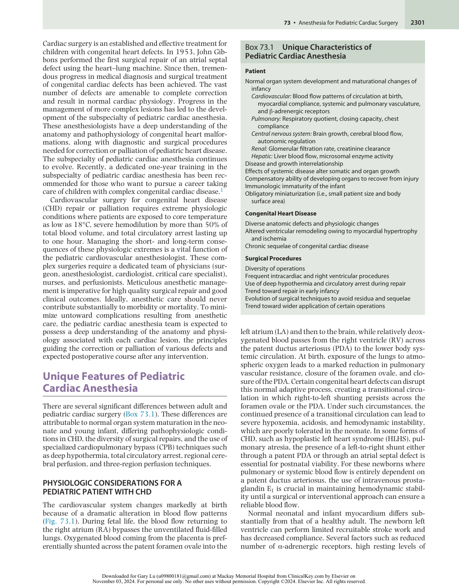

:::

<!-- PDF page 3 -->

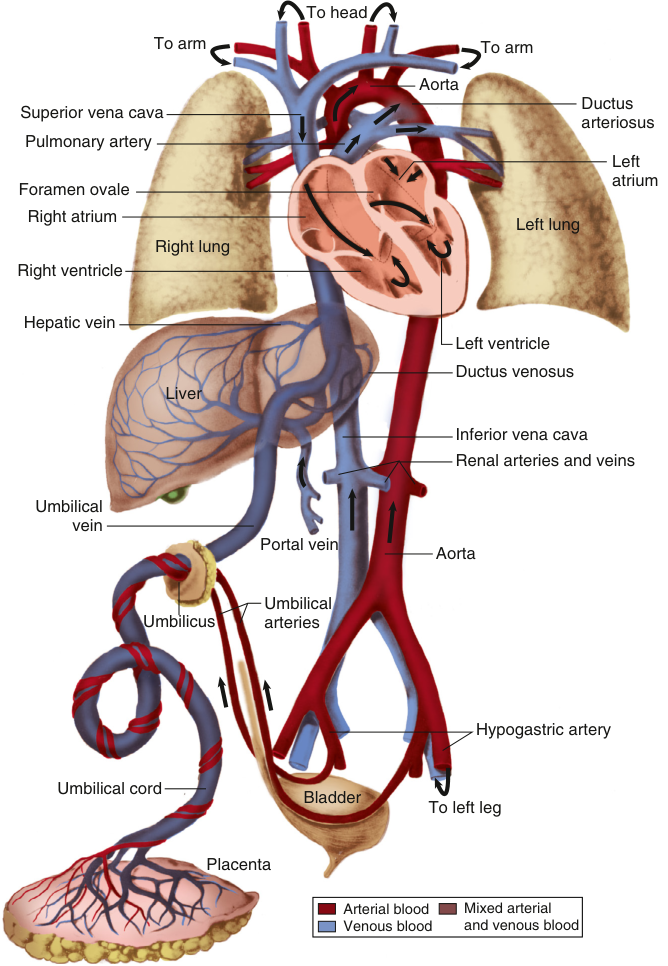

To head To arm To arm Aorta Ductus Superior vena cava arteriosus Pulmonary artery Left atrium Foramen ovale Right atrium Left lung Right lung Right ventricle Hepatic vein Left ventricle Ductus venosus Liver Inferior vena cava Renal arteries and veins Umbilical vein Portal vein Aorta Umbilical Umbilicus arteries Hypogastric artery Umbilical cord Bladder To left leg Placenta Arterial blood Mixed arterial Venous blood and venous blood 

**Fig. 73.1 Course of the fetal circulation in late gestation.** Note the selective blood flow patterns across the foramen ovale and the ductus arteriosus.

circulating catecholamines, and an immature calcium transport system contribute to limit contractile reserve with the result of a left ventricle (LV) with a high level of resting tone.2 Although the resting performance of the neonatal myocardium may be greater than in adults and older children, sensitivity to beta blockade is also greater, and only modest increases occur in cardiac performance after administration of the β- agonist drugs dobutamine and isoproterenol.3 Furthermore, the contractile mass of the heart is effectively reduced, resulting in a ventricle with low compliance. Preload augmentation is effective at low filling pressures (1–7 mm Hg). However, when left- sided filling pressures exceed 7 to 10 mm Hg, further increases in left ventricular stroke volume are minimal.2 As a consequence, neonates are highly dependent on heart rate, and changes in preload beyond filling pressures of 7 to 10 mm Hg do not always increase stroke volume and cardiac output.4 One

important characteristic of the neonatal myocardium is related to the underdevelopment of the calcium transport system. The neonatal heart is highly dependent on extracellular calcium levels,5,6 and high doses of calcium chloride or gluconate infusions are needed to achieve a normal plasma concentration of ionized calcium and ensure an effective myocardial contraction. This contrasts with adult cardiac surgery, where intraoperative calcium use has fallen into some disfavor owing to concerns over myocardial ischemia and reperfusion injury.

Pulmonary circulation undergoes significant changes during the first months of life, and these changes have important implications for the perioperative management of newborns with congenital cardiac defects. Immediately after birth, lung expansion and the vasodilatory effects of a higher partial pressure of arterial oxygen (PaO2) result in a significant decrease in pulmonary vascular resistance

<!-- PDF page 4 -->

(PVR). Regression of the smooth muscle layer in the pulmonary arterioles during the next two to three months leads to further decline in PVR and a corresponding decrease in pulmonary artery pressure. Acute physiologic stresses, such as hypoxemia, hypercarbia, and a persistent increase in pulmonary blood flow, may cause temporary or permanent reversal of these changes, resulting in right- to- left shunting. Either phenomenon worsens hypoxemia and eventually limits tissue oxygen (O2) delivery.

Anatomic differences between adult and pediatric patients have significant anesthetic implications. Smaller veins and arteries and decreased body surface area compared to adult patients cause challenges in obtaining vascular access in small newborns and high complication rates associated with invasive monitoring. Pulmonary artery catheters are used infrequently because of technical difficulties in positioning the tip in the pulmonary artery and because of the fundamental fact that pulmonary flow bears no obligatory relationship to systemic output in children with either intracardiac or extracardiac communications. Transthoracic catheters for pressure monitoring and delivery of vasoactive substances are often placed from the surgical field instead of a percutaneous approach via the neck. Adequacy of surgical repair and function is assessed by transesophageal echocardiography (TEE) with Doppler color flow imaging with miniaturized probes.

Patient size also influences CPB management. The ratio of pump priming volume to patient blood volume is considerably higher in small children than in adults, resulting in a greater degree of hemodilution. Several studies demonstrated a heightened inflammatory response to CPB in children when compared to adults,7 related to the disproportionate exposure of the child’s blood elements to the nonendothelialized surfaces of the pump circuit per body surface area.

In pediatric patients with CHD, the cardiovascular system often represents the sole cause of the medical problem. A special disease and growth interrelationship unique to growing infants and children permits developing organs to compensate for and modify existing disease processes. Reparative and recuperative processes in children are more remarkable because of this compensatory ability of developing organ systems. Despite adaptation to their cardiovascular pathologic processes, CHD pediatric patients experience detrimental and sometimes permanent effects on somatic growth and the growth and development of the brain, myocardium, and lung.

Premature infants with CHD deserve special consideration. They have a twofold increase in cardiovascular malformations compared with term infants.8 One in six infants with CHD, not including those with PDA or atrial septal defect (ASD), is born prematurely. Some malformations such as tetralogy of Fallot (TOF), pulmonary stenosis, pulmonary atresia with ventricular septal defect (VSD), complete atrioventricular (AV) septal defect, large VSDs in isolation or associated with coarctation, and aortic stenosis are more prevalent in this population.9 A significant increase in the likelihood of being small for gestational age is seen among infants with TOF, complete AV septal defect, hypoplastic left heart, pulmonary stenosis, or large VSD.10

Respiratory failure is common and multifactorial. The small airways are prone to obstruction, which results in

increased airway resistance and work of breathing with easy fatigability. Lung compliance is reduced because of surfactant deficiency, resulting in intrapulmonary shunting and ventilation–perfusion mismatch. Ventilatory strategies such as enhanced use of neurally adjusted ventilatory assist (NAVA), avoidance of intubation, reduced peak inspiratory pressures, and use of the lowest inspired oxygen concentration have been used to minimize lung injury. Cardiac pathophysiology can compound respiratory concerns. The premature heart is a poorly contractile organ with decreased diastolic compliance and is highly dependent on heart rate to cardiac output. With limited reserves of intracellular calcium, myocardial contractility in newborns is dependent on extracellular ionized calcium levels. The premature infant also has a relatively low absolute blood volume and tolerates blood loss poorly. Autoregulation is not well developed, and blood loss compromises cerebral and coronary flow before other manifestations of hypovolemia. However, fluid overload is also not well tolerated. Patency of the ductus arteriosus results in left- to- right shunting and pulmonary overcirculation with heart failure (HF). If uncorrected, this would result in pulmonary hypertension secondary to developing pulmonary vascular intimal hypertrophy.

Thermoregulation by non- shivering thermogenesis is poor owing to inadequate stores of brown fat in prematurity. It is critical to maintain normothermia by increasing the operating room temperature, using incubators for transport, warming and humidifying respiratory gases, and warming all intravenous fluids. Glycemic control is difficult, with a tendency to both hypoglycemia and hyperglycemia. Frequent glucose checks are essential. Parenteral glucose solutions should be continued in the perioperative period. Premature infants are also prone to retinopathy of prematurity with high inspired O2 concentrations and intraventricular hemorrhage.

While cardiac catheterization, intervention, and complete surgical repair in newborns of very low birth weight (&lt;1.5 kg) can be successfully undertaken, it is notable that given the complexity of premature organ systems and superimposed cardiorespiratory pathophysiology, morbidity and mortality are increased.11,12

## Congenital Heart Disease

Congenital heart disease is the most common congenital disorder in newborns and is the most common cause of death during infancy.13 The prevalence of congenital heart disease, estimated to be between 3–10 per 1000 live births, varies according to the study methodology and inclusion criteria.14 This number underestimates the true prevalence as more than a third of CHD patients are diagnosed later in life. The etiology of the majority of congenital cardiac defects remains unknown. Overall, genetic defects can account for less than 15% of congenital heart defects. Chromosomal syndromes such as trisomy 21, trisomy 18, trisomy 13, Turner syndrome, and DiGeorge syndrome are associated with a higher incidence of congenital cardiac defects but account for 10% of CHDs, and a single gene defect is seen in 3%–5% of cases.14 Environmental factors such as maternal diabetes, maternal obesity, alcohol use,

<!-- PDF page 5 -->

and rubella infection are known risk factors associated with a higher incidence of CHD.

### CLASSIFICATION

Congenital cardiac defects are cardiac architecture defects that interfere with systemic or pulmonary venous drainage, septation of cardiac segments, sequential attachment of cardiac segments including great vessels, or valvular function. Although the variations seen in structural cardiac anatomy constitute an exhaustive list of malformations, anesthetic management is more logically designed to achieve physiologic goals. Although an isolated heart malformation may be identified, the entire cardiopulmonary system is usually affected. Functional hemodynamic changes caused by congenital cardiac lesions produce myocardial changes and place the ventricles at great risk for intraoperative ischemia and failure. Therefore, understanding the isolated defect, associated myocardial changes, and hemodynamic consequences is fundamental to planning an appropriate anesthetic regimen. Distilling CHD into a finite number of physiologic categories enables the anesthesiologist to construct a strategy that employs the qualitatively predictable impact of drugs, ventilatory management, and fluid administration to optimize cardiovascular performance.

A general physiologic classification is listed in Table 73.1. Fortunately, although structurally complex, these defects can be understood within a more limited physiologic spectrum. Identification and classification based on physiology provide an organized framework for the intraoperative anesthetic management and postoperative care of children with complex congenital cardiac defects. In general, congenital heart lesions fit into four categories: shunts, mixing lesions, flow obstruction, and regurgitant valves (see Table 73.1). Each category imposes at least one of three pathophysiologic states: ventricular volume overload, ventricular pressure overload, or hypoxemia. Ultimately, these pathophysiologic conditions can result in myocardial failure or pulmonary vascular disease. Medical and surgical perioperative management strategies focus on minimizing the pathophysiologic consequences of these lesions.

### SHUNT LESIONS

Shunts are produced by intracardiac connections between cardiac chambers (e.g., ASD or VSD) or extracardiac connections between a systemic and pulmonary artery (e.g., PDA). The direction and amount of blood flow across the communication will depend on the relative resistances, and hence the pressure gradient on either side of the communication and the size of the shunt orifice. Extensive communications between two cardiac chambers (VSD) or great vessels (PDA) are non- restrictive, and under these conditions, the primary determinant of the direction of blood flow is relative resistance between the pulmonary and systemic vascular beds. In atrial level shunt, in addition to the size of the defect, relative compliance of ventricles and valvular diameter will also influence the amount of shunt across the defect. The overall impact of the presence of a significant shunt depends on the location, size of the shunt, and direction of the shunt.

Under normal physiologic conditions where pulmonary vascular resistance is much lower than systemic resistance,

**Table 73.1** Classification of Congenital Heart Defects

|**Physiologic Classification**|**Pulmonary** **Blood Flow**|**Comments**|
|---|---|---|
|**LEFT- TO- RIGHT SHUNTS**|||
|VSD|↑|Volume- overloaded ventricle|
|ASD||Development of CHF|
|PDA|||
|AV canal|||
|**RIGHT- TO- LEFT SHUNTS**|||
|Tetralogy of Fallot (TOF)|↓|Pressure- overloaded ventricle|
|Pulmonary atresia/VSD||Cyanotic|
|Eisenmenger complex||Hypoxemia|
|**MIXING LESIONS**|||
|Transposition/VSD|Generally↓ but variable Q. p/Q.s|Variable pressure versus volume loaded|
|Tricuspid atresia||Usually cyanotic|
|Anomalous venous return|||
|Univentricular heart|||
|**OBSTRUCTIVE LESIONS** Interrupted aortic arch||Ventricular dysfunction|
|Critical aortic stenosis||Pressure- overloaded ventricle|
|Critical pulmonic stenosis||Ductal dependence|
|Hypoplastic left heart syndrome|||
|Coarctation of the aorta|||
|Mitral stenosis|||
|**REGURGITANT LESIONS**|||
|Ebstein anomaly||Volume- overloaded ventricle|
|**OTHER SECONDARY** **CAUSES**||Development of CHF|

_ASD,_ atrial septal defect; _AV,_ atrioventricular; _CHF,_ congestive heart failure; _PDA,_ patent ductus arteriosus; _Q_&#95;.&#95; _p_ , pulmonary blood flow; _Q_&#95;.&#95; _s_ , systemic blood flow; _VSD,_ ventricular septal defect.

all intracardiac or great vessel communications result in left- to- right to systemic to pulmonary shunts. In other words, part of the ejected blood from the systemic circulation is preferentially directed toward the lungs, resulting in increased pulmonary blood flow (PBF). In patients with significant defects and low PVR, this increase in PBF can be substantial. Commonly described as the ratio of pulmo-nary blood flow to systemic blood flow (Qa normal value close to 1), a higher Q. p:Q. .p:Qs ratio seen in . s ratio, with the patients with left- to- right shunt results in three pathophysiologic problems: (1) congestion of the pulmonary circulation and lungs, increasing the work of breathing; (2) intravascular volume overload with resulting increased cardiac work; and (3) excessive PBF, resulting in a progressive elevation in PVR. Volume overload causes ventricular dilation that places the heart at a mechanical and physiologic

::: details 原始表格與符號（PDF 第 5 頁）

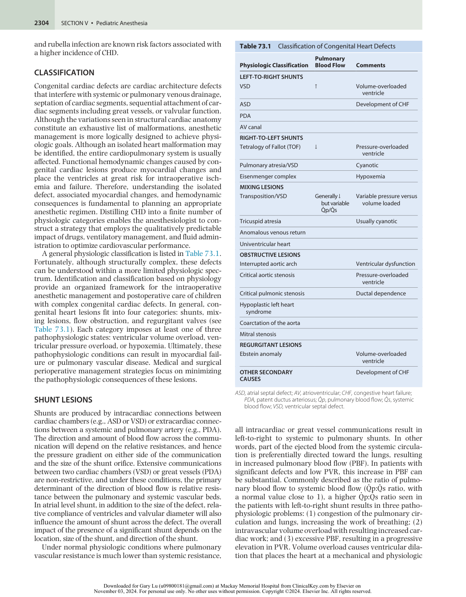

:::

<!-- PDF page 6 -->

disadvantage, resulting in reduced diastolic compliance. Diastolic changes lead to engorgement of the respective venous beds, which produces the signs and symptoms of clinical congestive heart failure (CHF) early in the natural history of the volume- overload condition. The demand for increased cardiac output placed on the LV is limited in the infant by its immature structure so that large left- to- right shunts may outstrip the capacity of the left side of the heart to maintain adequate systemic perfusion. If left untreated, a chronic increase in pulmonary blood flow leads to chronic and irreversible changes in the pulmonary vascular bed. Initially, an increase in pulmonary vascular resistance reduces excessive blood flow to the lungs and may improve clinical symptoms, but eventually leads to a reversal of the shunt, a condition known as Eisenmenger syndrome (see details below). Early closure (surgical or by a noninvasive approach in the catheterization lab) of a hemodynamically significant defect provides immediate benefit by dramatically reducing pulmonary blood flow and lowering left ventricular volume output demands.

Right- to- left shunts occur where a communication defect between systemic and pulmonary circulation exists, but the total resistance to the pulmonary blood flow (pulmonary vascular and right ventricular outflow tract resistance) exceeds systemic vascular resistance (SVR). Table 73.1 lists common left- to- right shunt lesions. As a result, a fraction of the desaturated venous blood from the pulmonary circulation is directed through the defect and mixes with the sys-temic circulation. In these patients, Q. p:Q. s ratio is less than one, and shunt physiology manifests clinically as cyanosis and hypoxemia. The degree of hypoxemia depends on the amount of desaturated blood shunted across the defects to the systemic circulation. Pure right- to- left shunting resulting from increased PVR is seen in the Eisenmenger complex, and persistent pulmonary hypertension of the newborn with a shunt at both the atrial and ductal levels. A classic example of right- to- left shunt is TOF, where obstruction at the right ventricular outflow tract in the presence of a ventricular septal defect results in right- to- left shunting through the VSD. Systemic perfusion is generally normal with right- to- left shunting lesions unless hypoxemia becomes severe enough to impair O2 delivery to tissues. Right- to- left shunting produces three pathophysiologic problems: (1) reduced PBF results in systemic hypoxemia and cyanosis; (2) increased impedance to right ventricular ejection, which may ultimately lead to ventricular hypertrophy, dysfunction, and RV failure; and (3) if left untreated, systemic consequences of chronic hypoxemia such as polycythemia, coagulation abnormalities, stroke. However, the physiologic mechanisms designed to compensate for pressure overload rarely create abnormalities in systolic or diastolic function early in the natural history of the disease process. In contrast to lesions that produce ventricular volume overload, lesions that produce isolated pressure overload typically require years to cause ventricular dysfunction and failure.

### MIXING LESIONS

Mixing lesions constitute the largest group of cyanotic congenital heart defects (see Table 73.1). In these defects, the mixing between the pulmonary and the systemic

circulation is so large that the systemic and pulmonary artery O2 saturations approach each other. The pulmonaryto- systemic flow ratio Q. p/Q. s is independent of shunt size and is entirely dependent on vascular resistance or outflow obstruction. The blood flow through pulmonary and systemic circulations occurs in parallel with one another rather than in series (see Table 73.1). In other words, blood flow distribution between systemic or pulmonary circulations depends on the relative vascular resistances of both circuits. Common example of such lesions includes patients with univentricular hearts, total anomalous pulmonary venous return (TAPVR), or truncus arteriosus. In patients with left- side obstructive lesions, a normal decrease in PVR after birth leads to a substantial increase in PBF associated with a marked reduction in systemic perfusion and systemic oxygen delivery. In patients with right heart hypoplastic syndrome, physical obstruction to pulmonary blood exceeds SVR, and PBF is dramatically reduced, producing life- threatening hypoxemia (Table 73.2).

In patients with a mixing lesion and left ventricular outflow obstruction, PBF may be sufficiently excessive to impair systemic perfusion. In patients with mixing lesions and a right ventricular outflow obstruction, such as a single ventricle with subpulmonic stenosis, systemic- to- pulmonary flow can vary from balanced flow to significantly decreased PBF in which the severity of hypoxemia depends on the degree of obstruction. Typical mixing lesions include truncus arteriosus, univentricular heart, pulmonary atresia with large VSD, and single atrium.

### OBSTRUCTIVE LESIONS

Obstructive lesions range from mild to severe. Severe lesions manifest in the newborn period with a pressureoverloaded, diminutive, or profoundly dysfunctional ventricle proximal to the obstruction. Such lesions include critical aortic stenosis, critical pulmonic stenosis, coarctation of the aorta, and interrupted aortic arch. Although aortic and pulmonary atresia represent the most extreme variants of outflow tract obstruction, they are associated with such significant ventricle hypoplasia (HLHS and pulmonary atresia with an intact ventricular septum, respectively) that the ventricle’s function does not contribute to the circulatory physiology. As with other critical obstructive lesions, these extreme variants have ductal- dependent circulations, but beyond that similarity, they are perhaps better understood as univentricular hearts for which the management characteristics of a mixing lesion dominate in importance.

**Table 73.2** Ductal- Dependent Lesions

|**PDA Provides Systemic Flow**|**PDA Provides Pulmonary Flow**|
|---|---|
|Coarctation of the aorta|Pulmonary atresia|
|Interrupted aortic arch|Critical pulmonary stenosis|
|Hypoplastic left heart syndrome|Severe subpulmonic stenosis with VSD|
|Critical aortic stenosis|Tricuspid atresia with pulmonic stenosis|

_PDA,_ patent ductus arteriosus; _VSD,_ ventricular septal defect.

::: details 原始表格與符號（PDF 第 6 頁）

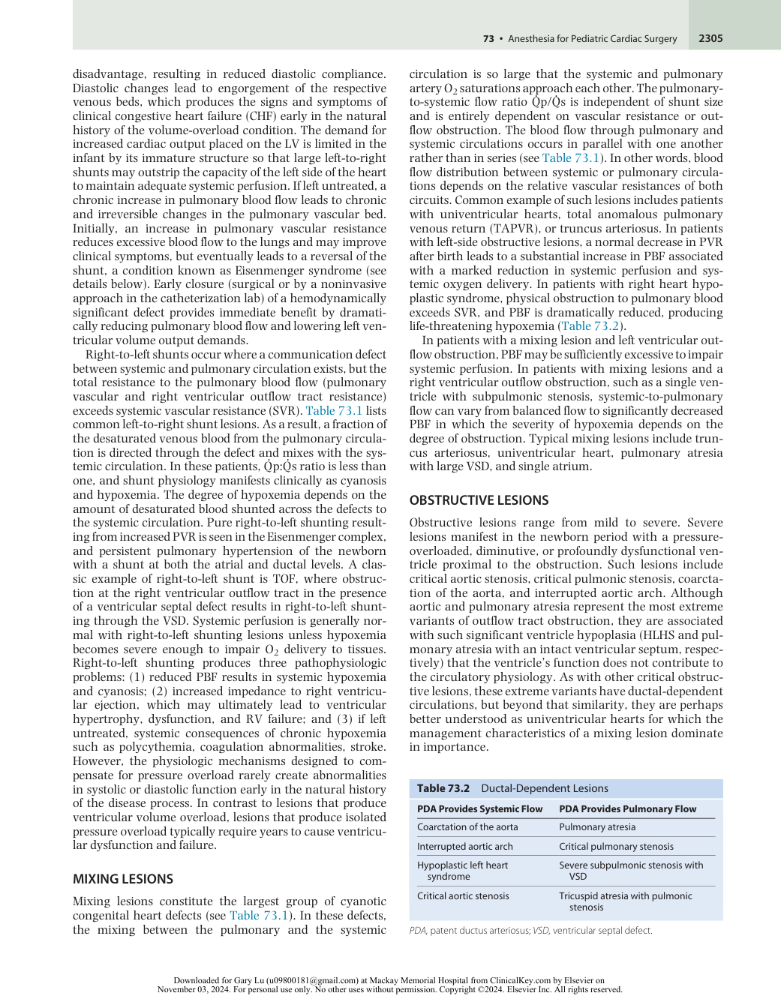

:::

<!-- PDF page 7 -->

In critical neonatal left- sided obstructive defects, systemic perfusion depends on desaturated blood flow from the RV via the PDA; the coronary perfusion is supplied by retrograde flow from the descending aorta (see Table 73.2). In right- sided lesions, PBF is supplied from the aorta via the PDA, and right ventricular function is impaired.

Pathophysiologic problems in critical neonatal leftsided heart obstructive lesions include (1) profound left ventricular failure, (2) impaired coronary perfusion with an increased incidence of ventricular ectopy, (3) systemic hypotension, (4) PDA- dependent systemic circulation, and (5) systemic hypoxemia. The pathophysiologic problems in critical neonatal right- sided heart obstructive lesions include (1) right ventricular dysfunction, (2) decreased PBF, (3) systemic hypoxemia, and (4) PDA- dependent PBF. Apart from the most extreme variants that become evident in the neonatal period, infants and children with outflow obstruction (e.g., mild- to- moderate aortic or pulmonary stenosis, coarctation of the aorta) manifest compensatory mechanisms for pressure overload and often remain clinically asymptomatic for many years.

### REGURGITANT VALVES

Regurgitant valves are uncommon as primary congenital defects. Ebstein’s malformation of the tricuspid valve is the only pure regurgitant defect manifesting in the newborn period. However, regurgitant lesions are frequently associated with an abnormality of valve structure, such as incomplete or partial AV canal defect, truncus arteriosus, and TOF with an absent pulmonary valve. The pathophysiology of regurgitant lesions includes (1) volume- overloaded circulation and, therefore, (2) progression toward ventricular dilation and failure.

When considering the incidence of all congenital heart defects, three uncomplicated left- to- right shunts (VSD, ASD, PDA) and two obstructive lesions (pulmonic stenosis, aortic coarctation) constitute 60% of all congenital cardiac defects. Mixing lesions, complicated obstructive defects, and right- to- left shunting lesions account for most of the remaining 40%. The latter group of defects, which are more challenging to manage, have a significantly higher morbidity and mortality rate.

### CHRONIC CONSEQUENCES OF CONGENITAL HEART DISEASE

The chronic effects of CHD are a consequence of the imposed hemodynamic stress of the defect or the residua and sequelae after cardiac surgery. These effects continue to alter the normal growth and development of the cardiovascular system and other organ systems throughout life. Complete surgical cures are rarely achieved, and some repairs are palliative rather than corrective; therefore, abnormalities before and after repair produce long- term effects in patients with CHD.15 Many of the abnormalities are trivial and have no major import. Others affect major organ system processes, such as ventricular function, the conduction system of the heart, central nervous system (CNS) growth, or PBF. Whether anesthetizing these patients for their primary or subsequent cardiac repair or noncardiac surgery, these chronic changes should be ascertained and reflected in the anesthetic plan.

Specific hemodynamic stresses continually remodel the myocardium _in utero_ and throughout life. Abnormal hemodynamic loading conditions associated with CHD interrupt the normal ventricular modeling process (Fig. 73.2).16 Abnormal ventricular remodeling typically begins _in utero_ and stimulates an increase in ventricular mass. Increased ventricular mass is due to both hyperplasia and hypertrophy of myocytes in response to altered wall stress on the developing ventricle. The resultant biomechanical deformation of the ventricle alters its geometry, affecting normal systolic and diastolic function.

Abnormalities of ventricular performance at rest and with exercise can be detected in patients with chronic hemodynamic overload and complex cyanotic lesions. These abnormalities in ventricular function are the consequences of chronic ventricular overload, repeated episodes of myocardial ischemia, and residua or sequelae of surgical treatment (ventriculotomy, altered coronary artery supply, inadequate myocardial protection). Although chronic volume or pressure overload of the LV results in CHF, the compensatory mechanisms for pressure overload create less physiologic disturbance than volume overload, particularly in diastolic function. Consequently, CHF occurs later in the natural history of isolated obstructive lesions that do not require treatment in the neonatal period. Similarly, chronic right ventricular volume overload, as seen in pulmonic insufficiency after TOF repair, is more likely to be

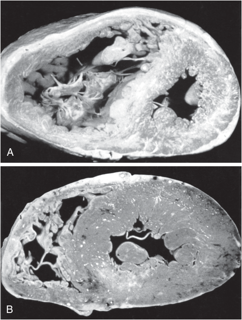

A B 

**Fig. 73.2 Comparison of ventricular hypertrophy patterns demonstrating altered ventricular remodeling in two different congenital heart defects.** (A) Note the right ventricular hypertrophy and the diminutive left ventricle in tetralogy of Fallot. (B) Note the severe left ventricular hypertrophy and septal bulging into the right ventricle in aortic stenosis.

<!-- PDF page 8 -->

associated with chronic ventricular dysfunction and failure than a pressure- loaded RV that manifests with residual pulmonic stenosis. The most potent combination for inducing ventricular dysfunction and failure occurs when a pressure overload is superimposed on a dilated, volume- overloaded ventricle (e.g., postoperative TOF with pulmonary insufficiency and branch pulmonary artery stenosis).

Initial manifestations of CHF reflect ventricular compliance alterations resulting from various biophysical responses to abnormal loading conditions. The ventricular dilation and compensatory hypertrophy accompanying excessive intravascular volume provide effective compensation to preserve normal systolic wall stress. Still, alterations in diastolic wall stress become evident (Fig. 73.3). Ultimately, chronic or severe pressure overload causes similar changes as the resultant myocardial hypertrophy outgrows vascular supply and results in ischemia and fibroblast proliferation. Permanent changes in myocardial structure and function are the result.

In patients with cyanotic heart defects, the long- term compensation for chronic hypoxemia is a significant redistribution of organ perfusion with selected blood flow to the heart, brain, and kidney and decreased flow to the splanchnic circulation, skin, muscle, and bone. Chronic hypoxemia is associated with increased work of breathing to increase O2 uptake and delivery. The most dramatic complications are decreased somatic growth rate, increased metabolic rate, and increased hemoglobin concentrations.

A significant portion of patients with CHD will have arrhythmias that play an essential role in their management. These arrhythmias result from either the defect itself or a sequela from treatment options such as surgery

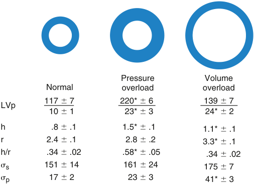

Pressure Volume Normal overload overload 117 � 7 220* � 6 139 � 7 LVp 10 � 1 23* � 3 24* � 2 h .8 � .1 1.5* � .1 1.1* � .1 r 2.4 � .1 2.8 � .2 3.3* � .1 h/r .34 � .02 .58* � .05 .34 � .02 �s 151 � 14 161 � 24 175 � 7 �p 17 � 2 23 � 3 41* � 3 

**Fig. 73.3 Changes in ventricular physiology that accompany abnormal pressure and volume loading in human adolescents and adults.** Schematic diagram represents the changes in cross- sectional ventricular geometry that accompany abnormal pressure and volume loads. Data are measured and derived from catheterization and echocardiography of 30 adolescent and adult human subjects. Pressure overload triggers significant increases in wall thickness and wall thickness- to- radius ratio (h/r), but these compensatory mechanisms preserve σ within normal limits. Whereas volume overload causes dilation and enough hypertrophy to preserve normal σs, diastolic function deteriorates significantly. * _P_ = .01. _σd_ , end- diastolic wall stress; _σs_ , peak systolic wall stress; _h,_ wall thickness (mm); _LVp,_ left ventricular pressure; _r,_ radius of the left ventricular chamber. (From Grossman W, Jones D, McLaurin LP. Wall stress and patterns of hypertrophy in the human left ventricle. _J Clin Invest._ 1975;56[1]:56–64.)

or cardiac catheterization interventions. Management of these arrhythmias is crucial and ranges from preventive strategies to active pharmacologic treatments, catheter ablations, or device therapies. There have been significant advances in 3D mapping technologies and decreased use of radiation during ablation therapies. Pacemaker devices are now used to improve hemodynamics through cardiac resynchronization and the prevention of sudden death.17 Finally, congenital syndromes may have associated CHD that will influence the long- term outcome (Table 73.3).

### PRINCIPLES OF SURGICAL REPAIR AND SPECIAL TECHNIQUES

The ultimate objectives for congenital heart surgery are to (1) restore normal anatomy and physiology, (2) relieve any obstruction to blood flow, (3) preserve ventricular mass and function, (4) normalize life expectancy, and (5) improve quality of life. The surgical procedures to accomplish these objectives are diverse and complex (Table 73.4). The type and timing of repair depend on the patient’s age, the specific anatomic defect, and the surgeon’s and the team’s experience (see Table 73.4). The improvements in surgical technique, coupled with advancements in anesthetic and technologic support, make a repair in early infancy feasible and, in many cases, preferable.18 Currently, repair in infancy is offered for several congenital heart defects, as shown in Table 73.4. The timing of surgical intervention reflects medical necessity, physiologic and technical feasibility, and optimal outcome. Pediatric cardiovascular surgery aims to repair defects in infancy rather than palliate preferentially.19 This trend reflects improved technical capabilities coupled with a desire to limit the morbidity and mortality associated with long- term medical management and the sequelae of multiple palliative operations. Early correction should decrease the incidence of chronic complications of CHD, such as the problems associated with ventricular overload, cyanosis, and pulmonary vascular obstructive disease.20 Early repair also may have the selective advantage of enhancing organ system protection during repair because poorly understood factors promote resistance to injury and enhanced recovery potential (i.e., enhanced plasticity). With the continued improvement in surgical techniques and the early treatment of CHD, specific organ systems such as the brain, heart, and lungs will be spared the detrimental effects of chronic derangements of hemodynamics and O2 delivery.

Palliative surgeries are performed when complete restoration of normal anatomy and normalization of physiology is impossible. Common examples of such defects include pulmonary atresia (hypoplastic right ventricle, pulmonary artery), tricuspid atresia (hypoplastic RV and tricuspid valve), HLHS (aortic atresia and hypoplastic LV), mitral atresia (absent LV), and unbalanced AV canal defects. Physiologic goals of such palliative procedures can be (1) to increase PBF, (2) to decrease excessive PBF, and (3) to improve intracardiac mixing of systemic and pulmonary blood (see Table 73.4). In patients with PDA- dependent pulmonary blood flow, palliative procedures that increase PBF include shunts, e.g., Blalock–Taussig (BT), central shunt, or ductal stent. Those lesions associated with excessive blood flow, such as an unbalanced AV canal, a pulmonary artery

::: warning 符號需核對
此頁有符號無法完整擷取，請展開下方原始頁面核對。
:::

::: details 原始表格與符號（PDF 第 8 頁）

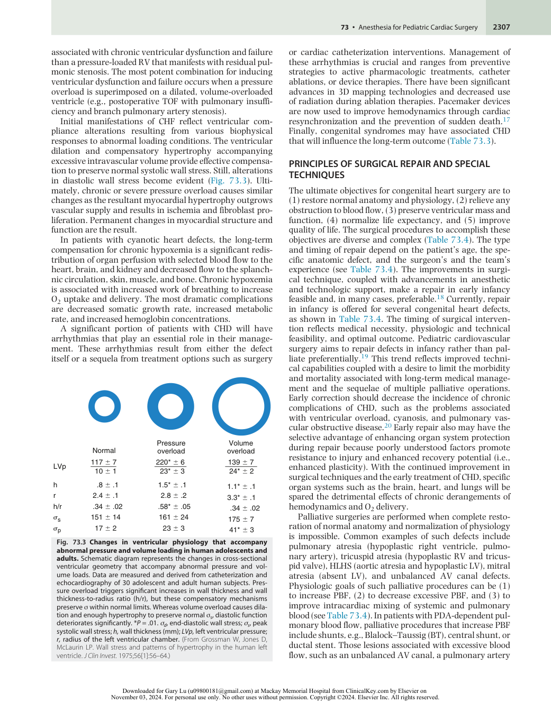

:::

<!-- PDF page 9 -->

banding, or ligation of a significant PDA, can prevent pulmonary overcirculation. For those lesions where intracardiac mixing is necessary for survival, such as transposition of great vessels and intact ventricular septum, an atrial septostomy (balloon, blade, and Blalock–Hanlon) is performed either at the bedside or in the cardiac catheterization lab.

Many defects are optimally repaired in early infancy. Lesions such as transposition of the great arteries (TGA) may exhibit better left ventricular function if the arterial switch operation is performed in the first few weeks of life. At the same time, the PVR is high, which allows for training left ventricle. In contrast, other repairs may manifest less

**Table 73.3** Syndromes Associated with Congenital Heart Disease

|**Syndrome**|**Lesion**|**Cardiac Lesion**|**Comments**|
|---|---|---|---|
|**SYNDROMES WITH AIRWAY ISSUES**|**AND CHD**|||
|CHARGE syndrome (association)||VSD, ASD, PDA, TOF|Micrognathia, possible difficult airway|
|Edwards syndrome|Trisomy 18|VSD, ASD, PDA|Micrognathia, small mouth, difficult intubation|
|Di George sequence|Microdeletion 22q11.2|Aortic arch and conotruncal lesions|Short trachea – tendency to endobronchial intubation|
|Goldenhar syndrome||VSD, PDA, TOF, CoA|Maxillary and mandibular hypoplasia, C- spine anomalies – difficult intubation|
|Hurler syndrome|MPS 1, storage disorder|Multivalvular disease, CAD, cardiomyopathy|Macroglossia, short neck – extremely difficult intubation|
|Noonan syndrome||PS, ASD, cardiomyopathy|Short, webbed neck, macrognathia – difficult intubation|
|Turner syndrome|Monosomy X|LVOT O, AS, HLHS, CoA|Micrognathia, webbed neck – difficult intubation|
|VATER association||VSD, TOF, ASD, PDA|Potential for difficult intubation|
|**SYNDROMES WITH RISK FOR ARRHY** Long QT syndrome (LQTS)|**THMIAS**|Torsades de pointes, SCD||
|Brugada syndrome||VT/VF/SCD||
|Arrhythmogenic right ventricular dysplasia (ARVD)||VT/SCD||
|Catecholaminergic polymorphic ventricular tachycardia||Polymorphic VT/SCD||
|Wolff–Parkinson–White syndrome||SVT||
|Maternal lupus||CCHB in the newborn||
|**CHROMOSOMAL DISORDERS ASSOC**|**IATED WITH CHD**|||
|Down syndrome|Trisomy 21|VSD, ASD, CAVC||
|Edwards syndrome|Trisomy 18|VSD, ASD, PDA||
|Patau syndrome|Trisomy 13|VSD, PDA, ASD||
|Turner syndrome|Monosomy X|LVOT O, AS, HLHS, CoA||
|3p syndrome|Deletion 3p|CAVC||
|Cri du chat syndrome|Deletion 4p|Variable||
|8p syndrome|Deletion 8p|CAVC||
|9p syndrome|Deletion 9p|VSD, PDA, PS||
|Williams syndrome|Microdeletion 7q11|SVAS, SVPS, branch PS||
|Smith–Magenis syndrome|Microdeletion 17p11.2|ASD, VSD, PS, AV valve malformations||
|Miller–Dieker syndrome|Microdeletion 17p13.3|TOF, VSD, PS||
|CHARGE association||VSD, ASD, PDA, TOF|Coloboma, heart, choanal atresia, retardation, genital and ear anomalies|

_AS,_ atrial stenosis; _ASD,_ atrial septal defect; _AV,_ atrioventricular; _CAD,_ coronary artery disease; _CAVC,_ complete atrioventricular canal; _CCHB,_ congenital complete heart block; _CHARGE,_ coloboma of the eye, heart defects, atresia of the nasal choanae, restriction of growth and/or development, genital and/or urinary abnormalities, and ear abnormalities and deafness; _CHD,_ congenital heart disease; _CoA,_ coarctation of the aorta; _HLHS,_ hypoplastic left heart syndrome; _LVOT O,_ left ventricular outlet obstruction; _MPS 1,_ mucopolysaccharidosis type 1; _PDA,_ patent ductus arteriosus; _PS,_ pulmonary stenosis; _SCD,_ sudden cardiac death; _SVAS,_ supraventricular aortic stenosis; _SVPS,_ supravalvular pulmonic stenosis; _SVT,_ supraventricular stenosis; _TOF,_ tetralogy of Fallot; _VATER,_ vertebral defects, imperforate anus, tracheoesophageal fistula, and radial and renal dysplasia; _VSD,_ ventricular septal defect; _VT/VF,_ ventricular tachycardia/ventricular fibrillation.

::: details 原始表格與符號（PDF 第 9 頁）

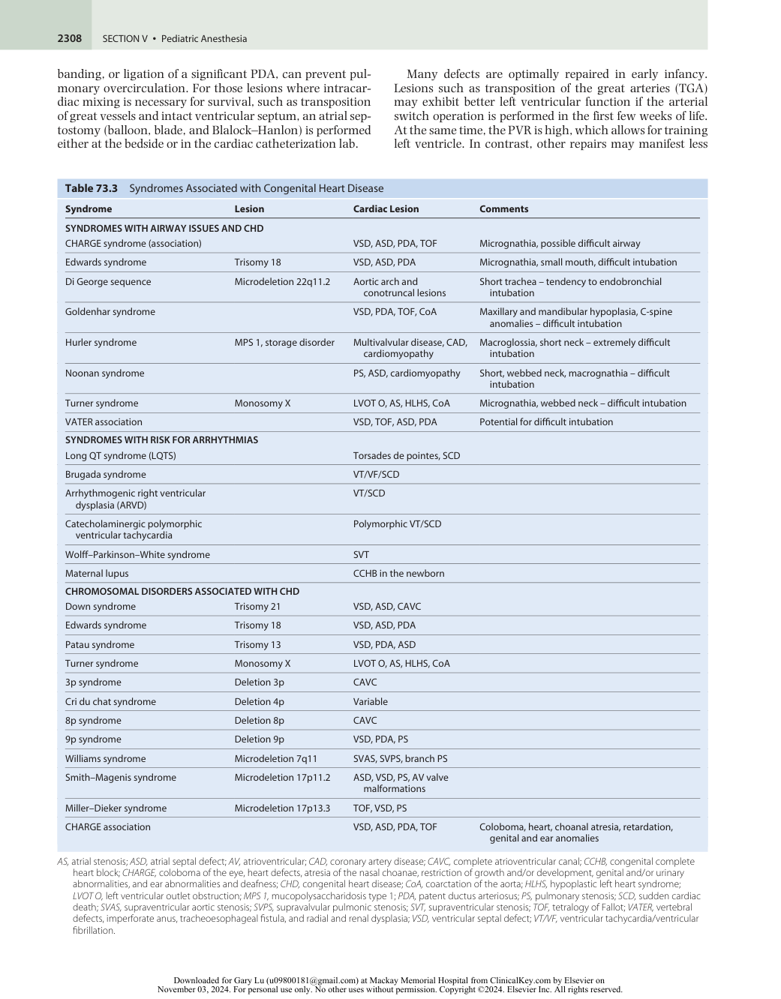

:::

<!-- PDF page 10 -->

**Table 73.4** Congenital Cardiac Defects and Their Repair

|**Anatomic Defects**|**Palliation**|**Complete Repair**|
|---|---|---|
|Tetralogy of Fallot (TOF)||VSD closure and RVOT patch|
|With PA atresia|Shunt||
|With anomalous right coronary artery|Rastelli||
|HLHS|NorwoodI/ transplant||
|Transposition of the great arteries||Arterial switch|
|Unfavorable coronary anatomy|Atrial switch (Senning)||
|Tricuspid atresia|Shunt followed by Fontan||
|Pulmonary atresia with VSD|Shunt followed by Fontan||
|With intact septum|Shunt followed by Fontan||
|Critical aortic stenosis||Aortic valvotomy|
|Interrupted aortic arch||End- to- end anastomosis/ reverse subclavian flap/ tube graft|
|Total anomalous pulmonary||Anastomosis of pulmonary veins to left atrium venous return and ASD closure|
|Single ventricle/ normal PAs|Band followed by Fontan||
|With small PAs|Shunt followed by Fontan||
|Truncus arteriosus||RV–PA conduit and VSD closure|
|Atrioventricular canal||Repair valve clefts/patch closure of ASD/attach valves to patch|

_ASD,_ atrial septal defect; _HLHS,_ hypoplastic left heart syndrome; _PA,_ pulmonary artery; _RV,_ right ventricle; _RVOT,_ right ventricular outflow tract; _VSD,_ ventricular septal defect.

volatile postoperative physiology if deferred a few weeks or months until PVR has consistently fallen (e.g., TOF, AV canal defect). Each defect may have mitigating factors for which deferred definitive repair will enable an optimal surgical result (e.g., TOF with aberrant coronary branching pattern or multiple VSDs; TGA with VSD and severe left ventricular outflow tract obstruction).

Surgical techniques and goals for surgical repairs continue to evolve. For example, for children born with transposition of great vessels, atrial switch surgery was associated with long- term right ventricular dysfunction and arrhythmia. These observations led to the development of the arterial switch operation, where complete anatomic correction is performed during the first week of life and is associated with better long- term results. Another example of the continuing evolution of technique is the repair of TOF. Pulmonary valvotomy was preferred to relieve right ventricular

outflow and low right ventricular pressures but resulting pulmonary insufficiency was associated with right ventricular dysfunction and failure. Current techniques preserve pulmonary valve anatomy and function at initial repair while accepting moderate pulmonary obstruction and moderately high ventricular pressures.21

In some complex cardiac defects, creating a normal twoventricle physiology is not feasible. These lesions, once considered fatal, are now treated using a single-ventricle pathway where a series of staged reconstructive procedures lead to an acceptable long- term survival.22 Many congenital lesions such as HLHS, tricuspid atresia, unbalanced AV canal, double outlet right ventricles, and double inlet left ventricle, can be palliated using single-ventricle pathway. These staged procedures aim to create an anatomy where available ventricle(s) pump blood for systemic circulation while venous blood flows passively through the pulmonary circulation. For patients with hypoplastic left heart syndrome (aortic atresia, mitral atresia, and hypoplastic aortic arch), first surgical palliation is performed within days after birth. It involves reconstruction of aortic arch using the main pulmonary artery, atrial septostomy, and creation of a systemic- pulmonary shunt to ensure reliable blood flow to the lungs. Currently, right ventricle to pulmonary artery (RV- PA) conduits are preferentially used for establishing pulmonary blood flow. As an alternative to traditional BT shunt (innominate to pulmonary artery), RV- PA shunts confer an advantage in survival after stage 1 palliation. The use of RV- PA shunts eliminates diastolic runoff into the pulmonary circulation and resulting higher diastolic pressure provides better myocardial perfusion and decreased myocardial work. The long- term impact of a right ventriculotomy in a univentricular heart is unknown.23,24 In 2008, the Pediatric Heart Network, an organization sponsored by the National Institutes of Health, completed enrollment in a randomized control trial comparing the effects of modified Blalock–Taussig shunt (mBTS) to RV- PA conduits as part of the stage 1 Norwood procedure.25 Recent results revealed that infants treated with an RV- PA shunt had improved survival over those with mBTS, although the long- term outcomes were not different.25,26

Neurologic outcome after surgical repair is an ongoing concern. Preoperative cerebral blood flow (CBF) was shown to be diminished in patients with various congenital heart defects, and low CBF values were associated with periventricular leukomalacia.27 Some centers routinely advocate regional low- flow cerebral perfusion and measurement of regional cerebral O2 saturation index and CBF velocity using transcranial Doppler imaging during arch reconstruction in this population. Reductions in the regional cerebral O2 saturation index or CBF greater than 20% of baseline are treated aggressively to increase cerebral O2 delivery by increasing the mean perfusion pressure, red blood cell (RBC) transfusion, and maintenance of high normal levels of partial pressure of arterial carbon dioxide (PaCO2) to achieve cerebral vasodilation.

Techniques have evolved to a “three- region” perfusion strategy for aortic arch reconstruction in the Norwood procedure. This technique involves direct perfusion of the coronaries and distal thoracic aorta and continuous cerebral perfusion via innominate cannulation. The arch repair

::: details 原始表格與符號（PDF 第 10 頁）

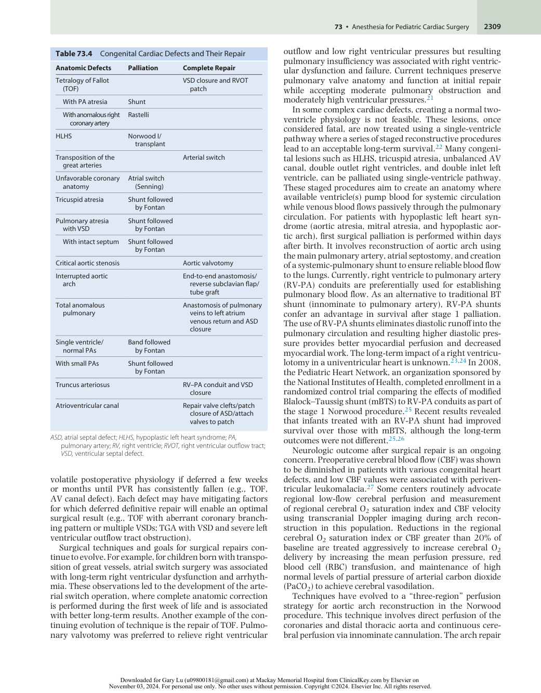

:::

<!-- PDF page 11 -->

occurs from distal to proximal at warmer patient temperatures, theoretically allowing decreased coronary and splanchnic ischemic times, reducing the risk of cardiac dysfunction and abdominal organ damage, and mitigating the adverse hypothermic effects on the hematologic system.28

Surgical management has evolved into a broader application of certain surgical procedures initially designed for a specific defect. For example, modifications of the Fontan operation, originally devised for patients with tricuspid atresia, are now being used to repair various univentricular hearts, including HLHS.29,30 Initially, the broader application of the Fontan operation to include complex defects once considered inoperable was associated with a rise in morbidity and mortality. However, this trend has been reversed in recent years by several groups who have demonstrated improved outcomes with the staging of the operation (superior cavo- pulmonary anastomosis, subsequent completion of the Fontan operation), the creation of a fenestration between the RA and LA at the time of the Fontan operation, and the use of modified ultrafiltration (MUF) at least in the early years.31

However, as patients who undergo the Fontan procedure grow older, they present with the unique pathophysiologic challenges of refractory arrhythmias, a failing single ventricle, protein- losing enteropathy, and plastic bronchitis. Most of these adults are cared for in a combined pediatric and adult cardiac program and require intensive, multidisciplinary care to optimize cardiorespiratory status. Ingenuity and innovation, such as demonstrated with the Fontan procedure, have permitted continued improvements in survival for all patients with CHD. As incisions in the myocardium become smaller and sutures more precisely placed, and as improvements in surgical techniques continue to evolve, the complications of ventricular dysfunction, arrhythmias, and residual obstruction should decline, contributing to improved patient quality of life.

One final difference unique to congenital heart surgery that significantly impacts anesthetic management is the type of cardiopulmonary support. Because of the complexity of repair in small patients, surgery often requires significant alterations in the bypass techniques, such as the use of deep hypothermic CPB at temperatures of 18°C and total circulatory arrest. Despite the widespread use of these techniques during CPB, their physiologic effects on major organ system function are just beginning to be understood. These effects are discussed in subsequent sections.

A 2021 Society of Thoracic Surgeons Congenital Heart Surgery Database update on outcomes and quality reported the following aggregate operative mortality outcomes performed at participating North American hospitals: offbypass coarctation repair, 0.98% (interquartile range [IQR], 0.0% to 1.8%); ventricular septal defect repair, 0.43% (IQR, 0.0% to 0.82%); tetralogy of Fallot repair, 1.18% (IQR, 0.0% to 1.96%); complete atrioventricular canal repair, 1.9% (IQR, 0.0% to 2.63%); arterial switch operation, 1.87% (IQR, 0.0% to 2.78%); arterial switch operation and ventricular septal defect repair, 5.3% (IQR, 0.0% to 7.14%); Glenn/hemiFontan, 2.01% (IQR, 0.0% to 2.63%); Fontan operation, 1.06% (IQR, 0.0% to 1.27%); truncus arteriosus repair, 9.24% (IQR, 0.0% to 13.33%); and Norwood (stage 1) operation, 12.42% (IQR, 6.5% to 16.25%).32

## Anesthetic Management

### PREOPERATIVE ASSESSMENT AND OPTIMIZATION

### Anesthetic Evaluation

Children with CHD present the anesthesiologist with a broad spectrum of anatomic and physiologic abnormalities. Patients range from young, healthy, asymptomatic children who have closure of a small ASD to neonates with HLHS requiring aggressive perioperative hemodynamic and ventilatory support. Intertwined with the medical diversity of these patients are the psychological factors affecting both the patient and their parents. Preparation of the patient and the family is time- consuming but omitting or compromising this aspect of patient care is a significant deterrent to a successful outcome and patient and parental satisfaction. This team- oriented approach also safeguards to prevent errors and omissions in the exacting perioperative care necessitated by the complexity of cardiac surgery for CHD. The preoperative visit allows the family to meet the surgeon and anesthesiologist.

Fundamentally, a child’s general health and activity will reflect cardiorespiratory reserve. Does the child have impaired exercise tolerance? Is the child gaining weight appropriately or exhibiting signs of failure to thrive based on cardiac cachexia? Does the child show signs of CHF (diaphoresis, tachypnea, poor feeding, recurrent respiratory infections)? Is there progressive cyanosis or new onset of cyanotic spells? Any intercurrent illness, such as a recent upper respiratory tract infection or pneumonia, must be ascertained. Lower respiratory tract infections may require a delay in proposed surgery, based on the negative impact that airway reactivity and elevations in PVR may have on surgical outcomes. Recurrent pneumonia is frequently associated with pulmonary overcirculation and altered lung compliance in patients with increased PBF.

A good history will delineate previous surgical and cardiologic interventions, which may impact surgical and anesthetic plans for the current procedure. Patients who have had their subclavian artery sacrificed for a subclavian flap angioplasty to correct coarctation or a Blalock–Taussig shunt will not accurately display systemic arterial pressure or perhaps even pulse oximetry readings when the monitoring is applied to the affected side. Likewise, children with femoral venous occlusion after catheterization are not candidates for femoral venous access, particularly for femoral CPB, should sternotomy prove impossible. It is equally important to obtain a list of current medications, previous anesthetic problems, and family history of anesthetic difficulties.

In the modern era of echocardiography and cardiac catheterization, physical examination rarely contributes additional anatomic information about the underlying cardiac lesion. However, it is instrumental in assessing the overall clinical condition of the child. For example, an ill- appearing, cachectic child in respiratory distress has a limited cardiores - piratory reserve, and the use of excessive premedication or a prolonged inhaled induction of anesthesia could result in significant hemodynamic instability.

<!-- PDF page 12 -->

### Concurrent Medications and Drug Interactions

Drug interactions are common among the co- therapeutic cardiovascular agents and anesthetic agents. An understanding of these interactions is helpful to the pediatric cardiovascular anesthesiologist. Some common cardiovascular medications and anesthesia considerations are shown in Table 73.5.

Pediatric oncology patients presenting for cardiac or noncardiac procedures may manifest higher cardiovascular risk because of cardiotoxic chemotherapy.33 Common cardiotoxic agents include the antimetabolite 5- fluorouracil, the anthracycline antibiotics doxorubicin and daunorubicin, and the alkylating agent cyclophosphamide. The acute form of toxicity is characterized by acute ST segment/Twave changes on the electrocardiogram (ECG), serious dysrhythmias, and CHF associated with pericardial effusion. Chronic cardiotoxic HF is cumulative, dose- related, and unresponsive to digoxin therapy. Severe cardiomyopathy can occur and is related to dose, irradiation, and use of an anthracycline. The mortality rate can exceed 50%. These patients should undergo thorough preoperative evaluation, including a full blood cell count, assessment of renal and hepatic function and coagulation parameters, and an echocardiogram. An isoflurane/nitrous oxide (N2O)- based anesthetic might confer better hemodynamic stability than opioid- based anesthesia in such patients.34 Anesthetics can induce torsades de pointes, a malignant arrhythmia. Risk factors include female gender, electrolyte imbalances such as hypokalemia and hypomagnesemia, genetic ion channel polymorphisms of congenital long QT syndrome (LQTS), subclinical LQTS, baseline QT prolongation, and use of QT- prolonging drugs, especially in high concentrations or as rapid intravenous infusions. Conditions with reduced repolarization reserve, such as CHF or digoxin toxicity, can also precipitate torsades de pointes. Drugs that may cause torsades de pointes in patients with congenital LQTS are shown in Table 73.6. The website https://crediblemeds.org provides an updated list of drugs that prolong the QT interval.

Traditionally, patients undergoing cardiac surgery have blood drawn for laboratory evaluation as the standard of care (hemoglobin, electrolytes, type, and screen). Recently the utility of this practice has been questioned, especially in patients coming from home. These tests are expensive, utilize significant hospital resources, cause pain and anxiety to the patient, and rarely lead to a change in care.35 A more thoughtful, directed, and individualized strategy can limit costs and discomfort without sacrificing patient safety. On the other hand, special populations such as patients with trisomy 21, cyanotic heart disease, and those on antiplatelet therapy may require additional specific testing.

An increased hematocrit in a normovolemic child may indicate the magnitude and chronicity of hypoxemia. A hematocrit of more than 60% may predispose to capillary

**Table 73.6** Drugs That May Cause Torsades de Pointes in Patients with Congenital Long QT Syndrome

|**Drug Category**|**Drug Name**|
|---|---|
|Antiarrhythmics|Amiodarone Procainamide Disopyramide Ibutilide Quinidine Sotalol|
|Antipsychotics|Chlorpromazine Haloperidol Thioridazine Mesoridazine|
|Antimicrobials|Erythromycin Clarithromycin|
|Miscellaneous|Cisapride Arsenic Methadone Droperidol Domperidone Dolasetron Ondansetron Glycopyrrolate|

**Table 73.5** Common Perioperative Medications and Considerations

|**Cardiac Drug Class**|**Interactions**|**Considerations**|
|---|---|---|
|Angiotensin- converting enzyme inhibitors|Hypotension with induction of general anesthesia|Consider withholding morning dose, or reducing dosage, in hypotensive patients; avoid fixed-dose induction regimens with drugs having a profound vagomimetic effect|
|Beta blockers|Acute withdrawal can precipitate tachycardia and arrhythmias; can potentiate hypotension with volatile anesthesia; can decrease response to inotropic agents|Continue in the perioperative period|
|Calcium channel blockers|May augment the negative inotropic and chronotropic effects of volatile anesthesia|Continue in the perioperative period|
|Diuretics|Hypovolemia/hypokalemia; may augment effect of neuromuscular blocking agents|Discontinue preoperatively|
|Antiarrhythmics|Can be proarrhythmic with inotropes, electrolyte disturbances; high catecholaminergic states; can interact with other antiarrhythmics and precipitate bradycardia|Avoid electrolyte imbalance Avoid drugs that are proarrhythmic Monitor carefully|
|α2- Agonists|Reduce perioperative shivering, ischemia, anesthetic and analgesic requirements|Continue into the perioperative period with appropriate monitoring|

::: details 原始表格與符號（PDF 第 12 頁）

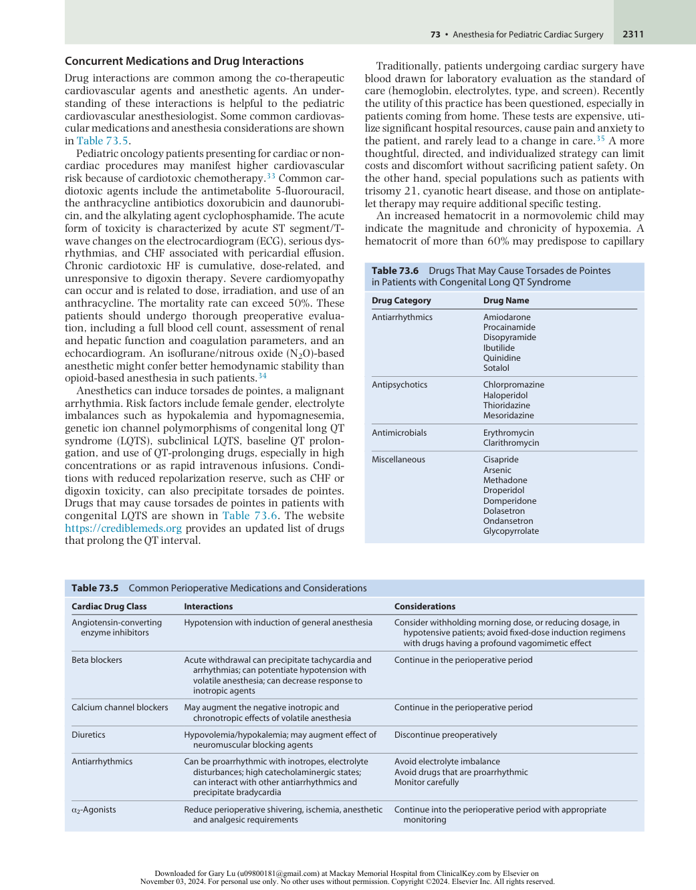

:::

<!-- PDF page 13 -->

sludging and secondary end- organ damage, including stroke. Despite these risks, liberalized guidelines for nothing by mouth that permit children to consume clear liquids up to two hours before anesthetic induction have virtually eliminated the need to admit these patients to the hospital early for preoperative intravenous hydration.36

Echocardiography with Doppler color flow imaging (echo- Doppler) is an invaluable tool that provides a noninvasive means of assessing intracardiac anatomy, blood flow patterns, and estimates of physiologic data.37 More invasive studies are generally not required for many cardiac defects if a good echocardiographic assessment is made. Echo- Doppler imaging is beneficial for defining intracardiac abnormalities. Extracardiac abnormalities, such as a pulmonary artery or vein stenosis, are more difficult to define by echo- Doppler and may require computed tomography (CT) or cardiac catheterization. The ability to interpret anatomy and physiology accurately requires a skilled echocardiographer, reaffirming the need for a wellintegrated interactive team. Although the complexities posed by extreme anatomic variation and changing loading conditions render intraoperative echo- Doppler challenging even for experienced echocardiographers, the pediatric cardiac anesthesiologist should develop basic competencies to make intraoperative decisions during critical intraoperative situations.

Magnetic resonance imaging (MRI) of the heart and major vessels has become a useful noninvasive imaging tool in children with heart disease. Typically, MRI is used to define segmental cardiac anatomy; evaluation of thoracic aortic anomalies; quantification of shunts, and valvular malfunction; cono- truncal malformations; pulmonary and systemic venous anomalies; and assessment of CHD in adult patients.38,39 MRI is particularly useful in quantifying ventricular function, regional wall motion, valvular competence, and velocity flow mapping.

MRI is also helpful in older patients with poor acoustic windows and patients with chest wall deformities. Often, it is an alternative to cardiac catheterization and may provide a noninvasive assessment of coronary anomalies, myocardial perfusion defects, and the detection of conditions associated with myocardial scarring (e.g., arrhythmogenic RV dysplasia). Even more novel, MRI images are now being used to reconstruct complex lesions using 3D printers to build a model of the heart to help plan the surgical procedure.40,41 Adenosine stress cardiac MRI is used to delineate areas of inducible ischemia. However, physiologic data such as O2 saturations cannot be obtained with MRI.

Anesthetic considerations remain the same as for all cardiac lesions, with additional concerns for MRI safety and restricted access to an anesthetized patient with suboptimal monitors. MRI scans are prolonged and traditionally require absolute patient immobility, with control of ventilator parameters to obtain optimal images. However, with advances in technology, such as respiratory gating and the use of free- breathing protocols, images can be acquired with the patient spontaneously breathing. This eliminates the need for general anesthesia with an endotracheal tube and breath holds, thus allowing for intravenous sedation with spontaneous breathing instead.

Cardiac catheterization remains the gold standard for assessing anatomy and physiologic function in CHD.

Although many anatomic questions can now be reliably answered noninvasively, catheterization remains a vital tool for cases that present complex anatomic questions or require knowledge of physiologic data. Important catheterization data for the anesthesiologist include the following:

1.  Child’s response to sedative medications

2.  Pressure and O2 saturation in all chambers and great vessels

3.  Location and magnitude of intracardiac and extracar-. . diac shunt Qp/Qs

4.  PVR and SVR

5.  Chamber size and function

6.  Valvular anatomy and function

7.  Distortion of systemic or pulmonary arteries related to prior surgery

8.  Coronary artery anatomy

9.  Anatomy, location, and function of previously created shunts

10.  Acquired or congenital anatomic variants that might have an impact on planned vascular access or surgery

A careful review of the cardiac catheterization data and understanding their potential impact on the operative and anesthetic plan are essential. Not all medical problems can be evaluated and corrected preoperatively; the surgeon, cardiologist, and anesthesiologist must discuss the potential management problems and the need for further evaluation or intervention before arrival in the operating room. Appropriate communication and cooperation will optimize patient care and facilitate perioperative clinical management.

### INTRAOPERATIVE MANAGEMENT

### Operating Room Preparation

Advance, and careful preparation of the operating room and anesthesia equipment is essential. The anesthesia machine must have the capacity to provide air, O2, and N2O to help balance the pulmonary and systemic blood flow. Some anesthetic machines may be equipped with carbon dioxide (CO2) as an additional gas that can be added to help balance the circulations. Nitric oxide is invaluable to helping lower the PVR and is usually added into the inspiratory limb of the circuit via a separate machine. Intravenous tubing must be free from air bubbles to prevent air embolism, and air filters should be added to all infusion lines. In pediatric cardiac anesthesia, many patients have limited reserve and high endogenous catecholamine levels released in an adaptive response to their underlying cardiac disease. Resuscitative drugs, labeled and ready for administration, should include succinylcholine, calcium gluconate or calcium chloride, sodium bicarbonate, atropine, lidocaine, phenylephrine, and epinephrine. An inotropic infusion, usually epinephrine or dopamine, should be premixed and ready for administration in high- risk cases, but additional infusions are prepared (e.g., milrinone, vasopressin). No single anesthetic drug can be recommended; how a particular drug is used is more important.

For congenital heart surgery, the ability to alter body temperature rapidly for cooling and rewarming is essential. During deep hypothermic CPB, patients are cooled to 18°C. Surface cooling with a heating and cooling water mattress,

<!-- PDF page 14 -->

ice in watertight bags, and an efficient room and ambient temperature control system are essential in the operative management of these patients.

### Physiologic Monitoring

The specific monitoring should depend on the child’s condition and the magnitude and nature of the planned surgical procedure. The perioperative monitoring techniques available are listed in Box 73.2. Noninvasive monitoring equipment is ideally placed before induction of anesthesia, although the anesthesiologist may elect to defer the application of monitoring devices in the crying child until immediately after the induction. Standard monitoring includes electrocardiography, pulse oximetry, capnography, and an appropriate- sized blood pressure cuff (oscillometric or Doppler). Additional monitoring consists of an indwelling arterial catheter and temperature probes. Foley catheters are generally employed when surgical intervention entails CPB or might produce renal ischemia or when the anesthetic management includes a regional technique associated with urinary retention. Most centers routinely use percutaneously placed central venous pressure (CVP) monitoring or, alternatively, directly placed transthoracic atrial lines by the surgeons to help with separation from CPB and the hemodynamic management in the postoperative period.

In young children, cannulation of the radial artery with a 22- or 24- gauge catheter is preferred. In older children and adolescents, a 20- gauge catheter is substituted. Careful

### Box 73.2 Monitoring of Organ Systems

|**Cardiopulmonary System**|
|---|
|Esophageal stethoscope|
|Electrocardiogram|
|Standard five- lead system, ST- T wave analysis, esophageal electrocardiographic lead|
|Pulse oximetry|
|Automated oscillatory blood pressure|
|Capnograph|
|Ventilator parameters|
|Indwelling arterial catheter|
| Central venous pressure catheter|
| Pulmonary artery catheter|
|Transthoracic pressure catheter|
|Left or right atrium, pulmonary artery|
|Echocardiography with Doppler color flow imaging Epicardial or transesophageal|
|**Central Nervous System**|
|Peripheral nerve stimulator|
|Processed electroencephalography|
|Specialized|
|Cerebral blood flow: Xenon clearance methodology Cerebral metabolism: Near- infrared spectroscopy, oxygen consumption measurements|
|Transcranial Doppler Jugular venous bulb saturations|
|**Temperature**|
|Nasopharyngeal, rectal, esophageal, tympanic|
|**Renal Function**|
|Foley catheter|

inspection, palpation, four- extremity noninvasive blood pressure determinations, and ultrasound use help ensure that previous or currently planned operative procedures (e.g., a prior radial artery cutdown, subclavian flap for coarctation repair, or Blalock–Taussig shunt) do not interfere with the selected site of arterial pressure monitoring. Other sites available for cannulation include the ulnar, femoral, axillary, and umbilical (in neonates) arteries. Cannulation of the posterior tibial or dorsalis pedis arteries is avoided for complex operative procedures as they may not reflect central aortic pressure.42

Myocardial and cerebral preservation is maintained principally through hypothermia; therefore, the accurate and continuous monitoring of body temperature is crucial. Rectal and nasopharyngeal temperatures are monitored because they reflect core and brain temperature, respectively. Monitoring of esophageal temperature is a good reflection of cardiac and thoracic temperature. Although a useful reflection of cerebral temperature, tympanic probes can cause tympanic membrane rupture.

and hemodynamic adjustments to optimize QPulse oximetry and capnography guide ventilatory . p/Q. s before and after surgically created shunts and pulmonary artery bands. Peripheral vasoconstriction in patients undergoing deep hypothermia and circulatory arrest renders digital O2 saturation probes less reliable. In newborns, a tongue sensor has been advocated to provide a more central measure of O2 saturation with less temperature- related variability.43

The use of transthoracic or transvenous pulmonary artery catheters is rare and is determined individually based on the disease process, physiologic state, and surgical intervention. For example, in children undergoing a Fontan procedure for tricuspid atresia or a univentricular heart, catheters in the Fontan pathway and the pulmonary venous atrium are especially useful. After a Fontan operation, PBF must occur without the benefit of a ventricular pumping chamber. Subtle changes in preload, PVR, and pulmonary venous pressure will influence PBF and, thus, systemic cardiac output. Data derived from the difference between the CVP and left atrial pressure ([LAP]; also known as the transpulmonary gradient) help identify the relative importance of intravascular volume (CVP), PVR (CVP- LAP gradient), or ventricular compliance (LAP), each of which requires a different therapeutic approach.

As a general guideline, a transvenous pulmonary artery catheter is placed using the internal jugular approach in children weighing more than 7 kg. A 5.0- Fr catheter is used for children weighing 7 to 25 kg, and a 7.0- Fr one is used for children weighing more than 25 kg. For infants weighing less than 7 kg, percutaneous placement of a pulmonary artery catheter can be performed from the femoral vein. Occasionally, the latter technique will require fluoroscopy. In most cases, the use of intraoperative transthoracic monitoring lines and echo- Doppler imaging limits the need for transvenous pulmonary artery catheters.

### Special Monitoring

**Intraoperative Echocardiography.** Echo- Doppler imaging is now regarded as the standard of care for almost all pediatric cardiac surgeries.44 Two- dimensional echocardiography combined with pulsed- wave Doppler ultrasonography

::: details 原始表格與符號（PDF 第 14 頁）

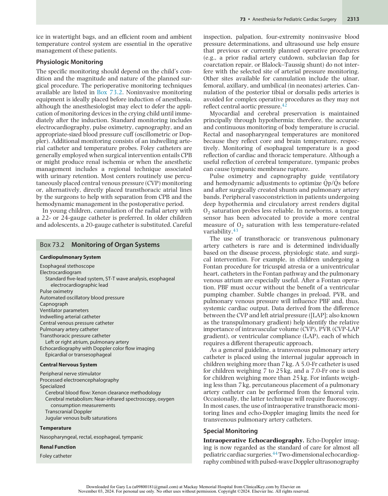

:::

<!-- PDF page 15 -->

and color flow mapping provide detailed morphologic and physiologic information in most operative cases. Using echoDoppler in the operating room, anatomic and physiologic data can be obtained before CPB, thus refining the operative plans. Prebypass echo- Doppler defines anesthetic and surgical management.44 Because of the unrestricted epicardial and TEE approaches in anesthetized patients, new findings are frequently discovered, and management plans are changed accordingly.

Postbypass echo- Doppler evaluation assesses the quality of the surgical repair and cardiac function by examining ventricular wall motion and systolic thickening.44 This technique can show residual structural defects after bypass, which can be immediately repaired, thus avoiding the patient leaving the operating room with significant residual structural defects that will require reoperation later. By identifying patients with right or left ventricular contraction abnormalities after bypass, as determined by a change in wall motion or systolic thickening, echo- Doppler guides immediate pharmacologic interventions. Significantly, postbypass ventricular dysfunction and residual structural defects identified by echo- Doppler imaging are associated with an increased incidence of reoperation and higher morbidity and mortality rates. Thus this monitoring tool helps assess the surgical repair and identify operative risk factors, hopefully improving outcomes.

Two techniques for intraoperative echo- Doppler imaging have been described: epicardial and TEE. Using TEE, the probe is placed after induction of anesthesia and intubation and is then available for patient monitoring. The advantage of this technique is its utility as a continuous monitor of cardiac structure and function without interrupting surgery.44,45 Because of its ideal imaging location, TEE has been especially helpful in evaluating pulmonary venous return and the integrity of the left AV valve after mitral valvuloplasty, complete AV valve repair, and correction of complex CHD. Early limitation in views has been virtually eliminated due to clinical experience and improved multiple images. Neonatal micro multiplane TEE probes are available for children as small as 2.0 kg and produce good- quality imaging.46 Potential hazards of TEE that merit vigilance include descending aorta and airway compression because of probe size or during probe flexion. There have been reports of esophageal damage during hypothermia and low or no flow states because of the heat energy the probe produces while connected to the TEE machine, leading most institutions to pause the imaging ability of the probe, disconnect the probe from the machine, or even remove it during the CPB period of the procedure.

A second technique for intraoperative echocardiographic analysis in children is the epicardial approach. This approach requires passing a clean, short- focused 5.0- or 7.0- MHz transducer over the anesthesia screen into a sterile sheath, which can then be placed on the epicardial surface of the heart. This technique best facilitates the probe manipulations necessary for a thorough interrogation of the heart’s major structures and dynamic function. The advantage of this approach is that all views can be obtained in patients of any size. Among the disadvantages are the need for sufficient operator skill and experience to perform the manipulations, the need to interrupt surgery to manipulate the probe, and the possible deleterious impact of direct

myocardial mechanical manipulation. Given current TEE capabilities, epicardial imaging is rarely employed.

**Central Nervous System Monitoring.** The primary goal of brain monitoring is to improve our understanding of cerebral function during cardiac surgery so that effective brain protection strategies can be developed. Because many of the determinants of normal brain perfusion become externally controlled by the cardiac team during CPB, such as flow rate (cardiac output), perfusion pressure, temperature, hematocrit, and PaCO2, a knowledge of the effect of these factors on the brain in neonates, infants, and children is essential. Numerous intraoperative techniques have been used for monitoring the brain to prevent secondary brain injury from hypoxia, ischemia, emboli, and electrophysiologic derangements. These have primarily included the following three modalities in isolation or combination: (1) electroencephalography (EEG) to assess perfusion- related changes in cortical activity; (2) transcranial Doppler imaging to measure arterial flow and resistance; and (3) near- infrared spectroscopy (NIRS) to provide a measure of venous- weighted, tissue oxyhemoglobin saturation. Additionally, the measurement of CBF and metabolism with specialized clinical research tools has been critical in furthering our understanding of brain function during and after surgery. Multimodal neurologic monitoring is also used to guide CPB, deep hypothermic circulatory arrest (DHCA), and regional low- flow cerebral perfusion techniques in neonatal arch reconstruction.47,48

Electroencephalographic monitoring allows the detection of ischemia or recognition of an adequate decrease in cerebral metabolic activity during hypothermia before DHCA. EEG helps monitor physiologic functions of the CNS during deep hypothermic bypass and total circulatory arrest. For example, the processed EEG can identify residual cerebral electrical activity during deep hypothermia and before total circulatory arrest. Isoelectric silence can then be induced by further cooling and any further brain activity detected by EEG. Because this residual electrical activity during an arrest is associated with ongoing cerebral metabolism, an isoelectric state may prevent ischemic injury to the brain during circulatory arrest. EEG also may be helpful in detecting the level and depth of anesthesia. Postoperative electroencephalographic analysis has demonstrated subclinical seizure activity in many high- risk patients, potentially linking these abnormalities to poorer neuropsychologic outcomes. The value of intraoperative electroencephalographic monitoring after CPB and the significance of the findings remains to be determined.

Transcranial Doppler imaging is used primarily for research purposes in infants and allows the detection of venous or arterial flow abnormalities and the detection of microemboli.49 This technology uses the Doppler principle to detect shifts in the frequency of reflected signals from blood in the middle cerebral artery to calculate blood flow velocity.50 Because the diameter of this large cerebral artery is relatively constant, the flow velocity can be used to approximate CBF. Transcranial Doppler imaging has several advantages: (1) it is noninvasive, (2) it does not require radiation exposure, (3) it is a continuous monitor, and (4) it captures rapid alterations in blood flow velocity caused by temperature or perfusion changes. The limitations of

<!-- PDF page 16 -->

transcranial Doppler monitoring include (1) reproducibility, especially at low flow rates, when small movements of the patient’s head can dramatically alter the signal, and (2) the lack of validating studies during hypothermic CPB, when hypothermia, reduced flow rates, and the laminar flow characteristics of nonpulsatile perfusion may limit the accuracy of CBF velocity measurements.

Transcranial Doppler imaging has been used to investigate the effect of CPB and DHCA on cerebral hemodynamics in children and assess the incidence of cerebral emboli. Recent studies examining the brain using transcranial Doppler have enabled several investigative groups to provide important information regarding normal and abnormal brain perfusion during cardiac surgery in children. Questions regarding cerebral perfusion pressure, autoregulation, the effect of PaCO2, and temperature have been addressed using transcranial Doppler imaging in children.51,52 This technique also has provided qualitative information regarding the presence of gaseous emboli in the middle cerebral artery during cardiac surgery.53

Near- infrared spectroscopy is a noninvasive monitor of cerebral tissue oxygenation, reflecting the balance of O2 delivery and consumption; it closely reflects oxygen saturation of the venous compartment, and correlates with jugular venous bulb saturations.54 There is significant interest in studying the ability of NIRS to predict outcomes, particularly on the neurodevelopmental spectrum. A study of infants undergoing the stage 1 Norwood procedure for HLHS demonstrated an association between low NIRS (particularly when less than 50%–60%) and poor neurodevelopmental outcomes.55 Although there was not a linear association, it provides evidence that NIRS can be used to detect clinically consequential hypoxia. Somatic and cerebral saturations are clinically relevant in the immediate postoperative period by predicting overall morbidity and mortality in patients with HLHS stage 1 palliation.56 The number of minutes of cerebral desaturation below 50% predicts morbidity and serves as an early warning sign for hypoxia, bleeding, and/or low cardiac output state.57 A decrease of greater than 20% from baseline in renal saturation as detected by NIRS for a period of 20 minutes has been associated with a longer duration of mechanical ventilation and intensive care unit (ICU) convalescence.58

A 2016 review of NIRS use in pediatric cardiac surgery identified several prospective trials, mostly observational, that found inconsistent results overall regarding improved clinical outcomes with NIRS use.59 Importantly, most evidence does not provide clear thresholds for cerebral or somatic NIRS, below which the chance of morbidity would increase, however, a study by Flechet _et al._ did show that a sustained NIRS value below 50% was associated with more prolonged ICU and hospital stays and longer duration of mechanical ventilation.60 Differences in longer- term cardiac, renal, or neurodevelopmental outcomes have not been demonstrated based on differences in NIRS values. Despite these reservations, NIRS remains an essential clinical tool to interpret alongside other monitoring technologies.61

CBF studies using xenon clearance technology have improved the understanding of cerebrovascular dynamics in young children during CPB, especially during deep hypothermia and after periods of circulatory arrest.62–64 In

general, this investigational tool has described the effects of CPB, temperature, and various perfusion techniques on CBF and, indirectly, on brain metabolism (Fig. 73.4). Studies using this methodology have shown that some of the mechanisms of CBF autoregulation, such as pressure- flow regulation, are lost with deep hypothermia and that cerebral reperfusion is impaired after a period of total circulatory arrest.

### Induction and Maintenance of Anesthesia

The principles of intraoperative management of cardiothoracic surgical procedures are based on understanding each disease process’s pathophysiology and working knowledge of the effects of the various anesthetic and other pharmacologic interventions on a particular patient’s condition. Selecting a technique for the induction of anesthesia needs to consider the degree of cardiac dysfunction, the cardiac defect, the degree of sedation provided by the premedication, and the presence of an indwelling catheter. In children with good cardiac reserve, induction techniques can vary in well- monitored patients. The titration of anesthetics for induction of anesthesia is more critical than the specific anesthetic technique in patients with reasonable cardiac reserve. A broad spectrum of anesthetic induction techniques have been used safely and successfully, including sevoflurane, isoflurane, N2O, intravenous and intramuscular ketamine, and intravenous propofol, fentanyl, and midazolam.65 Ketamine is often used in anesthetic induction in patients with cyanotic conditions because it increases SVR and cardiac output, thereby diminishing the magnitude of right- to- left shunting. Administration of ketamine can be intravenous or intramuscular, with the caveat that an intramuscular injection may result in pain, agitation, and subsequent arterial desaturation.

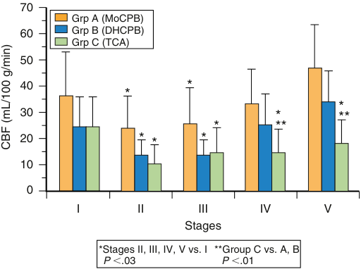

70 Grp A (MoCPB) 60 Grp B (DHCPB) Grp C (TCA) 50 40 * * 30 * ** * ** 20 * * * * 10 0 I II III IV V Stages *Stages II, III, IV, V vs. I  **Group C vs. A, B P  �.03 P  �.01 CBF (mL/100 g/min) 

**Fig. 73.4 Bar chart of the changes in cerebral blood flow (CBF) before, during, and after cardiopulmonary bypass (CPB) in 67 infants and children (mean ± SD).** Group A underwent repair with moderate hypothermic bypass (MoCPB) at 28°C to 32°C; group B, with deep hypothermic bypass (DHCPB) at 18°C to 22°C; and group C, with total circulatory arrest (TCA) at 18°C. Note the impaired cerebral reperfusion after total circulatory arrest (group C). Stage I, prebypass; stages II and III, during hypothermic bypass; stage IV, rewarmed on bypass; stage V, after bypass. (From Greeley WJ, Brusino FG, Ungerleider RM, et al. The effects of cardiopulmonary bypass on cerebral blood flow in neonates, infants, and children. _Circulation._ 1989;80:I209.)

::: warning 符號需核對
此頁有符號無法完整擷取，請展開下方原始頁面核對。
:::

::: details 原始表格與符號（PDF 第 16 頁）

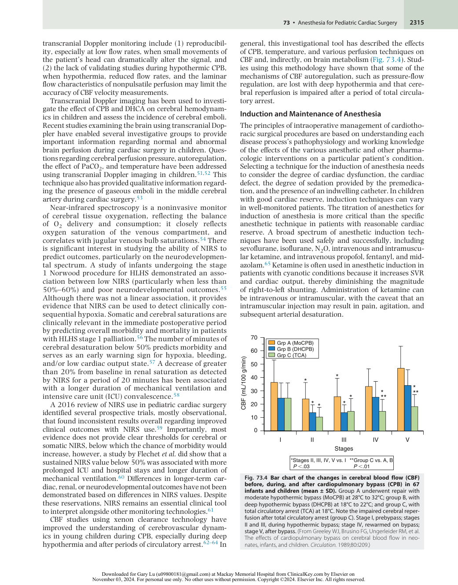

:::

<!-- PDF page 17 -->

Inhaled inductions are generally well tolerated by most children. An inhaled induction with sevoflurane can safely be performed even in cyanotic patients, such as those with TOF (Fig. 73.5). In these patients, who are at risk for rightto- left shunting and systemic desaturation, oxygenation is well maintained with a good airway and ventilation despite the reduction in systemic arterial pressure.66 Skilled airway management and ventilation efficiency are equally essential components of anesthetic induction. Recognizing the complexities of shunts and vascular resistance changes, as well as airway and ventilation effects on the cardiovascular system, is of primary importance during the induction of anesthesia.

After anesthetic induction, intravenous access is established or augmented as appropriate. A nondepolarizing muscle relaxant is usually administered, and an intravenous opioid and/or inhaled anesthetic is chosen for the maintenance of anesthesia. The child is preoxygenated with 100% fraction of inspired oxygen (FiO2), and an endotracheal tube is carefully positioned. Some degree of alveolar preoxygenation is recommended, even in the infant whose systemic perfusion might be jeopardized by lowering PVR with a resulting increase in PBF, as this maneuver delays desaturation during intubation. In some institutions, neonates who are expected to remain intubated postoperatively are intubated through the nasal route as it provides greater stability and patient comfort than an oral endotracheal tube. However, the prevalence of nasal intubation has decreased with the trend of earlier and even intraoperative extubation and new data showing an association between nasal intubation and increased infections in children older than six months of age. It is prudent to assess the depth and confirm the depth of the endotracheal tube with an X- ray. Unexpected extubation or endobronchial intubation secondary to the movement of the TEE probe can be catastrophic in these patients. Similarly, inspissated

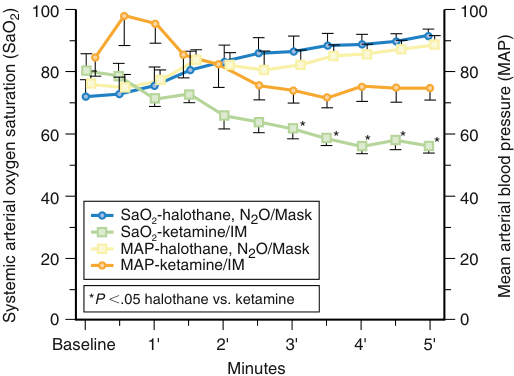

100 100 80 80 * 60 * * * * 60 40 40 SaO2-halothane, N2O/Mask SaO2-ketamine/IM MAP-halothane, N 2 O/Mask 20 MAP-ketamine/IM 20 * P  �.05 halothane vs. ketamine 0 0 Baseline 1' 2' 3' 4' 5' Minutes Mean arterial blood pressure (MAP) Systemic arterial oxygen saturation (SaO)2 

**Fig. 73.5 Comparative changes in arterial oxygen saturation (SaO2) and mean arterial pressure (MAP) during mask halothane nitrous oxide (** **_n_ = 7) and intramuscular ketamine (** **_n_ = 7) inductions in children with tetralogy of Fallot at risk for right- to- left shunting.** Note the maintenance of SaO2 in the halothane group despite the significant drop in MAP. _IM,_ intramuscular; _N2O_ , nitrous oxide. (From Greeley WJ, Bushman GA, Davis DP, et al. Comparative effects of halothane and ketamine on systemic arterial oxygen saturation in children with cyanotic heart disease. _Anesthesiology._ 1986;65:666–668.)

secretions in a tube with a small internal diameter can cause significant obstruction and may be made worse during periods of bypass when humidified ventilation is discontinued. Replacing the endotracheal tube may be warranted in patients who had been intubated preoperatively. Use of microcuff tubes has become acceptable in pediatric cardiac operating rooms and intensive care units.

Because of the diverse array of congenital heart defects and surgical procedures, an individualized anesthetic management plan is essential. The maintenance of anesthesia in these patients depends on the age and condition of the patient, the nature of the surgical procedure, the duration of the CPB, and the need for postoperative ventilation. An assessment of the hemodynamic objectives designed to lessen the pathophysiologic loading conditions should be developed for each patient, taking advantage of the known qualitative effects of specific anesthetic drugs and ventilatory strategies. These individualized plans must also be integrated with the overall perioperative goals to configure the optimal anesthetic. In patients with complex defects requiring preoperative inotropic and mechanical ventilatory support, a carefully controlled induction and maintenance anesthetic with a potent opioid is generally chosen. In patients with a simple ASD or VSD, a balanced anesthetic with inhaled anesthetics, opioid titration, and the use of dexmedetomidine is preferred. This allows for intraoperative tracheal extubation and a less prolonged period of intensive care monitoring. More important than the specific anesthetic techniques and drugs is the skilled execution of the anesthetic plan, considering patient response to drugs, the changes associated with surgical manipulation, and early recognition of intraoperative complications.

The reported changes in arterial blood pressure and heart rate from the inhaled anesthetic in normal children are also observed in pediatric cardiac surgical patients. We use potent inhaled anesthetics in almost all cases, including while on CPB, as part of a balanced anesthetic technique and for their direct protective effects against ischemia/ reperfusion myocardial injury.67,68

Desflurane has cardiorespiratory properties similar to those of isoflurane.69 Its main advantage is low blood gas and tissue solubility, allowing for rapid equilibration between the inspired and alveolar concentrations and a rapid decrease of alveolar concentrations during elimination.70 This provides greater precision in drug dosing during the operative period and may make desflurane a more titratable adjunctive drug for pediatric cardiac anesthesia. The three main disadvantages of desflurane are potency, pungency, and negative inotropic effect.71 Studies in normal infants and children suggest that one minimum alveolar concentration of desflurane requires concentrations of 8% to 10%.72,73 Desflurane is also quite pungent, and although its uptake is rapid, early experience with this drug for inhalation induction in children has reported a relatively high incidence of airway reactivity and laryngospasm.73–75 Although its negative inotropic effect is significantly less potent than halothane, desflurane should not be used as the sole anesthetic in patients with significant cardiac dysfunction.75

Sevoflurane has become the volatile anesthetic agent of choice. It offers a more tolerable aroma without the magnitude of myocardial depression that accompanies

::: warning 符號需核對
此頁有符號無法完整擷取，請展開下方原始頁面核對。
:::

::: details 原始表格與符號（PDF 第 17 頁）

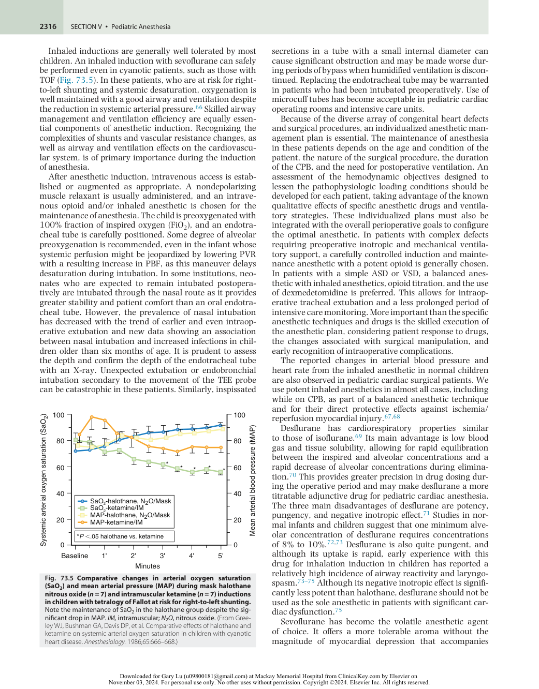

:::

<!-- PDF page 18 -->

halothane.76 In addition, its blood gas solubility is nearly as low as desflurane’s. Hemodynamically, sevoflurane tends to produce some tachycardia, particularly in older children, and preserve systemic arterial pressure.77 Reductions in heart rate and systemic arterial pressure are more modest in infants anesthetized with sevoflurane than in control subjects anesthetized with halothane. The former exhibit echocardiographic evidence of normal contractility and cardiac index. This effect is mainly seen in children with trisomy 21.78,79

Children with complex CHD and limited cardiac reserve demand an anesthetic technique that provides hemodynamic stability. Inhalation anesthetics are less tolerated as the sole primary anesthetic in patients with limited cardiac reserve, especially after CPB. Fentanyl is an excellent induction and maintenance anesthetic for this group of patients. Low- to- moderate doses of this opioid can be supplemented with inhalation anesthetics. Adding low concentrations of inhalation anesthetics to smaller doses of opioids shortens or eliminates the need for postoperative mechanical ventilation while maintaining the advantage of intraoperative hemodynamic stability. Postoperative mechanical ventilation will be required when a high- dose (e.g., fentanyl >20 mcg/kg) opioid technique is used. The hemodynamic effects of fentanyl at a dose of 25 mcg/kg with pancuronium given to infants in the postoperative period after operative repair of a congenital heart defect include no change in LAP, pulmonary artery pressure, PVR, and cardiac index and a slight decrease in SVR and mean arterial pressure.80 Because of its cardiovascular effects, pancuronium was considered an ideal neuromuscular blocking drug for pediatric heart surgery, but it is no longer available for clinical use. Therefore, either vecuronium or rocuronium is most often used. Larger total doses of fentanyl at 50 to 75 mcg/kg with rocuronium or vecuronium compared to doses of fentanyl at 50 to 75 mcg/kg with pancuronium result in a slightly larger decrease in arterial blood pressure and heart rate in infants undergoing repair for complex congenital heart defects.81 Despite the wide safety margin exhibited by this opioid, a selected population of infants and children with compensated hemodynamic function sustained by endogenous catecholamines may manifest more extreme cardiovascular changes with these doses. Fentanyl also has been shown to block stimulus- induced pulmonary vasoconstriction and contributes to the stability of the pulmonary circulation in neonates after congenital diaphragmatic hernia repair.82 Thus, the use of fentanyl may be extrapolated to the operating room, where stabilizing pulmonary vascular responsiveness in newborns and young infants with reactive pulmonary vascular beds is crucial to weaning from CPB and stabilizing shunt flow. Total fentanyl dose in the 8 to 12 mcg/kg range provides sufficient analgesia and allows early extubation in the operating room with stable hemodynamics during the procedure. Children receiving sufentanil for induction of anesthesia as a single dose of 5 to 20 mcg/kg have a stable preintubation period.83 Intubation and other stimuli, such as sternotomy, do not produce clinically significant alterations in hemodynamics, although changes are more significant than those with equipotent doses of fentanyl. The use of fentanyl as an infusion (1–2 mcg/kg/h) produces fewer alterations in heart rate and blood pressure. This is particularly

important in infants, in whom significant hemodynamic changes are poorly tolerated. For neonates with critical CHD, sufentanil anesthetic and postoperative infusion reduce morbidity after cardiac surgery compared with a halothane anesthetic and routine morphine postoperatively.84 The blunting of the stress response observed in this study probably accounted for the differences in morbidity; no comparison group representing a more typical dose of a phenylpiperidine opioid (e.g., fentanyl, 0–75 mcg/kg) was included to permit conclusions as to whether such large opioid doses are optimal.

In contrast to other opioids, remifentanil, an ultra- shortacting opioid, offers the unique advantage of metabolism by nonspecific and tissue esterases, thereby limiting the potential for accumulation related to protracted elimination.85 Remifentanil may provide benefits in the selected group of patients for whom the blunting of endogenous responses is desirable intraoperatively but potentially deleterious at the end of the procedure. A randomized controlled trial comparing equipotent doses of alfentanil and remifentanil for outpatient pediatric surgery revealed delayed emergence, requiring naloxone only in the alfentanil group.86 In both adults and children, remifentanil is associated with qualitative hemodynamic changes similar to those with other opioids, a variable tendency to bradycardia, and a slight decrease in arterial blood pressure.87–89

Because of the widespread use of opioids for pediatric cardiac surgery and the availability of invasive monitoring, the pharmacokinetics and pharmacodynamics of these drugs have been well studied.83 In general, the clinical pharmacology of fentanyl and sufentanil share the same age- related pharmacokinetic and pharmacodynamic features. For example, sufentanil has an increased clearance in patients 1 month to 12 years of age, comparable to adult clearance in adolescents (12–16 years of age), and a decreased clearance during the neonatal period (newborn to 1 month of age) (Table 73.7).74,78 Furthermore, sequential sufentanil anesthetics in neonates with CHD show marked increases in clearance and elimination between the first week and the third or fourth week of life (Fig. 73.6).89 The latter observation is most likely attributable to maturational changes in hepatic microsomal activity and improved hepatic blood flow from the closure of the ductus venosus. The variability in clearance and elimination, coupled with a limited cardiovascular reserve in the neonate during the first month of life, makes opioid dosing difficult in this age group. Careful titration of fentanyl 5 to 10 mcg/kg or sufentanil 1 to 2 mcg/kg

**Table 73.7** Sufentanil Pharmacokinetics in Pediatric Cardiovascular Patients

|**Age Group**|**t½ α (min)**|**t½ β (min)**|**Clearance** **(mL/kg/min)**|**Vdss (L/kg)**|
|---|---|---|---|---|
|1–30 days|23 ± 17|737 ± 346|6.7 ± 6.1|4.2 ± 1.0|
|1–24 months|16 ± 5|214 ± 41|18.1 ± 2.7|3.1 ± 1.0|
|2–12 years|20 ± 6|140 ± 30|16.9 ± 2.2|2.7 ± 0.5|
|12–18 years|20 ± 6|209 ± 23|13.1 ± 0.4|2.7 ± 0.5|

All values are mean ± standard deviations (see Forbess _et al_ .411 ). _t½ α_ , slow distribution half- life; _t½ β_ , elimination half- life; _Vdss,_ volume of distribution at steady state.

::: details 原始表格與符號（PDF 第 18 頁）

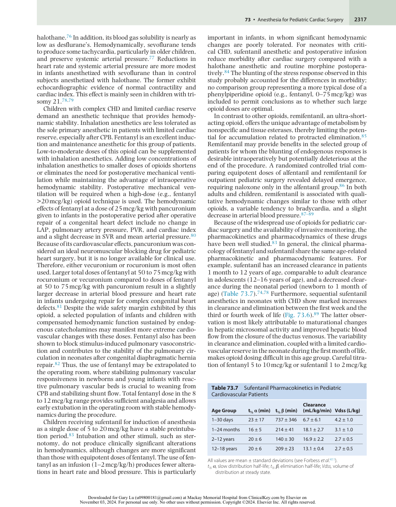

:::

<!-- PDF page 19 -->

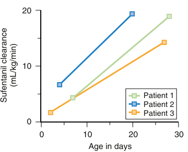

20 10 Patient 1 Patient 2 Patient 3 0 0 10 20 30 Age in days (mL/kg/min) Sufentanil clearance 

**Fig. 73.6 Sequential sufentanil clearance during the first month of life in three neonates with congenital heart disease.** Clearance of sufentanil increases above adult rates within the neonatal period. (Data from Greeley WJ, de Bruijn NP. Changes in sufentanil pharmacokinetics within the neonatal period. _Anesth Analg._ 1988;67:86–90.)

or the use of a continuous infusion technique provides the most reliable method of achieving hemodynamic stability. CPB, different institutional anesthetic practices, and individual patient differences influence the pharmacokinetic and pharmacodynamic disposition of opioids in ways that are not predictable. Even certain disease states such as TOF or pathophysiologic conditions such as increased intraabdominal pressure alter pharmacokinetic processes.80,81

Intraoperative use of methadone is an alternative pain control strategy introduced to counter acute tolerance to fentanyl infusions in the postoperative period. Adult and pediatric data suggest that intraoperative use of methadone as the primary opioid in CPB cases significantly reduced the use of other opioids in the postoperative period, improved pain scores, and enhanced patient- perceived quality of pain management.90,91 There is no pharmacokinetic data in children having CPB surgery, but available data show that the pharmacokinetic parameters in children and neonates are similar to those reported in adults and that there is no clearance maturation with age.92 In our experience, a dose of 0.2 to 0.4 mg/ kg for CPB surgeries allows early extubation in the operating room, is associated with good postoperative analgesia, and is associated with minimal postoperative respiratory depression. A nonopioid analgesic such as acetaminophen is used to facilitate early extubation and minimize postoperative opioid consumption. Once postoperative bleeding subsides, ketorolac can be added for pain control. Other strategies to address opioid tolerance include alternating opioid drugs, instituting opioid holidays, the addition of benzodiazepines on an as- needed basis, and the use of dexmedetomidine infusions.

Dexmedetomidine is an α2- agonist approved by the US Food and Drug Administration (FDA) for adult sedation. It has been used in pediatric anesthesia as part of a balanced technique preoperatively and intraoperatively for sedation, anxiolysis, and analgesia, and postoperatively for the prevention of emergence delirium and sedation.93 Dexmedetomidine has significant analgesic and anti- inflammatory effects, attenuates the neuroendocrine response to surgery, and has no neurotoxic effects; it is a crucial adjunct to a balanced anesthetic as it reduces the need for other analgesics and hypnotics.94–96

When used as an infusion, the pharmacodynamic effects of dexmedetomidine are generally well tolerated.97 The clinical effects are predictable and usually insignificant, with slight lowering of both heart rate and arterial blood pressure compared to baseline.98 However, when administered as a rapid bolus, the first physiologic effect noted is hypertension along with heart rate slowing, lasting approximately 2 to 5 minutes before arterial blood pressure decreases.99

Dexmedetomidine demonstrates cardiac conduction effects via direct depression of the sinus and AV nodes in the heart and decreased sympathetic tone in the locus coeruleus.100 Clinically, this translates into a significant reduction in the incidence of junctional ectopic tachycardia post- CPB.101,102 However, some studies and case reports, mainly in the adult literature, have documented clinically significant bradycardia, hypotension, and even asystole with its use. It is necessary to remain vigilant and titrate dexmedetomidine carefully. Dexmedetomidine should be used with caution in children at risk for bradycardia or sinus or AV node dysfunction and possibly in patients who have had a heart transplant.103 At our institution, dexmedetomidine is used in almost every case, with an infusion of 0.2 mcg/kg/h in neonates and 0.5 mcg/kg/h in all other cases initiated postinduction. The infusion is continued throughout the surgery and into the postoperative period. This practice is beneficial to facilitate early extubation, but a higher dose (1 to 2 mcg/kg/h) is often needed to keep the child calm during transport to the ICU.

## Cardiopulmonary Bypass

### DIFFERENCES BETWEEN ADULT AND PEDIATRIC CARDIOPULMONARY BYPASS

The physiologic effects of CPB on neonates, infants, and children are significantly different from the effects on adults (Table 73.8). During CPB, pediatric patients are exposed to biologic extremes not seen in adults, including deep hypothermia (18°C), hemodilution (threefold to fivefold more significant dilution of circulating blood volume), low perfusion pressures (20–30 mm Hg), wide variation in pump flow rates (ranging from total circulatory arrest to 200 mL/ kg/min), and differing blood pH management techniques (α- stat, pH- stat, or both sequentially). These parameters deviate far from normal physiology and affect the preservation of normal organ function during and after CPB. In addition to these prominent changes, subtle variations in glucose supplementation, cannula placement, presence of aortopulmonary collaterals, and patient age affect organ function during CPB.

Adult patients are infrequently exposed to such biologic extremes; temperature is rarely lowered below 25°C, hemodilution is more moderate, perfusion pressure is generally maintained at 50 to 80 mm Hg, flow rates are maintained at 50 to 65 mL/kg/min, and pH management strategy is less consequential because of moderate hypothermic temperatures and rare use of circulatory arrest. Variables such as glucose supplementation rarely pose problems in adult patients owing to large hepatic glycogen stores. Venous and arterial cannulae are less deforming of the atria and aorta, and their placement is more predictable. Although

<!-- PDF page 20 -->

**Table 73.8** Differences Between Adult and Pediatric Cardiopulmonary Bypass

|**Parameter**|**Adult**|**Pediatric**|
|---|---|---|
|Hypothermic temperature|Rarely below 25°C–30°C|Commonly 15°C–20°C|
|Use of total circulatory arrest|Rare|Common|
|Pump prime|||
|Dilution effects on blood volume|25%–33%|150%–300%|
|Additional additives in pediatric primes||Blood, albumin|
|Perfusion pressures|50–80 mm Hg|20–50 mm Hg|
|Influence ofα- stat versus pH- stat management strategy|Minimal at moderate hypothermia|Marked at deep hypothermia|
|Measured PaCO2 differences|30–45 mm Hg|20–80 mm Hg|
|Glucose regulation|||
|Hypoglycemia|Rare – requires significant hepatic injury|Common – reduced hepatic glycogen stores|
|Hyperglycemia|Frequent – generally easily controlled with insulin|Less common – rebound hypoglycemia may occur|

_PaCO2,_ arterial partial pressure of carbon dioxide.

superficially similar, the conduct of CPB in children differs considerably from that in adults. Marked physiologic differences in response to CPB in children can occur. Additionally, several modifiable intraoperative factors can influence neuropsychologic morbidity (Box 73.3).

### Volume of Priming Solutions

The priming solutions used in pediatric CPB are essential because of the disproportionately large priming volume– to–blood volume ratio in children. In adults, the priming volume is equivalent to 25% to 33% of the patient’s blood volume, whereas in neonates and infants, the priming volume may exceed the patient’s blood volume by 200%. With contemporary low- volume bypass circuits (e.g., smallvolume oxygenators, smaller tubing), a small neonate’s priming volume is not more than one blood volume. Care must be taken, therefore, to achieve a physiologically balanced priming solution and limit the volume as much as possible. Most pediatric priming solutions, however, have quite variable levels of electrolytes, calcium, glucose, and lactate. Electrolytes, glucose, and lactate levels may be relatively high if the solution includes large amounts of banked blood or quite low if a minimal amount of banked blood is added. Calcium levels are generally very low in pediatric priming solutions; this may contribute to the rapid slowing of the heart with the initiation of bypass.

The main constituents of the priming solution include crystalloid, colloid, and, if necessary, banked blood to maintain a temperature- appropriate hematocrit. Other potential supplements are fresh frozen plasma, mannitol, a buffer (sodium bicarbonate or trishydroxymethylaminomethane

### Box 73.3 Central Nervous System Injury and Potential Modifiable Intraoperative Factors

Air or particulate embolus Rate and depth of core cooling (if used) Deep hypothermic circulatory arrest (if used) Reperfusion injury and inflammation Rate of core rewarming/hyperthermia Hyperglycemia Hyperoxia pH management during cardiopulmonary bypass Hematocrit management during cardiopulmonary bypass

[THAM]), and steroids. Low concentrations of plasma proteins have been shown experimentally to impair lymphatic flow and alter pulmonary function by increasing capillary leak.104 Although adding albumin to the pump prime has not been shown to change the outcome in adults during CPB, one study suggested that maintaining normal colloid osmotic pressure may improve survival in infants undergoing CPB.105,106

Whole blood is an alternative to adding packed RBCs and fresh frozen plasma if available. Blood cells are added to the prime solution to maintain a postdilutional hematocrit of at least 20% to 25% (usually higher in patients with cyanotic CHD), and plasma restores levels of procoagulants. Low- volume bypass circuits enable perfusionists and anesthesiologists to share a single unit of whole blood, thereby limiting the donor.

Adding blood products will cause a much higher glucose load in the priming solution. Hyperglycemia may increase the risk of neurologic injury if brain ischemia occurs. Mannitol is added to promote osmotic diuresis and scavenge O2 free radicals from the circulation. Steroids are added to stabilize membranes and produce the theoretic advantage of reducing ion shifts during ischemia, attenuating inflammation caused by CPB, decreasing low cardiac output states, and improving fluid balance in the postoperative period. Steroids, however, may raise glucose levels, which can be detrimental if there is a period of cerebral ischemia and may suppress immune function. Steroids remain a controversial additive in priming solutions, as many contradicting studies exist in the literature. None of them show any mortality benefit; however, some show correlation with adverse events such as acute kidney injury, while others show benefit with decreased inotropic use and ventilator days.107–110 Recent retrospective data suggest adverse effects with its use and an association with reduced survival in neonates having the Norwood procedure.111 Several prospective studies are ongoing to address the role of steroids in pediatric cardiac surgery.

### Temperature

Hypothermic CPB is used to preserve organ function during cardiac surgery. Three distinct methods of CPB are used: moderate hypothermia (25°–32°C), deep hypothermia (18°C), and DHCA. The choice of method of bypass is based on the required surgical conditions, patient size, type of operation, and potential physiologic impact on the patient.

Moderate hypothermic CPB is the principal method of bypass employed for older children and adolescents. In these patients, venous cannulae are less obtrusive, and the

::: details 原始表格與符號（PDF 第 20 頁）

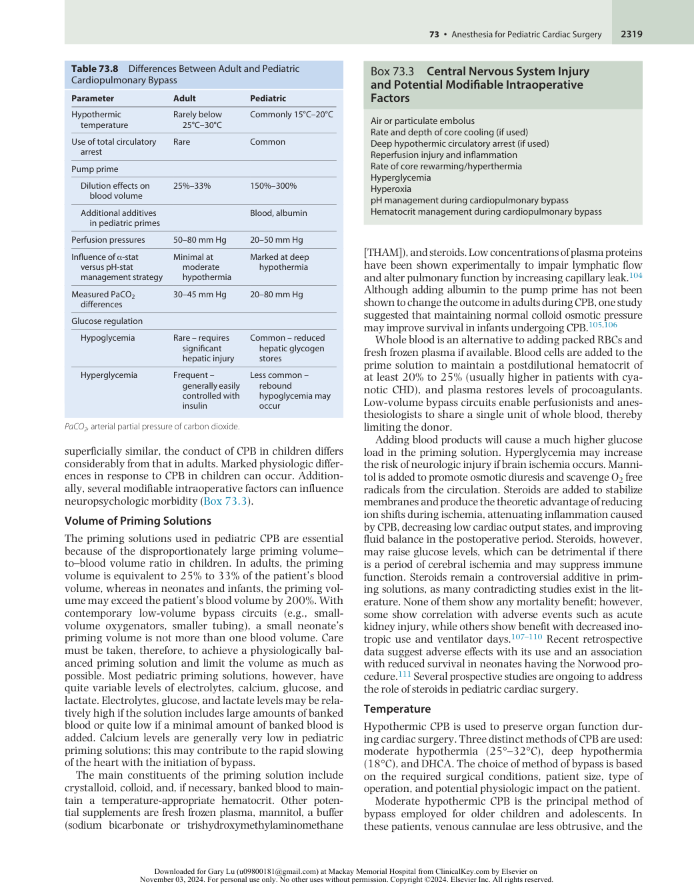

:::

<!-- PDF page 21 -->

heart can easily accommodate superior and inferior vena cava cannulation. Bicaval cannulation reduces right atrial blood return and improves the surgeon’s ability to visualize intracardiac anatomy. Mild to moderate hypothermia may also be chosen for less-demanding cardiac repairs, such as an ASD or uncomplicated VSD. Most surgeons cannulate the inferior and superior venae cavae in neonates and infants. However, this approach is technically more difficult in these patients and likely to induce brief periods of hemodynamic instability. Additionally, the pliability of the venae cavae and the rigidity of the cannulae may result in caval obstruction, impaired venous drainage, and elevated venous pressure in the mesenteric and cerebral circulation.

Deep hypothermic CPB is generally reserved for neonates and infants requiring complex cardiac repair. However, certain older children with complex cardiac disease or severe aortic arch disease benefit from deep hypothermic temperatures. For the most part, deep hypothermia is selected to allow the surgeon to operate under conditions of low- flow CPB or total circulatory arrest. Low pump flows (50 mL/kg/ min) improve the operating conditions for the surgeon by providing a nearly bloodless field. DHCA allows the surgeon to remove the atrial or aortic cannula. Surgical repair is more precise if this technique is used because of the bloodless and cannula- free operative field. Arresting the circulation, even at deep hypothermic temperatures, introduces the concern of how well deep hypothermia preserves organ function, with the brain at the most significant risk. Threeregion perfusion techniques may be an option for deep hypothermic CPB, but further studies are needed to assess the feasibility and outcomes of this newer strategy.

### Hemodilution

Hemodilution is used during CPB to decrease homologous blood use and improve microcirculatory flow by reducing blood viscosity during periods of hypothermia. Although hemoconcentrated blood has an improved O2- carrying capacity, its viscosity reduces efficient flow through the microcirculation. With hypothermic temperatures, blood viscosity increases significantly, and flow decreases. Hypothermia, coupled with the nonpulsatile flow of CPB, impairs blood flow through the microcirculation. Blood sludging, small vessel occlusion, and multiple areas of tissue hypoperfusion may result. Therefore, hemodilution is an essential consideration during hypothermic CPB.

However, the appropriate level of hemodilution for a given hypothermic temperature is not well defined. Furthermore, hemodilution reduces perfusion pressure; increases CBF, thereby potentially increasing the microembolic load to the brain; and reduces the O2- carrying capacity of the blood.112 Using an animal model, one group of investigators found that extreme hemodilution to a hematocrit of less than 10% resulted in inadequate O2 delivery. Still, with higher hematocrit levels of 30%, there was improved cerebral recovery after DHCA.113 Jonas and colleagues114 confirmed these findings in a randomized trial using two hemodilution protocols (20% vs. 30% hematocrit) in infants younger than nine months of age. In the short term, the group with lower hematocrit values had lower nadirs of cardiac index, higher serum lactate levels 1 hour after CPB, and a more significant increase in total body water on the first postoperative day. At 1 year of age, mental development index scores

were similar, but psychomotor development index scores were significantly lower in the group with lower hematocrit values. Also, infants in this group had psychomotor development scores that were two standard deviations below the mean. Because RBCs serve as the primary reservoir of O2 during circulatory arrest, especially during rewarming, hematocrit values closer to 30% are generally preferred for deep hypothermia when this technique is contemplated. Currently, most centers maintain hematocrit levels of approximately 25% to 30% during CPB, enhancing O2 delivery to vital organs such as the brain. Cerebral O2 delivery is critical because cerebral autoregulation is impaired at deep hypothermic temperatures and after DHCA.

To achieve a hematocrit level of 25% to 30% in neonates and infants, banked blood should be added to the priming solution. The mixed hematocrit level on CPB (the hematocrit level of the total priming volume plus the patient’s blood volume) can be calculated by the following formula:

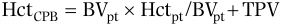

HctCPB  BVpt  Hctpt/BVpt  TPV 

where HctCPB is the mixed hematocrit (TPV + BVpt), BVpt is the patient’s blood volume (weight in kilograms × estimated blood volume in milliliters per kilogram), TPV is the total priming volume, and Hctpt is the starting hematocrit level of the patient. This calculation allows an estimate of the patient’s hematocrit level using an asanguinous priming solution and is useful for older children and adolescents. In neonates and infants, the perfusionist must add blood to the pump prime to achieve the desired hematocrit level during hypothermic CPB. The following formula estimates RBCs in milliliters that must be added to the prime volume to achieve this hematocrit level:

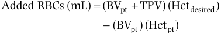

Added RBCs (mL)  (BVpt  TPV)(Hctdesired)  (BVpt )(Hctpt) 

where BVpt is the patient’s blood volume, TPV is the total priming volume, Hctdesired is the desired hematocrit level on CPB, and Hctpt is the starting hematocrit level of the patient.

Like in adults, the optimal hematocrit level after weaning from CPB is not clear for pediatric patients. Based on the patient’s post- repair function and anatomy, decisions concerning post- CPB hematocrit levels are made. Neonates, patients with residual hypoxemia, and those with moderate- to- severe myocardial dysfunction benefit from the improved O2- carrying capacity of hematocrit levels of 40% or higher. Patients with a physiologic correction and excellent myocardial function may tolerate hematocrit levels of 25% to 30%.115 In children with mild- to- moderate myocardial dysfunction, accepting hematocrit values between these levels seems prudent. Therefore, in patients with physiologic correction, moderately good ventricular function, and hemodynamic stability, the risks associated with blood and blood product transfusion should be strongly considered during the immediate postbypass period.

### Anticoagulation Management During Cardiopulmonary Bypass

CPB requires systemic anticoagulation, and heparin is the most used drug. Heparin is traditionally administered based on patient weight at an empiric dose of 400 units/kg. Adequacy of heparinization is monitored by the activated clotting time (ACT), a measure of inhibition of the contact

<!-- PDF page 22 -->

activation pathway. An ACT of greater than 480 seconds is considered sufficient initiation of CPB. An accurate ACT requires normothermia, normal platelet count and function, and normal levels of other coagulation proteins, including antithrombin III. As these derangements are common in children having cardiac surgery, the ACT may not be an ideal monitor of anticoagulation in this population. In neonates, infants, and young children, the ACT does not correlate with plasma heparin concentration,116 and children exhibit evidence of ongoing thrombin generation and coagulation activity despite very high ACT values.117

An alternative to weight- based heparin dosing is a blood heparin concentration–based system, which utilizes protamine titration to indicate whole blood heparin concentration at the bedside. Such a setup allows for individual variability in heparin efficacy and metabolism. Weightbased heparin dosing methods used less heparin when compared to the dosing protocols based on whole blood heparin concentrations, but they were associated with high thrombin generation. Although blood heparin concentration devices have shown disappointing results in adults, a randomized controlled use of a heparin concentration– based approach was associated with a reduced number of blood transfusions and improved clinical outcomes of ventilator hours and ICU stay.118 Blood heparin concentration systems also account for bypass circuit characteristics when deciding the heparin dose in the bypass prime. In the absence of such a system, empiric dosing is recommended at 1 to 3 units/mL of priming solution.

An essential caveat to anticoagulation management in infants is the role of antithrombin III, the body’s most abundant natural anticoagulant and mediator for heparin efficacy. Heparin exerts its anticoagulant effect by accelerating the reaction between thrombin and antithrombin. Neonates have low levels of antithrombin III activity,119 and reach normal levels after three months of age. Children with CHD generally have a functional antithrombin III level of approximately 50%.120 Low antithrombin activity is one reason for low heparin sensitivity in the pediatric cardiac population; however, large clinical trials examining the role of antithrombin III replacement have not been conducted. In addition, other heparin cofactors, including α2- macroglobulin, may play an important, though poorly understood, role in anticoagulation in young children.121

The neonatal coagulation system is a complex physiologic system that matures during the first six months after birth. Some procoagulant components of the coagulation cascade are measured at a lower level, while other factors differ qualitatively from the corresponding adult factors. Platelet function is also remarkably decreased during the first weeks of life. The fetal form of fibrinogen, a qualitatively dysfunctional protein, is measurable during the first year of life. AT levels are low at birth and reach adult levels only after three months. The clinical implications of the qualitative and quantitative features of the neonatal hemostatic system are still poorly understood. Although procoagulant and factor levels may be reduced in young patients with CHD resulting from immature or impaired hepatosynthesis,122 functional bleeding tendencies are usually absent before surgery. However, patients with cyanotic heart disease demonstrate bleeding tendencies before the surgery because of a range of factors, including thrombocytopenia,

low numbers of von Willebrand factor multimers, clotting factor deficiencies, and poor fibrinogen function.123

Heparin is neutralized with protamine according to the quantity of heparin administered or based on body weight; usually 2 to 4 mg/kg, accounting for heparin administered to the patient only (excluding heparin added to the pump prime). Blood heparin concentration devices are often used to dose protamine according to the amount of circulating heparin in the patient, accounting for metabolism or recent dosing. Younger children require relatively more protamine than older children and adults, as reflected by higher circulating heparin levels after CPB.124 Prolonged ACT after adequate protamine dosing indicates platelet dysfunction, hypofibrinogenemia, or other coagulation abnormalities. This should be assessed before administering additional protamine, which in excess may contribute to postoperative bleeding.125

Antifibrinolytics are consistently used for neonatal and pediatric cardiac surgeries to minimize the activation of fibrinolytic pathways, improve clot stability, and minimize post–cardiopulmonary bypass bleeding. These drugs exert their effects by reversibly binding to lysine analogue sites on plasminogen and reducing the generation of plasmin. Plasmin is an endopeptidase molecule that breaks down fibrinogen and fibrin. By inhibiting plasminogen, plasmin, and lysin analogues, the procoagulant effects of fibrin remain. Aprotinin, a protease inhibitor, is a potent fibrinolytic agent and was the most used antifibrinolytic agent till 2007. Even though two extensive retrospective studies did not demonstrate an increase in renal failure or mortality, it was removed from the United States based on the adult data. Until it has been shown to be safe to use in new studies, it should likely not be considered in neonates and children.126–131 Currently used lysine analogues and ɛ-aminocaproic acid are less effective in producing fibrinolytic inhibitory effects _in situ_ . Still, in small prospective studies and meta- analysis, the use of tranexamic acid reduced the blood product.132 In the absence of pharmacokinetic studies and a lack of methods to measure _in vivo_ fibrinolytic activity, there is a large variability in dosing methods used in different studies. In noncardiac patients, a lower dose of tranexamic acid (10 mg/kg bolus followed by 10 mg/kg/h infusion) was as effective as a higher-dose regimen. Based on recent studies in cardiac patients, a tranexamic acid bolus of 30 mg/kg followed by an infusion of 10 mg/kg/h has been recommended for neonatal, and pediatric cardiac surgeries. For older patients, a lower loading dose of 10 mg/ kg, followed by the infusion, achieves plasma concentration sufficient to produce significant suppression of fibrinolytic activity.133 High- dose tranexamic acid should be avoided due to the increased risk of seizures.126

### BLOOD GAS MANAGEMENT

The theoretic benefit of α- stat versus pH- stat blood gas management during hypothermic CPB has been a topic of great debate. Although the pH- stat strategy may not be optimal for adults in whom the principal risk for brain injury is microembolism, this risk is thought to be lower in infants because of the lack of atherosclerotic disease. With pH- stat management, adding CO2 to the inspired gas mixture during cooling on CPB increases CBF and may improve cerebral tissue oxygenation and outcomes.

<!-- PDF page 23 -->

The controversial issue of pH management during CPB has been addressed in a large Boston Children’s Hospital study. In this study, infants younger than nine months were randomized to α- stat versus pH- stat during deep hypothermic CPB with excellent long- term follow- up.134,135 Neurodevelopmental outcomes were evaluated in infants undergoing biventricular repair for various cardiac defects when younger than nine months. The short- term benefits of the pH- stat strategy included a trend toward less postoperative morbidity and shorter recovery time to the first electroencephalographic activity. In patients with TGA, there was a shorter duration of intubation and ICU stay in patients.134 However, the use of the α- stat or pH- stat strategies was not consistently related to either improved or impaired neurodevelopmental outcomes at 2- and 4- year follow- ups.135

### INITIATION OF CARDIOPULMONARY BYPASS

After adequate systemic coagulation is confirmed, aortic cannulation is performed. For most intracardiac surgical repairs, two separate venous cannulae, one each in the superior and inferior vena cava, are placed to drain blood away from the cardiac cavity. Once the aortic and venous cannulae are positioned and connected to the arterial and venous limb of the extracorporeal circuit, bypass is initiated. The arterial pump is slowly started, and venous blood is drained into the oxygenator once the forward flow is ensured. Flowing before unclamping the venous line prevents the potential problem of exsanguination if aortic dissection or misplacement of the aortic cannula occurs. Neonates and infants have a low blood volume–to–priming volume ratio, so as the intravascular volume falls after unclamping of the venous line, the pump flow rate is gradually increased until full circulatory support is achieved. The height difference between the patient and the oxygenator inlet and the diameter of the venous cannula and line tubing determines the rate at which venous blood is drained from the patient. Venous drainage can be increased by using vacuum- assisted drainage under certain circumstances.

High line pressure and inadequate venous return are usually caused by malposition or kinking of the arterial and venous cannulae. A malpositioned arterial or venous cannula placed in the heart before initiating CPB can result in significant problems in the peri- bypass period. A malpositioned venous cannula has the potential for vena cava obstruction. The problems of venous obstruction are magnified during CPB in the neonate because arterial pressures are normally low (20–40 mm Hg), and large, relatively stiff cannulae easily distort these very pliable venous vessels.104,106 A cannula in the inferior vena cava may obstruct venous return from the splanchnic bed, resulting in ascites from increased hydrostatic pressure or directly reduced perfusion pressure across the mesenteric, renal, and hepatic vascular beds. Significant renal, hepatic, and gastrointestinal dysfunction may ensue and should be anticipated in the young infant with unexplained ascites. Similar cannulation problems may result in superior vena cava obstruction. This condition may be more ominous during bypass. Under these circumstances, three issues may ensue: (1) cerebral edema, (2) a reduction in regional or global CBF, and (3) a reduced proportion of pump flow reaching the cerebral circulation, causing inefficient brain cooling.

In the operating room, superior vena cava pressures via an internal jugular catheter should be monitored by examining the patient’s head for signs of suffusion after initiating bypass. Discussions with the perfusionist regarding the adequacy of venous return and large cooling gradients between the upper and lower body should alert the anesthesiologist and the surgeon to potential venous cannula problems. Patients with anomalies of the large systemic veins (persistent left superior vena cava or azygous continuation of an interrupted inferior vena cava) are at particular risk for problems with venous cannulation and drainage.

Problems with aortic cannula placement can occur. The aortic cannula may slip beyond the innominate artery’s takeoff, with blood selectively flowing to the right side of the cerebral circulation. Also, the position of the tip of the cannula may promote preferential flow down the aorta or induce a Venturi effect to steal flow from the cerebral circulation. This problem has been confirmed during CBF monitoring by the appearance of significant discrepancies in flow between the right and left hemispheres after initiating CPB. Large aortic- to- pulmonary collaterals, such as a large PDA, may also divert blood to the pulmonary circulation from the systemic circulation, thereby reducing CBF and the efficiency of brain cooling during CPB. The surgeon should gain control of the ductus before or immediately after instituting CPB to eliminate this problem. Large aortopulmonary collaterals should be embolized in the cardiac catheterization laboratory before the operative procedure. Neonates with significant aortic arch abnormalities (e.g., aortic atresia, interrupted aortic arch) may require radical modifications of cannulation techniques, such as placing the arterial cannula in the main pulmonary artery and temporarily occluding the branch pulmonary arteries to perfuse the body via the PDA or even dual arterial cannulation of both the ascending aorta and main pulmonary artery. Such adaptations require careful vigilance to ensure adequate, thorough perfusion and cooling of vital organs.

In neonates and infants, deep hypothermia is commonly used. For this reason, the pump prime is kept cold (18°C–22°C). When the cold perfusate contacts the myocardium during the institution of CPB, the heart rate slows immediately, and contraction is impaired. The contribution of total blood flow pumped by the infant’s heart rapidly diminishes. Therefore, the arterial pump must reach full flows quickly to sustain adequate systemic perfusion at or near normothermic temperatures.

As coronary artery disease is rare, the myocardium should cool evenly unless distortion caused by the cannulae compromises the coronary arteries. When a cold prime is used, caution must be exercised in using the pump to infuse volume before initiating CPB. Infusion of cold perfusate may result in bradycardia and impaired cardiac contractility before the surgeon is prepared to initiate CPB.

Once CPB is initiated, appropriate circuit connections, myocardial perfusion, and optimal cardiac decompression should be confirmed. Ineffective venous drainage can rapidly result in ventricular distention. This is especially true in infants and neonates, whose ventricular compliance is low, and the heart is relatively intolerant of excessive preload augmentation. If ventricular distention occurs, pump flow must be reduced, and the venous cannula repositioned.

<!-- PDF page 24 -->

Alternatively, the heart may be decompressed by placing a cardiotomy suction catheter or small vent in the appropriate chamber.

### PUMP FLOW RATES

Recommendations for optimal pump flow rates for children have historically been based on the patient’s body mass and on evidence of efficient organ perfusion as determined by arterial blood gases, acid–base balance, and whole- body O2 consumption during CPB.136 At hypothermic temperatures, metabolism is reduced, and CPB flow rates can therefore be reduced and still meet or exceed the tissue’s metabolic needs (see the discussion of low- flow CPB in the following section).

### SPECIAL TECHNIQUES

### Deep Hypothermic Circulatory Arrest

A specific subset of neonates, infants, and children with CHD require extensive repair of complex congenital heart defects using DHCA. This technique facilitates precise surgical repair under optimal conditions, with no blood or cannulae in the operative field and providing maximal organ protection and often resulting in shortened total CPB time. The scientific rationale for using deep hypothermic temperatures rests primarily on a temperature- mediated reduction of metabolism. Whole- body and cerebral O2 consumption during induced hypothermia decreases the metabolic rate for O2 by a factor of 2 to 2.5 for every 10ºC reduction in temperature.137 These results are consistent with _in vitro_ models, which relate temperature reduction to a decrease in the rate constant of chemical reactions, as described initially by Arrhenius using the equation k = Ae − RT. The reduction in O2 supply during deep hypothermic low- flow CPB is associated with preferential increases in vital organ perfusion (e.g., to the brain) and increased extraction of O2.138 Therefore, to some extent, deep hypothermic low- flow CPB exerts a protective effect by reducing the metabolic rate for O2, promoting preferential organ perfusion, and increasing tissue O2 extraction.

The duration of the safe period for DHCA has not yet been delineated.139 Although all organ systems are at risk for developing ischemic and reperfusion injury, as manifested by lactate and pyruvate production during DHCA, the brain appears to be the most sensitive to and the least tolerant of these effects. Brainstem and cortical evoked potentials and processed electroencephalographs are altered after DHCA.139–141 The abnormalities in evoked potentials appear to be related to the duration of DHCA and are attributed to altered metabolism. During reperfusion after the arrest period, CBF and metabolism remain depressed in neonates and small infants (Fig. 73.7; also see Fig. 73.4).63 Importantly, during the use of these extremes of temperature, autoregulation is lost, and cerebral perfusion becomes highly dependent on the extracorporeal perfusion and presumably postbypass hemodynamic performance.

The potentially deleterious effects of prolonged DHCA in infants and neonates are well described. In general, it is agreed that very protracted periods of uninterrupted DHCA may have adverse neurologic outcomes. However, considerable disagreement exists if a “safe” period of DHCA exists and whether patient- specific, procedure- specific, or

postoperative management strategies may attenuate or promote CNS damage from DHCA. Cases have been reported of detrimental effects of DHCA on various outcomes regarding the CNS, while others have described an inconsistent effect or no effect.134,142,143 Three issues have become apparent over time: (1) the effects of short durations of DHCA are inconsistently related to adverse outcomes; (2) the effect of DHCA is not a linear phenomenon; and (3) the effects are most likely modified by other patient- related, preoperative, and postoperative factors.143–145 A large- scale study of 549 subjects undergoing the Norwood stage 1 procedure with DHCA found a duration of greater than 45 minutes to be a risk factor for 30- day mortality.146

### Regional Cerebral Perfusion

Some surgeons have developed innovative and challenging strategies to provide continuous cerebral perfusion during the complex aortic arch or intracardiac repair reconstruction to avoid or minimize the use of DHCA. However, by avoiding DHCA, the duration of CPB is necessarily lengthened, and longer durations of CPB have been shown to affect both short- and long- term outcomes adversely.45 The relative risks and benefits of longer CPB versus less (or no) DHCA remain controversial. In efforts to study this newer strategy, two recent studies have evaluated the technique of regional cerebral perfusion. In one non- randomized study, Wypij and colleagues147 followed 29 infants who underwent stage one palliation, nine of whom received regional cerebral perfusion at 30 to 40 mL/kg/min. The authors reported no difference in mental or psychomotor developmental indices at one year of age between the regional cerebral perfusion group and those who received DHCA as a primary strategy. A larger randomized trial of DHCA with or without regional cerebral perfusion at 20 mL/kg/min in patients with a functional single ventricle included 77 patients with similar survival to hospital discharge (88%) and at 1- year follow- up (75%).148 No significant difference was seen in either the psychomotor development index or the mental development index scores between the two

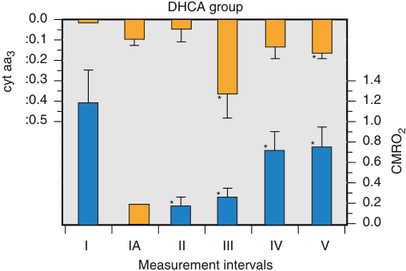

DHCA group 0.0 :0.1 :0.2 * :0.3 1.4 :0.4 * 1.2 :0.5 1.0 * * 0.8 0.6 0.4 * * 0.2 0.0 I IA II III IV V Measurement intervals cyt aa3 CMRO2 

**Fig. 73.7 Bar graph of variations in cytochrome oxidase (cyt aa3) near- infrared spectroscopic signals and cerebral metabolic rate for oxygen (CMRO2) in subjects with deep hypothermic circulatory arrest (DHCA).** Each point of cyt aa3 represents mean ± SE in six subjects; CMRO2 values are mean ± SD. Negative values in cyt aa3 represent relative decreases in quantity of oxidized enzyme. *CMRO2 and cyt aa3 are significantly different from control, _P_ ± .05.

<!-- PDF page 25 -->

groups at any time point. However, the scores tended to be lower in the regional cerebral perfusion group.

A further innovation to the previously described technique is a three- region perfusion strategy for aortic arch reconstruction in the Norwood procedure. This strategy involves direct perfusion of the coronaries via a proximal aortic cannula, splanchnic beds via a distal thoracic aorta cannula, and cerebral perfusion via an innominate cannula. The arch repair occurs from distal to proximal at warmer patient temperatures and with a beating heart. This theoretically provides the potential for decreased coronary and splanchnic ischemic times, reducing the risk of cardiac dysfunction and abdominal organ damage and mitigating the negative hypothermic effects on the hematologic system.2,3 Larger, longterm studies are needed to assess the efficacy of this technique in improving cardiovascular, renal, and other outcomes.

### Glucose Regulation

The detrimental effects of hyperglycemia during complete, incomplete, and focal cerebral ischemia are well demonstrated.149,150 The role of glucose in potentiating cerebral injury appears to rest on adenosine triphosphate (ATP) usage and lactic acidosis.151,152 The anaerobic metabolism of glucose requires phosphorylation and the expenditure of two molecules of ATP before production occurs. This initial ATP expenditure may result in a rapid depletion of ATP and may explain why hyperglycemia worsens neurologic injury. Lactic acidosis is also essential in glucose- augmented cerebral injury, though its role may be as a glycolytic enzyme inhibitor: lactate slows anaerobic ATP production by inhibiting glycolysis immediately after ATP is consumed in the phosphorylation of glucose.153

Although the detrimental effects of hyperglycemia during ischemia are apparent, very little evidence supports a relationship between a worsening neurologic outcome and hyperglycemia during CPB or DHCA in children. A review of acquired neurologic lesions in patients undergoing the Norwood stage 1 procedure for HLHS suggested hyperglycemia as a significantly associated finding in patients with extensive cerebral necrosis or intraventricular hemorrhage. A host of other potentially damaging factors (e.g., periods of hypoxia, low diastolic and systolic pressure, and thrombocytopenia) were statistically associated with the observed neuropathology.154 Whether glucose directly contributes to neurologic injury or merely serves as a marker for a highrisk population that ultimately suffers neurologic insult due to other factors is not clear.

Hypoglycemia is also a frequent concern in neonates during the perioperative period. Reduced hepatic gluconeogenesis and decreased glycogen stores place the newborn at increased risk for hypoglycemic events. In newborns with CHD, reduced systemic perfusion (e.g., critical coarctation, HLHS, critical aortic stenosis) may result in worsening hepatic biosynthesis, further impairing glucose production. These patients may be entirely dependent on exogenous glucose; therefore, it is not uncommon for them to require 20% to 30% dextrose infusions to maintain euglycemia in the prebypass period. Older children are not immune to hypoglycemic events and are, therefore, susceptible to hypoglycemiainduced neurologic injury. Patients with low cardiac output states (cardiomyopathies, pre- transplant patients, critically ill postoperative patients) requiring reoperation and when

on substantial inotropic support are at high risk for reduced glycogen stores and intraoperative hypoglycemia.155

The impact of hypoglycemia during CPB is further complicated by the consequences of hypothermia, CO2 management, and other factors that may modify normal cerebrovascular responses during bypass. In a dog model, insulin- induced hypoglycemia to 30 mg/dL did not alter the electroencephalographic findings. However, after 10 minutes of hypocapnic hypoglycemia, the electroencephalogram became flat.156 The loss of electroencephalographic activity from hypoglycemia alone does not normally occur above glucose levels of 8 mg/dL.157

During deep hypothermic CPB and DHCA, CBF and metabolism are altered. Even if mild, the additive effect of hypoglycemia may cause alterations in cerebral autoregulation and increase cortical injury.154 The common practice of using hyperventilation to reduce PVR in neonates and infants during weaning from CPB and in the early postbypass period can further exacerbate the hypoglycemic injury. Glucose monitoring and rigid maintenance of euglycemia are essential parts of CPB management in patients with CHD.

### Renal Effects

After CPB, the combined effects of hypothermia, nonpulsatile perfusion, and reduced mean arterial pressure cause the release of angiotensin, renin, catecholamines, and antidiuretic hormones.158–160 These circulating hormones promote renal vasoconstriction and reduce renal blood flow. However, despite the negative impact of CPB on renal function, low- flow, low- pressure, nonpulsatile perfusion has not been linked with postoperative renal dysfunction (Table 73.9).159 The factors that best correlate with postoperative renal dysfunction are preoperative renal dysfunction and profound reductions in post- CPB cardiac output. Preoperative factors include primary renal disease, low cardiac output, and dye- related renal injury after cardiac catheterization.160

**Table 73.9** Sequelae of Pediatric Cardiopulmonary Bypass

|**End- Organ Injury**|**Cause and Signs**|
|---|---|
|Renal injury|Organ immaturity, preexisting renal disease Post–cardiopulmonary bypass low cardiac output, use of DHCA Renal dysfunction characterized by reduced GFR and ATN|
|Pulmonary injury|Endothelial injury, increased capillary leak, complement activation, and leukocyte degranulation Pulmonary dysfunction characterized by reduced compliance, reduced FRC, and increased A- a gradient|
|Cerebral injury after DHCA|Loss of autoregulation, suppressed metabolism and cerebral blood flow, cellular acidosis, and cerebral vasoparesis CNS dysfunction characterized by seizures, reduced developmental quotients, choreoathetosis, learning disabilities, behavioral abnormalities|

_A- a,_ alveolar–arterial; ATN _,_ acute tubular necrosis; _CNS,_ central nervous system; _DHCA,_ deep hypothermic circulatory arrest; _FRC,_ functional residual capacity; _GFR,_ glomerular filtration rate.

::: details 原始表格與符號（PDF 第 25 頁）

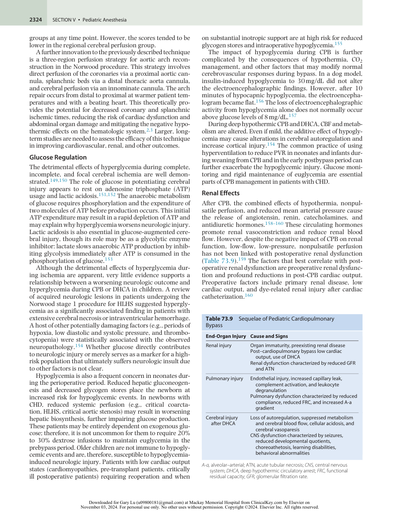

:::

<!-- PDF page 26 -->

Acute kidney injury after pediatric cardiac surgery has an incidence between 20% and 60%, depending on the criteria used.161 Multiple causative factors are involved, and the final common result is oliguria and increased serum creatinine. Diuretics have been the mainstay of promoting urine flow after pediatric CPB. Furosemide in a dose of 1 to 2 mg/ kg or ethacrynic acid 1 mg/kg every 4 to 6 hours induces diuresis and may reverse renal cortical ischemia associated with CPB. After DHCA, a 24- hour period of oliguria or anuria can occur that resolves over the next 12- to 24- hour period. Diuretics are effective only after spontaneous urine output has been initiated in these patients. Cardiopulmonary bypass strategies that appear to preserve renal function better include maintaining higher hematocrits, above 30%, higher CPB flow rates, greater than 175 mL/kg/min, and a nadir- indexed oxygen delivery (DO2i) of greater than 353 mL/min/m2 .162,163

Glomerular filtration rate, creatinine clearance, and medullary concentrating ability are substantially reduced in neonates and young infants. Therefore, the use of CPB in these patients results in greater fluid retention than is typically seen in older children and adult patients. The net result may be increased total body water, increased organ weight (e.g., lungs, heart), and greater difficulty with postoperative weaning from ventilatory support. Ultrafiltration during rewarming or after CPB effectively reduces total body water, limits the damaging effects of CPB, and decreases the postoperative ventilation period.164,165

### Pulmonary Effects

Cardioplegia protects the heart, but no parallel protection is afforded to the lungs during bypass. Pulmonary dysfunction is common after CPB, and its pathogenesis is poorly understood (see Table 73.9). In the broadest terms, lung injury is mediated in one of two ways: first, by an inflammatory response resulting from leukocyte and complement activation and second, by a mechanical effect culminating in surfactant loss, atelectasis with a resultant ventilation–perfusion mismatch, loss of lung volumes, and altered mechanics of breathing.

Pulmonary function after CPB is characterized by reduced static and dynamic compliance, reduced functional residual capacity, surfactant deficiency, and an increased A- a gradient.166,167 Atelectasis and increased capillary leak due to hemodilution and hypothermic CPB are the most likely causes. Hemodilution reduces circulating plasma proteins, decreases intravascular oncotic pressure, and favors water extravasation into the extravascular space. Hypothermic CPB causes complement activation and leukocyte degranulation.168 Leukocytes and complement are essential in causing capillary–alveolar membrane injury and microvascular dysfunction through platelet plugging and releasing mediators, which increase PVR. The technique of MUF is highly effective in reducing lung water and pulmonary morbidity during the postoperative period.

### STRESS RESPONSE AND CARDIOPULMONARY BYPASS

The release of many metabolic and hormonal substances, including catecholamines, cortisol, growth hormone, prostaglandins, complement, glucose, insulin, endorphins, and

other substances, characterizes the stress response during hypothermic CPB.7,169 The likely causes of the elaboration of these substances include a contact of blood with the nonendothelialized surface of the pump tubing and oxygenator, nonpulsatile flow, low perfusion pressure, hemodilution, hypothermia, and light anesthesia depth. Other factors contributing to elevated stress hormones include delayed renal and hepatic clearance during hypothermic CPB, myocardial injury, and exclusion of the pulmonary circulation from bypass. The lung is responsible for metabolizing and clearing many of these stress hormones. The stress response generally peaks during rewarming from CPB. Strong evidence indicates that the stress response can be blunted by increasing the depth of anesthesia.7,169

The stress response, in return, can mediate undesirable effects such as myocardial damage (catecholamines), systemic and pulmonary hypertension (catecholamines, prostaglandins), pulmonary endothelial damage (complement, prostaglandins), and pulmonary vascular reactivity (thromboxane). The benefits of controlling the stress response with fentanyl in premature infants undergoing PDA ligation and with sufentanil in neonates with complex CHD have been demonstrated.84,170 Although blunting the stress response seems warranted, additional evidence suggests that the newborn stress response, especially the endogenous release of catecholamines, may be an adaptive metabolic response necessary for survival at birth.171 Thus, the complete elimination of adaptive stress response may not be desirable. To what extent acutely ill neonates with CHD depend on the stress response for maintaining hemodynamic stability is currently unknown.

A depth of anesthesia adequate to attenuate the stress response should be used, but attempting to block the response altogether is likely unnecessary. Acceptable anesthesia during CPB may be best accomplished by continuously administering an inhaled anesthetic via a vaporizer connected to the pump oxygenator, dexmedetomidine infusion, careful titration of incremental doses of opioids, or the precise administration of an opioid or opioid and benzodiazepine by continuous infusion technique. Primary opioid anesthetic techniques result in reduced stress hormone release and decreased postoperative metabolic acidosis and lactate production compared with halothane anesthesia and may therefore be a preferred technique in complex CHD.84 If an adequate anesthesia depth is accomplished by administering excessively large doses of opioids (e.g., fentanyl or sufentanil), postoperative mechanical ventilation will be necessary. By contrast, residual levels of inhaled anesthetics (e.g., halothane or isoflurane) can produce transient myocardial depression at the termination of CPB, complicating separation from CPB. Because of the improved surgical techniques coupled with the reduced morbidity of CPB, the use of high doses of an opioid anesthetic is infrequent in current practice.

### DISCONTINUATION OF CARDIOPULMONARY BYPASS

After the surgical repair, the patient is gradually rewarmed, and ventilation is resumed. A quick TEE exam is performed to assess ventricular function and rule out the presence of any air collection in the left circulation. It is essential

<!-- PDF page 27 -->

to ensure that inotropes and vasoactive medicines have reached the patient. Blood volume is assessed by directly visualizing the heart and monitoring right atrial or left atrial filling pressures. When filling pressures are adequate, the patient is fully warmed, acid–base status is normalized, heart rate is sufficient, sinus rhythm has been achieved, the venous cannulae are clamped, and venous drainage is stopped. The arterial cannula is left in place so that a slow infusion of residual pump blood can be used to optimize filling pressures. Pulse oximetry also can be used to assess the adequacy of cardiac output.172 Low systemic arterial saturation or the inability of the oximeter probe to register a pulse may be a sign of very low output and high systemic resistance.173

Unstable hemodynamics or persistent desaturations often necessitate that CPB support is re- established. Usual causes of failure to wean off CPB include (1) an inadequate surgical repair with a residual defect, (2) inadequate ventilation, (3) severe pulmonary artery hypertension, and (4) moderate-to-severe ventricular dysfunction.

A detailed echocardiographic exam helps delineate residual structural defects and other functional abnormalities.174 If residual structural defects are found, a decision to repair the defect is taken after an extensive discussion between cardiologists, surgeons, and anesthesiologists. Leaving the operating room with a significant residual structural defect adversely affects survival and increases patient morbidity.174 Doppler measurements of tricuspid regurgitation jets can accurately measure right ventricular pressures. EchoDoppler imaging can also identify global ventricular dysfunction and identify regional wall motion abnormalities caused by ischemia or intramyocardial air.175

### ULTRAFILTRATION

The institution of CPB in neonates, infants, and young children results in a profound proinflammatory response and significant hemodilution. This may contribute to post- CPB morbidity and mortality resulting from poor organ function. The organ systems most affected by this are the heart, lungs, and brain. Although contact between the patient’s blood and the foreign surface of the bypass circuit is a potent stimulus to trigger the inflammatory cascade, other factors, including ischemia, profound hypothermia, rewarming, and surgical trauma, are also crucial in its genesis. These inflammatory mediators include complement anaphylatoxins, vasoactive amines, and cytokines (e.g., tumor necrosis factor- α [TNF- α]) that lead to an increase in vascular permeability.176 Hemodilution occurs at the onset of CPB despite using physiologically balanced priming solutions that include blood, crystalloid, albumin, buffer, and smaller volume circuits. Hemodilution may, however, be advantageous in patients in whom the surgery is performed under hypothermic conditions ranging from mild hypothermia to DHCA. Initiation of CPB will change the viscoelastic properties of blood, and these changes have been shown to continue into the post- CPB period.177 Although the mode of perfusion, cardiotomy suction, arterial roller pump type, and shear forces of the CPB circuit are essential, it is the temperature and hematocrit of the blood that play the most important role in changing viscoelasticity. It has been shown that low temperature with high hematocrit leads

to higher viscosity.178 This elevated viscosity may lead to altered organ perfusion, particularly in the brain. Because of these alterations in blood viscosity, hemodilution is tolerated in the cooling phases of CPB. Although advantageous early, this hemodilution combined with the inflammatory response will lead to the transudation of fluid into the extravascular space, which in turn leads to the potential for organ dysfunction, as eluded to earlier. Prevention of organ dysfunction and improved oxygenation by the removal of excess fluid and inflammatory mediators are the rationale, therefore, for the use of ultrafiltration. The result is the removal of plasma water and low- molecular- weight solutes across a semipermeable membrane.

Essentially, five forms of ultrafiltration are used in modern perfusion practice, three of which are while the patient is on CPB. Prime ultrafiltration is used when packed RBCs are added to the prime solution and is performed in the prebypass phase; prime ultrafiltration aims to replace crystalloid prime with blood prime, adjust pH, alter electrolyte concentration to safer levels, and remove inflammatory mediators potentially present in the donor blood.179 Conventional ultrafiltration (CUF) involves the removal of fluid at any time while CPB is supporting the patient. A common use for this method is the removal of the volume of clear fluid equal to the volume of cardioplegia used. CUF can be performed during all phases of CPB. It involves the placement of an ultrafilter within the circuit and connected either to the venous line or the venous reservoir. The removal of an excess of ultrafiltrate will result in low reservoir volumes. In zero balance ultrafiltration, once the fluid has been removed, it is replaced with crystalloid to avoid inadequate reservoir volume, and thus there is no net removal of volume.

The third method of on- bypass ultrafiltration is dilutional ultrafiltration, which is employed when the concentration of a given electrolyte (e.g., potassium) is deemed elevated. The technique involves removal of ultrafiltrate with its replacement by half with normal saline, thus diluting the concentration of the given electrolyte to safer levels. All on- bypass ultrafiltration methods have similar end points – attempted removal of excess clear fluid resulting in hemoconcentration, removal of inflammatory mediators, and manipulation of electrolyte concentrations to safe levels.

MUF, first described by Naik and associates164 in 1991, involves blood filtration once the patient has been weaned from bypass. This can be achieved either by a venovenous technique in which blood is removed and returned to the atrium once concentrated or by an arteriovenous technique in which blood is removed via the aortic cannula and returned via the venous line.164,180,181 In more detail, in this technique, blood is removed in a retrograde fashion by the aortic cannula and passes through the ultrafilter along with the remaining circuit volume from the venous reservoir and oxygenator. Flow through the ultrafilter is maintained by a roller pump at flows of between 10 and 30 mL/kg. The slower rates result in a more gradual change in the intravascular fluid compartment and thus are potentially better tolerated. Constant atrial pressure is maintained throughout the procedure by adding crystalloid into the venous reservoir as needed. Suction is applied to the filtrate port to achieve a maximal transmembrane pressure, thus allowing for ultrafiltration rates of between 100 and 150 mL/min.

<!-- PDF page 28 -->

End points for the process of MUF are time (15–20 minutes) and reaching of a target hematocrit (usually 40%) once the circuit volume has been replaced by crystalloid or should the patient’s hemodynamics not tolerate the procedure.

Although ultrafiltration is used during CPB to remove excess body water, it appears the use of MUF significantly improves myocardial performance (Fig. 73.8).182,183 Using echocardiographic measurements in a study of infants undergoing corrective surgery under non- hypothermic arrested conditions, Davies and associates184 found improvements in both systolic and diastolic function in the children studied. They found that the preload recruitable stroke work, which is load independent, improved after MUF and was thus a good indicator of improved systolic function. The same study showed that after MUF, a decrease in the myocardial wall thickness and cross- sectional area occurred that was not present in the control group of patients who received no ultrafiltration. These reductions result in an increase in enddiastolic length and a fall in end- diastolic pressure, both indicators of improved diastolic function. Although presumably, the decrease in myocardial edema was the cause for these improvements, increased hematocrit was also observed. Because these positive effects were not seen past 24 hours, MUF’s absolute benefit is unclear.184

Pulmonary dysfunction is one of the most common adverse effects of CPB185 ; MUF is utilized to improve oxygenation, decrease the effects of inflammatory mediators on the alveolar–capillary membrane, and decrease pulmonary vascular reactivity. Studies have demonstrated that in patients in whom ultrafiltration and MUF were used, improvements in pulmonary compliance, decreased airway resistance, pulmonary arterial reactivity, and improved oxygenation were

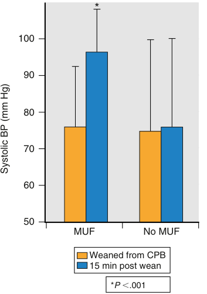

* 100 90 80 70 60 50 MUF No MUF Weaned from CPB 15 min post wean  * P  �.001 Systolic BP (mm Hg) 

**Fig. 73.8 Systolic blood pressure (BP) after separating from cardiopulmonary bypass (CPB) and 15 minutes after separating with and without modified ultrafiltration (MUF).** Note the significant improvement in systolic BP with the use of MUF. (From Ungerleider RM. Effects of cardiopulmonary bypass and use of modified ultrafiltration. _Ann Thorac Surg._ 1998;65:S35; reprinted with permission from the Society of Thoracic Surgeons.)

demonstrated.185–188 It is obvious why these methods have found such wide acceptance in pediatric cardiac surgery, particularly for patients in whom normal compliance with low PVR is vital (i.e., those with single- ventricle physiology). Although these studies commonly find improvement in pulmonary function immediately after weaning from CPB and the completion of MUF, disagreement exists as to whether these effects result in improved function beyond six hours, with some showing little benefit at 24 hours. A conclusion, however, from these studies is that a combination of onbypass ultrafiltration coupled with MUF has the best results in the early postbypass period.

In a study performed on a piglet model of DHCA, the use of MUF after CPB improved hematocrit, cerebral O2 delivery, and cerebral O2 consumption, thus representing a potential reduction in cerebral injury. Further studies have made similar conclusions, demonstrating that four variables are important in improving cerebral oxygenation: carbon dioxide partial pressure (PCO2), mean arterial pressure, hematocrit, and MUF flow rate.189,190 Increasing all except MUF flow rate improved O2 delivery. Increasing the flow rate appeared to cause a steal- like phenomenon in which apparent diastolic runoff occurred into the MUF circuit from the aortic cannula. Thus, although the process of MUF is essential for recovery of normal cerebral function, care must be taken not to negate the benefits by decreasing the time on MUF by increasing the flow rates (Fig. 73.9).

Common to the improvement in cardiac and pulmonary function is the associated decrease in inflammatory mediators seen after ultrafiltration. Studies have shown that the ultrafiltrate contains a wide variety of low- molecularweight inflammatory mediators, including C3a, C5a, interleukin (IL)- 6, IL- 8, TNF, myocardial depressant factor, and endothelin.186,191,192 It is the removal of endothelin- 1 after MUF that results in the improvement of pulmonary vascular reactivity, which is of great importance, particularly in infants younger than 4 to 6 months of age, when pulmonary vascular reactivity is high and in patients who have staged cavopulmonary reconstructions. TNF, a potent inflammatory mediator implicated in the development of

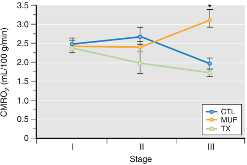

3.5 * 3.0 2.5 2.0 1.5 1.0 CTL 0.5 MUF TX 0 I II III Stage CMRO (mL/100 g/min)2 

**Fig. 73.9 Cerebral metabolic rate for oxygen measurements (CMRO2) before and after deep hypothermic circulatory arrest.** Note the significant increase in CMRO2 in the MUF animals compared with the control and transfusion groups at stage 3. _CTL,_ control; _MUF,_ modified ultrafiltration; _TX,_ transfusion. (From Skaryak LA, Kirshbom PM, DiBernardo LR, et al. Modified ultrafiltration improves cerebral metabolic recovery after circulatory arrest. _J Thorac Cardiovasc Surg._ 1995;109:744–751.)

::: warning 符號需核對
此頁有符號無法完整擷取，請展開下方原始頁面核對。
:::

::: details 原始表格與符號（PDF 第 28 頁）

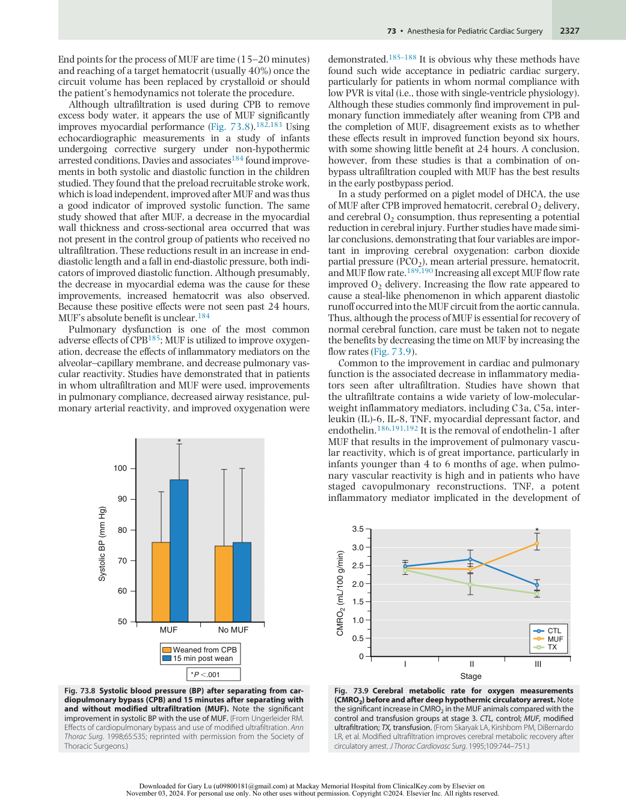

:::

<!-- PDF page 29 -->

capillary leak syndrome seen after CPB, is removed best by MUF. Despite these positive effects of MUF, the literature does not give a clear advantage of one form of ultrafiltration over the other, and it may be the combination of these methods that once again shows the best possible results.

Another important post- CPB issue is ongoing blood loss. MUF will result in an elevation of the patient’s hematocrit secondary to the removal of the excess body water, as already discussed. This further results in decreased blood use and the observation that there is less postoperative bleeding.193 Indeed, in older children, attempts can thus be made to avoid using donor blood altogether.

Disadvantages to these techniques are noted. The addition of an ultrafilter to the CPB circuit adds a level of complexity to the circuitry and thus another potential area in which circuit- related complications may occur. Opponents of MUF also note the following potential problems: the potential for air entrainment into the arterial cannula, additional time in which the patient is anticoagulated, the potential for hypovolemia as volume is drawn off from the patient, hypothermia because the filtered volume does not pass through the heater/oxygenator, and the potential for the increase in the plasma concentration of drugs (e.g., fentanyl).194 Another interesting complication potentially associated with ultrafiltration was the reduction in thyroid hormone. This acute hypothyroidism may lead to depressed function, manifesting as decreased contractility, heart rate, cardiac output, and elevated SVR, all of which will affect the immediate post- CPB period.195 As with other techniques in medicine, the benefit versus risk must be seriously considered, but from the presented evidence, the use of ultrafiltration both on and off CPB is highly beneficial and these methods are thus commonly used in modern pediatric cardiac surgery with good result and little complication.155,157,196,197

In the preceding paragraphs, the discussion concluded that no clear advantage had been determined of one method of ultrafiltration over the other. Unfortunately, comparing a wide range of patients having different surgeries under different conditions is complex, and thus it appears that from the articles referenced, the best strategy would include both the use of on- CPB ultrafiltration and the use of MUF once the patient has been separated from bypass to achieve the goals of decreasing total- body water; removal of inflammatory mediators; improved hematocrit, and thus O2- carrying capacity; and preservation of vital organ function. With the miniaturization of CPB circuits and resultant reduced hemodilution, some institutions have stopped using MUF because it simplifies and decreases the volume of the CPB circuit. They believe there is an advantage to preventing hemodilution rather than reversing hemodilution with MUF. Significantly miniaturizing circuits is also not without safety concerns, as it may limit the ability to increase CPB flow rates. At our institution, we continue to use MUF for the many reasons previously described.

### SPECIFIC PROBLEMS ENCOUNTERED IN DISCONTINUING CARDIOPULMONARY BYPASS

### Left Ventricular Dysfunction

The contractile state of the LV is often reduced due to surgically induced ischemia during the repair, the preoperative

condition of the myocardium, the effects of DHCA on myocardial compliance, and new, altered loading conditions on the ventricle resulting from the repair.198,199 Left ventricular dysfunction is treated by optimizing preload, increasing heart rate, increasing coronary perfusion pressure, correcting ionized calcium levels, and increasing inotropic support. The neonate’s heart rate–dependent cardiac output, reduced myocardial compliance, and diminished response to calcium and catecholamines are factors influencing the need for inotropic support. Inotropic support usually begins with epinephrine 0.03 to 0.05 mcg/kg/min or dopamine 3 to 10 mcg/kg/min. Several studies suggest that the effect of dopamine in children is age dependent. After cardiac surgery in young children, dopamine increases cardiac output, which correlates more with heart rate elevations than stroke volume augmentation. In young adults, dopamine increases stroke volume. Nonetheless, infants and neonates respond favorably to epinephrine and dopamine infusions with increased systemic arterial blood pressure and cardiac output and improved systemic perfusion.

Calcium supplementation is essential in augmenting cardiac contractility. Although calcium supplementation has fallen into some disfavor because of concerns over reperfusion injury, it remains an important therapy after pediatric cardiac surgery. Fluctuations in ionized calcium levels occur commonly in the immediate post- CPB period in children. This is most often due to the large transfusions of citrate- rich and albumin- rich blood products, such as whole blood, fresh frozen plasma, platelets, and cryoprecipitate, all of which bind calcium.200 Calcium supplementation is routinely used in neonates and infants and is continued in the intensive care unit. Calcium must be administered cautiously in patients with a slow sinus or junctional rate because marked slowing of AV conduction may occur. Epinephrine 0.02 to 0.2 mcg/kg/min is helpful in patients with significant left ventricular dysfunction who remain hypotensive with high left atrial filling pressures or echo- Doppler imaging evidence of reduced contractility or regional ischemia.201 Milrinone, a potent phosphodiesterase- 3 inhibitor, is also an effective inotropevasodilator in infants and children. Studies in neonates after open- heart surgery reveal significant reductions in SVR and PVR and increases in cardiac index, primarily as a result of larger stroke volume.202 Infants and children demonstrate a larger volume of milrinone distribution and clearance than adults; thus, the initial loading dose necessary to achieve therapeutic levels may be as large as 100 mcg/kg.203 In neonates, the initial dose of milrinone on CPB is 25 to 100 mcg/kg, followed by a continuous infusion to be started within 90 minutes of the initial dose at a rate of 0.2 mcg/kg/min to maintain a therapeutic level. In older infants and children, the continuous infusion rate is larger, usually 0.5 to 1 mcg/kg/min. Dobutamine is an effective, albeit weaker, inotropic agent in children. Although it is reported to have a lesser chronotropic effect than dopamine in neonates, significant tachyarrhythmias may occur. This may be related to structural similarities between dobutamine and isoproterenol.201 In children after cardiac surgery, dobutamine increases cardiac output primarily through increased heart rate. This is consistent with a reduction in α- receptors and a higher level of circulating catecholamines in newborns.

<!-- PDF page 30 -->

### Pulmonary Hypertension and Right Ventricular Dysfunction

Many lesions are associated with increased pulmonary vascular reactivity, pulmonary hypertension, and postoperative right ventricular dysfunction in the postoperative period. Cardiac defects with large left- to- right shunts (large VSDs, AV canal, truncus arteriosus, total anomalous pulmonary veins, etc.) have a high pulmonary blood flow state. They are at risk for increased pulmonary vascular reactivity immediately during the postbypass period. The second group of lesions where right ventricular dysfunction is expected includes left- sided obstructive lesions such as mitral stenosis, and obstructed TAPVR. Finally, children with pulmonary diseases, such as those with chronic bronchopulmonary dysplasia, are also prone to postsurgical pulmonary hypertension. Pulmonary endothelial dysfunction and decreased production of pulmonary vasodilator combined with the increased procoagulant state after surgery contributes to increased pulmonary vascular reactivity. Other factors contributing to postoperative right ventricular dysfunction include preexisting right ventricular hypertrophy, a right ventriculotomy, acute pulmonary regurgitation, and right ventricular volume overload.15 The treatment of right ventricular dysfunction consists of measures directed at lowering PVR and preserving coronary perfusion without distending the RV. In cases of ventricular dysfunction, low- dose epinephrine (0.01–0.03 mcg/kg/ min) may provide inotropy without producing significant vasoconstriction.199 Mechanical ventilation should be optimized to reduce PVR. Using inhaled nitric oxide (NO) can further reduce PVR and improve right ventricular function. In contrast to the LV, the low intracavitary pressure of the normal RV receives two- thirds of its coronary filling during ventricular systole. In patients with right ventricular dysfunction, maintaining a normal or slightly elevated systolic arterial pressure maximizes coronary perfusion to the RV and augments contractility. A vasopressin infusion can be advantageous in such circumstances. If the need for inotropic support persists after the early post- CPB period, a critical evaluation for other structural and functional abnormalities should be aggressively pursued. Preload should be maintained at a normal to a slightly elevated level. Because right ventricular contractility is reduced, it is essential to maximize preload to the highest portion of the Starling curve. Overdistention of the RV, however, is not well tolerated owing to diminished ventricular compliance and diastolic dysfunction. Excessive volume loading may result in significant diastolic dysfunction, tricuspid regurgitation, and worsening forward flow. Generally, CVP much above 12 to 14 mm Hg is poorly tolerated in neonates and infants with right ventricular dysfunction.204 If moderate-to-severe right ventricular dysfunction persists, the sternum should be left open.205 This eliminates the impedance imposed by the chest wall and mechanical ventilation, allowing the RV to maximize its end- diastolic volume. An additional strategy in neonates, infants, and children with significant post- CPB right ventricular dysfunction is to plan for small communication to shunting at the atrial or ventricular level. Typical patients who would benefit from this strategy include neonates undergoing repairs for TOF and truncus arteriosus. Allowing such communication allows right- to- left shunt, preserves LV preload,

and maintains cardiac output. Although these patients have somewhat diminished systemic O2 saturation, their effective cardiac output and tissue O2 delivery is enhanced, systemic perfusion pressure improves, and coronary perfusion of the RV is maintained. Right- to- left shunting decreases as right ventricular function improves, and systemic arterial saturation normalizes.

If ventricular dysfunction persists even with high doses of inotropes and systemic cardiac output remains compromised, the use of extracorporeal life support (extracorporeal membrane oxygenation [ECMO]) is contemplated. When ECMO is used for circulatory support, venoarterial cannulation is preferred. Venous and arterial access may be achieved through a large central artery and vein, usually the carotid artery and internal jugular vein, or by direct chest cannulation. Recovery from severe ventricular dysfunction is predicated on the concept that the myocardium has sustained a transient injury (i.e., “stunned myocardium”) and can recover with time.206,207 ECMO decreases ventricular wall tension, increases coronary perfusion pressure, and maintains systemic perfusion with oxygenated blood. Use of ECMO in patients who fail to separate from CPB has significantly greater mortality than those for whom ECMO was instituted later in the postoperative course.208 Use of ECMO after Fontan surgery has the lowest survival rate after the need for ECMO.209 The role of ECMO in patients with myocardial injury or pulmonary hypertension is to provide adequate systemic O2 transport and systemic perfusion while allowing the ventricles to rest and recover. ECMO may even offer an effective means of resuscitation for postoperative cardiac patients, particularly if instituted promptly.210 In larger infants and children with predominantly right ventricular dysfunction and satisfactory pulmonary function, a selective right ventricular assist device (VAD) may be preferable to ECMO.211

### Postoperative Arrhythmias

Arrhythmias after the surgical repair of cardiac defects are common and transient. Various pathophysiologic causes of arrhythmia include direct surgical injury (sinus node or AV conduction defects) from the incision, suture line, or bypass cannulae. Electrolyte disturbances and high catecholamine levels also alter automaticity and increase arrhythmogenicity. Conduction defects and junctional tachycardia are the most common arrhythmias observed. Conduction defects are easily treated using a temporary pacemaker. Junctional ectopic tachycardia (JET), caused by increased automaticity of the AV node, often results in hemodynamic instability and can be challenging to manage. The fast ventricular rate (110–250) is associated with a narrow QRS complex. Mild hypothermia, reducing inotropes, increasing sedation, and magnesium212 have been used to prevent postoperative JET. The use of amiodarone can help slow the ventricular rate, but it can also depress myocardial function. Some centers have reported the successful use of dexmedetomidine to prevent JET.213

### Pulmonary Artery Hypertension

Primary pulmonary hypertension is a devastating disease. The progressive and sustained elevation in PVR eventually leads to right- sided HF and death.214,215 Pulmonary arterial hypertension (PAH) is defined by the presence of mean

<!-- PDF page 31 -->

pulmonary arterial pressure greater than 25 mm Hg at rest or 30 mm Hg during exercise.216 In two studies, PAH was a significant predictor of major perioperative cardiovascular complications, including pulmonary hypertensive crises, cardiac arrest, and death in patients undergoing cardiac catheterization or noncardiac surgery under anesthesia.217 Suprasystemic pulmonary artery pressure was predictive of significant complications. Complications, however, were not associated with age, cause, type of anesthetic, or airway management. Pre- anesthesia evaluation should gauge disease severity. A history significant for chest pain, syncope, and dizziness, with signs of dyspnea at rest, low cardiac output state, metabolic acidosis, hypoxemia, and signs of right- sided HF, warrants caution. Acute increases in PVR resulting in pulmonary hypertensive crises cause an increase in right ventricular afterload, right ventricular dysfunction, and hemodynamic decompensation. Suprasystemic pulmonary artery pressure results in inadequate PBF, inadequate left ventricular preload, low cardiac output, and biventricular failure. The associated hypotension results in coronary ischemia, which worsens this cycle. Perioperative factors thought to precipitate a pulmonary hypertensive crisis include hypoxia, hypercarbia, acidosis, hypothermia, pain, and airway manipulations in patients with pulmonary hypertension. Such patients present for hemodynamic catheterization, drug study, and noncardiac and cardiac surgical procedures. Although each anesthetic must be tailored to the patient’s pathophysiologic condition and surgical procedure, certain common principles remain. Pulmonary vasodilator therapy and inotropes must be continued in the perioperative period. Investigations include a comprehensive echocardiogram with occasional chest computed tomography angiography to exclude pulmonary thromboembolic disease. After premedication, the patient should be monitored with pulse oximetry to ensure the patient does not hypoventilate or become hypoxic. Intravenous induction with carefully titrated doses of ketamine may be the safest218 ; if no intravenous is present, an inhalational induction with sevoflurane can be performed safely with 100% O2, keeping the end- tidal sevoflurane concentration as low as possible and quickly obtaining intravenous access. Procedures with the potential for blood loss, hemodynamic instability, and changes in ventilatory status mandate invasive arterial monitoring. Care should be taken to avoid systemic hypotension while achieving general anesthesia. Ventilation and oxygenation are controlled, and acidosis is treated aggressively. Hypotension in the presence of euvolemia may need to be treated with inotropes and, if necessary, α1- agonists.219,220

Therapy for elevated pulmonary artery pressures is directed at lowering PVR and unloading the RV. Reduction of PVR is accomplished by altering ventilation pattern, inspired O2 concentration, and blood pH. Specifically, manipulating the pulmonary vascular bed in newborns and infants is a matter of regulating the partial pressure of CO2 in arterial blood (PaCO2), pH, PaO2, partial pressure of alveolar oxygen, and ventilatory mechanics.221,222 PaCO2 is a potent mediator of PVR, especially in newborns and young infants. Reducing PaCO2 to 20 mm Hg and increasing pH to 7.6 produces a consistent and reproducible reduction in PVR in infants with pulmonary artery hypertension. Manipulating serum bicarbonate levels to achieve a pH of

7.5 to 7.6 while maintaining a PaCO2 of 40 mm Hg has similar salutary effects on PVR.223 An increase in the FiO2 and the PaO2 decreases PVR as well. In the circumstance of intracardiac shunts, changes in FiO2 have little effect on PaO2. Thus, by inference, a reduction in PVR induced by increasing the inspired O2 concentration is probably a direct pulmonary vasodilatory effect of PaO2 rather than FiO2.

Ventilatory mechanics also play a significant role in reducing PVR. Neonates and infants have a closing volume above functional residual capacity. Thus, some airway closure occurs at the end of a normal breath. This process results in areas of the lung that are perfused and yet underventilated. As these lung segments become increasingly hypoxemic, secondary hypoxic vasoconstriction occurs. The net effect is an increase in PVR. Therefore, careful inflation of the lungs to maintain functional residual capacity will selectively reduce PVR. In practice, this is accomplished with relatively large tidal volumes and low respiratory rates, which produce an exaggerated chest excursion. Respiratory rates of 15 to 25 breaths/min are used for neonates and infants.

Because PBF occurs predominantly during the expiratory phase of the respiratory cycle, the ventilatory pattern should be adjusted to allow adequate distribution of gas throughout the lung during inspiration and a more prolonged expiratory phase to promote blood flow through the lungs. End- expiratory pressure must be applied cautiously during the post- CPB period. Low positive end- expiratory pressure (PEEP) (3–5 mm Hg) prevents the narrowing of the capillary and precapillary blood vessels, thereby reducing PVR. Higher PEEP or excessive mean airway pressure results in alveolar overdistention and compression of the capillary network in the alveolar wall and interstitium. This condition elevates PVR and reduces PBF.167

The final and perhaps the least well- recognized use of the mechanical ventilator is to assist in unloading the RV. During positive-pressure inspiration, intrathoracic pressure increases and creates an increased pressure gradient from the lung to the LA, promoting cardiac output. This ventilatory assist is commonly seen in patients with PAH or right ventricular dysfunction. Augmentation of the arterial pressure trace during inspiration is seen. The use of the ventilator to augment systemic blood flow is very similar to the thoracic pump concept used to explain blood flow during CPR.224 The inspiratory assist must be balanced by the potential adverse effects of increased mean airway pressure on PVR and right ventricular afterload. High tidal volume with low respiratory rates should be employed to maximize these cardiopulmonary interactions.

Attempts to manipulate PVR through pharmacologic interventions are also possible. Drugs that have shown promise in decreasing PVR both clinically and experimentally have been the phosphodiesterase inhibitors such as amrinone and milrinone. Both reduce PVR and SVR and increase RV contractility.225 Isoproterenol has mild pulmonary artery–vasodilating properties in normal pulmonary circulation.226 It reduces PVR in adults after cardiac transplantation, but very few data support PVR reduction in infants and young children after cardiac surgery. In immature animals, the myocardium is less responsive to isoproterenol, and causes tachycardia and increased myocardial O2 consumption. These latter effects may reduce coronary

<!-- PDF page 32 -->

perfusion and result in relative myocardial ischemia. Both prostaglandin E1 and prostacyclin have a pulmonary vasodilating effect; however, both drugs produce systemic hypotension, which severely limits their use.227,228

There are now ultra- short- acting intravenous vasodilators and inhaled vasodilating agents such as NO. Ultrashort- acting intravenous vasodilators are nonspecific potent vasodilators with a half- life of seconds. Infusion of these drugs into the right side of the circulation produces a potent short- lived relaxation of the pulmonary artery smooth muscle.229 Once the drug reaches the systemic circulation it is no longer functional. Adenosine and ATPlike compounds have these properties and may have clinical applicability in pulmonary artery hypertension in the future.230

Several potent pulmonary hypertension therapies have evolved in the past decade.221,222 A continuous intravenous infusion of prostacyclin improves pulmonary vascular hemodynamics, exercise tolerance, and survival in pulmonary hypertension.231 Sildenafil is a selective phosphodiesterase type 5 inhibitor. Phosphodiesterase type 5 breaks down cyclic guanosine monophosphate. Sildenafil produces acute and relatively selective pulmonary vasodilatation and acts synergistically with NO.232–234 Bosentan is a dual endothelin receptor blocker. Preliminary reports indicate that bosentan improves symptoms, exercise tolerance, and hemodynamics in patients with pulmonary hypertension. The drug is well tolerated and free of side effects apart from a dose- dependent increase in liver enzymes.235 Lung transplantation is the only available surgical therapy for primary pulmonary hypertension; however, the five- year survival remains less than 50%, and bronchiolitis obliterans remains the single most common cause of death.236,237 Before listing for transplantation, all patients undergo a hemodynamic cardiac catheterization and drug study in which reversibility of pulmonary hypertension with increased inspired O2 concentrations and NO is determined.238 Prostacyclin analogues, including inhaled iloprost or intravenous epoprostenol, although used in adult centers, have not become routine in pediatric practice.

CPB with associated endothelial injury predisposes to developing postoperative pulmonary hypertension in patients with CHD. Anatomic factors that impose either obstruction to PBF or residual left- to- right shunting need to be surgically addressed. Elevated LAP resulting from mitral valve disease or left ventricular dysfunction, pulmonary venous obstruction, branch pulmonary artery stenosis, or surgically induced loss of the pulmonary vascular cross- sectional area all raise right ventricular pressure and impose a burden on the right side of the heart.

NO, an endothelium- derived vasodilator administered as an inhaled gas, represents the most promising development in the therapy for elevated PVR in patients with CHD. Although nonselective, it is rapidly inactivated by hemoglobin and, when inhaled, produces no systemic vasodilation.239 NO reduces pulmonary artery pressure in adult patients with mitral valve stenosis and in selected pediatric cardiac patients with PAH.240–242 The congenital cardiac patient population in whom NO appears to be effective is patients with acute PVR elevation after open- heart surgery, as well as preoperative pulmonary hypertension accompanying specific anatomic conditions (e.g., TAPVR,

congenital mitral stenosis).240,242 Because it acts directly on vascular smooth muscle, NO remains effective despite the post- CPB endothelial injury frequently encountered in children.243 Some centers routinely employ low- dose NO (1–5 ppm) after a Fontan operation when the CVP- LAP gradient exceeds 10 mm Hg.244 At our institution, a dose of 20 ppm is the standard in the ICU and the cardiac operating room. Finally, NO can provide diagnostic information that helps distinguish reactive pulmonary vasoconstriction from fixed anatomic obstructive disease in the postoperative surgical patient or in the patient undergoing pre- transplant evaluation.245 In the latter, the distinction between pulmonary vasoconstriction and advanced pulmonary vascular occlusive disease will influence the prediction as to whether a child with pulmonary hypertension in association with either CHD or cardiomyopathy will survive a heart transplant or requires replacement of both heart and lungs.

Management strategies for postoperative pulmonary hypertension and treatment of pulmonary hypertensive crises include sedation, moderate hyperventilation (maintaining CO2 partial pressure [PCO2] between 30 and 35 mm Hg), moderate alkalosis (pH >7.5), increased inspired O2, optimization of PEEP (to maximize functional residual capacity), pulmonary vasodilators (e.g., NO), and the creation or maintenance of an intracardiac right- to- left shunt in an attempt to maintain cardiac output.246,247 NO is also helpful in the manipulation of PVR after Fontan- type procedures.248 Care should be exercised in weaning NO in patients because abrupt withdrawal can precipitate rebound pulmonary hypertension and pulmonary hypertensive crises.248,249

### Post–Cardiopulmonary Bypass Bleeding

Coagulopathy after CPB remains a significant problem in pediatric cardiac surgery.238 Continuing blood loss after CPB requires blood component replacement and is associated with hemodynamic compromise and morbidity. In pediatric patients, restoration of hemostasis often proves difficult; diagnosis of the problem and treatment are only marginally effective.

The postoperative and post–cardiopulmonary bypass bleeding rate in children is higher than in adults.250 There are many factors that contribute to persistent coagulopathy after bypass surgery. First, the ratio of the patient body surface area to the nonendothelialized extracorporeal circuit volume is disproportionately high, and provokes a large inflammatory- type response in response to CPB in younger patients – the younger the patient, the more pronounced the response.7 Because complement and platelet activation are linked to the activation of other protein systems in the blood (i.e., fibrinolytic proteins), it is probable that this hemostatic activation results in impaired hemostasis and increased bleeding after exposure to cardiopulmonary bypass. Second, surgical repairs in neonates and infants often involve extensive reconstruction and numerous suture lines, creating more opportunities for surgical bleeding than in adult cardiac patients. Moderate-to-deep hypothermia and deep hypothermic cardiac arrest, employed to reduce the bypass flows, further impair hemostasis. Third, the immature coagulation system in neonates is also likely to contribute to impaired hemostasis.251 Further compounding the problem of immature coagulation proteins is the massive hemodilution that occurs when initiating CPB in infants and small children. Despite circuit miniaturization, initiation of CPB induces

<!-- PDF page 33 -->

dilutional thrombocytopenia and reduces levels of factors II, V, VII, VIII, IX, X, ATIII, and fibrinogen.252

Excessive bleeding after CPB is not an unusual occurrence. The surgeon should first attempt to identify any obvious source of surgical bleeding at the sites of repair. Generally, standard coagulation tests show a prolongation of the partial thromboplastin time, prothrombin time, hypofibrinogenemia, dilution of other procoagulants, and prolonged bleeding time in many pediatric patients, with and without bleeding (Fig. 73.10). The most common reason for persistent bleeding is platelet dysfunction,253,254 and empiric platelet administration can be warranted. Routine administration of blood products to correct laboratory coagulation abnormalities in the absence of bleeding is never clinically indicated. Under most circumstances, meticulous surgical technique, appropriate protamine administration, adequate patient temperature, and platelet infusion will correct excessive bleeding.

Risk factors for bleeding after bypass include lower body weight,255 lower temperatures on bypass,256 resternotomy,256 preoperative congestive HF,256 and presence of cyanotic CHD.255 In these populations, a more aggressive approach is warranted. Although the use of transfusion algorithms demonstrates reduced transfusion,257 and even decreased mortality in adults having cardiac surgery,258,259 no large or multicenter trials have been conducted examining transfusion algorithms in children. Complicating the development of algorithms in children is the heterogeneity in congenital defects, the surgical operation performed, and the complexity across congenital heart centers.260

However, several single- center studies show that the use of viscoelastic testing (particularly rotational thromboelastography) to guide transfusion after bypass surgery may reduce transfusion requirement255,261,262 and ICU days.262

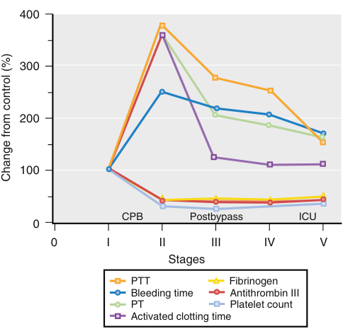

400 300 200 100 CPB Postbypass ICU 0 0 I II III IV V Stages PTT Fibrinogen Bleeding time Antithrombin III PT Platelet count Activated clotting time Change from control (%) 

**Fig. 73.10 Plot of blood coagulation profile changes before, during, and after cardiopulmonary bypass (CPB) in 25 children.** Clotting times and coagulant factors are shown as percent change from control. Stage I, baseline, before CPB; stage II, post- CPB, before protamine reversal of heparin; stage III, after protamine; stage IV, just before leaving the operating room; stage V, after three hours in the intensive care unit (ICU). _PT,_ prothrombin time; _PTT,_ partial thromboplastin time.

These studies provide reasonable thresholds for initiating transfusion after bypass as guided by rotational thromboelastometry (ROTEM) parameters, but no large prospective studies have been conducted to validate the targets. Importantly, the use of either thromboelastography or ROTEM in children having cardiac surgery must be interpreted against age- appropriate reference values.263–266

After bypass surgery, desmopressin acetate has been administered to improve platelet function, with variable success in reducing postoperative blood loss.267,268

Factor concentrates are increasingly used off- label in pediatric cardiac populations to provide needed coagulation factors in small children who may not tolerate the volume of fresh frozen plasma or cryoprecipitate required to raise factor levels satisfactorily.269 Observational evidence suggests that recombinant activated factor VII is efficacious as a rescue agent for prolonged after- bypass bleeding, after the transfusion of platelets, fibrinogen, and coagulation factors to provide adequate scaffolding for its action.269 Fibrinogen concentrate has also been used to replace fibrinogen in pediatric cardiac patients and may be used in place of cryoprecipitate.270,271 Prothrombin complex concentrates (PCCs) are purified plasma- derived products containing vitamin- K- dependent clotting factors (II, VII, IX, X) in either 3- (3F) or 4- (4F) factor preparations. PCCs are included in many transfusion algorithms in adult cardiac surgical populations, but the safety and efficacy in pediatrics remain understudied.272 Both 3- and 4- factor PCC improve thrombin generation in _ex vivo_ studies of neonatal plasma,273,274 but most evidence for clinical use is limited to case reports or small case series. Our institution administers 3- factor PCC as part of a transfusion algorithm in severe hemorrhage after the replacement of platelets, fibrinogen, and other coagulation factors.

Blood transfusion strategy during the perioperative period must be thoughtful and intentional. Injudicious use of blood products to correct individual coagulation abnormalities separately further exacerbates the dilution of existing procoagulants and carries the risk of multiple donor exposures. Transfusion should be undertaken as indicated by an impairment in tissue oxygenation or documented coagulopathies with clinically significant bleeding. Interestingly, while transfusion algorithms may reduce transfusion, pediatric populations may be more likely to alter the pattern of transfusion262 : for example, decreasing RBC transfusion while increasing platelet and cryoprecipitate use. Algorithms may improve hemodynamic stability262 ; research is needed to confirm improved outcomes.

Determining the optimal hematocrit is necessary to guide transfusion and is best decided in conjunction with the surgeon based on an individual patient’s lesion, complexities, and planned procedure. Traditionally, RBCs should be administered to maintain a postdilutional hematocrit of at least 20% on CPB275 ; however, a publication in 2019 from the Network for the Advancement of Patient Blood Management, Hemostasis, and Thrombosis (NATA) suggested using a postdilutional hematocrit of no less than 24276 ; children with cyanotic CHD require a higher hematocrit. A recent study demonstrated an association between the indication for blood transfusion and postoperative morbidity in a cohort of children having cardiac surgery. Study results indicated that patients who required transfusion

<!-- PDF page 34 -->

to maintain a target postdilutional hematocrit on a pump had no increase in morbidity, while those requiring a therapeutic transfusion experienced severe morbidity and mortality.277

An increasingly recognized problem in pediatric cardiac surgical populations is thrombosis. Approximately 11% of children having cardiac surgical procedures experience a thrombotic complication278 ; risk factors include younger age,278,279 cyanotic disease,278,279 use of DHCA,278 longer duration of _in situ_ central lines,278 and administration of blood products in the absence of intraoperative coagulation testing.280 Alterations in levels of pro- and anticoagulants in immature pediatric patients combined with the inflammatory effects of bypass create a hypercoagulable state in many patients postoperatively.281 Decreased antithrombin III levels after cardiac surgery are associated with thrombotic events in adults282 but this has not been evaluated in children. Furthermore, the ability of the infant’s immature antifibrinolytic system to lyse clots composed of adult fibrinogen may be impaired.283

The blood product transfusion often continues as the patient is transferred to the ICU. Abnormal coagulation laboratory tests in the postoperative patient with uncomplicated cardiac issues (see Fig. 73.10) are usually not associated with excessive bleeding and self- correct during the first postoperative day. Routine correction of these abnormalities with an infusion of blood products is not warranted. Administration of blood products should not occur without clinical evidence of bleeding and the identification of a specific defect requiring targeted component therapy. Routine use of blood products for volume replacement is also to be avoided; lactated Ringer or saline solution can be satisfactorily administered at a reduced cost without the hazards associated with transfusion. In summary, the evidence suggests that there should be a comprehensive blood management approach that starts preoperatively and ends in the ICU and that blood product administration should be targeted and individualized to the patient.284

## Postoperative Management

Immediate postoperative care of the pediatric patient who has undergone cardiothoracic surgery is an essential moment in the overall sequence of anesthetic and surgical management. Although the conduct of the operation determines the primary influence on outcome, postoperative care is an important factor. As a member of the operative team, the anesthesiologist must understand and become involved during the immediate postoperative period. Detailed principles of postoperative management of pediatric cardiac surgical patients are beyond the scope of this chapter. However, a few general guiding principles and approaches are given to provide fundamental knowledge for the anesthesiologist.

The postoperative period can be characterized by physiologic and pharmacologic changes as the body convalesces from the abnormal biologic conditions of CPB and cardiac surgery. During this period, the effects of the cardiac operation, any underlying disorders, the effects of hypothermic CPB, and special techniques such as DHCA may create unique problems. In the immediate postoperative setting, abnormal convalescence and specialized issues must be

recognized and managed appropriately. Fortunately, most patients can balance the cost imposed by the physiologic trespass created by the surgical repair and the effects of CPB against the benefit of reduced pathophysiologic loading conditions, resulting in low morbidity and mortality.

Therefore, the guiding principle in managing the postoperative patient is understanding both normal and abnormal convalescence after anesthesia and cardiac surgery. The immediate postoperative period, even that of normal convalescence, is one of continuous physiologic change because of the pharmacologic effects of residual anesthetic agents and the ongoing physiologic changes secondary to abrupt alteration in hemodynamic loading conditions, surgical trauma, and extracorporeal circulation. Anesthesia and surgery affect the patient’s conscious state and cardiovascular, respiratory, renal, and hepatic function; fluid and electrolyte balance; and immunologic defense mechanisms. Despite these changes, postoperative care should be predictable and standardized for most patients undergoing cardiac procedures.

In general, the four temporal phases of postoperative management in the cardiac patient are (1) transport to the ICU, (2) stabilization in the ICU, (3) weaning from inotropic and ventilatory support, and (4) mobilization of fluids. Patients proceed through these phases at variable rates based on such factors as the underlying disease process, preoperative medical condition, sequelae of the surgical procedure, duration of CPB, and presence or absence of intraoperative complications. One of the most important functions of the ICU team is to identify postoperative complications in the patient who convalesces abnormally and to provide interventional therapy. Because physiologic change after cardiac surgery is dramatic but self- limiting during normal convalescence, recognizing abnormal processes can be difficult. Under such circumstances, a uniform, multidisciplinary approach with experienced clinicians and nurses facilitates the identification of any abnormalities in convalescence. These abnormalities often are indications for closer observation, more invasive monitoring, pharmacologic intervention, and increased cardiopulmonary technical support. Complications include hypovolemia, residual structural heart defect, right and left ventricular failure, hyperdynamic circulation, pulmonary artery hypertension, cardiac tamponade, arrhythmias, cardiac arrest, pulmonary insufficiency, oliguria, seizures, hypercoagulable state, thrombosis, and brain dysfunction. It is critical to detect these departures from the normal convalescent course and to treat them aggressively. Of note, point- of- care ultrasound technology is being used more frequently in all aspects of postoperative care to diagnose and aid in treatment decisions quickly.285–288

A critical area in which the anesthesiologist can aid the recovery of the cardiac patient is pain control. Pain and sedation are among the most common problems requiring ICU intervention. Many factors influence the onset, incidence, and severity of postoperative pain. The attenuation of the stress response in the immediate postoperative period using infusions of potent opioids in the critically ill infant reduces morbidity.84 Attenuation of postoperative pain can be attempted with preoperative medication and an intraoperative anesthetic management technique that includes potent opioids. Patients who receive no opioids preoperatively or during the operative procedure will require analgesics in the

<!-- PDF page 35 -->

immediate postoperative period once the inhalation anesthetic is eliminated. Most cases of postoperative pain can be managed by administering small intravenous doses of opioids, usually morphine or hydromorphone. This is important in a patient being weaned from the ventilator during the early postoperative period. Patients who are intubated and ventilated overnight should receive adequate sedation and pain control until ventilatory weaning is begun. A continuous infusion of benzodiazepine and an opioid usually accomplishes this. Continuous infusion of sedatives and analgesics results in more consistent and reliable control of postoperative pain. When separated from mechanical ventilation, the patient is concurrently weaned from the sedatives and analgesics. In patients with reactive pulmonary artery hypertension, opioids have been shown to prevent hypertensive crisis.82 Interestingly, using acetaminophen in the perioperative period has been associated with lower rates of acute kidney injury. The theory is that acetaminophen reduces the oxidation state of free hemoglobin.289

After thoracotomy, regional anesthesia may be used for postoperative pain control in infants and children. This method avoids opioid- induced respiratory depression from intravenous doses of these drugs. The administration of opioids in the epidural space is a very effective approach to pain management. This technique is used in children for postoperative pain control via the caudal route as a “single shot” or by a small caudal catheter. Morphine or hydromorphone provides adequate analgesia for 6 to 12 hours, with no significant respiratory depression. Caudal morphine 0.05 to 0.075 mg/kg delivered in a total volume of 1.25 mL/kg of sterile saline has been used with success in our practice. The use of regional anesthesia for postoperative pain appears to be best suited for the child extubated in the early postoperative period. Relative contraindications of this technique include hemodynamic instability and patients with abnormal clotting profiles and/or continued active bleeding. Using regional analgesia can result in better arterial oxygenation, a more rapid ventilator weaning, and decreased postoperative respiratory complications. However, urinary retention occurs frequently in patients without a bladder catheter. The use of regional plane blocks for postoperative pain management for both thoracotomies and sternotomies is increasing.290 They are relatively easy to do, can usually be performed in the position needed for surgery, facilitate early postoperative extubation and lead to a decreased use of opioids and sedatives in the first 24 hours postoperative. A comparison study looking at postoperative thoracotomy pain after pediatric cardiac surgery showed that ultrasound- guided serratus anterior plane block and the pectoral nerve II block were equally effective and superior to intercostal nerve blocks and they had the additional benefit of being longer lasting and are as quickly performed.291 This same group and others have also investigated the use of the erector spinae plane blocks and transversus thoracic muscle plane blocks for median sternotomies and showed decreased Modified Objective Pain Scores and reduced use of fentanyl in the first 10 hours postsurgery.292–298

Children requiring large thoracotomies or a bilateral thoracosternotomy (i.e., “clamshell”) incision merit consideration for thoracic epidural analgesia. This technique significantly reduces the respiratory depression and pulmonary mechanics abnormalities that accompany the quantity

of systemic opioids necessary to provide adequate analgesia for these excruciatingly painful incisions. If the procedure requires systemic heparinization, we will typically defer the placement of these catheters until the heparin effect is neutralized. For the patient undergoing coarctation repair via a left thoracotomy, there is some concern for paraplegia following the operation. However, as the incidence of paraplegia in children is exceedingly low, we usually place the caudal or epidural catheter before surgical incision to maximize the benefit intraoperatively; however, some centers choose to place it at the end of surgery after it is clear there is no neurologic impairment. For patients undergoing heart, lung, or dual transplantations, a thoracic epidural catheter is placed at a time in the postoperative period when the patient can be weaned from intravenous medications that would adversely affect the patient’s ventilation before the planned extubation. It is helpful for these patients to have a functioning thoracic epidural catheter for several days.

### POSTOPERATIVE NEUROPSYCHOLOGIC

### MORBIDITY

As survival after cardiac surgery in children improves, long- term neurologic morbidity is being recognized as increasingly problematic. Although early postoperative CNS sequelae such as stroke and seizures occur in a small percentage of neonates with CHD, the importance of more subtle neurologic abnormalities at long- term follow- up is increasingly recognized.237,299

These findings may include fine and gross motor impairments, speech and language delays, disturbances in visualmotor and visual- spatial abilities, attention- deficit disorders, learning disorders, and impaired executive functioning. Congenital brain disease in patients with CHD represents a challenge in improving long- term neurologic outcomes. Many neonates with CHD have congenital structural brain abnormalities, chromosomal abnormalities, or both, and physiologic abnormalities that may impair brain development. Brain abnormalities on head ultrasonography have been noted in one- fifth of full- term infants undergoing heart surgery, with half of them being present preoperatively.299

Postoperatively, a secondary neurologic injury may be related to post- CPB alterations in cerebral autoregulation and additional hypoxic–ischemic insult, seizures, or other issues associated with a prolonged ICU stay. In addition to prenatal and modifiable perioperative factors, genetic and environmental factors are known to be important. Unfortunately, modifiable perioperative factors may explain less of the variability in long- term outcomes than patient- specific factors.

New, postoperative neurologic injury may be detected clinically in over 10% of infants,300 increasing to over 50% using more sensitive brain imaging techniques such as MRI.301,302 Given that new neurologic injury can occur at various time points during the neonate’s hospitalization, perioperative attention to reducing known risk factors is critical. Mechanisms of CNS injury in infants undergoing cardiac surgery include hypoxia–ischemia, emboli, reactive O2 species, and inflammatory microvasculopathy. Preoperatively, the primary focus is on preventing hypoxic– ischemic injury and thromboembolic insults. Modifiable intraoperative factors associated with CNS injury include, but are not limited to, pH management, hematocrit during

<!-- PDF page 36 -->

CPB, regional cerebral perfusion, and the use of DHCA. The adverse effects of CPB may be greater in infants than in larger children or adults, given the immaturity of their organ function and tissues and the size of the CPB circuit relative to their body size.303 However, a significant amount of research has been conducted around intraoperative prevention of neurologic injury. With ongoing changes in technology and new therapies, the conduct of CPB and other support techniques has been actively under investigation. Neurologic MRI imaging in the preoperative and postoperative periods is now being used more frequently to assess possible neurologic injury further. Specific areas of brain injury can directly be related to future deficits.304 This knowledge should hopefully allow targeted therapies to minimize long- term unfavorable outcomes.305

The developmental consequences of exposure to general anesthetics are not well understood. They are difficult to elaborate on in the absence of prospective randomized controlled trials because of multiple factors that affect the neurologic outcome in this population. Current literature suggests that multiple exposures, cumulative doses, and exposure in infancy might increase the risk for neurodevelopmental delay.306–312 Thus, pediatric cardiac anesthesia is associated with all three risk factors, so attempting to minimize exposure time, bundling necessary procedures only if it will shorten the overall exposure to anesthesia, and delaying unnecessary procedures to an age associated with less neurologic risk might be appropriate. Careful choice of anesthetic agents that do not act on different neuroreceptors at crucial time points in development might be critical.

Our current practice has evolved to minimize neurotoxicity with time under anesthesia minimized by getting help early if there is difficulty with intravenous access and having the surgeon in the room and ready to start immediately postinduction. NIRS monitors are used to optimize cardiac output and help define the need for blood transfusions. Multiple anesthetics are combined and administered in lower individual doses with the thinking that this is less toxic than a single anesthetic at a higher concentration. In all cases, a dexmedetomidine infusion is administered to decrease the dose of the other hypnotics, and, when possible, regional techniques are used to reduce the total anesthesia dose.

### MECHANICAL ASSIST DEVICES

Survival in children with congenital cardiac and pulmonary defects has improved over recent decades due to improved preoperative management, surgical techniques, anesthesia management, drug therapies, and postoperative management. Despite these advances, patients may still require treatment for both acute and chronic HF that are refractory to medical therapy. Mechanical support in the form of ECMO or VADs may need to be instituted. Examples of conditions that may require support include failure to wean from CPB, acute cardiac arrest, malignant arrhythmia, and worsening myocardial function secondary to the underlying congenital defect or related to acquired cardiomyopathy. Fortunately, the incidence is small, with less than 2% of post- CPB patients requiring this intervention.313 Mechanical support can thus be used as a treatment option to allow for recovery of ventricular function, as a bridge to transplant, or to support the heart in those with marginal functional reserve

requiring invasive diagnostics or treatments (e.g., Williams syndrome with severe supravalvular pulmonary or aortic stenosis). As with any therapy, contraindications must be excluded before using a mechanical assist device. These may include extreme prematurity, severe and irreversible multiorgan failure, incurable malignancy, and preexisting neurologic devastation.313 Anesthetic management in the use of ECMO is supportive, with management limited to assistance in the resuscitative efforts and hemorrhage associated with the cardiac surgery that was ongoing at the time of conversion to ECMO. Once the patient is on full ECMO support, ventilation is continued, but at a slower rate of ventilation on the order of 10 breaths/min, with a peak pressure of 20 cm H2O, PEEP set at 5 to 10 cm H2O, and FiO2 decreased to about 40%. These settings aid in the prevention of atelectasis with the management of CO2 and O2 related to flow across the circuit membrane.

This is very different from the patient into whom a VAD is placed. Here the anesthesiologist continues to manage the patient for routine CPB weaning. If a systemic VAD is placed, careful attention must be given to the ventricle pumping blood into the pulmonary bed because the failure of this ventricle will have disastrous consequences. Thus, management tailored to unload this pulmonary ventricle is vitally important and will include inodilators in the form of phosphodiesterase inhibitors, inotropic support, and possibly even inhaled NO to decrease PVR and promote forward flow. In association with the perfusionist, intravascular volume loading is assessed and maintained for effective functioning of the VAD and thus adequate offloading of the assisted ventricle. Careful attention to pulmonary function is also vital. Adequate pulmonary toilet, recruitment maneuvers, and appropriate ventilatory parameters must be used. Bleeding is a potential complication in the implantation of the VAD, and thus a clear strategy must be planned for in the form of antifibrinolytics, adequate volumes of blood and blood products, and even possibly the use of activated clotting factors (e.g., factor VII, PCCs).314

As can be seen in Table 73.10, differences can be appreciated between assist devices. The potential for bleeding exists at the time of insertion of both modalities; however,

**Table 73.10** Comparison of Extracorporeal Membrane Oxygenation Versus Ventricular Assist Device

|**Comparison Factors**|**ECMO**|**VAD**|
|---|---|---|
|Bleeding at insertion|++|++|
|Sternotomy|Not required|Required|
|Left atrial venting|±|−|
|Blood product use|+++|+|
|Number of cannulae for biventricular support|2|4|
|Pulmonary support|+|−|
|Intravenous anticoagulation|+|±|
|Duration of support|Weeks|Months|
|Emergent support|Yes|No|
|Patient mobility|−|+|

_ECMO,_ extracorporeal membrane oxygenation; _VAD,_ ventricular assist device.

::: details 原始表格與符號（PDF 第 36 頁）

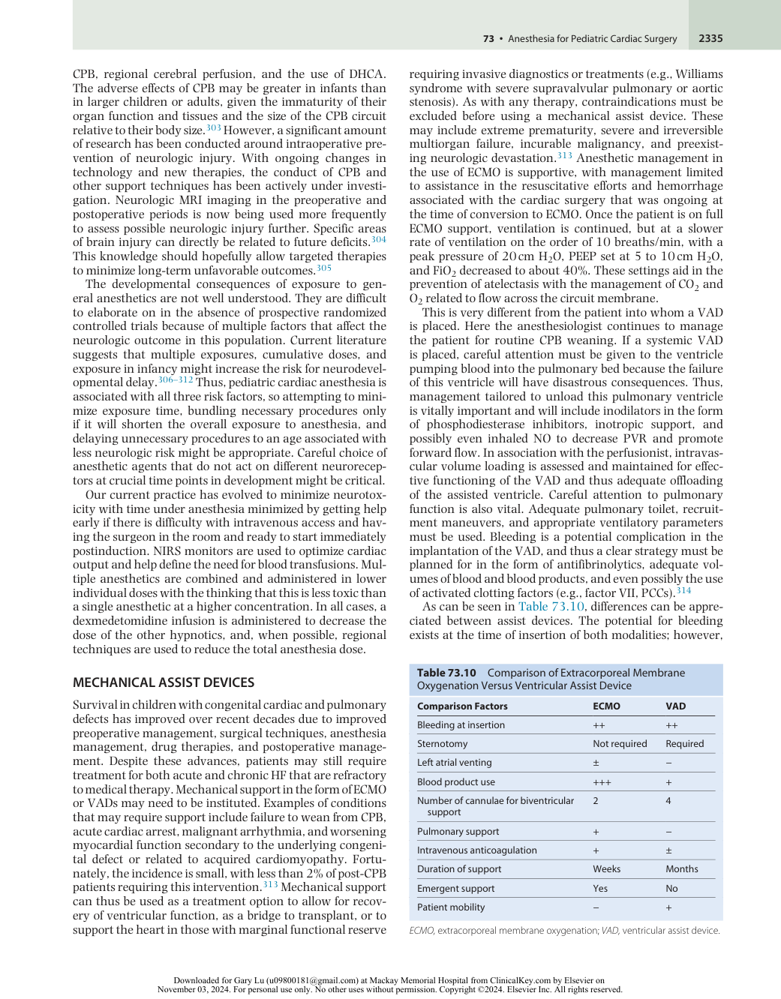

:::

<!-- PDF page 37 -->

it would seem from clinical experience that because of the extensive dissection and need for sizeable ventriculotomy, implantation of a VAD (and especially bi- VAD) is more problematic. Anticoagulation requirements to keep the ACT in the range of 180 to 200 for ECMO may also lead to ongoing and significant bleeding, especially if placed into a patient who requires support in the immediate perioperative phase. Using an ECMO circuit with a membrane oxygenator requires continued intravenous anticoagulation with maintenance of the ACT in the aforementioned range. Apart from the immediate postoperative phase, patients with VAD systems can be transitioned to oral agents. A twopart therapy is recommended. Antiplatelet therapy includes aspirin or clopidogrel. The second part of the therapy will entail anticoagulation with either warfarin (Coumadin) or subcutaneous low- molecular- weight heparin.313

Three potential disadvantages exist in the use of the VAD system. The lack of pulmonary support when using the VAD limits its use to patients with adequate lung function. Second, Table 73.10 illustrates that biventricular support requires two separate VAD devices, necessitating the placement of four cannulae, which may be technically challenging in a very young child. The third disadvantage is that VAD placement cannot be performed in a code situation or at the bedside, as with ECMO.

Essential advantages of the VAD system are the ability of patients to ambulate while on support and that VAD support can be maintained for months in contrast to the weeks only of ECMO support. Another important advantage over ECMO is that these patients will not require further venting of the LA. In patients on ECMO, this is achieved by placing a left atrial vent at the time of sternotomy or a balloon atrial septostomy, which may require transfer to the catheterization laboratory with the possible complications associated with the transport of a patient on an ECMO circuit.

Despite successful resuscitation and placement onto mechanical assist devices, morbidity and mortality remain high, with ECMO appearing to have worse outcomes. The mortality rate for ECMO in the 1990s was 47%, with survival in series published in the early 2000s not showing much improvement.315–317 In contrast, the survival for those into whom a VAD is placed appears to be superior within the quoted series, with up to 80% of patients surviving to transplantation or being successfully weaned from support.318 In the study by Blume and co- workers,316 however, it was noted that associated CHD, patients who are younger and smaller, and those done at small-volume institutions have higher mortality than those with fulminant myocarditis and cardiomyopathy.316,319 Alongside survival data, the next most crucial marker is the neurologic outcome, and it appears that this is also better in the VAD group.320,321 Risk factors for poor neurologic outcome were once again of low weight and duration of DHCA, both of which place patients on ECMO at a survival disadvantage because patients on ECMO will be smaller. Some of those who undergo DHCA to repair congenital anomalies will require emergent ECMO support to wean from CPB or in the immediate postoperative phase.322

Survival predictors are essential in our management of these patients. One common variable that can predict survival is the return of ventricular function between 3 and 5 days after the initiation of support.317,322 Both of these

modalities have been used successfully as a bridge to transplantation, with patients with a VAD having a greater than 80% survival to transplantation and patients on ECMO showing a less than 60% survival. Yet ECMO is used often in the infant population and those with complex CHD, which are factors known to increase mortality among VAD patients.322 The important causes of morbidity and mortality in patients on both modalities include cerebrovascular events secondary to either hemorrhagic or embolic phenomena, circuit- related issues (e.g., circuit thrombosis), renal failure requiring hemofiltration, sepsis, ongoing hemorrhage, and multiple- organ failure.

Although these modalities are often compared to each other, they have unique places in caring for children with cardiac disabilities. ECMO has a significant advantage in that it can be employed rapidly in a code situation for a patient of any age or size. In the past, size has been the limiting factor for the implantation of VAD systems into pediatric patients. The Berlin Heart VAD (Berlin Heart AG, Berlin, Germany) is a pulsatile- flow device available for use even in neonates. The system has been employed in Europe for over 20 years and has pump sizes from 10 to 80 mL.

Although this is currently the only FDA- approved VAD for children, a high incidence of adverse events such as embolic stroke, bleeding, and infections is noted.323 This has led to the increased use of adult continuous- flow devices, including the HeartMate II (Thoratec Corp., Pleasanton, CA) and HeartWare HVAD (HeartWare Inc., Framingham, MA) in children who may need it for more extended periods or who will potentially discharge home on the device. The Infant Jarvik VAD, a pediatric- specific continuousflow device, is currently undergoing pre- clinical testing. Several other short- term VAD options can provide additional organ support, including oxygenation, hemodialysis, and plasma exchange if needed. The CentriMag/PediMag (Thoratec Corp., Pleasanton, CA) and the Jostra Rotaflow (MAQUET Cardiovascular, Wayne, NJ) are rotary or centrifugal pumps used for short- term VAD support in multiorgan failure patients. Finally, there are percutaneous VADs now small enough to place in children. The Impella 2.5 (Abiomed Inc., Danvers, MA) is an axial VAD catheter used in children as small as 22 kg. One can appreciate how these modalities complement each other, with ECMO being used acutely. Then once the patient is physiologically stable but still requires support, a VAD can be implanted for intermediate or long- term support. Recent data from the Organ Procurement and Transplant Network supports a survival to transplant advantage for patients with VAD (in particular, CentriMag) compared to ECMO.324

The temporary Total Artificial Heart (TAH) system is a newer mechanical assist device for children. The TAH system is indicated for use as a bridge to transplant in patients at imminent risk for death from biventricular failure. The implantation and use of this device is unique in that it requires the complete removal of the native myocardium, such that recovery without transplantation is impossible. Once the myocardium is removed, inflow and outflow pumping chambers are sown into the right and left heart vessels. Sizing requirements include a patient body surface area of 1.7 m2 or greater, the echocardiographic left ventricular end- diastolic diameter of 70 mm or greater, a CT scan with an anterior- to- posterior dimension at the 10th

<!-- PDF page 38 -->

thoracic vertebrae of 10 cm or greater, and a chest radiograph with a cardiothoracic ratio of 0.5 or greater. Smaller TAH devices may be available soon, allowing implantation in smaller patients. This device has been used successfully as a bridge to transplant in a patient with failing Fontan physiology who later received a heart transplant.

## Anesthesia for Heart and Lung Transplantation

Although perioperative management for thoracic organ transplantation is considered elsewhere in this text, applying these procedures to children requires some specific modification. Differences include the characteristics of the candidates, preparation of these children, anesthetic management, surgical considerations, post- CPB management, and outcome. Even though some of the earliest heart transplant procedures were performed for congenital heart malformations, this indication became rare by the early 1980s. In 1984, over 60% of the few pediatric heart transplant procedures were performed in patients with cardiomyopathy, usually adolescents. In the next decade, a dramatic rise in the number of infants and young children with congenital heart malformations treated with heart transplantation resulted in a marked shift in the demographics.325 By 1995, over 70% of the children receiving heart transplants were younger than five years, with half of those younger than one year. The overwhelming majority of these infants received transplants for congenital heart malformations for which reconstructive options had failed or were not believed to exist (Fig. 73.11).325 The implications of this shift reach into every element of perioperative management.

Children considered for heart transplantation are more likely to have pulmonary hypertension than adults. Most adult transplant programs will not offer heart transplant therapy to patients with PVR over 6 Wood units/m2 .326 The exclusion threshold in infants and children remains controversial. Some programs accept patients with PVR as high as 12 Wood units/m2 , mainly if the pulmonary vasculature responds to vasodilators such as O2, NO, calcium channel blockers, or prostacyclin.327 Neonates are generally assumed to have elevated PVR. Still, outcome data from some programs suggest that the importance of this factor for the postoperative outcome is substantially less in the first year of life, perhaps because the infant donor hearts, having recently undergone transitional circulation, are better prepared to cope with the right ventricular pressure load that elevated PVR imposes.328

The anesthetic plan for pediatric heart transplantation must accommodate a broad spectrum of pathophysiology. Recipients with congenital heart malformations benefit from analyzing loading conditions and optimizing hemodynamics discussed previously. Although a few of these patients undergo heart transplantation because the natural history of reconstructive heart surgery poses greater risk despite good ventricular function, most candidates exhibit some manifestations of impaired ventricular performance. Accordingly, they require careful titration of anesthetic agents with minimal myocardial depressant characteristics to avoid cardiovascular collapse. In this fragile population, even modest doses of opioids can be associated with

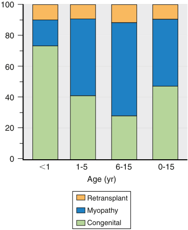

100 80 60 40 20 0 �1 1-5 6-15 0-15 Age (yr) Retransplant Myopathy Congenital 

**Fig. 73.11 Indication for heart transplantation in children.** Over the past two decades, the major indications for pediatric heart transplantation were nearly equally divided between congenital malformation and cardiomyopathy. In later years, pediatric recipients with congenital malformations assumed a slight plurality because of shifting age demographics. As illustrated, younger children are more likely to undergo heart transplantation because of congenital malformation. (Data from the Registry of the International Society for Heart and Lung Transplantation, Addison, TX.)

marked deterioration in systemic hemodynamics, presumably by reducing endogenous catecholamine release. As with most congenital heart patients, skilled airway and ventilation management represents crucial elements in a good induction, particularly in the presence of elevated PVR. No matter how elegant the anesthetic plan is in conception and implementation, a certain proportion of these children will decompensate on induction, necessitating resuscitative therapy. A particularly critical time is central line placement: when transplant patients may not tolerate the Trendelenburg position, a level table and ultrasound are sufficient to place a central line.

Although orthotopic heart transplantation poses technical challenges in neonates and young infants, replacing an anatomically normal heart is less complex than several reconstructive heart procedures commonly performed in patients at this age. However, adapting this procedure to incorporate the repair of major concurrent cardiovascular malformations requires the consummate skill and creativity that remain the province of a few exemplary heart surgeons in congenital disease.329,330

Having withstood extended ischemic periods, heart grafts are extraordinarily intolerant of superimposed residual hemodynamic loads that may accompany imperfect vascular reconstruction. The extensive vascular repair and, particularly in older children with long- standing hypoxemia, the propensity to coagulopathy together elevate hemorrhage to a significant cause of morbidity and even mortality in pediatric heart transplantation. Nevertheless, once successfully implanted, these grafts will respond to physiologic factors that stimulate growth and adaptation in the developing infant and child.331

::: warning 符號需核對
此頁有符號無法完整擷取，請展開下方原始頁面核對。
:::

::: details 原始表格與符號（PDF 第 38 頁）

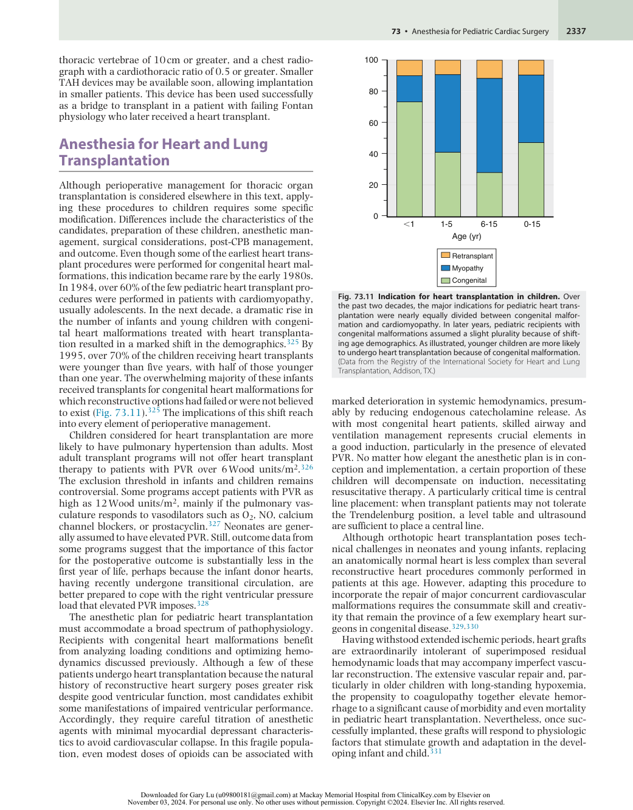

:::

<!-- PDF page 39 -->

Management considerations during separation from CPB and the early postoperative period primarily focus on three pathophysiologic conditions: myocardial preservation, denervation, and PVR. Even expeditious transplant procedures usually force the heart to endure ischemic periods that exceed those encountered during reconstructive surgery. Although some researchers believe the infant’s heart is more tolerant of extended ischemia, these hearts will demonstrate a period of reperfusion injury, and virtually all require pharmacologic and, in some cases, mechanical support.328 In addition, endogenous adaptive responses and exogenous pharmacologic agents that act by myocardial sympathetic activation are ineffective in the denervated graft. Because most children presenting for heart transplantation exhibit some elevated PVR, even with isolated endstage cardiomyopathy, the RV of a newly implanted heart is particularly vulnerable to failure.

Ventilatory and pharmacologic interventions are usually configured to exert a favorable impact on PVR and provide inotropic and chronotropic support. Once the lungs are fully expanded, we ventilate to PaCO2 values in the low 30 mm Hg range using an FiO2 of 1. All recipients receive low- dose inotropic support such as epinephrine, milrinone, dopamine, and/or isoproterenol to promote inotropy, chronotropy, and lower PVR. As mentioned previously, a significant concern is RV dysfunction. Hence, we will generally start inhaled NO for the immediate post- CPB period.

Most transplant centers have a specific regimen for immunosuppression to be initiated in the perioperative period. As with adults, pediatric transplant programs typically employ triple- drug immunosuppression with a calcineurin inhibitor (e.g., cyclosporine, tacrolimus), antimetabolite (e.g., azathioprine), and steroid. After an interval without rejection, some pediatric programs will taper and discontinue one or even two of these agents, particularly in neonates, in whom some element of tolerance develops.332,333

Survival after a pediatric heart transplant is improving. The principal risk factors are age younger than one year and congenital heart defects. Because these factors are closely related (i.e., most infants younger than one year undergo transplantation for a congenital heart defect), it is difficult to determine the independent effect of age. Concurrent repair of structural cardiovascular anomalies substantially increases perioperative risks for hemorrhage, residual hemodynamic loading conditions, and right- sided HF from elevated PVR. The greatest mortality risk is found in the first year after transplant; however, infants who survive the first postoperative year have better long- term survival than other age groups.334 The average survival for infants is 18 years, when 50% of patients are alive after transplant.335 Average survival is 15 years for those transplanted at ages 1 to 10 years of age and 11 years survival for those transplanted as teenagers. The sequelae of rejection and the consequences of the immunosuppression result in significant ongoing morbidity and mortality; despite advances in pharmacologic therapy, acute rejection rates in the first year have not changed appreciably.335

A unique quality of neonates is that their immune system remains immature, unable to produce antibodies effectively against foreign blood cells until approximately 12 to 24 months. Infants also have a poorly developed complement system. These developmental characteristics allow

for the transplantation of an ABO- mismatched organ into an infant, which has expanded the pool of available organs for that population. Anesthetic implications for infants who are candidates for ABO- incompatible transplant surround transfusion management. These patients should receive only ABO- compatible blood products before transplant and not whole blood.335

Lung and heart–lung transplantation have achieved respectable operative survival rates in children.336 They remain the only viable surgical therapy for infants and children with severe pulmonary vascular disease and selected progressive pulmonary diseases. These remain uncommon procedures in pediatrics. Lung transplantation carries the additional morbidity of obliterative bronchiolitis, a debilitating small airway disease that results in a gradual deterioration in flow- related pulmonary functions over time. Despite a low operative mortality rate, 5- year survival is only 53%.336

Patients with transplanted hearts also present for surveillance cardiac catheterizations, biopsies, and other procedures.313,337,338 The anesthesia plan for these patients should consider the physiologic and pharmacologic problems of allograft denervation, the side effects of immunosuppression, the risk for infection, and the potential for rejection.337,338 Cardiac allograft vasculopathy is the leading cause of morbidity and mortality after transplantation, leading to progressive graft dysfunction with HF, an increased risk for dysrhythmia, and the possibility of sudden arrhythmogenic death. Conventional revascularization procedures are ineffective because cardiac allograft vasculopathy is caused by intimal proliferation, leaving retransplantation as the only therapeutic option.

Hyperlipidemia after heart transplantation is common in adults and children and is aggravated by chronic steroid therapy and other immunosuppressive agents. Statins are used with good results in controlling hyperlipidemia after transplantation and are likely to manifest inherent immunosuppressive effects. Risk factors for posttransplant renal dysfunction are calcineurin inhibitors, mechanical circulatory support, prolonged inotropic support, and preexisting renal dysfunction. Newer, more potent immunosuppressive agents (e.g., tacrolimus) have led to steroid- sparing regimens late after transplantation, eliminating the detrimental effects of long- term steroid administration. Agents such as sirolimus may now be used with lower levels of calcineurin inhibitors, thus minimizing long- term nephrotoxicity.

Posttransplant lymphoproliferative disorders represent a pathologic spectrum of abnormal lymphoid proliferation ranging from localized early lesions to polymorphic disease or, in some cases, monomorphic lymphomatous disease. The most common disease sites and presenting symptoms from a clinical perspective included the gastrointestinal tract and pulmonary systems. Patients with polymorphic disease are treated primarily by a reduction or temporary cessation of immunosuppression, along with adjunctive surgical therapy for tissue diagnosis or obstructive lesions. Most centers reserve traditional chemotherapeutic regimens for patients with nonresponsive polymorphic disease and monomorphic disease. As a result of cardiac denervation, autonomic regulatory mechanisms are not available to prevent the wide swings in a patient’s hemodynamic state, and the stress response is slower than usual. Cardiac

<!-- PDF page 40 -->

parameters are significantly altered, and patients may experience decreased systemic blood pressure and cardiac filling pressures. Compensatory mechanisms are delayed, and reductions in cardiac output lead to decreased coronary and cerebral perfusion, especially with hypertension. Drugs with direct myocardial and vascular effects are the mainstay of therapy. Most immunosuppressive agents affect hepatic and renal functions and interact with anesthetic drugs.

## Anesthesia for Closed- Heart Operations

Early corrective repair in infancy has significantly reduced the number of non- corrective, palliative closed- heart operations. Corrective closed- heart procedures include PDA ligation and repair of coarctation of the aorta. Non- corrective closed- heart operations include pulmonary artery banding and extracardiac shunts such as the Blalock–Taussig shunt. These procedures are performed without CPB. Therefore, venous access and intra- arterial monitoring are essential in evaluating and supporting these patients. A pulse oximeter and NIRS monitors (cerebral and somatic) are invaluable devices during intraoperative management.

Ligation of a PDA is typically performed through a left thoracotomy, although video- assisted thoracoscopic techniques are increasingly common.339,340 Physiologic management is that of a left- to- right shunt producing volume overload. Patients with a large PDA and low PVR generally present with excessive PBF and CHF. Neonates and premature infants also risk having substantial diastolic runoff to the pulmonary artery, potentially impairing coronary perfusion. Thus, patients range from an asymptomatic healthy young child to a sick ventilator- dependent premature infant on inotropic support. The health of the former patient allows a wide variety of anesthetic techniques culminating in extubation in the operating room. The latter patient requires a carefully controlled anesthetic and fluid management plan. Generally, a trial of medical management with indomethacin and fluid restriction is attempted in the premature infant before surgical correction. Transporting the premature infant to the operating room can be especially difficult and potentially hazardous, requiring great vigilance to avoid extubation, excessive patient cooling, and disruption of venous access. For these reasons, many centers are now performing ligation in the neonatal ICU.

A subset of premature infants with PDAs is located at institutions without cardiac surgical teams. Ligation of the PDA in these patients requires either transfer of these highrisk neonates to a center that has a team who routinely performs the procedure or the availability of a team capable of performing the procedure which is willing to travel to perform the procedure in the neonate’s home neonatal ICU (NICU). Gould and associates341 reviewed the experience with on- site and off- site ligations of a team composed of a pediatric cardiac attending anesthesiologist, a certified registered nurse anesthetist, an attending pediatric cardiothoracic surgeon and fellow, and cardiac operating room nurses. There were no anesthetic- related complications in their group. No differences were found in the incidence

of perioperative complications in the procedures at the two sites. This study showed that PDA ligations could be performed safely in the NICUs of hospitals lacking on- site pediatric cardiac surgical units without incurring the risk inherent in the transport of critically ill infants. In addition, patient care is continued by the neonatology team most familiar with the child’s medical and social history, and the patient’s family is minimally inconvenienced.

Complications of PDA ligation include inadvertent ligation of the left pulmonary artery or descending aorta, recurrent laryngeal nerve damage, and excessive bleeding resulting from inadvertent PDA disruption. The placement of a pulse oximeter on the lower extremity should alert the anesthesiologist and surgeon in the case of accidental aortic ligation. After ductal ligation in premature infants, worsening pulmonary compliance can precipitate a need for increased ventilatory support, and manifestations of an acute increase in left ventricular afterload should be anticipated, especially if left ventricular dysfunction has developed preoperatively. PDA ligation has been performed in infants and children using thoracoscopic surgical techniques. This approach has the advantage of limited incisions at thoracoscopic sites, promoting less postoperative pain and discharge from the hospital on the same day of surgery.

Coarctation of the aorta is a narrowing of the descending aorta near the insertion of the ductus arteriosus. Obstruction to aortic flow results and may range from severe obstruction with compromised distal systemic perfusion to mild upper extremity hypertension as the only manifestation. Associated anomalies of both the mitral and aortic valves can occur. In neonates with severe coarctation, systemic perfusion depends on right- to- left shunting across the PDA. In these circumstances, left ventricular dysfunction is very common, and prostaglandin E1 is necessary to preserve sufficient systemic perfusion. Generally, a peripheral intravenous line and an indwelling arterial catheter in the right upper extremity are recommended for intraoperative and postoperative management. A central venous catheter may be desirable for pressure monitoring and inotropic support in patients with left ventricular dysfunction.

The surgical approach is through a left thoracotomy, whereby the aorta is cross- clamped and the coarctation repaired with an end- to- end anastomosis, patch aortoplasty, or subclavian patch. During cross- clamping, we usually allow significant proximal hypertension (20%–25% increase over baseline) based on evidence that vasodilator therapy may jeopardize distal perfusion and promote spinal cord ischemia. Intravascular crystalloid administration of 10 to 20 mL/kg is given just before the removal of the clamp. The anesthetic concentration is decreased, and additional blood volume support is provided until the blood pressure rises. Post- repair rebound hypertension from heightened baroreceptor reactivity is common and often requires medical therapy. After cross- clamping, aortic wall stress resulting from systemic hypertension is most effectively lowered by the institution of beta blockade with esmolol or alpha/ beta blockade with labetalol.342 Recent work indicates that patients younger than six should receive an initial dose of esmolol 250 to 500 mcg/kg, followed by an infusion of 250 to 750 mcg/kg/min, depending on the blood pressure. Despite an esmolol infusion, 25% to 50% of patients have

<!-- PDF page 41 -->

a blood pressure above the targeted range, requiring a second drug. Sodium nitroprusside or nicardipine is usually chosen as the second drug. Propranolol is helpful in older patients but can cause severe bradycardia in infants and young children. Although it increases calculated aortic wall stress in the absence of beta blockade by accelerating dP/dT (contractile force), adding sodium nitroprusside may be necessary to control refractory hypertension. Captopril or an alternative antihypertensive regimen is begun in the convalescent stage of recovery in patients with persistent hypertension. The management of infants undergoing placement of extracardiac shunts without CPB centers on goals similar to those of other shunt lesions – balancing pulmonary and systemic blood flow by altering PaCO2, PaO2, and ventilatory dynamics. Central shunts are usually performed through a median sternotomy, whereas Blalock–Taussig shunts may be performed through a thoracotomy or sternotomy. In patients in whom PBF is critically low, partial cross- clamping of the pulmonary artery required for distal anastomosis causes further reduction of PBF and desaturation, necessitating careful monitoring of pulse oximetry. Careful application of the cross- clamp to avoid pulmonary artery distortion will help maintain PBF. Under circumstances where severe desaturation and bradycardia occur with cross- clamping, CPB will be required for the procedure. Intraoperative complications include bleeding and severe systemic O2 desaturation during chest closure, usually indicating a change in the relationship of the intrathoracic contents that results in distortion of the pulmonary arteries or kink in the shunt. Pulmonary edema may develop in the early postoperative period in response to the acute volume overload that accompanies the creation of a large surgical shunt. Measures directed at increasing PVR, such as lowering inspired O2 to room air, allowing the PaCO2 to rise, and adding PEEP, are helpful maneuvers to decrease PBF until the pulmonary circulation can adjust. Decongestive therapy, such as diuretics and digoxin, may alleviate the manifestations of CHF. Under such circumstances, early extubation is inadvisable. Pulmonary artery banding restricts PBF in infants whose defects are deemed uncorrectable for anatomic or physiologic reasons. These patients are generally in CHF with reduced systemic perfusion and excessive PBF. The surgeon places a restrictive band around the main pulmonary artery to reduce PBF. Band placement is imprecise and requires careful assistance from the anesthesia team for success. Many approaches have been suggested. We place patients on 21% inspired O2 concentration and maintain the PaCO2 at 40 mm Hg to simulate the postoperative state. Depending on the malformation, a pulmonary artery band is tightened to achieve hemodynamic (e.g., distal pulmonary artery pressure 50%–25% systemic pressure) or physiologic (e.g., Q. p/Q. s approaching 1) goals. The band is loosened if attaining these objectives produces unacceptable hypoxemia.

Reverse Potts shunt has been recently offered to patients as a palliative treatment for end- stage pulmonary hypertension. Preliminary experience suggests that creating a physiologic state like Eisenmenger syndrome may provide survival benefits similar to lung transplants and improve quality of life.343,344 A surgically created window between

the descending aorta and pulmonary artery reduces right ventricular afterload, equalizes the pressures between systemic and pulmonary circulations, and prevents acute right ventricular dysfunction and death. Compared to atrial (atrial septostomy) or ventricular (VSD) level shunt, Potts shunt selectively channels the desaturated blood to the lower body and preserves oxygen delivery to the myocardium and brain. To assess the efficacy of the shunt, both upper (pre- shunt) and lower body (post- shunt) blood pressure and oxygen saturation are monitored. A 10%–15% difference in the pre- and post- shunt oxygen saturation is usually considered ideal. Thus far, the experience with this palliative surgery has been limited to a few case series. In one series, with a mean follow- up of more than 2.5 years, 18 out of 21 patients discharged from the hospital showed a reduction in the pulmonary hypertension medications, a decrease in biomarker (beta natriuretic peptide), and an improvement in clinical symptoms. The long- term survival benefits after Potts shunt are yet to be evaluated. Anesthetic management for Potts shunt in patients with severe pulmonary hypertension is risky, and the surgery is associated with high in- house mortality of 15%–20%. The surgery is performed either through lateral thoracotomy or midline sternotomy. The lateral thoracotomy approach requires lung isolation which is often poorly tolerated by the right ventricle and is associated with severe desaturation. Creating an anastomosis between the pulmonary artery and descending aorta involves the placement of side- biting clamps on the great vessels. If the ventricular function is preserved, using vasopressin increases systemic vascular resistance and ventricular geometry and improves systemic blood pressure. In patients with compromised ventricular function, a combination of epinephrine and vasopressin infusions are often needed.

## Anesthesia for Cardiac Catheterization

Advances in interventional and diagnostic cardiac catheterization techniques significantly change the operative and nonoperative approach to the patient with a congenital heart defect. Common interventions in the cardiac catheterization laboratory are shown in Table 73.11. Nonoperative interventional techniques are being used instead of procedures requiring surgery and CPB for the safe closure of secundum ASDs, VSDs, and PDAs. Stenotic aortic and pulmonic valves, recurrent aortic coarctations, and branch pulmonary artery stenoses can be dilated in the catheterization laboratory, avoiding surgical intervention.345,346 These techniques shorten the hospital stay and are particularly beneficial to patients with recurrent coarctation and muscular or apical VSDs, who are at a higher risk for operative intervention. Many patients with complex cardiac defects are poor operative candidates. Innovative interventional procedures improve vascular anatomy, reduce pressure loads on ventricles, and decrease the operative risk for these patients. For example, in TOF with hypoplastic pulmonary arteries, balloon angioplasty and vascular stenting procedures create favorable pulmonary artery anatomy and reduce pulmonary artery pressure and right ventricular end- diastolic pressure. Complications are more

<!-- PDF page 42 -->

**Table 73.11** Common Interventions in the Cardiac Catheterization Laboratory

|**Device Closures**|**Coil Embolization**|
|---|---|
|**SIMPLE INTERVENTIONS** Atrial septal defect (ASD)|Decompressing veins|
|Ventricular septal defect (VSD)|Aortopulmonary (AP) collaterals|
|Patent ductus arteriosus (PDA)|Surgical shunts|
|Patent foramen ovale (PFO)|Coronary/atrioventricular fistulas|
|Balloon valvuloplasty|Balloon angioplasty|
|Aortic stenosis (AS)|Branch pulmonary artery stenosis|
|Pulmonary stenosis (PS)|Coarctation of the aorta|
|**COMPLEX INTERVENTIONS** **Hypoplastic Left Heart Syndrom** **_After Norwood_**|**e (HLHS)**|
|Pulmonary artery stenosis|Angioplasty|
|Shunt thrombosis|Dilation/thrombectomy|
|Restrictive ASD|Balloon septostomy|
|Aortic arch obstruction|Angioplasty|
|AP collaterals|Coil embolization|
|**_Post Glenn/Fontan_**||
|Decompressing veins|Coil embolization|
|Baffle leaks|Device/coil embolization|
|Systemic vein stenosis/ thrombosis|Angioplasty/thrombectomy|
|Right ventricular failure|Creation of fenestration|
|Exercise intolerance|Closure of fenestration|
|AP collaterals|Coil embolization|
|Obstructive Fontan pathway|PA angioplasty, balloon septostomy|
|Transposition of great arteries|Balloon atrial septostomy|
|**Tetralogy of Fallot (TOF)** Shunt thrombosis|Thrombectomy|
|Pulmonary artery stenosis|Angioplasty|
|AP collaterals|Coil occlusion|
|**MISCELLANEOUS INTERVENTION**|**S**|
|Severe pulmonary hypertension|Atrial septostomy|
|ECMO left heart decompression|Atrial septostomy|
|Stenosis of pulmonary veins|Balloon angioplasty stent|
|Stenosis/thrombosis of systemic veins|Balloon angioplasty/ thrombectomy|

_ECMO,_ extracorporeal membrane oxygenation.

common during interventional catheterization and include arterial thrombosis, arrhythmias (especially heart block), hemodynamic instability, embolization of devices or coils, bleeding, perforation of the major vessels or heart, and lung reperfusion injuries.347 Complications are more common in smaller infants, particularly those younger than six months. Constant vigilance, electrolyte imbalance correction, acid– base status maintenance, and appropriate heparinization will mitigate some of the morbidity. Appropriate and early transfusion with the deployment of rapid- response ECMO

in the resuscitation of an infant in cardiac arrest improves outcomes. High- risk patients undergoing diagnostic evaluation of pulmonary artery hypertension in anticipation of heart–lung transplantation also require anesthetic management. Despite the attendant high risks for the procedure in patients with suprasystemic right ventricular pressure, these patients are best managed with general anesthesia and controlled ventilation. Anesthetic management of interventional or diagnostic procedures in the catheterization laboratory must include the same level of preparation that applies in caring for these patients in the operating room. These patients have the same complex cardiac physiology and, in some cases, greater physiologic complexity and less cardiovascular reserve. Interventional catheterization procedures can impose acute pressure load on the heart during balloon inflation. Large catheters placed across mitral or tricuspid valves create acute valvular regurgitation or, in the case of a small valve orifice, transient valvular stenosis. When catheters are placed across shunts, severe reductions in PBF and marked hypoxemia may occur. The anesthetic plan must consider the specific cardiology objectives of the procedure and the impact of anesthetic management in facilitating or hindering the interventional procedure. Generally, the three distinct periods involved in interventional catheterization are the data acquisition period, the interventional period, and the postprocedural evaluation period.

During the data acquisition period, the cardiologist performs a hemodynamic catheterization to evaluate the need for and extent of the planned intervention. Catheterization data are obtained under normal physiologic conditions – room air and physiologic PaCO2. Increased FiO2 or changes in PaCO2 may obscure physiologic data. Although some patients may require O2 administration if the PBF is such that the administration of room air may lead to lifethreatening hypoxia, a discussion with the interventional cardiologist is essential in caring for these children. Ideally, a patient would be kept spontaneously ventilating, but this is impractical. A secured airway allows the anesthesiologist to concentrate on hemodynamic issues. Positive- pressure ventilation also reduces the risk of air embolism; the cardiologist can measure pressures during expiration to obtain the most accurate data. During spontaneous ventilation, a significant reduction in intrathoracic pressure can entrain air into vascular sheaths and result in moderate- to- large pulmonary or systemic air emboli. Precise device placement is also facilitated with muscle relaxants that eliminate patient movements and controlled ventilation, thereby reducing the respiratory shifting of cardiac structures. Substantial blood loss and changes in ventricular function occur commonly during the intervention.

In the postprocedural period, the success and physiologic impact of the intervention is evaluated. When available, blood pressure, mixed venous O2 saturation, ventricular end- diastolic pressure, and cardiac output are used to assess the impact of the intervention. Persistent severe hemodynamic derangement indicates the need for ICU monitoring and respiratory or cardiovascular support.

A brief description of some interventional procedures and the associated anesthetic implications follow. The success of these interventions will undoubtedly result in widespread availability and use over the next few years.

::: details 原始表格與符號（PDF 第 42 頁）

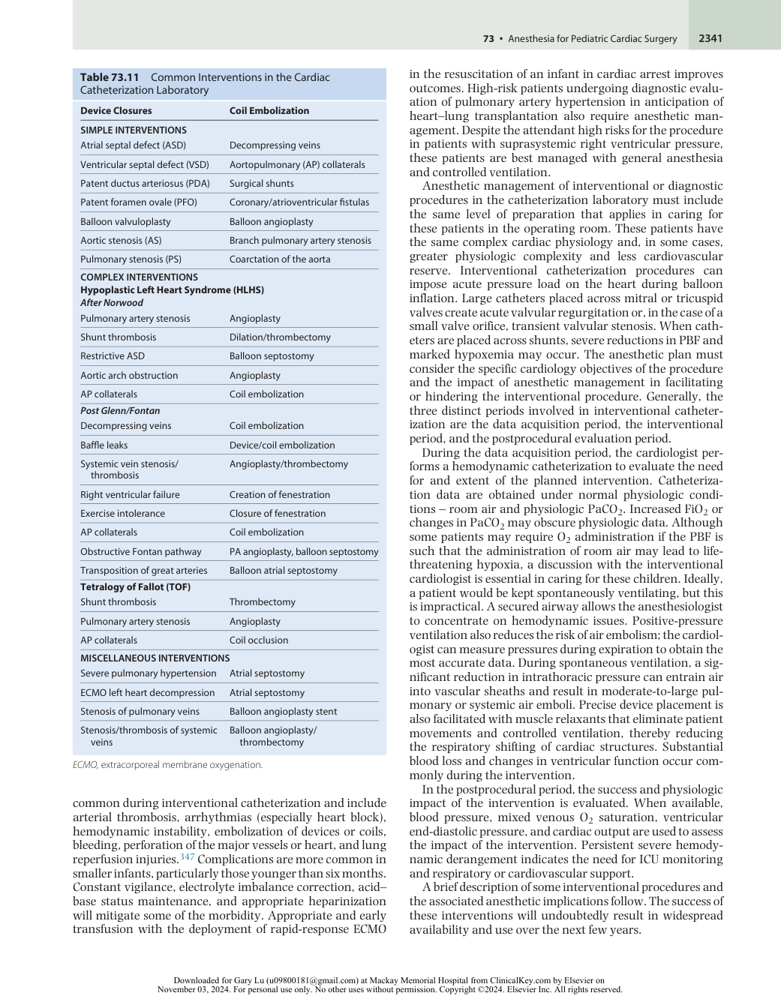

:::

<!-- PDF page 43 -->

### TRANSCATHETER TECHNIQUE FOR ATRIAL SEPTAL DEFECT CLOSURES

In the transcatheter technique for ASD closures, a collapsed double- umbrella clamshell device is loaded into a large introducer sheath placed through the femoral vein, advanced to the RA, and placed across the ASD into the left atrial chamber. Each side of the device consists of a Dacron mesh patch suspended in six spring- loaded arms that open like an automatic umbrella. Using biplane fluoroscopy and TEE, the catheter is positioned in the LA away from the mitral valve.348 The sheath is pulled back to open the six distal arms and its Dacron mesh cover into the LA. The sheath and device are then pulled back, so the distal arms contact the left atrial septum. Fluoroscopy and TEE or intracardiac echocardiography are used to confirm that the arms are on the left atrial side and do not interfere with mitral valve motion. Once adequately seated, the sheath is pulled farther back to expose the proximal side of the device and the proximal arms, which spring open to engage the right side of the atrial septum. When proper positioning is certain, the device is released.348 Device closure of secundum ASD is the preferred therapeutic approach. Data continue to support the closure of defects of small- to- moderate size (&lt;8–20 mm) in appropriate- size patients with appropriate septal length and device diameter.349–352 A 2012 review of percutaneous device ASD closure found a major complication rate of 1% to 2.5% (device embolization or erosion, stroke, endocarditis, tamponade, and device thrombus) and a 3.5% to 6% minor complication rate (inflammatory reactions in those with nickel allergy, arrhythmia, access- site complications).353 Cardiac erosions and heart block can occur in patients who receive a large device for patient size, especially those who have a deficient anterosuperior rim.354,355 Thrombus is a rare problem that can usually be treated medically, and its incidence appears device- dependent.356

### TRANSCATHETER VENTRICULAR SEPTAL DEFECT CLOSURES

Most VSDs that are electively closed in the catheterization laboratory are mid- muscular or apical VSDs that are either difficult to close in the operating room or would require a left ventriculotomy. Left ventriculotomies are associated with a high incidence of left ventricular dysfunction and have been relegated to a position as the least-desirable surgical option. The preferred therapeutic approach for VSD is surgical closure. Transcatheter closure of muscular VSDs can be performed safely. However, a significant incidence of complications occur, including heart block, blood loss, and hemodynamic instability.357,358 Device closure of membranous VSD is in the early stages of investigation, and the incidence of complications remains to be determined.359,360 The transcatheter approach requires a blade atrial septostomy and a retrograde catheter placed through the femoral artery and advanced to the LA. This catheter is pulled across the atrial septum into the RA. It is used to guide a superior vena cava catheter (placed through the internal jugular vein) across the ASD into the LA, the mitral valve, and the LV. The VSD defect is approached from the left ventricular side. The large sheath containing the

double- umbrella clamshell device prevents closure of the mitral valve, resulting in acute mitral regurgitation or, in cases where the VSD is large or the mitral annulus is small, acute severe mitral stenosis. In the latter case, the systemic output is decreased, and a period of severe hypotension is unavoidable. Judicious use of vasoconstrictors to maintain coronary perfusion may be required during the catheter placement, followed by volume and inotropic resuscitation after the VSD device is deployed. This highly specialized application of the clamshell device is confined to only a few pediatric centers in the United States. A 2015 review and meta- analysis comparing percutaneous versus open surgical closure of perimembranous VSD showed equivalent closure success rates between groups and no differences in major complications (death, reoperation, and need for a permanent pacemaker).361 Patients in the percutaneous closure group were older (median 12 years vs. 5 years in the surgical group); blood transfusions and hospital length of stay were shorter in the percutaneous versus the surgical group.

### ANGIOPLASTY OF BRANCH PULMONARY ARTERY STENOSIS

One of the most critical areas of interventional catheterization has been the dilation and stenting of hypoplastic or stenotic branch pulmonary arteries. In patients with TOF with hypoplastic pulmonary arteries, pulmonary atresia, or single ventricle with surgically induced peripheral stenoses, the use of balloon angioplasty and stenting procedures creates favorable pulmonary artery anatomy. It reduces the risk for subsequent surgical repairs (Fig. 73.12). Peripheral pulmonary artery stenosis is not a surgically amenable lesion and is particularly suited to catheterization and angioplasty. Balloon angioplasty is accomplished by tearing the vascular intima and media, allowing the vessel to remodel and heal with a larger diameter. The balloon is placed across the stenotic lesion so that the middle of the balloon is at the stenosis. The balloon is inflated until the waist of the balloon is eliminated. Ideally, most stenotic lesions are dilated first to minimize the impact on PBF and cardiac output. When the balloon is inflated, PBF is reduced, right ventricular afterload is increased, and cardiac output falls. In patients with an associated VSD or ASD, right- to- left shunting and desaturation occur with balloon inflation. An acute increase in right ventricular afterload can cause systemic hypotension and right ventricular failure in patients without a shunt. The large vascular sheaths required for these procedures can introduce tricuspid regurgitation, which is poorly tolerated in patients with severe RV hypertension. Occasionally, balloon catheters must be placed across aortopulmonary shunts, significantly reducing PBF.

The procedure is successful in approximately 60% of patients. In an early series, complications included hypotension (40%), pulmonary artery rupture (3%), unilateral reperfusion pulmonary edema (4%), aneurysmal dilation of the dilated pulmonary vessel (8%), death (1.5%), and transient postprocedural right ventricular dysfunction.362 Improved techniques and patient selection have favorably influenced the results with superior balloon catheters and stents while significantly reducing severe complications. Anesthetic support minimizes hemodynamic compromise

<!-- PDF page 44 -->

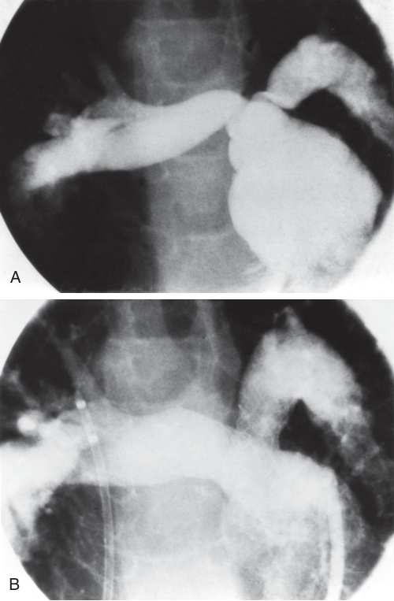

A B 

**Fig. 73.12** (A) Severe bilateral branch pulmonary artery stenoses at the distal end of a conduit in a patient with pulmonary trunk atresia and ventricular septal defect. Stents were placed in the right and left pulmonary arteries. (B) Follow- up angiogram in the same projection and magnification showed marked improvement of both right and left stenoses.

by anticipating changes in blood flow patterns, treating transient hypotension, and providing airway support to minimize the risks associated with pulmonary artery disruption and acute unilateral pulmonary edema.362

A unique group of patients are those with Williams syndrome with supravalvular aortic and pulmonary stenosis. Such patients can have multiple areas of severe branch pulmonary artery stenosis, with resultant systemic or suprasystemic right ventricular pressures and right ventricular dysfunction. Patients can also have coronary stenosis and develop subendocardial ischemia from hemodynamic disturbances in the setting of biventricular hypertrophy. The presence of supravalvular aortic stenosis, biventricular outflow tract obstruction, and coronary stenosis is associated with increased perioperative risk. Typically, such patients undergo general anesthesia with positive- pressure ventilation and recover in the cardiac ICU for angioplasty of branch pulmonary artery stenosis.363 Care must be exercised in maintaining SVR, myocardial oxygenation, and contractility. Tachycardia and subendocardial ischemia should be avoided in the presence of ventricular hypertrophy.

### BALLOON VALVULOTOMIES

Balloon valvulotomies conducted in well- compensated infants and children often can be accomplished without anesthetic support. Exceptions include neonates with critical aortic or pulmonary stenosis and patients with significant ventricular dysfunction who exhibit unstable hemodynamics. Balloon valvuloplasty is indicated in valvular pulmonary or aortic stenosis with valvular gradients more than 50 mm Hg. Balloon dilation is effective in most patients, except those with dysplastic valves (e.g., Noonan syndrome); postdilation pulmonary incompetence is anticipated and does not pose a problem in the immediate and intermediate periods. Long- term prophylaxis for subacute bacterial endocarditis is needed. Only 8% of patients require repeat interventions. Typically, patients recover in the ICU and may require transfusion depending on hemodynamic stability. Valvular aortic stenosis is associated with poor surgical outcomes in the neonatal period. All therapies are palliative, with a high incidence of repeat interventions, and balloon valvuloplasty is often the initial treatment. Residual obstruction or regurgitation is common after balloon dilation and can require repeated intervention. A real risk exists for damage to the aortic valve and subaortic septum, with the consequence of acute aortic insufficiency and coronary ischemia. Hypotension and bradycardia commonly occur during valvuloplasty, and many centers have a policy of ECMO standby for these high- risk interventions in the catheterization laboratory. The ready availability of a surgical and perfusion team is crucial to a good outcome. Neonates with critical aortic stenosis often require stabilization with inotropes and prostaglandins to maintain systemic perfusion before the procedure. Balloon dilation of recurrent coarctation is often the therapy of choice in older children with re- coarctation after surgery. Such patients are often hypertensive. The procedure can be performed with the patient under deep sedation or general anesthesia. In infants after Norwood palliation for HLHS, coarctation can occur in the distal arch anastomotic site. Catheters placed antegrade via the right side of the heart into the neoaorta can induce hemodynamically significant tricuspid and neoaortic regurgitation, resulting in hemodynamic instability. Careful monitoring and aggressive hemodynamic intervention result in a good outcome.

### COIL EMBOLIZATION

Transcatheter methods can be adapted to occlude undesired vascular structures. Intravascular coils have been used to close PDAs, aortopulmonary collaterals, surgical systemic and pulmonary artery shunts, venous collaterals in single-ventricle lesions, coronary fistulas, and some arteriovenous malformations (e.g., a vein of Galen malformation). In selected instances, cardiologists request general anesthesia with a muscle relaxant to minimize the risk that coils may escape to threaten vital organ perfusion.

Depending on the lesion, patients might manifest severe cyanosis, low- output or high- output cardiac failure, or coronary ischemia. Extra care should be exercised in patients with coronary fistulas to maintain myocardial O2 supply and reduce demand. Materials used for embolization can include surgical gel (Gelfoam), alcohol, and coils. Some of

<!-- PDF page 45 -->

these substances can induce severe allergic reactions with hemodynamic collapse. Antibiotic prophylaxis is mandatory to prevent bacterial endocarditis. Angiography is used to demonstrate successful occlusion of the vascular structure and ascertain appropriate placement.

### VALVE PROSTHESES

Transcatheter bioprosthetic valve replacement of the pulmonary and aortic valves is being performed. The pulmonary valve is a bovine jugular venous valve mounted on a balloon- expandable Cheatham platinum stent. The technique is limited by the maximum size of 22 mm of the bovine jugular venous valve. Percutaneous placement of the bioprosthetic valve in the pulmonary position is a reality, and further refinement and miniaturization will lead to its application in the aneurysmal right ventricular outflow tract. Current candidates for transcatheter pulmonary valve implantation include children 5 years or older, a weight of 30 kg or more, and a conduit diameter of 16 to 22 mm. Candidates have moderate-to-severe pulmonary regurgitation, often with RV dilation or dysfunction and mean right ventricular outflow tract gradients greater than 35 mm Hg. A single- center study comparing transcatheter PVR versus surgical PVR found that patients younger than 17 had better pulmonary valve function following transcatheter versus surgically replaced valves.364 Transcatheter PVR reduces significant tricuspid valve regurgitation in RV outflow obstruction and pulmonary regurgitation patients.365 Interestingly, a prospective study of transcatheter PVR found substantial increases in the size of the pulmonary artery postprocedure; this finding is of unclear significance for patient selection and long- term outcome.366 An interesting new development is the surgical placement of these bioprosthetic valves in the atrioventricular location with the intention of subsequent valve expansion in the catheterization laboratory as the child grows. Early experience shows that this is feasible; the valve shows an acceptable short- term function and can be enlarged. However, concerns remain as there is a high risk for morbidity, valve durability, and mortality.367

Transcatheter aortic valve replacement continues to be used in managing adult patients with complex status and aortic stenosis who are not considered surgical candidates because of surgical risk. The use of these devices in pediatrics has been limited. Some authors have described using transcatheter pulmonary valves in the high- pressure circuit with good short- term performance. Complications of the transcatheter valve placements include wire perforation of vessels, conduit rupture, or coronary artery compression.

### EMERGENT PROCEDURES

Emergent interventions such as balloon atrial septostomy to ensure adequate mixing in patients with transposition physiology and patients with restrictive ASD with singleventricle physiology are lifesaving and enable planning surgery at a suitable time. The procedure can be performed at the bedside with echocardiography or in the catheterization laboratory with fluoroscopic confirmation of balloon position. Access is by the femoral or umbilical vein, and the balloon catheter is advanced through the foramen ovale

into the LA. The balloon is inflated with contrast and pulled back via the septum until a satisfactory ASD is created. If the procedure is successful, the left and right atrial pressures should equalize, and adequate mixing should occur. Oxygenation and pulmonary venous drainage should improve. Complications include atrial perforation, mitral or tricuspid valves and pulmonary veins lacerations, and low cardiac output state. Balloon atrial septostomy is also performed emergently in patients receiving ECMO therapy for left- sided heart decompression.

### ENDOMYOCARDIAL BIOPSY

Typically, endomyocardial biopsies are performed as part of posttransplant surveillance catheterizations at regular intervals to ascertain the absence of rejection in patients after orthotopic heart transplantation. Right- sided heart catheterization is usually performed by access of the right internal jugular vein, through which the long sheath and biotome are introduced. Usually, five to eight samples are taken. Endomyocardial biopsies are also used to confirm a diagnosis of myocarditis or cardiomyopathy; sedation or general anesthesia is required for smaller children, although older children can undergo this procedure with local anesthesia alone. Children who undergo catheterization during acute rejection are at high risk for malignant arrhythmias during endomyocardial biopsy and might require resuscitation. A clinical history suggestive of a rejection episode includes fever, gastrointestinal disturbances, and arrhythmias. Complications include perforation, tricuspid valve damage, and the development of coronary- to–right ventricular fistulas.

### HYBRID SINGLE-VENTRICLE REPAIR STAGE I REPAIR

For some hypoplastic left heart syndrome patients, firststage Norwood operation is considered high risk, and a hybrid palliative approach is considered a safer option. This palliative strategy ensures adequate systemic circulation by placing a stent in the patent ductus arteriosus. At the same time, the pulmonary circulation is limited by surgical pulmonary artery banding. While hybrid stage I palliation simplifies the stage I surgery, its use complicates the second stage, where aortic arch reconstruction is performed along with Glenn surgery. Hybrid procedures may offer some survival advantage in low birth weight neonates, but they are not considered low- risk alternatives to the Norwood procedure for most patients with HLHS.368

### CARDIAC CATHETERIZATION OF PATIENTS SUPPORTED BY EXTRACORPOREAL MEMBRANE OXYGENATION

Booth and associates369 reported on the Boston experience of cardiac catheterization in pediatric patients supported with ECMO. Indications included assessment of surgical repair, left- sided heart decompression, myocarditis or cardiomyopathy, hemodynamic assessment, catheter interventions, and ablation of arrhythmias. The most common interventions were left- sided heart decompression in patients with left atrial hypertension, balloon angioplasty

<!-- PDF page 46 -->

of the pulmonary arteries, and endomyocardial biopsy. The anesthesiologist coordinates the safe transport of the patient on mechanical support with the perfusion and nursing team. The transport logistics, surgeon availability, and blood must be addressed before the transfer. Anesthesia is provided using isoflurane or sedatives on the ECMO circuit, and paralysis must be achieved before transport. Rest ventilation of the lungs is continued. The anesthesiologist’s role is managing a safe transport and attending to emergency mechanical, cardiorespiratory, and hematologic issues. At present, hybrid techniques find a niche in lesions in which cardiac surgery is problematic, such as apical muscular or anterior muscular VSDs, or in high- risk patients with more complex lesions in which immediate surgery is contraindicated or is associated with significant morbidity and mortality. Close collaboration is required so that a surgical approach is modified to facilitate the subsequent interventional approach. The hybrid approach has been used in the management of HLHS. Stage 1 palliation is performed by creating atrial septal communication and stent placement in the ductus arteriosus during catheterization to maintain ductal patency with surgically applied external right and left pulmonary artery bands or transcatheter- placed internal bands.370,371 A modified Norwood procedure with a bidirectional Glenn anastomosis is performed with CPB during stage 2 palliation.372 Stage 3 (Fontan operation) is performed entirely by transcatheter techniques.373 In the current surgical climate, it seems challenging to promote ductal stenting as a method of choice, but in patients with contraindications to immediate surgery, this provides an attractive bridge.374 However, ductal stents are emerging as a preferred alternative to a surgical shunt in the neonatal period for cardiac abnormalities that require a reliable source of pulmonary blood flow to allow the discontinuation of prostaglandin therapy and to have them to grow to a weight more suitable to a surgical repair. Patients treated with ductal stents showed an early survival advantage and greater stability with a decreased need for extracorporeal support.375,376

A new area of growth in the cardiac catheterization laboratory is the PDA closure in extremely low birth weight infants. These procedures have been performed in infants as small as 500 g. They require significant preparation and coordination with the neonatal ICU. Extra special care should be taken with ventilation strategies, ICU ventilators may be needed, temperature control during transport and while in the laboratory, minimizing fluids, and having blood transfusion triggers. The procedure may be further complicated because the child may be turned 180 degrees on the table, with the head away from the anesthesia machine. The strategy of closing PDAs early before the onset of elevated pulmonary artery pressures and doing these transcatheter closures appears to result in lower respiratory severity scores postprocedure and shorter times to return to preprocedural scores.377 Interestingly, the decision to attempt to close or not to close a PDA remains a topic of debate. Large meta- analyses of the use of nonsteroidal anti- inflammatory drugs have shown effectiveness at closing the duct but have not demonstrated a reduction in neonatal morbidities. At the same time, surgical repairs are effective but are associated with adverse effects. Conservative approaches have recently shown improved outcomes

with a high spontaneous closure rate after discharge. Surgical and transcatheter closures will likely be reserved for those extremely preterm infants at most significant risk for the adverse effects of a patent ductus arteriosus.378–380

## Adult Congenital Heart Disease

### EPIDEMIOLOGY AND CLASSIFICATION

Caring for adults with CHD is a new and exciting frontier in medicine. Adult congenital heart disease (ACHD) represents a large spectrum of clinical entities ranging from mild to severe and palliated to corrected, with no or multiple adult comorbidities. The incidence of CHD is estimated to be 3 to 6 cases per 1000 live births. Approximately 85% of these patients can be expected to reach adulthood.381 The prevalence of CHD is rising in both children and adults, with adults representing the largest group. Despite most patients surviving into adulthood with an overall 25- year survival rate of 90%, the overall long- term risk of premature death is elevated in patients with CHD as compared to the general population. This is highest in groups operated on at a younger age, likely denoting more severe conditions.382

At the Bethesda Conference in 2001, patients with ACHD were categorized into simple, moderate, or great complexity groups based on medical diagnosis.381 Anesthesiologists should be aware of the Bethesda Conference Task Force recommendations for ACHD in terms of the distribution of care for these patients. It is recommended that patients with CHD of great complexity be regularly seen at tertiary care centers that specialize in ACHD.

### CONSIDERATIONS IN THE CARE OF PATIENTS WITH ADULT CONGENITAL HEART DISEASE

Adults with CHD may present with unique anatomy or physiologic sequelae not otherwise encountered in pediatric patients with CHD. Some patients with ACHD may have had palliative repairs no longer primarily employed for specific diseases today, such as the Mustard or Senning procedure for dextro- transposition of the great arteries (d- TGA). In addition, these patients may not have complete awareness or access to information on medical treatments completed when they were a child. As the number of patients with ACHD increases, so do the chances that an anesthesiologist will need to care for one of these patients in an emergent situation. In general, practitioners would want to gather as much information as available regarding the details of the patient’s medical history, surgical repairs, and current functional status.

General considerations include the presence of arrhythmias, hypoxemia, pulmonary hypertension, ventricular dysfunction, shunts, thrombosis, and the need for antibiotic prophylaxis. Arrhythmias are one of the most common sequelae in adults with CHD. Common arrhythmias result from atrial dilation and include atrial fibrillation or flutter, which may or may not be hemodynamically significant. A right bundle branch block pattern of the QRS segment of the ECG is typical after repair of TOF. In the absence of lung disease, hypoxemia results from a decrease in PBF, either due to obstruction or right- to- left

<!-- PDF page 47 -->

shunting. Strategies to avoid further hypoxemia include adequate hydration, ventilation, and pulmonary perfusion while decreasing PVR or O2 consumption. It is prudent to determine the patient baseline oxygen saturation (SpO2) as a reference for the anesthetic. Many patients with ACHD with chronic hypoxemia may require hematocrit values greater than 45% to allow for adequate O2 delivery; the administration of packed RBCs may maximize O2-carrying capacity. Along with cyanosis, polycythemia in these patients increases their thromboembolic risk.

Pulmonary hypertension should always be considered when caring for patients with ACHD. Chronic volume overload to the pulmonary vascular bed creates hypertrophy of the arterioles with resultant pulmonary hypertension. Common defects where pulmonary hypertension may be found in childhood include shunt lesions, which, if untreated, result in pulmonary vasoocclusive disease. When hypoxemia is present with these conditions, a high level of suspicion for pulmonary hypertension and possibly Eisenmenger syndrome is necessary. The anesthesiologist should always have a high level of suspicion for the presence of ventricular dysfunction in patients with ACHD. Many CHD defects place a volume or pressure load on the heart that may lead to dilated or hypertrophied performance over time. The careful titration of induction and maintenance agents that maintain ventricular performance is warranted in providing anesthesia care. Shunts of varying size and location may be created in the care of hypoxic patients with CHD to increase PBF. In many cases, patients rely on the patency of these shunts to supply the lungs with blood, and their occlusion could be catastrophic. Likewise, thrombosis of various shunts or cardiac chambers may occur related to altered blood flow patterns. Therefore, specific anticoagulation strategies may be required to ensure blood flow. The American Heart Association has provided updated guidelines regarding recommendations for prophylaxis against infective endocarditis, and specific guidelines may be found in this chapter (Table 73.12).

**Table 73.12** Infective Endocarditis Prophylaxis

|||**SINGL** **MIN BE** **PR**|**E DOSE 30–60** **FORE DENTAL** **OCEDURE**|
|---|---|---|---|
|**Situation**|**Drug**|**Adults**|**Children**|
|Oral|Amoxicillin|2 g|50 mg/kg|
|Unable to take oral medication|Ampicillin or Cefazolin/ ceftriaxone|2 g IM/IV 1 g IM/IV|50 mg/kg IM/IV 50 mg/kg IM/IV|
|Allergic to |Cephalexin or|2 g|50 mg/kg IM/IV|
|penicillins/oral|Clindamycin or|600 mg|20 mg/kg IM/IV|
||Azithromycin/ clarithromycin|500 mg|15 mg/kg|
|Allergic to penicillins/ unable to take oral medication|Cefazolin/ ceftriaxone or Clindamycin|1 g IM/IV 600 mg|50 mg/kg IM/IV 20 mg/kg|

_IM,_ intramuscular; _IV,_ intravenous. Vancomycin is an alternative for patients who are unable to tolerate a β- lactam or when the infective agent is methicillin- resistant _Staphylococcus aureus_ .

### SPECIFIC LESIONS WITH UNIQUE CONSIDERATIONS FOR ADULT CONGENITAL HEART DISEASE

### Tetralogy of Fallot

TOF consists of four defects of varying physiologic significance: malignant type VSD, degrees of right ventricular outflow tract obstruction, right ventricular hypertrophy, and an overriding aorta. The typical clinical significance of this pattern of cardiac anomalies is that of hypoxia resulting from decreased PBF. In the early stages of treatment of TOF, the systemic–pulmonary artery shunt (Blalock–Taussig shunt) was used to allow the child to grow, followed by a definitive repair later in life. Many patients up until the 1970s may have had classic Blalock–Taussig shunt or central shunts performed. A modified BTS (mBTS) is used today for patients who require augmented PBF but are not candidates for an early complete repair. Most infants undergo complete repair in the first year of life; occasionally, a degree of pulmonary stenosis protects the lung from overcirculation of blood from the VSD while allowing adequate PBF for growth. These patients may ultimately not require surgical repair.

Adults with TOF may have had any of these potential surgical repairs. The type of repair completed and the functional status of the repair should be ascertained. The most common long- term complication after TOF repair is pulmonary insufficiency; cardiac MRI is utilized to follow right ventricular volumes over time to aid in the timing of surgical repair or pulmonary valve replacement.383 Elevated jugular venous pressures and hepatomegaly should alert the anesthesiologist to right ventricular failure. Other complications of TOF repair include arrhythmias of right ventricular origin or right bundle branch block patterns on the ECG, particularly in the case of the previous ventriculotomy. Cyanosis in these patients suggests inadequate PBF.

### Fontan Circulations

In the early 1970s, Fontan and Kreutzer performed a procedure on a patient with tricuspid atresia to separate the PBF from the systemic circulation.384 Known now as the Fontan procedure, or total cavopulmonary anastomosis, the goal is to divert deoxygenated venous blood return directly and passively from the systemic venous circulation to the lungs, allowing the single ventricle to pump oxygenated blood to the systemic circulation. This principle of blood diversion is now applied to many types of functionally single- ventricle patients, usually as a series of two- or three-staged procedures. Currently, Fontan operations for single- ventricle patients are performed on patients between 2 and 4 years of age, resulting in the separation of pulmonary and systemic circulations. However, occasionally adults present without having undergone a complete separation of circulations. Such patients have variable levels of cyanosis and ventricular dysfunction.

Even with the completion of total cavopulmonary anastomosis and with overall survival improving over time,385 many patients experience a decreased survival beyond 15 years after surgery. Impaired systolic and diastolic ventricular function and increased PVR contribute to mortality, and HF therapies to treat two- ventricle patients may not be efficacious in one- ventricle patients.386 Common causes of

::: details 原始表格與符號（PDF 第 47 頁）

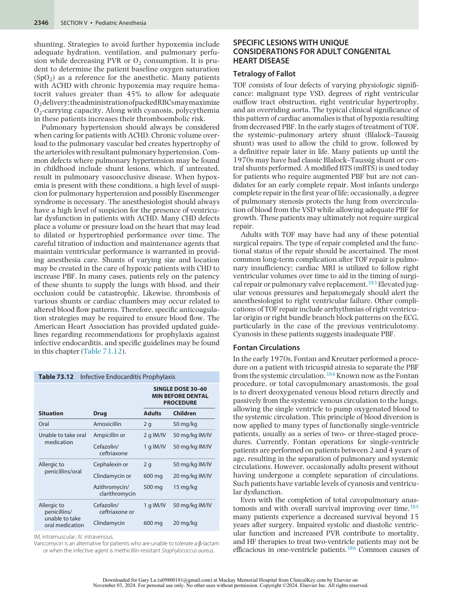

:::

<!-- PDF page 48 -->

death after Fontan procedures include thromboembolism, HF, protein- losing enteropathy, and arrhythmias.387 A study from the Australian and New Zealand Fontan Registry looking at survival rates after age 16 found that 90% survive until 30 and 80% until 40 years of age. They note that survival at 30 was significantly worse for patients with atriopulmonary connections than those with cavopulmonary connections and that only 53% of patients were in New York Heart Association functional class I.388 When caring for adults with Fontan physiology, the anesthesiologist should be mindful of conditions that may further impair oxygenation and myocardial function. PBF is passive, and any condition that increases PVR, or decreases systemic venous volume, will be poorly tolerated. These patients may also be very sensitive to myocardial depressants. In addition, the initial Fontan procedures included a direct baffle of the atrium to the pulmonary artery, which was later modified because of complications from atrial dilation and the resulting arrhythmias. Fontan procedures are currently extracardiac to minimize atrial arrhythmia. Expected O2 saturation in a patient with Fontan physiology is at least 95%, though it may be lower in a patient with Fontan failure. Chronic anticoagulation for patients who have previously demonstrated, or are at presumed high risk for, thromboembolism is common and must be considered preoperatively.

### Transposition of the Great Arteries

TGA occurs when the aorta arises from the anatomic RV, and the pulmonary artery arises from the anatomic LV. In classic d- TGA, the two circulations are in parallel and require mixing to be compatible with life. In the 1980s, surgical management of TGA consisted of atrial- level switch procedures – the Mustard or Senning procedure – in which venous return to the heart was redirected at the atrial level through a baffle system. Therefore, the highly oxygenated pulmonary venous return was redirected to the RV, which pumped to the aorta and systemic circulation. Systemic deoxygenated blood was directed to the LV, which pumped the blood through the pulmonary artery to the lungs for oxygenation. Long- term complications of this strategy include atrial dilation from baffle obstruction or leak with resultant arrhythmias, sinus node dysfunction, or sudden death. Particularly problematic complications included systemic right ventricular dysfunction, AV valve regurgitation, subpulmonary stenosis, and pulmonary hypertension. Today, the arterial switch operation is preferred, in which the aorta with the coronary arteries is attached to the LV, and the pulmonary artery is attached to the RV. Complications from the arterial switch operation include regurgitation of the neoaortic valve, myocardial ischemia from ostial coronary stenosis, right or left ventricular outflow tract obstruction, residual intracardiac shunting, and left ventricular dysfunction.

## Pediatric Cardiac Electrophysiology

### DIAGNOSTIC EVALUATION

### Cardiac Event Monitoring

Most patients with cardiac arrhythmias present with infrequent or episodic symptoms. These symptoms may include chest pain, palpitations, syncope, and presyncope.

Transtelephonic electrocardiographic event monitors may yield documentation of the arrhythmia because they are portable and patient activated.389

### Insertable Cardiac Recorders

Insertable loop recorders implanted subcutaneously allow continuous rhythm monitoring that is stored either when a patient or parent is manually activated or automatically when high- or low-rate parameters are met.390 These insertable loop recorders have value in correlating arrhythmias with symptoms when noninvasive means do not make a diagnosis. Typically, loop recorders are inserted under general anesthesia as an outpatient procedure and cause minimal pain.

### RADIOFREQUENCY ABLATION OF ACCESSORY PATHWAYS

A radiofrequency ablation is a nonsurgical approach designed to eliminate atrial or ventricular reentrant tachyarrhythmias. The technique requires pathway mapping and precision ablation of the aberrant pathway using a radiofrequency ablation catheter. Catheter ablation is offered to patients with bothersome refractory arrhythmias, and the focus or pathway is amenable to ablation. Supraventricular tachycardias (SVTs) have an incidence of 1 in 250 to 1000 children and usually present later in childhood.391 Up to 50% of adults with CHD develop SVT.392 Although right- sided pathways are easier to access, leftsided pathways that require a transseptal puncture have a better cure rate.393 In pediatrics, the electrophysiology catheters are introduced by femoral venous catheterization, and the tips are positioned in the right atrial appendage, the bundle of His area, the right ventricular apex, and the coronary sinus. Occasionally, right internal jugular venous access is used to place the coronary sinus catheter. Rapid atrial pacing and, sometimes, an isoproterenol infusion is required during the mapping procedure to induce the arrhythmia. An ablation catheter is used to map the substrate, and subsequently, the pathway is ablated using radiofrequency energy (300–750 kHz). In complex cases or cases with pathways in the vicinity of the AV node, cryotherapy is used to limit damage to the AV node. Cryotherapy permits a slower burn and the ability to stop the ablation if transient AV block or lengthening of the PR interval occurs. General anesthesia is required for ablation procedures in children, as unexpected patient movement may result in catheter dislodgment and damage to normal conducting tissue.

Anesthetic drugs and techniques should aim to maintain circulating catecholamines and avoid suppression of arrhythmogenesis to aid in the identification of the aberrant pathway. Total intravenous anesthesia with propofol or a low- dose volatile anesthetic are equally good options. Data suggest that modern inhaled anesthetics such as isoflurane and sevoflurane have no significant effects on cardiac conduction in children with SVT and are therefore suitable options.394,395 There is conflicting evidence on desflurane, with more recent data suggesting it may block AV conduction and therefore may not be a good anesthetic in these cases.396 An increased incidence of postoperative nausea and vomiting (PONV) is reported after these procedures, which is distressing and may produce bleeding from the access sites. Both low- dose propofol infusion and low- dose volatile anesthetic may be used along with the bispectral

<!-- PDF page 49 -->

index monitor to maintain a lighter level of anesthesia. To minimize the risk of PONV, two classes of antinausea medications should be administered. Placement of an arterial line is needed for rapid atrial pacing and isoproterenol during the mapping procedure, both of which can cause significant hypotension. Medications that suppress conduction or decrease sympathetic tone, including dexmedetomidine, should be avoided until the end of the procedure.

Severe post- ablation cardiomyopathy has been described but is very unusual. Presumed causative factors include underlying cardiomyopathy from frequent episodes of SVT and myocardial O2 imbalance caused by prolonged periods of rapid atrial pacing and isoproterenol infusions. Other procedure complications include radiation exposure, tamponade, pericarditis, groin hematoma, arterial thrombosis, AV block, systemic embolization, coronary artery dissection, trauma to the mitral and tricuspid valves, and endocarditis.

### INTRA- ATRIAL REENTRANT TACHYCARDIA

Intra- atrial reentrant tachycardia (IART) is the most common arrhythmia in CHD and is associated with significant morbidity and mortality. The incidence of IART is highest in patients who have undergone Fontan and atrial switch operations because of atrial incisions, suture lines, dilation, and fibrosis caused by long- term hemodynamic changes.392 Therapeutic options for IART include antiarrhythmic medications, radiofrequency catheter ablation, cryoablation, surgery, and pacing. The Pediatric and Congenital Electrophysiology Society and the Heart Rhythm Society have published comprehensive guidelines for arrhythmia management in ACHD.397 Careful choice of anesthetic, monitoring, and early management of low cardiac output states, especially in patients with single- ventricle physiology, are essential. Prolonged periods of arrhythmia induction during mapping can reduce cardiac output and necessitate inotropic therapy. Cardiac ICU may be indicated for postoperative recovery. Although acute success rates are high at 90%, arrhythmia recurrence is problematic in this population, occurring in 34% to 54% of patients. Fontan physiology and older age are risk factors for recurrence.392,398 As more patients with CHD survive into adulthood, the incidence of permanent IART and atrial fibrillation increases.399

Intraoperative cryoablation within the RA for patients with IART or LA for atrial fibrillation using preoperative and intraoperative mapping can be used successfully. Atrial anti- tachycardia pacing is an option to terminate treatable tachycardias; a single- center cohort study demonstrated that this technology decreased the need for cardioversion rate in patients with CHD.400 Atrial anti- tachycardia pacing has reduced efficacy in patients with L-transposition of the great arteries (L-TGA). In patients who are either unsuitable candidates for catheter ablation or in whom ablation has been unsuccessful, surgical ablation may be successfully combined with the repair of CHD.

### ARRHYTHMIAS AND SUDDEN CARDIAC DEATH

Specific cardiomyopathies and channelopathies are associated with an increased risk of sudden cardiac death resulting from lethal arrhythmias. The patient usually has a history of syncope, near- syncope, or aborted sudden death.

Such patients present for insertion of automated internal cardioverter– defibrillators (AICDs) for either primary or secondary prevention.

### IMPLANTATION OF PACEMAKERS AND DEFIBRILLATORS

Pacemakers are indicated for complete heart block or sinus node dysfunction with symptomatic bradycardia and hemodynamic decompensation. Children usually require general anesthesia with endotracheal intubation. It should be noted that the anesthetic can be associated with worsening bradycardia. Transthoracic pacing pads are applied before induction of anesthesia, and an isoproterenol infusion should be available in case it’s needed for chronotropy. External transthoracic, esophageal, or emergent transvenous pacing may be necessary until the placement of a permanent pacing device is achieved. In small children, the pacemaker generator is typically placed in the upper abdomen, and in older children and teenagers, it is placed in the subclavicular region. Epicardial leads are used in small children because of the inadequate size of the veins and in those in whom transvenous access to the heart is impossible (e.g., the Fontan circulation). Epicardial pacemaker placement usually is performed by a cardiac surgeon, with electrophysiologists readily available to program the device. Adequate peripheral venous access is mandatory in the event of a major hemorrhage, and blood should be readily available. A mode of monitoring mechanical capture of electrical pacing activity is also necessary and can include invasive arterial monitoring or pulse plethysmography. Cardiologists can achieve transvenous pacing in the operating room with surgical backup or in the cardiac catheterization laboratory. In the latter situation it is important to address the need for surgical backup during case planning.

AICDs are placed for life- threatening ventricular arrhythmias, which include LQTS, hypertrophic cardiomyopathy, and arrhythmogenic right ventricular dysplasia. Of note, the device is tested after placement, with induction of ventricular fibrillation. It is essential to have external modes of defibrillation available, as well as antiarrhythmics such as amiodarone, magnesium, and lidocaine, in the event of device failure. These devices are placed with the patient under general anesthesia with endotracheal intubation and controlled ventilation. Invasive arterial pressure monitoring is typically used. Adequate analgesia can be provided with local infiltration with local anesthetics and short- acting intravenous opioids. Patients are admitted overnight with telemetry monitoring. Appropriate antibiotic therapy is provided for 24 hours.

## Advances in Resynchronization Therapy

Bundle branch block or interventricular conduction delay often accompanies HF and some forms of CHD, either preoperatively or postoperatively, and may result in ventricular dysfunction caused by asynchronous myocardial contraction. Biventricular pacing attempts to resynchronize ventricular contraction by pacing both ventricles, thereby improving overall ventricular function. In patients with left bundle branch block, cardiac resynchronization

<!-- PDF page 50 -->

therapy counteracts the underlying electrical and mechanical dyssynchrony, improving contractility, function, exercise tolerance, and quality of life. Multisite pacing, involving intraoperative placement of atrial and ventricular unipolar epicardial temporary pacing wires, improves cardiac index and systolic blood pressure in the immediate postbypass period.401 Multisite, temporary pacing may not be indicated or necessary to improve function in low- risk, biventricular repairs402 ; however, despite long- term outcome data, multisite pacing has become standard in many circumstances, including single- ventricle physiology, redo procedures, or in patients at high risk for morbidity and mortality.

Right bundle branch block is a common outcome after surgery for congenital heart lesions. Right ventricular pressure, volume loading, or both also may be present, with attendant right ventricular enlargement and dyskinesis. Dual- chamber pacing decreases the QRS duration and increases cardiac index; the pacing site producing the narrowest QRS duration is of most benefit.403,404

## Anesthesia for Noncardiac Surgery

### INFECTIVE ENDOCARDITIS PROPHYLAXIS: AMERICAN HEART ASSOCIATION GUIDELINES

The American College of Cardiology and the American Heart Association in 2008 updated guidelines for infective endocarditis prophylaxis. A detailed discussion of the changes is beyond the scope of this chapter.

Procedures for which prophylaxis for infective endocarditis is recommended include the following405 :

- Dental procedures involving manipulation of the gingival tissue or periapical region of the teeth or involving perforation of the oral mucosa

- Respiratory procedures involving incision of the respiratory mucosa

- Procedures involving infected skin, skin structure, or musculoskeletal tissue

Prophylaxis is no longer routinely recommended for gastrointestinal and genitourinary procedures. For elective procedures, coexisting enterococcal urinary tract infections should be treated before genitourinary or gastrointestinal procedures; for emergent procedures, prophylaxis can be considered in patients at highest risk for infective endocarditis.

Conditions for which prophylaxis is recommended for dental procedures include the following (see Table 73.12):

- Prosthetic cardiac valve

- Previous infective endocarditis

- Unrepaired CHD, including palliative shunts and conduits

- Completely repaired CHD with prosthetic material or device within the first six months after the procedure

- Repaired CHD with residual defects at the site or adjacent to the site of a prosthetic patch or device

- Cardiac transplant recipients who develop cardiac valvulopathy

These are guidelines only, and it is prudent to consult the child’s cardiologist to create an individualized plan based on the child’s condition, operative procedure, and risk for bacteremia.

### MAGNETIC RESONANCE IMAGING OF THE HEART

A significant advantage of MRI is the ability to assess the volume and mass of asymmetric ventricular shapes, especially the RV. The American Society of Anesthesiologists (ASA) has published a practice advisory on anesthetic care for MRI.406 Apart from the usual considerations of providing general anesthesia in a remote location, the anesthesiologist must be prepared to provide resuscitative care when working in a magnetic field, necessitating the use of magnetsafe equipment. Patients with implanted devices and hardware must be assessed to ensure magnet compatibility and safety. Generally, pacemakers, implanted defibrillators, and aneurysm clips are contraindications to MRI. Coils, stents, and other surgical clips produce interference and imaging artifact but do not constitute a threat to patient safety. In most patients, the scan can be performed as an outpatient procedure.

Patients who are younger, uncooperative, or claustrophobic require sedation or general anesthesia. Good image quality, angiography, and delayed enhancement imaging are aided by breath holds, which may last for more than one minute and require preoxygenation. If breath holds are required, general endotracheal anesthesia is required, and an anesthesia provider is present in the room. However, radiologic advances have allowed many centers to use “free breathing” protocols to avoid the need for breath holds and therefore general anesthesia.407,408 Such protocols acquire multiple images, then use an algorithm that eliminates the artifact created by respiration. Radiologists are increasingly cognizant of the potential risk of general anesthesia in young children and are adapting protocols to avoid the need for general anesthesia when possible.409

Irrespective of the anesthetic technique, it is mandatory to continuously monitor heart rate, pulse oximetry, capnography, and noninvasive blood pressure. In the event of hemodynamic compromise, the patient should be removed from the MRI scanner into a safe environment where resuscitation equipment can be safely used. With the development of compatible catheters and devices, MRI is a valuable tool in minimizing X- ray exposure, particularly in patients whose CHD necessitates numerous catheterization procedures. Cardiac MRI may be used in combination with fluoroscopy in the catheterization suite to decrease radiation exposure and improve soft tissue visualization in patients with CHD.410

## Offsite Anesthesia in Cardiac Surgery Patients

Patients with cardiac disease are no different from any other group of patients who require procedures or investigations in areas outside the operating room. Therefore, anesthesiologists should always be prepared for any eventuality and follow guidelines such as those set out by the ASA. This discussion excludes procedures performed in the cardiac catheterization laboratory, as this has been addressed elsewhere. The nature of congenital cardiac surgery will result in several patients requiring emergent chest exploration for hemorrhage, to relieve tamponade, or for ECMO

<!-- PDF page 51 -->

cannulation, all of which may occur in the ICU setting. We cannot predict with certainty which patients will have difficult postoperative courses. Still, the practitioners who have participated in the operative phase will gain a real sense of which patients may require possible further exploration or surgery. Accordingly, it is best to plan, and prepare for worst- case scenarios. Enough blood and blood products must be available to perform surgery at any time. Successful treatment of emergency situations depends on a team approach to patient care; thus, surgeons, anesthesiologists, intensivists, perfusionists, and operating room nurses must be immediately available. When the decision is made to perform a procedure within the ICU, speed of preparation is of the essence. Drugs, electrolytes, and infusions must be readily available. Emergent preparation includes ensuring that blood is checked, a warmer is ready for use, emergency drugs are present, and the code cart (with internal paddles) is available. The anesthesiologist’s role is to facilitate the entire procedure, including sedation, airway management, patient positioning, preparing the blood, and continuing ongoing volume and pharmacologic resuscitation.

The premature infant with a PDA poses an interesting management problem to cardiac surgery teams because these ill neonates are frequently at hospitals far from major centers where the team is typically assembled. As referenced in an article by Gould and associates,341 teams have performed these ductal ligations with great success at hospitals remote from their “home” hospitals. The philosophy is to take the cardiac team to the neonate instead of having these fragile infants transported. In this article, neonates operated on in the “home” hospital NICU were used as the controls, and it was found that the success and complication rates were comparable in the two groups: thus, from an anesthetic perspective, travel with a full complement of airway equipment and drugs, as described earlier, with packed red cells being made available at the host hospital. The anesthetic regimen for this procedure comprises a highdose opioid, muscle relaxant, antibiotic, and a continuation of any preoperative vasoactive infusions. We have found that this is a stable and well- tolerated anesthetic regimen.

The requirement for anesthesia services is ever widening, and this is also the case in patients with pediatric heart disease. Thus, the patients will require radiologic investigations, including CT, MRI, nuclear medicine scans; interventional radiology procedures; and gastrointestinal procedures. Before discussing the patient and anesthetic, the practitioners need to have a thorough knowledge of the environment into which they are taking the patient with regard to magnetic fields, the closest code cart, and the ability to get help quickly if needed. A few essential points are discussed without going into the specifics of every potential clinical scenario.

As with any anesthetic procedure, a thorough preoperative evaluation is vital. Most patients with pediatric heart disease have long and complex histories, so this assessment should include a detailed description of their cardiac status, including prior surgeries, catheterization findings, and associated conditions (e.g., neurocognitive function, pulmonary status, renal function). Depending on the patient’s underlying condition, a recent echocardiogram will give important clinical details related to overall function, valve pathology, presence or absence of intracardiac shunt,

patency of surgical shunts, and presence of pericardial fluid. Although this may be ideal, the echocardiographic examination may often be remote from the anesthetic encounter, and thus the clinical history and examination are essential. Patients who have had a heart transplant should have a relatively recent echocardiogram, as it will provide vital information that may indicate a worsening function in an otherwise asymptomatic patient.

Nothing- by- mouth guidelines deserve special consideration. Many congenital cardiac patients have physiology in which dehydration may be deleterious (e.g., single ventricle, presence of surgical shunts, unrepaired TOF). In these patients, it is vital to allow and encourage oral hydration up until 2 hours before the planned procedure; if this is not possible, intravenous fluids must be used. The anesthetic course will depend on the duration of the scheduled procedure, the patient’s physiology (i.e., spontaneous vs. controlled ventilation), airway management (natural vs. laryngeal mask airway vs. endotracheal tube airway), anesthetic maintenance, travel to and from the procedural area, and maintenance of the patient’s temperature. Before leaving the induction area, the anesthetic team must be prepared for airway misadventures and even a code situation; thus the team must travel with auxiliary airway equipment and resuscitative drugs. These different venues may make it difficult to have an anesthesia machine in each; however, an anesthetic cart with additional airway equipment, intravenous materials, and resuscitative drugs should be present. The anesthetic delivered may vary among practitioners and institutions. Still, the common details of importance are a thorough knowledge of the patient and the ability to treat expeditiously should any difficulty ensue in a remote venue.

### Acknowledgment

The editors, publisher, and authors, Dr. Edmund Jooste and Dr. Anshuman Sharma, would like to thank Dr. William Greeley and Dr. Aruna T. Nathan, and the late Drs. Kelly Machovec and Dr. Chad C. Cripe for their contributions to this chapter in the previous editions of this work, which have served as the foundation for the current chapter.

### Complete references available online at expertconsult.com.

### References

1.  Nasr VG, et al. _J Cardiothorac Vasc Anesth_ . 2019;33(7):1828.

2.  Teitel DF, et al. _Pediatr Res_ . 1985;19:948.

3.  Teitel DF, et al. _Pediatr Res_ . 1991;29:473.

4.  Thornburg KL, et al. _Am J Physiol_ . 1983;244:H656.

5.  Vetter R, et al. _Biomed Biochim Acta_ . 1986;45:S219.

6.  Nassar R, et al. _Circ Res_ . 1987;61:465.

7.  Greeley WJ, et al. _J Thorac Cardiovasc Surg_ . 1988;95:842.

8.  Cheng HH, et al. _Pediatr Cardiol_ . 2011;32:1139.

9.  Tanner K, et al. _Pediatrics_ . 2005;116:e833.

10.  Rosenthal GL, et al. _Am J Epidemiol_ . 1991;133:1273.

11.  Simpson JM, et al. _Am J Cardiol_ . 2001;87:1372.

12.  Reddy VM, et al. _J Thorac Cardiovasc Surg_ . 1999;117:324.

13.  Gilboa SM, et al. _Circulation_ . 2010;122(22):2254.

14.  van der Bom T, et al. _Nat Rev Cardiol_ . 2011;8(1):50.

15.  Stark J. _J Thorac Cardiovasc Surg_ . 1989;97:1.

16.  Perloff JK. _Am J Cardiol_ . 1982;50:605.

17.  Hernandez- Madrid A, et al. _Europace_ . 2018;20(11):1719.

18.  Reddy VM. _Semin Thorac Cardiovasc Surg Pediatr Card Surg Annu_ . 2013;16:13.

19.  Turley K, et al. _J Thorac Cardiovasc Surg_ . 1980;79:194.

<!-- PDF page 52 -->

20.  Pacifico AD, et al. _J Thorac Cardiovasc Surg_ . 1987;93:919.

21.  McElhinney DB, et al. _Circulation_ . 2010;122:507.

22.  Norwood Jr WI, et al. _Ann Thorac Surg_ . 1992;54:1025.

23.  Azakie A, et al. _Ann Thorac Surg_ . 2004;77:1727.

24.  Sano S, et al. _Ann Thorac Surg_ . 2004;78:1951.

25.  Ohye RG, et al. _J Thorac Cardiovasc Surg_ . 2008;136:968.

26.  Ohye RG, et al. _N Engl J Med_ . 2010;362:1980.

27.  Licht DJ, et al. _J Thorac Cardiovasc Surg_ . 2004;128:841.

28.  Turek JW, et al. _Ann Thorac Surg_ . 2013;96:219.

29.  Kopf GS, et al. _J Thorac Cardiovasc Surg_ . 1992;103:1039.

30.  Gildein HP, et al. _Int J Cardiol_ . 1990;29:21.

31.  Mayer Jr JE, et al. _J Thorac Cardiovasc Surg_ . 1992;103:444.

32.  Kumar SR, et al. _Ann Thorac Surg_ . 2021;112(6):1753.

33.  Fukumi D, et al. _Pediatr Int_ . 2002;44:134.

34.  Thorne AC, et al. _J Cardiothorac Vasc Anesth_ . 1993;7:307.

35.  Nieto RM, et al. _J Thorac Cardiovasc Surg_ . 2017;153:678.

36.  Nicolson SC, et al. _Anesth Analg_ . 1992;74:694.

37.  Sahn DJ. _Circulation_ . 1985;71:849.

38.  Helbing WA, et al. _Pediatr Radiol_ . 2015;45:20.

39.  Driessen MM, et al. _Pediatr Radiol_ . 2015;45:5.

40.  Kappanayil M, et al. _Ann Pediatr Cardiol_ . 2017;10:117.

41.  Valverde I, et al. _Eur J Cardiothorac Surg_ . 2017;52:1139.

42.  Stern DH, et al. _Anesthesiology_ . 1985;62:557.

43.  Reynolds LM, et al. _Anesth Analg_ . 1993;76:751.

44.  Kamra K, et al. _Paediatr Anaesth_ . 2011;21:479.

45.  Cyran SE, et al. _J Cardiovasc Surg (Torino)_ . 1991;32:318.

46.  Zyblewski SC, et al. _Ann Thorac Surg_ . 2010;89(6):1990.

47.  Andropoulos DB, et al. _Anesth Analg_ . 2004;99:1365.

48.  Andropoulos DB, et al. _Anesth Analg_ . 2004;98:1267.

49.  Rodriguez RA, et al. _Perfusion_ . 2006;21:247.

50.  Bishop CC, et al. _Stroke_ . 1986;17:913.

51.  Zimmerman AA, et al. _J Thorac Cardiovasc Surg_ . 1997;114:594.

52.  Hillier SC, et al. _Anesth Analg_ . 1991;72:723.

53.  Padayachee TS, et al. _Ann Thorac Surg_ . 1987;44:298.

54.  Kussman BD, et al. _Anesth Analg_ . 2017;125:234.

55.  Hoffman GM, et al. _J Thorac Cardiovasc Surg_ . 2013;146:1153.

56.  Hoffman GM, et al. _Ann Thorac Surg_ . 2017;103:1527.

57.  Vida VL, et al. _Can J Cardiol_ . 2016;32:970.

58.  Gist KM, et al. _Pediatr Crit Care Med_ . 2016;17:342.

59.  Ghanayem NS, et al. _Pediatr Crit Care Med_ . 2016;17:S201.

60.  Flechet M, et al. _Pediatr Crit Care Med_ . 2018;19(5):433.

61.  Zaleski KL, et al. _J Cardiothorac Vasc Anesth_ . 2020;34(2):489.

62.  Greeley WJ, et al. _J Thorac Cardiovasc Surg_ . 1991;101:783.

63.  Greeley WJ, et al. _J Thorac Cardiovasc Surg_ . 1989;97:737.

64.  Kern FH, et al. _J Thorac Cardiovasc Surg_ . 1991;101:618.

65.  Laishley RS, et al. _Anesthesiology_ . 1986;65:673.

66.  Greeley WJ, et al. _Anesthesiology_ . 1986;65:666.

67.  Landoni G, et al. _Ann Card Anaesth_ . 2009;12:4.

68.  Yildirim V, et al. _Heart Surg Forum_ . 2009;12:E1.

69.  Eger 2nd EI. _Anesth Analg_ . 1992;75:S3.

70.  Davis PJ, et al. _Anesthesiology_ . 1994;80:298.

71.  Taylor RH, et al. _Can J Anaesth_ . 1992;39:6.

72.  Taylor RH, et al. _Anesthesiology_ . 1991;75:975.

73.  Smiley RM. _Anesth Analg_ . 1992;75:S38.

74.  White PF. _Anesth Analg_ . 1992;75:S47.

75.  Zwass MS, et al. _Anesthesiology_ . 1992;76:373.

76.  Sarner JB, et al. _Anesthesiology_ . 1995;82:38.

77.  Kern C, et al. _Paediatr Anaesth_ . 1997;7:439.

78.  Holzman RS, et al. _Anesthesiology_ . 1996;85:1260.

79.  Wodey E, et al. _Anesthesiology_ . 1997;87:795.

80.  Hickey PR, et al. _Anesth Analg_ . 1985;64:483.

81.  Hickey PR, et al. _Anesth Analg_ . 1984;63:117.

82.  Hickey PR, et al. _Anesth Analg_ . 1985;64:1137.

83.  Greeley WJ, et al. _Anesth Analg_ . 1987;66:1067.

84.  Anand KJ, Hickey PR. _N Engl J Med_ . 1992;326:1.

85.  Guy J, et al. _Anesthesiology_ . 1997;86:514.

86.  Sebel PS, et al. _Anesth Analg_ . 1995;80:990.

87.  Thompson JP, et al. _Br J Anaesth_ . 1998;80:467.

88.  Davis PJ, et al. _Anesth Analg_ . 1987;66:203.

89.  Frink Jr EJ, et al. _Anesthesiology_ . 1996;84:566.

90.  Robinson JD, et al. _J Cardiothorac Vasc Anesth_ . 2020;34(2):335.

91.  Murphy GS, et al. _Anesthesiology_ . 2015;122:1112.

92.  Ward RM, et al. _Paediatr Anaesth_ . 2014;24:591.

93.  Tobias JD, et al. _Pediatr Cardiol_ . 2011;32:1075.

94.  Li B, et al. _Sci Rep_ . 2015;5:12342.

95.  Schwartz LI, et al. _Anesth Analg_ . 2016;123:715.

96.  Tang C, Xia Z. _J Pain Res_ . 2017;10:1899.

97.  Chrysostomou C, et al. _Pediatr Crit Care Med_ . 2006;7:126.

98.  Lam F, et al. _Pediatr Cardiol_ . 2012;33:1069.

99.  Jooste EH, et al. _Anesth Analg_ . 2010;111:1490.

100.  Hammer GB, et al. _Anesth Analg_ . 2008;106:79.

101.  Ghimire LV, et al. _Paediatr Anaesth_ . 2018;28(7):597.

102.  Gautam NK, et al. _J Cardiothorac Vasc Anesth_ . 2017;31:1960.

103.  Schwartz LI, et al. _Semin Cardiothorac Vasc Anesth_ . 2016;20:175.

104.  Schupbach P, et al. _Vox Sang_ . 1978;35:332.

105.  Marelli D, et al. _J Thorac Cardiovasc Surg_ . 1989;98:751.

106.  Haneda K, et al. _J Cardiovasc Surg (Torino)_ . 1987;28:614.

107.  Graham EM, et al. _J Am Coll Cardiol_ . 2019;74(5):659.

108.  Lomivorotov V, et al. _JAMA_ . 2020;323(24):2485.

109.  Bronicki RA, et al. _Ann Thorac Surg_ . 2021;112(4):1363.

110.  Gibbison B, et al. _Cochrane Database Syst Rev_ . 2020;10:CD013101.

111.  Elhoff JJ, et al. _Pediatr Crit Care Med_ . 2016;17:30.

112.  Sakamoto T, et al. _Ann Thorac Surg_ . 2004;77:1656.

113.  Shin’oka T, et al. _J Thorac Cardiovasc Surg_ . 1996;112:1610.

114.  Jonas RA, et al. _J Thorac Cardiovasc Surg_ . 2003;126:1765. 115.  Spahn DR, et al. _J Thorac Cardiovasc Surg_ . 1993;105:694.

116.  Guzzetta NA, et al. _Anesth Analg_ . 2010;111:173.

117.  Guzzetta NA, et al. _Anesth Analg_ . 2005;100:1276.

118.  Gruenwald CE, et al. _J Am Coll Cardiol_ . 2010;56:1794. 119.  Monagle P, Barnes C. _Thromb Haemost_ . 2006;95:362. 120.  Manlhiot C, et al. _J Thorac Cardiovasc Surg_ . 2016;151:444. 121.  Arnold PD. _Paediatr Anaesth_ . 2014;24:89.

122.  Colon- Otero G, et al. _Mayo Clin Proc_ . 1987;62:379.

123.  Zabala LM, Guzzetta NA. _Paediatr Anaesth_ . 2015;25:981. 124.  Jobes DR, et al. _J Thorac Cardiovasc Surg_ . 1995;110:36. 125.  Horkay F, et al. _Ann Thorac Surg_ . 1992;53:822. 126.  Faraoni D, et al. _Paediatr Anaesth_ . 2019;29(5):435. 127.  Fergusson DA, et al. _N Engl J Med_ . 2008;358:2319.

128.  Dietrich W, et al. _J Cardiothorac Anesth_ . 1989;3:79.

129.  Dietrich W, et al. _Anesthesiology_ . 1990;73:1119. 130.  Dietrich W, et al. _J Thorac Cardiovasc Surg_ . 1991;102:505. 131.  Dietrich W, et al. _J Cardiothorac Vasc Anesth_ . 1992;6:324. 132.  Eaton MP. _Anesth Analg_ . 2008;106:1087.

133.  Wesley MC, et al. _Anesthesiology_ . 2015;122(4):746.

134.  Bellinger DC, et al. _J Thorac Cardiovasc Surg_ . 2001;121:374.

135.  Andropoulos DB, et al. _J Thorac Cardiovasc Surg_ . 2003;125:491. 136.  Fox LS, et al. _J Thorac Cardiovasc Surg_ . 1982;83:239. 137.  Michenfelder JD, Theye RA. _Anesthesiology_ . 1968;29:1107. 138.  Fox LS, et al. _J Thorac Cardiovasc Surg_ . 1984;87:658. 139.  Rebeyka IM, et al. _Ann Thorac Surg_ . 1987;43:391. 140.  Henriksen L, et al. _Thorac Cardiovasc Surg_ . 1986;34:116.

141.  Burrows FA, et al. _Anesthesiology_ . 1990;73:632. 142.  du Plessis AJ, et al. _J Thorac Cardiovasc Surg_ . 1997;114:991. 143.  Kern JH, et al. _Pediatrics_ . 1998;102:1148. 144.  Wells FC, et al. _J Thorac Cardiovasc Surg_ . 1983;86:823. 145.  Oates RK, et al. _J Thorac Cardiovasc Surg_ . 1995;110:786. 146.  Tabbutt S, et al. _J Thorac Cardiovasc Surg_ . 2012;144:882. 147.  Wypij D, et al. _J Thorac Cardiovasc Surg_ . 2003;126:1397. 148.  Visconti KJ, et al. _Ann Thorac Surg_ . 2006;82:2207.

149.  Nakakimura K, et al. _Anesthesiology_ . 1990;72:1005.

150.  Lanier WL, et al. _Anesthesiology_ . 1987;66:39.

151.  Farias LA. _Anesthesiology_ . 1986;65:595.

152.  Plum F. _Neurology_ . 1983;33:222.

153.  Kubler W. _Am J Cardiol_ . 1977;40:467.

154.  Glauser TA, et al. _Pediatrics_ . 1990;85:991.

155.  Auer RN. _Stroke_ . 1986;17:699.

156.  Sieber FE, et al. _Am J Physiol_ . 1989;256:H697.

157.  Rappaport LA, et al. _Circulation_ . 1998;97:773.

158.  Kron IL, et al. _Ann Thorac Surg_ . 1985;39:590.

159.  Hilberman M, et al. _J Thorac Cardiovasc Surg_ . 1979;77:880. 160.  Gomez- Campdera FJ, et al. _Child Nephrol Urol_ . 1988;9:138. 161.  Toda Y, Sugimoto K. _J Intensive Care_ . 2017;5:49.

162.  Tadphale SD, et al. _Ann Thorac Surg_ . 2021;111(4):1374.

163.  Zhang Y, et al. _Ann Thorac Surg_ . 2022;113(2):647.

164.  Naik SK, et al. _Circulation_ . 1991;84:III–422.

165.  Naik SK, et al. _Perfusion_ . 1991;6:41.

166.  McGowan Jr FX, et al. _J Thorac Cardiovasc Surg_ . 1993;106:968.

167.  Jenkins J, et al. _Crit Care Med_ . 1985;13:77.

168.  Howard RJ, et al. _Arch Surg_ . 1988;123:1496.

169.  Anand KJ, et al. _Anesthesiology_ . 1990;73:661.

<!-- PDF page 53 -->

170.  Anand KJ, et al. _Lancet_ . 1987;1:62. 171.  Lagercrantz H, Slotkin TA. _Sci Am_ . 1986;254:100. 172.  Oshita S, et al. _J Cardiothorac Anesth_ . 1989;3:597. 173.  Severinghaus JW, et al. _Anesthesiology_ . 1990;73:532. 174.  Ungerleider R. _Int J Card Imaging_ . 1989;4:33. 175.  Greeley WJ, et al. _Anesthesiology_ . 1990;73:1042. 176.  Goldberg CS, et al. _J Thorac Cardiovasc Surg_ . 2007;133:880. 177.  Seghaye MC, et al. _J Thorac Cardiovasc Surg_ . 1996;112:687. 178.  Undar A. _ASAIO J_ . 2005;51:522. 179.  Eckmann DM, et al. _Anesth Analg_ . 2000;91:539.

180.  Williams GD, et al. _J Thorac Cardiovasc Surg_ . 2006;132:1291. 181.  Bando K, et al. _Ann Thorac Surg_ . 1998;66:821. 182.  Draaisma AM, et al. _Ann Thorac Surg_ . 1997;64:521. 183.  Maluf MA. _Perfusion_ . 2003;18(suppl 1):61. 184.  Davies MJ, et al. _J Thorac Cardiovasc Surg_ . 1998;115:361. 185.  Sever K, et al. _Scand Cardiovasc J_ . 2004;38:307. 186.  Huang H, et al. _Chin Med J (Engl)_ . 2003;116:1504. 187.  Gaynor JW. _Cardiol Young_ . 2005;15:4. 188.  Mahmoud AB, et al. _Chest_ . 2005;128:3447. 189.  Keenan HT, et al. _J Thorac Cardiovasc Surg_ . 2000;119:501.

190.  Hiramatsu T, et al. _Ann Thorac Surg_ . 2002;73:861. 191.  Ramamoorthy C, Lynn AM. _J Cardiothorac Vasc Anesth_ . 1998;12:483. 192.  Bando K, et al. _J Thorac Cardiovasc Surg_ . 1998;115:517. 193.  Skaryak LA, et al. _J Thorac Cardiovasc Surg_ . 1995;109:744. 194.  Rodriguez RA, et al. _Ann Thorac Surg_ . 2005;80:22. 195.  Medlin WM, Sistino JJ. _Perfusion_ . 2006;21:325. 196.  Journois D, et al. _Anesthesiology_ . 1994;81:1181. 197.  Taenzer AH, et al. _J Extra Corpor Technol_ . 2005;37:369. 198.  Graham Jr TP, et al. _Circulation_ . 1986;74:I–61. 199.  Berner M, et al. _J Thorac Cardiovasc Surg_ . 1989;97:297. 200.  Rebeyka IM, et al. _J Thorac Cardiovasc Surg_ . 1990;100:240. 201.  Bohn DJ, et al. _Crit Care Med_ . 1980;8:367. 202.  Chang AC, et al. _Crit Care Med_ . 1995;23:1907. 203.  Ramamoorthy C, et al. _Anesth Analg_ . 1998;86:283. 204.  Rudolph AM. _Circ Res_ . 1985;57:811. 205.  Pearl JM, et al. _Ann Thorac Surg_ . 1991;52:780. 206.  Golding LA. _Semin Thorac Cardiovasc Surg_ . 1991;3:29. 207.  Klein MD, et al. _J Thorac Cardiovasc Surg_ . 1990;100:498. 208.  Walters 3rd HL, et al. _Ann Thorac Surg_ . 1995;60:329. 209.  Meliones JN, et al. _Circulation_ . 1991;84:III–168. 210.  Duncan BW, et al. _J Thorac Cardiovasc Surg_ . 1998;116:305. 211.  Karl TR. _Semin Thorac Cardiovasc Surg_ . 1994;6:154. 212.  Dorman BH, et al. _Am Heart J_ . 2000;139(3):522. 213.  El Amrousy DM, et al. _J Am Heart Assoc_ . 2017;6(3). 214.  Runo JR, Loyd JE. _Lancet_ . 2003;361:1533. 215.  Atz AM, Wessel DL. _Anesthesiology_ . 1999;91:307. 216.  Clabby ML. _J Am Coll Cardiol_ . 1997;30:554. 217.  Carmosino MJ, et al. _Anesth Analg_ . 2007;104:521. 218.  Loomba RS, et al. _Congenit Heart Dis_ . 2018;13(5):646. 219.  Blaise G, et al. _Anesthesiology_ . 2003;99:1415. 220.  Taylor CJ, et al. _Br J Anaesth_ . 2007;98:657. 221.  Adatia I. _Curr Opin Pediatr_ . 2002;14:292. 222.  Fischer LG, et al. _Anesth Analg_ . 2003;96:1603. 223.  Lyrene RK, et al. _Pediatr Res_ . 1985;19:1268. 224.  Rudolph AM, et al. _J Clin Invest_ . 1966;45:399. 225.  Weisfeldt ML, et al. _Circulation_ . 1986;74:443. 226.  Lawless S, et al. _J Clin Pharmacol_ . 1988;28:283. 227.  Molloy DW, et al. _Chest_ . 1985;88:432. 228.  Levin DL, et al. _J Pediatr_ . 1976;89:626. 229.  Bush A, et al. _Am Rev Respir Dis_ . 1987;136:767. 230.  Zall S, et al. _Anesth Analg_ . 1991;73:689. 231.  Barst RJ, et al. _Ann Intern Med_ . 1994;121:409. 232.  Prasad S, et al. _N Engl J Med_ . 2000;343:1342. 233.  Barst RJ, et al. _N Engl J Med_ . 1996;334:296. 234.  Abrams D, et al. _Heart_ . 2000;84:E4. 235.  Zhao L, et al. _Circulation_ . 2001;104:424. 236.  Boucek MM, et al. _J Heart Lung Transplant_ . 2003;22:636. 237.  Barst RJ, et al. _Clin Pharmacol Ther_ . 2003;73:372. 238.  Gaynor JW, et al. _Curr Opin Pediatr_ . 1998;10:256. 239.  Pepke- Zaba J, et al. _Lancet_ . 1991;338:1173. 240.  Russell IA, et al. _Anesth Analg_ . 1998;87:46. 241.  Girard C, et al. _Anesthesiology_ . 1992;77:880. 242.  Curran RD, et al. _Ann Thorac Surg_ . 1995;60:1765. 243.  Wessel DL, et al. _Circulation_ . 1993;88:2128. 244.  Zobel G, et al. _J Cardiovasc Surg (Torino)_ . 1998;39:79.

245.  Adatia I, et al. _J Thorac Cardiovasc Surg_ . 1996;112:1403.

246.  Wheller J, et al. _Circulation_ . 1979;60:1640.

247.  Bartkowski R, et al. _Eur J Cardiothorac Surg_ . 2002;22:879.

248.  Journois D, et al. _J Thorac Cardiovasc Surg_ . 1994;107:1129.

249.  Yahagi N, et al. _Ann Thorac Surg_ . 1994;57:1371.

250.  Manno CS, et al. _Blood_ . 1991;77:930.

251.  Andrew M, et al. _Blood_ . 1987;70:165.

252.  Hornykewycz S, et al. _Paediatr Anaesth_ . 2009;19:854.

253.  Romlin BS, et al. _Br J Anaesth_ . 2014;113:847.

254.  Woodman RC, et al. _Blood_ . 1990;76:1680.

255.  Faraoni D, et al. _Eur J Anaesthesiol_ . 2015;32:320.

256.  Williams GD, et al. _Anesth Analg_ . 1999;89:1411. 257.  Machovec KA, Jooste EH. _J Cardiothorac Vasc Anesth_ . 2019;33(7):2017. 258.  Steiner ME, Despotis GJ. _Hematol Oncol Clin North Am_ . 2007;21:177.

259.  Wikkelso A, et al. _Anaesthesia_ . 2017;72:519.

260.  Pasquali SK, et al. _Ann Thorac Surg_ . 2016;102:1580.

261.  Romlin BS, et al. _Anesth Analg_ . 2011;112:30.

262.  Nakayama Y, et al. _Br J Anaesth_ . 2015;114:91.

263.  Emani S, et al. _Ann Thorac Surg_ . 2018;106(3):799.

264.  Scott JP, et al. _World J Pediatr Congenit Heart Surg_ . 2018;9(4):424.

265.  Oswald E, et al. _Br J Anaesth_ . 2010;105:827.

266.  Chan KL, et al. _Anesth Analg_ . 2007;105:1610.

267.  Salzman EW, et al. _N Engl J Med_ . 1986;314:1402.

268.  Reynolds LM, et al. _J Thorac Cardiovasc Surg_ . 1993;106:954.

269.  Guzzetta NA, Williams GD. _Paediatr Anaesth_ . 2017;27:678.

270.  Downey LA, et al. _Anesth Analg_ . 2020;130(3):740.

271.  Galas FR, et al. _J Thorac Cardiovasc Surg_ . 2014;148:1647.

272.  Ghadimi K, et al. _Anesth Analg_ . 2016;122:1287.

273.  Guzzetta NA, et al. _Br J Anaesth_ . 2014;112:319.

274.  Franklin SW, et al. _Anesth Analg_ . 2016;122:935.

275.  Cholette JM, et al. _Anesth Analg_ . 2018;127(4):1002.

276.  Faraoni D, et al. _J Cardiothorac Vasc Anesth_ . 2019;33(12):3249.

277.  Willems A, et al. _Anesth Analg_ . 2016;123:420.

278.  Manlhiot C, et al. _Circulation_ . 2011;124:1511.

279.  Faraoni D, et al. _Ann Thorac Surg_ . 2016;102:1360.

280.  Faraoni D, et al. _J Cardiothorac Vasc Anesth_ . 2017;31:1943.

281.  Jaggers JJ, et al. _Ann Thorac Surg_ . 1999;68:513.

282.  Garvin S, et al. _Anesth Analg_ . 2010;111:862.

283.  Brown AC, et al. _Anesthesiology_ . 2016;124:1021.

284.  Cholette JM, et al. _Anesth Analg_ . 2018;127(4):1002.

285.  Song IK, et al. _Anesthesiology_ . 2018;128(4):718.

286.  Cantinotti M, et al. _Paediatr Anaesth_ . 2018;28(5):421.

287.  Cantinotti M, et al. _J Clin Anesth_ . 2020;61:109638.

288.  Su E, et al. _Can J Anesthesia_ . 2018;65(4):485.

289.  Van Driest SL, et al. _JAMA Pediatr_ . 2018;172(7):655.

290.  Raj N. _Paediatr Anaesth_ . 2019;29(5):519.

291.  Kaushal B, et al. _J Cardiothorac Vasc Anesth_ . 2019;33(2):418.

292.  Kaushal B, et al. _J Cardiothorac Vasc Anesth_ . 2020;34(4):981.

293.  De la Cuadra- Fontaine JC, et al. _Paediatr Anaesth_ . 2018;28(1):74.

294.  Zhang Y, et al. _J Cardiothorac Vasc Anesth_ . 2020;34(9):2430.

295.  Monahan A, et al. _Anesth Analg_ . 2019;128(1):130.

296.  Roy N, et al. _J Cardiothorac Vasc Anesth_ . 2021;35(7):2082.

297.  Abdelbaser II , Mageed NA. _J Clin Anesth_ . 2020;67:110002. 298.  Abdelbaser I, Mageed NA. _J Cardiothorac Vasc Anesth_ . 2022;36(8 Pt B):2870. 299.  Limperopoulos C, et al. _J Pediatr_ . 2000;137:638.

300.  Chen J, et al. _Ann Thorac Surg_ . 2009;88:823.

301.  Galli KK, et al. _J Thorac Cardiovasc Surg_ . 2004;127:692.

302.  Mahle WT, et al. _Circulation_ . 2002;106:I–109.

303.  Balasubramanian SK, et al. _J Cardiothorac Surg_ . 2007;2(4).

304.  Claessens NHP, et al. _Dev Med Child Neurol_ . 2018;60(10):1052.

305.  White BR, et al. _Curr Opin Pediatr_ . 2019;31(6):783.

306.  Flick RP, et al. _Pediatrics_ . 2011;128:e1053.

307.  DiMaggio C, et al. _Anesth Analg_ . 2011;113:1143.

308.  DiMaggio C, et al. _J Neurosurg Anesthesiol_ . 2009;21:286.

309.  Gleich SJ, et al. _Contemp Clin Trials_ . 2015;41:45.

310.  Hu D, et al. _Anesthesiology_ . 2017;127:227.

311.  Ing C, et al. _J Neurosurg Anesthesiol_ . 2017;29:264.

312.  O’Leary JD, et al. _Anesthesiology_ . 2016;125:272.

313.  Jaggers JJ, et al. _Ann Thorac Surg_ . 2000;69:1476.

314.  Shah SA, et al. _ASAIO J_ . 2005;51:504.

315.  Kolovos NS, et al. _Ann Thorac Surg_ . 2003;76:1435.

316.  Blume ED, et al. _Circulation_ . 2006;113:2313.

317.  Carberry KE, et al. _Crit Care Nurs Q_ . 2007;30:121.

<!-- PDF page 54 -->

318.  Duncan BW, et al. _J Thorac Cardiovasc Surg_ . 1999;117:529.

319.  Morales DLS, et al. _Ann Thorac Surg_ . 2019;107(4):993.

320.  Heise D, et al. _J Cardiothorac Surg_ . 2007;2:47.

321.  Shen I, et al. _Ann Thorac Surg_ . 2003;75:S729.

322.  Duncan BW. _Ann Thorac Surg_ . 2002;73:1670.

323.  Adachi I, et al. _J Thorac Dis_ . 2015;7:2194.

324.  Yarlagadda VV, et al. _J Am Coll Cardiol_ . 2017;70:2250.

325.  Hosenpud JD, et al. _J Heart Lung Transplant_ . 1998;17:656.

326.  Kirklin JK, et al. _J Am Coll Cardiol_ . 1988;11:917.

327.  Gajarski RJ, et al. _J Am Coll Cardiol_ . 1994;23:1682.

328.  Fukushima N, et al. _J Thorac Cardiovasc Surg_ . 1994;107:985.

329.  Chartrand C, et al. _J Heart Transplant_ . 1990;9:608.

330.  Bailey LL. _J Heart Lung Transplant_ . 1993;12:S168.

331.  Zales VR, et al. _Circulation_ . 1994;90:II–61.

332.  Boucek MM, et al. _J Pediatr_ . 1990;116:171.

333.  Canter CE, et al. _J Heart Lung Transplant_ . 1994;13:74.

334.  Dipchand AI, et al. _Pediatr Transplant_ . 2013;17:99.

335.  Schure AY, et al. _Paediatr Anaesth_ . 2011;21:594.

336.  Benden C. _J Thorac Dis_ . 2017;9:2675.

337.  Drews T, et al. _ASAIO J_ . 2007;53:640.

338.  Wessel DL. _Crit Care Med_ . 2001;29:S220.

339.  Laborde F, et al. _J Thorac Cardiovasc Surg_ . 1995;110:1681.

340.  Burke RP, et al. _J Thorac Cardiovasc Surg_ . 1995;109:499.

341.  Gould DS, et al. _Pediatrics_ . 2003;112:1298.

342.  DeSanctis RW, et al. _N Engl J Med_ . 1987;317:1060.

343.  Grady RM, et al. _Ann Thorac Surg_ . 2016;101(4):1539.

344.  Grady RM. _Pediatr Pulmonol_ . 2021;56(3):656.

345.  Malviya S, et al. _Can J Anaesth_ . 1989;36:320.

346.  Mullins CE. _Circulation_ . 1989;79:1153.

347.  Lock JE, et al. _Circulation_ . 1989;79:1091.

348.  Hellenbrand WE, et al. _Am J Cardiol_ . 1990;66:207.

349.  Haas NA, et al. _Catheter Cardiovasc Interv_ . 2016;88:571.

350.  Wyss Y, et al. _J Interv Cardiol_ . 2016;29:646.

351.  Yew G, Wilson NJ. _Catheter Cardiovasc Interv_ . 2005;64:193.

352.  Masura J, et al. _J Am Coll Cardiol_ . 2005;45:505.

353.  Tobis J, Shenoda M. _J Am Coll Cardiol_ . 2012;60:1722.

354.  Suda K, et al. _J Am Coll Cardiol_ . 2004;43:1677.

355.  Amin Z, et al. _Catheter Cardiovasc Interv_ . 2004;63:496.

356.  Krumsdorf U, et al. _J Am Coll Cardiol_ . 2004;43:302.

357.  Holzer R, et al. _J Am Coll Cardiol_ . 2004;43:1257.

358.  Knauth AL, et al. _Circulation_ . 2004;110:501.

359.  Bass JL, et al. _Catheter Cardiovasc Interv_ . 2003;58:238.

360.  Hijazi ZM, et al. _Catheter Cardiovasc Interv_ . 2002;56:508.

361.  Saurav A, et al. _Catheter Cardiovasc Interv_ . 2015;86:1048. 362.  Rothman A, et al. _J Am Coll Cardiol_ . 1990;15:1109.

363.  Geggel RL, et al. _Circulation_ . 2001;103:2165.

364.  Li WF, et al. _Congenit Heart Dis_ . 2018;13:140. 365.  Jones TK, et al. _J Am Coll Cardiol_ . 2016;68:1525.

366.  Callahan R, et al. _Pediatr Cardiol_ . 2017;38:456.

367.  Pluchinotta FR, et al. _Circ Cardiovasc Interv_ . 2018;11(11):e007145.

368.  Wilder TJ, et al. _J Thorac Cardiovasc Surg_ . 2017;153(1):163.

369.  Booth KL, et al. _J Am Coll Cardiol_ . 2002;40:1681.

370.  Akintuerk H, et al. _Circulation_ . 2002;105:1099.

371.  Vitiello R, et al. _J Am Coll Cardiol_ . 1998;32:1433.

372.  Boucek MM, et al. _Semin Thorac Cardiovasc Surg Pediatr Card Surg Annu_ . 2005:72.

373.  Galantowicz M, Cheatham JP. _Semin Thorac Cardiovasc Surg Pediatr Card Surg Annu_ . 2004;7:48.

374.  Michel- Behnke I, et al. _Catheter Cardiovasc Interv_ . 2004;61:242.

375.  Bentham JR, et al. _Circulation_ . 2018;137(6):581.

376.  Boucek DM, et al. _Congenit Heart Dis_ . 2019;14(1):105.

377.  Sathanandam S, et al. _Catheter Cardiovasc Interv_ . 2019;93(1):89.

378.  Sankar MN, et al. _Congenit Heart Dis_ . 2019;14(1):46.

379.  Almeida- Jones M, et al. _Congenit Heart Dis_ . 2019;14(1):60.

380.  Sathanandam S, et al. _Congenit Heart Dis_ . 2019;14(1):6.

381.  Warnes CA, et al. _J Am Coll Cardiol_ . 2001;37:1170.

382.  Spector LG, et al. _J Am Coll Cardiol_ . 2018;71(21):2434.

383.  Twite MD, Ing RJ. _Semin Cardiothorac Vasc Anesth_ . 2012;16:97.

384.  Bailey Jr PD, Jobes DR. _Anesthesiol Clin_ . 2009;27:285.

385.  Kverneland LS, et al. _Congenit Heart Dis_ . 2018;13(2):181.

386.  Kverneland LS, et al. _Congenit Heart Dis_ . 2018;13(2):181.

387.  Rychik J. _Semin Thorac Cardiovasc Surg Pediatr Card Surg Annu_ . 2010;13:96. 388.  Dennis M, et al. _J Am Coll Cardiol_ . 2018;71(9):1009.

389.  Saarel EV, et al. _Pediatrics_ . 2004;113:248.

390.  Rossano J, et al. _Pediatrics_ . 2003;112:e228.

391.  Perry JC, Garson Jr A. _J Am Coll Cardiol_ . 1990;16:1215.

392.  Wasmer K, Eckardt L. _Heart_ . 2016;102:1614.

393.  Kugler JD. _Circulation_ . 1994;90:639.

394.  Erb TO, et al. _Anesth Analg_ . 2002;95:1577.

395.  Lavoie J, et al. _Anesthesiology_ . 1995;82:884.

396.  Hino H, et al. _Acta Anaesthesiol Scand_ . 2018;62:159.

397.  Khairy P, et al. _Heart Rhythm_ . 2014;11:e102. 398.  Yap SC, et al. _J Am Coll Cardiol_ . 2010;56:1589. 399.  Labombarda F, et al. _J Am Coll Cardiol_ . 2017;70:857. 400.  Kramer CC, et al. _Heart Rhythm_ . 2018;15(4):543. 401.  Zimmerman FJ, et al. _Ann Thorac Surg_ . 2003;75:1775. 402.  Jeewa A, et al. _Pediatr Cardiol_ . 2010;31:181.

403.  Dubin AM, et al. _Circulation_ . 2003;107:2287.

404.  Roofthooft MT, et al. _Pacing Clin Electrophysiol_ . 2003;26:2042. 405.  Nishimura RA, et al. _Catheter Cardiovasc Interv_ . 2008;72:E1. 406. _Anesthesiology_ . 2015;122:495.

407.  Cindea N, et al. _Magn Reson Med_ . 2010;63:59.

408.  Moghari MH, et al. _Magn Reson Med_ . 2018;80(1):181.

409.  Ahmad R, et al. _Pediatr Radiol_ . 2018;48:37.

410.  Tzifa A, et al. _Magn Reson Imaging Clin N Am_ . 2012;20:117. 411.  Forbess JM, et al. _Circulation_ . 1995;92:II–262.

<!-- PDF page 55 -->

### References

1.  Nasr VG, Guzzetta NA, Mossad EB. Fellowship training in pediatric cardiac anesthesia: history, maturation, and current status. _J Cardiothorac Vasc Anesth_ . 2019;33(7):1828–1834.

2.  Teitel DF, Sidi D, Chin T, et al. Developmental changes in myocardial contractile reserve in the lamb. _Pediatr Res_ . 1985;19:948–955.

3.  Teitel DF, Klautz R, Steendijk P, et al. The end- systolic pressurevolume relationship in the newborn lamb: effects of loading and inotropic interventions. _Pediatr Res_ . 1991;29:473–482.

4.  Thornburg KL, Morton MJ. Filling and arterial pressures as determinants of RV stroke volume in the sheep fetus. _Am J Physiol_ . 1983;244:H656–H663.

5.  Vetter R, Will H, Kuttner I, et al. Developmental changes of Ca++ transport systems in chick heart. _Biomed Biochim Acta_ . 1986;45:S219–S222.

6.  Nassar R, Reedy MC, Anderson PA. Developmental changes in the ultrastructure and sarcomere shortening of the isolated rabbit ventricular myocyte. _Circ Res_ . 1987;61:465–483.

7.  Greeley WJ, Bushman GA, Kong DL, et al. Effects of cardiopulmonary bypass on eicosanoid metabolism during pediatric cardiovascular surgery. _J Thorac Cardiovasc Surg_ . 1988;95:842–849.

8.  Cheng HH, Almodovar MC, Laussen PC, et al. Outcomes and risk factors for mortality in premature neonates with critical congenital heart disease. _Pediatr Cardiol_ . 2011;32:1139–1146.

9.  Tanner K, Sabrine N, Wren C. Cardiovascular malformations among preterm infants. _Pediatrics_ . 2005;116:e833–e838.

10.  Rosenthal GL, Wilson PD, Permutt T, et al. Birth weight and cardiovascular malformations: a population- based study. The BaltimoreWashington Infant Study. _Am J Epidemiol_ . 1991;133:1273–1281.

11.  Simpson JM, Moore P, Teitel DF. Cardiac catheterization of low birth weight infants. _Am J Cardiol_ . 2001;87:1372–1377.

12.  Reddy VM, McElhinney DB, Sagrado T, et al. Results of 102 cases of complete repair of congenital heart defects in patients weighing 700 to 2500 grams. _J Thorac Cardiovasc Surg_ . 1999;117:324–331.

13.  Gilboa SM, et al. Mortality resulting from congenital heart disease among children and adults in the United States, 1999 to 2006. _Circulation_ . 2010;122(22):2254–2263.

14.  van der Bom T, et al. The changing epidemiology of congenital heart disease. _Nat Rev Cardiol_ . 2011;8(1):50–60.

15.  Stark J. Do we really correct congenital heart defects? _J Thorac Cardiovasc Surg_ . 1989;97:1–9.

16.  Perloff JK. Development and regression of increased ventricular mass. _Am J Cardiol_ . 1982;50:605–611.

17.  Hernandez- Madrid A, et al. Arrhythmias in congenital heart disease: a position paper of the European Heart Rhythm Association (EHRA), Association for European Paediatric and Congenital Cardiology (AEPC), and the European Society of Cardiology (ESC) Working Group on Grown- Up Congenital Heart Disease, endorsed by HRS, PACES, APHRS, and SOLAECE. _Europace_ . 2018;20(11):1719–1753.

18.  Reddy VM. Low birth weight and very low birth weight neonates with congenital heart disease: timing of surgery, reasons for delaying or not delaying surgery. _Semin Thorac Cardiovasc Surg Pediatr Card Surg Annu_ . 2013;16:13–20.

19.  Turley K, Tucker WY, Ebert PA. The changing role of palliative procedures in the treatment of infants with congenital heart disease. _J Thorac Cardiovasc Surg_ . 1980;79:194–201.

20.  Pacifico AD, Sand ME, Bargeron Jr LM, et al. Transatrial- transpulmonary repair of tetralogy of Fallot. _J Thorac Cardiovasc Surg_ . 1987;93:919–924.

21.  McElhinney DB, Hellenbrand WE, Zahn EM, et al. Short- and medium- term outcomes after transcatheter pulmonary valve placement in the expanded multicenter US Melody Valve Trial. _Circulation_ . 2010;122:507–516.

22.  Norwood Jr WI, Jacobs ML, Murphy JD. Fontan procedure for hypoplastic left heart syndrome. _Ann Thorac Surg_ . 1992;54:1025–1029; discussion 1029–1030.

23.  Azakie A, Martinez D, Sapru A, et al. Impact of right ventricle to pulmonary artery conduit on outcome of the modified Norwood procedure. _Ann Thorac Surg_ . 2004;77:1727–1733.

24.  Sano S, Ishino K, Kado H, et al. Outcome of right ventricle- topulmonary artery shunt in first- stage palliation of hypoplastic left heart syndrome: a multi- institutional study. _Ann Thorac Surg_ . 2004;78:1951–1957; discussion 1957–1958.

25.  Ohye RG, Gaynor JW, Ghanayem NS, et al. Design and rationale of a randomized trial comparing the Blalock- Taussig and right ventriclepulmonary artery shunts in the Norwood procedure. _J Thorac Cardiovasc Surg_ . 2008;136:968–975.

26.  Ohye RG, Sleeper LA, Mahony L, et al. Comparison of shunt types in the Norwood procedure for single- ventricle lesions. _N Engl J Med_ . 2010;362:1980–1992.

27.  Licht DJ, Wang J, Silvestre DW, et al. Preoperative cerebral blood flow is diminished in neonates with severe congenital heart defects. _J Thorac Cardiovasc Surg_ . 2004;128:841–849.

28.  Turek JW, Hanfland RA, Davenport TL, et al. Norwood reconstruction using continuous coronary perfusion: a safe and translatable technique. _Ann Thorac Surg_ . 2013;96:219–223; discussion 223– 224.

29.  Kopf GS, Kleinman CS, Hijazi ZM, et al. Fenestrated Fontan operation with delayed transcatheter closure of atrial septal defect: improved results in high- risk patients. _J Thorac Cardiovasc Surg_ . 1992;103:1039–1047; discussion 1047–1048.

30.  Gildein HP, Ahmadi A, Fontan F, et al. Special problems in Fontan- type operations for complex cardiac lesions. _Int J Cardiol_ . 1990;29:21–28.

31.  Mayer Jr JE, Bridges ND, Lock JE, et al. Factors associated with marked reduction in mortality for Fontan operations in patients with single ventricle. _J Thorac Cardiovasc Surg_ . 1992;103:444–451; discussion 451–452.

32.  Kumar SR, et al. The Society of Thoracic Surgeons congenital heart surgery database: 2021 update on outcomes and research. _Ann Thorac Surg_ . 2021;112(6):1753–1762.

33.  Fukumi D, Uchikoba Y, Maeda M, et al. Longitudinal evaluation of anthracycline cardiotoxicity by signal- averaged electrocardiography in children with cancer. _Pediatr Int_ . 2002;44:134–140.

34.  Thorne AC, Orazem JP, Shah NK, et al. Isoflurane versus fentanyl: hemodynamic effects in cancer patients treated with anthracyclines. _J Cardiothorac Vasc Anesth_ . 1993;7:307–311.

35.  Nieto RM, De Leon LE, Diaz DT, et al. Routine preoperative laboratory testing in elective pediatric cardiothoracic surgery is largely unnecessary. _J Thorac Cardiovasc Surg_ . 2017;153:678–685.

36.  Nicolson SC, Dorsey AT, Schreiner MS. Shortened preanesthetic fasting interval in pediatric cardiac surgical patients. _Anesth Analg_ . 1992;74:694–697.

37.  Sahn DJ. Real- time two- dimensional Doppler echocardiographic flow mapping. _Circulation_ . 1985;71:849–853.

38.  Helbing WA, Ouhlous M. Cardiac magnetic resonance imaging in children. _Pediatr Radiol_ . 2015;45:20–26.

39.  Driessen MM, Breur JM, Budde RP, et al. Advances in cardiac magnetic resonance imaging of congenital heart disease. _Pediatr Radiol_ . 2015;45:5–19.

40.  Kappanayil M, Koneti NR, Kannan RR, et al. Three- dimensionalprinted cardiac prototypes aid surgical decision- making and preoperative planning in selected cases of complex congenital heart diseases: early experience and proof of concept in a resource- limited environment. _Ann Pediatr Cardiol_ . 2017;10:117–125.

41.  Valverde I, Gomez- Ciriza G, Hussain T, et al. Three- dimensional printed models for surgical planning of complex congenital heart defects: an international multicentre study. _Eur J Cardiothorac Surg_ . 2017;52:1139–1148.

42.  Stern DH, Gerson JI, Allen FB, et al. Can we trust the direct radial artery pressure immediately following cardiopulmonary bypass? _Anesthesiology_ . 1985;62:557–561.

43.  Reynolds LM, Nicolson SC, Steven JM, et al. Influence of sensor site location on pulse oximetry kinetics in children. _Anesth Analg_ . 1993;76:751–754.

44.  Kamra K, Russell I, Miller- Hance WC. Role of transesophageal echocardiography in the management of pediatric patients with congenital heart disease. _Paediatr Anaesth_ . 2011;21:479–493.

45.  Cyran SE, Myers JL, Gleason MM, et al. Application of intraoperative transesophageal echocardiography in infants and small children. _J Cardiovasc Surg (Torino)_ . 1991;32:318–321.

46.  Zyblewski SC, et al. Initial experience with a miniaturized multiplane transesophageal probe in small infants undergoing cardiac operations. _Ann Thorac Surg_ . 2010;89(6):1990–1994.

47.  Andropoulos DB, Stayer SA, Diaz LK, et al. Neurological monitoring for congenital heart surgery. _Anesth Analg_ . 2004;99:1365–1375.

48.  Andropoulos DB, Diaz LK, Fraser Jr CD, et al. Is bilateral monitoring of cerebral oxygen saturation necessary during neonatal aortic arch reconstruction? _Anesth Analg_ . 2004;98:1267–1272.

49.  Rodriguez RA, Belway D. Comparison of two different extracorporeal circuits on cerebral embolization during cardiopulmonary bypass in children. _Perfusion_ . 2006;21:247–253.

<!-- PDF page 56 -->

50.  Bishop CC, Powell S, Rutt D, et al. Transcranial Doppler measurement of middle cerebral artery blood flow velocity: a validation study. _Stroke_ . 1986;17:913–915.

51.  Zimmerman AA, Burrows FA, Jonas RA, et al. The limits of detectable cerebral perfusion by transcranial Doppler sonography in neonates undergoing deep hypothermic low- flow cardiopulmonary bypass. _J Thorac Cardiovasc Surg_ . 1997;114:594–600.

52.  Hillier SC, Burrows FA, Bissonnette B, et al. Cerebral hemodynamics in neonates and infants undergoing cardiopulmonary bypass and profound hypothermic circulatory arrest: assessment by transcranial Doppler sonography. _Anesth Analg_ . 1991;72:723–728.

53.  Padayachee TS, Parsons S, Theobold R, et al. The detection of microemboli in the middle cerebral artery during cardiopulmonary bypass: a transcranial Doppler ultrasound investigation using membrane and bubble oxygenators. _Ann Thorac Surg_ . 1987;44:298–302.

54.  Kussman BD, Laussen PC, Benni PB, et al. Cerebral oxygen saturation in children with congenital heart disease and chronic hypoxemia. _Anesth Analg_ . 2017;125:234–240.

55.  Hoffman GM, Brosig CL, Mussatto KA, et al. Perioperative cerebral oxygen saturation in neonates with hypoplastic left heart syndrome and childhood neurodevelopmental outcome. _J Thorac Cardiovasc Surg_ . 2013;146:1153–1164.

56.  Hoffman GM, Ghanayem NS, Scott JP, et al. Postoperative cerebral and somatic near- infrared spectroscopy saturations and outcome in hypoplastic left heart syndrome. _Ann Thorac Surg_ . 2017;103:1527–1535.

57.  Vida VL, Tessari C, Cristante A, et al. The role of regional oxygen saturation using near- infrared spectroscopy and blood lactate levels as early predictors of outcome after pediatric cardiac surgery. _Can J Cardiol_ . 2016;32:970–977.

58.  Gist KM, Kaufman J, da Cruz EM, et al. A decline in intraoperative renal near- infrared spectroscopy is associated with adverse outcomes in children following cardiac surgery. _Pediatr Crit Care Med_ . 2016;17:342–349.

59.  Ghanayem NS, Hoffman GM. Near infrared spectroscopy as a hemodynamic monitor in critical illness. _Pediatr Crit Care Med_ . 2016;17:S201–S206.

60.  Flechet M, et al. Near- infrared cerebral oximetry to predict outcome after pediatric cardiac surgery: a prospective observational study. _Pediatr Crit Care Med_ . 2018;19(5):433–441.

61.  Zaleski KL, Kussman BD. Near- infrared spectroscopy in pediatric congenital heart disease. _J Cardiothorac Vasc Anesth_ . 2020;34(2):489–500.

62.  Greeley WJ, Kern FH, Ungerleider RM, et al. The effect of hypothermic cardiopulmonary bypass and total circulatory arrest on cerebral metabolism in neonates, infants, and children. _J Thorac Cardiovasc Surg_ . 1991;101:783–794.

63.  Greeley WJ, Ungerleider RM, Smith LR, et al. The effects of deep hypothermic cardiopulmonary bypass and total circulatory arrest on cerebral blood flow in infants and children. _J Thorac Cardiovasc Surg_ . 1989;97:737–745.

64.  Kern FH, Ungerleider RM, Quill TJ, et al. Cerebral blood flow response to changes in arterial carbon dioxide tension during hypothermic cardiopulmonary bypass in children. _J Thorac Cardiovasc Surg_ . 1991;101:618–622.

65.  Laishley RS, Burrows FA, Lerman J, et al. Effect of anesthetic induction regimens on oxygen saturation in cyanotic congenital heart disease. _Anesthesiology_ . 1986;65:673–677.

66.  Greeley WJ, Bushman GA, Davis DP, et al. Comparative effects of halothane and ketamine on systemic arterial oxygen saturation in children with cyanotic heart disease. _Anesthesiology_ . 1986;65:666–668.

67.  Landoni G, Bignami E, Oliviero F, Zangrillo A. Halogenated anaesthetics and cardiac protection in cardiac and non- cardiac anaesthesia. _Ann Card Anaesth_ . 2009;12:4–9.

68.  Yildirim V, Doganci S, Aydin A, et al. Cardioprotective effects of sevoflurane, isoflurane, and propofol in coronary surgery patients: a randomized controlled study. _Heart Surg Forum_ . 2009;12:E1–E9.

69.  Eger 2nd EI. Desflurane animal and human pharmacology: aspects of kinetics, safety, and MAC. _Anesth Analg_ . 1992;75:S3–S7; discussion S8–S9.

70.  Davis PJ, Cohen IT, McGowan Jr FX, et al. Recovery characteristics of desflurane versus halothane for maintenance of anesthesia in pediatric ambulatory patients. _Anesthesiology_ . 1994;80:298–302.

71.  Taylor RH, Lerman J. Induction, maintenance and recovery characteristics of desflurane in infants and children. _Can J Anaesth_ . 1992;39:6–13.

72.  Taylor RH, Lerman J. Minimum alveolar concentration of desflurane and hemodynamic responses in neonates, infants, and children. _Anesthesiology_ . 1991;75:975–979.

73.  Smiley RM. An overview of induction and emergence characteristics of desflurane in pediatric, adult, and geriatric patients. _Anesth Analg_ . 1992;75:S38–S44; discussion S44–S46.

74.  White PF. Studies of desflurane in outpatient anesthesia. _Anesth Analg_ . 1992;75:S47–S53; discussion S53–S54.

75.  Zwass MS, Fisher DM, Welborn LG, et al. Induction and maintenance characteristics of anesthesia with desflurane and nitrous oxide in infants and children. _Anesthesiology_ . 1992;76:373–378.

76.  Sarner JB, Levine M, Davis PJ, et al. Clinical characteristics of sevoflurane in children: a comparison with halothane. _Anesthesiology_ . 1995;82:38–46.

77.  Kern C, Erb T, Frei FJ. Haemodynamic responses to sevoflurane compared with halothane during inhalational induction in children. _Paediatr Anaesth_ . 1997;7:439–444.

78.  Holzman RS, van der Velde ME, Kaus SJ, et al. Sevoflurane depresses myocardial contractility less than halothane during induction of anesthesia in children. _Anesthesiology_ . 1996;85:1260–1267.

79.  Wodey E, Pladys P, Copin C, et al. Comparative hemodynamic depression of sevoflurane versus halothane in infants: an echocardiographic study. _Anesthesiology_ . 1997;87:795–800.

80.  Hickey PR, Hansen DD, Wessel DL, et al. Pulmonary and systemic hemodynamic responses to fentanyl in infants. _Anesth Analg_ . 1985;64:483–486.

81.  Hickey PR, Hansen DD. Fentanyl- and sufentanil- oxygenpancuronium anesthesia for cardiac surgery in infants. _Anesth Analg_ . 1984;63:117–124.

82.  Hickey PR, Hansen DD, Wessel DL, et al. Blunting of stress responses in the pulmonary circulation of infants by fentanyl. _Anesth Analg_ . 1985;64:1137–1142.

83.  Greeley WJ, de Bruijn NP, Davis DP. Sufentanil pharmacokinetics in pediatric cardiovascular patients. _Anesth Analg_ . 1987;66:1067–1072.

84.  Anand KJ, Hickey PR. Halothane- morphine compared with highdose sufentanil for anesthesia and postoperative analgesia in neonatal cardiac surgery. _N Engl J Med_ . 1992;326:1–9.

85.  Guy J, Hindman BJ, Baker KZ, et al. Comparison of remifentanil and fentanyl in patients undergoing craniotomy for supratentorial space- occupying lesions. _Anesthesiology_ . 1997;86:514–524.

86.  Sebel PS, Hoke JF, Westmoreland C, et al. Histamine concentrations and hemodynamic responses after remifentanil. _Anesth Analg_ . 1995;80:990–993.

87.  Thompson JP, Hall AP, Russell J, et al. Effect of remifentanil on the haemodynamic response to orotracheal intubation. _Br J Anaesth_ . 1998;80:467–469.

88.  Davis PJ, Cook DR, Stiller RL, et al. Pharmacodynamics and pharmacokinetics of high- dose sufentanil in infants and children undergoing cardiac surgery. _Anesth Analg_ . 1987;66:203–208.

89.  Frink Jr EJ, Green Jr WB, Brown EA, et al. Compound A concentrations during sevoflurane anesthesia in children. _Anesthesiology_ . 1996;84:566–571.

90.  Robinson JD, et al. Intraoperative methadone is associated with decreased perioperative opioid use without adverse events: a case- matched cohort study. _J Cardiothorac Vasc Anesth_ . 2020;34(2):335–341.

91.  Murphy GS, Szokol JW, Avram MJ, et al. Intraoperative methadone for the prevention of postoperative pain: a randomized, double- blinded clinical trial in cardiac surgical patients. _Anesthesiology_ . 2015;122:1112–1122.

92.  Ward RM, Drover DR, Hammer GB, et al. The pharmacokinetics of methadone and its metabolites in neonates, infants, and children. _Paediatr Anaesth_ . 2014;24:591–601.

93.  Tobias JD, Gupta P, Naguib A, et al. Dexmedetomidine: applications for the pediatric patient with congenital heart disease. _Pediatr Cardiol_ . 2011;32:1075–1087.

94.  Li B, Li Y, Tian S, et al. Anti- inflammatory effects of perioperative dexmedetomidine administered as an adjunct to general anesthesia: a meta- analysis. _Sci Rep_ . 2015;5:12342.

95.  Schwartz LI, Twite M, Gulack B, et al. The perioperative use of dexmedetomidine in pediatric patients with congenital heart disease: an analysis from the Congenital Cardiac Anesthesia Society– Society of Thoracic Surgeons congenital heart disease database. _Anesth Analg_ . 2016;123:715–721.

96.  Tang C, Xia Z. Dexmedetomidine in perioperative acute pain management: a non- opioid adjuvant analgesic. _J Pain Res_ . 2017;10:1899–1904.

<!-- PDF page 57 -->

97.  Chrysostomou C, Di Filippo S, Manrique AM, et al. Use of dexmedetomidine in children after cardiac and thoracic surgery. _Pediatr Crit Care Med_ . 2006;7:126–131.

98.  Lam F, Bhutta AT, Tobias JD, et al. Hemodynamic effects of dexmedetomidine in critically ill neonates and infants with heart disease. _Pediatr Cardiol_ . 2012;33:1069–1077.

99.  Jooste EH, Muhly WT, Ibinson JW, et al. Acute hemodynamic changes after rapid intravenous bolus dosing of dexmedetomidine in pediatric heart transplant patients undergoing routine cardiac catheterization. _Anesth Analg_ . 2010;111:1490–1496.

100.  Hammer GB, Drover DR, Cao H, et al. The effects of dexmedetomidine on cardiac electrophysiology in children. _Anesth Analg_ . 2008;106:79–83.

101.  Ghimire LV, Chou FS. Efficacy of prophylactic dexmedetomidine in preventing postoperative junctional ectopic tachycardia in pediatric cardiac surgery patients: a systematic review and meta- analysis. _Paediatr Anaesth_ . 2018;28(7):597–606.

102.  Gautam NK, Turiy Y, Srinivasan C. Preincision initiation of dexmedetomidine maximally reduces the risk of junctional ectopic tachycardia in children undergoing ventricular septal defect repairs. _J Cardiothorac Vasc Anesth_ . 2017;31:1960–1965.

103.  Schwartz LI, Miyamoto SD, Stenquist S, Twite MD. Cardiac arrest in a heart transplant patient receiving dexmedetomidine during cardiac catheterization. _Semin Cardiothorac Vasc Anesth_ . 2016;20:175–178.

104.  Schupbach P, Pappova E, Schilt W, et al. Perfusate oncotic pressure during cardiopulmonary bypass: optimum level as determined by metabolic acidosis, tissue edema, and renal function. _Vox Sang_ . 1978;35:332–344.

105.  Marelli D, Paul A, Samson R, et al. Does the addition of albumin to the prime solution in cardiopulmonary bypass affect clinical outcome? A prospective randomized study. _J Thorac Cardiovasc Surg_ . 1989;98:751–756.

106.  Haneda K, Thomas R, Breazeale DG, et al. The significance of colloid osmotic pressure during induced hypothermia. _J Cardiovasc Surg (Torino)_ . 1987;28:614–620.

107.  Graham EM, et al. Corticosteroid therapy in neonates undergoing cardiopulmonary bypass: randomized controlled trial. _J Am Coll Cardiol_ . 2019;74(5):659–668.

108.  Lomivorotov V, et al. Effect of intraoperative dexamethasone on major complications and mortality among infants undergoing cardiac surgery: the DECISION Randomized Clinical Trial. _JAMA_ . 2020;323(24):2485–2492.

109.  Bronicki RA, et al. Impact of corticosteroids on cardiopulmonary bypass induced inflammation in children: a meta- analysis. _Ann Thorac Surg_ . 2021;112(4):1363–1370.

110.  Gibbison B, et al. Prophylactic corticosteroids for paediatric heart surgery with cardiopulmonary bypass. _Cochrane Database Syst Rev_ . 2020;10:CD013101.

111.  Elhoff JJ, Chowdhury SM, Zyblewski SC, et al. Intraoperative steroid use and outcomes following the Norwood procedure: an analysis of the Pediatric Heart Network’s public database. _Pediatr Crit Care Med_ . 2016;17:30–35.

112.  Sakamoto T, Nollert GD, Zurakowski D, et al. Hemodilution elevates cerebral blood flow and oxygen metabolism during cardiopulmonary bypass in piglets. _Ann Thorac Surg_ . 2004;77:1656–1663; discussion 1663.

113.  Shin’oka T, Shum- Tim D, Jonas RA, et al. Higher hematocrit improves cerebral outcome after deep hypothermic circulatory arrest. _J Thorac Cardiovasc Surg_ . 1996;112:1610–1620; discussion 1620–1621.

114.  Jonas RA, Wypij D, Roth SJ, et al. The influence of hemodilution on outcome after hypothermic cardiopulmonary bypass: results of a randomized trial in infants. _J Thorac Cardiovasc Surg_ . 2003;126:1765– 1774.

115.  Spahn DR, Smith LR, Veronee CD, et al. Acute isovolemic hemodilution and blood transfusion: effects on regional function and metabolism in myocardium with compromised coronary blood flow. _J Thorac Cardiovasc Surg_ . 1993;105:694–704.

116.  Guzzetta NA, Monitz HG, Fernandez JD, et al. Correlations between activated clotting time values and heparin concentration measurements in young infants undergoing cardiopulmonary bypass. _Anesth Analg_ . 2010;111:173–179.

117.  Guzzetta NA, Miller BE, Todd K, et al. An evaluation of the effects of a standard heparin dose on thrombin inhibition during cardiopulmonary bypass in neonates. _Anesth Analg_ . 2005;100:1276–1282.

118.  Gruenwald CE, Manlhiot C, Chan AK, et al. Randomized, controlled trial of individualized heparin and protamine management in infants undergoing cardiac surgery with cardiopulmonary bypass. _J Am Coll Cardiol_ . 2010;56:1794–1802.

119.  Monagle P, Barnes C, Ignjatovic V, et al. Developmental haemostasis. Impact for clinical haemostasis laboratories. _Thromb Haemost_ . 2006;95:362–372.

120.  Manlhiot C, Gruenwald CE, Holtby HM, et al. Challenges with heparin- based anticoagulation during cardiopulmonary bypass in children: impact of low antithrombin activity. _J Thorac Cardiovasc Surg_ . 2016;151:444–450.

121.  Arnold PD. Coagulation and the surgical neonate. _Paediatr Anaesth_ . 2014;24:89–97.

122.  Colon- Otero G, Gilchrist GS, Holcomb GR, et al. Preoperative evaluation of hemostasis in patients with congenital heart disease. _Mayo Clin Proc_ . 1987;62:379–385.

123.  Zabala LM, Guzzetta NA. Cyanotic congenital heart disease (CCHD): focus on hypoxemia, secondary erythrocytosis, and coagulation alterations. _Paediatr Anaesth_ . 2015;25:981–989.

124.  Jobes DR, Aitken GL, Shaffer GW. Increased accuracy and precision of heparin and protamine dosing reduces blood loss and transfusion in patients undergoing primary cardiac operations. _J Thorac Cardiovasc Surg_ . 1995;110:36–45.

125.  Horkay F, Martin P, Rajah SM, et al. Response to heparinization in adults and children undergoing cardiac operations. _Ann Thorac Surg_ . 1992;53:822–826.

126.  Faraoni D, Rahe C, Cybulski KA. Use of antifibrinolytics in pediatric cardiac surgery: where are we now? _Paediatr Anaesth_ . 2019;29(5):435–440.

127.  Fergusson DA, Hebert PC, Mazer CD, et al. A comparison of aprotinin and lysine analogues in high- risk cardiac surgery. _N Engl J Med_ . 2008;358:2319–2331.

128.  Dietrich W, Henze R, Barankay A, et al. High- dose aprotinin application reduces homologous blood requirement in cardiac surgery. _J Cardiothorac Anesth_ . 1989;3:79.

129.  Dietrich W, Spannagl M, Jochum M, et al. Influence of high- dose aprotinin treatment on blood loss and coagulation patterns in patients undergoing myocardial revascularization. _Anesthesiology_ . 1990;73:1119–1126.

130.  Dietrich W, Spannagl M, Schramm W, et al. The influence of preoperative anticoagulation on heparin response during cardiopulmonary bypass. _J Thorac Cardiovasc Surg_ . 1991;102:505–514.

131.  Dietrich W, Barankay A, Hahnel C, et al. High- dose aprotinin in cardiac surgery: three years’ experience in 1,784 patients. _J Cardiothorac Vasc Anesth_ . 1992;6:324–327.

132.  Eaton MP. Antifibrinolytic therapy in surgery for congenital heart disease. _Anesth Analg_ . 2008;106:1087–1100.

133.  Wesley MC, et al. Pharmacokinetics of tranexamic acid in neonates, infants, and children undergoing cardiac surgery with cardiopulmonary bypass. _Anesthesiology_ . 2015;122(4):746–758.

134.  Bellinger DC, Wypij D, du Plessis AJ, et al. Developmental and neurologic effects of alpha- stat versus pH- stat strategies for deep hypothermic cardiopulmonary bypass in infants. _J Thorac Cardiovasc Surg_ . 2001;121:374–383.

135.  Andropoulos DB, Stayer SA, McKenzie ED, et al. Novel cerebral physiologic monitoring to guide low- flow cerebral perfusion during neonatal aortic arch reconstruction. _J Thorac Cardiovasc Surg_ . 2003;125:491–499.

136.  Fox LS, Blackstone EH, Kirklin JW, et al. Relationship of whole body oxygen consumption to perfusion flow rate during hypothermic cardiopulmonary bypass. _J Thorac Cardiovasc Surg_ . 1982;83:239–248.

137.  Michenfelder JD, Theye RA. Hypothermia: effect on canine brain and whole- body metabolism. _Anesthesiology_ . 1968;29:1107–1112.

138.  Fox LS, Blackstone EH, Kirklin JW, et al. Relationship of brain blood flow and oxygen consumption to perfusion flow rate during profoundly hypothermic cardiopulmonary bypass: an experimental study. _J Thorac Cardiovasc Surg_ . 1984;87:658–664.

139.  Rebeyka IM, Coles JG, Wilson GJ, et al. The effect of low- flow cardiopulmonary bypass on cerebral function: an experimental and clinical study. _Ann Thorac Surg_ . 1987;43:391–396.

140.  Henriksen L, Barry DI, Rygg IH, et al. Cerebral blood flow during early cardiopulmonary bypass in man: effect of procaine in cardioplegic solutions. _Thorac Cardiovasc Surg_ . 1986;34:116–123.

141.  Burrows FA, Hillier SC, McLeod ME, et al. Anterior fontanel pressure and visual evoked potentials in neonates and infants undergoing profound hypothermic circulatory arrest. _Anesthesiology_ . 1990;73:632–636.

<!-- PDF page 58 -->

142.  du Plessis AJ, Jonas RA, Wypij D, et al. Perioperative effects of alphastat versus pH- stat strategies for deep hypothermic cardiopulmonary bypass in infants. _J Thorac Cardiovasc Surg_ . 1997;114:991–1000; discussion 1001.

143.  Kern JH, Hinton VJ, Nereo NE, et al. Early developmental outcome after the Norwood procedure for hypoplastic left heart syndrome. _Pediatrics_ . 1998;102:1148–1152.

144.  Wells FC, Coghill S, Caplan HL, et al. Duration of circulatory arrest does influence the psychological development of children after cardiac operation in early life. _J Thorac Cardiovasc Surg_ . 1983;86:823– 831.

145.  Oates RK, Simpson JM, Turnbull JA, et al. The relationship between intelligence and duration of circulatory arrest with deep hypothermia. _J Thorac Cardiovasc Surg_ . 1995;110:786–792.

146.  Tabbutt S, Ghanayem N, Ravishankar C, et al. Risk factors for hospital morbidity and mortality after the Norwood procedure: a report from the Pediatric Heart Network Single Ventricle Reconstruction trial. _J Thorac Cardiovasc Surg_ . 2012;144:882–895.

147.  Wypij D, Newburger JW, Rappaport LA, et al. The effect of duration of deep hypothermic circulatory arrest in infant heart surgery on late neurodevelopment. The Boston Circulatory Arrest Trial. _J Thorac Cardiovasc Surg_ . 2003;126:1397–1403.

148.  Visconti KJ, Rimmer D, Gauvreau K, et al. Regional low- flow perfusion versus circulatory arrest in neonates: one- year neurodevelopmental outcome. _Ann Thorac Surg_ . 2006;82:2207–2211; discussion 2211–2213.

149.  Nakakimura K, Fleischer JE, Drummond JC, et al. Glucose administration before cardiac arrest worsens neurologic outcome in cats. _Anesthesiology_ . 1990;72:1005–1011.

150.  Lanier WL, Stangland KJ, Scheithauer BW, et al. The effects of dextrose infusion and head position on neurologic outcome after complete cerebral ischemia in primates: examination of a model. _Anesthesiology_ . 1987;66:39–48.

151.  Farias LA, Willis M, Gregory GA. Effects of fructose- 1,6- diphosphate, glucose, and saline on cardiac resuscitation. _Anesthesiology_ . 1986;65:595–601.

152.  Plum F. The Robert Wartenberg Lecture. What causes infarction in ischemic brain? _Neurology_ . 1983;33:222–233.

153.  Kubler W, Katz AM. Mechanism of early “pump” failure of the ischemic heart: possible role of adenosine triphosphate depletion and inorganic phosphate accumulation. _Am J Cardiol_ . 1977;40:467– 471.

154.  Glauser TA, Rorke LB, Weinberg PM, et al. Acquired neuropathologic lesions associated with the hypoplastic left heart syndrome. _Pediatrics_ . 1990;85:991–1000.

155.  Auer RN. Progress review: hypoglycemic brain damage. _Stroke_ . 1986;17:699–708.

156.  Sieber FE, Derrer SA, Saudek CD, et al. Effect of hypoglycemia on cerebral metabolism and carbon dioxide responsivity. _Am J Physiol_ . 1989;256:H697–H706.

157.  Rappaport LA, Wypij D, Bellinger DC, et al. Relation of seizures after cardiac surgery in early infancy to neurodevelopmental outcome. Boston Circulatory Arrest Study Group. _Circulation_ . 1998;97:773– 779.

158.  Kron IL, Joob AW, Van Meter C. Acute renal failure in the cardiovascular surgical patient. _Ann Thorac Surg_ . 1985;39:590–598.

159.  Hilberman M, Myers BD, Carrie BJ, et al. Acute renal failure following cardiac surgery. _J Thorac Cardiovasc Surg_ . 1979;77:880–888.

160.  Gomez- Campdera FJ, Maroto- Alvaro E, Galinanes M, et al. Acute renal failure associated with cardiac surgery. _Child Nephrol Urol_ . 1988;9:138–143.

161.  Toda Y, Sugimoto K. AKI after pediatric cardiac surgery for congenital heart diseases –  recent developments in diagnostic criteria and early diagnosis by biomarkers. _J Intensive Care_ . 2017;5:49.

162.  Tadphale SD, et al. Impact of different cardiopulmonary bypass strategies on renal injury after pediatric heart surgery. _Ann Thorac Surg_ . 2021;111(4):1374–1379.

163.  Zhang Y, et al. Nadir oxygen delivery during pediatric bypass as a predictor of acute kidney injury. _Ann Thorac Surg_ . 2022;113(2):647– 653.

164.  Naik SK, Knight A, Elliott M. A prospective randomized study of a modified technique of ultrafiltration during pediatric open- heart surgery. _Circulation_ . 1991;84:III- 422–III- 431.

165.  Naik SK, Knight A, Elliott MJ. A successful modification of ultrafiltration for cardiopulmonary bypass in children. _Perfusion_ . 1991;6:41– 50.

166.  McGowan Jr FX, Ikegami M, del Nido PJ, et al. Cardiopulmonary bypass significantly reduces surfactant activity in children. _J Thorac Cardiovasc Surg_ . 1993;106:968–977.

167.  Jenkins J, Lynn A, Edmonds J, et al. Effects of mechanical ventilation on cardiopulmonary function in children after open- heart surgery. _Crit Care Med_ . 1985;13:77–80.

168.  Howard RJ, Crain C, Franzini DA, et al. Effects of cardiopulmonary bypass on pulmonary leukostasis and complement activation. _Arch Surg_ . 1988;123:1496–1501.

169.  Anand KJ, Hansen DD, Hickey PR. Hormonal- metabolic stress responses in neonates undergoing cardiac surgery. _Anesthesiology_ . 1990;73:661–670.

170.  Anand KJ, Sippell WG, Aynsley- Green A. Randomised trial of fentanyl anaesthesia in preterm babies undergoing surgery: effects on the stress response. _Lancet_ . 1987;1:62–66.

171.  Lagercrantz H, Slotkin TA. The “stress” of being born. _Sci Am_ . 1986;254:100–107.

172.  Oshita S, Uchimoto R, Oka H, et al. Correlation between arterial blood pressure and oxygenation in tetralogy of Fallot. _J Cardiothorac Anesth_ . 1989;3:597–600.

173.  Severinghaus JW, Spellman Jr MJ. Pulse oximeter failure thresholds in hypotension and vasoconstriction. _Anesthesiology_ . 1990;73:532– 537.

174.  Ungerleider R. Decision making in pediatric cardiac surgery using intraoperative echo. _Int J Card Imaging_ . 1989;4:33–35.

175.  Greeley WJ, Kern FH, Ungerleider RM, et al. Intramyocardial air causes right ventricular dysfunction after repair of a congenital heart defect. _Anesthesiology_ . 1990;73:1042–1046.

176.  Goldberg CS, Bove EL, Devaney EJ, et al. A randomized clinical trial of regional cerebral perfusion versus deep hyperthermic circulatory arrest: outcomes for infants with functional single ventricle. _J Thorac Cardiovasc Surg_ . 2007;133:880–887.

177.  Seghaye MC, Grabitz RG, Duchateau J, et al. Inflammatory reaction and capillary leak syndrome related to cardiopulmonary bypass in neonates undergoing cardiac operations. _J Thorac Cardiovasc Surg_ . 1996;112:687–697.

178.  Undar A. Effect of hypothermic cardiopulmonary bypass on blood viscoelasticity in pediatric cardiac patients. _ASAIO J_ . 2005;51:522– 524.

179.  Eckmann DM, Bowers S, Stecker M, et al. Hematocrit, volume expander, temperature, and shear rate effects on blood viscosity. _Anesth Analg_ . 2000;91:539–545.

180.  Williams GD, Ramamoorthy C, Chu L, et al. Modified and conventional ultrafiltration during pediatric cardiac surgery: clinical outcomes compared. _J Thorac Cardiovasc Surg_ . 2006;132:1291–1298.

181.  Bando K, Turrentine MW, Vijay P, et al. Effect of modified ultrafiltration in high- risk patients undergoing operations for congenital heart disease. _Ann Thorac Surg_ . 1998;66:821–827; discussion 828.

182.  Draaisma AM, Hazekamp MG, Frank M, et al. Modified ultrafiltration after cardiopulmonary bypass in pediatric cardiac surgery. _Ann Thorac Surg_ . 1997;64:521–525.

183.  Maluf MA. Modified ultrafiltration in surgical correction of congenital heart disease with cardiopulmonary bypass. _Perfusion_ . 2003;18(suppl 1):61–68.

184.  Davies MJ, Nguyen K, Gaynor JW, et al. Modified ultrafiltration improves left ventricular systolic function in infants after cardiopulmonary bypass. _J Thorac Cardiovasc Surg_ . 1998;115:361–369; discussion 369–370.

185.  Sever K, Tansel T, Basaran M, et al. The benefits of continuous ultrafiltration in pediatric cardiac surgery. _Scand Cardiovasc J_ . 2004;38:307–311.

186.  Huang H, Yao T, Wang W, et al. Combination of balanced ultrafiltration with modified ultrafiltration attenuates pulmonary injury in patients undergoing open heart surgery. _Chin Med J (Engl)_ . 2003;116:1504–1507.

187.  Gaynor JW, Kuypers M, van Rossem M, et al. Haemodynamic changes during modified ultrafiltration immediately following the first stage of the Norwood reconstruction. _Cardiol Young_ . 2005;15:4– 7.

188.  Mahmoud AB, Burhani MS, Hannef AA, et al. Effect of modified ultrafiltration on pulmonary function after cardiopulmonary bypass. _Chest_ . 2005;128:3447–3453.

189.  Keenan HT, Thiagarajan R, Stephens KEal, et al. Pulmonary function after modified venovenous ultrafiltration in infants: a prospective, randomized trial. _J Thorac Cardiovasc Surg_ . 2000;119:501–505; discussion 506–507.

<!-- PDF page 59 -->

190.  Hiramatsu T, Imai Y, Kurosawa H, et al. Effects of dilutional and modified ultrafiltration in plasma endothelin- 1 and pulmonary vascular resistance after the Fontan procedure. _Ann Thorac Surg_ . 2002;73:861–865.

191.  Ramamoorthy C, Lynn AM. Con: the use of modified ultrafiltration during pediatric cardiovascular surgery is not a benefit. _J Cardiothorac Vasc Anesth_ . 1998;12:483–485.

192.  Bando K, Vijay P, Turrentine MW, et al. Dilutional and modified ultrafiltration reduces pulmonary hypertension after operations for congenital heart disease: a prospective randomized study. _J Thorac Cardiovasc Surg_ . 1998;115:517–525; discussion 525–527.

193.  Skaryak LA, Kirshbom PM, DiBernardo LR, et al. Modified ultrafiltration improves cerebral metabolic recovery after circulatory arrest. _J Thorac Cardiovasc Surg_ . 1995;109:744–751; discussion 751–752.

194.  Rodriguez RA, Ruel M, Broecker L, et al. High flow rates during modified ultrafiltration decrease cerebral blood flow velocity and venous oxygen saturation in infants. _Ann Thorac Surg_ . 2005;80:22–28.

195.  Medlin WM, Sistino JJ. Cerebral oxygen saturation changes during modified ultrafiltration. _Perfusion_ . 2006;21:325–328.

196.  Journois D, Pouard P, Greeley WJ, et al. Hemofiltration during cardiopulmonary bypass in pediatric cardiac surgery: effects on hemostasis, cytokines, and complement components. _Anesthesiology_ . 1994;81:1181–1189; discussion 26A–27A.

197.  Taenzer AH, Groom R, Quinn RD. Fentanyl plasma levels after modified ultrafiltration in infant heart surgery. _J Extra Corpor Technol_ . 2005;37:369–372.

198.  Graham Jr TP, Franklin RC, Wyse RK, et al. Left ventricular wall stress and contractile function in childhood: normal values and comparison of Fontan repair versus palliation only in patients with tricuspid atresia. _Circulation_ . 1986;74:I- 61–I- 69.

199.  Berner M, Oberhansli I, Rouge JC, et al. Chronotropic and inotropic supports are both required to increase cardiac output early after corrective operations for tetralogy of Fallot. _J Thorac Cardiovasc Surg_ . 1989;97:297–302.

200.  Rebeyka IM, Hanan SA, Borges MR, et al. Rapid cooling contracture of the myocardium: the adverse effect of prearrest cardiac hypothermia. _J Thorac Cardiovasc Surg_ . 1990;100:240–249.

201.  Bohn DJ, Poirier CS, Edmonds JF, et al. Hemodynamic effects of dobutamine after cardiopulmonary bypass in children. _Crit Care Med_ . 1980;8:367–371.

202.  Chang AC, Atz AM, Wernovsky G, et al. Milrinone: systemic and pulmonary hemodynamic effects in neonates after cardiac surgery. _Crit Care Med_ . 1995;23:1907–1914.

203.  Ramamoorthy C, Anderson GD, Williams GD, et al. Pharmacokinetics and side effects of milrinone in infants and children after open heart surgery. _Anesth Analg_ . 1998;86:283–289.

204.  Rudolph AM. Distribution and regulation of blood flow in the fetal and neonatal lamb. _Circ Res_ . 1985;57:811–821.

205.  Pearl JM, Laks H, Drinkwater Jr DC, et al. Repair of truncus arteriosus in infancy. _Ann Thorac Surg_ . 1991;52:780–786.

206.  Golding LA. Postcardiotomy mechanical support. _Semin Thorac Cardiovasc Surg_ . 1991;3:29–32.

207.  Klein MD, Shaheen KW, Whittlesey GC, et al. Extracorporeal membrane oxygenation for the circulatory support of children after repair of congenital heart disease. _J Thorac Cardiovasc Surg_ . 1990;100:498– 505.

208.  Walters 3rd HL, Hakimi M, Rice MD, et al. Pediatric cardiac surgical ECMO: multivariate analysis of risk factors for hospital death. _Ann Thorac Surg_ . 1995;60:329–336; discussion 336–337.

209.  Meliones JN, Custer JR, Snedecor S, et al. Extracorporeal life support for cardiac assist in pediatric patients: review of ELSO Registry data. _Circulation_ . 1991;84:III- 168–III- 172.

210.  Duncan BW, Ibrahim AE, Hraska V, et al. Use of rapid- deployment extracorporeal membrane oxygenation for the resuscitation of pediatric patients with heart disease after cardiac arrest. _J Thorac Cardiovasc Surg_ . 1998;116:305–311.

211.  Karl TR. Extracorporeal circulatory support in infants and children. _Semin Thorac Cardiovasc Surg_ . 1994;6:154–160.

212.  Dorman BH, et al. Magnesium supplementation in the prevention of arrhythmias in pediatric patients undergoing surgery for congenital heart defects. _Am Heart J_ . 2000;139(3):522–528.

213.  El Amrousy DM, et al. Efficacy of prophylactic dexmedetomidine in preventing postoperative junctional ectopic tachycardia after pediatric cardiac surgery. _J Am Heart Assoc_ . 2017;6(3).

214.  Runo JR, Loyd JE. Primary pulmonary hypertension. _Lancet_ . 2003;361:1533–1544.

215.  Atz AM, Wessel DL. Sildenafil ameliorates effects of inhaled nitric oxide withdrawal. _Anesthesiology_ . 1999;91:307–310.

216.  Clabby ML, Canter CE, Moller JH, et al. Hemodynamic data and survival in children with pulmonary hypertension. _J Am Coll Cardiol_ . 1997;30:554–560.

217.  Carmosino MJ, Friesen RH, Doran A, et al. Perioperative complications in children with pulmonary hypertension undergoing noncardiac surgery or cardiac catheterization. _Anesth Analg_ . 2007;104:521–527.

218.  Loomba RS, Gray SB, Flores S. Hemodynamic effects of ketamine in children with congenital heart disease and/or pulmonary hypertension. _Congenit Heart Dis_ . 2018;13(5):646–654.

219.  Blaise G, Langleben D, Hubert B. Pulmonary arterial hypertension: pathophysiology and anesthetic approach. _Anesthesiology_ . 2003;99:1415–1432.

220.  Taylor CJ, Derrick G, McEwan A, et al. Risk of cardiac catheterization under anaesthesia in children with pulmonary hypertension. _Br J Anaesth_ . 2007;98:657–661.

221.  Adatia I. Recent advances in pulmonary vascular disease. _Curr Opin Pediatr_ . 2002;14:292–297.

222.  Fischer LG, Van Aken H, Burkle H. Management of pulmonary hypertension: physiological and pharmacological considerations for anesthesiologists. _Anesth Analg_ . 2003;96:1603–1616.

223.  Lyrene RK, Welch KA, Godoy G, et al. Alkalosis attenuates hypoxic pulmonary vasoconstriction in neonatal lambs. _Pediatr Res_ . 1985;19:1268–1271.

224.  Rudolph AM, Yuan S. Response of the pulmonary vasculature to hypoxia and H+ ion concentration changes. _J Clin Invest_ . 1966;45:399–411.

225.  Weisfeldt ML, Halperin HR. Cardiopulmonary resuscitation: beyond cardiac massage. _Circulation_ . 1986;74:443–448.

226.  Lawless S, Burckart G, Diven W, et al. Amrinone pharmacokinetics in neonates and infants. _J Clin Pharmacol_ . 1988;28:283–284.

227.  Molloy DW, Lee KY, Jones D, et al. Effects of noradrenaline and isoproterenol on cardiopulmonary function in a canine model of acute pulmonary hypertension. _Chest_ . 1985;88:432–435.

228.  Levin DL, Heymann MA, Kitterman JA, et al. Persistent pulmonary hypertension of the newborn infant. _J Pediatr_ . 1976;89:626–630.

229.  Bush A, Busst C, Knight WB, et al. Modification of pulmonary hypertension secondary to congenital heart disease by prostacyclin therapy. _Am Rev Respir Dis_ . 1987;136:767–769.

230.  Zall S, Milocco I, Ricksten SE. Effects of adenosine on myocardial blood flow and metabolism after coronary artery bypass surgery. _Anesth Analg_ . 1991;73:689–695.

231.  Barst RJ, Rubin LJ, McGoon MD, et al. Survival in primary pulmonary hypertension with long- term continuous intravenous prostacyclin. _Ann Intern Med_ . 1994;121:409–415.

232.  Prasad S, Wilkinson J, Gatzoulis MA. Sildenafil in primary pulmonary hypertension. _N Engl J Med_ . 2000;343:1342.

233.  Barst RJ, Rubin LJ, Long WA, et al. A comparison of continuous intravenous epoprostenol (prostacyclin) with conventional therapy for primary pulmonary hypertension. The Primary Pulmonary Hypertension Study Group. _N Engl J Med_ . 1996;334:296–302.

234.  Abrams D, Schulze- Neick I, Magee AG. Sildenafil as a selective pulmonary vasodilator in childhood primary pulmonary hypertension. _Heart_ . 2000;84:E4.

235.  Zhao L, Mason NA, Morrell NW, et al. Sildenafil inhibits hypoxiainduced pulmonary hypertension. _Circulation_ . 2001;104:424–428.

236.  Boucek MM, Edwards LB, Keck BM, et al. The Registry of the International Society for Heart and Lung Transplantation: sixth official pediatric report – 2003. _J Heart Lung Transplant_ . 2003;22:636–652.

237.  Barst RJ, Ivy D, Dingemanse J, et al. Pharmacokinetics, safety, and efficacy of bosentan in pediatric patients with pulmonary arterial hypertension. _Clin Pharmacol Ther_ . 2003;73:372–382.

238.  Gaynor JW, Bridges ND, Clark BJ, et al. Update on lung transplantation in children. _Curr Opin Pediatr_ . 1998;10:256–261.

239.  Pepke- Zaba J, Higenbottam TW, Dinh- Xuan AT, et al. Inhaled nitric oxide as a cause of selective pulmonary vasodilatation in pulmonary hypertension. _Lancet_ . 1991;338:1173–1174.

240.  Russell IA, Zwass MS, Fineman JR, et al. The effects of inhaled nitric oxide on postoperative pulmonary hypertension in infants and children undergoing surgical repair of congenital heart disease. _Anesth Analg_ . 1998;87:46–51.

241.  Girard C, Lehot JJ, Pannetier JC, et al. Inhaled nitric oxide after mitral valve replacement in patients with chronic pulmonary artery hypertension. _Anesthesiology_ . 1992;77:880–883.

<!-- PDF page 60 -->

242.  Curran RD, Mavroudis C, Backer CL, et al. Inhaled nitric oxide for children with congenital heart disease and pulmonary hypertension. _Ann Thorac Surg_ . 1995;60:1765–1771.

243.  Wessel DL, Adatia I, Giglia TM, et al. Use of inhaled nitric oxide and acetylcholine in the evaluation of pulmonary hypertension and endothelial function after cardiopulmonary bypass. _Circulation_ . 1993;88:2128–2138.

244.  Zobel G, Gamillscheg A, Schwinger W, et al. Inhaled nitric oxide in infants and children after open heart surgery. _J Cardiovasc Surg (Torino)_ . 1998;39:79–86.

245.  Adatia I, Atz AM, Jonas RA, et al. Diagnostic use of inhaled nitric oxide after neonatal cardiac operations. _J Thorac Cardiovasc Surg_ . 1996;112:1403–1405.

246.  Wheller J, George BL, Mulder DG, et al. Diagnosis and management of postoperative pulmonary hypertensive crisis. _Circulation_ . 1979;60:1640–1644.

247.  Bartkowski R, Wojtalik M, Korman E, et al. Thyroid hormones levels in infants during and after cardiopulmonary bypass with ultrafiltration. _Eur J Cardiothorac Surg_ . 2002;22:879–884.

248.  Journois D, Pouard P, Mauriat P, et al. Inhaled nitric oxide as a therapy for pulmonary hypertension after operations for congenital heart defects. _J Thorac Cardiovasc Surg_ . 1994;107:1129–1135.

249.  Yahagi N, Kumon K, Tanigami H, et al. Inhaled nitric oxide for the postoperative management of Fontan- type operations. _Ann Thorac Surg_ . 1994;57:1371–1373.

250.  Manno CS, Hedberg KW, Kim HC, et al. Comparison of the hemostatic effects of fresh whole blood, stored whole blood, and components after open heart surgery in children. _Blood_ . 1991;77:930–936.

251.  Andrew M, Paes B, Milner R, et al. Development of the human coagulation system in the full- term infant. _Blood_ . 1987;70:165–172.

252.  Hornykewycz S, Odegard KC, Castro RA, et al. Hemostatic consequences of a non- fresh or reconstituted whole blood small volume cardiopulmonary bypass prime in neonates and infants. _Paediatr Anaesth_ . 2009;19:854–861.

253.  Romlin BS, Soderlund F, Wahlander H, et al. Platelet count and function in paediatric cardiac surgery: a prospective observational study. _Br J Anaesth_ . 2014;113:847–854.

254.  Woodman RC, Harker LA. Bleeding complications associated with cardiopulmonary bypass. _Blood_ . 1990;76:1680–1697.

255.  Faraoni D, Willems A, Romlin BS, et al. Development of a specific algorithm to guide haemostatic therapy in children undergoing cardiac surgery: a single- centre retrospective study. _Eur J Anaesthesiol_ . 2015;32:320–329.

256.  Williams GD, Jones TK, Hanson KA, Morray JP. The hemodynamic effects of propofol in children with congenital heart disease. _Anesth Analg_ . 1999;89:1411–1416.

257.  Machovec KA, Jooste EH. Pediatric transfusion algorithms: coming to a cardiac operating room near you. _J Cardiothorac Vasc Anesth_ . 2019;33(7):2017–2029.

258.  Steiner ME, Despotis GJ. Transfusion algorithms and how they apply to blood conservation: the high- risk cardiac surgical patient. _Hematol Oncol Clin North Am_ . 2007;21:177–184.

259.  Wikkelso A, Wetterslev J, Moller AM, Afshari A. Thromboelastography (TEG) or rotational thromboelastometry (ROTEM) to monitor haemostatic treatment in bleeding patients: a systematic review with metaanalysis and trial sequential analysis. _Anaesthesia_ . 2017;72:519–531.

260.  Pasquali SK, Wallace AS, Gaynor JW, et al. Congenital heart surgery case mix across North American centers and impact on performance assessment. _Ann Thorac Surg_ . 2016;102:1580–1587.

261.  Romlin BS, Wahlander H, Berggren H, et al. Intraoperative thromboelastometry is associated with reduced transfusion prevalence in pediatric cardiac surgery. _Anesth Analg_ . 2011;112:30–36.

262.  Nakayama Y, Nakajima Y, Tanaka KA, et al. Thromboelastometryguided intraoperative haemostatic management reduces bleeding and red cell transfusion after paediatric cardiac surgery. _Br J Anaesth_ . 2015;114:91–102.

263.  Emani S, et al. Thromboelastography is associated with surrogates for bleeding after pediatric cardiac operations. _Ann Thorac Surg_ . 2018;106(3):799–806.

264.  Scott JP, et al. Rotational thromboelastometry rapidly predicts thrombocytopenia and hypofibrinogenemia during neonatal cardiopulmonary bypass. _World J Pediatr Congenit Heart Surg_ . 2018;9(4):424–433.

265.  Oswald E, Stalzer B, Heitz E, et al. Thromboelastometry (ROTEM) in children: age- related reference ranges and correlations with standard coagulation tests. _Br J Anaesth_ . 2010;105:827–835.

266.  Chan KL, Summerhayes RG, Ignjatovic V, et al. Reference values for kaolin- activated thromboelastography in healthy children. _Anesth Analg_ . 2007;105:1610–1613.

267.  Salzman EW, Weinstein MJ, Weintraub RM, et al. Treatment with desmopressin acetate to reduce blood loss after cardiac surgery: a double- blind randomized trial. _N Engl J Med_ . 1986;314:1402–1406.

268.  Reynolds LM, Nicolson SC, Jobes DR, et al. Desmopressin does not decrease bleeding after cardiac operation in young children. _J Thorac Cardiovasc Surg_ . 1993;106:954–958.

269.  Guzzetta NA, Williams GD. Current use of factor concentrates in pediatric cardiac anesthesia. _Paediatr Anaesth_ . 2017;27:678–687.

270.  Downey LA, et al. Fibrinogen concentrate as an alternative to cryoprecipitate in a postcardiopulmonary transfusion algorithm in infants undergoing cardiac surgery: a prospective randomized controlled trial. _Anesth Analg_ . 2020;130(3):740–751.

271.  Galas FR, de Almeida JP, Fukushima JT, et al. Hemostatic effects of fibrinogen concentrate compared with cryoprecipitate in children after cardiac surgery: a randomized pilot trial. _J Thorac Cardiovasc Surg_ . 2014;148:1647–1655.

272.  Ghadimi K, Levy JH, Welsby IJ. Prothrombin complex concentrates for bleeding in the perioperative setting. _Anesth Analg_ . 2016;122:1287–1300.

273.  Guzzetta NA, Szlam F, Kiser AS, et al. Augmentation of thrombin generation in neonates undergoing cardiopulmonary bypass. _Br J Anaesth_ . 2014;112:319–327.

274.  Franklin SW, Szlam F, Fernandez JD, et al. Optimizing thrombin generation with 4- factor prothrombin complex concentrates in neonatal plasma after cardiopulmonary bypass. _Anesth Analg_ . 2016;122:935–942.

275.  Cholette JM, Faraoni D, Goobie SM, et al. Patient blood management in pediatric cardiac surgery: a review. _Anesth Analg_ . 2018;127(4):1002–1016.

276.  Faraoni D, et al. Patient blood management for neonates and children undergoing cardiac surgery: 2019 NATA guidelines. _J Cardiothorac Vasc Anesth_ . 2019;33(12):3249–3263.

277.  Willems A, Datoussaid D, Tucci M, et al. Impact of on- bypass red blood cell transfusion on severe postoperative morbidity or mortality in children. _Anesth Analg_ . 2016;123:420–429.

278.  Manlhiot C, Menjak IB, Brandao LR, et al. Risk, clinical features, and outcomes of thrombosis associated with pediatric cardiac surgery. _Circulation_ . 2011;124:1511–1519.

279.  Faraoni D, Gardella KM, Odegard KC, et al. Incidence and predictors for postoperative thrombotic complications in children with surgical and nonsurgical heart disease. _Ann Thorac Surg_ . 2016;102:1360–1367.

280.  Faraoni D, Emani S, Halpin E, et al. Relationship between transfusion of blood products and the incidence of thrombotic complications in neonates and infants undergoing cardiac surgery. _J Cardiothorac Vasc Anesth_ . 2017;31:1943–1948.

281.  Jaggers JJ, Neal MC, Smith PK, et al. Infant cardiopulmonary bypass: a procoagulant state. _Ann Thorac Surg_ . 1999;68:513–520.

282.  Garvin S, Muehlschlegel JD, Perry TE, et al. Postoperative activity, but not preoperative activity, of antithrombin is associated with major adverse cardiac events after coronary artery bypass graft surgery. _Anesth Analg_ . 2010;111:862–869.

283.  Brown AC, Hannan RT, Timmins LH, et al. Fibrin network changes in neonates after cardiopulmonary bypass. _Anesthesiology_ . 2016;124:1021–1031.

284.  Cholette JM, et al. Patient blood management in pediatric cardiac surgery: a review. _Anesth Analg_ . 2018;127(4):1002–1016.

285.  Song IK, et al. Utility of perioperative lung ultrasound in pediatric cardiac surgery: a randomized controlled trial. _Anesthesiology_ . 2018;128(4):718–727.

286.  Cantinotti M, et al. Lung ultrasound reclassification of chest X- ray data after pediatric cardiac surgery. _Paediatr Anaesth_ . 2018;28(5):421–427.

287.  Cantinotti M, et al. Could judicious use of lung ultrasound reduce radiographic examinations in pediatric cardiac surgery patients? _J Clin Anesth_ . 2020;61:109638.

288.  Su E, Dalesio N, Pustavoitau A. Point- of- care ultrasound in pediatric anesthesiology and critical care medicine. _Can J Anesth_ . 2018;65(4):485–498.

289.  Van Driest SL, et al. Association between early postoperative acetaminophen exposure and acute kidney injury in pediatric patients undergoing cardiac surgery. _JAMA Pediatr_ . 2018;172(7):655–663.

290.  Raj N. Regional anesthesia for sternotomy and bypass: beyond the epidural. _Paediatr Anaesth_ . 2019;29(5):519–529.

<!-- PDF page 61 -->

291.  Kaushal B, et al. Comparison of the efficacy of ultrasound- guided serratus anterior plane block, pectoral nerves II block, and intercostal nerve block for the management of postoperative thoracotomy pain after pediatric cardiac surgery. _J Cardiothorac Vasc Anesth_ . 2019;33(2):418–425.

292.  Kaushal B, et al. Efficacy of bilateral erector spinae plane block in management of acute postoperative surgical pain after pediatric cardiac surgeries through a midline sternotomy. _J Cardiothorac Vasc Anesth_ . 2020;34(4):981–986.

293.  De la Cuadra- Fontaine JC, et al. Continuous erector spinae plane block for thoracic surgery in a pediatric patient. _Paediatr Anaesth_ . 2018;28(1):74–75.

294.  Zhang Y, et al. Efficacy of bilateral transversus thoracis muscle plane block in pediatric patients undergoing open cardiac surgery. _J Cardiothorac Vasc Anesth_ . 2020;34(9):2430–2434.

295.  Monahan A, et al. Regional analgesia added to general anesthesia compared with general anesthesia plus systemic analgesia for cardiac surgery in children: a systematic review and meta- analysis of randomized clinical trials. _Anesth Analg_ . 2019;128(1):130–136.

296.  Roy N, et al. Bilateral erector spinae blocks decrease perioperative opioid use after pediatric cardiac surgery. _J Cardiothorac Vasc Anesth_ . 2021;35(7):2082–2087.

297.  Abdelbaser II , Mageed NA. Analgesic efficacy of ultrasound guided bilateral transversus thoracis muscle plane block in pediatric cardiac surgery: a randomized, double- blind, controlled study. _J Clin Anesth_ . 2020;67:110002.

298.  Abdelbaser I, Mageed NA. Safety of ultrasound- guided transversus thoracis plane block in pediatric cardiac surgery: a retrospective cohort study. _J Cardiothorac Vasc Anesth_ . 2022;36(8 Pt B):2870–2875.

299.  Limperopoulos C, Majnemer A, Shevell MI, et al. Neurodevelopmental status of newborns and infants with congenital heart defects before and after open heart surgery. _J Pediatr_ . 2000;137:638–645.

300.  Chen J, Zimmerman RA, Jarvik GP, et al. Perioperative stroke in infants undergoing open heart operations for congenital heart disease. _Ann Thorac Surg_ . 2009;88:823–829.

301.  Galli KK, Zimmerman RA, Jarvik GP, et al. Periventricular leukomalacia is common after neonatal cardiac surgery. _J Thorac Cardiovasc Surg_ . 2004;127:692–704.

302.  Mahle WT, Tavani F, Zimmerman RA, et al. An MRI study of neurological injury before and after congenital heart surgery. _Circulation_ . 2002;106:I- 109–I- 114.

303.  Balasubramanian SK, Tiruvoipati R, Amin M, et al. Factors influencing the outcome of paediatric cardiac surgical patients during extracorporeal circulatory support. _J Cardiothorac Surg_ . 2007;2(4).

304.  Claessens NHP, et al. Perioperative neonatal brain injury is associated with worse school- age neurodevelopment in children with critical congenital heart disease. _Dev Med Child Neurol_ . 2018;60(10):1052–1058.

305.  White BR, Rogers LS, Kirschen MP. Recent advances in our understanding of neurodevelopmental outcomes in congenital heart disease. _Curr Opin Pediatr_ . 2019;31(6):783–788.

306.  Flick RP, Katusic SK, Colligan RC, et al. Cognitive and behavioral outcomes after early exposure to anesthesia and surgery. _Pediatrics_ . 2011;128:e1053–e1061.

307.  DiMaggio C, Sun LS, Li G. Early childhood exposure to anesthesia and risk of developmental and behavioral disorders in a sibling birth cohort. _Anesth Analg_ . 2011;113:1143–1151.

308.  DiMaggio C, Sun LS, Kakavouli A, et al. A retrospective cohort study of the association of anesthesia and hernia repair surgery with behavioral and developmental disorders in young children. _J Neurosurg Anesthesiol_ . 2009;21:286–291.

309.  Gleich SJ, Flick R, Hu D, et al. Neurodevelopment of children exposed to anesthesia: design of the Mayo Anesthesia Safety in Kids (MASK) study. _Contemp Clin Trials_ . 2015;41:45–54.

310.  Hu D, Flick RP, Zaccariello MJ, et al. Association between exposure of young children to procedures requiring general anesthesia and learning and behavioral outcomes in a population- based birth cohort. _Anesthesiology_ . 2017;127:227–240.

311.  Ing C, Wall MM, DiMaggio CJ, et al. Latent class analysis of neurodevelopmental deficit after exposure to anesthesia in early childhood. _J Neurosurg Anesthesiol_ . 2017;29:264–273.

312.  O’Leary JD, Janus M, Duku E, et al. A population- based study evaluating the association between surgery in early life and child development at primary school entry. _Anesthesiology_ . 2016;125:272–279.

313.  Jaggers JJ, Forbess JM, Shah AS, et al. Extracorporeal membrane oxygenation for infant postcardiotomy support: significance of shunt management. _Ann Thorac Surg_ . 2000;69:1476–1483.

314.  Shah SA, Shankar V, Churchwell KB, et al. Clinical outcomes of 84 children with congenital heart disease managed with extracorporeal membrane oxygenation after cardiac surgery. _ASAIO J_ . 2005;51:504–507.

315.  Kolovos NS, Bratton SL, Moler FW, et al. Outcome of pediatric patients treated with extracorporeal life support after cardiac surgery. _Ann Thorac Surg_ . 2003;76:1435–1441; discussion 1441– 1442.

316.  Blume ED, Naftel DC, Bastardi HJ, et al. Outcomes of children bridged to heart transplantation with ventricular assist devices: a multiinstitutional study. _Circulation_ . 2006;113:2313–2319.

317.  Carberry KE, Gunter KS, Gemmato CJ, et al. Mechanical circulatory support for the pediatric patient. _Crit Care Nurs Q_ . 2007;30:121– 142.

318.  Duncan BW, Hraska V, Jonas RA, et al. Mechanical circulatory support in children with cardiac disease. _J Thorac Cardiovasc Surg_ . 1999;117:529–542.

319.  Morales DLS, et al. Third Annual Pediatric Interagency Registry for Mechanical Circulatory Support (Pedimacs) Report: Preimplant characteristics and outcomes. _Ann Thorac Surg_ . 2019;107(4):993–1004.

320.  Heise D, Brauer A, Quintel M. Recombinant activated factor VII (Novo7) in patients with ventricular assist devices: case report and review of the current literature. _J Cardiothorac Surg_ . 2007;2:47.

321.  Shen I, Giacomuzzi C, Ungerleider RM. Current strategies for optimizing the use of cardiopulmonary bypass in neonates and infants. _Ann Thorac Surg_ . 2003;75:S729–S734.

322.  Duncan BW. Mechanical circulatory support for infants and children with cardiac disease. _Ann Thorac Surg_ . 2002;73:1670–1677.

323.  Adachi I, Burki S, Zafar F, Morales DL. Pediatric ventricular assist devices. _J Thorac Dis_ . 2015;7:2194–2202.

324.  Yarlagadda VV, Maeda K, Zhang Y, et al. Temporary circulatory support in U.S. children awaiting heart transplantation. _J Am Coll Cardiol_ . 2017;70:2250–2260.

325.  Hosenpud JD, Bennett LE, Keck BM, et al. The Registry of the International Society for Heart and Lung Transplantation: fifteenth official report: 1998. _J Heart Lung Transplant_ . 1998;17:656–668.

326.  Kirklin JK, Naftel DC, McGiffin DC, et al. Analysis of morbid events and risk factors for death after cardiac transplantation. _J Am Coll Cardiol_ . 1988;11:917–924.

327.  Gajarski RJ, Towbin JA, Bricker JT, et al. Intermediate follow- up of pediatric heart transplant recipients with elevated pulmonary vascular resistance index. _J Am Coll Cardiol_ . 1994;23:1682–1687.

328.  Fukushima N, Gundry SR, Razzouk AJ, et al. Risk factors for graft failure associated with pulmonary hypertension after pediatric heart transplantation. _J Thorac Cardiovasc Surg_ . 1994;107:985–989.

329.  Chartrand C, Guerin R, Kangah M, et al. Pediatric heart transplantation: surgical considerations for congenital heart diseases. _J Heart Transplant_ . 1990;9:608–616; discussion 616–617.

330.  Bailey LL. Heart transplantation techniques in complex congenital heart disease. _J Heart Lung Transplant_ . 1993;12:S168–S175.

331.  Zales VR, Wright KL, Pahl E, et al. Normal left ventricular muscle mass and mass/volume ratio after pediatric cardiac transplantation. _Circulation_ . 1994;90:II- 61–II- 65.

332.  Boucek MM, Kanakriyeh MS, Mathis CM, et al. Cardiac transplantation in infancy: donors and recipients. Loma Linda University pediatric heart transplant group. _J Pediatr_ . 1990;116:171–176.

333.  Canter CE, Moorhead S, Saffitz JE, et al. Steroid withdrawal in the pediatric heart transplant recipient initially treated with triple immunosuppression. _J Heart Lung Transplant_ . 1994;13:74–79; discussion 9–80.

334.  Dipchand AI, Kirk R, Mahle WT, et al. Ten yr of pediatric heart transplantation: a report from the Pediatric Heart Transplant Study. _Pediatr Transplant_ . 2013;17:99–111.

335.  Schure AY, Kussman BD. Pediatric heart transplantation: demographics, outcomes, and anesthetic implications. _Paediatr Anaesth_ . 2011;21:594–603.

336.  Benden C. Pediatric lung transplantation. _J Thorac Dis_ . 2017;9:2675– 2683.

337.  Drews T, Stiller B, Hubler M, et al. Coagulation management in pediatric mechanical circulatory support. _ASAIO J_ . 2007;53:640–645.

338.  Wessel DL. Managing low cardiac output syndrome after congenital heart surgery. _Crit Care Med_ . 2001;29:S220–S230.

339.  Laborde F, Folliguet T, Batisse A, et al. Video- assisted thoracoscopic surgical interruption: the technique of choice for patent ductus arteriosus: routine experience in 230 pediatric cases. _J Thorac Cardiovasc Surg_ . 1995;110:1681–1684; discussion 1684–1685.

<!-- PDF page 62 -->

340.  Burke RP, Wernovsky G, van der Velde M, et al. Video- assisted thoracoscopic surgery for congenital heart disease. _J Thorac Cardiovasc Surg_ . 1995;109:499–507; discussion 508.

341.  Gould DS, Montenegro LM, Gaynor JW, et al. A comparison of on- site and off- site patent ductus arteriosus ligation in premature infants. _Pediatrics_ . 2003;112:1298–1301.

342.  DeSanctis RW, Doroghazi RM, Austen WG, et al. Aortic dissection. _N Engl J Med_ . 1987;317:1060–1067.

343.  Grady RM, Eghtesady P. Potts shunt and pediatric pulmonary hypertension: what we have learned. _Ann Thorac Surg_ . 2016;101(4):1539–1543.

344.  Grady RM. Beyond transplant: Roles of atrial septostomy and Potts shunt in pediatric pulmonary hypertension. _Pediatr Pulmonol_ . 2021;56(3):656–660.

345.  Malviya S, Burrows FA, Johnston AE, et al. Anaesthetic experience with paediatric interventional cardiology. _Can J Anaesth_ . 1989;36:320–324.

346.  Mullins CE. Pediatric and congenital therapeutic cardiac catheterization. _Circulation_ . 1989;79:1153–1159.

347.  Lock JE, Rome JJ, Davis R, et al. Transcatheter closure of atrial septal defects: experimental studies. _Circulation_ . 1989;79:1091–1099.

348.  Hellenbrand WE, Fahey JT, McGowan FX, et al. Transesophageal echocardiographic guidance of transcatheter closure of atrial septal defect. _Am J Cardiol_ . 1990;66:207–213.

349.  Haas NA, Soetemann DB, Ates I, et al. Closure of secundum atrial septal defects by using the Occlutech occluder devices in more than 1300 patients: the IRFACODE project: a retrospective case series. _Catheter Cardiovasc Interv_ . 2016;88:571–581.

350.  Wyss Y, Quandt D, Weber R, et al. Interventional closure of secundum type atrial septal defects in infants less than 10 kilograms: indications and procedural outcome. _J Interv Cardiol_ . 2016;29:646–653.

351.  Yew G, Wilson NJ. Transcatheter atrial septal defect closure with the Amplatzer septal occluder: five- year follow- up. _Catheter Cardiovasc Interv_ . 2005;64:193–196.

352.  Masura J, Gavora P, Podnar T. Long- term outcome of transcatheter secundum- type atrial septal defect closure using Amplatzer septal occluders. _J Am Coll Cardiol_ . 2005;45:505–507.

353.  Tobis J, Shenoda M. Percutaneous treatment of patent foramen ovale and atrial septal defects. _J Am Coll Cardiol_ . 2012;60:1722–1732.

354.  Suda K, Raboisson MJ, Piette E, et al. Reversible atrioventricular block associated with closure of atrial septal defects using the Amplatzer device. _J Am Coll Cardiol_ . 2004;43:1677–1682.

355.  Amin Z, Hijazi ZM, Bass JL, et al. Erosion of Amplatzer septal occluder device after closure of secundum atrial septal defects: review of registry of complications and recommendations to minimize future risk. _Catheter Cardiovasc Interv_ . 2004;63:496–502.

356.  Krumsdorf U, Ostermayer S, Billinger K, et al. Incidence and clinical course of thrombus formation on atrial septal defect and patient foramen ovale closure devices in 1,000 consecutive patients. _J Am Coll Cardiol_ . 2004;43:302–309.

357.  Holzer R, Balzer D, Cao QL, et al. Device closure of muscular ventricular septal defects using the Amplatzer muscular ventricular septal defect occluder: immediate and mid- term results of a U.S. registry. _J Am Coll Cardiol_ . 2004;43:1257–1263.

358.  Knauth AL, Lock JE, Perry SB, et al. Transcatheter device closure of congenital and postoperative residual ventricular septal defects. _Circulation_ . 2004;110:501–507.

359.  Bass JL, Kalra GS, Arora R, et al. Initial human experience with the Amplatzer perimembranous ventricular septal occluder device. _Catheter Cardiovasc Interv_ . 2003;58:238–245.

360.  Hijazi ZM, Hakim F, Haweleh AA, et al. Catheter closure of perimembranous ventricular septal defects using the new Amplatzer membranous VSD occluder: initial clinical experience. _Catheter Cardiovasc Interv_ . 2002;56:508–515.

361.  Saurav A, Kaushik M, Mahesh Alla V, et al. Comparison of percutaneous device closure versus surgical closure of peri- membranous ventricular septal defects: a systematic review and meta- analysis. _Catheter Cardiovasc Interv_ . 2015;86:1048–1056.

362.  Rothman A, Perry SB, Keane JF, et al. Early results and follow- up of balloon angioplasty for branch pulmonary artery stenoses. _J Am Coll Cardiol_ . 1990;15:1109–1117.

363.  Geggel RL, Gauvreau K, Lock JE. Balloon dilation angioplasty of peripheral pulmonary stenosis associated with Williams syndrome. _Circulation_ . 2001;103:2165–2170.

364.  Li WF, Pollard H, Karimi M, et al. Comparison of valvar and right ventricular function following transcatheter and surgical pulmonary valve replacement. _Congenit Heart Dis_ . 2018;13:140–146.

365.  Jones TK, Rome JJ, Armstrong AK, et al. Transcatheter pulmonary valve replacement reduces tricuspid regurgitation in patients with right ventricular volume/pressure overload. _J Am Coll Cardiol_ . 2016;68:1525–1535.

366.  Callahan R, Bergersen L, Lock JE, Marshall AC. Transcatheter pulmonary valve replacement and acute increase in diastolic pressure are associated with increases in both systolic and diastolic pulmonary artery dimensions. _Pediatr Cardiol_ . 2017;38:456–464.

367.  Pluchinotta FR, et al. Surgical atrioventricular valve replacement with melody valve in infants and children. _Circ Cardiovasc Interv_ . 2018;11(11):e007145.

368.  Wilder TJ, et al. Is a hybrid strategy a lower- risk alternative to stage 1 Norwood operation? _J Thorac Cardiovasc Surg_ . 2017;153(1):163– 172.e6.

369.  Booth KL, Roth SJ, Perry SB, et al. Cardiac catheterization of patients supported by extracorporeal membrane oxygenation. _J Am Coll Cardiol_ . 2002;40:1681–1686.

370.  Akintuerk H, Michel- Behnke I, Valeske K, et al. Stenting of the arterial duct and banding of the pulmonary arteries: basis for combined Norwood stage I and II repair in hypoplastic left heart. _Circulation_ . 2002;105:1099–1103.

371.  Vitiello R, McCrindle BW, Det al. N, et al. Complications associated with pediatric cardiac catheterization. _J Am Coll Cardiol_ . 1998;32:1433–1440.

372.  Boucek MM, Mashburn C, Chan KC. Catheter- based interventional palliation for hypoplastic left heart syndrome. _Semin Thorac Cardiovasc Surg Pediatr Card Surg Annu_ . 2005:72–77.

373.  Galantowicz M, Cheatham JP. Fontan completion without surgery. _Semin Thorac Cardiovasc Surg Pediatr Card Surg Annu_ . 2004;7:48–55.

374.  Michel- Behnke I, Akintuerk H, Thul J, et al. Stent implantation in the ductus arteriosus for pulmonary blood supply in congenital heart disease. _Catheter Cardiovasc Interv_ . 2004;61:242–252.

375.  Bentham JR, et al. Duct stenting versus modified Blalock- Taussig shunt in neonates with duct- dependent pulmonary blood flow: associations with clinical outcomes in a multicenter national study. _Circulation_ . 2018;137(6):581–588.

376.  Boucek DM, et al. Blalock- Taussig shunt versus patent ductus arteriosus stent as first palliation for ductal- dependent pulmonary circulation lesions: a review of the literature. _Congenit Heart Dis_ . 2019;14(1):105–109.

377.  Sathanandam S, et al. Role of transcatheter patent ductus arteriosus closure in extremely low birth weight infants. _Catheter Cardiovasc Interv_ . 2019;93(1):89–96.

378.  Sankar MN, Bhombal S, Benitz WE. PDA: to treat or not to treat. _Congenit Heart Dis_ . 2019;14(1):46–51.

379.  Almeida- Jones M, et al. Overview of transcatheter patent ductus arteriosus closure in preterm infants. _Congenit Heart Dis_ . 2019;14(1):60–64.

380.  Sathanandam S, et al. Practice variation in the management of patent ductus arteriosus in extremely low birth weight infants in the United States: Survey results among cardiologists and neonatologists. _Congenit Heart Dis_ . 2019;14(1):6–14.

381.  Warnes CA, Liberthson R, Danielson GK, et al. Task force 1: the changing profile of congenital heart disease in adult life. _J Am Coll Cardiol_ . 2001;37:1170–1175.

382.  Spector LG, et al. Trends in long- term mortality after congenital heart surgery. _J Am Coll Cardiol_ . 2018;71(21):2434–2446.

383.  Twite MD, Ing RJ. Tetralogy of Fallot: perioperative anesthetic management of children and adults. _Semin Cardiothorac Vasc Anesth_ . 2012;16:97–105.

384.  Bailey Jr PD, Jobes DR. The Fontan patient. _Anesthesiol Clin_ . 2009;27:285–300.

385.  Kverneland LS, Kramer P, Ovroutski S. Five decades of the Fontan operation: a systematic review of international reports on outcomes after univentricular palliation. _Congenit Heart Dis_ . 2018;13(2):181–193.

386.  Kverneland LS, Kramer P, Ovroutski S. Five decades of the Fontan operation: a systematic review of international reports on outcomes after univentricular palliation. _Congenit Heart Dis_ . 2018;13(2):181– 193.

387.  Rychik J. Forty years of the Fontan operation: a failed strategy. _Semin Thorac Cardiovasc Surg Pediatr Card Surg Annu_ . 2010;13:96–100.

388.  Dennis M, et al. Clinical outcomes in adolescents and adults after the Fontan procedure. _J Am Coll Cardiol_ . 2018;71(9):1009–1017.

389.  Saarel EV, Stefanelli CB, Fischbach PS, et al. Transtelephonic electrocardiographic monitors for evaluation of children and adolescents with suspected arrhythmias. _Pediatrics_ . 2004;113:248–251.

<!-- PDF page 63 -->

390.  Rossano J, Bloemers B, Sreeram N, et al. Efficacy of implantable loop recorders in establishing symptom- rhythm correlation in young patients with syncope and palpitations. _Pediatrics_ . 2003;112:e228– e233.

391.  Perry JC, Garson Jr A. Supraventricular tachycardia due to WolffParkinson- White syndrome in children: early disappearance and late recurrence. _J Am Coll Cardiol_ . 1990;16:1215–1220.

392.  Wasmer K, Eckardt L. Management of supraventricular arrhythmias in adults with congenital heart disease. _Heart_ . 2016;102:1614– 1619.

393.  Kugler JD. Radiofrequency catheter ablation for supraventricular tachycardia. Should it be used in infants and small children? _Circulation_ . 1994;90:639–641.

394.  Erb TO, Hall JM, Ing RJ, et al. Postoperative nausea and vomiting in children and adolescents undergoing radiofrequency catheter ablation: a randomized comparison of propofol- and isoflurane- based anesthetics. _Anesth Analg_ . 2002;95:1577–1581.

395.  Lavoie J, Walsh EP, Burrows FA, et al. Effects of propofol or isoflurane anesthesia on cardiac conduction in children undergoing radiofrequency catheter ablation for tachydysrhythmias. _Anesthesiology_ . 1995;82:884–887.

396.  Hino H, Oda Y, Yoshida Y, et al. Electrophysiological effects of desflurane in children with Wolff- Parkinson- White syndrome: a randomized crossover study. _Acta Anaesthesiol Scand_ . 2018;62:159–166.

397.  Khairy P, Van Hare GF, Balaji S, et al. PACES/HRS Expert Consensus Statement on the recognition and management of arrhythmias in adult congenital heart disease: developed in partnership between the Pediatric and Congenital Electrophysiology Society (PACES) and the Heart Rhythm Society (HRS). Endorsed by the governing bodies of PACES, HRS, the American College of Cardiology (ACC), the American Heart Association (AHA), the European Heart Rhythm Association (EHRA), the Canadian Heart Rhythm Society (CHRS), and the International Society for Adult Congenital Heart Disease (ISACHD). _Heart Rhythm_ . 2014;11:e102–e165.

398.  Yap SC, Harris L, Silversides CK, et al. Outcome of intra- atrial reentrant tachycardia catheter ablation in adults with congenital heart disease: negative impact of age and complex atrial surgery. _J Am Coll Cardiol_ . 2010;56:1589–1596.

399.  Labombarda F, Hamilton R, Shohoudi A, et al. Increasing prevalence of atrial fibrillation and permanent atrial arrhythmias in congenital heart disease. _J Am Coll Cardiol_ . 2017;70:857–865.

400.  Kramer CC, Maldonado J, Olson M, et al. Safety and efficacy of atrial antitachycardia pacing in congenital heart disease. _Heart Rhythm_ . 2018;15(4):543–547.

401.  Zimmerman FJ, Starr JP, Koenig PR, et al. Acute hemodynamic benefit of multisite ventricular pacing after congenital heart surgery. _Ann Thorac Surg_ . 2003;75:1775–1780.

402.  Jeewa A, Pitfield AF, Potts JE, et al. Does biventricular pacing improve hemodynamics in children undergoing routine congenital heart surgery? _Pediatr Cardiol_ . 2010;31:181–187.

403.  Dubin AM, Feinstein JA, Reddy VM, et al. Electrical resynchronization: a novel therapy for the failing right ventricle. _Circulation_ . 2003;107:2287–2289.

404.  Roofthooft MT, Blom NA, Rijlaarsdam ME, et al. Resynchronization therapy after congenital heart surgery to improve left ventricular function. _Pacing Clin Electrophysiol_ . 2003;26:2042–2044.

405.  Nishimura RA, Carabello BA, Faxon DP, et al. ACC/AHA 2008 guideline update on valvular heart disease: focused update on infective endocarditis: a report of the American College of Cardiology/American Heart Association Task Force on practice guidelines endorsed by the Society of Cardiovascular Anesthesiologists, Society for Cardiovascular Angiography and Interventions, and Society of Thoracic Surgeons. _Catheter Cardiovasc Interv_ . 2008;72:E1–E12.

406.  Practice advisory on anesthetic care for magnetic resonance imaging: an updated report by the American Society of Anesthesiologists Task Force on Anesthetic Care for Magnetic Resonance Imaging. _Anesthesiology_ . 2015;122:495–520.

407.  Cindea N, Odille F, Bosser G, et al. Reconstruction from freebreathing cardiac MRI data using reproducing kernel Hilbert spaces. _Magn Reson Med_ . 2010;63:59–67.

408.  Moghari MH, Barthur A, Amaral ME, et al. Free- breathing wholeheart 3D cine magnetic resonance imaging with prospective respiratory motion compensation. _Magn Reson Med_ . 2018;80(1):181–189.

409.  Ahmad R, Hu HH, Krishnamurthy R, Krishnamurthy R. Reducing sedation for pediatric body MRI using accelerated and abbreviated imaging protocols. _Pediatr Radiol_ . 2018;48:37–49.

410.  Tzifa A, Schaeffter T, Razavi R. MR imaging- guided cardiovascular interventions in young children. _Magn Reson Imaging Clin N Am_ . 2012;20:117–128.

411.  Forbess JM, Cook N, Roth SJ, et al. Ten- year institutional experience with palliative surgery for hypoplastic left heart syndrome: risk factors related to stage I mortality. _Circulation_ . 1995;92:II- 262–II- 266.
