# Regional Anesthesia in Children

<!-- PDF page 1 -->

BAN TSUI and SANTHANAM SURESH

### KEY POINTS

- Regional anesthesia has become routine and an integral part of everyday pediatric anesthesia practice as a viable option for treating children’s intraoperative and postoperative pain control.

- The blocks can be performed with greater certainty and ease if the clinician is familiar with the anatomic relationship between the nerves, surrounding bone, and blood vessels.

- Growing evidence supports the routine use of peripheral catheter techniques in pediatric patients. Data from large pediatric databases have bolstered the safety of pediatric regional anesthesia. Improved pain management and facilitated home care are just some of the benefits of these regional anesthesia techniques, which also have the potential to allow for earlier ambulation and enhanced recovery in children.

- Ultrasound guidance gradually replaces landmark techniques and nerve stimulation localization approaches in pediatric regional anesthesia. The advantages of the ultrasoundguided regional technique include visualization of targeted nerves and spaces, the spread of injected local anesthetic, and improved block safety.

- With the advent of ultrasound technology, interfascial plane blocks have entered a new era that was previously impossible.

- Using ultrasound guidance for peripheral nerve blocks allows for a reduction in local anesthetic doses, a reduction in the number of punctures, and a shortened onset time and prolonged duration of the sensitive block.

- To avoid local or systemic toxicity, the dose of local anesthetic should be calculated in volume and concentration. The use of lipid rescue (i.e., intralipid) has reduced the number of serious complications associated with regional anesthesia.

- Throughout this chapter, we have employed the most up- to- date, standardized nomenclature of regional blocks as advocated by the American Society of Regional Anesthesia and Pain Medicine (ASRA) and the European Society of Regional Anesthesia and Pain Therapy (ESRA).

## Introduction

Regional anesthesia for children and the study of its techniques and applications have followed its use in adults. Pediatric anesthesiologists have adopted numerous welldescribed blocks for use in children, giving clinicians confidence to explore the possibility of using them with even very low- birth- weight neonates. Large datasets show a high safety rate and a low risk of neurologic complications for pediatric patients receiving regional anesthesia.1 Central and peripheral blocks performed on pediatric patients undergoing general anesthesia do not pose a heightened risk.2 Additionally, Enhanced Recovery After Surgery (ERAS) protocols are becoming widely accepted as a standardized method for administering postoperative analgesia in children.

With the introduction of ultrasound guidance, numerous novel regional anesthetic techniques, including interfascial plane blocks, have been made possible. In light of the exponential increase in the number of different types of blocks, the American Society of Regional Anesthesia and Pain Medicine (ASRA) and the European Society of Regional Anaesthesia and Pain Therapy (ESRA) have both called for a new, standardized nomenclature of regional

anesthetic procedures.3 Furthermore, a recent Cochrane review showed that ultrasound guidance is effective and can decrease the local anesthetic used for regional techniques.4

## Indications, Contraindications, and Complications

### INDICATIONS

Indications for regional anesthesia in children differ from those in adults, not only because surgical pathologic processes in children and adults are vastly different but also because regional block procedures are used as analgesia techniques in anesthetized children instead of conscious or lightly sedated adult patients. There are sufficient current data to indicate that regional anesthetic can be safely administered to children while they are asleep.5,6

### Anesthetic Indications

Interest in developing regional techniques for surgical anesthesia as an alternative to general anesthesia in children has increased in recent years.7 This is because experimental

<!-- PDF page 2 -->

animals explored in general anesthetics have been shown to exhibit neurotoxicity, neuronal cell death, and behavioral and cognitive abnormalities. Extensive human cohort studies with bias have discovered a link between early general anesthesia and neurodevelopmental deficits. Some researchers, on the other hand, found no association. Despite the widespread hope that using awake regional anesthesia instead of early infancy general anesthesia could improve neurodevelopmental outcomes, a study with a predominantly male study population found that less than 1 hour of general anesthesia in early infancy did not affect the neurodevelopmental outcome at five years compared to awake- regional anesthesia.7

Regional anesthesia as the sole anesthesia in children and adolescents who are fully conscious is a possibility for other causes. Certain regional blocks can offer adequate surgical anesthesia and analgesia for short- duration surgery. Such a management approach may be explored for children at risk of severe complications under general anesthesia due to particular conditions, such as the following8 :

- NPO ( _nil per os_ : nothing by mouth) violation with emergent surgery (e.g., testicular torsion or incarcerated hernia at immediate risk for rupture).

- Former preterm infants younger than 60 weeks’ postconceptional age who are at risk for severe postoperative apnea with general anesthesia (e.g., inguinal hernia repair).

- Acute or chronic respiratory failure.

- Emergencies in children with severe metabolic or endocrine issues.

- Neuromuscular diseases, myasthenia gravis, or some porphyrias.

- Skeletal malformations and congenital syndromes.

- Cervical instability (e.g., children with Chiari malformation, achondroplasia, and Down syndrome) makes tracheal intubation risky for tetraplegia.

- Difficult airway (e.g., children with facial abnormalities, microstomia, metabolic illnesses including Hurler and Hunter syndromes, and mandibular hypoplasia) makes general anesthesia less safe.

- Epidermolysis bullosa infants are difficult to manage under general anesthesia. Thus, regional block may be a safer alternative.9–11

- Trauma patients with extremity lesions may benefit from peripheral nerve block to relieve pain, allow wound dressing and temporary fracture stabilization, and monitor and evaluate head trauma and hemodynamic abnormalities, if care is taken to monitor compartment syndromes (see later).

### Management of Perioperative Pain

Nevertheless, analgesia remains the principal rationale for regional blocks in children because they give the highest risk–benefit ratio for numerous outpatient and inpatient surgeries, including orthopedic (such as scoliosis surgery), thoracic, urologic, and upper and lower abdominal surgeries.12–14

Cardiac surgery is a more controversial indication,15,16 and many anesthesiologists are reluctant to perform neuraxial blocks in children scheduled to receive anticoagulants. However, this is changing with more recent guidelines

from the ASRA regarding heparinization after 60 minutes of placing the block. Regional anesthesia has been increasingly used in heart surgery, notably interfascial plane blocks. Interfascial cardiac regional anesthetic reduces opioid use intraoperatively and postoperatively.17 Regional anesthesia utilization depends on anesthesiologists’ experience, consultative pain care, and other providers. Multiple studies show that pediatric congenital heart surgery under regional anesthetic is safe.

Commonly used erector spinae plane blocks and parasternal intercostal blocks with continuous infusions are safe, although their efficacy in enhancing outcomes has yet to be clearly demonstrated. Spinal anesthesia reduces postoperative opioid use and discomfort. Caudal analgesia for postoperative pain in children with normal coagulation profiles is reasonable, although trials comparing it to children without regional anesthesia had conflicting outcome benefits. Regional anesthesia may benefit certain patients, but further research is needed.17 In a systematic review and meta- analysis of randomized clinical trials,18 the effects of regional analgesia approaches and systemic analgesia on postoperative pain, nausea and vomiting, resource use, reoperation, mortality, and complications were compared in children undergoing heart surgery. Regional anesthesia reduces postoperative discomfort in children undergoing cardiac surgery for up to 24 hours. Regional analgesia during congenital heart surgery has not reduced severe morbidity or mortality. The findings should be interpreted cautiously since this is a meta- analysis of multiple small studies.

Minor procedural pain can easily be anticipated and thus prevented mostly by topical anesthesia or infiltration techniques.19–21 The indications for perineural catheters depend on the expected duration of postoperative pain.22 Also, surgery associated with intense postoperative pain (major orthopedic surgery, hand or foot amputation) and postoperative pain management or painful physical therapy necessary for several days (knee arthroscopy and repair) are excellent indications for catheters.23

A comparative evaluation of suitability and risk–benefit ratio for most regional techniques is provided in Table 74.1.

### Management of Nonsurgical Pain

Relief of pain associated with medical conditions such as herpes zoster, acquired immunodeficiency syndrome (AIDS), mucosal and cutaneous lesions, and cancer can be achieved using regional block techniques.24,25 Children with sickle cell disease may greatly benefit from epidural analgesia during vasoocclusive crisis or thoracic syndromes with intractable pain by other means, provided that pain is localized to limited areas and concomitant fever is not due to bacteremia.26,27 Epidural anesthesia and peripheral nerve blocks may enhance a physician’s multimodal pain control regimen, especially with ultrasound guidance.28

### Chronic Pain Relief and Palliative Care

Chronic pain is less unusual in children than commonly believed. Regional techniques such as epidural anesthesia, stellate ganglion blockade, or continuous peripheral nerve blocks may help treat this condition, especially in phantom limb pain and complex regional pain syndrome (CRPS), leading to pain reduction (minimal pain scores), facilitating

<!-- PDF page 3 -->

**Table 74.1** Real- time Ultrasound Guidance Suitability, Block Risk, and Catheter Placement Feasibility of Common Pediatric Regional Techniques

||**Real- time Ultrasound** |**Risk** ||
|---|---|---|---|
|**Approach**|**Guidance**|**(+ to +++)**|**Catheter Placement**|
|**HEAD AND NECK**||||
|Trigeminal superficial block |Moderate|+|No |
|Suprazygomatic maxillary nerve block|Easy i|+|Occasionally|
|Mandibular nerve block|Difficult|+++|No|
|Airway|Moderate|+++|No|
|**PLEXUS AND PERIPHERAL NERVE**||||
|Interscalene block |Easy|++|Occasionally|
|infraclavicular block|Easy|++|Yes|
|Axillary block|Easy|+|Yes|
|Psoas compartment block|Moderate|+++|Occasionally|
|Femoral block|Easy|+|Yes|
|Proximal sciatic blocks|Moderate|++|Yes|
|Subgluteal sciatic block|Moderate|++|Yes|
|Popliteal sciatic block|Easy|+|Yes|
| Distal block|Easy|+|No (except tibial nerve at ankle)|
|**TRUNCAL COMPARTMENT**||||
|Intercostal block |Easy|+|Occasionally|
|Thoracic paravertebral block|No i|++|Yes|
|Rectus sheath block|Difficult|+|Yes|
|Ilioinguinal- iliohypogastric block|i Easy|+|No|
|Pericapsular nerve group|Easy|+|Occasionally|
|Quadratus lumborum|Easy|++|Yes|
|Erector spinae plane|Moderate|++|Yes|
|Interpectoral and pectoserratus|Easy|+|Occasionally|
|Serratus anterior plane|Easy|+|Yes|
|Transabdominis plane block|Easy|+|Occasionally|
|Penile block|Moderate i|++|No|
|Pudendal nerve block|Difficult|++|No|
|**CENTRAL NEURAXIAL**||||
|Spinal block|Moderate|++|No|
|Caudal block|Easy|+|Occasionally|
|Lumbar epidural anesthesia|Difficult|++|Yes|
| Thoracic epidural anesthesia|i Difficult|+++|Yes|
| Sacral epidural anesthesia|i Difficult|+++|Yes|
| Cervical epidural anesthesia|i Avoid|+++|Avoid|
|**OTHER TECHNIQUES**||||
|Bier block|No|++|No|
|Wound infiltration|No|+|Yes|
|Topical anesthesia|No|+ (skin)|No|

physiotherapy, and functional rehabilitation.29 Treatment of intractable refractory pain from a chronically dislocated hip with a long- time perineural catheter has been described.30 Erythromelalgia, a rare but excruciating condition, can be successfully relieved by continuous epidural analgesia.31 Cancer pain resulting from either primary tumor or metastases also can be controlled by regional techniques when other medications fail or produce too many adverse effects. Virtually all regional anesthesia techniques have been reported in managing pain in children, from epidural analgesia to intrathecal infusions to celiac or brachial plexus block.32,33

### Nonanalgesic Indications

Analgesia is not the only benefit expected from the regional blockade for specific medical conditions. The sympathetic blockade is essential to protect and improve blood supply to an upper or lower extremity in the context of severe trauma.

Also, continuous epidural blockade proved effective in treating vascular insufficiency resulting from Kawasaki disease, accidental intra- arterial injection of an anesthetic drug,34 penile block with a local anesthetic containing epinephrine, and severe frostbite. Peripheral nerve blocks have also successfully treated acute vascular insufficiency of the upper35 and lower limb.36

In addition, regional anesthesia can be used to manage cardiac dysrhythmias, including, but not limited to, refractory ventricular tachycardia.37

### CONTRAINDICATIONS AND LIMITATIONS

### Absolute Contraindications to Peripheral Nerve Block Procedure

The only absolute medical contraindication for peripheral nerve blocks is a true allergy to local anesthetics. In children with coagulation disorders, peripheral nerve blocks

::: details 原始表格與符號（PDF 第 3 頁）

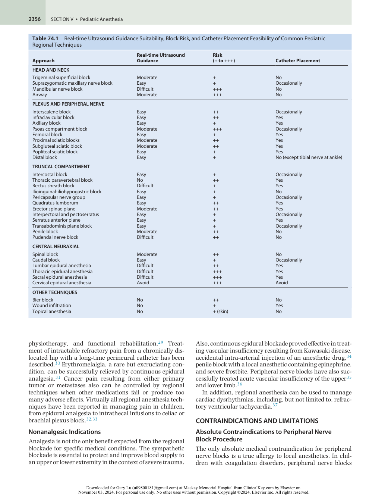

:::

<!-- PDF page 4 -->

are less dangerous than neuraxial blocks.5 Nevertheless, avoiding techniques that pose a risk of arterial trauma is prudent, particularly in areas where compression is difficult or impossible (infraclavicular brachial plexus block, psoas compartment block).38,39 If the anticipated benefits are substantial, septicemia is not necessarily contraindicative for peripheral nerve blockade. Before performing a peripheral nerve block, careful local skin disinfection at the puncture site should be performed, especially if a catheter is implanted. Hypovolemia should ideally be corrected, but peripheral blocks are not precluded because the hemodynamic consequences are minimal.

### Absolute Contraindications to Neuraxial Blocks

Medical conditions that contraindicate neuraxial blocks in children are (1) severe coagulation disorders, which may be constitutional (hemophilia), acquired (disseminated intravascular coagulation), or therapeutic; (2) severe infection such as septicemia or meningitis; (3) intracranial tumor with increased intracranial pressure; (4) true allergy to local anesthetics (a very rare condition even with aminoesters); (5) certain chemotherapies (such as with cisplatin) prone to induce subclinical neurologic lesions that can be acutely aggravated by a block procedure; (6) uncorrected hypovolemia; and (7) cutaneous or subcutaneous lesions, whatever their nature (infection, angioma, dystrophic, tattoo) at the contemplated site of puncture. Parental refusal is a nonmedical absolute contraindication. In addition, if the child is older, assent must be obtained before performing the block.

Depending on the clinical condition of the patient and the possibility of curing (at least temporarily) the impeding disorder, a regional block may be considered despite a contraindication. After correction of hypovolemia, injection of factor VIII to a hemophilic child, or effective antibiotic treatment of a septicemic patient,40 a central block may be performed, provided that the expected benefits consistently outweigh the risks by comparison with other techniques of analgesia. Also, some authors consider it acceptable to perform a caudal block in children with shunt devices under the protection of antibioprophylaxis.41 A single- center study demonstrated that caudal blocks in children with ventriculoperitoneal (VP) shunts could be safely performed.42

### Other Risk Considerations

**Compartment Syndrome.** As pain is one of the primary symptoms of compartment syndrome, it is frequently claimed that any pain treatment, including regional anesthesia, is contraindicated because it can suppress this manifesting symptom, thereby delaying life- saving surgery. This refusal of pain management is neither medically nor ethically acceptable.43 In the pediatric population, fractures are extremely common, whereas compartment syndromes are extremely rare; whether or not a compartment syndrome is present, severe pain is always present. The National Pediatric Epidural Audit in the United Kingdom confirmed that appropriate pain management, including continuous epidural analgesia,44 does not preclude the early diagnosis.45

The European Society for Regional Anaesthesia and Pain Therapy (ESRA) and the ASRA have recently released guidelines for using regional anesthesia and compartment syndrome.5

Extreme pain is not a “manifesting” symptom of compartment syndrome but rather a late symptom. Even in university hospitals, most patients at risk are not monitored adequately. Precautions must be taken, such as avoiding closed plaster casts, elbow immobilization with an angle greater than 90 degrees,46 closed reduction of supracondylar fractures of the humerus, repeat clinical evaluation of the distal perfusion and tissue oxygenation of the limb, and noninvasive monitoring of the intracompartmental pressure. If the risk is high (e.g., displaced humeral fractures, intramedullary nail fixation of tibia or radius, comatose patients), intracompartmental pressure should be monitored invasively close to the fracture site. Simple and inexpensive, the procedure requires only a venous cannula, an intravenous line, and a pressure gauge (as for central venous pressure measurement).47,48

**Hemoglobinopathies.** Children with sickle cell disease are prone to develop hemolysis in case of desaturation and undergo repeat episodes of extreme pain due to extended microthromboses when local blood flow slows down (e.g., hemoconcentration, shock, surgical tourniquet).49 In the case of a danger of hypoxemia (respiratory disease) or hemodynamic disorders (surgery known to produce significant blood loss, tourniquet placement), regional (especially neuraxial) blocks should be avoided. Regional anesthesia has been shown to improve symptoms in children with sickle cell disease and decrease their pain.26

**Bone and Joint Deformities.** Minor or localized spine malformations (hemivertebra, spina bifida occulta, Scheuermann disease) do not preclude neuraxial blocks. In contrast, extensive malformations of vertebrae, spinal fusion, myelomeningoceles, open spina bifida, and major spondylolisthesis are relative contraindications.42 Syndrome of the tethered cord is uncommon and frequently misdiagnosed. Suppose a cluster of hairs or a dystrophic skin lesion is present at the lower extremity of the spinous process line or in the case of minor neurologic disorders involving pelvic nerves. In that case, the diagnosis must be suspected (minimal sphincter disorders, perineal dysesthesia). This is diagnosable with ultrasound guidance. Although some authors believe this condition is not a contraindication,50 it is preferable to choose an alternative analgesic technique over an epidural block. Numerous pediatric syndromes, including cerebral palsy and kyphoscoliosis, are associated with bone and joint deformities that pose more of a technical challenge than a contraindication for regional anesthesia.

**Preexisting Neurologic Disorders or Diseases.** Wellcontrolled epilepsy is not contraindicative for regional anesthesia, including neuraxial blockade. Long- considered contraindications, at least relative, are preexisting central nervous system disorders and degenerative axonal diseases, despite no data supporting the hypothesis that a regional block could worsen their course.51

### COMPLICATIONS

Regional anesthesia complications are comparable to those in adults. The current rate of complications in a large epidemiologic study was 0.12%, with age and central

<!-- PDF page 5 -->

blocks constituting the two most important risk factors.52 They can be classified as local, regional, and general (or systemic).

### Local Complications

The four main types of local complications are as follows:

1.  Inappropriate needle insertion damages the nerve and surrounding anatomic structures

2.  Tissue coring and introduction of epithelial cells into tissues where they do not belong and where they can develop as compressive tumors (especially in the neuraxial area)53

3.  Injection of neurotoxic solutions (syringe mismatch, epinephrine close to a terminal artery)

4.  Leakage around the puncture site, especially when a catheter has been introduced, may cause partial block failure and favor bacterial contamination (sporadic)

These local complications are easily avoidable using adequate devices and standard precautions (appropriate dressing and bacterial precautions). Tunneling the catheter and applying a slightly compressive dressing may reduce leakage around the catheter.

Local anesthetics are also locally toxic. Myelin, adequate protection of nerve roots, is less abundant or absent in children, potentially making the nerves more sensitive to local anesthetics. In animals, it has been demonstrated that the sensitivity of nerve fibers to local anesthetics is inversely correlated with age.54 However, in most cases, perineural injection is around the muscle. The myotoxicity of local anesthetics has been previously demonstrated in humans and animals,55 primarily through mitochondrial damage. This also has been shown in young animals.56 By comparing continuous bupivacaine perineural administration in adult and young rats, the authors showed that muscle, mitochondrial, and ultrastructural toxicity was significantly greater in the juvenile animal group,56 thus emphasizing the need to use lower dosages and greater caution in younger patients.

### Systemic Complications

Systemic complications usually result from an accidental intravenous injection of local anesthetics or, less frequently, excessive dosing.57,58 Systemic toxicity is essential of two types – neurologic and cardiac – both caused by blocking sodium and potassium channels. Early signs of neurologic toxicity (tinnitus, malaise, metallic taste in the mouth) are unfortunately masked by general anesthesia. The main complications are heart conduction disorders, cardiac arrhythmias (bradycardia or tachycardia), and atrioventricular block. QRS widening, bradycardia, and torsades de pointes are followed by ventricular fibrillation, asystole, or both.59 Nevertheless, signs of cardiac and neurologic toxicity occur at lower plasma concentrations of bupivacaine than ropivacaine.60 This toxicity may be aggravated by a decrease in plasma binding protein, mainly α1-acid glycoprotein (AGP), resulting in a more significant proportion of the unbound form of local anesthetic. The plasma concentration of this protein is low at birth and tends to increase with the child’s age to reach values equivalent to those of adults at ten months.61 However, special care must be taken during continuous injections; the dosage of local anesthetic

should be systematically reduced in very young children or after prolonged administration (>48 hours).

Systemic complications can be life- threatening and should be managed in the same way as adults. The significant difference between adults and children is that neurologic signs do not precede cardiovascular complications but are concomitant with cerebral toxicity.62 In addition to pharmacokinetic factors, the rapid heart rate of children may increase the risk for cardiac toxicity induced by local anesthetic toxicity. Even if toxic events occur with ropivacaine, small doses of epinephrine should produce rapid recovery. Impaired ventricular conduction is the primary manifestation of local anesthetic toxicity. Treatment includes oxygenation, cardiac massage, and epinephrine, given in small incremental boluses beginning with 1 to 2 mcg/kg.63 If ventricular fibrillation persists, defibrillation (2–4 J/kg) is performed. Although resuscitation measures must be initiated immediately, the specific treatment of local anesthetic toxicity is rapid administration of Intralipid.63 The recommended dose of 20% Intralipid for pediatric patients is 2 to 5 mL/kg by intravenous bolus. If the cardiac function does not return, this dose (up to 10 mL/kg **)** is repeated.64

### Epidemiology

Available pediatric information is limited. The first report of the American Society of Anesthesiologists (ASA) closed claims analysis contained 238 pediatric cases (10% of claims), but only seven involved children who received regional anesthesia65 ; however, at that time, regional anesthesia was not commonly used in children, making this low rate of complications meaningless. In 1996, the 1- year prospective study of the French- Language Society of Pediatric Anesthesiologists evaluated 85,412 pediatric anesthetic procedures, including 24,409 involving regional anesthesia.66 Twenty- three complications (no sequelae, no death, and no legal consequences) were found, all following neuraxial blocks. In 2000, the Australian Incident Monitoring Study67 included 2000 claims involving 160 pediatric cases with a regional block procedure (83 epidurals, 42 spinals, 14 brachial plexus, 4 Bier blocks, three ophthalmic blocks, and 14 local infiltrations). The most significant single cause of complications was circulatory problems; 24 drug errors (including 10 “wrong drugs” and 14 “inappropriate use”) were found. In 2007, the British National Pediatric Epidural Audit45 reported 96 incidents in 10,633 epidural blocks performed, as follows:

- Fifty- six (0.53%) were associated with inserting or maintaining epidural anesthesia, and most were of low severity; only one child had residual effects from cauda equina syndrome (after a programming error of the infusion pump).

- Forty (0.38%), mainly pressure sores,45 were believed to be associated with the epidural infusion technique.

Twenty- eight infection- related incidents occurred, of which 85% were relatively minor skin infections; caudal catheters did not increase the incidence of infections. A significantly higher rate of incidents occurred in the neonatal age group, mainly because of drug errors (13 cases) and local anesthetic toxicity (1 case) unrelated to catheter insertion. Six children older than eight years of age had mild postdural

<!-- PDF page 6 -->

puncture headaches. Four patients developed compartment syndrome, but the epidural infusion did not mask the condition.

From November 2005 to October 2006, a large epidemiologic study recorded the characteristics and developments of regional anesthesia in children in 47 French hospitals.52 As previously demonstrated by Rochette and colleagues,68 the authors reported a radical change in regional practice among French anesthesiologists with a transition from using predominantly neuraxial blocks to peripheral nerve blocks, including catheter techniques. A recent 1- year prospective survey of regional anesthesia evaluated complications and side effects in 31,132 cases of regional anesthesia. Complications (41, involving 40 patients) were rare, usually minor, and did not result in sequelae. The study recorded a very low overall rate of complications of 0.12%, significantly six times lower for peripheral blocks than for neuraxial blocks. Age was also a risk factor because complications were higher before six months of life than after (0.4% before vs. 0.1% after six months). Fifteen cases of cardiotoxicity were observed, of which 87% occurred with a central block. The occurrence of complications does not increase with the use of catheters.

An extensive North American regional anesthesia registry (Pediatric Regional Anesthesia Network [PRAN]) has published prospective data on 100,000 blocks in over 20 centers. The incidence of local anesthetic systemic toxicity (LAST) was 0.76:10,000 cases, most occurring in infants. No permanent neurologic deficits were reported; however, the risk of transient neurologic deficit was 2.4:10,000 and was not different between peripheral and neuraxial blocks.69

In conclusion, regional block procedures – mainly neuraxial blocks – are associated with adverse incidents (∼0.5%) that are mostly minor but occasionally severe. Most of these complications result from insufficient precautions during the block procedure (drug errors) and postoperatively (pressure sores). Also of significant importance is that compartment syndrome is not hidden by regional anesthesia, provided that adequate monitoring is guaranteed.5

## Safety, Precautions, and Discharge Criteria

### GENERAL CONSIDERATIONS

Infection, hematoma, and local anesthetic toxicity are uncommon in children undergoing regional anesthesia. Still, the ASRA/ESRA joint committee has recently proposed a practice advisory to prevent and treat these complications. The aseptic technique prevents infection. Povidone–iodine is inferior to chlorhexidine for pre- block skin preparation. A tunneled catheter is preferred using the caudal route or leaving the epidural catheter in place for more than three days. Postoperative care requires daily inspection of the epidural catheter insertion site. Neuraxial and deep peripheral nerve blocks are contraindicated if coagulation tests are abnormal. Heparin thromboprophylaxis with a safety interval of two half- lives plus the time required for heparin to reach maximal levels balances bleeding risk and thrombosis risk when removing epidural catheters in low- molecularweight heparin (LMWH)- treated patients.

Peripheral nerve blocks guided by ultrasound reduce vascular puncture and local anesthetic toxicity. Aspiration before injection decreases systemic local toxicity.70 Clinicians should proceed cautiously when using local anesthetics, even though systemic toxicity is rare in infants. It is essential to pay extra attention to infants and newborns because of the unique physiologic challenges they face.1

### OPTIMAL LOCATION FOR PERFORMING REGIONAL BLOCK

Due to the anesthetic nature of regional techniques, they must be performed in fully equipped operating rooms with access to all necessary monitoring, anesthetic, and resuscitation equipment and drugs in case of emergency. In addition, the anesthesiologist needs support from nurses and technicians who are trained to keep patients safe in an emergency and capable of providing adequate monitoring. A mature adolescent may consent to have a block done in the preoperative area, but otherwise, blocks should be typically performed in the operating room.

### SEDATION AND GENERAL ANESTHESIA

Regional procedures are performed on adult patients awake, with or without sedation, but not typically under general anesthesia. The same treatment can be offered to calm pediatric patients and is sometimes requested by the child.71 Most children must be unconscious during the block procedure. If general anesthesia is not medically contraindicated, it is generally accepted that regional blocks may be performed with the patient under light general anesthesia; large databases have demonstrated the safety of this procedure.14,52,69,72

### PATIENT MONITORING AND SAFETY PRECAUTIONS DURING THE BLOCK PROCEDURE

### Monitoring and Anesthesia Chart

Even if general anesthesia is not used and the surgical procedure is primarily based on a regional technique, the anesthesiologist should always apply routine intraoperative monitoring, including electrocardiographic (ECG) tracings, blood pressure, and temperature, respiratory rate, and oxygen saturation measurements. In addition, an intravenous line must be established before any injection of local anesthetic,73 and vital parameters, techniques, and doses of local anesthetics must be reported on a detailed anesthesia chart. It is also imperative to site mark the area to be blocked and get consent if under ten years, and consent and assent from the patient if they are older.

### Technique of Injection

Techniques in adults and children are similar. Of prime importance is to evaluate the effects on ECG tracings of a test dose containing epinephrine (0.1 mL/kg up to 3 mL containing 0.5–1 mcg/kg of epinephrine) for 30 to 60 seconds. Any elevation of ST segment or increase in T- wave amplitude,74–76 followed by an increase in blood pressure but only occasionally by tachycardia, suggests inadvertent intravenous injection and necessitates cessation of the

<!-- PDF page 7 -->

procedure; when epinephrine is contraindicated, isoproterenol 0.05 to 0.1 mcg/kg should be used instead.77

### Assessment of the Block

After every block procedure, the quality and extension of analgesia must be evaluated before surgical incision. However, this evaluation is challenging, even in conscious children. Gentle skin pinching is the most dependable technique of sensory testing, especially in lightly anesthetized children. One method is to use ice in a plastic bag to determine the efficacy of the block in lightly sedated children; however, it may be difficult to elicit any response in children under general anesthesia. Electrical stimulation using a nerve stimulator at different threshold intensities proved suitable in healthy volunteers, but data on children are limited. Skin temperature is not suitable, and whether pupillary reflex dilation of 0.2 mm is sensitive to the loss of analgesia is not clinically useful.78

### Postoperative Monitoring in the Recovery Room

After combined regional and general anesthesia, all children must be transferred to a recovery room (postanesthesia care unit [PACU]), where respiratory and hemodynamic status stability is checked like after general anesthesia. In addition to this standard postanesthetic care, they require repeat evaluations of the anesthetized area. In the case of motor blockade, which should be avoided as often as possible, it is essential to verify that its distribution corresponds to the area supplied to the blocked nerve. Patient positioning must be carefully and regularly checked to avoid pressure points. The possibility that a compartment syndrome is evolving must always be kept in mind, and both the hemodynamic status of the relevant limb and the quality of analgesia must be repeatedly evaluated.

Urinary retention can be of concern after neuraxial blocks. In many institutions, however, voiding is not requested before discharging the child. As a result, adult surgical patients under regional blockade often bypass the postanesthesia recovery room. Even if no sedative has been given to children, it is not wise to do so, and adequate monitoring and skilled assistance improve recovery from immediate postoperative incidents.79 After short procedures, sudden cessation of external stimulation may unmask some compensated adverse effects (hemodynamic and respiratory especially) that are not harmful if detected early. As noted earlier, ropivacaine and, to a lesser extent, levobupivacaine, have a longer Tmax (up to 2 hours) and Cmax in infants; therefore, after short- duration surgeries, these patients may leave the operating room before local anesthetic plasma peak concentration has been reached. Monitoring them in a PACU up to 2 hours after the block procedure is recommended.

### DISCHARGE CRITERIA AFTER SINGLE- SHOT PROCEDURES

The same criteria apply with discharge from the PACU as do after general anesthesia (pediatric adaptation of Aldrete score or specific scoring method in use in the relevant institution); in the absence of motor blockade, children usually may be discharged within 30 minutes. In other cases, discharge depends on the behavior of the child. Partial

restoration of motor function is mandatory, even in quiet children with caring families. Boisterous children should not leave before motor functions have been fully restored; additionally, protective dressings (including casts) may help prevent harm to the operated limb. The persistence of sensory blockade is only a contraindication to early discharge if the familial environment is inadequate. Pain medication should be systematically prescribed and administered regularly to prevent the return of intense pain at home when the sensory block is no longer effective.80 Most additives do not preclude early discharge except for epidural or intrathecal opioids, especially morphine or hydromorphone, necessitating the child to stay hospitalized overnight.

### MANAGEMENT OF CONTINUOUS REGIONAL TECHNIQUES

Children with parent- controlled or continuous epidural infusion should remain hospitalized to be adequately monitored. Occasionally, a few selected patients can be allowed to return home with an epidural catheter, mainly in the context of chronic pain or cancer pain in terminally ill children. These continuous techniques are newer in pediatrics22 and not yet widely used. Studies on peripheral nerve blocks in children monitored at home have reported a low complication rate and good- quality analgesia.81,82 In one institution, children suffering from CRPS were treated with peripheral nerve catheters at home.29 The use of an elastomeric disposable device and electronic pump with intermittent bolus to deliver local anesthetic allows for simplifying the management of children at home and a nursing economy. Such management will probably gain wider acceptance among teenagers, but it should be carefully considered only after a thorough evaluation of small children.

## Relevant Differences Between Children and Adults

### ANATOMIC CONSIDERATIONS

Regional anesthesia safety depends on anatomy knowledge. “A thorough knowledge of descriptive and topographic anatomy with regards to nerve distribution is a condition which anyone desirous of attempting to study regional anesthesia should fulfill,” wrote Dr. Gaston Labat in his 1924 book, _Regional Anesthesia: Its Technique and Clinical Application_ .83 Therefore, effectively matching regional anesthesia to surgical needs requires knowledge of the anatomic development and its relationship to nerve and its innervation.

### Growth- Induced Body Size Change

One of the most apparent differences between children and adults is their relative weight and size. After 10–15 years of growth, “normal” full- term neonates will have increased their weight by more than 12 (>1200%) and their height by more than 3 (>300%) from their birth weight of 3–3.5 kg and 50 cm, respectively.

In the embryonic stage, the spinal cord fills the spinal canal; however, as the vertebrae develop, they outgrow the cord, the remainder of the spinal nerves, and their

<!-- PDF page 8 -->

protective neural coverings.84 At birth, the cord (conus medullaris) terminates at the L3 or L4 level, and the dura mater ends at the S3 or S4 sacral vertebra level. Only at the end of the first year of life is the adult level attained – L1 for the conus medullaris and S2 for the dural sac (Fig. 74.1). Throughout infancy and childhood, anatomic relationships and landmarks are constantly changing as a child grows. This can make it challenging to perform regional procedures and requires a working knowledge of developmental anatomy and the help of accurate techniques for finding anatomic spaces and nerve trunks. In the pediatric population, congenital malformations, genetic disorders, and the effects of fetal and neonatal asphyxia (cerebral palsy) often require frequent surgery to help the child ambulate or adapt to everyday childhood life. Table 74.2 lists the main anatomic and physiologic factors in children that can have implications for performing regional block procedures.

### Delayed Bone Ossification and Sacral Vertebrae Fusion

Neonatal bones, particularly the vertebrae, are primarily cartilaginous. Because cartilage offers low resistance to penetration, sharp needles can easily penetrate them, and ossification nuclei can be badly injured, impeding future bone and joint formation. Therefore, bone contact should be avoided wherever feasible while performing nerve block, particularly in newborns. However, its cartilaginous structure facilitates ultrasonic and fluoroscopic penetration in regional block guiding.

### Spine Curvature Development

In addition to the absence of osteophytes, spinal flexibility can be a substantial advantage for performing ultrasoundguided pediatric neuraxial block. A single spinal curvature is present at birth and can be easily counteracted by forced flexion practically throughout childhood due to constant flexibility. Regardless of the intervertebral level,

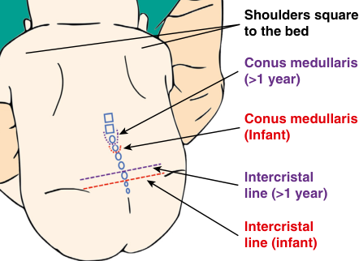

Shoulders square to the bed Conus medullaris (>1 year) Conus medullaris (Infant) lntercristal line (>1 year) lntercristal line (infant) 

**Fig. 74.1 Spinal development and its surface landmarks.** Positions of the conus medullaris and intercristal line for infants younger than one year old ( _red_ ) and children older than one year old ( _blue_ ) are depicted.

the orientation of epidural needles can remain similar throughout.

### Loose Fasciae and Epidural Fat

The fascia and the perivascular sleeve are only tenuously attached to the underlying structures (e.g., nerves, muscles, tendons, and vessels). This allows for the widespread distribution of local anesthetics, which can lead to effective nerve blockades across all techniques but can also spread to nerves and anatomic spaces that are not intended. In newborns and young children, the epidural fat is pliable (up to 6–7 years of age). Because of the epidural space’s fluidity and the spinal cord’s loose attachment to the sheaths surrounding it, a relatively large volume of epidural local anesthetics (up to 1.25 mL/kg) is required to achieve desired levels of anesthesia.

### Delayed Nerve Fiber Myelination

Cervical neuromeres are the first to undergo myelination during development, and this process then spreads cephalad and caudad.85,86 However, myelination is only complete after the age of twelve. Infants have particularly poor myelination; the incomplete development of their nerve fibers is the primary cause of their inability to walk. The increased ability of local anesthetics to reach and block nerve fibers is also a significant pharmacologic consequence of this condition. Thus, the effectiveness of nerve blockade from diluted local anesthetic solutions is equivalent to that of solutions at least twice as concentrated in adults. On the other hand, infants experience a shorter blockade due to local anesthetics and are less likely to become trapped within myelin and released gradually. Increased local circulation also leads to more rapid and significant vascular absorption.

### PAIN PERCEPTION CONSIDERATIONS

Injury or disease affecting the somatosensory nervous system leads to pain. However, pain perception must be viewed as consisting of three components that interact87–89 : sensory–discriminative, cognitive–evaluative, and motivational–affective. The perception of pain’s intensity, location, quality, and behavior is sensory–discriminative. The cognitive component pertains to thoughts about the situation that are influenced by past experiences and knowledge. In contrast, the motivational–affective part relates to emotional responses such as anger, anxiety, and fear that motivate the reaction to pain dimensions. All aspects interact to generate altered physiologic outputs and, eventually, altered behavior.

Physiologically, unmyelinated C fibers are primarily responsible for transmitting pain (“slow” pain or “real” pain). Pain causes protective reflexes, including autonomic responses, muscular contraction, and rigidity. C fibers are fully functional from early fetal life onward. While connections between C fibers and dorsal horn neurons are not mature before the second week of postnatal life, C fiber–transmitted nociceptive stimulations to the dorsal horn cause long- lasting responses.90,91 This is likely due to extensive neuronal depolarization caused by substance P production. During the first two weeks of life, neonates’ exaggerated response to nociceptive stimulation

<!-- PDF page 9 -->

**Table 74.2** Regional Block Procedure Selection and Performance in Children: Anatomic and Physiologic Factors

|**Pediatric Factors (Specially Infants)**|**Consequences Risk**|**Implications for Regional Anesthesia**|
|---|---|---|
|Lower spinal cord end|Direct spinal cord trauma risk increased|Epidurals above L3 should proceed with caution.|
|Lower projection of dural sac|Risk of accidental dura mater penetration|Check for cerebrospinal fluid reflux, including during caudal approaches. Favor low approaches to the epidural space.|
|Delayed myelinization of nerve fibers|Easier intraneural penetration of local anesthetics|Diluted local anesthetic is as effective as a more concentrated anesthetic in adults. Faster onset time.|
|Cartilaginous bones and vertebrae|Sharp needles penetrate easier Direct trauma and bacterial contamination of ossification nuclei can hinder bone or joint formation|Use short, beveled needles instead of thin, pointed ones. Stop inserting the needle if it resists.|
|Sacral vertebrae unfused|Sacral intervertebral spaces persist|Intervertebral sacral epidural procedures can happen in childhood.|
|Delayed spine curvature|Cervical lordosis (3–6 months) Lumbar lordosis (8–9 months)|Before 6 months of age, epidural needles can be oriented the same regardless of spinal level.|
|No sacral hiatus development and changing coccyx axis|Age reduces sacral hiatus|Sacral hiatus identification becomes harder after 6–8 years (increased failure rate of caudal anesthesia).|
|Delayed iliac crest ossification and development|Infants’ Tuffier line crosses at L5 or lower|This line crosses L5–S1 instead of L4–L5.|
|Epidural fat fluidity increased|Increased local anesthetic diffusion until 6–7 years old||
|Loose sheaths and aponeuroses to underlying structures|Increased local anesthetic diffusion to distant anatomic regions|Epidural blocks require more local anesthetic due to leaking along spinal nerve roots. For good peripheral blocks, less local anesthetic is needed.|
|Enzymatic immaturity|Slower local anesthetic metabolism (usually compensated by other enzyme pathways)|Accumulation (particularly after repeat injections and continuous infusions of a local anesthetic) increases mean body residency time and half- life.|
|Increased extracellular fluids|Increased distribution volume and mean body residency duration of local anesthetic|Decreased Cmaxoccurs after a single injection but accumulation occurs with repeat or continuous injections.|
|Low plasma protein content (HSA and AGP)|Competition at nonspecific HSA binding sites The limited capacity of specific binding of local anesthetic by AGP, resulting in increased plasma concentration of the free fraction|Systemic toxicity increases due to the increased unbound free fraction of all local anesthetics.|
|Increased cardiac output and heart rate|Increased regional blood flow resulting in increased systemic absorption of local anesthetic|Increased systemic absorption of local anesthetic occurs (decreased Tmaxand shorter duration of blockade). Increased efficacy of epinephrine. Vasoconstriction reduces absorption (thus toxicity) and prolongs the duration of blockade.|
|Sympathetic immaturity, decreased cardiac autonomic flexibility, smaller lower extremity vascular bed|Hemodynamic stability during neuraxial blocks|Vasoactive drugs and fluid preloading are typically unnecessary.|
|Delayed acquisition of body scheme and conceptualization, anxiety|Inability to locate specific bodily parts Unknown paresthesia Collaboration issues|Locating nerves and spaces without patient cooperation is necessary. Most patients need heavy sedation or general anesthesia, especially if a “risk” method is used to avoid panic episodes during the blocking process.|

_AGP,_ α1- acid glycoprotein; _Cmax,_ peak plasma concentration; _HSA,_ human serum albumin; _Tmax,_ time to reach Cmax.

decreases as substance P dorsal horn receptors decrease. Birth- immature inhibitory control pathways also develop simultaneously.

Depending on the stage of the infant (full- term vs. preterm) and the infant’s cumulative experience with pain, painful procedures during the neonatal period modify subsequent pain responses in infancy and childhood.92 Full- term neonates respond to noxious stimulations with

heightened behavioral responsiveness, whereas preterm neonates respond with a dampened response. When sufficient analgesic drugs (local anesthetics or opioids) are administered before painful procedures, infants exhibit less procedural pain and a decrease in the magnitude of longterm changes in pain behaviors.92 However, the inability of young patients to communicate with their caregivers and precisely express their distress and discomfort poses a

::: details 原始表格與符號（PDF 第 9 頁）

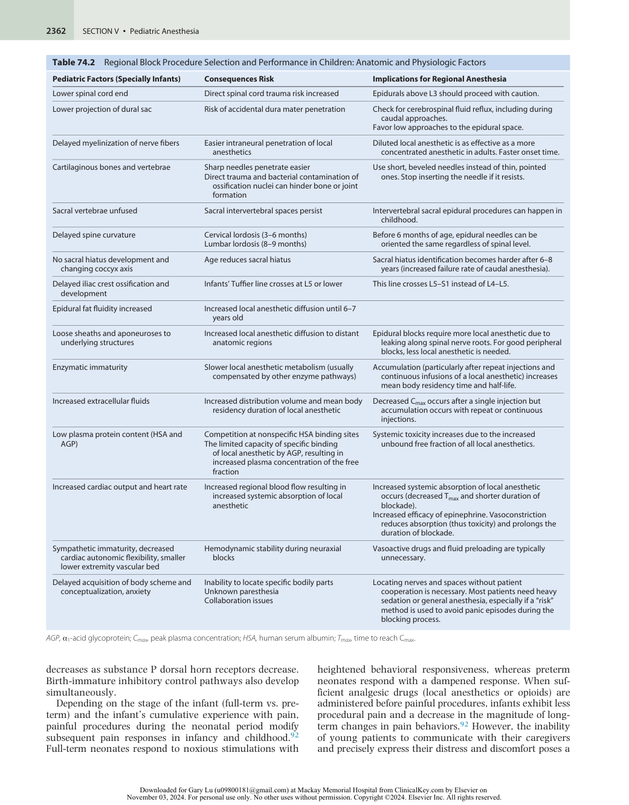

:::

<!-- PDF page 10 -->

significant challenge in assessing and, at times, even identifying pain in children for titrating adequate analgesia. Although pediatric pain has received considerable attention over the past two decades, reliable age- related pain scales have been challenging to develop in accurately assessing the severity of pain and the efficacy of its treatment.

### PHYSIOLOGIC CONSIDERATIONS

Surgery generates a neuroendocrine stress response in neonates, infants, and children,89,93 resulting in undesirable alterations of the metabolic state and immune function.94 Epidural anesthesia diminishes or even suppresses this stress response.95–97 Central blocks do not affect the left ventricular function and are virtually free of measurable hemodynamic effects, at least up to the age of 8 years.98,99 Epidural anesthesia does not result in systemic or pulmonary hemodynamic changes as measured by mean blood pressure, the end- diastolic diameter of the left ventricle, ejection fraction of the left ventricle, and mean velocity circumferential fiber shortening.100 However, the pulmonary Doppler flow velocity is decreased during epidural anesthesia, probably due to increased pulmonary arterial resistance. Therefore, preloading with saline is not recommended in children, and even in adolescents, fluid therapy or injection of vasoactive agents is rarely required.

### PSYCHOLOGICAL CONSIDERATIONS

Children are frightened by new environmental conditions in the operating room, and most of them cannot cope with their anxiety.101,102 They feel abandoned by their parents and exposed to strangers threatening them with needles. Furthermore, children younger than ten have not acquired their complete body image and cannot distinguish between adjacent parts of their body, such as the forearm and arm. Young patients cannot understand the concepts of paresthesia and differential blockade (“touch” is not “pain”). Thus, localization of nerve trunks and anatomic spaces requires physical methods independent of the patient’s cooperation (loss of resistance [LOR] seeking, nerve stimulation, ultrasound techniques). Infants and most children cannot cope with their anxiety and fear of needles; therefore, deep sedation or general anesthesia may be needed before attempting a block procedure to avoid panic attacks and unwanted movements. Prospective regional anesthesia registries have demonstrated that awake versus asleep placement of regional blocks in children has no deleterious effects on outcomes.6

Regional anesthesia has a significant psychological impact. A pain- free postoperative course improves the morale of the patient, the family, and the nurses. Surgeons are happy to examine quiet, alert, and manageable patients. Occasionally, adverse psychological effects can be observed: persistent motor (even sensory) blocks postoperatively may be frightening to some children (especially those 3–5 years of age) and their parents even though precise explanations had been given preoperatively concerning the expected course of such events during the postoperative period. Offering social, environmental conditions, empathy, and additional explanations on local anesthetic pharmacology can reduce this postoperative anxiety.

## Pharmacology of Local Anesthetics and Additives

Children’s pharmacologic properties are primarily influenced by (1) the immaturity of certain enzyme pathways and their replacement by other biochemical pathways and (2) the progressive increase in body surface area concurrent with the growth process. Dosing for drugs based on body surface area is the same as (or a simple ratio of) adult dosing.103 However, body surface area is difficult to measure. In practice, doses are calculated based on the child’s body weight and must be constantly adjusted as the child grows; dosage errors are not infrequent.

### LOCAL ANESTHETICS

Chemical properties and mechanisms of action of local anesthetics are described elsewhere in this book (see also Chapter 25); they are similar during childhood, and only pharmacokinetic properties, particularly in neonates and infants, may differ significantly.58

### Local Fixation

In contrast to adults, local anesthetic fixation is decreased and spread is increased in infants, particularly within the epidural space, because epidural fat is more fluid and less densely packed. The primary effects are (1) a quicker onset of action, (2) a wider longitudinal and circumferential distribution of local anesthetics, and (3) a shorter duration of action due to a decrease in secondary release from local binding sites.

### Diffusion and Dispersion to Target Neural Tissue

Local anesthetic action targets sodium channels within nerve fibers that are voltage dependent. Therefore, nonionized molecules can only penetrate biologic membranes, and the penetration rate depends on the number and (increasing with age) thickness of sheaths.

### Systemic Absorption and Distribution

**plasma protein binding.** Nonionized local anesthetics traverse the capillary wall near the injection site with relative ease. Because cardiac output and local blood flow are two to three times higher in infants than adults, systemic local anesthetic absorption is proportionally increased, and vasoactive agents such as epinephrine are highly effective at reducing systemic uptake.

Local anesthetics undergo plasma protein binding primarily to human serum albumin (HSA) and α1- acid glycoprotein (AGP) or orosomucoid once they have penetrated the vascular bed. Local anesthetics have a low affinity for HSA, and many pharmacologic agents can compete for available binding sites. In addition, plasma levels of HSA are low during the first months of life, particularly in preterm and fasted infants; consequently, the protection offered by HSA against the systemic toxicity of local anesthetics is low and declines postoperatively. The affinity of AGP for local anesthetics is 5000 to 10,000 times greater than that of HSA, making AGP a highly effective systemic toxicity protector (which depends on the unbound free form of local anesthetics). However, the plasma concentration of AGP is

<!-- PDF page 11 -->

inadequate at birth (0.2–0.3 g/L) and does not reach adult levels (0.7–1.0 g/L) until after one year of age.104–106

As the plasma concentration of the two proteins able to bind local anesthetics is low at birth, the free fraction of all local anesthetics is increased in infants; consequently, the maximum doses of all aminoamides must be significantly reduced in this age group.106 Except in the case of liver insufficiency, AGP plasma levels may rise due to surgical stress, especially in infants undergoing infection or emergency surgery.104 The increase in plasma AGP concentration can alter the proportion of ropivacaine’s free fraction, thereby increasing the plasma concentration of this molecule’s bound fraction and protecting against the systemic toxicity of local anesthetics.107 By keeping the plasma concentration of local anesthetics within the safety margins, these phenomena can drastically reduce the potential risk associated with a single injection.

**red cell storage.** Local anesthetics distribute to red blood cells, which retain 20 to 30 percent of the total dose, depending on the anesthetic and hematocrit. Therefore, red cell storage typically has a minor effect on the pharmacokinetics of local anesthetics, except in the following instances:

- In neonates, high hematocrit values (which may exceed 70%) and erythrocyte enlargement (physiologic macrocytosis) result in consistent “entrapment” of local anesthetics, thereby lowering peak plasma concentration (Cmax) values after a single injection but increasing secondary release, thereby extending the half- life of all local anesthetics.

- In infants, physiologic anemia reduces red cell storage and its protective effect against systemic toxicity of local anesthetics (only after a single- shot injection) when plasma protein binding sites are saturated – that is, when blood concentrations are close to toxic levels.

**absorption from peripheral sites.** Absorption of local anesthetics deposited along mucous membranes is increased in infants.64 Mucosal topical anesthesia has long been considered contraindicated in this age group. However, the technique can be safely used with certain precautions: selecting specific transmucosal patches108 or sprays with diluted lidocaine109,110 and recognizing that topical lidocaine exaggerates laryngomalacia.111

After cutaneous application of EMLA (lidocaine and prilocaine) cream, peak plasma concentrations occur 4 hours later and remain low- field112 – less than 200 ng/mL for lidocaine and less than 131 ng/mL for prilocaine, even in infants younger than six months of age.

Absorption of local anesthetics from compartment blocks (e.g., fascia iliaca, umbilical, ilioinguinal, and pudendal blocks) follows the same biphasic curve for the epidural space.113–116 Because of the extended absorption surface, injection of highly concentrated solutions of local anesthetics often leads to high, occasionally potentially toxic peak plasma concentrations, especially with 0.5% ropivacaine,116 whereas using more diluted solutions results in relatively low plasma concentrations.

Absorption from peripheral nerve conduction blocks also follows a similar biphasic curve with different Cmax and Tmax values depending on the local anesthetic, the addition of

epinephrine, and the injection site; the more distal the injection, the slower the absorption process (as in adults).

Ultrasound- guided interfascial plane blocks, a new type of regional technique, are increasingly common (see Truncal Blocks, below). Most experts believe that increasing the volume of local anesthetic used for an interfascial plane block is vital for adequate analgesia. However, there is serious concern about local anesthetic toxicity in young patients when using large volumes of local anesthetic. It can be challenging to provide adequate volumes of local anesthetic through bilateral catheters in patients who are neonates, are underweight, or have organ dysfunction due to the local anesthetic’s potential for systemic toxicity (LAST). In addition, pharmacokinetic information on intermittent fascial plane blocks remains scant.117–119 This information is essential for minimizing systemic toxicity when treating pediatric patients. While it is unclear how much of an intermittent bolus is absorbed systemically from fascial plane blocks at a steady state, similar absorption may occur from different injection sites along the fascial plane because of the plane’s large surface area for local anesthetic spread and diffusion.120 Nonetheless, it is essential to emphasize that dosing must be individualized and closely monitored.

**absorption from the epidural space.** Epidural space absorption of local anesthetics has been extensively studied. The same absorption kinetics are reported in children and infants, but the biphasic shape of the plasma concentration curve is less pronounced in younger patients. The peak plasma concentration and slope of the decreasing concentration curve are increased,121 while the time (Tmax) to reach Cmax remains unchanged; for instance, the Tmax of bupivacaine is approximately 30 minutes regardless of the patient’s age.

The notable exception is ropivacaine. Tmax is prolonged in infants after caudal or lumbar epidural injection by up to two hours, and Cmax rises.122 Infant surgeries are usually brief, so this significant increase in Cmax and Tmax values must be considered and monitored. Before peak plasma concentration, the children may have left the operating room and PACU less than two hours after the caudal or epidural procedure. This unique pharmacokinetic profile may be due to enzyme immaturity, slower systemic uptake, and lower distribution volume.123,124 Intrinsic vasoconstrictive properties of ropivacaine also may play a role in the same way as the addition of epinephrine.

Importantly, levobupivacaine displays a similar pharmacokinetic profile. After a caudal injection of levobupivacaine 2 mg/kg in infants younger than two years of age, the Cmax range is 0.41 to 2.42 mcg/mL (0.91 ± 0.40 mcg/mL), which is higher than the Cmax reported after caudal injection of the same dose of racemic bupivacaine.125 Tmax values are also delayed (50 vs. 30 minutes) in infants younger than three months due to reduced plasma clearance.126

When repeat injections are considered, the epidural dose must be reduced to keep Cmax values in the same range as that resulting from the first injection. For the second injection, the following recommendations can be made: reduce the dose to one- third of the initial amount and do not inject it less than 30 minutes (lidocaine, mepivacaine, prilocaine) or 45 minutes (bupivacaine, levobupivacaine, ropivacaine) after the first injection; or inject half of the initial dose, but 60 minutes (lidocaine, mepivacaine, prilocaine,

<!-- PDF page 12 -->

chloroprocaine) or 90 minutes (bupivacaine, levobupivacaine, ropivacaine) after the first injection.

If repeated injections are necessary, dosing should be further reduced to half of the second dose (i.e., one- sixth of the initial amount) while respecting the same delay as the second injection.

Continuous infusions aim to produce a steady- state concentration at the 24th hour postoperatively. This goal is easily achieved in adolescents with infusion rates of approximately 0.3 mg/kg/h of bupivacaine and levobupivacaine or 0.4 mg/kg/h of ropivacaine.

In infants, infusion rates must be reduced,127,128 not exceeding 0.2 mg/kg/h with bupivacaine (or equipotent doses of other local anesthetics) in infants younger than four months and 0.25 mg/kg/h in older infants. Infants younger than four months (occasionally up to 9 months) may develop systemic toxicity even at these “safe” infusion rates with racemic bupivacaine because no steady- state plasma concentration is reached, even at 48 hours. In this age group, levobupivacaine108 or ropivacaine109 instead of racemic bupivacaine is preferred because stable plateau concentrations are obtained from the 24th hour onward.

**pulmonary extraction.** Aminoamides enter the right cardiac cavities and then the pulmonary circulation, where they undergo plasma protein linkage and erythrocyte storage before being extracted by the lung. Their plasma concentration consistently drops in the pulmonary veins and systemic arterial circulation (primarily the coronary and

cerebral arteries). Therefore, pulmonary extraction serves as a transient defense against systemic toxicity. But some medical conditions block this defense mechanism. Some drugs, like propranolol, reduce pulmonary extraction in a clinically significant way. Additionally, due to pulmonary circulation bypass, children with right- to- left shunts experience significant increases in the arterial plasma concentration of local anesthetics; even with low doses, they are susceptible to systemic toxicity.129

**distribution volume.** All aminoamides have a volume distribution at the steady state (Vdss) of 1 to 2 L/kg following intravenous injection (Table 74.3). However, due to the “flip- flop” effect, calculated distribution is frequently significantly increased following administration at other sites, especially for long- lasting local anesthetics. The distribution volume of all local anesthetics is more significant in infants and newborns than in adults due to higher extracellular fluid content (Table 74.4), which has two effects: (1) a significant reduction in peak plasma concentration of all local anesthetics, reducing the risk of systemic toxicity after a single dose; and (2) accumulation with reinjections, which lengthens the drug’s half- life and plasma concentration while concurrently increasing its elimination half- life.

**hepatic extraction and clearance of aminoamides.** Short- acting local anesthetics undergo a high level of hepatic extraction (0.65 to 0.75 ratio for lidocaine), primarily dependent on hepatic blood flow and only

**Table 74.3** Age- Related Aminoamide Pharmacokinetic Parameters

|**Local Anesthetic**|**Protein Binding (%)**|**Distribution Volume at** **Steady State (Vdss)**|**Clearance (mL/kg/min)**|**Elimination Half- Life (h)**|
|---|---|---|---|---|
|**LIDOCAINE**|||||
|Neonate|25|1.4–4.9|5–19|2.9–3.3|
|Adult|55–65|0.2–1.0|11–15|1.0–2.2|
|**MEPIVACAINE**|||||
|Neonate|36|1.2–2.8|1.6–3|5.3–11.3|
|Adult|75–80|0.6–1.5|10–13|1.7–6.9|
|**BUPIVACAINE**|||||
|Neonate|50–70|3.9 (±2.01)|7.1 (±3.2)|6.0–22.0|
|Adult|95|0.8–1.6|7–9|1.2–2.9|
|**LEVOBUPIVACAINE**|||||
|Infant|50–70|2.7|13.8|4|
|Adult|95|0.7–1.4|28–39|1.27 ± 0.37|
|**ROPIVACAINE**|||||
|Infant|94|2.4|6.5|3.9|
|Adult|94|1.1 ± 0.25|4–6|1.15 ± 0.41|

**Table 74.4** Age- Related Body Fluid Distribution

|**Distribution of Body Fluids**|**Preterm Neonates (%)**|**Full- Term Neonates (%)**|**Infants (%)**|**Children (%)**|**Adults (%)**|
|---|---|---|---|---|---|
|Total body fluids|80–85|70–75|65|55–60|50–55|
|Intracellular|20–25|30–35|35|35–40|40–45|
|Extracellular|55–60|45|30|20–25|20|

::: details 原始表格與符號（PDF 第 12 頁）

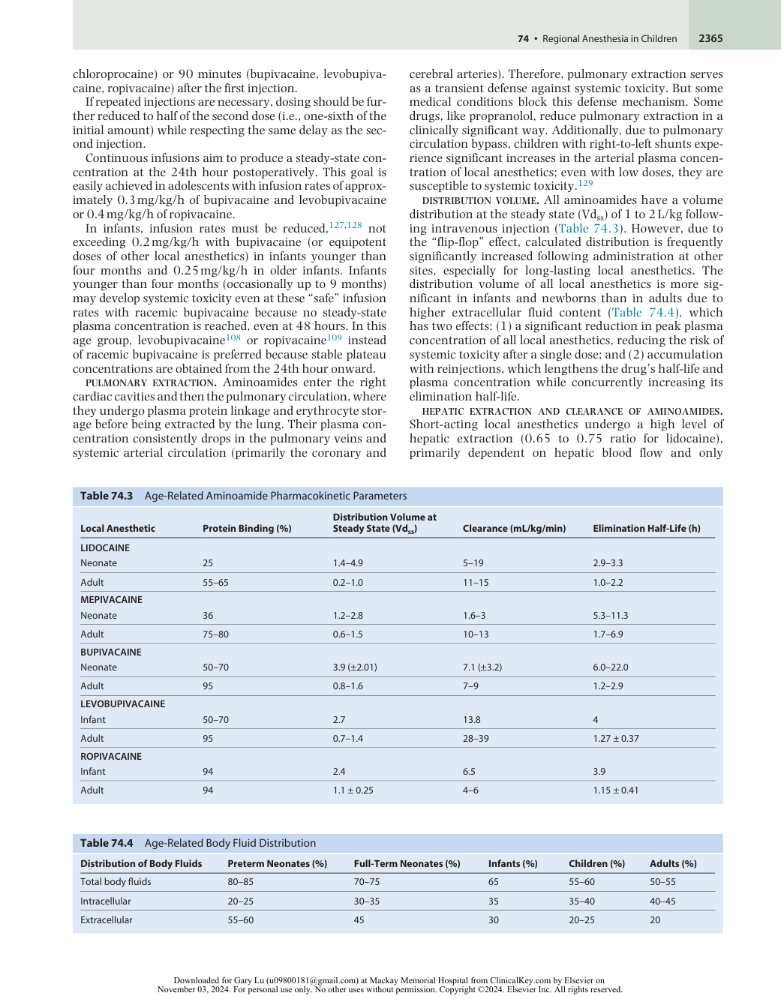

:::

<!-- PDF page 13 -->

minimally on plasma concentration. Only limited pediatric data are available for levobupivacaine. During the first months of life, the clearance of levobupivacaine increases after a single injection; however, during continuous infusion (even with 0.0625% levobupivacaine), it tends to decrease to almost the same extent as that of racemic bupivacaine, and plasma concentrations do not reach a plateau.126

**placental transfer.** Placental extraction may systematically impact the distribution of local anesthetics in the tissue in pregnant women. The placental transfer is influenced by protein binding. For lidocaine, prilocaine, and bupivacaine, the concentration ratio between umbilical venous blood and maternal arterial blood is roughly 0.73, 0.85, and 0.32, respectively. The placental transfer of d- bupivacaine is greater than that of l- bupivacaine, but only when solutions containing epinephrine are used, suggesting that chirality may also be a factor, at least for bupivacaine.130 The placental transfer of most aminoesters is not a problem because of the quick plasma hydrolysis that occurs. Tetracaine and cocaine, which have slow hydrolysis, are only employed for topical treatments or (for tetracaine only) spinal anesthesia; because their systemic uptake is slow and their plasma concentrations stay very low, they do not provide a threat to placental transfer.

**metabolism.** Procaine and chloroprocaine are partially metabolized by hepatic cholinesterase. Cholinesterases in plasma rapidly hydrolyze aminoesters. This enzyme activity is low at birth (although no negative clinical effects are anticipated) and gradually reaches adult levels by one year of age.131 Chloroprocaine is eliminated at the fastest rate (4.7 mol/mL/h), procaine at a slower rate (1.1 mol/mL/h), and cocaine at only 0.3 mol/mL/h.

Aminoamides are metabolized within the liver and subjected to two enzymatic reactions. Phase I reactions occur first, during which oxidation of the amide link is achieved within hepatic microsomes by the cytochrome P (CYP)450 enzyme superfamily. Phase II reactions, during which glucuronic acid or amino acid residues are appended to phase I metabolites, produce atoxic and water- soluble compounds, which are thus easily eliminated from the body.

CYP450 enzymatic activities are reduced during the first months of life. CYP3A4 mainly metabolizes bupivacaine in adults, but this enzyme is defective in infants. However, fetal CYP3A7 remains very active in infants, thus allowing the metabolism of bupivacaine to be almost as effective as with CYP3A4.64 Ropivacaine and levobupivacaine126 are metabolized by CYP1A2, which is not fully functional before the third year, and, to a minor extent, by CYP3A4. This enzyme immaturity is clinically relevant but with little consequences (lower clearance, delayed Tmax, and, for ropivacaine only, increased Cmax but within clinically acceptable levels): it does not preclude administering these local anesthetics in neonates and infants.

Phase II reactions, especially glucuronic–Vdss conjugation, are immature at birth and remain until the third year of life. However, other conjugation pathways, such as sulfoconjugation, are active and effective during the first months of life.

**elimination half- life.** Elimination half- life (t½β) depends on both distribution and metabolism. It can be calculated

using the formula below (Cp is the plasma clearance, and Vdss the distribution volume at the steady state):

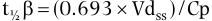

t½  (0.693  Vdss )/Cp 

t½β is the same in children older than one year of age and adults, mainly because the increase in Vdss is compensated by a concomitant rise in Cp (related in part to higher hepatic blood flow in children, whose liver accounts for 4% of body weight, vs. only 2% in adults). Before one year, Cp is low, and the elimination half- life of all local anesthetics is prolonged (see Table 74.3), thus favoring accumulation with repeat injections. Nevertheless, Bricker and colleagues132 measured no consistent differences in pharmacokinetic parameters between infants and adults.

**systemic toxicity.** Clinical manifestations of neurotoxicity have been documented at plasma concentrations between 7 and 10 mcg/mL for lidocaine or mepivacaine and 1.5 to 2 mcg/mL (intraoperatively) to 2 to 2.5 mcg/ mL (postoperatively) for bupivacaine. Nonetheless, plasma concentrations of bupivacaine greater than 4 mcg/mL have been documented without clinical harm. Based on research with adult volunteers, the following toxicity levels for the unbound form of local anesthetics have been determined:

ᑏ 0.3 mcg/mL for unbound bupivacaine

ᑏ 0.6 mcg/mL for unbound levobupivacaine or ropivacaine

Because plasma protein binding is lower in infants, hazards of systemic toxicity might be increased, as cardiac toxicity is usually concomitant with, not preceded by, central nervous system toxicity.

### ADJUVANTS

Opioids as adjuvants are applied primarily in neuraxial sites and not in peripheral sites. The elimination half- life of neuraxial opioids is considerably increased in neonates and infants.133 After epidural injection, morphine reaches its peak concentration in plasma within 10 minutes, but this concentration is deficient and unable to provide clinically relevant analgesia.132,134 Elimination half- life from cerebrospinal fluid (CSF) is comparable to that from plasma, but CSF concentrations are quite high following epidural injection; consequently, it takes 12 to 24 hours for them to drop to minimal effective concentrations (about 10 ng/mL).

In Table 74.5, the typical doses of neuraxial narcotics are listed. It is possible to utilize short- acting lipid- soluble opioids (fentanyl, sufentanil). As with adults, several injections or a continuous infusion are required to prolong postoperative pain treatment significantly. Their analgesic effect is primarily systemic, and the patient may experience acute respiratory depression (sudden apnea); this condition is very different from the progressive and delayed respiratory depression, preceded by pruritus, sedation, and bradypnea, that has been reported after excessive doses of epidural and intrathecal morphine.

Epinephrine 5 mg/L or 1/200,000 concentration is frequently co- administered with local anesthetics to decrease plasma peak concentration113 and prolong the duration of the blockade, especially in children younger than four years

<!-- PDF page 14 -->

**Table 74.5** Pediatric Regional Anesthesia Additives and Recommended Doses

|**Additive**|**Recommended** **Doses**|**Maximum** **Doses**|
|---|---|---|
|Morphine intrathecal epidural|10 mcg/kg 30 mcg/kg|20 mcg/kg 50 mcg/kg|
|Fentanyl (epidural)|1–1.5 mcg/kg|2.5 mcg/kg|
|Sufentanil (epidural)|0.25–0.5 mcg/kg|0.75 mcg/kg|
|Clonidine (epidural or peripheral nerve)|1–1.5 mcg/kg|2 mcg/kg|
|Ketamine*(epidural or peripheral nerve)|0.5 mg/kg|1 mg/kg|
|Dexmedetomidine (peripheral nerve)|1–1.5 mcg/kg|2 mcg/kg|

*Preservative- free ketamine (preferably preservative- free _S_ - ketamine). Most additives and adjuvants are used off- label.

of age.135,136 Another benefit expected from epinephrine is early detection of accidental intravenous injection (test dose) because young children are susceptible to the arrhythmogenic properties of epinephrine. Neuraxial epinephrine has long been suspected of eliciting spinal ischemia potentially: even though this fear proved to be unfounded, many anesthesiologists recommend using lower concentrations of epinephrine (2.5 mg/L or 1/400,000) in local anesthetic solutions administered to neonates and infants; at such concentrations, the absorption rate of caudal bupivacaine is decreased by 25%.136

Clonidine, like epinephrine, is an α2- adrenergic agonist that offers several benefits in children when added to local anesthetics either neuraxially137–139 or peripherally (see Table 74.5)140 ; it increases (by a factor of ∼2) the duration of nerve blockade without eliciting hemodynamic disorders, decreases plasma peak concentration of the local anesthetics, and produces slight sedation for 1 to 3 hours postoperatively (which does not preclude hospital discharge). The addition of clonidine often eliminates the need for the placement of a catheter to prolong postoperative pain relief, thus reducing morbidity and costs. However, its clearance in neonates is approximately one- third of that in adults owing to immature elimination pathways141 and several instances of respiratory depression in neonates and small infants have been reported142,143 ; this additive should be avoided during the first six months of life.144

Dexmedetomidine, another α2- adrenoceptor agonist, has been used as an adjunct to prolong peripheral nerve blocks.145 In children, a 0.5- to 1- g/kg dosage provides analgesia for up to 8 hours after surgery.146 Considering the lack of data on the toxicity of these drugs in children, it is essential that they be given at the safest possible dose. The risks of bradycardia and sedation must be weighed against the benefits for children with compromised health.

Ketamine, especially _S-_ ketamine, is an exciting adjuvant because of its blocking effects on _N-_ methyl- d- aspartate receptors and interaction with sodium channels in a local anesthetic–like fashion (it shares a binding site with local anesthetics). Co- administered at a dose of 0.25 to 0.5 mg/kg,

ketamine prolongs the duration of analgesia for many hours138,147 with no significant adverse effects. However, this is not approved for use in the United States for this indication.

Many other agents have been occasionally used as adjuvants to local anesthetics.148 Although some of them proved to have analgesic properties (corticosteroids, buprenorphine, neostigmine, tramadol, and midazolam), they all produce significant adverse effects that preclude their use in most patients. Furthermore, their administration to pediatric patients raises ethical questions, and they are not approved for pediatric use in the United States.

### CLINICAL APPLICATION AND SELECTION OF LOCAL ANESTHETIC

In addition to considering the pharmacologic implications of a local anesthetic and its adjuvants, additional factors must be considered when selecting a local anesthetic for a child, as regional techniques are typically used for analgesia rather than anesthetic purposes. Consideration must be given to (1) the site and severity of surgery, (2) the anticipated duration of intense postoperative pain, and (3) hospitalization versus early discharge. Tables 74.6 and 74.7 list common dosages and their volume.

For outpatient surgery, lidocaine, chloroprocaine, and mepivacaine are preferred anesthetics. Ropivacaine, levobupivacaine, and bupivacaine are frequently used for inpatient surgery. l- Enantiomers are well- known for their lower cardiac toxicity compared to bupivacaine and are now recommended for use, particularly in continuous infusions.149 In contrast to bupivacaine, the pharmacologic properties of ropivacaine permit differential nerve blockage150 and limit myotoxicity.151 The plasma concentration of ropivacaine reaches its maximum later than bupivacaine, sometimes up to 2 hours after injection.124 Several pediatric studies have shown that delaying the peak plasma concentration of ropivacaine reduces the maximum plasma concentration and systemic toxicity risk.124,152 Even though plasma concentrations of free and total ropivacaine are higher in younger children, plasma concentrations of ropivacaine and its principal metabolite (2,6- pipecoloxylidide) are unaffected by the duration of local anesthetic infusion. However, ropivacaine epidural infusion should not be maintained for longer than 36 hours in infants younger than three months.153 The clearance of ropivacaine increases with age but remains constant throughout the infusion in all age groups. Ropivacaine appears to be more predictable and safer during the continuous infusion for 48 to 72 hours than bupivacaine; the plasma concentration of bupivacaine increases, and clearance decreases proportionally to the duration of the infusion.106 Rarely have pediatric studies examined the pharmacokinetics of local anesthetics continuously administered perineurally. The safety of continuous regional anesthesia techniques in children depends on using low- concentration solutions accompanied by low plasma concentrations of local anesthetics to reduce the risk of local anesthetic systemic toxicity. Adjuvants like clonidine or ketamine enhance the quality and duration of the blockade without preventing an early hospital discharge. In many instances, these medications render

::: details 原始表格與符號（PDF 第 14 頁）

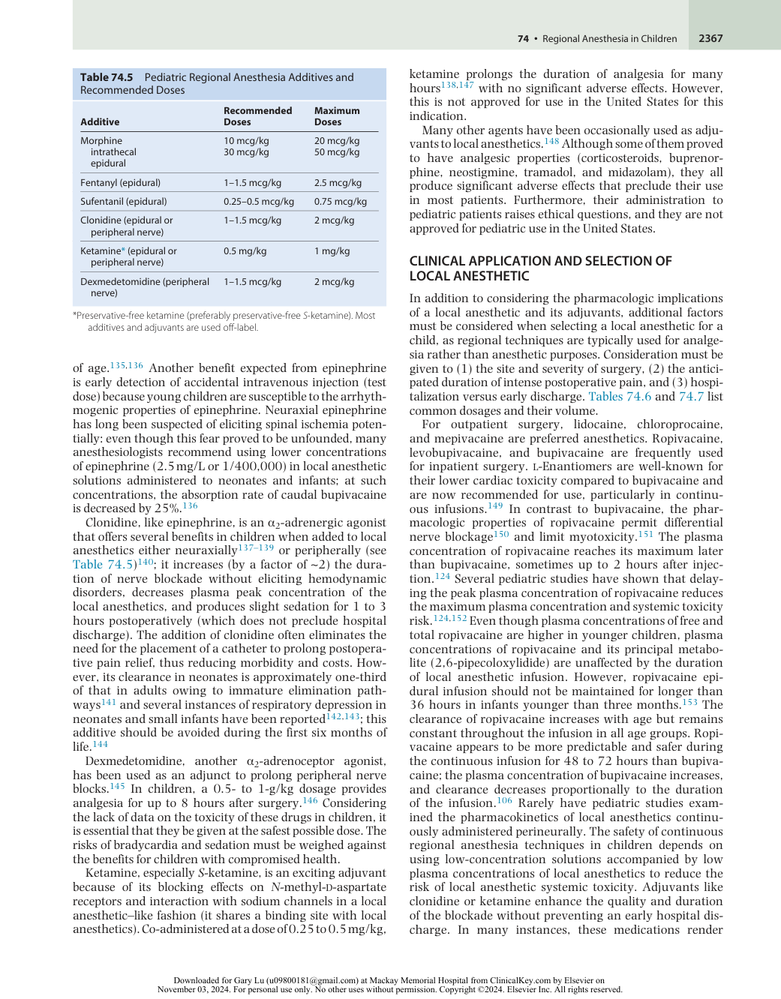

:::

<!-- PDF page 15 -->

**Table 74.6** Nerve Blocks: Recommended and Maximum Local Anesthetic Doses (Excluding Bier Blocks and Spinal Anesthesia)

|**Local Anesthetics**|**Usual Concentration (%)**|**Maximum Dose of Plain** **Solution (mg/kg)**|**Maximum Dose With** **Epinephrine (mg/kg)**|
|---|---|---|---|
|**AMINOESTERS**||||
|Procaine|1–2|7|10|
|Chloroprocaine|2–3|7|10|
|**AMINOAMIDES**||||
|Lidocaine|0.25–2|5 (or 400 mg)|10 (or 700 mg)|
|Mepivacaine|0.25–2|5–7 (or 400 mg)|Not available|
|Bupivacaine|0.125–0.5|2 (or 150 mg)|3 (or 200 mg)|
|Levobupivacaine|0.125–0.5|3 (or 200 mg)|4 (or 250 mg)|
|Ropivacaine|0.1–10|3 (or 300 mg)|Not available (and not recommended)|

**Table 74.7** Usual Volume of Local Anesthetic Bolus and Infusion Rate

||**Bolus Doses (mL/kg)**|**Infusion Rates or Intermittent Bolus**|
|---|---|---|
|**PLEXUS BLOCK***|||
|(e.g., brachial plexus above and below the clavicle)|0.3–0.5|0.1–0.2 mL/kg/h|
|Any distal peripheral nerve|0.05–0.2|—|
|**INTERFASICAL PLANE****|0.5 mL/kg|Preferably, an intermittent regimen 0.5 mL/kg/h for a single catheter If bilateral, 0.5 mL/kg/every 2 hours with a stagger of 1 hour between left and right catheters (_see last paragraph of Clinical_ _Application and Selection of Local Anesthetic_).|

*Doses of ropivacaine 0.1% (neonate) to 0.2% or levobupivacaine 0.125% (neonate) to 0.25%.

**Ropivacaine 0.1% or lidocaine 0.25% (neonate) to 0.2% ropivacaine or lidocaine 0.5%.

unnecessary the insertion of a catheter and establishment of a continuous infusion for postoperative pain relief.

Continuous epidural anesthesia was the only option for treating persistent pain for a long time. Recently, peripheral nerve catheter techniques have shown efficacy13 with less morbidity and limitations than continuous epidural blockade, allowing for hospital discharge29 and management at home in selected pediatric patients. Low- concentration (0.1%–0.2%) levobupivacaine or ropivacaine (continuous infusion 2–5 mL/h or on- demand injections 2–5 mL) is the best and safest option for these procedures.

Patient- controlled continuous infusion may reduce local anesthetic doses in children while maintaining analgesia.154,155 Duflo and associates compared standard continuous administration (0.1 mL/kg/h) and patient- controlled regional anesthesia regimen (infusion of 0.02 mL/kg/h and a bolus of 0.1 mL/kg every 30 minutes) of 0.2% ropivacaine in patients undergoing fascia iliaca compartment or sciatic catheters. Patient- controlled administration had lower hourly consumption. This group had lower ropivacaine plasma levels than standard administration (0.31 and 0.86 mg/mL at 24 hours and 0.31 and 0.52 at 48 hours). A recent study compared plasma ropivacaine levels with continuous epidural and psoas compartment blocks in children.156 The continuous psoas compartment block used 0.2 mg/kg/h ropivacaine infusion. This patient group

had ropivacaine plasma concentrations below 0.59 mcg/ mL, lower than the epidural catheter group. According to recent studies, home bupivacaine infusions in adolescents with indwelling catheters were safe.157

Regional techniques involving ultrasound- guided interfascial plane blocks are gaining popularity (see Truncal Blocks, below). In contrast to other peripheral nerve blocks, most experts believe that maximum local anesthetic volume is crucial for interfascial plane block analgesia. However, in patients with underlying cardiac conduction defects or those at risk for postoperative conduction anomalies, local anesthetic toxicity from large volumes of local anesthetic is a significant concern. Providing adequate volumes of local anesthetic through bilateral catheters while avoiding the risk of the local anesthetic’s systemic toxicity can be particularly difficult in neonates, underweight, or organ- dysfunctional patients (LAST). An **a** lternating- **s** ide **p** rogrammed **i** ntermittent **re** peated (ASPIRe) bolus regimen was described to address this issue.158

ASPIRe bolus regimen (see Table 74.7) is a simple but practical dosing approach that permits clinicians to use larger volumes of a local anesthetic to achieve analgesic efficacy while minimizing LAST risk in patients with bilateral interfascial plane catheters. Instead of bolusing every hour, a desired bolus volume of local anesthetic delivers every 120 minutes but staggered by 60 minutes into each

::: details 原始表格與符號（PDF 第 15 頁）

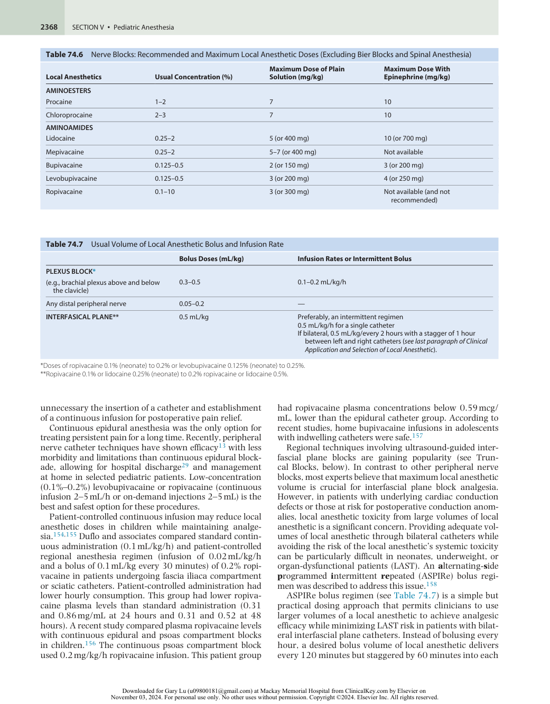

:::

<!-- PDF page 16 -->

interfascial catheter. Patients receiving this ASPIRe bolus regimen receive the equivalent of an hourly bolus.

## General Technique and Equipment Consideration

### LANDMARK APPROACHES

The success of a regional anesthesia technique depends on the administration of a solution of a local anesthetic close to the nerve or space limited by anatomic structures. Few nerve blocks can be performed using a manual approach without a nerve stimulator or ultrasound. These techniques are feasible in children anesthetized or sedated.

Some important considerations for performing regional anesthesia without any additional equipment include the following:

- Possessing sound knowledge of the anatomy of the child according to age and good location of landmarks for the puncture site

- Defining the anatomic space at which the local anesthetic spreads to block the selected nerves

- Ensuring no risks exist for damage to other surrounding structures (e.g., vessels, nerves, organs)

Central blocks (caudal, epidural, or spinal block) are among the blocks that primarily can be achieved without assistance from technical devices, even though ultrasoundguided puncture techniques are currently proposed. The LOR technique facilitates the realization of the epidural block. For the spinal block, passing into the subarachnoid space is marked by the crossing of the dura mater (tough, fibrous structure): a slight LOR is felt, and then the flow of CSF. For the caudal block, the passage of the sacrococcygeal membrane is felt by an increase and LOR in the needle. Most limb peripheral nerve blocks are performed using a nerve stimulator or with ultrasound guidance. Blocks of the trunk, performed with anatomic landmark techniques for a long time, benefit significantly from ultrasound guidance for their localization. Even if it is done using anatomic landmarks, the pudendal block can also benefit from using the nerve stimulator to be closer to the nerve159 or ultrasound guidance.160 The superficial trigeminal nerve blocks on the face, described by anatomic landmarks for a long time, can now benefit from ultrasound guidance for the puncture.161 Finally, older techniques, such as the paresthesia technique, transarterial techniques for the axillary block, and “swoosh” (test of good hand position by auscultation with a stethoscope of the caudal vertebrae low back during the injection of liquid into the needle) test for caudal block, should no longer be used.

### PHYSIOLOGIC APPROACHES: ELECTRICAL STIMULATION

Ultrasound guidance represents a revolution in regional anesthesia in children and adults. With its increasing use, electrical stimulation has become as an adjunct rather than a primary tool for nerve localization in adults and children. However, it is still essential to understand the principle of nerve stimulation and decrease the potential risk of nerve

injury.162 Also, nerve stimulation can be used for ultrasound guidance training. Concomitant use of nerve stimulation can increase the trainee’s confidence while lessening the attending instructor’s anxiety. Other common sources of error during novice practice and beyond include failure to distinguish between adjacent isoechoic structures.163

Nerve stimulation (NS) causes nerve depolarization by employing a positive (red) pole as the ground electrode and a negative (black) lead as the needle connection (known as cathodal preference). However, in constant- current nerve stimulators, the ground electrode position is unimportant.164 After obtaining a low threshold response, 2 to 3 mL of local anesthetic is administered, and the clinician observes the disappearance of the motor twitch. This phenomenon was initially referred to as the “Raj test,”165 where the current threshold increases as the needle- tonerve distance increases due to displacement by the injected fluid. Recently, Tsui _et al._166,167 demonstrated that the disappearance of the evoked motor response was due to a shift in the electrical current density at the needle–tissue contact by the injected fluid.

Electrically conducting fluids (e.g., local anesthetic, saline, and body fluid) decrease the current density at the needle tip, thereby increasing the current threshold for a motor response, whereas non- conductive solutions (e.g., dextrose 5% in water; D5W) increase the current density and maintain or improve the twitch response. Consequently, using D5W solution166,167 for hydrodissection under ultrasound guidance may be preferable if concurrent nerve stimulation is intended.

In addition to disrupting the current density, the presence of a conductive solution around the needle tip also interrupts the electrical impedance of the environment. While there is a distinct difference in electrical impedance between extraneural and intraneural compartments,168 the influence of any conductive solution around the needle tip impedes the ability to detect a change in impedance when the needle punctures a nerve. As there is no defined absolute impedance value for intraneural needle placement, the impedance measurement is unreliable for detecting intraneural needle placement in clinical settings.169

For plexus and truncal nerve blocks, the positive electrode of the nerve stimulator is placed distant from the nerve location. The nerve stimulator delivers square- wave electric impulses lasting 50 to 100 microseconds at 1 to 2 Hz. With a starting output of 2 to 2.5 mA, needles are advanced until they elicit the required muscle movement. The position is judged adequate when muscle contractions continue to occur at a current of 0.5 to 0.8 mA, when the needle tip is approximately 1 mm from the nerve or within the perineural fascial sheath. In contrast to adults, in whom a current of 0.5 mA or less is considered an acceptable indicator for a successful nerve block,170 in children, if muscle contractions are still present at a current under 0.5 mA, the needle should be withdrawn to avoid intraneural injection and nerve damage.171 Gurnaney and colleagues172 evaluated the relationship between the lowest current amperage used to obtain a motor response, the success rate, and the incidence of neurologic complications with peripheral nerve blocks in pediatric patients under general anesthesia. The authors observed a similar peripheral nerve block success rate with both a low (&lt;0.5 mA) and a high stimulation

<!-- PDF page 17 -->

threshold (0.5–1.0 mA). They concluded that it might not be necessary to perform needle manipulation close to the nerve to achieve a low stimulation threshold (&lt;0.5 mA) because it may increase the risk for intraneural injection. Most importantly, in performing peripheral nerve blocks in anesthetized children, the needle should not be intrafascicular. The disappearance of the motor response by reducing the intensity under 0.5 mA for 0.1 ms confirms that the tip of the needle is not in contact with axons. In adults, Bigeleisen and associates173 revisited the relationship between minimum stimulating current and intraneural needle placement in a clinical investigation comparing intraneural and extraneural stimulation thresholds in the ultrasound- guided supraclavicular block. Intraneural stimulation thresholds more than 0.2 mA and less than 0.5 mA were observed in 54% of patients. In 10% of patients, the stimulating threshold exceeded 0.5 mA when the needle was in an intraneural location. Thus, a response obtained for a current intensity less than 0.2 mA for 0.1 ms may be associated with an intrafascicular needle position and should be avoided.

Peripheral nerves are not as deep in children as in adults and can be located percutaneously. The success rate of peripheral nerve blocks in children can be improved by using the surface nerve mapping technique.174 Nerve mapping helps locate the needle entry point before puncture, thereby reducing the number of attempts and decreasing the potential risk for nerve injury. Electrical stimulation can be utilized to validate epidural catheter insertion for the central neuraxial block in a real- time and objective manner.175,176 Similar to peripheral nerve stimulation, the epidural stimulation test is based on the current versus nerve- distance relationship.

Epidural stimulation test criteria determine appropriate epidural catheter tip placement (generally 1–2 cm from nerve roots) by eliciting motor responses (unilateral or bilateral) with a current threshold between 1 and 15 mA. While there was nothing special about 1 mA (lower limit) or 15 mA (upper limit), this range was chosen since it was easy to memorize. Any motor response measured at 1 mA or slightly above 1 mA may warn of catheter placement near a nerve root or intrathecal space.

Epidural stimulation test is performed by attaching an electrode adapter to the connector of a wire- embedded epidural catheter. Normal saline is injected into the adapter and catheter to improve electrical conductivity. While the anode is grounded to the child’s skin, the cathode is

connected to the adapter’s metal hub (upper limbs for lumbar epidurals and lower limbs for thoracic). The default settings for the nerve stimulator are 2 Hz frequency and 0.1- to 0.2-ms pulse width. Table 74.8 summarizes the interpretations of various motor responses to electrical stimulation.

### IMAGING APPROACHES: ULTRASOUND TECHNIQUES

Ultrasonographic guidance for regional anesthesia in children has seen considerable interest recently. The benefit of this technique is the visualization of targeted nerves or spaces and the spread of injected local anesthetic. Understanding the anatomic relationship between nerves and the bone and blood vessels surrounding them enables the clinician to perform blocks with greater precision and reduced risk of complications177 (Table 74.9).

Most peripheral nerves for regional anesthesia can be visualized in children using ultrasound guidance. However, the nerves are not static structures and can move depending on the position of the child, the pressure of the probe to the skin, and the progression of the needle or injection of local anesthetic. In children, a linear ultrasound probe with a 25- mm active surface area (or probes with 38 mm of active surface area in older children) provides a square image that is not deformed. Probes with frequencies of 8 to 13 MHz offer excellent resolution for superficial structures of the upper limb (e.g., axillary block) and good penetration depth for the lower extremity (e.g., popliteal block). The higher frequencies could provide images that will be sharp for superficial structures. The needles typically used to perform peripheral nerve blocks can be used with ultrasound guidance. _In vitro_ , results have shown that visualization of the needle depends on its diameter and mainly the angle of penetration.178 Use of a facet- tipped needle for peripheral nerve blocks facilitates precise needle placement with minimal pain for the child,179 and seems particularly interesting for blocks performed in children without sedation or general anesthesia. Sterile preparation of the probe and the block site is an important prerequisite for ultrasoundguided blocks. A sterile probe cover should be used for single and continuous block techniques.

The easier ultrasound- guided blocks are axillary, femoral, fascia iliaca compartment, caudal, ilioinguinal, and paraumbilical blocks.180 They permit a safe and easy learning curve for these techniques. The main advantage of ultrasound- guided regional anesthesia is the visualization of

**Table 74.8** Threshold Currents and Motor Responses at Different Locations

|**Needle/ Catheter Location**|**Threshold Current** **(0.1 or 0.2 ms pulse width)**|**Motor Responses**|
|---|---|---|
|**EPIDURAL STIMULATION TEST**|||
|Epidural|1–15 mA|Unilateral or bilateral|
|Subcutaneous|N/A|No motor response|
|Subdural|&lt;1 mA|Bilateral (many segments)|
|Subarachnoid|&lt;1 mA|Unilateral or bilateral|
|Against nerve root|&lt;1 mA|Unilateral|
|**PERIPHERAL NERVE STIMULATION**|||
|1 mm from the nerve|0.5–0.8 mA||
|Next to nerve|0.5 mA||
|Intraneural|&lt;0.5 mA|Corresponding nerve|

::: details 原始表格與符號（PDF 第 17 頁）

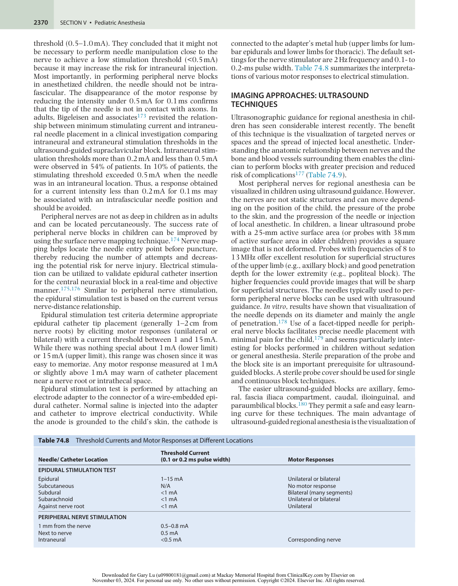

:::

<!-- PDF page 18 -->

**Table 74.9** Sonoanatomy Landmarks for Nerve Localization in Ultrasound- Guided Peripheral Nerve and Interfascial Plane Blocks

|**Conduction Location**|**Anatomic Landmark(s)**|**Approach for Ultrasound Imaging**|
|---|---|---|
|**UPPER LIMB**|||
|**Interscalene**|Subclavian artery and scalene muscles|Locate the plexus trunks/divisions superolateral to the artery in the supraclavicular fossa and trace proximally to where the roots/trunks lie between the scalenus anterior and scalenus medius muscles (Fig. 74.17).|
|**Supraclavicular**|Subclavian artery|Scan from lateral to medial on the superior aspect of the clavicle to locate the pulsatile artery; the plexus trunks/divisions are typically lateral and superior to the artery (Fig. 74.18). Color Doppler is advantageous.|
|**Infraclavicular**|Subclavian/axillary artery and vein|Place the artery in the middle of the field and locate the brachial plexus cords surrounding it (Fig. 74.19).|
|**Axillary**|Axillary artery|The terminal nerves surround the artery (Fig. 74.21).|
|**Distal Peripheral Nerves**|||
|Radial nerve at the anterior elbow|Humerus at the spiral groove and deep brachial artery|Trace the nerve proximally and posteriorly toward the spiral groove of the humerus, just inferior to the deltoid muscle insertion, to confirm the nerve’s identity at the elbow. Here, adjacent to the deep brachial artery, the nerve can be traced back to the anterior elbow (Fig. 74.22).|
|Median nerve at forearm|Brachial artery|The large anechoic artery lies immediately lateral to the nerve (Fig. 74.23).|
|Ulnar nerve at forearm|Ulnar artery|Scan the anteromedial surface of the forearm approximately at the junction of its distal third and proximal two- thirds, to capture the ulnar nerve as it approaches the ulnar artery on its medial aspect (Fig. 74.24).|
|**LOWER LIMB**|||
|Lumbar plexus|Transverse processes|The plexus is situated between and just beneath the lateral (tips) of the processes (Fig. 74.37).|
|Femoral|Femoral artery|The nerve lies lateral to the artery (vein most medial) (Fig. 74.46). Insert the needle above the branching of the deep femoral artery.|
|**Sciatic**|||
|Classical/Labat|Ischial bone and inferior gluteal or pudendal vessels|The nerve lies laterally to the ischial bone’s thinnest aspect. The inferior gluteal artery generally lies medial to and at the same depth as the nerve (Fig. 74.53).|
|Subgluteal|Greater trochanter and ischial tuberosity|The nerve lies between the two bone structures (Fig. 74.54).|
|Popliteal|Popliteal artery|Trace the tibial and common peroneal nerves from the popliteal crease to where they form the sciatic nerve. At the crease, the tibial nerve lies adjacent to the popliteal artery. Scanning proximally to the sciatic bifurcation, the artery becomes deeper and at a greater distance from the nerve (Fig. 74.55).|
|**INTERFASCIAL PLANE**|||
|**Erector spinae plane (ESP)**|Transverse process|On the average adult, a linear probe (13–6 MHz) is used; however, a curvilinear transducer (8–3 MHz) may be required for a larger individual. The probe is positioned sagittally over the paraspinal skin at the thoracic or lumbar level. Slide the probe laterally until the transverse processes (rectangular shadow) can be observed without pleural tissue in between (Fig. 74.30).|
|**Interpectoral and** **pectoserratus**|T3 and T4 anterior ribs; pectoralis and serratus muscles|After identifying the subclavian arteries in this view, locate the second rib. Slide the probe inferiorly to the third and fourth ribs. The pectoralis major muscle is situated above the pectoralis minor muscle. A very thin band of serratus anterior muscle overlying the ribs, with the pectoralis minor muscle sitting on top and tapering caudally. The thoracoacromial artery branches between the interpectoral planes.|

::: details 原始表格與符號（PDF 第 18 頁）

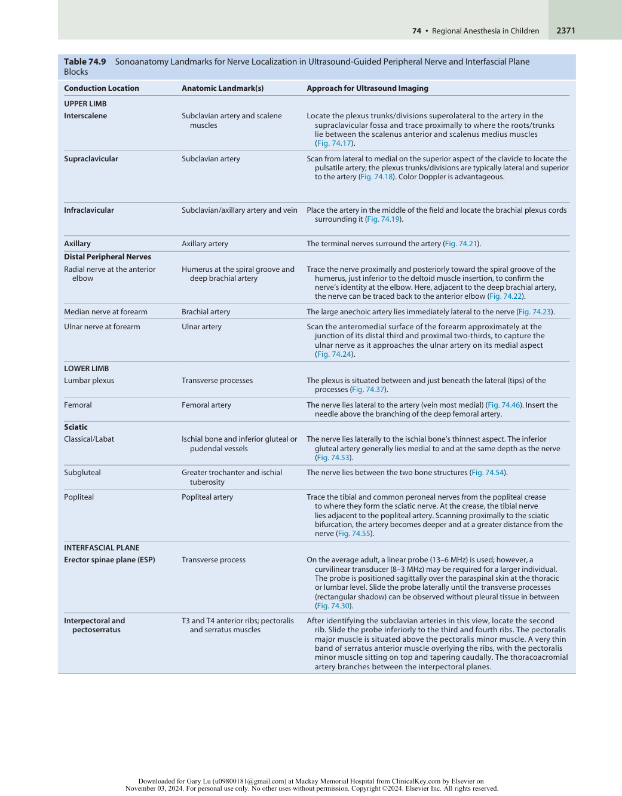

:::

<!-- PDF page 19 -->

**Table 74.9** Sonoanatomy Landmarks for Nerve Localization in Ultrasound- Guided Peripheral Nerve and Interfascial Plane Blocks – cont’d

|**Conduction Location**|**Anatomic Landmark(s)**|**Approach for Ultrasound Imaging**|
|---|---|---|
|**Serratus anterior plane**|T4 and T4 ribs|Slide the probe caudally and laterally to find the fourth and fifth midaxillary ribs. In this area, latissimus dorsi is superficial to serratus anterior (Fig. 74.33). Pleura are between rib shadows. The thoracodorsal artery may be seen above the serratus anterior.|
|**Transversus abdominis plane** **(TAP) block**|The three layers of the abdominal muscles|Identify the rectus muscles in the midline, then move the probe laterally toward the anterior axillary line above the iliac crest to reveal the external oblique, internal oblique, and transversus abdominis (Fig. 74.36). The hyperechoic line beneath the transversus abdominis is the peritoneum. Below this is the peritoneal cavity with visible bowel peristalsis.|
|**Quadratus lumborum (QL)**|TAP muscles; shamrock|The curvilinear probe is positioned in a transverse plane on the midaxillary line between the costal margin and the iliac crest. Slide the probe posteriorly above the iliac crest to identify the transversus abdominis tapers and quadratus lumborum beneath it. At the level of the transverse process to detect the quadratus lumborum block structures (Fig. 74.37) yields an ultrasonic pattern resembling three shamrock leaves (i.e., the stem – transverse process, and the three leaves – psoas, quadratus lumborum, and erector spinae).|

different anatomic structures and the approximate localization of the tip of the needle. The other benefits of ultrasoundguided peripheral nerve blocks in children are faster onset time of sensory and motor block, longer duration of sensory blockade,179 increase of blockade quality,179,181 and reduction of local anesthetic injections.181,182 Ultrasonographic guidance for central block allows visualization of different structures, spine, and spinal contents. Spinous process, ligament flavum, dura mater, conus medullaris, and CSF are identifiable and give some information on spine, epidural space, and the depth between epidural space and skin.183 Finally, in a caudal block, ultrasound imaging permits evaluation of the anatomy of the caudal epidural space, especially the relation of the sacral hiatus to the dural sac and the search for occult spinal dysraphism.184 Recently, ultrasound imaging showed its superiority over the swoosh test when performing a caudal block.71 Anterior displacement of the posterior dura mater during saline or local anesthetic injection is a predictor of block success. This ultrasoundguided puncture improves the efficacy and safety of the central blocks by reducing the number of punctures. Unfortunately, the image quality is rapidly altered with the ossification of the structures occurring in older children.185

A recent Cochrane review suggested that ultrasound guidance provided greater accuracy, reduced doses in younger children, fewer needle insertions, and better user appreciation of the anatomy.4 A comparative feasibility evaluation with ultrasound guidance for most regional techniques is provided in Table 74.1.

### SELECTION OF NEEDLE

Single- injection peripheral nerve block procedures typically utilize short bevel, echogenic, insulated, 22- to 24- gauge needles. The “short bevel” (i.e., 30–45 degrees) or “B bevel” is used because it is suggested to reduce the risk of nerve injury.186 While special coatings, grooves, or “Cornerstone” reflectors enhance echogenicity and visibility during ultrasound- guided blocks, the insulated coating permits

the use of nerve stimulation, especially for deep blocks. A summary of recommended needles for most regional block procedures in pediatric patients is provided in Table 74.10.

In addition to needle tip design, animal studies have shown that direct nerve injections with pressures greater than 15 psi (775 mm Hg) damage nerves, especially in the intrafascicular region.187,188 Because of this, it is crucial to avoid a high- pressure injection.169 Since there is a wide range in how much pressure different anesthesiologists use during injections,189 various methods and tools have been proposed to standardize the pressure used. Various commercially disposable in- line injection pressure monitors are available but have not been extensively studied for their efficacy in preventing permanent damage. Since the “syringe- feel” method of gauging pressure during peripheral nerve block is notoriously unreliable, a compressed air injection technique (CAIT)190 has been described to limit high- pressure injection. At the start of the injection, the air is drawn into the syringe and compressed by 50% to illustrate pressures of around 760 mm Hg (Boyle’s law: pressure × volume = constant) (Fig. 74.2), which is close to the 775- mm Hg threshold associated with clinically significant nerve injury. Due to the need for extreme care to avoid injecting air into the patient, this is not commonly used in clinical practice. Still, it can be used as a teaching tool to demonstrate what an injection pressure of 15 psi feels like in a non- clinical setting.

For central neuraxial block, epidural block (sacral, lumbar, or thoracic) uses Tuohy needles ranging in size from 17 to 21 gauge and length from 50 to 90 cm. Shorter needles (25 cm) would be preferable for neonates and infants. In the past, many needle types have been used for caudal anesthesia. However, this is no longer acceptable, and only short beveled needles (Crawford needles) with a guide sealing their lumen or intravenous cannulas with an introducer needle should be used. Real- time ultrasound- guided epidural catheter placement in neonates and infants has been introduced but has yet to be widely practiced.191

Spinal anesthesia in premature infants can be done with a neonatal lumbar puncture needle (22 gauge) or a thinner

::: details 原始表格與符號（PDF 第 19 頁）

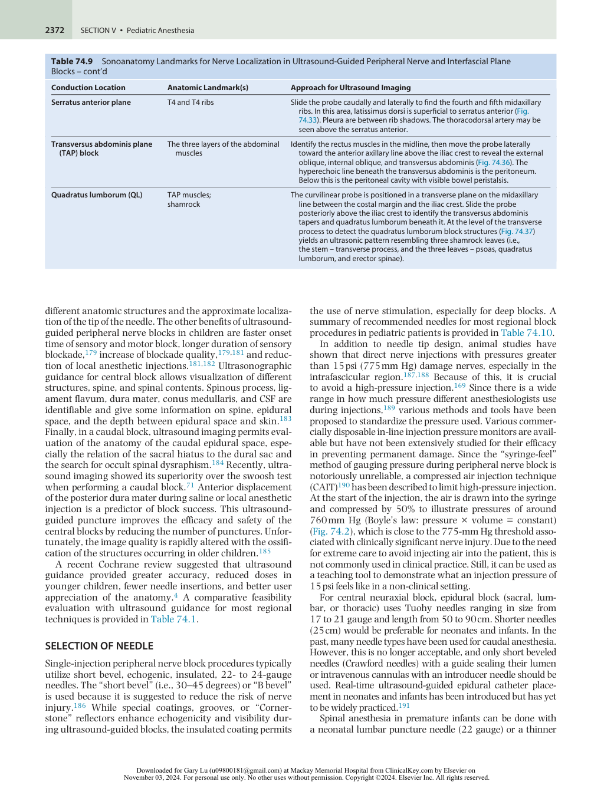

:::

<!-- PDF page 20 -->

**Table 74.10** Recommended Needles for Common Pediatric Regional Block Procedures

|**Block Procedure**|**Recommended Device**|**Alternate Device**|
|---|---|---|
|Intradermal wheals and metacarpal blocks|Intradermal needles (25 gauge)|None|
|Subcutaneous infiltrations and field blocks|Standard intramuscular needles (21–23 gauge)|Intradermal needles (25 gauge)|
|Compartment blocks (thoracic paravertebral, rectus sheath, ilioinguinal–iliohypogastric, pudendal, penile)|Short (25–50 mm) and short beveled (45–55 degrees) needles|Epidural needles (intercostal block) Neonatal spinal needle|
|Peripheral mixed nerve blocks and plexus blocks|Insulated 21–23 gauge short beveled needles of appropriate length connected to a nerve stimulator (0.5–1 mA) Specific catheter (for continuous techniques)|Sheathed pencil- point needles Unsheathed needles only when ultrasound guidance is used Epidural catheter (for continuous techniques)|
|Spinal anesthesia|Spinal needle (24–25 gauge; 30, 50, or 100 mm long, Quincke bevel, stylet)|Neonatal lumbar puncture needle (22 gauge, 30–50 mm long) Whitacre spinal needle|
|Caudal anesthesia|Short (25–30 mm) and short beveled (45 degrees) needle with stylet|Intravenous cannula (22 gauge), but 18 gauge especially for epidural catheter insertion Pediatric epidural (occasionally spinal) needle|
|Epidural anesthesia|Tuohy needle (22, 20, and 19/18 gauge); LOR syringe with saline and air|Crawford, Whitacre, or Sprotte epidural needles are rarely used|

_LOR,_ loss of resistance.

"Syringe feel" Method Compressed Air Injection Technique (CAIT) 

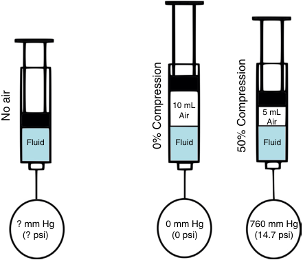

10 mL Air 5 mL Air Fluid Fluid Fluid ? mm Hg 0 mm Hg 760 mm Hg (? psi) (0 psi) (14.7 psi) No air 0% Compression 50% Compression 

**Fig. 74.2 Compressed air injection technique (CAIT).** Fifty percent compression of air volume in the syringe corresponds to an injection pressure of 760 mm Hg (14.69 psi).

spinal needle (shorter than 50 mm). Because young children’s postdural puncture headache rates are low, the needle’s distal end may not matter as much as in adults.192,193 To avoid extradural leakage, the distance between the needle tip and its distal orifice must be as short as possible. Pencil- point needles do not improve results in infants and young children and may even decrease success by favoring subdural local anesthetic spread.

## Specific Regional Techniques

This section of the chapter offers the readers common techniques on pediatric regional blocks together with currently accessible literature to substantiate the available evidence for using these strategies. For all the relevant nerve blocks, from the peripheral (head to toe) to the central neuraxial (caudal

and epidural) block, relevant schematic illustrations and ultrasound images of the blocks with corresponding line diagrams to demonstrate the placement of the ultrasound probe and its corresponding sonoanatomy have been provided. Since the practice of medicine relies on ever- changing knowledge, as does regional anesthesia, readers are recommended to get continual training through up- to- date literature and live workshops, as well as under the supervision of an expert, to become competent with pediatric regional anesthesia.

### FACE, HEAD, AND NECK NERVE BLOCKS

Head and neck procedures involving neurosurgery, otorhinolaryngology, and plastic surgery are performed on children. Even though opioids are used for pain management, they are associated with adverse side effects such as postoperative nausea and vomiting, respiratory depression, somnolence, and itching. Utilizing peripheral nerve blocks reduces the need for opioids while providing analgesia. This section provides a brief anatomic and technical summary of various commonly used head and neck nerve blocks in children.194

### Nerve Block of the Face

All sensory innervation of the face is the trigeminal nerve (fifth cranial nerve, or vagus nerve) associated with the C2 to C4 cervical nerve roots that constitute the superficial cervical plexus. The fifth cranial nerve provides sensory and motor components. The sensory component is combined in the trigeminal ganglion (semilunar or Gasserian ganglion), which lies in the Meckel cave, an invagination of the dura mater near the apex of the petrous part of the temporal bone in the posterior cranial fossa. Postganglionic fibers exit the ganglion to form three nerves, as follows:

1.  The supratrochlear (V1), innervating the forehead, eyebrows, upper eyelids, and anterior area of the nose

2.  The maxillary nerve (V2), innervating the lower eyelid, upper lip, lateral portion of the nose and nasal septum,

::: details 原始表格與符號（PDF 第 20 頁）

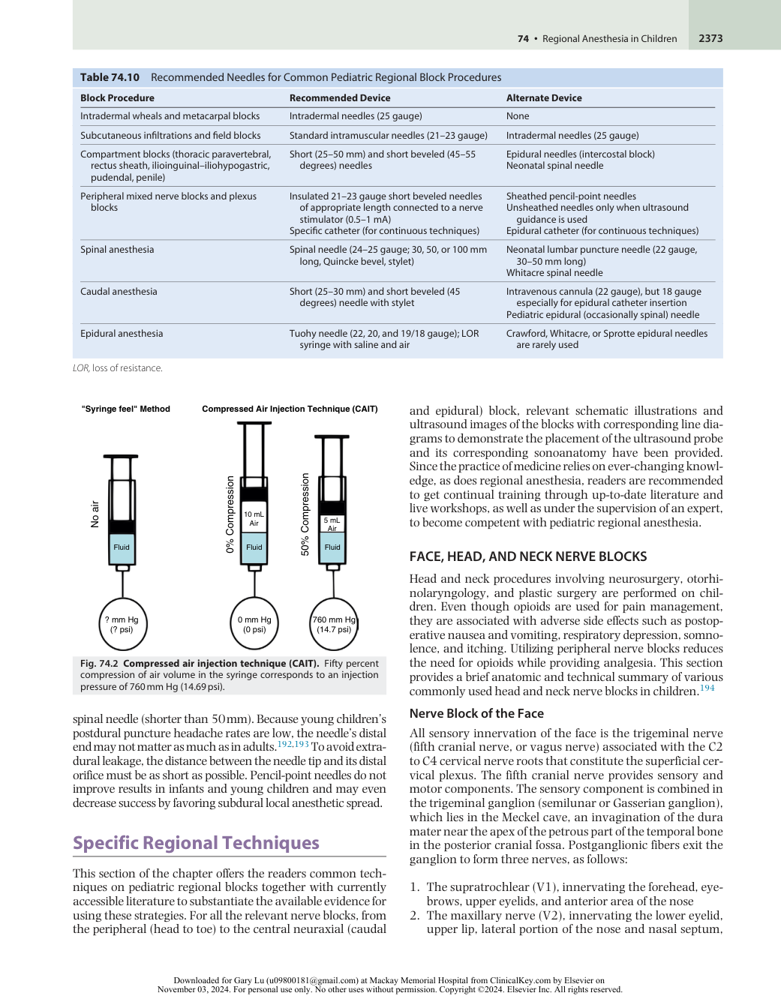

:::

<!-- PDF page 21 -->

- cheek, roof of the mouth, bone, teeth, sinus of the maxilla, and soft and hard palates

3.  The mandibular nerve (V3), innervating the anterior two- thirds of the tongue and the skin, mucosa, teeth, and mandibular bone.

These terminal sensory nerves can be blocked either at their emergence point from the cranium, as deep procedures (V2 and V3), or more distally when they exit the facial bone as superficial blocks (V1, V2, V3) (Fig. 74.3).

### Superficial Trigeminal Nerve Blocks

For superficial trigeminal nerve blocks (Fig. 74.4), the local anesthetic solution should be injected near the three individual terminal superficial branches of the trigeminal nerve divisions: the frontal nerve (of the ophthalmic nerve, V1 division), infraorbital nerve (of the maxillary nerve, V2 division), and mental nerve (sensory terminal branch of the mandibular nerve, V3 division). Each nerve is anatomically close to its respective foramen, which is usually on a line perpendicular to the center of the pupil.

**Supratrochlear Nerve.** The supraorbital foramen can be easily palpated by following the orbit rim 2 cm from the midline in adults (union of the medial third and lateral two- thirds). The needle (intradermal needle, 25 gauge in adults to 30 gauge in children) is introduced 0.5 cm under

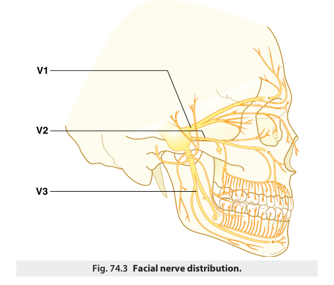

V1 V2 V3 Fig. 74.3 Facial nerve distribution. 

the inferior edge of the eyebrow and is directed medially and cephalad. When the needle tip is near the supraorbital notch, after test aspiration and with caution to not penetrate the foramen, local anesthetic solution (0.5–1 mL) can be injected, creating a subcutaneous wheal. For the supratrochlear block, the landmarks are the top of the angle formed by the eyebrow and the nasal spine, where the nerve is in contact with the bone. The supratrochlear nerve can be blocked without removal by directing the needle approximately 1 cm toward the midline and injecting an additional 0.5 mL of local anesthetic.

**Infraorbital Branch.** The terminal branch of the maxillary nerve (second division of the trigeminal nerve) is called the infraorbital nerve when it reaches the infraorbital fossa. The infraorbital artery and vein run parallel close to the nerve. Its innervation involves the skin and mucous membrane of the upper lip, lower eyelid, and cheek. Two approaches can be used to perform this block: the intraoral and extraoral. Regardless of the technique, it is necessary to prevent penetration of the foramen and eventual eyeball damage by palpating the foramen.

**Intraoral Approach.** For the intraoral approach, the external landmarks include the foramen localized by palpation, the incisor, and the first premolar. The needle (25 or 27 gauge) is inserted at the buccal mucosa in the subsulcal groove at the level of the canine or the first premolar and directed upward and outward into the canine fossa. A finger is placed over the infraorbital foramen to assess the needle tip’s proper location and avoid eye damage.195

**Extraoral Approach.** For the extraoral approach, the infraorbital foramen is palpated just below the orbital rim at the intersection of a vertical line drawn caudally through the center of the pupil and a horizontal line through the alae nasi. The needle (25 or 27 gauge) is advanced perpendicularly with a cephalic and medial direction toward the foramen until bony resistance is met. The main surgical indication in children is cleft lip repair with good perioperative pain management and decreased opioid use.195–198

The mental nerve is the terminal branch of the alveolar nerve (the largest branch of the mandibular nerve). It emerges at the mental foramen. The mental foramen is in line with the pupil on the mental process of the mandible regarding the inferior premolar tooth. Puncture is 1 cm lateral to the foramen palpated. To avoid foramen penetration, the 25- or 27- gauge needle is directed in a lateral- to- medial direction.

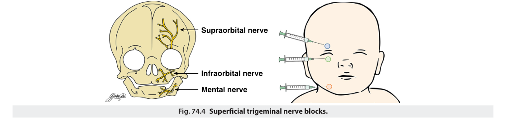

Supraorbital nerve Infraorbital nerve Mental nerve Fig. 74.4 Superficial trigeminal nerve blocks. 

<!-- PDF page 22 -->

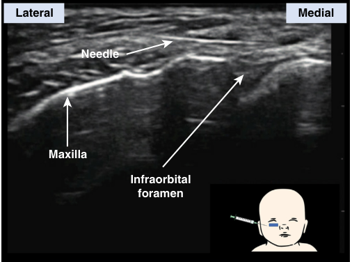

Lateral Medial Needle Maxilla Infraorbital foramen 

**Fig. 74.5 Ultrasound of infraorbital nerve block and probe position on the face.** Disruption of the bone table indicates foramen of the trigeminal nerve.

After negative aspiration, 1 to 3 mL of local anesthetic is injected for these different approaches. Complications are hematoma, persistent paresthesia of the innervated territory, prolonged numbness, and intravascular injection.

Ultrasound guidance can locate the foramina for superficial trigeminal nerve blocks.161 It appears as an easy and safe modality. The ultrasound imaging of foramina is the classic disruption of the bone table (Fig. 74.5).

### Suprazygomatic Approach to Maxillary Nerve

Except for the middle meningeal nerve, innervating the dura mater, all branches (zygomatic branches, superior alveolar nerve, pterygopalatine and parasympathetic branches, palatine and pharyngeal branches) arise in the pterygopalatine fossa to the face. The maxillary nerve exits the skull through the foramen rotundum and gives its terminal branches. At the upper part of the pterygopalatine fossa, the maxillary nerve is accessible for a complete maxillary block. The block covers the lower eyelid, ala of the nose, cheek, upper lip, cutaneous zygomatic and temporal zone on the face and superior teeth, palatine zone, and maxillary bone.

Using the landmark approach, the suprazygomatic approach to the maxillary nerve in the pterygopalatine fossa is the safest and is readily reproducible in children.199 The patient is supine, with the head in a neutral position or turned slightly to the opposite side. The needle entry point is situated at the angle formed by the superior edge of the zygomatic arch below, and the posterior orbital rim forward (Fig. 74.6). The needle (22–25 gauge) is inserted perpendicular to the skin and advanced to reach the greater wing of the sphenoid at a depth of approximately 10 to 15 mm. The needle is reoriented in a caudal and posterior direction and advanced 35 to 45 mm deep to the pterygopalatine fossa. After a negative aspiration test for blood, 0.15 mL/kg to a maximum of 5 mL of local anesthetic solution is slowly injected. More precisely, the suprazygomatic maxillary nerve (SZMN) block is an injection that begins in the suprazygomatic space, travels through the infratemporal fossa, and then aims for the pterygopalatine fossa, a narrower,

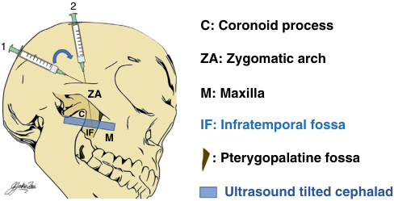

2 C: Coronoid process 1 ZA: Zygomatic arch ZA M: Maxilla C IF M IF: Infratemporal fossa : Pterygopalatine fossa Ultrasound tilted cephalad 

**Fig. 74.6 Suprazygomatic maxillary nerve block landmarks.** Surface anatomy and needle direction for maxillary nerve block. (1) The needle is inserted perpendicularly at the superior edge of the zygomatic arch below, and the posterior orbital rim forward, into the infratemporal fossa and to contact sphenoid. (2) The needle is redirected 9 degrees inferior and then 20 degrees anterior. Typically the needle/syringe can hold its own position once the needle has entered the pterygopalatine fossa.

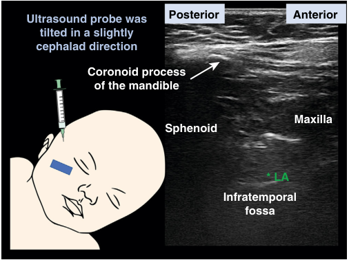

Posterior Anterior Ultrasound probe was tilted in a slightly cephalad direction Coronoid process of the mandible Maxilla Sphenoid * LA Infratemporal fossa 

**Fig. 74.7 Ultrasound guidance of suprazygomatic maxillary nerve block.** A high- frequency probe pointed cephalad at a 45- degree angle at the anterior aspect of the infrazygomatic area was used to observe the injection of local anesthetic out- of- plane.

deeper space. Since the maxillary nerve is not visualized when using ultrasound confirmation or guidance, this block is primarily a local anesthetic injection into a fossa (i.e., suprazygomatic infratemporal–pterygopalatine fossa) rather than a precise perineural block.200

Clinically, this block is a well- established, safe, and effective regional pain management approach after cleft palate surgery.201–203 Recently, clinicians expanded these bilateral SZMN blocks, or more precisely suprazygomatic infratemporal–pterygopalatine fossa injections, to provide opioid- sparing perioperative analgesia in pediatric adenotonsillectomy patients.200–204 Using the real- time ultrasound guidance,205 the needle and the injection of local anesthetic were observed out- ofplane utilizing a high- frequency probe pointed cephalad at a 45- degree angle at the anterior aspect of the infrazygomatic area (Fig. 74.7). Following a local anesthetic injection, ultrasound imaging demonstrates the lifting of the soft tissues in the infratemporal and pterygopalatine fossas deep to the lateral pterygoid muscle between the

<!-- PDF page 23 -->

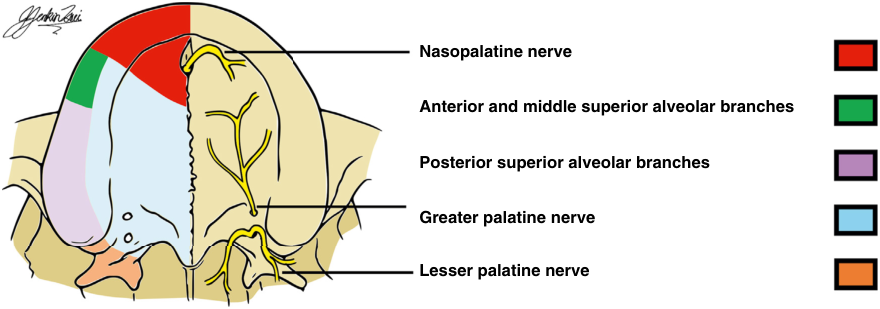

Nasopalatine nerve Anterior and middle superior alveolar branches Posterior superior alveolar branches Greater palatine nerve Lesser palatine nerve 

**Fig. 74.8 Suprazygomatic maxillary nerve block and its nerve innervation to the palate and adenoid.**

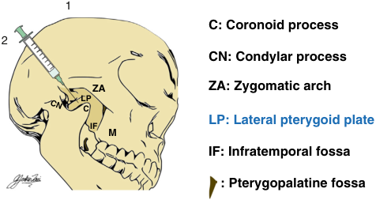

1 C: Coronoid process 2 CN: Condylar process ZA ZA: Zygomatic arch LP C IF LP: Lateral pterygoid plate M IF: Infratemporal fossa : Pterygopalatine fossa CN 

**Fig. 74.9 Landmarks for mandibular nerve block.** Needles are inserted between the mandibular ramus’ coronoid and condylar processes. The 22- to 25- gauge needle is advanced posteriorly and inferiorly while maintaining the same depth after penetrating the skin perpendicularly in the direction of the lateral pterygoid plate (2–4 cm).

maxilla (medial) and the coronoid process of the jaw (lateral). For pain management of an adenotonsillectomy, it is worth noting that it is not the goal of this injection to completely block all the nerves innervating the area around the palatine tonsils and adenoids; rather, it is intended to anesthetize the palatine branch of the maxillary nerve while preserving the glossopharyngeal nerve so that the patient’s protective airway reflexes can be maintained following surgery (Fig. 74.8).

### Mandibular Nerve Block

The mandibular nerve, the largest branch of the trigeminal nerve, exits from the cranium through the foramen ovale of the greater wing of the sphenoid. The anterior trunk has branches serving mainly motor innervation to the temporalis, masseter, pterygoids, mylohyoid, tensor tympani and palati muscles, and the buccal nerve. Auriculotemporal, lingual, and inferior alveolar nerves comprise the posterior trunk.

The zygomatic arch bounds the puncture area at the top and the mandibular notch anterior to and below the tragus of the ear (Fig. 74.9). The needle entry point is in the sigmoid fossa between the coronoid and condylar process of the ramus of the mandible. To avoid the risk of arterial puncture, it is recommended to prick as high as possible in the space between the zygomatic arch and the center of the mandibular notch. After perpendicular skin penetration

toward the lateral pterygoid plate (to 2–4 cm of depth), the needle (22–25 gauge) is advanced posteriorly and inferiorly, maintaining the same depth, guided by mandible ascension twitch. The minimal stimulation intensity (∼0.5 mA) is determined, and 0.1 mL/kg to a maximum of 5 mL of local anesthetic solution is slowly injected after negative repeated blood test aspirations. This transcutaneous procedure with nerve stimulation appears more straightforward and has a high success rate.

### Nasociliary Nerve Block and External Nasal Nerve Block

The innervation of the nose and nasal cavity is highly complicated, involving both the trigeminal nerve’s ophthalmic (V1) and maxillary (V2) branches. Because of this, totally blocking the nose can be challenging because of the complexity of the innervation.

The nasociliary nerve is blocked before its division into nasal branches of the anterior ethmoidal nerve and the infratrochlear nerve near the ethmoidal foramen. A 25- or 27- gauge needle is inserted 1 cm above the medial canthus, halfway between the posterior palpebral fold and the eyebrow. It is then directed medially and backward in contact with the bony roof of the orbit. At a depth of 1.5 cm, the needle should be at the anterior ethmoidal foramen. A maximum of 2 mL of local anesthetic solution is slowly injected after a negative aspiration test.

The external nasal branch of the anterior ethmoidal nerve can be blocked by infiltration at the junction of the nasal bone with cartilage. Combined with the infraorbital nerve block, the external nasal nerve block is very effective for perioperative pain control in cleft lip repair.206

### Nerve Blocks of the External Ear

The innervation of the pinna of the ear is also complex. Both the trigeminal nerve and the cervical plexus mainly provide innervation.

The auriculotemporal branch of the mandibular division of the trigeminal nerve supplies the superior two- thirds of the anterior surface. The auriculotemporal nerve passes through the parotid gland to ascend anterior to the auditory canal with the superficial temporal artery and passes superiorly superficial to the zygomatic arch.

The posterior surface of the ear and the lower third of its anterior surface depend on the great auricular nerve

<!-- PDF page 24 -->

and the lesser occipital nerve, two branches of the cervical plexus.

The great auricular nerve arises from the second and third cervical nerve roots, emerges from the posterior border of the sternocleidomastoid muscle, and ascends (dividing into anterior and posterior branches) to the mandibular, parotid gland, and pinna. It supplies the lower back of the auricle, the lobule, and the skin of the angle of the mandible (in complement to the mandibular nerve).

The lesser occipital nerve arises from the ventral primary rami of the second and third cervical roots. It gives the innervation of the upper part of the ear lobe and the lateral occipital zone.

The auricular branch of the vagus nerve (nerve of Arnold) innervates the concha, most of the posterior wall of the external auditory meatus (zona of Ramsay Hunt), and the inferior portion of the tympanic membrane.

Regional field block around the auricle allows anesthesia of each nerve branch involved in external ear sensory innervation (Fig. 74.10) except the Ramsay Hunt area. The auriculotemporal nerve can be blocked by injecting a local anesthetic solution above the posterior portion of the zygoma, anterior to the ear, and behind the superficial temporal artery. Caution is necessary because of the vicinity of the temporal artery. The block of the auricular branch of the vagus nerve is commonly used for pain control after myringotomy, ear tube placement, tympanoplasty, and paper patch for ruptured tympanic membrane.207 To perform this block, the tragus is everted, a 30- gauge needle is inserted into the tragus, or anterior and superior to the tragus (see Fig. 74.10), and after an aspiration test, 0.2 mL of local anesthetic solution is injected.

The great auricular and lesser occipital nerves can be blocked distally over the mastoid process posterior to the ear. For that, the needle is inserted behind the lower lobe of the ear and advanced following the curve of the posterior sulcus. Infiltration with the ring- block technique also provides additional efficient analgesia of the external ear.

The superficial cervical plexus block (see next section) is a widely described proximal approach that anesthetizes two terminal branches, the lesser occipital nerve, and the great auricular nerve. Several painful procedures of the ear

can benefit from this analgesic block, such as incision and drainage of an abscess or hematoma,208 suture of a large laceration of the ear or the skin surrounding the ear,209 postauricular incision as in tympanomastoid surgery and cochlear implants,210 otoplasty,211 and surgical correction of “bat” ears.196

For tympanomastoid surgery, a great auricular nerve block provides good analgesia with a reduction of opioid use and a decrease in postoperative nausea and vomiting.210

### Greater Occipital Nerve Block

The greater occipital nerve arises from the second cervical nerve root that emerges between the atlas and the axis. It ascends between the obliquus capitis inferior and semispinalis capitis before piercing the latter muscle. It then becomes subcutaneous by piercing the trapezius aponeurosis, slightly inferior to the superior nuchal line. At this point, the greater occipital nerve is most often located immediately medial to the occipital artery. The greater occipital nerve provides cutaneous innervation to a significant portion of the posterior scalp from the level of the external occipital protuberance to the vertex.

The landmarks to perform the greater occipital nerve block are located approximately two- thirds of the distance on a line drawn from the center of the mastoid to the external occipital protuberance along the superior nuchal line, where it lies medial to the occipital artery. The pulsation of the occipital artery is easy to palpate. However, palpation in this area may elicit paresthesia or discomfort in the nerve distribution. Usually, a 25- or 27- gauge needle can be used depending on the patient’s size. The needle is directed at a 90- degree angle toward the occiput, and after aspiration, 1 to 3 mL of local anesthetic is injected. When the needle is withdrawn, pressure should be maintained over the injection site to promote nerve impregnation and achieve hemostasis. After the injection, numbness over the top of the head is a sign of a successful greater occipital nerve block.

An ultrasound- guided technique of greater occipital nerve block has been described recently with good visualization of the nerve. The nerve can be easily visualized between the obliquus capitis inferior, and the semispinalis

**Auriculotemporal nerve Lesser occipital nerve Auricular branch of vagus nerve** Tragus **Greater auricular nerve Ear canal**

**Fig. 74.10 Ear innervations and the landmark for blockade of the nerve of Arnold.** The needle (27 gauge) is inserted anterior and superior to the tragus.

<!-- PDF page 25 -->

capitis muscle; the pulsation of the occipital artery can be seen close to the nerve in this position. This technique is preferred for the precision and safety of performing this block.212

### Scalp Blocks

The scalp block is classically described with a potential blockade of seven nerves, including branches from cervical spinal rami and trigeminal division.

The greater occipital, lesser occipital, and great auricular nerves originate from the ventral and dorsal rami of C2 and C3 spinal nerves. The greater occipital nerve travels up to the vertex, and the lesser occipital nerve innervates skin behind the ear.

The ophthalmic division of the trigeminal nerve gives off by the frontal nerve, supraorbital and supratrochlear nerves that innervate the skin from the forehead to the lambdoidal suture.

The zygomaticotemporal nerve is one of the two branches of the zygomatic nerve that arises from the maxillary division of the trigeminal nerve. It innervates a small area of the forehead and temporal area.

The auriculotemporal nerve arises from the mandibular division of the trigeminal nerve. It innervates the posterior portion of the skin of the temple.

Scalp block is used in adults and children for various head and neck procedures, neurosurgery, or chronic pain diagnostic and therapeutic management (many headache disorders of muscular and nervous etiology). Common reasons for providing anesthesia to the scalp are repair of a laceration, foreign body removal, exploration of scalp wounds, and drainage of abscesses or subdural hematomas. In addition, we have used this for performing awake craniotomies.

Most of the time, infiltrative anesthesia is used to perform scalp blocks. All the nerves involved in the scalp’s sensitivity become superficial and accessible to the anesthetic. To block the scalp, a circumferential infiltration of local anesthetic solution (with 1:200,000 epinephrine) above an imaginary line drawn from the occipital protuberance to the eyebrows, passed along the upper border of the ear, is necessary. Approximately 30 mL is required to perform this ring block around the scalp.

The most common complications associated with scalp anesthesia are hematoma formation at the injection site and intravascular injection risk.

### Cervical Plexus Block

Cervical plexus blocks have few but specific indications in pediatric surgery: cervical lymph node biopsy, excision of thyroid nodules,213,214 and vocal cord surgery.215 The superficial branches are blocked by a landmark approach using a subcutaneous infiltration along the lateral border of the sternocleidomastoid muscle. Alternatively, the ultrasound- guided superficial cervical plexus block (Fig. 74.11) provides analgesia to the superficial branches of the greater auricular nerve, transverse cervical nerve, lesser occipital nerve, and supraclavicular nerves that exit the posterior border of the sternocleidomastoid muscle at the level of the thyroid cartilage.216 A needle is inserted in- plane from lateral to medial, deep to the sternocleidomastoid muscle, and superficial to the prevertebral fascia. Hydrodissection can confirm the correct interfascial plane. Following

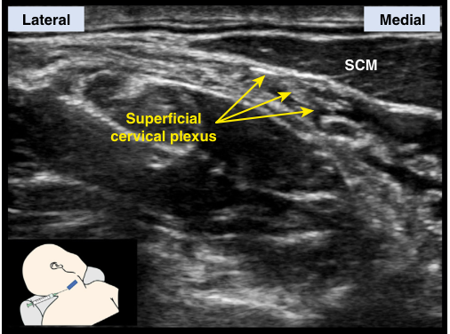

Lateral Medial SCM Superficial cervical plexus 

**Fig. 74.11 Ultrasound- guided superficial cervical plexus block.** _SCM_ , sternocleidomastoid muscle.

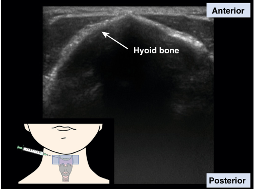

Anterior Hyoid bone Posterior 

**Fig. 74.12** A 27- gauge intradermal needle is inserted close to the hyoid horn ending using ultrasound until contact is made with cartilage. Hyoid horn can be seen as the _first white line_ in adolescents, but it can be challenging to visualize in young children.

negative aspiration, inject 2–3 mL of 0.2% ropivacaine to provide adequate analgesia to the lateral neck.

### Laryngeal Nerve Block

Laryngeal nerve blocks can be used for short-duration laryngoscopic examinations in conscious patients or to facilitate awake intubation when difficult intubation is suspected. It also can be used to prevent or treat laryngospasm.217 Several techniques have been described, but the easiest consists of subcutaneous injection of a local anesthetic just lateral to the dorsal ending of the hyoid horns (on each side). A 27- gauge intradermal needle is inserted close to the hyoid horn ending until contact is made with cartilage. The needle is then slightly withdrawn, and 0.1 to 0.2 mL/kg (up to a maximum of 8 mL) of 1% lidocaine is injected subcutaneously. While the hyoid horn can be seen as the white line in adolescents under ultrasound transverse view, it can be challenging to visualize in young children. Nevertheless, an excellent laryngeal block is usually obtained (Fig. 74.12).

<!-- PDF page 26 -->

### Cervicothoracic (Stellate) Ganglion Block

Stellate ganglion block is a rather dangerous procedure with very few but very specific indications in children: (1) ventricular tachyarrhythmia resulting from congenital longQT syndrome218,219 (a left stellate block is recommended) and (2) severe ipsilateral circulatory disorders of the upper extremity. Patients with specific acute pain syndromes such as herpes zoster ophthalmicus25 or rare chronic pain syndromes such as sympathetically maintained pain syndrome220,221 may benefit from the technique. The longus colli muscle is identified; the local anesthetic is injected superior to the longus colli muscle. A Horner syndrome is a verification of the correct placement of the block. This can easily be performed with the use of ultrasound guidance.

### UPPER EXTREMITY CONDUCTION BLOCKS

Nerve supply to the upper extremity depends mainly on the brachial plexus formed by the union of the ventral rami of the fifth cervical to the first thoracic spinal nerve roots. Roots emerge from the intervertebral foramina within the interscalene space (between the scalene anterior and scalene middle muscle). As in adults, brachial plexus nerve fibers redistribute first to three trunks (superior, middle, and inferior), then to three divisions between the clavicle and the first rib. These divisions recombine and surround the axillary artery as three cords and are named according to their relation to the artery as the lateral, medial, and posterior cords (Fig. 74.13). Because of this complicated redistribution of nerve fibers, the distribution of anesthesia varies considerably depending on the level at which the local anesthetic is injected. Therefore, anatomic knowledge is essential to predict the extension of the motor and sensory block and to determine the most appropriate approach for a given surgery (Figs. 74.14–74.16).

The most crucial anatomic difference between infants and adults pertains to the upper part of the lung and apical pleura that penetrates the neck above the plane formed by the clavicle and first rib (superior thoracic aperture). Subclavian vessels and the lower division of the plexus are encountered in the apical pleura, thus making any perisubclavian approach at significant risk for pleural penetration. The concept of perineurovascular sheath has been challenged despite strong embryologic and anatomic evidence. Still, it received additional confirmation in a recent radiologic study, and even the volume of the axillary tunnel could be precisely measured (5.1–9.5 mL in adults).222

Ultrasound imaging allows precise localization of the parietal pleura and subclavian and axillary vessels, thus improving the safety of supraclavicular and infraclavicular approaches, provided the tip of the block needle can be continuously seen during the procedure. In addition, nerve stimulation may be used with ultrasound guidance to confirm the localized nerve and prevent an intraneural injection.

Roberts180 recommended initially performing simple blocks. Interscalene and periclavicular approaches are complex and must be done by trained operators. The axillary and forearm blocks seem more accessible, especially for those new to ultrasound- guided regional anesthesia.

Indications for brachial plexus blocks include emergency and elective surgery of the upper extremity in conscious or anesthetized children.223–225 These blocks are helpful for outpatient surgery and elicit high patient satisfaction.

- The axillary block was the most common approach to the brachial plexus in pediatric patients, especially when the lesions involve the forearm and the hand. The advantages of this block include an easy and safe procedure with a high rate of success and a very low rate

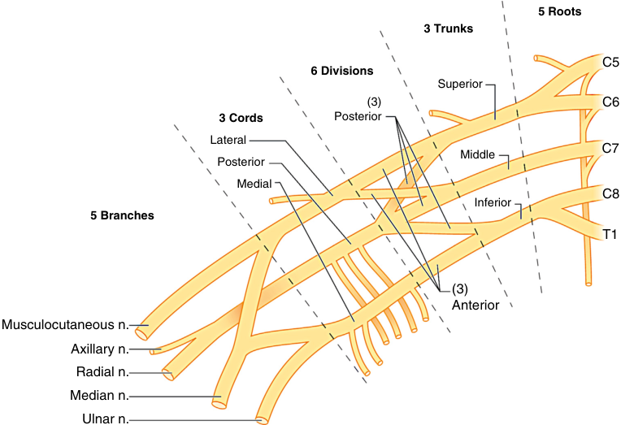

5 Roots 3 Trunks C5 6 Divisions Superior (3) C6 3 Cords Posterior Lateral C7 Middle Posterior Medial C8 Inferior 5 Branches T1 (3) Anterior Musculocutaneous n. Axillary n. Radial n. Median n. Ulnar n. 

**<mark>Fig. 74.13 Brachial plexus anatomy.</mark>** _<mark>n.</mark>_ <mark>, nerve.</mark>

<!-- PDF page 27 -->

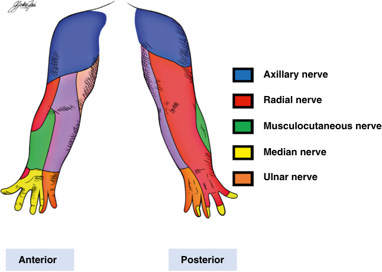

Axillary nerve Radial nerve Musculocutaneous nerve Median nerve Ulnar nerve Anterior Posterior 

**Fig. 74.14 Upper limb dermatome.** Cutaneous distribution of the peripheral nerves of the upper extremity.

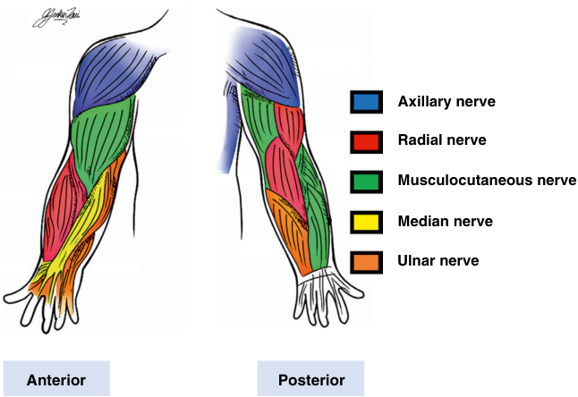

Axillary nerve Radial nerve Musculocutaneous nerve Median nerve Ulnar nerve Anterior Posterior 

**Fig. 74.15 Upper limb myotome.** Distribution of muscular innervations by the terminal nerves of the upper extremity.

of complications. With the advent of ultrasonographic guidance, the supraclavicular block is the most common block for the upper extremity in children.69

- The infraclavicular paracoracoid approach is being increasingly used with the development of ultrasound guidance. The technique provides complete blockade of the upper extremity, catheter placement is easier and more comfortable than at axillary levels, and catheter immobilization and protection against accidental removal are more accessible.

- Supraclavicular approaches are indicated when the lesion is on the shoulder or the proximal part of the arm, including the elbow. This approach should be used in infants with extreme caution because of the proximity of the apical pleura; ultrasound imaging reduces the risk

for complications such as vascular or pleural incidental punctures. Before using ultrasound- guided nerve block, the parascalene and the modified interscalene approach (the tip of the block needle is virtually at the same place in the interscalene space with both techniques) were considered safe alternative procedures.

- Distal nerve blocks are used either for distal lesions (surgery involving the hand or one finger only) or as a complementary block when the distribution of anesthesia is incomplete after a more proximal block.

### Cervical Brachial Plexus Blocks

Cervical brachial plexus approaches are not commonly used in children because of potential adverse effects (pneumothorax, vertebral artery injection, intrathecal injection)

<!-- PDF page 28 -->

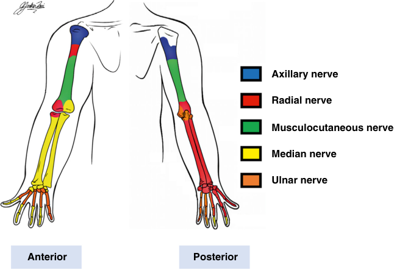

Axillary nerve Radial nerve Musculocutaneous nerve Median nerve Ulnar nerve Anterior Posterior 

**Fig. 74.16 Upper limb osteotome.** Osteotomes of the upper extremity.

and the low incidence of isolated shoulder surgery in this population.

**Interscalene Approach.** The interscalene approach aims to enter the interscalene space at its upper extremity, close to the transverse process of C6. The child is placed in the dorsal recumbent position with the arms extended alongside the thorax and the head slightly turned to the contralateral side.

The landmarks are the cricoid cartilage, the anterior ramus of the C6 transverse process (Chassaignac tubercle), and the interscalene groove. The puncture site is located at the skin projection of the Chassaignac tubercle in the interscalene groove, just posterior to the lateral border of the sternocleidomastoid muscle. The needle is inserted at an 80- degree angle (not perpendicularly) to the skin – that is, dorsally and slightly caudal pointing toward the midpoint of the clavicle – until one of the primary trunks (instead of roots) of the brachial plexus is located by elicited muscle twitches in the upper arm. Any distal motor twitch from the biceps, triceps, or deltoid muscles is adequate. Contraction of the diaphragm indicates phrenic nerve stimulation and anterior placement of the needle tip. Alternatively, trapezius muscle stimulation indicates that needle placement is too posterior. Borgeat and colleagues226 described a modified technique in adults that can be used in children. The block needle is inserted at the same puncture site, but the needle is oriented laterally, pointing toward the midpoint of the clavicle until one of the primary trunks (instead of roots) of the brachial plexus is located, and twitches are elicited in the upper arm. The interscalene block is not very popular in children because of its adverse effects – ipsilateral phrenic nerve blockade, the danger of vascular damage (vertebral artery and vein), and accidental cervical epidural and intrathecal penetration.

Ultrasound imaging improves the safety of this approach by showing the great vessels of the neck, aponeuroses of scalene muscles, and C5–C6–C7 brachial plexus roots.179,227 The probe is placed in a transverse oblique plane at the level

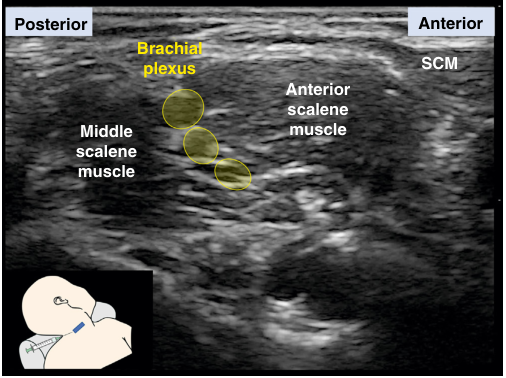

Posterior Anterior Brachial plexus SCM Anterior scalene Middle muscle scalene muscle 

**Fig. 74.17 Ultrasound guidance interscalene using posterior to anterior approach.** _SCM_ , sternocleidomastoid muscle.

of the cricoid cartilage (Fig. 74.17). The trunks and roots of the brachial plexus can be identified in the interscalene groove as distinct round- to- oval hypoechoic structures between the scalene anterior and middle muscles, deep to the sternocleidomastoid muscle. Occasionally, the internal jugular vein and carotid artery can be visualized medially. Using combined ultrasound- guided nerve stimulation techniques, the needle is advanced with an in- plane alignment from the lateral (posterior) to the medial (anterior) side of the probe toward the target nerves. Precise needle placement may limit the dose of local anesthetic required.228

**Parascalene Approach.** The parascalene approach described by Dalens and colleagues229 aims to penetrate the interscalene space at a distance from the apical pleura and great vessels of the neck. The landmarks are the midpoint of the upper border of the clavicle and the transverse process of C6 located by palpation in the interscalene groove, just posterior to the sternocleidomastoid muscle, at the level of the

<!-- PDF page 29 -->

cricoid cartilage. The puncture site is identified at the junction of the upper two- thirds, with the lower third of the line joining the skin projection of the C6 process and the midpoint of the clavicle. The success rate for this approach is very high, with a good safety record. Occasionally, blockade of the lower cord (ulnar nerve or medial branch of the median nerve) can be incomplete. While the morbidity of this technique is virtually nil,230 most clinicians use the ultrasound-guided interscalene technique for any shoulder surgery.

### Supraclavicular Brachial Plexus Block

In contrast to other brachial plexus blocks, the risk for pneumothorax is increased because of the proximity of the lung parenchyma at this level. Therefore, ultrasound guidance with an in- plane approach is strongly recommended and allows real- time viewing of the needle tip, thus avoiding inadvertent pleural puncture.

Ultrasound- guided supraclavicular block in adults has been described in several articles, but only some reports are available in the pediatric literature.23,231,232 The brachial plexus trunks gather at the lower part of the interscalene space, surrounding the subclavian artery. This level carries the advantage of being the area where the trunks are most compact. With a high- frequency probe placed parallel and against the clavicle in the coronal oblique plane (Fig. 74.18), the brachial plexus (trunk or division) appears as a cluster of hypoechoic nodules located lateral, posterior, and superior to the subclavian artery (hypoechoic and pulsatile) and just above the underlying first rib (hyperechoic and curvilinear). Take care to avoid intravascular injection of surrounding vessels (i.e., the suprascapular artery or dorsal scapular artery) by using color Doppler. The needle is slowly advanced under direct visualization with an inplane approach (from lateral to medial) toward the angle formed by the first rib and the subclavian artery. The supraclavicular technique aims to see the spread of local anesthetic (0.2 mL/kg), reaching the angle between the first rib and the subclavian artery. If possible, the child should be tested for brachial plexus integrity before the block by giving a thumbs up (radial nerve), making an “O” with the thumb and index finger (median nerve), and scissoring the index and third digit (ulnar nerve). This paradigm can

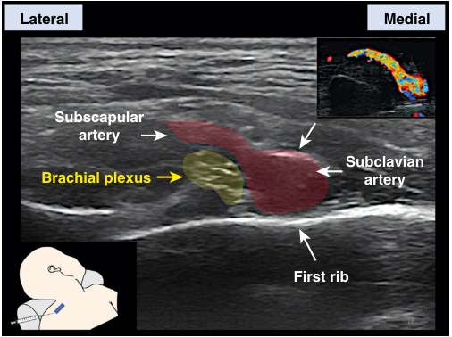

Lateral Medial Subscapular artery Subclavian Brachial plexus artery First rib 

**Fig. 74.18 Ultrasound supraclavicular block imaging.** Surrounding vessels illustrated with the color Doppler ( _top right_ ).

identify children with preexisting nerve damage who may not be eligible for nerve blocks.232

Ultrasound guidance has increased the safety profile of the supraclavicular approach so that, in experienced hands, this may be one of the most reliable and effective blocks of the brachial plexus.228

### Infraclavicular Brachial Plexus Blocks

**Infraclavicular Approaches.** Infraclavicular blocks have gained considerable interest, especially with the development of ultrasound guidance. They consist of approaching the divisions (close to the clavicle) or the cords (close to or below the coracoid process) of the brachial plexus. The two main approaches are midclavicular and paracoracoid, performed with the patient in the dorsal recumbent position.233 A catheter can be easily inserted and safely secured, which is not true in the axilla area.

**Midclavicular Approaches.** Two midclavicular approaches, vertical and anterolateral, have been described. The vertical midclavicular approach is performed by inserting the needle at a right angle to the skin, immediately below the midpoint of the lower border of the clavicle, until twitches are elicited in the upper extremity. Even though this technique was reported in pediatric patients without apparent complication,231,234 the path followed by the needle threatens the apical pleura and lung, thus contraindicating this approach in children.

The anterolateral midclavicular approach can be safely used in supine children with the ipsilateral arm alongside the thorax. The landmarks are the scapula’s coracoid process, the clavicle’s lower border, and the deltopectoral groove. The block needle is introduced 1 cm below the midpoint of the lower edge of the clavicle at a 30- to 45- degree angle dorsally and a 30- degree angle laterally, aligned with the deltopectoral groove, in the direction of the axilla. The objective is to enter the neurovascular sheath 1.0 to 1.5 cm medial to the coracoid process of the scapula until twitches are elicited in the arm, forearm, or hand.

**Paracoracoid Approaches.** The medial paracoracoid approaches are currently the most popular technique for infraclavicular blockade in children. It is the reference technique with nerve stimulation and the one with the lowest morbidity. The puncture site is located at the caudal extremity of the deltopectoral groove, 1 to 2 cm (according to the patient’s age) both caudally and medially to the coracoid. Abducting the upper arm at 90 degrees instead of placing it alongside the thorax brings the plexus closer to the skin and favors the circumferential spread of local anesthetic.235 The needle is inserted perpendicularly to the skin until twitches are elicited in the upper extremity muscles.

The lateral paracoracoid approach under nerve stimulation is technically feasible but unsafe if simultaneous ultrasound imaging is unavailable because of the danger of pleural penetration. The technique can be performed with the arm extended alongside the thorax or abducted 110 degrees and the elbow flexed by 90 degrees,233 thus taking away the neurovascular sheath from the parietal pleura and loosening it to favor the circumferential spread of the local anesthetic. Useful ultrasound landmarks are the axillary artery, and vein, which is located deep and medial to

<!-- PDF page 30 -->

the cords, with the vein positioned medial and caudal to the artery. Pectoralis major and minor muscles are the most superficial overlying the neurovascular structures.

Two primary ultrasound- guided infraclavicular approaches are used. One is a proximal approach with the probe placed parallel and immediately below the clavicle. The cords are lateral to the axillary artery (Fig. 74.19). A second is a paracoracoid approach with the probe placed in a parasagittal plane immediately medial and inferior to the coracoid process, allowing a short- axis view of the brachial plexus (Fig. 74.20). Many individual anatomic variations occur in the location of the cords around the artery. Commonly, the lateral cord is most easily viewed, the medial cord lies between the artery and vein, and the posterior cord is deep into the artery and frequently challenging to individualize. Therefore, the needle is introduced using an inplane approach from lateral (superior) to medial (inferior)

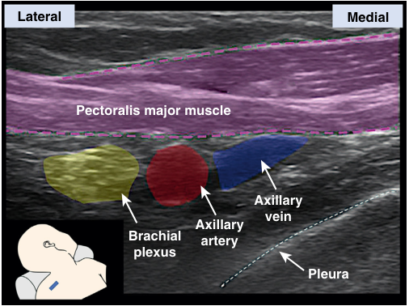

Lateral Medial Pectoralis major muscle Axillary vein Axillary Brachial artery plexus Pleura 

**Fig. 74.19 Ultrasound infraclavicular block, infraproximal approach.** At this proximal level, the pectoralis major is the main muscle seen superficial to the neurovascular bundle. The pectoralis minor is located distally to this ultrasound section. Among the neurovascular bundle structures the axillary vein is the most medial, followed by the axillary artery and then the divisions of the plexus most laterally.

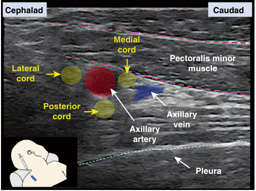

Cephalad Caudad Medial cord Pectoralis minor Lateral muscle cord Posterior cord Axillary vein Axillary artery Pleura 

**Fig. 74.20 Ultrasound infraclavicular block imaging by paracoracoid approach.** In an in- plane approach from cephalad (superior) to caudad (inferior), the needle is advanced to place local anesthetic posterior to the axillary artery near the posterior cord.

and advanced aiming to place local anesthetic posterior to the axillary artery near the posterior cord.

**Axillary Approach.** Historically, the axillary block was the most common approach to the brachial plexus in pediatric patients, aiming to approach the plexus at the level of its terminal branches in the axilla. Controlling perioperative pain in the elbow, forearm, and hand surgeries is a relatively easy and safe procedure. Several variants of the axillary approach have been described in children, with no difference in clinical outcomes, regardless of the selected technique. In contrast to the procedure in adults, the transarterial method is not used in children because of the higher incidence of vessel spasms and potential risk for ischemia. Unlike in adults, a single injection is sufficient to block all the nerves of the forearm and hand except the musculocutaneous nerve in 50% of cases.236 To overcome this problem, the most valuable variant of this technique is the transcoracobrachialis approach. The child is placed supine with the ipsilateral arm both supinated and abducted by 90 degrees.224 The block needle is introduced posteriorly at the crossing of the coracobrachialis muscle with the lower border of the pectoralis major muscle. The needle is advanced posteriorly toward the medial border of the humerus through the upper and lateral part of the coracobrachialis muscle (within which runs the musculocutaneous muscle). With nerve stimulation, the musculocutaneous nerve is usually the first nerve encountered (it will be preferably blocked on the removal of the needle); the needle is moved deeper until it crosses the perineurovascular sheath222 and elicits twitches in the muscles of the hand and forearm. At this level, the cords have split into terminal nerves, and the median nerve is usually contacted first. The local anesthetic is then injected, and the needle is removed while a small volume (0.1 mL/kg up to 5 mL) is injected close to the musculocutaneous nerve. All tourniquet pain (intercostobrachial nerve) can be blocked with a subcutaneous injection in the axilla. The ultrasound- guided axillary approach to the brachial plexus is strictly a multi- injection technique. With ultrasound guidance, a high- frequency probe is placed perpendicular to the major axis of the arm to obtain a short- axis view of the neurovascular bundle (Fig. 74.21). At this level, median, radial, and ulnar nerves are close to the axillary

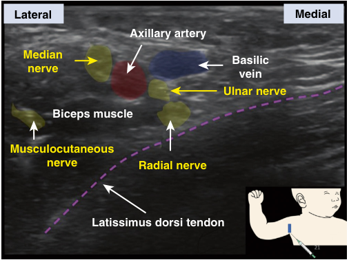

Lateral Medial Axillary artery Median Basilic nerve vein Ulnar nerve Biceps muscle Musculocutaneous nerve Radial nerve Latissimus dorsi tendon 

**Fig. 74.21 Ultrasound- guided axillary block imaging.** A short- axis view of the neurovascular bundle at the axillary region.

<!-- PDF page 31 -->

artery and vein. Significant variation exists in the anatomic relationship of nerves with the axillary location.237 Generally, the median nerve is located between the lateral aspect of the artery and the biceps brachii muscle, the ulnar nerve is more superficial and medial to the artery, and the radial nerve lies deep into the artery. Sliding the probe from the distal arm to the axilla area should help identify the nerve. The needle can be visualized throughout the procedure as it progresses in the plane of the ultrasound beam, and its tip can be precisely placed close to each of the three primary nerves and, on the removal of the needle, close to the musculocutaneous nerve between the coracobrachial and short head of the biceps muscles.

Axillary blocks are relatively safe. Accidental arterial puncture is the most undesirable complication, which may occasionally result in transient vascular insufficiency or a compressive hematoma. The intraneural injection is the most feared complication. It is usually considered the leading cause of permanent nerve damage, primarily undetected in the patient under general anesthesia. In a prospective study on volunteers, Bigeleisen and associates173 deliberately attempted to penetrate axillary nerve trunks under ultrasound guidance. Deliberate intraneural injections were made, and the patients were evaluated six months after the infusion. No motor or sensory deficits were observed. Regardless of whether the design of this study is debatable, the results are interesting in showing that intraneural injection might not be as detrimental as commonly believed and might even be innocuous provided no intrafascicular injection (which elicits strong resistance to injection and excruciating pain) is made. However, such intraneural injections should be avoided, especially when ultrasound imaging is suggestive (tip of the needle within the nerve path and increase in nerve diameter when a fraction of the local anesthetic is injected).

When continuous analgesia is required, a catheter may be introduced into the axillary nerve sheath, but its fixation and immobilization are difficult. Usually, periclavicular or interscalene approaches are preferred, with safe immobilization and increased patient comfort at these levels.

The volume of injectate is critical and depends on the approach and technique used to locate the nerves (see Table 74.7). With nerve stimulation, no information is obtained regarding the circumferential spread around nerve trunks; thus, recommended injection volumes are based on the probability of a complete blockade. With ultrasound- guided techniques, the local anesthetic’s circumferential spread can be seen as a “donut” surrounding the relevant nerve trunk. In clinical practice, using ultrasound for nerve block must be associated with a significant reduction in the volume of local anesthetic.

### Distal Conduction Blocks

**Elbow and Forearm Approaches.** In pediatrics, approaching the radial, median, or ulnar nerve at the elbow or wrist is still uncommon. Indications have long been limited to the complementation of partially failed brachial blocks. These approaches are rather tricky with nerve stimulation only, and their failure rate is relatively high when blind subcutaneous injections are made.

Ultrasound imaging is widening the field of indications for these techniques because these superficial nerves are

easy to identify and approach with ultrasound guidance, more so as very small amounts of local anesthetic (0.05 mL/ kg up to 1–2 mL) are sufficient to produce complete nerve blockade. It is possible to block median and ulnar nerves from the wrist to the axilla at any point of their route. Still, caution is necessary at the wrist level because it is often difficult to distinguish the nerves from the tendons owing to their similar appearance.

The median nerve is anatomically situated in the antecubital fossa, just medial to the brachial artery (Fig. 74.22). In addition, the median nerve is medial to the radial artery and medial and superficial to the radius in the middle of the mid- forearm (Fig. 74.23). At the wrist, the medial nerve is located between the palmaris longus and flexor carpi radialis tendons, but distinguishing the nerve from the tendons can be challenging. Consequently, the median nerve block is typically executed at the forearm.

The cubital tunnel is the groove between the olecranon and the medial epicondyle and should never be blocked for ulnar nerve blocks. The ulnar nerve is vulnerable to compression and injury in this area because of the lack of give in the surrounding space. The ulnar nerve is represented by a

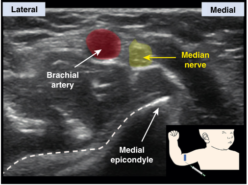

Lateral Medial Median nerve Brachial artery Medial epicondyle 

**Fig. 74.22 Ultrasound view of the median nerve at the elbow level.**

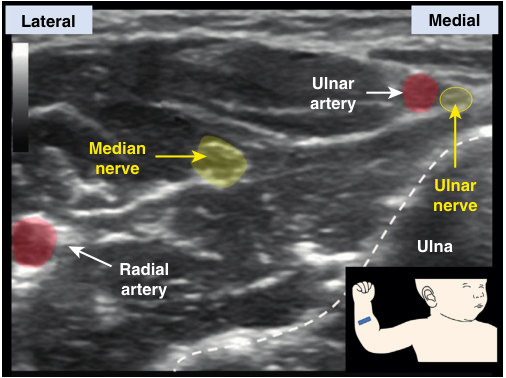

Lateral Medial Ulnar artery Median nerve Ulnar nerve Ulna Radial artery 

**Fig. 74.23 Ultrasound view of the median and ulnar nerve at the mid- forearm.**

<!-- PDF page 32 -->

hyperechoic triangle at the wrist and is located medially to the ulnar artery. One can follow the ulnar nerve proximally until it splits from the artery, making the procedure easier and safer (Fig. 74. 24) at the mid- forearm location.

The radial nerve can be seen just below the brachial muscle when scanning the posterolateral aspect of the humerus just above the elbow (Fig. 74.25). The radial nerve, meanwhile, travels from behind the humerus to the elbow’s side, where it splits into a superficial and deep branch. The radial nerve should block in the antecubital fossa’s intermuscular compartment rather than the confined area of the humeral groove, where nerve injury is less likely to occur.

**Digital Blocks.** Traditional digital ring blocks are rarely used in children, at least by anesthesiologists, because of technically safer alternatives such as metacarpal block and subcutaneous infiltration.

A single, subcutaneous digital block was developed to avoid introducing fluid into the digital flexor tendon sheath

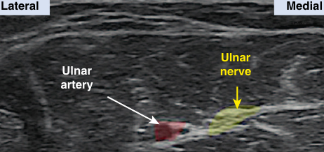

Lateral Medial Ulnar Ulnar nerve artery 

Ulna 

**Fig. 74.24 Ultrasound view of ulnar nerve at the mid- forearm level.** Follow the ulnar nerve proximally until it splits from the artery because it simplifies and safeguards the procedure.

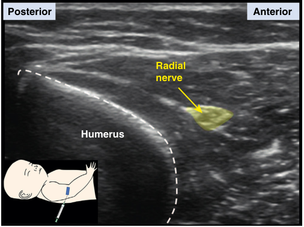

Posterior Anterior Radial nerve Humerus 

**Fig. 74.25 Ultrasound view of radial nerve at the posterolateral aspect of the midarm.** The radial nerve is preferentially blocked in the antecubital fossa’s intermuscular compartment instead of the tight space of the humeral groove.

and a theoretic risk for infection. The subcutaneous block is performed by a single injection with a 25- gauge needle into the palmar skin at the base of the finger (Fig. 74.26).238

Note that these palmar techniques, including single subcutaneous palmar block, carry a risk for anesthetizing only the last two phalanges and the ventral aspect of the proximal phalanx of the fingers.

### TRUNCAL BLOCKS

Surgeries of the trunk are some of the most common surgeries performed on children. Traditionally, central neuraxial blocks are frequently used for these procedures (see later section). Nevertheless, central neuraxial blocks have some adverse effects, including unwanted motor block, urinary retention, pruritus, nausea and vomiting, and risk for spinal cord injury or epidural hematoma. Therefore, globally, peripheral nerve blocks are increasingly utilized in pediatric anesthesia.52 Specifically, the use of ultrasound guidance and the introduction of the interfascial plane concept have increased the utilization of these blocks, especially in children.

### Interfascial Plane Blocks: Regional Technique Entering a New Era

Interfascial plane blocks have become popular in recent years. Advancements in ultrasound technology and image quality have expanded the field of regional anesthesia from techniques targeting specific nerve(s) to procedures depositing local anesthesia in interfascial planes to capture multiple nerve branches simultaneously where the nerves are traveling through. Interfascial plane blocks are typically superficial to perform while reducing the risk of nerve injury, devastating hematoma formation, and potential pneumothorax. Although interfascial plane blocks decrease somatic pain and potentially reduce analgesic requirements, they do not produce a reliable surgical or sympathetic block.

Interfascial plane blocks have been described for analgesia of the chest wall (e.g., erector spinae plane block, pectoralis plane block, and serratus anterior plane block) and abdominal wall (e.g., transversus abdominis and quadratus lumborum plane blocks). Although these new interfascial plane blocks are typically more superficial and have more easily identifiable landmarks (see Table 74.9), comparing

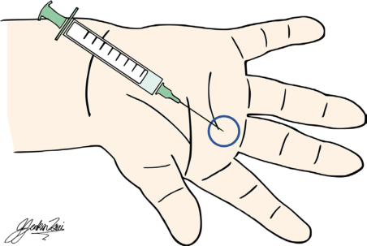

**Fig. 74.26 Transthecal nerve block.** The head of the metacarpal bone is located by palpation.

<!-- PDF page 33 -->

their analgesic efficacy safety with those of perineural nerve and neuraxial blocks is necessary.

### Upper Trunk Blocks

The brachial plexus and the thoracic intercostal nerves contribute to the somatic innervation of the upper trunk (chest wall).239 The nerve fibers travel through the brachial plexus, which is primarily responsible for motor innervation to the chest wall muscles from the medial (C8–T1) and lateral (C5–C7) pectoral, long thoracic, and thoracodorsal (C6–C8) nerves. Exiting an intervertebral foramen, the thoracic spinal nerve divides into a dorsal and ventral ramus that communicates with the sympathetic trunk (Fig. 74.27). The dorsal rami innervate the mid- back. The ventral rami supply the lateral and anterior chest wall through intercostal nerves. At the level of the midaxillary line, an intercostal nerve gives rise to the lateral cutaneous branches responsible for the sensory innervation of the lateral chest wall. The remainder of the nerve courses anteriorly toward the sternum, penetrating the internal intercostal muscle, the external intercostal membrane, and the pectoralis major muscle to provide sensory innervation for the anterior chest wall.

**Interpectoral (PECS 1) and Pectoserratus (PECS 2) Plane Blocks.** The interpectoral plane block (PECS 1) and pectoserratus plane block (PECS 2)240 are anterior interfascial chest wall blocks performed in the supine patient. These two pectoralis plane blocks are simple and safe to perform because of their superficial anatomy and the presence of an osseous backstop to minimize the risk of pleural penetration. Small thoracoacromial artery branches present a low risk for hematoma formation with detailed visualization. The interpectoral and pectoserratus block can be performed in a single needle pass without redirection.

The interpectoral plane block targets the medial and lateral pectoral nerves. The pectoserratus plane block anesthetizes the long thoracic, intercostobrachial, and III to VI

intercostal nerves. To perform both blocks, place a linear probe caudal to the clavicle (in a similar initial location for performing an infraclavicular nerve block). After identifying the subclavian vessels and locating the second rib, move the probe caudal to the third and fourth ribs laterally. The serratus anterior muscle is visualized as a small strip overlying the ribs, deep to the minor pectoralis muscle (Fig. 74.28). The thoracoacromial artery is located between the major and minor pectoralis muscles.

Insert a 50- or 100- mm 22-gauge short beveled needle from a cephalad to the caudal direction. The pectoserratus plane block is performed first to prevent the deposition of inadvertent air that would compromise subsequent visualization of more superficial structures. Administer the local anesthetic between the pectoralis minor and serratus anterior muscles to perform the pectoserratus plane block. Slowly

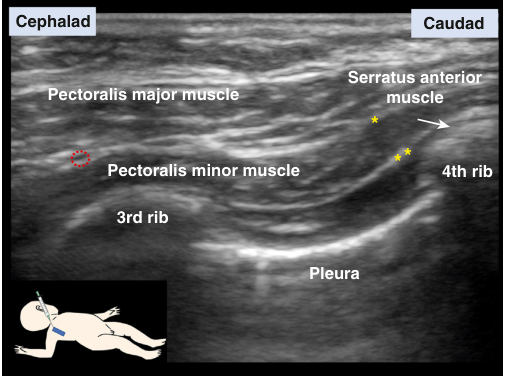

Cephalad Caudad Serratus anterior Pectoralis major muscle muscle * * * Pectoralis minor muscle 4th rib 3rd rib Pleura 

**Fig. 74.28 Ultrasound image of pectoralis (PECS 1 & 2) block.** The serratus anterior muscle can be visualized in a small child with a longitudinal view at T4. _O_ , thoracoacromial artery; *, interpectoral (PECS 1) plane; **, pectoserratus (PECS 2) plane.

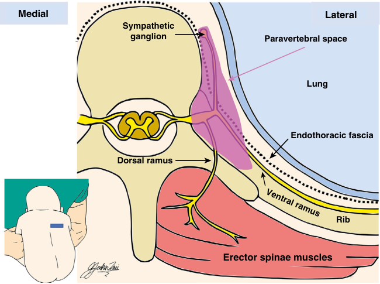

Medial Lateral Sympathetic ganglion Paravertebral space Lung Endothoracic fascia Dorsal ramus Rib Erector spinae muscles Ventral ramus 

**Fig. 74.27 Schematic of the thoracic spinal nerve.**

<!-- PDF page 34 -->

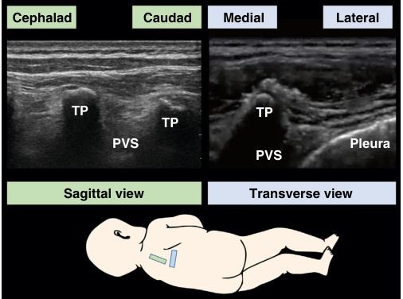

Cephalad Caudad Medial Lateral TP TP TP PVS Pleura PVS Sagittal view Transverse view 

**Fig. 74.29 Thoracic paravertebral space.** ( _Left_ ) A longitudinal view of the thoracic transverse process (TP) and paravertebral space (PVS). ( _Right_ ) A transverse view of the transverse process and pleural, where PVS is beneath the transverse process.

withdraw the needle after the pectoserratus plane block to perform the interpectoral plane block between the major and minor pectoralis muscles. The recommended local anesthetic dose is 0.2% ropivacaine at 0.5 mL/kg on the indicated side (3 mg/kg max). Possible complications include infection, pneumothorax, hematoma, scapula winging from blockade of the thoracic nerve, and local anesthetic systemic toxicity.

The interpectoral and pectoserratus plane blocks have been described for analgesia for pacemaker and ICD installation,241 minimally invasive repair of pectus excavatum,242 and port insertion or removal.243 However, no substantial randomized controlled studies compare interpectoral and pectoserratus plane blocks to neuraxial and chest wall blocks.

**Thoracic Paravertebral Space Block.** Paravertebral block in children was first described in the 1990s,244 and many studies have been done on this block. This technique uses a local anesthetic to infiltrate the paravertebral space by a posterior approach and simultaneously block several unilateral dermatomes with a single injection, like a plexus block. A catheter can be introduced into this space to maintain analgesia over an extended period. The paravertebral block will allow a somatic and sympathetic block (sympathetic chain being in space infiltrated). The dosage is 0.5 mL/kg of long- acting local anesthetic, followed by a continuous infusion of 0.2 to 0.25 mL/kg/h of the same solution.

Anatomic landmarks are the spinous processes of thoracic vertebrae (see Fig. 74.27). The puncture site is parallel to the vertebral axis at the spinous process level (Fig. 74.29). The needle must contact the transverse process of a vertebra. The landmarks are defined in children as follows245 :

- Point of puncture: 10.2 mm + (0.12 × weight in kg) laterally to the spinous process

- Depth of the space: 18.7 mm + (0.48 × weight in kg)

The puncture of the paravertebral space is related to the level of surgery and is usually T5 to T6 for thoracotomy surgery and T9 to T10 for subcostal surgery. The LOR method

is used to locate the paravertebral space with the Tuohy needle crossing the costotransverse ligament. Identifying the spinal nerve with nerve stimulation through space at the chosen level is also possible. Ultrasound guidance is used to determine the transverse process and the costotransverse ligament and measure the distance from the skin to the parietal pleura before performing the block.246

Indications for a thoracic paravertebral block in children are postoperative analgesia after thoracotomy247 and upper abdominal surgery with unilateral subcostal incision (kidney surgery, cholecystectomy, splenectomy).248 This block has also been described for unilateral inguinal hernia repair in children.249 This block can be used in infants undergoing thoracic surgery for coarctation of the aorta or other thoracotomies. Contraindications for this technique are a history of ipsilateral thoracotomy with an increased risk for pneumothorax or parenchymal lung puncture and the deformation of the spinal column, increasing the risk for pleural puncture. This block also must be avoided in cases of severe potential risk for complications (risk for pneumothorax in patients suffering from respiratory diseases with poor gas exchange).

The paravertebral block requires an anesthetist with good technical skills. An alternative to this block is thoracic epidural anesthesia, which has less risk of direct spinal cord injury.

**Erector Spinae Plane Blocks.** First described in 2016, the erector spinae plane (ESP) block has very recently gained substantial interest and use, with limited but rapidly growing evidence250 suggesting promise as a safe and effective alternative to neuraxial blocks, including but not limited to paravertebral blocks, for procedures including thoracotomy,251 pyeloplasties,252 inguinal hernia repairs,253 and hip surgery.207 Single-injection, programmed intermittent serial bolus,254 and continuous catheter251 routes have all been described but are limited to case reports and series.

**technique.** The erector spinae muscle is visualized laterally to the spine under ultrasound guidance, followed by needle guidance towards the transverse process and hydrodissection of the erector spinae interfascial plane, with injectate spreading cranially and caudally along the continuous plane of the vertebral column (Fig. 74.30). The proposed mechanism is the blockade of the dorsal and ventral rami of thoracic spinal nerves and sympathetic nerve fibers, providing somatic and visceral pain control (see Fig. 74.27).250

This posterior thoracic block presents key advantages of avoiding or decreasing risks of dural puncture, the potential for bladder catheterization, pneumothorax, or spinal hematoma formation, giving it the potential for use in cardiac procedures with anticoagulation and cardiopulmonary bypass255 and higher- risk patients256 including pre- and full- term infants.251,252,257

**Retrolaminar Block.** Like the erector spinae plane block, ultrasound- guided fascial plane blocks such as the retrolaminar block have become popular. This block can be an alternative to the erector spinae plane block. To perform the retrolaminar block, the ultrasound probe is slid from lateral to medial (maintaining a sagittal orientation) until the corresponding transverse processes (TPs) (seen as a rectangular structure) are visualized. The probe is further

<!-- PDF page 35 -->

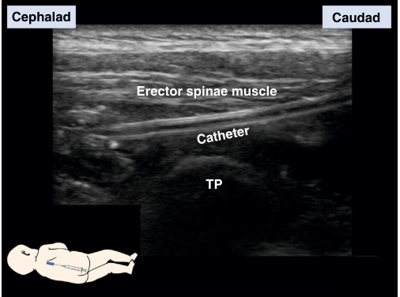

Cephalad Caudad Erector spinae muscle TP Catheter 

**Fig. 74.30 Erector spinae plane (ESP) block.** Insert the needle toward the transverse process direction. Hydrodissection is performed by elevating the erector spinae muscle from the transverse process (TP) and opening the interfascial plane, with the injectate spreading cranially and caudally along the continuous plane of the vertebral column. Insert the catheter after the plane has been opened.

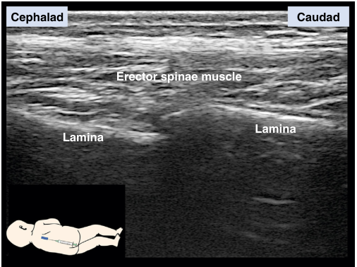

Cephalad Caudad Erector spinae muscle Lamina Lamina 

**Fig. 74.31 Retrolaminar block.** The ultrasound probe is slid from lateral to medial in a sagittal orientation until the transverse processes (a rectangular structure) are visible. The vertebral laminae, seen as diagonal sawtooth structures sonographically, are visualized by sliding the probe medially. In- plane needle placement contacts the vertebral lamina and injects to lift the erector spinae muscle from the lamina to form the plane.

slid medially to visualize the vertebral laminae, which appear sonographically as diagonal sawtooth structures (Fig. 74.31). The needle is placed cephalad- to- caudad or caudad- to- cephalad and in- plane to contact the vertebral lamina. For a single shot, 0.5 mL/kg of 0.2% ropivacaine (up to 20 mL) may be given via the needle while ultrasound imaging is performed in real- time. For cardiac (sternotomy)258 and noncardiac (inguinal hernia)259 pediatric patients, high and low thoracic retrolaminar blocks have been described as simple and effective analgesic blocks.

**Intercostal Nerve Block.** Intercostal nerves run along the lower border of each rib, within the intercostal space, a triangular space, with (1) a medial border formed by the

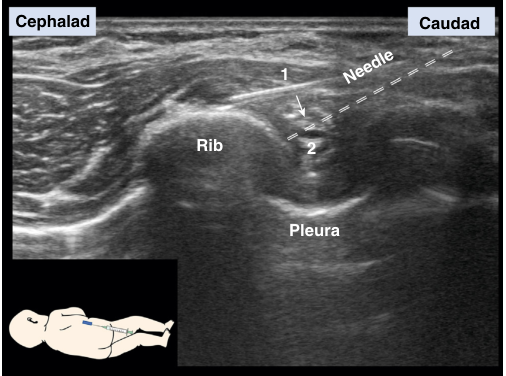

Cephalad Caudad 1 Rib 2 Pleura Needle 

**Fig. 74.32 Intercostal nerve block.** (1) Insert the needle in- plane to contact rib. (2) Redirect the needle and walk off the rib caudally.

posterior intercostal and innermost intercostal muscles, endothoracic fascia, and parietal pleura; (2) a lateral border formed by the internal and external intercostal muscles and intercostal membrane (thickening of the inner fascia of external intercostal muscles); and (3) a base formed by the lower rib. An intercostal nerve block is obtained by injecting a local anesthetic within the intercostal space. After several adjacent intercostal spaces are infiltrated, adequate intraoperative and postoperative pain relief is obtained for thoracotomy,260 liver transplantation, pleural drainage, and management of rib fractures.

This block must be avoided in impaired oxygenation or gas exchange. It requires that all patients be kept under intensive medical observation because of the danger of clinically delayed pneumothorax. It is not suitable for outpatient surgery.

The safest approach to the intercostal space is along the midaxillary line with the child lying semi- prone using a short 22- or 20- gauge Tuohy needle (intradermal needles are inappropriate) under in- plane ultrasound guidance (Fig. 74.32).

A catheter can be introduced in the intercostal space located at the center of the area to be anesthetized to allow reinjections; the catheter also can be inserted intraoperatively under direct vision by the surgeon.261,262 However, the safety of continuous techniques is questionable because of the high systemic uptake of local anesthetic.263 Spread of large- volume anesthetic solution can reach distant intercostal spaces (even contralateral ones), probably via the paravertebral space, thus providing the adequate duration of pain relief with a single injection in some patients. Spread to the epidural space also can occur. Therefore, the patient should be admitted to the intensive care unit for careful monitoring of respiratory function and delayed pneumothorax.

**Serratus Anterior Plane Block (SAPB).** The serratus anterior plane (SAP) block is an ultrasound- guided interfascial plane block performed to provide analgesia to the axilla and the anterolateral chest wall.264,265 In the superficial SAP block, local anesthesia is injected between the serratus anterior and latissimus dorsi muscles to anesthetize the intercostobrachial, lateral cutaneous, long thoracic,

<!-- PDF page 36 -->

and thoracodorsal nerves. Alternatively, local anesthesia is injected between the anterior serratus muscle and the fifth or sixth rib to perform a deep SAP block. The effectiveness of the superficial versus the deep SAP block is similar. Like other interfascial blocks, SAP blocks are somatic blocks that do not possess autonomic blockade.266

The SAP block employs an in- plane ultrasound- guided technique with the rib as a backstop. A linear (13–6 MHz) probe is placed at the midaxillary line in a transverse orientation along the fifth and sixth ribs (Fig. 74.33). The latissimus dorsi muscle is located superficial to the serratus anterior muscle. Pleura is located between the rib shadows. The thoracodorsal artery is in the plane between the serratus anterior and latissimus dorsi muscle. Small infants can also receive interpectoral (PECS 1) and pectoserratus (PECS 2)

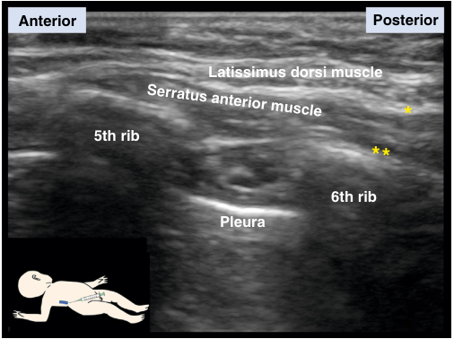

Anterior Posterior Latissimus dorsi muscle * 5th rib ** 6th rib Pleura Serratus anterior muscle 

**Fig. 74.33 Superficial and deep serratus anterior block.** Ultrasound image of midaxillary longitudinal view with a linear (13–6 MHz) probe. Serratus anterior and latissimus dorsi form a superficial plane (*), while the serratus anterior and the rib form a deep plane (**).

together in a single pass needle insertion during performing SAP (see Fig. 74.28); 0.5 mL/kg of 0.2% ropivacaine per injection can be utilized up to 3 mg/kg.267 If both the superficial and deep SAP blocks are performed, the deep SAP block should be performed first to avoid obscuring deeper structures in subsequent injections.

The SAP block has been reported as a safe, effective, and simple analgesia block for thoracotomies and sternotomies.268,269 While catheters placed preoperatively for SAP blocks have been described,270 the catheter can interfere with the surgical site and may be prone to dislodging intraoperatively. A limited randomized controlled trial directly compares the SAP block to neuraxial methods and other chest wall blocks.271

**Other Upper Trunk Blocks.** Interpleural (or intrapleural) blocks that inject a local anesthetic within the pleural cavity without creating a pneumothorax elicited enthusiasm some years ago but were never established in pediatric anesthesia. Parasternal intercostal nerve blocks are one type of described interfascial block that has not seen widespread use in children.272 In randomized studies involving adults and children undergoing cardiac surgery, using parasternal blocks decreased morphine consumption after surgery and decreased mean extubation times.273 However, large- scale randomized controlled trials comparing the parasternal block to neuraxial techniques and other chest wall blocks are still lacking.

### Lower Trunk Blocks

Recovery from major abdominal and urogenital surgery is frequently painful and challenging. Lower abdominal truncal nerve and interfascial plane blocks have been used successfully in children to provide postoperative analgesia when an epidural is not an option. The rectus sheath (RS) block, transversus abdominis plane (TAP) block, and quadratus lumborum (QL) block are common abdominal analgesia regional techniques (Fig. 74.34). In addition, regional

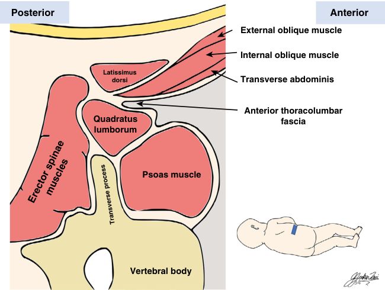

Posterior Anterior External oblique muscle Internal oblique muscle Latissimus dorsi Transverse abdominis Anterior thoracolumbar Quadratus fascia lumborum Psoas muscle Vertebral body muscles Erector spinae Transverse process 

**Fig. 74.34 Schematic diagram of common lower posterior interfascial plane blocks.**

<!-- PDF page 37 -->

blocks, such as ilioinguinal and iliohypogastric nerve blocks, penile blocks, and pudendal blocks, can be helpful for urogenital surgery.

**Rectus Sheath and Paraumbilical Block.** The rectus sheath and paraumbilical block technique consist of injecting a local anesthetic within the substance of the rectus abdominis muscle along the course of the terminal branch of the 10th intercostal nerve, which supplies sensory innervation to the periumbilical area. It provides efficient pain relief for umbilical or other midline surgical incisions, umbilical and epigastric hernia repair, laparoscopic surgery, and pyloromyotomy. Today, this regional anesthetic technique has become increasingly popular.274

**technique.** Ultrasound guidance is used to demonstrate the various layers of the abdomen. The rectus abdominis muscle is seen with the posterior rectus sheath and the peritoneal layer. A high- frequency linear probe is used; two punctures on each side of the umbilicus are necessary. A short, beveled needle inserted at a 45- degree angle is required to perceive the passage of different planes. The local anesthetic is deposited below the posterior rectus sheath; the potential space is noted to open with the injected local anesthetic solution. The total volume of the anesthetic solution injected is 0.1 to 0.5 mL/kg of body weight on each side. Long- acting local anesthetics are usually used with a low concentration (0.2%–0.5%).

Performing this block under ultrasound guidance can avoid intraperitoneal punctures and erratic needle position.275 Unlike the fascial- click method, ultrasound guidance significantly increases correct needle position (88% vs. 44%). It decreases the rate of intraperitoneal injections that are too superficial (11.5% vs. 34.5% and 0% vs. 20.9%, respectively, for ultrasound- guided techniques and fascial clicks).276 Both aponeuroses of the rectus muscle and the parietal peritoneum are very echoic (Fig. 74.35). The probe is placed horizontally over the umbilicus, and the block needle is inserted medially in a long- axis orientation. The superficial fascia is bent and then crossed by the tip of the

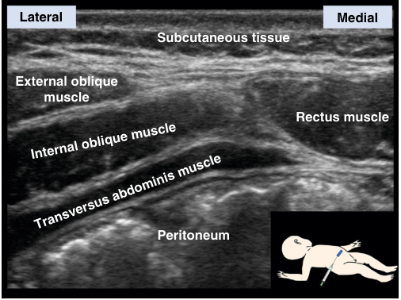

Lateral Medial Subcutaneous tissue External oblique muscle Rectus muscle Peritoneum Internal oblique muscle Transversus abdominis muscle 

**Fig. 74.35 Rectus sheath block.** Identify the rectus abdominis and its anterior and posterior sheaths at the umbilicus. A 27-gauge needle is inserted in- plane between the rectus abdominis and posterior rectus sheath. Hydrodissect the rectus abdominis muscle and posterior rectus sheath.

needle, which should be moved forward until it contacts the deep fascia (to favor the longitudinal spread of the anesthetic). The anesthetic is then injected and can be visualized as an expanding biconvex black shadow.

At the level of the umbilicus, a linear high- frequency probe or a hockey- stick probe is used to initiate an ultrasoundguided rectus sheath block. The rectus abdominis muscle and its anterior and posterior sheaths are identified. Using an in- plane technique, a 27- gauge needle is advanced until it enters the space between the rectus abdominis and the posterior rectus sheath. The potential space between the posterior rectus sheath and the rectus abdominis muscle is injected with 0.1 mL/kg of a local anesthetic solution. Hydrodissection can be used to locate the precise plane in a small space that may require precise localization.

**Transversus Abdominis Plane Block.** The transversus abdominis plane (TAP) block presents an exciting alternative to the ilioinguinal and iliohypogastric nerve block for inguinal surgery in children.277 It has become trendy for analgesia for abdominal wall surgery. This technique aims to block the segmental nerves T9 to T12 (thoracoabdominal nerves) and ilioinguinal and iliohypogastric nerves by spreading local anesthetic in the plane separating the transverse abdominal muscle and internal oblique muscle by a single injection.

The blind TAP block technique is described as easy to perform and has few complications. The lumbar triangle of Petit (a space bounded by the iliac crest, latissimus dorsi muscle, and external oblique muscle) is used as a landmark, and a sensation of two “pops” indicates the correct needle position. The first pop occurs after penetration of the fascia of the external oblique muscle, and the second happens after penetration of the internal oblique.

In children, ultrasound guidance to perform this block is recommended. The block is accomplished by positioning the probe on the midclavicular line between the iliac crest and the last rib, allowing a puncture in the plane (Fig. 74.36). Ultrasound guidance provides greater safety when performing this block by directly visualizing different muscle planes, the needle and its correct position, and the distribution of local anesthetics in this plane.278 As local anesthetic is

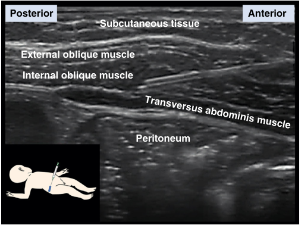

Posterior Anterior Subcutaneous tissue External oblique muscle Internal oblique muscle Peritoneum Transversus abdominis muscle 

**Fig. 74.36 Ultrasound transversus abdominis plane block imaging and probe placement for in- plane needle insertion.**

<!-- PDF page 38 -->

injected, the plane is seen to expand with rearward movement of the transversus abdominis muscle. Visualization of different muscle planes is sufficient and does not require the identification of neural structures themselves. The TAP block has been compared to the ultrasound- guided block and ilioinguinal and iliohypogastric ultrasound- guided block for hernia surgery in children.279 The ilioinguinal and iliohypogastric block produces better postoperative analgesia, probably due to inefficient blockage of the genital branch of the genitofemoral nerve with the TAP block technique. An extensive prospective database has demonstrated that the block is safe in children and has few complications.280 In addition, pharmacokinetic studies have shown the safety of this block in neonates.281

**Quadratus Lumborum Block.** The quadratus lumborum (QL) block is primarily performed under ultrasound to target the thoracolumbar fascia (TLF) around the quadratus lumborum muscle while minimizing potential injury to the ipsilateral kidney, peritoneum, and bowel. Local anesthetic can be injected into the anterior (QL3 or transmuscular), lateral (QL1), or posterior (QL2) aspects of the quadratus lumborum muscle to produce a corresponding trunk interfascial plane block (Fig. 74.37).282 Since the thoracolumbar fascia contains mechanoreceptors, nociceptors, and sympathetic fibers, it is believed that the diffusion of local anesthetic from the TLF into the paravertebral space and the involvement of sympathetic fibers in the TLF results in visceral analgesia. In addition, cadaver and _in vivo_ studies have shown that dermatomal spread spans from T8 to L1 and routinely affects the iliohypogastric and ilioinguinal nerves.283 A 50- to 100- mm, 22-gauge short beveled needle is used. Recommended local anesthetic doses are 0.5 mL/kg of 0.2% ropivacaine on each side (up to a maximum of 3 mg/kg and less than 20 mL).

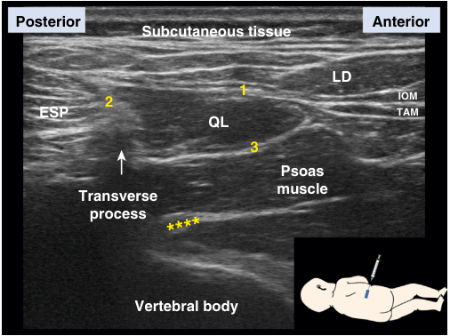

Posterior Anterior Subcutaneous tissue LD 2 1 IOM ESP TAM QL 3 Psoas muscle Transverse process Vertebral body **** 

**Fig. 74.37 Quadratus lumborum (QL) blocks.** Lateral quadratus lumborum (1) targets the transversus abdominis–quadratus lumborum plane. The posterior quadratus lumborum (2) block injects local anesthetics between the quadratus lumborum and erector spinae muscles in the central thoracolumbar fascial plane. Anterior quadratus lumborum (3), also known as transmuscular block, injects a local anesthetic into the quadratus lumborum–psoas plane. Ultrasoundguided in- plane needle insertion prevents ipsilateral kidney puncture. ****Lumbar plexus is discussed in the low extremity section. _ESP_ , erector spinae; _LD_ , latissimus dorsi; _IOM_ , inferior oblique muscle; _TAM_ , transverse abdominus muscle.

Since there are no nerves to activate during the QL block, ultrasonography is the only available guidance. Most teenagers require a curved (C5–1 MHz) probe, whereas younger children can utilize a high- frequency linear probe. The probe is placed in a transverse plane on the midaxillary line, between the costal margin and the iliac crest, to observe the three muscle layers of the TAP block. The probe is slid posteriorly until the quadratus lumborum muscle can be seen at the transversus abdominis aponeurosis. Sliding the probe more posteriorly will bring the transverse process into view. The quadratus lumborum is often described as a flag coming off the flagpole formed by the transverse process. An alternative description is the shamrock view, whereby the psoas and quadratus lumborum form the “leaves” and erector spinae muscles, and the “stem” represents the transverse process. A simple acronym mnemonic, “PQRST,” has also been described284 to aid in recalling the anatomic structures involved and their relative positions.

The plane between the muscles of the transversus abdominis and quadratus lumborum is the intended target of the lateral QL (QL1) block. The transversus abdominis aponeurosis can be better seen if the probe is tilted caudally. The needle should be inserted in- plane with ultrasound guidance to avoid inadvertent puncture of the ipsilateral kidney. The posterior QL (QL2) block injects local anesthetics into the area between the quadratus lumborum and erector spinae muscles in the center of the thoracolumbar fascial plane. The anterior QL (QL3 or transmuscular) block is the injection of local anesthetic into the plane between the QL and psoas muscles. Avoid administering the local anesthetic into any muscle for an effective QL block.

Like most interfascial plane blocks, QL block involves injecting a large volume of local anesthetic between two muscle planes to maximize interfascial plane spread. When performing the QL block, caution should be used in patients with coagulopathies285 as inadvertent puncture of the fourth lumbar artery can cause large hematomas.38 When the local anesthetic is injected into the QL plane, some local anesthetic can spread to the fascia iliaca,286 resulting in quadriceps weakness. Nevertheless, the QL block has been proposed as an effective postoperative analgesia technique for adults and children undergoing abdominal and hip surgery.287

**Ilioinguinal and Iliohypogastric Nerve Blocks.** The three nerves supplying the inguinal area are the ilioinguinal, iliohypogastric, and genitofemoral. In 50% of patients, sensory innervation of the inguinal canal depends exclusively on the genital branch of the genitofemoral nerve (also termed the external spermatic nerve in males). Several publications focusing only on the ilioinguinal and iliohypogastric nerves have appeared in the literature, especially with the introduction of ultrasound imaging.181,288,289

The ilioinguinal nerve block effectively provides analgesia for inguinal area surgery, including but not limited to inguinal hernia and hydrocele surgery in children. An additional injection of the genitofemoral nerve or local infiltration of the testicular sack is needed to provide complete analgesia for orchidopexy repair. This technique, widely described in the literature, is a fascial- click technique. A single-injection approach can safely and reliably block

<!-- PDF page 39 -->

the three relevant nerves at once because these nerves are located in the same fascial plane close to the subcutaneous inguinal ring formed by the aponeurosis of the external oblique muscle. The landmarks are the umbilicus, ipsilateral anterior superior iliac spine (ASIS), and the midpoint of the inguinal ligament. The ASIS–umbilicus line is divided into four equal parts; the puncture site is located at the union of the lateral fourth with the medial three- fourths. A short beveled needle is essential to perceive the passage of the various planes. The two main risks are intravascular injection (very low) and crossing three muscle layers with penetration into the abdominal cavity or intraperitoneal organ. In addition, the extension of the territory of femoral anesthesia is a complication reported after ilioinguinal–iliohypogastric block with an incidence of up to 10%.290 The usual dose is 2.5 mg/kg of long- acting local anesthetic. The puncture may be bilateral if the surgery requires it. The risk for bowel trauma is present with the fascial- click technique, and our preferred methodology is to use ultrasound guidance for this block.

Ultrasound guidance of this block has advantages in terms of quality of analgesia and dose reduction of local anesthetics.181 The probe is located on the line between the ASIS and umbilicus close to ASIS. We use a high- frequency linear probe muscle for this procedure (Fig. 74.38). Two abdominal wall muscles are visible at this level: the transverse and internal oblique muscles. The external oblique and internal oblique could, at this level, become a single aponeurotic layer. The neural target and associated vessels are between these muscles (see Fig. 74.38). The needle insertion can be performed with an in- plane technique. Willschke and associates181 showed that the total volume of local anesthetic used in the ultrasound group was significantly lower than in the fascial- click technique (respectively, 0.19 mL/kg vs. 0.3 mL/kg of 0.25% levobupivacaine). They concluded that the local anesthetic optimal minimum volume for this ultrasound- guided block was 0.075 mL/kg of 0.25% levobupivacaine.289 Using the traditional fascial- click technique causes erratic needle location in 85% of cases and 45% of blockade failures.291

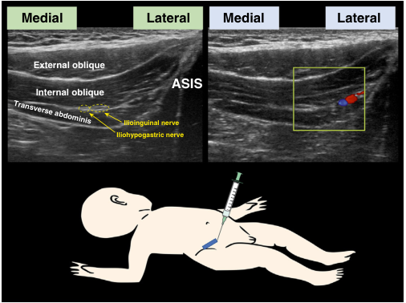

Medial Lateral Medial Lateral External oblique ASIS Internal oblique Ilioinguinal nerve Iliohypogastric nerve Transverse abdominis 

**Fig. 74.38 Ilioinguinal and iliohypogastric block imaging and probe placement for in- plane needle insertion.** _ASIS_ , anterior superior iliac spine.

**Penile Block.** Surgery of the prepuce and penis is common in children. This surgery may need advanced pain control for 12 to 24 hours and is usually done on an outpatient basis. Nerve supply to the penis depends mainly on the dorsal nerve of the penis, which is a terminal branch of the pudendal nerve. The penile block by subpubic approach with long- acting local anesthetic for prolonged analgesia is a good indication for this type of surgery. The usual dose is 0.1 mL/kg (maximum 5 mL) of local anesthetic on each side. The technique is to inject an appropriate volume of local anesthetic in the two compartments of the potential subpubic space behind the Scarpa fascia (Fig. 74.39). Puncture is performed perpendicularly to the skin. Gentle traction is exerted on the penis to tension the Scarpa fascia and better feel the fascial click. Ventral injections of the perineal nerve can be combined with a dorsal penile nerve block for circumcision surgery to overcome the failure rate of the dorsal nerve block of the penis. This blocking procedure is easy, and its learning curve is particularly short.292 Despite this, the surgeon typically performs this block rather than the anesthesiologist before or after surgery.

Crossing of the Scarpa fascia also can be verified by ultrasound imaging.293,294 Ultrasound- guided penile nerve block improves the efficacy of the block in contrast to the fascial- click technique in terms of the postoperative pain during the first postoperative hour and the time to the first requirement for postoperative analgesia.295

The morbidity is extremely low (almost nil when using a local anesthetic without epinephrine). In contrast, complications have been reported after attempts to block the nerves by infiltrating a local anesthetic below the Buck fascia at the dorsal part of the penis.

The use of epinephrine and skin infection at the puncture site are the main contraindications to this block. Serious complications result from a lesion of the dorsal artery in case of a median puncture and the risk for injury to the

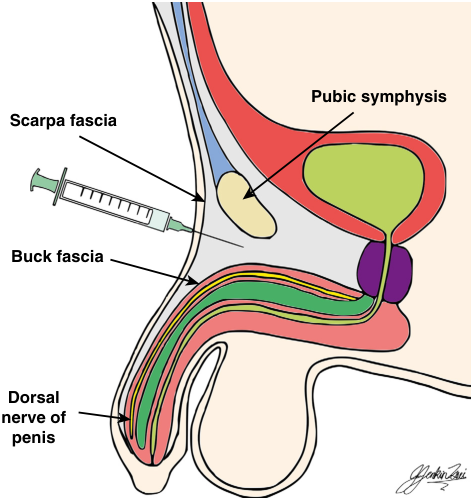

Pubic symphysis Scarpa fascia Buck fascia Dorsal nerve of penis 

**Fig. 74.39 Anatomic puncture for penile block via the subpubic space.** The safest injection space involves penetrating only the Scarpa fascia and avoiding the Buck fascia.

<!-- PDF page 40 -->

cavernous corpus with local anesthetic injection equivalent to an intravenous injection of local anesthetic.296

The usual indications are elective surgery such as circumcision and phimosis cure or emergency surgery such as reduction of a paraphimosis or release of a foreskin stuck in zipper pants.

**Pudendal Nerve Block.** Given the random effectiveness of penile block for surgery of the prepuce in children, some teams advocate using pudendal block. The pudendal nerve provides sensory and motor innervation to the pelvic cavity and its contents, including external genital organs. The landmarks are the two ischial tuberosities and anus (Fig. 74.40). The distribution of anesthesia depends on the volume of the injectate. With 0.1 mL/kg (up to 5 mL), anesthesia is usually limited to the perineal nerve that supplies the posterior part of the scrotum (this is enough to complement an ilioinguinal, iliohypogastric, and genitofemoral nerve block when a scrotal incision is required). With 0.3 to 0.4 mL/kg on each side (up to 15 mL), all division branches of the pudendal nerve are blocked, thus providing complete analgesia of the perineum, including blockade of the dorsal nerve of the penis.

Because the pudendal nerve is a mixed nerve, a nerve stimulator can locate it more precisely if deemed useful.288 The expected motor response is a contraction of the external anal sphincter. It is recommended to start at an intensity of 1.5 to 2.0 mA. The needle position is considered adequate if the muscle response is obtained for an intensity of 0.5 to 0.8 mA (0.1–0.2 ms, 1 Hz).

Naja and associates297 compared nerve- stimulated pudendal block and dorsal penile nerve block with the fascial- click technique in 60 children undergoing surgery for circumcision. The authors showed a significant decrease

in pain scores and analgesic consumption in the group with a pudendal block, with higher parental and surgical satisfaction. Perineal nerves appear to play an essential role in the innervation of the penis, and it is the recommended block for circumcision surgery. The perineal and dorsal nerves are terminal branches of the pudendal nerve. The pudendal nerve block can block the dorsal and perineal nerves with only one injection.

While ultrasound guidance has been used in adults, identifying the pudendal nerve was possible in only half of the procedures.298 Because this nerve is accompanied by a terminal artery (pudendal artery), local anesthetics with ephedrine must be avoided. Recently, ultrasound- guided pudendal nerve block has also been reported for pediatric patients.299,300 Like the nerve stimulation method, the child is positioned in the supine frog- leg posture (hip abduction and legs flexed). After palpating the ischial tuberosity, the ultrasound probe is placed transversely such that the ischial spine is visualized as a hyperechoic horizontal line (see Fig. 74.40). The rectum can be seen more medially as a hypoechoic area. The sacrospinous ligament (SSL) and the sacrotuberous ligament (STL) can be seen as two parallel hyperechoic lines between the rectum and the ischial spine. Using an out- of- plane method, a 50- mm, 22- gauge stimulation needle is inserted starting at the superior center of the ultrasound probe, aiming slightly downward to the patient’s back. The needle tip is advanced until it penetrates the STL to target the space between the STL and the SSL. The location of the needle tip may be appreciated by observing the movement of the surrounding anatomic tissues during insertion and hydrodissection. Since it is challenging to visualize the needle tip with an out- of- plane approach, it is advised to use nerve stimulation in conjunction with visualization to verify the needle position. If a contraction of the

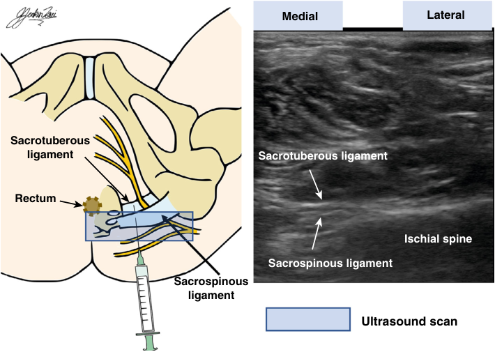

Medial Lateral Sacrotuberous ligament Sacrotuberous ligament Rectum Ischial spine Sacrospinous ligament Sacrospinous ligament Ultrasound scan 

**Fig. 74.40 Ultrasound- guided pudendal nerve block.** The ultrasound probe is placed transversely to visualize the ischial spine as a hyperechoic horizontal line after palpating the tuberosity. The medial rectum is hypoechoic. The sacrospinous ligament and sacrotuberous ligament are two parallel hyperechoic lines between the rectum and ischial spine. An out- of- plane method inserts a needle next to the ultrasound probe’s superior center, aiming slightly downward to the patient’s back. The small pudendal artery can occasionally be visualized.

<!-- PDF page 41 -->

external anal sphincter response is obtained for an intensity of 0.5 to 0.8 mA, then the needle is in the correct place.

**Other Blocks of the Lower Trunk.** Other lower trunk blocks, including paravertebral ganglion, genitofemoral, paracervical (uterosacral), and transsacral nerve blocks, are not commonly used in pediatric patients. Lumbar plexus and psoas compartment blocks, which are primary for the lower extremities, are discussed in the following section.

### LOWER EXTREMITY CONDUCTION BLOCKS

### Lumbar Plexus Nerve Blocks

The lumbar plexus is formed by the union of the anterior rami of the first four lumbar nerves (L1–L4) with variable input from the 12th thoracic nerve (T12) and L5. The lumbar plexus lies in the psoas compartment in the

paravertebral space, with the anterior border formed by the psoas major muscle and the posterior border formed by the quadratus lumborum muscle. As it emerges from this space, it divides into the four nerves that innervate the anterior portion of the upper aspect of the lower extremity: the femoral, lateral cutaneous, genitofemoral, and obturator nerves. These nerves run a variable part of their course just below the fascia iliaca, the common fascia covering the psoas and iliacus muscle. Therefore, a sufficient volume of local anesthetic injected at the inner surface of this fascia will spread along it and reach these nerves, thus producing a fascia iliaca compartment block. Nevertheless, the most critical component to performing successful lower limb regional blocks is the ability to target innervated areas in the dermatome (Fig. 74.41), myotome (Fig. 74.42), and osteotome (Fig. 74.43) according to surgical requirements.

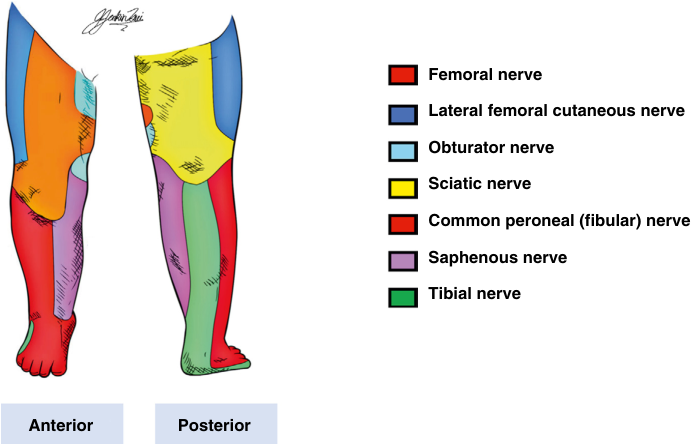

Femoral nerve Lateral femoral cutaneous nerve Obturator nerve Sciatic nerve Common peroneal (fibular) nerve Saphenous nerve Tibial nerve Anterior Posterior 

**Fig. 74.41 Lower limb dermatome.** Cutaneous distribution of the peripheral nerves of the lower extremity.

Femoral nerve Lateral femoral cutaneous nerve Obturator nerve Sciatic nerve Common peroneal (fibular) nerve Saphenous nerve Tibial nerve Anterior Posterior 

**Fig. 74.42 Lower limb myotome.** Distribution of muscular innervations by the terminal nerves of the lower extremity.

<!-- PDF page 42 -->

Femoral nerve Lateral femoral cutaneous nerve Obturator nerve Sciatic nerve Common peroneal (fibular) nerve Saphenous nerve Tibial nerve Anterior Posterior Fig. 74.43 Lower limb osteotome.  Osteotomes of the lower extremity. Iliac crest Winnie Schuepfer PSIS Dadure Chayen L4 spinous process Tuffier line 

**Fig. 74.44 Landmarks of psoas compartment block with different procedures described in the pediatric literature.** _PSIS_ , posterior superior iliac spine.

### Psoas Compartment Block (Direct Lumbar Plexus Block)

Psoas compartment block is performed with the child turned in the lateral decubitus position with the operated side uppermost. The landmarks are the iliac crests, the ipsilateral posterior superior iliac spine, and the L5 spinous process. Three possible puncture sites are as follows (Fig. 74.44). The first is the midpoint of the line connecting the posterior iliac spine to the L5 spinous process (modified Chayen approach). The other point on the intercristal line (Tuffier line) is three- quarters of the distance between the L4 spinous process and a line parallel to the spinal column passing through the posterior superior iliac spine.301 Other puncture sites are located at the medial two- thirds and lateral one- third of a line extending from the L4 spinous process to the posterior superior iliac spine.302

Whatever the puncture site used, the block needle is inserted perpendicularly to the skin until twitches are elicited in the ipsilateral quadriceps muscle. Complications have been reported, including cardiac arrest from the

intravascular injection, psoas muscle hematomas, epidural anesthesia, and retroperitoneal injection if the needle is inserted deeper than recommended.303,304 Consequently, this regional technique should be performed only by trained anesthesiologists, considering the lumbar plexus depth estimated according to the patient’s age or weight and the proximity of critical anatomic structures to the psoas compartment.

Psoas compartment block can produce excellent postoperative pain management during the first 48 hours. The usual indications for this block are surgeries on the hip or femoral shaft (femoral and hip osteotomies). These operations require the blockade of the three primary nerves innervating the hip joint: femoral, lateral femoral cutaneous, and obturator nerves. A recent study using sonography of the lumbar plexus in children showed that the depth of the lumbosacral plexus correlated with weight rather than age.305 Continuous psoas compartment block provides good pain relief management in major hip or femoral surgeries in children.156,301,306 Continuous psoas compartment block has

<!-- PDF page 43 -->

been compared with a continuous epidural block in hip and femoral surgery in children.156 Continuous psoas compartment block provided the same quality of postoperative analgesia with significantly fewer adverse events and required decreased doses of ropivacaine than a continuous epidural block.

Using ultrasound guidance, a 13–6 MHz linear probe is placed longitudinally just lateral to the midline (for deeper penetration in older children, a lower frequency [5–2 MHz] curved array probe may be required). After identifying the sacrum, the probe is moved cephalad to identify the L5 transverse process and L4/5 interspace.

Like the “shamrock method” for QL block (see Fig. 74.37), the probe is positioned transversely in the abdominal flank just above the iliac crest to visualize the abdominal wall muscles. The probe is then repositioned dorsally until the quadratus lumborum muscle is visible medially to the transverse abdominis muscle. The L4 transverse process can be viewed as the shamrock’s stem, while the erector spinae, quadratus lumborum, and psoas muscles are the three leaves arranged posterior–anterior. The lumbar plexus is visible as a hyperechoic structure in the posterior aspect of the psoas. The probe is then tilted caudally until the L4 transverse process disappears. The needle is inserted lateral to the midline and advanced posterior–anteriorly to reach the plexus under real- time ultrasound guidance. As a result of the ultrasound beam being more at right angles to the lumbar plexus and the needle being in- plane and perpendicular to the ultrasound beam, visualization of the plexus and the needle is enhanced, making this method more straightforward, quicker, and possibly associated with a lower risk of complications. To increase its effectiveness, this block is combined with nerve stimulation.

### Femoral Nerve Block

Femoral nerve blocks are performed while the child lies supine, preferably with the ipsilateral limb slightly abducted. The block needle is inserted posteriorly, either perpendicular to the anterior aspect of the thigh or, especially when a catheter must be inserted, at a 45- degree angle cephalad, pointing to the umbilicus, until twitches are elicited in the quadriceps muscle when nerve stimulation is used. The landmarks are the inguinal ligament and the femoral artery. The puncture site is 0.5 to 1.0 cm below the inguinal ligament (not the inguinal crease).

Ultrasound imaging makes the technique even more accessible.182 The probe is placed slightly above and parallel to the inguinal ligament (Figs. 74.45 and 74.46).

The main surgical indications are femoral shaft or knee surgeries. The introduction of a catheter for continuous analgesia can be achieved by the direct perineural (femoral) approach307 (Fig. 74.47) or the fascia iliaca compartment approach.308,309 These two approaches have never been compared regarding efficacy in children.310 The fascia iliaca technique, which does not require a nerve stimulator or limb mobilization, seems easier to perform in femur fractures with less accidental vascular puncture.

### Fascia Iliaca Compartment Blocks

Fascia iliaca compartment blocks can be performed using the conventional and supra- inguinal approaches. The traditional technique consists of injecting a local anesthetic

Lateral Medial Lateral femoral cutaneous nerve Fascia lata Sartorius Femoral artery & vein Fascia iliaca Femoral nerve Iliopsoas muscle Psoas tendon 1 2 3 ASIS 

**Fig. 74.45 Schematic diagram of the cross section along the inguinal ligament and target nerve block location relationships.** _1_ , femoral nerve block; _2_ , fascia iliaca block; _3_ , lateral femoral cutaneous nerve block; _ASIS_ , anterior superior iliac spine.

Lateral Medial Superficial femoral artery Fascia lata Sartorius Fascia iliaca Femoral nerve Deep femoral artery Femoral vein 

**Fig. 74.46 Ultrasound image of femoral nerve block procedure at slightly below the inguinal ligament.**

below the fascia iliaca.310 The injectate spreads at the inner surface of the fascia and, depending on its volume, spreads around the nerves emerging from the lumbar plexus that supplies the lower extremity. The technique is performed with the child lying supine instead of injecting cephalad laterally to the femoral nerve and above the iliac muscle below the inguinal ligament.

For the supra- inguinal approach of the fascia iliaca compartment block, the probe is positioned in an inguinal crease in a parasagittal plane medial to the ASIS with a craniomedial oblique tilt. The ASIS, deep circumflex artery, and iliopsoas muscle overlying the ASIS are identified (Fig. 74.48). The probe is translated caudally toward the umbilicus in the same direction until the sartorius and internal oblique muscle and the appearance

<!-- PDF page 44 -->

Lateral Medial Femoral nerve Femoral artery & vein Femoral catheter 

**Fig. 74.47 Femoral nerve catheter placement.**

Cephalad Caudad Deep circumflex artery Fascia lata Sartorius Internal muscle oblique muscle * Local anesthetic Fascia iliaca Iliacus muscle Ilium 

**Fig. 74.48 Ultrasound- guided supra- inguinal fascia iliaca nerve block.**

Lateral Medial Femoral nerve Iliacus muscles Femoral artery Anterior Psoas Psoas muscle inferior tendon iliac spine Iliopelvic eminence 

**Fig. 74.49 Ultrasound imaging for pericapsular nerve group (PENG) block.** Using an in- plane, lateral- to- medial motion, a needle is inserted until it reaches the pubic ramus, which is located laterally to the psoas tendon.

of a “bowtie” at the muscle fascia interface are reached. Local anesthetic is then injected above the iliopsoas muscle following aspiration. Due to the more proximal deposition of local anesthetic, this technique may consistently anesthetize the lateral femoral cutaneous nerve, femoral nerve, and possibly the obturator nerve, providing superior analgesia following hip surgery. This technique makes the femoral and lateral cutaneous nerves almost constantly blocked. The local anesthetic usually reaches the upper division branch of the obturator nerve, which is the branch giving a twig to the hip joint. The anesthetized area also includes areas supplied by upper branches of the lumbar plexus in more than 70% of procedures, such as the genitofemoral nerve.

Perivascular femoral nerve and fascia iliaca compartment approaches have never been compared in terms of efficacy in children.310 The fascia iliaca compartment block was superior in blockade for lateral femoral cutaneous, obturator, and genitofemoral nerves. The perivascular approach provides a risk for significant vascular puncture. Moreover, the fascia iliaca technique, which does not require a nerve stimulator or limb mobilization, seems easier to perform in femur fracture surgeries.

Performing this block using ultrasound showed several advantages, including extending the duration of postoperative analgesia and decreasing the volume of injected local anesthetic compared to the nerve stimulation technique. Recent reviews comparing ultrasound to no ultrasound demonstrated increased block duration, better pain scores in the postanesthesia unit, and higher block success rates.4,182 Oberndorfer and associates found that the ultrasound group’s analgesia duration was significantly increased to approximately 508/178 minutes versus about 335/69 minutes for sciatic and femoral nerve blocks using the same techniques.182

Usual doses of local anesthetic are 0.2 to 0.5 mL/kg in a single- shot or induction bolus and 0.1 to 0.2 mL/kg/h in the postoperative continuous infusion of long- acting local anesthetic.157 Patient- controlled regional anesthesia can be used with a bolus of 0.1 mL/kg (up to 5 mL and a maximum of 3 boluses per hour). Local anesthetics with epinephrine produce significantly lower plasma concentrations and should be preferred whenever possible. Adding clonidine (1–2 mcg/kg)6 substantially prolongs the duration of analgesia.141

In the fascia iliaca compartment and femoral nerve block, catheter placement is easy, allows long- lasting pain relief, and is improved with ultrasound guidance. Recently, Lako and associates309 compared continuous fascia iliaca block and intravenous morphine regarding analgesia and side effects in children undergoing pelvic osteotomy. The authors noted excellent postoperative pain relief, with less sedation and a better appetite return in the regional analgesia group compared to the morphine group. On the other hand, Paut and colleagues308 determined plasma concentrations of bupivacaine during continuous fascia iliaca block in children after major femur or knee surgery or femoral fracture. They concluded that the plasma concentrations of bupivacaine during continuous fascia iliaca compartment block are within the safety margins for children (0.71 ± 0.4 g/mL and 0.84 ± 0.4 g/mL at 24 hours and 48 hours, respectively). The regimen of local anesthetic

<!-- PDF page 45 -->

administration was a bolus dose of 0.25% bupivacaine with epinephrine followed by continuous administration of 0.1% bupivacaine for 48 hours.

### Pericapsular Nerve Group (PENG) Block

The pericapsular nerve group (PENG) block311 is described for perioperative analgesia of the hip with minimal motor impairment. The PENG block targets the sensory articulating branches of the femoral, auxiliary obturator, and obturator nerves. The block is relatively simple to execute.

By placing the linear probe along the inguinal ligament in the same direction as the inguinal crease between the pubic ramus and the ASIS, one can visualize the anterior inferior iliac spine, iliopubic eminence, femoral artery, psoas muscle, and superior pubic ramus (Fig. 44.49; see Fig. 74.45). A 22- gauge needle is inserted in- plane, laterally to medially, until it contacts the pubic ramus lateral to the psoas tendon. Following negative aspiration and confirmation that the needle tip is not intramuscular, 3 mg/kg of ropivacaine (0.2% or 0.5%) is administered up to 20 mL. Slight retraction of the needle may be needed if the injection is difficult. The PENG block has been performed in both adult and pediatric patients.312

### Lateral Femoral Cutaneous Nerve Block

A specific lateral cutaneous nerve block is rarely used solely for analgesia in children; its main indication is as a technique complementary to a femoral block. The block can provide analgesia for fascia lata grafts, femoral pinning, and muscle biopsies. Ultrasound guidance has made the performance of this block easy and safe.

**Performance of the Block.** The sartorius can be identified below the anterior superior iliac spine (ASIS). The potential space between the tensor fascia lata and the sartorius houses the lateral femoral cutaneous nerve between the fascia lata. It is a potential space and has hardly any complications. The groove between the sartorius and the tensor fascia lata can be palpated below the anterior superior iliac spine. However, the old technique using landmarks and “pops” for LOR has been abandoned for the ultrasoundguided technique.

Using ultrasound guidance (see Figs. 74.45 and 74.46), this block is similar in orientation to an in- plane lateral- tomedial femoral nerve block. When a linear high- frequency probe is positioned below the anterior superior iliac spine, the sartorius is a triangular structure close to its insertion. The tensor fascia lata can be imaged laterally. As the needle tip enters the fascia lata after being inserted in- plane slightly medial and caudal to the anterior superior iliac spine, a fascial “pop” or “click” may be felt. The objective is to deposit local anesthetic between the fascia lata and fascia iliac, but not into the sartorius muscle, as the lateral femoral cutaneous nerve lies anywhere around the sartorius muscle between the two fasciae. In young children, a single needle insertion can block the lateral femoral cutaneous and femoral nerve. After reaching and administering local anesthetic with a lateral- to- medial approach for femoral nerve block, the needle can be withdrawn slowly while hydrodissecting and opening the plane between the fascia lata and iliaca. Following aspiration, a local anesthetic solution is injected into the opened plane. Large

quantities may spread to the femoral nerve, resulting in a motor blockage.

### Obturator Nerve Block

This procedure is performed with the child supine and the thigh slightly abducted and externally rotated (if possible). The landmarks are the groove between the long adductor muscle’s tendon and the pectineus muscle’s medial border. The puncture site lies in this groove at the level of the greater trochanter of the femur. With nerve stimulation, the needle is inserted following a strict anterior- to- posterior path until twitches are elicited in the long and short adductor muscles (stimulation of the anterior division branch of the obturator nerve). The needle is further advanced dorsally over 1 to 2 cm until twitches are elicited in the great adductor (posterior branch). Half of the local anesthetic solution (of a total of 0.1 mL/kg up to a maximum of 5 mL per nerve) is injected; the needle is then removed until stimulation of the anterior branch is obtained again, and the second half of the anesthetic is injected.

The technique can be performed with ultrasound guidance. The probe is placed below the pubic tubercle, with its major axis parallel to the inguinal ligament. The aponeuroses of the sartorius and long and short adductors are easily identified. The anterior branch can be easily found between the long (longus) and short (brevis) adductors, and the posterior branch lies between the short (brevis) and great (magnus) adductors (Fig. 74.50).

### Adductor Canal Block and Distal Saphenous Nerve Block

Distal saphenous nerve blocks are used initially as a complement to sciatic blocks with small amounts of local anesthetic. Because the saphenous nerve is purely sensory, nerve stimulation does not identify it. This block, also called the adductor canal block, has gained immense popularity, especially for lower extremity procedures where a motor block can be avoided. Many block procedures have been published, resulting in a high failure rate (30% or higher). Ultrasound guidance has dramatically facilitated this block placement.

Lateral Medial Sartorius Adductor longus Adductor brevis Adductor magnus 

**Fig. 74.50 Obturator nerve block, with ultrasound imaging of the anterior and medial aspect of the thigh.**

<!-- PDF page 46 -->

Lateral Medial Sartorius Nerve to vastus Femoral artery medialis & vein Saphenous nerve Adductor longus / magnus Vastus medialis 

**Fig. 74.51 Schematic diagram of the cross section of saphenous and vastus medialis nerve block under sartorius muscle.**

The classic distal saphenous nerve block approach is performed at knee level with a supine patient. The anterior edge of the medial head of the gastrocnemius muscle and the tibial tuberosity is identified by palpation. A line is drawn at a 45- degree angle with the intercondylar line from the tibial tuberosity to the anterior edge of the gastrocnemius muscle. The technique consists of subcutaneously injecting a local anesthetic along this line. This straightforward technique is free of complications, but its failure rate is relatively high.

Taking advantage of the proximity of the vastus medialis and saphenous nerves within the adductor canal in the upper thigh, the adductor canal block has been utilized as a motor- sparing block for several knee surgeries. The adductor canal block, on the other hand, involves blocking the saphenous and vastus medialis nerves. Being a mixed nerve, the vastus medialis nerve can be located easily by nerve stimulation and injecting a local anesthetic, which results in the concomitant blockade of the two nerves. The landmarks are the femoral artery, the inguinal ligament, and the upper border of the sartorius muscle. A short beveled insulated needle is inserted perpendicularly to the skin, 0.5 cm lateral to the femoral artery just above the upper border of the sartorius until twitches are elicited in the vastus medialis muscle. Injecting 0.1 to 0.2 mL/kg of a local anesthetic is sufficient to block the two nerves and obtain complete analgesia of the medial aspect of the leg and foot.

Ultrasound guidance is now commonly used for saphenous and vastus medialis nerve blocks. The saphenous nerve is located near the superficial femoral artery. Using a linear high- frequency probe and with the limb slightly laterally rotated, the sartorius muscle is scanned, and the subsartorial area is identified (Fig. 74.51). The vastus medialis muscle is then identified, and the fascial plane separating the vastus medialis from the sartorius is identified. Finally, local anesthetic is injected under direct ultrasound guidance lateral to the superficial femoral artery. Anatomically, this technique is simply a transarterial perifemoral artery injection,313 commonly referred to as a “high” adductor canal block in the literature (Fig. 74.52).

Lateral Medial Sartorius Nerve to Saphenous vastus medialis nerve Vastus Adductor medialis Femoral longus / magnus artery Femoral vein 

**Fig. 74.52 Ultrasound- guided saphenous and vastus medialis nerve block (“high” adductor canal block).** An in- plane needle enters under the sartorius from lateral to medial. Local anesthetic surrounds the nerve in the fascial plane between the sartorius and vastus medialis muscles but is lateral to the superficial femoral artery. Frequent needle aspiration reduces intravascular injections. Frequent aspiration of the needle is performed to reduce intravascular injections.

### SCIATIC NERVE BLOCKS

The sacral plexus is formed by the anterior rami of the fourth and fifth lumbar nerves and the first three sacral nerves, with variable input from the fourth sacral nerve. The sacral plexus lies on the surface of the sacrum anterior to the piriformis muscle. The sacral plexus gives rise to the other two nerves that innervate the lower extremity: the posterior cutaneous nerve of the thigh (known as the small sciatic nerve) and the sciatic nerve. Peripheral blockade of these two nerves is considered a sciatic nerve blockade. These two nerves travel together in the same sheath as they exit through the greater sciatic foramen into the posterior aspect of the upper part of the leg. The sciatic nerve runs from the midline of the thigh’s posterior aspect to the popliteal fossa’s apex. At the level of this fossa, it divides, at a variable distance, into the common peroneal and the posterior tibial nerves. The common peroneal nerve continues its descent around the head and neck of the fibula. The terminal branches form the superficial and deep peroneal nerves. The tibial nerve runs in the internal face of the leg and emerges laterally and behind the tibial artery at the level of the lateral malleolus. Its terminal branches are the lateral and medial plantar nerves.

### Indications and Contraindications

Sciatic nerve blocks are recommended for operations on the foot and the leg (an additional saphenous nerve block is often required because this nerve provides cutaneous innervation of the medial aspect of the leg). Depending on the surgery, the sciatic nerve will be approached in the popliteal fossa or more proximally. Sciatic blocks have no specific contraindications. As with other extremity nerve blocks, patients at risk for compartment syndrome require close monitoring and the use of the diluted solution to avoid motor blockade.

### Proximal Sciatic Nerve Blocks

Numerous techniques have been described for which the associated morbidity can differ significantly. However,

<!-- PDF page 47 -->

when successful, they provide the same distribution of anesthesia. When contemplating a proximal sciatic block, the anesthesiologist must consider (1) the morbidity of the technique, (2) the positioning of the patient, (3) the technique used to locate the nerve, (4) the necessity for catheter placement, and (5) the experience of the anesthesiologist with this specific technique.

**Subgluteal Approach.** The subgluteal approach is a common proximal way to the sciatic nerve in children (Fig. 74.53). This block can be performed in a supine, lateral, or prone position. In the supine position, the leg is flexed to 90 degrees at the hip, with the knee bent at 90 degrees. This position is preferable for small children. In older ones, the lateral or prone position is preferred. The puncture point is located at the midline, joining the ischial tuberosity and the greater trochanter of the femur. The needle is inserted at right angles to the skin toward the femur until twitches are elicited in the foot. The nerve is easily accessible, relatively superficial, and in a palpable groove.

Ultrasound guidance with or without nerve stimulation facilitates the success of this block.314 Continuous subgluteal block can be easily performed, permitting good postoperative pain management in major ankle or foot pediatric surgery.314

**Lateral Approach.** A lateral approach to the sciatic nerve has been described for use in patients lying supine315 with the relevant leg slightly rotated medially. The needle is inserted horizontally toward the lower border of the femur. If bone contact is made, the needle is withdrawn and reinserted slightly more posteriorly until twitches are elicited in the leg and the foot. However, with the patient lying lateral (Fig. 74.54), the posterior approach with scanning trackback proximity from the popliteal sciatic approach to the

subgluteal level has been the preferred method among most clinicians since the advent of ultrasound.

Proximal lateral sciatic nerve blocks have been described for major foot surgery in children but with high doses of local anesthetics and catheter migration or dislodgement maintained during patient mobilization.316,317 It has been described in children with the same landmarks and puncture technique described later. The catheter can be fixed with transparent dressing or tunneled to permit more stable fixation and prolonged administration.

**Popliteal Sciatic Approach.** A popliteal nerve block is a simple, safe, and effective method, providing good analgesia with small amounts of local anesthetics. This approach is our first choice for major foot and ankle surgeries in children. The

Posterior Gluteus maximus Sciatic nerve Quadratus femoris Anterior 

**Fig. 74.54 Position and ultrasound visualization of the in- plane posterior subgluteal approach to the sciatic nerve.**

Lateral Lateral femoral Medial cutaneous nerve Rectus femoris Femoral FV nerve FA Gracialis Vastus intermedius Adductor longus Adductor brevis Vastus lateralis Obturator Femur Adductor magnus nerve Quadratus femoris Gluteal maximus Sciatic nerve Ischium Iliopsoas Sartorius Pectineus 

**Fig. 74.53 Schematic diagram of the cross section of lateral view at subgluteal level.** _FA_ , femoral artery; _FV_ , femoral vein.

<!-- PDF page 48 -->

Lateral Medial Biceps femoris Common peroneal nerve Biceps Semi- femoris membranosus Tibial nerve Popliteal vein Popliteal Femur artery 

**Fig. 74.55 Schematic diagram of the cross section of popliteal sciatic block.**

two approaches to the sciatic nerve in the popliteal fossa are the lateral and posterior approaches. The child may remain in the supine position for the lateral approach. The landmark for the lateral distal sciatic nerve approach is the groove between the vastus lateralis muscle and the tendon of the long head of the biceps femoris muscle at the level of the superior edge of the patella. In the posterior approach, the child is placed in the prone or, preferably, the semi- prone position, resting on the non- operated side. A popliteal sciatic nerve block with a posterior approach is performed using the landmarks of Singelyn and colleagues318 adapted to children. A nerve stimulator may be used to assist the practitioner in identifying the nerve. Correct needle placement is recognized when an output of 0.6 mA elicits a characteristic motor response corresponding to either tibial (dorsiflexion of the foot) or common peroneal (foot eversion) nerve stimulation.

Ultrasound guidance has become the method for performing this block (Fig. 74.55), allowing an in- plane or out- of- plane approach depending on the habits of the practitioner. Ultrasound scanning permits the location of the sciatic nerve and its division in the popliteal fossa.314,319 Using the lateral approach, the sciatic nerve is usually located laterally and superficially to the popliteal artery. Ideally, the sciatic nerve can be blocked just after its division into tibial and common peroneal nerves to obtain the best result (Fig. 74.56).320 This can be corroborated with nerve stimulation to verify the placement of the block.

Pain management for major foot and ankle surgery requires continuous sciatic nerve block. The distal approach is exciting because of the ease of performance and the quality, power, and duration of analgesia with low doses of local anesthetics.13,82,321,322 Continuous popliteal nerve block was compared with a continuous epidural block in children undergoing major foot and ankle surgery.322 Both techniques were associated with excellent postoperative analgesia in this study. Still, continuous popliteal nerve block led to less urinary retention, less discontinuation of the local anesthetic infusion, and less nausea and vomiting. The popliteal catheter is the location most frequently used to treat children at home.29,81

**iPACK.** The acronym iPACK block stands for infiltration between the popliteal artery and the capsule of the knee.323

Lateral Medial Common peroneal nerve Posterior tibial nerve Needle 

**Fig. 74.56 Sciatic popliteal nerve block with lateral approach.** The sciatic nerve can be blocked just after its division into tibial and common peroneal nerves.

Lateral Medial Popliteal vein Popliteal artery Femur Needle 

**Fig. 74.57 Ultrasound- guided iPACK (interspace between the popliteal artery and capsule of the knee) block.** Needle inserts in between the popliteal vessels and femur.

The block is performed under ultrasound guidance and provides analgesia to the knee’s posterior aspect by blocking the tibial’s articular branches, common peroneal, and obturator nerves.324

There are multiple ways to perform the iPACK block. The most common method uses a linear, high- frequency probe to visualize the anatomic space between the popliteal artery and the femur bone. As depicted in Fig. 74.57, a 22- gauge needle is inserted in- plane under ultrasound guidance between the popliteal vessels and the femur. Three mg/kg of ropivacaine (0.2% or 0.5%) up to 20 mL should be used. Thus far, there has yet to be a consensus on where an injection should be administered along the length of the distal femur (e.g., above the patella or at the femoral condyle). The optimal dose, concentration, and volume of local anesthetic for the iPACK block have yet to be determined.

The key to success is positioning the transverse probe a few centimeters above the patella on the posterior thigh to visualize two hyperechoic humps of the femoral condyles near the popliteal crease. Then slide the probe cephalad

<!-- PDF page 49 -->

until the humps disappear into a flat hyperechoic plateau of the femur. The pulsatile popliteal artery can be visualized as superficial to the femur. Aim the needle between the artery and the femur.

The iPACK block aims to provide a motor- sparing alternative to a sciatic nerve block325,326 for knee procedures. Ideally, the local anesthetic should be deposited deep into the popliteal artery such that the popliteal artery is displaced superficially. Administering the local anesthetic superficial to or adjacent to the popliteal vessels can increase the risk of local anesthetic spread to the sciatic or common peroneal nerves, depending on the injection location along the length of the femur. The advantage of the iPACK block over deep surgical infiltration into the capsule is that the needle path can be visualized while avoiding the popliteal artery and sciatic nerve under ultrasound guidance. While most experts anticipate that this block will provide analgesic effects comparable to local surgical infiltration, there is no evidence that the iPACK block is superior to local surgical infiltration.

**Metatarsal Blocks.** The metatarsal (or midtarsal) block is an easy technique for providing good pain relief for surgical procedures on the toes. The child is supine, and the head of the relevant metatarsal is palpated on the sole. The technique consists of inserting a standard intramuscular needle dorsally on the dorsum of the foot in close contact with the medial border of the base of the metatarsal until the tip of the needle is felt and seen as it pushes the skin of the sole. Next, 1 to 3 mL of local anesthetic is injected while the needle is slowly withdrawn. The same procedure is repeated along the lateral border of the same metatarsal to provide complete anesthesia of the relevant toe.

### NEURAXIAL BLOCKS

### Caudal Anesthesia

Caudal blocks are the most common form of central neuraxial blockade in pediatric patients. However, ultrasound guidance has led to a decline in its popularity, with peripheral blocks now the preferred method in many countries.52 Caudal anesthesia considerably decreases stress hormone response to surgery.327–329 The rate of complete or partial failure of this technique is 3% to 11%,330 especially in children older than 7 years of age. Nevertheless, the method is simple and easy for most, with few complications.

### Anatomy of the Sacral Hiatus

Children have a specific anatomic level of the sacrum. Five sacral vertebrae are easily identifiable until the age of 1 year and appear like the lumbar vertebrae. Each sacral vertebra has five primitive ossification centers, which will knit by 2 to 6 years of age. This is due to the standing body of the child, who will develop walking, and the mechanical stresses in the vertebrae.

The sacral hiatus is a U- shaped or V- shaped aperture resulting from the lack of dorsal fusion of the fifth and often fourth sacral vertebral arches. It is bounded laterally by two palpable bony structures, the sacral cornua, and is covered by the sacrococcygeal membrane (sacral continuation of the ligamentum flava). The distance separating the summit of the sacral hiatus and the dural sac ending

80 70 1 2 60 50 3 40 4 30 5 20 10 0 0 10 20 30 40 50 60 70 80 90 100 Weight (kg) Distance (mm) 

**Fig. 74.58 Distance from the skin to the epidural and subarachnoid spaces at different intervertebral levels and through the sacral hiatus.** _1_ , spinal anesthesia; _2_ , lumbar epidural approach (midline); _3_ , thoracic epidural approach (midline); _4_ , sacral epidural approach; _5_ , caudal approach.

is approximately 30 mm (SD = 10 mm) (range, 13.6–54.7 mm) in children ten months to 18.331 Mean distance from skin to the anterior sacral wall is 21 mm (extremes, 10–39 mm) between 2 months and seven years of age.183 The distance from skin to the epidural space is only slightly influenced by the age and weight of the patient (Fig. 74.58), and 25- mm needles are long enough to reach the sacral epidural space and short enough to prevent inadvertent dural puncture in most patients.

With growth, the axis of the sacrum changes; the sacral hiatus becomes more challenging to identify and may even close.332 Concomitantly, the epidural fat becomes more densely packed, thus reducing the spread of local anesthetics. These changes make caudal anesthesia less suitable and more challenging for children older than 6 to 7 years of age.

### Indications, Contraindications, and Complications

Caudal anesthesia is recommended for most surgical procedures of the lower part of the body (mainly below the umbilicus), including inguinal hernia repair, urinary and digestive tract surgery, and orthopedic procedures on the pelvic girdle and lower extremities.333 It is usually performed in lightly anesthetized patients. Still, it can be used as the sole anesthetic regimen in fully awake former premature infants younger than 50 to 60 weeks of postconceptual age after local anesthesia of the skin covering the sacral hiatus, either as a single -shot334,335 or after placement of an epidural catheter allowing repeat or continuous injection of local anesthetics.336

Contraindications include significant malformations of the sacrum (myelomeningocele, open spina bifida), meningitis, and intracranial hypertension.

Complications of caudal anesthesia are infrequent and usually minor45,52 when adequate devices are used. Notably, dural puncture and subsequent injection of local anesthetic solution can lead to cardiovascular collapse or respiratory arrest (apnea). An extensive database of 18,650 caudal blocks demonstrated an overall rate of complications of 1.9%, with no temporary or permanent sequelae, and an estimated incidence of 0.005%, further suggesting

<!-- PDF page 50 -->

safety concerns should not be a barrier to the use of caudal blocks in children.337

### Technique

The technique is performed with the patient in the lateral decubitus position or, especially in awake premature infants, in the prone position, either with a rolled towel slipped under the pelvis or with the legs flexed in the “frog” position. The two sacral cornua limiting the V- shaped sacral hiatus are located by palpation along the spinal process line at the level of the sacrococcygeal joint (Fig. 74.59). The hiatus and the two posterior superior iliac crests are claimed to form an equilateral triangle. Still, in clinical practice, this assumption does not help locate the hiatus when palpation is not informative. The caudal puncture technique using a 22- gauge intravenous catheter is shown in Fig. 74.60.

Caudal anesthesia is a single- shot technique. Occasionally, placement of an epidural catheter for repeat or continuous infusion is contemplated. As for any epidural block, the “normal” length of the catheter to be introduced into the epidural

Posterior superior  iliac spine Iliac crest Sacral cornu 

**Fig. 74.59 Landmarks for caudal block procedure in lateral position.** Two posterior superior iliac crests form an equilateral triangle; the top of this triangle indicates a V- shaped sacral hiatus limited by two sacral cornu.

2 1 

**Fig. 74.60 Caudal puncture technique.** _1_ , Insertion of the needle at right angle to the skin. _2_ , Cephalic redirection of the needle after piercing the sacrococcygeal membrane. After intravenous catheter needle placement into the epidural space and removal of the needle, local anesthetic is then injected.

space is 2 to 3 cm. Because epidural fat is very fluid in infants, a long distance can be introduced to reach lumbar or thoracic levels. This technique should be considered with caution by experts only. The final position of the tip of the catheter must be controlled; it is misplaced in 28% of cases.338 This is usually achieved by obtaining a contrast- enhanced radiograph, but the following techniques also are available:

- Nerve stimulation allows the guidance of catheters inserted via the lumbar or caudal route to an appropriate position within two segmental levels (see Physiological Approaches: Electrical Stimulation section of this chapter).339,340

- Recording ECG tracings from the metallic wire of the catheter and comparing them with those obtained from an electrode placed on the spinous process line at the level where the tip of the catheter should be placed. The position is correct when the two tracings are identical.341 This technique is elegant and noninvasive.

Ultrasound guidance342 is the most promising noninvasive technique. Use a transverse imaging plane to locate the sacral hiatus between the cornua (Fig. 74.61), which is between an upper hyperechoic line representing the sacrococcygeal membrane/ligament and an inferior line representing the dorsum of the pelvic surface (base) of the sacrum. Rotate the probe to the longitudinal plane (or paramedian plane in older children) to capture the sacrococcygeal membrane, a thick linear hyperechoic band sloping caudally (Fig. 74.62). Typically, a 22- gauge intravenous catheter is inserted into caudal space under either plane of view, but a longitudinal view may be best for viewing the needle or the catheter. After intravenous catheter placement and needle removal, the injection of local anesthetic spread can be seen in a longitudinal view (Fig. 74.63) (as dilation of the caudal space and localized turbulence).

Catheter tunneling has been recommended to decrease the risk of bacterial contamination.343 The volume prescription scheme of Armitage that was published many years ago remains the most dependable, as follows:

- 0.5 mL/kg: All sacral dermatomes are blocked.

- 1 mL/kg: All sacral and lumbar dermatomes are blocked. ᑏ 1.25 mL/kg: The upper limit of anesthesia is at least midthoracic.

Posterior Posterior sacrococcygeal ligament Sacral Sacral cornu cornu Sacral hiatus Anterior 

**Fig. 74.61 Sonographic appearance of the transverse view of sacral region.**

<!-- PDF page 51 -->

When 1.25 mL/kg is injected, excessive rostral spread (above T4) can occur344 ; it is therefore preferable not to administer more than 1 mL/kg of local anesthetic. Hong and colleagues345 sought the best compromise between the two regimens of caudal injections in terms of quality of analgesia and spread of local anesthetic. The authors compared the same total dose of local anesthetic (ropivacaine 2.25 mg/ kg), a high injection volume and low concentration (ropivacaine 0.15% 1.5 mL/kg), and low injection volume and high concentration (ropivacaine 0.225% 1 mL/kg). The spread of local anesthetic was significantly higher in the high volume and low concentration group in contrast to the other group (T6 [T3–T11] and T11 [T8–L2], respectively). In addition to the injection system, high volume and low concentration produced a longer duration of analgesia before the first analgesic request (554.5 minutes vs. 363 minutes). Repeat injections must be reduced when inserting a catheter to avoid systemic toxicity. The second injection should be made at least 60 minutes (for a short- duration local anesthetic) or 90 minutes (for a long- duration local anesthetic) after the first one. It should be half of the initial dose. Further injections should be reduced to half of the second dose (i.e., one- sixth of the initial amount) while respecting the same delays.

Cephalad Caudad Posterior dura mater Epidural space Sacrococcygeal membrane Anterior dura mater Terminal filum 

**Fig. 74.62 Ultrasound- guided caudal block facilitating initial assessment of the anatomy of the sacrum.**

Cephalad Caudad Posterior * Local anesthetic inepidural space dura mater Caudal catheter Terminal filum Anterior dura mater 

**Fig. 74.63 Ultrasound longitudinal view at the sacral region.** Catheter in the epidural caudal space after local anesthetic injection.

As mentioned above, ultrasound has facilitated the use of caudal block in children, allowing an initial assessment of the sacrum anatomy, including the relationship of the sacral hiatus to the dural sac ending and research of spinal dysraphism.184 Roberts and associates342 demonstrated the value of ultrasound imaging with a test dose of saline when performing a caudal block to confirm the correct needle location. According to the authors, the displacement of the dura mater during saline injection indicates a successful block. In addition, they found ultrasound- guided caudal blocks successful, with a sensitivity of 96.5%, a specificity of 100%, and a positive predictive value of 100%. Ultrasound is also better than the swoosh test for determining the correct needle location.346 Recently, Shin and associates347 noted that prior anatomic study of the sacral region via ultrasound made it easier to identify the sacral hiatus and determine the level of the dural sac before completion of a caudal block or block- sacral interspinous block in children.

### EPIDURAL ANESTHESIA

### Anatomy and Physiology

The epidural space surrounds the spinal cord and the meninges from the foramen magnum to the sacral hiatus. Limited posteriorly by the vertebral laminae and the ligamentum flava, it communicates freely with the paravertebral spaces and the root sleeves. The dural cuff region near the spinal ganglia is intimately connected with the subarachnoid space owing to the protrusion of arachnoid granulations, which are easily traversed by local anesthetics. It contains blood vessels and lymphatics and is filled with loose fat in infants and children up to 6 to 8 years of age.

One of the significant characteristics of the child for the central blocks is a line connecting the two iliac crests – the Tuffier line. This line joining the two iliac crests is proportionally smaller in young children and crosses the spinous process line at the L5 to S1 level in infants up to 1 year of age instead of at L4 to L5 as in older children and adults.348 Bending the spine (as for performing an epidural block) does change the level at which the Tuffier line crosses the spine in 58.3% of patients. Mobility of the vertebrae and the elasticity of the ligaments in children can change the position of the spinal cord in the spinal canal. The spinal cord tends to move backward and gets closer to the vertebral arches in a sitting position, making it more challenging to identify the epidural space. In the lateral decubitus position, bending moves the spinal cord forward, away from the ligamentum flavum, and expands the epidural space. This is the preferred position for the epidural catheter procedure in children. Epidural injections result in considerable pressure changes. After placement of a 20- gauge epidural catheter in 20 infants, Vas and associates349 measured the following changes:

- Pressure on penetrating the epidural space: 1 ± 10 mm Hg (extremes, −17 to +16 mm Hg)

- Peak pressure during injection of a local anesthetic at 1 mL/min: 27.8 ± 18.6 mm Hg with residual pressure of 12 ± 5.5 mm Hg 1 minute after completion of injection

- Peak pressure during injection of a local anesthetic at 0.5 mL/min: 15.2 ± 9.5 mm Hg with residual pressure of 14.8 ± 5.4 mm Hg 1 minute after completion of injection

<!-- PDF page 52 -->

The spine presents at birth with only one concavity: anterior curvature (kyphosis). Lumbar lordosis appears only with the acquisition of walking. Until the installation of lordosis, the spinous processes are parallel, and the introduction of the needle between them in the epidural space is perpendicular to the plane of the back. In addition, ossification of the lumbar vertebrae is very underdeveloped at birth, and risks exist for injury to cartilaginous structures.

### Indications and Contraindications

Young children tolerate epidural anesthesia well without significant hemodynamic changes.99 Epidural anesthesia is recommended for all major abdominal, retroperitoneal, pelvic, and thoracic350,351 procedures, including pectus excavatum repair352 and scoliosis surgery,353,354 preferably with a two- catheter technique.15 The method is also used for cardiac surgery in a few institutions,16,355 but this indication is controversial, and most authors consider it contraindicated because of anticoagulation.

The intervertebral level at which the epidural space should be approached is debated and depends on the patient’s age and the anesthesiologist’s experience. When a single- shot surgery is planned for surgery below the umbilicus, a caudal approach is often selected in infants and young children, and a lumbar approach is used in older patients. When catheter placement is contemplated, choosing a lumbar approach in all patients is preferable to decrease the risk of bacterial contamination from anal proximity, even though this is rare.45

When sensory blockade of high thoracic dermatomes is required, the most reliable approach is a thoracic epidural block, which requires expertise because the spinal cord could be damaged. When the anesthesiologist is not used to performing thoracic epidural blocks in infants, some authors recommend a caudal approach with cephalic catheter insertion over a long distance to reach thoracic levels.356 This technique, however, requires experience and luck, as the catheter is misplaced in almost 30% of cases, even in experienced hands,338 and serious complications are possible (e.g., spinal cord or vessel trauma during insertion, bacterial contamination, breakage, or buckling around a nerve root on removal attempts).357–359

Specific contraindications to epidural anesthesia include severe malformations of the spine and spinal cord (not spina bifida occulta), intraspinal lesions or tumors, and tethered cord syndrome. In most instances, epidural anesthesia should be avoided in children with a history of hydrocephalus, elevated intracranial pressure, unstable epilepsy, or reduced intracranial compliance. Still, these disorders are not absolute contraindications, depending on the context.360 Also, previous surgery on the spine usually makes epidural (and spinal) anesthesia technically tricky or impossible. Still, they are not contraindications unless underlying spinal cord lesions are present.

### Techniques

**Lumbar Epidural Anesthesia.** The lumbar epidural is usually performed in anesthetized patients via a midline route below the L2 to L3 interspace, which represents the lower limit of the conus medullaris (see Fig. 74.1). The technique is essential in adults. A paramedian approach can be used in spinous process anomaly or spine deformity. The

child is positioned in the semi- prone position, with the side to be operated lowermost and the spine bent to enlarge the interspinous spaces. The sitting position can be used in conscious patients.

Medium selection for the LOR technique has elicited considerable debate. Both air and saline are advocated for the LOR test to identify the epidural space. Saline is more popular. However, air (or carbon dioxide) is more sensitive, especially in neonates and infants.

The distance from the skin to the epidural space is correlated with the patient’s age and size (see Fig. 74.58), but 1 mm/kg is a valuable approximation for children between 6 months and ten years of age.361

An ultrasound probe provides real- time measures of the distance from the skin to the ligamentum flava and the skin to the posterior dura mater (Figs. 74.64 and 74.65). The ultrasound- guided technique does not preclude continuous testing for resistance loss. The technique’s limitation is that the needle shaft and tip may be challenging to localize due to the tangential relationship between the needle (midline) and the probe (paramedian longitudinal). An assistant (second set of hands) is required during catheter placement to perform real- time imaging for ultrasound- aided catheter

Posterior Epidural depth Epidural space Cerebrospinal Dura mater fluid Anterior Fig. 74.64 Ultrasound transverse images of conus medullaris. Cephalad Caudad Spinous process Posterior dura mater Ligamentum flavum Conus medullaris Anterior dura mater Transverse process 

**<mark>Fig. 74.65 Ultrasound longitudinal images of conus medullaris.</mark>**

<!-- PDF page 53 -->

placement. It is critical to use saline for the LOR technique to facilitate ultrasound imaging.

When the needle tip penetrates the epidural space, the LOR technique syringe is disconnected, and no reflux of biologic fluid (blood or CSF) should appear at the hub. The next step involves injecting the local anesthetic slowly through the epidural needle or a catheter. Progressive displacement of the dura mater can be visualized by placing an ultrasound probe in line with the spinous process line during injection in infants younger than two years of age.185 Using ultrasound, the anatomy of the spinal canal, the position of the spinal cord, visualization of the ligamentum flavum, and the space caudal spinous processes can be seen (see Fig. 74.65).362 When a catheter is inserted, it should not be introduced more than 3 cm to avoid buckling, knotting, and lateralization of blockade or erratic migration. Tunneling the catheter reduces the incidence of accidental removal and bacterial contamination.363 Catheters inserted over a long distance must be controlled like caudal catheters (Fig. 74.66).

The volume of the anesthetic solution depends on the upper level of analgesia required for the completion of the surgery; approximately 0.1 mL/year of age is necessary to

Cephalad Caudad Epidural Space Posterior dura mater Spinal cord Anterior dura mater Epidural catheter 

**Fig. 74.66 Ultrasound longitudinal images of catheter in epidural space.**

block one neuromere.364 Usual volumes of injectate range from 0.5 to 1 mL/kg (up to 20 mL), and the upper limit of sensory blockade ranges between T9 and T6 in more than 80% of patients.

Single- shot epidural blocks are appropriate for many pediatric surgeries, especially when adjuvants such as clonidine 1 to 2 mcg/kg and, in appropriate indications, morphine 30 mcg/kg or 10 mcg /kg of hydromorphone are co- administered. In addition, major operations resulting in long- lasting postoperative pain require the placement of an epidural catheter and postoperative infusion of local anesthetics (Table 74.11).

In mature children who understand the concept of patient- controlled analgesia and are willing to use it, patient- controlled epidural analgesia (PCEA) can be an exciting option. A prospective study involving 128 children older than five reported a 90.1% success rate; PCEA was stopped in 6.1% of children because of adverse effects and only 3.8% because of inadequate analgesia.365 The local anesthetic was either 0.0625% or 0.125% bupivacaine with fentanyl 2 to 10 mcg/mL; the background infusion rate was 0.2 mL/kg/h or less, and 1- to 3- mL bolus doses were permitted every 15 to 30 minutes with a maximum amount of bupivacaine of 0.4 mg/kg/h.

Another prospective study involving 58 children (age range, 7–12 years) undergoing lower extremity orthopedic surgery compared continuous epidural infusion of 0.2% ropivacaine 0.2 mL/kg/h with PCEA, with background infusion of 1.6 mL/h and 2- mL bolus doses (lockout interval, 10 minutes) of the same solution. Pain scores were excellent and identical in both groups. Still, children from the PCEA group required half the doses of ropivacaine on an hourly basis compared to the continuous infusion group.154

**Thoracic Epidural Anesthesia.** Thoracic epidural blocks are indicated for major operations requiring long- lasting pain relief, thus requiring placement of an epidural catheter to allow repeat injections or continuous infusion of local anesthetic. These are not commonly used techniques in children because indications are limited to thoracic and upper abdominal surgery, and spinal cord damage is a risk. In children younger than one year, the procedure is similar to that for a lumbar approach, with needle insertion perpendicular

**Table 74.11** Pediatric Epidural Anesthesia Dosages and Infusions

|**Agent**|**Initial Dose**|**Continuous Infusion (Maximum Doses)**|**Repeat Injections**|
|---|---|---|---|
|Bupivacaine, levobupivacaine|Solution: 0.25% with 5 mcg/mL (1/200,000) epinephrine Dose: &lt;20 kg: 0.75 mL/kg 20–40 kg: 8–10 mL (or 0.1 mL/ year/no. of metameres) >40 kg: same as for adults|&lt;4 months: 0.2 mg/kg/h (0.15 mL/kg/h of a 0.125% solution or 0.3 mL/kg/h of a 0.0625% solution) 4–18 months: 0.25 mg/kg/h (0.2 mL/kg/h of a 0.125% solution or 0.4 mL/kg/h of a 0.0625% solution) >18 months: 0.3–0.375 mg/kg/h (0.3 mL/kg/h of a 0.125% solution or 0.6 mL/kg/h of a 0.0625% solution)|0.1–0.3 mL/kg every 6–12 h of a 0.25% or 0.125% solution (according to pain scores)|
|Ropivacaine|Solution: 0.2% Dose: Same regimen in mL/kg as for bupivacaine (see above)|Same age- related infusion rates in mg/kg/h as for bupivacaine (usual concentration of ropivacaine: 0.1%, 0.15%, or 0.2%) Do not infuse for more than 36 h in infants &lt;3 months|0.1–0.3 mL/kg every 6–12 h of a 0.15% or 0.2% solution (according to pain scores)|
|Adjuvants|Avoid in infants &lt;6 months Fentanyl 1–2 mcg/kg or sufentanil 0.1–0.6 mcg/kg or clonidine 1–2 mcg/kg|Select only one additive: Fentanyl: 1–2 mcg/mL Sufentanil: 0.25–0.5 mcg/mL Morphine: 10 mcg/mL Hydromorphone: 1–3 mcg/mL Clonidine 0.3 at 1 mcg/mL of solution|Morphine (without preservatives): 25–30 mcg/ kg every 8 h|

::: details 原始表格與符號（PDF 第 53 頁）

:::

<!-- PDF page 54 -->

to the spinous process line because the spine displays a single flexure, especially when bent. As the patient grows and the flexure develops, the technique becomes progressively similar to thoracic approaches in adults, requiring cephalic orientation of the Tuohy needle up to a 45- degree angle to the skin. A paramedian approach can be used instead, but it is rarely required in children. In infants, ultrasonography makes visible the dura mater, the progression of the Tuohy needle, and, in many cases, the progression and final position of the tip of the epidural catheter.366

**Cervical Epidural Anesthesia.** No surgical indications exist for cervical epidural blockade in children. Very rarely, the technique can be contemplated for patients with chronic pain or to prevent phantom limb pain before an amputation of the upper arm at the scapular level (osteosarcoma of the humerus), which is done almost exclusively in adolescents. The block procedure is the same as in adults.

### SPINAL ANESTHESIA

### Anatomy and Physiology

Infants with a gestational age of less than one year have a lower spinal cord and dural sac terminal level than adults (see earlier section on Caudal Anesthesia). In addition, the volume of cerebrospinal fluid (CSF) varies significantly from patient to patient based on their age, ranging from more than 10 mL/kg in neonates to 4 mL/kg in infants weighing less than 15 kg, to 3 mL/kg in children, to 1.5 to 2.0 mL/kg in adolescents and adults. In infants, for example, 50% of the CSF volume is found in the spinal subarachnoid space, whereas in adults, this percentage drops to 25%. In terms of pharmacokinetics, this has significant implications and helps to explain why higher doses of local anesthetics are needed for spinal anesthesia in infants and young children.

Infants’ CSF hydrostatic pressure is lower in the dorsal recumbent position367 and further reduced under general anesthesia. Therefore, the needle is moved slowly during a spinal block to detect any CSF reflux before proceeding.

The effects of spinal anesthesia on children older than five are similar to those seen in adults. In contrast, even in the presence of cardiac malformations,368 younger patients maintain hemodynamic stability with no evidence of profound hypotension or bradycardia.369 However, in infants aged 1.5 to 5 months,370 a drop in mean arterial pressure was reported during the first 10 minutes after injection of 0.8 mg/kg of 0.5% bupivacaine. Intravenous fluids quickly reversed this temporary drop in pressure with no adverse effects. Former preterm infants born at a postconceptional age of 41 weeks showed similar results, along with a concurrent decrease in cerebral blood flow.371

### Indications and Contraindications

Spinal anesthesia has limited indications in pediatric patients. One of these is inguinal hernia repair in former preterm infants younger than 60 weeks of postconceptual age,372,373 who are prone to develop postoperative apnea after general anesthesia or even light sedation.374 However, even after pure spinal anesthesia, apnea may occur postoperatively (as they may preoperatively), and it is prudent to keep at- risk infants hospitalized. Other indications

are scarce, mainly for elective lower abdominal or lower extremity surgery375–377 and, occasionally, for cardiac surgery or cardiac catheterization,378,379 but these indications are controversial. There has been a more significant interest in spinal anesthetics for infants lately due to the potential for neurocognitive changes associated with general anesthesia.380–382

### Technique

The spinal anesthesia technique is similar to lumbar puncture. It can be performed with the patient in the sitting (see Fig 74.1) or lateral decubitus position (see Fig. 74.60). Currently, hyperbaric tetracaine and bupivacaine are the most commonly used local anesthetics. Isobaric bupivacaine can be used instead.375 Ropivacaine377 and levobupivacaine383 may become the future standard but are not currently approved for spinal administration in pediatric patients.

Ultrasound can image the infant’s spine well and makes ultrasound- guided spinal anesthesia possible.384 Clinically, ultrasound for infant spinal anesthesia has limited but promising research. The effectiveness of the ultrasound on the success rate of infant spinal anesthesia is highly dependent on the sonographer’s experience level. Continuous ultrasound guidance instead of preprocedural ultrasound allows needle redirection toward a visible target, limited needle advancement into undesirable structures, and visualization of the injectate at the desired intrathecal space target.384 However, ultrasound and landmark- based spinal anesthesia in infants have not been compared. Thus, further studies are needed to determine if ultrasound can improve infant spinal anesthesia success.

### Drugs and Doses

The usual doses are 0.5 to 0.8 mg/kg to achieve low to medium levels and 1 mg/kg to achieve high levels (T2–T4). The drugs most frequently used are tetracaine 0.5% and bupivacaine 0.5%. The block duration is approximately 60 to 75 minutes for both drugs. Newborns and infants are at an increased risk for toxicity after administering amide local anesthetics; the trouble is even more significant in the case of jaundice.385 Usual spinal dosages for neonates to adolescents are given in Table 74.12.

The older the child, the lower the dose required; in children between 6 months and 14 years, 0.5% hyperbaric bupivacaine at a dose of 0.2 mg/kg has been used with a success rate of 98%. More recently, the successful use of 0.5% ropivacaine in children between 1 and 17 years at 0.5 mg/kg and 0.5% levobupivacaine in children between 1 and 14 years at 0.3 mg/kg has been reported. Clonidine 1 mcg/kg, fentanyl 1 mcg/kg, and morphine 4 to 5 mcg/ kg are reported in the pediatric literature as adjuvants to increase the spinal block duration (see Table 74.12). In cardiac patients, a higher dose of morphine has been used for spinal anesthesia to ensure adequate postoperative analgesia.

### Adverse Effects and Complications

Spinal anesthesia is technically tricky in neonates and infants; the failure rate ranges from 10% to 25%.374,386 The blockade’s short duration and lack of residual analgesia are significant limitations, prompting frequent consideration of alternatives (awake caudal anesthesia) or additional

<!-- PDF page 55 -->

**Table 74.12** Spinal Local Anesthesia Doses

|**Local Anesthetic**|**Dose**|**Duration**|
|---|---|---|
|**NEONATES**|||
|Tetracaine 0.5%|0.6–1 mg/kg|60–75 min|
|Bupivacaine 0.5%|0.5–1 mg/kg|65–75 min|
|Ropivacaine 0.5%|1.08 mg/kg|50–70 min|
|Levobupivacaine 0.5%|1 mg/kg|75–90 min|
|**INFANTS TO ADOLESCE**|**NT**||
|Bupivacaine 0.5%|0.4 mg/kg (5–15 kg)||
|Tetracaine 0.5%|0.3 mg/kg (&lt;15 kg)||
|Levobupivacaine 0.5%|0.4 mg/kg (5–15 kg)||
|Ropivacaine 0.5%|0.3 mg/kg (>15 kg) 0.4 mg/kg (5–15 kg) 0.3 mg/kg (15–40 kg) 0.25 mg/kg (>40 kg) 0.5 mg/kg (maximum 20 mg)||
|**ADJUVANT**|||
|Clonidine|1 mcg/kg (neonates)||
|Fentanyl|1 mcg/kg (infants &lt;1 year)||
|Morphine|4–5 mcg/kg (all ages)||

25.  Elias M, et al. _Anesthesiology_ . 1994;80:950.

26.  Yaster M, et al. _Pediatrics_ . 1994;93:310.

27.  Labat F, et al. _Br J Anaesth_ . 2001;87:935.

28.  Rizvi MB, et al. _Pediatr Blood Cancer_ . 2023;70:e30063.

29.  Dadure C, et al. _Anesthesiology_ . 2005;102:387.

30.  Nayak S, et al. _Paediatr Anaesth_ . 2008;18:357.

31.  Rauck RL, et al. _Anesth Analg_ . 1996;82:1097.

32.  Collins JJ, et al. _Pain_ . 1996;65:63.

33.  Cooper MG, et al. _J Pain Symptom Manag_ . 1994;9:277.

34.  Kessell G, et al. _Anaesthesia_ . 1996;51:1154.

35.  Elias M. _Middle East J Anaesthesiol_ . 2001;16:359.

36.  Nagalla M, et al. _In Pract_ . 2022;16(10):e01635.

37.  Boe BA, et al. _Circ Arrhythm Electrophysiol_ . 2012;5:e93.

38.  Tsui BCH, et al. _Can J Anaesth_ . 2019;66(11):1356.

39.  Tsui BCH. _J Clin Anesth_ . 2018;49:69.

40.  Kotze A, et al. _Br J Anaesth_ . 2007;98:662.

41.  Platis CM, et al. _Paediatr Anaesth_ . 2006;16:1198.

42.  Longhini AB, et al. _Anesth Analg_ . 2018;127:188.

43.  Lejus C. _Paediatr Anaesth_ . 2004;14:622.

44.  Dunwoody JM, et al. _J Pediatr Orthop_ . 1997;17:285.

45.  Llewellyn N, et al. _Paediatr Anaesth_ . 2007;17:520.

46.  Battaglia TC, et al. _J Pediatr Orthop_ . 2002;22:431.

47.  Bibbo C, et al. _Pediatr Emerg Care_ . 2000;16:244.

48.  Carbonell PG, et al. _J Pediatr Orthop B_ . 2004;13:412.

49.  Firth PG, et al. _Anesthesiology_ . 2004;101:766.

50.  Ali L, et al. _Anaesthesia_ . 2005;60:1149.

techniques (ilioinguinal or iliohypogastric block). In children younger than eight, postdural puncture headache is uncommon, and using pencil- point spinal needles may reduce its occurrence.387 All complications reported after lumbar epidural blockade can occur after spinal anesthesia.

### Acknowledgments

The editors and publisher would like to thank Drs. Christophe Dadure, Chrystelle Sola, Bernard Dalens, and Xavier Capdevila for contributing a chapter on this topic to the previous edition of this work. _Pediatric Atlas of Ultrasoundand Nerve Stimulation- Guided Regional Anesthesia,_388 written by the current chapter’s authors, served as a source for this chapter. Both have been the foundation of this chapter. The authors thank Dr. Jonathan Jenkin Tsui for his permission to use his illustrations and Dr. Stephanie Pan for her contribution to this present chapter.

### Complete references available online at expertconsult.com.

51.  Hernandez- Palazon J. _Paediatr Anaesth_ . 2003;13:733.

52.  Ecoffey C, et al. _Pediatr Anesth_ . 2010;20:1061.

53.  Krane EJ. _Reg Anesth Pain Med_ . 1999;24:494.

54.  Benzon HT, et al. _Br J Anaesth_ . 1988;61:754.

55.  Nouette- Gaulain K, et al. _Anesthesiology_ . 2007;106:1026.

56.  Nouette- Gaulain K, et al. _Anesthesiology_ . 2009;111:1120.

57.  Dalens BJ, et al. _Drug Saf_ . 1998;19:251.

58.  Mazoit JX, et al. _Clin Pharmacokinet_ . 2004;43:17.

59.  Gregorio GD, et al. _Reg Anesth Pain Med_ . 2010;35:181.

60.  Scott DB, et al. _Anesth Analg_ . 1989;69:563.

61.  Bienvenu J, et al. _Clin Chem_ . 1981;27:721.

62.  Maxwell LG, et al. _Anesthesiology_ . 1994;80:682.

63.  Weinberg GL. _Reg Anesth Pain Med_ . 2010;35:188.

64.  Mazoit JX. _Paediatr Anaesth_ . 2012;22:31.

65.  Morray JP, et al. _Anesthesiology_ . 1993;78:461.

66.  Giaufre E, et al. _Anesth Analg_ . 1996;83:904.

67.  Fox MA, et al. _Anaesth Intensive Care_ . 1993;21:646.

68.  Rochette A, et al. _Curr Opin Anesthesiol_ . 2009;22:374.

69.  Walker BJ, et al. _Anesthesiology_ . 2018;129:721.

70.  Ecoffey C, et al. _J Clin Anesth_ . 2022;79:110725.

71.  Uguralp S, et al. _J Pediatr Surg_ . 2002;37:610.

72.  Krane EJ, et al. _Reg Anesth Pain Med_ . 1998;23:433.

73.  Eyres RL. _Paediatr Anaesth_ . 1995;5:213.

74.  Freid EB, et al. _Anesthesiology_ . 1993;79:394.

### References

1.  Chun Y, et al. _Minerva Anestesiol_ . 2021;87:695.

2.  Pinto N, et al. _Anesthesiol Clin_ . 2020;38:559.

3.  El- Boghdadly K, et al. _Reg Anesth Pain Med_ . 2021;46:571.

4.  Guay J, et al. _Anesth Analg_ . 2017;124:948.

5.  Ivani G, et al. _Reg Anesth Pain Med_ . 2015;40:526.

6.  Taenzer AH, et al. _Reg Anesth Pain Med_ . 2014;39:279.

7.  Guay J, et al. _Cochrane Database Syst Rev_ . 2019;2:CD011436.

8.  Ion T, et al. _Anesth Analg_ . 2005;100:82.

9.  Nasr AA, et al. _Paediatr Anaesth_ . 2008;18:1278.

10.  Diwan R, et al. _Paediatr Anaesth_ . 2001;11:603.

11.  Englbrecht JS, et al. _Anaesth Intensive Care_ . 2010;38:1101.

12.  Johr M, et al. _Best Pract Res Clin Anaesthesiol_ . 2004;18:357.

13.  Dadure C, et al. _Anesth Analg_ . 2003;97:687.

14.  DeVera HV, et al. _J Pediatr Orthop_ . 2006;26:801.

15.  Hammer GB. _J Cardiothorac Vasc Anesth_ . 1999;13:210.

16.  Peterson KL, et al. _Anesth Analg_ . 2000;90:1014.

17.  Gal DB, et al. _Cardiol Young_ . 2022;32:1881.

18.  Monahan A, et al. _Anesth Analg_ . 2019;128:130.

19.  Young KD. _Ann Emerg Med_ . 2005;45:160.

20.  Blount RL, et al. _Behav Modif_ . 2006;30:24.

21.  Anand KJ, et al. _Clin Ther_ . 2005;27:844.

22.  Dadure C, et al. _Paediatr Anaesth_ . 2012;22:93.

23.  Walker BJ, et al. _Br J Anaesth_ . 2015;115:457.

24.  Tobias JD. _Paediatr Anaesth_ . 2002;12:272.

75.  Kozek- Langenecker SA, et al. _Anesth Analg_ . 2000;90:579.

76.  Tobias JD. _Anesth Analg_ . 2001;93:1156.

77.  Perillo M, et al. _Anesth Analg_ . 1993;76:178.

78.  Emery J, et al. _Pediatr Anesth_ . 2004;14:768.

79.  Kluger MT, et al. _Anaesthesia_ . 2002;57:1060.

80.  Kokinsky E, et al. _Paediatr Anaesth_ . 1999;9:243.

81.  Ganesh A, et al. _Anesth Analg_ . 2007;105:1234.

82.  Ludot H, et al. _Reg Anesth Pain Med_ . 2008;33:52.

83.  Sondekoppam RV. _Can J Anesth_ . 2016;63:1386.

84.  Nolting D. _Spine (Phila Pa 1976)_ . 1998;23:2265.

85.  Weidenheim KM, et al. _J Neuropathol Exp Neurol_ . 1992;51:142.

86.  Tanaka S, et al. _Early Hum Dev_ . 1995;41:49.

87.  Seymour B. _Neuron_ . 2019;101:1029.

88.  Chen Y, et al. _Reg Anesth Pain Med_ . 2023:rapm- 2022- 104203.

89.  Easley RB, et al. BKM: development and evaluation of pain and the stress response. In: Bissonnette B, ed. _Pediatric Anesthesia: Basic Principles, State of the Art, Future_ . Shelton, CT: People’s Medical Publishing House; 2011:259.

90.  Grunau R. _Clin Perinatol_ . 2002;29:373.

91.  Anand KJ. _Nat Med_ . 2000;6:971.

92.  Taddio A, et al. _Paediatr Drugs_ . 2005;7:245.

93.  Bouwmeester NJ, et al. _Br J Anaesth_ . 2001;87:390.

94.  Siebert JN, et al. _Paediatr Anaesth_ . 2007;17:410.

95.  Wolf AR, et al. _Br J Anaesth_ . 1993;70:654.

96.  Tuncer S, et al. _Pediatr Int_ . 2004;46:53.

97.  Khalil SN, et al. _Middle East J Anaesthesiol_ . 2005;18:391.

::: details 原始表格與符號（PDF 第 55 頁）

:::

<!-- PDF page 56 -->

98.  Larousse E, et al. _Anesth Analg_ . 2002;94:1165.

99.  Raux O, et al. _Anesth Analg_ . 2004;98:948.

100.  Ozasa H, et al. _Paediatr Anaesth_ . 2002;12:317.

101.  Kain ZN, et al. _Anesth Clin North Am_ . 2002;20:29.

102.  Wright KD, et al. _Behav Modif_ . 2007;31:52.

103.  Lack JA, et al. _Br J Anaesth_ . 1997;78:601.

104.  Booker PD, et al. _Br J Anaesth_ . 1996;76:365.

105.  Mazoit JX, et al. _Anesthesiology_ . 1988;68:387.

106.  Meunier JF, et al. _Anesthesiology_ . 2001;95:87.

107.  Burm AG, et al. _Anesthesiology_ . 2000;93:395.

108.  Leopold A, et al. _Anesth Prog_ . 2002;49:82.

109.  Gjonaj ST, et al. _Chest_ . 1997;112:1665.

110.  Sitbon P, et al. _Anesth Analg_ . 1996;82:1003.

111.  Nielson DW, et al. _Am J Respir Crit Care Med_ . 2000;161:147.

112.  Engberg G, et al. _Acta Anaesthesiol Scand_ . 1987;31:624.

113.  Doyle E, et al. _Paediatr Anaesth_ . 1997;7:121.

114.  Weston PJ, et al. _Paediatr Anaesth_ . 1995;5:219.

115.  Dalens B, et al. _Paediatr Anaesth_ . 2001;11:415.

116.  Paut O, et al. _Br J Anaesth_ . 2004;92:416.

117.  Caruso TJ, et al. _J Cardiothorac Vasc Anesth_ . 2020;34(11):2986.

118.  Cassai AD, et al. _Reg Anesth Pain Med_ . 2021;46:86.

119.  Cassai AD, et al. _Expert Opin Drug Metab Toxicol_ . 2022;18:537.

120.  Pan S, et al. _Reg Anesth Pain Med_ . 2022:rapm- 2021- 103234.

121.  Eyres RL, et al. _Anaesth Intensive Care_ . 1986;14:131.

122.  Lonnqvist PA, et al. _Br J Anaesth_ . 2000;85:506.

123.  Ala- Kokko TI, et al. _Acta Anaesthesiol Scand_ . 2000;44:1099.

124.  Karmakar MK, et al. _Anesth Analg_ . 2002;94:259.

125.  Chalkiadis GA, et al. _Br J Anaesth_ . 2004;92:218.

126.  Chalkiadis GA, et al. _Br J Anaesth_ . 2005;95:524.

127.  Peutrell JM, et al. _Br J Anaesth_ . 1997;78:160.

128.  Luz G, et al. _Paediatr Anaesth_ . 1998;8:473.

129.  Bokesch PM, et al. _Anesthesiology_ . 1987;67:739.

130.  Papini O, et al. _Chirality_ . 2004;16:65.

131.  Zsigmond EK, et al. _Can Anaesth Soc J_ . 1971;18:278.

132.  Bricker SR, et al. _Anesthesiology_ . 1989;70:942.

133.  Bouwmeester NJ, et al. _Br J Anaesth_ . 2004;92:208.

134.  Attia J, et al. _Anesthesiology_ . 1986;65:590.

135.  Warner MA, et al. _Anesth Analg_ . 1987;66:995.

136.  Hansen TG, et al. _Acta Anaesthesiol Scand_ . 2001;45:42.

137.  Jamali S, et al. _Anesth Analg_ . 1994;78:663.

138.  Negri PD, et al. _Anesth Analg_ . 2001;93:71.

139.  Kaabachi O, et al. _Anesth Analg_ . 2007;105:516.

140.  Cucchiaro G, et al. _Anesth Analg_ . 2007;104:532.

141.  Bouchut JC, et al. _Reg Anesth Pain Med_ . 2001;26:83.

142.  Galante D. _Paediatr Anaesth_ . 2005;15:708.

143.  Potts AL, et al. _Paediatr Anaesth_ . 2007;17:924. 144.  Suresh S. _ASRA News_ . 2015;15.

145.  Suresh S, et al. _Reg Anesth Pain Med_ . 2018;43:1.

146.  Yang J, et al. _World J Pediatr_ . 2022;18:251.

147.  Nafiu OO, et al. _J Natl Med Assoc_ . 2007;99:670.

148.  Dalens B. _Curr Opin Anaesthesiol_ . 2006;19:301.

149.  Knudsen K, et al. _Br J Anaesth_ . 1997;78:507.

150.  McClure JH. _Br J Anaesth_ . 1996;76:300.

151.  Zink W, et al. _Anesth Analg_ . 2003;97:1173.

152.  Ala- Kokko TI, et al. _Br J Anaesth_ . 2002;89:438.

153.  Hansen TG, et al. _Br J Anaesth_ . 2000;85:347.

154.  Antok E, et al. _Anesth Analg_ . 2003;97:1608.

155.  Duflo F, et al. _Br J Anaesth_ . 2006;97:250.

156.  Dadure C, et al. _Ann Fr D Anesth Reanim_ . 2010;29:610.

157.  Suresh S, et al. _Anesth Analg_ . 2017;124:1591.

158.  Tsui BCH, et al. _J Cardiothorac Vasc Anesth_ . 2021;35(10):3143.

159.  Kim SH, et al. _Color Dis_ . 2012;14:611.

160.  Rofaeel A, et al. _Reg Anesth Pain Med_ . 2008;33:139.

161.  Tsui BCH. _Can J Anaesth_ . 2009;56:704.

162.  Dillane D, et al. _Pediatr Anesth_ . 2012;22:102.

163.  Sites BD, et al. _Reg Anesth Pain Med_ . 2010;35:S81.

164.  Hadzic A, et al. _Anesthesiology_ . 2004;100:1526.

165.  Prithvi Raj P, et al. _Reg Anesth_ . 1990;15.

166.  Tsui BCH, et al. _Reg Anesth Pain Med_ . 2004;29(3):189.

167.  Tsui BCH, Kropelin B. _Anesth Analg_ . 2005;100(6):1837.

168.  Tsui BCH, et al. _Anesthesiology_ . 2008;109:479.

169.  O’Flaherty D, et al. _BJA Educ_ . 2018;18:384.

170.  Hadzic A. _Reg Anesth Pain Med_ . 2004;29:185.

171.  Ross AK, et al. _Anesth Analg_ . 2000;91:16.

172.  Gurnaney H, et al. _Anesth Analg_ . 2007;105:1605.

173.  Bigeleisen PE, et al. _Anesthesiology_ . 2009;110:1235. 174.  Bosenberg AT, et al. _Paediatr Anaesth_ . 2002;12:398.

175.  Tsui BCH, et al. _Anesthesiology_ . 2004;100:683.

176.  Tsui BC. _Pain Res Manag_ . 2006;11:173.

177.  Bowness JS, et al. _Reg Anesth Pain Med_ . 2022;47:106.

178.  Schafhalter- Zoppoth I, et al. _Reg Anesth Pain Med_ . 2004;29:480.

179.  Marhofer P, et al. _Anaesthesia_ . 2004;59(7):642.

180.  Roberts S. _Pediatr Anesth_ . 2006;16:1112.

181.  Willschke H, et al. _Br J Anaesth_ . 2005;95(2):226.

182.  Oberndorfer U, et al. _Br J Anaesth_ . 2007;98:797.

183.  Kil HK, et al. _Reg Anesth Pain Med_ . 2007;32:102.

184.  Kriss VM, et al. _Am J Roentgenol_ . 1998;171:1687.

185.  Marhofer P, et al. _Pediatr Anesth_ . 2005;15:671.

186.  Selander D, et al. _Acta Anaesthesiol Scand._ 1977;21(3):182.

187.  Hadzic A, et al. _Reg Anesth Pain Med_ . 2004;29:417.

188.  Selander D, Sjöstrand J. _Acta Anaesthesiol Scand_ . 1978;22(6):622.

189.  Claudio R, et al. _Reg Anesth Pain Med_ . 2004;29(3):201.

190.  Tsui BCH, et al. _Can J Anesth_ . 2006;53(11):1098.

191.  Long JB, et al. _Anesth Analg_ . 2016;122:1965.

192.  Kokki H, et al. _Acta Anaesthesiol Scand_ . 2000;44:210.

193.  Kokki H, et al. _Acta Anaesthesiol Scand_ . 2005;49:1367.

194.  Suresh S, et al. _Paediatr Anaesth_ . 2006;16:910.

195.  Simion C, et al. _Paediatr Anaesth_ . 2008;18:1060.

196.  Bosenberg A. _Tech Reg Anesth Pain Manag_ . 1999;3:196.

197.  Bosenberg AT, et al. _Br J Anaesth_ . 1995;74:506.

198.  Prabhu KP, et al. _Scand J Plast Reconstr Surg Hand Surg_ . 1999;33:83. 199.  Mesnil M, et al. _Paediatr Anaesth_ . 2010;20:343.

200.  Lin C, et al. _A A Pract_ . 2021;15:e01502.

201.  Mireault D, et al. _J Anesth_ . 2021;35:150.

202.  Echaniz G, et al. _Eur J Anaesthesiol_ . 2019;36:40.

203.  Esfahanian M, et al. _Pediatr Anesth_ . 2022;32:1104.

204.  Zoghbi V, et al. _Can J Anesth_ . 2022;69(4):555.

205.  Sola C, et al. _Paediatr Anaesth_ . 2012;22:841.

206.  Salloum ML, et al. _Cleft Palate Craniofac J_ . 2009;46:629.

207.  Elkoundi A, et al. _Korean J Anesth_ . 2019;72(1):68.

208.  Giles WC, et al. _Laryngoscope_ . 2007;117:2097.

209.  Brown DJ, et al. _Emerg Med Clin North Am_ . 2007;25:83.

210.  Suresh S, et al. _Anesth Analg_ . 2002;94:859.

211.  Cregg N, et al. _Can J Anaesth_ . 1996;43:141.

212.  Greher M, et al. _Br J Anaesth_ . 2010;104:637.

213.  Dieudonne N, et al. _Anesth Analg_ . 2001;92:1538.

214.  Tobias JD. _J Clin Anesth_ . 1999;11.

215.  Suresh S, et al. _Anesth Analg_ . 2004;98:1656.

216.  Li J, Szabova A. _Pain Physician_ . 2021;24:533.

217.  Monso A, et al. _Reg Anesth Pain Med_ . 1999;24:186.

218.  Parris WC, et al. _Anesth Analg_ . 1991;72:552.

219.  Mesa A, et al. _Reg Anesth_ . 1993;18:60.

220.  Tong HC, et al. _Pediatr Rehabil_ . 2000;4:87.

221.  Agarwal V, et al. _J Pediatr Orthop B_ . 2006;15:73.

222.  Cornish PB, et al. _Anesth Analg_ . 2007;104:1288. 223.  Dalens B. In: Dalens B, ed. _Regional Anesthesia in Infants, Children and Adolescents_ . Williams & Wilkins; 1995:275.

224.  Brown TCK, et al. _Br J Anaesth_ . 1999;83:65.

225.  Tobias JD. _Paediatr Anaesth_ . 2001;11:265.

226.  Borgeat A, et al. _Anesthesiology_ . 2001;95:875.

227.  Soeding PF, et al. _Anaesth Intensive Care_ . 2005;33.

228.  Tsui BCH, et al. _Anesthesiology_ . 2010;112:473.

229.  Dalens B, et al. _Anesth Analg_ . 1987;66:1264.

230.  Mcneely JK, et al. _Reg Anesth_ . 1991;16:20.

231.  Jose Maria BD, et al. _Pediatr Anesth_ . 2004;14:931.

232.  Suresh S, et al. _Pediatr Anesth_ . 2009;19:1238.

233.  Bigeleisen P, et al. _Br J Anaesth_ . 2006;96:502. 234.  Zimmermann P, et al. _Anesth Analg_ . 2002;95:1825. 235.  Wang FY, et al. _Acta Anaesthesiol Taiwan_ . 2007;45:15. 236.  Carre P, et al. _Paediatr Anaesth_ . 2000;10:35.

237.  Christophe JL, et al. _Br J Anaesth_ . 2009;103:606.

238.  Yin ZG, et al. _J Hand Surg_ . 2006;31b:547.

239.  Kelava M, et al. _Anesth Analg_ . 2020;131:127.

240.  Blanco R. _Anaesthesia_ . 2011;66:847.

241.  Yang JK, et al. _Hear Rhythm_ . 2020;17:1346.

242.  Sertcakacilar G, et al. _J Cardiothorac Vasc Anesth_ . 2022;36:3833.

243.  Munshey F, et al. _J Clin Anesth_ . 2018;49:63.

244.  Lonnqvist PA. _Anaesthesia_ . 1992;47:607.

245.  Lonnqvist UP, et al. _Paediatr Anaesth_ . 1992;2:285.

246.  Pusch F, et al. _Br J Anaesth_ . 2000;85:841.

<!-- PDF page 57 -->

247.  Shah R, et al. _J Cardiovasc Surg (Torino)_ . 1997;38:543. 248.  Berta E, et al. _Pediatr Anesth_ . 2008;18:593. 249.  Naja ZM, et al. _Anesthesiology_ . 2005;103:600. 250.  Tsui BCH, et al. _J Clin Anesth_ . 2018;53:29. 251.  Kaplan I, et al. _In Pract_ . 2018;11:250.

252.  Munshey F, et al. _J Clin Anesth_ . 2018;47:47. 253.  Aksu C, et al. _J Clin Anesth_ . 2018;50:62.

254.  Munshey F, et al. _Anesth Analg_ . 2020;130(3):e63. 255.  Wong J, et al. _J Clin Anesth_ . 2018;47:82. 256.  Munoz F, et al. _Can J Anaesth_ . 2017;64:880. 257.  Hernandez MA, et al. _Reg Anesth Pain Med_ . 2018;43:217. 258.  Abdelbaser I, et al. _Korean J Anesthesiol_ . 2022;75:276. 259.  Alseoudy MM, et al. _J Clin Anesth_ . 2021;74:110421. 260.  Matsota P, et al. _Eur J Pediatr Surg_ . 2001;11:219. 261.  Downs CS, et al. _Anaesth Intensive Care_ . 1997;25:390. 262.  Karmakar MM, et al. _Anaesth Intensive Care_ . 1998;26:115. 263.  Maurer K, et al. _Can J Anaesthesia_ . 2005;52:112. 264.  Biswas A, et al. _Reg Anesth Pain Med_ . 2018;1. 265.  Xie C, et al. _Ann Palliat Med_ . 2021;10:700.

266.  Moon S, et al. _Medicine (Baltimore)_ . 2020;99:e23214. 267.  Kunigo T, et al. _Reg Anesth Pain Med_ . 2017;42:737. 268.  Gado AA, et al. _J Cardiothorac Vasc Anesth_ . 2022;36:2271. 269.  Tewari P, et al. _Ann Card Anaesth_ . 2022;25:116. 270.  Kim RK, et al. _J Cardiothorac Vasc Anesth_ . 2022;36:1217. 271.  Zhang X, et al. _Pain Med_ . 2020;21:2412. 272.  Ohgoshi Y, et al. _J Anesth_ . 2016;30:916.

273.  Schiavoni L, et al. _J Cardiothorac Vasc Anesth_ . 2022;36:4173. 274.  Hamill JK, et al. _Paediatr Anaesth_ . 2016;26:363. 275.  Willschke H, et al. _Br J Anaesth_ . 2006;97:244. 276.  Dolan J, et al. _Reg Anesth Pain Med_ . 2009;34:247. 277.  Willschke H, et al. _Pediatr Anesth_ . 2012;22:88.

278.  Hebbard P, et al. _Anaesth Intensive Care_ . 2007;35:616. 279.  Fredrickson MJ, et al. _Pediatr Anesth_ . 2010;20:1022. 280.  Long JB, et al. _Anesth Analg_ . 2014;119:395. 281.  Suresh S, et al. _Anesth Analg_ . 2016;122:814. 282.  Elsharkawy H, et al. _Anesthesiology_ . 2019;130:322. 283.  Elsharkawy H, et al. _Eur J Anaesthesiol_ . 2017;34:587. 284.  Tsui BC. _J Clin Monit Comput_ . 2017;31. 285.  Visoiu M. _Pediatr Anesth_ . 2019;29:286. 286.  Carline L, et al. _Br J Anaesth_ . 2016;117:387. 287.  Zhao WL, et al. _Pain Physician_ . 2021;24:E555. 288.  Naja ZM, et al. _Anaesthesia_ . 2006;61:1064. 289.  Jagannathan N, et al. _Paediatr Anaesth_ . 2009;19:892. 290.  Lipp AK, et al. _Br J Anaesth_ . 2004;92:273. 291.  Weintraud M, et al. _Anesth Analg_ . 2008;106:89. 292.  Schuepfer G, et al. _Pediatr Anesth_ . 2004;14:574. 293.  Sandeman DJ, et al. _Anaesth Intensive Care_ . 2007;35:266. 294.  O’Sullivan MJ, et al. _Paediatr Anaesth_ . 2011;21:1214. 295.  Faraoni D, et al. _Paediatr Anaesth_ . 2010;20:931. 296.  Snellman LW, et al. _Pediatrics_ . 1995;95:705. 297.  Naja Z, et al. _Anaesthesia_ . 2011;66:802.

298.  Kovacs P, et al. _Dis Colon Rectum_ . 2001;44:1381. 299.  Gaudet- Ferrand I, et al. _Pediatr Anesth_ . 2018;28:53. 300.  Okoro C, et al. _Can J Urol_ . 2021;28:10648. 301.  Dadure C, et al. _Anesth Analg_ . 2004;98:623. 302.  Schuepfer G, et al. _Pediatr Anesth_ . 2005;15:461. 303.  Capdevila X, et al. _Anesth Analg_ . 2002;94:1606. 304.  Parkinson SK, et al. _Anesth Analg_ . 1989;68:243. 305.  Kirchmair L, et al. _Anesthesiology_ . 2004;101:445. 306.  Sciard D, et al. _Anesthesiology_ . 2001;95:1521. 307.  Johnson CM. _Anaesth Intensive Care_ . 1994;22:281. 308.  Paut O, et al. _Anesth Analg_ . 2001;92:1159. 309.  Lako SJ, et al. _Anesth Analg_ . 2009;109:1799. 310.  Dalens B, et al. _Anesth Analg_ . 1989;69:705. 311.  Girón- Arango L, et al. _Reg Anesth Pain Med_ . 2018;43:859. 312.  Wyatt K, et al. _Case Rep Orthop_ . 2020;2020:1. 313.  Tsui BCH, et al. _Reg Anesth Pain Med_ . 2009;34:177. 314.  Geffen GJ van, et al. _J Clin Anesth_ . 2010;22:241. 315.  Dalens B, et al. _Anesth Analg_ . 1990;70:131. 316.  Ivani G, et al. _Paediatr Anaesth_ . 2003;13:718. 317.  Chelly JE, et al. _Foot Ankle Int_ . 2002;23:749. 318.  Singelyn FJ, et al. _Anesth Analg_ . 1997;84:383.

319.  Ponde VC, et al. _Pediatr Anesth_ . 2011;21:406.

320.  Ip VHY, et al. _Reg Anesth Pain Med_ . 2011;36:633.

321.  Vas L. _Pediatr Anesth_ . 2005;15:971.

322.  Dadure C, et al. _Anesth Analg_ . 2006;102:744.

323.  Chan E, et al. _Reg Anesth Pain Med_ . 2021;46:784.

324.  Tran J, et al. _Reg Anesth Pain Med_ . 2019;44:689.

325.  Kampitak W, et al. _Reg Anesth Pain Med_ . 2020;45:267.

326.  Nguyen KT, et al. _A A Pract_ . 2020;14:37.

327.  Nakamura T, et al. _Can J Anaesth_ . 1991;38:969.

328.  Gaitini LA, et al. _Anesth Analg_ . 2000;90:1029.

329.  Teyin E, et al. _Pediatr Anesth_ . 2006;16:290.

330.  Veyckemans F, et al. _Reg Anesth_ . 1992;17:119.

331.  Adewale L, et al. _Paediatr Anaesth_ . 2000;10:137.

332.  Crighton IM, et al. _Br J Anaesth_ . 1997;78:391.

333.  Dalens BJ. In: Bissonnette B, ed. _Pediatric Anesthesia: Principles and Practice_ . McGraw- Hill; 2002:528.

334.  Gunter JB, et al. _J Pediatr Surg_ . 1991;26:9.

335.  Bouchut JC, et al. _Paediatr Anaesth_ . 2001;11:55.

336.  Peutrell JM, et al. _Anaesthesia_ . 1993;48:128.

337.  Suresh S, et al. _Anesth Analg_ . 2015;120:151.

338.  Valairucha S, et al. _Paediatr Anaesth_ . 2002;12:424.

339.  Tsui BCH, et al. _Anesth Analg_ . 2004;99:694.

340.  Tsui BCH, et al. _Anesthesiology_ . 1999;91:374.

341.  Tsui BCH, et al. _Anesth Analg_ . 2002;95:326.

342.  Roberts SA, et al. _Pediatr Anesth_ . 2005;15:948.

343.  Vas L, et al. _Paediatr Anaesth_ . 2000;10:149.

344.  Dalens B, et al. _Anesth Analg_ . 1989;68:83.

345.  Hong JY, et al. _Anesth Analg_ . 2009;109:1073.

346.  Raghunathan K, et al. _Pediatr Anesth_ . 2008;18:606.

347.  Shin SK, et al. _Anesthesiology_ . 2009;111:1135.

348.  Tame SJ, et al. _Paediatr Anaesth_ . 2003;13:676.

349.  Vas L, et al. _Paediatr Anaesth_ . 2001;11:575.

350.  Hammer GB. _Anesth Clin North Am_ . 2002;20:153.

351.  Soliman LM, et al. _Pediatr Anesth_ . 2006;16:200.

352.  Futagawa K, et al. _J Anesth_ . 2006;20:48.

353.  Arms DM, et al. _Orthopedics_ . 1998;21:539.

354.  Blumenthal S, et al. _Anesthesiology_ . 2005;102:175.

355.  Bosenberg AT. _Tech Reg Anesth Pain Manag_ . 1999;3:157.

356.  Berkowitz D, et al. _Anesth Analg_ . 2005;100:365.

357.  Lenox WC, et al. _Anesthesiology_ . 1995;83:1112.

358.  Kost- Byerly S, et al. _Anesth Analg_ . 1998;86:712.

359.  Taenzer AH. _Anesthesiology_ . 2003;98:1014.

360.  Cooper MG, et al. _Anesthesiology_ . 1991;75:370.

361.  Bosenberg AT. _Anaesthesia_ . 1995;50:895.

362.  Willschke H, et al. _Reg Anesth Pain Med_ . 2007;32:34.

363.  Aram L, et al. _Anesth Analg_ . 2001;92:1432. 364.  Schulte- Steinberg O. _Ann Chir Gynaecol_ . 1984;73:158. 365.  Birmingham PK, et al. _Anesth Analg_ . 2003;96:686. 366.  Busoni P, et al. _Anaesth Intensive Care_ . 1991;19:325. 367.  Kaiser AM, et al. _Neuropediatrics_ . 1986;17:100. 368.  Sacrista S, et al. _Paediatr Anaesth_ . 2003;13:253. 369.  Dohi S, et al. _Anesthesiology_ . 1979;50:319. 370.  Mahe V, et al. _Anesthesiology_ . 1988;68:601. 371.  Bonnet MP, et al. _Anesth Analg_ . 2004;98:1280.

372.  Frumiento C, et al. _Arch Surg_ . 2000;135:445. 373.  Nickel US, et al. _Pediatr Anesth_ . 2005;15:58.

374.  Williams JM, et al. _Br J Anaesth_ . 2001;86:366.

375.  Imbelloni LE, et al. _Pediatr Anesth_ . 2006;16:43.

376.  Puncuh F, et al. _Pediatr Anesth_ . 2004;14:564.

377.  Kokki H, et al. _Anesth Analg_ . 2005;100:66.

378.  Hammer GB, et al. _Anesth Analg_ . 2005;100:1283.

379.  Katznelson R, et al. _Pediatr Anesth_ . 2005;15:50.

380.  Rappaport BA, et al. _N Engl J Med_ . 2015;372:796.

381.  Davidson AJ, et al. _Lancet_ . 2016;387:239.

382.  Davidson AJ, et al. _Anesthesiology_ . 2015;123:38.

383.  Williams RK, et al. _Anesth Analg_ . 2006;102:67.

384.  Baskin P, et al. _Reg Anesth Pain Med_ . 2022:rapm- 2022- 104025.

385.  Lopez T, et al. _Minerva Anestesiol_ . 2012;78:78.

386.  Shenkman Z, et al. _Can J Anaesth_ . 2002;49:262.

387.  Kokki H, et al. _Acta Anaesthesiol Scand_ . 1998;42:1076.

388.  Tsui BCH, Suresh S. _Pediatric Atlas of Ultrasound- and Nerve Stimulation- Guided Regional Anesthesia_ . New York: Springer; 2015.

<!-- PDF page 58 -->

### References

1.  Chun Y, Phillips M, Suresh S. Updates on neurologic complications in pediatric regional anesthesia. _Minerva Anestesiol_ . 2021;87:695– 703.

2.  Pinto N, Sawardekar A, Suresh S. Regional anesthesia: options for the pediatric patient. _Anesthesiol Clin_ . 2020;38:559–575.

3.  El- Boghdadly K, Wolmarans M, Stengel AD, et al. Standardizing nomenclature in regional anesthesia: an ASRA- ESRA Delphi consensus study of abdominal wall, paraspinal, and chest wall blocks. _Reg Anesth Pain Med_ . 2021;46:571–580.

4.  Guay J, Suresh S, Kopp S. The use of ultrasound guidance for perioperative neuraxial and peripheral nerve blocks in children: a Cochrane review. _Anesth Analg_ . 2017;124:948–958.

5.  Ivani G, Suresh S, Ecoffey C, et al. The European Society of Regional Anaesthesia and Pain Therapy and the American Society of Regional Anesthesia and Pain Medicine Joint Committee Practice Advisory on Controversial Topics in Pediatric Regional Anesthesia. _Reg Anesth Pain Med_ . 2015;40:526–532.

6.  Taenzer AH, Walker BJ, Bosenberg AT, et al. Asleep versus awake: does it matter? Pediatric regional block complications by patient state: a report from the Pediatric Regional Anesthesia Network. _Reg Anesth Pain Med_ . 2014;39:279–283.

7.  Guay J, Suresh S, Kopp S. The use of ultrasound guidance for perioperative neuraxial and peripheral nerve blocks in children. _Cochrane Database Syst Rev_ . 2019;2:CD011436.

8.  Ion T, Cook- Sather SD, Finkel RS, Cucchiaro G. Fascia iliaca block for an infant with arthrogryposis multiplex congenita undergoing muscle biopsy. _Anesth Analg_ . 2005;100:82–84.

9.  Nasr AA, Almathami A, Alhathal N, et al. Combined spinal and epidural anesthesia in a child with epidermolysis bullosa. _Paediatr Anaesth_ . 2008;18:1278–1279.

10.  Diwan R, Vas L, Shah T, et al. Continuous axillary block for upper limb surgery in a patient with epidermolysis bullosa simplex. _Paediatr Anaesth_ . 2001;11:603–606.

11.  Englbrecht JS, Langer M, Hahnenkamp K, Ellger B. Ultrasoundguided axillary plexus block in a child with dystrophic epidermolysis bullosa. _Anaesth Intensive Care_ . 2010;38:1101–1105.

12.  Johr M, Berger TM. Regional anaesthetic techniques for neonatal surgery: indications and selection of techniques. _Best Pract Res Clin Anaesthesiol_ . 2004;18:357–375.

13.  Dadure C, Pirat P, Raux O, et al. Perioperative continuous peripheral nerve blocks with disposable infusion pumps in children: a prospective descriptive study. _Anesth Analg_ . 2003;97:687–690.

14.  DeVera HV, Furukawa KT, Matson MD, et al. Regional techniques as an adjunct to general anesthesia for pediatric extremity and spine surgery. _J Pediatr Orthop_ . 2006;26:801–804.

15.  Hammer GB. Regional anesthesia for pediatric cardiac surgery. _J Cardiothorac Vasc Anesth_ . 1999;13:210–213.

16.  Peterson KL, DeCampli WM, Pike NA, et al. A report of two hundred twenty cases of regional anesthesia in pediatric cardiac surgery. _Anesth Analg_ . 2000;90:1014–1019.

17.  Gal DB, Clyde CO, Colvin EL, et al. Management of routine postoperative pain for children undergoing cardiac surgery: a Paediatric Acute Care Cardiology Collaborative Clinical Practice Guideline. _Cardiol Young_ . 2022;32:1881–1893.

18.  Monahan A, Guay J, Hajduk J, Suresh S. Regional analgesia added to general anesthesia compared with general anesthesia plus systemic analgesia for cardiac surgery in children: a systematic review and meta- analysis of randomized clinical trials. _Anesth Analg_ . 2019;128:130–136.

19.  Young KD. Pediatric procedural pain. _Ann Emerg Med_ . 2005;45:160– 171.

20.  Blount RL, Piira T, Cohen LL, Cheng PS. Pediatric procedural pain. _Behav Modif_ . 2006;30:24–49.

21.  Anand KJ, Johnston CC, Oberlander TF, et al. Analgesia and local anesthesia during invasive procedures in the neonate. _Clin Ther_ . 2005;27:844–876.

22.  Dadure C, Capdevila X. Peripheral catheter techniques. _Paediatr Anaesth_ . 2012;22:93–101.

23.  Walker BJ, Long JB, de Oliveira GS, et al. Peripheral nerve catheters in children: an analysis of safety and practice patterns from the pediatric regional anesthesia network (PRAN). _Br J Anaesth_ . 2015;115:457–462.

24.  Tobias JD. Therapeutic applications of regional anaesthesia in paediatric- aged patients. _Paediatr Anaesth_ . 2002;12:272–277.

25.  Elias M, Chakerian MU. Repeated stellate ganglion blockade using a catheter for pediatric herpes zoster ophthalmicus. _Anesthesiology_ . 1994;80:950–952.

26.  Yaster M, Tobin JR, Billett C, et al. Epidural analgesia in the management of severe vaso- occlusive sickle cell crisis. _Pediatrics_ . 1994;93:310–315.

27.  Labat F, Dubousset AM, Baujard C, Wasier AP, Benhamou D, Cucchiaro G. Epidural analgesia in a child with sickle cell disease complicated by acute abdominal pain and priapism. _Br J Anaesth_ . 2001;87:935–936.

28.  Rizvi MB, Kessler DO, Rabiner JE. Role of regional anesthesia in patients with acute sickle cell pain: a scoping review. _Pediatr Blood Cancer_ . 2023;70:e30063.

29.  Dadure C, Motais F, Ricard C, et al. Continuous peripheral nerve blocks at home for treatment of recurrent complex regional pain syndrome I in children. _Anesthesiology_ . 2005;102:387–391.

30.  Nayak S, Roberts S, Cunliffe M. Management of intractable pain from a chronic dislocated hip in an adolescent. _Paediatr Anaesth_ . 2008;18:357–358.

31.  Rauck RL, Naveira F, Speight KL, Smith BP. Refractory idiopathic erythromelalgia. _Anesth Analg_ . 1996;82:1097–1101.

32.  Collins JJ, Grier HE, Sethna NF, et al. Regional anesthesia for pain associated with terminal pediatric malignancy. _Pain_ . 1996;65:63– 69.

33.  Cooper MG, Keneally JP, Kinchington D. Continuous brachial plexus neural blockade in a child with intractable cancer pain. _J Pain Symptom Manag_ . 1994;9:277–281.

34.  Kessell G, Barker I. Leg ischaemia in an infant following accidental intra- arterial administration of atracurium treated with caudal anaesthesia. _Anaesthesia_ . 1996;51:1154–1156.

35.  Elias M. Continuous cervico- thoracic sympathetic ganglion block: therapeutic modality for arterial insufficiency of the arm of a neonate. _Middle East J Anaesthesiol_ . 2001;16:359–363.

36.  Nagalla M, Seidensticker B, Suresh S, Evans MA. Serial peripheral nerve blocks to aid in salvage of a compromised limb: a case report. _In Pract_ . 2022;16(10):e01635.

37.  Boe BA, Webster G, Asher Y, et al. Percutaneous, ultrasound- guided stellate ganglion nerve block suppresses recurrent ventricular fibrillation in an infant awaiting heart transplant. _Circ Arrhythm Electrophysiol_ . 2012;5:e93–e94.

38.  Tsui BCH, Kirkham K, Kwofie MK, et al. Practice advisory on the bleeding risks for peripheral nerve and interfascial plane blockade: evidence review and expert consensus. _Can J Anaesth_ . 2019;66(11):1356–1384.

39.  Tsui BCH. A systematic approach to scoring bleeding risk in regional anesthesia procedures. _J Clin Anesth_ . 2018;49:69–70.

40.  Kotze A, Hinton W, Crabbe DC, Carrigan BJ. Audit of epidural analgesia in children undergoing thoracotomy for decortication of empyema. _Br J Anaesth_ . 2007;98:662–666.

41.  Platis CM, Kachko L, Livni G, et al. Caudal anesthesia in children with shunt devices. _Paediatr Anaesth_ . 2006;16:1198–1199.

42.  Longhini AB, Cheon EC, Hajduk J, et al. Neuraxial anesthesia in children with ventriculoperitoneal shunts. _Anesth Analg_ . 2018;127:188–189.

43.  Lejus C. What does analgesia mask? _Paediatr Anaesth_ . 2004;14:622– 624.

44.  Dunwoody JM, Reichert CC, Brown KL. Compartment syndrome associated with bupivacaine and fentanyl epidural analgesia in pediatric orthopaedics. _J Pediatr Orthop_ . 1997;17:285–288.

45.  Llewellyn N, Moriarty A. The national pediatric epidural audit. _Paediatr Anaesth_ . 2007;17:520–533.

46.  Battaglia TC, Armstrong DG, Schwend RM. Factors affecting forearm compartment pressures in children with supracondylar fractures of the humerus. _J Pediatr Orthop_ . 2002;22:431–439.

47.  Bibbo C, Lin SS, Cunningham FJ. Acute traumatic compartment syndrome of the foot in children. _Pediatr Emerg Care_ . 2000;16:244– 248.

48.  Carbonell PG, Prats FL, Fernandez PD, et al. Monitoring antebrachial compartmental pressure in displaced supracondylar elbow fractures in children. _J Pediatr Orthop B_ . 2004;13:412–416.

49.  Firth PG, Head CA. Sickle cell disease and anesthesia. _Anesthesiology_ . 2004;101:766–785.

<!-- PDF page 59 -->

50.  Ali L, Stocks GM. Spina bifida, tethered cord and regional anaesthesia. _Anaesthesia_ . 2005;60:1149–1150.

51.  Hernandez- Palazon J. Anaesthetic management in children with metachromatic leukodystrophy. _Paediatr Anaesth_ . 2003;13:733– 734.

52.  Ecoffey C, Lacroix F, Giaufre E, et al. Epidemiology and morbidity of regional anesthesia in children: a follow- up one- year prospective survey of the French- Language Society of Paediatric Anaesthesiologists (ADARPEF). _Pediatr Anesth_ . 2010;20:1061–1069.

53.  Krane EJ. Spinal epidermoid tumors: will a forgotten complication rise again? _Reg Anesth Pain Med_ . 1999;24:494–496.

54.  Benzon HT, Strichartz GR, Gissen AJ, et al. Developmental neurophysiology of mammalian peripheral nerves and age- related differential sensitivity to local anesthetic. _Br J Anaesth_ . 1988;61:754–760.

55.  Nouette- Gaulain K, Sirvent P, Canal- Raffin M, et al. Effects of intermittent femoral nerve injections of bupivacaine, levobupivacaine, and ropivacaine on mitochondrial energy metabolism and intracellular calcium homeostasis in rat psoas muscle. _Anesthesiology_ . 2007;106:1026–1034.

56.  Nouette- Gaulain K, Dadure C, Morau D, et al. Age- dependent bapivacaine- induced muscle toxicity during continuous peripheral nerve block in rats. _Anesthesiology_ . 2009;111:1120–1127.

57.  Dalens BJ, Mazoit JX. Adverse effects of regional anaesthesia in children. _Drug Saf_ . 1998;19:251–268.

58.  Mazoit JX, Dalens BJ. Pharmacokinetics of local anaesthetics in infants and children. _Clin Pharmacokinet_ . 2004;43:17–32.

59.  di Gregorio G, Neal JM, Rosenquist RW, Weinberg GL. Clinical presentation of local anesthetic systemic toxicity: a review of published cases, 1979 to 2009. _Reg Anesth Pain Med_ . 2010;35:181–187.

60.  Scott DB, Lee A, Fagan D, al B. Acute toxicity of ropivacaine compared with that of bupivacaine. _Anesth Analg_ . 1989;69:563–569.

61.  Bienvenu J, Sann L, Bienvenu F, et al. Laser nephelometry of orosomucoid in serum of newborns – reference intervals and relation to bacterial  infections. _Clin Chem_ . 1981;27:721–726.

62.  Maxwell LG, Martin LD, Yaster M. Bupivacaine- induced cardiac toxicity in neonates – successful treatment with intravenous phenytoin. _Anesthesiology_ . 1994;80:682–686.

63.  Weinberg GL. Treatment of local anesthetic systemic toxicity (LAST). _Reg Anesth Pain Med_ . 2010;35:188–193.

64.  Mazoit JX. Local anesthetics and their adjuncts. _Paediatr Anaesth_ . 2012;22:31–38.

65.  Morray JP, Geiduschek JM, Caplan RA, et al. A comparison of pediatric and adult anesthesia closed malpractice claims. _Anesthesiology_ . 1993;78:461–467.

66.  Giaufre E, Dalens B, Gombert A. Epidemiology and morbidity of regional anesthesia in children: a one- year prospective survey of the French- Language Society of Pediatric Anesthesiologists. _Anesth Analg_ . 1996;83:904–912.

67.  Fox MA, Webb RK, Singleton R, et al. The Australian Incident Monitoring Study. Problems with regional anaesthesia: an analysis of 2000 incident reports. _Anaesth Intensive Care_ . 1993;21:646–649.

68.  Rochette A, Dadure C, Raux O, Capdevila X. Changing trends in paediatric regional anaesthetic practice in recent years. _Curr Opin Anesthesiol_ . 2009;22:374–377.

69.  Walker BJ, Long JB, Sathyamoorthy M, et al. Complications in pediatric regional anesthesia: an analysis of more than 100,000 blocks from the pediatric regional anesthesia network. _Anesthesiology_ . 2018;129:721–732.

70.  Ecoffey C, Bosenberg A, Lonnqvist PA, et al. Practice advisory on the

   - prevention and management of complications of pediatric regional anesthesia. _J Clin Anesth_ . 2022;79:110725.

71.  Uguralp S, Mutus M, Koroglu A, et al. Regional anesthesia is a good alternative to general anesthesia in pediatric surgery: experience in 1,554 children. _J Pediatr Surg_ . 2002;37:610–613.

72.  Krane EJ, Dalens BJ, Murat I, Murrell D. The safety of epidurals placed during general anesthesia. _Reg Anesth Pain Med_ . 1998;23:433–438.

73.  Eyres RL. Local anesthetic agents in infancy. _Paediatr Anaesth_ . 1995;5:213–218.

74.  Freid EB, Bailey AG, Valley RD. Electrocardiographic and hemodynamic changes associated with unintentional intravascular injection of bupivacaine with epinephrine in infants. _Anesthesiology_ . 1993;79:394–398.

75.  Kozek- Langenecker SA, Marhofer P, Jonas K, et al. Cardiovascular criteria for epidural test dosing in sevoflurane- and halothaneanesthetized children. _Anesth Analg_ . 2000;90:579–583.

76.  Tobias JD. Caudal epidural block: a review of test dosing and recognition of systemic injection in children. _Anesth Analg_ . 2001;93:1156– 1161.

77.  Perillo M, Sethna NF, Berde CB. Intravenous isoproterenol as a marker for epidural test- dosing in children. _Anesth Analg_ . 1993;76:178–181.

78.  Emery J, Ho D, MacKeen L, et al. Pupillary reflex dilation and skin temperature to assess sensory level during combined general and caudal anesthesia in children. _Pediatr Anesth_ . 2004;14:768–773.

79.  Kluger MT, Bullock MFM. Recovery room incidents: a review of 419 reports from the Anaesthetic Incident Monitoring Study (AIMS). _Anaesthesia_ . 2002;57:1060–1066.

80.  Kokinsky E, Thornberg E, Ostlund AL, Larsson LE. Postoperative comfort in paediatric outpatient surgery. _Paediatr Anaesth_ . 1999;9:243–251.

81.  Ganesh A, Rose JB, Wells L, et al. Continuous peripheral nerve blockade for inpatient and outpatient postoperative analgesia in children. _Anesth Analg_ . 2007;105:1234–1242.

82.  Ludot H, Berger J, Pichenot V, et al. Continuous peripheral nerve block for postoperative pain control at home: a prospective feasibility study in children. _Reg Anesth Pain Med_ . 2008;33:52–56.

83.  Sondekoppam RV. The anatomical foundations of regional anesthesia and acute pain medicine. _Can J Anesth_ . 2016;63:1386–1387.

84.  Nolting D, Hansen BF, Keeling J, Kjaer I. Prenatal development of the normal human vertebral corpora in different segments of the spine. _Spine (Phila Pa 1976)_ . 1998;23:2265–2271.

85.  Weidenheim KM, Kress Y, Epshteyn I, et al. Early myelination in the human fetal lumbosacral spinal cord: characterization by light and electron microscopy. _J Neuropathol Exp Neurol_ . 1992;51:142–149.

86.  Tanaka S, Mito T, Takashima S. Progress of myelination in the human fetal spinal nerve roots, spinal cord and brainstem with myelin basic protein immunohistochemistry. _Early Hum Dev_ . 1995;41:49–59.

87.  Seymour B. Pain: a precision signal for reinforcement learning and control. _Neuron_ . 2019;101:1029–1041.

88.  Chen Y, Wang E, Sites BD, Cohen SP. Integrating mechanistic- based and classification- based concepts into perioperative pain management: an educational guide for acute pain physicians. _Reg Anesth Pain Med_ . 2023:rapm- 2022- 104203.

89.  Easley RB Wolf AR, et al. BKM: development and evaluation of pain and the stress response. In: Bissonnette B, ed. _Pediatric Anesthesia: Basic Principles, State of the Art, Future_ . Shelton, CT: People’s Medical Publishing House; 2011:259–272.

90.  Grunau R. Early pain in preterm infants. A model of long- term effects. _Clin Perinatol_ . 2002;29:373–394, vii–viii.

91.  Anand KJ. Pain, plasticity, and premature birth: a prescription for permanent suffering? _Nat Med_ . 2000;6:971–973.

92.  Taddio A, Katz J. The effects of early pain experience in neonates on pain responses in infancy and childhood. _Paediatr Drugs_ . 2005;7:245–257.

93.  Bouwmeester NJ, Anand KJ, Dijk M van, et al. Hormonal and metabolic stress responses after major surgery in children aged 0- 3 years: a double- blind, randomized trial comparing the effects of continuous versus intermittent morphine. _Br J Anaesth_ . 2001;87:390–399.

94.  Siebert JN, Posfay- Barbe KM, Habre W, Siegrist CA. Influence of anesthesia on immune responses and its effect on vaccination in children: review of evidence. _Paediatr Anaesth_ . 2007;17:410–420.

95.  Wolf AR, Eyres RL, Laussen PC, et al. Effect of extradural analgesia on stress responses to abdominal surgery in infants. _Br J Anaesth_ . 1993;70:654–660.

96.  Tuncer S, Yosunkaya A, Reisli R, et al. Effect of caudal block on stress responses in children. _Pediatr Int_ . 2004;46:53–57.

97.  Khalil SN, Hanna E, Farag A, et al. Presurgical caudal block attenuates stress response in children. _Middle East J Anaesthesiol_ . 2005;18:391–400.

98.  Larousse E, Asehnoune K, Dartayet B, et al. The hemodynamic effects of pediatric caudal anesthesia assessed by esophageal Doppler. _Anesth Analg_ . 2002;94:1165–1168.

99.  Raux O, Rochette A, Morau E, et al. The effects of spread of block and adrenaline on cardiac output after epidural anesthesia in young children: a randomized, double- blind, prospective study. _Anesth Analg_ . 2004;98:948–955.

100.  Ozasa H, Hashimoto K, Saito Y. Pulmonary Doppler flow velocity pattern during caudal epidural anaesthesia in children. _Paediatr Anaesth_ . 2002;12:317–321.

<!-- PDF page 60 -->

101.  Kain ZN, Caldwell- Andrews A, Wang SM. Psychological preparation of the parent and pediatric surgical patient. _Anesth Clin North Am_ . 2002;20:29–44.

102.  Wright KD, Stewart SH, Finley GA, Buffett- Jerrott SE. Prevention and intervention strategies to alleviate preoperative anxiety in children: a critical review. _Behav Modif_ . 2007;31:52–79.

103.  Lack JA, Stuart- Taylor ME. Calculation of drug dosage and body surface area of children. _Br J Anaesth_ . 1997;78:601–605.

104.  Booker PD, Taylor C, Saba G. Perioperative changes in alpha 1- acid glycoprotein concentrations in infants undergoing major surgery. _Br J Anaesth_ . 1996;76:365–368.

105.  Mazoit JX, Denson DD, Samii K. Pharmacokinetics of bupivacaine following caudal anesthesia in infants. _Anesthesiology_ . 1988;68:387– 391.

106.  Meunier JF, Goujard E, Dubousset AM, et al. Pharmacokinetics of bupivacaine after continuous epidural infusion in infants with and without biliary atresia. _Anesthesiology_ . 2001;95:87–95.

107.  Burm AG, Stienstra R, Brouwer RP, et al. Epidural infusion of ropivacaine for postoperative analgesia after major orthopedic surgery: pharmacokinetic evaluation. _Anesthesiology_ . 2000;93:395–403.

108.  Leopold A, Wilson S, Weaver JS, Moursi AM. Pharmacokinetics of lidocaine delivered from a transmucosal patch in children. _Anesth Prog_ . 2002;49:82–87.

109.  Gjonaj ST, Lowenthal DB, Dozor AJ. Nebulized lidocaine administered to infants and children undergoing flexible bronchoscopy. _Chest_ . 1997;112:1665–1669.

110.  Sitbon P, Laffon M, Lesage V, et al. Lidocaine plasma concentrations in pediatric patients after providing airway topical anesthesia from a calibrated device. _Anesth Analg_ . 1996;82:1003–1006.

111.  Nielson DW, Ku PL, Egger M. Topical lidocaine exaggerates laryngomalacia during flexible bronchoscopy. _Am J Respir Crit Care Med_ . 2000;161:147–151.

112.  Engberg G, Danielson K, Henneberg S, Nilsson A. Plasma concentrations of prilocaine and lidocaine and methaemoglobin formation in infants after epicutaneous application of a 5% lidocaine- prilocaine (EMLA). _Acta Anaesthesiol Scand_ . 1987;31:624–628.

113.  Doyle E, Morton NS, McNicol LR. Plasma bupivacaine levels after fascia iliaca compartment block with and without adrenaline. _Paediatr Anaesth_ . 1997;7:121–124.

114.  Weston PJ, Bourchier D. The pharmacokinetics of bupivacaine following interpleural nerve block in infants of very low birthweight. _Paediatr Anaesth_ . 1995;5:219–222.

115.  Dalens B, Ecoffey C, Joly A, et al. Pharmacokinetics and analgesic effect of ropivacaine following ilioinguinal/iliohypogastric nerve block in children. _Paediatr Anaesth_ . 2001;11:415–420.

116.  Paut O, Schreiber E, Lacroix F, et al. High plasma ropivacaine concentrations after fascia iliaca compartment block in children. _Br J Anaesth_ . 2004;92:416–418.

117.  Caruso TJ, Lin C, O’Connell C, et al. Systemic absorption of lidocaine from continuous erector spinae plane catheters after congenital cardiac surgery: a retrospective study. _J Cardiothorac Vasc Anesth_ . 2020;34(11):2986–2993.

118.  Cassai AD, Bonanno C, Padrini R, et al. Pharmacokinetics of lidocaine after bilateral ESP block. _Reg Anesth Pain Med_ . 2021;46:86– 89.

119.  Cassai AD, Geraldini F, Costa F, Tulgar S. Local anesthetics and erector spinae plane blocks: a spotlight on pharmacokinetic considerations and toxicity risks. _Expert Opin Drug Metab Toxicol_ . 2022;18:537–539.

120.  Pan S, Lee CK, Caruso TJ, et al. Systemic lidocaine absorption from continuous erector spinae plane catheters after paediatric posterior spine fusion surgery. _Reg Anesth Pain Med_ . 2022:rapm2021- 103234.

121.  Eyres RL, Hastings C, Brown TC, Oppenheim RC. Plasma bupivacaine concentrations following lumbar epidural anaesthesia in children. _Anaesth Intensive Care_ . 1986;14:131–134.

122.  Lonnqvist PA, Westrin P, Larsson BA, et al. Ropivacaine pharmacokinetics after caudal block in 1- 8 year old children. _Br J Anaesth_ . 2000;85:506–511.

123.  Ala- Kokko TI, Partanen A, Karinen J, et al. Pharmacokinetics of 0.2% ropivacaine and 0.2% bupivacaine following caudal blocks in children. _Acta Anaesthesiol Scand_ . 2000;44:1099–1102.

124.  Karmakar MK, Aun CS, Wong EL, et al. Ropivacaine undergoes slower systemic absorption from the caudal epidural space in children than bupivacaine. _Anesth Analg_ . 2002;94:259–265.

125.  Chalkiadis GA, Eyres RL, Cranswick N, et al. Pharmacokinetics of levobupivacaine 0.25% following caudal administration in children under 2 years of age. _Br J Anaesth_ . 2004;92:218–222.

126.  Chalkiadis GA, Anderson BJ, Tay M, et al. Pharmacokinetics of levobupivacaine after caudal epidural administration in infants less than 3 months of age. _Br J Anaesth_ . 2005;95:524–529.

127.  Peutrell JM, Holder K, Gregory M. Plasma bupivacaine concentrations associated with continuous extradural infusions in babies. _Br J Anaesth_ . 1997;78:160–162.

128.  Luz G, Wieser C, Innerhofer P, et al. Free and total bupivacaine plasma concentrations after continuous epidural anaesthesia in infants and children. _Paediatr Anaesth_ . 1998;8:473–478.

129.  Bokesch PM, Castaneda AR, Ziemer G, Wilson JM. The influence of a right- to- left cardiac shunt on lidocaine pharmacokinetics. _Anesthesiology_ . 1987;67:739–744.

130.  Papini O, Mathes AC, Cunha SP, Lanchote VL. Stereoselectivity in the placental transfer and kinetic disposition of racemic bupivacaine administered to parturients with or without a vasoconstrictor. _Chirality_ . 2004;16:65–71.

131.  Zsigmond EK, Downs JR. Plasma cholinesterase activity in newborns and infants. _Can Anaesth Soc J_ . 1971;18:278–285.

132.  Bricker SR, Telford RJ, Booker PD. Pharmacokinetics of bupivacaine following intraoperative intercostal nerve block in neonates and in infants aged less than 6 months. _Anesthesiology_ . 1989;70:942–947.

133.  Bouwmeester NJ, Anderson BJ, Tibboel D, Holford NH. Developmental pharmacokinetics of morphine and its metabolites in neonates, infants and young children. _Br J Anaesth_ . 2004;92:208–217.

134.  Attia J, Ecoffey C, Sandouk P, et al. Epidural morphine in children: pharmacokinetics and CO2 sensitivity. _Anesthesiology_ . 1986;65:590–594.

135.  Warner MA, Kunkel SE, Offord KO, et al. The effects of age, epinephrine, and operative site on duration of caudal analgesia in pediatric patients. _Anesth Analg_ . 1987;66:995–998.

136.  Hansen TG, Morton NS, Cullen PM, Watson DG. Plasma concentrations and pharmacokinetics of bupivacaine with and without adrenaline following caudal anaesthesia in infants. _Acta Anaesthesiol Scand_ . 2001;45:42–47.

137.  Jamali S, Monin S, Begon C, et al. Clonidine in pediatric caudal anesthesia. _Anesth Analg_ . 1994;78:663–666.

138.  Negri PD, Ivani G, Visconti C, et al. The dose- response relationship for clonidine added to a postoperative continuous epidural infusion of ropivacaine in children. _Anesth Analg_ . 2001;93:71–76.

139.  Kaabachi O, Zarghouni A, Ouezini R, et al. Clonidine 1 microg/kg is a safe and effective adjuvant to plain bupivacaine in spinal anesthesia in adolescents. _Anesth Analg_ . 2007;105:516–519.

140.  Cucchiaro G, Ganesh A. The effects of clonidine on postoperative analgesia after peripheral nerve blockade in children. _Anesth Analg_ . 2007;104:532–537.

141.  Bouchut JC, Dubois R, Godard J. Clonidine in preterm- infant caudal anesthesia may be responsible for postoperative apnea. _Reg Anesth Pain Med_ . 2001;26:83–85.

142.  Galante D. Preoperative apnea in a preterm infant after caudal block with ropivacaine and clonidine. _Paediatr Anaesth_ . 2005;15:708– 709.

143.  Potts AL, Larsson P, Eksborg S, et al. Clonidine disposition in children; a population analysis. _Paediatr Anaesth_ . 2007;17:924–933.

144.  Suresh S. ESRA/ASRA guidelines for pediatric regional anesthesia. _ASRA News_ . 2015;15–16.

145.  Suresh S, Ecoffey C, Bosenberg A, et al. The European Society of Regional Anaesthesia and Pain Therapy/American Society of Regional Anesthesia and Pain Medicine recommendations on local anesthetics and adjuvants dosage in pediatric regional anesthesia. _Reg Anesth Pain Med_ . 2018;43:1.

146.  Yang J, Cui Y, Cao R, et al. Dexmedetomidine as an adjunct to peripheral nerve blocks in pediatric patients. _World J Pediatr_ . 2022;18:251–262.

147.  Nafiu OO, Kolawole IK, Salam RA, Elegbe EO. Comparison of caudal ketamine with or without bupivacaine in pediatric subumbilical surgery. _J Natl Med Assoc_ . 2007;99:670–673.

148.  Dalens B. Some current controversies in paediatric regional anaesthesia. _Curr Opin Anaesthesiol_ . 2006;19:301–308.

149.  Knudsen K, Suurkula MB, Blomberg S, et al. Central nervous and cardiovascular effects of i.v. infusions of ropivacaine, bupivacaine and placebo in volunteers. _Br J Anaesth_ . 1997;78:507–514.

150.  McClure JH. Ropivacaine. _Br J Anaesth._ 1996;76:300–307.

<!-- PDF page 61 -->

151.  Zink W, Seif C, Bohl JRE, et al. The acute myotoxic effects of bupivacaine and ropivacaine after continuous peripheral nerve blockades. _Anesth Analg_ . 2003;97:1173–1179.

152.  Ala- Kokko TI, Karinen J, Raiha E, et al. Pharmacokinetics of 0.75% ropivacaine and 0.5% bupivacaine after ilioinguinal- iliohypogastric nerve block in children. _Br J Anaesth_ . 2002;89:438–441.

153.  Hansen TG, Ilett KF, Lim SI, et al. Pharmacokinetics and clinical efficacy of long- term epidural ropivacaine infusion in childrens. _Br J Anaesth_ . 2000;85:347–353.

154.  Antok E, Bordet F, Duflo F, et al. Patient- controlled epidural analgesia versus continuous epidural infusion with ropivacaine for postoperative analgesia in children. _Anesth Analg_ . 2003;97:1608–1611.

155.  Duflo F, Sautou- Miranda V, Pouyau A, et al. Efficacy and plasma levels of ropivacaine for children: controlled regional analgesia following lower limb surgery. _Br J Anaesth_ . 2006;97:250–254.

156.  Dadure C, Bringuier S, Mathieu O, et al. Continuous epidural block versus continuous psoas compartment block for postoperative analgesia after major hip or femoral surgery in children: a prospective comparative randomized study. _Ann Fr D Anesth Reanim_ . 2010;29:610–615.

157.  Suresh S, de Oliveira Jr GS. Blood bupivacaine concentrations after a combined single- shot sciatic block and a continuous femoral nerve block in pediatric patients: a prospective observational study. _Anesth Analg_ . 2017;124:1591–1593.

158.  Tsui BCH, Brodt J, Pan S, et al. Alternating Side Programmed Intermittent Repeated (ASPIRe) bolus regimen for delivering local anesthetic via bilateral interfascial plane catheters. _J Cardiothorac Vasc Anesth_ . 2021;35(10):3143–3145.

159.  Kim SH, Song SG, Paek OJ, et al. Nerve- stimulator- guided pudendal nerve block by pararectal approach. _Color Dis_ . 2012;14:611–615.

160.  Rofaeel A, Peng P, Louis I, Chan V. Feasibility of real- time ultrasound for pudendal nerve block in patients with chronic perineal pain. _Reg Anesth Pain Med_ . 2008;33:139–145.

161.  Tsui BCH. Ultrasound imaging to localize foramina for superficial trigeminal nerve block. _Can J Anaesthesia_ . 2009;56:704–706.

162.  Dillane D, Tsui BCH. Is there still a place for the use of nerve stimulation? _Pediatr Anesth_ . 2012;22:102–108.

163.  Sites BD, Brull R, Chan VWS, et al. Artifacts and pitfall errors associated with ultrasound- guided regional anesthesia part II: a pictorial approach to understanding and avoidance. _Reg Anesth Pain Med_ . 2010;35:S81–S92.

164.  Hadzic A, Vloka JD, Claudio RE, et al. Electrical nerve localization: effects of cutaneous electrode placement and duration of the stimulus on motor response. _Anesthesiology_ . 2004;100:1526–1530.

165.  Prithvi Raj P, Rosenblatt R, Montgomery SJ. Use of the nerve stimulator for peripheral blocks. _Reg Anesth_ . 1990;15.

166.  Tsui BCH, Wagner A, Finucane B. Electrophysiologic effects of injectates on peripheral nerve stimulation. _Reg Anesth Pain Med_ . 2004;29(3):189–193.

167.  Tsui BCH, Kropelin B. The electrophysiological effect of dextrose 5% in water on single- shot peripheral nerve stimulation. _Anesth Analg_ . 2005;100(6):1837–1839.

168.  Tsui BCH, Pillay JJ, Chu KT, Dillane D. Electrical impedance to distinguish intraneural from extraneural needle placement in porcine nerves during direct exposure and ultrasound guidance. _Anesthesiology_ . 2008;109:479–483.

169.  O’Flaherty D, McCartney CJL, Ng SC. Nerve injury after peripheral nerve blockade – current understanding and guidelines. _BJA Educ_ . 2018;18:384–390.

170.  Hadzic A. Peripheral nerve stimulators: Cracking the code – one at a time. _Reg Anesth Pain Med_ . 2004;29:185–188.

171.  Ross AK, Eck JB, Tobias JD. Pediatric regional anesthesia: beyond the caudal. _Anesth Analg_ . 2000;91:16–26.

172.  Gurnaney H, Ganesh A, Cucchiaro G. The relationship between current intensity for nerve stimulation and success of peripheral nerve blocks performed in pediatric patients under general anesthesia. _Anesth Analg_ . 2007;105:1605–1609.

173.  Bigeleisen PE, Moayeri N, Groen GJ. Extraneural versus intraneural stimulation thresholds during ultrasound- guided supraclavicular block. _Anesthesiology_ . 2009;110:1235–1243.

174.  Bosenberg AT, Raw R, Boezaart AP. Surface mapping of peripheral nerves in children with a nerve stimulator. _Paediatr Anaesth_ . 2002;12:398–403.

175.  Tsui BCH, Wagner A, Cave D, Kearney R. Thoracic and lumbar epidural analgesia via the caudal approach using electrical stimulation

   - guidance in pediatric patients: a review of 289 patients. _Anesthesiology_ . 2004;100:683–689.

176.  Tsui BC. Innovative approaches to neuraxial blockade in children: the introduction of epidural nerve root stimulation and ultrasound guidance for epidural catheter placement. _Pain Res Manag_ . 2006;11:173–180.

177.  Bowness JS, Pawa A, Turbitt L, et al. International consensus on anatomical structures to identify on ultrasound for the performance of basic blocks in ultrasound- guided regional anesthesia. _Reg Anesth Pain Med_ . 2022;47:106–112.

178.  Schafhalter- Zoppoth I, McCulloch CE, Gray AT. Ultrasound visibility of needles used for regional nerve block: an in vitro study. _Reg Anesth Pain Med_ . 2004;29:480–488.

179.  Marhofer P, Sitzwohl C, Greher M, Kapral S. Ultrasound guidance for infraclavicular brachial plexus anaesthesia in children. _Anaesthesia_ . 2004;59(7):642–646.

180.  Roberts S. Ultrasonographic guidance in pediatric regional anesthesia. Part 2: techniques. _Pediatr Anesth_ . 2006;16:1112–1124.

181.  Willschke H, Marhofer P, Bösenberg A, et al. Ultrasonography for ilioinguinal/iliohypogastric nerve blocks in children. _Br J Anaesth_ . 2005;95(2):226–230.

182.  Oberndorfer U, Marhofer P, Bosenberg A, et al. Ultrasonographic guidance for sciatic and femoral nerve blocks in children. _Br J Anaesth_ . 2007;98:797–801.

183.  Kil HK, Cho JE, Kim WO, et al. Prepuncture ultrasound- measured distance: an accurate reflection of epidural depth in infants and small children. _Reg Anesth Pain Med_ . 2007;32:102–106.

184.  Kriss VM, Desai NS. Occult spinal dysraphism in neonates: assessment of high- risk cutaneous stigmata on sonography. _Am J Roentgenol_ . 1998;171:1687–1692.

185.  Marhofer P, Bosenberg A, Sitzwohl C, et al. Pilot study of neuraxial imaging by ultrasound in infants and children. _Pediatr Anesth_ . 2005;15:671–676.

186.  Selander D, Dhunér KG, Lundborg G. Peripheral nerve injury due to injection needles used for regional anesthesia. An experimental study of the acute effects of needle point trauma. _Acta Anaesthesiol Scand_ . 1977;21(3):182–188.

187.  Hadzic A, Dilberovic F, Shah S, et al. Combination of intraneural injection and high injection pressure leads to fascicular injury and neurologic deficits in dogs. _Reg Anesth Pain Med_ . 2004;29:417–423.

188.  Selander D, Sjöstrand J. Longitudinal spread of intraneurally injected local anesthetics: an experimental study of the initial neural distribution following intraneural injections. _Acta Anaesthesiol Scand_ . 1978;22(6):622–634.

189.  Claudio R, Hadzic A, Shih H, et al. Injection pressures by anesthesiologists during simulated peripheral nerve block. _Reg Anesth Pain Med_ . 2004;29(3):201–205.

190.  Tsui BCH, Li LXY, Pillay JJ. Compressed air injection technique to standardize block injection pressures. _Can J Anesth_ . 2006;53(11):1098– 1102.

191.  Long JB, Joselyn AS, Bhalla T, et al. The use of neuraxial catheters for postoperative analgesia in neonates: a multicenter safety analysis from the Pediatric Regional Anesthesia Network. _Anesth Analg_ . 2016;122:1965–1970.

192.  Kokki H, Heikkinen M, Turunen M, et al. Needle design does not affect the success rate of spinal anaesthesia or the incidence of postpuncture complications in children. _Acta Anaesthesiol Scand_ . 2000;44:210–213.

193.  Kokki H, Turunen M, Heikkinen M, et al. High success rate and low incidence of headache and neurological symptoms with two spinal needle designs in children. _Acta Anaesthesiol Scand_ . 2005;49:1367– 1372.

194.  Suresh S, Voronov P. Head and neck blocks in children: an anatomical and procedural review. _Paediatr Anaesth_ . 2006;16:910–918.

195.  Simion C, Corcoran J, Iyer A, Suresh S. Postoperative pain control for primary cleft lip repair in infants: is there an advantage in performing peripheral nerve blocks? _Paediatr Anaesth_ . 2008;18:1060–1065.

196.  Bosenberg A. Blocks of the face and neck. _Tech Reg Anesth Pain Manag_ . 1999;3:196–203.

197.  Bosenberg AT, Kimble FW. Infraorbital nerve block in neonates for cleft lip repair: anatomical study and clinical application. _Br J Anaesth_ . 1995;74:506–508.

198.  Prabhu KP, Wig J, Grewal S. Bilateral infraorbital nerve block is superior to peri- incisional infiltration for analgesia after repair of cleft lip. _Scand J Plast Reconstr Surg Hand Surg_ . 1999;33:83–87.

<!-- PDF page 62 -->

199.  Mesnil M, Dadure C, Captier G, et al. A new approach for perioperative analgesia of cleft palate repair in infants: the bilateral suprazygomatic maxillary nerve block. _Paediatr Anaesth_ . 2010;20:343–349.

200.  Lin C, Pan S, Barros VR, et al. Opioid- free postoperative pain management after adenotonsillectomy with nasal turbinate reduction using bilateral suprazygomatic infratemporal- pterygopalatine fossa injections: a case report. _A A Pract._ 2021;15:e01502.

201.  Mireault D, Cawthorn TR, Todd AR, Spencer AO. Suprazygomatic maxillary nerve block: an ultrasound and cadaveric study to identify correct sonoanatomical landmarks. _J Anesth_ . 2021;35:150–153.

202.  Echaniz G, de Miguel M, Merritt G, et al. Bilateral suprazygomatic maxillary nerve blocks vs. infraorbital and palatine nerve blocks in cleft lip and palate repair. _Eur J Anaesthesiol_ . 2019;36:40–47.

203.  Esfahanian M, Marcott SC, Hopkins E, et al. Enhanced recovery after cleft palate repair: a quality improvement project. _Pediatr Anesth_ . 2022;32:1104–1112.

204.  Zoghbi V, Okonski F, Pan S, et al. Suprazygomatic infratemporal pterygopalatine fossa block with adjuvant low- dose dexmedetomidine for adenotonsillectomy. _Can J Anesth_ . 2022;69(4):555–557.

205.  Sola C, Raux O, Savath L, et al. Ultrasound guidance characteristics and efficiency of suprazygomatic maxillary nerve blocks in infants: a descriptive prospective study. _Paediatr Anaesth_ . 2012;22:841–846.

206.  Salloum ML, Eberlin KR, Sethna N, Hamdan US. Combined use of infraorbital and external nasal nerve blocks for effective perioperative pain control during and after cleft lip repair. _Cleft Palate Craniofac J_ . 2009;46:629–635.

207.  Elkoundi A, Bentalha A, Kettani SEE, et al. Erector spinae plane block for pediatric hip surgery. _Korean J Anesth_ . 2019;72(1):68–71.

208.  Giles WC, Iverson KC, King JD, et al. Incision and drainage followed by mattress suture repair of auricular hematoma. _Laryngoscope_ . 2007;117:2097–2099.

209.  Brown DJ, Jaffe JE, Henson JK. Advanced laceration management. _Emerg Med Clin North Am_ . 2007;25:83–99.

210.  Suresh S, Barcelona SL, Young NM, et al. Postoperative pain relief in children undergoing tympanomastoid surgery: is a regional block better than opioids? _Anesth Analg_ . 2002;94:859–862.

211.  Cregg N, Conway F, Casey W. Analgesia after otoplasty: regional nerve blockade vs local anaesthetic infiltration of the ear. _Can J Anaesthesia_ . 1996;43:141–147.

212.  Greher M, Moriggl B, Curatolo M, et al. Sonographic visualization and ultrasound- guided blockade of the greater occipital nerve: a comparison of two selective techniques confirmed by anatomical dissection. _Br J Anaesth_ . 2010;104:637–642.

213.  Dieudonne N, Gomola A, Bonnichon P, Ozier YM. Prevention of postoperative pain after thyroid surgery: a double- blind randomized study of bilateral superficial cervical plexus blocks. _Anesth Analg_ . 2001;92:1538–1542.

214.  Tobias JD. Cervical plexus block in adolescents. _J Clin Anesth_ . 1999;11.

215.  Suresh S, Templeton L. Superficial cervical plexus block for vocal cord surgery in an awake pediatric patient. _Anesth Analg_ . 2004;98:1656– 1657.

216.  Li J, Szabova A. Ultrasound- guided nerve blocks in the head and neck for chronic pain management: the anatomy, sonoanatomy, and procedure. _Pain Physician_ . 2021;24:533–548.

217.  Monso A, Riudeubas J, Palanques F, Braso JM. A new application for superior laryngeal nerve block: treatment or prevention of laryngospasm and stridor. _Reg Anesth Pain Med_ . 1999;24:186–187.

218.  Parris WC, Reddy BC, White HW, McGrath DM. Stellate ganglion blocks in pediatric patients. _Anesth Analg_ . 1991;72:552–556.

219.  Mesa A, Kaplan RF. Dysrhythmias controlled with stellate ganglion block in a child with diabetes and a variant of long QT syndrome. _Reg Anesth_ . 1993;18:60–62.

220.  Tong HC, Nelson VS. Recurrent and migratory reflex sympathetic dystrophy in children. _Pediatr Rehabil_ . 2000;4:87–89.

221.  Agarwal V, Joseph B. Recurrent migratory sympathetically maintained pain syndrome in a child: a case report. _J Pediatr Orthop B_ . 2006;15:73–74.

222.  Cornish PB, Leaper CJ, Hahn JL. The “axillary tunnel”: an anatomic reappraisal of the limits and dynamics of spread during brachial plexus blockade. _Anesth Analg_ . 2007;104:1288–1291.

223.  Dalens B. Peripheral blocks of the upper extremity. In: Dalens B, ed. _Regional Anesthesia in Infants, Children and Adolescents_ . London: Williams & Wilkins; 1995:275–312.

224.  Brown TCK, Eyres RL, McDougall RJ. Local and regional anaesthesia in children. _Br J Anaesth_ . 1999;83:65–77.

225.  Tobias JD. Brachial plexus anaesthesia in children. _Paediatr Anaesth_ . 2001;11:265–275.

226.  Borgeat A, Ekatodramis G, Kalberer F, Benz C. Acute and nonacute complications associated with interscalene block and shoulder surgery – a prospective study. _Anesthesiology_ . 2001;95:875–880.

227.  Soeding PF, Sha S, Royse CF, et al. A randomized trial of ultrasoundguided brachial plexus anaesthesia in upper limb surgery. _Anaesth Intensive Care_ . 2005;33.

228.  Tsui BCH, Suresh S. Ultrasound imaging for regional anesthesia in infants, children, and adolescents: a review of current literature and its application in the practice of extremity and trunk blocks. _Anesthesiology_ . 2010;112:473–492.

229.  Dalens B, Vanneuville G, Tanguy A. A new parascalene approach to the brachial  plexus in children – comparison with the supraclavicular approach. _Anesth Analg_ . 1987;66:1264–1271.

230.  Mcneely JK, Hoffman GM, Eckert JE. Postoperative pain relief in children from the parascalene injection technique. _Reg Anesth_ . 1991;16:20–22.

231.  Jose Maria BD, Tielens LKP. Vertical infraclavicular brachial plexus block in children: a preliminary study. _Pediatr Anesth_ . 2004;14:931– 935.

232.  Suresh S, Sarwark JP, Bhalla T, Janicki J. Performing US- guided nerve blocks in the postanesthesia care unit (PACU) for upper extremity fractures: is this feasible in children? _Pediatr Anesth_ . 2009;19:1238– 1240.

233.  Bigeleisen P, Wilson M. A comparison of two techniques for ultrasound guided infraclavicular block. _Br J Anaesth_ . 2006;96:502–507.

234.  Zimmermann P, Papenfuss T, Schwemmer U, Greim CA. Vertical infraclavicular brachial plexus block in a child with cystic fibrosis. _Anesth Analg_ . 2002;95:1825–1826.

235.  Wang FY, Wu SH, Lu IC, et al. Ultrasonographic examination to search out the optimal upper arm position for coracoid approach to infraclavicular brachial plexus block –  a volunteer study. _Acta Anaesthesiol Taiwan_ . 2007;45:15–20.

236.  Carre P, Joly A, Field BC, et al. Axillary block in children: single or multiple injection? _Paediatr Anaesth_ . 2000;10:35–39.

237.  Christophe JL, Berthier F, Boillot A, et al. Assessment of topographic brachial plexus nerves variations at the axilla using ultrasonography. _Br J Anaesth_ . 2009;103:606–612.

238.  Yin ZG, Zhang JB, Kan SL, Wang P. A comparison of traditional digital blocks and single subcutaneous palmar injection blocks at the base of the finger and a meta- analysis of the digital block trials. _J Hand Surg Br_ . 2006;31b:547–555.

239.  Kelava M, Alfirevic A, Bustamante S, et al. Regional anesthesia in cardiac surgery: an overview of fascial plane chest wall blocks. _Anesth Analg_ . 2020;131:127–135.

240.  Blanco R. The “pecs block”: a novel technique for providing analgesia after breast surgery. _Anaesthesia_ . 2011;66:847–848.

241.  Yang JK, Char DS, Motonaga KS, et al. Pectoral nerve blocks decrease postoperative pain and opioid use after pacemaker or implantable cardioverter- defibrillator placement in children. _Hear Rhythm_ . 2020;17:1346–1353.

242.  Sertcakacilar G, Kose S. Bilateral PECS II block is associated with decreased opioid consumption and reduced pain scores for up to 24 hours after minimally invasive repair of pectus excavatum (Nuss procedure): a retrospective analysis. _J Cardiothorac Vasc Anesth_ . 2022;36:3833–3840.

243.  Munshey F, Ramamurthi RJ, Tsui B. Early experience with PECS 1 block for Port- a- Cath insertion or removal in children at a single institution. _J Clin Anesth_ . 2018;49:63–64.

244.  Lonnqvist PA. Continuous paravertebral block in children – initial experience. _Anaesthesia_ . 1992;47:607–609.

245.  Lonnqvist PA. Location of the paravertebral space in children and adolescents in relation to surface anatomy assessed by computed tomography. _Paediatr Anaesth_ . 1992;2:285–289.

246.  Pusch F, Wildling E, Klimscha W, Weinstabl C. Sonographic measurement of needle insertion depth in paravertebral blocks in women. _Br J Anaesth_ . 2000;85:841–843.

247.  Shah R, Sabanathan S, Richardson J, et al. Continuous paravertebral block for post thoracotomy analgesia in children. _J Cardiovasc Surg (Torino)_ . 1997;38:543–546.

248.  Berta E, Spanhel J, Smakal O, et al. Single injection paravertebral block for renal surgery in children. _Pediatr Anesth_ . 2008;18:593–597.

<!-- PDF page 63 -->

249.  Naja ZM, Raf M, El Rajab M, et al. Nerve stimulator- guided paravertebral blockade combined with sevoflurane sedation versus general anesthesia with systemic analgesia for postherniorrhaphy pain relief in children – a prospective randomized trial. _Anesthesiology_ . 2005;103:600–605.

250.  Tsui BCH, Fonseca A, Munshey F, et al. The erector spinae plane (ESP) block: a pooled review of 242 cases. _J Clin Anesth_ . 2018;53:29–34.

251.  Kaplan I, Jiao Y, AuBuchon JD, Moore RP. Continuous erector spinae plane catheter for analgesia after infant thoracotomy: a case report. _In Pract_ . 2018;11:250–252.

252.  Munshey F, Rodriguez S, Diaz E, Tsui B. Continuous erector spinae plane block for an open pyeloplasty in an infant. _J Clin Anesth_ . 2018;47:47–49.

253.  Aksu C, Gurkan Y. Opioid sparing effect of Erector Spinae Plane block for pediatric bilateral inguinal hernia surgeries. _J Clin Anesth_ . 2018;50:62–63.

254.  Munshey F, Caruso TJ, Wang EY, Tsui BCH. Programmed intermittent bolus regimen for erector spinae plane blocks in children: a retrospective review of a single- institution experience. _Anesth Analg_ . 2020;130(3):e63–e66.

255.  Wong J, Navaratnam M, Boltz G, et al. Bilateral continuous erector spinae plane blocks for sternotomy in a pediatric cardiac patient. _J Clin Anesth_ . 2018;47:82–83.

256.  Munoz F, Cubillos J, Bonilla AJ, Chin KJ. Erector spinae plane block for postoperative analgesia in pediatric oncological thoracic surgery. _Can J Anaesth_ . 2017;64:880–882.

257.  Hernandez MA, Palazzi L, Lapalma J, et al. Erector spinae plane block for surgery of the posterior thoracic wall in a pediatric patient. _Reg Anesth Pain Med_ . 2018;43:217–219.

258.  Abdelbaser I, Mageed NA, Elfayoumy SI, et al. The effect of ultrasound- guided bilateral thoracic retrolaminar block on anal-

   - gesia after pediatric open cardiac surgery: a randomized controlled double- blind study. _Korean J Anesthesiol_ . 2022;75:276–282.

259.  Alseoudy MM, Abdelbaser I. Ultrasound- guided retrolaminar block versus ilioinguinal nerve block for postoperative analgesia in children undergoing inguinal herniotomy: a randomized controlled trial. _J Clin Anesth_ . 2021;74:110421.

260.  Matsota P, Livanios S, Marinopoulou E. Intercostal nerve block with bupivacaine for post- thoracotomy pain relief in children. _Eur J Pediatr Surg_ . 2001;11:219–222.

261.  Downs CS, Cooper MG. Continuous extrapleural intercostal nerve block for post thoracotomy analgesia in children. _Anaesth Intensive Care_ . 1997;25:390–397.

262.  Karmakar MM, Critchley L. Continuous extrapleural intercostal nerve block for post thoracotomy analgesia in children. _Anaesth Intensive Care_ . 1998;26:115–116.

263.  Maurer K, Rentsch KM, Dullenkopf A, et al. Continuous extrapleural infusion of ropivacaine in children: is it safe? _Can J Anaesthesia_ . 2005;52:112–113.

264.  Biswas A, Castanov V, Li Z, et al. Serratus plane block. _Reg Anesth Pain Med_ . 2018:1.

265.  Xie C, Ran G, Chen D, Lu Y. A narrative review of ultrasound- guided serratus anterior plane block. _Ann Palliat Med_ . 2021;10:700–706.

266.  Moon S, Lee J, Kim H, et al. Comparison of the intraoperative analgesic efficacy between ultrasound- guided deep and superficial ser-

   - ratus anterior plane block during video- assisted thoracoscopic lobectomy. _Medicine (Baltimore)_ . 2020;99:e23214.

267.  Kunigo T, Murouchi T, Yamamoto S, Yamakage M. Injection vol-

   - ume and anesthetic effect in serratus plane block. _Reg Anesth Pain Med_ . 2017;42:737–740.

268.  Gado AA, Abdalwahab A, Ali H, et al. Serratus anterior plane block in pediatric patients undergoing thoracic surgeries: a randomized controlled trial. _J Cardiothorac Vasc Anesth_ . 2022;36:2271–2277.

269.  Tewari P, Hajela K, Ahmad SS. Bilateral superficial serratus anterior plane block in a pediatric patient for post- operative analgesia undergoing asd repair via median sternotomy – A case report. _Ann Card Anaesth_ . 2022;25:116–118.

270.  Kim RK, Brodt J, MacArthur JW, Tsui BCH. Continuous serratus anterior plane block: a team approach. _J Cardiothorac Vasc Anesth_ . 2022;36:1217–1218.

271.  Zhang X, Zhang C, Zhou X, et al. Analgesic effectiveness of perioperative ultrasound- guided serratus anterior plane block combined with general anesthesia in patients undergoing video- assisted thoracoscopic surgery: a systematic review and meta- analysis. _Pain Med_ . 2020;21:2412–2422.

272.  Ohgoshi Y, Ino K, Matsukawa M. Ultrasound- guided parasternal intercostal nerve block. _J Anesth_ . 2016;30:916.

273.  Schiavoni L, Nenna A, Cardetta F, et al. Parasternal intercostal nerve blocks in patients undergoing cardiac surgery: evidence update and technical considerations. _J Cardiothorac Vasc Anesth_ . 2022;36:4173– 4182.

274.  Hamill JK, Rahiri JL, Liley A, Hill AG. Rectus sheath and transversus abdominis plane blocks in children: a systematic review and metaanalysis of randomized trials. _Paediatr Anaesth_ . 2016;26:363–371.

275.  Willschke H, Bosenberg A, Marhofer P, et al. Ultrasonographyguided rectus sheath block in paediatric anaesthesia – a new approach to an old technique. _Br J Anaesth_ . 2006;97:244–249.

276.  Dolan J, Lucie P, Geary T, et al. The rectus sheath block accuracy of local anesthetic placement by trainee anesthesiologists using loss of resistance or ultrasound guidance. _Reg Anesth Pain Med_ . 2009;34:247–250.

277.  Willschke H, Kettner S. Pediatric regional anesthesia: abdominal wall blocks. _Pediatr Anesth_ . 2012;22:88–92.

278.  Hebbard P, Fujiwara Y, Shibata Y, Royse C. Ultrasound- guided transversus abdominis plane (TAP) block. _Anaesth Intensive Care_ . 2007;35:616–617.

279.  Fredrickson MJ, Paine C, Hamill J. Improved analgesia with the ilioinguinal block compared to the transversus abdominis plane block after pediatric inguinal surgery: a prospective randomized trial. _Pediatr Anesth_ . 2010;20:1022–1027.

280.  Long JB, Birmingham PK, De Oliveira Jr GS, et al. Transversus abdominis plane block in children: a multicenter safety analysis of 1994 cases from the PRAN (Pediatric Regional Anesthesia Network) database. _Anesth Analg_ . 2014;119:395–399.

281.  Suresh S, De Oliveira Jr GS. Blood bupivacaine concentrations after transversus abdominis plane block in neonates: a prospective observational study. _Anesth Analg_ . 2016;122:814–817.

282.  Elsharkawy H, El- Boghdadly K, Barrington M. Quadratus lumborum block. _Anesthesiology_ . 2019;130:322–335.

283.  Elsharkawy H, El- Boghdadly K, Kolli S, et al. Injectate spread following anterior subcostal and posterior approaches to the quadratus lumborum block. _Eur J Anaesthesiol_ . 2017;34:587–595.

284.  Tsui BC. “PQRST”: the shamrock method for lumbar plexus blocks. _J Clin Monit Comput_ . 2017;31.

285.  Visoiu M, Pan S. Quadratus lumborum blocks: two cases of associated hematoma. _Pediatr Anesth_ . 2019;29:286–288.

286.  Carline L, McLeod GA, Lamb C. A cadaver study comparing spread of dye and nerve involvement after three different quadratus lumborum blocks. _Br J Anaesth_ . 2016;117:387–394.

287.  Zhao W- L, Li S- D, Wu B, Zhou Z- F. Quadratus lumborum block is an effective postoperative analgesic technique in pediatric patients undergoing lower abdominal surgery: a meta- analysis. _Pain Physician_ . 2021;24:E555–E563.

288.  Naja ZM, Raf M, Rajab ME, et al. A comparison of nerve stimulator guided paravertebral block and ilio- inguinal nerve block for analgesia after inguinal herniorrhaphy in children. _Anaesthesia_ . 2006;61:1064–1068.

289.  Jagannathan N, Sohn L, Sawardekar A, et al. Unilateral groin surgery in children: will the addition of an ultrasound- guided ilioinguinal nerve block enhance the duration of analgesia of a single- shot caudal block? _Paediatr Anaesth_ . 2009;19:892–898.

290.  Lipp AK, Woodcock J, Hensman B, Wilkinson K. Leg weakness is a complication of ilio- inguinal nerve block in children. _Br J Anaesth_ . 2004;92:273–274.

291.  Weintraud M, Marhofer P, Bosenberg A, et al. Ilioinguinal/Iliohypogastric blocks in children: where do we administer the local anesthetic without direct visualization? _Anesth Analg_ . 2008;106:89–93.

292.  Schuepfer G, Johr M. Generating a learning curve for penile block in neonates, infants and children: an empirical evaluation of technical skills in novice and experienced anaesthetists. _Pediatr Anesth_ . 2004;14:574–578.

293.  Sandeman DJ, Dilley AV. Ultrasound guided dorsal penile nerve block in children. _Anaesth Intensive Care_ . 2007;35:266–269.

294.  O’Sullivan MJ, Mislovic B, Alexander E. Dorsal penile nerve block for male pediatric circumcision – randomized comparison of ultrasound- guided vs anatomical landmark technique. _Paediatr Anaesth_ . 2011;21:1214–1218.

295.  Faraoni D, Gilbeau A, Lingier P, et al. Does ultrasound guidance improve the efficacy of dorsal penile nerve block in children? _Paediatr Anaesth_ . 2010;20:931–936.

<!-- PDF page 64 -->

296.  Snellman LW, Stang HJ. Prospective evaluation of complications of dorsal penile nerve block for neonatal circumcision. _Pediatrics_ . 1995;95:705–708.

297.  Naja Z, Al- Tannir MA, Faysal W, et al. A comparison of pudendal block vs dorsal penile nerve block for circumcision in children: a randomised controlled trial. _Anaesthesia_ . 2011;66:802–807.

298.  Kovacs P, Gruber H, Piegger J, Bodner G. New, simple, ultrasoundguided infiltration of the pudendal nerve: ultrasonographic technique. _Dis Colon Rectum_ . 2001;44:1381–1385.

299.  Gaudet- Ferrand I, La Arena PD, Bringuier S, et al. Ultrasound- guided pudendal nerve block in children: a new technique of ultrasoundguided transperineal approach. _Pediatr Anesth_ . 2018;28:53–58.

300.  Okoro C, Cannon S, Low D, Lendvay TS. How I Do It: the pudendal nerve block for pediatric ambulatory urologic surgery. _Can J Urol_ . 2021;28:10648–10651.

301.  Dadure C, Raux O, Gaudard P, et al. Continuous psoas compartment blocks after major orthopedic surgery in children: a prospective computed tomographic scan and clinical studies. _Anesth Analg_ . 2004;98:623–628.

302.  Schuepfer G, Johr M. Psoas compartment block in children: Part I – description of the technique. _Pediatr Anesth_ . 2005;15:461–464.

303.  Capdevila X, Macaire P, Dadure C, et al. Continuous psoas compartment block for postoperative analgesia after total hip arthroplasty: new landmarks, technical guidelines, and clinical evaluation. _Anesth Analg_ . 2002;94:1606–1613.

304.  Parkinson SK, Mueller JB, Little WL, Bailey SL. Extent of blockade with various approaches to the lumbar plexus. _Anesth Analg_ . 1989;68:243–248.

305.  Kirchmair L, Enna B, Mitterschiffthaler G, et al. Lumbar plexus in children: a sonographic study and its relevance to pediatric regional anesthesia. _Anesthesiology_ . 2004;101:445–450.

306.  Sciard D, Matuszczak M, Gebhard R, et al. Continuous posterior lumbar plexus block for acute postoperative pain control in young children. _Anesthesiology_ . 2001;95:1521–1523.

307.  Johnson CM. Continuous femoral nerve blockade for analgesia in children with femoral fractures. _Anaesth Intensive Care_ . 1994;22:281–283.

308.  Paut O, Sallabery M, Schreiber- Deturmeny E, et al. Continuous fascia iliaca compartment block in children: a prospective evaluation of plasma bupivacaine concentrations, pain scores, and side effects. _Anesth Analg_ . 2001;92:1159–1163.

309.  Lako SJ, Steegers MA, Egmond J van, et al. Incisional continuous fascia iliaca block provides more effective pain relief and fewer side effects than opioids after pelvic osteotomy in children. _Anesth Analg_ . 2009;109:1799–1803.

310.  Dalens B, Vanneuville G, Tanguy A. Comparison of the fascia iliaca compartment block with the 3- in- 1 block in children. _Anesth Analg_ . 1989;69:705–713.

311.  Girón- Arango L, Peng PWH, Chin KJ, et al. Pericapsular Nerve Group (PENG) block for hip fracture. _Reg Anesth Pain Med_ . 2018;43(8):859–863.

312.  Wyatt K, Zidane M, Liu CJ. Utilization of a continuous pericapsular nerve group (PENG) block with an opioid- sparing repair of a femoral neck fracture in a pediatric patient. _Case Rep Orthop_ . 2020;2020:1–6.

313.  Tsui BCH, Özelsel T. Ultrasound- guided transsartorial perifemoral artery approach for saphenous nerve block. _Reg Anesth Pain Med_ . 2009;34(2):177–178; author reply 178.

314.  Geffen GJ van, Pirotte T, Gielen MJ, et al. Ultrasound- guided proximal and distal sciatic nerve blocks in children. _J Clin Anesth_ . 2010;22:241–245.

315.  Dalens B, Tanguy A, Vanneuville G. Sciatic nerve blocks in children – comparison of the posterior, anterior, and lateral approaches in 180 pediatric  patients. _Anesth Analg_ . 1990;70:131–137.

316.  Ivani G, Codipietro L, Gagliardi F, et al. A long- term continuous infusion via a sciatic catheter in a 3- year- old boy. _Paediatr Anaesth_ . 2003;13:718–721.

317.  Chelly JE, Greger J, Casati A, et al. Continuous lateral sciatic blocks for acute postoperative pain management after major ankle and foot surgery. _Foot Ankle Int_ . 2002;23:749–752.

318.  Singelyn FJ, Aye F, Gouverneur JM. Continuous popliteal sciatic nerve block: an original technique to provide postoperative analgesia after foot surgery. _Anesth Analg_ . 1997;84:383–386.

319.  Ponde VC, Desai AP, Shah DM, Johari AN. Feasibility and efficacy of placement of continuous sciatic perineural catheters solely under ultrasound guidance in children: a descriptive study. _Pediatr Anesth_ . 2011;21:406–410.

320.  Ip VHY, Tsui BCH. Kill 2 birds with 1 stone: injection at the bifurcation during popliteal sciatic nerve block. _Reg Anesth Pain Med_ . 2011;36:633–634; author reply 634.

321.  Vas L. Continuous sciatic block for leg and foot surgery in 160 children. _Pediatr Anesth_ . 2005;15:971–978.

322.  Dadure C, Bringuier S, Nicolas F, et al. Continuous epidural block versus continuous popliteal nerve block for postoperative pain relief after major podiatric surgery in children: a prospective, comparative randomized study. _Anesth Analg_ . 2006;102:744–749.

323.  Chan E, Howle R, Onwochei D, Desai N. Infiltration between the popliteal artery and the capsule of the knee (IPACK) block in knee surgery: a narrative review. _Reg Anesth Pain Med_ . 2021;46:784– 805.

324.  Tran J, Giron Arango L, Peng P, et al. Evaluation of the iPACK block injectate spread: a cadaveric study. _Reg Anesth Pain Med_ . 2019;44:689–694.

325.  Kampitak W, Tanavalee A, Ngarmukos S, Tantavisut S. Motorsparing effect of iPACK (interspace between the popliteal artery and capsule of the posterior knee) block versus tibial nerve block after total knee arthroplasty: a randomized controlled trial. _Reg Anesth Pain Med_ . 2020;45:267–276.

326.  Nguyen KT, Marcelino R, Jagannathan N, et al. Infiltration between popliteal artery and capsule of the knee block to augment continuous femoral nerve catheter for adolescent anterior cruciate ligament reconstruction: a case series. _A A Pract_ . 2020;14:37–39.

327.  Nakamura T, Takasaki M. Metabolic and endocrine responses to surgery during caudal analgesia in children. _Can J Anaesth_ . 1991;38:969–973.

328.  Gaitini LA, Somri M, Vaida SJ, et al. Does the addition of fentanyl to bupivacaine in caudal epidural block have an effect on the plasma level of catecholamines in children? _Anesth Analg_ . 2000;90:1029– 1033.

329.  Teyin E, Derbent A, Balcioglu T, Cokmez B. The efficacy of caudal morphine or bupivacaine combined with general anesthesia on postoperative pain and neuroendocrine stress response in children. _Pediatr Anesth_ . 2006;16:290–296.

330.  Veyckemans F, Vanobbergh LJ, Gouverneur JM. Lessons from 1100 pediatric caudal blocks in a teaching hospital. _Reg Anesth_ . 1992;17:119–125.

331.  Adewale L, Dearlove O, Wilson B, et al. The caudal canal in children: a study using magnetic resonance imaging. _Paediatr Anaesth_ . 2000;10:137–141.

332.  Crighton IM, Barry BP, Hobbs GJ. A study of the anatomy of the caudal space using magnetic resonance imaging. _Br J Anaesth_ . 1997;78:391–395.

333.  Dalens BJ. Regional anesthetic techniques. In: Bissonnette B, ed. _Pediatric Anesthesia: Principles and Practice_ . New York: McGraw- Hill; 2002:528–575.

334.  Gunter JB, Watcha MF, Forestner JE, et al. Caudal epiduralanesthesia in conscious premature and high- risk infants. _J Pediatr Surg_ . 1991;26:9–14.

335.  Bouchut JC, Dubois R, Foussat C, et al. Evaluation of caudal anaesthesia performed in conscious ex- premature infants for inguinal herniotomies. _Paediatr Anaesth_ . 2001;11:55–58.

336.  Peutrell JM, Hughes DG. Epidural  anesthesia through caudal catheters for inguinal herniotomies in awake ex- premature babies. _Anaesthesia_ . 1993;48:128–131.

337.  Suresh S, Long J, Birmingham PK, De Oliveira Jr GS. Are caudal blocks for pain control safe in children? an analysis of 18,650 caudal blocks from the Pediatric Regional Anesthesia Network (PRAN) database. _Anesth Analg_ . 2015;120:151–156.

338.  Valairucha S, Seefelder C, Houck CS. Thoracic epidural catheters placed by the caudal route in infants: the importance of radiographic confirmation. _Paediatr Anaesth_ . 2002;12:424–428.

339.  Tsui BCH, Wagner A, Cave D, Seal R. Threshold current for an insulated epidural needle in pediatric patients. _Anesth Analg_ . 2004;99:694–696.

340.  Tsui BCH, Tarkkila P, Gupta S, Kearney R. Confirmation of caudal needle placement using nerve simulation. _Anesthesiology_ . 1999;91:374–378.

341.  Tsui BCH, Seal R, Koller J. Thoracic epidural catheter placement via the caudal approach in infants by using electrocardiographic guidance. _Anesth Analg_ . 2002;95:326–330.

342.  Roberts SA, Guruswamy V, Galvez I. Caudal injectate can be reliably imaged using portable ultrasound – a preliminary study. _Pediatr Anesth_ . 2005;15:948–952.

<!-- PDF page 65 -->

343.  Vas L, Naik V, Patil B, Sanzgiri S. Tunnelling of caudal epidural catheters in infants. _Paediatr Anaesth_ . 2000;10:149–154.

344.  Dalens B, Hasnaoui A. Caudal anesthesia in pediatric  surgery – success rate and adverse  effects in 750 consecutive patients. _Anesth Analg_ . 1989;68:83–89.

345.  Hong JY, Han SW, Kim WO, et al. A comparison of high volume/ low concentration and low volume/high concentration ropivacaine in caudal analgesia for pediatric orchiopexy. _Anesth Analg_ . 2009;109:1073–1078.

346.  Raghunathan K, Schwartz D, Connelly NR. Determining the accuracy of caudal needle placement in children: a comparison of the swoosh test and ultrasonography. _Pediatr Anesth_ . 2008;18:606– 612.

347.  Shin SK, Hong JY, Kim WO, et al. Ultrasound evaluation of the sacral area and comparison of sacral interspinous and hiatal approach for caudal block in children. _Anesthesiology_ . 2009;111:1135–1140.

348.  Tame SJ, Burstal R. Investigation of the radiological relationship between iliac crests, conus medullaris and vertebral level in children. _Paediatr Anaesth_ . 2003;13:676–680.

349.  Vas L, Raghavendran S, Hosalkar H, Patil B. A study of epidural pressures in infants. _Paediatr Anaesth_ . 2001;11:575–583.

350.  Hammer GB. Pediatric thoracic anesthesia. _Anesth Clin North Am_ . 2002;20:153–180.

351.  Soliman LM, Mossad EB. Thoracic epidural catheter in the management of a child with an anterior mediastinal mass: a case report and literature review. _Pediatr Anesth_ . 2006;16:200–205.

352.  Futagawa K, Suwa I, Okuda T, et al. Anesthetic management for the minimally invasive Nuss procedure in 21 patients with pectus excavatum. _J Anesth_ . 2006;20:48–50.

353.  Arms DM, Smith JT, Osteyee J, Gartrell A. Postoperative epidural analgesia for pediatric spine surgery. _Orthopedics_ . 1998;21:539– 544.

354.  Blumenthal S, Min K, Nadig M, Borgeat A. Double epidural catheter with ropivacaine versus intravenous morphine: a comparison for postoperative analgesia after scoliosis correction surgery. _Anesthesiology_ . 2005;102:175–180.

355.  Bosenberg AT. Caudothoracic epidural block. _Tech Reg Anesth Pain Manag_ . 1999;3:157–162.

356.  Berkowitz D, Kaye RD, Markowitz SD, Cook- Sather SD. Inadvertent extra- epidural catheter placement in an infant. _Anesth Analg_ . 2005;100:365–366.

357.  Lenox WC, Kostbyerly S, Shipley R, Yaster M. Pediatric caudal epidural catheter sequestration – an unusual complication. _Anesthesiology_ . 1995;83:1112–1114.

358.  Kost- Byerly S, Tobin JR, Greenberg RS, et al. Bacterial colonization and infection rate of continuous epidural catheters in children. _Anesth Analg_ . 1998;86:712–716.

359.  Taenzer AH. Inadvertent spinal anesthesia during continuous epidural anesthesia in an infant. _Anesthesiology_ . 2003;98:1014–1015.

360.  Cooper MG, Sethna NF. Epidural analgesia in patients with congenital lumbosacral spinal anomalies. _Anesthesiology_ . 1991;75:370– 374.

361.  Bosenberg AT. Skin- epidural distance in children. _Anaesthesia_ . 1995;50:895–897.

362.  Willschke H, Bosenberg A, Marhofer P, et al. Epidural catheter place-

   - ment in neonates: sonoanatomy and feasibility of ultrasonographic guidance in term and preterm neonates. _Reg Anesth Pain Med_ . 2007;32:34–40.

363.  Aram L, Krane EJ, Kozloski LJ, Yaster M. Tunneled epidural catheters for prolonged analgesia in pediatric patients. _Anesth Analg_ . 2001;92:1432–1438.

364.  Schulte- Steinberg O. Regional anaesthesia for children. _Ann Chir Gynaecol_ . 1984;73:158–165.

365.  Birmingham PK, Wheeler M, Suresh S, et al. Patient- controlled epidural analgesia in children: can they do it? _Anesth Analg_ . 2003;96:686–691.

366.  Busoni P, Messeri A, Sarti A. The lumbosacral epidural block – a modified Taylor approach for abdominal urologic surgery in children. _Anaesth Intensive Care_ . 1991;19:325–328.

367.  Kaiser AM, Whitelaw AGL. Normal cerebrospinal fluid pressure in the newborn. _Neuropediatrics_ . 1986;17:100–102.

368.  Sacrista S, Kern D, Fourcade O, et al. Spinal anaesthesia in a child with hypoplastic left heart syndrome. _Paediatr Anaesth_ . 2003;13:253–256.

369.  Dohi S, Naito H, Takahashi T. Age-related changes in blood pressure and duration of motor block in spinal anesthesia. _Anesthesiology_ . 1979;50:319–323.

370.  Mahe V, Ecoffey C. Spinal anesthesia with isobaric bupivacaine in infants. _Anesthesiology_ . 1988;68:601–603.

371.  Bonnet MP, Larousse E, Asehnoune K, Benhamou D. Spinal anesthesia with bupivacaine decreases cerebral blood flow in former preterm infants. _Anesth Analg_ . 2004;98:1280–1283.

372.  Frumiento C, Abajian JC, Vane DW. Spinal anesthesia for preterm infants undergoing inguinal hernia repair. _Arch Surg_ . 2000;135:445–451.

373.  Nickel US, Meyer RR, Brambrink AM. Spinal anesthesia in an extremely low birth weight infant. _Pediatr Anesth_ . 2005;15:58–62.

374.  Williams JM, Stoddart PA, Williams SAR, Wolf AR. Post- operative recovery after inguinal herniotomy in ex- premature infants: comparison between sevoflurane and spinal anaesthesia. _Br J Anaesth_ . 2001;86:366–371.

375.  Imbelloni LE, Vieira EM, Sperni F, et al. Spinal anesthesia in children with isobaric local anesthetics: report on 307 patients under 13 years of age. _Pediatr Anesth_ . 2006;16:43–48.

376.  Puncuh F, Lampugnani E, Kokki H. Use of spinal anaesthesia in paediatric patients: a single centre experience with 1132 cases. _Paediatr Anaesth_ . 2004;14:564–567.

377.  Kokki H, Ylonen P, Laisalmi MA, et al. Isobaric ropivacaine 5 mg/mL for spinal anesthesia in children. _Anesth Analg_ . 2005;100:66–70.

378.  Hammer GB, Ramamoorthy C, Cao H, et al. Postoperative analgesia after spinal blockade in infants and children undergoing cardiac surgery. _Anesth Analg_ . 2005;100:1283–1288.

379.  Katznelson R, Mishaly D, Hegesh T, et al. Spinal anesthesia for diagnostic cardiac catheterization in high- risk infants. _Pediatr Anesth_ . 2005;15:50–53.

380.  Rappaport BA, Suresh S, Hertz S, et al. Anesthetic neurotoxicity – clinical implications of animal models. _N Engl J Med_ . 2015;372:796–797.

381.  Davidson AJ, Disma N, de Graaff JC, et al. Neurodevelopmental outcome at 2 years of age after general anaesthesia and awake- regional anaesthesia in infancy (GAS): an international multicentre, randomised controlled trial. _Lancet_ . 2016;387:239–250.

382.  Davidson AJ, Morton NS, Arnup SJ, et al. Apnea after awake regional and general anesthesia in infants: the General Anesthesia Compared to Spinal Anesthesia Study – comparing apnea and neurodevelopmental outcomes, a randomized controlled trial. _Anesthesiology_ . 2015;123:38–54.

383.  Williams RK, Adams DC, Aladjem EV, et al. The safety and efficacy of spinal anesthesia for surgery in infants: the Vermont Infant Spinal Registry. _Anesth Analg_ . 2006;102:67–71.

384.  Baskin P, Berde C, Saravanan A, Alrayashi W. Ultrasound- guided spinal anesthesia in infants: a narrative review. _Reg Anesth Pain Med_ . 2022:rapm- 2022- 104025.

385.  Lopez T, Sanchez FJ, Garzon JC, Muriel C. Spinal anesthesia in pediatric patients. _Minerva Anestesiol_ . 2012;78:78–87.

386.  Shenkman Z, Hoppenstein D, Litmanovitz I, et al. Spinal anesthesia in 62 premature, former- premature or young infants –  technical aspects and pitfalls. _Can J Anaesthesia_ . 2002;49:262–269.

387.  Kokki H, Hendolin H, Turunen M. Postdural puncture headache and transient neurologic symptoms in children after spinal anaesthesia using cutting and pencil point paediatric spinal needles. _Acta Anaesthesiol Scand_ . 1998;42:1076–1082.

388.  Tsui BCH, Suresh S. _Pediatric Atlas of Ultrasound- and Nerve Stimulation- Guided Regional Anesthesia_ . New York: Springer; 2015.
