# Pediatric and Neonatal Critical Care

<!-- PDF page 1 -->

BENJAMIN B. BRUINS, PATRICK A. ROSS, and TODD J. KILBAUGH

### KEY POINTS

- Congenital heart disease causes significant alterations in oxygenation, perfusion, and myocardial function after birth, and it can be categorized into hypoxic and normoxic lesions.

- The overall goal of therapy in shock is to treat the underlying cause, return adequate oxygen delivery to the tissues, and remove metabolic products that developed during anaerobic metabolism. The faster the body returns to adequate perfusion, the better the overall outcome.

- One of the specifics for neonatal resuscitation is the recommendation of positive pressure ventilation (PPV) with room air, unless chest compressions or medications are needed during the resuscitation, then the recommendation is still for PPV with 100% oxygen.

- Pediatric cardiac arrest is not a rare event. At least 16,000 American children (8–20 per 100,000 children per year) suffer a cardiopulmonary arrest each year.

- The four distinct phases of cardiac arrest and cardiopulmonary resuscitation (CPR) interventions are (1) prearrest, (2) no- flow (untreated cardiac arrest), (3) low- flow (CPR), and (4) postresuscitation and arrest.

- Pediatric acute respiratory distress syndrome (PARDS) diagnostic criteria have been revised and are based upon pediatric- specific consensus. Notable changes include using oxygenation index (OI) and Oxygen Saturation Index (OSI) instead of P/F ratio, and including children currently supported with noninvasive positive pressure.

- Traumatic brain injury (TBI) comprises two components: an initial primary injury due to direct mechanical deformation of brain parenchyma and a subsequent secondary injury that can develop over hours to days. Secondary injury may result from multiple mechanisms including ischemia, excitotoxicity, metabolic failure and eventual apoptosis, cerebral swelling, axonal injury, and inflammation and regeneration.

- In sickle cell disease, a vascular occlusive crisis in the lungs leads to acute chest syndrome (ACS). Acute chest syndrome is the leading cause of death and the second most common complication of sickle cell disease.

- Tumor lysis syndrome is a metabolic crisis precipitated by acute lysis of many tumor cells. Serum uric acid, potassium, and phosphate concentrations are elevated. The elevated phosphate concentrations cause hypocalcemia.

- The role of family in the pediatric intensive care unit (PICU) has evolved, and the inclusion of family in the care of their child is now recognized as an essential part of critical care.

- Accidents and trauma are the leading causes of death in children 1 to 14 years of age.

## Relationship Between the Intensive Care Unit and the Operating Room

The field of pediatric intensive care may have originated from anesthesia, but these areas have grown apart over time. Due to the extensive training, there are few individuals who cover both pediatric disciplines. With more complex patients, care will likely occur both in the operating room and the intensive care unit (ICU). There needs to be excellent communication between the ICU and operating room clinicians to ensure a seamless transition of care. Many institutions require an attending- to- attending

handoff between the ICU and anesthesia for each case. This must occur in the pre- anesthetic as well as the postanesthetic setting. Information regarding current ICU therapy response can simplify a potentially difficult anesthetic. Similarly, understanding the operative and anesthetic course will guide the next several days of management. A complete anesthesia sign- out includes pertinent past medical history, allergies, ease of mask ventilation, induction agents, ease of intubation, decisions regarding extubation, venous and arterial access, blood products, fluid totals, inotropic agents, medications delivered including the timing of antibiotics, complications, laboratory values, and most recent blood gas. This information may be available in the anesthetic record; however, a short verbal

<!-- PDF page 2 -->

summary by the anesthesiologist provides a more significant amount of practical detail.

## Family Partnered Care in the Pediatric Intensive Care Unit (PICU)

The family is an integral part of the critical care team and needs to be included in shared decision- making. In pediatric hospitals, families participate in multidisciplinary rounds with their nurses, respiratory therapists, pharmacists, and physicians caring for their child. This does not require more time than traditional rounds, and it does not compromise teaching.1 There has been a significant push to increase family participation in both pediatric and adult ICUs. Family engagement is part of the ICU Liberation ABCDEF Bundle that is directed and supported by the Society of Critical Care Medicine. A great amount of information is available at www.iculiberation.org. In addition, an international multidisciplinary team of experts in neonatal, pediatric, and adult critical care recently published Guidelines for Family Centered Care.2 The guidelines address the need for family presence in the ICU and family support beyond the ICU, goals for communication, the use of consult services such as Palliative Care and Ethics, and a means to address the operational and environmental issues in ICUs that prevent family engagement. We have noticed in many ICUs that family engagement is improved if dedicated interpreters are available during morning rounds. We see significant family satisfaction with participation in rounds, and believe it likely benefits the team and patient.3–5 We anticipate a point in the future where we do not need to prove to anyone the need for family involvement.

Giving the family a greater presence in the ICU with more responsibility and autonomy in decision- making can increase their anxiety and distress. In addition to the potential development of posttraumatic stress disorder (PTSD) in our patients,6–8 parents of children admitted to an ICU can incur severe emotional distress.9 A review places the incidence of PTSD in parents of children in the PICU between 10% and 21%, with symptoms of PTSD occurring in up to 84% of families.10 PTSD can occur no matter how routine the caregivers may view the process. The ICU is a unique and often terrifying experience for families and children. ICU care involves multiple caregivers, changing shifts, and endless physicians. For families in the ICU, there can be a loss of control, significant financial worries, and other factors that affect coping. Helping parents cope with their child’s critical illness and these stressors is a central part of intensive care. Parents may display behaviors that out of context may seem abnormal, such as excessive clinginess, intellectualizing the process, blaming others (including their spouses), minimizing, and seeking opinions everywhere (the internet, extended family, etc.). We must attempt to understand what drives these behaviors to provide optimal care. We must help the parents be parents and educate them about their child’s illness. This emphasizes that social workers, psychologists, interpreters, and child and family therapists are all part of the critical care team.

With the move to family- centered care, we must address the issue of parental presence during invasive procedures and cardiopulmonary resuscitation (CPR) efforts. There is

increasing literature that families would like to have the choice to stay during CPR events or invasive procedures and the parents do find benefit to being present.11–14 We believe that allowing parents to stay during procedures or resuscitation is helpful for the parents to cope with the trauma of a critically ill child. As each PICU addresses this issue in their environment, there are several things to consider. Caregiver attitudes toward parental presence will need to be addressed as the likelihood of this event increases over time. The decision to allow parental presence cannot be forced on providers. However, we have seen that provider resistance to family presence is decreasing over time. A means to decline parental presence during CPR must be available for the clinician as well as the parent. Someone must be identified who will stay with the family and support them during CPR. In our ICUs, this role been filled by social workers or members of the clergy. For those who are looking for assistance in transitioning to parental presence during CPR, there have been guidelines published from a national consensus conference.15 Parental presence during invasive procedures may pose a different challenge as these events occur more frequently than CPR. Similarly, someone other than the person performing the procedure should be looking after the family, even for what we believe to be routine procedures. We also must allow less experienced trainees to opt out of family presence during procedures.

A final topic that needs to be addressed is using palliative care services for our critically ill patients. There is a role for early consultation of palliative care, as we do not believe in restricting its use or support to just those near death. There is a significant benefit to early engagement for children who are at high risk for mortality during their hospitalization, for children with complex diseases, or for those where their cognitive and physical abilities following ICU discharge will be significantly different than previously. There are significant benefits to palliative care intervention to provide families with ongoing support and opportunities to develop coping mechanisms. Many different PICUs have developed automatic triggers for palliative care consultation so as to take advantage of opportunities to improve family support. Examples of triggers can be PICU duration, episodes of CPR, prolonged mechanical ventilation, and specific types of surgeries. A review by the IPAL- ICU (Improving Palliative Care in the ICU) Advisory Board in 201416 addresses the needs and goals of palliative care integration in the PICU.1

## Disclosure of Medical Errors

We believe it is ethically correct to disclose medical errors to families. However, some clinicians may continue to resist due to litigation concerns. In a survey of 1018 Illinois residents, 27% indicated they would sue, but 38% stated they would recommend the hospital if appropriate disclosure and remediation occurred.17 The author of the study concluded that “[p]atients who are confident in their providers’ commitment to disclose medical errors are not more litigious and far more forgiving than patients who have no faith in their providers’ commitment to disclose.” Explanations of medical errors should come from the senior member of the team to the family. This is usually the current ICU attending, but it can be the medical director of the ICU, based on

<!-- PDF page 3 -->

the complexity of the incident and outcome. The discussion should include an explanation of what happened in layperson’s terms, how it occurred, the repercussions and change of care planned for the child, and what will be done to prevent a similar error. We find it helpful to have the ICU social worker present to help validate concerns and provide support. The attending remains present until all questions are answered or additional time is scheduled if necessary. Most hospitals will track errors or adverse outcomes through a quality assurance program. A “root cause analysis” should be performed depending on the incident. Medical errors will occur, but they should also be an opportunity to improve practice quality and prevent future events.

Unfortunately, there will also be a need to cope with death and dying in an ICU setting.18 Palliative care plays an important role when nothing medically can be done for the child. As noted above, we also find their services exceedingly helpful for children with chronic medical conditions who are anticipated to die during a future admission. With a team approach, we try to minimize pain and suffering for the child and family at the end of life. Caregivers in an ICU must understand when to allow the families choices and support them over what may be their own beliefs and practices – as long as the goal remains to prevent further pain and suffering.19 The awareness of medical futility is increasing over time. However, this concept has a significant interplay with financial, societal, ethical, personal, and religious opinions and feelings. It may be challenging to define futility, but when the pain and suffering of continuing life are more severe than the inevitability of death, care may become futile. However, pain relief and caring support for the child and family can never be considered futile care.

## Organization of the Pediatric Intensive Care Unit

Medical and nursing directors, hospital administrators, and representatives from pediatric medicine, anesthesia, surgery, and the pediatric subspecialties should be responsible for policy and procedures pertaining to the PICU. They should make recommendations regarding personnel staffing, equipment purchases, and structural and design changes within the unit. The medical director oversees the quality of patient care, patient triage, implementation of policy and procedures, in- service education, and coordination of consultants. Provider coverage should be full- time geographic at the resident, fellow, and attending staff level and include in- house, full- time coverage at night. Nurse practitioners,20 physician assistants, and hospitalists have become increasingly important in staffing medical teams. The nursing director should have special skills in pediatric intensive care, education, and personnel management. The nursing staff must be trained in all pediatric critical care and resuscitation aspects. Staffing should be flexible enough to provide one- on- one patient care when necessary. A multidisciplinary in- service program is essential for continuing education and orientation. Other team members include respiratory therapists, physical therapists, nutritionists, social workers, laboratory technologists, pharmacists, psychiatrists, and psychologists for patients and staff. All medical and support personnel should be

encouraged to participate in rounds, educational endeavors, and team meetings whenever possible. There must be adequate workspace around each bed and enough storage space to keep life support equipment within reach. Space for reading, meeting, sleeping, and showering should be available for the staff. Space should be provided for parents to remain with their children during the day and to sleep overnight. Parents should be encouraged to participate as much as possible in the care of their child. Each bed space should be standardized so that it can be used to provide any level of care. Private rooms are ideal, but if shared rooms are necessary, the distance between beds must be adequate to ensure privacy and minimize nosocomial infection. Isolation rooms should be available within the confines of the unit. Devices for diversion and entertainment should be available for conscious children. Television and computer games are often better than heavy sedation.21,22 Adequate nurses and nursing involvement at the bedside will prevent potentially life- threatening events. Because sick children require close personal observation, computer access should be available in or near each room so documentation can occur without leaving the patient.

## Cardiovascular System

### STRUCTURAL AND FUNCTIONAL DEVELOPMENT

The shape of the heart is complete by 6 weeks of gestation, but myofibrillar density and maturation increase through the first year of postnatal life. During this time, myocytes engage in rapid protein synthesis and cell growth, requiring a high intracellular concentration of nuclei, mitochondria, and endoplasmic reticulum. The greater number of nonelastic and noncontractile elements makes the neonatal myocardium less compliant, and it contracts less efficiently than the adult myocardium. In the fetus and newborn, the decreased ventricular compliance causes small changes in end- diastolic volume to induce large changes in enddiastolic pressure. In addition, augmentation of stroke volume by the Frank–Starling mechanism is less effective in young children. The newborn is more dependent on heart rate (HR) to maintain cardiac output.23,24 Cardiac output increases only about 15% with volume loading; it increases much more by increasing the HR.25 This is an important consideration when caring for the critically ill infant.

### DEVELOPMENT OF THE CIRCULATION

The adult and fetal circulation differs in many ways. The fetal circulation is distinguished by (1) the placenta as the organ of respiration, (2) high pulmonary vascular resistance (PVR), (3) low systemic vascular resistance (SVR), and (4) fetal ventricles that pump in parallel with right ventricular dominance. While the fetus lives in a low oxygen environment, the oxygen content of the fetus’s blood is similar to that of adults (20 mL of oxygen/100 mL of blood) because of a higher concentration of hemoglobin that has high affinity for oxygen. The neonatal circulation has several shunts – the ductus arteriosus, ductus venosus, and foramen ovale – that direct more oxygenated blood to the brain and heart and bypass the lungs. Changes then occur

<!-- PDF page 4 -->

that allow the parallel circulation of the fetus to convert to the series circulation of the adult:

1.  With the first breath, expansion of the lung, increased alveolar oxygen, an increase in pH, and neurohumoral mediators and nitric oxide (NO) relax the pulmonary vasoconstriction.26

2.  When the placenta separates from the uterine wall, the placental blood vessels constrict, and SVR and left ventricular afterload increase. The decrease in PVR plus an increase in SVR raises left atrial pressure above right atrial pressure (RAP) and functionally closes the “flap valve” of the foramen ovale. If ever, the foramen ovale may not close anatomically for months to years. It is patent in at least 15% of adults.27,28

3.  The decrease in PVR causes flow through the ductus arteriosus to reverse. This exposes the ductus to oxygenated systemic arterial blood, which along with the rapid reduction of prostaglandin E2 after birth, closes the ductus. Anatomic closure of the ductus requires several weeks.

4.  The ductus venosus closes passively with the removal of the placental circulation and readjustment of portal pressure relative to inferior vena cava pressure.

5.  There is a further gradual decline in PVR secondary to structural remodeling of the muscular layer of the pulmonary blood vessels. During fetal life, the central pulmonary vascular bed has a relatively thick muscle layer. After birth, the muscle coat thins and extends to the periphery of the lung – a process that takes months to years to complete.

### DEVELOPMENT OF AUTONOMIC CONTROL OF THE CIRCULATION

The functional integrity of autonomic circulatory control during fetal and perinatal development is still a matter of considerable speculation. The fetal heart has reduced catecholamine stores and increased sensitivity to exogenously administered norepinephrine (NE).

Adrenergic innervation of the human myocardium is complete between 18 and 28 weeks of gestation. Human newborns have low cardiac stores of norepinephrine and decreased numbers of sympathetic nerves after birth. Adrenergic responses are present but diminished in newborn humans. In human neonates, the cholinergic system is completely developed at birth, and the heart is sensitive to vagal stimulation. Bradycardia is the probable response to an increase in autonomic tone. The baroreceptor reflex is present but incompletely developed at term in humans. In preterm infants, postural changes elicit no change in HR, suggesting an incomplete or attenuated baroreceptor response.27 The chemoreceptor response is well developed _in utero_ . The fetal bradycardia that occurs in response to hypoxia is thought to be mediated through chemoreceptors and may be similar to the oxygen- conserving mechanisms of diving animals.28

difference may be due in part to high concentrations of glycogen in fetal myocardial tissue and to the ability to use anaerobic metabolism more effectively. Because of the high glycogen stores and the ability to use anaerobic metabolism efficiently, the fetal/newborn heart is relatively resistant to hypoxia. It can be resuscitated more easily if oxygenation and perfusion are quickly reestablished.

Oxygen consumption increases precipitously after birth, presumably because neonates are required to maintain their own temperature. A full- term infant’s oxygen consumption in a neutral thermal environment is approximately 6 mL/ kg/min; it increases to 7 and 8 mL/kg/min at 10 days and 4 weeks, respectively.

## Common Cardiovascular Disease States

### CONGENITAL HEART DISEASE

Congenital heart disease causes significant alterations in oxygenation, perfusion, and myocardial function after birth (Box 75.1). These abnormalities can be divided into hypoxic and normoxic lesions. The latter include obstructive lesions of the left side of the heart (mitral valve stenosis, aortic valve stenosis, aortic stenosis, anomalous pulmonary venous return, ventricular septal defect, or patent ductus arteriosus with a right- to- left shunt). In contrast, hypoxic lesions include tricuspid valve stenosis, pulmonary valve stenosis, pulmonary artery stenosis or aplasia, and the tetralogy of Fallot. Right- sided lesions cause hypoxia if the left- to- right shunting of blood is sufficient to cause congestive heart failure (CHF) and pulmonary edema. Newborns with significant congenital heart disease commonly have either cyanosis or CHF. The degree of dysfunction usually changes during the first few months of life as PVR decreases to adult levels. As PVR decreases, left- to- right shunting of blood usually increases, and the symptoms of CHF become more apparent. Many neonates with a significant ventricular septal defect, which may or may not be observed during the preoperative workup, have no left- to- right shunting for several weeks after birth; however, induction of alkalosis during surgery can increase shunting. In the newborn, the usual signs and symptoms of CHF include poor feeding,

### Box 75.1 Common Congenital Heart Malformations in the Newborn

1.  Cyanotic congenital heart lesions

   - Tetralogy of Fallot

   - Transposition of the great arteries

   - Hypoplastic left heart syndrome

   - Pulmonary atresia with an intact ventricular septum

   - Single ventricle

   - Total anomalous pulmonary venous return

   - Tricuspid atresia

2.  Congenital heart lesions manifested as congestive heart failure

### MYOCARDIAL METABOLISM

Fetal myocardial metabolism differs from that of adults. Relative “hypoxia” is typical _in utero_ , and infant hearts tolerate hypoxia better than the hearts of adults do. This

- Ventricular septal defect

- Patent ductus arteriosus

- Critical aortic stenosis

- Coarctation of the aorta

<!-- PDF page 5 -->

irritability, sweating, tachycardia, tachypnea, decreased peripheral pulses, poor cutaneous perfusion, and hepatomegaly. Many patients with pulmonary edema exhibit tachypnea without retractions. Cyanosis occurs with structural cardiac disease, but you must also consider other causes such as respiratory disease, increased PVR (persistent pulmonary hypertension), and methemoglobinemia. Congenital heart disease is diagnosed via fetal echocardiography and physical examination, electrocardiogram (ECG), chest radiograph, and echocardiogram, postnatally. Cardiac catheterization is occasionally performed as interventional therapy or as a diagnostic tool. Magnetic resonance imaging (MRI) is used to define the anatomy of congenital heart lesions before cardiac surgery. Initial treatment of congenital heart disease aims to relieve CHF, improve systemic perfusion, and improve or maintain pulmonary blood flow. The ductus arteriosus must be maintained open in hypoplastic left heart syndrome, aortic stenosis or atresia, interrupted aortic arch, and symptomatic neonatal coarctation of the aorta. In many cases, infusion of prostaglandin E1 (PGE1) sustains life until a definitive surgical correction can be performed.29

### ACUTE CIRCULATORY FAILURE IN CHILDREN (SHOCK AND SEPSIS)

### Shock

Shock is the inability to provide adequate oxygen to the tissues that require it. The condition of shock depends on the balance of supply and demand of oxygen. Typically, the body delivers excess oxygen to the tissues. Under periods of stress or illness, there can be a decrease in supply caused by diminished blood flow or as decreased oxygen in the blood. There can also be increased demand or oxygen extraction from the tissues. The oxygen content in the blood is dependent on the amount bound to hemoglobin and the amount dissolved in plasma. Oxygen content (CaO2) (mL/ dL) = (1.34 g/dL) (SaO2) (Hb) + (PaO2) (0.003). The normal oxygen content is approximately 20 mL/dL. Delivery of oxygen to the tissues depends on oxygen content and cardiac output. Oxygen delivery (̇ _D_ O2) (mL/min) = oxygen content (CaO2) × cardiac output (CO) × 0.01. Oxygen consumption ( _V_ ̇ O2) is the demand portion of the equation. Oxygen consumption ( _V_ ̇ O2) is independent of oxygen delivery (̇ _D_ O2) above a critical threshold and over a wide range. Below this critical threshold, _V_ ̇ O2 is dependent on _D_ ̇ O2. For infants and young children, ̇ _V_ O2 is estimated at 175 mL/min/m2 . Oxygen consumption is equal to oxygen delivery multiplied by oxygen extraction (O2EX) by the body: _V_ ̇ O2 =̇ _D_ O2 × O2EX. Oxygen extraction O2EX is equal to (CaO2 − CvO2)/CaO2. CaO2 is the oxygen content of arterial blood, and CvO2 the oxygen content of venous blood. The difference between the oxygen content of arterial and venous blood is predictably 4 to 6 mL/100 mL blood. Initially, as oxygen delivery decreases, oxygen consumption can remain constant via increased extraction. Oxygen consumption becomes dependent on delivery below a critical threshold in oxygen delivery. When oxygen to meet metabolic needs of the body cannot be met, nonessential metabolism is decreased or eliminated. Such metabolism includes growth, neurotransmitter synthesis, thermoregulation, and so forth. In this way, the remaining oxygen can continue to be substrate for mitochondria. Some organs in the body, such as the kidney,

skin, intestines, and skeletal muscle, receive a high blood supply relative to their metabolic needs. These organs also have a high proportion of sympathetic nerve innervations that allow for the redistribution of blood flow to organs with limited oxygen reserves such as the brain and heart.

### Classification of Shock

There are several schemas that clinicians use to classify shock. Further within these classification schemas, disease states can fall into more than one category. One classification schema separates shock into hypovolemic, cardiogenic, distributive or vasogenic, and extracardiac obstructive.

Hypovolemic shock can be due to hemorrhage from trauma or gastrointestinal (GI) losses from internal bleeding. Non- hemorrhagic hypovolemic shock can be due to external fluid losses from vomiting, diarrhea, polyuria, and poor fluid intake. Fluid redistribution in cases of burns, trauma, and anaphylaxis can also be a cause.

Cardiogenic shock, also known as “pump failure,” can be absolute (myocarditis, genetic cardiomyopathy) or relative (regurgitant fractions associated with valvopathies). By convention, intracardiac obstructive lesions have been classified as cardiogenic shock, typical examples being valvar stenoses. Significant arrhythmias may also result in cardiogenic shock when contractions are so asynchronous that they decrease cardiac output or when bradycardia is significant enough to do the same.

Extracardiac obstructive shock results from a physical obstruction that prevents adequate forward circulatory flow. Causes include inadequate preload secondary to mediastinal masses, increased intrathoracic pressure from tension pneumothorax, constrictive pericarditis, and cardiac tamponade from pericardial effusions. Pulmonary hypertension, pulmonary embolus, coarctation, and aortic dissection can obstruct systolic contraction.

Distributive shock is caused by decreased SVR and the maldistribution of end- organ blood flow. In distributive shock, cardiac output may increase; however, blood pressure may remain low due to a very low SVR. Septic causes of distributive shock can be related to bacterial, fungal, viral, or rickettsial infections or toxins produced from these infections. Toxic shock syndrome would be an example of toxin- mediated hypotension. Anaphylactic or anaphylactoid reactions are a type of distributive shock. Systemic inflammatory response syndrome (SIRS) may present with distributive shock. Spinal shock can result in distributive shock on a neurogenic basis. Adrenal insufficiency with low circulating hormones results in distributive shock and decreased SVR.

### Diagnosis of Shock

Maintaining a high index of suspicion is essential to quickly identify shock in pediatric patients. Volume losses may be readily apparent from the history of the present illness. Fever, rash, and irritability may point to infection. However, cardiogenic shock may present with vague reports of decreased activity and level of alertness. In addition, if the patient’s shock is currently compensated, changes in physical findings may be limited. A child in shock may present initially with decreased activity, tachycardia, cold extremities, and poor capillary refill. Furthermore,

<!-- PDF page 6 -->

in distributive shock, the child may be warm with just an isolated tachycardia. A brief pertinent physical exam should evaluate alertness, peripheral perfusion, mucous membranes, pulse rate and quality, respiratory effort, urine output, and blood pressure. In children, blood pressure may be preserved until the degree of shock has progressed. Hypotension is a sign of late and decompensated shock in children. Metabolic acidosis may not be present on the initial laboratory tests.

### Compensatory Mechanisms

The body applies compensatory mechanisms with the onset of shock to maintain adequate tissue perfusion for as long as possible. There is redistribution of fluid from the intracellular and interstitium to the vascular space. There is a decrease in glomerular filtration to limit renal fluid losses. Renal fluid losses are also limited by the release of aldosterone and vasopressin. There is an increase in sympathetic activity and release of epinephrine. This results in decreased venous capacitance and some preservation of blood pressure. HR is increased as the body tries to maintain cardiac output. There is an increase in cardiac contractility through circulating catecholamines and adrenal stimulation. An increase in sympathetic nerve stimulation shunts blood away from nonvital organs. At the tissue level, the transfer of oxygen from hemoglobin is increased by increased red blood cell (RBC) 2,3- diphosphoglycerate, fever, and tissue acidosis.

### Therapy and Outcomes

The overall goal of therapy in shock is to treat the underlying cause, return adequate oxygen delivery to the tissues, and remove metabolic products that developed during anaerobic metabolism. The faster the body returns to adequate perfusion, the better the overall outcome. In hypovolemic shock, preload augmentation directed at the fluid deficiency can be most helpful. Patients with obstructive shock may benefit significantly from relief of obstruction, such as decompression of pneumothorax, or interventional procedures to restore vascular patency. Pediatric sepsis has been intensively studied, and much of the data regarding optimal therapies for shock stems from this group. Systematic screening for vulnerable patients is an essential aspect of early, aggressive treatment (Fig. 75.1).30

Worldwide, sepsis has long been identified as a major cause of illness in children, with estimated incidence of 22/100,000 person- years.31 Luckily, a consensus work building from pediatric and adult data is available and continues to optimize care for these vulnerable patients. In the 2020 iteration of the _Surviving Sepsis Campaign_32 _(SSC) International Guidelines for the Management of Septic Shock and Sepsis- Associated Organ Dysfunction in Children_ , evidence- based guidelines are presented to help address the high morbidity and mortality in this group and have since been translated into Portuguese, Chinese, and Spanish.

Conserved themes in these guidelines focus on early recognition, early appropriate antimicrobial therapy, the importance of source control, appropriate fluid administration, selection of appropriate vasoactive medications, adequate support of concurrent lung disease, and treatment of fluid overload.

For anesthesiologists, the SSC guidelines recommend buffered crystalloid preload augmentation, rather than albumin, 0.9% saline, starches, or gelatins. Additionally, a caveat has been added for resource- limited settings without ICU capabilities; under these circumstances, teams should consider a more restrictive fluid administration plan in the normotensive patient. While a singular vasoactive agent was not advocated for first- line therapy, epinephrine and norepinephrine are favored over dopamine. The use of etomidate is discouraged as an induction agent in patients with sepsis.33 Hydrocortisone should be considered in patients with fluid refractory, vasopressor refractory shock. Sepsis- associated lung disease is also specifically targeted in the guidelines, which advocate for high positive end-expiratory pressure (PEEP) strategies, the trial of prone positioning, and neuromuscular blockade in severe pediatric acute respiratory distress syndrome (PARDS).

The end points of resuscitation in the septic child can be challenging, especially when the child is recovering from the perioperative theater. In general, urine output greater than 1 mL/kg/h is reassuring for reversal of shock state, as well as improved mental status, age- appropriate normalization of vital signs, and improvement in peripheral perfusion. There is a growing appreciation for the limits of bedside evaluation, which has resulted in the use of advanced hemodynamic monitoring such as serial lactate trends, arteriovenous oxygen gradients, central venous saturation trends, and point- of- care ultrasound. Additional advanced monitoring tools with early warning ability have roles within individual health systems.

In patients with shock, safe vasoactive delivery is frequently a consideration. While central venous administration is the preferred route in almost all cases of vesicant medication delivery, intraosseous and peripheral venous administration can be considered to avoid unintended delays in appropriate medical therapy when immediate central venous access is unavailable (Fig. 75.2).34

## Cardiovascular Pharmacology

Pharmacologic support of the circulation includes positive inotropic and chronotropic agents, vasoconstrictors and vasodilators (afterload reduction), and antiarrhythmics (see Chapters 13, 16, and 82). Most currently used drugs have not been specifically tested for Food and Drug Administration (FDA) approval in children, so dosage recommendations and anticipated effects must be extrapolated from adult doses and clinical experience.

Positive inotropic drugs are used to augment the cardiac output of patients with circulatory failure. Most inotropic agents also affect the HR and vasomotor tone. Tachycardia in a child is usually well tolerated and is frequently beneficial.35 In a neonate whose ventricles are relatively noncompliant and whose stroke volume is less variable, tachycardia is an essential means of augmenting cardiac output. Because drugs that increase the HR or contractility also increase myocardial oxygen consumption, adequate arterial oxygenation and sufficient metabolic substrates are required when these drugs are administered. The cardiovascular response to sympathomimetic amines is attenuated in the presence of severe acidosis and possibly sepsis; higher infusion rates of these drugs are required and need

<!-- PDF page 7 -->

### ICU pathway for the evaluation/treatment of infants >28 days and children with severe sepsis/septic shock

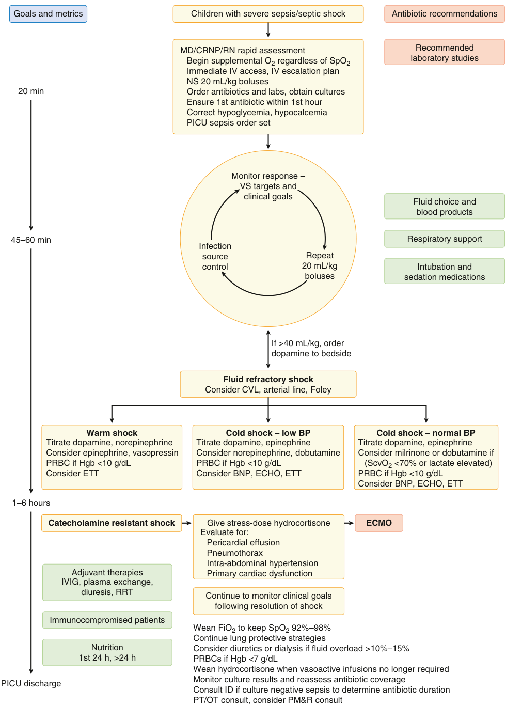

Goals and metrics Children with severe sepsis/septic shock Antibiotic recommendations MD/CRNP/RN rapid assessment Recommended Begin supplemental O2 regardless of SpO2 laboratory studies Immediate IV access, IV escalation plan NS 20 mL/kg boluses 20 min Order antibiotics and labs, obtain cultures Ensure 1st antibiotic within 1st hour Correct hypoglycemia, hypocalcemia PICU sepsis order set Monitor response – VS targets and clinical goals Fluid choice and blood products 45–60 min Respiratory support Infection source Repeat control 20 mL/kg Intubation and boluses sedation medications If >40 mL/kg, order dopamine to bedside Fluid refractory shock Consider CVL, arterial line, Foley Warm shock Cold shock – low BP Cold shock – normal BP Titrate dopamine, norepinephrine Titrate dopamine, epinephrine Titrate dopamine, epinephrine Consider epinephrine, vasopressin Consider norepinephrine, dobutamine Consider milrinone or dobutamine if PRBC if Hgb &lt;10 g/dL PRBC if Hgb &lt;10 g/dL (ScvO2 &lt;70% or lactate elevated) Consider ETT Consider BNP, ECHO, ETT PRBC if Hgb &lt;10 g/dL Consider BNP, ECHO, ETT 1–6 hours Catecholamine resistant shock Give stress-dose hydrocortisone ECMO Evaluate for: Pericardial effusion Pneumothorax Intra-abdominal hypertension Adjuvant therapies Primary cardiac dysfunction IVIG, plasma exchange, diuresis, RRT Continue to monitor clinical goals following resolution of shock Immunocompromised patients Wean FiO2 to keep SpO2 92%–98% Continue lung protective strategies Nutrition Consider diuretics or dialysis if fluid overload >10%–15% 1st 24 h, >24 h PRBCs if Hgb &lt;7 g/dL Wean hydrocortisone when vasoactive infusions no longer required Monitor culture results and reassess antibiotic coverage PICU discharge Consult ID if culture negative sepsis to determine antibiotic duration PT/OT consult, consider PM&R consult 

**Fig. 75.1 Sepsis resuscitation pathway.** _ECMO_ , extracorporeal membrane oxygenation; _ETT_ , endotracheal tube; _FiO2_ , fraction of inspired oxygen; _ICU_ , intensive care unit; _IV_ , intravenous; _PICU_ , pediatric intensive care unit; _PRBC_ , packed red blood cells; _PT_ , prothrombin time; _SpO2_ , saturation of peripheral oxygen.

<!-- PDF page 8 -->

readjustment as the acidosis improves. Commonly used inotropes are listed with brief comments regarding their use in pediatric intensive care are provided in the following paragraphs (Table 75.1).

### EPINEPHRINE

Epinephrine is useful for treating shock in the presence of myocardial dysfunction. Typical starting doses in children are 0.05 to 0.2 mcg/kg/min; with escalating doses up to 1 to 2 mcg/kg/min, there is profound vasoconstriction in the periphery and abdominal organs to shunt blood to the heart and brain.

variable, however, and the conventional dose ranges for dopaminergic targeting may be inaccurate.

### VASOPRESSIN

Vasopressin is a pituitary peptide hormone with action on the kidney and vasculature. In the kidney, vasopressin controls water reabsorption in the renal tubules, and in the vasculature, it causes vasoconstriction by stimulating smooth muscle V1 receptors. Its clinical applications include GI hemorrhage, central diabetes insipidus (DI), and as a second- or third- line agent to treat hypotension.

### ISOPROTERENOL

### DOPAMINE

Dopamine is the metabolic precursor of both NE and epinephrine. Its effects are dose- dependent, with dopaminergic activity at low doses (although these low- dose dopamine effects have not been demonstrated in critically ill children), β- adrenergic activity with intermediate doses exhibiting chronotropic and inotropic effects, and some α- adrenergic activity at higher doses. Individual pharmacodynamics are

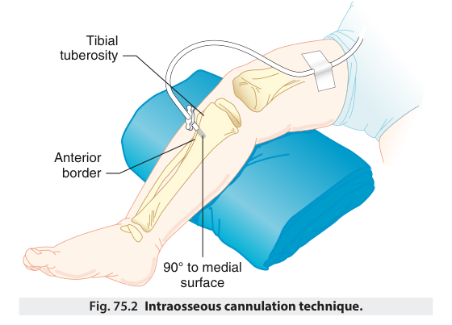

Tibial tuberosity Anterior border 90° to medial surface Fig. 75.2 Intraosseous cannulation technique. 

Isoproterenol is a synthetic, potent, nonselective β- agonist with strong chronotropic effects with very low affinity to α- adrenergic receptors and is usually well tolerated in children. However, high doses of isoproterenol can cause myocardial ischemia.36 Isoproterenol also induces vasodilation that is responsive to acute volume administration. It is often used for increasing HR in complete heart block, in the immediate postoperative period after cardiac transplantation to improve cardiac output by increasing HR in the denervated donor heart, and as a potent pulmonary vasodilator during a pulmonary hypertensive crisis via β2- adrenergic receptor activity.

### DOBUTAMINE

Dobutamine provides positive inotropy and afterload reduction, β and α receptors. Its function is primarily as an inotropic agent but with less vasopressor activity than dopamine. It is only used as a continuous infusion of 5 to 20 mcg/kg/ min and, in some studies, may increase myocardial oxygen. In children but not in adults, it causes tachycardia.37,38

### NOREPINEPHRINE

NE, a drug with strong α- and β- agonist effects, has had a resurgence of use in infants and children.39 Children with nearly normal cardiac function and marked peripheral

**Table 75.1** Vasoactive and Inotropic Medications

|**Drug**|**Effect**|**Dose (mcg/kg/min)**|**Inotropy**|**Chronotropy**|**Vasodilation**|**Vasoconstriction**|
|---|---|---|---|---|---|---|
|Epinephrine (adrenaline)|α,β|0.05–2.0|++|++||++|
|Isoproterenol (Isuprel)|β1,β2|0.05–2.0|++|++|+||
|Dopamine|δ|1–3|||+Renal splanchnic||
|(Intropin)|β>α β,α|5–15 >15|+ +|+ +||+ or − +|
|Milrinone||Bolus: 50 mcg/kg over 15- min period Infusion: 0.375–0.75|+||+||
|Norepinephrine|α>>β|0.05–1.0|Slight+|+||++|
|Nitroprusside||0.5–10|||++||
||||||Arterial > venous||
|Nitroglycerin||1- 20|||++||

::: details 原始表格與符號（PDF 第 8 頁）

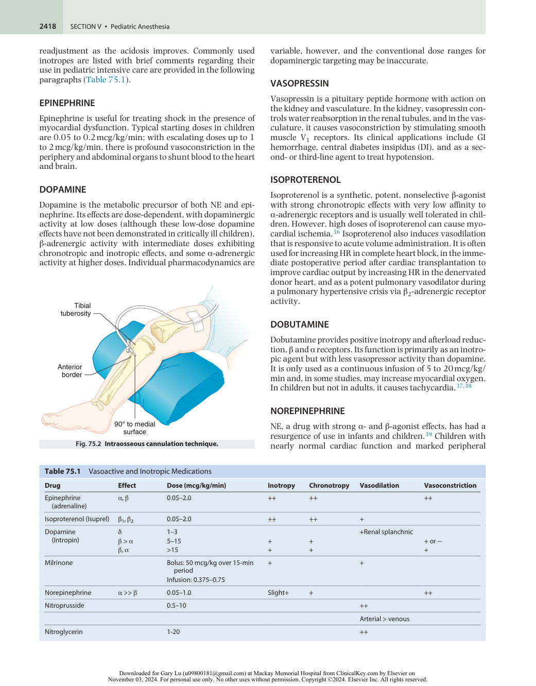

:::

<!-- PDF page 9 -->

vasodilation respond well to this drug. It is beneficial in warm septic shock, anaphylaxis, liver failure, and sympathetic blockade with regional anesthesia.

### MILRINONE

Milrinone is a selective phosphodiesterase III inhibitor that increases cyclic adenosine monophosphate by inhibiting breakdown. Milrinone has both inotropic and vasodilator effects, without acting on α and β receptors and does not increase myocardial oxygen consumption.40 This drug has improved the outcome of children with low cardiac output syndrome after cardiac surgery.41 The loading dose of milrinone is 25 to 75 mcg/kg administered over 10 minutes; the maintenance infusion rate is 0.25 to 0.75 mcg/kg/min. Loading doses are often avoided in the ICU setting because of resultant hypotension. Renal failure significantly increases the elimination half- life of this drug.42,43

### LEVOSIMENDAN

Levosimendan is a novel agent that increases the sensitivity of the contractile apparatus to calcium, increasing inotropy by binding to cardiac myocyte troponin C. This agent will increase cardiac ejection fraction while reducing catecholamine dose with minimal effects on blood pressure and HR. In children, the most common indications have been for cardiac failure or post–cardiac surgery, with a loading dose of 612 mcg/kg followed by an infusion of 0.1 to 0.2 mcg/ kg/min.44,45

### NESIRITIDE

Nesiritide is a recombinant form of the human B- type natriuretic peptide, the hormone released from the cardiac ventricles in response to volume overload and increasing mechanical wall stress. The action is on guanylate cyclase with resulting venous and arterial vasodilation. In addition, B- type natriuretic peptide leads to myocardial relaxation (lusitropy) and natriuresis. It has been used in children to decrease central venous pressure and increase urinary output.46 Usual dosing suggestions for children and adults: initial 2 mcg/kg bolus followed by a continuous infusion of 0.005 to 0.01 mcg/kg/min.

### DIGITALIS

Digitalis is useful for the long- term treatment of myocardial failure in children but may not be effective in neonates.47 Because of its long half- life and unpredictability, digitalis should be administered cautiously to children with changing serum potassium, calcium, and pH levels. In these cases, it is more appropriate to use rapid- acting, titratable inotropic agents.

where large volumes of citrate- containing blood products are rapidly administered, and in neonates with relatively unstable calcium metabolism. Calcium also has effects on the cardiac conduction system. Rapid administration of calcium can cause severe bradycardia or asystole. This effect may be exaggerated in hypokalemic children or those receiving digitalis. The vasomotor effects of calcium are controversial, but most reports show an increase in both SVR and PVR when the drug is administered.48

### BICARBONATE THERAPY

Severe acidosis decreases myocardial function and tissue perfusion. Correction of acidosis with 1 to 2 mEq/kg of sodium bicarbonate is indicated for a pH below 7.20 if ventilation is adequate (PCO2 &lt;40 mm Hg if possible). Treatment is necessary because the circulatory system is refractory to sympathomimetic amines when the pH is less than 7.00. After initial correction of pH, persistence or reappearance of metabolic acidosis suggests a continuing under- perfused state and the need for further therapy. Administration of sodium bicarbonate is only a stopgap measure to improve drug response. Repeat infusions of sodium bicarbonate can cause hypernatremia and hyperosmolarity. Every 50 mEq of bicarbonate administered produces 1250 mL of CO2 when the bicarbonate is fully reacted with acid. Consequently, adequate ventilation must be ensured while the drug is administered to avoid worsening the acidosis.

### VASODILATORS

Vasodilators control systemic hypertension, increase cardiac output by decreasing afterload, control pulmonary hypertension, and control cardiac shunting. Vasodilators effectively treat systemic hypertension and increase cardiac output in children with CHF. Treatment of pulmonary hypertension and intracardiac shunting with vasodilators has met with limited success because they decrease both PVR and SVR, which may increase extrapulmonary rightto- right shunting and further reduce pulmonary blood flow.

### NICARDIPINE

Nicardipine is a dihydropyridine calcium channel–blocking agent used as an intravenous (IV) infusion with powerful, antihypertensive effects in children. Studies have shown that the rapid onset of action is usually within 1 minute, adding to the profile appropriate for treating severe hypertension. Flynn _et al_ . reports that nicardipine is an effective antihypertensive medication in children aged 2 to 18 years.49 In our institution, nicardipine is the drug of choice for hypertensive crisis. Infusion ranges from 0.5 to 1.0 mcg/kg/ min up to 3.0 mcg/kg/min.

### SODIUM NITROPRUSSIDE

### CALCIUM

When serum ionized calcium levels are below normal, administration of calcium produces a positive inotropic effect. If the patient’s ionized calcium levels are normal, less marked inotropic effects occur. Low ionized calcium levels most commonly occur in patients with DiGeorge syndrome,

Sodium nitroprusside relaxes arteriolar and venous smooth muscle, which decreases afterload and preload. The half- life of sodium nitroprusside is only minutes, making it safe to titrate the drug to the desired effect. Nitroprusside is commonly used to control severe systemic hypertension, to provide controlled hypotension to reduce blood loss, and to

<!-- PDF page 10 -->

increase cardiac output in children with low cardiac output syndromes (myocarditis, post–cardiac surgery status).50 Sodium nitroprusside can generally be used for days without problems, although cyanide and thiocyanate poisoning develops in some children, especially those with renal failure or reduced renal perfusion. Serum thiocyanate levels of 10 mg/dL are associated with weakness, hypoxia, nausea, muscle spasms, and disorientation. When these symptoms occur, nitroprusside administration should be discontinued immediately.

### HYDRALAZINE

Hydralazine controls systemic hypertension because it relaxes arterial smooth muscle more than it relaxes veins. Administration of the drug can cause headache, nausea, dizziness, sweating, and tremors. The most important acute side effect is tachycardia, which may increase cardiac output; concurrent administration of beta blockers can counteract this effect.51

### TOLAZOLINE AND PHENTOLAMINE

These competitive α- adrenergic blockers have had varied success in treating pulmonary hypertension.52 However, they are effective in treating the symptoms of pheochromocytoma preoperatively. Serious side effects of these drugs include tachycardia, ventricular arrhythmias, hypotension, and tissue edema.

### PROSTAGLANDIN E1

PGE1 acts directly on vascular smooth muscle and has greatly improved the care of neonates with heart disease. At infusion rates of 0.1 mcg/kg/min, patency of the ductus arteriosus is maintained, and a closed ductus reopens in some neonates. The drug is indispensable in caring for patients with ductus- dependent cardiac lesions, such as interrupted aortic arch, critical aortic stenosis, or hypoplastic left heart syndrome, where systemic blood flow is supplied through the ductus arteriosus. It is equally important for the care of patients who have pulmonary atresia or critical pulmonic stenosis.29 Apnea, fever, and hypotension are common side effects of this drug.

### NITRIC OXIDE

Nitric oxide (NO) is an endothelium- derived relaxing factor that selectively vasodilates the pulmonary vasculature.53 When administered by inhalation to patients with pulmonary hypertension, NO reduces PVR. It improves the survival of neonates who have reactive pulmonary hypertension.54–56 This compound is inactivated by hemoglobin before it reaches systemic circulation. On rare occasions, NO causes systemic vasodilation or clinically significant methemoglobinemia when administered at 5 to 80 ppm.55

## Disorders of Cardiac Rhythm

Sinus tachycardia or an elevated HR for age is not considered an arrhythmia. However, patients with a significantly

increased HR may be the most critically ill in the ICU. Causes of tachycardia include hypovolemia, fever, pain, anxiety, CHF, myocardial disease, myocardial dysfunction, and thyrotoxicosis. With these causes, the goal is to treat the underlying disease state, not tachycardia. For children without underlying heart disease, temporary increases in HR up to 180 to 200 beats/min are well tolerated. Heart rates this high are also not uncommon; younger children cannot increase their stroke volume, so they increase their cardiac output by increasing their HR. Again, the goal is not to specifically control an elevated HR but to treat the cause of tachycardia. Sinus arrhythmia is a phasic acceleration and slowing of the HR that occurs with respiration. Sinus arrhythmia is not an uncommon finding. This phasic acceleration and slowing of HR indicate that the patient has a vagal tone greater than sympathetic tone and can indicate good cardiac reserve. A slow HR or sinus bradycardia is another relatively common heart rhythm in the ICU. It is an unremarkable finding in a relatively fit older teenage patient. Other potential causes include increased intracranial pressure (ICP), hyperkalemia, hypothermia, profound hypoxia, and hypothyroidism. These causes should also be investigated. A slow HR is seen more commonly with increased dosages of dexmedetomidine but can also occur with beta blockers or digoxin use. Sinus node dysfunction can occur following the repair of congenital heart disease in children. Temporary slowing may be treated with the transcutaneous pacemaker placed during surgery. In the absence of myocardial pacing, if there is a complete heart block or a very slow ventricular escape rate, a pacemaker may be needed shortly after the cardiac surgery. Typically, if the patient is easily paced and the escape rate is reasonable, some time is given to see if the bradycardia will resolve.

Normal cardiac conduction starts in the sinus node. The electrical activity propagates through the internodal pathways in the atrium, is delayed in the atrioventricular (AV) node, travels through the bundle of His, and then is conducted to the ventricles through the left and right bundle branches. Supraventricular tachycardia (SVT) is an elevated HR occurring at the level of the atrium, the AV node, or both. SVT typically has a narrow QRS morphology. Sinus tachycardia is, therefore, not a type of SVT but an acceleration of the normal conduction pathways. SVT includes reentrant and non- reentrant tachycardias.

The reentrant tachycardias include AV node reentrant tachycardia (AVNRT), orthodromic reciprocating tachycardia (ORT), and atrial flutter. AVNRT is what is classically thought of as pediatric SVT. The reentrant tachycardias occur due to the presence of an accessory conduction pathway that allows for abnormal electrical conduction in the heart. The presence of the abnormal pathway may be apparent on a standard ECG such as in the case of Wolff– Parkinson–White (WPW) syndrome, where a delta wave is present. Alternatively, the abnormal conduction pathway may not appear on an ECG and is described as a concealed pathway. Concealed pathways are non- WPW ORT. In AVNRT, the AV node itself is the area in which the reentrance occurs. In atrial flutter, there is a micro- reentrant circuit within the atrial tissue itself. In children, the circuit is typically near the tricuspid valve. In atrial flutter, after the reentrant circuit in the atria, the conduction proceeds through the AV node, where it is slowed. The reentrant

<!-- PDF page 11 -->

circuit is small, and the rates of atrial flutter can be very high. As the conduction is slowed in the AV node, these high rates are not usually conducted to the ventricle. However, if atrial flutter or fibrillation occurs in a patient with WPW, the accessory pathway can allow the conduction of the electrical impulse at a rate much greater than through the AV node. This can lead to ventricular tachycardia or fibrillation and can cause sudden death.

The non- reentrant causes of SVT occur due to abnormal automaticity of myocardial tissue. Causes of abnormal automaticity include atrial fibrillation and ectopic atrial tachycardia (EAT). In non- reentrant SVT, the elevated atrial rate is slowed as conduction goes through the AV node. In children, atrial fibrillation is caused by disorganized circuits typically near the pulmonary veins. This rhythm is described as irregularly irregular. EAT is rapid atrial beats that are consecutive and occur without sinus morphology. There can be one focus of the rapid atrial beats. Alternatively, in multifocal or chaotic atrial tachycardia, there can be several different atrial origins. Brief periods of EAT usually do not cause sequelae but can lead to cardiomyopathy if it is prolonged.

Treatment of reentrant SVT is based on whether the patient is clinically unstable or stable. The abnormal reentrant circuit can be interrupted with synchronized cardioversion or other methods. If the patient is unstable, reentrant SVT is treated with synchronized cardioversion with a dose of 0.5 to 1 J/kg. If the patient is stable, there is time to try other therapies. Therapies that increase vagal tone, such as ice to the eyes or a Valsalva maneuver, may interrupt the reentrant circuit. The medication adenosine will temporarily block conduction through the AV node. Adenosine can interrupt episodes of reentrant SVT that have a reentrant circuit using the AV node. If the reentrant circuit does not include the AV node, adenosine might not stop the tachycardia, but it may be helpful with diagnosis. Following administration of adenosine, there will be a period of sinus pause. Erythrocytes metabolize adenosine, so it is a shortacting medication. Equipment to perform cardioversion should be immediately available when adenosine is given. The initial dose is 0.1 mg/kg, which should be given quickly with a sufficient flush. It is more effective when given centrally if available. If it is not effective at the dose of 0.1 mg/ kg, the second dose can be increased to 0.2 mg/kg. Higher doses than this are not likely to be more effective, and if the SVT persists, other medications such as amiodarone, procainamide, or verapamil may be necessary. Amiodarone can block an accessory pathway as well as the AV node. If given too quickly, amiodarone will decrease the blood pressure. Continuous infusions may be necessary after the loading dose for both amiodarone and procainamide. Verapamil will block the AV node for a much longer period than adenosine. However, in younger patients (&lt;2 years), verapamil may induce other life- threatening arrhythmias. If a patient has SVT, a cardiology consult should be obtained. The consult is to address myocardial dysfunction that can occur with long-standing arrhythmias. For this reason an echocardiogram may be beneficial. Depending on the cause of the arrhythmia and response to therapy, long- term follow- up may be needed.

Junctional ectopic tachycardia is caused by abnormal automaticity in an area around the atrioventricular

junction. This is not a common pediatric arrhythmia but can occur following repair of congenital heart disease. The most common lesion with which this occurs is tetralogy of Fallot.

Wide complex tachycardias are assumed to arise from the ventricle until proven otherwise. SVT can cause a wide complex tachycardia if there is an aberrancy of the conduction through the pathways in the ventricle. However, given the risk of delaying therapy, all wide complex tachycardias should initially be treated as ventricular tachycardia. If there is no pulse, initiate CPR, defibrillate, and follow pediatric advanced life support (PALS) guidelines. If the patient has a pulse and stable blood pressure, there may be time to consider other therapies. These alternative therapies are cardioversion or use of medications such as adenosine, amiodarone, or procainamide. Ventricular fibrillation is treated with CPR, defibrillation, and then medications following PALS guidelines. Ventricular rhythms should be quickly examined for the possibility of torsades de pointes, as giving magnesium will be especially helpful.

Following the continuous rhythm strip of all children in the PICU, common ECG abnormalities may be noted. A prolongation of the PR interval or first- degree heart block can occur in otherwise normal children. Typically, these children are asymptomatic. Second- degree heart block occurs as Mobitz type I and Mobitz type II. Mobitz type I is also known as _Wenckebach_ . This is a gradual prolongation of the PR interval until a QRS is not seen and the cycle restarts. This occurs due to a delay of the electrical signal in the AV node, and it can be a benign phenomenon. Mobitz type II is less likely to be a benign phenomenon. The PR interval remains constant, but intermittently there is no QRS or ventricular beat. This phenomenon is evidence of disease of the His–Purkinje fibers and can progress to a complete heart block. Mobitz type II occurs much less frequently in children as compared with adults. Complete heart block or third- degree AV block is the complete dissociation of atrial and ventricular activity. In complete heart block, the atria contract at a rate greater than the ventricle, but they are not conducted to the ventricle. Ventricular contraction occurs through ventricular escape. Congenital complete heart block can occur in infants born to mothers who have an autoimmune disorder such as lupus. Complete heart block can also occur when there is damage to the conduction pathway during surgery for congenital heart disease. As immediate treatment of complete heart block, the ventricular rate may be increased with IV isoproterenol. When this is ineffective, transthoracic or transvenous pacing will be necessary until definitive therapy can be arranged. Premature beats are also seen quite frequently in a PICU setting. Premature atrial contractions are usually benign and are caused by the automaticity of atrial tissue other than the sinus node. Premature ventricular contractions (PVCs) are usually benign with a few considerations. The presence of a central venous catheter or peripherally inserted central catheter (PICC) line touching the heart may cause increased PVCs, and if present, the catheter should be pulled back. Electrolyte abnormalities, typically of potassium, magnesium, and calcium, may cause PVCs. The frequency of PVCs may improve as the electrolytes are corrected. Exogenous catecholamines may cause PVCs, and the frequency of PVCs may improve if the catecholamines

<!-- PDF page 12 -->

### Box 75.2 Causes of Severe Hypertension in Children

|**Renal**|
|---|
|Acute glomerulonephritis (e.g., poststreptococcal, Henoch– Schönlein purpura) Hemolytic–uremic syndrome Chronic glomerulonephritis (all types) Acute and chronic pyelonephritis Congenital malformations (dysplasia, hypoplasia, cystic diseases) Tumors (e.g., Wilms, leukemic infiltrate) Post–renal transplantation status; also rejection Oliguric renal failure Trauma Obstructive uropathy After genitourinary surgery Blood transfusions in children with azotemia|
|**Cardiovascular**|
|Coarctation of the aorta Renal artery abnormalities (e.g., stenosis, thrombosis) Takayasu disease|
|**Endocrine**|
|Pheochromocytoma Neuroblastoma Adrenogenital disease Cushing syndrome Hyperaldosteronism Hyperthyroidism Hyperparathyroidism **Iatrogenic** Intravascular volume overload Sympathomimetic administration (e.g., epinephrine, ephedrine) Corticosteroid administration Rapid intravenous infusion of methyldopa **Miscellaneous**|
|Immobilization (e.g., fractures, burns, Guillain–Barré syndrome) Hypercalcemia (e.g., hypervitaminosis D, metastatic disease, sarcoidosis, some immobilized patients) Hypernatremia Stevens–Johnson syndrome Increased intracranial pressure (any cause) Dysautonomia After resuscitation|

can be decreased. Endogenous catecholamines may cause PVCs, and the frequency may be decreased if pain or anxiety is treated.

## Hypertension

Essential hypertension is uncommon in children, but when it occurs, it is often associated with another disease process (Box 75.2) and is frequently difficult to control. The acute onset of severe systemic arterial hypertension is a medical emergency that has the potential of causing cardiovascular decompensation, encephalopathy, seizures, and intracranial hemorrhage. In older children, the neurologic manifestations of hypertension are more likely to precede cardiovascular decompensation. Neonates with severe

hypertension are frequently initially found to have CHF. Treatment of hypertension is tailored to the disease process, the absolute degree of hypertension, and the presence of cardiovascular or neurologic symptoms.57,58

## Neonatal Resuscitation

Profound changes occur in the cardiovascular and respiratory systems at birth. Failure to successfully make these changes may result in death or central nervous system (CNS) injury. Consequently, someone capable of performing neonatal resuscitation must be present at every delivery. Wasting time finding someone to resuscitate the neonate may be disastrous for the infant. This section discusses the causes and effects of cardiorespiratory insufficiency at birth and the resuscitation techniques. When possible, the recommendations of the American Academy of Pediatrics have been followed.

Guidelines for neonatal resuscitation have been issued by many organizations, including the American Heart Association (AHA) and the American Academy of Pediatrics.59

### INITIAL ASSESSMENT OF THE FETUS AT BIRTH

Initial stabilization should begin with a rapid evaluation of the newborn to determine if the infant is term, breathing, or crying, and has a normal tone (Fig. 75.3).59

### ONGOING ASSESSMENT

Ongoing assessment consists of three signs: HR, respirations, and oxygenation. The preferred method for auscultation of HR is by auscultation. All of these vital signs should be determined within the first 30 seconds.

### CLEARING THE AIRWAY

Proper positioning by placing the infant in the sniffing position is recommended, and the practitioner must try to avoid either underextension or hyperextension, both of which will obstruct the airway. Deep suctioning should be avoided even in healthy, vigorous newborns because of risks of vagal- mediated bradycardia.60 This does not apply to newborns with airway obstruction or the depressed infant with meconium (covered later in this section.)

### TEMPERATURE CONTROL

During the initial resuscitation period, the goal temperature for the newborn is normothermia. The initial step is to dry and warm the infant to a goal axillary temperature of 36.5°C. Infants wrapped in warm blankets or polyethylene from the neck down will avoid evaporative heat loss. Beanies are helpful. Controlled hypothermia should only be attempted in select tertiary centers within hours after birth in infants with hypoxic–ischemic encephalopathy (HIE).

### OXYGEN

One of the changes in neonatal resuscitation in the 2020 Neonatal Resuscitation Program Guidelines is the

::: details 原始表格與符號（PDF 第 12 頁）

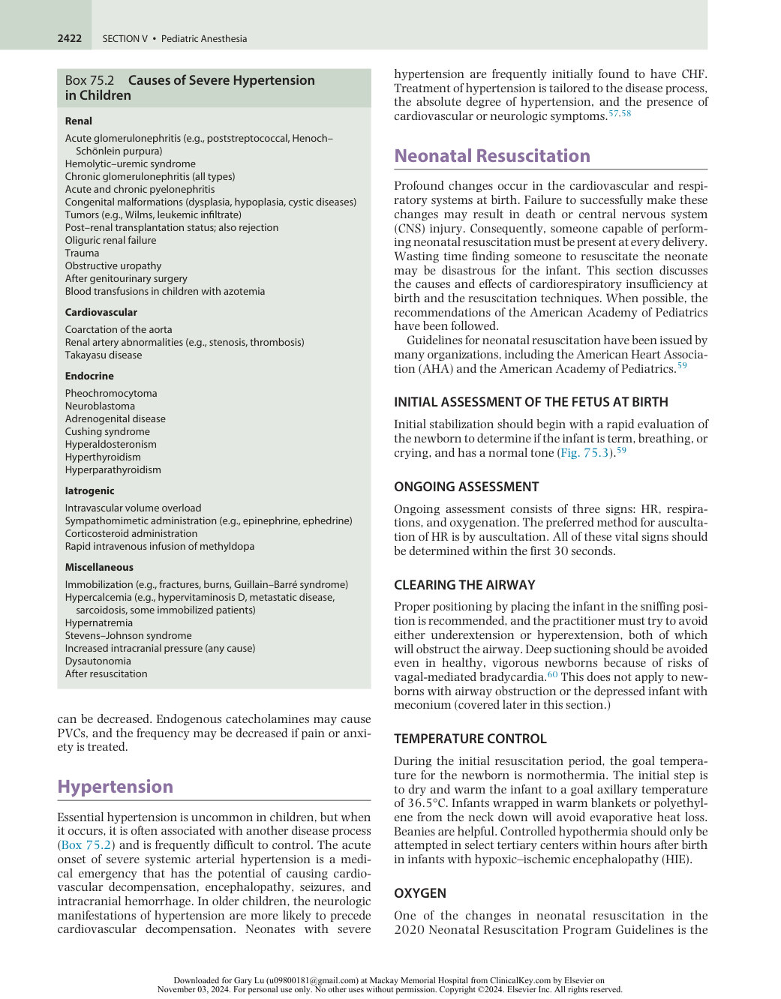

:::

<!-- PDF page 13 -->

### Neonatal Resuscitation Algorithm

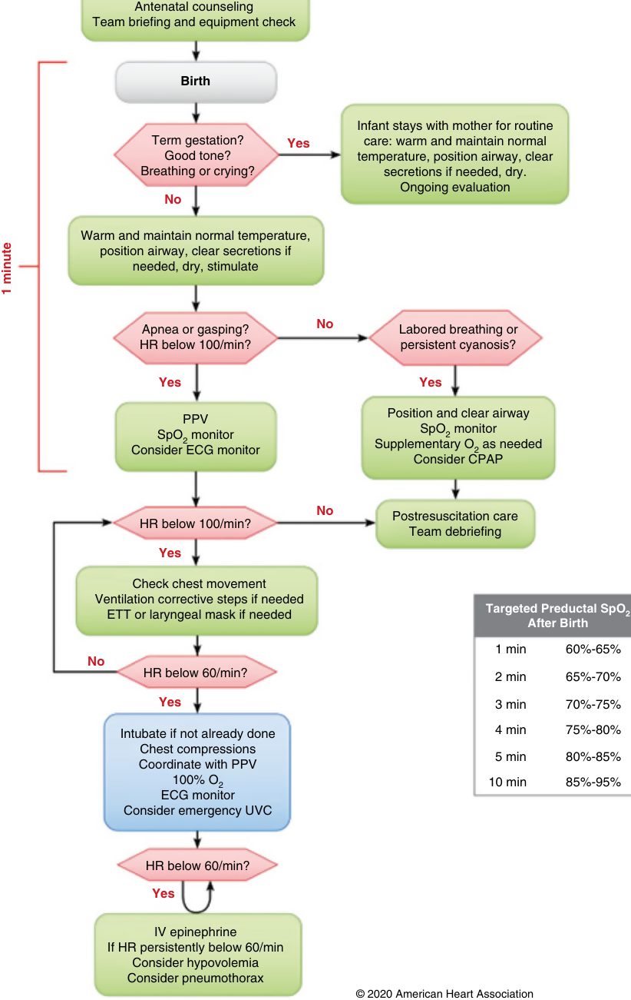

Antenatal counseling Team briefing and equipment check Birth Infant stays with mother for routine Term gestation? Yes care: warm and maintain normal Good tone? temperature, position airway, clear Breathing or crying? secretions if needed, dry. Ongoing evaluation No Warm and maintain normal temperature, position airway, clear secretions if needed, dry, stimulate No Apnea or gasping? Labored breathing or HR below 100/min? persistent cyanosis? Yes Yes PPV Position and clear airway SpO2 monitor SpO2 monitor Consider ECG monitor Supplementary O2 as needed Consider CPAP No Postresuscitation care HR below 100/min? Team debriefing Yes Check chest movement Ventilation corrective steps if needed Targeted Preductal SpO2 ETT or laryngeal mask if needed After Birth 1 min 60%-65% No HR below 60/min? 2 min 65%-70% Yes 3 min 70%-75% Intubate if not already done 4 min 75%-80% Chest compressions 5 min 80%-85% Coordinate with PPV 100% O2 10 min 85%-95% ECG monitor Consider emergency UVC HR below 60/min? Yes IV epinephrine If HR persistently below 60/min Consider hypovolemia Consider pneumothorax © 2020 American Heart Association 1 minute 

**<mark>Fig. 75.3 Neonatal resuscitation algorithm.</mark>** <mark>(Copyright 2020 American Heart Association.)</mark>

<!-- PDF page 14 -->

**Table 75.2** Preterm Infant (&lt;32 Weeks): Titrate Oxygen Using Oxygen Blender to Achieve Target SpO2

|**Time after Birth (min)**|**Target SpO2 (%)**|
|---|---|
|1|60–65|
|2|65–70|
|3|70–75|
|4|75–80|
|5|80–85|
|10|85–95|

_SpO_ 2, saturation of peripheral oxygen.

recommendation of positive pressure ventilation (PPV) with room air. If chest compressions or medications are needed during the resuscitation, then the recommendations are still for PPV with 100% oxygen. If PPV is initiated, it is essential to place a preductal (right hand) oximeter probe on the newborn. For the preterm infant, oxygen should be blended to goal saturation targets. In summary: (1) babies born at 35 weeks and later, use 21% fraction of inspired oxygen (FiO2) for initial PPV; (2) babies born before 35 weeks, use 21%–30% FiO2 for initial PPV; (3) apply oximeter to right hand; (4) titrate FiO2 to normative saturation of peripheral oxygen (SpO2) (Table 75.2).

### VENTILATION

Breathing usually begins by 30 seconds after birth and is sustained by 90 seconds of age. A few minutes after birth, the respiratory rate (RR) of normal neonates is between 40 and 60 breaths/min. The absence of a pause between inspiration and expiration helps develop and maintain functional residual capacity (FRC). Apnea and bradypnea prolong exhalation, reduce FRC, and cause hypoxia. Causes of apnea and bradypnea include severe acidosis, asphyxia, maternal drugs, infections, and CNS damage. Tachypnea (>60 breaths/min) occurs with hypoxemia, hypovolemia, metabolic and respiratory acidosis, CNS hemorrhage, pulmonary gas leaks, pulmonary disease (e.g., hyaline membrane disease, aspiration syndromes, infections), pulmonary edema, and maternal drugs (e.g., narcotics, alcohol, magnesium, barbiturates).

If hand ventilation is required, recommendations now are that initial breaths should be for one second or less, as recruitment maneuvers have been associated with worse outcomes,61,62 and that driving pressures should be adequate to create normal chest rise. Most infants can be ventilated with inflation pressures of 20–25 cmH2O, although occasionally higher driving pressures may be required. PEEP of 5 may have benefits but has yet to have clinically significant improvement in outcomes documented. Ventilation should be performed at 40 to 60 breaths/min with a reassessment of HR, color, and breath sounds. In the neonate, rising HR may be the best assessment of adequate ventilation. If gastric distention becomes a problem, hindering compliance, a gastric tube may be placed (8 Fr) to improve compliance. Both sides of the chest should rise equally and simultaneously with inspiration, but the rise should not exceed that associated with the neonate’s normal spontaneous breathing. The

presence of breath sounds may be misleading because they are well transmitted within the neonate’s small chest. A difference in breath sounds between the two sides of the chest should raise suspicion of endobronchial intubation, pneumothorax, atelectasis, or a congenital lung anomaly. The presence of loud breath sounds over the stomach suggests esophageal intubation or a tracheoesophageal fistula. If ventilation is adequate, the neonate will become pink, initiate rhythmic breathing, and have a normal HR. If the practitioner has difficulty with bag–mask ventilation or fails intubation, a laryngeal mask airway (LMA) should be considered.63,64 The neonate’s HR should be monitored continuously during endotracheal intubation because tracheal intubation may cause arrhythmias in hypoxic neonates.

### PNEUMOTHORAX

Pneumothorax occurs in 1% of all vaginal deliveries, 10% of meconium- stained neonates, and 2% to 3% of neonates requiring mechanical ventilation in the delivery room. The hemithorax containing free air is usually hyperexpanded and moves poorly with ventilation. The point of maximum cardiac impulse is shifted toward the side without the pneumothorax. Heart tones may be muffled.

If a small, high- intensity cold light is placed directly on the skin of the neonate’s chest, the involved side of the chest will glow if a pneumothorax is present.65 Pneumothoraces are relieved by needle or chest tube drainage.

### ENDOTRACHEAL INTUBATION

The head should be placed in a neutral or “sniffing” position during bag- and- mask ventilation and tracheal intubation. An appropriately sized endotracheal tube (ETT) is inserted and its tip is placed 1 to 2 cm below the vocal cords, depending on the size of the neonate. Usually, this means that the distance from the tip of the tube to the gums is 7, 8, 9, or 10 cm in 1- , 2- , 3- , and 4- kg infants. A small gas leak between the ETT and trachea should be present when the ventilation pressure is 15 to 25 cmH2O. This usually entails the use of a 2.5- mm (internal diameter) tube for neonates weighing less than 1.5 kg, a 3.0mm tube for those between 1.5 and 2.5 kg, and a 3.5- mm tube for those weighing more than 2.5 kg. Successful tracheal intubation is confirmed by observing bilateral chest movement with each mechanical inspiration, and by observing condensation in the ETT during exhalation. Breath sounds should be much louder over the chest than over the abdomen, and skin color, HR, and SaO2 should improve with positive- pressure ventilation. Carbon dioxide should be present during exhalation. However, the small tidal volumes and low pulmonary blood flow of some infants at birth may make it challenging to use capnography effectively.

### CARDIAC COMPRESSIONS

The thumb encircling technique is favored over two- finger technique. The provider should place both thumbs on the sternum and allow the fingers to support the back (Fig. 75.4). Compress the sternum to approximately one- third the depth

::: details 原始表格與符號（PDF 第 14 頁）

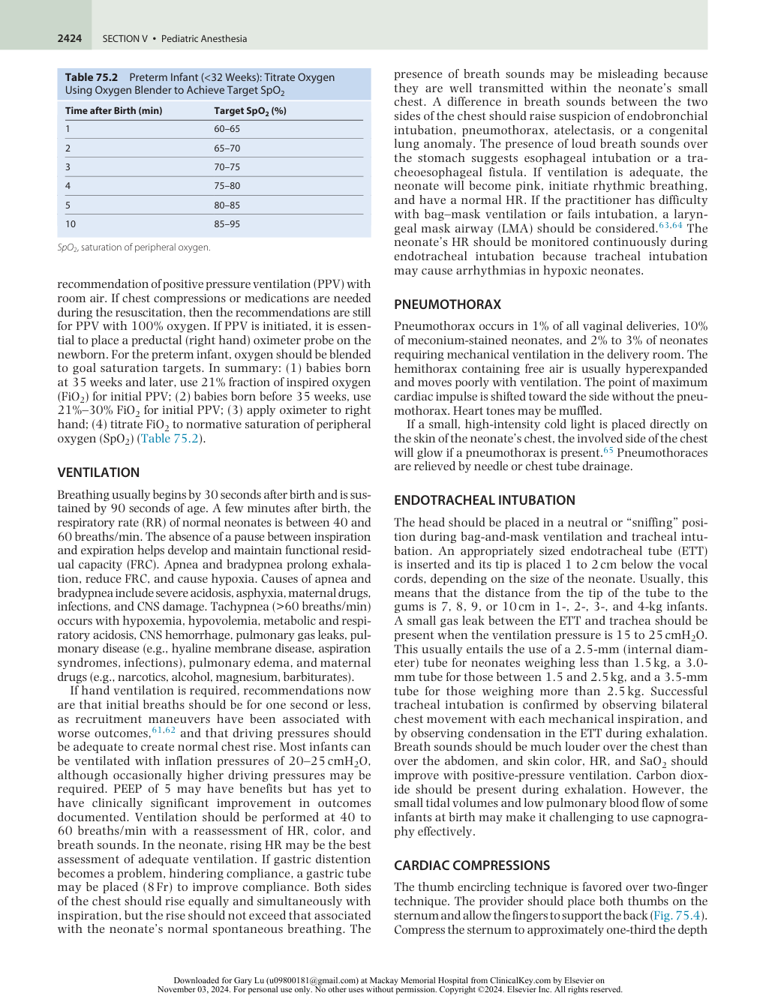

:::

<!-- PDF page 15 -->

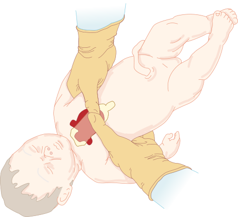

**Fig. 75.4 Neonatal chest compression.** For simplification, ventilation is not shown. (From Gregory GA. Resuscitation of the newborn. _Anesthesiology_ . 1975;43:225.)

of the chest. Three compressions should be performed with a breath in place of the fourth compression for an effective compression rate of 90 compressions and 30 breaths/min. HR should be evaluated every 45 to 60 seconds, and if after adequate ventilation and compressions for 60 seconds, the HR is still less than 60 beats/min, then medications should be considered. The provider may elect to position themselves from the head of the child to allow a second provider to place umbilical venous access.

### MEDICATIONS

Resuscitation with medications is needed only for the infant that is critically depressed or presents with significant anomalies leading to cardiovascular depression. There should be a quick reference drug list designed for each delivery room for easy access during these rare occasions and it should help with dosing based on an estimated weight of the infant at birth. The IV route of administration is preferred for the administration of resuscitation medications; however, intraosseous (IO) and umbilical venous catheters can be placed rapidly by trained individuals and may be life- saving.

### Epinephrine

The primary medication used in the resuscitation of a newborn is epinephrine, which should be given if the infant’s HR is less than 60 beats/min 45 to 60 seconds after the initiation of PPV and chest compressions. The recommended dose is 0.1 to 0.3 mL/kg of 1:10,000 concentration; (0.01–0.03 mg/ kg), followed by a 1 mL saline flush. While IV administration is preferable if venous access is not obtained, it is appropriate to give a higher dose of epinephrine: 0.5 to 1 mL/kg of 1:10,000 concentration; (0.05–0.1 mg/kg) via endotracheal tube. If venous access is obtained after tracheal administration of epinephrine, a second dose is indicated if it can be given without delay. Routine redosing interval is

every three to five minutes, as needed, while re- evaluating HR every 45 to 60 seconds.

### Naloxone

Naloxone (Narcan) is not recommended as an initial response to respiratory distress in neonatal resuscitation.59,66 Neonates should be supported on PPV, even in women who have received narcotics less than four hours before delivery. However, if respiratory depression continues, naloxone can be considered. In addition, naloxone should be avoided in an infant whose mother has a history of narcotic dependence due to the risk of seizures from withdrawal.

### DETECTION OF HYPOVOLEMIA

Hypovolemia is detected by measuring arterial blood pressure and by physical examination (i.e., skin color, perfusion, capillary refill time, pulse volume, and extremity temperature).

CVP measurements are helpful in detecting hypovolemia and in determining the adequacy of fluid replacement. The venous pressure of normal neonates is 2 to 8 cmH2O. If CVP is less than 2 cmH2O, hypovolemia should be suspected.

### TREATMENT OF HYPOVOLEMIA

Treatment of hypovolemia requires expansion of intravascular volume with blood and crystalloid. Albumin may also be used, but evidence of its effectiveness is limited. If it is suspected that the neonate will be hypovolemic at birth, Rh- negative type O packed RBCs should be available in the delivery room before the neonate is born.67 Crystalloid and blood should be titrated in 10 mL/kg and given slowly over 10 minutes, if hemodynamics allow, to limit the risk of intraventricular hemorrhage.

Occasionally, enormous blood and fluid volumes are required to raise arterial blood pressure to normal. At times, more than 50% of the blood volume (85 mL/kg in term neonates and 100 mL/kg in preterm neonates) must be replaced, especially when the placenta is transected or abrupted during birth. In most cases, less than 10 to 20 mL/ kg of volume restores mean arterial pressure to normal.

### OTHER CAUSES OF HYPOTENSION

Hypoglycemia, hypocalcemia, and hypermagnesemia also cause hypotension in neonates. Hypotension induced by alcohol or magnesium intoxication usually responds to blood volume expansion or dopamine, or both. Hypermagnesemic neonates generally respond to 100 to 200 mg/kg of calcium gluconate administered over 5 minutes.59

### MECONIUM

Meconium- stained amniotic fluid (MSAF), when aspirated into the lungs during delivery or _in utero_ , can cause severe lung injury and respiratory distress syndrome (RDS). Most cases of meconium aspiration occur _in utero_ ; therefore, endotracheal intubation to suction the airway to remove MSAF should only occur if the neonate is distressed absent

<!-- PDF page 16 -->

or depressed respirations, HR less than 100 beats/min, or poor muscle tone.59,68,69 A depressed MSAF- stained infant should be intubated as soon as possible following delivery. Suctioning is accomplished through an ETT, and if there is a significant amount of MSAF or the infant remains _in extremis_ , they should be transferred directly to the neonatal ICU.

### COLOR

Essentially all neonates have a blue- tinged cast to their skin at birth. By 60 seconds of age, most of them are entirely pink, except for their hands and feet, which remain blue. If central cyanosis persists beyond 90 seconds of age, asphyxia, low cardiac output, pulmonary edema, methemoglobinemia, polycythemia, congenital heart disease, arrhythmias, and pulmonary disorders (e.g., respiratory distress, airway obstruction, hypoplastic lungs, diaphragmatic hernia) should be considered, especially if the infant remains cyanotic despite oxygen and controlled ventilation. Neonates who are pale at birth are often asphyxiated, hypovolemic, acidotic, or anemic or have congenital heart disease. A neonate whose skin is entirely pink within 2 minutes of birth may be intoxicated with alcohol or magnesium or may be alkalotic (pH >7.50). Rubrous neonates are usually polycythemic.

### RESUSCITATION EQUIPMENT

Resuscitation beds should allow positioning of the neonate’s head below the level of the lungs to promote drainage of the lung fluid and reduce the likelihood of aspirating gastric contents. A servo- controlled infrared heater should be used to maintain the neonate’s temperature between 36°C and 37°C unless there is evidence of asphyxia. If asphyxia is noted, body temperature should be reduced to 34°C to 35°C for brain protection after arrival in neonatal intensive care unit (NICU). A suction device should be available and allow the suction pressure to be varied; pressures below −100 mm Hg should not be used.

Equipment required for tracheal intubation includes 0 and 00 straight laryngoscope blades; a pencil- type laryngoscope handle; 2.5- , 3.0- , and 3.5- mm ETTs; and a suction catheter that easily fits through each size tube. The ventilation system must permit ventilatory rates of at least 150 breaths/min and make it possible to maintain positive endexpiratory pressure (PEEP). One- way valves can stick in the closed position, especially when high gas flow and high RRs are used. The modified Jackson–Rees or Ayres system works well with appropriate training. Overexpansion of the lungs with large tidal volumes injures the lungs and activates inflammatory processes that may cause chronic lung disease. Gentle inflation of the lung is less injurious to the lung. Airway inflation pressures should be measured continuously during assisted or controlled ventilation in the delivery room, and excessive pressures and tidal volumes should be avoided. As in any critical care situation, patient care should be guided by information. Consequently, blood gas and pH measurements are mandatory, and the results of these tests must be available within 10 minutes of drawing the blood sample. Umbilical arterial catheters are helpful for measuring arterial blood pressure and withdrawing blood for blood gas analysis and pH. Umbilical arterial catheters can also be used to infuse emergency fluids. Arterial

oxygen saturation (SaO2) can be measured immediately after birth by attaching a pulse oximeter to a hand or foot.70 Pulse oximeters permit rapid detection of changes in oxygenation and rapid reduction of fraction of inspired oxygen (FiO2). The normal SaO2 of neonates is usually 87% to 95%, associated with a PaO2 of 55 to 70 mm Hg.

### PEDIATRIC CARDIAC ARREST AND RESUSCITATION

Pediatric cardiac arrest is not a rare event. At least 16,000 American children (8–20/100,000 children/year) suffer a cardiopulmonary arrest yearly.71–75 More than half of these cardiac arrests probably occur in hospital.71–76 With advances in resuscitation science and implementation techniques, survival from pediatric cardiac arrest has improved substantially over the past 25 years.77

As an example of improved resuscitation, survival to discharge from pediatric in- hospital cardiac arrest has increased from less than 10% in the 1980s78,79 to greater than 25% in the 21st century. Of the pediatric patients that survive to hospital discharge, nearly three- quarters will have a favorable neurologic function defined by specific pediatric cerebral outcome measures and qualityof- life indicators.77,80–82 Factors that influence outcome from pediatric cardiac arrest include (1) the preexisting condition of the child; (2) the environment in which the arrest occurs; (3) the initial ECG rhythm detected; (4) the duration of no- flow time (the time during an arrest without spontaneous circulation or CPR); (5) the quality of the life–supporting therapies provided during the resuscitation; and (6) the quality of the life–supporting therapies during postresuscitation.

Not surprisingly, outcomes following pediatric out- ofhospital arrests are much worse than those after in- hospital arrests.72,73,73–91 This may be attributed to a prolonged period of no flow in out- of- hospital arrests. Many of the pediatric cardiac arrests are not witnessed, and only 30% of children are provided with bystander CPR. As a result of these factors, less than 10% of cases of pediatric out- of- hospital cardiac arrest (OHCA) survive to hospital discharge, and for those that do survive, severe neurologic injury is common. These findings are especially troublesome, given that bystander CPR more than doubles patient survival rates in adults.92 An exciting prospective, nationwide, populationbased cohort study from Japan similarly demonstrates more than doubling survival rates for children who have OHCA and receive bystander CPR either with conventional CPR (with rescue breathing) or chest compression–only CPR compared with no bystander CPR.93 The same study then further stratifies outcomes for OHCA into “cardiac” and “noncardiac” causes for arrest and defines the relative value of rescue breathing during CPR by bystanders. Pediatric patients who have OHCA with noncardiac causes and receive bystander conventional CPR (including rescue breathing) were associated with higher frequency of favorable neurologic outcomes at 1 month after arrest compared with compression- only bystander CPR or no bystander CPR. For pediatric arrests defined as “cardiac” in nature, bystander CPR (conventional or compression- only) was associated with a higher rate of favorable neurologic outcomes 1 month after arrest compared with no bystander

<!-- PDF page 17 -->

CPR. Interestingly, the two types of bystander CPR (conventional or compression- only) seemed similarly effective for pediatric cardiac arrests with cardiac causes, consistent with animal and adult studies.93

Survival outcomes after in- hospital cardiac arrest are higher in the pediatric population compared with adults; 27% of children survive to hospital discharge compared with only 17% of adults.77 For children and adults, outcomes are better after arrhythmogenic arrests, ventricular fibrillation (VF)/ventricular tachycardia (VT). Importantly, pediatric in- hospital arrests are less commonly caused by arrhythmias (10% of pediatric arrests vs. 25% of adult arrests), and approximately one- third of children and adults with these arrhythmogenic arrests survive to hospital discharge. Interestingly, the superior pediatric survival rate following in- hospital cardiac arrest reflects a substantially higher survival rate among children with asystole or pulseless electrical activity (PEA) than adults (24% vs. 11%). Further investigations have shown that the superior survival rate seen in children is mostly attributable to a much better survival rate among infants and preschool- age children compared with older children.81 Although speculative, the higher survival rates in children may be due to improved coronary and cerebral blood flow (CBF) during CPR because of increased chest compliance in these younger arrest victims, with improved aortic diastolic pressure and venous return.94,95 In addition, survival of pediatric patients from an in- hospital cardiac arrest is more likely in hospitals staffed with dedicated pediatric physicians.96

## Phases of Resuscitation

The four distinct phases of cardiac arrest and CPR interventions are (1) prearrest, (2) no flow (untreated cardiac arrest), (3) low flow (CPR), and (4) postresuscitation/arrest. Interventions to improve the outcome of pediatric cardiac arrest should optimize therapies targeted to the time and phase of CPR, as suggested in Table 75.3.

### PREARREST

The prearrest phase refers to any relevant preexisting conditions of the child (e.g., neurologic, cardiac, respiratory, or metabolic problems) and precipitating events (e.g., respiratory failure or shock), uncoupling metabolic delivery, and metabolic demand. Pediatric patients who suffer an in- hospital cardiac arrest often have changes in their physiologic status in the hours leading up to their arrest event.97,98 Therefore, interventions during the prearrest phase focus on preventing cardiac arrest, with particular attention to early recognition and targeted treatment of respiratory failure and shock. Early recognition plays a key role in identifying a prearrest state in children, who, unlike adults, may be unable to mount a prolonged physiologic response to a worsening clinical picture. Medical emergency teams (METs; also known as _rapid response teams_ ) are in- hospital emergency teams explicitly designed to respond to a prearrest state in children. Front- line providers, and even parents, are encouraged to initiate evaluation by METs based on physiologic protocol- driven parameters

**Table 75.3** Phases of Cardiac Arrest and Resuscitation

|**Phase**|**Interventions**|
|---|---|
|Prearrest phase (protect)|Optimize patient monitoring and rapid emergency response Recognize and treat respiratory failure or shock to prevent cardiac arrest|
|Arrest (no- flow) phase (preserve)|Minimize interval to BLS and ACLS Organize response with clear leadership Minimize interval to defibrillation, when indicated|
|Low- flow (CPR) phase (resuscitate)|Push hard, push fast Allow full chest recoil Minimize interruptions in compressions Avoid overventilation Titrate CPR to optimize myocardial blood flow (coronary perfusion pressures and exhaled CO2) Consider adjuncts to improve vital organ perfusion during CPR Consider ECMO if standard CPR/ALS not promptly successful|
|Postresuscitation phase: short- term|Optimize cardiac output and cerebral blood flow Treat arrhythmias, if indicated Avoid hyperglycemia, hyperthermia, hyperventilation Debrief to improve future responses to emergencies|
|Postresuscitation phase: long- term rehabilitation (regenerate)|Early intervention with occupational and physical therapy Bioengineering and technology interface Possible future role for stem cell transplantation|

_ACLS,_ advanced cardiac life support; _ALS,_ advanced life support; _BLS,_ basic life support; _CPR,_ cardiopulmonary resuscitation; _ECMO,_ extracorporeal membrane oxygenation.

or even intuition. Patients are assessed by the METs, and those at high risk of clinical decompensation are transferred to a PICU if necessary, to prevent progression to full cardiac arrest or to decrease the response time to initiation of advanced life support, thereby limiting the no- flow state. Implementation of METs decreases the frequency of cardiac arrests compared with retrospective control periods before MET initiation.99–101 While early recognition protocols cannot identify all children at risk for cardiac arrest, it seems reasonable to assume that transferring critically ill children to an ICU early in their disease process for better monitoring and more aggressive interventions can improve resuscitative care and clinical outcomes. The caveat is that prearrest states must be identified to initiate monitoring and interventions that may inhibit the progression to an arrest. While a significant amount of research dollars and resources are spent on the other phases of cardiac arrest, particular focus on the prearrest state may yield the greatest improvement in survival and neurologic outcomes.

### NO FLOW/LOW FLOW

### Airway–Breathing–Circulation or Circulation– Airway–Breathing

For OHCA victims, “compression- only” CPR has been associated with improved outcomes.102,103 This is now the

::: details 原始表格與符號（PDF 第 17 頁）

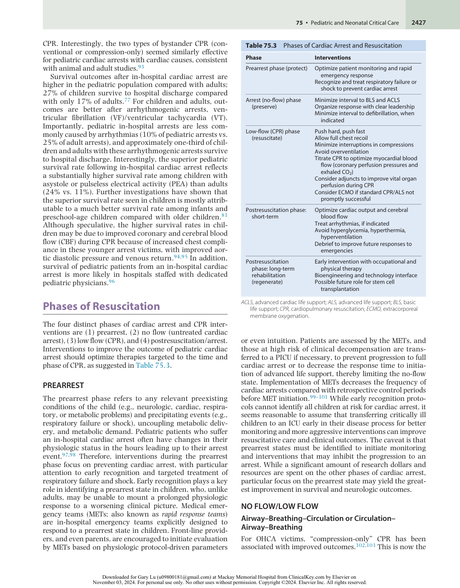

:::

<!-- PDF page 18 -->

recommended modality for emergency medical service dispatchers instructing bystander CPR.104 In a recent Japanese study, children with OHCA due to a primary cardiac etiology displayed an equivalent survival rate between compressiononly CPR and classic CPR with rescue breaths. However, only 29% of patients had a cardiac cause of OHCA. Those with noncardiac etiology in the overall cohort had a significantly worse survival rate with compression- only CPR than classic CPR with rescue breaths.105 Additionally, in another nationwide Japanese OHCA registry study, compressiononly CPR was superior to no bystander CPR at all but not to conventional CPR.106 In an American OHCA registry study, children who received conventional bystander CPR with chest compressions and rescue breaths had improved rates of overall survival and survival with favorable outcomes as compared with those who did not receive CPR. In contrast, those receiving compression- only CPR did not fare any better than children not receiving CPR.107 Thus compression- only CPR is not recommended for children in either the inpatient or out- of- hospital setting, except in situations where “rescuers are unwilling or unable to deliver breaths.”108

Regardless, the prioritization of initial interventions during CPR has shifted from airway- breathingcirculation (“A- B- C”) to circulation- airway- breathing (“C- A- B”) in order to prevent harmful delays in the initiation of chest compressions and due to the relative complexity of the tasks involved in providing assisted ventilation. This is endorsed by both the 2010 and 2015 AHA BLS Guidelines.108,109 However, a 2015 International Liaison Committee on Resuscitation consensus statement identified a paucity of pediatric- specific evidence to support this recommendation.110 In our opinion, the approach is physiologically sound, especially given the association between delayed chest compression initiation and poor outcomes. With that said, the pediatric provider must consider the predominance of asphyxia and hypoxemia as precursors to cardiac arrest.77,111 This is especially true in the ICU and operating room, where personnel and other resources frequently allow for simultaneous circulatory support with high- quality chest compressions as well as the provision of assisted ventilations by experienced personnel.

To improve outcomes from pediatric cardiac arrest, shortening the no- flow phase of untreated cardiac arrest is imperative. To that end, it is important to monitor highrisk patients to allow early recognition of cardiac arrest and prompt initiation of basic and advanced life support. Effective CPR optimizes coronary perfusion pressure (by elevating aortic diastolic pressure relative to right atrial pressure [RAP]) and cardiac output to critical organs to support vital organ viability (by elevating mean aortic pressure) during the low- flow phase. Important tenets of basic life support are _push hard, push fast, allow full chest recoil between compressions, and minimize interruptions of chest compression_ . The myocardium receives blood flow from the aortic root, mainly during diastole, via the coronary arteries. When the heart arrests and no blood flows through the aorta, coronary blood flow ceases. However, during chest compressions, aortic pressure rises at the same time as RAP. With the subsequent decompression phase of chest compressions, the RAP falls faster and lower than the aortic pressure,

generating a pressure gradient that perfuses the heart with oxygenated blood. Therefore, full elastic recoil (release) is critical to create a pressure difference between the aortic root and the right atrium. A cerebral perfusion pressure (CPP) below 15 mm Hg during CPR is a poor prognostic factor for the return of spontaneous circulation (ROSC). Achieving optimal coronary perfusion pressure, exhaled carbon dioxide concentration, and cardiac output during the low- flow phase of CPR is consistently associated with an improved chance for ROSC and improved short- and long- term outcome in mature animal and human studies.112–119 There is a critical need for research evaluating goal- directed CPR, both in immature animal models and pediatric patients. Rapid detection and prompt defibrillation are other measures essential for truncating the no- flow phase during VF and pulseless VT. Clearly, CPR alone is inadequate for successful resuscitation from these arrhythmias. For cardiac arrests resulting from asphyxia and/or ischemia, the provision of adequate myocardial perfusion and myocardial oxygen delivery are the critical elements for ROSC.

### POSTARREST/RESUSCITATION

The postarrest/resuscitation phase includes coordinated, skilled management of the immediate postresuscitation stage, the next few hours to days, and long- term rehabilitation. The immediate postresuscitation stage is a high- risk period for ventricular arrhythmias and other reperfusion injuries. Goals of interventions implemented during the immediate postresuscitation stage and the next few days include adequate tissue oxygen delivery, treatment of postresuscitation myocardial dysfunction, and minimizing postresuscitation tissue injury (e.g., preventing postresuscitation hyperthermia and hypoglycemia; and, perhaps initiating postresuscitation therapeutic hypothermia, preventing hyperglycemia, and avoiding hyperoxia). This postarrest/resuscitation phase may have the greatest potential for innovative advances in understanding cell injury (excitotoxicity, oxidative stress, metabolic stress) and cell death (apoptosis and necrosis), ultimately leading to novel molecular- targeted interventions. The rehabilitation stage concentrates on the salvage of injured cells, and support for reengineering reflex and voluntary communications of these cell and organ systems to improve long- term functional outcomes.

The specific phase of resuscitation dictates the focus of care. Interventions that improve outcomes during one phase may be deleterious during another. For instance, intense vasoconstriction during the low- flow phase of cardiac arrest improves coronary perfusion pressure and the probability of ROSC. The same intense vasoconstriction during the postresuscitation phase increases left ventricular afterload and may worsen myocardial strain and dysfunction. Current understanding of the physiology of cardiac arrest and recovery allows us to only crudely manipulate blood pressure, oxygen delivery and consumption, body temperature, and other physiologic parameters to optimize outcomes. Future strategies likely will take advantage of increasing knowledge of cellular injury, thrombosis, reperfusion, mediator cascades, cellular markers of injury and recovery, and transplantation technology, including stem cells.

<!-- PDF page 19 -->

## Interventions During the Cardiac Arrest (No Flow) and Cardiopulmonary Resuscitation (Low Flow)

### AIRWAY AND BREATHING

During CPR, cardiac output and pulmonary blood flow are ∼10% to 25% of that during normal sinus rhythm; therefore, a lower minute ventilation is necessary for adequate gas exchange from the blood traversing the pulmonary circulation. Animal and adult data indicate that overventilation (“overventilation” from exuberant rescue breathing) during CPR is common and can substantially compromise venous return and, subsequently, cardiac output.120–122 These detrimental hemodynamic effects are compounded when one considers the effect of interruptions in CPR to provide airway management and rescue breathing and may contribute to worse survival outcomes.123–126 While overventilation is problematic, in light of the fact that most pediatric arrests are asphyxial, immediate initiation of adequate ventilation is still important. The difference between arrhythmogenic and asphyxial arrests lies in physiology. In animal models of sudden VF cardiac arrest, acceptable PaO2 and PaCO2 persist for 4 to 8 minutes during chest compressions without rescue breathing.127,128 This is partly because aortic oxygen and carbon dioxide concentrations at the onset of the arrest do not vary much from the prearrest state with no blood flow and minimal aortic oxygen consumption. The lungs act as a reservoir of oxygen during the low- flow state of CPR; therefore, adequate oxygenation and ventilation can continue without rescue breathing. Several retrospective studies of witnessed VF cardiac arrest in adults have also shown that outcomes are similar after bystander- initiated CPR with either chest compressions alone or chest compressions plus rescue breathing.129 However, during asphyxial arrest, peripheral and pulmonary blood flow continues during the prearrest state, resulting in significant arterial and venous oxygen desaturation, elevated lactate levels, and depletion of the pulmonary oxygen reserve. Therefore, at the onset of CPR, there is substantial arterial hypoxemia and acidemia. In this circumstance, rescue breathing with controlled ventilation can be a lifesaving maneuver. In contrast, the adverse hemodynamic effects from overventilation during CPR and possible interruptions in chest compressions to open the airway and deliver rescue breathing are lethal in certain circumstances such as VT/VF arrests. In short, the resuscitation technique should be titrated to the patient’s physiology to optimize patient outcome.

### CIRCULATION: OPTIMIZING BLOOD FLOW DURING LOW-FLOW CARDIOPULMONARY RESUSCITATION: PUSH HARD, PUSH FAST

When the heart arrests, no blood flows to the aorta, and coronary blood flow ceases immediately.129 At that point, the provision of high- quality CPR ( _push hard, push fast_ ) is vital to reestablish coronary flow. The goal during CPR is to maximize the myocardial perfusion pressure

(MPP). Related by the following equation – MPP = aortic diastolic blood pressure (AoDP) minus right atrial pressure (RAP) – myocardial blood flow improves as the gradient between AoDP and RAP increases. During the downward compression phase, aortic pressure rises simultaneously as RAP, with little change in the MPP. However, during the decompression phase of chest compressions, the RAP falls faster and lower than the aortic pressure, which generates a pressure gradient perfusing the heart with oxygenated blood during this artificial period of “diastole.” Several animal and human studies have demonstrated, in both VT/VF and asphyxial models, the importance of establishing MPP as a predictor for short- term survival outcomes (ROSC).118,130–133 Because there is no flow without chest compressions, it is essential to minimize interruptions in chest compressions. To allow good venous return in the decompression phase of external cardiac massage, it is also essential to allow full chest recoil and to avoid overventilation (preventing adequate venous return because of increased intrathoracic pressure).

Based on the provided equation, MPP can be improved by strategies that increase the pressure gradient between the aorta and the right atrium. As an example, the inspiratory impedance threshold device (ITD) is a small, disposable valve that can be connected directly to the tracheal tube or face mask to augment negative intrathoracic pressure during the inspiratory phase of spontaneous breathing and the decompression phase of CPR by impeding airflow into the lungs. Application in animal and adult human trials of CPR has established the ability of the ITD to improve vital organ perfusion pressures and myocardial blood flow134–139 ; however, in the only randomized trial during adult CPR, mortality benefit was limited to the subgroup of patients with PEA.139 Additional evidence that augmentation of negative intrathoracic pressure can improve perfusion pressures during CPR comes from the active compression–decompression device (ACD). The ACD is a handheld device that is fixed to the anterior chest of the victim using suction similar to a household plunger that can be used to apply active decompression forces during the release phase, thereby creating a vacuum within the thorax. By actively pulling during the decompression phase, blood is drawn back into the heart by negative pressure.140 Animal and adult studies have demonstrated that the combination of ACD with ITD act in concert to further improve perfusion pressures during CPR compared with ACD alone.136 In the end, while novel interventions such as the ITD and ACD are promising adjuncts to improve blood flow during CPR, the basic tenants of _push hard, push fast, allow full chest wall release, minimize interruptions,_ and _don’t overventilate_ are still the dominant factors to improve blood flow during CPR and chance of survival.

### CHEST COMPRESSION DEPTH

The pediatric chest compression depth recommendation of at least one- third of anterior–posterior chest depth (approximately 4 cm in infants and 5 cm in children) is based largely upon expert clinical consensus, using data extrapolated from animal, adult, and limited pediatric data. In a small

<!-- PDF page 20 -->

study of six infants, chest compressions targeted to one- half anterior–posterior chest depth resulted in improved systolic blood pressures compared with those targeted at one- third anterior–posterior chest depth.141 While only a small series with qualitatively estimated chest compression depths, this is the first study to collect actual data from children supporting the existing chest compression depth guidelines. On the contrary, two recent studies using computed tomography (CT)142,143 suggest that depth recommendations based on a relative (%) anterior–posterior chest compression depth are deeper than that recommended for adults, and that a depth of one- half anterior–posterior chest depth will result in direct compression to the point of fully emptying the heart and requisite shifting of the heart because of inadequate anteroposterior (AP) diameter reserve in most children. Future studies that collect data from actual children and that associate quantitatively measured chest compression depths with short- and long- term clinical outcomes (arterial blood pressure, end- tidal carbon dioxide, ROSC, survival) are needed.

### COMPRESSION/VENTILATION RATIOS

The amount of ventilation provided during CPR should match, but not exceed, perfusion and should be titrated to the amount of circulation during the specific phase of resuscitation, as well as the metabolic demand of the tissues. Therefore, less ventilation is needed during the lowflow state of CPR when the amount of cardiac output is roughly 10% to 25% of normal.144 However, the best ratio of compressions to ventilations in pediatric patients is largely unknown. It depends on many factors, including the compression rate, the tidal volume, the blood flow generated by compressions, and the time that compressions are interrupted to perform ventilation. Recent evidence demonstrates that a compression/ventilation ratio of 15:2 delivers the same minute ventilation and increases the number of delivered chest compressions by 48% compared with CPR at a compression/ventilation ratio of 5:1 in a simulated pediatric arrest model.145,146 This is important because when chest compressions cease, the aortic pressure rapidly decreases, and coronary perfusion pressure falls precipitously, thereby decreasing myocardial oxygen delivery.129 Increasing the ratio of compressions to ventilations minimizes these interruptions, thus increasing coronary blood flow. The benefits of PPV (increased arterial content of oxygen and carbon dioxide elimination) must be balanced against the adverse consequence of decreased circulation. These findings are, in part, the reason the AHA _recommends a pediatric compression/ventilation ratio of 15:2_ .

### DUTY CYCLE

In a human adult cardiac arrest model, cardiac output and coronary blood flow are optimized when chest compressions last for 30% of the total cycle time (approximately 1:2 ratio of time in compression to time in relaxation).147 As the duration of CPR increases, the optimal duty cycle may increase to 50%. In a juvenile swine model, a relaxation period of 250 to 300 milliseconds (duty cycle of

40%–50% at a compression rate of 120/min) correlates with improved CPPs compared with shorter duty cycles of 30%.148

### CIRCUMFERENTIAL VERSUS FOCAL STERNAL COMPRESSIONS

In adult and animal models of cardiac arrest, circumferential (vest) CPR has been demonstrated to improve CPR hemodynamics dramatically.149 In smaller infants, it is often possible to encircle the chest with both hands and depress the sternum with the thumbs while compressing the thorax circumferentially (thoracic squeeze). In an infant animal model of CPR, this “two- thumb” method of compression with thoracic squeeze resulted in higher systolic and diastolic blood pressures and higher pulse pressure than traditional two- finger sternum compression.150 Although not rigorously studied, our clinical experience indicates that it is very difficult to attain adequate chest compression force and adequate aortic pressures with the two- finger technique, so we fully support the AHA guidelines for health care providers to perform CPR on infants with the two- thumb encircling- hands technique.151

### OPEN- CHEST CARDIOPULMONARY RESUSCITATION

In animal models, high-quality standard, closed- chest CPR generates myocardial blood flow greater than 50% of normal, CBF approximately 50% of normal, and cardiac output ∼10% to 25% of normal.129,149,152,153 By contrast, open- chest CPR can generate myocardial and CBF that approaches normal. Although open- chest massage improves coronary perfusion pressure and increases the chance of successful defibrillation in animals and humans,154–156 performing a thoracotomy to allow openchest CPR is impractical in many situations. A retrospective review of 27 cases of CPR following pediatric blunt trauma (15 with open- chest CPR and 12 with closedchest CPR) demonstrated that open- chest CPR increased hospital costs without altering rates of ROSC or survival to discharge. However, survival in both groups was 0%, indicating that the population may have been too severely injured or too late to benefit from this aggressive therapy.157 Open- chest CPR is often provided to children after open- heart cardiac surgery and sternotomy. Earlier institution of open- chest CPR may warrant reconsideration in selected special resuscitation circumstances.

### MEDICATIONS USED TO TREAT CARDIAC ARREST

While animal studies have indicated that epinephrine can improve initial resuscitation success after both asphyxial and VF cardiac arrests, no prospective studies support the use of epinephrine or any other medication to improve survival outcome from pediatric cardiac arrest. Various medications are used during pediatric resuscitation attempts, including vasopressors (epinephrine and vasopressin), antiarrhythmics (amiodarone and lidocaine), and other drugs

<!-- PDF page 21 -->

such as calcium chloride and sodium bicarbonate. Each will be discussed separately as follows.

### Vasopressors

_Epinephrine_ (adrenaline) is an endogenous catecholamine with potent α- and β- adrenergic stimulating properties. The α- adrenergic action (vasoconstriction) increases SVR and PVR. The resultant higher aortic diastolic blood pressure improves coronary perfusion pressure and myocardial blood flow, even though it reduces global cardiac output during CPR; as noted previously, the adequacy of myocardial blood flow is a critical determinant of ROSC. Epinephrine also increases CBF during good-quality CPR because peripheral vasoconstriction directs more flow to the cerebral circulation.158–160 However, evidence suggests that epinephrine can decrease local cerebral microcirculatory blood flow at a time when the global cerebral flow is increased.161 The β- adrenergic effect increases myocardial contractility and HR, and relaxes smooth muscle in the skeletal muscle vascular bed and bronchi; however, the β- adrenergic effects are not observed in the peripheral vascular beds secondary to the high dose used in cardiac arrest. Epinephrine also increases the vigor and intensity of VF, increasing the likelihood of successful defibrillation. Highdose epinephrine (0.05–0.2 mg/kg) improves myocardial and CBF during CPR more than standard- dose epinephrine (0.01–0.02 mg/kg) in animal models of cardiac arrest and may increase the incidence of initial ROSC.162,163 However, prospective and retrospective studies have indicated that high- dose epinephrine in adults or children does not improve survival and may be associated with worse neurologic outcomes.164,165 A randomized, blinded, controlled trial of rescue high- dose epinephrine versus standard- dose epinephrine after failed initial standard-dose epinephrine in pediatric in- hospital cardiac arrest demonstrated a worse 24- hour survival in the high- dose epinephrine group (1 of 27 survivors vs. 6 of 23 survivors, _P_ &lt; .05).166 Based on these clinical studies, high- dose epinephrine cannot be recommended routinely for either initial or rescue therapy. Importantly, these studies indicate that high- dose epinephrine can worsen a patient’s postresuscitation hemodynamic condition and likelihood of survival.

_Vasopressin_ is a long- acting endogenous hormone that acts at specific receptors to mediate systemic vasoconstriction (V1 receptor) and reabsorption of water in the renal tubule (V2 receptor). Vasoconstrictive properties are most intense in the skeletal muscle and skin vascular beds. Unlike epinephrine, vasopressin is not a pulmonary vasoconstrictor. In experimental models of cardiac arrest, vasopressin increases blood flow to the heart and brain and improves long- term survival compared with epinephrine. However, vasopressin can decrease splanchnic blood flow during and following CPR and increase afterload in the postresuscitation period, placing further strain on the left ventricle.152,167–170 Adult randomized, controlled trials suggest that outcomes are similar after the use of vasopressin or epinephrine during CPR.171,172 During pediatric arrest, a case series of four children who received vasopressin during six prolonged cardiac arrest events suggested that the use of bolus vasopressin may result in ROSC when standard medications have failed.173 However, a retrospective study of 1293 consecutive pediatric arrests from the

National Registry of CPR (NPCRP) found that vasopressin use, while infrequent (administered in only 5% of events), was associated with a lower likelihood of ROSC. Therefore, vasopressin is unlikely to replace epinephrine as a first- line agent in pediatric cardiac arrest. However, the available data suggest that its use in conjunction with epinephrine may deserve further investigation, especially in prolonged arrest unresponsive to initial epinephrine resuscitation.

### Antiarrhythmic Medications

**Calcium.** Calcium is used frequently in cases of pediatric cardiac arrest, despite the lack of evidence for efficacy. In the absence of a documented clinical indication (i.e., hypocalcemia, calcium channel blocker overdose, hypermagnesemia, or hyperkalemia), administration of calcium does not improve outcomes from cardiac arrest.174–182 To the contrary, three pediatric studies have suggested potential harm, as routine calcium administration was associated with decreased survival rates and/or worse neurologic outcomes.174–182 Despite limited clinical data to support the use of calcium during CPR, it is reasonable to consider calcium administration during CPR for cardiac arrest patients at high risk of hypocalcemia (e.g., renal failure, shock associated with massive transfusion, etc.).

**Buffer Solutions.** There are no randomized controlled studies in children examining the use of sodium bicarbonate for the management of pediatric cardiac arrest. Two randomized controlled studies have examined the value of sodium bicarbonate in the management of adult cardiac arrest183 and neonates with respiratory arrest in the delivery room.184 Neither study was associated with improved survival. One multicenter retrospective in- hospital pediatric study found that sodium bicarbonate administered during cardiac arrest was associated with decreased survival, even after controlling for age, sex, and first documented cardiac rhythm.181 Therefore, routine use of sodium bicarbonate is not recommended during pediatric cardiac arrest resuscitation. Clinical trials involving critically ill adults with severe metabolic acidosis do not demonstrate a beneficial effect of sodium bicarbonate on hemodynamics despite correction of acidosis.185,186 This is somewhat surprising in light of data that severe acidosis may depress the action of catecholamines and worsen myocardial function.187,188 Nevertheless, clinical data do not support the common use of sodium bicarbonate during CPR. Pediatric patients with implanted cardiac pacemakers may have an increased threshold for myocardial electrical stimulation when acidotic189 ; therefore, administration of bicarbonate or another buffer is appropriate for management of severe documented acidosis in these children. Administration of sodium bicarbonate also is indicated in the patient with a tricyclic antidepressant overdose, hyperkalemia, hypermagnesemia, or sodium channel blocker poisoning. The buffering action of bicarbonate occurs when a hydrogen cation and a bicarbonate anion combine to form carbon dioxide and water. Carbon dioxide must be cleared through adequate minute ventilation; thus, if ventilation is impaired during sodium bicarbonate administration, carbon dioxide buildup may negate the buffering effect of bicarbonate. Because carbon dioxide readily penetrates cell membranes, intracellular acidosis may paradoxically increase after

<!-- PDF page 22 -->

sodium bicarbonate administration without adequate ventilation. Therefore, bicarbonate should not be used for the management of respiratory acidosis. Unlike sodium bicarbonate, tromethamine (THAM) buffers excess protons without generating carbon dioxide; in fact, carbon dioxide is consumed following THAM administration. In a patient with impaired minute ventilation, tromethamine may be preferable when buffering is necessary to mitigate severe acidosis. Tromethamine undergoes renal elimination, and renal insufficiency may be a relative contraindication to its use. Carbicarb, an equimolar combination of sodium bicarbonate and sodium carbonate, is another buffering solution that generates less carbon dioxide than sodium bicarbonate. In a canine model of cardiac arrest comparing animals given normal saline, sodium bicarbonate, THAM, or Carbicarb, the animals given any buffer solution had a higher rate of ROSC than the animals given normal saline. In the animals given sodium bicarbonate or Carbicarb, the interval to ROSC was significantly shorter than in animals given normal saline. However, at the end of the 6- hour study period, all resuscitated animals were in a deep coma, so no inferences regarding meaningful survival can be drawn.190 It is premature to recommend either THAM or Carbicarb during CPR.

### POSTRESUSCITATION INTERVENTIONS

### Temperature Management

Two seminal articles191,192 have established that induced hypothermia (32°C–34°C) could improve outcomes for comatose adults after resuscitation from VF cardiac arrest. In both randomized, controlled trials, the inclusion criteria were patients older than 18 years who were persistently comatose after successful resuscitation from nontraumatic VF.193,194 In 2015, a large, randomized controlled trial of therapeutic hypothermia after pediatric cardiac arrest (THAPCA) published results of the out- of- hospital cardiac arrest survivors. Therapeutic hypothermia (target 33°C) was not associated with an improved functional outcome compared to therapeutic normothermia (target 36.8°C). Additionally, a second arm of the THAPCA trial investigating neurologic outcomes after in- hospital cardiac arrests was stopped early for futility. The major critique of THAPCA was the lack of a traditional control group (permissive hyperthermia), so the conclusion was that targeted temperature management with a goal of 33°C was not superior to normothermia-targeted temperature management. In practice, it is accepted that hyperthermia is probably deleterious and should be avoided in children following CPR. Antipyretic medications should be scheduled, core temperature should be monitored, and external cooling devices are necessary to prevent hyperthermia in this population. Notably, preventing hyperthermia is not easy. Many children become hyperthermic postarrest despite the intent to prevent hypothermia.192

### Glucose Control

Both hyperglycemia and hypoglycemia following cardiac arrest are associated with worse neurologic outcome.195–198 While it seems intuitive that hypoglycemia would be associated with worse neurologic outcomes, whether hyperglycemia _per se_ is harmful or is simply a marker of the severity

of the stress hormone response from prolonged ischemia is not clear. A randomized controlled trial suggests that tight glycemic control in critically ill children had no effect on major clinical outcomes but was associated with a higher incidence of hypoglycemia.199 In summary, there is insufficient evidence to formulate a strong recommendation on managing hyperglycemia in children with ROSC following cardiac arrest. If hyperglycemia is treated following ROSC in pediatric patients, blood glucose concentrations should be carefully monitored to avoid hypoglycemia.

### Blood Pressure Management

A patient with ROSC may have substantial variability in blood pressure following cardiac arrest. Postarrest/resuscitation myocardial dysfunction is common and often associated with hypotension (discussed later).193,194,200–209 In addition, hypertension may occur, especially if the patient receives vasoactive infusions for postarrest myocardial dysfunction. Optimization of blood pressure postarrest is critical to maintaining adequate perfusion pressure to vital organs that may have already been injured from the “no flow” and “low blood flow” states during initial cardiac arrest and CPR. Cerebral blood flow in healthy patients is tightly controlled over a wide range of mean arterial blood pressure via cerebral neurovascular bundle (autoregulation); however, adults resuscitated from cardiac arrest have demonstrated impaired autoregulation of CBF, and this may also be the case in children.210 Dysautoregulation of the cerebral neurovascular bundle following cardiac arrest may limit the brain’s ability to regulate excessive blood flow and microvascular perfusion pressure, leading to reperfusion injury during systemic hypertension. However, in animal models, brief induced hypertension following resuscitation results in improved neurologic outcomes compared with normotensive reperfusion.211,212 Conversely, systemic hypotension may perpetuate neurologic metabolic crisis following ischemic injury by uncoupling bioenergetic demand and delivery. Therefore, a practical approach to blood pressure management following cardiac arrest is to minimize blood pressure variability in this high- risk period following resuscitation.

## Postresuscitation Myocardial Dysfunction

Postarrest myocardial stunning and arterial hypotension occur commonly after successful resuscitation in animals and humans.193,194,200–209 Animal studies demonstrate that postarrest myocardial stunning is a global phenomenon with biventricular systolic and diastolic dysfunction. Postarrest myocardial stunning is pathophysiologically and physiologically similar to sepsis- related myocardial dysfunction and post–cardiopulmonary bypass myocardial dysfunction, including increases in inflammatory mediators and NO production.203,206,207,209 Because cardiac function is essential to reperfusion following cardiac arrest, management of postarrest myocardial dysfunction may be important to improving survival. The classes of agents used to maintain circulatory function (i.e., inotropes, vasopressors, and vasodilators) must be carefully titrated during the postresuscitation phase to the patient’s cardiovascular

<!-- PDF page 23 -->

physiology. Although the optimal management of post– cardiac arrest hypotension and myocardial dysfunction has not been established, data suggest that aggressive hemodynamic support may improve outcomes. Controlled trials in animal models have shown that dobutamine, milrinone, and levosimendan can effectively ameliorate post– cardiac arrest myocardial dysfunction.200,201,213,214 In clinical observational studies, fluid resuscitation has been provided for patients with hypotension and concomitant low central venous pressure, and various vasoactive infusions, including epinephrine, dobutamine, and dopamine, have been used to treat the myocardial dysfunction syndrome.193,194,204–208 In the end, optimal use of these agents involves close goal- directed titration, and invasive hemodynamic monitoring may be appropriate. General critical care principles suggest that appropriate therapeutic goals include adequate blood pressure and oxygen delivery. However, the definition of “adequate” is elusive. Reasonable interventions for vasodilatory shock with low central venous pressure include fluid resuscitation and vasoactive infusions. Appropriate considerations for left ventricular myocardial dysfunction include euvolemia, inotropic infusions, and afterload reduction.

### NEUROMONITORING

Continuous neuromonitoring and goal- directed intervention following cardiac arrest is an exciting frontier with great promise in improving neurologic outcomes post–cardiac arrest.215 Continuous electroencephalogram (cEEG) monitoring is an increasingly instituted modality for neuromonitoring of critically ill patients, primarily to diagnose nonconvulsive seizures (NCS) and seizures in patients receiving muscle relaxants. cEEG monitoring is noninvasive, performed at the bedside, and permits continuous assessment of cortical function. Interpretation of cEEG is usually performed by a neurologist from a remote location and not bedside critical care physicians. However, advances in quantitative EEG tools may allow bedside caregivers to identify important electrographic events, such as seizures or abrupt background changes, to permit real- time analysis and intervention.216 In a prospective study of cEEG in children, NCS were detected in 39% (12 of 31) children following cardiac arrest.217 In a partially overlapping cohort of 19 children, NCS were common in children undergoing therapeutic hypothermia after cardiac arrest.217 NCS seems to be a common occurrence following cardiac arrests in children. Although the relationship of NCS to worse outcomes has not been established in pediatric patients following cardiac arrest, it has been associated with worse outcomes among critically ill adults and neonates.218–224 We believe that cEEG should be considered for children post–cardiac arrest and that patients with NCS (especially status epilepticus with NCS) should be treated with anticonvulsant medication. Further study is warranted to better establish frequency of NCS and potential benefit in outcomes with anticonvulsant therapy.

Oxidative injury may be greatest in the early phases of postresuscitation therapy following cardiac arrest.225 Interestingly, the use of 100% oxygen (compared with room air) during and immediately following resuscitation

in animal models may potentiate oxidative injury to key mitochondrial enzymes (pyruvate dehydrogenase or manganese superoxide) or mitochondrial lipids (cardiolipin) and is associated with worse neurologic outcomes.226–229 Experimental protocols in large animals using peripheral pulse oximetry to titrate oxygenation in the postresuscitation phase can reduce postresuscitation hyperoxia and significantly improve neuropathology and neurobehavioral outcomes.230 Consistent with these experimental findings, arterial hyperoxia (PaO2 ≥300 mm Hg) was independently associated with in- hospital mortality compared with either hypoxia or normoxia in an observational study among critically ill adult patients admitted to the ICU within 24 hours of a cardiac arrest.231 We believe titrating oxygenation during and following pediatric cardiac arrest is prudent. Although the optimal SpO2 is not known, we recommend titration of FiO2 to the lowest amount necessary to ensure SpO2 >94%. Perhaps the future of postarrest care will include more aggressive neurocritical care monitoring, such as near infrared spectroscopy, cerebral microdialysis, brain tissue oxygen (PbtO2), CBF, and even bedside analysis of mitochondrial dysfunction.

### QUALITY OF CARDIOPULMONARY RESUSCITATION

Despite evidence- based guidelines, extensive provider training, and provider credentialing in resuscitation medicine, the quality of CPR is typically poor. CPR guidelines recommend target values for selected CPR parameters related to the rate and depth of chest compressions and ventilations, avoidance of CPR- free intervals, and complete release of sternal pressure between compressions.232 Slow compression rates, inadequate depth of compression, and substantial pauses are the norm. An approach to _push hard, push fast, minimize interruptions, allow full chest recoil, and don’t overventilate_ can markedly improve myocardial, cerebral, and systemic perfusion and will likely improve outcomes.125 Quality of postresuscitative management has also been critically important to improve resuscitation survival outcomes.204 Measuring the quality of CPR and avoiding overventilation during cardiac arrest resuscitation have recently been reemphasized by the consensus of the International Liaison Committee on Resuscitation and the AHA.233 Although the correct amount, timing, intensity, and duration of ventilation required during CPR is controversial, there is no controversy that measurement and titration of the amount of ventilation to the amount of blood perfusion are desirable. Thus, additional technology that is safe, accurate, and practical would improve detection and feedback on the “quality of CPR.”

Recent technology has been developed that monitors the quality of CPR by force sensors and accelerometers. This technology can also provide verbal feedback to the CPR administrator regarding the frequency and depth of chest compressions and the volume of ventilations. Recent pediatric data illustrate that intensive training and real- time corrective feedback can help chest compression quality approach age- specific AHA CPR guideline targets.234–236 Moreover, improvements in postresuscitation care can improve resuscitation survival outcomes.204

<!-- PDF page 24 -->

### EXTRACORPOREAL MEMBRANE OXYGENATION– CARDIOPULMONARY RESUSCITATION

The use of extracorporeal membrane life- saving (ECLS) devices as a rescue therapy for refractory cardiac arrest (extracorporeal pulmonary resuscitation [ECPR]) is an exciting topic in resuscitation science. In children with medical or surgical cardiac diseases, ECPR has improved survival to hospital discharge237 and can be effective after even more than 50 minutes of CPR.238 However, at this time, observational data have not consistently demonstrated a survival benefit of ECPR compared with conventional CPR across broad populations.239,240 Children with primary cardiac disease may have a survival advantage due to these disease processes being amenable to a bridge with ECLS – whether to recovery, surgery, or transplantation. There may also be an underlying advantage for these patients, stemming from predominantly single- organ failure compared with patients with noncardiac etiologies of cardiac arrest, allowing for a greater chance of full recovery after resuscitation.241 Importantly, in these observational studies, ECPR is used as a rescue therapy in patients who likely would have died with continued conventional resuscitation efforts.241 In fact, in a GWTG- R study that looked at cardiac and noncardiac patients with more than 10 minutes of CPR, those who received ECPR had improved survival and favorable neurologic outcomes at discharge.242 A lack of survival advantage, even when controlling for confounding factors, is flawed by the nature of these studies.243 Without randomized controlled trials that specifically compare early initiation of ECPR and conventional CPR, it is probably reasonable to consider ECPR as a rescue therapy in patients with potentially reversible underlying disease processes. However, as noted in PALS guidelines, any reasonable chance of success requires a setting with “existing extracorporeal membrane oxygenation (ECMO) protocols, expertise, and equipment,”244 and dedicated teams that train for efficient cannulation under challenging circumstances. Therefore, timely, quality ECPR may be an exciting adjuvant to conventional CPR for pediatric patients. Future frontiers will define patient populations and optimize the clinical approach to extracorporeal support; however, clinicians providing CPR should consider ECPR early in the course of a resuscitation not responding to conventional CPR. Perhaps after failure to attain ROSC within 5 minutes, clinicians should ask themselves: (1) does the patient have a potentially reversible process, (2) would ECMO be a “bridge” to a potentially good outcome, and (3) do we have the personnel and resources to provide EMCO promptly? If the answer to all three is “yes,” prompt implementation of ECPR should be considered. We believe that patients arriving with a witnessed arrest with immediate initiation of CPR _and_ evidence of quality CPR should be considered ECPR candidates.

## Ventricular Fibrillation and Ventricular Tachycardia in Children

Pediatric VF, or VT, has been an underappreciated pediatric problem. Recent studies indicate that VF and VT (i.e.,

shockable rhythms) occur in 27% of in- hospital cardiac arrests at some time during resuscitation.245 In pediatric cardiac ICU patients, as many as 41% of arrests were associated with VF or VT.246 According to the National Registry of Cardiopulmonary Resuscitation (NRCPR) database, 10% of children with in- hospital cardiac arrest had an initial rhythm of VF/VT. In all, 27% of the children had VF/VT at some time during the resuscitation.245 The incidence of VF varies by setting and age.247 In special circumstances, such as tricyclic antidepressant overdose, cardiomyopathy, post–cardiac surgery, and prolonged QT syndromes, VF and pulseless VT are more likely. The treatment of choice for short- duration VF is prompt defibrillation. In general, the mortality rate increases by 7% to 10% per minute of delay to defibrillation. Because VF must be considered before defibrillation can be provided, early determination of the rhythm by ECG is critical. An attitude that VF is rare in children can be a self- fulfilling prophecy with a uniformly fatal outcome. The recommended defibrillation dose is 2 J/ kg, but the data supporting this recommendation are not optimal and are based on old monophasic defibrillators. In the mid- 1970s, authoritative sources recommended starting doses of 60 to 200 J for all children. Because of concerns for myocardial damage and animal data suggesting that shock doses ranging from 0.5 to 1 J/kg were adequate for defibrillation in a variety of species, Gutgesell _et al_ . evaluated the efficacy of their strategy to defibrillate with 2 J/kg monophasic shocks.248 Seventy- one transthoracic defibrillations in 27 children were evaluated. Shocks within 10 J of 2 J/kg resulted in successful defibrillation (i.e., termination of fibrillation) in 91% of defibrillation attempts. More recent data demonstrate that an initial shock dose of 2 J/kg terminates fibrillation in less than 60% of children, suggesting a higher dose may be needed.87,249–251 Interestingly, retrospective observational NRCPR data demonstrate that higher initial doses of 4 J/kg were associated with worse short- term survival (i.e., immediate survival of the cardiac arrest event with a spontaneous rhythm). Despite five decades of clinical experience with pediatric defibrillation, the optimal dose remains unknown.

### ANTIARRHYTHMIC MEDICATIONS: LIDOCAINE AND AMIODARONE

Administration of antiarrhythmic medications should never delay administration of shocks to a patient with VF. However, after an unsuccessful attempt at electrical defibrillation, medications to increase the effectiveness of defibrillation should be considered. Epinephrine is the current first- line medication for pediatric and adult patients in VF. If epinephrine and a subsequent repeat attempt to defibrillate are unsuccessful, lidocaine or amiodarone should be considered.

Lidocaine has traditionally been recommended for shockresistant VF in adults and children. However, only amiodarone improved survival to hospital admission in the setting of shock- resistant VF compared with placebo.252 In another study of shock- resistant out- of- hospital VF, patients receiving amiodarone had a higher survival rate to hospital admission than those receiving lidocaine.253 Neither study included children. Because there is moderate experience with amiodarone use as an antiarrhythmic agent in

<!-- PDF page 25 -->

children and because of the adult studies, it is rational to use amiodarone similarly in children with shock- resistant VF/ VT. The recommended dosage is 5 mg/kg by rapid IV bolus. There are no published comparisons of antiarrhythmic medications for pediatric refractory VF. Although extrapolation of adult data and electrophysiologic mechanistic information suggest that amiodarone may be preferable for pediatric shock- resistant VF, the optimal choice is not clear.

### PEDIATRIC AUTOMATED EXTERNAL DEFIBRILLATORS

Automated external defibrillators (AEDs) have improved adult survival from VF.254,255 AEDs are recommended for use in children 8 years or older with cardiac arrest.151,256 The available data suggest that some AEDs can accurately diagnose VF in children of all ages. Still, many AEDs are limited because the defibrillation pads and energy dosage are geared toward adults. Adapters having smaller defibrillation pads that dampen the amount of energy delivered have been developed as attachments to adult AEDs, allowing their use in children. However, the AED diagnostic algorithm must be sensitive and specific for pediatric VF and VT. The diagnostic algorithms from several AED manufacturers have been tested for such sensitivity and specificity and therefore can be reasonably used in younger children.

### WHEN SHOULD CARDIOPULMONARY RESUSCITATION BE DISCONTINUED?

Several factors determine the likelihood of survival after cardiac arrest including the mechanism of the arrest (e.g., traumatic, asphyxial, progression from circulatory shock); location (e.g., in- hospital or out- of- hospital); response (i.e., witnessed or unwitnessed, with or without bystander CPR); underlying pathophysiology (i.e., cardiomyopathy, a congenital defect, drug toxicity, or metabolic derangement); and the potential reversibility of underlying diseases. These factors should all be considered before deciding to terminate resuscitative efforts. Continuation of CPR has been traditionally considered futile beyond 15 minutes of CPR or when more than 2 doses of epinephrine are needed.257 Presumably, in part because of improvements in CPR quality and postresuscitation care, improved outcomes from in- hospital CPR efforts beyond 15 minutes or 2 doses of epinephrine are increasingly the norm.77,80 The potential for excellent outcomes despite prolonged CPR has been highlighted by the ECPR data noted above.258–262 Conversely, deciding to discontinue CPR prematurely is final and cannot be rescinded. There is no simple answer to the important clinical question: when should CPR be discontinued?

by 16 weeks, the number of airway generations is similar to that of adults. When airway development is complete, the terminal airways remodel and multiply to form a cluster of large saccules, or alveolar precursors, that can support gas exchange. True alveoli appear before and after birth, and the respiratory saccules are thin and septate during postnatal growth.

At birth, children have approximately 24 million alveoli; by 8 years of age, the number has increased to 300 million (Table 75.4). After that, further lung growth primarily results from increased alveolar size. There is less elastic tissue in the neonatal lung than in the lungs of adults, and the elastin extends only to the alveolar duct. By 18 years of age, elastin extends to the alveolus and is at its maximum. It then slowly decreases over the next five decades. Lung compliance is integrally related to the amount of elastin; hence, compliance peaks in adolescence. It is lower in the very young and the very old. Airways close in the tidal volume range until about 5 years of age.

### Pulmonary Circulation

The main axial arteries of the lungs are present at 14 weeks’ gestation. By 20 weeks’ gestation, the pattern of branching is similar to that of adults, and collateral supernumerary vessels are present. During fetal life, additional arteries develop to accompany the respiratory airways and saccules. Bronchial arteries appear between the 9th and 12th weeks of gestation. The arterial wall develops a delicate elastic lamina by 12 weeks of gestation, and muscle cells are present as early as 14 weeks of gestation. By 19 weeks, the elastic tissue extends to the seventh generation of arterial branching, and muscularization extends distally. In the fetus, muscularization of the arteries ends at a more proximal level than in children and adults. The muscularized arteries have thicker walls than arteries of similar size in adults. The pulmonary arteries are actively constricted until the latter part of gestation. In the fetal lamb, pulmonary blood flow is only 3.5% of the combined ventricular output at 0.4 to 0.7 of gestation and is just 7% near term. Immediately after birth, pulmonary blood flow increases to near adult levels. Development of the pulmonary venous system mirrors that of the arterial system. The pulmonary arteries continue to develop after birth; new artery formation follows airway branching up to about 19 months, and supernumerary arteries continue to grow until 8 years of age. As alveolar size increases, the acinar branching pattern becomes more extensive and complex. The arterial structure also changes as preexisting arteries increase in size; the thickness of the muscular arteries decreases to adult levels during the first year of life.

### Biochemical Development

## Respiratory System

### STRUCTURAL AND FUNCTIONAL DEVELOPMENT: AGE- DEPENDENT VARIABLES

### Airways and Alveoli

The lungs appear in the fourth to eighth weeks of gestation. At this time, the lung buds divide into the mainstem bronchi; by 6 weeks, all subsegmental bronchi are present; and

By 24 weeks of gestation, the alveolar cuboidal epithelium flattens, and type I pneumocytes become the lining and supporting cells for the alveoli. The larger type II cells, which manufacture and store surfactant, also develop at this time. Surfactant initially appears at 23 to 24 weeks’ gestation in humans and increases in concentration during the last 10 weeks of gestational life.263 Surfactant is released into the alveoli at about 36 weeks’ gestation, thus making normal extrauterine life possible.

<!-- PDF page 26 -->

**Table 75.4** Age- Dependent Respiratory Variables: Normal Values

||**Newborn**|**6 months**|**12 months**|**3 years**|**5 years**|**12 years**|**Adult**|
|---|---|---|---|---|---|---|---|
|Respiratory rate (breaths/min)|50 ± 10|30 ± 5|24 ± 6|24 ± 6|23 ± 5|18 ± 5|12 ± 3|
|Tidal volume (mL)|21|45|78|112|270|480|575|
|Minute ventilation (L/min)|1.05|1.35|1.78|2.46|5.5|6.2|6.4|
|Alveolar ventilation (mL/min)|385|—|1245|1760|1800|3000|3100|
|Dead space–tidal volume ratio|0.3|0.3|0.3|0.3|0.3|0.3|0.3|
|Oxygen consumption (mL/kg/min)|6 ± 1.0|5 ± 0.9|5.2 ± 0.9|—|6.0 ± 1.1|3.3 ± 0.6|3.4 ± 0.6|
|Vital capacity (mL)|120|—|—|870|1160|3100|4000|
|Functional residual capacity (mL)|80|—|—|490|680|1970|3000|
|Total lung capacity (mL)|160|—|—|1100|1500|4000|6000|
|Closing volume as percentage of vital capacity|—|—|—|—|20|8|4|
|Number of alveoli (saccules) × 106|30|112|129|257|280|—|300|
|Specific compliance: CL/FRC (mL/cmH2O/L)|0.04|0.038|—|—|0.06|—|0.05|
|Specific conductance of small airways (mL/s/cmH2O/g)|0.02|—|3.1|1.7|0.12|8.2|13.4|
|Hematocrit|55 ± 7|37 ± 3|35 ± 2.5|40 ± 3|40 ± 2|42 ± 2|43–48|
|pHa|7.30 ± 7.40|—|7.35–7.45|—|—|—|7.35–7.45|
|PaCO2(mm Hg)|30–35|—|30–40|—|—|—|30–40|
|PaO2(mm Hg)|60–90|—|80–100|—|—|—|80–100|

From O’Rourke PP, Crone RK. The respiratory system. In: Gregory G, ed. _Pediatric Anesthesia_ . 2nd ed. New York: Churchill Livingstone; 1989;63.

### Respiratory Transition: Placenta to Lung

By approximately 24 weeks’ gestation, the lungs are capable of extrauterine gas exchange. However, several significant circulatory and mechanical changes must occur immediately after birth for pulmonary gas exchange to be adequate. Ventilation begins to match perfusion within the first hours of life. Initially, there is right- to- left intrapulmonary shunting through atelectatic areas of the lung, as well as left- to- right shunting through the ductus arteriosus and some right- to- left shunting through the foramen ovale. The resultant PaO2 of 50 to 70 mm Hg indicates a right- to- left shunt that is three times that of normal adults. The transition from fetal to neonatal respiration and circulation is dynamic. Postnatally, the pulmonary vascular bed remains constricted if it is exposed to acidosis, cold, or hypoxia. If pulmonary artery constriction occurs, right- to- left shunting of desaturated blood through the foramen ovale and ductus arteriosus increases and consequently reduces pulmonary blood flow. Maintenance of this active pulmonary vasoconstriction is called persistent pulmonary hypertension of the newborn or persistent fetal circulation.

### Mechanics of Breathing

For ventilation of the lungs, the respiratory muscles must overcome the lung’s static–elastic and dynamic–resistive forces. Changes in these opposing forces during postnatal development affect lung volume, the pattern of respiration, and the work of breathing.

### Lung Compliance Versus Age

Lung compliance changes with age because of the changing alveolar structure, amount of elastin, and amount of surfactant. At birth, compliance is low because alveolar precursors have thick walls and decreased amounts of elastin. A surfactant deficiency (e.g., hyaline membrane disease) further decreases lung compliance. The improved lung compliance occurring over the first years of life is the result of the continued development of alveoli and elastin.

### Chest Wall

The chest wall of infants is very compliant because their ribs are cartilaginous. Because of the box- like configuration of an infant thorax, there is less elastic recoil than there is with the dorsoventrally flattened thoracic cage of adults. Adults have a high proportion of slow- twitch, high- oxidative, fatigue- resistant fibers in their diaphragm and intercostal muscles. Whereas adults have 65% of these fibers in the intercostal muscles and 60% in the diaphragmatic muscles, neonates have only 19% to 46% of these fibers in their intercostal muscles and 10% to 25% in the diaphragm.64 Consequently, infants are more vulnerable to muscle fatigue and decreased chest wall stability. The net effect of the compliant chest wall and the poorly compliant lungs is alveolar collapse and lower resting lung volume (FRC). Despite this tendency for lung collapse, a child maintains a large dynamic FRC via rapid RRs, laryngeal breaking, and stabilization of the chest wall with increased intercostal tone during exhalation.

::: details 原始表格與符號（PDF 第 26 頁）

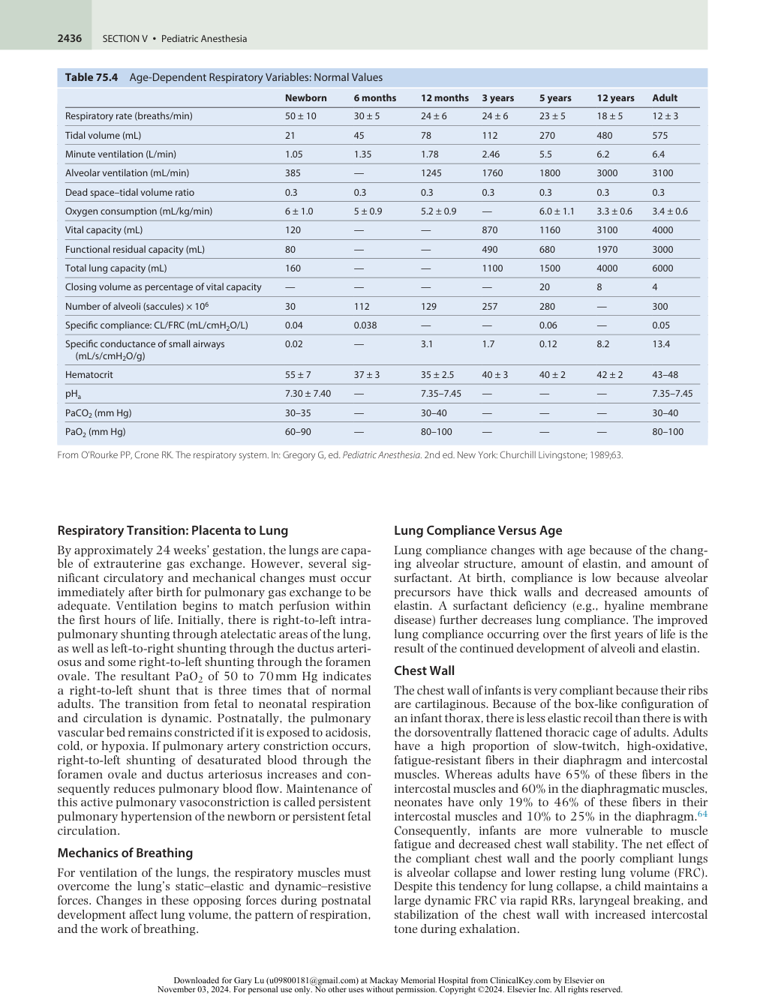

:::

<!-- PDF page 27 -->

### Upper Airway

The upper airways of children and adults have several anatomic differences that affect their ability to maintain a patent airway. The more anterior and cephalad position of the larynx in children makes the “sniffing position” ideal for mask ventilation and endotracheal intubation. Extreme neck extension can obstruct the airway. The narrowest part of the adult airway is the vocal cords. Up to the age of 5 years, the narrowest portion of a child’s airway is at the cricoid cartilage because the posterior larynx is positioned more cephalad than the anterior larynx, which causes the cricoid ring to be an ellipse rather than a circle. By 5 years of age, the posterior larynx has descended to the adult level.264 An ETT that passes easily through the vocal cords of a young child may cause ischemic damage to the distal airway. The cricoid narrowing and very pliant tracheal cartilage can provide an adequate seal around an uncuffed ETT. For this reason, children younger than 5 years may not require cuffed ETT. However, critically ill children with respiratory disease are regularly intubated with cuffed ETT to reduce the frequency of tube exchanges.265

### Closing Capacity

The elastic properties of the lung closely correlate with closing capacity. Closing volume is the lung volume at which the terminal airways close and gas is trapped behind the closed airways. Large closing volumes increase dead space ventilation, which leads to atelectasis and right- to- left shunting of blood. Elastic tissues help keep the airways open, so the greater the elastic stroma in the small airways, the lower the lung volume required to close small, noncartilaginous airways. The closing volume is small in late adolescence and relatively large in the elderly and the very young. Children overcome the complications of large closing volumes and secondary atelectasis by breathing rapidly, by constant activity, and by crying. Closing volume becomes a significant problem in infants who are inactive, sedated, or anesthetized.

### Resistive Forces

Neonates have small airways with high resistance or low conductance (conductance = 1/resistance). The diameter of the small airways does not significantly increase until about 5 years of age; hence, young children have elevated airway resistance at baseline and are particularly vulnerable to diseases that cause further narrowing of the airways (i.e., smooth muscle constriction, airway edema/inflammation). The normal high airway resistance of neonates and young children helps maintain FRC.

### Control of Breathing

The newborn’s respiratory control is unique. Hypoxia initially increases ventilation for a short time. This increase is followed by a sustained decrease in ventilation.71 The response is more exaggerated in preterm neonates. In fullterm infants, it disappears after several weeks. Periodic breathing is also more common in infants, particularly preterm infants, probably due to inadequate development of the medullary respiratory centers.

### Oxygen Transport: Oxygen Loading and Unloading

Fetal hemoglobin has low levels of 2,3- diphosphoglycerate and an oxygen half- saturation pressure of hemoglobin

(P50) of 18 mm Hg, much lower than the 27 mm Hg in adults. This lower P50 allows the fetus to load more oxygen at low placental oxygen tension, making unloading oxygen in tissues more difficult. Three to 6 months after birth, fetal hemoglobin has been replaced with adult hemoglobin. The increased oxygen content of fetal hemoglobin and the increased fetal hemoglobin concentration are advantageous to the fetus because it allows an oxygen content of 20 mL of oxygen/100 mL of blood to be delivered to the brain and heart. This is the same oxygen content that adults have when breathing room air. The oxygen concentration of neonates at birth is 6 to 8 mL/kg/min. It decreases to 5 to 6 mL/kg/min over the first year of life. The decreased ventilation–perfusion ratio, the decreased P50 of fetal hemoglobin, and the progressive anemia characteristic of infants can make it difficult to deliver adequate oxygen during the first few months of life. Infants compensate by having a cardiac output of approximately 250 mL/kg/min for the first 4 to 5 months of life.

### RESPIRATORY DISTRESS

Respiratory failure is the inability of the lungs to oxygenate and remove CO2 from pulmonary arterial blood adequately. There are many causes of respiratory failure, including a low environmental oxygen concentration, parenchymal lung disease, and pulmonary vascular disease. A complete history of the severity and chronicity of the respiratory problem helps formulate a differential diagnosis and an approach to treatment. Specific data should include a history of prematurity, previous airway instrumentation, previous mechanical ventilation, nonpulmonary organ dysfunction, and a family history of respiratory disease. A detailed feeding history and up- to- date growth chart may provide valuable information because growth failure may increase the need for oxygen. Usually, 1% to 2% of the total oxygen consumed is used for breathing. During respiratory illnesses, as much as 50% of the total oxygen consumption may be used for breathing. Infants and children with respiratory failure often have intercostal and suprasternal retractions, signs that the work of breathing and oxygen consumption are increased. Patients grunt during expiration to maintain FRC. Most infants and children have tachypnea, which also helps maintain FRC by decreasing the time for exhalation. Less energy is required to breathe rapidly and shallowly than to take deep breaths. Infants with respiratory failure often have cyanotic lips, skin, and mucous membranes. However, it is often challenging to recognize skin color changes unless the PaO2 is below 70 mm Hg. Symmetry of chest movement should be noted. Differences in movement may indicate pneumothorax or blockage of a bronchus. The small thoracic volume allows easy transmission of breath sounds from one side to the other. Breath sounds may be normal, even when pneumothorax is present. Abdominal distention can dramatically impede breathing in infants and young children.

### MONITORING OF RESPIRATORY FUNCTION

An arterial blood gas is considered the gold standard for oxygenation, as PaO2 is measured directly from blood. The percent oxygen saturation of hemoglobin can be measured directly or calculated from PaO2, pH, PaCO2, and

<!-- PDF page 28 -->

temperature. Venous and capillary blood gases do not predict PaO2. However, pulse oximeters are ubiquitous and provide continuous estimations of SaO2 when the saturation is less than 97%. Due to the presence of pulse oximetry among other reasons, the use of arterial lines has decreased in PICUs over time.266 The ability to estimate SaO2 when the SpO2 is &lt;97% is due to the shape of the oxygen dissociation curve. Pulse oximeters pass at least two wavelengths of light through the patient and the change in the absorbance of light is compared with an algorithm that produces the oxygen saturation. In the 91% to 97% saturation range, pulse oximeters have been shown to read higher than measured arterial saturations by approximately 1%.267 However, in the saturation range of 76% to 90%, pulse oximeters read higher than measured arterial saturations by approximately 5% with very wide confidence intervals.267 Pulse oximeters may also have poorer performance when there is decreased perfusion to the extremity with the sensor. Lastly, most pulse oximeters have difficulty detecting abnormal forms of hemoglobin, such as methemoglobin or carboxyhemoglobin, and will produce erroneous results in their presence. Finally, numerous reports are indicating that skin color will alter the accuracy of pulse oximetry and, more significantly, at lower saturations.268

Umbilical artery cannulation is common in neonates, so those caring for such children can obtain arterial blood and continuously measure arterial blood pressure. These catheters are relatively simple to insert and reasonably easy to maintain.269–271 The tip of the catheter ideally should be at or just above the level of the aortic bifurcation and below the level of the renal arteries (L2). Once the child’s condition is stable, a peripheral artery catheter should be inserted, and the umbilical artery catheter should be removed. All intra- arterial catheters have the potential to cause distal thromboembolic disease. Care must be taken to flush arterial catheters gently to prevent cerebral or cardiac emboli. With proper insertion and maintenance, serious complications of arterial lines are rare. They have been shown to be relatively safe for short- term use.272 Although arteries cannulated for a long time may develop thrombosis, in a small study by Ergaz _et al_ ., in all infant subjects that developed thrombosis there was spontaneous resolution without sequela.273

PaCO2 is used as a measure of ventilation. Although arterial blood gas may be the gold standard, yet PaCO2 obtained from capillary or venous blood gases can provide valuable information. CO2 values obtained from capnography or transcutaneous CO2(TCOM) can provide continuous information like pulse oximeters.274 Capnographs produce a waveform displaying exhaled CO2 that can be either timebased or volumetric. Time- based capnography is much more common. Capnographs can either be an aspirating or non- aspirating system. An aspirating system takes gas from the ventilator circuit and measures the CO2. A nonaspirating system has an exhalation chamber in line with the ventilator circuit. The system uses an infrared light source and detector, which measures the exhaled CO2. There is a great amount of information that can come from capnography, including the end- tidal CO2 (ETCO2) value, RR, dead space calculations, cardiac output, and detection of obstruction of the airways.

For time- based capnography, the plateau of the slope will always be lower than PaCO2. Elevations in ETCO2 must be investigated as they signal a change in ventilation. For individuals with healthy lungs, this ETCO2 to PaCO2 gradient is usually 2 to 5 mm Hg. The gradient increases with increased dead space, abnormalities in the pulmonary vasculature, decreased cardiac output, and pulmonary overdistention. ETCO2 from capnography can be used clinically to calculate the approximate alveolar dead space by the alveolar dead space fraction (AVDSf). AVDSf = (PaCO2 − PETCO2)/PaCO2. AVDSf is a reasonable indicator of alveolar dead space275 and has been shown in several pediatric patients with acute hypoxemic respiratory failure to be associated with mortality.276–278 Other valuable information is available from the waveform produced by time- based capnography. For example, a rising upslope to the exhalation phase can indicate obstructive airways disease. Time- based capnography is more accurate with slower RRs and when there is a minimal leak around the ETT.

Volumetric capnography traces the CO2 concentration against the exhaled volume and appears as a feature on some ventilators. Free- standing monitors that provide the same measure are also available. Volumetric capnography provides direct information for dead space calculations. Clinically, volumetric capnography is helpful in setting the optimal PEEP. This way, PEEP can be titrated to balance improved oxygenation through alveolar recruitment and decreased dead space by not causing overdistention. Volumetric capnography can also be used to demonstrate a response to bronchodilator therapy.

In circumstances such as high-frequency ventilation (HFV), transcutaneous CO2 monitoring (TCOM) provides a continuous measure of ventilation. The TCOM module heats the skin underneath a small sensor. There is increased diffusion of CO2 across the skin as the capillary bed dilates from the heat. The diffused CO2 is then measured. When the TCOM is first set up, it should be calibrated against a capillary or arterial blood gas. There can be calibration drift over time, but newer modules have improved stability. A study by Bhalla _et al_ . demonstrated that transcutaneous CO2 monitoring provides an acceptable estimate of PaCO2, even with low cardiac output or increased subcutaneous tissue.274 However, in their study, TCOM did not perform well in patients with cyanotic heart disease.

A measure of the patient’s effort of breathing with or without a ventilator can be obtained by the objective measurement value of the pressure- rate product (PRP). Typically, these systems measure esophageal pressure with a balloontipped catheter placed into the distal third of the esophagus. Esophageal pressure can be used as a surrogate for pleural pressure, which is much more challenging to measure. The PRP is the change in esophageal pressure (Pes) during each breath multiplied by the respiratory rate (RR). PRP = Pes × RR. As patients breathe with greater inspiratory force (increased Pes) or with greater frequency (increased RR) or both, the PRP reflects in the increased work of breathing. The PRP has been used as an objective measure of effort of breathing in studies: before and after extubation,279,280 with PEEP and obstructed airways disease,270 evaluating increasing inspiratory load271 ; pressure- rate product and phase angle as measures of acute inspiratory upper airway obstruction in rhesus monkeys, evaluating effectiveness of high- flow nasal cannula281,282 ; and evaluating effectiveness of noninvasive

<!-- PDF page 29 -->

ventilation (NIV) in infants.283 Some ventilators can measure esophageal pressure, or it can be obtained with separate devices. We have found that the accuracy of PRP measurements is sensitive to the volume of air used to fill the esophageal catheter.284 In addition to measuring the PRP, the esophageal pressure is very important in measuring the pressure across the lungs or the transpulmonary pressures. Many adult studies demonstrate the benefits of titrating ventilator settings to transpulmonary pressure for patients with acute respiratory distress syndrome (ARDS).285–287 The transpulmonary pressure may have particular benefit in patients who are obese and require mechanical ventilation for respiratory failure,288–291 where the decreased compliance of the chest wall may cause practitioners to limit ventilator pressures. For adult medicine, esophageal pressure monitoring and the titration of mechanical ventilation to transpulmonary pressure has recently grown significantly. The need for and goals of this type of monitoring can be best summarized in a few review articles,292,293 including one from the PLeUral pressure working Group (PLUG- Acute Respiratory Failure section of the European Society of Intensive Care Medicine).294 The use of transpleural pressure to titrate mechanical ventilation is not as well established in pediatric respiratory support and is limited to a small number of centers.

The breathing phase or the synchrony between movement of the abdomen and the chest wall can be measured with respiratory inductance plethysmography (RIP).295 This noninvasive measure uses elastic bands placed around the abdomen and chest. Movement of the abdomen and chest changes the inductance of a small wire in the bands. Movement of the abdomen relative to the chest can be presented graphically or measured as the phase angle. When there is an obstruction to breathing, such as with upper airway obstruction, there is a lag in the movement of the abdomen and chest wall, which is identified as an increasing phase angle. The phase angle obtained by RIP is an objective measure of the degree of upper airway obstruction271,295,296 and can be used to evaluate the effectiveness of therapy.297–299 This is a valuable tool for research in the area of causes and treatment of upper airway obstruction, as there is great interobserver variability in the clinician’s assessment of this process.300 RIP can easily be measured with free- standing devices and may have an increased role in future pediatric studies.

A great deal of information on the respiratory effort of patients receiving mechanical ventilation can be obtained from respiratory spirometry. Spirometry can display flow– volume loops, and pressure–volume loops, in addition to graphs of flow–time, pressure–time, and volume–time. The characteristic shape of some respiratory flow–volume loops can help diagnose various respiratory diseases. There is a classic scooped- out appearance to the exhalation portion of a flow–volume curve with obstructive lung disease. The pressure–volume loops obtained on the ventilator can be used to increase PEEP to keep lung tissue recruited above an area of potential atelectasis. This can be seen graphically as a lower inflection point on the inspiratory curve. This is where the curve moves from a flat area to an area of maximal compliance where there is the greatest change in volume for a given change in pressure. There is also an upper inflection point on pressure–volume loops where overdistention of the lungs can be identified if the inspiratory

pressure or volume is too great. The pressure–volume curve with overdistention looks like a bird’s beak, and ventilator settings should be reduced.

There are multiple noninvasive techniques that can provide additional information on the patient’s respiratory status. Radiologic evaluation of the nasopharynx, neck, and thorax can provide meaningful information regarding the cause and severity of respiratory dysfunction. Fluoroscopy can be used to evaluate the airways and movement of the diaphragm in an uncooperative child. Electrical impedance tomography (EIT) is a noninvasive technique that does not use ionizing radiation that can provide information on regional lung ventilation. The technique uses electrodes placed on the chest wall to measure the electrical conductivity and impedance of the lung to form a tomographic image. The images are used to determine which areas of the lungs have atelectasis, normal ventilation, or overdistention. Currently, there is much more adult data showing uses of and management strategies with EIT,301–304 as compared with pediatrics.305–307 However, as more companies produce the machines and more adult manuscripts are published, we expect increased use of EIT in pediatric mechanical ventilation monitoring. Finally, point- of- care ultrasound use in pediatrics has grown rapidly. This has multiple benefits for the patient, as it can be provided at the bedside and does not use ionizing radiation. Lung ultrasound can identify pneumothorax, alveolar consolidation, pneumonia, atelectasis, pulmonary edema, pleural effusions, and diaphragm movements and thickness. There are an increasing number of pediatric manuscripts identifying the benefits of lung ultrasound.308–311 In the near future, ultrasound diaphragm thickness and how it changes over time may be used to guide mechanical ventilation strategies and help predict extubation success.312–315

### ETIOLOGY OF RESPIRATORY FAILURE

The cause of respiratory failure depends to some degree on the patient’s age. Newborn respiratory failure is often the result of congenital anomalies and immaturity of the lungs and their blood vessels. Congenital anomalies can include airway malformations, dysgenesis, or malfunction of the lung or nonpulmonary organs, and abnormalities of the pulmonary vessels. Causes of respiratory failure due to immaturity include apnea of prematurity, hyaline membrane disease, and abnormalities of surfactant production and secretion. During the perinatal period, neonates are subject to infections and stress. Persistent pulmonary hypertension can complicate neonatal pulmonary and nonpulmonary problems. These and other important causes of respiratory failure in the newborn are listed in Table 75.5. A wide variety of disorders cause respiratory failure in older children (Box 75.3). Regardless of the specific cause, respiratory failure can be categorized as hypoventilation syndromes in patients with normal lungs, intrinsic alveolar and interstitial disease, and obstructive airway disease.

### HYPOVENTILATION SYNDROMES IN CHILDREN WITH NORMAL LUNGS

Causes of hypoventilation include neuromuscular disease, central hypoventilation, and structural/anatomic

<!-- PDF page 30 -->

**Table 75.5** Causes of Neonatal Respiratory Distress

|**Location**|**Congenital Abnormalities**|**Developmental Immaturity**|**Specific Neonatal Stress**|
|---|---|---|---|
|Impaired control of ventilation|Central nervous system dysgenesis Ondine’s curse|Apnea of prematurity Intracranial hemorrhage|Drug intoxication (note maternal drugs) Sepsis Central nervous system infection Seizures|
|Neuromuscular disorders|Congenital myopathies||High cervical cord injuries|
|Structural impairment|Thoracic deformities Lung hypoplasia Diaphragmatic hernia Potter syndrome Abdominal malfunction Gastroschisis Omphalocele||Severe abdominal distention Pneumothorax or other leak|
|Airway obstruction|Choanal atresia||Massive meconium aspiration|
|Upper airway|Pierre Robin syndrome Laryngeal web/cleft Congenital tracheal/laryngeal stenosis Recurrent laryngeal palsy Hemangioma Lymphangioma||Vocal cord paralysis is secondary to myelodysplasia|
|Lower airway|Tracheoesophageal fistula Lobar emphysema||Meconium/blood aspiration|
|Alveolar disorders||Respiratory distress syndrome|Bronchopulmonary dysplasia|

### Box 75.3 Causes of Respiratory Failure in Children

1.  Impaired control of ventilation

   - Head trauma

   - Intracranial hemorrhage

   - Increase intracranial pressure secondary to tumor, edema, hydrocephalus, Reye syndrome

   - Central nervous system infections

   - Drug intoxication

   - Status epilepticus

2.  Neuromuscular disorders

   - High cervical cord injury

   - Poliomyelitis

   - Guillain–Barré syndrome

   - Neurodegenerative disease (e.g., Werdnig–Hoffman syndrome)

   - Muscular dystrophies and myopathies

   - Myasthenia gravis

   - Botulism

   - Tetanus

   - Phrenic nerve injury

3.  Structural impairment

   - Severe kyphoscoliosis

   - Flail chest

   - Large intrathoracic tumor

   - Pneumothorax or pneumomediastinum

   - Large pleural effusion, hemothorax, empyema

   - Severe abdominal distention

   4.  Airway obstruction

      - Upper airway

      - Congenital anomalies

      - Tumor, intrinsic or extrinsic

      - Epiglottitis

      - Croup (laryngotracheobronchitis)

      - Foreign body

      - Postintubation edema, granulation tissue, or scarring

      - Vocal cord paralysis

      - Burns

      - Vascular ring

      - Lower airway

      - Asthma

      - Bronchiolitis

      - Foreign body

      - Lobar emphysema

      - Cystic fibrosis

   5.  Alveolar disorders, pneumonia

      - Infectious: bacteria, virus, fungus, _Pneumocystis_ species

      - Chemical: aspiration, hydrocarbon, smoke inhalation

      - Pulmonary edema: cardiogenic, near- drowning, capillary leak syndrome

   6.  Massive atelectasis

   7.  Oxygen toxicity

   8.  Pulmonary confusion

   9.  Pulmonary hemorrhage

- Severe obesity (Pickwickian syndrome)

::: details 原始表格與符號（PDF 第 30 頁）

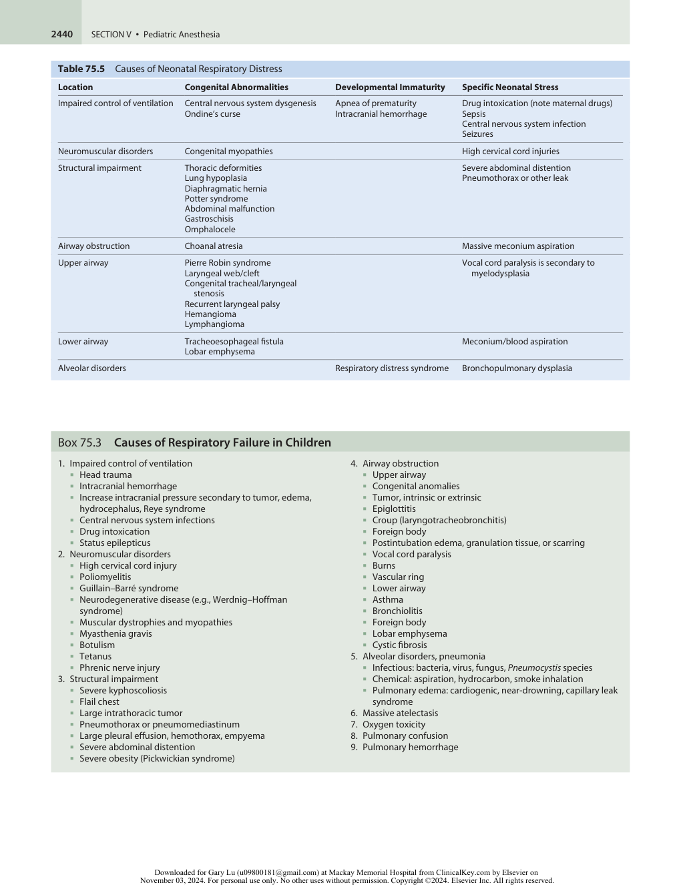

:::

<!-- PDF page 31 -->

impairment of lung expansion (i.e., upper airway obstruction, massive abdominal distention). These clinical conditions are characterized by inadequate lung expansion, secondary atelectasis, intrapulmonary right- to- left shunting, and systemic hypoxia. Atelectasis and the secondary reduction in FRC increase the work of breathing. The child’s response to the increased work of breathing and lower lung volumes is to breathe faster with a smaller tidal volume. This pattern of breathing eventually increases the amount of atelectasis and shunting. As a result, children with intrinsically normal lungs and hypoventilation syndromes exhibit tachypnea, small tidal volumes, increased work of breathing, and cyanosis. Chest radiographs reveal small lung volumes and miliary or lobar atelectasis. Positive- pressure ventilation and PEEP quickly reverse the pathologic processes.

### Primary Pulmonary Alveolar or Interstitial Disorders

Intrinsic lung disease involving the alveoli or pulmonary interstitium decreases lung compliance and increases airway closure, both of which cause atelectasis and increase the work of breathing. Edema or inflammation of the alveoli or fibrosis of the interstitium decreases lung compliance. The stiffer lung requires a greater negative intrapleural pressure for air movement, thereby increasing the work of breathing and the risk for pneumothorax.

### Obstructive Airway Disease

Airway obstruction can be extrinsic or intrinsic. Intrinsic small airway obstruction commonly occurs with bronchiolitis, bronchopneumonia, asthma, and bronchopulmonary dysplasia (BPD). Airway obstruction decreases conductance and increases airway resistance and the work of breathing. Partial obstruction impedes expiration more than inspiration and causes gas trapping or regional emphysema. Complete airway obstruction results in atelectasis and right- to- left shunting of blood within the lung. Patients with small airways disease usually have a mixture of total and partial airway obstruction and inhomogeneous collapse and overdistention of the lung. The areas of collapse cause intrapulmonary right- to- left shunting of blood, and the overdistended areas increase the amount of dead space. If the entire lung is overdistended, compliance is decreased, and the work of breathing is increased. The clinical and radiographic picture varies with the different degrees of collapse and overdistention of the lung. In summary, all causes of respiratory failure share similar pathophysiology: atelectasis and decreased FRC with intrapulmonary right- to- left shunting of blood or alveolar overdistention with increased dead space and decreased CO2 elimination, or both. The increased work of breathing associated with all forms of respiratory dysfunction can cause fatigue and a breathing pattern that further complicates the initial process. It may also lead to apnea, hypoxia, and cardiac arrest in young children if the increased work of breathing is not quickly detected and treated.

### RESPIRATORY CARE

A patient’s FiO2 can be increased by several means including a nasal cannula or mask. The FiO2 can be increased up to approximately 40% with nasal cannula oxygen at 5 L flow/

min. However, this high rate of flow can become uncomfortable. As room air is entrained around the cannula during inspiration, the FiO2 cannot be increased further with nasal cannula. It should be noted that the patient’s size correlates with the inspiratory volume with each breath. The larger the patient, the greater inspiratory volume is relative to flow from the cannula and the greater volume of room air that is entrained. In turn, the smaller a patient the less room air is entrained, and there may be a greater increase in FiO2.

The FiO2 can be increased further with a properly fitted face mask. The open holes of a Venturi or simple face mask allow for greater room air entrainment compared to a non- rebreather face mask with no holes. A FiO2 approaching 1.0 can be obtained with a non- rebreather face mask with an oxygen reservoir and one- way valve. Patients with respiratory distress while on the pediatric ward may temporarily require a non- rebreather mask at high flows. If there is no significant improvement to immediate interventions, arrangements should be made to transfer the patient to the PICU. Non- rebreathing mask systems can be humidified for comfort, but they don’t provide any positive pressure to the airways.

High- flow humidified nasal cannula (HFHNC) oxygen can provide a higher FiO2 and is more easily tolerated than standard nasal cannula. The gas in HFHNC is heated to body temperature and near completely humidified with water vapor. HFHNC can be delivered with flow rates in pediatrics up to 2 L/kg/min. HFHNC has been shown in a number of studies to decrease the effort of breathing in critically ill children.316–318 HFHNC has been used frequently to support patients with bronchiolitis.317–321 Weiler _et al_ . demonstrated that the lowest effort of breathing for toddlers with bronchiolitis was at greater than 1.5 L/kg/min of flow.317 It is likely that the benefits of HFHNC come from washing out carbon dioxide from the airways,322,323 but there may also be some generation of positive pressure in the airways,324 or from increases in end- expiratory lung volumes.325 The potential for complications exists with higher gas flow rates. Air leak syndrome was reported in three patients by Hegde and Prodhan.326 As the use of HFHNC increases, other problems may be identified. Given that the amount of FiO2 can be increased to 1.0, HFHNC delivered outside of an emergency department (ED) or ICU setting should be used with specific protocols limiting the highest amount that FiO2 can be titrated to and the frequency of observation. When the FiO2 is near maximal the amount of respiratory support provided can mask a significant degree of respiratory distress. However, with appropriate monitoring and protocols, HFHNC on a general ward is becoming more commonplace, specifically for populations such as stable patients with bronchiolitis. Franklin _et al_ .319 published a study of children younger than 12 months of age with bronchiolitis. The use of HFHNC significantly reduced the risk of escalation of care (12%) compared to regular nasal cannula (23%).

NIV can be supplied with continuous positive airway pressure (CPAP) or bilevel positive airway pressure (BiPAP). This is typically delivered with a tight- fitting nasal or face mask that allows for the development of positive airway pressure. Most modern ventilators can be set to deliver this therapy, but specific free- standing BiPAP machines are more often used. BiPAP therapy is best for short- term use and in patients who can cough and protect their airway. It

<!-- PDF page 32 -->

is not an absolute that the patient initiates every breath as a backup rate can be set. However, intubation should be considered if the patient is completely reliant on the rate set on the machine. Other indications for conversion from BiPAP to endotracheal intubation include pressure- related tissue breakdown on the face from constantly wearing the mask, non- reassuring disease trajectory, patient–machine desynchrony, and risk of aspiration.

CPAP reduces the patient’s work of breathing by providing airway pressure, reducing atelectasis, decreasing dead space, and improving the balance of ventilation to perfusion. An initial CPAP pressure is typically 4 to 6 mm Hg and is then increased as needed and as the patient tolerates the therapy. Given that the feeling of positive airway pressure is a bit foreign, starting with lower pressures and then increasing gives the patient a chance to adapt. We typically start patients on CPAP therapy for several minutes even if they will ultimately receive BiPAP. For BiPAP, the expiratory pressure is also initially at 4 to 6 mm Hg, and the inspiratory pressure is set at 4 to 6 mm Hg above that. The inspiratory and expiratory pressures and the rise time to inspiratory flow are adjusted. All of these changes can help the patients tolerate therapy. Given the tight seal, an FiO2 of 1.0 can be delivered. With the full face mask, patients are at risk for aspiration if they vomit. BiPAP therapy is used in status asthmaticus,327,328 and may provide a more effective means of delivering aerosolized medication. The use of BiPAP therapy for this indication may increase over time as it is being recommended in current guidelines.329,330 BiPAP can also be used as an ongoing therapy for chronic respiratory failure, such as central hypoventilation or restrictive lung disease. These patients may be able to receive their therapy at home and are typically followed by the hospital’s pulmonary service.

The size of ETT required should be selected carefully. Cole’s formula provides an estimate for uncuffed tube internal diameter [(age/4)+4]. Although the correct size should be confirmed to have a slight air leak when a positive pressure of 20 to 30 cmH2O is applied. Serious lifelong laryngeal and subglottic damage can result from using inappropriately large ETTs, particularly in children with inflammatory lesions of the upper airway, such as laryngotracheobronchitis. While uncuffed endotracheal tubes can be used successfully, the general trend has been toward cuffed tubes in most pediatric patients as they have been associated with decreased need to be replaced due to size.331 Cuffed tubes will usually eliminate the air leak around an ETT, but overinflation of the cuff may occlude venous flow and injure the airway. There are no data on the long- term safety of using cuffed ETTs in young children. However, there has been work by Khemani _et al_ .332 that showed risk factors associated with the development of postextubation subglottic upper airway obstruction included low cuff leak volume or high preextubation leak pressure. We should take care to make sure that ETT cuffs are appropriately inflated.

With endotracheal intubation, it is important to position the ETT correctly. If correctly positioned, chest movements should be symmetric, and breath sounds should be equal when auscultated in the axillae. An electronic or colorimetric CO2 detection system helps confirm whether the ETT is in the trachea or the esophagus.333 If the double lines on the ETT are at the level of the vocal cords, the ETT is usually

in the correct position. Another way to correctly position the ETT is to advance it into the right mainstem bronchus and listen for breath sounds in the left axilla. Breath sounds will be diminished. Withdraw the ETT slowly. When breath sounds are heard on the left, pull the tube out an additional 1 to 2 cm, depending on the child’s size. If the breath sounds are equal, fix the tube in place. The tip of the ETT should be midway between the vocal cords and the carina on the chest radiograph. The distance between the carina and the vocal cords is very short in small infants. This short distance makes it easy to inadvertently place the ETT in the right mainstem bronchus in small infants. Flexion of the head moves the ETT into the airway. Extension moves it toward the vocal cords. It is common to leave a child’s trachea intubated for 2 weeks or longer before performing a tracheostomy. Compared to adults, this relative delay is made possible with proper humidification of the inspired gases, improved endotracheal suctioning and monitoring (SaO2), and excellent nursing care. Everyone caring for the child must be constantly alert to the possibility that the ETT will become obstructed by secretions or that accidental extubation or mainstem bronchus intubation will occur. Tracheostomy is indicated when children require a longterm artificial airway for mechanical ventilation, endotracheal suctioning, or to bypass an upper airway obstruction. Accidental dislodgement of the tracheostomy tube before the tract is well healed can be life- threatening. Reinsertion of a tracheostomy tube during the first 72 hours after insertion can be very difficult and can create false passages that can make it impossible to ventilate the lungs or can cause pneumothorax.

Intubation and mechanical ventilation can provide significant elevations in airway pressure compared to NIV and an FiO2 of 1.0. The selection of ventilation mode is practitioner dependent without significant evidence favoring volume- or pressure- controlled ventilation. Pressurecontrolled ventilation offers two advantages. First, for patients with poor pulmonary compliance, the decelerating inspiratory flow pattern means that the flow of gas is greatest early in inspiration and then decelerates to zero flow when the peak pressure is achieved. This can result in the delivery of a larger tidal volume for a lower peak pressure than the same pressure that might be required in a tidal volume mode. Pressure-controlled ventilation is particularly helpful with heterogeneous lung disease with variable time constants. The second advantage to pressure control is unique to children with significant airway leaks, as the ventilator will necessarily add additional flow to reach a peak inspiratory pressure goal, automatically compensating for the leaked volume. Conversely, the advantage of traditional volume-controlled ventilation is the consistency of delivered tidal volume and hence minute ventilation. In times of variable compliance, volume-controlled ventilation offers a constant adjustment in delivered driving pressures to ensure the expected minute ventilation.

There are additional modes available on modern ventilators that may benefit patients with lung injury. The names of the modes will differ between the ventilator manufacturers. Many will have a mode where a desired tidal volume is guaranteed and the lowest pressure necessary to achieve that is used. Terms usually given to define this mode are _pressure- regulated volume control_ and _volume guarantee_ .

<!-- PDF page 33 -->

These modes may reduce the pressure, but they work best when the patient is sedated and not competing with the ventilator.

Neurally adjusted ventilatory assist is a unique method of triggering ventilator synchrony available on the Servo- i ventilators by Maquet. This uses a small esophageal probe that can sense the electrical activity of the diaphragm and use that activity to synchronize the ventilator. The potential benefits of improved triggering such as improved comfort, lower ventilator settings, and increased minute ventilation, have been shown in some studies.334,335 Some degree of expertise is necessary with the mode, as the electrical activity of the heart can also cause auto- triggering of the ventilator.336

Airway pressure release ventilation (APRV) is a mode of mechanical ventilation that is less common than pressure control or volume control. Adult data published by Zhou _et al_ .337 shows that early use of APRV can reduce the length of mechanical ventilation. As we know, differences in compliance and respiratory mechanics between adults and children do not always allow adult studies to be translated directly to children. Lalgudi Ganesan _et al_ .338 published the results of a randomized controlled trial of APRV in children with PARDS. The trial was stopped early for increased mortality in the APRV arm. There are few published pediatric studies using this mode,339–342 and its benefits and limitations continue to be explored. Like other ventilation modes, its use appears to be regional, and some will only consider this as rescue therapy when patients fail conventional ventilation.

To describe its use, APRV is essentially high levels of CPAP with brief, intermittent release coupled with spontaneous ventilation. The high CPAP level (Phigh) maintains alveolar recruitment and aids in oxygenation over a period of time (Thigh), and the timed release to low pressure (Plow) minimizes resistance to expiratory flow and carbon dioxide removal. In addition, the patient can spontaneously breathe during all phases, Phigh and Plow, potentially allowing for improved pulmonary mechanics and gas exchange. APRV differs from other modes of ventilation because it relies on an intermittent decrease in airway pressure instead of an increase in airway pressure to maintain an open lung strategy for ventilation. Therefore, the release time (Tlow) should be set long enough for an adequate tidal volume (6–8 mL/kg) but short enough to avoid alveolar collapse and atelectotrauma. In summary, the operator- controlled parameters in APRV are: Phigh, Thigh, Plow, Tlow, and FiO2. Recommendations for implementing APRV are limited in pediatrics and thus are unfortunately extrapolated from adult recommendations.343 Plow is initially set a zero. Phigh can be set by several methods, such plateau pressures or 75% of peak inspiratory pressure; however, when transitioning from conventional modes of ventilation, Phigh is often determined by m _P_ AW pressure formula where the m _P_ AW is set 2 to 3 cmH2O above conventional m _P_ AW: (Phigh × Thigh) + (Plow × Tlow) / (Thigh + Tlow). To determine Thigh and Tlow, first determine the total cycle time according to a normal RR range for the patient’s age (i.e., a RR of 20 yields a total cycle time of 3 seconds). Thigh will be the total cycle time minus a Tlow of 0.2 to 0.6 second, initially starting at 0.4 second (i.e., the total cycle time of 3 seconds

yields a Thigh of 2.6 seconds and Tlow of 0.4 second), or number of cycles (RR) = 60 seconds/(Thigh + Tlow). Transitioning to APRV, like transitioning to HFOV, will take time for optimal lung recruitment. After several hours, if the patient continues to have severe hypoxemia, Thigh can be increased to aid in oxygenation. Once established Plow and Tlow usually do not require further changes; however, as lung compliance improves, Phigh and Thigh can be decreased and increased, respectively, to wean a patient toward a target of a continual CPAP of 5 to 6 cmH2O in preparation for extubation. APRV may be advantageous to other modes of advanced mechanical ventilation because the patient’s ability to breathe spontaneously throughout the entire ventilatory cycle improves respiratory mechanics and reduces the need for sedation and neuromuscular blockade. However, some authors are concerned that there may be a higher incidence of cyclic alveolar collapse during airway release, leading to a greater degree of atelectrauma, as compared with HFOV.339,340

High- frequency oscillatory ventilation (HFOV) is used in pediatrics as a rescue therapy for PARDS. HFOV is a subset of high- frequency ventilation (HFV). The use of HFOV was first described by Lunkenheimer in 1972.344 A 1994 publication by Arnold _et al_ .345 is the only multicenter randomized trial of HFOV. This study showed lower use of oxygen supplementation in the HFOV group at 30 days. There have been other pediatric studies showing the positive benefit of HFOV such as a single- center prospective study by Samransamruajkit _et al_ .346 and a single- center retrospective study by Babbitt _et al_ .347 The conclusion that could be drawn from many studies with HFOV in pediatrics is that for disease processes with significant mortality, rescue therapy with HFOV may be appropriate and may show improved outcomes. In some of the most critically ill patients with very high mortality, such as immunocompromised children with PARDS, the response to HFOV has been used as diagnostic criteria to identify survivors from nonsurvivors.340,348 Early use of HFOV has decreased mortality in patients who have undergone hematopoietic cell transplants who have developed severe PARDS.349 There is some adult data using HFOV from large randomized trials. The OSCAR trial350 was a negative study, and the OSCILLATE Trial350 was stopped early for a potential increase mortality in the HFOV group. It is unclear whether these findings can be translated to pediatric patients. Our patients’ disease processes and condition can be very different compared to adults. Furthermore, the ability to generate the power necessary to move the chest wall, resulting in ventilation, is different between smaller children with compliant chest walls and adults. Bateman _et al_ .351 used a propensity score model to reanalyze results from the Randomized Evaluation of Sedation Titration for Respiratory Failure (RESTORE) Study.352 Using their adjusted models, they found that early use of HFOV was associated with longer mechanical ventilation. There also was no mortality benefit to the use of HFOV. Given the results of the adult studies and those from Bateman _et al_ .,351 it is unlikely that the motivation would be present to perform a multicenter HFOV trial in pediatrics. There may continue to be other indications for HFOV in pediatrics, such as air leak syndrome or congenital diaphragmatic hernia, but the use of this technique likely will be limited.

<!-- PDF page 34 -->

For completeness, to describe its use, HFV is a type of mechanical ventilation where the RR of the ventilator is much greater than a normal physiologic rate. Maintaining the same minute ventilation, these ventilation modes produce very small tidal volumes. There are several different methods, but the most used in pediatrics is the HFOV. This type of ventilator houses a piston attached to semi- rigid connecting tubing, which attaches to the ETT. This circuit can be pressurized to a set mean airway pressure (MAP). The piston then oscillates up to 840 times a minute, creating small positive and negative respiratory cycles. The MAP is higher as compared with conventional ventilation, and this prevents atelectasis as well as shear forces from opening and closing alveoli with each respiratory cycle. The FiO2 is set as in a conventional ventilator. The piston’s oscillation frequency is adjusted to remove carbon dioxide and can vary between 6 and 14 Hz (Hz = 60 cycles/s). The amplitude of the ventilator is the distance the piston moves with each excursion, and by these excursions small breaths are propelled down the tubing. Several proposed mechanisms for gas transport during HFOV have been proposed, but none have been proven. Tidal volumes are dependent on the patient’s compliance, ETT size, device frequency, and device amplitude. Tidal volume is inversely related to cyclic frequency: VCO2 = frequency × VT2. Transitioning from conventional ventilation modes to HFOV, the initial power setting (ΔP/ amplitude) is adjusted to visible chest “wiggle” from the clavicles to the abdomen or pelvis. MAP (m _P_ AW) is initially set approximately 5 cmH2O greater than the last m _P_ AW on conventional ventilation, just before HFOV is initiated. Traditionally, tidal volumes in HFOV are considered to be just above FRC; however, it is difficult to measure actual tidal volumes and provide precise “optimal” lung volumes strategy. Clinically, MAP m _P_ AW is titrated upward by 1 to 2 cmH2O till oxygenation improves, and inspired oxygen concentrations can be weaned to less toxic levels, below 0.60. While titrating m _P_ AW, it is important to assess for overdistention by following chest radiographs (CXR): overdistention/hyperinflation is determined by greater than nine posterior ribs or flattened hemidiaphragms on CXR. Initial frequency settings, measured in Hz, can be found in Table 75.6. HFOV is the only mode of ventilation with active expiration. If hypercarbia, despite allowances for permissible hypercapnia, leads to profound respiratory acidosis and patient instability, minute ventilation can be improved by several means during HFOV. One of the drawbacks of HFOV is the lack of spontaneous ventilation

**Table 75.6** Initial Frequency Settings in High- Frequency Oscillatory Ventilation

|**Patient Weight (kg)**|**Initial Frequency Setting (Hz)**|
|---|---|
|&lt;2|15|
|2–15|10|
|16–20|8|
|21–30|7|
|31–50|6|
|>50|5|

and adequate airway clearance; therefore, one of the first measures to improve ventilation is to use inline suction (without breaking into the circuit causing derecruitment) to ensure adequate airway, ETT patency, and lung recruitment. A second means to improve ventilation, ΔP should be increased to maximize lung recruitment and increase minute ventilation. The third means to improve ventilation, frequency (Hz) can be slowly decreased to enhance lung recruitment and increase minute ventilation. Finally, the ETT cuff should be deflated to allow additional escape of CO2 around the ETT. Disadvantages of HFOV include no partial ventilatory support leading to increased requirements for sedation and paralysis, cardiopulmonary interactions due to higher m _P_ AW and decreased venous return, and loss of alveolar recruitment if circuit detached for suctioning of manual ventilation.

Another means of high- frequency ventilation is highfrequency percussive ventilation (HFPV) which pneumatically stacks subtidal volume breaths at a set rapid rate superimposed upon conventional cyclic rates. This type of ventilation allows for progressive stepwise lung inflation to a set peak pressure while allowing for passive exhalation to a preset lower pressure. HFPV has been well- described in the inhalational injury population for its ability to safely oxygenate and ventilate with continuous pneumatically powered high-frequency percussions to facilitate clearance of airway debris.353–355 The properties of this type of ventilation may be beneficial in pediatric patients with acute respiratory failure, by improving oxygenation and ventilation while maintaining lung protective strategies.356

### PEDIATRIC ACUTE RESPIRATORY DISTRESS SYNDROME

PARDS is a severe form of acute lung injury (ALI) that can result from several triggers that directly or indirectly injure the lung. The disease results in inflammation of the lungs, edema of the alveoli, and hypoxemic respiratory failure. Prior definitions of PARDS often were adapted from studies on adult patients and adult consensus conferences. Although PARDS represents a small portion of PICU admissions, it is very clinically important as it carries a very high mortality rate. In turn, PARDS garners significant attention from PICU researchers and clinicians. Since 2012, PICU intensivists have used the _Berlin definition_ of ARDS357,358 for management and study enrollment. Finally, in 2015 pediatrics had its unique definition of ARDS. In 2015 the Pediatric Acute Lung Injury Consensus Conference (PALICC) completed their 2- year process of consensus meetings to provide a new definition of PARDS and guidelines for management.359 The PALICC group included 27 experts from 8 countries. They used peer- reviewed data that was specific to pediatrics to form new guidelines. Where data were unavailable specifically for pediatrics, recommendations were adapted from adult or neonatal data as appropriate. In areas with no available data, expert opinion formed the basis of their recommendations. Multiple follow- up publications have provided important information in PARDS, including the group’s methodology,360 the incidence and epidemiology,361 comorbidities,362 means of ventilator support,363 noninvasive support,364 monitoring,365 use of

::: details 原始表格與符號（PDF 第 34 頁）

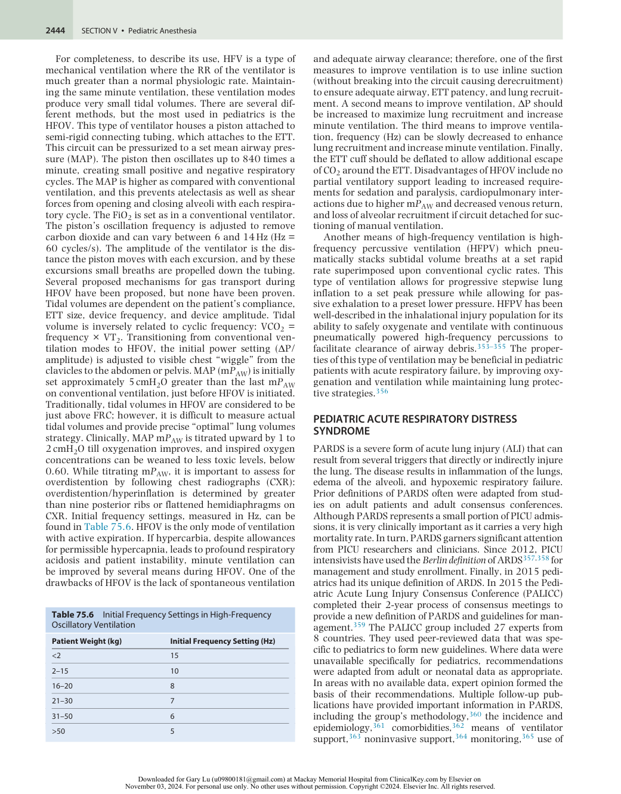

:::

<!-- PDF page 35 -->

ECMO,366 and outcomes.367 The group identifies the need for future randomized control trials in PARDS.

There are several key aspects to defining PARDS.368 The PALICC definition of PARDS excludes neonates with perinatalrelated lung disease, as it is likely a different entity. The lung injury should occur within 7 days of a known clinical insult. Hypoxemic respiratory failure should not be able to be explained by cardiac failure or fluid overload. Chest radiographs typically have new infiltrates consistent with parenchymal lung disease. There are now separate sections for the use of noninvasive and invasive mechanical ventilation. One significant difference compared to adult ARDS definitions is that the definition of PARDS for mechanically ventilated patients includes stratification by oxygenation index or oxygen saturation index. Oxygenation index (OI) = [FiO2 × MAP × 100]/PaO2. The oxygen saturation index (OSI) = [FiO2 × MAP × 100]/SpO2. Mild PARDS is 4 ≤ I &lt; 8, as well as 5 ≤ OSI &lt; 7.5. Moderate PARDS is 8 ≤ OI &lt; 16, as well as 7.5 ≤ OSI &lt; 12.3. Severe PARDS is OI ≥ 16, as well as OSI ≥ 12.3. There is additional information for patients with cyanotic heart disease, chronic lung disease, and left ventricular dysfunction. Future studies will need to address these more difficult aspects of defining PARDS.

The management of mechanical ventilation in PARDS currently can be summarized as the use of restrictive tidal volumes, increased use of PEEP, an ongoing relative tolerance of hypoxemia as long as it does not alter systemic oxygen delivery, and a tolerance of relative hypercarbia to reduce trauma from elevated mechanical ventilator pressures. The PALICC group recognizes that there has never been a randomized control trial of tidal volume restriction in PARDS. Prior studies have also demonstrated a lower mortality with larger tidal volumes in pediatric patients.369,370 This seems to result from the increased use of pressure-controlled ventilation in pediatric patients. An individual patient might be sick enough to be classified as having ARDS, but those with a milder form of the disease have better pulmonary compliance. As pressure is set on the ventilator, larger tidal volumes occur with better compliance. The PALICC guidelines do not make a recommendation as the mode of ventilation. However, the guidelines recommend targeting the delivered tidal volume to be “in or below the range of physiologic tidal volumes for age/body weight (i.e., 5–8 mL/kg predicted body weight) according to lung pathology and respiratory system compliance.”359 It should be noted that PALICC guidelines do recommend adjusting the tidal volumes to the degree of disease severity. They recommend tidal volumes of 3 to 6 mL/kg predicted body weight for those patients with poor respiratory system compliance. They believe the larger tidal volumes could be appropriate for patients with better pulmonary compliance.

One of the more important recommendations from the PALICC group has been the increased application of PEEP. They recommended levels of PEEP of 10 to 15 cmH2O for patients with severe PARDS and identified that levels higher than 15 cmH2O may be needed for some patients. Given concerns for the potential cardiopulmonary interactions, they do recommend following hemodynamics closely. The application of increased PEEP may have significant importance in future PARDS studies. It has been shown by Khemani _et al_ .370 that using PEEP settings lower than those recommended by the ARDS Network Protocol is associated with increased mortality in PARDS.

Some, by extrapolation, would consider the use of HFOV the most extreme form of tidal volume restriction. HFOV is able to prevent atelectasis by maintaining constant airway pressure. Trauma from lung stretch is avoided by delivering tidal volumes less than anatomic dead space.371 Unfortunately, there is very little information on pediatric mechanical ventilation with no recent randomized control trials. There have been two recent adult studies, but they did not yield results supportive of HFOV. OSCAR350 was a negative study, and OSCILLATE372 was stopped early for a potential increase in mortality in the HFOV group. Adult practitioners are likely moving away from HFOV, and use in pediatrics remains regionalized to a few centers that continue its use. The PALICC guidelines leave HFOV as a potential rescue therapy.

There are further adjunctive therapies for PARDS that will require future studies to confirm their potential benefit. This list would include the use of corticosteroids, inhaled nitric oxide, ECMO, prone positioning, the use of neuromuscular blockade, and the use of exogenous surfactant. There is insufficient data to state that these therapies should be routinely used for PARDS. Inhaled NO should be used for patients who have documented pulmonary hypertension or right heart dysfunction. The most recent published pediatric study of inhaled NO shows the possibility for harm.373 The use of extracorporeal life support for PARDS has not been sufficiently studied to indicate it is beneficial. Furthermore, given the complexity of the therapy, future trials may be very difficult, and to what extent ECMO is used for PARDS will vary based on the individual institution.

As patients progress through their disease course and care is no longer increasing, the issue of weaning from mechanical ventilation and timing of extubation must be addressed. Various different strategies have been used to wean off of the ventilator to varying degrees of success. Likely one of the most effective strategies is the daily scheduled use of spontaneous breathing trials (SBTs) to assess whether a patient is ready for extubation.374,375 Faustino _et al_ . in 2017 published a secondary analysis of the RESTORE clinical trial.376 Of patients requiring mechanical ventilation for lower respiratory tract disease, they found 43% passed their first extubation readiness. Of the group that passed an extubation readiness test, 66% were extubated within 10 hours. Many PICUs are using protocols to provide daily SBTs.377 In the right setting, the breathing trial can be performed safely by the respiratory therapy staff without physician input. In the near future, we will see an increase in computerized ventilation protocols driving care in the PICU. Without protocols, there is significant variability in usual care mechanical ventilation strategies,378 and even with protocols, there can be poor adherence.379 As a group, PICU intensivists would benefit from computer decision support and likely would accept some version of this.380,381 Ongoing work is being performed by the Pediatric Ventilator Liberation Group as an offshoot of the Pediatric Lung Injury and Sepsis Investigators (PALISI) to provide guidance to wean patients from mechanical ventilation. Updates from this group will help advance the field.382 In general, we need to provide not so little mechanical ventilation that the patient is struggling to breathe. Yet, we must provide not so much that there is atrophy of the diaphragm.383,384

<!-- PDF page 36 -->

### PRINCIPLES OF LUNG PROTECTIVE STRATEGIES: LIMITING VENTILATOR- ASSOCIATED LUNG INJURY

As lung injury progresses, in response to pulmonary or extrapulmonary injury, the lungs can be divided into three hypothetical regions: (1) areas with severe collapse and alveolar flooding, “dependent areas”; (2) recruitable areas with alveolar atelectasis, “intermediate areas”; and (3) normal lung, “nondependent areas” (Fig. 75.5). The goal of mechanical ventilation is to recruit intermediate areas, allowing improved gas exchange, spare normal areas of the lung from ventilator- associated lung injury (VALI) while giving dependent collapsed regions of lung with alveolar flooding time to recover from the primary process (i.e., pneumonia, sepsis, etc.). Lung recruitment of intermediate areas and prevention of VALI is accomplished by using PEEP and limiting the tidal volume and plateau pressures. This can be a complicated task, so let us first look at Fig. 75.6 and try to conceptualize a theoretical pressure–volume curve of the lung. As alveolar airway pressure increases, an opening pressure (Pflex) is required to overcome airway resistance and alveolar compliance (Compliance = ΔV/ΔP). Pressures below Pflex will lead to alveolar collapse, termed _atelectasis_ . If airway pressure cycles above and below Pflex, alveoli will continually open and collapse, leading to wall shear stress and eventual damage: atelectotrauma Following the hysteresis curve to the upper extent of the inspiratory limb, as pressure increases, there comes a point termed Pmax, whereby the alveoli become overdistended. Above Pmax, shear stress again leads to alveolar damage, termed

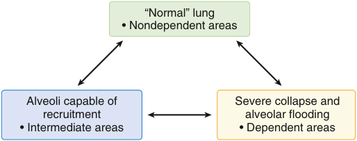

“Normal” lung • Nondependent areas Alveoli capable of Severe collapse and recruitment alveolar flooding • Intermediate areas • Dependent areas 

**Fig. 75.5** For the purposes of lung protective ventilator strategies, the lung can be divided into three hypothetical areas.

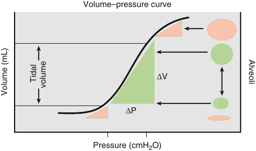

Volume–pressure curve ∆V ∆P Pressure (cmH2O)  Tidal Alveoli volume Volume (mL) 

**<mark>Fig. 75.6 Volume–pressure curve.</mark>**

_volutrauma_ . Therefore, in theory, we attempt to keep tidal volumes on the most compliant part of the volume– pressure curve, above Pflex and below Pmax, leading to “open lung ventilation.” Triggered by the ARDSnet’s initial study, the use of low tidal volumes (6–8 mL/kg) with the addition of PEEP (open lung strategy) may reduce morbidity and mortality in patients with ARDS (Fig. 75.7).385 However, as lung injury to the normal and intermediate areas of the lungs progresses, the volume–pressure curve moves to the right as the compliance of the lungs decreases, leaving a smaller therapeutic window requiring an increase in PEEP, resulting in higher MAP to maintain recruitment of areas of normal and recruitable lung (Fig. 75.8).

The lung protective strategy attempts to decrease VALI by inhibiting volutrauma, barotrauma, atelectotrauma, oxygen toxicity, and biotrauma (Fig. 75.9).

- _Low Tidal Volume_ : Despite using unusual control groups in the ARDSnet original study, employing a low tidal volume approach of 6 to 8 mL/kg has become a standard of care.

- _PEEP_ : The advantages of PEEP as a distending pressure include: an increase in FRC, improvement of respiratory

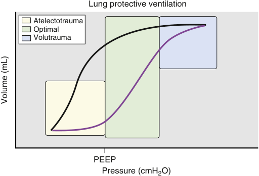

Lung protective ventilation Atelectotrauma Optimal Volutrauma PEEP Pressure (cmH2O) Volume (mL) 

**Fig. 75.7 Lung protective ventilation strategy.** _PEEP,_ positive endexpiratory pressure.

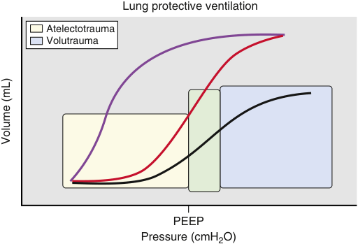

Lung protective ventilation Atelectotrauma Volutrauma PEEP Pressure (cmH2O) Volume (mL) 

**Fig. 75.8 Lung protective ventilation with worsening lung compliance.** _PEEP,_ positive end- expiratory pressure.

<!-- PDF page 37 -->

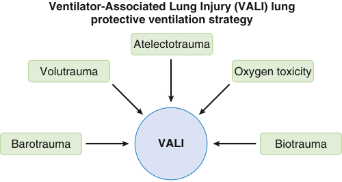

Ventilator-Associated Lung Injury (VALI) lung protective ventilation strategy Atelectotrauma Volutrauma Oxygen toxicity Barotrauma VALI Biotrauma 

**<mark>Fig. 75.9 Tenets of ventilator- associated lung injury.</mark>**

compliance, improvement of ventilation/perfusion mismatch, and redistribution of lung water/edema. PEEP ultimately improves arterial oxygenation. The use of low tidal volumes has been consistent across multiple recent trials, but the selection of PEEP in these trials has been highly variable. Recent pediatric studies have shown that setting PEEP lower than the ARDSnet guidelines can increase mortality.386 Furthermore, guidelines from the PALICC recommends increased levels of PEEP.359 It can be challenging to determine the critical opening pressure of alveoli clinically. Therefore, most clinicians initially use a minimal distention strategy by setting PEEP between 5 and 9 cmH2O, as lung injury progresses and hypoxemia worsens, PEEP may be increased to increase mean plateau pressures (keep &lt;30–35 cmH2O) and aid in recruitment. More precise methods of determining optimal PEEP in patients with ARDS include titration using dynamic compliance or static pressure–volume loops to identify the critical opening pressure. Alternatively, one can use titration with dynamic compliance or static pressure–volume curve. Likely, in the future, we will determine optimal PEEP in patients with ARDS using transpulmonary pressures with an esophageal catheter. It is important to remember that as PEEP is increased and lung is recruited, intrathoracic pressure is also increased. There has been concern by clinicians that increased intrathoracic pressure can inhibit cardiac output by reducing venous return. There have been several studies that have shown even with increasing PEEP there is not a decrease in cardiac output.387,388 However, given the concern for decreased cardiac output, hemodynamics should be monitored as PEEP increases.

_Plateau Airway Pressures:_ Sustained plateau airway pressures greater than 35 cmH2O can lead to barotrauma: pneumothorax, pneumomediastinum, and subcutaneous emphysema. In an attempt to limit barotrauma, PaCO2 is allowed to increase in the face of inadequate minute ventilation. This permissible hypercapnia can be employed as long as the patient tolerates the acidosis and is able to buffer with the renal retention of HCO3− and there are no contraindications from coexisting disease.

- _Driving Pressure:_ Driving pressure is the peak inspiratory pressure minus the PEEP for paralyzed patients receiving mechanical ventilation. Amato _et al._389 demonstrated in a reanalysis of adult ARDS patients involved in prior randomized trials that decreases in driving pressure due to changes in ventilator management were strongly associated with increased survival.

- _Neuromuscular Blockade:_ Neuromuscular blocking agents (NMBAs) have been provided to patients with ARDS to control ventilation and reduce trauma caused by increased tidal volume or increased airway pressure. NMBAs may also allow patients to tolerate higher levels of PEEP. This would lead to decreased trauma from repeated opening and closing of lung units. Furthermore, NMBAs may reduce oxygen consumption from both skeletal and respiratory muscles. Papazian _et al._390 as part of the ACURASYS study, demonstrated that early use of NMBA improved the adjusted 90- day survival with ARDS and increased the time off of the ventilator. They did not see an increase in muscle weakness with cisatracurium. A pediatric trial showed improvements in OI and mortality with early vecuronium exposure.391

### ADJUVANT THERAPIES FOR ACUTE RESPIRATORY DISTRESS SYNDROME

### Prone Positioning

In pediatric patients, Curley _et al_ .392 demonstrated that prone positioning was associated with improved oxygenation in patients with ARDS. This group also showed that proning can be safely applied in pediatric patients.393 However, proning was not associated with a benefit in mortality or ventilator- free days, and the trial was stopped early for futility.392 Prone positioning improves lung recruitment in select patients with ARDS. This may explain the difference between adult and pediatric results. In adults, Guerin _et al_ .394 performed a multicenter prospective randomized controlled trial, Proning Severe ARDS Patients (PROSEVA), which showed that early administration of prone positioning significantly decreased 28- day and 90- day mortality. Between these two studies, the pediatric patients were more heterogeneous, and the adults were homogeneous with more severe ARDS. The impact of patient selection and duration of prone positioning is unclear; however, it is likely that a subgroup of patients respond to prone positioning early after lung injury, and immediate responders may benefit from prolonged prone positioning.395 In pediatric patients with brain injury and worsening hypoxemia, prone positioning may be attempted with careful monitoring of ICP.396,397 Currently enrolling, the Prone and Oscillation Pediatric Clinical Trial is a multi- institutional attempt to assess prone positioning in a more severe ARDS cohort.

### Surfactant Therapy

Exogenous surfactant therapy is the standard of care in neonates suffering from RDS; however, the utility of surfactant therapy in the treatment of ARDS is uncertain and continues to be researched. In pediatric patients, a 2003 study by Möller _et al_ .398 showed immediate improvement in oxygenation and a trend toward improved survival with the exogenous surfactant therapy, calfactant. However, Willson _et al_ . in a 2013 randomized controlled trial, found that surfactant did not improve oxygenation and decrease mortality relative to placebo administration.399 However, there was no difference in the length of mechanical ventilation or ICU stay. A 2018 publication by Thomas _et al._ reported using calfactant in 43 patients with PARDS and oncologic disease. There were difficulties in recruitment at some sites but overall, the data did not support the use of calfactant.400

<!-- PDF page 38 -->

The current PALICC guidelines do not recommend routine use of surfactant.359 Clinicians still feel that there may be a specific pediatric patient population (i.e., near drowning victims, hydrocarbon inhalational injury) that may benefit from exogenous surfactant administration, and research is ongoing to determine patient selection, timing, and combination with other therapies for treatment of ALI/ARDS.

### Corticosteroids

Many pediatric patients with ARDS will receive corticosteroids at some point during their hospitalization. There are several underlying issues of inflammation and potentially adrenal insufficiency that would prompt clinicians to provide them. There were two pediatric studies published in 2015 that provide some insight. Drago _et al_ .401 published a small, randomized placebo- controlled trial of 35 patients with ARDS. There was no difference between groups with regard to the duration of mechanical ventilation, length of ICU stay, or mortality. They did find that it was feasible to provide low- dose infusions of methylprednisolone without significant increases in nosocomial infections or serum glucose. Yehya _et al_ .402 reported a single- center observational study in which 169 of 283 children with PARDS received corticosteroids for greater than 24 hours while receiving mechanical ventilation. The group that received steroids had fewer ventilator- free days and a longer duration of mechanical ventilation in survivors. Currently, the PALICC guidelines do not recommend routine therapy with corticosteroids for pediatric ARDS.359

### Nitric Oxide

Inhaled nitric oxide (iNO) is a selective pulmonary vasodilator to improve V/Q mismatch, decrease pulmonary hypertension, and reduce right ventricular cardiac work. iNO upregulates cyclic guanosine monophosphate (cGMP), ultimately resulting in smooth muscle relaxation and pulmonary arteriolar vasodilatation. iNO is delivered directly to ventilated lung units and improves perfusion in these lung areas without significant effects on the rest of the pulmonary vascular bed, thereby improving V/Q mismatch and oxygenation in patients with ARDS. Much like prone positioning and surfactant therapy, iNO can result in transient improvements in oxygenation. A systemic review and meta- analysis performed by Adhikari _et al_ .403 in adults with ARDS showed iNO does not reduce mortality, regardless of the severity of illness. In pediatrics, a small, randomized trial by Bronicki _et al_ .404 showed that pediatric patients with ARDS randomized to receive iNO had significantly improved ECMO- free survival and ventilator- free days at 28 days. This trial only had 55 total subjects and did not show a difference in overall mortality. The most recent study was a propensity- matched cohort of 499 pediatric patients with ARDS by Bhalla _et al_ .373 There were 143 that received iNO. They found that using iNO was not associated with improving ventilator- free days or mortality. There remains a role for iNO in patients with pulmonary hypertension, right heart dysfunction, and potentially a bridge to ECMO. Any further roles would require future studies to show benefit.

### Extracorporeal Membrane Oxygenation

ECMO remains a rescue strategy for pediatric patients with ARDS that fail to respond to advanced modes of mechanical

ventilation. There has been much more research on ECMO in adult ARDS as compared with pediatrics. The CESAR Trial in adults demonstrated improved outcomes in adults treated with ECMO; however, this trial had significant methodologic flaws.405 Results of the EOLIA (ECMO to rescue lung injury in severe ARDS) were reported in 2018.406 The trial enrolled adults with very severe ARDS. They found that 60- day mortality was not significantly lower in the group randomized to ECMO as compared with conventional mechanical ventilation and the possible use of ECMO as a rescue therapy. With regard to pediatric data, in 2018, Barbaro _et al_ .407 published a secondary propensity score matching analysis of ECMO use in patients from the RESTORE study. They found that in patients with severe PARDS, there were no superior outcomes in the group treated with ECMO as compared to those that did not receive ECMO support. With improved care and research, the mortality risk for both ECMO and ARDS will presumably decrease. Lin408 recently published a review on this topic which may provide additional insights. Further research regarding ECMO support of severe PARDS is needed.

### ADJUNCTIVE PHARMACOLOGIC THERAPY: SEDATIVES AND ANALGESICS

Sedation is often required to help children cooperate with mechanical ventilation. The amount of sedation required depends on the child’s age, size, underlying disease, and respiratory support needed. Some children are neurologically depressed and require no sedation. Sedation allows patients to breathe “in phase” with the ventilator, which reduces the peak airway pressure and eliminates coughing and straining, all of which can cause pulmonary gas leaks or inadequate ventilation. Sedation has changed over the past many years in PICUs across the country. Part of the cause of this can be attributed to the development of protocols to limit sedation to decrease tolerance, withdrawal symptoms when sedation was weaned, and the potential for exacerbation of delirium. Many of the larger PICUs participated in the RESTORE study.352 The RESTORE study can serve as a good example of how to deliver sedation using protocols. Each patient’s level of sedation was titrated to a State Behavioral Scale, which allowed for a common language among care providers.409 The medications they used to provide sedation while patients were intubated were primarily morphine and midazolam. They recommended the use of fentanyl infusions as the opioid agent for patients that had hypotension or reactive airway disease. Secondary sedation agents were also used, including pentobarbital, ketamine, methadone, clonidine, dexmedetomidine, and propofol. Some institutions did use lorazepam as an alternative benzodiazepine. Pentobarbital and ketamine were adjunct medications when the patient was unresponsive or less responsive to the primary agents. Methadone and clonidine were adjuncts used primarily to prevent withdrawal symptoms as the patient was tapered off medications. Dexmedetomidine and propofol were used in this study as temporary agents to wean off other medications in anticipation of extubation. Propofol is not used in some units or only as a temporary measure because of the concerns for propofol infusion syndrome.410 Dexmedetomidine is seeing increased usage in PICUs across the country, not just

<!-- PDF page 39 -->

for short- term sedation. In some instances, it can replace opioids to provide sedation. There should be a word of caution in administering lorazepam to premature neonates. Lorazepam repeatedly dosed over several days may cause steroid- responsive hypotension due to buildup of the drug in the body. The half- life of lorazepam is approximately 72 hours in premature infants. Giving the drug every 4 to 6 hours causes accumulation in blood and tissues.

Neuromuscular blocking agents (NMBAs) increase chest wall compliance, reduce oxygen consumption, and facilitate mechanical ventilation. If neuromuscular blocking drugs are used, they should be administered with medications that cause amnesia, anxiolysis, and control pain. Vecuronium, rocuronium, and cisatracurium are the most commonly administered muscle relaxants in the PICU (also see Chapter 24). Rocuronium is often given for intubation and intermittent dosing. Vecuronium can be used as an intermittent agent and a continuous infusion. There are risks of decreased metabolism and prolonged clearance with vecuronium infusions and many PICUs will choose instead to use cisatracurium. Cisatracurium is often useful because its elimination is not dependent on renal or hepatic function. If these drugs are given for more than a day, regular drug holidays should be considered to avoid serum buildup of the drug and prolonged paralysis.

### WEANING FROM MECHANICAL VENTILATION

The pediatric literature falls behind adult publications about guidance in weaning and extubation from mechanical ventilation. A 2009 review by Newth _et al_ .411 addressed what was known at the time. Attempts have been made to develop predictive indices identifying which children can be successfully weaned from mechanical ventilation. Most of the indices are used in research but do have clinical applications. One of them is the Rapid Shallow Breathing Index (RSBI) from Yang and Tobin.412 The RSBI is equal to the RR/tidal volume. When patients are breathing comfortably, they have a lower RR with larger tidal volumes. In this circumstance, the RSBI is a low number. Furthermore, patients with respiratory distress tend to breathe more rapidly with smaller tidal volumes and have a higher RSBI. There are several different techniques for weaning from mechanical ventilation. These include lowering the set ventilator rate over time, performing a daily SBT, or increasing pressure support or CPAP sprints.413 Many hospitals are initiating daily SBTs for their patients. These are periods of decreased ventilatory support while the patient is observed for evidence of respiratory distress. The decreased support can be pressure support, CPAP, or T- piece ventilation. Patients are observed to see no significant increase in RR, decrease in saturations, diaphoresis, hemodynamic compromise, or evidence of increased work of breathing. The successful completion of an SBT will initiate plans for extubation. Depending on the ICU, SBTs are carried out under the direction of the physicians or the respiratory therapist can independently perform them. Computerized weaning protocols may further reduce time on mechanical ventilation.414 At the moment, it seems that the best solution is to ask daily whether the patient can be extubated. Studies indicate a significant percentage of patients being evaluated for weaning are ready for extubation.415

We must remember that as we are weaning patients from mechanical ventilation, there is an anticipated extubation failure rate. If we continue mechanical ventilation until we are absolutely sure a patient will not fail, many patients will be ventilated longer than necessary. A 2003 review415 of 16 ICUs showed an extubation failure rate of 6.2% (range 1.5%–8.8%) for patients requiring mechanical ventilation longer than 48 hours. Our research shows a reintubation rate of 8.3% following extubation.279

About the degree of decreased ventilatory support during an SBT, the use of CPAP does not put patients under increased stress. Multiple prior studies demonstrate that infants or children with smaller ETTs are not “breathing through a straw” when placed on CPAP or T- piece.416–419 Relative to an adult, the ETT may be smaller in diameter, but it is also shorter and the inspiratory flow rate in infants is low compared to adults. Flow rates are measured to be approximately 0.5 L/kg/min.418 Therefore, a 3- kg infant has a flow velocity of 1.5 L/min as compared with 30 L/min for a 60- kg adult. If patients cannot successfully complete an SBT, it is possible they will not manage the work of breathing postextubation.

Overall, the criteria for extubation readiness include intact airway reflexes, hemodynamic stability, manageable secretions, and an appropriate level of alertness. The negative inspiratory force (NIF) the patient can generate can be measured. An NIF should be measured with a calibrated manometer and inspiration from residual volume. An NIF of negative 30 or more is associated with extubation success. The presence of a leak around the ETT may be supportive of extubation. Some research shows that the absence of a leak around the ETT does not predict extubation failure.420,421 However, absence of a leak is associated with the development of subglottic upper airway obstruction after extubation.279 Extubation failure is typically defined as reintubation less than 24 hours after a scheduled extubation attempt. A multitude of reasons may cause extubation failure, but one large category is postextubation upper airway obstruction. We believe the incidence of upper airway obstruction to be between 37% and 41%.279,415 As there is significant interobserver variability279 in the clinical assessment of upper airway obstruction, physiology- based tools may be valuable.279 Objective measures of airway obstruction may be necessary before we have a definitive answer as to which therapies reduce subglottic narrowing and reduce obstruction. Of note, a recent meta- analysis of dexamethasone use to prevent postextubation upper airway obstruction noted that early dosing >12 hours prior to extubation was likely to be more effective than when steroids were given closer to extubation.422 Dosing is still unclear, but it appears that earlier is better.

### RESPIRATORY DISORDERS

### Laryngotracheobronchitis (Croup)

Croup occurs most frequently in the 3- month- old to 3- year- old age group. Croup is a viral infection (parainfluenza, influenza, adenovirus, coronavirus) that causes edema of the tissues in the upper airway, particularly in the immediate subglottic region. There is usually a history of a few days of upper respiratory tract infection symptoms followed by hoarseness, a croupy cough, and possibly stridor. The degree of respiratory distress and the child’s ability to compensate for the increased work of breathing are

<!-- PDF page 40 -->

best assessed clinically. These patients are initially treated with mist and aerosolized racemic epinephrine to reduce swelling of the upper airway mucosa.423 Steroid administration is common yet controversial.81 Tracheal intubation is required when the child can no longer sustain the increased work of breathing and CO2 increases. When the trachea is intubated, the ETT should be 0.5 to 1.0 mm smaller than usual for age. The ETT must be of sufficient size so that the patient can breathe easily during spontaneous ventilation and the nurses can effectively suction secretions from the airways. Croup usually resolves spontaneously in 3 to 7 days. The average duration of tracheal intubation is approximately 5 days. Laryngotracheobronchitis is less common in children older than 4 years.

### Epiglottitis

Epiglottitis is an inflammation of the mucosa of the supraglottic structures that was previously caused by _Haemophilus influenzae_ type B but is now commonly caused by _Staphylococcus aureus_ and streptococcal organisms because immunization against the _Haemophilus_ organism has been so effective. In the past, epiglottitis was a disease of 4- to 6- year- old children. Now, it occurs more commonly at older ages (even in adults).424 In young children, epiglottitis is a true airway emergency because it may rapidly progress to complete and fatal airway obstruction. Providing a secure airway is the priority. Children with epiglottitis appear toxic and have a fulminant onset of fever and respiratory distress. Tracheal intubation during anesthesia is commonly required until antibiotic therapy is initiated and the signs of systemic toxicity subside. The introduction of the _H. influenzae_ vaccine has dramatically decreased the incidence of _H. influenzae_ infection, as well as that of other _H. influenzae_ processes.125

### Bronchiolitis

Bronchiolitis is an acute viral infection of the lower respiratory tract that occurs primarily during the first 2 years of life. The signs and symptoms of this malady are air trapping, wheezing, mild-to-moderate systemic hypoxemia, increased work of breathing, and increased airway resistance. The cause is usually an infection with respiratory syncytial virus (RSV).425 Patients at high risk for respiratory failure from this disease include infants and young children with a history of prematurity, chronic lung disease, or congenital heart disease. Apnea is frequently the first sign of decompensation in neonates, which often occurs before significant hypercapnia appears. Mental status change is a common indication for mechanical ventilation. Treatment is primarily supportive and includes endotracheal intubation and mechanical ventilation for respiratory failure.426 Palivizumab prophylaxis (Synagis), a monoclonal antibody, is a series of intramuscular injections administered to patients at risk for seasonal RSV disease (extremely premature infants, infants with congenital heart disease, immunosuppressed patients, or those with multiple congenital anomalies); it has dramatically decreased the incidence of illness in this population.

### Cystic Fibrosis

Cystic fibrosis is a fatal autosomal recessive disease carried on chromosome 7. Although it affects the pancreatic,

hepatic, pulmonary, GI, and reproductive systems, 90% of the reported morbidity and mortality is pulmonary.136 The pulmonary pathology consists of severe airway obstruction, bronchiectasis, emphysema, and terminal respiratory failure.

The survival of patients with cystic fibrosis has improved dramatically over the past 30 years. More than one- third of patients survive to greater than 30 years of age.136 This change is the result of improved antibiotic therapy, nutritional support, and aggressive treatment of complications. Lung transplantation has been performed in patients with chronic respiratory failure with varied success.427,428

### Bronchopulmonary Dysplasia

BPD is a form of chronic lung disease in patients who have survived severe neonatal lung disease. The cause of this disease is uncertain, but usually, patients were premature, had hyaline membrane disease, and required prolonged and aggressive respiratory support with high inflating and distending pressure and high oxygen concentrations. Inflammation appears to be an important component of this disease.429 Children with BPD have decreased dynamic compliance, increased airway resistance, increased physiologic dead space, and markedly increased work of breathing. The lungs are hyperinflated, with intercostal retractions, nasal flaring, and wheezing. Chest radiographs demonstrate large lung volumes and fibrosis, as well as cystic and atelectatic areas. Hypercapnia and hypoxia are present to varying degrees.430,431 Therapy for BPD includes providing enough calories to meet the higher energy expenditure required for the increased work of breathing. Respiratory support (mechanical ventilation, CPAP) is required for some patients. Diuretics and bronchodilators are frequently used and may be associated with electrolyte abnormalities. Most long- term survivors have subjectively normal pulmonary function. However, some survivors have severe chronic physiologic changes.432,433 During the first years of life, viral or bacterial pulmonary infections often increase the need for respiratory support; these infections may be fatal. Great effort is being made to prevent BPD. Because the trauma of mechanical ventilation on an immature lung is thought to be the major cause of BPD, alternative modes of ventilatory support are being evaluated, including exogenous surfactant, high- frequency ventilation (especially HFOV),434 ECMO, and liquid ventilation.429,435

### Sleep Apnea

Normal ventilation during sleep requires normal upper airway anatomy and normal intact reflexes. The latter include central responses to hypercapnia and hypoxia, response to airway irritation, and dynamic phasic contraction of the pharyngeal and hypopharyngeal muscles. Sleep apnea usually occurs when one or more of these protective responses is abnormal. In infancy, sleep apnea is relatively common. Numerous causes have been postulated, the most attractive of which is the immaturity of the medullary chemoreceptors. Patients with congenital central hypoventilation syndrome (CCHS), the most severe form of central apnea, have complete apnea when asleep. Lesser breathing disorders may be present during sleep in patients with sudden infant death syndrome. Sleep apnea treatment consists of respiratory stimulants (theophylline), cardiorespiratory monitoring during

<!-- PDF page 41 -->

sleep, and tracheotomy and nighttime mechanical ventilation in some severe cases. Obstructive sleep apnea (OSA) occurs in all pediatric age groups. OSA may be associated with an identifiable anatomic disorder, such as enlarged tonsils and adenoids, the Pierre Robin syndrome, and tracheaand laryngomalacia. Signs and symptoms of OSA include loud snoring, obstructive episodes with frequent arousal, behavior disorders caused by sleep deprivation, and later cor pulmonale. The diagnosis is made by the history, ECG, and formal sleep studies. Bronchoscopy may also help define the problem. In young children, an enlarged liver may suggest that the child has pulmonary hypertension. Treatment of sleep apnea includes the removal or bypass of an obstruction. Although tonsillectomy and adenoidectomy may improve the airway, there may still be significant airway obstruction for the first few days after surgery. Rarely does such a child require a tracheostomy.

### Foreign Body Aspiration

Foreign body aspiration is a relatively common and often catastrophic event in children. Although it can occur at any age, the peak incidence of foreign body aspiration occurs at 6 months to 3 years. Vegetable matter (peanuts), other foodstuff (hot dogs), coins, and small toys are the most commonly aspirated material. Some of these objects are radiolucent, but not all. Maintaining a high index of suspicion is essential when the chest radiograph is relatively normal. The symptoms of aspiration are related to the location of the foreign body within the airway and the time since the object was aspirated. Acute symptoms may include total airway obstruction, stridor, wheezing, or acute onset of coughing, whereas more chronic symptoms include bloody sputum, chronic coughing, or wheezing. The diagnosis of a foreign body in the airway is made from the history and physical examination and, in some cases, by radiologic imaging. The efficacy and safety of abdominal thrusts have been questioned. The Heimlich maneuver and back slaps are reserved for acute upper airway obstruction with no air movement. Treatment of less acute or lower airway foreign body aspiration includes bronchoscopy, postural drainage, chest physical therapy, bronchodilators, and surgical object removal.436

### Upper Airway Obstruction and Meningomyelocele

Vocal cord paralysis is a common result of several disorders, including brainstem abnormalities and myelodysplasia. Children with meningomyelocele usually have an Arnold– Chiari malformation and may have stridor. The Chiari malformation allows caudal displacement of the medulla, stretching of the cranial nerve tracts, and abnormal arterial architecture of the brainstem. Vocal cord paralysis may result from pressure on the brainstem (i.e., with hydrocephalus) or focal infarcts of the brainstem. Treatment of these brainstem abnormalities includes relief of the hydrocephalus and, if the paralysis persists, cervical decompression of the Arnold–Chiari lesion. Despite these surgical procedures, some children require a tracheotomy and long- term mechanical ventilation.

### ASTHMA

Asthma continues to have a significant public health burden, with 9.4% of children reported to be affected in 2020

(www.cdc.gov/nchs/fastats/asthma.htm). Thankfully, the majority of children with asthma will never require intensive care. However, there can be significant morbidity and a risk of mortality for the children that do. In a 2012 study by Newth _et al_ .437 of fatal and near- fatal asthma in an ICU setting, 12% of patients had complications, and the mortality was 4%. Cardiac arrest before admission occurred in 10 of the 11 patients who died. For this section, critical asthma is defined as an asthma exacerbation requiring ICU admission.

Asthma is a disease of inflammation. There is infiltration of the submucosal area of the airways with mast cells, eosinophils, and CD4 lymphocytes. Degranulation of mast cells releases leukotrienes and histamine causing edema, increases mucus production, and chemotaxis of white blood cells (WBCs). Multiple factors can trigger asthma attacks and the degranulation of mast cells. Such factors include allergens, infections (viral > bacterial), changes in the weather, and strong emotions. Inflammation increases the irritability of the airway as well as airway hyperresponsiveness. The airway lumen is decreased by spasms of the bronchial muscles, edema, and mucus. Decreases in the airway lumen significantly increase airway resistance. For laminar airflow, airway resistance is related to the fourth power of the radius, but turbulent airflow is related to the fifth power. Due to the smaller lumen of their airways, children experience much greater changes in airway resistance during asthma attacks than adults. Due to resistance in exhalation, an expiratory wheeze is typically noted. Bronchospasm, edema, or mucous plugging can lead to complete obstruction of small airways. Hypoxemia occurs as a result of a mismatch in ventilation and perfusion. Airway dead space is increased by obstruction of the airways. To maintain ventilation, the RR is typically increased. In turn, the initial PaCO2 for patients with critical asthma is usually low. A normal or elevated PaCO2 may identify respiratory fatigue or impending failure.

It should be reinforced early in the discussion that wheezing is caused by more things than just asthma and that asthma can occur without wheezing. Wheezing is the sound that is produced when there is an obstruction to airflow. Wheezing can be caused by pneumonia, upper airway obstruction, foreign body aspiration, mediastinal mass, and congestive heart failure. Each would require different therapy. Wheezing in a toddler of a sudden onset should prompt evaluation for foreign body aspiration. The history should be addressed at recent choking or coughing episodes. Even the presence of a history of reactive airways or atopy does not rule out aspiration. A high index of suspicion should be maintained. Intermittently a chest X- ray obtained for a wheezing child shows cardiomegaly rather than peribronchial cuffing. Asthma is statistically more likely, but wheezing can be the presentation of heart failure. In turn, a chest X- ray is warranted for any patient with their first presentation of the wheezing patient and certainly for any child who is admitted to the ICU for wheezing. About asthma that occurs without wheezing, the movement of air is required to hear wheezing. It is possible to have such significant airflow restrictions that patients don’t produce audible wheezing. Patients who present with a quiet chest or limited airflow on auscultation require immediate action.

<!-- PDF page 42 -->

Children presenting with an asthma exacerbation may have a few days of upper respiratory infection (URI) symptoms followed by increased work of breathing. The patient may have low room air oxygen saturation. The patient’s position of comfort may be sitting up to support their muscles of respiration. Accessory muscle use is noted. There is a prolonged expiratory phase on auscultation. In an effort to increase airway pressure, some children may be breathing out with pursed lips, or in smaller children grunting may be noted. The child may not be able to speak in more than one- or two- word phrases. Therapy should be started immediately, first with supplemental oxygen to address hypoxemia. If the child has mild respiratory distress, nasal cannula oxygen may be sufficient. If the child has moderate or severe respiratory distress, oxygen should be delivered by either a face mask or non- rebreather face mask. Inhaled β- agonists such as albuterol are given to relax bronchial smooth muscles. If air entry is sufficiently poor, inhaled medication delivery is likely to be affected, and instead systemic medications should be considered. Magnesium, terbutaline, or epinephrine are commonly used medications and are more likely to be associated with systemic side effects than inhaled albuterol. In addition, if the patient tolerates it, the use of BiPAP therapy may improve delivery of inhaled medications. Steroids should be given early as the effect will take some time. If there is limited improvement with initial therapy, arrangements should be made for ICU admission. Many emergency departments will attempt to obtain arterial blood gases. However, the clinical picture alone may provide enough information to guide therapy.

### Asthma Therapy

**Supplemental Oxygen.** Oxygen can be delivered with a standard nasal cannula, but the highest amount of FiO2 that can be delivered is limited. A standard nasal cannula might provide up to 28% FiO2. Increasing oxygen flow with a standard cannula above 4 to 5 L/min is not usually tolerated. A simple face mask might increase the FiO2 to 50%. A tightly sealed non- rebreather face mask might be able to provide a FiO2 closer to 1. Providing oxygen with an HFHNC may provide nearly complete humidification of the airway gases, and the FiO2 also approaches 1. A 2014 study by Rubin _et al_ .438 demonstrated a decrease in the effort of breathing in patients receiving HFHNC. The mechanism of its effect is not elucidated. Some clinicians have begun using HFHNC to deliver β- agonists or other aerosolized medications, but there is not yet data supporting its use. There likely is a condensation of the medications in the connectors of the HFHNC device, and as such, not all of the medication is delivered. However, HFHNC may be better tolerated by smaller patients as compared to other delivery devices.

**Inhaled β- Agonists.** Inhaled β- agonists are used to relax bronchial smooth muscles. The most commonly used β- agonist is albuterol, a racemic mixture of the active R and inactive S enantiomer. Levalbuterol, the active R enantiomer, is available as a separate preparation. Still, recent studies have not shown it to be more effective439 or have less elevations in HR.440 Albuterol is β2 selective and comes as a metered dose inhaler or solution for nebulization. Continuous albuterol is preferred for initial therapy in the ICU,

and the usual dose is 0.15 to 0.5 mg/kg/h or 10 to 20 mg/h. After the improvement in air movement with decreased respiratory distress, intermittent doses can be given every 1 to 2 hours. Terbutaline as an inhaled medication is less β2 selective compared with albuterol and therefore is used less commonly. Terbutaline remains an important IV medication. Tachycardia is frequently associated with albuterol use. At times it is unclear if the elevated HR is related to toxicity of medications or due to ongoing respiratory distress. Arrhythmias may be seen with albuterol use, but this is usually just an increased frequency of PVC. Diastolic hypotension is observed with higher doses of albuterol, although this can be related to decreased intravascular volume and increased intrathoracic pressure. Agitation and tremors can be seen with CNS stimulation. Hypokalemia may be noted as the β- agonists drive potassium into cells. Ipratropium bromide, an inhaled anticholinergic, is sometimes paired with intermittent albuterol doses. Ipratropium bromide has the benefit of promoting bronchodilation without decreasing mucociliary clearance.

**Corticosteroids.** IV steroids are preferred to oral dosing in the ICU due to the possibility of decreased absorption or delayed onset. Methylprednisolone is commonly used due to its limited mineralocorticoid effects. The initial dose is 2 mg/ kg and then 0.5 to 1 mg/kg every 6 hours. There may be regional preference for dexamethasone or hydrocortisone. Steroids are typically given for the duration of the acute asthma phase. If steroids are given for 5 days or less, they are not usually tapered. Systemic steroid use is associated with hyperglycemia, hypertension, and occasionally agitation. In the initial ICU care, inhaled steroids are of no benefit.

**Intravenous Fluids.** Children admitted to the ICU with critical asthma will likely be dehydrated from limited oral intake during their illness and increased insensible losses from the higher RR. The patient’s circulating volume should be supported with fluid boluses if needed. However, excessive fluids should be avoided as this could lead to pulmonary edema. Pulmonary edema could worsen both oxygenation and airway resistance. Fluid boluses may also be needed for children whose respiratory distress requires mechanical ventilation. Hypotension often occurs during intubation.

**Intravenous and Subcutaneous β- Agonists.** A significant decrease in air exchange may result in poor delivery of inhaled medications, and IV β- agonists may be required. Terbutaline is often the first choice of the available β- agonists. Terbutaline is relatively β2 selective as compared with isoproterenol and epinephrine. Terbutaline can be given subcutaneously for children without IV access at a dose of 0.01 mg/kg/dose up to a maximum of 0.3 mg. IV terbutaline is loaded at a dose of 10 mcg/kg over 10 to 20 minutes, followed by a continuous infusion of terbutaline in a range of 0.1 to 10 mcg/kg/min. The infusion can be titrated to effect. Subcutaneous epinephrine may be given for severe asthma exacerbation with limited IV access with a dose of 0.01 mg/kg to the 1:1000 solution with a maximum dose of 0.5 mg. Absorption of the drug may be limited by poor perfusion to extremities. IV epinephrine may be an ideal drug for mechanically ventilated patients with

<!-- PDF page 43 -->

hypotension. The use of isoproterenol in critical asthma has decreased over time.

**Methylxanthines.** In alternative, safer controller medications, oral theophylline is currently used much less frequently. The methylxanthines promote bronchial smooth muscle relaxation, but the exact mechanism of action is not known. Theophylline has a very narrow therapeutic window. Theophylline levels above 20 mcg/mL are associated with nausea, tachycardia, restlessness, or irritability. Higher theophylline levels have been associated with seizure activity.

**Magnesium.** Magnesium can be given as an inhaled or IV medication to relax bronchial muscles. Smooth muscle relaxation occurs due to magnesium’s effect as a calcium channel blocker. Results from the 2013 MAGNEsium Trial In Children (MAGNETIC)441 indicate nebulized magnesium may be beneficial in an acute severe asthma exacerbation. There is evidence that IV magnesium may also be beneficial in severe asthma.442,443 As there is still regional variation to magnesium, at the least, a magnesium level should be checked with the initial set of electrolytes, and hypomagnesium should be treated. The dose for critical asthma and hypomagnesium can be the same, 25 to 45 mg/kg given over 30 minutes. Magnesium toxicity can include muscle weakness, cardiac arrhythmias, decreased reflexes, and respiratory depression.

**Helium.** Mixtures of helium and oxygen (heliox) can be used to improve laminar gas flow. This occurs due to the decreased density of helium compared to nitrogen (approximately one- seventh). For helium to be beneficial in small airways, it must occur in a high ratio with oxygen. The greatest benefits may be seen with an 80:20 or 70:30 ratio of helium:oxygen. Therefore, hypoxemia and the need for increased supplemental oxygen may limit heliox use. There are data supporting the use of heliox to deliver inhaled β2agonists.444 As with other advanced therapy, helium may not have a role in routine care, but there may be benefits from its use in severe critical asthma.

**Ketamine.** Ketamine is a noncompetitive _N_ - methyl- d- aspartate (NMDA) receptor antagonist that can produce a state of dissociative anesthesia. An additional effect of ketamine is bronchodilation. It is a useful medication for sedation in the ICU as ketamine has limited impact on the respiratory drive, and in usual doses, hemodynamics are not usually affected. For patients with asthma who are intubated and mechanically ventilated, ketamine may be a good choice for sedation, along with a benzodiazepine. Furthermore, there was one pediatric study445 showing an improvement in the PaO2/FiO2 ratio and dynamic compliance in mechanically ventilated children with refractory bronchospasm who were receiving a continuous infusion of ketamine. No studies have shown whether ketamine used to treat anxiety is beneficial in preventing intubation in patients during an asthma attack. For non- intubated patients, a Cochrane Database Review446 did not show significant benefit in severe acute asthma. If a decision is made to use ketamine either for a procedure or a means of sedation, the bolus dose is usually 1 mg/kg, allowing time for

effect before repeating. Ketamine is given as a continuous infusion at 5 to 30 mcg/kg/min titrated to effect. One of the additional side effects of ketamine can be dysphoria, and as such, it is usually given with a benzodiazepine.

**Noninvasive Ventilation.** There is very limited evidence that NIV is effective in children with asthma.328 Clinically, patients with effective air exchange who fight the mask and positive pressure do not benefit from NIV. Nevertheless, some children with limited air exchange and fatigue take to NIV easily and appear more comfortable. NIV may allow time for therapies to become effective (steroids) and prevent intubation. This should not be used when the level of alertness or ability to protect the airway is diminished. There is increased use of NIV in pediatric asthma over time,447 but there is limited evidence that it improves outcomes.448

**Intubation.** By the time patients with asthma require intubation and mechanical ventilation, they are hypoxemic, acidotic, fatigued, and have limited reserve. It is suggested that the most experienced person available perform the intubation. Appropriate venous access is required, and fluid boluses may be necessary. Ketamine and a benzodiazepine have been recommended by many. Ketamine may produce increased secretions, so atropine should be considered. Ketamine may produce dysphoria, so the benzodiazepine is given for its amnestic effects. The management style in our ICU is to get the patient back to breathing spontaneously or initiate their own breaths as soon as possible after intubation. In turn, rocuronium can be considered a medium short- acting muscle relaxant. Succinylcholine can be used, but the other side effects of this medication, including elevation of potassium, should be considered. A cuffed ETT is recommended, as ventilator settings may require high peak pressures. Immediately after intubation, we typically hand ventilate the patient at a low rate. This is to prevent alveolar overdistention and reduce the risk of pneumothorax. There can be acute decompensation following intubation. Hypovolemia and increased intrathoracic pressures may be an issue. Following the DOPE acronym, one should also look for Displacement or Obstruction of the ETT and rule out Pneumothorax or Equipment failure.

**Mechanical Ventilation.** There can be controversy regarding the best means to ventilate patients with asthma mechanically. The argument against setting the ventilator in a pressure control mode is that changes in airway resistance that occur with asthma can result in the delivery of an inadequate tidal volume. The argument against a volume control mode is that due to the ventilator’s flow patterns, the same tidal volume can be delivered with a higher peak pressure than a pressure control mode. As stated before, our management style is to get intubated asthmatics breathing spontaneously as soon as possible. This allows them to set their breathing rate, and on pressure support and PEEP, they can set their own inspiratory to expiratory ratio. Pressure support has been recommended because it is patientinitiated, even if not patient- limited.449 There may be initial elevations in PaCO2, but if the patient is well- oxygenated, the carbon dioxide elevation is usually well tolerated.

Historically, clinicians set zero or low PEEP for intubated asthmatics due to the perceived risk of hyperinflation450

<!-- PDF page 44 -->

and barotrauma. However, since 1988 there have been four adult studies451–454 and one pediatric study270 strongly suggesting the benefits of extrinsic PEEP during mechanical ventilation for intubated asthmatics. These studies demonstrated that extrinsic PEEP, up to a level matching intrinsic PEEP, improves the triggering sensitivity of the ventilator, diminishes ventilatory work, and reduces mechanical work of breathing for patients spontaneously breathing with assisted ventilation. As the work of breathing is reduced, there is improved patient comfort and potentially a reduced need for sedation. It is felt that matching extrinsic PEEP applied with the ventilator to the intrinsic PEEP developed by the patient with asthma may improve the delivery of aerosol therapy via the ETT. Matching PEEP may result in earlier liberation from mechanical ventilation. It should be noted that some clinicians believe that attempts to match PEEP may include the risk that extrinsic PEEP will cause overdistention of the lungs. Overdistention of the lungs may increase the risk of hyperinflation and air leak syndrome.450 Our studies270,280 indicate that spontaneous breathing with pressure support and PEEP lowers work of breathing (WOB). For the individual patient, the level of extrinsic PEEP at which hyperinflation will occur is unknown. Theoretically, for the spontaneously breathing patient, extrinsic PEEP applied to counteract intrinsic PEEP should not cause an increase in end- expiratory lung volume (EELV) until extrinsic PEEP exceeds intrinsic PEEP.455 Furthermore, the EELV may decrease, leading to decreased dead space and increased compliance. In our ICU, intrinsic PEEP is measured during a ventilator pause, allowing the patient to exhale completely and measuring the pressure before the next breath. We gradually add extrinsic PEEP with the ventilator and observe RR and clinical work of breathing. We always keep extrinsic PEEP at a level below intrinsic PEEP. We continue to reassess the extrinsic and intrinsic PEEP level as the patient responds to therapy. Further research is needed to determine the best practice of mechanical ventilation for intubated asthmatics, but this is limited by the small number requiring intubation each year.

**Inhalational Anesthetics.** One of the properties of inhaled anesthetics is bronchodilation. In turn, inhaled anesthetics have been used as rescue therapy in intubated children with critical asthma. We have used isoflurane in our ICU to reduce bronchospasm with the added benefit of a decreased sedation requirement. However, inhaled anesthetics are difficult to use in an ICU setting. Modern ICU ventilators are not designed to accept a vaporizer. ICU ventilators have no circle system, so there is a tremendous use of anesthetic vapor. There are no primary means of gas scavenging in an ICU ventilator, so significant steps must be taken to avoid contamination of the patient room. A case series of six patients was reported by Wheeler _et al_ .,456 and Dr. J. Tobias has published several articles457–459 detailing the use of inhaled anesthetics in asthma and other clinical conditions. A recent retrospective cohort study by Char _et al_ .460 in intubated asthmatics did not demonstrate a difference in mortality between centers that did or did not use inhaled anesthetics. There was significantly greater length of mechanical ventilation, length of stay, and increased hospital charges in the centers using inhaled anesthetics. The significant expertise needed to deliver inhaled

anesthetics safely may limit its use to a few centers. An anesthetic- conserving device (Sedaconda ACD, Sedana Medical) is available in the European market but not in the United States. In December 2021, Sedana Medical received investigational new drug (IND) clearance to initiate phase III clinical trials. The device is a miniature vaporizer and a conserving medium or reflective filter that keeps the inhaled anesthetic on the patient side of the device. This device can be used with a normal ventilator. Finally, as the scientific community learns more about the potential neurotoxicity of inhaled anesthetics, the physician must weigh the risk and benefit profile to long- term inhalational anesthetics for managing status asthmaticus.

### Extracorporeal Life Support for Status Asthmaticus.

ECLS has been used as a rescue therapy in near- fatal asthma. As with inhaled anesthetics, the use of ECLS for this indication is likely limited to a small number of centers. As this 2020 review highlights, the number of pediatric patients is too limited to determine whether this therapy has advantages over mechanical ventilation or conventional therapy.461

## Central Nervous System

Systemic illness is a common cause of CNS dysfunction in infants and children. Seizures, head trauma, CNS infections, and hypoxic or metabolic encephalopathy commonly cause acute neurologic dysfunction in the PICU. Assessment of neurologic function depends on an understanding of the age- dependent progression of motor and cognitive skills. Table 75.7 lists the developmental milestones.

### FUNCTIONAL POSTNATAL NEUROLOGIC DEVELOPMENT

Motor function in the newborn depends on gestational rather than postnatal age: that is, an infant born at 28 weeks’ gestation exhibits motor responses similar to a fullterm newborn when the former is 3 months old. Although potentially modifiable by cortical influence, most neonatal motor behavior is subcortically controlled, which permits normal motor behavior in newborns with severe cortical damage. Assessment of intellectual development is difficult in a newborn; initially, it is based on the absence of reflexes and the acquisition of new motor skills. Adaptive or interactive behavior is first seen with accommodation to repeated stimuli and eye contact. The infant’s intellectual development depends on external stimulation and social interaction, preferably from one or a few individuals. Thus, parental input and therapy are critical in infants and children who require long- term intensive care for some developmental stimulus.

### ASSESSMENT OF NEUROLOGIC FUNCTION

Clinical examination is the most important tool for assessing children’s neurologic function. In an awake child, interactions with the examiner and caretakers are sensitive indicators of high or integrative cortical function.

<!-- PDF page 45 -->

**Table 75.7** Normal Ages for Major Developmental Milestones

|**Age**|**Motor Function**|**Language**|**Adaptive Behavior**|
|---|---|---|---|
|4–6 weeks|Lifts head from prone position and turns from side to side|Cries|Smiles|
|4 months|Shows no head lag when pulled to sitting from supine position; tries to grasp large objects|Utters sounds of pleasure|Smiles, laughs aloud, and shows pleasure from familiar objects or persons|
|5 months|Grasps voluntarily with both hands; plays with toes|Makes primitive sounds|Smiles at self in mirror (ah, goo)|
|6 months|Grasps with one hand; rolls prone to supine; sits with support|His increased range of sounds|Expresses displeasure and food preferences|
|8 months|Sits without support; transfers objects from hand to hand; rolls supine to prone|Combines syllables (baba, dada, mama)|Responds to “No”|
|10 months|Sits well; crawls; stands holding; finger–thumb apposition in picking up small objects||Waves goodbye; plays patty- cake and peek- a- boo|
|12 months|Stands holding; walks with support|Says two or three words with meaning|Understands names of objects; shows interest in pictures|
|15 months|Walks alone|Utters several intelligible words|Requests by pointing; imitates|
|18 months|Walks up and down stairs holding; removes clothes|Says many intelligible words|Carries out simple commands|
|2 years|Walks up and down stairs by self; runs|Makes two- or three- word phrases|Engages in organized play; points to some parts of the body|

When the child’s cognitive function is depressed from disease or drugs, examination of the general level of activity and peripheral and brainstem reflexes becomes an important, albeit crude, measure of CNS function. A detailed examination includes evaluating the level of consciousness and alertness in the context of sedative medications. The Glasgow Coma Scale (GCS) is a commonly accepted tool to evaluate the level of function of neurologically impaired patients (Table 75.8); however, it was not developed for this purpose, and extensive research needs to continue on directed scales and noninvasive means to improve assessment consciousness in the critically ill child.462 Painful stimulation can stimulate both decorticate or decerebrate posturing, and likely indicates significant CNS malfunction and should trigger further investigation. Decerebrate posturing is an extension at the elbows with the arms and hands pronated, whereas decorticate posturing of the upper extremities is flexion at the elbows with the hands clenched. These responses to painful stimuli or no response at all should (in combination with attempts to elicit a cough, gag, or ability to handle oral secretions) indicate that a patient cannot protect their airway and is at high risk for aspiration. Pupillary reflex is a well- preserved function, and therefore unreactive pupils are very concerning. Large reactive pupils may be caused by tricyclic antidepressant ingestion, atropine administration, or a symptom of pharmacologic withdrawal. Small reactive pupils may indicate damage at the pons level but can also be secondary to the presence of opioids or barbiturates. A fundoscopic exam is important to assess for signs of increased ICP or retinal hemorrhage; however, the bedside practitioner may have difficulty with these assessments, and it may require an ophthalmologist consultation. Some devices are available for quantitative assessments of pupil reactivity that may be able to

standardize bedside assessment of pupils across multidisciplinary groups and time.

### LABORATORY ASSESSMENT OF NEUROLOGIC FUNCTION

The EEG is used to diagnose seizures and isoelectric brain death and to monitor the effects of barbiturates administered to induce coma. In addition, cEEG monitoring is often used to detect nonconvulsive seizure activity in critically ill children.217,463,464 This resource- intense monitoring system has yet to show that it improves outcomes; however, its use continues to grow in neonatal and pediatric critical care, and further study is needed for this promising noninvasive tool. CT allows rapid detection of CNS lesions, the extent of structural injury, and noninvasive assessment of ICP.

Cranial ultrasound is a bedside technique to assess ventricular size and intracranial anatomy in infants with nonfused cranial sutures. MRI permits intraorbital and ocular injuries and brainstem and spinal cord lesions to be examined; it is also suitable for defining soft tissue abnormalities.465 MRI’s major drawback is the length of time required for each examination and the relative inaccessibility of the patient while in the scanner. Maintaining body temperature can also be a problem in small children during MRI scanning because the room must be cold. It is more difficult to safely perform MRI in patients with significant cardiorespiratory compromise because many pumps cannot enter the scanner. As infusions of vasoactive medications are occurring through long stretches of tubing, changes in dosage may take time to reach the patient. Furthermore, MRI- compatible ventilators may not be as precise as typical ICU ventilators, leading to alterations in oxygenation and ventilation. Because of these differences, it is critical for multidisciplinary teams

::: details 原始表格與符號（PDF 第 45 頁）

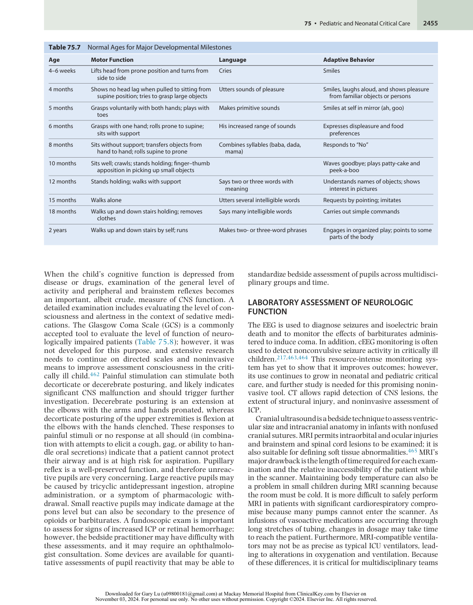

:::

<!-- PDF page 46 -->

**Table 75.8** Glasgow Coma Scale for Infants and Children

|**Activity**|**Adult/Child Response**|**Infant Response**|**Score**|
|---|---|---|---|
|Eye opening (E)|Spontaneous|Spontaneous|4|
||To verbal stimuli|To verbal stimuli|3|
||To pain|To pain|2|
||None|None|1|
|Best verbal response (V)|Oriented, appropriate|Coos and babbles|5|
||Confused conversation|Irritable cries|4|
||Inappropriate words|Cries to pain|3|
||Incomprehensible words|Moans to pain|2|
||None|None|1|
|Best motor response (M)|Obeys verbal command|Normal movement|6|
||Localizes stimulus|Withdraws upon touch|5|
||Withdraws from noxious stimulus|Withdraws upon pain|4|
||Decorticate flexion|Decorticate flexion|3|
||Decerebrate extension|Decerebrate extension|2|
||None (flaccid)|None (flaccid)|1|

to be aware that transport and changes in ventilators may drastically change neurophysiology.

Doppler ultrasound allows bedside assessment of CBF velocity in the ICU. Although it does not directly measure cerebral blood flow (CBF), Doppler ultrasound is a useful bedside guide to therapy. Four- vessel CBF angiograms are the “gold standard” and are usually required to diagnose brain death during barbiturate coma or if a confirmatory apnea test cannot be performed.

ICP can be monitored by inserting a catheter into a lateral ventricle or a subarachnoid screw or transducer into the epidural space or cerebral parenchyma. The ventricular catheter provides an accurate waveform and permits cerebrospinal fluid (CSF) withdrawal to reduce ICP. The other devices used to measure ICP provide less consistent pressure waves and do not permit the removal of CSF.

persists despite adequate oxygen delivery to brain tissue due to persistent metabolic crisis.467,468 Furthermore, hyperoxia is not effective in completely reversing metabolic crisis. It may lead to persistent secondary injury due to superoxide and free radical generation, mitochondrial dysfunction, and significant exacerbation of neuroinflammation. There is widespread heterogeneity of metabolism following TBI, with some regional areas of increased glucose and oxygen utilization (likely due to electrical instability); however, in large regions of the brain, oxidative metabolism is reduced to a critical threshold with critically low rates of cerebral metabolic oxygen consumption rate (CMRO2).469 This, coupled with ongoing low CBF following TBI, places viable brain tissue at risk.469,470 How the neurovascular bundle regulates the delivery of blood flow to regions gripped in metabolic crisis in ongoing secondary crisis and determining how to manipulate CBF remain important avenues of study in the immature brain.

### TRAUMATIC BRAIN INJURY

Despite advances in resuscitation care, morbidity following pediatric traumatic brain injury (TBI) remains high. TBI is composed of two components, an initial primary injury due to direct mechanical deformation of brain parenchyma and a subsequent secondary injury that may develop over hours to days. Secondary injury may result from multiple mechanisms, including ischemia, excitotoxicity, metabolic failure and eventual apoptosis, cerebral swelling, axonal injury, and inflammation and regeneration.466 For improvements in outcome to be achieved in the pediatric critical care setting, secondary brain injury must be prevented or minimized.

Conventional wisdom about TBI has dictated that ischemia plays a major role in secondary brain injury. While reversal of ischemia is crucial, simply delivering oxygen to injured areas of the brain does not abate the onslaught of secondary injury cascades destroying vulnerable brain areas following TBI. Recent evidence suggests that secondary injury

### CEREBRAL PERFUSION PRESSURE AND CEREBRAL BLOOD FLOW

In children, developing effective treatments for TBI is complicated by the rapidly changing responses of the immature brain to each type of brain injury during development from infancy through childhood.471,472 Therefore, the evaluation of therapies for children with brain injury must utilize immature animal models as a translational pathway to human trials in children. It must be understood that much of the research in this field that drives clinical guidelines and recommendations are born from adult clinical studies and adult- aged small animal research. How this evidence translates to the child provides some direction but should catalyze further research on the immature brain. This is especially true when the practitioner must indirectly target metabolic delivery in the face of secondary brain injury by attempting to modulate CBF and predict regulation or

::: details 原始表格與符號（PDF 第 46 頁）

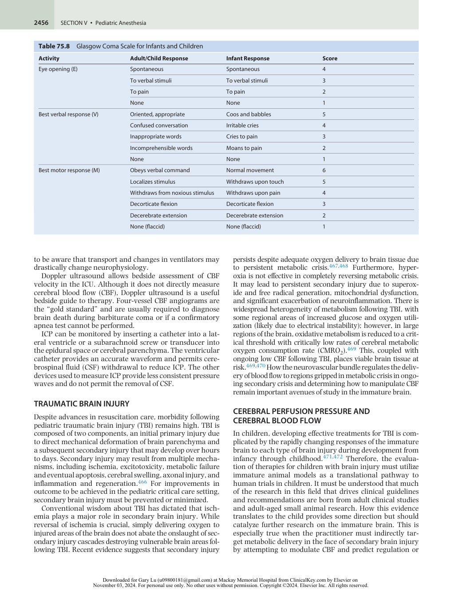

:::

<!-- PDF page 47 -->

lack of regulation in the neurovascular bundle. Even in the healthy brain, CVR regulation is complex and poorly understood.473–475 To add to this layer of complexity, CVR is likely heterogeneous following brain injury dependent on the mechanisms of injury, age, and even sex. Optimal global CBF is an elusive clinical target, with a lower inflection point associated with ischemic injury and an upper inflection point associated with hyperemia increasing cerebral blood volume, and ICP. In early posttraumatic brain injury, cerebral hypoperfusion may significantly contribute to secondary brain injury, ultimately increasing morbidity and mortality.470,476 In adults, areas of contusions have low CBF similar to the ischemic penumbral zones surrounding areas of acute ischemic stroke.477,478 Low CBF states have been demonstrated in children by xenon CT scans following TBI within 24 hours of the initial injury, but by 48 hours, these patients had normal or supernormal blood flows.476 Furthermore, CBF in pediatric patients as a target for neuroresuscitation is a theoretical point of manipulation due to limited options of continuous measurement in the clinical setting. Therefore, CPP (mean arterial blood pressure [MAP] minus ICP) is a commonly used surrogate.

When cerebral autoregulation is impaired, CBF and the metabolic needs of the injured brain may depend on maintaining adequate CPP. The difficulty comes in identifying the term adequately. Pediatric CPP thresholds (40–60 mm Hg) have been extrapolated from adult experimental and clinical TBI and stroke studies.477,479 However, recently, it has been reported in adults that ischemia following TBI may occur at much higher levels of CBF compared with stroke.477 Chambers _et al_ . have published much- needed age- specific pediatric thresholds for critical CPP, below which cerebral ischemia occurs with unfavorable neurologic outcomes and increased mortality.480–482 These studies identified inadequate CPP levels but did not identify an “optimal treatment” CPP, and therefore assumed that these CPP levels were equivalent to brain injury insult thresholds.

It is unclear if a CPP of 40 mm Hg is a minimal threshold and/or an optimal CPP to prevent brain injury may be higher.483 Using currently accepted pediatric CPP guidelines (CPP >40 mm Hg) may not ensure adequate oxygen delivery to brain tissue.484,485 This raises the question: is a CPP greater than 40 mm Hg in the pediatric TBI patient high enough? Mild, induced hypertension after ischemic stroke has shown promise in animal models but remains controversial in the clinical setting.486,487 Adult TBI studies have observed an increased risk of adult RDS associated with targeting a CPP greater than 70 mm Hg. Still, it is unclear how applicable this is to pediatric neurocritical care.488,489 A retrospective study of 146 pediatric TBI patients observed a strong association of poor outcome at discharge with hypotension within the first 6 hours of injury.490 The window for treatment of hypoperfusion appears to be early after pediatric TBI and may be of relatively short duration in children. We believe that early aggressive intervention of blood pressure support, especially during early critical periods, such as initial resuscitation of a multitrauma patient, intubation, and placement of support lines and neuromonitoring devices, is critical to neuro- resuscitation. Guidelines updated in 2019, based on class III evidence for pediatric traumatic brain injury, suggest that a minimum CPP of 40 mm Hg should be maintained and that 50 mm Hg for a

minimum CPP in older children may be required.491 However, data in our laboratory in large animal models of TBI may support the use of higher CPP support (>70 mm Hg) in severe TBI.492

Targeting CPP often requires vasopressor support. While central venous access should not delay the administration of vasopressor support, it is important to understand the risks of extravasation of these infusions and to have qualified individuals place central venous access as soon as possible to mitigate these risks. Initial stabilization of the pediatric TBI patient may occur in limited resource environments where complex invasive intracranial monitoring may not be available. Early stabilization of cerebrovascular hemodynamics, targeting a higher MAP or CPP, may reduce brain injury and improve long- term outcomes. A common first- line vasopressor to enhance MAP of pediatric brain injury is phenylephrine. Phenylephrine is an α- adrenergic agonist that may have little or no effect on cerebral vasculature resistance.493–496 Another vasoactive medication gaining favor is norepinephrine (NE). NE primarily targets α- receptors for peripheral vasoconstriction but also affects β- receptors increasing inotropy. Several published reports now in adults show the rising use of NE as a preferred vasoactive medication and may provide more predictable CPP augmentation when compared with dopamine.497–499 Prathep _et al_ . have reported that adults with isolated traumatic brain injury and cardiac dysfunction have a higher incidence of in- hospital mortality.500 Further research is critical to determine the degree of cardiovascular compromise following TBI in children and which vasopressor should be considered a first- line agent in pediatric brain injury; this currently should be determined by local experience and comfort of use. We believe that the next generation of treatments will build upon the tenets of ischemic neuro- resuscitation and combine early directed metabolic neuro- resuscitation.501

### RESPIRATORY MANAGEMENT IN THE BRAININJURED CHILD

### Airway Management

The comatose and brain- injured patient is at severe risk for respiratory failure due to loss of airway protective reflexes and impaired central regulation of respiratory function. In addition, the progression of PARDS can be exacerbated by concomitant injuries (pulmonary contusions, aspiration, left ventricular dysfunction or failure, and inflammation due to systemic inflammation due to trauma or infection) and treatments to improve cerebral perfusion (crystalloid administration, hyperchloremic metabolic acidosis, hypernatremia, and vasopressor therapy). The physician caring for these patients must have a neuroprotective plan in place for induction and intubation, as well as adequate training and skill to obtain an artificial airway. In addition, the physician needs to be adept at ongoing neuro- resuscitation in the face of progressive lung disease and hemodynamic instability from SIRS and rising MAPs impeding cardiac preload. The initial step in treating a head- injured pediatric patient is to promote adequate oxygenation and ventilation and prevent or treat hypotension, thereby limiting ischemia. Criteria for tracheal intubation include hypoxemia not resolved with supplemental oxygen, apnea,

<!-- PDF page 48 -->

hypercarbia (PaCO2 >45 mm Hg), GCS ≤8, an incremental decrease in GCS greater than 3 independent of the initial GCS (combined with clinical correlation, anisocoria greater than 1 mm, cervical spine injury compromising ventilation, loss of pharyngeal reflex, and any clinical evidence of a herniation pattern or Cushing triad).502

### Induction and Intubation

Patients with neurologic injury are at a high risk for aspiration during induction of anesthesia due to loss of airway protective reflexes. In addition, there is a heightened risk of cervical spine injury due to trauma, and most patients will be in a cervical collar requiring manual in- line stabilization. The goal of intubation in the neurologically impaired patients should be (1) rapid sequence from induction to the placement of an ETT to reduce the risk of pulmonary aspiration; (2) blunt nociceptive reflexes that may further elevate ICP or cerebral hypertension that may exacerbate intracranial hemorrhage or facilitate herniation; (3) maintaining adequate, age- appropriate CPP; and (4) limiting ischemia by maximizing adequate oxygen delivery and maintaining PaCO2 in a normal range to ensure appropriate CBF.503 It should be assumed that all patients are at risk for a full stomach and cervical spine injury, so intubation should be performed utilizing a neuroprotective, rapid- sequence induction whenever possible. Supplemental oxygen (100%) should be delivered by face mask to allow nitrogen washout from the patient’s FRC to allow sufficient oxygenation before tracheal intubation attempts. To avoid the risk of aspiration bag mask ventilation (BMV) should not be done unless the patient has signs and symptoms of impending herniation or life- threatening desaturation events. Outside of impending herniation, if BMV ventilation is conducted, it is imperative to not overventilate the patient, decreasing PaCO2 and thereby increasing cerebral vascular resistance, resulting in decreased CBF and metabolic delivery in a brain- injured patient. A separate health care professional’s sole responsibility is maintaining the child’s neck in a neutral position by mild axial traction during airway maneuvers to prevent or perpetuate cervical spinal injury. Cricoid pressure should be done by a third individual only if the individual is appropriately trained in the technique, and it should be abandoned if it hinders a rapid intubation attempt. Orotracheal intubation should be favored over nasotracheal intubation due to potential for direct intracranial damage in a patient with a basilar skull fracture.

Because tracheal intubation is a noxious stimulus and can increase ICP, appropriate sedative and analgesic medications should be administered during rapid- sequence induction. The hemodynamic and neurologic status of the patient dictates the choice of agents. Patients usually receive lidocaine (1–1.5 mg/kg) intravenously before intubation to help blunt the rise in ICP during direct laryngoscopy.67 For the hemodynamically unstable patient, the combination of lidocaine, etomidate (0.2–0.6 mg/kg), and neuromuscular blockade with rocuronium (1 mg/kg) or succinylcholine (1 mg/kg) IV is a popular choice. The authors believe succinylcholine may still be an option for rapid-sequence intubation (RSI) in children who may be a difficult airway due to its rapid recovery, as opposed to the nondepolarizing intermediate neuromuscular blockade of rocuronium. There are several choices for induction agents

in the critically ill child with acute brain injury. In the following sections, we will discuss the pros and cons of each induction agent. It remains unclear if any of these agents have particular advantages or disadvantages for patients with brain injury, all have been implicated in animal studies as neuroprotectants and neurotoxins. But it is clear that they are essential to the care of these patients, and practitioners should stay current with the literature and consider the pharmacodynamics of each drug.

### Etomidate

Etomidate is a short- acting IV drug that produces sedation, anxiolysis, and amnesia. Side effects include respiratory depression, hypotension, myoclonus, and adrenal suppression, and it should not be used in children with suspected adrenal insufficiency and sepsis.504 Etomidate has the benefits of decreasing ICP by reductions in CBF and CMRO2 and has the advantage of producing less cardiovascular depression than barbiturates or propofol, preserving CPP.505,506 These neuroprotective qualities are counterbalanced by its ability to increase cerebral vascular resistance by a greater magnitude than its reduction of CMRO2, resulting in an increased metabolic deficit.507,508 The increased metabolic deficit has the potential to expand the ischemic core and penumbra in brain- injured tissue. This increase in cerebrovascular tone is attributed to etomidate’s inhibition of NO synthase.509 Particular attention should also be paid to the rapid recovery of etomidate; once the airway is secured, etomidate’s effects on consciousness dissipate quickly, principally due to the redistribution of the drug from the brain to inactive tissue sites. Recovery of consciousness can be between 5 and 15 minutes, and if rocuronium (paralyzed for approximately 45 minutes) is used in combination for RSI, the patient will need ongoing sedation while paralyzed. In the hemodynamically stable patient, the fast- acting benzodiazepine midazolam (0.05– 0.2 mg/kg) can be added. In addition, the short- acting opioid fentanyl is sometimes added to blunt the stimulation of intubation. It can be a critical part of intubation in a patient with severe TBI and impending herniation. When fentanyl is used with lidocaine, the combination can decrease the catecholamine release associated with direct laryngoscopy.510

### Ketamine

Ketamine is a phencyclidine derivative typically formulated as a mixture of two enantiomers in a hydrochloride salt form. It possesses a pH of around 4, which can produce pain at the injection site when administered intramuscularly or intravenously. Ketamine is an NMDA antagonist, which increases CBF and CMRO2.511,512 Early studies in patients with obstructed CSF pathways reported ketamine administration increases ICP with reductions in CPP.513,514 More recent studies in adult patients with severe head injury have demonstrated improvements in CPP and minimal increases in ICP with ketamine.515–517 One recent report of 30 intubated pediatric head injury patients observed that single doses of ketamine lowered ICP without producing decreases in blood pressure or CPP.518 It is still unclear what ketamine’s effect is on neurologic outcomes in these patients or in patients where ventilation is not tightly controlled. However, we believe that ketamine can be used in

<!-- PDF page 49 -->

brain- injured patients, especially in multitrauma patients, and if etomidate is not indicated.

### Propofol

Propofol is a short- acting sedative–hypnotic IV agent that can be used to provide moderate or deep sedation. Propofol can induce a deep state of sedation rapidly, provide a short duration of effect, and have a pleasant recovery phase. Propofol is a popular agent for sedating pediatric patients with neurologic conditions for noninvasive diagnostic imaging, such as a CT scan or MRI. Due to the fast onset and recovery following administration, repeated neurologic examinations are easy to assess shortly after induction. Propofol also has anticonvulsant properties and reduces ICP, which can be advantageous in sedating a patient with epilepsy or a patient with concerns for obstructive hydrocephalus due to a malfunctioning ventriculoperitoneal shunt to obtain diagnostic neuroradiologic imaging.519 While there have been cases of propofol providing adequate sedation and successfully treating intracranial hypertension,519,520 several pediatric traumatic brain injury case reports have reported metabolic acidosis and death in patients on prolonged (24 hours) continuous infusion of propofol.521–525 Furthermore, a rare but potentially fatal “propofol infusion syndrome,” associated with lactic acidosis, hyperlipidemia, and multiorgan system failure, was first described in pediatric patients who received prolonged (24 hours) continuous infusion and at higher dosages (>4.5 mg/kg/h).526 Current guidelines suggest that in the care of pediatric traumatic brain- injured patients, “continuous infusion of propofol is not recommended.”527 Adverse effects of propofol include pain at the injection site, apnea or respiratory depression, hypotension, and bradycardia, which can be detrimental in a patient at risk for brain ischemia. If used, particular attention should be paid to the decrease in mean arterial blood pressure with propofol administration. Crystalloid bolus and vasopressor usage will likely be needed to counteract propofol’s effects to maintain proper CPP and avoid ischemic insult. Propofol does not provide any analgesia.

### Dexmedetomidine

Dexmedetomidine, a centrally acting α2- adrenergic agonist, is a recently FDA- approved agent used for short- term (&lt;24 hours) continuous IV sedation of intubated adults.528 Like propofol, it has a rapid onset and a relatively rapid elimination half- life and is administered as a loading dose followed by continuous IV infusion. One of the advantages is that it provides sedation with a lower risk of respiratory depression than many other sedative medications. There is increased interest in this agent as a sedative during noninvasive neuroradiologic imaging studies in children who are not intubated. One study compared dexmedetomidine with propofol in children undergoing MRI studies.529 While the onset of sedation and recovery time were significantly shorter in the children that received propofol, hypotension, respiratory depression, and desaturation were more common compared with the children receiving dexmedetomidine.529

There is increased interest in the use of dexmedetomidine as a sedative and potential neuroprotective agent in both adults and children, as animal studies revealed neuroprotection from hypoxia–ischemia and decreased apoptosis, and adult human studies in healthy volunteers demonstrated

parallel decrease in cerebral metabolic rate for oxygen and CBF, which may potentially be helpful in briefly sedating patients who are at risk for intracranial hypertension, such as head trauma, brain tumor, and obstructive hydrocephalus.530 In pediatric traumatic brain injury case reports, no detrimental effects on their ICP were observed. However, systemic hypertension was observed in one child who was receiving dexmedetomidine with other sedatives. In contrast, bradycardia was observed in two other children who were receiving dexmedetomidine, other sedatives, and therapeutic hypothermia.531,532 Further studies are warranted on the potential use of this agent in children at risk for intracranial hypertension. The most common adverse side effects of dexmedetomidine appear to be cardiovascular. Bradycardia with rare reports of sinus pause or cardiac arrest has been reported. Hypotension has been reported, as well as hypertension, the latter thought to be due to peripheral α2B agonism with peripheral vasoconstriction. There are conflicting reports on the effects of ventilatory function, with some studies suggesting mild respiratory depression while others show no effect. While ICP does not appear to increase, CPP and CBF have been shown to decrease. The effects on seizure threshold appear to be mixed.533 The authors do not recommend dexmedetomidine as an induction agent; however, it may be useful for patients with brain injury and ongoing sedation needs. Further study in pediatric patients is needed.

### Fentanyl, Midazolam, and Muscle Relaxation

There are some units that intubate their patients with a combination of fentanyl, midazolam, and a muscle relaxant. Together these medications may blunt the response to laryngeal stimulation, and produce amnesia and anxiolysis. Furthermore, the duration of the midazolam may be sufficient to maintain amnesia throughout the duration of the muscle relaxant. In doses typically used (fentanyl 1–5 mcg/ kg, midazolam 0.1 mg/kg), this will not induce anesthesia. The potential benefit is less hemodynamic changes during induction. However, with the potential for increased intracranial pressure, these medications will not likely blunt a rise in ICP.

After successful tracheal intubation, oxygen saturation of 100%, normocarbia (35–39 mm Hg confirmed by arterial blood gas and trended with an end- tidal CO2), and a chest X- ray showing the tracheal tube in good position above the carina (right mainstem tracheal intubation is common in pediatrics) should be confirmed. Unless the patient has signs or symptoms of herniation, prophylactic hyperventilation (PaCO2 &lt;35 mm Hg) should be avoided. Hyperventilation causes cerebral vasoconstriction, which decreases CBF and subsequent cerebral blood volume – this will lower ICP but may lead to ischemia.534 However, in the presence of signs and symptoms of herniation, such as the Cushing triad (irregular respirations, bradycardia, systemic hypertension), pupillary dysfunction, lateralizing extremity weakness, or extensor posturing, hyperventilation with 100% oxygen can be a life- saving maneuver. Outside of this acute life- saving maneuver, hyperoxia is to be avoided once a stable airway is obtained, and FiO2 should be titrated to maintain SaO2 greater than 90%. Elevating the head to 30 degrees (with C- spine precautions) increases venous drainage and lowers ICP.535,536 Furthermore, the head should be

<!-- PDF page 50 -->

midline to prevent obstruction of venous return from the brain. If these maneuvers don’t relieve the signs and symptoms of herniation, additional sedative and analgesic agents can be administered as long as hypotension is avoided.

### Supraglottic Airway Devices

While supraglottic airways are not considered a permanent airway in critically ill patients, competency in placement is critical for all individuals participating in resuscitation of a brain- injured child. Supraglottic airway devices, such as an LMA device, can be life- saving. In a situation where there is difficulty with direct laryngoscopy and inadequate BVM, an LMA should be placed to limit hypoxia and control ventilation until a physician with advanced airway skills can arrive to place an ETT.

### Postintubation Stabilization

After successful intubation, inspired oxygen should be titrated to maintain oxygen saturation greater than 90%, normocarbia (35–39 mm Hg confirmed by arterial blood gas and trends followed with end- tidal CO2, unless there is impending herniation when it is acceptable to use moderate hyperventilation to 30–35 mm Hg), and confirmation of ETT position with a portable chest radiograph.534 The head of the bed should be elevated to 30 degrees, and the patient’s head should remain midline to improve venous drainage and lower ICP.535

### Neurologic Monitoring

Recent guidelines update treatment for infants, children, and adolescents with TBI.537 ICP increases when the intracranial volume of one of the four compartments (CSF, blood, brain, and supporting tissues) within the cranial vault increases. An increase in one compartment can occur without raising ICP if an equal volume is displaced from another compartment. When displacement is no longer possible, ICP rises proportionately to the added volume. In older children and adults with a rigid calvaria, the cranial cavity is a closed container with noncompressible contents. In patients with a GCS of 8, there is grade III evidence to place an ICP monitor.537 Treatment of ICP should be considered when pressure is greater than 20 mm Hg; however, absolute goals are unclear for children, and intermittent increases in ICP greater than 20 mm Hg may be associated with autonomic instability. Chesnut _et al_ . have reported in a randomized control trial comparing intracranial monitoring with a strategy of imaging and clinical examination in adults with severe TBI.538 While aspects of the study and evidence in adult severe TBI call into question the utility of treating an ICP goal of 20 mm Hg, these goals should likely be used as a component of multimodal monitoring (MMM). The most common monitor used in TBI as an adjuvant monitor for MMM is brain tissue oxygenation (Licox, Integra). There is limited evidence in children, but brain tissue oxygen monitoring in our center is a standard in children with severe TBI.485,539 If brain tissue oxygenation is used, maintain partial pressure of brain tissue oxygen greater than 10 to 15 mm Hg. It is unclear how multimodal neurologic monitoring, both invasive (brain tissue oxygenation, microdialysis, CBF, intracranial EEG) and noninvasive, should be considered for advanced neuro- resuscitation, but studies including the one by Chesnut _et al_ . prove that future

research is critical to understand the mechanisms, timing, and monitoring of the brain to limit secondary injury.

### Adjuvant First- and Second- Tiered Therapies for Intracranial Hypertension and Secondary Injury

In the 2019 guidelines537 the use of hypertonic saline for intracranial hypertension is now grade II evidence and should be considered to reduce ICP in pediatric TBI. Use of 3% saline to treat increased ICP is gaining popularity540 because the sodium does not cross the blood–brain barrier quickly and has an osmolar gradient similar to mannitol. Three percent saline has additional theoretical beneficial effects, including enhancement of cardiac output, reduction of inflammation, restoration of normal cellular resting membrane potential and cell volume, and stimulation of the release of atrial natriuretic peptide. Recommended dosing is 2 to 5 mL/kg IV bolus over 10–20 minutes. Repeat doses can be given, but it is recommended to keep serum osmolality less than 320 mOsm/L and sustained serum sodium less than 160 mEq/L.

Prophylactic hyperventilation to a PaCO2 less than 30 mm Hg should be avoided. Mannitol reduces ICP by decreasing blood viscosity and transiently increasing CBF and oxygen transport. The adenosine concentration decreases, and CBF is maintained in areas that have intact autoregulation. CBF remains constant despite a decrease in cerebral blood volume and ICP. Mannitol also reduces ICP by withdrawing water from the brain parenchyma and excreting the water as urine.541 It takes 20 to 30 minutes for this osmotic effect of the drug to develop. Intermittent boluses of 0.25 to 1 g/ kg of mannitol are administered intravenously to control ICP. The drug eventually enters the CSF and can increase ICP. Barbiturates should only be considered for refractory intracranial hypertension. There is no evidence to recommend tight glucose control in head- injured patients, nor is there evidence suggesting the use of immune- modulating diets at this time, although early enteral nutrition is recommended. There is grade III evidence to suggest that antiepileptic therapy should be initiated in patients with severe traumatic brain injury; in our institution, we place cEEG monitoring and start prophylactic levetiracetam. Elevating the head of the bed 30 degrees while keeping it in the midline position enhances cerebral venous outflow. Even slight movement of the head to a few degrees off midline may double the ICP.

### Hypothermia for Severe Traumatic Brain Injury

Hutchison _et al_ . published a multicenter randomized controlled trial to investigate using hypothermia as a neuroprotective strategy in children.542 This trial concluded that for children with severe TBI, where therapeutic hypothermia (32.5°C for 24 hours) was initiated within 8 hours of injury, there was no improvement in neurologic outcome and the hypothermic group had an increase in mortality. Subsequent analysis of this study suggests that the hypothermia group had a significant increase in hypotension and decreased CPP, which may have contributed to the increase in mortality.543 A second phase 3 randomized controlled trial was initiated to compare hypothermia and normothermia after severe TBI in children with a prolonged hypothermia window, 48 to 72 hours, and a slower rewarming phase.544 The study was terminated early for

<!-- PDF page 51 -->

futility after interim analysis. Therefore, we believe the current standard of care is controlled normothermia for traumatic brain injury in children.

### Decompressive Craniectomy

Decompressive craniectomy with duraplasty may be considered for pediatric patients with TBI who display early signs of deterioration, herniation, or refractory hypertension. The timing of decompressive craniotomy in pediatrics is still unclear and very much institution dependent. Early decompression is likely an important adjuvant in severe TBI, and if used for refractory intracranial hypertension, it should be done early along with aggressive medical management.

### Environment

Care of patients with TBI within an organized trauma system has been shown to reduce mortality associated with severe injury.545 Unfortunately, most severe traumatic brain injuries occur in regions lacking prehospital and advanced ICU care.546 Critically injured children with traumatic brain injury should be stabilized and transferred to a level 1 trauma center as soon as possible.

### HYPOXIC–ISCHEMIC ENCEPHALOPATHY

There is little evidence that increased ICP or correction of ICP alters the outcome of patients with hypoxic–ischemic encephalopathy (HIE). The clinical impression is that the outcome is less favorable in patients who have trauma or metabolic encephalopathy and that aggressive management of ICP, at best, prevents further CNS damage, which is important.547 The GCS score reasonably assesses neurologic function in these patients.

### HYDROCEPHALUS

Another cause of increased ICP is an increase in CSF volume (i.e., hydrocephalus). Common causes of hydrocephalus include obstructed ventricular shunts, aqueductal stenosis/ compression due to congenital malformations, infection, posterior fossa tumors, or intracranial bleeding. Inserting an external or internal shunt to reduce the volume of CSF can be life- saving.

### TUMORS

Brain tumors are common in children, and approximately 70% occur in the posterior fossa. The most common tumor type is astrocytoma. The initial symptoms may include focal deficits, ataxia, or symptoms of increased ICP. A change in condition following tumor resection requires an immediate neurologic evaluation and possibly a brain CT scan. Following a posterior fossa craniectomy, hemorrhage into the posterior fossa can compromise respiration, and if there is an externalized ventricular drain present, the output should be carefully inspected. Postoperatively, the patient should be followed closely for syndrome of inappropriate antidiuretic hormone secretion (SIADH), diabetes insipidus (DI), and cerebral salt wasting. SIADH usually occurs within 24 to 48 hours following surgery and results in free water retention and a decrease in serum electrolytes, which may rapidly worsen cerebral edema. Central DI usually follows

the removal of a suprasellar tumor and results in significant diuresis when antidiuretic stores are exhausted with a resulting increased serum osmolality and a low urine osmolality and urine specific gravity (&lt;1.005). DI is part of a typical triphasic (SIADH to DI to SIADH) response following suprasellar surgery and is treated with volume replacement, and a vasopressin infusion may be required.

### STATUS EPILEPTICUS IN CHILDREN

Status epilepticus is a continuous motor seizure that lasts for more than 20 minutes or a series of seizures without intercurrent awakening. Although it is common for physicians never to find a cause of the seizures, the most commonly diagnosed causes are infections (meningitis or encephalitis) and metabolic abnormalities (toxins, head trauma, and hypoxic and ischemic injury). Because seizure activity increases with status epilepticus, brain and skeletal muscle metabolism and oxygen consumption increase, placing the child at risk for cellular hypoxia. During a seizure, airway obstruction, ineffective chest wall, and diaphragmatic excursion can limit ventilation and worsen arterial hypoxemia and hypercapnia. Treatment of a seizure begins with establishing a patent airway, administering oxygen, and ensuring adequate ventilation. IV anticonvulsant drugs are given to stop the seizure. Commonly used anticonvulsants include lorazepam, levetiracetam, phenobarbital, paraldehyde, and fosphenytoin. Lorazepam is a rapid and reliable drug used to control seizures. Boluses of 0.1 mg/kg lorazepam are given intravenously. The same dose can be given rectally when there is no IV access. Levetiracetam 20 mg/ kg bolus is frequently used. Phenobarbital, 5- to 10- mg/kg boluses (maximal dose of 20 mg/kg), also stops seizures. The main complication of lorazepam is respiratory depression when administered in high doses. Giving both phenobarbital and lorazepam together exaggerates the respiratory depression. Fosphenytoin is also given intravenously in doses of up to 20 mg/kg and should be administered slowly to avoid cardiovascular depression. Paraldehyde, 0.3 mL/ kg, or diazepam, 0.2 to 0.5 mg/kg, depending on age, are other medications that can be given rectally. Once the seizures are under control, the cause of the seizures must be determined.

## Renal System

### FUNCTIONAL DEVELOPMENT OF THE RENAL SYSTEM

Embryologic development of the renal system begins in the middle of the third week of gestation with the development of the pronephric tubules. By 10 weeks’ gestation, a functioning kidney and collection system exists, and fetal urine is discharged into the bladder. At 32 to 36 weeks’ gestation, each kidney has a full complement of nephrons. Because the placenta is the major excretory organ of the fetus, renal growth is not governed by functional requirements. Renal growth increases linearly with body weight and body surface area during the third trimester of pregnancy. The glomerular filtration rate (GFR) increases rapidly from 28 to 35 weeks of gestation. At term, the GFR is 10 mL/min/m2 and

<!-- PDF page 52 -->

increases to 20 mL/min/m2 by 2 weeks of age. Although the GFR of premature infants is lower, the rate of increase is the same as that in a term infant.548 Tubular function is not fully mature in full- term newborns. The newborn kidney is sensitive to antidiuretic hormone (ADH) and vasopressin, and urine osmolarity can vary from only 50 up to 780 mOsm/L.549 The tubular function of premature infants is less mature.

The newborn’s renal threshold for bicarbonate is about 20 mEq/L, which means that standard acid–base nomograms do not apply to infants because their serum bicarbonate concentration of 20 mEq/L is not indicative of metabolic acidosis. The renal tubular glucose threshold of term infants is similar to that of adults, but it is only 125 to 150 mg/dL in premature infants. A full- term infant has 1% or less fractional excretion of sodium by the third day of life. Fractional sodium excretion can be much higher (5%) in premature infants. Renin, angiotensin, and aldosterone concentrations are elevated in newborns and decrease over the first few weeks of life.

### ASSESSMENT OF RENAL FUNCTION

In the resting state, the kidney receives 20% to 25% of the cardiac output, and due to autoregulation, the kidney maintains near- constant renal blood flow and GFR. Creatinine is an end product of skeletal muscle catabolism and is excreted solely by the kidneys, and blood urea nitrogen (BUN) is a byproduct of protein metabolism. Values for BUN can increase independent of renal function as a result of dehydration, high protein intake, and degradation of blood from the GI tract. Normal values for pediatric renal function are presented in Table 75.9.

### RENAL PHARMACOLOGY

An essential aspect of critical care is maintaining appropriate fluid balance in the critically ill child. Even in patients with normal renal function, such as patients with ARDS, chronic lung disease, and CHF, diuretics are often used to limit lung edema and help with cardiorespiratory dysfunction. The ascending loop diuretic furosemide is likely one of pediatric intensive care’s most widely used drugs. Furosemide reaches the ascending loop of Henle by way of the tubular fluid. A

|**Table 75.9**Normal Va|lues for Pediatri|c Renal Function|
|---|---|---|
||**Age**|**Value**|
|Creatinine (mg/dL)|1 year|0.41 ± 0.1|
||10 years|0.61 ± 0.22|
||18 years|0.91 ± 0.17|
|Glomerular filtration rate  2|2–8 days|39 (range, 17–60)|
|(mL/min/1.72 m)|6–12 months|103 (range, 49–157)|
||2–12 years|127 (range, 89–165)|
|Urine concentration |1 month|600–1100|
|(mOsm/L)|2–16 years|1089 (range, 870–1309)|

Modified from Goldsmith DI. Clinical and laboratory evaluation of renal function. In: Edelman CM Jr, ed. _Pediatric Kidney Disease_ . Boston: Little, Brown; 1978:213.

prescribed starting dose of furosemide is typically 0.5 to 1 mg/kg up to approximately 10 mg total dose for patients who are naïve to diuretic therapy. The lowest dose necessary to increase urine output should be used to limit toxicity including electrolyte imbalance and ototoxicity.550 With progressive renal dysfunction, escalating doses of furosemide may be required to maintain the same clinical response. Electrolyte and renal function need to be monitored frequently, as diuretic therapy frequently causes significant hypokalemia, hypochloremia, and other electrolyte wasting. Furosemide is albumin- bound and, in low albumin states, often found in critical illness, the delivery of furosemide to renal secretory sites is decreased. Improved delivery and diuresis is often improved with the administration of 25% albumin just before or with the diuretic. The typical dose is 0.5 to 1 g albumin/kg. Additional diuretics acting at other locations, such as hydrochlorothiazide (distal tubule), are often used as adjuvant medications to improve diuresis. Spironolactone, which blocks the hormone aldosterone, is a weak diuretic but may prevent spare potassium loss. Failure of increasing amounts of diuretics to be effective likely represents worsening renal perfusion and/or renal failure.

### RENAL FAILURE

Acute renal failure is defined as an abrupt, often temporary loss of renal function (see Chapters 15 and 38), with insufficient removal of nitrogenous wastes and problems with fluid and electrolyte balance. Acute renal failure is described by (1) the area of obstruction (prerenal, postrenal [obstructive], or intrinsic renal disorders); and (2) the urine volume (oliguria, polyuria, and anuria). Urine composition is often altered, and fluid, electrolyte, and acid–base disorders are common in acute renal failure. Common causes include hypoperfusion, obstruction, toxins, drugs, inflammation, and autoimmune disorders.

Prerenal causes are common in critically ill children due to systemic hypoperfusion and reduced renal blood flow, resulting in reduced urine output and azotemia, and ischemic renal damage. _Azotemia_ is the term for the accumulation of nitrogenous byproducts of protein metabolism. Intravascular fluids in the case of dehydration or fluids and inotropic support may be needed to reverse prerenal renal failure. The adequacy of circulating blood volume is assessed by CVP and cardiac output measurements, and by estimating renal blood flow with Doppler flow studies or nuclear imaging techniques.

Disorders of the renal glomeruli, tubules, or blood vessels cause intrinsic renal failure. Glomerular diseases include hemolytic–uremic syndrome (HUS), poststreptococcal glomerulonephritis, Henoch–Schönlein purpura, and other inflammatory and immune complex diseases. Acute tubular injury is most commonly caused by hypoxia and ischemia; other causes are rhabdomyolysis, sepsis, hyperthermia, hemolysis, and a myriad of nephrotoxins, including mercury, carbon tetrachloride, and ethylene glycol.

Postrenal obstruction of urine flow can occur anywhere within the collecting system, but it occurs most commonly as partial obstruction of the bladder neck or the ureterovesical or ureteropelvic junction. All these malformations cause obstructive nephropathy and renal injury or renal failure. Signs of obstruction may be subtle and require radiologic,

::: details 原始表格與符號（PDF 第 52 頁）

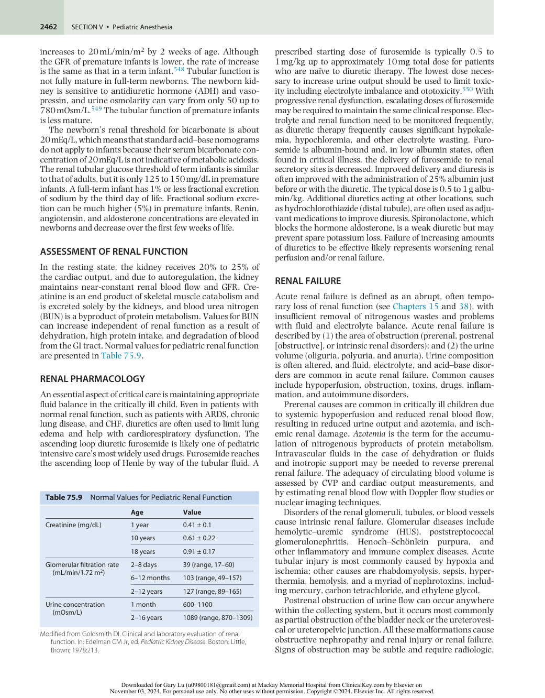

:::

<!-- PDF page 53 -->

ultrasonic, or endoscopic evaluation to detect. Recurrent urinary tract infections are frequent clinical manifestations of obstructive lesions.551

Vascular diseases, including arterial embolism, venous thrombosis, and congenital malformations, are also causes of acute renal failure.

### Box 75.4 Indications for Dialysis

1.  Severe hyperkalemia

2.  Metabolic acidosis unresponsive to therapy

3.  Fluid overload with or without severe hypertension

4.  Fluid overload with or without congestive heart failure

5.  Uremia causing encephalopathy, pericarditis, or bleeding

### HYPERKALEMIA AND ABNORMALITIES OF SODIUM

With increasing renal dysfunction, there is a continued decrease in excretion of potassium. Hyperkalemia can lead to life- threatening cardiac arrhythmias and requires immediate treatment. ECG presentation results in a peak in the T wave at moderately elevated potassium levels. As hyperkalemia increases, there may be ST segment depression, and widening of the QRS complex, leading to conduction abnormalities, bradycardia, ventricular fibrillation, or asystole. Treatment includes the removal of exogenous potassium (administration should be discontinued immediately) and calcium in the form of IV CaCl2 10 to 20 mg/kg or calcium gluconate 30 to 60 mg/kg to stabilize the cardiac cell membrane. IV sodium bicarbonate 1 to 2 mEq/kg will drive potassium into the intracellular fluid by increasing blood pH. Glucose and insulin also drive K+ into cells. Glucose is given as 1 to 2 g/kg IV with insulin 1 unit per 4 g of glucose IV. If the patient is intubated, increasing RR makes blood more basic, driving K+ into the cells. It is important to note that none of these efforts will remove potassium from the body. Before the initiation of dialysis, potassium removal may be attempted with the ion exchange resin Kayexalate, a sodium polystyrene sulfate, which can bind potassium. It is given orally or rectally in suspension but does require excretion from the body. The dose is 1 g/kg orally and can be given every 6 hours; rectally, it can be given every 2 to 6 hours. The enema route is less effective than oral administration.

Severe hyponatremia and hypernatremia can be another electrolyte disturbance seen in the critically ill child. Hyponatremia may present with seizure activity, often when serum sodium is less than 120 mEq/L. In the presence of hyponatremic seizures, the initial treatment is the administration of 3% hypertonic saline to terminate seizure activity and raise serum sodium to greater than 124 mEq/L. However, in the absence of seizures, if a patient reaches this low value slowly, it has to be corrected slowly to potentially avoid osmotic demyelination. The same condition applies to hypernatremia. Rapid correction of elevated serum sodium is likely more harmful than the value itself.

### RENAL REPLACEMENT THERAPY

Renal replacement therapy may be required to improve ongoing fluid shifts and significant electrolyte disturbance (Box 75.4). Modalities for renal replacement therapy are commonly: peritoneal dialysis, hemodialysis, or continuous venovenous dialysis. Modality often depends on the patient’s size and the institution’s experience and resources.

Peritoneal dialysis (PD) has the benefits of being relatively low- cost, causing less hemodynamic compromise compared with venovenous filtration, requires no central venous line, and is technically more straightforward. This technique is especially effective in infants and smaller

6.  Nonobstructive anuria

7.  Inborn errors of metabolism

8.  Certain drug overdoses

9.  Significantly elevated (>100) blood urea nitrogen possibly a relative indication

10.  Potential treatment can reduce inflammation with sepsis or systemic inflammatory response syndrome

children. Peritoneal dialysis involves the insertion of a soft, multiholed catheter into the peritoneal cavity. When patency of the catheter is confirmed, a dialysate solution is infused that equilibrates with plasma and extracellular fluids. The parietal and visceral surfaces function as semipermeable dialysis membranes. The composition of the dialysis fluid is similar to that of plasma. It consists of approximately 130 mEq/L of sodium, 100 mEq/L of chloride, 35 mEq/L of acetate or lactate as a buffer, 3.5 mEq/L of calcium, and 1.5 mEq/L of magnesium. The glucose concentration of the solution can be either isosmotic or hyperosmotic. Hyperosmotic solutions remove fluid and electrolytes. Respiratory compromise may occur with peritoneal dialysis because the increased abdominal pressure caused by the dialysate in the abdomen may prevent effective spontaneous ventilation. Mechanical ventilation will be required if this occurs. Bacterial or fungal peritonitis is common. Severe dehydration, circulatory collapse, and metabolic derangements are other complications of peritoneal dialysis.

The principles of hemodialysis are essentially the same as those of peritoneal dialysis, except the blood interfaces with a semipermeable membrane rather than the peritoneum. Hemodialysis is more appropriate in the acute setting with life- threatening electrolyte disturbances, fluid overload, and toxic ingestions. Hemodialysis is more efficient than peritoneal dialysis. Hemofiltration and ultrafiltration are processes of convective solute transport. Hydrostatic pressure exerted across a highly permeable membrane creates an ultrafiltrate of plasma, with simultaneous blood volume replacement with a modified lactated Ringer solution.552 Continuous venovenous hemofiltration (CVVHF) is a common form of continuous renal replacement therapy (CRRT) that provides isotonic fluid removal but minimal solute clearance. However, these circuits can be easily converted to perform dialysis, termed _continuous venovenous hemodialysis_ ( _CVVHD_ ), providing more solute clearance. In smaller patients, accurate flow rates are essential in circumstances where more than 15% of the patient’s circulating blood volume can be in the CVVHD tubing. Furthermore, technical challenges occur in smaller patients due to the flow characteristics of smaller dialysis catheters. Hemodialysis can be performed with two separate 5- Fr single- lumen catheters, but typically a dual- lumen 7- Fr catheter at a minimum is required. Anticoagulation for CVVHD can be either with heparin or with regional citrate administration. Citrate can be given in a stopcock before the machine, which creates a

<!-- PDF page 54 -->

regional area of hypocalcium in the circuit, leading to relative anticoagulation in the circuit, while IV calcium is given back to the patient via a central line. Regional anticoagulation with citrate avoids the concerns of systemic anticoagulation and may reduce the risk of systemic bleeding.

### RENAL FAILURE OUTCOMES

The prognosis of acute renal failure depends on the patient’s age, underlying disease, and the extent of the precipitating insult (also see Chapters 15 and 38). Children generally do better than adults; in fact, children usually recover completely from a renal insult if the hypoxia or ischemia lasted only a short time and other organ systems are not involved. Children with chronic renal failure require long- term outpatient peritoneal dialysis or hemodialysis until they can undergo renal transplantation.553 It has been demonstrated that the degree of fluid overload at initiating CRRT is associated with patient mortality.126 This has been found to be independent of patient severity of illness scoring.

### HEMOLYTIC–UREMIC SYNDROME

HUS is one of the most common causes of acute renal failure in children. This syndrome is characterized by microangiopathic hemolytic anemia, thrombocytopenia, and acute renal injury. In North America, HUS is most often associated with infection by cytotoxin- producing _Escherichia coli_ O157, but other serotypes and other Shiga- like toxin–producing bacteria have been implicated.554 _E. coli_ O157 resides in the intestinal tract of cattle and may contaminate beef during processing.555 The organism is killed by cooking. Infections can be spread by person- to- person contact in daycare centers, institutions, and the military. A familial form of the disease also accounts for a small percentage of the total cases. HUS is seen predominately in 0.5- to 4- year- old children, but it can occur in all age groups.184 It shares many laboratory and clinical features with the adult disease, thrombotic thrombocytopenic purpura. Some investigators consider the two disorders a continuum of the same disease. The abnormalities that develop in HUS are believed to be caused by cytotoxins and lipopolysaccharide, a bacterial endotoxin. Toxin- induced damage to renal endothelial cells, the vasculature, and other organs is directly or indirectly associated with the activation of leukocytes.556 Cytokines such as interleukin- 1 and tumor necrosis factor, prostaglandin I2, thromboxane A2, and von Willebrand factor multimers probably play a role in the pathogenesis of this disease.557 The time from exposure to the organism to initial evaluation of the patient varies from 3 to 12 days. Symptoms last for about a week. Patients usually have abdominal cramping, bloody diarrhea, tenesmus, and vomiting.558 On average, about 10% of children with _E. coli_ O157–induced bloody diarrhea progress to HUS. Mildly affected patients exhibit anemia, thrombocytopenia, azotemia, and decreased urine output, and have an uncomplicated course. In severely affected patients, anuria is common, hypertension and seizures may occur, and the duration of illness is prolonged. A few children exhibit progressive and permanent renal insufficiency, severe and recurrent hemolysis, thrombocytopenia, and neurologic impairment. Hematologic abnormalities include hemolysis and thrombocytopenia. Hemolysis often causes hyperbilirubinemia

and, despite reticulocytosis, severe anemia with hemoglobin concentrations of 4 to 5 g/dL. Thrombocytopenia results from platelet destruction and sequestration in the liver and spleen.559 The remaining platelets show evidence of impaired aggregation.560 Disseminated intravascular coagulation (DIC) is relatively common. Glomerular capillary endothelial injury is the most consistent renal finding in HUS. Acute renal failure with oliguria or anuria usually lasts less than a week but may linger for more than 10 weeks.561 Glomerular or arterial injury, or both, may predominate, depending on the presence and extent of renal insufficiency (glomerular injury) and hemolysis and hypertension (arterial injury). CNS abnormalities are manifested as decreased levels of consciousness, seizures, irritability, ataxia, hypotonia, hemiparesis, hyperreflexia, and hallucinations; these problems may be caused by severe hypertension, electrolyte disturbances, microthrombi, or cerebral edema, and increased ICP.562 Abdominal cramping is common and may be difficult to distinguish from intussusception, intestinal stricture or bowel perforation, colonic gangrene, or other surgical emergencies.563 Pancreatitis is common in patients with HUS. Congestive heart failure may occur if there is fluid overload, hypertension, anemia, or myocardial depression caused by circulating endotoxins. Treatment of HUS is primarily supportive. Meticulous attention should be paid to volume status, electrolyte and acid–base balance, nutrition, antisepsis, and treatment of hypertension and coagulopathies. Enteric isolation is mandatory to prevent secondary spread of the disease. Accurate fluid intake and output measurements and frequent weight and volume status assessment are important for managing these patients. A central venous catheter is useful for CVP measurements, blood sampling, and administration of IV medications and nutrition. Nephrotoxic drugs should be avoided if possible. If nephrotoxic drugs must be given, the drug dose should be adjusted, and serum concentrations monitored closely. Daily fluids should be restricted to the amounts required to replace insensible losses, urine output, and other ongoing losses. Fluids administered should reflect the electrolyte content of the fluid losses. Caloric support is essential. Enteral feedings are preferred, but parenteral feeding may be necessary if ileus develops. Antidiarrheal medications prolong the duration of colitis, and antibiotics may increase the risk for HUS.564,565 No specific treatment has been effective to date. Heparin, fibrinolytic agents, aspirin, dipyridamole, corticosteroids, vitamin E, and furosemide have not affected the outcome of HUS.566 Immunoglobulin therapy, plasmapheresis, and infusions of fresh frozen plasma have had mixed results, but no long- term therapeutic benefit has been demonstrated. Dialysis, improved nutrition, and supportive care have decreased the mortality rate from 100% in the original report to less than 10% in the last 30 years. Mortality rates remain high in developing countries and children with a genetic predisposition to HUS.

## Endocrine System

### ADRENAL AXIS

Abnormalities of the adrenal axis result in deficient or excessive production of glucocorticoids, mineralocorticoids, or both. Many of these disorders are diagnosed and

<!-- PDF page 55 -->

treated as they are in adults. Congenital adrenal hyperplasia, pheochromocytoma, and iatrogenic chronic adrenal insufficiency are discussed briefly.

related to this lesion include support of the adrenal axis and abnormalities of ADH.

### DIABETES INSIPIDUS

### CONGENITAL ADRENAL HYPERPLASIA

Congenital adrenal hyperplasia is an autosomal recessive disorder associated with deficiencies in either 21- , 11- , or 17- hydroxylase. 21- Hydroxylase deficiency in children can be partial (simple virilizing form) or more complete (saltlosing form); at birth, affected children demonstrate masculinization of the external genitalia, and those with the more complete deficiency show a progressive salt- losing state (i.e., loss of sodium and elevation of potassium). This condition usually manifests in the first few weeks of life as feeding difficulty, vomiting, and failure to thrive. The clinical and historical course is suggestive of pyloric stenosis. If the deficiency is not diagnosed and treated early in life, affected children may suffer severe cardiovascular collapse. A blood sample should be obtained for electrolytes, glucose, and, if the diagnosis has not been established, adrenocorticotropic hormone (ACTH), cortisol, aldosterone, and plasma renin activity.

Treatment requires aggressive support of intravascular volume and myocardial function, glucose, and replacement of the deficient hormones. Cortisol can be replaced by oral administration of hydrocortisone at a dose of 25 mg/m2 /day divided into three doses; if the child cannot tolerate oral medication, cortisone acetate can be administered intramuscularly at a dose of 37.5 mg/m2 /day once every 3 days. For emergency therapy, when the oral route is not possible, and perfusion of the muscle is poor, hydrocortisone acetate is used intravenously at a bolus dose of 1.5 to 2.0 mg/kg and then 25 to 250 mg/ day in divided doses. Mineralocorticoid is replaced with cortisone acetate, 0.05 to 0.2 mg/day orally; these patients usually require the addition of salt to their diet. Deficiencies of 11- and 17- hydroxylase do not result in salt wasting; masculinization and hypertension are the common initial signs.

### PHEOCHROMOCYTOMA

Less than 5% of pheochromocytomas are diagnosed in childhood. As a rule, these tumors are confined to the adrenal medulla, but they can occur anywhere throughout the sympathetic chain. The clinical signs and symptoms of excessive catecholamines are the same as those in adults. Pre- , intra- , and postoperative therapy is similar to adults.

### IATROGENIC CHRONIC ADRENAL INSUFFICIENCY

Long- term daily use of steroids for treating asthma, nephrotic syndrome, and malignancies is common. Such use may cause a hypoadrenal state and increase the risk of cardiovascular collapse during a severe illness or stress. In children, topical steroids can also depress the production of ACTH. Replacement of stress- level steroids (three times the daily replacement dose) is required.

### ANTERIOR PITUITARY

Panhypopituitarism is usually secondary to a tumor or aggressive dissection of a tumor.567 Acute ICU problems

DI can be of central, renal, or psychogenic origin. The central mechanism is the most common form in ICU patients. Absence of ADH results in polyuria and polydipsia; patients with a severe form of this disease may not be able to drink sufficiently to meet their requirements, and severe hypovolemia may develop. Brain tumors, head trauma, neurosurgery, and clinical brain death precipitate DI.568,569 Treatment is fluid replacement or, if unwieldy, hormone replacement with continuous infusion of arginine vasopressin or intermittent desmopressin (intranasal, oral, subcutaneous). The clinical syndrome may be transient or chronic. In either case, close supervision of fluid intake and output is essential.

### SYNDROME OF INAPPROPRIATE ANTIDIURETIC HORMONE SECRETION

SIADH is associated with hyponatremia and hypoosmola lity caused by inappropriate urinary loss of sodium and free water in patients with normal kidneys. Urine osmolality is greater than serum osmolality. This syndrome is precipitated by several mechanisms, including head trauma, neurosurgery, meningitis, hypoxia, and any major surgical procedure in which there is large- volume fluid shift and fluid replacement.200,570 This disease is usually self- limited, and the only real problem occurs if the diagnosis is not considered and the level of hyponatremia is low enough to cause CNS dysfunction. Seizures are rare unless serum sodium is less than 120 mEq/dL. Care should be taken to raise the serum concentration of sodium slowly. This syndrome is treated by fluid restriction and, in severe cases, by the infusion of hypertonic or isotonic saline.

### PANCREAS/INSULIN

### Hypoglycemia

Hypoglycemia is a common problem in ICU patients. What constitutes hypoglycemia in children has been disputed. However, it is uncommon to find a blood glucose level below 40 mg/dL in normal, nourished premature, or term neonates. The usual symptoms of hypoglycemia include tachycardia, diaphoresis, weakness, mental clouding, seizures, and coma. The causes of hypoglycemia can be subdivided into disorders of increased utilization and disorders of decreased production. Transient hypoglycemia of the newborn is caused by decreased or immature hepatic gluconeogenesis, which self- corrects within hours to days. If the hypoglycemia persists, hepatic enzyme deficiencies, endocrine problems, or hyperinsulinism (i.e., pancreatic cell abnormalities, infants of diabetic mothers) must be considered. Other causes of hypoglycemia in the neonatal period include sepsis, hypothermia, hypoxia, and transplacental exposure to maternal hypoglycemic drugs. In older children, hypoglycemia is associated with ketotic hypoglycemia,571 hepatic enzyme abnormalities, hyperinsulinism, hepatic failure, and Reye syndrome, a side effect of certain

<!-- PDF page 56 -->

drugs. Regardless of the cause, the initial treatment of hypoglycemia is glucose administration. The initial dose is 0.5 g/kg, given as 50% dextrose in water (D50W). This dose should be followed by an infusion of dextrose sufficient to meet the metabolic requirements of the child (see the later section, Gastrointestinal System).

### Hyperglycemia

Hyperglycemia in the PICU can be separated into two main categories with distinct concerns and outcomes. Patients with type 1 diabetes mellitus are often admitted to the ICU, with either initial presentation of the disease or those patients with known diabetes exhibiting recurrent problems of insulin balance. The second category of patients with hyperglycemia in critically ill children are those who develop elevated glucose during treatment for their underlying disease process, likely due to stress biology.

### Diabetic Ketoacidosis

The most serious acute complication of diabetes mellitus is diabetic ketoacidosis (DKA), a glucose and ketone overproduction syndrome and underutilization that causes hyperglycemic ketoacidosis. The clinical syndrome includes dehydration and hypovolemic shock from hyperglycemic osmotic diuresis, compensatory hyperventilation (Kussmaul pattern), life- threatening electrolyte depletion, and in cases of severe metabolic imbalance, neurologic obtundation, and coma.572 Laboratory evaluation demonstrates elevated blood glucose concentrations, severe metabolic acidosis, and compensatory hypocapnia, increased osmolality, hyperlipidemia, and a normal or low sodium level (usually fictitiously low because of the hyperlipidemia). Total- body depletion of potassium and possibly phosphate occurs. Levels of both may be falsely normal because of metabolic acidosis.

Treatment of DKA requires careful correction of the metabolic derangements with meticulous monitoring of the multisystem complications of DKA and the complications of therapy. Adequate intravascular volume is restored with an isotonic glucose- free solution combined with exogenous insulin administration, commonly called a “twobag system.”573 Regular insulin is given as an IV infusion of 0.1 unit/kg/h. The goal is to decrease blood glucose by 50 to 100 mg/dL/h. This infusion is continued until the blood glucose reaches 250 to 300 mg/dL, at this time, 5% dextrose in normal saline (D5NS) is added to the infusate. This simultaneous glucose and insulin infusion regimen can be continued until the patient can tolerate oral feedings and routine subcutaneous insulin administration. Most clinicians continue the insulin infusion until the acidosis is nearly corrected. Potassium concentrations should be monitored closely. These children have total- body potassium depletion, but potassium should not be added to any infusion until there is urine output. The need for phosphate may be more theoretical than real, but half the potassium is given as a phosphate salt in most situations. Severe metabolic acidosis is usually corrected with volume and insulin administration. Bicarbonate is generally avoided to correct acidosis because bicarbonate may precipitate or worsen the child’s neurologic dysfunction. In severe DKA, the intracellular volume of brain cells is reduced by hyperosmolar dehydration. In an attempt to maintain their normal size,

brain cells generate osmotically active idiogenic osmoles (e.g., inositol) that attract more water into the intracellular compartment. As systemic rehydration and correction of the hyperosmolar state begin, the brain cells may swell until the idiogenic osmoles are metabolized or cleared. Consequently, rapid correction of osmolarity can cause significant brain edema574 and may also worsen the neurologic dysfunction, which may require invasive neuromonitoring.547 The pH of the brain is determined by the CSF bicarbonate level and CO2 content; the CSF CO2 content equilibrates much more rapidly with the vascular space than bicarbonate does. Therefore, correcting the systemic acidosis decreases the level of hyperventilation and causes a rise in PaCO2; if this rise is precipitous, the CSF acidosis could worsen before the bicarbonate equilibrates with CSF. Because rapid pH correction is problematic, bicarbonate administration is not advocated in DKA unless cardiovascular instability is present. Even then, the doses administered are small. Unfortunately, despite careful and slow correction of the hyperosmolar and acidotic state, hyperosmolar coma and fulminant brain edema can occur.575 The pathophysiology of brain swelling in DKA is poorly understood. Subclinical brain swelling may be relatively common in children with DKA.576 If the swelling is significant, mannitol should be administered immediately, and therapy for intracranial hypertension begun. The goal is to prevent secondary injury to the brain.

## Gastrointestinal System

GI problems in the ICU include organ dysfunction and failure from acquired disease, congenital anatomic malformations, and dysfunction. Delivery of adequate nutrition to critically ill patients is necessary.

### STRUCTURAL AND FUNCTIONAL DEVELOPMENT OF THE INTESTINE

Knowledge of fetal midgut development makes it easier to understand several severe congenital anomalies. Although the intestine begins as a hollow tube, it is occluded by 7 to 10 weeks’ gestation by rapidly growing epithelial cells. The lumen is later reconstituted when vacuoles within the epithelial cells coalesce. Some of the neonatal intestinal atresias are the result of abnormalities of this recanalization process. At 3 to 10 weeks’ gestation, the midgut lies outside the abdominal cavity, with only the hindgut fixed on the left side of the abdomen. The gut rotates 270 degrees counterclockwise and reenters the abdominal cavity at 10 weeks’ gestation. An omphalocele occurs if the midgut fails to migrate back into the abdominal cavity. Abnormalities in midgut rotation result in abnormal intra- abdominal relationships, the most important being malrotation and volvulus of the intestine.

### DEVELOPMENT OF THE LIVER

The liver begins as an outgrowth of the foregut at approximately 3 weeks’ gestation. It is relatively large during fetal life compared to the adult liver. Although the fetus relies on the maternal liver and placenta for detoxification and

<!-- PDF page 57 -->

excretory function _in utero_ , the fetal liver is necessary for prenatal and postnatal survival. As early as 10 to 12 weeks’ gestation, the fetal liver is involved in glucose regulation, protein synthesis, and lipid synthesis and is capable of some drug metabolism. The fetal liver contains approximately three times the amount of glycogen as the adult liver. Still, the glycogen is nearly completely released within hours of birth to compensate for the interruption of the placental supply of nutrients.577 It takes several weeks for the newborn to reestablish the store of liver glycogen, putting the infant at risk for hypoglycemia during this vulnerable period.

### CONGENITAL MALFORMATIONS

Gross anatomic malformations are usually diagnosed during the first few days of life. Some, such as omphalocele, gastroschisis, diaphragmatic hernia, and imperforate anus, are apparent on the initial physical examination. Others manifest themselves in the first few days of life as failure to feed enterally, intestinal atresia, microcolon, tracheoesophageal fistula, and meconium ileus. Other malformations present complex diagnostic and therapeutic dilemmas after the neonatal period. Specific clinical problems are discussed in the following sections.

### Intestinal Malrotation and Midgut Volvulus

Malrotation of the intestine is caused by incomplete rotation of the fetal midgut when the gut migrates into the abdominal cavity. This abnormal rotation can cause partial or complete duodenal obstruction by peritoneal (Ladd) bands or, more importantly, midgut volvulus. The midgut (duodenum to transverse colon) and its vascular supply hang on a single pedicle; if the pedicle twists, the entire midgut may infarct. Infants with omphalocele almost invariably have associated malrotation of the gut. Symptomatic infants and children have signs of high intestinal obstruction (bilious vomiting) or signs of an acute abdomen, intestinal perforation, and sepsis. Treatment is surgical reduction and fixation of the volvulus and resection of nonviable bowel. Postoperative respiratory support and total parenteral nutrition are often necessary in severely compromised infants before surgery.

### Meckel Diverticulum

Meckel diverticulum represents persistence of the omphalomesenteric or vitelline duct and is brought to the physician’s attention because of painless lower GI bleeding. The bleeding site is due to ulceration of the bowel mucosa caused by gastric acid secretion. Although usually selflimited, massive and life- threatening hemorrhage has been reported.578 The diagnosis can be difficult to make because it is often one of exclusion. The technetium pertechnetate isotope scan demonstrates gastric mucosa in the diverticulum. Therapy is supportive, but particular attention must be paid to blood replacement. Definitive therapy is surgical resection.

### Hirschsprung Disease

Hirschsprung disease (congenital aganglionic megacolon) is characterized by the absence of parasympathetic ganglion cells in the rectum and colon and occasionally in the small bowel.209 Lack of ganglia causes narrowing of the distal

bowel and distention of the normal proximal bowel. The clinical symptoms can be relatively minor, with abdominal distention and stool retention, or severe, with toxic megacolon, peritonitis, and intestinal perforation. Toxic megacolon usually manifests in younger children; reported mortality rates are as high as 75% with toxic megacolon. The diagnosis of Hirschsprung disease is occasionally made by the history and physical examination. A barium enema reveals a narrowed segment with ballooning of the proximal part of the bowel. The definitive diagnosis is made by finding no ganglion cells on rectal or colon biopsy (or both). Treatment of toxic megacolon is both supportive (volume re- expansion and antibiotic administration) and definitive (surgical decompression via colostomy).

### Other Intestinal Disorders

Intestinal disorders can cause bleeding, obstruction, or inflammation, and there can be secondary problems such as malabsorption and bowel perforation. GI bleeding in children is caused by inflammatory diseases (gastritis), ulcers, varices, or vascular malformations. Although ulcer disease is an uncommon initial complaint in pediatric patients, stress gastritis or stress ulcers occur in critically ill children. Prophylactic H2 antagonist or a proton pump inhibitor should be considered in children not on enteral feeds, exposed to steroids, or with concomitant coagulopathy. Bowel obstruction can be caused by intussusception, twisting of the bowel around congenital or postsurgical bands, and twisting of the bowel on itself (volvulus). Intussusception is relatively common in the pediatric age group and usually occurs in the distal part of the ileum. A leading point, such as a polyp or localized edema (as seen in Henoch–Schönlein purpura), can be identified in only a few cases. Treatment of intussusception can be surgical or, in patients with no evidence of necrotic bowel, with barium, air, or saline enema.579 Inflammatory bowel diseases include Crohn disease and regional enteritis.580 Infectious agents to be considered include _Salmonella_ , _Shigella_ , and _Yersinia_ . These patients often have diarrhea, malabsorption (especially lactose intolerance), and bloody diarrhea. They also can have a toxic acute abdomen.

### Necrotizing Enterocolitis

Necrotizing enterocolitis (NEC) is an often- fulminant neonatal disease characterized by ulceration and necrosis of the small bowel and colon. Its cause is unknown but is probably multifactorial. Prematurity is the greatest risk factor for NEC. It is perhaps due to a combination of intestinal ischemia, oral feeding, and pathogenic organisms. Umbilical artery catheters, perinatal asphyxia, RDS, and persistent patent ductus arteriosus have all been implicated.581 The incidence of NEC is on the rise, with 1% to 5% of infants in neonatal ICUs affected. The most common initial signs are feeding intolerance, abdominal distention, and bloody stools. Intestinal obstruction, bowel perforation, and sepsis may follow. Treatment consists of withholding enteral feeding, nasogastric decompression, IV fluids, hemodynamic support, administration of appropriate antibiotics, and surgical exploration if there is evidence of an acute abdomen with free air. Peritoneal drainage may be helpful for verylow- birth- weight babies and for those in extremis.582 Total parenteral nutrition is frequently required for several weeks,

<!-- PDF page 58 -->

and intestinal obstruction may occur weeks to months after a relatively benign course.583

### Hepatic Failure

Hepatic failure occurs with chronic or acute liver disease. Chronic liver failure can be caused by biliary atresia, inborn errors of metabolism (tyrosinosis, Wilson disease, galactosemia, cystic fibrosis), or chronic inflammatory hepatitis. Children with chronic disease often have signs and symptoms of synthetic dysfunction (malnutrition, hypoalbuminemia, abnormal coagulation), degradation dysfunction (icterus and hyperammonemia), and portal hypertension (hypersplenism and varices). Acute liver failure is most commonly caused by infectious hepatitis A and B. Evidence of bleeding, edema, and other organ dysfunction, including identification of liver and spleen size, is sought on physical examination. Laboratory evaluation should include screening for synthetic function (albumin, prothrombin time [PT], partial thromboplastin time [PTT]), degradation products (bilirubin, ammonia), and liver enzyme concentrations. Hepatic ultrasound, radiographic contrast studies, and liver biopsy are indicated on an individual basis. Life- threatening complications of liver failure include acute bleeding and cardiovascular compromise (from massive intravascular hypovolemia as a result of fluid shifts) and intracranial hypertension from toxic encephalopathy. Treatment is expectant and supportive. A 10% dextrose infusion will provide adequate carbohydrate intake. Lowprotein diets minimize ammonia production. Coagulation is supported with vitamin K, fresh frozen plasma, and platelets as required. Plasmapheresis with fresh frozen plasma and platelets improves coagulation and maintains normovolemia. Oral lactulose and neomycin enemas decrease the enterohepatic cycle of ammonia production and absorption.584 Cardiovascular and respiratory function should be monitored closely and supported as required. The development of intracranial hypertension must be anticipated. Serum ammonia levels are used to monitor neurologic dysfunction,584 but it is unknown whether ammonia is the primary CNS toxin or whether it is just one of many chemical markers. Steroids have been used for some forms of inflammatory hepatitis. Exchange transfusions and plasmapheresis have been used to decrease the toxin load,585 but there is no substantial evidence that such measures reduce morbidity and mortality.586 Patients with certain forms of acute hepatic failure, including those resulting from toxic and infectious causes, may be considered candidates for liver transplantation.219,587

### Extrahepatic Biliary Atresia

Extrahepatic biliary atresia occurs once in every 8000 to 10,000 live births.588 The extent of atresia differs from patient to patient. It involves variable degrees of obstruction or discontinuity of the biliary tree between the duodenum and the proximal branches of the hepatic ducts. Surgical treatment (jejunal Roux- en- Y and portoenterostomy) is tailored to the amount of extrahepatic bile duct present. The Kasai procedure is most successful in patients operated on before they are 6 to 9 months of age. However, this procedure is associated with many acute and chronic complications, including hepatic failure, ascending cholangitis, and cirrhosis with portal hypertension and varices. Despite

these complications, the Kasai procedure persists because there are not enough suitable donor organs.589

### Liver Transplants

Improved immunosuppressive drugs and surgical techniques have increased the success of liver transplantation (see Chapters 14, 56, and 57). For transplantation to be successful, the perioperative and postoperative periods require a coordinated approach among surgery, gastroenterology, anesthesia, immunology, and the ICU staff. Most of the clinical issues that arise can be anticipated. Large blood losses occur, and massive replacement therapy is required in the operating room. Accordingly, intravascular volume status, renal status, and hematology/coagulation profiles must be closely monitored. Patency of blood flow to the transplanted organ is typically evaluated with daily ultrasound for the first several postoperative days. The immunosuppression required puts the patient at risk for infection with both “normal” and opportunistic organisms. Surveillance cultures and early aggressive antibiotic therapy are indicated. Systemic hypertension, which appears to be unrelated to elevated CVP or pulmonary capillary wedge pressure, is due to the antirejection drugs. Many patients require aggressive antihypertensive therapy (hydralazine, diazoxide, captopril).590,591

### ENTERAL AND PARENTERAL NUTRITION FOR THE CRITICALLY ILL CHILD

Nutritional support of a patient in the PICU may be less of a concern to health care providers when there are neurologic, respiratory, and cardiovascular issues to be addressed. However, not addressing the nutritional needs of our patients misses an important opportunity to improve their care and outcome. The active area of research is to demonstrate the benefits of early enteral nutrition (EEN) in critically ill children. There are the potential benefits of reduced translocation of gut bacteria, reduced constipation, and reduced infectious risks compared to parenteral nutrition. Research by Khorasani _et al_ .592 published in 2010 in a single- center study showed decreased mortality in children with burns who received EEN (8.5%) as compared with late enteral nutrition (12%). In a 2012 international multicenter cohort study published by Mehta _et al_ .,593 there was a lower 60- day mortality associated with a higher percentage of goal energy intake via an enteral route. The consecutively enrolled cohort consisted of 500 children ages 1 month to 18 years who required mechanical ventilation greater than 48 hours in a PICU. Their study further demonstrated that mortality was higher in the patients who received parenteral nutrition.594 This research showing EEN improves outcomes in critically ill children is further supported by the 2013 work of Mikhailov _et al_ .595 The study was a multicenter retrospective study with 12 participating centers. Pediatric patients 1 month to 18 years were included if they had a PICU length of stay ≥96 hours, and a total of 5105 patients were identified. The study defined EEN as obtaining 25% of goal calories enterally within the first 48 hours of ICU admission. The study noted that children who received EEN were less likely to die than those who did not (odds ratio, 0.51; 95% confidence interval [CI] 0.34–0.76; _P_ = .001). This was after adjusting for the severity of illness, age, and

<!-- PDF page 59 -->

participating center. There were nonsignificant increases in the length of stay and duration of mechanical ventilation.

Given the increasing evidence supporting EEN, we should consider daily whether it is possible to start feedings. We should also consider placing feedings tubes beyond the pylorus so that enteral nutrition can proceed during ICU procedures. Mehta _et al_ .594 showed significant interruptions in enteral feedings even after they had been initiated. Feeds were stopped on average for 2 days in 71% of their patients. Suppose it is not possible for each of us to individually advance feedings. In that case, there is good information that adoption of a feeding protocol in an ICU setting increases enteral nutrition.596 It is possible that between 25% and 30% of the patients admitted to the PICU are malnourished.594 Smaller children and those with chronic illness have limited energy reserves, and early enteral feeding should be targeted. In 2016, the PEPaNIC study demonstrated fewer new infections, shorter ICU stay, shorter duration of mechanical ventilation, and fewer renal replacement therapy requirements in children randomly assigned to parenteral nutrition initiation on day 8 of ICU care compared to within the first 24 hours.597 The majority of this effect was attributed to immunomodulation from parenteral amino acid supplementation. Still, it gives additional credence to efforts to start early enteral nutritional support, with parenteral nutrition being a later priority.

## Hematology

Hematologic emergencies in the ICU include abnormalities in coagulation, immunity, and RBC mass. They can be primary isolated defects, or they can be caused by multiorgan system failure. The immune system is discussed in the section on Immunity and Infection.

### COAGULATION SYSTEM

Normal clotting includes initial platelet hemostatic plug formation and fibrin production (intrinsic or extrinsic pathways). Platelets, coagulation factors, and an intact blood vessel are essential for both to occur. Neonates have a number of measurable coagulation abnormalities that rarely have clinical manifestations. Full- term and most preterm infants have normal platelet–vessel interaction, but platelet aggregation is transiently impaired. In addition, many coagulation factors show decreased activity or concentration in the fetus and newborn. Of greatest importance are the vitamin K–dependent factors: factors II, VII, IX, and X. These factors are low at birth and decrease to even lower levels during the first week of life unless vitamin K is administered. Factor V and VIII amounts are close to adult levels in all but the most premature of infants. Although routine screening tests for coagulation activity are prolonged in infants, the newborn’s blood clots more rapidly _in vitro_ because neonates lack sufficient naturally occurring protease inhibitors, principally antithrombin III.

### TRANSFUSION THERAPY

Many PICU patients require blood transfusions during their hospitalization (Table 75.10). Decreased RBCs may

**Table 75.10** Blood Component Therapy

|**Blood Component**|**Dose**|**Comments**|
|---|---|---|
|Packed red blood cells|10–20 mL/kg|Raises hemoglobin 2–4 g/dL|
|Random donor platelets|1 unit/10 kg or 5–10 mL/kg|Pooled units from multiple donors|
|Apheresis platelets|10 mL/kg|Donation from single donor|
|Fresh frozen plasma|10–20 mL/kg|Provides 20%–30% of coagulation factors|
|Cryoprecipitate|1 unit/10 kg|Significant amount of fibrinogen (50–80 mg/dL)|

be secondary to decreased production, ongoing losses, or frequent lab testing. Decreased platelets may be secondary to decreased production or sequestration in the spleen. Thrombocytopenia from frequent lab testing may be less common. Decreased production of coagulation factors in the setting of liver failure may predispose patients to further blood loss. The transfusion of blood products in any setting carries associated risks. Transfusion reactions can be separated into nonimmune and immune- mediated problems. The nonimmune reactions include transmission of viral or bacterial infections through blood components, circulatory overload, coagulopathy, hypothermia, and changes in electrolytes. Hemolysis of erythrocytes in packed red blood cells (PRBCs) is increased by prolonged storage. However, fresh (less than 7 days old) PRBC administration was not associated with less organ dysfunction than standard- age products.598 Still, consideration should be taken in trauma or situations of acute blood loss, as rapid transfusion of RBCs can lead to hyperkalemia. This is less of a concern in an ICU setting, where PRBCs are transfused over 2 to 4 hours. The immune- mediated reactions include intravascular and extravascular hemolysis. Hemolytic transfusion reactions can be severe and life- threatening. Cross- matching blood products can reduce hemolytic reactions, but there must also be careful identification of the patient and the blood unit to be transfused. Nonhemolytic immune- mediated reactions include febrile reactions, mild allergic, anaphylactic reactions, and transfusion- related acute lung injury (TRALI).

### TRANSFUSION- RELATED ACUTE LUNG INJURY

TRALI previously may have been an underreported transfusion complication, but awareness is improving. The number of studies on TRALI in PICU patients is increasing.599–605 The diagnosis of TRALI following a blood transfusion relies on excluding other causes of pulmonary edema. This includes eliminating volume overload, sepsis, and cardiogenic pulmonary edema as causes of the patient’s pulmonary edema. It is proposed that there is a two- hit model of TRALI. The first hit is an underlying component of inflammation in the lungs. The second hit is transfusion of a blood product that results in the development of TRALI. It is still unclear whether the damage is caused by the presence of neutrophils, HLA antibodies, or biologically active lipids in older blood units. A study by Church _et al_ .606 showed an association with increased mortality for patients with PARDS who received fresh frozen plasma. Due to the

::: details 原始表格與符號（PDF 第 59 頁）

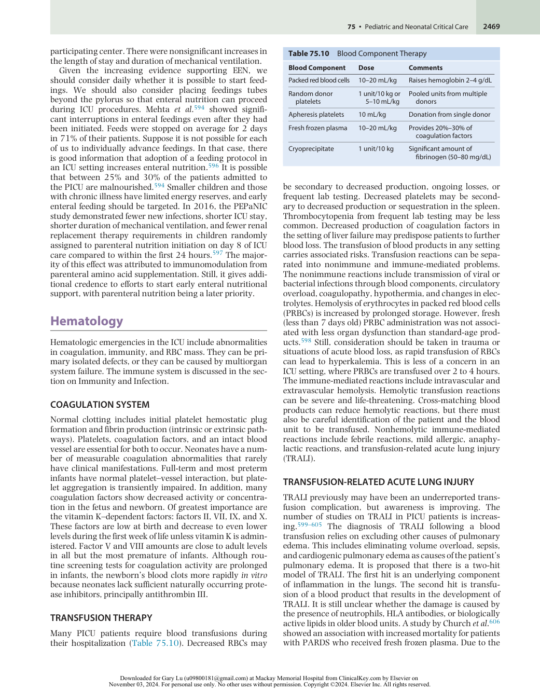

:::

<!-- PDF page 60 -->

PARDS, this group already has the first hit. The mortality association was independent of the severity of hypoxemia, the presence of DIC, or the presence of multiple organ dysfunction syndrome. Blood transfusion has associated risks, which should be considered before any transfusion. In some clinical scenarios, pediatric patients will tolerate more anemia than we would have previously considered. In 2007 Lacroix _et al_ .607 with the Transfusion Requirements in Pediatric Intensive Care Units (TRIPICU) study demonstrated that by adopting a restrictive transfusion strategy, they were able to reduce transfusion of PRBCs to PICU. A hemoglobin threshold of 7 g was targeted in one group as compared with 10 g in other. In the restrictive threshold group, there was a 44% reduction in PRBC transfusion without an increase in adverse outcomes. This information may not be able to be applied to all groups in the ICU, such as those with ongoing blood loss. The patients in the TRIPICU study did not have a blood pressure lower than 2 SD below an age- appropriate mean, and they did not require increasing doses of inotropic medication. Subgroup analysis of the original TRIPICU study in general pediatric surgery608 and cardiac surgery patients did not show a significant difference in developing multiple organ dysfunction syndrome.

### COAGULOPATHY

Coagulation defects can occur due to several underlying conditions in PICU patients, such as sepsis, trauma, malignancy, pancreatitis, and liver failure. As a reminder, the PT tests the extrinsic and common pathways of coagulation. The PT is prolonged in liver failure, vitamin K deficiency, and DIC. The activated partial thromboplastin time (aPTT) tests the intrinsic and common pathways of coagulation. The aPTT is prolonged in liver failure, hemophilia A, Von Willebrand disease, and DIC. One major concern in a PICU setting is that the underlying inflammatory state in some patients can activate coagulation and inhibit the natural anticoagulation mechanisms. This is the basis for disseminated intravascular coagulation. In 2001, the International Society of Thrombosis and Hemostasis609 published a DIC scoring system. Their DIC score uses platelet count, fibrin- related markers, PT, and fibrinogen. They separated DIC into nonovert DIC and overt DIC. In nonovert DIC, the balance of hemostasis is stressed by inflammation or noninflammatory disorders of the microvasculature, but compensation is maintained. In overt DIC, the hemostatic system can no longer compensate. A DIC scoring system such as this allows for ongoing research and a measure of response to therapy. In 2009, Khemani _et al_ .610 demonstrated the association between an elevated DIC score and mortality in 132 PICU patients with sepsis or shock. There are a maximum of 8 total points on the DIC score. Lower platelet counts and fibrinogen, prolongation of the PT, and evidence of fibrin degradation are all given points. There was a 50% mortality for patients with overt DIC (DIC score ≥5). For patients with a DIC score of less than 5, the mortality was 20%. This association between elevated DIC score and mortality remained even when controlling for severity of illness and/or use of inotropic medications. The treatment of DIC is to treat the underlying condition causing an imbalance of the coagulation system. A future goal of research

will be to study patient outcomes as DIC is corrected with FFP. As Church _et al_ .606 found an increased mortality associated with FFP transfusion, it is not clear what the balance will be between the risk of DIC and the risk of transfusion.

### SICKLE CELL DISEASE

Hemoglobin S, or sickle cell trait, is the most common of the hemoglobinopathies. There are also significant regional variations in the concentration of patients with different thalassemias. Hemoglobin S is caused by a point mutation in the β chain at codon position 6, which results in a substitution of valine for the normal glutamine. Hemoglobin S is formed from the combination of an abnormal β chain with the valine with normal alpha chains. When two copies of the abnormal gene are present, hemoglobin SS or sickle cell disease is produced. Complications from sickle cell disease (Hb SS) cause the most frequent PICU admissions of the hemoglobinopathies. Deoxygenation of the Hb SS erythrocytes causes intracellular hemoglobin polymerization, which leads to loss of deformability and changes in the erythrocyte morphology. In a deoxygenated state the abnormal erythrocytes change from a biconcave configuration to the classic sickle cell shape. The abnormal erythrocytes have a much shorter lifespan and hemolyze more readily. In turn, patients with sickle cell disease have chronic severe hemolytic anemia.

### Sickle Cell Crisis

Three types of sickle cell crisis can occur: hemolytic, aplastic, and vaso- occlusive. A hemolytic crisis is characterized by increased hemolysis, which results in an acute drop in hematocrit and hemoglobin. A significant increase in red cell production or reticulocytosis typically accompanies this. During an aplastic crisis, there is a drop in hematocrit and hemoglobin, but there is no associated reticulocytosis. The production of red cell precursors in the bone marrow has slowed or stopped. The cause of an aplastic crisis is often infectious, with greater than 90% of cases due to parvovirus B19. A vascular occlusive crisis is what is typically thought of as the classic sickle cell crisis. A vascular occlusive crisis may be brought on by infection, dehydration, acidosis, or hypoxia. The erythrocytes assume a sickled configuration that blocks small vessels, leading to infarction. The infarcts can occur in any organ but are frequent in the lungs, kidneys, bones, skin, spleen, eyes, and CNS.

### Acute Chest Syndrome

A vascular occlusive crisis in the lungs leads to acute chest syndrome (ACS). Acute chest syndrome is the leading cause of death and the second most common complication in sickle cell disease. ACS is defined as a new pulmonary infiltrate on a chest radiograph in association with a fever, respiratory symptoms, or chest pain. There is great variability in the clinical course in ACS. The National Acute Chest Syndrome Study Group611 reported a multicenter study showing that almost 50% of patients later diagnosed with ACS initially present with another symptom, mostly pain. The presence of a pulmonary fat embolism is frequently reported and is associated with a particularly severe course. The cause of the pulmonary fat embolism is most likely bone marrow necrosis with the release of necrotic bone marrow fat into the

<!-- PDF page 61 -->

bloodstream. A common etiology of ACS is infection. _Chlamydia pneumoniae_ and _Mycoplasma_ are the most commonly identified pathogens. The goal for the management of ACS is early recognition. As children with sickle cell disease may have few initial symptoms, there should be a high index of suspicion. All febrile children with sickle cell disease should have a chest radiograph obtained. If there are any positive radiologic findings, therapy should begin immediately. Initial antibiotic treatment is cefuroxime or cefotaxime with a macrolide. The patient should be adequately hydrated. The patient should be observed closely, and diuretic therapy should be started if the patient becomes fluid- overloaded. Patients should receive oxygen therapy even if there are normal oxygen saturations. Incentive spirometers should be used by every child who is able. There should be consideration given to the use of bronchodilators. Every effort should be made to see that pain is adequately controlled. A simple red cell transfusion may be helpful if the patient is anemic, but an exchange transfusion may be needed. There is some regional variation in this practice. The reason to perform an exchange transfusion is that the blood viscosity will increase as the hemoglobin rises. Furthermore, sickle cell blood has a very high viscosity in the deoxygenated state. Performing a red cell exchange can reduce blood viscosity and improve oxygenation.609 An exchange transfusion may improve microvascular perfusion, as well as cause a reduction in inflammatory mediators. In patients with sickle cell disease, red cell exchange has been shown to reduce white blood count, platelet count, and soluble vascular cell adhesion molecule- 1 in patients. However, there was no effect on interleukin- 1α, interleukin- 1β, interleukin- 8, or tumor necrosis factor- α, and the reductions that occurred were short- lived. In the National Acute Chest Syndrome Study Group612 publication, 13% of patients required mechanical ventilation, and in this group that required intubation, the mortality was 19%.

closely for the development of fluid overload or hypovolemia during the exchange. There are risks of blood products. Small children are at risk for hypothermia if the blood is not warmed. The best location and method to handle exchange transfusion will depend on the resources of the ICU, blood bank, and hematology department.

### ACQUIRED COAGULATION DISORDERS

A variety of circumstances can impair the production of coagulation factors. The vitamin K–dependent factors are most commonly affected. These factors are decreased with liver disease, warfarin therapy, and malabsorption syndromes secondary to either bowel disease or altered bowel flora caused by long- term antibiotic therapy. In addition, untreated neonatal vitamin K deficiency results in hemorrhagic disease of the newborn. In these disorders, the PT is prolonged, and there are low levels of factors II, VII, IX, and X. Administration of vitamin K usually reverses these deficiencies unless the synthetic function of the liver is markedly compromised.

Acquired platelet abnormalities include decreased production, increased destruction, and reduced function. Decreased production or hyperproliferative states include marrow diseases, such as leukemia and aplastic anemia, and the side effects of chemotherapeutic agents. Increased destruction can be immune- mediated (i.e., idiopathic thrombocytopenic purpura616 ) or the result of consumption (i.e., microangiopathic states, HUS, or thrombotic thrombocytopenic purpura617 ). Finally, platelet dysfunction has been found with uremia and chronic polycythemia in patients with cyanotic heart disease.618 Treatment of acquired thrombocytopenia includes platelet transfusions and, if possible, correction of the underlying disorder. Therapeutic splenectomy will increase platelet survival in some patients with severe immune- mediated diseases.

### Neurologic Complications

Exchange transfusion has a vital role in the treatment of neurologic complications from sickle cell disease. In a population of patients with sickle cell disease, at less than 20 years of age, the incidence of stroke was measured at 0.44 per 100 patient- years.613 Studies have been performed to identify at- risk patients and initiate therapy prior to the development of stroke. The Stroke Prevention Trial in Sickle Cell Anemia (STOP) was to evaluate whether chronic transfusion therapy could prevent an initial stroke in children with sickle cell disease. Transcranial Doppler was used to identify patients at increased risk for stroke. A hemoglobin S concentration of less than 30% was maintained in the study group.614 The risk for stroke development was reduced by 90% in the chronic transfusion group, compared with the patients receiving standard of care. The trial was stopped 16 months early due to these findings. Chronic transfusion therapy does carry the long- term side effects of alloimmunization and iron overload.615 The information available would indicate that for a child with sickle cell disease and an acute neurologic change, exchange transfusion should be performed. While there is a significant need with ACS or neurologic change, an exchange transfusion is not without risks. Depending on regional variation, central venous or arterial access is needed. Patients need to be followed

## Oncology

Over the past several decades, there has been significant improvement in survival of pediatric cancers. A lot of information demonstrating this effect is available from the Surveillance, Epidemiology, and End Results Program at www.seer.cancer.gov. Furthermore, there has been an increase in the number and types of diseases treated with hematopoietic stem cell transplantation (HSCT). These facts have resulted in an increasing volume of oncology patients in the PICU. This patient population has received specialized, detailed care in specialized oncology wards or bone marrow transplant units. The care delivered in these areas and the strict isolation procedures employed there are difficult to replicate in other locations in the hospital. In an effort to keep oncology patients in oncology wards, some hospitals have policies allowing the use of low amounts of inotropic support in these areas – for example, dopamine up to 5 mcg/kg/min. This may mean that some oncology patients are transferred to the ICU when they have exceeded this level of support. They may have sepsis, shock not responding to fluid resuscitation, and low inotropic support. Other patients may require respiratory support that cannot be delivered on the ward. Finally, early

<!-- PDF page 62 -->

literature indicates that earlier initiation of CRRT to treat or prevent fluid overload619,620 has benefits in HSCT, with other studies showing no benefit.621,622 However, the positive literature has prompted earlier admission to the ICU for HSCT patients who become fluid- overloaded. Overall, evidence shows improved outcomes for pediatric oncology patients requiring ICU care.623–626 For patients following HSCT, after controlling for severity of illness, a temporal improvement in mortality is less evident.627 Furthermore, for patients requiring mechanical ventilation, the mortality is greater following HSCT compared with non- HSCT oncology patients.628

Due to the disease and therapy at times during their illness, oncology patients are profoundly immunocompromised. There is an increased risk of sepsis during periods of neutropenia. Fever may be the first indication of sepsis, and studies have looked at predicting which patients will become bacteremic.629,630 The outcome of sepsis and oncologic disease is an ongoing concern. A study by Pound _et al_ .623 showed that ICU mortality for patients with septic shock was not significantly different between oncology patients (15.9%) compared with matched controls (11.6%). There was no significant survival difference between groups in the first 6 months following discharge from the ICU. A 2005 study by Fiser _et al_ .626 showed an overall mortality of 17% for pediatric oncology patients with severe sepsis. The mortality in the HSCT group (30%) was greater than the nonHSCT group (12%). There was a high mortality for patients who required both mechanical ventilation and inotropic support (64%).

### LEUKOSTASIS

Leukostasis (vascular obstruction) results from high viscosity caused by elevated cell counts or by the WBCs themselves. This syndrome is anticipated in patients with acute lymphoblastic leukemia (ALL) when the WBC count exceeds 500,000, and in acute myeloblastic leukemia (AML) patients with WBC counts greater than 200,000/mm3 . In AML, leukemic cells are less deformable than lymphoblasts, so a lower WBC count produces the same syndrome.

The brain and lungs are the two major target organs for leukostasis; vascular plugging and organ infarction are the usual manifestations. Initial symptoms include tachypnea, cyanosis, increased work of breathing, altered mental status, and focal neurologic deficits. Besides supportive therapy, reducing the circulating tumor load and viscosity are the primary goals of treatment. Leukapheresis and exchange transfusion transiently accomplish these goals. Cranial irradiation may reduce the CNS tumor load, and chemotherapy will interrupt cell production and possibly destroy circulating cells. The initial goal of chemotherapy is to stop cell production without producing massive cell lysis; this halts the increase in tumor load without causing a severe metabolic crisis before adequate perfusion is reestablished.631,632

### TUMOR LYSIS SYNDROME

Tumor lysis syndrome (TLS) is a metabolic crisis precipitated by acute lysis of a large number of tumor cells. Serum uric acid, potassium, and phosphate concentrations are

elevated; the elevated phosphate concentrations cause hypocalcemia. Hyperkalemia and hypocalcemia can be lifethreatening; increased uric acid may cause acute renal failure.633 Therapy for TLS consists of alkalinization of urine, fluid administration, and diuresis. Before any chemotherapy is administered, the patient’s renal function should be assessed. If renal function is normal, allopurinol or rasburicase therapy is begun. In most cases, this conservative approach of forced diuresis and allopurinol or rasburicase will prevent renal failure, but occasionally dialysis must be instituted. Indications for the initiation of dialysis include:

1.  Potassium greater than 6 mEq/L and rising despite resin exchange

2.  Uric acid greater than 19 mg/L

3.  Creatinine greater than 10 mg/L

4.  Phosphorus greater than 10 mg/L or rapidly rising

5.  Volume overload

6.  Symptomatic hypocalcemia

### MEDIASTINAL MASS

Children with a mediastinal mass and respiratory distress often complain of coughing, difficulty breathing, stridor, and shortness of breath. They prefer to sit upright and cannot lie supine. The chest radiograph usually shows a large mediastinal mass, often with obliteration or obscuring of the tracheal air column. These masses can also cause positional obstruction of vascular structures such as the superior vena cava or a pulmonary artery. Lam _et al_ . indicate that clinical presentation is often nonspecific or often incidental, and that patients with airway compromise also exhibit symptoms of superior vena cava syndrome.634 These patients are often referred to as having _critical mediastinal mass syndrome_ and require the care of an experienced multidisciplinary team. These tumors can be malignant (87% Hodgkin and nonHodgkin lymphoma) or benign; the prognosis and therapy rely on adequate diagnosis, which is best made by obtaining a tissue sample before treatment is begun.635 However, obtaining a sample of the mediastinal mass may require anesthesia and surgery, and the airway may require instrumentation. The hemodynamic changes associated with the induction of general anesthesia and loss of airway tone during these maneuvers may cause the patient to die. Local anesthesia with fine- needle biopsy under radiographic guidance allows tissue sampling without anesthesia in some patients. As lymphoma is a common cause of mediastinal masses, treatment with steroids before obtaining a tissue sample may reduce the size of the tumor and make biopsy easier and safer under anesthesia. However, this may obscure the underlying cause of the mediastinal mass. Obstruction of the intrathoracic trachea is a major anesthetic risk for these patients; it is often impossible to maintain a patent airway when the patient lies supine, is deeply anesthetized, or is paralyzed with muscle relaxants.634,636 In some circumstances, dexmedetomidine and a small amounts of midazolam have produced conditions that allow for a biopsy of a peripheral lymph node. However, the patient must cooperate sufficiently to perform the test, which is often difficult for them because of respiratory distress. Induction of anesthesia and tracheal intubation are usually done with the patient in the sitting position and breathing spontaneously. If the airway compromise is severe, the tumor should be irradiated and the child is given

<!-- PDF page 63 -->

steroids before a tissue diagnosis is made; however, these treatments could alter diagnosis and should be discussed with an oncology consultant before initiating. Sometimes, a peripheral node or mass can be biopsied under local anesthesia, or if the tumor mass is very large, some of the tumor can remain outside the radiation field. Stricker _et al_ . report that in a single-center review of 46 cases, patients with symptomatic anterior mediastinal mass underwent biopsy with general anesthesia while maintaining spontaneous ventilation without serious complications.636 In summary, although diagnosis is the key to treatment of neoplastic disease, the risk associated with biopsy may far outweigh the benefit of tissue diagnosis.

## Immunity and Infection

### EMPIRIC ANTIBIOTIC COVERAGE

Making empiric recommendations for antibiotic coverage for the PICU is difficult. Antibiotic resistance may result from the use of broad- spectrum antibiotics without some degree of stewardship. Furthermore, empiric antibiotics should be based on the susceptibility profile of the common bacteria within each hospital and patient population. In our practice, vancomycin and a third- generation cephalosporin in combination are the antibiotics of first choice for patients presenting with sepsis. This is due to a rising incidence of methicillin- resistant _Staphylococcus aureus_ (MRSA). To reduce the spread of MRSA, all patients are screened on admission for colonization and isolated if MRSA is found. Antibiotic coverage can be more specific and narrowed as culture results and sensitivities return. Likely the best recommendation to be made regarding empiric antibiotic coverage is to meet with the infectious disease specialists and discuss the current hospital culture isolates and their antibiotic resistance. Decisions regarding empiric antibiotics are best made in advance of the situation.

### PREVENTION OF HEALTH CARE–ASSOCIATED INFECTIONS

The impact of health care–associated infections (HAI) on the medical system is significant, and on the individual patient level, can be deadly. A 2007 paper from Klevens _et al_ .637 estimated the number of HAIs in US hospitals in 2002 at 1.7 million. Of these, 417,946 HAIs occurred among adults and children in an ICU setting. The estimated deaths associated with HAIs in this time frame were 98,987. Likely the best thing we can do to protect our patients is to wash our hands or use alcohol- based gels and encourage others to do so. Encouraging others or providing a positive role model may have a larger impact than anticipated. A 2009 study by Schneider _et al_ .638 paired trainees who were critical care fellows or nurse orientees with senior supervisors and evaluated compliance with hand hygiene (HH). In the control phase, the senior supervisors were unaware of the study and had a HH compliance of 20%. The trainees that were being mentored had a HH compliance of 22%. When the senior supervisors were recruited into the study, HH compliance was 94%. The trainees who were still blinded to the study had an increase in HH compliance to 56%. Indeed, it is anticipated that there will be better compliance with hand

hygiene if health care providers know that they are being observed. Yet the Schneider study shows the importance of role modeling positive behavior. In our ICUs, we have ongoing audits of HH compliance. We ask our patients’ parents to remind health care providers to wash their hands if they have not done so. Although it may be difficult, we must be willing to remind others to wash their hands.

### VENTILATOR- ASSOCIATED PNEUMONIA

Intubation and mechanical ventilation are necessary for patients with respiratory failure. Unfortunately, an ETT prevents airway protective mechanisms, increasing the risk of ventilator- associated pneumonia (VAP). Patients mechanically ventilated who do not have a pulmonary infection may develop pneumonia, and patients mechanically ventilated for pneumonia may develop a secondary infection. VAP can increase morbidity and mortality. A 2009 study by Srinivasan _et al_ .639 demonstrated that patients with VAP had increased length of mechanical ventilation, prolonged stays in the ICU, and, more importantly, a significant increase in mortality. There was 2.4% mortality in the patients who did not develop VAP compared to 10.5% mortality in those who did. VAP has been defined as the new onset of a lower respiratory tract infection for patients requiring mechanical ventilation for more than 48 hours. The diagnostic criteria include a new infiltrate on the chest radiograph, a positive respiratory culture, a low or elevated WBC count, and fever or instability in temperature.

In January 2005, the Institute for Healthcare Improvement (IHI) started the 100,000 Lives campaign. The goal was to save the lives of 100,000 patients in a period of 18 months through six specific clinical interventions that were evidence based. They encouraged hospitals to deploy rapid response teams, deliver evidence- based care for acute myocardial infarction, prevent adverse drug events, prevent surgical site infections, prevent central line infections, and prevent VAPs. The last two incorporated the use of bundles or collections of scientifically grounded interventions that were implemented collectively. These interventions have been successful. From the VAP standpoint the pre- bundle VAP incidence for PICU patients was reported in 2002640 as 11.6/1000 ventilator days. The VAP bundle has been tailored to pediatric patients,641 and there have been significant improvements in VAP incidence. In a 2009 study showing the benefit of bundle implementation, Bigham _et al_ .642 showed a significant reduction in VAP incidence from 5.6 to 0.3 per 1000 ventilator days. This was a single-center study that also showed a reduction in length of mechanical ventilation, length of stay, and mortality. This positive benefit of bundle initiation has been shown in other pediatric studies as well.643,644

In an effort to reduce a new bacterial infection while mechanically ventilated, the components of the VAP bundle aim to reduce bacterial colonization and prevent aspiration of contaminated secretions. To reduce the amount of bacteria present in the mouth and sinuses, mouth care is performed with a chlorhexidine rinse every two to four hours. Several things are done to reduce the risk of aspiration of contaminated secretions. First, suction the oropharynx prior to suctioning the ETT or deflating the ETT cuff. Second, drain the condensation that occurs in the ventilator tubing every two to four hours and prior to repositioning the patient. This

<!-- PDF page 64 -->

should be done without disconnecting the ventilator circuit. Third, use inline suction catheters such that the ETT can be suctioned without disconnecting the ventilator circuit. Finally, by maintaining the head of the bed greater than 30 degrees, there is a decreased risk of secretions in the ventilator tubing draining passively into the ETT.

We have found that the measures included in a VAP bundle are not difficult to perform and become routine practice quite quickly. More interesting is a synergy that occurs with a bundle in that the impact of the combined interventions seems to be greater than any individual component. A recent review demonstrates the outcomes of these various interventions to prevent VAP.645

### CATHETER- ASSOCIATED BLOODSTREAM INFECTIONS

There is a significant increase in hospital stay, morbidity, mortality, and costs with the development of catheterassociated bloodstream infections (CA- BSIs). In a prospective study performed in a pediatric cardiac ICU, Abou _et al_ .646 showed 11% mortality in patients who developed a bloodstream infection compared to 2% mortality in patients who did not. It has been said by many that the best way to reduce a CA- BSI is never to place a central venous catheter. There is benefit to continually reviewing a patient’s central venous access requirements and only using peripheral catheters when possible. Unfortunately, there are many instances, such as the need for vasoactive medications, where central venous catheters should not be avoided. The implementation of bundles to care for central venous catheters can significantly reduce the development of bloodstream infections and reduce the mortality and morbidity for each patient.

Implementing preventive bundles during the insertion and ongoing maintenance of central venous catheters will reduce infections. In a 2010 study647 in 29 PICUs, there was a 43% reduction in the development of CA- BSI when bundles were used. These results are sustainable and continue to improve. The 2011648 follow- up by the same group showed a further reduction in CA- BSI incidence. The bundle can be broken down into two parts: central line insertion and maintenance. During the insertion of the central venous catheter the goal of the bundle is to maintain complete sterility of the field. Chlorhexidine is used as the skin prep for patients older than 2 months of age. All people in the room wear hats and masks. The persons performing the procedure also wear these, along with a sterile gown and gloves. A large sterile barrier covering the entire bed is used. The second phase of the bundle is the ongoing maintenance of the central venous catheter. There are strict guidelines for the care of the IV tubing, hub, and catheter insertion site. When dressing changes are performed, sterile gloves are used, and the area is scrubbed for 30 seconds with chlorhexidine; then it is allowed to air dry for 30 seconds. Strict adherence to the same maintenance guidelines throughout the hospital is necessary to prevent CA- BSI. In many institutions, infections have dropped so low that each event can be individually reviewed.

### URINARY TRACT INFECTION

Catheter- associated urinary tract infection (CA- UTI) is the most common health care–related infection. Removing a

bladder catheter if not needed can significantly reduce the risk of developing a urinary tract infection. Sometimes, the catheter cannot be removed, and efforts should be made to prevent infection. The institution of a bladder care bundle as a quality improvement measure can significantly reduce infection rates. In a 2013 study by Esteban _et al_ .,649 implementation of quality improvement interventions decreased the number of catheter- associated urinary tract infections from 23.3 to 5.8 per 1000 urinary catheter days. The goals of a bladder catheter bundle are to reduce bacterial colonization and the reflux of urine back into the bladder. Catheters are inserted in a sterile fashion, and periurethral cleaning is performed with a chlorhexidine cloth at least once per shift. To prevent reflux, the collection bag is always kept below the level of the bladder and is drained completely or clamped before moving the patient.

### INFECTIONS IN THE NEWBORN

Neonates with developmental immunologic deficiencies have increased susceptibility to infection. Depressed cellmediated immunity makes the fetus and infant more susceptible to viral and fungal infection. In addition, infants have depressed B- cell function and diminished production of immunoglobulins. The latter is partially offset by increased maternal immunoglobulin G (IgG). By 2 to 3 months of age, which is before infants can adequately produce their own antibodies in sufficient quantity, the level of maternal antibodies reaches a nadir.650 The time when the circulating antibody concentration is low is when the risk for infections is increased. Perinatal infections are either congenitally or postnatally acquired. Congenital infections occur with prenatal exposure to viral, protozoal, or rarely bacterial pathogens. Common diseases include the TORCH infections: _Toxoplasma gondii_ (T); “other” (O), including human immunodeficiency virus, syphilis, and tuberculosis; rubella (R); cytomegalovirus (C); and herpes simplex virus type 2 (H). These infections rarely cause overwhelming sepsis, but they can be confused with bacterial infection when profound CNS depression, circulatory collapse, or thrombocytopenia occurs. When a TORCH infection (toxoplasmosis, rubella, cytomegalovirus, herpes, and other agents) develops in the first trimester of pregnancy, it causes fetal wastage or major organ malformation. Premature infants have a high incidence of acute infections in the newborn period. Regardless of gestational age, the signs and symptoms of infection are often subtle. Therefore, a very high index of suspicion and low threshold for diagnosing and treating infection are required.651 Box 75.5 lists the common signs and symptoms of neonatal sepsis. The most

### Box 75.5 Common Signs and Symptoms of Neonatal Sepsis

Temperature instability (hypothermia and hyperthermia) Lethargy and poor feeding Respiratory distress and apnea Hypoglycemia and metabolic acidosis Poor cutaneous perfusion, hypotension Rashes or petechiae Seizures

<!-- PDF page 65 -->

common acquired pathogens colonize the mother’s genital tract: group B streptococci, _E. coli_ , _Listeria monocytogenes_ , and herpesvirus. Herpes is such a fulminant infection in neonates that the presence of active herpes lesions in the birth canal indicates cesarean section. However, this may not prevent herpes in all children. Group B streptococcus is the most common bacterial pathogen that causes neonatal sepsis. Infection with group B streptococci is manifested as severe cardiorespiratory instability and meningitis in 30% of cases. By 2 to 3 weeks of age, this organism is more commonly associated with meningitis and less commonly with pulmonary disease. Whenever sepsis is suspected, blood, urine, and CSF cultures should be obtained. Because it is difficult for the physician to localize the infection in an infant, repeated complete sepsis workups are often required. When appropriate cultures are obtained, treatment with ampicillin and an aminoglycoside, such as gentamicin, usually begins until specific bacteriologic information becomes available. Only about 50% of neonates thought to be septic have positive cultures.

## Pediatric Trauma

### PRENATAL AND PERINATAL INJURIES

Perinatal trauma occurs before or immediately after birth (also see Chapter 72). The most common prenatal injuries are due to maternal gunshot wounds and blunt trauma. Fetal mortality in both cases is at least twice that of the mother,652 with fetal death being attributable to maternal shock and fetal oxygen deprivation rather than direct injury. Birth injuries occur more commonly in large fullterm infants and infants born by breech presentation. Injuries to the head include linear or depressed skull fractures, cephalohematomas, subdural or subarachnoid hematomas, and intraparenchymal or intraventricular hemorrhage. Intracranial injuries can increase ICP and cause cerebral ischemia, neurologic injury, and death. Injury to the sternocleidomastoid muscle may cause torticollis; traction on the neck may transect the cervical spinal cord. Less devastating nerve injuries caused by cervical traction are phrenic nerve paralysis and Erb or Klumpke palsy, caused by brachial plexus stretching or tearing (or both). Shoulder dystocia is commonly associated with clavicular and humoral fractures; femoral shaft fractures occur with breech deliveries. Injuries to the liver, spleen, adrenal glands, and kidneys can cause life- threatening hemorrhage or thrombosis. Vaso- occlusion causes tissue loss in the cerebral, coronary, or renal vascular beds. Emergency instrumentation of the airway in the delivery room rarely leads to tracheal and esophageal perforation, particularly in a premature infant.

### TRAUMA IN CHILDREN

Accidents and trauma are the leading causes of death in children aged 1 to 14.653 Children are frequently victims of falling or being dropped, drowning, near- drowning, motor vehicle accidents (pedestrian), ingestions, and burns. Head injuries are common, especially in younger children with disproportionately large heads and relatively poor neck muscle support.654 Young children are less likely to be

victims of gunshot or knife attacks; blunt injuries are more usual. Blunt trauma to the abdomen can cause solid organ injury (liver and spleen), rather than a perforated viscus. Hypothermia is a frequent complication of trauma; children lose heat rapidly because they have a relatively large surface- to- volume ratio. Drowning and near- drowning are the prototypical hypothermic injuries. Managing trauma patients of all ages requires an organized approach that permits rapid diagnosis and treatment. Most preventable deaths in pediatric trauma patients are caused by airway obstruction, pneumothorax, and shock; shock is often the result of inadequate treatment of bleeding or secondary brain injury from an expanding intracranial hematoma.655 The American College of Surgeons recommends a four- step approach to pediatric trauma patients: (1) primary survey, (2) resuscitation, (3) secondary survey, and (4) definitive care.262 The primary survey requires rapid assessment of the airway, breathing, and circulations. A disproportionately large tongue, in relation to a narrow oropharynx, easily obstructs the airway in an unconscious child. Proper jaw positioning enables bag- and- mask ventilation until the trachea is intubated. Ventilation through an inadequate airway may lead to gaseous distention of the stomach, vomiting, and aspiration of gastric contents. Cervical spine injuries are less common in children than adults, but the child’s neck should be immobilized until the spinal injury is excluded. After establishing an airway, the adequacy of respiration should be verified by observation of symmetric chest movement, auscultation of normal and equal breath sounds, and an early chest radiograph. Tension hemopneumothorax can be diagnosed clinically and treated by needle aspiration. Aspiration will alleviate the tension and stabilize the patient’s condition until a chest tube can be inserted. Circulation can be quickly assessed by looking for tachycardia, poor peripheral perfusion, weak peripheral pulses, and hypotension (which may not occur until blood loss exceeds 25% of the circulating blood volume).656 A severely hypovolemic child requires rapid insertion of a venous catheter. If a peripheral venous catheter cannot be inserted expeditiously, an IO cannula should be placed.657 The amount of volume resuscitation is dictated by the clinical condition of the child and the estimated volume of blood or plasma lost. During the secondary survey, a thorough head- to- toe examination is performed, and a definitive treatment plan is developed. Diagnostic measures in pediatric trauma patients are similar to those in adult patients, but there should be consideration of special problems that occur in children. Most intra- abdominal injuries requiring laparotomy are recognized clinically because they produce peritonitis or cause increasing abdominal girth.658 Diagnostic peritoneal lavage may help in hemodynamically unstable children, despite administering more than 40 mL/kg of blood. Peritoneal lavage may locate the site of occult bleeding in a child too unstable to undergo CT, or it can be used to evaluate abdominal injury in a child about to undergo emergency non- abdominal surgery. Many practitioners forego this procedure if surgery is imminent. Indications for surgical intervention for abdominal trauma include free peritoneal air, evidence of a ruptured viscus, and acute uncontrolled bleeding. A ruptured spleen or a liver laceration is not an indication for surgery in and of itself; the preferred treatment is supportive, blood volume replacement, and

<!-- PDF page 66 -->

reevaluation.659 A careful head and neurologic examination is done to quickly detect intracranial trauma. The most important indicator of intracranial trauma is a decrease in the level of consciousness. Rapid diagnosis and treatment of intracranial mass lesions will reduce ICP and may prevent secondary brain injury.

### CHILD ABUSE

Child abuse is diagnosed by finding an acute injury that may have a plausible explanation and signs of past trauma, including healing bruises, contusions, and fractures. Child abuse may also be psychological or sexual abuse and failure to meet a child’s need for food, clothing, shelter, hygiene, medical care, education, or supervision. Suspicion of child abuse begins with an inappropriate or inadequate explanation for the child’s injuries or when the degree of trauma exceeds the stated cause. Multiple hospital admissions, emergency department visits, doctor or hospital “shopping,” and a history of previous trauma should be of concern. Frequently, the story regarding the injury changes over time. Certain clinical features are common to child abuse, but they are by no means pathognomonic. Most abused children are older than 3 years and may have poor hygiene and delayed somatic or psychological development. The injuries most commonly include bruises, welts, lacerations, scalds, and burns from cigarettes, stoves, heating grates, or irons. Long- bone fractures, often of varying age, abdominal injuries, signs of smothering, and multiple soft tissue or genital bruises are also common. Head injuries can occur. Shaking an infant can cause neck injuries, intracranial hemorrhage, and contrecoup injuries without necessarily producing external manifestations of trauma. The approach to a suspected victim of child abuse includes a meticulous and nonjudgmental history, written in detail in the chart. All allegations are recorded, and changes in the reported history are documented. The physical examination includes growth parameters, descriptions of soft tissue bruising or burns, and diagrams or preferably photographs of all injuries. The color, shape, placement, and estimated age of all injuries should be cataloged. Laboratory studies should include the following: a skeletal survey of all long bones, ribs, and the skull; a coagulation profile, including hematocrit, platelet count, PT, and PTT; and genital and throat cultures for venereal disease if sexual abuse is suspected. If child abuse is suspected, it must be reported to the authorities.

### INGESTION INJURY

Despite the success of various preventive public health programs, poisoning continues to occur commonly in pediatric patients. Fortunately, most presumed poisonings in young children can be managed by telephone consultation with a regional poison control center. In one study, acute poisoning accounted for approximately 5% of all medical admissions to a PICU.660 Approximately half of these admissions were accidental ingestions, and half were attempted suicides. The median age for the accidental poisoning group was 2 years. For the suicide group, it was 15 years. Although children and adolescents ingest many different toxic substances, management of poisoning has three main goals:

(1) identifying, decontaminating, and eliminating the toxic agents661 ; (2) minimizing the toxic effects on the child; and (3) providing close observation and organ system support until detoxification is complete. Procedures for drug elimination include emesis, gastric lavage, activated charcoal, and magnesium citrate. Toxic effects can be minimized with specific antidotes, such as hemodialysis or charcoal hemoperfusion, when available. Specific antidotes include deferoxamine for iron ingestion, ethanol infusion for methanol ingestion, naloxone for narcotic overdose, and _N_ - acetylcysteine for acetaminophen ingestion. Because many ingestions, particularly those for attempted suicide, include multiple drugs, specific antidote therapy is only occasionally successful. Organ system support usually includes airway protection and mechanical ventilation, IV fluids, cardiovascular monitoring for arrhythmias and myocardial depression, and anticonvulsive therapy for seizing patients. Consultation with clinical pharmacologists or the regional poison control center and contacting a social worker or psychiatrist are essential aspects of caring for an acutely toxic child. Common complications of ingestions and their therapy include aspiration pneumonia with hydrocarbon ingestion or loss of glottic function, sepsis, respiratory depression, myocardial depression, arrhythmias, seizures, and coma. The psychosocial environment that allowed or precipitated the ingestion must also be considered. Families should be counseled about proper supervision and “childproofing” their homes. Psychiatric intervention should be introduced early; unsuccessful suicide attempts are often repeated.

### TRANSPORT OF THE CRITICALLY ILL CHILD

Transport for critically ill children includes intrahospital and interhospital transport. Intrahospital transport of patients is necessary to and from the operating room. However, this also includes transport for radiologic procedures and studies throughout the hospital. In this circumstance, the clinician who ordered the test must understand the balance of risk and benefit. Is the information that can be obtained by an MRI worth the transport, changes in monitoring, and the time away from the ICU? In the case of a brain MRI, a patient may be away from the unit for 90 to 120 minutes with transport. Significant differences exist in the ability to monitor and provide care to those patients. CT scans are certainly shorter but still entail many of the same risks. The severity of the patient’s illness must be considered. Any patient with an ETT is at risk for obstruction or dislodgement. Any patient requiring inotropic support is at risk of those medications being interrupted. Depending on the hospital, the team transporting the patient may include a respiratory therapist, bedside nurse, and transport nurse. Some hospitals will send their ICU fellows, and some have a dedicated intrahospital transport team. When new equipment is purchased, transport monitors should be considered that can monitor end- tidal CO2. In the smallest patients, maintaining body temperature can be difficult during transport.

A tertiary care hospital typically sets up interhospital transport systems. Smaller community hospitals may use outside resources. One should investigate the capabilities of the transport team available. Details to understand include the availability of helicopter and fixed wing flight, types of

<!-- PDF page 67 -->

practitioners on the transport team, coverage when the primary team is out on a transport, and the ability to provide interventions when the transport team arrives at the outside facility. Many transport care physicians can intubate, place arterial and venous lines, and place chest tubes at an outside facility. All of this information is valuable when speaking to the referring hospital. In that regard, the person receiving the transport request may need to assess whether the patient is safe to transfer by a team that only provides basic life support resuscitation. For hospitals unfamiliar with caring for critically ill children, it may be foremost in their mind to get the child to a higher level of care and out of their hospital. They may not have considered what support is available during the transport if the patient deteriorates. They may be unwilling to wait for the arrival of a transport team, but the overall needs of the child are the focus of the discussion. When deciding on the makeup of the transport team, the distance of the referring hospital, the condition of the child, ongoing resuscitation efforts, and the chance of change in condition need to be considered. While the transport team is _en route_ , the referring hospital should continue to support and resuscitate the child with advice from the receiving hospital. Further information regarding the development of a transport team is beyond the scope of this chapter. One excellent resource is the _Guidelines for Air and Ground Transport of Neonatal and Pediatric Patients_ , available through the American Academy of Pediatrics. An understanding of altitude physiology is necessary when considering transport by helicopter. One may not give much thought to the barometric pressure in the alveolar gas equation (PAO2 = (PB − PH2O)(FiO2) − (PaCO2/R)). This is because at sea level PB is 760 mm Hg. However, at 8000 feet PB is 565 mm Hg. Supplemental oxygen may be needed in flight, and for patients with significant lung disease, low saturation may remain even with supplemental oxygen. From Boyle’s law (Pressure1 × Volume1 = Pressure2 × Volume2), there will be expansion of gas with the decreased pressure of altitude. This means that a small pneumothorax can expand to a large pneumothorax. The size of an ETT cuff can expand significantly, putting pressure on the trachea. The PICU relies significantly on the skills of our transport team. To maintain proficiency, the providers will need to practice intubation and other procedures. Please give some consideration to helping if you are asked to have a transport physician or nurse shadow you in the operating room to get some practice with intubation.

9.  Bronner MB, et al. _J Pediatr Psychol_ . 2010;35:966.

10.  Nelson LP, Gold JI. _Pediatr Crit Care Med_ . 2012;13(3):338.

11.  Mangurten J, et al. _J Emerg Nurs_ . 2006;32(3):225.

12.  Dingeman RS, et al. _Pediatrics_ . 2007;120:842.

13.  Mangurten J, et al. _J Emerg Nurs_ . 2006;32(3):225.

14.  Tinsley C, et al. _Pediatrics_ . 2008;122(4):e799.

15.  Henderson DP, Knapp JF. _J Emerg Nurs_ . 2006;32(1):23.

16.  Boss R, et al. _Pediatr Crit Care Med_ . 2014;15(8):762.

17.  Helmchen LA, et al. _Med Care_ . 2010;48(11):955.

18.  Truog RD, et al. _Crit Care Med_ . 2006;34(suppl 11):S373.

19.  Wellesley H, Jenkins IA. _Paediatr Anaesth_ . 2009;19(10):972.

20.  Verger JT. _AACN Clin Issues_ . 2005;15:396.

21.  Denman WT, et al. _Paediatr Anaesth_ . 2007;17(2):162.

22.  Patel A, et al. _Paediatr Anaesth_ . 2006;16(10):1019.

23.  McAuliffe G, et al. _Can J Anaesth_ . 1997;44(2):154.

24.  Crone RK. _Crit Care Med_ . 1984;12(1):33.

25.  Klopfenstein HS, Rudolph AM. _Circ Res_ . 1978;42(6):839.

26.  Ziegler JW, et al. _Clin Perinatol_ . 1995;22(2):387.

27.  Waldman S, et al. _Dev Med Child Neurol_ . 1979;21(6):714.

28.  Daly MDJE, et al. _Lancet_ . 1979;1(8119):764.

29.  Freed MD, et al. _Circulation_ . 1981;64(5):899.

30.  Eisenberg MA. _Pediatr Res_ . 2022;91(2):351.

31.  Fleischmann- Struzek C, et al. _Intensive Care Med_ . 2020;46(8):1552.

32.  Weiss SL, et al. _Pediatr Crit Care Med_ . 2020;21(2):e52.

33.  Albert SG, Sitaula S. _J Intensive Care Med_ . 2021;36(10):1124.

34.  Patregnani JT, et al. _Pediatr Critical Care Med_ . 2017;18(8):e378.

35.  Crone RK. _Pediatr Clin North Am_ . 1980;27(3):525.

36.  Bhimji S, et al. _Acta Anat (Basel)._ 1986;127(3):205.

37.  Martinez AM, et al. _Pediatrics_ . 1992;89(1):47.

38.  Perkin RM, et al. _J Pediatr_ . 1982;100(6):977.

39.  Beloeil H, et al. _Br J Anaesth_ . 2005;95(6):782.

40.  Jain P, et al. _Circ Heart Fail_ . 2019:e006191.

41.  Hoffman TM, et al. _Circulation_ . 2003;107(7):996.

42.  Barton P, et al. _Chest_ . 1996;109(5):1302.

43.  Bailey JM, et al. _Anesthesiology_ . 1999;90(4):1012.

44.  Ricci Z, et al. _Intensive Care Med_ . 2012;38(7):1198.

45.  Tosoni A, et al. _Cardiol Young_ . 2014;24(3):524.

46.  Tobias JD. _J Intensive Care Med_ . 2011;26(3):183.

47.  Singh S. _Indian J Pediatr_ . 1988;55(1):27.

48.  Drop LJ, et al. _Am J Cardiol_ . 1981;47(5):1041.

49.  Flynn JT, et al. _J Pediatr_ . 2001;139(1):38.

50.  Beekman RH, et al. _Circulation_ . 1981;64(3):553.

51.  Rubin LJ, Peter RH. _N Engl J Med_ . 1980;302(2):69.

52.  Drummond WH, et al. _J Pediatr_ . 1981;98(4):603.

53.  Palmer RM, et al. _Nature_ . 1987;327(6122):524.

54.  Roberts Jr JD, et al. _N Engl J Med_ . 1997;336(9):605.

55.  Zapol WM, Hurford WE. _New Horiz_ . 1993;1(4):638.

56.  Kinsella JP, Abman SH. _J Pediatr_ . 1995;126(6):853.

57.  Stapleton FB, et al. _Pediatr Nephrol_ . 1987;1(3):314.

58.  Sinaiko AR. _Pediatr Clin North Am_ . 1993;40(1):195.

59.  Kattwinkel J, et al. _Circulation_ . 2010;122(18 suppl 3):S909.

60.  Gungor S, et al. _Gynecol Obstet Invest_ . 2006;61(1):9.

61.  Kirpalani H, et al. _JAMA_ . 2019:1165.

62.  Foglia EE, et al. _JAMA Pediatr_ . 2020:e195897.

63.  Grein AJ, Weiner GM. _Cochrane Database Syst Rev_ . 2005; (2):CD003314.

64.  Trevisanuto D, et al. _Resuscitation_ . 2006;71(2):263.

### Acknowledgment

Portions of this chapter are taken from Dr. George Gregory’s exemplary delineation of this topic in previous editions.

65.  Kuhns LR, et al. _Pediatrics_ . 1975;56(3):355.

66.  Moe- Byrne T, et al. _Cochrane Database Syst Rev_ . 2013;2:CD003483.

67.  Wyckoff MH, et al. _Pediatrics_ . 2005;115(4):950.

68.  Wiswell TE, et al. _Pediatrics_ . 2000;105(1 Pt 1):1.

69.  Vain NE, et al. _Lancet_ . 2004;364(9434):597.

### Complete references available online at expertconsult.com.

70.  Jennis MS, Peabody JL. _Pediatrics_ . 1987;79(4):524.

71.  Atkins DL, et al. _Circulation_ . 2009;119:1484.

72.  Donoghue AJ, et al. _Ann Emerg Med_ . 2005;46(6):512.

73.  Young KD, Seidel JS. _Ann Emerg Med_ . 1999;33(2):195.

### References

1.  Phipps LM, et al. _Pediatr Crit Care_ . 2007;8:220.

2.  Davidson JE, et al. _Crit Care Med_ . 2017;45(1):103.

3.  Eggly S, Meert KL. _Pediatr Crit Care Med_ . 2011;12(6):684.

4.  Meert KL, et al. _Pediatr Clin North Am_ . 2013;60(3):761.

5.  Rea KE, et al. _Pediatrics_ . 2018;141(3):e20171883.

6.  Rees G, et al. _Intensive Care Med_ . 2004;30(8):1607.

7.  Colville G, et al. _Am J Respir Crit Care_ . 2008;177(9):976.

8.  Bronner MB, et al. _Child Adolesc Psychiatry Ment Health_ . 2008;2(1):9.

74.  Suominen P, et al. _Resuscitation_ . 2000;45(1):17.

75.  Slonim AD, et al. _Crit Care Med_ . 1951;25(12):1997.

76.  Berg RA. Personal communication.

77.  Nadkarni VM, et al. _JAMA_ . 2006;295(1):50.

78.  Zaritsky A, et al. _Ann Emerg Med_ . 1987;16(10):1107.

79.  Nichols DG, et al. _Pediatr Emerg Care_ . 1986;2(1):1.

80.  Reis AG, et al. _Pediatrics_ . 2002;109(2):200.

81.  Meaney PA, et al. _Pediatrics_ . 2006;118(6):2424.

82.  Parra DA, et al. _Crit Care Med_ . 2000;28(9):3296.

83.  Suominen P, et al. _Acta Anaesthesiol Scand_ . 1997;41(2):260.

<!-- PDF page 68 -->

84.  Sirbaugh PE, et al. _Ann Emerg Med_ . 1999;33(2):174. 85.  Schindler MB, et al. _N Engl J Med_ . 1996;335(20):1473. 86.  Dieckmann RA, Vardis R. _Pediatrics_ . 1995;95(6):901. 87.  Berg MD, et al. _Resuscitation_ . 2005;67(1):63. 88.  Gerein RB, et al. _Acad Emerg Med_ . 2006;13(6):653. 89.  Tunstall- Pedoe H, et al. _BMJ_ . 1992;304(6838):1347. 90.  Lopez- Herce J, et al. _Pediatr Emerg Care_ . 2005;21(12):807. 91.  Kuisma M, et al. _Resuscitation_ . 1995;30(2):141. 92.  Holmberg M, et al. _Resuscitation_ . 2000;47(1):59. 93.  Kitamura T, et al. _Lancet_ . 2010;375(9723):1347. 94.  Kouwenhoven WB, et al. _JAMA_ . 1960;173:1064. 95.  Dean JM, et al. _J Appl Physiol_ . 1987;62(6):2212. 96.  Donoghue AJ, et al. _Pediatrics_ . 2006;118(3):995. 97.  Buist MD, et al. _Med J Aust_ . 1999;171(1):22. 98.  Chaplik S, Neafsey PJ. _Dimens Crit Care Nurs_ . 1998;17(4):200. 99.  Tibballs J, Kinney S. _Pediatric Crit Care Med_ . 2009;10(3):306. 100.  Brilli RJ, et al. _Pediatr Crit Care Med_ . 2007;8(3):236. 101.  Sharek PJ, et al. _JAMA_ . 2007;298(19):2267. 102.  Hallstrom AP. _Crit Care Med_ . 2000;28(suppl 11):N190. 103.  Hüpfl M, et al. _Lancet_ . 2010;376(9752):1552. 104.  Lerner EB, et al. _Circulation_ . 2012;125(4):648. 105.  Kitamura T, et al. _Lancet_ . 2010;375(9723):1347. 106.  Fukuda T, et al. _Circulation_ . 2016;134(25):2060. 107.  Naim MY, et al. _JAMA Pediatr_ . 2017;171(2):133. 108.  Atkins DL, et al. _Circulation_ . 2015;132(18 suppl 2):S519. 109.  Berg RA, et al. _Circulation_ . 2010;122(18 suppl 3):S685. 110.  Maconochie IK, et al. _Resuscitation_ . 2015;95:e147. 111.  Berg RA, et al. _Crit Care Med_ . 2016;44(8):e762. 112.  Kern KB, et al. _J Am Coll Cardiol_ . 1986;7(4):859. 113.  Kern KB, et al. _Resuscitation_ . 1988;16(4):241. 114.  Kern KB, et al. _Am Heart J_ . 1990;120(2):324. 115.  Sanders AB, et al. _Crit Care Med_ . 1984;12(10):871. 116.  Sanders AB, et al. _J Am Coll Cardiol_ . 1985;6(1):113. 117.  Sanders AB, et al. _Ann Emerg Med_ . 1985;14(10):948. 118.  Paradis NA, et al. _JAMA_ . 1990;263(8):1106. 119.  Ornato JP, et al. _Ann Emerg Med_ . 1989;18(7):732.

120.  Aufderheide TP, et al. _Circulation_ . 2004;109(16):1960. 121.  Aufderheide TP, Lurie KG. _Crit Care Med_ . 2004;32(9 suppl):S345. 122.  Milander MM, et al. _Acad Emerg Med_ . 1995;2(8):708. 123.  Ewy GA. _Circulation_ . 2007;116(25):2894. 124.  Valenzuela TD, et al. _Circulation_ . 2005;112(9):1259. 125.  Edelson DP, et al. _Resuscitation_ . 2006;71(2):137. 126.  Yannopoulos D, et al. _Crit Care Med_ . 2006;34(5):1444. 127.  Chandra NC, et al. _Circulation_ . 1994;90(6):3070. 128.  Weil MH, et al. _N Engl J Med_ . 1986;315(3):153. 129.  Berg RA, et al. _Circulation_ . 2001;104(20):2465. 130.  Schleien CL, et al. _Circulation_ . 1986;73(4):809. 131.  Halperin HR, et al. _Circulation_ . 1986;73(3):539. 132.  Michael JR, et al. _Circulation_ . 1984;69(4):822. 133.  Voorhees WD, et al. _Crit Care Med_ . 1980;8(3):134. 134.  Yannopoulos D, et al. _Resuscitation_ . 2006;69(3):487. 135.  Lurie K, et al. _Crit Care Med_ . 2000;28(suppl 11):N207. 136.  Lurie KG, et al. _Circulation_ . 1995;91(6):1629. 137.  Plaisance P, et al. _Resuscitation_ . 2004;61(3):265. 138.  Yannopoulos D, et al. _Crit Care Med_ . 2006;34(5):1444. 139.  Aufderheide TP, et al. _Crit Care Med_ . 2005;33(4):734. 140.  Wolcke BB, et al. _Circulation_ . 2003;108(18):2201. 141.  Maher KO, et al. _Resuscitation_ . 2009;80(6):662. 142.  Kao PC, et al. _Pediatrics_ . 2009;124(1):49. 143.  Braga MS, et al. _Pediatrics_ . 2009;124(1):e69. 144.  Idris AH, et al. _Crit Care Med_ . 1827;22(11):1994. 145.  Srikantan SK, et al. _Pediatr Crit Care Med_ . 2005;6(3):293. 146.  Kinney SB. _Tibballs J. Resuscitation._ 2000;43(2):115. 147.  Babbs CF, Thelander K. _Acad Emerg Med_ . 1995;2(8):698. 148.  Dean JM, et al. _J Appl Physiol_ . 1990;68(2):554. 149.  Halperin HR, et al. _N Engl J Med_ . 1993;329(11):762. 150.  Dorfsman ML, et al. _Acad Emerg Med_ . 2000;7(10):1077. 151.  American Heart Association. _Pediatrics._ 2006;117(5):e989. 152.  Voelckel WG, et al. _Crit Care Med_ . 2000;28(4):1083. 153.  Berg RA, et al. _Circulation_ . 1997;95(6):1635. 154.  Boczar ME, et al. _Crit Care Med_ . 1995;23(3):498. 155.  Sanders AB, et al. _Ann Emerg Med_ . 1984;13(9 Pt 1):672. 156.  Fleisher G, et al. _Am J Emerg Med_ . 1985;3(4):305. 157.  Sheikh A, Brogan T. _Pediatrics_ . 1994;93(3):392. 158.  Koehler RC, et al. _Ann Emerg Med_ . 1985;14(8):744.

159.  Berkowitz ID, et al. _Anesthesiology_ . 1991;75(6):1041.

160.  Lindner KH, et al. _Anesthesiology_ . 1991;74(2):333. 161.  Ristagno G, et al. _Crit Care Med_ . 2007;35(9):2145.

162.  Lindner KH, et al. _Am J Emerg Med_ . 1991;9(1):27. 163.  Brown C, et al. _N Engl J Med_ . 1992;327:151. 164.  Behringer W, et al. _Ann Intern Med_ . 1998;129(6):450. 165.  Callaham M, et al. _JAMA_ . 1992;268:2667. 166.  Perondi MB, et al. _N Engl J Med_ . 2004;350(17):1722. 167.  Lindner KH, et al. _Ann Intern Med_ . 1996;124(12):1061. 168.  Wenzel V, et al. _J Am Coll Cardiol_ . 2000;35(2):527. 169.  Prengel AW, et al. _Stroke_ . 1996;27(7):1241. 170.  Prengel AW, et al. _Resuscitation_ . 1998;38(1):19. 171.  Stiell IG, et al. _Lancet_ . 2001;358(9276):105. 172.  Wenzel V, et al. _N Engl J Med_ . 2004;350(2):105. 173.  Mann K, et al. _Resuscitation_ . 2002;52(2):149. 174.  Stueven HA, et al. _Ann Emerg Med_ . 1985;14(7):626.

175.  Stueven HA, et al. _Ann Emerg Med_ . 1985;14(7):630. 176.  Stueven H, et al. _Ann Emerg Med_ . 1983;12(3):136. 177.  Redding JS, et al. _Crit Care Med_ . 1983;11(9):681. 178.  Niemann JT, et al. _Ann Emerg Med_ . 1985;14(6):521. 179.  Blecic S, et al. _Crit Care Med_ . 1987;15(4):324. 180.  Srinivasan V, et al. _Pediatrics_ . 2008;121(5):e1144. 181.  Meert KL, et al. _Pediatr Crit Care Med_ . 2009. 182.  de Mos N, et al. _Crit Care Med_ . 2006;34(4):1209.

183.  Vukmir RB, et al. _Am J Emerg Med_ . 2006;24(2):156.

184.  Lokesh L, et al. _Resuscitation_ . 2004;60(2):219.

185.  Mathieu D, et al. _Crit Care Med_ . 1991;19(11):1352.

186.  Cooper DJ, et al. _Ann Int Med_ . 1990;112(7):492.

187.  Huang YG, et al. _Br J Anaesth_ . 1995;74(5):583.

188.  Preziosi MP, et al. _Crit Care Med_ . 1901;21(12):1993.

189.  Dohrmann ML, Goldschlager NF. _Cardiol Clin_ . 1985;3(4):527.

190.  Bar- Joseph G. _Crit Care Med_ . 2000;28(5):1693.

191.  Zeiner A, et al. _Arch Int Med_ . 2007;161(16):2001.

192.  Hickey RW, et al. _Pediatrics_ . 2000;106(1 Pt 1):118.

193.  Bernard SA, et al. _N Engl J Med_ . 2002;346(8):557. 194.  Hypothermia after Cardiac Arrest Study Group. _N Engl J Med_ . 2002;346(8):549. 195.  Oksanen T, et al. _Intensive Care Med_ . 2007;33(12):2093. 196.  Beiser DG, et al. _Resuscitation_ . 2009;80(6):624.

197.  Ulate KP, et al. _Pediatrics_ . 2008;122(4):e898.

198.  Langhelle A, et al. _Resuscitation_ . 2003;56(3):247.

199.  Macrae D, et al. _N Engl J Med_ . 2014;370(2):107.

200.  Meyer RJ, et al. _Resuscitation_ . 2002;55(2):187.

201.  Kern KB, et al. _Circulation_ . 1997;95(12):2610.

202.  Trzeciak S, et al. _Crit Care Med_ . 2009;37(11):2895.

203.  Niemann JT, et al. _Crit Care Med_ . 2004;32(8):1753.

204.  Sunde K, et al. _Resuscitation_ . 2007;73(1):29.

205.  Ruiz- Bailen M, et al. _Resuscitation_ . 2005;66(2):175.

206.  Laurent I, et al. _J Am Coll Cardiol_ . 2005;46(3):432.

207.  Adrie C, et al. _Circulation_ . 2002;106(5):562.

208.  Mullner M, et al. _Resuscitation_ . 1998;39(1- 2):51.

209.  Laurent I, et al. _J Am Coll Cardiol_ . 2002;40(12):2110.

210.  Sundgreen C, et al. _Stroke_ . 2001;32(1):128.

211.  Sterz F, et al. _Stroke_ . 1990;21(8):1178.

212.  Safar P, et al. _Stroke_ . 1996;27(1):105.

213.  Niemann JT, et al. _Circulation_ . 2003;108(24):3031.

214.  Vasquez A, et al. _Resuscitation_ . 2004;61(2):199.

215.  Friedman D, et al. _Anesth Analg_ . 2009;109(2):506.

216.  Scheuer ML, Wilson SB. _J Clin Neurophysiol_ . 2004;21(5):353.

217.  Abend NS, et al. _Neurology_ . 1931;72(22):2009.

218.  Young GB, Doig GS. _Neurocrit Care_ . 2005;2(1):5.

219.  Oddo M, et al. _Crit Care Med_ . 2009;37(6):2051.

220.  Carrera E, et al. _Arch Neurol_ . 2008;65(12):1612.

221.  Glass HC, et al. _J Pediatr_ . 2009;155(3):318.

222.  McBride MC, et al. _Neurology_ . 2000;55(4):506.

223.  Coen RW, et al. _J Pediatr_ . 1982;100(4):628.

224.  Ronen GM, et al. _Neurology_ . 2007;69(19):1816.

225.  Abdel- Rahman U, et al. _J Thorac Cardiovasc Surg_ . 2009;137(4):978.

226.  Bayir H, et al. _Ann Neurol_ . 2007;62(2):154.

227.  Bayir H, et al. _J Neurochem_ . 2007;101(1):168.

228.  Vereczki V, et al. _J Cereb Blood Flow Metab_ . 2006;26(6):821.

229.  Martin E, et al. _J Neurosci Res_ . 2005;79(1–2):240.

230.  Balan IS, et al. _Stroke_ . 2006;37(12):3008.

231.  Kilgannon JH, et al. _JAMA_ . 2010;303(21):2165.

232.  Wik L, et al. _JAMA_ . 2005;293(3):299.

<!-- PDF page 69 -->

233. _Circulation_ . 2005;112(suppl 24):IV1.

234.  Sutton RM, et al. _Resuscitation_ . 2009;80(11):1259.

235.  Sutton RM, et al. _Pediatrics_ . 2009;124(2):494.

236.  Niles D, et al. _Resuscitation_ . 2009;80(8):909.

237.  Ortmann L, et al. _Circulation_ . 2011;124(21):2329.

238.  Morris MC, et al. _Pediatr Crit Care Med_ . 2004;5(5):440.

239.  Lowry AW, et al. _Pediatr Cardiol_ . 2013;34(6):1422.

240.  Odegard KC, et al. _Anesth Analg_ . 2014;118(1):175.

241.  Raymond TT, et al. _Pediatr Crit Care Med_ . 2010;11(3):362.

242.  Lasa JJ, et al. _Circulation_ . 2016;133(2):165.

243.  Kilbaugh TJ, et al. _Resuscitation_ . 2010;81(7):786.

244.  de Caen AR, et al. _Circulation_ . 2015;132(18 suppl 2):S526.

245.  Samson RA, et al. _N Engl J Med_ . 2006;354(22):2328.

246.  Rhodes JF, et al. _Circulation_ . 1999;100(19 suppl):194.

247.  Appleton GO, et al. _Ann Emerg Med_ . 1995;25(4):492.

248.  Gutgesell HP, et al. _Pediatrics_ . 1976;58:898.

249.  Rodriguez- Nunez A, et al. _Resuscitation_ . 2006;71(3):301.

250.  Tibballs J, et al. _J Paediatr Child Health_ . 2012;48(7):551.

251.  Meaney PA, et al. _Pediatrics_ . 2011;127(1):e16.

252.  Kudenchuk PJ, et al. _N Engl J Med_ . 1999;341(12):871.

253.  Dorian P, et al. _N Engl J Med_ . 2002;346(12):884.

254.  Valenzuela TD, et al. _N Engl J Med_ . 2000;343(17):1206.

255.  Caffrey SL, et al. _N Engl J Med_ . 2002;347(16):1242.

256.  Samson RA, et al. _Circulation_ . 2003;107(25):3250.

257.  Zaritsky A. _Clin Chest Med_ . 1987;8(4):561.

258.  Dalton HJ, et al. _Crit Care Med_ . 1993;21(7):1020.

259.  del Nido PJ, et al. _Circulation_ . 1992;86(suppl 5):II300.

260.  Morris MC, et al. _Pediatr Crit Care Med_ . 2004;5(5):440.

261.  Thiagarajan RR, Bratton SL. _Crit Care Med_ . 2006;34(4):1285.

262.  Thiagarajan RR, et al. _Circulation_ . 2007;116(15):1693.

263.  Clements JA, et al. _Science_ . 1970;169(3945):603.

264.  McNiece WL, Dierdorf SF. _Semin Pediatr Surg_ . 2004;13(3):152.

265.  Fine GF, Borland LM. _Paediatr Anaesth_ . 2004;14(1):38.

266.  Engorn BM, et al. _Front Pediatr_ . 2018;6:365.

267.  Ross PA, et al. _Pediatrics_ . 2014;133(1):22.

268.  Shi C, et al. _BMC Med_ . 2022:267.

269.  Kitterman JA, et al. _Pediatr Clin North Am_ . 1970;17(4):895.

270.  Graham AS, et al. _Intensive Care Med_ . 2007;33(1):120.

271.  Ross PA, et al. _Pediatr Pulmonol_ . 2010;45(7):639.

272.  Coleman MM, et al. _Pediatrics_ . 2004;113(4):770.

273.  Ergaz Z, et al. _J Perinatol Dec_ . 2012;32(12):933.

274.  Bhalla AK, et al. _Respir Care_ . 2019;64(2):201.

275.  Frankenfield DC, et al. _Crit Care Med_ . 2010;38(1):288.

276.  Bhalla AK, et al. _Crit Care Med_ . 2015;43(11):2439.

277.  Yehya N, et al. _Pediatr Crit Care Med_ . 2016;17(2):101.

278.  Ghuman AK, et al. _Pediatr Crit Care Med_ . 2012;13(1):11.

279.  Khemani RG, et al. _Am J Respir Crit Care Med_ . 2016;193(2):198.

280.  Willis BC, et al. _Intensive Care Med_ . 2005;31(12):1700.

281.  Pham TM, et al. _Pediatr Pulmonol_ . 2015;50(7):713.

282.  Weiler T, et al. _J Pediatr_ . 2017;189:66.

283.  Kamerkar A, et al. _J Pediatr_ . 2017;185:26.

284.  Hotz JC, et al. _Respir Care_ . 2018;63(2):177.

285.  Rodriguez PO, et al. _Respir Care_ . 2013;58(5):754.

286.  Yang Y, et al. _Chin Med J (Engl)._ 2013;126(17):3234.

287.  Sarge T, et al. _Intensive Care Med_ . 2014;40(1):126.

288.  Fumagalli J, et al. _Crit Care Med_ . 2017;45(8):1374.

289.  Eichler L, et al. _Obes Surg_ . 2018;28(1):122.

290.  Pirrone M, et al. _Crit Care Med_ . 2016;44(2):300.

291.  Hibbert K, et al. _Chest_ . 2012;142(3):785. 292.  Akoumianaki E, et al. _Am J Respir Crit Care Med_ . 2014;189(5):520.

293.  Mietto C, et al. _Anaesthesiol Intensive Ther_ . 2015;47:s27.

294.  Mauri T, et al. _Intensive Care Med Sep_ . 2016;42(9):1360.

295.  Hammer J, Newth CJ. _Paediatr Respir Rev_ . 2009;10(2):75.

296.  Hammer J, et al. _Pediatr Pulmonol_ . 1995;19(3):167.

297.  Reber A, et al. _Chest_ . 2002;122(2):473.

298.  Reber A, et al. _Eur Respir J_ . 2001;17(6):1239.

299.  Khemani RG, et al. _Crit Care Med_ . 2017;45(8):e798.

300.  Khemani RG, et al. _J Crit Care_ . 2013;28(4):490.

301.  Frerichs I, et al. _Thorax_ . 2017;72(1):83.

302.  Zhao Z, et al. _Acta Anaesthesiol Scand_ . 2017;61(9):1166.

303.  Nestler C, et al. _Br J Anaesth_ . 2017;119(6):1194.

304.  Pereira SM, et al. _Anesthesiology_ . 2018;129(6):1070.

305.  Ngo C, et al. _Pediatr Pulmonol_ . 2018;53(5):636.

306.  Mazzoni MB, et al. _Respir Med_ . 2017;130:9.

307.  Dmytrowich J, et al. _J Clin Monit Comput_ . 2018;32(3):503.

308.  Durand P, et al. _Intensive Care Med_ . 2019;45(4):508.

309.  Hendaus MA, et al. _Ther Clin Risk Manag_ . 2015;9(11):1817.

310.  Basile V, et al. _BMC Pediatr_ . 2015;21(15):63.

311.  Pereda MA, et al. _Pediatrics_ . 2015;135(4):714.

312.  Ferrari G, et al. _Crit Ultrasound J_ . 2014;6(1):8.

313.  Umbrello M, et al. _Crit Care_ . 2015;19(1):161.

314.  Farghaly S, Hasan AA. _Aust Crit Care_ . 2017;30(1):37.

315.  Lee EP, et al. _PLoS One_ . 2017;12(8):e0183560.

316.  Rubin S, et al. _Pediatr Crit Care Med_ . 2014;15(1):1.

317.  Weiler T, et al. _J Pediatr_ . 2017;189:66.

318.  Pham TM, et al. _Pediatr Pulmonol_ . 2015;50(7):713.

319.  Franklin D, et al. _N Engl J Med_ . 2018;378:1121.

320.  McKiernan C, et al. _J Pediatr_ . 2010;156(4):634.

321.  Schibler A, et al. _Intensive Care Med_ . 2011;37(5):847.

322.  Onodera Y, et al. _Intensive Care Med Exp_ . 2018;6(1):7.

323.  Sivieri EM, et al. _Pediatr Pulmonol_ . 2017;52(6):792.

324.  Okuda M, et al. _BMJ Open Respir Res_ . 2017;4(1):e000200.

325.  Hough JL, et al. _Pediatr Crit Care Med_ . 2014;15(5):e214.

326.  Hegde S, Prodhan P. _Pediatrics_ . 2013;131(3):e939.

327.  Basnet S, et al. _Pediatr Crit Care Med_ . 2012;13(4):393.

328.  Thill PJ, et al. _Pediatr Crit Care Med_ . 2004;5(4):337.

329.  Nievas IF, Anand KJ. _J Pediatr Pharmacol Ther_ . 2013;18(2):88.

330.  Koninckx M, et al. _Paediatr Respir Rev_ . 2013;14(2):78.

331.  Chen L, et al. _Open Med (Wars)_ . 2018:366.

332.  Khemani RG, et al. _Am J Respir Crit Care Med_ . 2016;193(2):198.

333.  Bhende MS, LaCovey DC. _Prehosp Emerg Care_ . 2001;5(2):208.

334.  Piastra M, et al. _J Crit Care_ . 2014;29(2):312.e1.

335.  Bordessoule A, et al. _Pediatr Res_ . 2012;72(2):194.

336.  Inata Y, Takeuchi M. _Clin Case Rep_ . 2018;6(7):1379.

337.  Zhou Y, et al. _Intensive Care Med_ . 2017;43(11):1648.

338.  Lalgudi Ganesan S, et al. _Am J Respir Crit Care Med_ . 2018;198(9):1199.

339.  Yehya N, et al. _Pediatr Pulmonol_ . 2014;49(7):707.

340.  Yehya N, et al. _Pediatr Crit Care Med_ . 2014;15(4):e147.

341.  Walsh MA, et al. _Crit Care Med_ . 2011;39(12):2599.

342.  Demirkol D, et al. _Indian J Pediatr_ . 2010;77(11):1322.

343.  Daoud EG, et al. _Respiratory Care_ . 2012;57(2):282.

344.  Lunkenheimer PP, et al. _Br J Anaesth_ . 1972;44(6):627.

345.  Arnold JH, et al. _Crit Care Med_ . 1994;22(10):1530.

346.  Samransamruajkit R, et al. _Asian Pac J Allergy Immunol_ . 2005;23(4):181.

347.  Babbitt CJ, et al. _Lung_ . 2012;190(6):685.

348.  Stewart CA, et al. _Pediatr Pulmonol_ . 2018;53(6):816.

349.  Rowan CM, et al. _Respir Care_ . 2018;63(4):404.

350.  Young D, et al. _N Engl J Med_ . 2013;368(9):806.

351.  Bateman ST, et al. _Am J Respir Crit Care Med_ . 2016;193(5):495.

352.  Curley MA, et al. _JAMA_ . 2015;313(4):379.

353.  Mabe TG, et al. _Pediatr Crit Care Med_ . 2007;8(4):383.

354.  Hall JJ, et al. _J Burn Care Res_ . 2007;28(3):396.

355.  Carman B, et al. _J Burn Care Rehabil_ . 2002;23(6):444.

356.  Rizkalla NA, et al. _J Crit Care_ . 2014;29(2):314.e1.

357.  ARDS Definition Task Force, et al. _JAMA_ . 2012;307(23):2526.

358.  Ferguson ND, et al. _N Engl J Med_ . 2013;368(9):795.

359.  Pediatric Acute Lung Injury Consensus Conference Group. _Pediatr Crit Care Med_ . 2015;16(5):428.

360.  Bembea MM, et al. _Pediatr Crit Care Med_ . 2015;16(5 suppl 1):S1.

361.  Khemani RG, et al. _Pediatr Crit Care Med_ . 2015;16(5 suppl 1):S23.

362.  Flori H, et al. _Pediatr Crit Care Med_ . 2015;16(5 suppl 1):S41. 363.  Rimensberger PC, et al. _Pediatr Crit Care Med_ . 2015;16(5 suppl 1):S51.

364.  Essouri S, et al. _Pediatr Crit Care Med_ . 2015;16(5 suppl 1):S102. 365.  Emeriaud G, et al. _Pediatr Crit Care Med_ . 2015;16(5 suppl 1):S86. 366.  Dalton HJ, Macrae DJ. _Pediatr Crit Care Med_ . 2015;16(5 suppl 1):S111.

367.  Quasney MW, et al. _Pediatr Crit Care Med_ . 2015;16(5 suppl 1):S118. 368.  Erickson S, et al. _Pediatr Crit Care Med_ . 2007;8(4):317.

369.  Khemani RG, et al. _Intensive Care Med_ . 2009;35(8):1428.

370.  Khemani RG, et al. _Am J Respir Crit Care Med_ . 2018;198(1):77.

371.  Imai Y, Slutsky AS. _Crit Care Med_ . 2005;33(3 suppl):S129.

372.  Ferguson ND, et al. _N Engl J Med_ . 2013;368(9):795.

373.  Bhalla AK, et al. _Crit Care Med_ . 2018;46(11):1803.

374.  Foronda FK, et al. _Crit Care Med_ . 2011;39(11):2526.

375.  Kallet RH, et al. _Respir Care_ . 2018;63(1):1.

376.  Faustino EV, et al. _Crit Care Med_ . 2017;45(1):94.

377.  Loberger Jeremy M, et al. _Crit Care Exploration_ . 2022:e0756. 378.  Newth CJL, et al. _Pediatr Crit Care Med_ . 2017;18(11):e521.

<!-- PDF page 70 -->

379.  Ward SL, et al. _Pediatr Crit Care Med_ . 2016;17(10):917. 380.  Sward KA, et al. _Pediatr Crit Care Med_ . 2017;18(11):1027. 381.  Newth CJL, et al. _Pediatr Clin North Am_ . 2017;64(5):1057. 382.  Abu- Sultaneh S, et al. _Am J Respir Crit Care Med_ . 2023;207(1):17. 383.  Lee EP, et al. _PLoS One_ . 2017;12(8):e0183560.

384.  Goligher EC, et al. _Am J Respir Crit Care Med_ . 2018;197(2):204.

385.  Acute Respiratory Distress Syndrome Network, et al. _N Engl J Med_ . 2000;342(18):1301.

386.  Khemani RG, et al. _Am J Respir Crit Care Med_ . 2018;198(1):77. 387.  Ingaramo OA, et al. _Pediatr Crit Care Med_ . 2014;15(1):15. 388.  Ross PA, et al. _Front Pediatr_ . 2014;2:134.

389.  Amato MBP, et al. _N Engl J Med_ . 2015;372:747.

390.  Papazian L, et al. _N Engl J Med_ . 2010;363:1107. 391.  Chandra S. _J Pediatr Intensive Care_ . 2020;9:201. 392.  Curley MA, et al. _JAMA_ . 2005;294(2):229.

393.  Fineman LD, et al. _Pediatr Crit Care Med_ . 2006;7(5):413. 394.  Guerin C, et al. _N Engl J Med_ . 2013;368(23):2159.

395.  Mancebo J, et al. _Am J Respir Crit Care Med_ . 2006;173(11):1233. 396.  Beuret P, et al. _Intensive Care Med_ . 2002;28(5):564.

397.  Thelandersson A, et al. _Acta Anaesthesiol Scand_ . 2006;50(8):937. 398.  Möller JC, et al. _Intensive Care Med_ . 2003;29(3):437. 399.  Willson DF, et al. _Pediatr Crit Care Med_ . 2013;14(7):657. 400.  Thomas NJ, et al. _Biol Blood Marrow Transpl_ . 2018;24:2479. 401.  Drago BB, et al. _Pediatr Crit Care Med_ . 2015;16(3):e74. 402.  Yehya N, et al. _Intensive Care Med_ . 2015;41(9):1658. 403.  Adhikari NK, et al. _Crit Care Med_ . 2014;42(2):404.

404.  Bronicki RA, et al. _J Pediatr_ . 2015;166(2):365.

405.  Peek GJ, et al. _Lancet_ . 2009;374(9698):1351.

406.  Coombes A, et al. _N Engl J Med_ . 2018;378:1965.

407.  Barbaro RP, et al. _Am J Respir Crit Care Med_ . 2018;197(9):1177. 408.  Lin JC. _Respir Care_ . 2017;62(6):732. 409.  Curley MA, et al. _Pediatr Crit Care Med_ . 2006;7(2):107. 410.  Krajčová A, et al. _Crit Care_ . 2015;19:398.

411.  Newth CJ, et al. _Pediatr Crit Care Med_ . 2009;10(1):1. 412.  Yang KL, Tobin MJ. _N Engl J Med_ . 1991;324(21):1445. 413.  Chavez A, et al. _Pediatr Crit Care Med_ . 2006;7(4):324. 414.  Jouvet PA, et al. _Intensive Care Med_ . 2013;39(5):919. 415.  Kurachek SC, et al. _Crit Care Med_ . 2003;31(11):2657. 416.  Manczur T, et al. _Crit Care Med_ . 2000;28(5):1595.

417.  Hammer J, Newth CJ. _Eur Respir J_ . 1870;10(8):1997. 418.  Argent AC, et al. _Intensive Care Med_ . 2008;34(2):324.

419.  Khemani RG, et al. _Intensive Care Med_ . 2016;42(8):1214.

420.  Suominen PK, et al. _J Cardiothorac Vasc Anesth_ . 2007;21(2):197. 421.  Wratney AT, et al. _Pediatr Crit Care Med_ . 2008;9(5):490. 422.  Iyer NP, et al. _Ann Am Thorac Soc_ . 2023;20(1):118. 423.  Taussig LM, et al. _Am J Dis Child_ . 1975;129(7):790. 424.  Sheikh KH, Mostow SR. _West J Med_ . 1989;151(5):520. 425.  Wohl ME, Chernick V. _Am Rev Respir Dis_ . 1978;118(4):759. 426.  Nicolai T, Pohl A. _Lung_ . 1990;168(suppl):396. 427.  Smyth RL, et al. _Thorax_ . 1991;46(3):213.

428.  Meachery G, et al. _Thorax_ . 2008;63(8):725.

429.  Pierce MR, Bancalari E. _Pediatr Pulmonol_ . 1995;19(6):371. 430.  Truog WE, Jackson JC. _Clin Perinatol_ . 1992;19(3):621. 431.  Parker RA, et al. _Pediatrics_ . 1992;90(5):663. 432.  Bader D, et al. _J Pediatr_ . 1987;110(5):693.

433.  Gerhardt T, et al. _J Pediatr_ . 1987;110(3):448.

434.  Abbasi S, et al. _Pediatrics_ . 1991;87(4):487.

435.  Greenspan JS, et al. _J Pediatr_ . 1990;117(1 Pt 1):106. 436.  Weissberg D, Schwartz I. _Chest_ . 1987;91(5):730. 437.  Newth CJ, et al. _J Pediatr_ . 2012;161(2):214 e3.

438.  Rubin S, et al. _Pediatr Crit Care Med_ . 2014;15(1):1.

439.  Jat KR, Khairwa A. _Pulm Pharmacol Ther_ . 2013;26(2):239. 440.  Kelly A, et al. _Ann Pharmacother_ . 2013;47(5):644.

441.  Powell CV, et al. _Health Technol Assess_ . 2013;17(45):1.

442.  Rowe BH, et al. _Ann Emerg Med_ . 2000;36(3):181.

443.  Silverman RA, et al. _Chest_ . 2002;122(2):489.

444.  Rodrigo GJ, Castro- Rodriguez JA. _Ann Allergy Asthma Immunol_ . 2014;112(1):29.

445.  Youssef- Ahmed MZ, et al. _Intensive Care Med_ . 1996;22(9):972.

446.  Jat KR, Chawla D. _Cochrane Database Syst Rev_ . 2012;11:CD009293. 447.  Smith MA, et al. _Ann Am Thorac Soc_ . 2023;20(2):245. 448.  Johnson MD. _Pediatrics_ . 2020;146(4):e2020022103. 449.  Wetzel RC. _Crit Care Med_ . 1996;24(9):1603.

450.  Tuxen DV. _Am Rev Respir Dis_ . 1989;140(1):5. 451.  Smith TC, Marini JJ. _J Appl Physiol_ . 1985;65(4):1488.

452.  Appendini L, et al. _Am J Respir Crit Care Med_ . 1999;159(5 Pt 1):1510. 453.  MacIntyre NR, et al. _Chest_ . 1997;111(1):188.

454.  Kong W, et al. _Chin Med J (Engl)._ 2001;114(9):912.

455.  Tan IK, et al. _Br J Anaesth_ . 1993;70(3):267.

456.  Wheeler DS, et al. _Pediatr Crit Care Med_ . 2000;1(1):55.

457.  Tobias JD. _J Intensive Care Med_ . 2009;24(6):361.

458.  Tobias JD. _Pediatr Crit Care Med_ . 2008;9(2):169.

459.  Tobias JD, Garrett JS. _Paediatr Anaesth_ . 1997;7(1):47.

460.  Char DS, et al. _Pediatr Crit Care Med_ . 2013;14(4):343.

461.  Shivanand S, et al. _Pediatr Pulmonol_ . 2020;55(6):1311.

462.  Teasdale G, Jennett B. _Lancet_ . 1974;2(7872):81.

463.  Gutierrez- Colina AM, et al. _Pediatr Neurol_ . 2012;46(3):158.

464.  Hasbani DM, et al. _Pediatr Crit Care Med_ . 2013;14(7):709.

465.  Gentry LR. _Radiol Clin North Am_ . 1989;27(2):435.

466.  Kochanek PM, et al. _Pediatr Crit Care Med_ . 2000;1(1):4.

467.  Hillered L, et al. _J Neurotrauma_ . 2005;22(1):3.

468.  Marcoux J, et al. _Crit Care Med_ . 2008;36(10):2871.

469.  Glenn TC, et al. _J Cerebral Blood Flow Metab_ . 2003;23(10):1239.

470.  Kilbaugh TJ, et al. _J Neurotrauma_ . 2011;28(5):763.

471.  Raghupathi R, Margulies SS. _J Neurotrauma_ . 2002;19:843.

472.  Duhaime AC, et al. _J Neurosurg_ . 2000;93(3):455.

473.  Udomphorn Y, et al. _Pediatr Neurol_ . 2008;38(4):225.

474.  Wintermark M, et al. _Pediatrics_ . 2004;113(6):1642.

475.  Vavilala MS, et al. _Pediatr Res_ . 2005;58(3):574.

476.  Adelson PD, et al. _Pediatr Neurosurg_ . 1997;26:200.

477.  Cunningham AS, et al. _Brain_ . 1931;128:2005.

478.  von Oettingen G, et al. _Neurosurgery_ . 2002;50:781.

479.  Jackson S, Piper IR. _Acta Neurochir Suppl_ . 2000;76:453.

480.  Chambers IR, et al. _J Neurol Neurosurg Psychiatry_ . 2006;77(2):234.

481.  Chambers IR, et al. _Childs Nerv Syst_ . 2005;21(3):195.

482.  Chambers IR, Kirkham FJ. _Neurosurg Focus_ . 2003;15(6):E3.

483.  Adelson PD, et al. _Pediatr Crit Care Med_ . 2003;4:S1.

484.  Stiefel MF, et al. _J Neurosurg_ . 2005;103:805.

485.  Stiefel MF, et al. _J Neurosurg_ . 2006;105(4 suppl):281.

486.  Llinas RH. _Semin Neurol_ . 2008;28(5):645.

487.  Broderick JP, Hacke W. _Circulation_ . 2002;106(13):1736.

488.  Robertson CS, et al. _Crit Care Med_ . 1999;27(10):2086.

489.  Contant CF, et al. _J Neurosurg_ . 2001;95(4):560.

490.  Samant UB, et al. _J Neurotrauma_ . 2008;25(5):495.

491.  Kochanek PM, et al. _Pediatr Crit Care Med_ . 2012;13(suppl 1):S1.

492.  Friess SH, et al. _Crit Care Med_ . 2012;40(8):2400.

493.  Johnston WE, et al. _Anesth Analg_ . 1994;79(1):14.

494.  Duebener LF, et al. _J Cardiothorac Vasc Anesth_ . 2004;18(4):423.

495.  Strebel SP, et al. _Anesthesiology_ . 1998;89(1):67.

496.  Cherian L, et al. _Crit Care Med_ . 1999;27(11):2512.

497.  Di Gennaro JL, et al. _Dev Neurosci_ . 2010;32(5- 6):420.

498.  Pfister D, et al. _Eur J Anaesthesiol_ . 2008;42(suppl):98.

499.  Steiner LA, et al. _Crit Care Med_ . 2004;32(4):1049.

500.  Prathep S, et al. _Crit Care Med_ . 2014;42(1):142.

501.  Kilbaugh TJ, et al. _J Neurotrauma_ . 2011;28(5):763. 502.  Kochanek PK, et al. In: Furman BP, Zimmerman JJ, eds. _Pediatric Critical Care_ . Mosby; 2006:1595.

503.  Kilbaugh TJ, et al. _Int J Pediatr_ . 2010;2010:189142.

504.  Bergen JM, Smith DC. _J Emerg Med_ . 1997;15(2):221.

505.  Moss E, et al. _Br J Anaesth_ . 1979;51(4):347.

506.  Renou AM, et al. _Br J Anaesth_ . 1978;50(10):1047.

507.  Drummond JC, et al. _Neurosurgery_ . 1995;37(4):742.

508.  Edelman GJ, et al. _Anesth Analg_ . 1997;85(4):821.

509.  Drummond JC, et al. _Anesth Analg_ . 2005;100(3):841.

510.  Lev R, Rosen P. _J Emerg Med_ . 1994;12(4):499.

511.  Langsjo JW, et al. _Anesthesiology_ . 2003;99(3):614. 512.  Langsjo JW, et al. _Anesthesiology_ . 2005;103(2):258.

513.  Gibbs JM. _Br J Anaesth_ . 1972;44(12):1298.

514.  Wyte SR, et al. _Anesthesiology_ . 1972;36(2):174.

515.  Albanese J, et al. _Anesthesiology_ . 1997;87(6):1328.

516.  Bourgoin A, et al. _Crit Care Med_ . 2003;31(3):711.

517.  Kolenda H, et al. _Acta Neurochir (Wien)_ . 1996;138(10):1193.

518.  Bar- Joseph G, et al. _J Neurosurg Pediatr_ . 2009;4(1):40.

519.  Spitzfaden AC, et al. _Pediatr Neurosurg_ . 1999;31(4):194.

520.  Farling PA, et al. _Anaesthesia_ . 1989;44(3):222.

521.  Bray RJ. _Paediatr Anaesth_ . 1998;8(6):491.

522.  Cray SH, et al. _Crit Care Med_ . 1998;26(12):2087.

523.  Parke TJ, et al. _BMJ_ . 1992;305(6854):613.

524.  Canivet JL, et al. _Acta Anaesthesiol Belg_ . 1994;45(1):19.

525.  Veldhoen ES, et al. _Pediatr Crit Care Med_ . 2009;10(2):e19.

<!-- PDF page 71 -->

526.  Cray SH, et al. _Crit Care Med_ . 1998;26(12):2087.

527.  Adelson PD, et al. _Pediatr Crit Care Med_ . 2003;4(suppl 3):S72. 528.  Phan H, Nahata MC. _Paediatric Drugs_ . 2008;10(1):49.

529.  Mason KP, et al. _Anesth Analg_ . 2006;103(1):57.

530.  Tobias JD. _Pediatric Crit Care Med_ . 2007;8(2):115.

531.  Tobias JD. _J Intensive Care Med_ . 2008;23(6):403.

532.  Erkonen G, et al. _Neurocrit Care_ . 2008;9(3):366.

533.  Ray T, Tobias JD. _J Clin Anesth_ . 2008;20(5):364.

534.  Skippen P, et al. _Crit Care Med_ . 1997;25(8):1402.

535.  Feldman Z, et al. _J Neurosurg_ . 1992;76(2):207.

536.  Huh JW, Raghupathi R. _Anesthesiol Clin_ . 2009;27(2):213.

537.  Kochanek PM, et al. _Pediatr Crit Care Med_ . 2012;13(suppl 1):S1.

538.  Chesnut RM, et al. _N Engl J Med_ . 2013;368(18):1751.

539.  Friess SH, et al. _Crit Care Res Pract_ . 2012;361310:2012.

540.  Qureshi AI, Suarez JI. _Crit Care Med_ . 2000;28(9):3301.

541.  Pollay M, et al. _J Neurosurg_ . 1983;59(6):945.

542.  Hutchison JS, et al. _N Engl J Med_ . 2008;358(23):2447.

543.  Hutchison JS, et al. _Dev Neurosci_ . 2010;32(5- 6):406.

544.  Adelson PD, et al. _Lancet Neurol_ . 2013;12(6):546.

545.  Sanchez AI, et al. _J Head Trauma Rehabil_ . 2012;27(2):159.

546.  Shakur H, et al. _Lancet_ . 2012;380(9859):2062.

547.  Friess SH, et al. _Pediatr Crit Care Med_ . 2012;13(6):702.

548.  Guignard JP. _Pediatr Clin North Am_ . 1982;29(4):777.

549.  Aviles DH, et al. _Clin Perinatol_ . 1992;19(1):69.

550.  Eades SK, Christensen ML. _Pediatr Nephrol_ . 1998;12(7):603.

551.  Warshaw BL, et al. _J Pediatr_ . 1982;100(2):183.

552.  Pascual JF, et al. _Pediatr Clin North Am_ . 1987;34(3):803.

553.  Salusky IB, et al. _Pediatr Clin North Am_ . 1982;29(4):1005.

554.  Karmali MA. _Clin Microbiol Rev_ . 1989;2(1):15.

555.  Riley LW. _Annu Rev Microbiol_ . 1987;41:383.

556.  Kaplan BS, et al. _Pediatr Nephrol_ . 1990;4(3):276.

557.  Forsyth KD, et al. _Lancet_ . 1989;2(8660):411.

558.  Riley LW, et al. _N Engl J Med_ . 1983;308(12):681.

559.  Fong JS, et al. _Pediatr Clin North Am_ . 1982;29(4):835.

560.  Fong JS, Kaplan BS. _Blood_ . 1982;60(3):564.

561.  Sieniawska M, et al. _Pediatr Nephrol_ . 1990;4(3):213.

562.  Hahn JS, et al. _J Child Neurol_ . 1989;4(2):108.

563.  Robson WL, Leung AK. _J R Soc Med_ . 1991;84(6):383.

564.  Banatvala N, et al. _J Infect Dis_ . 2001;183(7):1063.

565.  Safdar N, et al. _JAMA_ . 2002;288(8):996.

566.  Nielsen N, et al. _N Engl J Med_ . 2013;369(23):2197.

567.  Hoffman HJ, et al. _J Neurosurg_ . 1977;47(2):218.

568.  Perkin RM, Levin DL. _Pediatr Clin North Am_ . 1980;27(3):567.

569.  Outwater KM, Rockoff MA. _Neurology_ . 1984;34(9):1243.

570.  Burrows FA, et al. _Crit Care Med_ . 1983;11(7):527.

571.  Dahlquist G, et al. _Acta Paediatr Scand_ . 1979;68(5):649.

572.  Hochman HI, et al. _Pediatr Clin North Am_ . 1979;26(4):803.

573.  Poirier MP, et al. _Clin Pediatr (Phila)._ 2004;43(9):809.

574.  Marcin JP, et al. _J Pediatr_ . 2002;141(6):793.

575.  Rosenbloom AL, et al. _J Pediatr_ . 1980;96(3 Pt 1):357.

576.  Krane EJ, et al. _N Engl J Med_ . 1985;312(18):1147.

577.  de la Iglesia FA, et al. _Am J Pathol_ . 1976;82(1):61.

578.  Mackey WC, Dineen P. _Surg Gynecol Obstet_ . 1983;156(1):56.

579.  Hadidi AT, El Shal N. _J Pediatr Surg_ . 1999;34(2):304.

580.  Poley JR. _South Med J_ . 1978;71(8):935.

581.  Stoll BJ. _Clin Perinatol_ . 1994;21(2):205.

582.  Cass DL, et al. _J Pediatr Surg_ . 2000;35(11):1531.

583.  Schwartz MZ, et al. _J Pediatr Surg_ . 1980;15(6):890.

584.  Rogers EL, Rogers MC. _Pediatr Clin North Am_ . 1980;27(3):701.

585.  Singer AL, et al. _Ann Surg_ . 2001;234(3):418.

586.  Gow PJ, Mutimer D. _BMJ_ . 2001;323(7322):1164.

587.  Paradis KJ, et al. _Pediatr Clin North Am_ . 1988;35(2):409.

588.  Weber TR, Grosfeld JL. _Surg Clin North Am_ . 1981;61(5):1079.

589.  Chardot C, et al. _J Pediatr_ . 2001;138(2):224.

590.  Cienfuegos JA, et al. _Transplant Proc_ . 1984;16(5):1230.

591.  McDiarmid SV. _Clin Liver Dis_ . 2000;4(4):879.

592.  Khorasani EN, Mansouri F. _Burns_ . 2010;36(7):1067. 593.  Mehta NM, et al. _Crit Care Med_ . 2012;40(7):2204.

594.  Mehta NM. _Nutr Clin Pract_ . 2009;24(3):377.

595.  Mikhailov TA, et al. _J Parenter Enteral Nutr_ . 2014;38:459.

596.  Petrillo- Albarano T, et al. _Pediatr Crit Care Med_ . 2006;7(4):340.

597.  Fivez T, et al. _N Engl J Med_ . 2016;374(12):1111.

598.  Spinella PC, et al. _JAMA_ . 2019;322(22):2179.

599.  Schleicherk K, et al. _J Craniofac Surg_ . 2011;22(1):194.

600.  Dunbar N, et al. _Spine (Phila Pa 1976)_ . 2010;35(23):E1322.

601.  Yildirim I, et al. _Pediatr Hematol Oncol_ . 2008;25(4):319.

602.  Sanchez R, Toy P. _Pediatr Blood Cancer_ . 2005;45(3):248.

603.  Donelan KJ, Anderson KA. _S D Med_ . 2011;64(3):85.

604.  Dotis J, et al. _Hippokratia_ . 2011;15(2):184.

605.  Gupta S, et al. _Indian J Pediatr_ . 2012;79(10):1363.

606.  Church GD, et al. _Pediatr Crit Care Med_ . 2009;10(3):297.

607.  Lacroix J, et al. _N Engl J Med_ . 2007;356(16):1609.

608.  Rouette J, et al. _Ann Surg_ . 2010;251(3):421.

609.  Swerdlow PS. _Hematology Am Soc Hematol Educ Program_ . 2006;48.

610.  Khemani RG, et al. _Intensive Care Med_ . 2009;35(2):327.

611.  Vichinsky EP, et al. _N Engl J Med_ . 1855;342(25):2000.

612.  Taylor Jr FB, et al. _Thromb Haemost_ . 2001;86(5):1327.

613.  Ohene- Frempong K, et al. _Blood_ . 1998;91(1):288.

614.  Adams RJ, et al. _N Engl J Med_ . 1998;339(1):5.

615.  Lee MT, et al. _Blood_ . 2006;108(3):847.

616.  Medeiros D, Buchanan GR. _Pediatr Clin North Am_ . 1996;43(3):757. 617.  Ridolfi RL, Bell WR. _Medicine (Baltimore)_ . 1981;60(6):413.

618.  Mauer HM, et al. _Blood_ . 1972;40(2):207.

619.  Elbahlawan L, Morrison RR. _Curr Stem Cell Res Ther_ . 2012;7(5):381.

620.  Elbahlawan L, et al. _Pediatr Blood Cancer_ . 2010;55(3):540.

621.  Rajasekaran S, et al. _Pediatr Crit Care Med_ . 2010;11(6):699.

622.  Paulien AMA. _Critical Care Med_ . 2019:e893.

623.  Pound CM, et al. _Pediatr Blood Cancer_ . 2008;51(5):584.

624.  Hallahan AR, et al. _Crit Care Med_ . 2000;28(11):3718.

625.  Dalton HJ, et al. _Pediatr Hematol Oncol_ . 2003;20(8):643. 626.  Fiser RT, et al. _Pediatr Crit Care Med_ . 2005;6(5):531.

627.  van Gestel JP, et al. _Crit Care Med_ . 2008;36(10):2898.

628.  Tamburro RF, et al. _Pediatr Crit Care Med_ . 2008;9(3):270.

629.  Asturias EJ, et al. _Curr Oncol_ . 2010;17(2):59.

630.  El- Maghraby SM, et al. _J Pediatr Hematol Oncol_ . 2007;29(3):131. 631.  Dearth J, et al. _Med Pediatr Oncol_ . 1983;11(4):225. 632.  Wald BR, et al. _Cancer_ . 1982;50(1):150. 633.  Cohen LF, et al. _Am J Med_ . 1980;68(4):486. 634.  Lam JC, et al. _Pediatr Surg Int_ . 2004;20(3):180. 635.  King RM, et al. _J Pediatr Surg_ . 1982;17(5):512.

636.  Stricker PA, et al. _J Clin Anesth_ . 2010;22(3):159.

637.  Klevens RM, et al. _Public Health Rep_ . 2007;122(2):160. 638.  Schneider J, et al. _Pediatr Crit Care Med_ . 2009;10(3):360. 639.  Srinivasan R, et al. _Pediatrics_ . 2009;123(4):1108. 640.  Elward AM, et al. _Pediatrics_ . 2002;109(5):758. 641.  Curley MA, et al. _Pediatr Clin North Am_ . 2006;53(6):1231. 642.  Bigham MT, et al. _J Pediatr_ . 2009;154(4):582 e2. 643.  Rosenthal VD, et al. _Am J Infect Control_ . 2012;40(6):497. 644.  Muszynski JA, et al. _Pediatr Crit Care Med_ . 2013;14(5):533. 645.  Antalova N, et al. _Children (Basel)_ . 2022;9(10):1540. 646.  Abou Elella R, et al. _Pediatr Cardiol_ . 2010;31(4):483. 647.  Miller MR, et al. _Pediatrics_ . 2010;125(2):206. 648.  Miller MR, et al. _Pediatrics_ . 2011;128(5):e1077. 649.  Esteban E, et al. _Pediatr Crit Care Med_ . 2013;14(5):525. 650.  Wilson CB. _J Pediatr_ . 1986;108(1):1.

651.  Harris MC, Polin RA. _Pediatr Clin North Am_ . 1983;30(2):243. 652.  Rothenberger D, et al. _J Trauma_ . 1978;18(3):173. 653.  Eichelberger MR, Randolph JG. _J Trauma_ . 1983;23(2):91. 654.  Rivara FP. _Am J Dis Child_ . 1982;136(5):399.

655.  Dykes EH, et al. _J Trauma_ . 1989;29(6):724.

656.  Kissoon N, et al. _CMAJ_ . 1990;142(1):27.

657.  Fiser DH. _N Engl J Med_ . 1990;322(22):1579.

658.  Breaux Jr CW, et al. _J Trauma_ . 1990;30(1):37.

659.  Hoelzer DJ, et al. _J Trauma_ . 1986;26(1):57.

660.  Fazen 3rd LE, et al. _Pediatrics_ . 1986;77(2):144. 661.  Riordan M, et al. _Arch Dis Child_ . 2002;87(5):392.

<!-- PDF page 72 -->

<!-- PDF page 73 -->

### References

1.  Phipps LM, et al. Assessment of parental presence during bedside pediatric intensive care unit rounds: effect on duration, teaching, and privacy. _Pediatr Crit Care Med_ . 2007;8(3):220–224.

2.  Davidson JE, Aslakson RA, Long AC. Guidelines for family- centered care in the neonatal, pediatric, and adult ICU. _Crit Care Med_ . 2017;45(1):103–128.

3.  Eggly S, Meert KL. Parental inclusion in pediatric intensive care rounds: how does it fit with patient- and family- centered care? _Pediatr Crit Care Med_ . 2011;12(6):684–685.

4.  Meert KL, Clark J, Eggly S. Family- centered care in the pediatric intensive care unit. _Pediatr Clin North Am_ . 2013;60(3):761–772.

5.  Rea KE, Rao P, Hill E, et al. Families’ experiences with pediatric familycentered rounds: a systematic review. _Pediatrics_ . 2018;(3):141.

6.  Rees G, Gledhill J, Garralda ME, Nadel S. Psychiatric outcome following paediatric intensive care unit (PICU) admission: a cohort study. _Intensive Care Med_ . 2004;30(8):1607–1614.

7.  Colville G, Kerry S, Pierce C. Children’s factual and delusional memories of intensive care. _Am J Respir Crit Care Med_ . 2008;177(9):976– 982.

8.  Bronner MB, Knoester H, Bos AP, et al. Posttraumatic stress disorder (PTSD) in children after paediatric intensive care treatment compared with children who survived a major fire disaster. _Child Adolesc Psychiatry Ment Health_ . 2008;2(1):9.

9.  Bronner MB, et al. Course and predictors of posttraumatic stress disorder in parents after pediatric intensive care treatment of their child. _J Pediatr Psychol_ . 2010;35(9):966–974.

10.  Nelson LP, Gold JI. Posttraumatic stress disorder in children and their parents following admission to the pediatric intensive care unit: a review. _Pediatr Crit Care Med_ . 2012;13(3):338–347.

11.  Mangurten J, et al. Effects of family presence during resuscitation and invasive procedures in a pediatric emergency department. _J Emerg Nurs_ . 2006;32(3):225–233.

12.  Dingeman RS, et al. Parent presence during complex invasive procedures and cardiopulmonary resuscitation: a systematic review of the literature. _Pediatrics_ . 2007;120(4):842–854.

13.  Maxton FJ. Parental presence during resuscitation in the PICU: the parents’ experience. Sharing and surviving the resuscitation: a phenomenological study. _J Clin Nurs_ . 2008;17(23):3168–3317.

14.  Tinsley C, et al. Experience of families during cardiopulmonary resuscitation in a pediatric intensive care unit. _Pediatrics_ . 2008;122(4):e799–e804.

15.  Henderson DP1, Knapp JF. Report of the National Consensus Conference on Family Presence During Pediatric Cardiopulmonary Resuscitation and Procedures. _J Emerg Nurs_ . 2006;32(1):23–29.

16.  Boss R, Nelson J, Weissman D, et al. Integrating palliative care into the PICU: a report from the Improving Palliative Care in the ICU Advisory Board. _Pediatr Crit Care Med_ . 2014;15(8):762–767.

17.  Helmchen LA, Richards MR, McDonald TB. How does routine disclosure of medical error affect patients’ propensity to sue and their assessment of provider quality? Evidence from survey data. _Med Care_ . 2010;48(11):955–961.

18.  Truog RD, Meyer EC, Burns JP. Toward interventions to improve end- of- life care in the pediatric intensive care unit. _Crit Care Med_ . 2006;34(suppl 11):S373–S379.

19.  Wellesley H, Jenkins IA. Withholding and withdrawing life- sustaining treatment in children. _Paediatr Anaesth_ . 2009;19(10):972–978.

20.  Verger JT, Marcoux KK, Madden MA, et al. Nurse practitioners in pediatric critical care: results of a national survey. _AACN Clin Issues_ . 2005;16(3):396–408.

21.  Denman WT, et al. The PediSedate device, a novel approach to pediatric sedation that provides distraction and inhaled nitrous oxide: clinical evaluation in a large case series. _Paediatr Anaesth_ . 2007;17(2):162–166.

22.  Patel A, et al. Distraction with a hand- held video game reduces pediatric preoperative anxiety. _Paediatr Anaesth_ . 2006;16(10):1019– 1027.

23.  McAuliffe G, et al. Heart rate and cardiac output after atropine in anaesthetised infants and children. _Can J Anaesth_ . 1997;44(2):154– 159.

24.  Crone RK. The cardiovascular effects of isoproterenol in the preterm newborn lamb. _Crit Care Med_ . 1984;12(1):33–35.

25.  Klopfenstein HS, Rudolph AM. Postnatal changes in the circulation and responses to volume loading in sheep. _Circ Res_ . 1978;42(6):839–845.

26.  Ziegler JW, et al. The role of nitric oxide, endothelin, and prostaglandins in the transition of the pulmonary circulation. _Clin Perinatol_ . 1995;22(2):387–403.

27.  Waldman S, Krauss AN, Auld PA. Baroreceptors in preterm infants: their relationship to maturity and disease. _Dev Med Child Neurol_ . 1979;21(6):714–722.

28.  Daly MD, Angell- James JE, Elsner R. Role of carotid- body chemoreceptors and their reflex interactions in bradycardia and cardiac arrest. _Lancet_ . 1979;1(8119):764–767.

29.  Freed MD, et al. Prostaglandin E1 infants with ductus arteriosusdependent congenital heart disease. _Circulation_ . 1981;64(5):899– 905.

30.  Eisenberg MA, Balamuth F. Pediatric sepsis screening in US hospitals. _Pediatr Res_ . 2022;91(2):351–358.

31.  Fleischmann- Struzek C, Mellhammar L, Rose N, et al. Incidence and mortality of hospital- and ICU- treated sepsis: results from an updated and expanded systematic review and meta- analysis. _Intensive Care Med_ . 2020;46(8):1552–1562.

32.  Weiss SL, Peters MJ, Alhazzani W, et al. Surviving Sepsis Campaign international guidelines for the management of septic shock and sepsis- associated organ dysfunction in children. _Pediatr Crit Care Med_ . 2020;21(2):e52–e106.

33.  Albert SG, Sitaula S. Etomidate, adrenal insufficiency and mortality associated with severity of illness: A meta- analysis. _J Intensive Care Med_ . 2021;36(10):1124–1129.

34.  Patregnani JT, Sochet AA, Klugman D. Short- term peripheral vasoactive infusions in pediatrics: Where is the harm? _Pediatr Critical Care Med_ . 2017;18(8):e378–e381.

35.  Crone RK. Acute circulatory failure in children. _Pediatr Clin North Am_ . 1980;27(3):525–538.

36.  Bhimji S, Godin DV, McNeill JH. Isoproterenol- induced myocardial ischemic injury in the rabbit: functional and ultrastructural alterations. _Acta Anat (Basel)._ 1986;127(3):205–211.

37.  Martinez AM, Padbury JF, Thio S. Dobutamine pharmacokinetics and cardiovascular responses in critically ill neonates. _Pediatrics_ . 1992;89(1):47–51.

38.  Perkin RM, et al. Dobutamine: a hemodynamic evaluation in children with shock. _J Pediatr_ . 1982;100(6):977–983.

39.  Beloeil H, et al. Norepinephrine kinetics and dynamics in septic shock and trauma patients. _Br J Anaesth_ . 2005;95(6):782–788.

40.  Jain P, Shehab S, Muthiah K, et al. Insights into myocardial oxygen consumption, energetics, and efficiency under left ventricular assist device support using noninvasive pressure- volume loops. _Circ Heart Fail_ . 2019;12(10):e006191.

41.  Hoffman TM, et al. Efficacy and safety of milrinone in preventing low cardiac output syndrome in infants and children after corrective surgery for congenital heart disease. _Circulation_ . 2003;107(7):996– 1002.

42.  Barton P, et al. Hemodynamic effects of i.v. milrinone lactate in pediatric patients with septic shock. A prospective, double- blinded, randomized, placebo- controlled, interventional study. _Chest_ . 1996;109(5):1302–1312.

43.  Bailey JM, et al. The pharmacokinetics of milrinone in pediatric patients after cardiac surgery. _Anesthesiology_ . 1999;90(4):1012– 1018.

44.  Ricci Z, et al. Levosimendan infusion in newborns after corrective surgery for congenital heart disease: randomized controlled trial. _Intensive Care Med_ . 2012;38(7):1198–1204.

45.  Tosoni A, Dipchand AI, Mohseni- Bod H. The use of levosimendan in children with cancer with severe acute cardiac dysfunction: case series and a review of the literature. _Cardiol Young_ . 2014;24(3):524– 527.

46.  Tobias JD. B- type natriuretic peptide: diagnostic and therapeutic applications in infants and children. _J Intensive Care Med_ . 2011;26(3):183–195.

47.  Singh S. Digitalis toxicity in infancy and childhood. _Indian J Pediatr_ . 1988;55(1):27–34.

48.  Drop LJ, et al. Relation between ionized calcium concentration and ventricular pump performance in the dog under hemodynamically controlled conditions. _Am J Cardiol_ . 1981;47(5):1041–1051.

49.  Flynn JT, et al. Intravenous nicardipine for treatment of severe hypertension in children. _J Pediatr_ . 2001;139(1):38–43.

50.  Beekman RH, Rocchini AP, Rosenthal A. Hemodynamic effects of nitroprusside in infants with a large ventricular septal defect. _Circulation_ . 1981;64(3):553–558.

<!-- PDF page 74 -->

51.  Rubin LJ, Peter RH. Oral hydralazine therapy for primary pulmonary hypertension. _N Engl J Med_ . 1980;302(2):69–73.

52.  Drummond WH, et al. The independent effects of hyperventilation, tolazoline, and dopamine on infants with persistent pulmonary hypertension. _J Pediatr_ . 1981;98(4):603–611.

53.  Palmer RM, Ferrige AG, Moncada S. Nitric oxide release accounts for the biological activity of endothelium- derived relaxing factor. _Nature_ . 1987;327(6122):524–526.

54.  Roberts Jr JD, et al. Inhaled nitric oxide and persistent pulmonary hypertension of the newborn. The Inhaled Nitric Oxide Study Group. _N Engl J Med_ . 1997;336(9):605–610.

55.  Zapol WM, Hurford WE. Inhaled nitric oxide in the adult respiratory distress syndrome and other lung diseases. _New Horiz_ . 1993;1(4):638–650.

56.  Kinsella JP, Abman SH. Recent developments in the pathophysiology and treatment of persistent pulmonary hypertension of the newborn. _J Pediatr_ . 1995;126(6):853–864.

57.  Stapleton FB, Jones DP, Green RS. Acute renal failure in neonates: incidence, etiology and outcome. _Pediatr Nephrol_ . 1987;1(3):314– 320.

58.  Sinaiko AR. Pharmacologic management of childhood hypertension. _Pediatr Clin North Am_ . 1993;40(1):195–212.

59.  Kattwinkel J, et al. Part 15: neonatal resuscitation: 2010 American Heart Association Guidelines for cardiopulmonary resuscitation and emergency cardiovascular care. _Circulation_ . 2010;122(18 suppl 3):S909–S919.

60.  Gungor S, et al. Oronasopharyngeal suction versus no suction in normal and term infants delivered by elective cesarean section: a prospective randomized controlled trial. _Gynecol Obstet Invest_ . 2006;61(1):9–14.

61.  Kirpalani H, Ratcliffe SJ, Keszler M, et al. Effect of sustained inflations vs intermittent positive pressure ventilation on bronchopulmonary dysplasia or death among extremely preterm infants: the SAIL randomized clinical trial. _JAMA_ . 2019;321(12):1165–1175.

62.  Foglia EE, te Pas AB, Kirpalani H, et al. Sustained inflation vs standard resuscitation for preterm infants: a systematic review and metaanalysis. _JAMA Pediatr_ . 2020;174(4):e195897.

63.  Grein AJ, Weiner GM. Laryngeal mask airway versus bag- mask ventilation or endotracheal intubation for neonatal resuscitation. _Cochrane Database Syst Rev_ . 2005;(2):CD003314.

64.  Trevisanuto D, et al. Drug administration via the laryngeal mask airway. _Resuscitation_ . 2006;71(2):263–264; author reply 264.

65.  Kuhns LR, et al. Diagnosis of pneumothorax or pneumomediastinum in the neonate by transillumination. _Pediatrics_ . 1975;56(3):355– 360.

66.  Moe- Byrne T, Brown JV, McGuire W. Naloxone for opiate- exposed newborn infants. _Cochrane Database Syst Rev_ . 2013;2:CD003483.

67.  Wyckoff MH, Perlman JM, Laptook AR. Use of volume expansion during delivery room resuscitation in near- term and term infants. _Pediatrics_ . 2005;115(4):950–955.

68.  Wiswell TE, et al. Delivery room management of the apparently vigorous meconium- stained neonate: results of the multicenter, international collaborative trial. _Pediatrics_ . 2000;105(1 Pt 1):1–7.

69.  Vain NE, et al. Oropharyngeal and nasopharyngeal suctioning of meconium- stained neonates before delivery of their shoulders: multicentre, randomised controlled trial. _Lancet_ . 2004;364(9434):597–602.

70.  Jennis MS, Peabody JL. Pulse oximetry: an alternative method for the assessment of oxygenation in newborn infants. _Pediatrics_ . 1987;79(4):524–528.

71.  Atkins DL, et al. Epidemiology and outcomes from out- of- hospital cardiac arrest in children. The Resuscitation Outcomes Consortium Epistry-Cardiac Arrest. _Circulation_ . 2009;119:1484–1491.

72.  Donoghue AJ, et al. Out- of- hospital pediatric cardiac arrest: an epidemiologic review and assessment of current knowledge. [see comment]. _Ann Emerg Med_ . 2005;46(6):512–522.

73.  Young KD, Seidel JS. Pediatric cardiopulmonary resuscitation: a collective review. _Ann Emerg Med_ . 1999;33(2):195–205.

74.  Suominen P, et al. Utstein style reporting of in- hospital paediatric cardiopulmonary resuscitation. _Resuscitation_ . 2000;45(1):17–25.

75.  Slonim AD, et al. Cardiopulmonary resuscitation in pediatric intensive care units. _Crit Care Med_ . 1997;25(12):1951–1955.

76.  Berg RA. Personal communication of up- to- date data from the National Registry of CPR.

77.  Nadkarni VM, et al. First documented rhythm and clinical outcome from in- hospital cardiac arrest among children and adults. _JAMA_ . 2006;295(1):50–57.

78.  Zaritsky A, et al. CPR in children. _Ann Emerg Med_ . 1987;16(10):1107– 1111.

79.  Nichols DG, et al. Factors influencing outcome of cardiopulmonary resuscitation in children. _Pediatr Emerg Care_ . 1986;2(1):1–5.

80.  Reis AG, et al. A prospective investigation into the epidemiology of in- hospital pediatric cardiopulmonary resuscitation using the international Utstein reporting style. _Pediatrics_ . 2002;109(2):200–209.

81.  Meaney PA, et al. Higher survival rates among younger patients after pediatric intensive care unit cardiac arrests. _Pediatrics_ . 2006;118(6):2424–2433.

82.  Parra DA, et al. Outcome of cardiopulmonary resuscitation in a pediatric cardiac intensive care unit. _Crit Care Med_ . 2000;28(9):3296– 3300.

83.  Suominen P, et al. Paediatric cardiac arrest and resuscitation provided by physician- staffed emergency care units. _Acta Anaesthesiol Scand_ . 1997;41(2):260–265.

84.  Sirbaugh PE, et al. A prospective, population- based study of the demographics, epidemiology, management, and outcome of outof- hospital pediatric cardiopulmonary arrest. _Ann Emerg Med_ . 1999;33(2):174–184.

85.  Schindler MB, et al. Outcome of out- of- hospital cardiac or respiratory arrest in children. _N Engl J Med_ . 1996;335(20):1473–1479.

86.  Dieckmann RA, Vardis R. High- dose epinephrine in pediatric out- ofhospital cardiopulmonary arrest. _Pediatrics_ . 1995;95(6):901–913.

87.  Berg MD, et al. Pediatric defibrillation doses often fail to terminate prolonged out- of- hospital ventricular fibrillation in children. _Resuscitation_ . 2005;67(1):63–67.

88.  Gerein RB, et al. What are the etiology and epidemiology of out- ofhospital pediatric cardiopulmonary arrest in Ontario, Canada? _Acad Emerg Med_ . 2006;13(6):653–658.

89.  Tunstall- Pedoe H, et al. Survey of 3765 cardiopulmonary resuscitations in British hospitals (the BRESUS Study): methods and overall results. _BMJ_ . 1992;304(6838):1347–1351.

90.  Lopez- Herce J, et al. Outcome of out- of- hospital cardiorespiratory arrest in children. _Pediatr Emerg Care_ . 2005;21(12):807–815.

91.  Kuisma M, Suominen P, Korpela R. Paediatric out- of- hospital cardiac arrests – epidemiology and outcome. _Resuscitation_ . 1995;30(2): 141–150.

92.  Holmberg M, Holmberg S, Herlitz J. Effect of bystander cardiopulmonary resuscitation in out- of- hospital cardiac arrest patients in Sweden. _Resuscitation_ . 2000;47(1):59–70.

93.  Kitamura T, et al. Conventional and chest- compression- only cardiopulmonary resuscitation by bystanders for children who have out- ofhospital cardiac arrests: a prospective, nationwide, population- based cohort study. _Lancet_ . 2010;375(9723):1347–1354.

94.  Kouwenhoven WB, Jude JR, Knickerbocker GG. Closed- chest cardiac massage. _JAMA_ . 1960;173:1064–1067.

95.  Dean JM, et al. Age- related changes in chest geometry during cardiopulmonary resuscitation. _J Appl Physiol_ . 1987;62(6):2212–2219.

96.  Donoghue AJ, et al. Effect of hospital characteristics on outcomes from pediatric cardiopulmonary resuscitation: a report from the national registry of cardiopulmonary resuscitation. _Pediatrics_ . 2006;118(3):995–1001.

97.  Buist MD, et al. Recognising clinical instability in hospital patients before cardiac arrest or unplanned admission to intensive care. A pilot study in a tertiary- care hospital. _Med J Aust_ . 1999;171(1):22– 25.

98.  Chaplik S, Neafsey PJ. Pre- existing variables and outcome of cardiac arrest resuscitation in hospitalized patients. _Dimens Crit Care Nurs_ . 1998;17(4):200–207.

99.  Tibballs J, Kinney S. Reduction of hospital mortality and of preventable cardiac arrest and death on introduction of a pediatric medical emergency team. _Pediatric Crit Care Med_ . 2009;10(3):306–312.

100.  Brilli RJ, et al. Implementation of a medical emergency team in a large pediatric teaching hospital prevents respiratory and cardiopulmonary arrests outside the intensive care unit. _Pediatr Crit Care Med_ . 2007;8(3):236–246; quiz 247.

101.  Sharek PJ, et al. Effect of a rapid response team on hospital- wide mortality and code rates outside the ICU in a children’s hospital. _JAMA_ . 2007;298(19):2267–2274.

102.  Hallstrom AP. Dispatcher- assisted “phone” cardiopulmonary resuscitation by chest compression alone or with mouth- to- mouth ventilation. _Crit Care Med_ . 2000;28(suppl 11):N190–N192.

103.  Hüpfl M, Selig HF, Nagele P. Chest- compression- only versus standard cardiopulmonary resuscitation: a meta- analysis. _Lancet_ . 2010;376(9752):1552–1557.

<!-- PDF page 75 -->

104.  Lerner EB, Rea TD, Bobrow BJ, et al. Emergency medical service dispatch cardiopulmonary resuscitation prearrival instructions to improve survival from out- of- hospital cardiac arrest: a scientific statement from the American Heart Association. _Circulation_ . 2012;125(4):648–655.

105.  Kitamura T, Iwami T, Kawamura T, et al. Conventional and chestcompression- only cardiopulmonary resuscitation by bystanders for children who have out- of- hospital cardiac arrests: a prospective, nationwide, population- based cohort study. _Lancet_ . 2010;375(9723):1347–1354.

106.  Fukuda T, Ohashi- Fukuda N, Kobayashi H, et al. Conventional versus compression- only versus no- bystander cardiopulmonary resuscitation for pediatric out- of- hospital cardiac arrest. _Circulation_ . 2016;134(25):2060–2070.

107.  Naim MY, Burke RV, McNally BF, et al. Association of bystander cardiopulmonary resuscitation with overall and neurologically favorable survival after pediatric out- of- hospital cardiac arrest in the United States: a report from the Cardiac Arrest Registry to Enhance Survival Surveillance Registry. _JAMA Pediatr_ . 2017;171(2):133– 141.

108.  Atkins DL, Berger S, Duff JP, et al. Part 11: pediatric basic life support and cardiopulmonary resuscitation quality: 2015 American Heart Association Guidelines Update for Cardiopulmonary Resuscitation and Emergency Cardiovascular Care. _Circulation_ . 2015;132(18 suppl 2):S519–S525.

109.  Berg RA, Hemphill R, Abella BS, et al. Part 5: adult basic life support: 2010 American Heart Association Guidelines for Cardiopulmonary Resuscitation and Emergency Cardiovascular Care. _Circulation_ . 2010;122(18 suppl 3):S685–S705.

110.  Maconochie IK, de Caen AR, Aickin R, Atkins DL. Part 6: pediatric basic life support and pediatric advanced life support: 2015 international consensus on cardiopulmonary resuscitation and emergency cardiovascular care science with treatment recommendations. _Resuscitation_ . 2015;95:e147–e168.

111.  Berg RA, Nadkarni VM, Sutton RM, et al. The authors reply. _Crit Care Med_ . 2016;44(8):e762–e764.

112.  Kern KB, et al. Twenty- four hour survival in a canine model of cardiac arrest comparing three methods of manual cardiopulmonary resuscitation. _J Am Coll Cardiol_ . 1986;7(4):859–867.

113.  Kern KB, et al. Myocardial perfusion pressure: a predictor of 24hour survival during prolonged cardiac arrest in dogs. _Resuscitation_ . 1988;16(4):241–250.

114.  Kern KB, et al. The effect of coronary artery lesions on the relationship between coronary perfusion pressure and myocardial blood flow during cardiopulmonary resuscitation in pigs. _Am Heart J_ . 1990;120(2):324–333.

115.  Sanders AB, Ewy GA, Taft TV. Prognostic and therapeutic importance of the aortic diastolic pressure in resuscitation from cardiac arrest. _Crit Care Med_ . 1984;12(10):871–873.

116.  Sanders AB, et al. Importance of the duration of inadequate coronary perfusion pressure on resuscitation from cardiac arrest. _J Am Coll Cardiol_ . 1985;6(1):113–118.

117.  Sanders AB, et al. Expired PCO2 as a prognostic indicator of successful resuscitation from cardiac arrest. _Ann Emerg Med_ . 1985;14(10):948–952.

118.  Paradis NA, et al. Coronary perfusion pressure and the return of spontaneous circulation in human cardiopulmonary resuscitation. _JAMA_ . 1990;263(8):1106–1113.

119.  Ornato JP, et al. The effect of applied chest compression force on systemic arterial pressure and end- tidal carbon dioxide concentration during CPR in human beings. _Ann Emerg Med_ . 1989;18(7):732– 737.

120.  Aufderheide TP, et al. Hyperventilation- induced hypotension during cardiopulmonary resuscitation. _Circulation_ . 2004;109(16):1960– 1965.

121.  Aufderheide TP, Lurie KG. Death by hyperventilation: a common and life- threatening problem during cardiopulmonary resuscitation. _Crit Care Med_ . 2004;32(suppl 9):S345–S351.

122.  Milander MM, et al. Chest compression and ventilation rates during cardiopulmonary resuscitation: the effects of audible tone guidance. _Acad Emerg Med_ . 1995;2(8):708–713.

123.  Ewy GA. Continuous- chest- compression cardiopulmonary resuscitation for cardiac arrest. _Circulation_ . 2007;116(25):2894–2896.

124.  Valenzuela TD, et al. Interruptions of chest compressions during emergency medical systems resuscitation. _Circulation_ . 2005;112(9):1259–1265.

125.  Edelson DP, et al. Effects of compression depth and pre- shock pauses predict defibrillation failure during cardiac arrest. _Resuscitation_ . 2006;71(2):137–145.

126.  Yannopoulos D, et al. Clinical and hemodynamic comparison of 15:2 and 30:2 compression- to- ventilation ratios for cardiopulmonary resuscitation. _Crit Care Med_ . 2006;34(5):1444–1449.

127.  Chandra NC, et al. Observations of ventilation during resuscitation in a canine model. _Circulation_ . 1994;90(6):3070–3075.

128.  Weil MH, et al. Difference in acid- base state between venous and arterial blood during cardiopulmonary resuscitation. _N Engl J Med_ . 1986;315(3):153–156.

129.  Berg RA, et al. Adverse hemodynamic effects of interrupting chest compressions for rescue breathing during cardiopulmonary resuscitation for ventricular fibrillation cardiac arrest. _Circulation_ . 2001;104(20):2465–2470.

130.  Schleien CL, et al. Effect of epinephrine on cerebral and myocardial perfusion in an infant animal preparation of cardiopulmonary resuscitation. _Circulation_ . 1986;73(4):809–817.

131.  Halperin HR, et al. Determinants of blood flow to vital organs during cardiopulmonary resuscitation in dogs. _Circulation_ . 1986;73(3):539–550.

132.  Michael JR, et al. Mechanisms by which epinephrine augments cerebral and myocardial perfusion during cardiopulmonary resuscitation in dogs. _Circulation_ . 1984;69(4):822–835.

133.  Voorhees WD, Babbs CF, Tacker Jr WA. Regional blood flow during cardiopulmonary resuscitation in dogs. _Crit Care Med_ . 1980;8(3):134–136.

134.  Yannopoulos D, et al. Hemodynamic and respiratory effects of negative tracheal pressure during CPR in pigs. _Resuscitation_ . 2006;69(3):487–494.

135.  Lurie K, et al. Improving the efficiency of cardiopulmonary resuscitation with an inspiratory impedance threshold valve. _Crit Care Med_ . 2000;28(suppl 11):N207–N209.

136.  Lurie KG, et al. Improving active compression- decompression cardiopulmonary resuscitation with an inspiratory impedance valve. _Circulation_ . 1995;91(6):1629–1632.

137.  Plaisance P, et al. Evaluation of an impedance threshold device in patients receiving active compression- decompression cardiopulmonary resuscitation for out of hospital cardiac arrest. _Resuscitation_ . 2004;61(3):265–271.

138.  Yannopoulos D, et al. Clinical and hemodynamic comparison of 15:2 and 30:2 compression- to- ventilation ratios for cardiopulmonary resuscitation. _Crit Care Med_ . 2006;34(5):1444–1449.

139.  Aufderheide TP, et al. Clinical evaluation of an inspiratory impedance threshold device during standard cardiopulmonary resuscitation in patients with out- of- hospital cardiac arrest. _Crit Care Med_ . 2005;33(4):734–740.

140.  Wolcke BB, et al. Comparison of standard cardiopulmonary resuscitation versus the combination of active compression- decompression cardiopulmonary resuscitation and an inspiratory impedance threshold device for out- of- hospital cardiac arrest. _Circulation_ . 2003;108(18):2201–2205.

141.  Maher KO, et al. Depth of sternal compression and intra- arterial blood pressure during CPR in infants following cardiac surgery. _Resuscitation_ . 2009;80(6):662–664.

142.  Kao PC, et al. What is the correct depth of chest compression for infants and children? A radiological study. _Pediatrics_ . 2009;124(1):49–55.

143.  Braga MS, et al. Estimation of optimal CPR chest compression depth in children by using computer tomography. _Pediatrics_ . 2009;124(1):e69–e74.

144.  Idris AH, et al. Effect of ventilation on acid- base balance and oxygenation in low blood- flow states. _Crit Care Med_ . 1994;22(11):1827–1834.

145.  Srikantan SK, et al. Effect of one- rescuer compression/ventilation ratios on cardiopulmonary resuscitation in infant, pediatric, and adult manikins. _Pediatr Crit Care Med_ . 2005;6(3):293–297.

146.  Kinney SB, Tibballs J. An analysis of the efficacy of bag- valve- mask ventilation and chest compression during different compressionventilation ratios in manikin- simulated paediatric resuscitation. _Resuscitation_ . 2000;43(2):115–120.

147.  Babbs CF, Thelander K. Theoretically optimal duty cycles for chest and abdominal compression during external cardiopulmonary resuscitation. _Acad Emerg Med_ . 1995;2(8):698–707.

148.  Dean JM, et al. Age- related effects of compression rate and duration in cardiopulmonary resuscitation. _J Appl Physiol_ . 1990;68(2):554– 560.

<!-- PDF page 76 -->

149.  Halperin HR, et al. A preliminary study of cardiopulmonary resuscitation by circumferential compression of the chest with use of a pneumatic vest. _N Engl J Med_ . 1993;329(11):762–768.

150.  Dorfsman ML, et al. Two- thumb vs. two- finger chest compression in an infant model of prolonged cardiopulmonary resuscitation. _Acad Emerg Med_ . 2000;7(10):1077–1082.

151.  American Heart Association. 2005 American Heart Association (AHA) guidelines for cardiopulmonary resuscitation (CPR) and emergency cardiovascular care (ECC) of pediatric and neonatal patients: pediatric basic life support. _Pediatrics_ . 2006;117(5):e989– e1004.

152.  Voelckel WG, et al. Effects of vasopressin and epinephrine on splanchnic blood flow and renal function during and after cardiopulmonary resuscitation in pigs. _Crit Care Med_ . 2000;28(4):1083–1088.

153.  Berg RA, et al. Assisted ventilation does not improve outcome in a porcine model of single- rescuer bystander cardiopulmonary resuscitation. _Circulation_ . 1997;95(6):1635–1641.

154.  Boczar ME, et al. A technique revisited: hemodynamic comparison of closed- and open- chest cardiac massage during human cardiopulmonary resuscitation. _Crit Care Med_ . 1995;23(3):498–503.

155.  Sanders AB, et al. Improved resuscitation from cardiac arrest with open- chest massage. _Ann Emerg Med_ . 1984;13(9 Pt 1):672–675.

156.  Fleisher G, et al. Open- versus closed- chest cardiac compressions in a canine model of pediatric cardiopulmonary resuscitation. _Am J Emerg Med_ . 1985;3(4):305–310.

157.  Sheikh A, Brogan T. Outcome and cost of open- and closed- chest cardiopulmonary resuscitation in pediatric cardiac arrests. _Pediatrics_ . 1994;93(3):392–398.

158.  Koehler RC, et al. Beneficial effect of epinephrine infusion on cerebral and myocardial blood flows during CPR. _Am J Emerg Med_ . 1985;14(8):744–749.

159.  Berkowitz ID, et al. Epinephrine dosage effects on cerebral and myocardial blood flow in an infant swine model of cardiopulmonary resuscitation. _Anesthesiology_ . 1991;75(6):1041–1050.

160.  Lindner KH, et al. Influence of epinephrine on systemic, myocardial, and cerebral acid- base status during cardiopulmonary resuscitation. _Anesthesiology_ . 1991;74(2):333–339.

161.  Ristagno G, et al. Effects of epinephrine and vasopressin on cerebral microcirculatory flows during and after cardiopulmonary resuscitation. _Crit Care Med_ . 2007;35(9):2145–2149.

162.  Lindner KH, Ahnefeld FW, Bowdler IM. Comparison of different doses of epinephrine on myocardial perfusion and resuscitation success during cardiopulmonary resuscitation in a pig model. _Am J Emerg Med_ . 1991;9(1):27–31.

163.  Brown C, et al. A comparison of standard- dose and high- dose epinephrine in cardiac arrest outside the hospital. _N Engl J Med_ . 1992;327:151–155.

164.  Behringer W, et al. Cumulative epinephrine dose during cardiopulmonary resuscitation and neurologic outcome. _Ann Intern Med_ . 1998;129(6):450–456.

165.  Callaham M, et al. A randomized clinical trial of high- dose epinephrine and norepinephrine versus standard- dose epinephrine in prehospital cardiac arrest. _JAMA_ . 1992;268:2667–2672.

166.  Perondi MB, et al. A comparison of high- dose and standarddose epinephrine in children with cardiac arrest. _N Engl J Med_ . 2004;350(17):1722–1730.

167.  Lindner KH, et al. Vasopressin administration in refractory cardiac arrest. _Ann Intern Med_ . 1996;124(12):1061–1064.

168.  Wenzel V, et al. Survival with full neurologic recovery and no cerebral pathology after prolonged cardiopulmonary resuscitation with vasopressin in pigs. _J Am Coll Cardiol_ . 2000;35(2):527–533.

169.  Prengel AW, Lindner KH, Keller A. Cerebral oxygenation during cardiopulmonary resuscitation with epinephrine and vasopressin in pigs. _Stroke_ . 1996;27(7):1241–1248.

170.  Prengel AW, et al. Splanchnic and renal blood flow after cardiopulmonary resuscitation with epinephrine and vasopressin in pigs. _Resuscitation_ . 1998;38(1):19–24.

171.  Stiell IG, et al. Vasopressin versus epinephrine for inhospital cardiac arrest: a randomised controlled trial. _Lancet_ . 2001;358(9276):105–109.

172.  Wenzel V, et al. A comparison of vasopressin and epinephrine for out- of- hospital cardiopulmonary resuscitation. _N Engl J Med_ . 2004;350(2):105–113.

173.  Mann K, Berg RA, Nadkarni V. Beneficial effects of vasopressin in prolonged pediatric cardiac arrest: a case series. _Resuscitation_ . 2002;52(2):149–156.

174.  Stueven HA, et al. The effectiveness of calcium chloride in refractory electromechanical dissociation. _Ann Emerg Med_ . 1985;14(7):626– 629.

175.  Stueven HA, et al. Lack of effectiveness of calcium chloride in refractory asystole. _Ann Emerg Med_ . 1985;14(7):630–632.

176.  Stueven H, et al. Use of calcium in prehospital cardiac arrest. _Ann Emerg Med_ . 1983;12(3):136–139.

177.  Redding JS, Haynes RR, Thomas JD. Drug therapy in resuscitation from electromechanical dissociation. _Crit Care Med_ . 1983;11(9):681–684.

178.  Niemann JT, et al. Predictive indices of successful cardiac resuscitation after prolonged arrest and experimental cardiopulmonary resuscitation. _Ann Emerg Med_ . 1985;14(6):521–528.

179.  Blecic S, et al. Calcium chloride in experimental electromechanical dissociation: a placebo- controlled trial in dogs. _Crit Care Med_ . 1987;15(4):324–327.

180.  Srinivasan V, et al. Calcium use during in- hospital pediatric cardiopulmonary resuscitation: a report from the National Registry of Cardiopulmonary Resuscitation. _Pediatrics_ . 2008;121(5):e1144– e1151.

181.  Meert KL, et al. Multicenter cohort study of in- hospital pediatric cardiac arrest. _Pediatr Crit Care Med_ . 2009.

182.  de Mos N, et al. Pediatric in- intensive- care- unit cardiac arrest: incidence, survival, and predictive factors. _Crit Care Med_ . 2006;34(4):1209–1215.

183.  Vukmir RB, Katz L. Sodium Bicarbonate Study Group. Sodium bicarbonate improves outcome in prolonged prehospital cardiac arrest. _Am J Emerg Med_ . 2006;24(2):156–161.

184.  Lokesh L, et al. A randomized controlled trial of sodium bicarbonate in neonatal resuscitation –  effect on immediate outcome. _Resuscitation_ . 2004;60(2):219–223.

185.  Mathieu D, et al. Effects of bicarbonate therapy on hemodynamics and tissue oxygenation in patients with lactic acidosis: a prospective, controlled clinical study. _Crit Care Med_ . 1991;19(11):1352–1356.

186.  Cooper DJ, et al. Bicarbonate does not improve hemodynamics in critically ill patients who have lactic acidosis. A prospective, controlled clinical study. _Ann Intern Med_ . 1990;112(7):492–498.

187.  Huang YG, et al. Cardiovascular responses to graded doses of three catecholamines during lactic and hydrochloric acidosis in dogs. _Br J Anaesth_ . 1995;74(5):583–590.

188.  Preziosi MP, et al. Metabolic acidemia with hypoxia attenuates the hemodynamic responses to epinephrine during resuscitation in lambs. _Crit Care Med_ . 1993;21(12):1901–1907.

189.  Dohrmann ML, Goldschlager NF. Myocardial stimulation threshold in patients with cardiac pacemakers: effect of physiologic variables, pharmacologic agents, and lead electrodes. _Cardiol Clin_ . 1985;3(4):527–537.

190.  Bar- Joseph G. Is sodium bicarbonate therapy during cardiopulmonary resuscitation really detrimental? [letter]. _Crit Care Med_ . 2000;28(5):1693–1694.

191.  Zeiner A, et al. Hyperthermia after cardiac arrest is associated with an unfavorable neurologic outcome. _Arch Int Med_ . 2001;161(16):2007–2012.

192.  Hickey RW, et al. Hypothermia and hyperthermia in children after resuscitation from cardiac arrest. _Pediatrics_ . 2000;106(1 Pt 1):118– 122.

193.  Bernard SA, et al. Treatment of comatose survivors of out- ofhospital cardiac arrest with induced hypothermia. _N Engl J Med_ . 2002;346(8):557–563.

194.  Hypothermia after Cardiac Arrest Study Group. Mild therapeutic hypothermia to improve the neurologic outcome after cardiac arrest. _N Engl J Med_ . 2002;346(8):549–556.

195.  Oksanen T, et al. Strict versus moderate glucose control after resuscitation from ventricular fibrillation. _Intensive Care Med_ . 2007;33(12):2093–2100.

196.  Beiser DG, et al. Derangements in blood glucose following initial resuscitation from in- hospital cardiac arrest: a report from the National Registry of Cardiopulmonary Resuscitation. _Resuscitation_ . 2009;80(6):624–630.

197.  Ulate KP, et al. Strict glycemic targets need not be so strict: a more permissive glycemic range for critically ill children. _Pediatrics_ . 2008;122(4):e898–e904.

198.  Langhelle A, et al. In- hospital factors associated with improved outcome after out- of- hospital cardiac arrest. A comparison between four regions in Norway. _Resuscitation_ . 2003;56(3):247–263.

<!-- PDF page 77 -->

199.  Macrae D, et al. A randomized trial of hyperglycemic control in pediatric intensive care. _N Engl J Med_ . 2014;370(2):107–118.

200.  Meyer RJ, et al. Post- resuscitation right ventricular dysfunction: delineation and treatment with dobutamine. _Resuscitation_ . 2002;55(2):187–191.

201.  Kern KB, et al. Postresuscitation left ventricular systolic and diastolic dysfunction. Treatment with dobutamine. _Circulation_ . 1997;95(12):2610–2613.

202.  Trzeciak S, et al. Significance of arterial hypotension after resuscitation from cardiac arrest. _Crit Care Med_ . 2009;37(11):2895–2903.

203.  Niemann JT, Garner D, Lewis RJ. Tumor necrosis factor- alpha is associated with early postresuscitation myocardial dysfunction. _Crit Care Med_ . 2004;32(8):1753–1758.

204.  Sunde K, et al. Implementation of a standardised treatment protocol for post resuscitation care after out- of- hospital cardiac arrest. _Resuscitation_ . 2007;73(1):29–39.

205.  Ruiz- Bailen M, et al. Reversible myocardial dysfunction after cardiopulmonary resuscitation. _Resuscitation_ . 2005;66(2):175–181.

206.  Laurent I, et al. High- volume hemofiltration after out- of- hospital cardiac arrest: a randomized study. _J Am Coll Cardiol_ . 2005;46(3):432– 437.

207.  Adrie C, et al. Successful cardiopulmonary resuscitation after cardiac arrest as a “sepsis- like” syndrome. _Circulation_ . 2002;106(5):562– 568.

208.  Mullner M, et al. Measurement of myocardial contractility following successful resuscitation: quantitated left ventricular systolic function utilising non- invasive wall stress analysis. _Resuscitation_ . 1998;39(1–2):51–59.

209.  Laurent I, et al. Reversible myocardial dysfunction in survivors of out- of- hospital cardiac arrest. _J Am Coll Cardiol_ . 2002;40(12):2110– 2116.

210.  Sundgreen C, et al. Autoregulation of cerebral blood flow in patients resuscitated from cardiac arrest. _Stroke_ . 2001;32(1):128–132.

211.  Sterz F, et al. Hypertension with or without hemodilution after cardiac arrest in dogs. _Stroke_ . 1990;21(8):1178–1184.

212.  Safar P, et al. Improved cerebral resuscitation from cardiac arrest in dogs with mild hypothermia plus blood flow promotion. _Stroke_ . 1996;27(1):105–113.

213.  Niemann JT, et al. Milrinone facilitates resuscitation from cardiac arrest and attenuates postresuscitation myocardial dysfunction. _Circulation_ . 2003;108(24):3031–3035.

214.  Vasquez A, et al. Optimal dosing of dobutamine for treating post- resuscitation left ventricular dysfunction. _Resuscitation_ . 2004;61(2):199–207.

215.  Friedman D, Claassen J, Hirsch LJ. Continuous electroencephalogram monitoring in the intensive care unit. _Anesth Analg_ . 2009;109(2):506–523.

216.  Scheuer ML, Wilson SB. Data analysis for continuous EEG monitoring in the ICU: seeing the forest and the trees. _J Clin Neurophysiol_ . 2004;21(5):353–378.

217.  Abend NS, et al. Electroencephalographic monitoring during hypothermia after pediatric cardiac arrest. _Neurology_ . 2009; 72(22):1931–1940.

218.  Young GB, Doig GS. Continuous EEG monitoring in comatose intensive care patients: epileptiform activity in etiologically distinct groups. _Neurocrit Care_ . 2005;2(1):5–10.

219.  Oddo M, et al. Continuous electroencephalography in the medical intensive care unit. _Crit Care Med_ . 2009;37(6):2051–2056.

220.  Carrera E, et al. Continuous electroencephalographic monitoring in critically ill patients with central nervous system infections. _Arch Neurol_ . 2008;65(12):1612–1618.

221.  Glass HC, et al. Clinical neonatal seizures are independently associated with outcome in infants at risk for hypoxic- ischemic brain injury. _J Pediatr_ . 2009;155(3):318–323.

222.  McBride MC, Laroia N, Guillet R. Electrographic seizures in neonates correlate with poor neurodevelopmental outcome. _Neurology_ . 2000;55(4):506–513.

223.  Coen RW, et al. Continuous monitoring of the electroencephalogram following perinatal asphyxia. _J Pediatr_ . 1982;100(4):628–630.

224.  Ronen GM, et al. Long- term prognosis in children with neonatal seizures: a population- based study. _Neurology_ . 2007;69(19):1816–1822.

225.  Abdel- Rahman U, et al. Hypoxic reoxygenation during initial reperfusion attenuates cardiac dysfunction and limits ischemiareperfusion injury after cardioplegic arrest in a porcine model. _J Thorac Cardiovasc Surg_ . 2009;137(4):978–982.

226.  Bayir H, et al. Selective early cardiolipin peroxidation after traumatic brain injury: an oxidative lipidomics analysis. _Ann Neurol_ . 2007;62(2):154–169.

227.  Bayir H, et al. Neuronal NOS- mediated nitration and inactivation of manganese superoxide dismutase in brain after experimental and human brain injury. _J Neurochem_ . 2007;101(1):168–181.

228.  Vereczki V, et al. Normoxic resuscitation after cardiac arrest protects against hippocampal oxidative stress, metabolic dysfunction, and neuronal death. _J Cereb Blood Flow Metab_ . 2006;26(6):821– 835.

229.  Martin E, Rosenthal RE, Fiskum G. Pyruvate dehydrogenase complex: metabolic link to ischemic brain injury and target of oxidative stress. _J Neurosci Res_ . 2005;79(1–2):240–247.

230.  Balan IS, et al. Oximetry- guided reoxygenation improves neurological outcome after experimental cardiac arrest. _Stroke_ . 2006;37(12):3008–3013.

231.  Kilgannon JH, et al. Association between arterial hyperoxia following resuscitation from cardiac arrest and in- hospital mortality. _JAMA_ . 2010;303(21):2165–2171.

232.  Wik L, et al. Quality of cardiopulmonary resuscitation during out- ofhospital cardiac arrest. _JAMA_ . 2005;293(3):299–304.

233.  2005 American Heart Association Guidelines for Cardiopulmonary Resuscitation and Emergency Cardiovascular Care. _Circulation_ . 2005;112(suppl 24):IV1–203.

234.  Sutton RM, et al. Quantitative analysis of chest compression interruptions during in- hospital resuscitation of older children and adolescents. _Resuscitation_ . 2009;80(11):1259–1263.

235.  Sutton RM, et al. Quantitative analysis of CPR quality during inhospital resuscitation of older children and adolescents. _Pediatrics_ . 2009;124(2):494–499.

236.  Niles D, et al. “Rolling Refreshers”: a novel approach to maintain CPR psychomotor skill competence. _Resuscitation_ . 2009;80(8):909– 912.

237.  Ortmann L, Prodhan P, Gossett J, et al. Outcomes after in- hospital cardiac arrest in children with cardiac disease: a report from Get With the Guidelines–Resuscitation. _Circulation_ . 2011;124(21):2329– 2337.

238.  Morris MC, Wernovsky G, Nadkarni VM. Survival outcomes after extracorporeal cardiopulmonary resuscitation instituted during active chest compressions following refractory in- hospital pediatric cardiac arrest. _Pediatr Crit Care Med_ . 2004;5(5):440–446.

239.  Lowry AW, Morales DL, Graves DE, et al. Characterization of extracorporeal membrane oxygenation for pediatric cardiac arrest in the United States: analysis of the kids’ inpatient database. _Pediatr Cardiol_ . 2013;34(6):1422–1430.

240.  Odegard KC, Bergersen L, Thiagarajan R, et al. The frequency of cardiac arrests in patients with congenital heart disease undergoing cardiac catheterization. _Anesth Analg_ . 2014;118(1):175–182.

241.  Raymond TT, et al. Outcomes among neonates, infants, and children after extracorporeal cardiopulmonary resuscitation for refractory inhospital pediatric cardiac arrest: a report from the National Registry of Cardiopulmonary Resuscitation. _Pediatr Crit Care Med_ . 2010;11(3):362–371.

242.  Lasa JJ, Rogers RS, Localio R, et al. Extracorporeal Cardiopulmonary Resuscitation (E- CPR) during pediatric in- hospital cardiopulmonary arrest is associated with improved survival to discharge: a report from the American Heart Association’s Get With The GuidelinesResuscitation (GWTG- R) Registry. _Circulation_ . 2016;133(2):165– 176.

243.  Kilbaugh TJ, et al. Propensity, prophecy, and perplexity: does inhospital extracorporeal cardiopulmonary resuscitation really make a difference? _Resuscitation_ . 2010;81(7):786–787.

244.  de Caen AR, Berg MD, Chameides L, et al. Part 12: pediatric advanced life support: 2015 American Heart Association Guidelines update for cardiopulmonary resuscitation and emergency cardiovascular care. _Circulation_ . 2015;132(18 suppl 2):S526–S542.

245.  Samson RA, et al. Outcomes of in- hospital ventricular fibrillation in children. _N Engl J Med_ . 2006;354(22):2328–2339.

246.  Rhodes JF, et al. Cardiac arrest in infants after congenital heart surgery. _Circulation_ . 1999;100(suppl 19):194–199.

247.  Appleton GO, et al. CPR and the single rescuer: at what age should you “call first” rather than “call fast”. _Ann Emerg Med_ . 1995;25(4):492–494.

248.  Gutgesell HP, Tacker WA, Geddes LA, et al. Energy dose for ventricular defibrillation of children. _Pediatrics_ . 1976;58:898–901.

<!-- PDF page 78 -->

249.  Rodriguez- Nunez A, et al. Effectiveness and long- term outcome of cardiopulmonary resuscitation in paediatric intensive care units in Spain. _Resuscitation_ . 2006;71(3):301–309.

250.  Tibballs J, Aickin R, Nuthall G. Basic and advanced paediatric cardiopulmonary resuscitation – guidelines of the Australian and New Zealand Resuscitation Councils 2010. _J Paediatr Child Health_ . 2012;48(7):551–555.

251.  Meaney PA, et al. Effect of defibrillation energy dose during inhospital pediatric cardiac arrest. _Pediatrics_ . 2011;127(1):e16–e23.

252.  Kudenchuk PJ, et al. Amiodarone for resuscitation after out- ofhospital cardiac arrest due to ventricular fibrillation. _N Engl J Med_ . 1999;341(12):871–878.

253.  Dorian P, et al. Amiodarone as compared with lidocaine for shock-

- resistant ventricular fibrillation. _N Engl J Med_ . 2002;346(12):884–890.

- 254.  Valenzuela TD, et al. Outcomes of rapid defibrillation by security officers after cardiac arrest in casinos. _N Engl J Med_ . 2000; 343(17):1206–1209.

255.  Caffrey SL, et al. Public use of automated external defibrillators. _N Engl J Med_ . 2002;347(16):1242–1247.

256.  Samson RA, et al. Use of automated external defibrillators for children: an update. An Advisory Statement from the Pediatric Advanced Life Support Task Force, International Liaison Committee on Resuscitation. _Circulation_ . 2003;107(25):3250–3255.

257.  Zaritsky A. Cardiopulmonary resuscitation in children. _Clin Chest Med_ . 1987;8(4):561–571.

258.  Dalton HJ, et al. Extracorporeal membrane oxygenation for cardiac

- rescue in children with severe myocardial dysfunction. _Crit Care Med_ . 1993;21(7):1020–1028.

- 259.  del Nido PJ, et al. Extracorporeal membrane oxygenator rescue in children during cardiac arrest after cardiac surgery. _Circulation_ . 1992;86(suppl 5):II300–II304.

260.  Morris MC, Wernovsky G, Nadkarni VM. Survival outcomes after extracorporeal cardiopulmonary resuscitation instituted during active chest compressions following refractory in- hospital pediatric cardiac arrest. _Pediatr Crit Care Med_ . 2004;5(5):440–446.

261.  Thiagarajan RR, Bratton SL. Extracorporeal membrane oxygenation for cardiac arrest: when to use it, and what are the outcomes? _Crit Care Med_ . 2006;34(4):1285–1286.

262.  Thiagarajan RR, et al. Extracorporeal membrane oxygenation to aid cardiopulmonary resuscitation in infants and children. _Circulation_ . 2007;116(15):1693–1700.

263.  Clements JA, Nellenbogen J, Trahan HJ. Pulmonary surfactant and evolution of the lungs. _Science_ . 1970;169(3945):603–604.

264.  McNiece WL, Dierdorf SF. The pediatric airway. _Semin Pediatr Surg_ . 2004;13(3):152–165.

265.  Fine GF, Borland LM. The future of the cuffed endotracheal tube. _Paediatr Anaesth_ . 2004;14(1):38–42.

266.  Engorn BM, et al. Declining procedures by pediatric critical care medicine fellowship trainees. _Front Pediatr_ . 2018;6:365.

267.  Ross PA, Newth CJ, Khemani RG. Accuracy of pulse oximetry in children. _Pediatrics_ . 2014;133(1):22–29.

268.  Shi C, Goodall M, Dumville J, et al. The accuracy of pulse oximetry in measuring oxygen saturation by levels of skin pigmentation: a systematic review and meta- analysis. _BMC Med_ . 2022;20(1):267.

269.  Kitterman JA, Phibbs RH, Tooley WH. Catheterization of umbilical vessels in newborn infants. _Pediatr Clin North Am_ . 1970;17(4):895– 912.

270.  Graham AS, et al. Positive end- expiratory pressure and pressure support in peripheral airways obstruction: work of breathing in intubated children. _Intensive Care Med_ . 2007;33(1):120–127.

271.  Ross PA, et al. Pressure- rate product and phase angle as measures of acute inspiratory upper airway obstruction in rhesus monkeys. _Pediatr Pulmonol_ . 2010;45(7):639–644.

272.  Coleman MM, et al. Short- term use of umbilical artery catheters may not be associated with increased risk for thrombosis. _Pediatrics_ . 2004;113(4):770–774.

273.  Ergaz Z, Simanovsky N, Rozovsky K, et al. Clinical outcome of umbilical artery catheter- related thrombosis – a cohort study. _J Perinatol_ . 2012;32(12):933–940.

274.  Bhalla AK, Khemani RG, Hotz JC, et al. Accuracy of transcutaneous carbon dioxide levels in comparison to arterial carbon dioxide levels in critically ill children. _Respir Care_ . 2019;64(2):201–208.

275.  Frankenfield DC, et al. Predicting dead space ventilation in critically ill patients using clinically available data. _Crit Care Med_ . 2010;38(1):288–291.

276.  Bhalla AK, Belani S, Leung D, et al. Higher dead space is associated with increased mortality in critically ill children. _Crit Care Med_ . 2015;43(11):2439–2445.

277.  Yehya N, Bhalla AK, Thomas NJ, Khemani RG. Alveolar dead space fraction discriminates mortality in pediatric acute respiratory distress syndrome. _Pediatr Crit Care Med_ . 2016;17(2):101–109.

278.  Ghuman AK, Newth CJ, Khemani RG. The association between the end tidal alveolar dead space fraction and mortality in pediatric acute hypoxemic respiratory failure. _Pediatr Crit Care Med_ . 2012;13(1):11–15.

279.  Khemani RG, Hotz J, Morzov R, et al. Evaluating risk factors for pediatric post- extubation upper airway obstruction using a physiologybased tool. _Am J Respir Crit Care Med_ . 2016;193(2):198–209.

280.  Willis BC, et al. Pressure- rate products and phase angles in children on minimal support ventilation and after extubation. _Intensive Care Med_ . 2005;31(12):1700–1705.

281.  Pham TM, O’Malley L, Mayfield S, et al. The effect of high flow nasal cannula therapy on the work of breathing in infants with bronchiolitis. _Pediatr Pulmonol_ . 2015;50(7):713–720.

282.  Weiler T, Kamerkar A, Hotz J, et al. The relationship between high flow nasal cannula flow rate and effort of breathing in children. _J Pediatr_ . 2017;189:66–71.

283.  Kamerkar A, Hotz J, Morzov R, et al. Comparison of effort of breathing for infants on nasal modes of respiratory support. _J Pediatr_ . 2017;185:26–32.e3.

284.  Hotz JC, Sodetani CT, Van Steenbergen J, et al. Measurements obtained from esophageal balloon catheters are affected by the esophageal balloon filling volume in children with ARDS. _Respir Care_ . 2018;63(2):177–186.

285.  Rodriguez PO, et al. Transpulmonary pressure and gas exchange during decremental PEEP titration in pulmonary ARDS patients. _Respir Care_ . 2013;58(5):754–763.

286.  Yang Y, et al. Positive end expiratory pressure titrated by transpulmonary pressure improved oxygenation and respiratory mechanics in acute respiratory distress syndrome patients with intra- abdominal hypertension. _Chin Med J (Engl)_ . 2013;126(17):3234–3239.

287.  Sarge T, et al. Raising positive end- expiratory pressures in ARDS to achieve a positive transpulmonary pressure does not cause hemodynamic compromise. _Intensive Care Med_ . 2014;40(1):126–128.

288.  Fumagalli J, Berra L, Zhang C, et al. Transpulmonary pressure describes lung morphology during decremental positive end- expiratory pressure trials in obesity. _Crit Care Med_ . 2017;45(8):1374–1381.

289.  Eichler L, Truskowska K, Dupree A, et al. Intraoperative ventilation of morbidly obese patients guided by transpulmonary pressure. _Obes Surg_ . 2018;28(1):122–129.

290.  Pirrone M, Fisher D, Chipman D, et al. Recruitment maneuvers and positive end- expiratory pressure titration in morbidly obese ICU patients. _Crit Care Med_ . 2016;44(2):300–307.

291.  Hibbert K, Rice M, Malhotra A. Obesity and ARDS. _Chest_ . 2012;142(3):785–790.

292.  Akoumianaki E, Maggiore SM, Valenza F, et al. The application of esophageal pressure measurement in patients with respiratory failure. _Am J Respir Crit Care Med_ . 2014;189(5):520–531.

293.  Mietto C, Malbrain ML, Chiumello D. Transpulmonary pressure monitoring during mechanical ventilation: a bench- to- bedside review. _Anaesthesiol Intensive Ther_ . 2015;47:s27–s37.

294.  Mauri T, Yoshida T, Bellani G, et al. Esophageal and transpulmonary pressure in the clinical setting: meaning, usefulness and perspectives. _Intensive Care Med_ . 2016;42(9):1360–1373.

295.  Hammer J, Newth CJ. Assessment of thoraco- abdominal asynchrony. _Paediatr Respir Rev_ . 2009;10(2):75–80.

296.  Hammer J, Newth CJ, Deakers TW. Validation of the phase angle technique as an objective measure of upper airway obstruction. _Pediatr Pulmonol_ . 1995;19(3):167–173.

297.  Reber A, et al. Effect of continuous positive airway pressure on the measurement of thoracoabdominal asynchrony and minute ventilation in children anesthetized with sevoflurane and nitrous oxide. _Chest_ . 2002;122(2):473–478.

298.  Reber A, et al. Effect of airway opening manoeuvres on thoracoabdominal asynchrony in anaesthetized children. _Eur Respir J_ . 2001;17(6):1239–1243.

299.  Khemani RG, Sekayan T, Hotz J, et al. Risk factors for pediatric extubation failure: the importance of respiratory muscle strength. _Crit Care Med_ . 2017;45(8):e798–e805.

<!-- PDF page 79 -->

300.  Khemani RG, et al. Pediatric upper airway obstruction: interobserver variability is the road to perdition. _J Crit Care_ . 2013;28(4):490–497.

301.  Frerichs I, Amato MB, van Kaam AH, et al. Chest electrical impedance tomography examination, data analysis, terminology, clinical use and recommendations: consensus statement of the TRanslational EIT developmeNt stuDy group. _Thorax_ . 2017;72(1):83–93.

302.  Zhao Z, Peng SY, Chang MY, et al. Spontaneous breathing trials after prolonged mechanical ventilation monitored by electrical impedance tomography: an observational study. _Acta Anaesthesiol Scand_ . 2017;61(9):1166–1175.

303.  Nestler C, Simon P, Petroff D, et al. Individualized positive endexpiratory pressure in obese patients during general anaesthesia: a randomized controlled clinical trial using electrical impedance tomography. _Br J Anaesth_ . 2017;119(6):1194–1205.

304.  Pereira SM, Tucci MR, Morais CCA, et al. Individual positive endexpiratory pressure settings optimize intraoperative mechanical ventilation and reduce postoperative atelectasis. _Anesthesiology_ . 2018;129(6):1070–1081.

305.  Ngo C, Dippel F, Tenbrock K, et al. Flow- volume loops measured with electrical impedance tomography in pediatric patients with asthma. _Pediatr Pulmonol_ . 2018;53(5):636–644.

306.  Mazzoni MB, Perri A, Plebani AM, et al. Electrical impedance tomography in children with community acquired pneumonia: preliminary data. _Respir Med_ . 2017;130:9–12.

307.  Dmytrowich J, Holt T, Schmid K, Hansen G. Mechanical ventilation guided by electrical impedance tomography in pediatric acute respiratory distress syndrome. _J Clin Monit Comput_ . 2018;32(3):503– 507.

308.  Durand P, De Luca D, Tissieres P. What’s new in lung ultrasound in the critically ill or injured child. _Intensive Care Med_ . 2019;45(4):508– 511.

309.  Hendaus MA, Jomha FA, Alhammadi AH. Lung ultrasound for the diagnosis of childhood pneumonia: a safe and accurate imaging mode. _Ther Clin Risk Manag_ . 2015;11:1817–1818.

310.  Basile V, Di Mauro A, Scalini E, et al. Lung ultrasound: a useful tool in diagnosis and management of bronchiolitis. _BMC Pediatr_ . 2015;15:63.

311.  Pereda MA, Chavez MA, Hooper- Miele CC, et al. Lung ultrasound for the diagnosis of pneumonia in children: a meta- analysis. _Pediatrics_ . 2015;135(4):714–722.

312.  Ferrari G, De Filippi G, Elia F, et al. Diaphragm ultrasound as a new index of discontinuation from mechanical ventilation. _Crit Ultrasound J_ . 2014;6(1):8.

313.  Umbrello M, Formenti P, Longhi D, et al. Diaphragm ultrasound as indicator of respiratory effort in critically ill patients undergoing assisted mechanical ventilation: a pilot clinical study. _Crit Care_ . 2015;19(1):161.

314.  Farghaly S, Hasan AA. Diaphragm ultrasound as a new method to predict extubation outcome in mechanically ventilated patients. _Aust Crit Care_ . 2017;30(1):37–43.

315.  Lee EP, Hsia SH, Hsiao HF, et al. Evaluation of diaphragmatic function in mechanically ventilated children: an ultrasound study. _PLoS One_ . 2017;12(8):e0183560.

316.  Rubin S, Ghuman A, Deakers T, et al. Effort of breathing in children receiving high- flow nasal cannula. _Pediatr Crit Care Med_ . 2014;15(1):1–6.

317.  Weiler T, Kamerkar A, Hotz J, et al. The relationship between high flow nasal cannula flow rate and effort of breathing in children. _J Pediatr_ . 2017;189:66–71.e3.

318.  Pham TM, O’Malley L, Mayfield S, et al. The effect of high flow nasal cannula therapy on the work of breathing in infants with bronchiolitis. _Pediatr Pulmonol_ . 2015;50(7):713–720.

319.  Franklin D, Babl FE, Schlapbach LJ, et al. A randomized trial of highflow oxygen therapy in infants with bronchiolitis. _N Engl J Med_ . 2018;378:1121–1131.

320.  McKiernan C, et al. High flow nasal cannulae therapy in infants with bronchiolitis. _J Pediatr_ . 2010;156(4):634–638.

321.  Schibler A, et al. Reduced intubation rates for infants after introduction of high- flow nasal prong oxygen delivery. _Intensive Care Med_ . 2011;37(5):847–852.

322.  Onodera Y, Akimoto R, Suzuki H, et al. A high- flow nasal cannula system with relatively low flow effectively washes out CO2 from the anatomical dead space in a sophisticated respiratory model made by a 3D printer. _Intensive Care Med Exp_ . 2018;6(1):7.

323.  Sivieri EM, Foglia EE, Abbasi S. Carbon dioxide washout during high flow nasal cannula versus nasal CPAP support: an in vitro study. _Pediatr Pulmonol_ . 2017;52(6):792–798.

324.  Okuda M, Tanaka N, Naito K, et al. Evaluation by various methods of the physiological mechanism of a high- flow nasal cannula (HFNC) in healthy volunteers. _BMJ Open Respir Res_ . 2017;4(1):e000200.

325.  Hough JL, Pham TM, Schibler A. Physiologic effect of high- flow nasal cannula in infants with bronchiolitis. _Pediatr Crit Care Med_ . 2014;15(5):e214–e219.

326.  Hegde S, Prodhan P. Serious air leak syndrome complicating high- flow nasal cannula therapy: a report of 3 cases. _Pediatrics_ . 2013;131(3):e939–e944.

327.  Basnet S, Mander G, Andoh J, et al. Safety, efficacy, and tolerability of early initiation of noninvasive positive pressure ventilation in pediatric patients admitted with status asthmaticus: a pilot study. _Pediatr Crit Care Med_ . 2012;13(4):393–398.

328.  Thill PJ, et al. Noninvasive positive- pressure ventilation in children with lower airway obstruction. _Pediatr Crit Care Med_ . 2004;5(4):337–342.

329.  Nievas IF, Anand KJ. Severe acute asthma exacerbation in children: a stepwise approach for escalating therapy in a pediatric intensive care unit. _J Pediatr Pharmacol Ther_ . 2013;18(2):88–104.

330.  Koninckx M, Buysse C, de Hoog M. Management of status asthmaticus in children. _Paediatr Respir Rev_ . 2013;14(2):78–85.

331.  Chen L, Zhang J, Pan G, et al. Cuffed versus uncuffed endotracheal tubes in pediatrics: a meta- analysis. _Open Med (Wars)_ . 2018;13:366–373.

332.  Khemani RG, Hotz J, Morzov R, et al. Evaluating risk factors for pediatric post- extubation upper airway obstruction using a physiologybased tool. _Am J Respir Crit Care Med_ . 2016;193(2):198–209.

333.  Bhende MS, LaCovey DC. End- tidal carbon dioxide monitoring in the prehospital setting. _Prehosp Emerg Care_ . 2001;5(2):208–213.

334.  Piastra M, et al. Neurally adjusted ventilatory assist vs pressure support ventilation in infants recovering from severe acute respiratory distress syndrome: nested study. _J Crit Care_ . 2014;29(2):312.e1–5.

335.  Bordessoule A, et al. Neurally adjusted ventilatory assist improves patient- ventilator interaction in infants as compared with conventional ventilation. _Pediatr Res_ . 2012;72(2):194–202.

336.  Inata Y, Takeuchi M. Ventilator auto- triggering by cardiac electrical activity during noninvasive ventilation with neurally adjusted ventilatory assist. _Clin Case Rep_ . 2018;6(7):1379–1380.

337.  Zhou Y, Jin X, Lv Y, et al. Early application of airway pressure release ventilation may reduce the duration of mechanical ventilation in acute respiratory distress syndrome. _Intensive Care Med_ . 2017;43(11):1648–1659.

338.  Lalgudi Ganesan S, Jayashree M, Chandra Singhi S, Bansal A. Airway pressure release ventilation in pediatric acute respiratory distress syndrome. A randomized controlled trial. _Am J Respir Crit Care Med_ . 2018;198(9):1199–1207.

339.  Yehya N, et al. High frequency oscillation and airway pressure release ventilation in pediatric respiratory failure. _Pediatr Pulmonol_ . 2014;49(7):707–715.

340.  Yehya N, Topjian AA, Thomas NJ, Friess SH. Improved oxygenation 24 hours after transition to airway pressure release ventilation or high- frequency oscillatory ventilation accurately discriminates survival in immunocompromised pediatric patients with acute respiratory distress syndrome. _Pediatr Crit Care Med_ . 2014;15(4):e147–e156.

341.  Walsh MA, Merat M, La Rotta G, et al. Airway pressure release ventilation improves pulmonary blood flow in infants after cardiac surgery. _Crit Care Med_ . 2011;39(12):2599–2604.

342.  Demirkol D, Karabocuoglu M, Citak A. Airway pressure release ventilation: an alternative ventilation mode for pediatric acute hypoxemic respiratory failure. _Indian J Pediatr_ . 2010;77(11):1322–1325.

343.  Daoud EG, Farag HL, Chatburn RL. Airway pressure release ventilation: what do we know? _Resp Care_ . 2012;57(2):282–292.

344.  Lunkenheimer PP, et al. Application of transtracheal pressure oscillations as a modification of “diffusing respiration”. _Br J Anaesth_ . 1972;44(6):627.

345.  Arnold JH, et al. Prospective, randomized comparison of high- frequency oscillatory ventilation and conventional mechanical ventilation in pediatric respiratory failure. _Crit Care Med_ . 1994;22(10):1530–1539.

346.  Samransamruajkit R, Prapphal N, Deelodegenavong J, Poovorawan Y. Plasma soluble intercellular adhesion molecule- 1 (sICAM- 1) in pediatric ARDS during high frequency oscillatory ventilation: a predictor of mortality. _Asian Pac J Allergy Immunol_ . 2005;23(4):181– 188.

<!-- PDF page 80 -->

347.  Babbitt CJ, et al. High- frequency oscillatory ventilation in pediatric acute hypoxemic respiratory failure: disease- specific morbidity survival analysis. _Lung_ . 2012;190(6):685–690.

348.  Stewart CA, Yehya N, Fei L, Chima RS. High frequency oscillatory ventilation in a cohort of children with respiratory failure. _Pediatr Pulmonol_ . 2018;53(6):816–823.

349.  Rowan CM, Loomis A, McArthur J, et al. High- frequency oscillatory ventilation use and severe pediatric ards in the pediatric hematopoietic cell transplant recipient. _Respir Care_ . 2018;63(4):404–411.

350.  Young D, Lamb SE, Shah S, et al. High- frequency oscillation for acute respiratory distress syndrome. _N Engl J Med_ . 2013;368(9):806–813.

351.  Bateman ST, Borasino S, Asaro LA, et al. Early high- frequency oscillatory ventilation in pediatric acute respiratory failure. a propensity score analysis. _Am J Respir Crit Care Med_ . 2016;193(5):495–503.

352.  Curley MA, Wypij D, Watson RS, et al. Protocolized sedation vs usual care in pediatric patients mechanically ventilated for acute respiratory failure: a randomized clinical trial. _JAMA_ . 2015;313(4):379– 389.

353.  Mabe TG, et al. High- frequency percussive ventilation in a pediatric patient with hydrocarbon aspiration. _Pediatr Crit Care Med_ . 2007;8(4):383–385.

354.  Hall JJ, et al. Use of high- frequency percussive ventilation in inhalation injuries. _J Burn Care Res_ . 2007;28(3):396–400.

355.  Carman B, et al. A prospective, randomized comparison of the Volume Diffusive Respirator vs conventional ventilation for ventilation of burned children. 2001 ABA paper. _J Burn Care Rehabil_ . 2002;23(6):444–448.

356.  Rizkalla NA, et al. High- frequency percussive ventilation improves oxygenation and ventilation in pediatric patients with acute respiratory failure. _J Crit Care_ . 2014;29(2):314.e1–7.

357.  Definition Task Force ARDS, Ranieri VM, Rubenfeld GD, et al. Acute respiratory distress syndrome: the Berlin Definition. _JAMA_ . 2012;307(23):2526–2533.

358.  Ferguson ND, Fan E, Camporota L, et al. The Berlin definition of ARDS: an expanded rationale, justification, and supplementary material. _Intensive Care Med_ . 2012;38(10):1573–1582.

359.  Pediatric Acute Lung Injury Consensus Conference Group. Pediatric acute respiratory distress syndrome: consensus recommendations from the Pediatric Acute Lung Injury Consensus Conference. _Pediatr Crit Care Med_ . 2015;16(5):428–439.

360.  Bembea MM, Jouvet P, Willson D, et al. Methodology of the Pediatric Acute Lung Injury Consensus Conference. _Pediatr Crit Care Med_ . 2015;16(5 suppl 1):S1–S5.

361.  Khemani RG, Smith LS, Zimmerman JJ, et al. Pediatric acute respiratory distress syndrome: definition, incidence, and epidemiology: proceedings from the Pediatric Acute Lung Injury Consensus Conference. _Pediatr Crit Care Med_ . 2015;16(5 suppl 1):S23–S40.

362.  Flori H, Dahmer MK, Sapru A, et al. Comorbidities and assessment of severity of pediatric acute respiratory distress syndrome: proceedings from the Pediatric Acute Lung Injury Consensus Conference. _Pediatr Crit Care Med_ . 2015;16(5 suppl 1):S41–S50.

363.  Rimensberger PC, Cheifetz IM. Pediatric Acute Lung Injury Consensus Conference Group. Ventilatory support in children with pediatric acute respiratory distress syndrome: proceedings from the Pediatric Acute Lung Injury Consensus Conference. _Pediatr Crit Care Med_ . 2015;16(5 suppl 1):S51–S60.

364.  Essouri S, Carroll C. Pediatric Acute Lung Injury Consensus Conference Group. Noninvasive support and ventilation for pediatric acute respiratory distress syndrome: proceedings from the Pediatric Acute Lung Injury Consensus Conference. _Pediatr Crit Care Med_ . 2015;16(5 suppl 1):S102–S110.

365.  Emeriaud G, Newth CJ. Pediatric Acute Lung Injury Consensus Conference Group. Monitoring of children with pediatric acute respiratory distress syndrome: proceedings from the Pediatric Acute Lung Injury Consensus Conference. _Pediatr Crit Care Med_ . 2015;16(5 suppl 1):S86–S101.

366.  Dalton HJ, Macrae DJ. Pediatric Acute Lung Injury Consensus Conference Group. Extracorporeal support in children with pediatric acute respiratory distress syndrome: proceedings from the Pediatric Acute Lung Injury Consensus Conference. _Pediatr Crit Care Med_ . 2015;16(5 suppl 1):S111–S117.

367.  Quasney MW, López- Fernández YM, Santschi M, et al. The outcomes of children with pediatric acute respiratory distress syndrome: proceedings from the Pediatric Acute Lung Injury Consensus Conference. _Pediatr Crit Care Med_ . 2015;16(5 Suppl 1):S118–S131.

368.  Erickson S, Schibler A, Numa A, et al. Acute lung injury in pediatric intensive care in Australia and New Zealand: a prospective, multicenter, observational study. _Pediatr Crit Care Med_ . 2007;8(4):317– 323.

369.  Khemani RG, Conti D, Alonzo TA, et al. Effect of tidal volume in children with acute hypoxemic respiratory failure. _Intensive Care Med_ . 2009;35(8):1428–1437.

370.  Khemani RG, Parvathaneni K, Yehya N, et al. Positive end- expiratory pressure lower than the ARDS Network Protocol is associated with higher pediatric acute respiratory distress syndrome mortality. _Am J Respir Crit Care Med_ . 2018;198(1):77–89.

371.  Imai Y, Slutsky AS. High- frequency oscillatory ventilation and ventilatorinduced lung injury. _Crit Care Med_ . 2005;33(suppl 3):S129–S134.

372.  Ferguson ND, et al. High- frequency oscillation in early acute respiratory distress syndrome. _N Engl J Med_ . 2013;368(9):795–805.

373.  Bhalla AK, Yehya N, Mack WJ, et al. The association between inhaled nitric oxide treatment and ICU mortality and 28- day ventilator- free days in pediatric acute respiratory distress syndrome. _Crit Care Med_ . 2018;46(11):1803–1810.

374.  Foronda FK, Troster EJ, Farias JA, et al. The impact of daily evaluation and spontaneous breathing test on the duration of pediatric mechanical ventilation: a randomized controlled trial. _Crit Care Med_ . 2011;39(11):2526–2533.

375.  Kallet RH, Zhuo H, Yip V, et al. Spontaneous breathing trials and conservative sedation practices reduce mechanical ventilation duration in subjects with ARDS. _Respir Care_ . 2018;63(1):1–10.

376.  Faustino EV, Gedeit R, Schwarz AJ, et al. Accuracy of an extubation readiness test in predicting successful extubation in children with acute respiratory failure from lower respiratory tract disease. _Crit Care Med_ . 2017;45(1):94–102.

377.  Loberger JM, et al. Pediatric ventilation liberation: a survey of international practice among 555 pediatric intensivists. _Crit Care Exploration_ . 2022;4(9):e0756.

378.  Newth CJL, Sward KA, Khemani RG, et al. Variability in usual care mechanical ventilation for pediatric acute respiratory distress syndrome: time for a decision support protocol? _Pediatr Crit Care Med_ . 2017;18(11):e521–e529.

379.  Ward SL, Quinn CM, Valentine SL, et al. Poor adherence to lungprotective mechanical ventilation in pediatric acute respiratory distress syndrome. _Pediatr Crit Care Med_ . 2016;17(10):917–923.

380.  Sward KA, Newth CJL, Khemani RG, et al. Potential acceptability of a pediatric ventilator management computer protocol. _Pediatr Crit Care Med_ . 2017;18(11):1027–1034.

381.  Newth CJL, Khemani RG, Jouvet PA, et al. Mechanical ventilation and decision support in pediatric intensive care. _Pediatr Clin North Am_ . 2017;64(5):1057–1070.

382.  Abu- Sultaneh S, et al. Executive Summary: International Clinical Practice Guidelines for Pediatric Ventilator Liberation, A PALISI Network Document. _Am J Respir Crit Care Med_ . 2023;207(1):17–28.

383.  Lee EP, Hsia SH, Hsiao HF, et al. Evaluation of diaphragmatic function in mechanically ventilated children: an ultrasound study. _PLoS One_ . 2017;12(8):e0183560.

384.  Goligher EC, Dres M, Fan E, et al. Mechanical ventilation- induced diaphragm atrophy strongly impacts clinical outcomes. _Am J Respir Crit Care Med_ . 2018;197(2):204–213.

385.  Acute Respiratory Distress Syndrome Network, et al. Ventilation with lower tidal volumes as compared with traditional tidal volumes for acute lung injury and the acute respiratory distress syndrome. _N Engl J Med_ . 2000;342(18):1301–1308.

386.  Khemani RG, Parvathaneni K, Yehya N, et al. Positive end- expiratory pressure lower than the ARDS Network Protocol is associated with higher pediatric acute respiratory distress syndrome mortality. _Am J Respir Crit Care Med_ . 2018;198(1):77–89.

387.  Ingaramo OA, Ngo T, Khemani RG, et al. Impact of positive endexpiratory pressure on cardiac index measured by ultrasound cardiac output monitor. _Pediatr Crit Care Med_ . 2014;15(1):15–20.

388.  Ross PA, Khemani RG, Rubin SS, et al. Elevated positive endexpiratory pressure decreases cardiac index in a rhesus monkey model. _Front Pediatr_ . 2014;2:134.

389.  Amato MBP, Meade MO, Slutsky AS, et al. Driving pressure and survival in the acute respiratory distress syndrome. _N Engl J Med_ . 2015;372:747–755.

390.  Papazian L, Forel J- M, Gacouin A, et al. Neuromuscular blockers in early acute respiratory distress syndrome. _N Engl J Med_ . 2010;363:1107–1116.

<!-- PDF page 81 -->

391.  Chandra S, Goel S, Dawra R. Early neuromuscular blockade in children with pediatric acute respiratory distress syndrome. _J Pediatr Intensive Care_ . 2020;9(3):201–206.

392.  Curley MA, Hibberd PL, Fineman LD, et al. Effect of prone positioning on clinical outcomes in children with acute lung injury: a randomized controlled trial. _JAMA_ . 2005;294(2):229–237.

393.  Fineman LD, LaBrecque MA, Shih MC, et al. Prone positioning can be safely performed in critically ill infants and children. _Pediatr Crit Care Med_ . 2006;7(5):413–422.

394.  Guerin C, et al. Prone positioning in severe acute respiratory distress syndrome. _N Engl J Med_ . 2013;368(23):2159–2168.

395.  Mancebo J, et al. A multicenter trial of prolonged prone ventilation in severe acute respiratory distress syndrome. _Am J Resp Crit Care Med_ . 2006;173(11):1233–1239.

396.  Beuret P, et al. Prone position as prevention of lung injury in comatose patients: a prospective, randomized, controlled study. _Intensive Care Med_ . 2002;28(5):564–569.

397.  Thelandersson A, Cider A, Nellgard B. Prone position in mechanically ventilated patients with reduced intracranial compliance. _Acta Anaesthesiol Scan_ . 2006;50(8):937–941.

398.  Möller JC, Schaible T, Roll C, et al. Treatment with bovine surfactant in severe acute respiratory distress syndrome in children: a randomized multicenter study. _Intensive Care Med_ . 2003;29(3):437–446.

399.  Willson DF, et al. Pediatric calfactant in acute respiratory distress syndrome trial. _Pediatr Crit Care Med_ . 2013;14(7):657–665.

400.  Thomas NJ, et al. CALIPSO: A randomized controlled trial of calfactant for acute lung injury in pediatric stem cell and oncology patients. _Biol Blood Marrow Transpl_ . 2018;24(12):2479–2486.

401.  Drago BB, Kimura D, Rovnaghi CR, et al. Double- blind, placebocontrolled pilot randomized trial of methylprednisolone infusion in pediatric acute respiratory distress syndrome. _Pediatr Crit Care Med_ . 2015;16(3):e74–e81.

402.  Yehya N, Servaes S, Thomas NJ, et al. Corticosteroid exposure in pediatric acute respiratory distress syndrome. _Intensive Care Med_ . 2015;41(9):1658–1666.

403.  Adhikari NK, Dellinger RP, Lundin S, et al. Inhaled nitric oxide does not reduce mortality in patients with acute respiratory distress syndrome regardless of severity: systematic review and metaanalysis. _Crit Care Med_ . 2014;42(2):404–412.

404.  Bronicki RA, Fortenberry J, Schreiber M, et al. Multicenter randomized controlled trial of inhaled nitric oxide for pediatric acute respiratory distress syndrome. _J Pediatr_ . 2015;166(2):365–369.e1.

405.  Peek GJ, et al. Efficacy and economic assessment of conventional ventilatory support versus extracorporeal membrane oxygenation for severe adult respiratory failure (CESAR): a multicentre randomised controlled trial. _Lancet_ . 2009;374(9698):1351–1363.

406.  Coombes A, Hajage D, Capellier G, et al. Extracorporeal membrane oxygenation for severe acute respiratory distress syndrome. _N Engl J Med_ . 2018;378:1965–1975.

407.  Barbaro RP, Xu Y, Borasino S, et al. Does extracorporeal membrane oxygenation improve survival in pediatric acute respiratory failure? _Am J Respir Crit Care Med_ . 2018;197(9):1177–1186.

408.  Lin JC. Extracorporeal membrane oxygenation for severe pediatric respiratory failure. _Respir Care_ . 2017;62(6):732–750.

409.  Curley MA, Harris SK, Fraser KA, et al. State Behavioral Scale: a sedation assessment instrument for infants and young children supported on mechanical ventilation. _Pediatr Crit Care Med_ . 2006;7(2):107–114.

410.  Krajčová A, Waldauf P, Anděl M, et al. Propofol infusion syndrome: a structured review of experimental studies and 153 published case reports. _Crit Care_ . 2015;19:398.

411.  Newth CJ, et al. Weaning and extubation readiness in pediatric patients. _Pediatr Crit Care Med_ . 2009;10(1):1–11.

412.  Yang KL, Tobin MJ. A prospective study of indexes predicting the outcome of trials of weaning from mechanical ventilation. _N Engl J Med_ . 1991;324(21):1445–1450.

413.  Chavez A, dela Cruz R, Zaritsky A. Spontaneous breathing trial predicts successful extubation in infants and children. _Pediatr Crit Care Med_ . 2006;7(4):324–328.

414.  Jouvet PA, et al. Weaning children from mechanical ventilation with a computer- driven protocol: a pilot trial. _Intensive Care Med_ . 2013;39(5):919–925.

415.  Kurachek SC, et al. Extubation failure in pediatric intensive care: a multiple- center study of risk factors and outcomes. _Crit Care Med_ . 2003;31(11):2657–2664.

416.  Manczur T, et al. Resistance of pediatric and neonatal endotracheal tubes: influence of flow rate, size, and shape. _Crit Care Med_ . 2000;28(5):1595–1598.

417.  Hammer J, Newth CJ. Influence of endotracheal tube diameter on forced deflation flow- volume curves in rhesus monkeys. _Eur Respir J_ . 1997;10(8):1870–1873.

418.  Argent AC, Newth CJ, Klein M. The mechanics of breathing in children with acute severe croup. _Intensive Care Med_ . 2008;34(2):324–332.

419.  Khemani RG, Hotz J, Morzov R, et al. Pediatric extubation readiness tests should not use pressure support. _Intensive Care Med_ . 2016;42(8):1214–1222.

420.  Suominen PK, et al. The air- leak test is not a good predictor of postextubation adverse events in children undergoing cardiac surgery. _J Cardiothorac Vasc Anesth_ . 2007;21(2):197–202.

421.  Wratney AT, et al. The endotracheal tube air leak test does not predict extubation outcome in critically ill pediatric patients. _Pediatr Crit Care Med_ . 2008;9(5):490–496.

422.  Iyer NP, et al. A network meta- analysis of dexamethasone for preventing post- extubation upper airway obstruction in children. _Ann Am Thorac Soc_ . 2023;20(1):118–130.

423.  Taussig LM, et al. Treatment of laryngotracheobronchitis (croup). Use of intermittent positive- pressure breathing and racemic epinephrine. _Am J Dis Child_ . 1975;129(7):790–793.

424.  Sheikh KH, Mostow SR. Epiglottitis – an increasing problem for adults. _West J Med_ . 1989;151(5):520–524.

425.  Wohl ME, Chernick V. State of the art: bronchiolitis. _Am Rev Respir Dis_ . 1978;118(4):759–781.

426.  Nicolai T, Pohl A. Acute viral bronchiolitis in infancy: epidemiology and management. _Lung_ . 1990;168(suppl):396–405.

427.  Smyth RL, et al. Cystic fibrosis. 5. The current state of lung transplantation for cystic fibrosis. _Thorax_ . 1991;46(3):213–216.

428.  Meachery G, et al. Outcomes of lung transplantation for cystic fibrosis in a large UK cohort. _Thorax_ . 2008;63(8):725–731.

429.  Pierce MR, Bancalari E. The role of inflammation in the pathogenesis of bronchopulmonary dysplasia. _Pediatr Pulmonol_ . 1995;19(6):371–378.

430.  Truog WE, Jackson JC. Alternative modes of ventilation in the prevention and treatment of bronchopulmonary dysplasia. _Clin Perinatol_ . 1992;19(3):621–647.

431.  Parker RA, Lindstrom DP, Cotton RB. Improved survival accounts for most, but not all, of the increase in bronchopulmonary dysplasia. _Pediatrics_ . 1992;90(5):663–668.

432.  Bader D, et al. Childhood sequelae of infant lung disease: exercise and pulmonary function abnormalities after bronchopulmonary dysplasia. _J Pediatr_ . 1987;110(5):693–699.

433.  Gerhardt T, et al. Serial determination of pulmonary function in infants with chronic lung disease. _J Pediatr_ . 1987;110(3):448–456.

434.  Abbasi S, et al. Pulmonary mechanics in preterm neonates with respiratory failure treated with high- frequency oscillatory ventilation compared with conventional mechanical ventilation. _Pediatrics_ . 1991;87(4):487–493.

435.  Greenspan JS, et al. Liquid ventilation of human preterm neonates. _J Pediatr_ . 1990;117(1 Pt 1):106–111.

436.  Weissberg D, Schwartz I. Foreign bodies in the tracheobronchial tree. _Chest_ . 1987;91(5):730–733.

437.  Newth CJ, et al. Fatal and near- fatal asthma in children: the critical care perspective. _J Pediatr_ . 2012;161(2):214–221.e3.

438.  Rubin S, Ghuman A, Deakers T, et al. Effort of breathing in children receiving high- flow nasal cannula. _Pediatr Crit Care Med_ . 2014;15(1):1–6.

439.  Jat KR, Khairwa A. Levalbuterol versus albuterol for acute asthma: a systematic review and meta- analysis. _Pulm Pharmacol Ther_ . 2013;26(2):239–248.

440.  Kelly A, et al. A comparison of heart rate changes associated with levalbuterol and racemic albuterol in pediatric cardiology patients. _Ann Pharmacother_ . 2013;47(5):644–650.

441.  Powell CV, et al. MAGNEsium Trial In Children (MAGNETIC): a randomised, placebo- controlled trial and economic evaluation of nebulised magnesium sulphate in acute severe asthma in children. _Health Technol Assess_ . 2013;17(45):1–216, v–vi.

442.  Rowe BH, et al. Intravenous magnesium sulfate treatment for acute asthma in the emergency department: a systematic review of the literature. _Ann Emerg Med_ . 2000;36(3):181–190.

443.  Silverman RA, et al. IV magnesium sulfate in the treatment of acute severe asthma: a multicenter randomized controlled trial. _Chest_ . 2002;122(2):489–497.

<!-- PDF page 82 -->

444.  Rodrigo GJ, Castro- Rodriguez JA. Heliox- driven beta2- agonists nebulization for children and adults with acute asthma: a systematic review with meta- analysis. _Ann Allergy Asthma Immunol_ . 2014;112(1):29–34.

445.  Youssef- Ahmed MZ, et al. Continuous infusion of ketamine in mechanically ventilated children with refractory bronchospasm. _Intensive Care Med_ . 1996;22(9):972–976.

446.  Jat KR, Chawla D. Ketamine for management of acute exacerbations of asthma in children. _Cochrane Database Syst Rev_ . 2012;11:CD009293.

447.  Smith MA, et al. Changes in the use of invasive and noninvasive mechanical ventilation in pediatric asthma: 2009–2019. _Ann Am Thorac Soc_ . 2023;20(2):245–253.

448.  Johnson MD. In search of evidence for using noninvasive ventilation for severe acute asthma. _Pediatrics_ . 2020;146(4):e2020022103.

449.  Wetzel RC. Pressure- support ventilation in children with severe asthma. _Crit Care Med_ . 1996;24(9):1603–1605.

450.  Tuxen DV. Detrimental effects of positive end- expiratory pressure during controlled mechanical ventilation of patients with severe airflow obstruction. _Am Rev Respir Dis_ . 1989;140(1):5–9.

451.  Smith TC, Marini JJ. Impact of PEEP on lung mechanics and work of breathing in severe airflow obstruction. _J Appl Physiol_ . 1985;65(4):1488–1499.

452.  Appendini L, et al. Physiologic response of ventilator- dependent patients with chronic obstructive pulmonary disease to proportional assist ventilation and continuous positive airway pressure. _Am J Respir Crit Care Med_ . 1999;159(5 Pt 1):1510–1517.

453.  MacIntyre NR, Cheng KC, McConnell R. Applied PEEP during pressure support reduces the inspiratory threshold load of intrinsic PEEP. _Chest_ . 1997;111(1):188–193.

454.  Kong W, et al. Effects of extrinsic positive end- expiratory pressure on cardiopulmonary function in patients with chronic obstructive pulmonary disease. _Chin Med J (Engl)._ 2001;114(9):912–915.

455.  Tan IK, et al. Effects of PEEP on dynamic hyperinflation in patients with airflow limitation. _Br J Anaesth_ . 1993;70(3):267–272.

456.  Wheeler DS, et al. Isoflurane therapy for status asthmaticus in children: a case series and protocol. _Pediatr Crit Care Med_ . 2000;1(1):55– 59.

457.  Tobias JD. Inhalational anesthesia: basic pharmacology, end organ effects, and applications in the treatment of status asthmaticus. _J Intensive Care Med_ . 2009;24(6):361–371.

458.  Tobias JD. Therapeutic applications and uses of inhalational anesthesia in the pediatric intensive care unit. _Pediatr Crit Care Med_ . 2008;9(2):169–179.

459.  Tobias JD, Garrett JS. Therapeutic options for severe, refractory status asthmaticus: inhalational anaesthetic agents, extracorporeal membrane oxygenation and helium/oxygen ventilation. _Paediatr Anaesth_ . 1997;7(1):47–57.

460.  Char DS, et al. Volatile anesthetic rescue therapy in children with acute asthma: innovative but costly or just costly? _Pediatr Crit Care Med_ . 2013;14(4):343–350.

461.  Medar SS, et al. Expracorporeal and advanced therapies for progressive refractory near- fatal acute severe asthma in children. _Pediatr Pulmonol_ . 2020;55(6):1311–1319.

462.  Teasdale G, Jennett B. Assessment of coma and impaired consciousness. A practical scale. _Lancet_ . 1974;2(7872):81–84.

463.  Gutierrez- Colina AM, et al. Electroencephalogram monitoring in critically ill children: indications and strategies. _Pediatr Neurol_ . 2012;46(3):158–161.

464.  Hasbani DM, et al. Nonconvulsive electrographic seizures are common in children with abusive head trauma. _Pediatr Crit Care Med_ . 2013;14(7):709–715.

465.  Gentry LR. Facial trauma and associated brain damage. _Radiol Clin North Am_ . 1989;27(2):435–446.

466.  Kochanek PM, et al. Biochemical, cellular, and molecular mechanisms in the evolution of secondary damage after severe traumatic brain injury in infants and children: lessons learned from the bedside. _Pediatr Crit Care Med_ . 2000;1(1):4–19.

467.  Hillered L, Vespa PM, Hovda DA. Translational neurochemical

   - research in acute human brain injury: the current status and potential future for cerebral microdialysis. _J Neurotrauma_ . 2005;22(1):3–41.

468.  Marcoux J, et al. Persistent metabolic crisis as measured by elevated cerebral microdialysis lactate- pyruvate ratio predicts chronic frontal lobe brain atrophy after traumatic brain injury. _Crit Care Med_ . 2008;36(10):2871–2877.

469.  Glenn TC, et al. Energy dysfunction as a predictor of outcome after moderate or severe head injury: indices of oxygen, glucose, and lactate metabolism. _J Cereb Blood Blow Metab_ . 2003;23(10):1239– 1250.

470.  Kilbaugh TJ, et al. Cyclosporin A preserves mitochondrial function after traumatic brain injury in the immature rat and piglet. _J Neurotrauma_ . 2011;28(5):763–774.

471.  Raghupathi R, Margulies SS. Traumatic axonal injury after closed head injury in the neonatal pig. _J Neurotrauma_ . 2002;19:843–853.

472.  Duhaime AC, et al. Maturation- dependent response of the piglet brain to scaled cortical impact. _J Neurosurg_ . 2000;93(3):455–462.

473.  Udomphorn Y, Armstead WM, Vavilala MS. Cerebral blood flow and autoregulation after pediatric traumatic brain injury. _Pediatr Neurol_ . 2008;38(4):225–234.

474.  Wintermark M, et al. Brain perfusion in children: evolution with age assessed by quantitative perfusion computed tomography. _Pediatrics_ . 2004;113(6):1642–1652.

475.  Vavilala MS, et al. Gender differences in cerebral blood flow velocity and autoregulation between the anterior and posterior circulations in healthy children. _Pediatr Res_ . 2005;58(3):574–578.

476.  Adelson PD, et al. Cerebrovascular response in infants and young children following severe traumatic brain injury: a preliminary report. _Pediatr Neurosurg_ . 1997;26:200–207.

477.  Cunningham AS, et al. Physiological thresholds for irreversible tissue damage in contusional regions following traumatic brain injury. _Brain_ . 2005;128:1931–1942.

478.  von Oettingen G, et al. Blood flow and ischemia within traumatic cerebral contusions. _Neurosurgery_ . 2002;50:781–790.

479.  Jackson S, Piper IR. A study of the effects of using different cerebral perfusion pressure (CPP) thresholds to quantify CPP “secondary insults” in children. _Acta Neurochir Suppl_ . 2000;76:453–456.

480.  Chambers IR, et al. Critical thresholds of intracranial pressure and cerebral perfusion pressure related to age in paediatric head injury. _J Neurol Neurosurg Psychiatry_ . 2006;77(2):234–240.

481.  Chambers IR, et al. Age- related differences in intracranial pressure and cerebral perfusion pressure in the first 6 hours of monitoring after children’s head injury: association with outcome. _Childs Nerv Syst_ . 2005;21(3):195–199.

482.  Chambers IR, Kirkham FJ. What is the optimal cerebral perfusion pressure in children suffering from traumatic coma? _Neurosurg Focus_ . 2003;15(6):E3.

483.  Adelson PD, et al. Guidelines for the acute medical management of severe traumatic brain injury in infants, children, and adolescents. _Pediatr Crit Care Med_ . 2003;4:S1–75.

484.  Stiefel MF, et al. Reduced mortality rate in patients with severe traumatic brain injury treated with brain tissue oxygen monitoring. _J Neurosurg_ . 2005;103:805–811.

485.  Stiefel MF, et al. Brain tissue oxygen monitoring in pediatric patients with severe traumatic brain injury. _J Neurosurg_ . 2006;105(suppl 4):281–286.

486.  Llinas RH. Ischemic stroke and ICU care. _Semin Neurol_ . 2008;28(5):645–656.

487.  Broderick JP, Hacke W. Treatment of acute ischemic stroke: part II: neuroprotection and medical management. _Circulation_ . 2002;106(13):1736–1740.

488.  Robertson CS, et al. Prevention of secondary ischemic insults after severe head injury. _Crit Care Med_ . 1999;27(10):2086–2095.

489.  Contant CF, et al. Adult respiratory distress syndrome: a complication of induced hypertension after severe head injury. _J Neurosurg_ . 2001;95(4):560–568.

490.  Samant UB, et al. Time of hypotension and discharge outcome in children with severe traumatic brain injury. _J Neurotrauma_ . 2008;25(5):495–502.

491.  Kochanek PM, et al. Guidelines for the acute medical management of severe traumatic brain injury in infants, children, and adolescents – second edition. _Pediatr Crit Care Med_ . 2012;13(suppl 1):S1–S82.

492.  Friess SH, et al. Early cerebral perfusion pressure augmentation with phenylephrine after traumatic brain injury may be neuroprotective in a pediatric swine model. _Crit Care Med_ . 2012;40(8):2400–2406.

493.  Johnston WE, et al. Phenylephrine does not reduce cerebral perfusion during canine cardiopulmonary bypass. _Anesth Analg_ . 1994;79(1):14–18.

494.  Duebener LF, et al. Effects of hemodilution and phenylephrine on cerebral blood flow and metabolism during cardiopulmonary bypass. _J Cardiothorac Vasc Anesth_ . 2004;18(4):423–428.

<!-- PDF page 83 -->

495.  Strebel SP, et al. The impact of systemic vasoconstrictors on the cerebral circulation of anesthetized patients. _Anesthesiology_ . 1998;89(1):67–72.

496.  Cherian L, et al. Cerebral hemodynamic effects of phenylephrine and L- arginine after cortical impact injury. _Crit Care Med_ . 1999;27(11):2512–2517.

497.  Di Gennaro JL, et al. Use and effect of vasopressors after pediatric traumatic brain injury. _Dev Neurosci_ . 2010;32(5–6):420–430.

498.  Pfister D, Strebel SP, Steiner LA. Effects of catecholamines on cerebral blood vessels in patients with traumatic brain injury. _Eur J Anaesthesiol_ . 2008;42(suppl):98–103.

499.  Steiner LA, et al. Direct comparison of cerebrovascular effects of norepinephrine and dopamine in head- injured patients. _Crit Care Med_ . 2004;32(4):1049–1054.

500.  Prathep S, et al. Preliminary report on cardiac dysfunction after isolated traumatic brain injury. _Crit Care Med_ . 2014;42(1):142–147.

501.  Kilbaugh TJ, et al. Cyclosporin A preserves mitochondrial function after traumatic brain injury in the immature rat and piglet. _J Neurotrauma_ . 2011;28(5):763–774.

502.  Kochanek PK, Forbes ML, Ruppel R. Severe head injury in the infants and children. In: Furman BP, Zimmerman JJ, eds. _Pediatric Critical Care_ . Philadelphia: Mosby; 2006:1595–1617.

503.  Kilbaugh TJ, et al. Sedation and analgesia in children with developmental disabilities and neurologic disorders. _Int J Pediatr_ . 2010;2010:189142.

504.  Bergen JM, Smith DC. A review of etomidate for rapid sequence intubation in the emergency department. _J Emerg Med_ . 1997;15(2):221– 230.

505.  Moss E, et al. Effect of etomidate on intracranial pressure and cerebral perfusion pressure. _Br J Anaesth_ . 1979;51(4):347–352.

506.  Renou AM, et al. Cerebral blood flow and metabolism during etomidate anaesthesia in man. _Br J Anaesth_ . 1978;50(10):1047–1051.

507.  Drummond JC, et al. Focal cerebral ischemia during anesthesia with etomidate, isoflurane, or thiopental: a comparison of the extent of cerebral injury. _Neurosurgery_ . 1995;37(4):742–748; discussion 748–749.

508.  Edelman GJ, Hoffman WE, Charbel FT. Cerebral hypoxia after etomidate administration and temporary cerebral artery occlusion. _Anesth Analg_ . 1997;85(4):821–825.

509.  Drummond JC, et al. The role of nitric oxide synthase inhibition in the adverse effects of etomidate in the setting of focal cerebral ischemia in rats. _Anesth Analg_ . 2005;100(3):841–846.

510.  Lev R, Rosen P. Prophylactic lidocaine use preintubation: a review. _J Emerg Med_ . 1994;12(4):499–506.

511.  Langsjo JW, et al. Effects of subanesthetic doses of ketamine on regional cerebral blood flow, oxygen consumption, and blood volume in humans. _Anesthesiology_ . 2003;99(3):614–623.

512.  Langsjo JW, et al. S- ketamine anesthesia increases cerebral blood flow in excess of the metabolic needs in humans. _Anesthesiology_ . 2005;103(2):258–268.

513.  Gibbs JM. The effect of intravenous ketamine on cerebrospinal fluid pressure. _Br J Anaesth_ . 1972;44(12):1298–1302.

514.  Wyte SR, et al. Ketamine- induced intracranial hypertension. _Anesthesiology_ . 1972;36(2):174–176.

515.  Albanese J, et al. Ketamine decreases intracranial pressure and electroencephalographic activity in traumatic brain injury patients during propofol sedation. _Anesthesiology_ . 1997;87(6):1328–1334.

516.  Bourgoin A, et al. Safety of sedation with ketamine in severe head injury patients: comparison with sufentanil. _Crit Care Med_ . 2003;31(3):711–717.

517.  Kolenda H, et al. Ketamine for analgosedative therapy in intensive care treatment of head- injured patients. _Acta Neurochir (Wien)_ . 1996;138(10):1193–1199.

518.  Bar- Joseph G, et al. Effectiveness of ketamine in decreasing intracranial pressure in children with intracranial hypertension. _J Neurosurg Pediatr_ . 2009;4(1):40–46.

519.  Spitzfaden AC, Jimenez DF, Tobias JD. Propofol for sedation and control of intracranial pressure in children. _Pediatr Neurosurg_ . 1999;31(4):194–200.

520.  Farling PA, Johnston JR, Coppel DL. Propofol infusion for sedation of patients with head injury in intensive care. A preliminary report. _Anaesthesia_ . 1989;44(3):222–226.

521.  Bray RJ. Propofol infusion syndrome in children. _Paediatr Anaesth_ . 1998;8(6):491–499.

522.  Cray SH, Robinson BH, Cox PN. Lactic acidemia and bradyarrhythmia in a child sedated with propofol. _Crit Care Med_ . 1998;26(12):2087–2092.

523.  Parke TJ, et al. Metabolic acidosis and fatal myocardial failure after propofol infusion in children: five case reports. _BMJ_ . 1992;305(6854):613–616.

524.  Canivet JL, et al. Massive ketonuria during sedation with propofol in a 12 year old girl with severe head trauma. _Acta Anaesthesiol Belg_ . 1994;45(1):19–22.

525.  Veldhoen ES, Hartman BJ, van Gestel JP. Monitoring biochemical parameters as an early sign of propofol infusion syndrome: false feeling of security. _Pediatr Crit Care Med_ . 2009;10(2):e19–e21.

526.  Cray SH, Robinson BH, Cox PN. Lactic acidemia and bradyarrhythmia in a child sedated with propofol. _Crit Care Med_ . 1998;26(12):2087–2092.

527.  Adelson PD, et al. Guidelines for the acute medical management of severe traumatic brain injury in infants, children, and adolescents. Chapter 19. The role of anti- seizure prophylaxis following severe pediatric traumatic brain injury. _Pediatr Crit Care Med_ . 2003;4(suppl 3):S72–S75.

528.  Phan H, Nahata MC. Clinical uses of dexmedetomidine in pediatric patients. _Paediatr Drugs_ . 2008;10(1):49–69.

529.  Mason KP, et al. Dexmedetomidine for pediatric sedation for computed tomography imaging studies. _Anesth Analg_ . 2006;103(1):57– 62.

530.  Tobias JD. Dexmedetomidine: applications in pediatric critical care and pediatric anesthesiology. _Pediatr Crit Care Med_ . 2007;8(2):115– 131.

531.  Tobias JD. Bradycardia during dexmedetomidine and therapeutic hypothermia. _J Intensive Care Med_ . 2008;23(6):403–408.

532.  Erkonen G, Lamb F, Tobias JD. High- dose dexmedetomidine- induced hypertension in a child with traumatic brain injury. _Neurocrit Care_ . 2008;9(3):366–369.

533.  Ray T, Tobias JD. Dexmedetomidine for sedation during electroencephalographic analysis in children with autism, pervasive developmental disorders, and seizure disorders. _J Clin Anesth_ . 2008;20(5):364–368.

534.  Skippen P, et al. Effect of hyperventilation on regional cerebral blood flow in head- injured children. _Crit Care Med_ . 1997;25(8):1402– 1409.

535.  Feldman Z, et al. Effect of head elevation on intracranial pressure, cerebral perfusion pressure, and cerebral blood flow in head- injured patients. _J Neurosurg_ . 1992;76(2):207–211.

536.  Huh JW, Raghupathi R. New concepts in treatment of pediatric traumatic brain injury. _Anesthesiol Clin_ . 2009;27(2):213–240.

537.  Kochanek PM, et al. Management of Pediatric Severe Traumatic Brain Injury: 2019 Consensus and Guidelines- Based Algorithm for First and Second Tier Therapies. _Pediatr Crit Care Med_ . 2019;20:269– 279.

538.  Chesnut RM, Petroni G, Rondina C. Intracranial- pressure monitoring in traumatic brain injury. _N Engl J Med_ . 2013;368(18):1751– 1752.

539.  Friess SH, Kilbaugh TJ, Huh JW. Advanced neuromonitoring and imaging in pediatric traumatic brain injury. _Crit Care Res Pract_ . 2012:361310.

540.  Qureshi AI, Suarez JI. Use of hypertonic saline solutions in treatment of cerebral edema and intracranial hypertension. _Crit Care Med_ . 2000;28(9):3301–3313.

541.  Pollay M, et al. Effect of mannitol and furosemide on bloodbrain osmotic gradient and intracranial pressure. _J Neurosurg_ . 1983;59(6):945–950.

542.  Hutchison JS, et al. Hypothermia therapy after traumatic brain injury in children. _N Engl J Med_ . 2008;358(23):2447–2456.

543.  Hutchison JS, et al. Impact of hypotension and low cerebral perfusion pressure on outcomes in children treated with hypothermia therapy following severe traumatic brain injury: a post hoc analysis of the Hypothermia Pediatric Head Injury Trial. _Dev Neurosci_ . 2010;32(5–6):406–412.

544.  Adelson PD, et al. Comparison of hypothermia and normothermia after severe traumatic brain injury in children (Cool Kids): a phase 3, randomised controlled trial. _Lancet Neurol_ . 2013;12(6):546–553.

545.  Sanchez AI, et al. Trends in survival and early functional outcomes from hospitalized severe adult traumatic brain injuries, Pennsylvania, 1998 to 2007. _J Head Trauma Rehabil_ . 2012;27(2):159–169.

<!-- PDF page 84 -->

546.  Shakur H, et al. A promise to save 100,000 trauma patients. _Lancet_ . 2012;380(9859):2062–2063.

547.  Friess SH, Kilbaugh TJ, Topjian AA. New tricks for an old dog: multimodal neuromonitoring for diabetic ketoacidosis- associated cerebral edema. _Pediatr Crit Care Med_ . 2012;13(6):702–703.

548.  Guignard JP. Renal function in the newborn infant. _Pediatr Clin North Am_ . 1982;29(4):777–790.

549.  Aviles DH, Fildes RD, Jose PA. Evaluation of renal function. _Clin Perinatol_ . 1992;19(1):69–84.

550.  Eades SK, Christensen ML. The clinical pharmacology of loop diuretics in the pediatric patient. _Pediatr Nephrol_ . 1998;12(7):603–616.

551.  Warshaw BL, et al. Progression to end- stage renal disease in children with obstructive uropathy. _J Pediatr_ . 1982;100(2):183–187.

552.  Pascual JF, Lopez JD, Molina M. Hemofiltration in children with renal failure. _Pediatr Clin North Am_ . 1987;34(3):803–818.

553.  Salusky IB, et al. Continuous ambulatory peritoneal dialysis in children. _Pediatr Clin North Am_ . 1982;29(4):1005–1012.

554.  Karmali MA. Infection by verocytotoxin- producing _Escherichia coli_ . _Clin Microbiol Rev_ . 1989;2(1):15–38.

555.  Riley LW. The epidemiologic, clinical, and microbiologic features of hemorrhagic colitis. _Annu Rev Microbiol_ . 1987;41:383–407.

556.  Kaplan BS, Cleary TG, Obrig TG. Recent advances in understanding the pathogenesis of the hemolytic uremic syndromes. _Pediatr Nephrol_ . 1990;4(3):276–283.

557.  Forsyth KD, et al. Neutrophil- mediated endothelial injury in haemolytic uraemic syndrome. _Lancet_ . 1989;2(8660):411–414.

558.  Riley LW, et al. Hemorrhagic colitis associated with a rare _Escherichia coli_ serotype. _N Engl J Med_ . 1983;308(12):681–685.

559.  Fong JS, de Chadarevian JP, Kaplan BS. Hemolytic- uremic syndrome. Current concepts and management. _Pediatr Clin North Am_ . 1982;29(4):835–856.

560.  Fong JS, Kaplan BS. Impairment of platelet aggregation in hemolytic uremic syndrome: evidence for platelet “exhaustion”. _Blood_ . 1982;60(3):564–570.

561.  Sieniawska M, et al. Prognostic significance of certain factors in the haemolytic- uraemic syndrome. _Pediatr Nephrol_ . 1990;4(3):213–218.

562.  Hahn JSet al, et al. Neurological complications of hemolytic- uremic syndrome. _J Child Neurol_ . 1989;4(2):108–113.

563.  Robson WL, Leung AK. Gastrointestinal complications of haemolytic uraemic syndrome. _J R Soc Med_ . 1991;84(6):383.

564.  Banatvala N, et al. The United States National Prospective Hemolytic Uremic Syndrome Study: microbiologic, serologic, clinical, and epidemiologic findings. _J Infect Dis_ . 2001;183(7):1063–1070.

565.  Safdar N, et al. Risk of hemolytic uremic syndrome after antibiotic treatment of _Escherichia coli_ O157:H7 enteritis: a meta- analysis. _JAMA_ . 2002;288(8):996–1001.

566.  Nielsen N, et al. Targeted temperature management at 33 degrees C versus 36 degrees C after cardiac arrest. _N Engl J Med_ . 2013;369(23):2197–2206.

567.  Hoffman HJ, et al. Management of craniopharyngioma in children. _J Neurosurg_ . 1977;47(2):218–227.

568.  Perkin RM, Levin DL. Common fluid and electrolyte problems in the pediatric intensive care unit. _Pediatr Clin North Am_ . 1980;27(3):567– 586.

569.  Outwater KM, Rockoff MA. Diabetes insipidus accompanying brain death in children. _Neurology_ . 1984;34(9):1243–1246.

570.  Burrows FA, Shutack JG, Crone RK. Inappropriate secretion of antidiuretic hormone in a postsurgical pediatric population. _Crit Care Med_ . 1983;11(7):527–531.

571.  Dahlquist G, et al. Ketotic hypoglycemia of childhood – a clinical trial of several unifying etiological hypotheses. _Acta Paediatr Scand_ . 1979;68(5):649–656.

572.  Hochman HI, Grodin MA, Crone RK. Dehydration, diabetic ketoacidosis, and shock in the pediatric patient. _Pediatr Clin North Am_ . 1979;26(4):803–826.

573.  Poirier MP, Greer D, Satin- Smith M. A prospective study of the “two- bag system” in diabetic ketoacidosis management. _Clin Pediatr (Phila)._ 2004;43(9):809–813.

574.  Marcin JP, et al. Factors associated with adverse outcomes in children with diabetic ketoacidosis- related cerebral edema. _J Pediatr_ . 2002;141(6):793–797.

575.  Rosenbloom AL, et al. Cerebral edema complicating diabetic ketoacidosis in childhood. _J Pediatr_ . 1980;96(3 Pt 1):357–361.

576.  Krane EJ, et al. Subclinical brain swelling in children during treatment of diabetic ketoacidosis. _N Engl J Med_ . 1985;312(18):1147–1151.

577.  de la Iglesia FA, et al. Quantitative microscopic evaluation of the endoplasmic reticulum in developing human liver. _Am J Pathol_ . 1976;82(1):61–70.

578.  Mackey WC, Dineen P. A fifty year experience with Meckel’s diverticulum. _Surg Gynecol Obstet_ . 1983;156(1):56–64.

579.  Hadidi AT, El Shal N. Childhood intussusception: a comparative study of nonsurgical management. _J Pediatr Surg_ . 1999;34(2):304–307.

580.  Poley JR. Chronic inflammatory bowel disease in children and adolescents: part I. _South Med J_ . 1978;71(8):935–948.

581.  Stoll BJ. Epidemiology of necrotizing enterocolitis. _Clin Perinatol_ . 1994;21(2):205–218.

582.  Cass DLet al, et al. Peritoneal drainage as definitive treatment for neonates with isolated intestinal perforation. _J Pediatr Surg_ . 2000;35(11):1531–1536.

583.  Schwartz MZet al, et al. Intestinal stenosis following successful medical management of necrotizing enterocolitis. _J Pediatr Surg_ . 1980;15(6):890–899.

584.  Rogers EL, Rogers MC. Fulminant hepatic failure and hepatic encephalopathy. _Pediatr Clin North Am_ . 1980;27(3):701–713.

585.  Singer AL, et al. Role of plasmapheresis in the management of acute hepatic failure in children. _Ann Surg_ . 2001;234(3):418–424.

586.  Gow PJ, Mutimer D. Treatment of chronic hepatitis. _BMJ_ . 2001;323(7322):1164–1167.

587.  Paradis KJ, Freese DK, Sharp HL. A pediatric perspective on liver transplantation. _Pediatr Clin North Am_ . 1988;35(2):409–433.

588.  Weber TR, Grosfeld JL. Contemporary management of biliary atresia. _Surg Clin North Am_ . 1981;61(5):1079–1088.

589.  Chardot C, et al. Is the Kasai operation still indicated in children older than 3 months diagnosed with biliary atresia? _J Pediatr_ . 2001;138(2):224–228.

590.  Cienfuegos JA, et al. Surgical complications in the postoperative period of liver transplantation in children. _Transplant Proc_ . 1984;16(5):1230–1235.

591.  McDiarmid SV. Liver transplantation. The pediatric challenge. _Clin Liver Dis_ . 2000;4(4):879–927.

592.  Khorasani EN, Mansouri F. Effect of early enteral nutrition on morbidity and mortality in children with burns. _Burns_ . 2010;36(7):1067–1071.

593.  Mehta NM, et al. Nutritional practices and their relationship to clinical outcomes in critically ill children – an international multicenter cohort study. _Crit Care Med_ . 2012;40(7):2204–2211.

594.  Mehta NM. Approach to enteral feeding in the PICU. _Nutr Clin Pract_ . 2009;24(3):377–387.

595.  Mikhailov TA, Kuhn EM, Manzi J, et al. Early enteral nutrition is associated with lower mortality in critically ill children. _J Parenter Enteral Nutr_ . 2014;38:459–466.

596.  Petrillo- Albarano T, et al. Use of a feeding protocol to improve nutritional support through early, aggressive, enteral nutrition in the pediatric intensive care unit. _Pediatr Crit Care Med_ . 2006;7(4):340–344.

597.  Fivez T, Kerklaan D, Mesotten D, et al. Early versus late parenteral nutrition in critically ill children. _N Engl J Med_ . 2016;374(12):1111– 1122.

598.  Spinella PC, Tucci M, Fergusson DA, et al. Effect of fresh vs standardissue red blood cell transfusions on multiple organ dysfunction syndrome in critically ill pediatric patients: a randomized clinical trial. _JAMA_ . 2019;322(22):2179–2190.

599.  Schleicherk K, Muzaffar A, Tobias JD. Intraoperative transfusionrelated acute lung injury in a child during calvarial vault remodeling. _J Craniofac Surg_ . 2011;22(1):194–198.

600.  Dunbar N, et al. Transfusion- related acute lung injury after transfusion of maternal blood: a case- control study. _Spine (Phila Pa 1976)_ . 2010;35(23):E1322–E1327.

601.  Yildirim I, et al. Transfusion- related acute lung injury (TRALI): a report of two pediatric cases. _Pediatr Hematol Oncol_ . 2008;25(4):319–324.

602.  Sanchez R, Toy P. Transfusion related acute lung injury: a pediatric perspective. _Pediatr Blood Cancer_ . 2005;45(3):248–255.

603.  Donelan KJ, Anderson KA. Transfusion- related acute lung injury (TRALI): a case report and literature review. _S D Med_ . 2011;64(3):85–88.

604.  Dotis J, et al. Transfusion- related acute lung injury management in a pediatric intensive care unit. _Hippokratia_ . 2011;15(2):184–186.

605.  Gupta S, et al. Transfusion related acute lung injury in a neonate. _Indian J Pediatr_ . 2012;79(10):1363–1365.

606.  Church GD, et al. Blood product transfusions and clinical outcomes in pediatric patients with acute lung injury. _Pediatr Crit Care Med_ . 2009;10(3):297–302.

<!-- PDF page 85 -->

607.  Lacroix J, et al. Transfusion strategies for patients in pediatric intensive care units. _N Engl J Med_ . 2007;356(16):1609–1619.

608.  Rouette J, et al. Red blood cell transfusion threshold in postsurgical pediatric intensive care patients: a randomized clinical trial. _Ann Surg_ . 2010;251(3):421–427.

609.  Swerdlow PS. Red cell exchange in sickle cell disease. _Hematology Am Soc Hematol Educ Program_ . 2006:48–53.

610.  Khemani RG, et al. Disseminated intravascular coagulation score is associated with mortality for children with shock. _Intensive Care Med_ . 2009;35(2):327–333.

611.  Vichinsky EP, et al. Causes and outcomes of the acute chest syndrome in sickle cell disease. National Acute Chest Syndrome Study Group. _N Engl J Med_ . 2000;342(25):1855–1865.

612.  Taylor Jr FB, et al. Towards definition, clinical and laboratory criteria, and a scoring system for disseminated intravascular coagulation. _Thromb Haemost_ . 2001;86(5):1327–1330.

613.  Ohene- Frempong K, et al. Cerebrovascular accidents in sickle cell disease: rates and risk factors. _Blood_ . 1998;91(1):288–294.

614.  Adams RJ, et al. Prevention of a first stroke by transfusions in children with sickle cell anemia and abnormal results on transcranial Doppler ultrasonography. _N Engl J Med_ . 1998;339(1):5–11.

615.  Lee MT, et al. Stroke Prevention Trial in Sickle Cell Anemia (STOP): extended follow- up and final results. _Blood_ . 2006;108(3):847–852.

616.  Medeiros D, Buchanan GR. Current controversies in the management of idiopathic thrombocytopenic purpura during childhood. _Pediatr Clin North Am_ . 1996;43(3):757–772.

617.  Ridolfi RL, Bell WR. Thrombotic thrombocytopenic purpura. Report of 25 cases and review of the literature. _Medicine (Baltimore)_ . 1981;60(6):413–428.

618.  Mauer HM, et al. Impairment in platelet aggregation in congenital heart disease. _Blood_ . 1972;40(2):207–216.

619.  Elbahlawan L, Morrison RR. Continuous renal replacement therapy in children post- hematopoietic stem cell transplantation: the present and the future. _Curr Stem Cell Res Ther_ . 2012;7(5):381–387.

620.  Elbahlawan L, et al. Impact of continuous renal replacement therapy on oxygenation in children with acute lung injury after allogeneic hematopoietic stem cell transplantation. _Pediatr Blood Cancer_ . 2010;55(3):540–545.

621.  Rajasekaran S, et al. Outcomes of hematopoietic stem cell transplant patients who received continuous renal replacement therapy in a pediatric oncology intensive care unit. _Pediatr Crit Care Med_ . 2010;11(6):699–706.

622.  Raymakers- Janssen PAMA, et al. Epidemiology and outcome of critically ill pediatric cancer and hematopoietic stem cell transplant patients requiring continuous renal replacement therapy: A retrospective nationwide cohort study. _Critical Care Med_ . 2019;47(11):e893–e901.

623.  Pound CM, et al. The morbidity and mortality of pediatric oncology patients presenting to the intensive care unit with septic shock. _Pediatr Blood Cancer_ . 2008;51(5):584–588.

624.  Hallahan AR, et al. Improved outcomes of children with malignancy admitted to a pediatric intensive care unit. _Crit Care Med_ . 2000;28(11):3718–3721.

625.  Dalton HJ, Slonim AD, Pollack MM. Multicenter outcome of pediatric oncology patients requiring intensive care. _Pediatr Hematol Oncol_ . 2003;20(8):643–649.

626.  Fiser RT, et al. Outcome of severe sepsis in pediatric oncology patients. _Pediatr Crit Care Med_ . 2005;6(5):531–536.

627.  van Gestel JP, et al. Intensive care unit mortality trends in children after hematopoietic stem cell transplantation: a meta- regression analysis. _Crit Care Med_ . 2008;36(10):2898–2904.

628.  Tamburro RF, et al. Changes in outcomes (1996–2004) for pediatric oncology and hematopoietic stem cell transplant patients requiring invasive mechanical ventilation. _Pediatr Crit Care Med_ . 2008;9(3):270–277.

629.  Asturias EJ, Corral JE, Quezada J. Evaluation of six risk factors for the development of bacteremia in children with cancer and febrile neutropenia. _Curr Oncol_ . 2010;17(2):59–63.

630.  El- Maghraby SM, et al. The diagnostic value of C- reactive protein, interleukin- 8, and monocyte chemotactic protein in risk stratification of febrile neutropenic children with hematologic malignancies. _J Pediatr Hematol Oncol_ . 2007;29(3):131–136.

631.  Dearth J, et al. Early death in acute leukemia in children. _Med Pediatr Oncol_ . 1983;11(4):225–228.

632.  Wald BR, Heisel MA, Ortega JA. Frequency of early death in children with acute leukemia presenting with hyperleukocytosis. _Cancer_ . 1982;50(1):150–153.

633.  Cohen LF, et al. Acute tumor lysis syndrome. A review of 37 patients with Burkitt’s lymphoma. _Am J Med_ . 1980;68(4):486–491.

634.  Lam JC, et al. When is a mediastinal mass critical in a child? An analysis of 29 patients. _Pediatr Surg Int_ . 2004;20(3):180–184.

635.  King RM, et al. Primary mediastinal tumors in children. _J Pediatr Surg_ . 1982;17(5):512–520.

636.  Stricker PA, Gurnaney HG, Litman RS. Anesthetic management of children with an anterior mediastinal mass. _J Clin Anesth_ . 2010;22(3):159–163.

637.  Klevens RM, et al. Estimating health care- associated infections and deaths in U.S. hospitals, 2002. _Public Health Rep_ . 2007;122(2):160–166.

638.  Schneider J, et al. Hand hygiene adherence is influenced by the behavior of role models. _Pediatr Crit Care Med_ . 2009;10(3):360–363.

639.  Srinivasan R, et al. A prospective study of ventilator- associated pneumonia in children. _Pediatrics_ . 2009;123(4):1108–1115.

640.  Elward AM, Warren DK, Fraser VJ. Ventilator- associated pneumonia in pediatric intensive care unit patients: risk factors and outcomes. _Pediatrics_ . 2002;109(5):758–764.

641.  Curley MA, et al. Tailoring the Institute for Health Care Improvement 100,000 Lives Campaign to pediatric settings: the example of ventilator- associated pneumonia. _Pediatr Clin North Am_ . 2006;53(6):1231–1251.

642.  Bigham MT, et al. Ventilator- associated pneumonia in the pediatric intensive care unit: characterizing the problem and implementing a sustainable solution. _J Pediatr_ . 2009;154(4):582–587. e2.

643.  Rosenthal VD, et al. Effectiveness of a multidimensional approach to reduce ventilator- associated pneumonia in pediatric intensive care units of 5 developing countries: International Nosocomial Infection Control Consortium findings. _Am J Infect Control_ . 2012;40(6):497– 501.

644.  Muszynski JA, et al. Multidisciplinary quality improvement initiative to reduce ventilator- associated tracheobronchitis in the PICU. _Pediatr Crit Care Med_ . 2013;14(5):533–538.

645.  Antalova N, et al. Ventilator- associated pneumonia prevention in pediatric patients: narrative review. _Children (Basel)_ . 2022;9(10):1540.

646.  Abou Elella R, et al. Impact of bloodstream infection on the outcome of children undergoing cardiac surgery. _Pediatr Cardiol_ . 2010;31(4):483–489.

647.  Miller MR, et al. Decreasing PICU catheter- associated bloodstream infections: NACHRI’s quality transformation efforts. _Pediatrics_ . 2010;125(2):206–213.

648.  Miller MR, et al. Reducing PICU central line- associated bloodstream infections: 3- year results. _Pediatrics_ . 2011;128(5):e1077–e1083.

649.  Esteban E, et al. The impact of a quality improvement intervention to reduce nosocomial infections in a PICU. _Pediatr Crit Care Med_ . 2013;14(5):525–532.

650.  Wilson CB. Immunologic basis for increased susceptibility of the neonate to infection. _J Pediatr_ . 1986;108(1):1–12.

651.  Harris MC, Polin RA. Neonatal septicemia. _Pediatr Clin North Am_ . 1983;30(2):243–258.

652.  Rothenberger D, et al. Blunt maternal trauma: a review of 103 cases. _J Trauma_ . 1978;18(3):173–179.

653.  Eichelberger MR, Randolph JG. Pediatric trauma: an algorithm for diagnosis and therapy. _J Trauma_ . 1983;23(2):91–97.

654.  Rivara FP. Epidemiology of childhood injuries. I. review of current research and presentation of conceptual framework. _Am J Dis Child_ . 1982;136(5):399–405.

655.  Dykes EH, et al. Evaluation of pediatric trauma care in Ontario. _J Trauma_ . 1989;29(6):724–729.

656.  Kissoon N, Dreyer J, Walia M. Pediatric trauma: differences in pathophysiology, injury patterns and treatment compared with adult trauma. _CMAJ_ . 1990;142(1):27–34.

657.  Fiser DH. Intraosseous infusion. _N Engl J Med_ . 1990;322(22):1579– 1581.

658.  Breaux Jr CW, Smith G, Georgeson KE. The first two years’ experience with major trauma at a pediatric trauma center. _J Trauma_ . 1990;30(1):37–43.

659.  Hoelzer DJ, et al. Selection and nonoperative management of pediatric blunt trauma patients: the role of quantitative crystalloid resuscitation and abdominal ultrasonography. _J Trauma_ . 1986;26(1):57–62.

660.  Fazen 3rd LE, Lovejoy Jr FH, Crone RK. Acute poisoning in a children’s hospital: a 2- year experience. _Pediatrics_ . 1986;77(2):144– 151.

661.  Riordan M, Rylance G, Berry K. Poisoning in children 1: general management. _Arch Dis Child_ . 2002;87(5):392–396.
