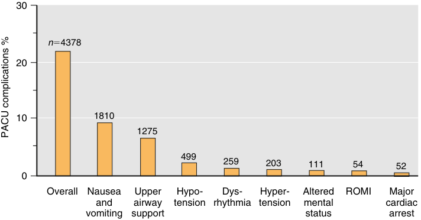
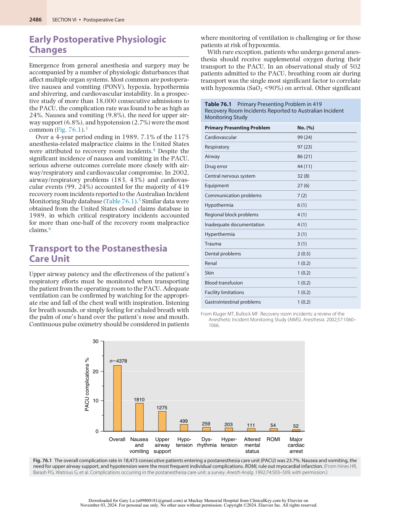
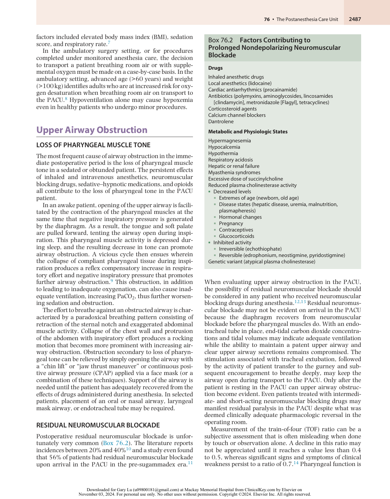
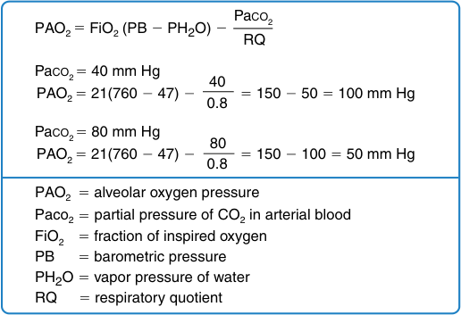
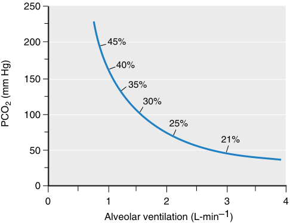
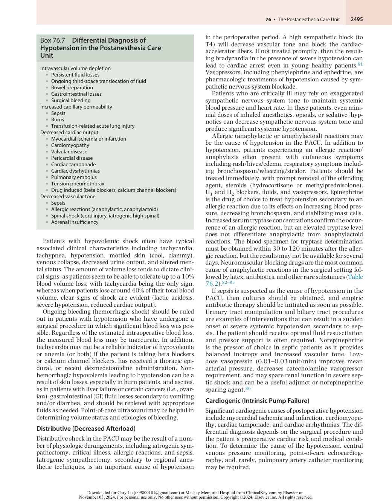
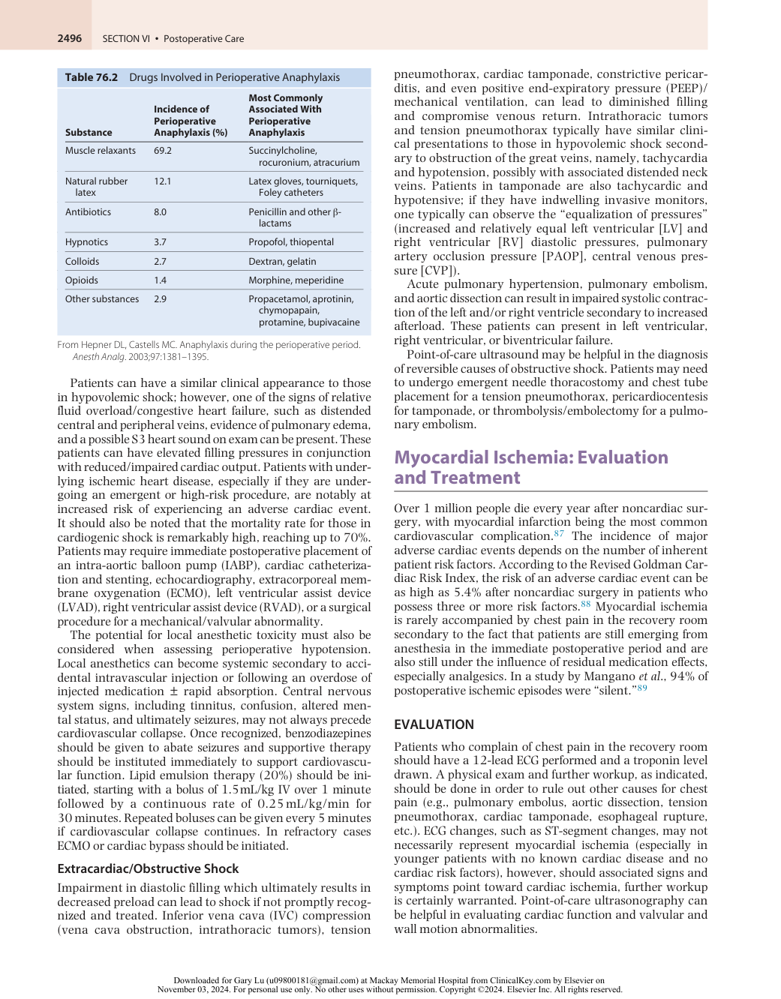
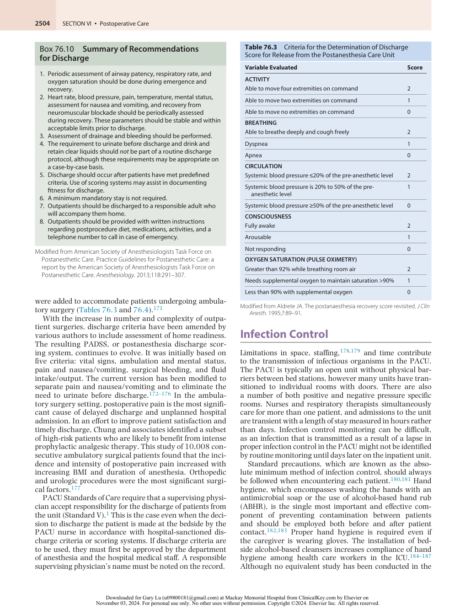
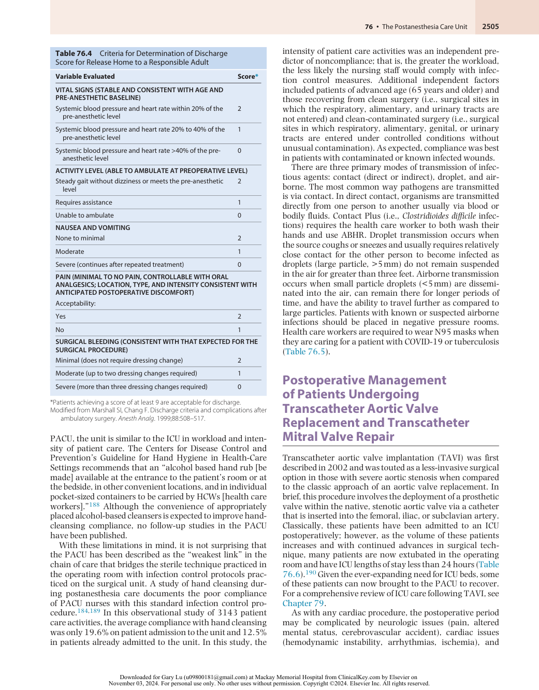
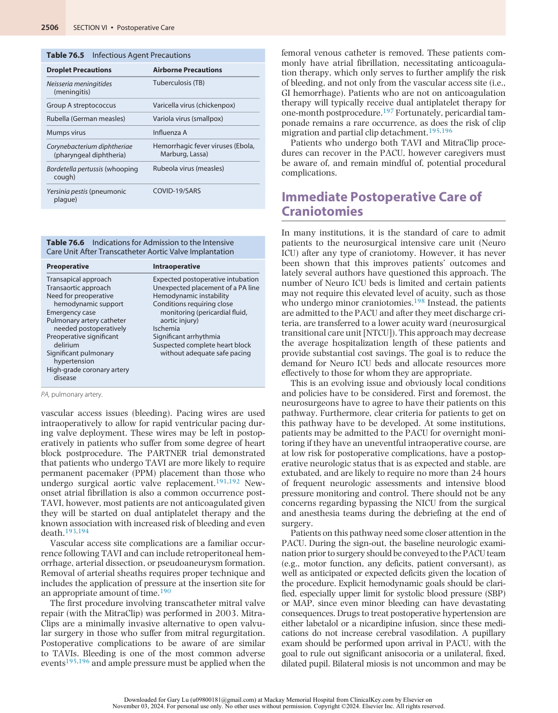

# The Postanesthesia Care Unit

<!-- PDF page 1 -->

MARVIN CHANG and RYAN HORVATH

### KEY POINTS

- Emergence from general anesthesia and recovery from surgery may be accompanied by a number of physiologic disturbances that include postoperative nausea and vomiting (PONV), hypoxia, hypothermia and shivering, and cardiovascular instability.

- The ASA Practice Guidelines for Postanesthetic Care recommends assessment and monitoring of the respiratory system (respiratory rate, airway patency, oxygen saturation), cardiovascular system (pulse rate and blood pressure), neuromuscular system, mental status, pain, and nausea and vomiting for every patient during recovery.

- The most frequent cause of airway obstruction in the immediate postoperative period is decreased pharyngeal muscle tone in a sedated or obtunded patient due to the persistent effects of inhaled and intravenous anesthetics, neuromuscular blocking drugs, sedative– hypnotic medications, and opioids. These effects can be compounded in patients with obstructive sleep apnea (OSA).

- Postoperative residual neuromuscular blockade is a common occurrence in the postanesthesia care unit (PACU). Pharyngeal function is not normalized until an adductor pollicis train- offour (TOF) ratio is greater than 0.90. Residual neuromuscular blockade should be immediately treated with neostigmine or sugammadex.

- Respiratory failure in the immediate postoperative period is often due to transient and rapidly reversible conditions such as splinting from pain, diaphragmatic dysfunction, muscular weakness, and pharmacologically depressed respiratory drive.

- Perioperative renal dysfunction from inadequate hydration, intravenous contrast agents, and/ or rhabdomyolysis are common in the PACU. Patients at risk for these complications should have their renal function assessed and early intervention should be initiated to limit the development of acute kidney injury.

- Postoperative delirium is associated with worse surgical outcomes, increased hospital length of stay, functional decline, higher rates of institutionalization, higher mortality, and higher cost and resource utilization.

- The ASA Practice Guidelines for Postanesthetic Care recommend the following Guidelines for Discharge: the patient’s mental status should be at their baseline, vital signs should be stable, discharge should occur after patients have met specific criteria ideally through use of a scoring system, patients should be discharged to a responsible adult, and patients should be provided with written instructions regarding postprocedure care.

- The PACU may serve as an ideal location for the care of intensive care unit (ICU) overflow patients when there are hospital capacity constraints, as exemplified during the COVID- 19 pandemic. In general, it is important that PACU staffing meet the nursing staffing ratios and competencies required in the critical care units as outlined by the _Joint Position Statement on ICU Overflow Patients_ developed by American Society of PeriAnesthesia Nurses (ASPAN), American Association of Critical Care Nurses (AACN), and American Society of Anesthesiologists (ASA). If anesthesia machines are used instead of traditional ICU ventilators in the event of a shortage, it is important to be familiar with the advantages and challenges associated with anesthesia machines.

The postanesthesia care unit (PACU) is designed and staffed to monitor and care for patients who are recovering from the immediate physiologic effects of anesthesia and surgery. PACU care spans the transition from one- on- one monitoring in the operating room to the less-acute monitoring on the hospital ward or, in many cases, independent function of

the patient at home. To serve this unique transition period, the PACU is equipped to resuscitate unstable patients while providing a tranquil environment for the “recovery” and comfort of stable patients. Its location in close proximity to the operating rooms facilitates rapid access to anesthesiologists for consultation and assistance.

<!-- PDF page 2 -->

## Admission to the Postanesthesia Care Unit

The PACU is staffed by specially trained nurses skilled in the prompt recognition of postoperative complications. On arrival to the PACU, the anesthesiologist provides the PACU nurse with pertinent details of the patient’s history, medical condition, anesthesia, and surgery. Particular attention is directed toward monitoring oxygenation (pulse oximetry), ventilation (breathing frequency, airway patency, capnography), and circulation (systemic blood pressure, heart rate, electrocardiogram [ECG]). Vital signs are recorded as often as necessary but at least every 15 minutes while the patient is in the unit. Vital signs and other pertinent information are recorded as part of the patient’s medical record. Specific requirements and recommendations for patient monitoring and therapeutic intervention can be found in the Practice Standards and Guidelines adopted by the American Society of Anesthesiologists (ASA).

Unlike Practice Standards, Practice Guidelines are not requirements. They are recommendations designed to assist the health care provider in clinical decision- making. The ASA Practice Guidelines for Postanesthetic Care are the result of a multiple- step process that incorporates input from three groups: (1) an ASA- appointed task force consisting of private practice and academic anesthesiologists and epidemiologists, (2) PACU consultants, and (3) ASA members at large. The guidelines are based upon literature review, expert opinion, open forum commentary, and clinical feasibility. They recommend the appropriate assessment, monitoring, and treatment of the major organ system functions during recovery from anesthesia and surgery (Box 76.1).2

### Box 76.1 Summary of Recommendations for Patient Assessment and Monitoring in the Postanesthesia Care Unit

### Respiratory

## The Standards for Postanesthesia Care

Practice Standards delineate the required obligation of minimal care in the clinical setting. As such, they serve as a threshold that can be exceeded when indicated by the clinical judgment of the practitioner. The Standards for Postanesthesia Care are updated on a regular basis to keep up with changing practice parameters and technologic advances. The most recent revision published in 2019 is summarized here1 :

- I.  All patients who have received general anesthesia, regional anesthesia, or monitored anesthesia care shall receive appropriate postanesthesia management.

- II.  A patient transported to the PACU shall be accompanied by a member of the anesthesia care team who is knowledgeable about the patient’s condition. The patient shall be continually evaluated and treated during transport with monitoring and support appropriate to the patient’s condition.

- III.  Upon arrival in the PACU, the patient shall be reevaluated, and a verbal report provided to the responsible PACU nurse by the member of the anesthesia care team who accompanies the patient.

- IV.  The patient’s condition shall be evaluated continually in the PACU. The patient shall be observed and monitored by methods appropriate to the patient’s medical condition. Particular attention should be given to monitoring oxygenation, ventilation, circulation, level of consciousness, and temperature. During recovery from all anesthetics, a quantitative method of assessing oxygenation such as pulse oximetry shall be employed in the initial phase of recovery.*

- V.  A physician is responsible for the discharge of the patient from the PACU.

- *Under extenuating circumstances, the responsible anesthesiologist may waive the requirements marked with an asterisk (*): it is recommended that when this is done, it should be stated (including the reasons) in a note in the patient’s medical record.

Assessment of airway patency, respiratory rate, and oxygen saturation should be periodically performed. Particular attention should be given to monitoring oxygenation and ventilation.

### Cardiovascular

Heart rate and blood pressure should be routinely monitored. Electrocardiographic monitors should be immediately available.

### Neuromuscular

Assessment of neuromuscular function should be performed for all patients who received nondepolarizing neuromuscular blocking drugs or who have medical conditions associated with neuromuscular dysfunction (see also Chapter 24).

### Mental Status

Mental status should be periodically assessed.

### Temperature

Patient temperature should be periodically assessed.

### Pain

Pain should be periodically assessed.

### Nausea and Vomiting

Periodic assessment of postoperative nausea and vomiting should be routinely performed.

### Hydration

Postoperative hydration should be assessed and managed accordingly. Certain procedures may involve significant blood loss and require additional intravenous fluids management.

### Urine

Assessment of urine output and of urinary voiding should be performed on a case- by- case basis for selected patients or selected procedures.

### Drainage and Bleeding

Assessment of drainage and bleeding should be performed periodically as needed.

- From Apfelbaum JL, Silverstein JH, Chung FF, et al. Practice guidelines for postanesthetic care: an updated report by the American Society of Anesthesiologists Task Force on Postanesthetic Care. _Anesthesiology._ 2013;118:291–307.

<!-- PDF page 3 -->

## Early Postoperative Physiologic Changes

Emergence from general anesthesia and surgery may be accompanied by a number of physiologic disturbances that affect multiple organ systems. Most common are postoperative nausea and vomiting (PONV), hypoxia, hypothermia and shivering, and cardiovascular instability. In a prospective study of more than 18,000 consecutive admissions to the PACU, the complication rate was found to be as high as 24%. Nausea and vomiting (9.8%), the need for upper airway support (6.8%), and hypotension (2.7%) were the most common (Fig. 76.1).3

Over a 4- year period ending in 1989, 7.1% of the 1175 anesthesia- related malpractice claims in the United States were attributed to recovery room incidents.4 Despite the significant incidence of nausea and vomiting in the PACU, serious adverse outcomes correlate more closely with airway/respiratory and cardiovascular compromise. In 2002, airway/respiratory problems (183, 43%) and cardiovascular events (99, 24%) accounted for the majority of 419 recovery room incidents reported to the Australian Incident Monitoring Study database (Table 76.1).5 Similar data were obtained from the United States closed claims database in 1989, in which critical respiratory incidents accounted for more than one- half of the recovery room malpractice claims.6

## Transport to the Postanesthesia Care Unit

Upper airway patency and the effectiveness of the patient’s respiratory efforts must be monitored when transporting the patient from the operating room to the PACU. Adequate ventilation can be confirmed by watching for the appropriate rise and fall of the chest wall with inspiration, listening for breath sounds, or simply feeling for exhaled breath with the palm of one’s hand over the patient’s nose and mouth. Continuous pulse oximetry should be considered in patients

where monitoring of ventilation is challenging or for those patients at risk of hypoxemia.

With rare exception, patients who undergo general anesthesia should receive supplemental oxygen during their transport to the PACU. In an observational study of 502 patients admitted to the PACU, breathing room air during transport was the single most significant factor to correlate with hypoxemia (SaO2 &lt;90%) on arrival. Other significant

**Table 76.1** Primary Presenting Problem in 419 Recovery Room Incidents Reported to Australian Incident Monitoring Study

|**Primary Presenting Problem**|**No. (%)**|
|---|---|
|Cardiovascular|99 (24)|
|Respiratory|97 (23)|
|Airway|86 (21)|
|Drug error|44 (11)|
|Central nervous system|32 (8)|
|Equipment|27 (6)|
|Communication problems|7 (2)|
|Hypothermia|6 (1)|
|Regional block problems|4 (1)|
|Inadequate documentation|4 (1)|
|Hyperthermia|3 (1)|
|Trauma|3 (1)|
|Dental problems|2 (0.5)|
|Renal|1 (0.2)|
|Skin|1 (0.2)|
|Blood transfusion|1 (0.2)|
|Facility limitations|1 (0.2)|
|Gastrointestinal problems|1 (0.2)|

From Kluger MT, Bullock MF. Recovery room incidents: a review of the Anesthetic Incident Monitoring Study (AIMS). _Anesthesia_ . 2002;57:1060– 1066.

30 n 4378 20 10 1810 1275 499 259 203 111 54 52 0 Overall Nausea Upper Hypo- Dys- Hyper- Altered ROMI Major and airway tension rhythmia tension mental cardiac vomiting support status arrest PACU complications % 

**Fig. 76.1** The overall complication rate in 18,473 consecutive patients entering a postanesthesia care unit (PACU) was 23.7%. Nausea and vomiting, the need for upper airway support, and hypotension were the most frequent individual complications. _ROMI,_ rule out myocardial infarction. (From Hines HR, Barash PG, Watrous G, et al. Complications occurring in the postanesthesia care unit: a survey. _Anesth Analg_ . 1992;74:503–509, with permission.)

::: details 原始表格與符號（PDF 第 3 頁）

:::

<!-- PDF page 4 -->

factors included elevated body mass index (BMI), sedation score, and respiratory rate.7

In the ambulatory surgery setting, or for procedures completed under monitored anesthesia care, the decision to transport a patient breathing room air or with supplemental oxygen must be made on a case- by- case basis. In the ambulatory setting, advanced age (>60 years) and weight (>100 kg) identifies adults who are at increased risk for oxygen desaturation when breathing room air on transport to the PACU.8 Hypoventilation alone may cause hypoxemia even in healthy patients who undergo minor procedures.

## Upper Airway Obstruction

### LOSS OF PHARYNGEAL MUSCLE TONE

The most frequent cause of airway obstruction in the immediate postoperative period is the loss of pharyngeal muscle tone in a sedated or obtunded patient. The persistent effects of inhaled and intravenous anesthetics, neuromuscular blocking drugs, sedative–hypnotic medications, and opioids all contribute to the loss of pharyngeal tone in the PACU patient.

In an awake patient, opening of the upper airway is facilitated by the contraction of the pharyngeal muscles at the same time that negative inspiratory pressure is generated by the diaphragm. As a result, the tongue and soft palate are pulled forward, tenting the airway open during inspiration. This pharyngeal muscle activity is depressed during sleep, and the resulting decrease in tone can promote airway obstruction. A vicious cycle then ensues wherein the collapse of compliant pharyngeal tissue during inspiration produces a reflex compensatory increase in respiratory effort and negative inspiratory pressure that promotes further airway obstruction.9 This obstruction, in addition to leading to inadequate oxygenation, can also cause inadequate ventilation, increasing PaCO2, thus further worsening sedation and obstruction.

The effort to breathe against an obstructed airway is characterized by a paradoxical breathing pattern consisting of retraction of the sternal notch and exaggerated abdominal muscle activity. Collapse of the chest wall and protrusion of the abdomen with inspiratory effort produces a rocking motion that becomes more prominent with increasing airway obstruction. Obstruction secondary to loss of pharyngeal tone can be relieved by simply opening the airway with a “chin lift” or “jaw thrust maneuver” or continuous positive airway pressure (CPAP) applied via a face mask (or a combination of these techniques). Support of the airway is needed until the patient has adequately recovered from the effects of drugs administered during anesthesia. In selected patients, placement of an oral or nasal airway, laryngeal mask airway, or endotracheal tube may be required.

### RESIDUAL NEUROMUSCULAR BLOCKADE

Postoperative residual neuromuscular blockade is unfortunately very common (Box 76.2). The literature reports incidences between 20% and 40%10 and a study even found that 56% of patients had residual neuromuscular blockade upon arrival in the PACU in the pre- sugammadex era.11

### Box 76.2 Factors Contributing to Prolonged Nondepolarizing Neuromuscular Blockade

### Drugs

|Inhaled anesthetic drugs|
|---|
|Local anesthetics (lidocaine)|
|Cardiac antiarrhythmics (procainamide)|
|Antibiotics (polymyxins, aminoglycosides, lincosamides [clindamycin], metronidazole [Flagyl], tetracyclines)|
|Corticosteroid agents|
|Calcium channel blockers|
|Dantrolene|
|**Metabolic and Physiologic States**|
|Hypermagnesemia|
|Hypocalcemia|
|Hypothermia|
|Respiratory acidosis|
|Hepatic or renal failure|
|Myasthenia syndromes|
|Excessive dose of succinylcholine|
|Reduced plasma cholinesterase activity ᑏDecreased levels|

|ᑏExtremes of age (newborn, old age) ᑏDisease states (hepatic disease, uremia, malnutrition, plasmapheresis) ᑏHormonal changes ᑏPregnancy ᑏContraceptives ᑏGlucocorticoids|
|---|
|ᑏInhibited activity|

> ᑏ Irreversible (echothiophate)

> ᑏ Reversible (edrophonium, neostigmine, pyridostigmine) Genetic variant (atypical plasma cholinesterase)

When evaluating upper airway obstruction in the PACU, the possibility of residual neuromuscular blockade should be considered in any patient who received neuromuscular blocking drugs during anesthesia.12,13 Residual neuromuscular blockade may not be evident on arrival in the PACU because the diaphragm recovers from neuromuscular blockade before the pharyngeal muscles do. With an endotracheal tube in place, end- tidal carbon dioxide concentrations and tidal volumes may indicate adequate ventilation while the ability to maintain a patent upper airway and clear upper airway secretions remains compromised. The stimulation associated with tracheal extubation, followed by the activity of patient transfer to the gurney and subsequent encouragement to breathe deeply, may keep the airway open during transport to the PACU. Only after the patient is resting in the PACU can upper airway obstruction become evident. Even patients treated with intermediate- and short- acting neuromuscular blocking drugs may manifest residual paralysis in the PACU despite what was deemed clinically adequate pharmacologic reversal in the operating room.

Measurement of the train- of- four (TOF) ratio can be a subjective assessment that is often misleading when done by touch or observation alone. A decline in this ratio may not be appreciated until it reaches a value less than 0.4 to 0.5, whereas significant signs and symptoms of clinical weakness persist to a ratio of 0.7.14 Pharyngeal function is

::: details 原始表格與符號（PDF 第 4 頁）

:::

<!-- PDF page 5 -->

not restored to normal until an adductor pollicis TOF ratio is greater than 0.9.15

In the anesthetized patient, a quantitative TOF measurement showing a TOF ratio ≥0.9 is the most reliable indicator of adequate reversal of drug- induced neuromuscular blockade.14,16 Qualitative TOF measurement and 5- second sustained tetanus at 50 Hz are insensitive and will not allow detection of fade above an average TOF ratio of 0.31 ± 0.15; 5- second sustained tetanus at 100 Hz is unreliable.17 In an awake patient, clinical assessment of reversal of neuromuscular blockade is preferred to the application of painful TOF or tetanic stimulation. Clinical evaluation includes grip strength, tongue protrusion, the ability to lift the legs off the bed, and the ability to lift the head off the bed for a full 5 seconds. Of these maneuvers, the 5- second sustained head lift has historically been considered to be the gold standard, reflecting not only generalized motor strength but also, more importantly, the patient’s ability to maintain and protect the airway. However, studies have shown that the 5- second head lift is remarkably insensitive and should not routinely be used to assess recovery from neuromuscular blockade. The ability to strongly oppose the incisor teeth against a tongue depressor is a more reliable indicator of pharyngeal muscle tone. This maneuver correlates with an average TOF ratio of 0.85 as opposed to 0.60 for the sustained head lift.14 In a year- long study of 7459 PACU patients who had received general anesthesia, Murphy _et al_ . reported critical respiratory events (CREs) in 61 of them. These events occurred within the first 15 minutes of PACU admission, at which time a TOF ratio was measured. When compared with matched controls, these patients had a significantly lower TOF ratio (0.62 [+0.20]) compared to controls 0.98 [+0.07]).18 Bulka and associates were able to demonstrate that patients who had received neuromuscular blocking drugs, but did not receive reversal agents, had a 2.26 times higher risk of developing postoperative pneumonia compared to those who did receive reversal agents.19

When a PACU patient demonstrates signs and/or symptoms of muscular weakness in the form of respiratory distress and/or agitation, one must suspect that there could be a residual neuromuscular blockade and prompt review of possible etiologic factors is indicated (see Box 76.2). Common factors include respiratory acidosis and hypothermia, alone or in combination. Upper airway obstruction as a result of the residual depressant effects of volatile anesthetics, sedating medications, and opioids may result in progressive respiratory acidosis after the patient is admitted to the PACU and external stimulation is minimized. Simple measures such as warming the patient, airway support, and correction of electrolyte abnormalities can facilitate recovery from neuromuscular blockade. The approval of sugammadex in the United States by the Food and Drug Administration (FDA) in December 2015 has had a major impact on residual paralysis in patients who were paralyzed with aminosteroid neuromuscular blocking drugs (sugammadex does not work with benzylisoquinolinium neuromuscular blocking drugs). While reversal with neostigmine requires a baseline twitch response, and the duration until the patient has a TOF ratio of ≥0.9 is highly variable, sugammadex can be administered at any depth of neuromuscular blockade and most commonly produces full recovery within several minutes after administration. In a study by White _et al._ , reversal with sugammadex

resulted in a return of TOF ratio to greater than 0.9 within 5 minutes in 85% of patients with no twitches on TOF stimulation.20 Brueckmann _et al._ showed that 0/74 patients reversed with sugammadex as compared to 33/76 patients reversed with neostigmine showed evidence of residual neuromuscular blockade.21

### LARYNGOSPASM

Laryngospasm refers to a sudden spasm of the vocal cords that completely occludes the laryngeal opening via forceful tonic contractions of the laryngeal muscles and descent of the epiglottis over the laryngeal inlet. It typically occurs in the transitional period when the extubated patient is emerging from general anesthesia yet not fully awake. Although laryngospasm is most likely to occur in the operating room at the time of tracheal extubation, patients who arrive in the PACU still under the effects of general anesthesia are also at risk for laryngospasm upon further awakening. Laryngospasm is often triggered by airway irritants, such as secretions or blood, or stimulation of the posterior oropharynx through actions such as suctioning. Treatment of laryngospasm involves removal of the stimulus (suctioning of secretions, blood) and the application of a jaw thrust maneuver with CPAP (up to 40 cmH2O) delivered via Ambu. However, if jaw thrust maneuver and CPAP fail, then immediate skeletal muscle relaxation can be achieved with succinylcholine (0.1–1.0 mg/kg intravenously [IV] or 4 mg/kg intramuscularly [IM]). If these maneuvers fail, one should proceed with a full dose of an induction agent and intubating dose of a muscle relaxant to enable the practitioner to perform an emergent tracheal intubation; attempting to pass a tracheal tube forcibly through a glottis that is closed because of laryngospasm is contraindicated and could lead to injury.

### EDEMA OR HEMATOMA

Airway edema is a possible surgical complication in patients undergoing prolonged procedures in the prone or Trendelenburg position, procedures involving the airway and neck (including thyroidectomy,22 carotid endarterectomy,23 and cervical spine procedures24 ), as well as those in which the patient receives a large volume resuscitation. Although facial and scleral edema is an important physical sign that can alert the clinician to the presence of airway edema, visible external signs may not accompany significant edema of pharyngeal tissue (see also Chapter 40). Patients who have had a difficult intraoperative intubation and/or airway instrumentation may also have increased airway edema from direct injury. If tracheal extubation is to be attempted in these patients in the PACU, then evaluation of airway patency must precede removal of the endotracheal tube. The patient’s ability to breathe around the endotracheal tube can be evaluated by suctioning the oral pharynx and deflating the endotracheal tube cuff. With occlusion of the proximal end of the endotracheal tube, the patient is then asked to breathe around the tube. Good air movement suggests that the patient’s airway will remain patent after tracheal extubation. An alternative method involves measuring the intrathoracic pressure required to produce a leak around the endotracheal tube with the

<!-- PDF page 6 -->

cuff deflated. This method was originally used to evaluate pediatric patients with croup before extubation.25–27 When used in patients with general oropharyngeal edema, the safe pressure threshold can be difficult to identify. Lastly, when ventilating patients in the volume control mode, one can measure the exhaled tidal volume before and after cuff deflation. Patients who require reintubation generally have a smaller leak (i.e., less percentage difference between exhaled volume before and after cuff deflation) than those who do not. A difference greater than 15.5% is the advocated cutoff value for extubation of the trachea.28 The presence of a cuff leak demonstrates the likelihood of successful extubation, not a guarantee, just as a failed cuff leak does not rule out a successful extubation.29 Visual inspection of the glottic aperture via video laryngoscopy or fiberoptic/ video bronchoscopy evaluation can be invaluable in assessing edema.

In order to facilitate the reduction of airway edema, the patient can be sat upright to ensure adequate venous drainage, diuretics can be given to decrease intravascular fluid levels and promote movement of fluids from the interstitium back into the vasculature, and intravenous dexamethasone (4–8 mg every 6 hours for 24 hours) can be administered to help decrease airway swelling.

External airway compression is most often caused by hematomas following thyroid, parathyroid, or carotid surgical procedures. Patients may complain of pain and/or pressure, dysphagia, and can demonstrate signs of respiratory distress as the pressure from the expanding hematoma within the tissue can disrupt both venous and lymphatic drainage, both of which can further exacerbate airway swelling. Mask ventilation may not be possible in a patient with severe upper airway obstruction resulting from edema or hematoma. In the case of a hematoma, an attempt should be made to decompress the airway by releasing the clips or sutures on the wound and evacuating the hematoma. This maneuver is recommended as a temporizing measure, but it will not effectively decompress the airway if a significant amount of fluid or blood (or both) has infiltrated the tissue planes of the pharyngeal wall. If emergent tracheal intubation is required, then ready access to difficult airway equipment and surgical backup to perform an emergency tracheostomy are crucial. Reintubation in these situations can be challenging due to laryngeal and airway edema, possible tracheal deviation, and a compressed tracheal lumen. If the patient is able to move adequate air via spontaneous ventilation, then an awake technique is often preferred as visualization of the cords by direct laryngoscopy may not be possible.

### OBSTRUCTIVE SLEEP APNEA

Obstructive sleep apnea (OSA) syndrome is an oftenoverlooked cause of airway obstruction in the PACU, given that many patients suffering from OSA are actually not obese and the vast majority of patients are undiagnosed at the time of surgery.30,31 Recent studies have shown that OSA affects 17% of women and 34% of men in the US, with similar prevalence worldwide.32

It is well known that patients with OSA are at an increased risk of suffering from cardiopulmonary complications as compared to the general population. Any

redundant compliant pharyngeal tissue in these patients not only increases the incidence of airway obstruction but also can increase the difficulty of intubation by direct laryngoscopy.33,34 Patients with OSA are particularly prone to airway obstruction and should not be extubated until they are fully awake and following commands.35,36 Once in the PACU, a patient with OSA can be more sensitive to opioids and sedating medication. When possible, regional anesthesia techniques should be considered to provide postoperative analgesia.37,38 Other opioid- sparing techniques should be utilized, such as scheduled acetaminophen, and use of nonsteroidal anti- inflammatory drugs (NSAIDs) when not contraindicated. One may also employ the use of ketamine, dexmedetomidine, and clonidine, all of which can also decrease postoperative opioid requirements, with minimal effects on pharyngeal tone. Interestingly, benzodiazepines can have a greater effect on pharyngeal muscle tone than opioids, and the use of benzodiazepines in the perioperative setting can significantly contribute to airway obstruction in the PACU and should thus be avoided in this patient population.9,39

Another strategy to employ when caring for a patient with OSA is to avoid the supine position as it is known to worsen OSA. When caring for a patient with OSA, positioning them in either an upright (seated, reverse Trendelenburg) or semi- upright position whenever possible, can lessen the amount of pharyngeal obstruction compared to supine positioning. For patients who are on CPAP at night, plans should be made preoperatively to provide CPAP via their own CPAP machines the day of surgery. Patients who do not routinely use CPAP at home or who do not have their machines with them may require additional attention from the respiratory therapist to ensure proper fit of the CPAP delivery device (mask or nasal airways) and to titrate the amount of positive pressure needed to prevent upper airway obstruction.40,41

In patients with OSA who are morbidly obese, immediately applying CPAP postextubation in the operating room rather than waiting to apply positive pressure in the PACU may offer additional benefits. In patients undergoing laparoscopic bariatric surgery, Neligan and colleagues showed that patients who received immediate CPAP (10 cmH2O) demonstrated improved spirometry lung function (i.e., functional residual capacity [FRC], peak expiratory flow [PEF], and forced expiratory volume [FEV]) at 1 hour and 24 hours postoperatively compared to those who received CPAP 30 minutes later in the PACU.41

## Management of Upper Airway Obstruction

An obstructed upper airway requires immediate attention. Efforts to open the airway by noninvasive measures should be attempted before reintubation of the trachea. Jaw thrust with CPAP (5–15 cmH2O) is often enough to open the upper airway in patients with decreased pharyngeal muscle tone. If CPAP is not effective, an oral, nasal, or laryngeal mask airway can be inserted. After successfully opening the upper airway and ensuring adequate ventilation, the cause of the upper airway obstruction should be identified and treated. In adults, the sedating effects of opioids and benzodiazepines

<!-- PDF page 7 -->

can be reversed with persistent stimulation or small, titrated doses of naloxone (0.3–0.5 mcg/kg IV) or flumazenil (0.2 mg IV to maximum dose of 1 mg), respectively. Residual effects of neuromuscular blocking drugs can be reversed pharmacologically with neostigmine or sugammadex (if rocuronium or vecuronium was used for paralysis) or by correcting contributing factors such as hypothermia.

### Box 76.3 Factors Contributing to Postoperative Arterial Hypoxemia

- Right- to- left intrapulmonary shunt (atelectasis)

- Mismatching of ventilation to perfusion (decreased functional residual capacity)

- Congestive heart failure

- Pulmonary edema (fluid overload, postobstructive edema)

## Differential Diagnosis of Arterial Hypoxemia in the Postanesthesia Care Unit

Atelectasis and alveolar hypoventilation are the most common causes of transient postoperative arterial hypoxemia in the immediate postoperative period.42 Clinical correlation should guide the workup of a postoperative patient who remains persistently hypoxemic.43 Review of the patient’s history, operative course, and clinical signs and symptoms will direct the workup to rule in possible causes (Box 76.3; see also Chapter 12).

### ALVEOLAR HYPOVENTILATION

Review of the alveolar gas equation demonstrates that hypoventilation alone is sufficient to cause arterial hypoxemia in a patient breathing room air (Fig. 76.2). At sea level, a normocapnic patient breathing room air will have an alveolar oxygen pressure (PAO2) of 100 mm Hg. Thus, a healthy patient without a significant alveolar–arterial gradient will have a PaO2 near 100 mm Hg. In the same patient, an increase in PaCO2 from 40 to 80 mm Hg (alveolar hypoventilation) results in a PaO2 of 50 mm Hg. Hence, even a patient with normal lungs will become hypoxemic if allowed to become hypercarbic through hypoventilation while breathing room air.

Normally, minute ventilation increases linearly by approximately 2 L/min for every 1 mm Hg increase in PaCO2. In the immediate postoperative period, the residual effects of inhaled anesthetics, opioids, and sedative–hypnotics can significantly depress this ventilatory response to carbon dioxide. In addition to depressed respiratory drive, the differential diagnosis of postoperative hypoventilation includes generalized weakness due to residual neuromuscular blockade or underlying neuromuscular disease. The presence of restrictive pulmonary conditions, such as preexisting chest wall deformity, postoperative abdominal binding, or abdominal distention, can also contribute to inadequate ventilation.

Arterial hypoxemia secondary to hypercapnia can be reversed by the administration of supplemental oxygen (Fig. 76.3)44 or by normalizing the patient’s PaCO2 by external stimulation of the patient to improve ventilation, pharmacologic reversal of opioid, or benzodiazepine effect, or ventilation of the patient’s lungs through noninvasive or invasive mechanical ventilation.

### DECREASED ALVEOLAR OXYGEN PRESSURE

Inadequate oxygen delivery may result from an unrecognized disconnection of the oxygen source, empty oxygen tank, or failure of pipeline oxygen.

- Alveolar hypoventilation (residual effects of anesthetics and/or neuromuscular blocking drugs)

- Diffusion hypoxia (unlikely if receiving supplemental oxygen)

- Aspiration of gastric contents

- Pulmonary embolism

- Pneumothorax

- Increased oxygen consumption (shivering)

- Sepsis

- Transfusion- related lung injury (TRALI)

- Adult respiratory distress syndrome (ARDS)

- Advanced age

- Obesity

PaCO2 PAO2 FiO2 (PB  PH2O) RQ PaCO2  40 mm Hg 40 PAO2 21(760  47)  150  50  100 mm Hg 0.8 PaCO2  80 mm Hg 80 PAO2 21(760  47)  150  100  50 mm Hg 0.8 PAO2 alveolar oxygen pressure Paco2 partial pressure of CO2 in arterial blood FiO2 fraction of inspired oxygen PB barometric pressure PH2O vapor pressure of water RQ  respiratory quotient 

**Fig. 76.2 Hypoventilation as a cause of arterial hypoxemia.** (From Nicholau D. Postanesthesia recovery. In: Miller RD, Pardo MC Jr, eds. _Basics of Anesthesia,_ 7th ed. Philadelphia: Elsevier; 2018.)

250 200 45% 40% 150 35% 30% 100 25% 21% 50 0 0 1 2 3 4 Alveolar ventilation (L-min –1 ) PCO (mm Hg)2 

**Fig. 76.3** Alveolar partial pressure of carbon dioxide (PCO2) as a function of alveolar ventilation at rest. The percentages indicate the inspired oxygen concentration required to restore alveolar partial pressure of oxygen (PO2) to normal. (Adapted from Nunn JF. _Nunn’s Applied Respiratory Physiology,_ 6th ed. Philadelphia: Butterworth- Heinemann; 2005, with permission.)

<!-- PDF page 8 -->

### VENTILATION–PERFUSION MISMATCH AND SHUNT

Hypoxic pulmonary vasoconstriction refers to the attempt of normal lungs to optimally match ventilation and perfusion. This response constricts vessels in poorly ventilated regions of the lung and directs pulmonary blood flow to well- ventilated alveoli. In the PACU, the residual effects of inhaled anesthetics and vasodilators such as nitroprusside and dobutamine used to treat systemic hypertension or improve hemodynamics will blunt hypoxic pulmonary vasoconstriction and contribute to arterial hypoxemia.

Unlike a mismatch, a true shunt will not respond to supplemental oxygen. Causes of postoperative pulmonary shunt include atelectasis, pulmonary edema, gastric aspiration, pulmonary emboli, and pneumonia. Of these, atelectasis is the most common cause of pulmonary shunting in the immediate postoperative period. Mobilization of the patient to the sitting position, incentive spirometry, and positive airway pressure by face mask or CPAP can be effective in treating atelectasis.

### INCREASED VENOUS ADMIXTURE

Increased venous admixture typically refers to low cardiac output states. It is due to the mixing of desaturated venous blood with oxygenated arterial blood. Normally, only 2% to 5% of cardiac output is shunted through the lungs, and this shunted blood with a normal mixed venous saturation has a minimal effect on PaO2. In low cardiac output states, blood returns to the heart severely desaturated. Additionally, the shunt fraction increases significantly in conditions that impede alveolar oxygenation, such as pulmonary edema and atelectasis. Under these conditions, mixing of desaturated shunted blood with saturated arterialized blood decreases PaO2.

### DECREASED DIFFUSION CAPACITY

A decreased diffusion capacity may reflect the presence of underlying lung disease such as emphysema, interstitial lung disease, pulmonary fibrosis, or primary pulmonary hypertension. In this regard, the differential diagnosis of arterial hypoxemia in the PACU must include the contribution of any preexisting pulmonary condition.

## Pulmonary Edema

Pulmonary edema in the immediate postoperative period is often cardiogenic in nature, secondary to intravascular volume overload or congestive heart failure. Other causes of noncardiogenic pulmonary edema, namely postobstructive pulmonary edema (secondary to airway obstruction), sepsis, or transfusion (transfusion- related acute lung injury [TRALI]), may occur less frequently, but they must not be overlooked as a potential cause of pulmonary edema in the postoperative period.

### POSTOBSTRUCTIVE PULMONARY EDEMA

Postobstructive pulmonary edema (also referred to as negative pressure pulmonary edema, NPPE) is a rare but significant consequence of laryngospasm and other upper airway

obstruction that may follow tracheal extubation at the conclusion of anesthesia and surgery. Laryngospasm is likely the most common cause of postobstructive pulmonary edema in the PACU, but postobstructive pulmonary edema may result from any condition that occludes the upper airway (including biting of the endotracheal tube close to extubation).45–48 The etiology of NPPE is multifactorial but is clearly correlated with the generation of exaggerated negative intrathoracic pressure attributable to forced inspiration against a closed glottis. The resulting negative intrathoracic pressure augments blood flow to the right side of the heart, which in turn dilates and increases hydrostatic pressure gradient across the pulmonary vascular bed, promoting the movement of fluid into the interstitial and alveolar spaces from the pulmonary capillaries. Negative inspiratory pressure will also increase left ventricular afterload, thus decreasing the ejection fraction, which heightens left ventricular end- diastolic pressure, left atrial pressure, and pulmonary venous pressure. This chain of events further escalates the development of pulmonary edema via increase of pulmonary hydrostatic pressures. Patients who are muscularly healthy are at increased risk of postobstructive pulmonary edema secondary to their ability to generate significant inspiratory force.

The resulting arterial hypoxemia develops relatively quickly (usually observed within 90 minutes of the upper airway obstruction), and is accompanied by dyspnea, pink frothy sputum, and bilateral fluffy infiltrates on the chest radiograph. Treatment is generally supportive and includes supplemental oxygen, diuresis, and, in severe cases, initiation of positive-pressure ventilation (PPV). The general consensus of postoperative monitoring in these patients ranges anywhere from 2 to 12 hours. Resolution of NPPE typically occurs within 12 to 48 hours when recognized and treated immediately; however, if diagnosis and resulting therapy is delayed, mortality rates can reach 40%. Although uncommon, pulmonary hemorrhage and hemoptysis have been observed.

### TRANSFUSION- RELATED ACUTE LUNG INJURY

The differential diagnosis of pulmonary edema in the PACU should include transfusion- related lung injury (TRALI) in any patient who intraoperatively received blood products.49–51 Transfusion- related lung injury is typically exhibited within 2 to 4 hours after the transfusion of plasma- containing blood products, including packed red blood cells, whole blood, fresh frozen plasma, or platelets. TRALI occurs when recipient neutrophils become activated by constituents of the donor blood products. These neutrophils then release inflammatory mediators which initiate the cascade of pulmonary edema and resulting lung injury via increasing the permeability of the pulmonary vasculature. Given that presenting symptoms (sudden onset of hypoxemic respiratory failure) can appear up to 6 hours after the conclusion of the transfusion, the syndrome may develop during the patient’s stay in the PACU. The resulting noncardiogenic pulmonary edema is often associated with fever, pulmonary infiltrates on chest radiograph (without signs of left heart failure), cyanosis, and systemic hypotension. If a complete blood cell count is obtained with the onset of symptoms, then documenting an acute drop in the

<!-- PDF page 9 -->

white blood cell count (leukopenia) is possible, reflecting the sequestration of granulocytes within the lung and exudative fluid.52,53

Treatment is supportive and includes supplemental oxygen and diuresis. It is estimated that up to 80% of patients will recover within 48 to 96 hours. Noninvasive or invasive mechanical ventilation may be needed to support hypoxemia and respiratory failure. Vasopressors may be required to treat refractory hypotension.54,55

Historically, the lack of specific diagnostic criteria has resulted in the underdiagnosing and underreporting of this syndrome. Recently, a group of transfusion experts in the American–European Consensus Conference developed and implemented diagnostic criteria that have raised the awareness of the syndrome (Box 76.4)54,56–59 (see also Chapter 45).

### TRANSFUSION- ASSOCIATED CIRCULATORY OVERLOAD

Transfusion- associated circulatory overload (TACO) may be difficult to distinguish from TRALI. However, TACO should be considered in patients who have diminished cardiac function at baseline, renal insufficiency, and following procedures where there is both rapid and largevolume fluid and blood product administration.60 Patients with TACO are unable to manage the rate and/or volume of product received secondary to their underlying comorbidities, and tend to develop symptoms of respiratory distress, hypoxemia, and signs of left and/or right heart failure within 2 to 6 hours of the transfusion. TACO is commonly associated with physical manifestations of fluid overload and these patients can be hypertensive during the onset of dyspnea. The chest radiograph may demonstrate findings of preexisting cardiac disease and a possible cardiogenic component, such as cardiomegaly and pleural effusions. Elevated levels of brain natriuretic protein (BNP) are suggestive of TACO. TACO and TRALI can also

### Box 76.4 Criteria for the Diagnosis of Transfusion- Related Acute Lung Injury: the American–European Consensus Conference Recommendations

1.  Acute lung injury evidenced by:

   - a.  Acute onset of signs and symptoms

   - b.  Hypoxemia:

   - i.  PaO2/FiO2 &lt;300, or

   - ii.  Room air SpO2 &lt;90%, or iii.  Other clinical evidence of hypoxemia

   - c.  Bilateral infiltrates on chest radiography without cardiomegaly

d.  No clinical evidence of left atrial hypertension

2.  No preexisting acute lung injury before transfusion

3.  Onset of lung dysfunction within 6 h of transfusion

4.  No temporal association of onset to alternative causes of acute lung injury

_FiO2,_ fraction of inspired oxygen; _PaO2,_ arterial oxygen pressure; _SpO2,_ oxygen saturation by pulse oximetry.

Modified from Swanson K, Dwyre DM, Krochmal J, et al. Transfusionrelated acute lung injury (TRALI): current clinical and pathophysiologic considerations. _Lung_ . 2006;184:177–185.

coexist. Treatment is mainly supportive and should focus on treatment of supplemental oxygen for hypoxemia with or without PPV and diuresis for acute volume overload.

## Monitoring and Treatment of Hypoxemia

### OXYGEN SUPPLEMENTATION

In the era of cost containment, it has been suggested that the routine delivery of supplemental oxygen to all patients recovering from general anesthesia is a costly and unnecessary practice.61 This argument relies on the fact that continuous pulse oximetry, now a PACU standard, can readily identify those patients who will require oxygen therapy.62 Supporting this argument is the observation that after general anesthesia a majority of patients do not become hypoxic (63% at threshold of SaO2 &lt;90%, and 83% at threshold of SaO2 &lt;94%) when breathing room air in the PACU.62 Although the authors of this observational study predict that the elimination of routine oxygen supplementation in the PACU would result in significant cost savings, others assert that the economic benefit of limited oxygen therapy is likely to be offset by the cost of complications.63,64

Although the practice of providing prophylactic oxygen therapy to all patients after general anesthesia is not universally accepted, most would argue that the benefits outweigh the risks. Even with oxygen supplementation, a significant percentage of patients will become hypoxemic at some point during their PACU stay.65,66 Russell and associates studied 100 patients who were transferred to the PACU breathing room air before receiving at least 40% oxygen by aerosol face tent in the unit.65 All patients had an SaO2 greater than 97% before the 2- minute transport to the PACU. Fifteen percent of patients experienced transient desaturation on arrival in the PACU (&lt;92% saturation for >30 seconds). This immediate desaturation correlated positively with patient age, body weight, ASA classification, general anesthesia, and increased volume of intravenous fluid greater than 1500 mL. An even larger percentage of patients (25%) desaturated 30 to 50 minutes later in their PACU stay despite prophylactic oxygen administration. These later desaturations were more severe (71%–91%) and lasted longer (5.8 ± 12.6 minutes) than those that occurred on admission. Additional correlating factors included duration of anesthesia and female sex.

The safe practice of postanesthesia care without oxygen supplementation requires ideal conditions at all times; that is, functioning oxygen delivery apparatus at every bedside as well as central alarms, sufficient manpower for observation, and expertise for immediate intervention. Gravenstein argues that this degree of vigilance is likely unrealistic and the risk of adverse outcome to even a small number of patients is unwarranted.67

### LIMITATIONS OF PULSE OXIMETRY

The ASA Standards for Postanesthesia Care require that patients be observed and monitored with “particular attention given to” both oxygenation and ventilation. The pulse oximeter is a standard monitor in the PACU

<!-- PDF page 10 -->

for the detection of hypoxemia, but it does not reflect the adequacy of ventilation.68 Although several studies have demonstrated oximetry’s limited ability to detect hypoventilation in patients breathing room air,69,70 they confirm that it does not reliably detect hypoventilation in patients breathing oxygen.70 When monitoring ventilation in the PACU, pulse oximetry is not a substitute for close observation by trained personnel. Capnography can be a useful tool to determine the adequacy of ventilation independent of oxygenation.

## Oxygen Delivery Systems

### SUPPLEMENTAL OXYGEN

The degree of hypoxemia, the surgical procedure, and patient compliance determine the oxygen delivery system of choice in the PACU. Regardless of the delivery system, oxygen should be humidified in order to prevent the subsequent dehydration of the nasal and/or oral mucosa if possible. Patients who have just undergone head and neck surgery may not be candidates for face mask oxygen because of the risk of pressure necrosis on incision sites and microvascular muscle flaps, whereas nasal packing prohibits the use of nasal cannulas in others. Face tent oxygen or blow- by setups are viable alternatives in cases in which tight- fitting masks and straps are contraindicated. In an elderly patient, or one who is at an increased risk of delirium, nasal cannula may be selected over a face mask, as long as their oxygenation saturation levels are adequate.

Simple face masks are generally used in the postoperative setting in patients who are breathing spontaneously yet require a higher oxygen flow rate and/or concentration in order for them to maintain their oxygenation saturation. The practitioner should ensure the proper size, as the mask should fit comfortably over the patient’s nose and mouth. Oxygen flow rates should be at least 5 L/min in order to preclude rebreathing of CO2. Non- rebreather masks have traditionally been known to deliver higher concentrations of oxygen in spontaneously breathing patients due to the reservoir present.

The delivery of oxygen through a traditional nasal cannula with bubble humidifier is usually limited to a maximum flow of 6 L/min to minimize the discomfort and complications that result from inadequate humidification. As a general rule, each liter per minute of oxygen flow through nasal cannula increases the fraction of inspired oxygen (FiO2) by 0.04, with 6 L/min delivering an FiO2 of approximately 0.44.

High- flow nasal cannula (HFNC) devices can comfortably deliver oxygen at 40–60 L/min with 40%–100% O2 at 37°C and 99.9% relative humidity.71 The delivery of high- flow oxygen directly to the nasopharynx produces an FiO2 equal to that delivered by traditional mask devices. HFNC is an appropriate alternative in patients with hypoxemic respiratory failure without hypercapnia. The efficacy of these devices may be enhanced by a small CPAP effect resulting from the high gas flow.72

In a recent meta- analysis by Zhao _et al_ ., it was concluded that HFNC, when compared to conventional oxygen therapy systems, reduced the need for mechanical ventilation.73

### CONTINUOUS POSITIVE AIRWAY PRESSURE

As discussed earlier in this chapter, respiratory failure in the immediate postoperative period is often due to transient and rapidly reversible conditions such as splinting from pain, diaphragmatic dysfunction, muscular weakness, and pharmacologically depressed respiratory drive. Readily reversible hypoxemia may be due to hypoventilation, atelectasis, or volume overload. The application of CPAP in this setting can potentially decrease hypoxemia as a result of atelectasis by recruiting alveoli. The resulting increase in functional reserve capacity may also improve pulmonary compliance and decrease the work of breathing.

A large percentage of patients who are obese and undergoing Roux- en- Y gastric bypass surgery have OSA and stand to benefit significantly from postoperative CPAP therapy. Yet surgeons were initially hesitant to embrace this modality for fear that applying positive pressure to the airway would inflate the stomach and proximal intestine and result in anastomotic disruption. In a single- center study of 1067 patients undergoing gastro- jejunostomy bypass and 420 diagnosed with OSA, CPAP did not increase the risk of postoperative anastomotic leaks.74

### NONINVASIVE POSITIVE- PRESSURE VENTILATION

Even with the application of CPAP in the PACU, a small number of patients will require additional mechanical ventilatory support. Noninvasive positive- pressure ventilation (NIPPV) has been shown to be an effective alternative to endotracheal intubation in the intensive care unit (ICU) setting.

Careful consideration of both the patient and the surgical factors must guide the decision to use noninvasive modes of ventilation in the PACU. Relative contraindications include hemodynamic instability or life- threatening arrhythmias, altered mental status, high risk of aspiration, inability to use nasal or facial mask (head and neck procedures), and refractory hypoxemia.75,76

NIPPV can be delivered by face mask using the pressure support mode of a mechanical ventilator. Alternatively, the use of a biphasic PAP (BiPAP) machine allows the delivery of positive pressure by either nasal cannula or face mask. An example protocol for instituting NIPPV in patients with acute respiratory failure is shown in Box 76.5.77

NIPPV should be considered postoperatively in patients with OSA, COPD, and cardiogenic pulmonary edema. Utilization of PPV postextubation in the immediate postoperative periods may aid in the prevention of atelectasis as well as ensuing respiratory failure. There have been several studies that investigated the prophylactic use of NIPPV in the bariatric, general, thoracic, and vascular surgical populations. Despite the fact that there is lack of data demonstrating succinct results and large randomized controlled trials (RCTs), NIPPV has shown to be beneficial in distinct patient populations.78

Greater success with NIPPV is associated with patients who are able to cooperate and tolerate PPV, those with an intact mental status, moderate hypercarbia and acidemia (PaCO2 45–92, pH 7.1–7.35), and those demonstrating physiologic improvement within 2 hours. Relative

<!-- PDF page 11 -->

contraindications to PPV include copious secretions, lack of an intact mental status, cardiac or respiratory arrest, and those who are considered to be high aspiration risks or are unable to protect their airway.

## Hemodynamic Instability

Hemodynamic compromise in the PACU patient can be exhibited in a number of ways – systemic hypertension, hypotension, tachycardia, or bradycardia – alone or in combination. Hemodynamic instability in the PACU has a negative impact on long- term outcome. Interestingly, postoperative systemic hypertension and tachycardia are associated with an increased risk of unplanned critical care admission and a higher mortality than hypotension and bradycardia.79

### SYSTEMIC HYPERTENSION

Patients with a history of essential hypertension are at greatest risk for significant systemic hypertension in the PACU, especially if they did not take their morning antihypertensive medications.80 Additional factors include pain (which is usually associated with tachycardia ± tachypnea), nausea and vomiting, hypoventilation and associated

### Box 76.5 Example Protocol for Instituting Noninvasive Positive- Pressure Ventilation in Patients with Acute Respiratory Failure

1.  Choose the appropriate patient, based on the surgical procedure and the patient’s risk of aspiration, ability to protect his or her airway, and ability to comply with the mask fit.

2.  Position the head of the bed at ≥45- degree angle.

3.  Choose the correct size mask and connect mask to ventilator.

4.  Explain the modality to the patient and provide reassurance.

5.  Set initial ventilatory settings (CPAP, 0 cmH2O; pressure support, 10 cmH2O).

6.  Gently hold the mask on the patient’s face until they are comfortable and synchronous with ventilation.

7.  Apply wound care dressing on nasal bridge and other pressure points.

8.  Secure mask with head straps.

9.  Slowly increase CPAP.

10.  Adjust pressure support to achieve adequate tidal volumes and maximal patient comfort.

11.  In patients with hypoxia, increase CPAP in increments of 2 to 3 cmH2O until FiO2 is ≤0.6.

12.  Avoid peak mask pressures >30 cmH2O.

13.  Set ventilator alarms and apnea backup parameters.

14.  Ask the patient and nurse to call for needs (e.g., repositioning mask, pain, discomfort) or if complications occur (e.g., respiratory difficulties, abdominal distention, nausea, vomiting).

15.  Monitor with oximetry, and adjust ventilator settings after blood gas results.

- _CPAP,_ continuous positive airway pressure; _FiO2_ , fraction of inspired oxygen.

Modified from Abou- Shala N, Meduri U. Noninvasive mechanical ventilation in patients with acute respiratory failure. _Crit Care Med._ 1996;24:705–715.

hypercapnia, hypoxia, emergence excitement, anxiety, agitation, advanced age, urinary retention/distention, and preexisting renal disease (Box 76.6). One must also not forget the possibility of alcohol withdrawal (which can occur as early as 24 hours after the patient’s last alcohol consumption). Drug withdrawal must also be considered as a possibility; this can be secondary to beta- blocker withdrawal, or opioid or benzodiazepine withdrawal as well. Recent use/ abuse of certain recreational drugs, such as cocaine, methamphetamines, or LSD/PCP can all produce exaggerated sympathetic states and patients under the influence of these will present with tachycardia and hypertension.

The surgical procedures most commonly associated with postoperative hypertension are carotid endarterectomy and intracranial procedures. A significant number of patients, especially those with a known history of hypertension, will require pharmacologic blood pressure control in the PACU.

### SYSTEMIC HYPOTENSION AND CIRCULATORY SHOCK

Postoperative systemic hypotension may be characterized as (1) hypovolemic (decreased preload), (2) distributive (decreased afterload), (3) cardiogenic (intrinsic pump failure), and/or (4) extracardiac/obstructive (Box 76.7).

Regardless of the type of shock the patient is in postoperatively, the underlying cause must be identified and treated. Fluids, blood products, and vasopressors can be used as needed to restore intravascular volume and support adequate perfusion while the patient is being assessed or undergoing a subsequent therapeutic procedure.

### Hypovolemic (Decreased Preload)

Systemic hypotension in the PACU is often due to decreased intravascular fluid volume and preload, and, as such, it responds favorably to intravenous fluid administration. Common causes of decreased effective intravascular fluid volume in the immediate postoperative period include bleeding, ongoing third- space translocation or loss of fluid, inadequate intraoperative fluid replacement (especially in patients who undergo major intra- abdominal procedures or preoperative bowel preparation), and loss of sympathetic nervous system tone as a result of neuraxial (spinal or epidural) blockade (through increased intravascular fluid shifts to capacitance veins and splanchnic circulation).

### Box 76.6 Factors Leading to Postoperative Hypertension

- Preoperative hypertension

- Arterial hypoxemia

- Hypervolemia

- Emergence excitement

- Shivering

- Drug rebound

- Increased intracranial pressure

- Increased sympathetic nervous system activity ᑏ Hypercapnia

- Pain

- Agitation

- Bowel distention

- Urinary retention

<!-- PDF page 12 -->

### Box 76.7 Differential Diagnosis of Hypotension in the Postanesthesia Care Unit

|Intravascular volume depletion|
|---|
|ᑏPersistent fluid losses l|
|ᑏOngoing third- space translocation of fluid ᑏBowel preparation|
|ᑏGastrointestinal losses ᑏSurgical bleeding|
|Increased capillary permeability|
|ᑏSepsis ᑏBurns|
|ᑏTransfusion- related acute lung injury|
|Decreased cardiac output|
|ᑏMyocardial ischemia or infarction|
|ᑏCardiomyopathy|
|ᑏValvular disease|
|ᑏPericardial disease|
|ᑏCardiac tamponade|
|ᑏCardiac dysrhythmias ᑏPulmonary embolus|
|ᑏTension pneumothorax|
|ᑏDrug induced (beta blockers, calcium channel blockers)|
|Decreased vascular tone ᑏSepsis|
|ᑏAllergic reactions (anaphylactic, anaphylactoid) ᑏSpinal shock (cord injury, iatrogenic high spinal) ᑏAdrenal insufficiency|

Patients with hypovolemic shock often have typical associated clinical characteristics including tachycardia, tachyp nea, hypotension, mottled skin (cool, clammy), venous collapse, decreased urine output, and altered mental status. The amount of volume loss tends to dictate clinical signs, as patients seem to be able to tolerate up to a 10% blood volume loss, with tachycardia being the only sign, whereas when patients lose around 40% of their total blood volume, clear signs of shock are evident (lactic acidosis, severe hypotension, reduced cardiac output).

Ongoing bleeding (hemorrhagic shock) should be ruled out in patients with hypotension who have undergone a surgical procedure in which significant blood loss was possible. Regardless of the estimated intraoperative blood loss, the measured blood loss may be inaccurate. In addition, tachycardia may not be a reliable indicator of hypovolemia or anemia (or both) if the patient is taking beta blockers or calcium channel blockers, has received a thoracic epidural, or recent dexmedetomidine administration. Nonhemorrhagic hypovolemia leading to hypotension can be a result of skin losses, especially in burn patients, and ascites, as in patients with liver failure or certain cancers (i.e., ovarian), gastrointestinal (GI) fluid losses secondary to vomiting and/or diarrhea, and should be repleted with appropriate fluids as needed. Point- of- care ultrasound may be helpful in determining volume status and etiologies of bleeding.

### Distributive (Decreased Afterload)

Distributive shock in the PACU may be the result of a number of physiologic derangements, including iatrogenic sympathectomy, critical illness, allergic reactions, and sepsis. Iatrogenic sympathectomy, secondary to regional anesthetic techniques, is an important cause of hypotension

in the perioperative period. A high sympathetic block (to T4) will decrease vascular tone and block the cardiacaccelerator fibers. If not treated promptly, then the resulting bradycardia in the presence of severe hypotension can lead to cardiac arrest even in young healthy patients.81 Vasopressors, including phenylephrine and ephedrine, are pharmacologic treatments of hypotension caused by sympathetic nervous system blockade.

Patients who are critically ill may rely on exaggerated sympathetic nervous system tone to maintain systemic blood pressure and heart rate. In these patients, even minimal doses of inhaled anesthetics, opioids, or sedative–hypnotics can decrease sympathetic nervous system tone and produce significant systemic hypotension.

Allergic (anaphylactic or anaphylactoid) reactions may be the cause of hypotension in the PACU. In addition to hypotension, patients experiencing an allergic reaction/ anaphylaxis often present with cutaneous symptoms including rash/hives/edema, respiratory symptoms including bronchospasm/wheezing/stridor. Patients should be treated immediately, with prompt removal of the offending agent, steroids (hydrocortisone or methylprednisolone), H1 and H2 blockers, fluids, and vasopressors. Epinephrine is the drug of choice to treat hypotension secondary to an allergic reaction due to its effects on increasing blood pressure, decreasing bronchospasm, and stabilizing mast cells. Increased serum tryptase concentrations confirm the occurrence of an allergic reaction, but an elevated tryptase level does not differentiate anaphylactic from anaphylactoid reactions. The blood specimen for tryptase determination must be obtained within 30 to 120 minutes after the allergic reaction, but the results may not be available for several days. Neuromuscular blocking drugs are the most common cause of anaphylactic reactions in the surgical setting followed by latex, antibiotics, and other rare substances (Table 76.2).82–85

If sepsis is suspected as the cause of hypotension in the PACU, then cultures should be obtained, and empiric antibiotic therapy should be initiated as soon as possible. Urinary tract manipulation and biliary tract procedures are examples of interventions that can result in a sudden onset of severe systemic hypotension secondary to sepsis. The patient should receive optimal fluid resuscitation and pressor support is often required. Norepinephrine is the pressor of choice in septic patients as it provides balanced inotropy and increased vascular tone. Lowdose vasopressin (0.01–0.03 unit/min) improves mean arterial pressure, decreases catecholamine vasopressor requirement, and may spare renal function in severe septic shock and can be a useful adjunct or norepinephrine sparing agent.86

### Cardiogenic (Intrinsic Pump Failure)

Significant cardiogenic causes of postoperative hypotension include myocardial ischemia and infarction, cardiomyopathy, cardiac tamponade, and cardiac arrhythmias. The differential diagnosis depends on the surgical procedure and the patient’s preoperative cardiac risk and medical condition. To determine the cause of the hypotension, central venous pressure monitoring, point- of- care echocardiography, and, rarely, pulmonary artery catheter monitoring may be required.

::: details 原始表格與符號（PDF 第 12 頁）

:::

<!-- PDF page 13 -->

**Table 76.2** Drugs Involved in Perioperative Anaphylaxis

|**Substance**|**Incidence of** **Perioperative** **Anaphylaxis (%)**|**Most Commonly** **Associated With** **Perioperative** **Anaphylaxis**|
|---|---|---|
|Muscle relaxants|69.2|Succinylcholine, rocuronium, atracurium|
|Natural rubber latex|12.1|Latex gloves, tourniquets, Foley catheters|
|Antibiotics|8.0|Penicillin and otherβ- lactams|
|Hypnotics|3.7|Propofol, thiopental|
|Colloids|2.7|Dextran, gelatin|
|Opioids|1.4|Morphine, meperidine|
|Other substances|2.9|Propacetamol, aprotinin, chymopapain, protamine, bupivacaine|

From Hepner DL, Castells MC. Anaphylaxis during the perioperative period. _Anesth Analg_ . 2003;97:1381–1395.

Patients can have a similar clinical appearance to those in hypovolemic shock; however, one of the signs of relative fluid overload/congestive heart failure, such as distended central and peripheral veins, evidence of pulmonary edema, and a possible S3 heart sound on exam can be present. These patients can have elevated filling pressures in conjunction with reduced/impaired cardiac output. Patients with underlying ischemic heart disease, especially if they are undergoing an emergent or high- risk procedure, are notably at increased risk of experiencing an adverse cardiac event. It should also be noted that the mortality rate for those in cardiogenic shock is remarkably high, reaching up to 70%. Patients may require immediate postoperative placement of an intra- aortic balloon pump (IABP), cardiac catheterization and stenting, echocardiography, extracorporeal membrane oxygenation (ECMO), left ventricular assist device (LVAD), right ventricular assist device (RVAD), or a surgical procedure for a mechanical/valvular abnormality.

The potential for local anesthetic toxicity must also be considered when assessing perioperative hypotension. Local anesthetics can become systemic secondary to accidental intravascular injection or following an overdose of injected medication ± rapid absorption. Central nervous system signs, including tinnitus, confusion, altered mental status, and ultimately seizures, may not always precede cardiovascular collapse. Once recognized, benzodiazepines should be given to abate seizures and supportive therapy should be instituted immediately to support cardiovascular function. Lipid emulsion therapy (20%) should be initiated, starting with a bolus of 1.5 mL/kg IV over 1 minute followed by a continuous rate of 0.25 mL/kg/min for 30 minutes. Repeated boluses can be given every 5 minutes if cardiovascular collapse continues. In refractory cases ECMO or cardiac bypass should be initiated.

### Extracardiac/Obstructive Shock

Impairment in diastolic filling which ultimately results in decreased preload can lead to shock if not promptly recognized and treated. Inferior vena cava (IVC) compression (vena cava obstruction, intrathoracic tumors), tension

pneumothorax, cardiac tamponade, constrictive pericarditis, and even positive end- expiratory pressure (PEEP)/ mechanical ventilation, can lead to diminished filling and compromise venous return. Intrathoracic tumors and tension pneumothorax typically have similar clinical presentations to those in hypovolemic shock secondary to obstruction of the great veins, namely, tachycardia and hypotension, possibly with associated distended neck veins. Patients in tamponade are also tachycardic and hypotensive; if they have indwelling invasive monitors, one typically can observe the “equalization of pressures” (increased and relatively equal left ventricular [LV] and right ventricular [RV] diastolic pressures, pulmonary artery occlusion pressure [PAOP], central venous pressure [CVP]).

Acute pulmonary hypertension, pulmonary embolism, and aortic dissection can result in impaired systolic contraction of the left and/or right ventricle secondary to increased afterload. These patients can present in left ventricular, right ventricular, or biventricular failure.

Point- of- care ultrasound may be helpful in the diagnosis of reversible causes of obstructive shock. Patients may need to undergo emergent needle thoracostomy and chest tube placement for a tension pneumothorax, pericardiocentesis for tamponade, or thrombolysis/embolectomy for a pulmonary embolism.

## Myocardial Ischemia: Evaluation and Treatment

Over 1 million people die every year after noncardiac surgery, with myocardial infarction being the most common cardiovascular complication.87 The incidence of major adverse cardiac events depends on the number of inherent patient risk factors. According to the Revised Goldman Cardiac Risk Index, the risk of an adverse cardiac event can be as high as 5.4% after noncardiac surgery in patients who possess three or more risk factors.88 Myocardial ischemia is rarely accompanied by chest pain in the recovery room secondary to the fact that patients are still emerging from anesthesia in the immediate postoperative period and are also still under the influence of residual medication effects, especially analgesics. In a study by Mangano _et al_ ., 94% of postoperative ischemic episodes were “silent.”89

### EVALUATION

Patients who complain of chest pain in the recovery room should have a 12- lead ECG performed and a troponin level drawn. A physical exam and further workup, as indicated, should be done in order to rule out other causes for chest pain (e.g., pulmonary embolus, aortic dissection, tension pneumothorax, cardiac tamponade, esophageal rupture, etc.). ECG changes, such as ST- segment changes, may not necessarily represent myocardial ischemia (especially in younger patients with no known cardiac disease and no cardiac risk factors), however, should associated signs and symptoms point toward cardiac ischemia, further workup is certainly warranted. Point- of- care ultrasonography can be helpful in evaluating cardiac function and valvular and wall motion abnormalities.

::: details 原始表格與符號（PDF 第 13 頁）

:::

<!-- PDF page 14 -->

Myocardial ischemia after noncardiac surgery (MINS) has been established as an entity in itself. MINS is defined as elevated postoperative troponin levels without any clinical symptoms or any changes in the ECG, provided there is no other nonischemic cause for the elevated troponin level (e.g., chronic troponin elevation, pulmonary embolism, sepsis, rapid atrial fibrillation). Elevated troponin levels are independently associated with poor outcomes.90 An international prospective cohort study found that postoperative elevated troponin after noncardiac surgery was a strong independent predictor of 30- day mortality.91

The most recent guidelines established by the American Heart Association/American College of Cardiology (AHA/ACC) recommend obtaining a troponin level for all patients who present with ECG changes suggestive of ischemia or exhibit typical ischemic chest pain after surgery.92 A recent multicenter study investigated the association between postoperative high- sensitivity troponin (hsTnT) levels with myocardial injury and 30- day mortality after noncardiac surgery.93 The authors confirmed that postoperative myocardial injury is most commonly silent, as 93% of patients with MINS did not experience any symptoms. Furthermore, they found that elevated hsTnT levels without an ischemic feature in the first 3 days after noncardiac surgery were associated with a significantly increased 30day mortality.

### TREATMENT

Once the diagnosis of myocardial ischemia/injury has been made, the primary surgical team should immediately be notified, and a cardiology consult should be obtained. After ruling out other life- threatening causes, the patient’s blood pressure, heart rate, and oxygenation optimized. If there are no absolute contraindications to their administration, the patient should be given nitroglycerin, a beta blocker, a statin, and aspirin. Pain should be treated with an opioid and anemia should be corrected if present. A code cart should be readily available in preparation for further decompensation. Point- of- care ultrasonography or formal echocardiography may be helpful in guiding management (e.g., placing an IABP, cardiac catheterization).

Depending on the acuity of the situation, further interventions like fibrinolysis, percutaneous coronary intervention (PCI), or revascularization should be considered and discussed. A mutual approach between surgeon, cardiologist, anesthesiologist, and patient should be chosen to determine the best course of action given the risks of systemic therapeutic anticoagulation and antiplatelet therapy in immediate postoperative patients.

## Cardiac Arrhythmias

Postoperative cardiac arrhythmias are frequently transient and multifactorial. Reversible causes of cardiac arrhythmias in the perioperative period include hypoxemia, hypoventilation and associated hypercapnia, endogenous or exogenous catecholamines, electrolyte abnormalities, acidemia, fluid overload, anemia, and substance withdrawal (see also Chapters 51 and 82).94

### TACHYCARDIA

Common causes of tachycardia in the PACU include pain, agitation, hypoventilation with associated hypoxia and hypercapnia, hypovolemia, PONV, and shivering. Less common but serious causes include hemorrhage; cardiogenic, septic, or anaphylactic shock; pulmonary embolism; pneumothorax; thyroid storm; and malignant hyperthermia.

When evaluating postoperative tachycardia, it is important to determine if the patient is hemodynamically stable. If the patient is stable, oxygen should be administered, a 12- lead ECG obtained, and the underlying rhythm determined. Unstable patients typically present with a heart rate greater than 150 bpm, are hypotensive, and may exhibit other signs of decreased perfusion, for example, altered mental status, chest pain, or shock. Unstable patients with supraventricular tachycardia, atrial fibrillation with rapid ventricular response, or atrial flutter should undergo immediate synchronized cardioversion. A comprehensive overview of this can be found in the American Heart Association Guidelines 2020 Update for Cardiopulmonary Resuscitation and Emergency Cardiovascular Care.95

### BRADYCARDIA

Bradycardia in the PACU is often iatrogenic, whether from medications, procedures increasing vagal tone, or patient factors increasing parasympathetic tone. Medicationrelated causes include beta- blocker therapy, anticholinesterase reversal of neuromuscular blockade, opioid administration, and treatment with clonidine or dexmedetomidine. Procedure- and patient- related causes include bowel distention, increased intracranial or intraocular pressure, hypoxia, hypothermia, hypothyroidism, and spinal anesthesia. A high spinal block can impede the cardioaccelerator fibers originating from T1 through T4, resulting in severe bradycardia. The ensuing sympathectomy leading to decreased effective circulating volume, along with decreased venous return, can produce sudden bradycardia and cardiac arrest, even in young healthy patients.

When evaluating postoperative bradycardia, vital signs and hemodynamic stability should be immediately assessed. Underlying causes should be corrected, if possible. Asymptomatic bradycardia may not need to be treated at all; however, if the patient is unstable and hypotensive, or shows signs of shock, altered mental status, ischemic chest discomfort, or acute heart failure, urgent intervention is indicated. Glycopyrrolate, ephedrine, norepinephrine, and low- dose epinephrine are common medications used by anesthesiologists and can effectively increase heart rate in more stable patients. According to the Advanced Cardiac Life Support (ACLS) guidelines, first- line treatment is atropine IV. If this is ineffective, and the patient remains unstable, transcutaneous pacing or initiation of a chronotrope (dopamine, epinephrine infusion) is indicated. In these situations, expert cardiology consultation and transvenous pacing should be considered.

### ATRIAL ARRHYTHMIAS

The most common atrial arrhythmia is atrial fibrillation, which affects approximately 4% of patients following major

<!-- PDF page 15 -->

noncardiac surgery.96 The incidence is even higher after cardiac and thoracic procedures when the cardiac arrhythmia is often attributed to atrial irritation.97 The risk of postoperative atrial fibrillation is increased in patients with preexisting cardiac risk factors, positive fluid balance, electrolyte abnormalities, and oxygen desaturation.98 New- onset atrial arrhythmias are not benign as they are associated with a longer hospital stay and increased mortality.99,100

Control of the ventricular response rate is the immediate goal in the treatment of new- onset atrial fibrillation. Hemodynamically unstable patients may require electrical cardioversion, but most patients can be treated pharmacologically with an intravenous β- adrenergic blocker or calcium channel blocker.95 If hemodynamic instability is a concern, the short- acting beta blocker esmolol can be considered. Rate control with these agents is often enough to chemically cardiovert the postoperative patient whose arrhythmia may be catecholamine driven. If the goal of therapy is chemical cardioversion, an amiodarone bolus and infusion can be initiated in the PACU with the knowledge that QT prolongation, bradycardia, and hypotension may accompany the intravenous infusion of this drug.

### VENTRICULAR ARRHYTHMIAS

Premature ventricular contractions (PVCs) and ventricular bigeminy commonly occur in the PACU. PVCs most often reflect increased sympathetic nervous system stimulation that may accompany tracheal intubation, pain, and transient hypercapnia. They commonly resolve on their own, but this can be facilitated by administering analgesics and ensuring adequate ventilation. True ventricular tachycardia is rare and is often indicative of underlying cardiac pathology. In the case of torsades de pointes (polymorphic ventricular tachycardia), underlying QT prolongation on the ECG may be intrinsic or drug related. The most commonly administered QT prolonging drugs in PACU are 5- HT3 receptor antagonists (e.g., ondansetron, dolasetron), haloperidol, droperidol, albuterol, methadone, and amiodarone. Treatment with 1 to 2 g of magnesium IV over 5 minutes should be initiated and potentially repeated, if necessary, in the event of torsades de pointes.

### TREATMENT

Early postoperative arrhythmias often require immediate electrolyte correction as well as pharmacologic and nonpharmacologic interventions.101 The urgency of treatment of a cardiac arrhythmia depends on the physiologic consequences of the arrhythmia, most notably altered perfusion of heart and other major organs. Tachyarrhythmias decrease coronary perfusion time and increase myocardial oxygen consumption. The impact of this depends on the patient’s underlying cardiac function and is more severe in patients with preexisting coronary artery disease. Bradycardia has a more deleterious effect in patients with a fixed stroke volume, such as infants and patients with restrictive pericardial disease or cardiac tamponade. Treatment relies on identifying and correcting the underlying cause (i.e., hypoxemia or electrolyte abnormalities) of the arrhythmia.95 The possibility of myocardial ischemia or pulmonary

embolism must be considered when contemplating treatment options.

## Renal Dysfunction

The differential diagnosis of postoperative renal dysfunction includes prerenal, intrarenal, and postrenal etiologies (Box 76.8). Frequently, the cause of renal insufficiency in the postoperative period is multifactorial, with an intraoperative insult exacerbating a preexisting renal insufficiency.102–105 In the PACU, diagnostic efforts should focus on the identification and treatment of the readily reversible causes of oliguria (urine output less than 0.5 mL/kg/h). For example, urinary catheter obstruction or dislodgement is easily remedied and often overlooked (see Box 76.8). Consideration should be given to rule out anatomic obstruction or disruption of the ureters, bladder, or urethra during surgery, especially for abdominal and pelvic procedures.

Patient- related factors play a role in the development of acute kidney injury (AKI) in the postoperative period. Comorbidities, such as preexisting renal insufficiency (chronic kidney disease [CKD]), diabetes mellitus, hypertension, morbid obesity, history of steroid use, male sex, and old age, should be considered when determining whether a patient is at an increased risk of perioperative renal dysfunction. In addition to nonmodifiable patient risk factors, the surgical procedure itself also comprises an independent risk factor in the development of perioperative renal dysfunction, with cardiac surgery, emergency surgery, and “major” surgery (vascular, transplant, thoracic) all serving to increase the probability.

A number of perioperative events may alter renal perfusion. Preoperative or intraoperative angiography can result in ischemic injury, secondary to renal vasoconstriction and direct renal tubular injury. Perioperative volume depletion can exacerbate hepatorenal syndrome or acute tubular necrosis caused by sepsis. The surgical procedure itself can alter renal vascular patency, decreasing renal perfusion. Finally, increased intra- abdominal pressure (IAP) can impair renal perfusion.

### Box 76.8 Postoperative Oliguria

- **Prerenal** ᑏ Hypovolemia (bleeding, sepsis, third- space fluid loss, inadequate volume resuscitation)

- Hepatorenal syndrome ᑏ Low cardiac output ᑏ Renal vascular obstruction or disruption ᑏ Intra- abdominal hypertension **Renal** ᑏ Ischemia (acute tubular necrosis) ᑏ Radiographic contrast dyes ᑏ Rhabdomyolysis ᑏ Tumor lysis ᑏ Hemolysis **Postrenal**

- Surgical injury to the ureters

- Obstruction of the ureters with clots or stones

- Mechanical (urinary catheter obstruction or malposition)

<!-- PDF page 16 -->

Judicious intraoperative fluid management is important both during the surgical procedure and in the postoperative period. Hemodynamic monitoring is essential to ensure that relative intravascular volume is sufficient to allow for tissue perfusion and avoidance of organ hypoxia and dysfunction. Crystalloid solutions are ubiquitous in the operating room and PACU. Balanced solutions (lactated Ringer, Plasma-Lyte) may be superior to chloride- only containing solutions (NaCl), as hyperchloremia is associated with the development of AKI.106 A study published in _Critical Care_ in 2014 revealed that chloride- liberal fluid administration was a risk factor in the development of postoperative AKI in liver transplant patients.107 Hydroxyethyl starch solutions should be avoided, as they have been associated with serious adverse events including acute kidney injury and even death.108,109

A study published in _Anesthesiology_ demonstrated that the risk of developing postoperative AKI was increased when the mean arterial pressure (MAP) was less than 60 mm Hg for greater than 20 minutes or less than 55 mm Hg for greater than 10 minutes.110 Given the changes in renal autoregulation that occur over time in patients with hypertension, MAP goals should be tailored to each patient. Vasopressors may be needed as an adjunct to fluid resuscitation in hypotensive patients. It should be noted that even though low- dose dopamine can increase urine output, it is no longer deemed to be renoprotective and is not endorsed as a treatment strategy in AKI. Furthermore, vasodilator therapy (fenoldopam, atrial natriuretic peptide) is also not recommended in AKI prevention or treatment.

### OLIGURIA

### Intravascular Volume Depletion

The most common cause of oliguria in the immediate postoperative period is intravascular volume depletion. If the patient also demonstrates signs of hypovolemia, such as tachycardia and hypotension, a fluid challenge (500– 1000 mL of crystalloid) can be effective in restoring urine output. Hemoglobin should be measured if ongoing surgical blood loss is suspected and repeated fluid boluses are required to maintain adequate urine output. Patients with a history of hypertension may require higher MAPs to produce adequate urine due to changes in renal vascular autoregulation. These patients might require MAPs higher than the standard >65 mm to maintain adequate renal perfusion and urine output. Volume resuscitation to maximize renal perfusion is particularly important to prevent ongoing ischemic injury and the development of acute tubular necrosis. However, urine output alone does not predict the likelihood of developing postoperative AKI.

If a fluid challenge is contraindicated or oliguria persists, then assessment of intravascular fluid volume status and cardiac function is indicated to differentiate hypovolemia from sepsis and low cardiac output states. Fractional excretion of sodium can be useful in determining the adequacy of renal perfusion, assuming that diuretics have not been given. However, the diagnosis of prerenal azotemia will not differentiate hypovolemia, congestive heart failure, or hepatorenal syndrome. Further evaluation with central venous monitoring or echocardiography, may facilitate the differential diagnosis. Point-of-care ultrasound can be effective

in evaluating intravascular volume through assessment of ventricular filling and IVC compression.

### Postoperative Urinary Retention

Postoperative urinary retention can cause bladder overdistention and permanent detrusor damage. Ultrasonography can measure bladder volume and identify urinary retention in the PACU.111 Using this technique, Keita and associates attempted to identify patients at high risk by measuring bladder volume in 313 adult inpatients on admission to and before discharge from the PACU. They collected data on age, sex, history of urinary retention, intraoperative administration of anticholinergic agents, amount of intraoperative fluid administration, and intravenous use of morphine. Urinary retention was defined as bladder volume greater than 600 mL in conjunction with an inability to void within 30 minutes. In this study, the incidence of postoperative urinary retention in the PACU was 16%. The most significant predictive factors were age older than 50 years, intraoperative fluid more than 750 mL, and bladder volume on entry to the PACU greater than 270 mL.112 This study argues for the use of ultrasound to identify patients at high risk for possible urinary retention.

### CONTRAST NEPHROPATHY

Patients who have undergone angiography ± intravascular stent placement for carotid stenosis, thoracic and abdominal aortic aneurysms, peripheral vascular disease, and cerebral aneurysms are increasing in numbers in our PACUs. As a result, contrast nephropathy should be considered in the differential diagnosis of postoperative renal dysfunction. Prompt diagnosis is crucial, as contrast nephropathy, in general, is a reversible cause of postoperative AKI. Creatinine levels tend to increase within 24 to 48 hours following the administration of contrast media; however, return to the patient’s baseline typically occurs within one week. Perioperative hydration is indicated in any patient who has received an intravenous contrast agent. Aggressive hydration with a balanced crystalloid solution is the single most effective means of protection against contrast nephropathy. Alkalinization of the urine with a sodium bicarbonate infusion and acetylcysteine have historically been used; however, beneficial evidence of these therapies is lacking and not well established and therefore they have largely been abandoned (see also Chapter 15).113

### INTRA- ABDOMINAL HYPERTENSION

Intra- abdominal hypertension (IAH) should be considered in any patient with oliguria and a tense abdomen on examination after abdominal surgery.114,115 Elevated IAP can impede renal perfusion and lead to renal ischemia and postoperative renal dysfunction. Normal IAP in a patient who is not obese is approximately 5 mm Hg. Intra- abdominal hypertension is graded into four categories: I, 12 to 15 mm Hg; II, 16 to 20 mm Hg; III, 21 to 25 mm Hg; and IV, greater than 25 mm Hg. Abdominal compartment syndrome is defined as an IAP greater than 20 mm Hg with or without an abdominal perfusion pressure less than 50 mm Hg.116 Abdominal compartment syndrome (IAP usually >25 mm Hg) should be considered in patients with IAH that are

<!-- PDF page 17 -->

exhibiting signs of new end-organ dysfunction. In a prospective study of patients undergoing major abdominal surgery, intra- abdominal hypertension accounted for 40% of new- onset renal insufficiency. In this study, postoperative renal impairment was independently associated with four factors: hypotension, sepsis, older age, and increased abdominal pressure.117

Elevation of IAP impairs venous drainage from the kidney, secondary to the increased vascular resistance that ensues when the renal vein is compressed. This cascade of events is responsible for the renal dysfunction that ultimately arises. When IAP reaches 15 mm Hg, oliguria tends to develop, whereas anuria is not common until pressures reach approximately 30 mm Hg. Management and treatment are mainly supportive (limiting extraneous fluids, mechanical ventilation with paralysis); however, surgical decompression of the abdomen is the definitive treatment for abdominal compartment syndrome.

Bladder pressure, an indirect assessment of IAP, should be measured in patients in whom intra- abdominal hypertension is suspected to ensure the initiation of prompt intervention to relieve the pressure and therefore restore renal perfusion. Bladder pressure is measured at end expiration with the patient in the supine position and in the absence of abdominal muscle contractions through a specialized Foley catheter with pressure monitor. As with arterial pressure measurements, the transducer is placed in the midaxillary line.117

### RHABDOMYOLYSIS

Rhabdomyolysis may complicate the postoperative course of patients who have suffered major crush, thermal, or reperfusion injury. Patients may complain of myalgias, abdominal pain, nausea, and weakness. Myoglobinuria may be present and creatine kinase (CK) levels become elevated. The incidence is also significantly increased in morbidly obese patients undergoing bariatric surgery. Rhabdomyolysis has been reported to occur in 22.7% of 66 consecutive patients undergoing laparoscopic bariatric surgery.118–121 Risk factors include increased BMI and the length of the surgery. Patient history and the operative course should guide the decision to measure creatine phosphokinase in the PACU.119 Early, aggressive hydration to maintain urine output is the mainstay of treatment, as hypovolemia intensifies renal failure secondary to renal ischemia and tubular obstruction from the heme casts. Electrolyte abnormalities, including hyperkalemia, hyperphosphatemia, and hypocalcemia, must be detected and corrected immediately. Loop diuretics can be used to flush the renal tubules and to avoid fluid overload when significant fluid resuscitation is required. The infusion of mannitol to enhance the elimination of myoglobin casts from the renal tubules and bicarbonate to protect against myoglobin toxicity was commonly practiced historically, but does not provide further benefit, and has largely been abandoned in favor of crystalloid resuscitation. In a study of more than 2000 trauma patients with rhabdomyolysis, the infusion of bicarbonate and mannitol did not further decrease the incidence of acute renal failure.121 In a Cochrane review by Zeng _et al._ , there was insufficient evidence for a significant benefit of continuous renal replacement therapy (CRRT)

over conventional therapy in preventing rhabdomyolysisinduced acute renal failure.122

## Postoperative Hypothermia and Shivering

Postoperative hypothermia, defined as a core temperature less than 36°C, is a detrimental and unpleasant condition that can occur after general and neuraxial anesthesia. According to the American Society of Anesthesiologists, the patient’s temperature should be measured within 15 minutes after anesthesia end time and ideally be at least 36°C.123 Postoperative shivering also often occurs after general and neuraxial anesthesia. The incidence of postoperative shivering may be as high as 66% after general anesthesia.124 Identified risk factors include young age, endoprosthetic surgery, and core hypothermia.125

### MECHANISM

Postoperative hypothermia occurs secondary to heat loss during surgery. Underlying mechanisms are radiation, convection, evaporation, and conduction.126 Postoperative shivering is usually, but not always, associated with hypothermia. Although thermoregulatory mechanisms can explain shivering in the hypothermic patient, a number of different mechanisms have been proposed to explain shivering in normothermic patients. One proposed mechanism is based on the observation that the brain and spinal cord do not recover simultaneously from general anesthesia. The more rapid recovery of spinal cord function is thought to result in uninhibited spinal reflexes manifested as clonic activity. This theory is supported by the fact that doxapram, a central nervous system stimulant, is somewhat effective in abolishing postoperative shivering. Other proposed mechanisms include the action of kappa opioid, _N_ - methyl- d- aspartate (NMDA), and 5- hydroxytryptamine receptors. The higher incidence of postanesthetic shivering in patients who receive high- dose remifentanil is thought to be by the same mechanism that causes hyperalgesia in these patients – sudden opioid withdrawal resulting in the stimulation of NMDA receptors.127 Additional support for this theory comes from the same authors who found that a small dose of intraoperative ketamine reduced the incidence of remifentanil- induced postanesthetic shivering.128 Tramadol, a weak μ- opioid receptor agonist, and norepinephrine and serotonin reuptake inhibitor, has been shown to be effective in preventing postoperative shivering while also contributing to analgesia.129

### TREATMENT

Intervention includes the identification and treatment of hypothermia if present. Accurate core body temperatures can be most easily obtained at the tympanic membrane. Axillary, rectal, and nasopharyngeal temperature measurements are less accurate and may underestimate core temperature. Forced air warmers are used to actively warm the hypothermic patient. A number of opioids, ondansetron,130 clonidine,131 and ketamine132 have been shown to be effective in preventing or treating shivering. Of those,

<!-- PDF page 18 -->

meperidine, 12.5–25 mg IV, is most commonly used in adults. The intraoperative infusion of dexmedetomidine has also been shown to be an effective prophylactic measure.133

### CLINICAL EFFECTS

In addition to significant patient discomfort, postoperative shivering increases oxygen consumption, CO2 production, and sympathetic tone. It is associated with increased cardiac output, heart rate, systemic blood pressure, and intraocular pressure. Patients who are hypothermic on arrival in the PACU should be actively warmed to avoid these immediate complications as well as delayed consequences of hypothermia. Mild to moderate hypothermia (33°C–35°C) inhibits platelet function, coagulation factor activity, and drug metabolism. It exacerbates postoperative bleeding, prolongs neuromuscular blockade, and may delay awakening. Whereas these immediate consequences are associated with a prolonged PACU stay,134 long- term deleterious effects include an increased incidence of myocardial ischemia and myocardial infarction, delayed wound healing, and increased perioperative mortality.

## Postoperative Nausea and Vomiting

Without prophylactic intervention, roughly one-third of patients who undergo inhalational anesthesia will develop PONV (range, 10%–80%).135,136 The consequences of PONV include delayed discharge from the PACU, unanticipated hospital admission, increased incidence of pulmonary aspiration, and significant patient discomfort. The ability to identify high- risk patients for prophylactic intervention can significantly improve the quality of patient care and satisfaction in the PACU. From a patient’s perspective, PONV may be more uncomfortable than postoperative pain.

prophylactic treatment. There is no convincing evidence that any of the serotonin receptor antagonists commonly prescribed at this time are more effective than any others. Box 76.9 lists the different classes of antiemetic medications commonly prescribed for prophylaxis as well as treatment of PONV in the PACU. If an adequate dose of antiemetic given at the appropriate time is ineffective, simply giving more of the same class of drug in the PACU is unlikely to produce any significant benefit. Therefore, it is not recommended to redose any medication of the same class within 6 hours after the initial dose. Specific antiemetic medications such as scopolamine, dexamethasone, and aprepitant should not be redosed at all.136

The likelihood of a patient experiencing PONV depends on several risk factors and increases with the number of those factors that the patient possesses. Apfel _et al_ . identified female sex, non- smoker, history of PONV/motion sickness, and the need for postoperative opioids as independent risk factors. Their group has created a simplified risk score which predicts a likelihood to develop PONV of 10% for patients with no risk factor, 20% with one risk factor, 40% with two risk factors, 60% with three risk factors, and 80% with all four risk factors. More recently, the same author identified young age, defined as age below 50 years, as another independent risk factor for postdischarge nausea and vomiting.137 The Society of Ambulatory Anesthesia published

### Box 76.9 Commonly Used Antiemetics (Adult Doses)

### Anticholinergics

Scopolamine (1.5 mg) transdermal patch to a hairless area behind the ear before surgery (remove 24 h postoperatively)

### NK- 1 receptor antagonist

Aprepitant (40 mg per os within 3 h prior to anesthesia)

### Corticosteroids

### PREVENTION AND TREATMENT

Prophylactic measures to prevent PONV include modification of anesthetic technique and pharmacologic intervention. In a randomized controlled multicenter multifactorial trial, Apfel and associates studied the efficacy of six prophylactic interventions in high- risk patients (PONV risk >40%).135 Interventions were both pharmacologic and technique related. Pharmacologic intervention included droperidol, 1.25 mg; dexamethasone, 4 mg; or ondansetron, 4 mg. Anesthetic intervention included propofol in lieu of volatile anesthetic, nitrogen in lieu of nitrous oxide, or remifentanil in lieu of fentanyl. More than 4000 patients were assigned to 1 of 64 possible combinations. The study found that each of the three antiemetics reduced the relative risk of PONV to the same degree (26%). Together, propofol (19% decrease) and nitrogen (12% decrease) reduced the relative risk of PONV to a similar degree. Given these data, avoidance of inhalational anesthetics and use of a propofol total IV anesthetic (TIVA) can be a very effective strategy for limiting the development of PONV.

Although prophylactic measures to prevent PONV are more effective than rescue measures, a subset of patients will require treatment in the PACU even after appropriate

Dexamethasone (4 mg IV after induction of anesthesia)

### Antihistamines

Hydroxyzine (12.5–25 mg IM) Diphenhydramine (25–50 mg IV)

### Phenothiazines

Promethazine (12.5–25 mg IM) Prochlorperazine (5–10 mg IV)

### Butyrophenones

Droperidol (0.625–1.25 mg IV); monitor the ECG for prolongation of the QT interval for 2–3 h after administration; preoperative 12- lead ECG recommended Haloperidol (0.5–&lt;2 mg IM/IV)

### Prokinetic

Metoclopramide (10–20 mg IV; avoid if any possibility of gastrointestinal obstruction)

### Serotonin Receptor Antagonists

Ondansetron (4 mg IV 30 min before the conclusion of surgery)

### Vasopressors

Ephedrine (25 mg IM, combined with hydroxyzine, 25 mg)

<!-- PDF page 19 -->

Consensus Guidelines for the Management of Postoperative Nausea and Vomiting,136 which provides expert guidance based on the available literature. The prevention of PONV was added to the Physician Quality Reporting System of the Centers for Medicare and Medicaid Services. The goal is to give at least two different antiemetics to every patient older than 18 years undergoing any procedure under inhalational general anesthesia, if they have at least three risk factors for PONV.138

Emend (aprepitant), a substance P/neurokinin-1 receptor antagonist, may be effective in very high- risk patients and refractory cases. The recommended dose is 40 mg by mouth within 3 hours prior to anesthesia. Initial clinical trials have shown the drug to be effective for up to 48 hours after surgery.139

## Delirium

Postoperative delirium (POD) is defined as an acute and fluctuating alteration of mental state of reduced awareness and disturbance of attention. POD often starts in the recovery room and can occur up to 5 days after surgery. One study found that many patients who were diagnosed with POD on the floor already had POD in the recovery room. The incidence of POD depends on peri- and intraoperative risk factors and is highly variable; for example, a meta- analysis of 26 studies of POD found an incidence ranging from 4.0% to 53.3% in hip fracture patients.140 Multiple studies across different surgical specialties in elective and emergency cases have shown that POD is associated with worse surgical outcomes, increased hospital length of stay, functional decline, higher rates of institutionalization, higher mortality, and higher cost and resource utilization.141 It is important to distinguish between the hyperactive and the hypoactive subtype of delirium, since the latter may easily go unnoticed, be therefore untreated, and potentially linked to a worse outcome.142

phase. Once in the recovery room, any deliriogenic medications should be avoided (e.g., anticholinergics, sedative– hypnotics, meperidine), unless the specific needs for any of these medications outweigh their potential risks (e.g., benzodiazepines for benzodiazepine or alcohol withdrawal).144 Simple measures, such as frequent reorientation, sensory enhancement (ensuring glasses, hearing aids, or listening amplifiers are available upon arrival in the PACU), pain control, cognitive stimulation, simple communication standards and approaches to prevent the escalation of behaviors, and keeping the patients in their circadian rhythm can decrease the incidence of developing POD by 30% to 40%.144 Screening for delirium in the PACU should be performed before the patient leaves the unit (e.g., with the Nursing Delirium Screening Scale or Confusion Assessment Method score). If prevention has failed and the patient screens positive, prompt evaluation of possible precipitating factors should occur. These include uncontrolled pain, hypoxia, pneumonia, infection (wound, indwelling catheter and bloodstream, urinary tract, sepsis), electrolyte abnormalities, urinary retention, fecal impaction, medications, and hypoglycemia.141 Treatment of causative factors and symptoms has a major impact on reducing the duration of delirium and should therefore be initiated immediately. Generally, multicomponent nonpharmacologic interventions should be used for all delirious patients (e.g., frequent reorientation, calm environment, eliminating restraint use, familiar objects in the room, bringing glasses and hearing aids to the patient). Pharmacologic interventions should be reserved and only used in the lowest effective dose for agitated delirious patients when other interventions have failed and the patients pose a substantial harm to themselves or others. The medication of choice typically used is haloperidol starting at 0.5 to 1 mg IM/IV. Alternatively, other atypical antipsychotics like risperidone, olanzapine, quetiapine, or ziprasidone can also be considered.141 Furthermore, the use of dexmedetomidine and bispectral index (BIS)- guided anesthesia may also be helpful in reducing the incidence of POD.145,146

### RISK FACTORS

POD has been linked to multiple risk factors. These are commonly distinguished between predisposing factors (inherent to the patient) and precipitating factors (triggering the onset of delirium). Major predisposing patient risk factors include (1) age greater than 65 years, (2) cognitive impairment, (3) severe illness or comorbidity burden, (4) hearing or vision impairment, and (5) presence of infection.143 In the perioperative context, the performed surgical procedure acts as a physiologic stressor with the extent of surgery having a major impact on the likelihood of developing delirium. Risk assessment is a shared clinical responsibility and should ideally be implemented in a perioperative clinical pathway.

### PROPHYLAXIS AND MANAGEMENT

Patients at high risk of POD should ideally be identified prior to entering the operating room by using a delirium risk screening tool. Patients who screen positive should potentially go on a delirium reduction pathway to decrease their likelihood of developing delirium in the postoperative

## Emergence Excitement

Persistent POD should not be confused with emergence “excitement,” a transient confused state that is associated with emergence from general anesthesia. Emergence excitement is common in children, with more than 30% experiencing agitation or delirium at some period during their PACU stay. It usually occurs within the first 10 minutes of recovery but can have onset later in children who are brought to the recovery room asleep. The peak age of emergence excitement in children is between 2 and 4 years.147 Unlike delirium, emergence excitement typically resolves quickly and is followed by uneventful recovery.148

In children, emergence excitement is most frequently associated with rapid “wake up” from inhalational anesthesia. Although it has also been reported after isoflurane149 and, to a lesser extent, halothane150 anesthesia, it is most often associated with less-soluble sevoflurane151 and desflurane. Several studies suggest that the incidence of emergence excitement is more a reflection of the anesthetic agent used rather than the rapidity of emergence.152 In studies

<!-- PDF page 20 -->

comparing sevoflurane and propofol, propofol resulted in a much smoother awakening than sevoflurane despite rapid emergence. Furthermore, delaying emergence by a slow reduction in the inhaled concentration of sevoflurane did not reduce the incidence of emergence excitement.153

In addition to rapid emergence, the literature supports a number of possible etiologic factors, including intrinsic characteristics of the anesthetic, postoperative pain, type of surgery, age, preoperative anxiety, underlying temperament, and adjunct medications. Awareness of these contributors allows one to identify and treat children who are at increased risk.148

Simple preventive measures should be taken to treat children at risk. These include reducing preoperative anxiety, treating postoperative pain, and providing a stress- free environment for recovery. Medications that have been used to prevent and treat emergence agitation/delirium in children include midazolam,154 clonidine,155–157 dexmedetomidine,158,159 fentanyl,160,161 ketorolac,162 and physostigmine.163 In children, the most common preoperative anxiolytic, midazolam, has produced conflicting data. Although midazolam is generally associated with a decrease in the incidence and duration of emergence excitement, not all studies agree. In studies in which it has not been shown to be beneficial, it is unclear whether midazolam is an independent factor or merely a reflection of other preoperative variables.164

The incidence of emergence excitement in adults is significantly less than in children. It is estimated to be between 3% and 4.7%.165 One study found that significant surgicaland anesthesia- related risk factors included preoperative medication with midazolam (odds ratio [OR] 1.9), breast surgery (OR 5.2), abdominal surgery (OR 3.2), and, to a much lesser extent, length of surgery.165

## Delayed Awakening

Even after prolonged surgery and anesthesia, a response to stimulation in 60 to 90 minutes should occur.166 If emergence has not taken place at that point, it is important to consider multiple different reasons as the possible underlying cause. Residual drug effects are the most frequent cause of delayed emergence and may occur after more than required anesthesia has been given or in a patient who is susceptible to the side effects of certain medications due to age, underlying disease, or metabolic derangements. The most common drugs to consider are benzodiazepines, opioids, and neuromuscular blocking drugs; however, after a very long anesthetic, propofol and volatile anesthetics can also cause a delay in emergence. Acute alcohol or illicit drug intoxication can also delay emergence. Another often overlooked drug effect is central anticholinergic syndrome (CAS). Several drugs used during anesthesia can block the central cholinergic neurotransmission and therefore delay the wake-up.167 Metabolic disturbances such as hypothermia (&lt;33°C), electrolyte imbalances (e.g., hyponatremia, hypercalcemia, hypermagnesemia), hypo- or hyperglycemia, as well as underlying metabolic diseases (e.g., liver, kidney, or thyroid abnormalities) can delay emergence after anesthesia. Finally, neurologic complications such as cerebral hypoxia, seizures (with consecutive postictal state), elevated intracerebral pressure (ICP), as

well as any intracerebral event (hemorrhage, thrombosis, embolus) should be considered.168,169

In a patient who presents with a delayed emergence, airway, breathing, and circulation should be assessed. It is important to confirm that all anesthetic agents are discontinued (including residual agents left in the IV tubing). The patient’s body temperature should be checked upon arrival in the PACU and if hypothermia is present, the patient should be actively rewarmed. A cardiopulmonary and neurologic exam (including assessment of pupils, cough and gag reflex, motor/strength) should be performed. The use of a neuromuscular transmission monitor is instrumental in detecting residual neuromuscular blockade, which should be reversed with either neostigmine/glycopyrrolate or sugammadex (see also Chapter 24). If a residual opioid effect is suspected, naloxone in small increments (40 mcg every 2 minutes up to 200 mcg) can be titrated to effect. Equally, if a residual benzodiazepine effect is suspected, flumazenil in 0.1 to 0.2 mg increments every 1 minute up to 1 mg can be titrated to effect. A blood glucose level should be checked and hypoglycemia should be treated with dextrose, whereas hyperglycemia can be treated with insulin as needed. An arterial blood gas (ABG) and electrolyte panel should be obtained. CO2 narcosis can be treated with hyperventilation (and potentially intubation), and electrolyte disturbances should be corrected. If none of the above interventions yields any suspicious results, CAS should be considered and physostigmine 1 to 2 mg IV could be administered. At the same time, it is important to rule out any cerebrovascular accident by consulting neurology and obtaining a emergency CT head scan. If the patient still does not emerge, admission to the ICU for further monitoring and serial exams should be initiated.

## Discharge Criteria

Although specific PACU discharge criteria may vary, certain general principles are universally applicable (Box 76.10).2 To summarize, a mandatory minimum stay in the PACU is not required. Patients must be observed until they are no longer at risk for ventilatory depression and their mental status is clear or has returned to baseline. Hemodynamic criteria are based on the patient’s baseline hemodynamics without specific systemic blood pressure and heart rate requirements. An assessment and written documentation of the patient’s peripheral nerve function on discharge from the PACU may become useful information should a new peripheral neuropathy develop in the later postoperative period or if regional anesthesia was performed.

### POSTANESTHESIA SCORING SYSTEMS

In 1970, Aldrete and Kroulik developed a postanesthesia scoring system to monitor recovery from anesthesia. The original Aldrete score assigned a number of 0, 1, or 2 to 5 variables: activity, respiration, circulation, consciousness, and color. A score of 9 out of 10 was considered adequate for discharge from the PACU.170 Over the years, this system has been modified to keep up with advances in technology and anesthesia practice, including the expansion of ambulatory surgery. In 1995, pulse oximetry replaced visual assessment of oxygenation and additional assessments

<!-- PDF page 21 -->

### Box 76.10 Summary of Recommendations for Discharge

1.  Periodic assessment of airway patency, respiratory rate, and oxygen saturation should be done during emergence and recovery.

2.  Heart rate, blood pressure, pain, temperature, mental status, assessment for nausea and vomiting, and recovery from neuromuscular blockade should be periodically assessed during recovery. These parameters should be stable and within acceptable limits prior to discharge.

3.  Assessment of drainage and bleeding should be performed. 4.  The requirement to urinate before discharge and drink and retain clear liquids should _not_ be part of a routine discharge protocol, although these requirements may be appropriate on a case- by- case basis.

5.  Discharge should occur after patients have met predefined criteria. Use of scoring systems may assist in documenting fitness for discharge.

6.  A minimum mandatory stay is not required. 7.  Outpatients should be discharged to a responsible adult who will accompany them home.

8.  Outpatients should be provided with written instructions regarding postprocedure diet, medications, activities, and a telephone number to call in case of emergency.

Modified from American Society of Anesthesiologists Task Force on Postanesthetic Care. Practice Guidelines for Postanesthetic Care: a report by the American Society of Anesthesiologists Task Force on Postanesthetic Care. _Anesthesiology._ 2013;118:291–307.

were added to accommodate patients undergoing ambulatory surgery (Tables 76.3 and 76.4).171

With the increase in number and complexity of outpatient surgeries, discharge criteria have been amended by various authors to include assessment of home readiness. The resulting PADSS, or postanesthesia discharge scoring system, continues to evolve. It was initially based on five criteria: vital signs, ambulation and mental status, pain and nausea/vomiting, surgical bleeding, and fluid intake/output. The current version has been modified to separate pain and nausea/vomiting and to eliminate the need to urinate before discharge.172–176 In the ambulatory surgery setting, postoperative pain is the most significant cause of delayed discharge and unplanned hospital admission. In an effort to improve patient satisfaction and timely discharge, Chung and associates identified a subset of high- risk patients who are likely to benefit from intense prophylactic analgesic therapy. This study of 10,008 consecutive ambulatory surgical patients found that the incidence and intensity of postoperative pain increased with increasing BMI and duration of anesthesia. Orthopedic and urologic procedures were the most significant surgical factors.177

PACU Standards of Care require that a supervising physician accept responsibility for the discharge of patients from the unit (Standard V).1 This is the case even when the decision to discharge the patient is made at the bedside by the PACU nurse in accordance with hospital- sanctioned discharge criteria or scoring systems. If discharge criteria are to be used, they must first be approved by the department of anesthesia and the hospital medical staff. A responsible supervising physician’s name must be noted on the record.

**Table 76.3** Criteria for the Determination of Discharge Score for Release from the Postanesthesia Care Unit

|**Variable Evaluated**|**Score**|
|---|---|
|**ACTIVITY**||
|Able to move four extremities on command|2|
|Able to move two extremities on command|1|
|Able to move no extremities on command|0|
|**BREATHING**||
|Able to breathe deeply and cough freely|2|
|Dyspnea|1|
|Apnea|0|
|**CIRCULATION**||
|Systemic blood pressure≤20% of the pre- anesthetic level|2|
|Systemic blood pressure is 20% to 50% of the pre- anesthetic level|1|
|Systemic blood pressure≥50% of the pre- anesthetic level|0|
|**CONSCIOUSNESS**||
|Fully awake|2|
|Arousable|1|
|Not responding|0|
|**OXYGEN SATURATION (PULSE OXIMETRY)** Greater than 92% while breathing room air|2|
|Needs supplemental oxygen to maintain saturation >90%|1|
|Less than 90% with supplemental oxygen|0|

Modified from Aldrete JA. The postanaesthesia recovery score revisited. _J Clin Anesth_ . 1995;7:89–91.

## Infection Control

Limitations in space, staffing,178,179 and time contribute to the transmission of infectious organisms in the PACU. The PACU is typically an open unit without physical barriers between bed stations, however many units have transitioned to individual rooms with doors. There are also a number of both positive and negative pressure specific rooms. Nurses and respiratory therapists simultaneously care for more than one patient, and admissions to the unit are transient with a length of stay measured in hours rather than days. Infection control monitoring can be difficult, as an infection that is transmitted as a result of a lapse in proper infection control in the PACU might not be identified by routine monitoring until days later on the inpatient unit.

Standard precautions, which are known as the absolute minimum method of infection control, should always be followed when encountering each patient.180,181 Hand hygiene, which encompasses washing the hands with an antimicrobial soap or the use of alcohol- based hand rub (ABHR), is the single most important and effective component of preventing contamination between patients and should be employed both before and after patient contact.182,183 Proper hand hygiene is required even if the caregiver is wearing gloves. The installation of bedside alcohol- based cleansers increases compliance of hand hygiene among health care workers in the ICU.184–187 Although no equivalent study has been conducted in the

::: details 原始表格與符號（PDF 第 21 頁）

:::

<!-- PDF page 22 -->

**Table 76.4** Criteria for Determination of Discharge Score for Release Home to a Responsible Adult

|**Variable Evaluated**|**Score***|
|---|---|
|**VITAL SIGNS (STABLE AND CONSISTENT WITH AGE AND** **PRE- ANESTHETIC BASELINE)**||
|Systemic blood pressure and heart rate within 20% of the pre- anesthetic level|2|
|Systemic blood pressure and heart rate 20% to 40% of the pre- anesthetic level|1|
|Systemic blood pressure and heart rate >40% of the pre- anesthetic level|0|
|**ACTIVITY LEVEL (ABLE TO AMBULATE AT PREOPERATIVE LE**|**VEL)**|
|Steady gait without dizziness or meets the pre- anesthetic level|2|
|Requires assistance|1|
|Unable to ambulate|0|
|**NAUSEA AND VOMITING** None to minimal|2|
|Moderate|1|
|Severe (continues after repeated treatment)|0|
|**PAIN (MINIMAL TO NO PAIN, CONTROLLABLE WITH ORAL** **ANALGESICS; LOCATION, TYPE, AND INTENSITY CONSISTE** **ANTICIPATED POSTOPERATIVE DISCOMFORT)** Acceptability:|**NT WITH**|
|Yes|2|
|No|1|
|**SURGICAL BLEEDING (CONSISTENT WITH THAT EXPECTED** **SURGICAL PROCEDURE)**|**FOR THE**|
|Minimal (does not require dressing change)|2|
|Moderate (up to two dressing changes required)|1|
|Severe (more than three dressing changes required)|0|

*Patients achieving a score of at least 9 are acceptable for discharge. Modified from Marshall SI, Chang F. Discharge criteria and complications after ambulatory surgery. _Anesth Analg_ . 1999;88:508–517.

PACU, the unit is similar to the ICU in workload and intensity of patient care. The Centers for Disease Control and Prevention’s Guideline for Hand Hygiene in Health- Care Settings recommends that an “alcohol based hand rub [be made] available at the entrance to the patient’s room or at the bedside, in other convenient locations, and in individual pocket- sized containers to be carried by HCWs [health care workers].”188 Although the convenience of appropriately placed alcohol- based cleansers is expected to improve handcleansing compliance, no follow- up studies in the PACU have been published.

With these limitations in mind, it is not surprising that the PACU has been described as the “weakest link” in the chain of care that bridges the sterile technique practiced in the operating room with infection control protocols practiced on the surgical unit. A study of hand cleansing during postanesthesia care documents the poor compliance of PACU nurses with this standard infection control procedure.184,189 In this observational study of 3143 patient care activities, the average compliance with hand cleansing was only 19.6% on patient admission to the unit and 12.5% in patients already admitted to the unit. In this study, the

intensity of patient care activities was an independent predictor of noncompliance; that is, the greater the workload, the less likely the nursing staff would comply with infection control measures. Additional independent factors included patients of advanced age (65 years and older) and those recovering from clean surgery (i.e., surgical sites in which the respiratory, alimentary, and urinary tracts are not entered) and clean- contaminated surgery (i.e., surgical sites in which respiratory, alimentary, genital, or urinary tracts are entered under controlled conditions without unusual contamination). As expected, compliance was best in patients with contaminated or known infected wounds. There are three primary modes of transmission of infectious agents: contact (direct or indirect), droplet, and airborne. The most common way pathogens are transmitted is via contact. In direct contact, organisms are transmitted directly from one person to another usually via blood or bodily fluids. Contact Plus (i.e., _Clostridioides difficile_ infections) requires the health care worker to both wash their hands and use ABHR. Droplet transmission occurs when the source coughs or sneezes and usually requires relatively close contact for the other person to become infected as droplets (large particle, >5 mm) do not remain suspended in the air for greater than three feet. Airborne transmission occurs when small particle droplets (&lt;5 mm) are disseminated into the air, can remain there for longer periods of time, and have the ability to travel further as compared to large particles. Patients with known or suspected airborne infections should be placed in negative pressure rooms. Health care workers are required to wear N95 masks when they are caring for a patient with COVID- 19 or tuberculosis (Table 76.5).

## Postoperative Management of Patients Undergoing Transcatheter Aortic Valve Replacement and Transcatheter Mitral Valve Repair

Transcatheter aortic valve implantation (TAVI) was first described in 2002 and was touted as a less-invasive surgical option in those with severe aortic stenosis when compared to the classic approach of an aortic valve replacement. In brief, this procedure involves the deployment of a prosthetic valve within the native, stenotic aortic valve via a catheter that is inserted into the femoral, iliac, or subclavian artery. Classically, these patients have been admitted to an ICU postoperatively; however, as the volume of these patients increases and with continued advances in surgical technique, many patients are now extubated in the operating room and have ICU lengths of stay less than 24 hours (Table 76.6).190 Given the ever- expanding need for ICU beds, some of these patients can now brought to the PACU to recover. For a comprehensive review of ICU care following TAVI, see Chapter 79.

As with any cardiac procedure, the postoperative period may be complicated by neurologic issues (pain, altered mental status, cerebrovascular accident), cardiac issues (hemodynamic instability, arrhythmias, ischemia), and

::: details 原始表格與符號（PDF 第 22 頁）

:::

<!-- PDF page 23 -->

**Table 76.5** Infectious Agent Precautions

|**Droplet Precautions**|**Airborne Precautions**|
|---|---|
|_Neisseria meningitides_ (meningitis)|Tuberculosis (TB)|
|Group A streptococcus|Varicella virus (chickenpox)|
|Rubella (German measles)|Variola virus (smallpox)|
|Mumps virus|Influenza A|
|_Corynebacterium diphtheriae_ (pharyngeal diphtheria)|Hemorrhagic fever viruses (Ebola, Marburg, Lassa)|
|_Bordetella pertussis_(whooping cough)|Rubeola virus (measles)|
|_Yersinia pestis_(pneumonic plague)|COVID- 19/SARS|

**Table 76.6** Indications for Admission to the Intensive Care Unit After Transcatheter Aortic Valve Implantation

|**Preoperative**|**Intraoperative**|
|---|---|
|Transapical approach Transaortic approach Need for preoperative hemodynamic support Emergency case Pulmonary artery catheter needed postoperatively i|Expected postoperative intubation Unexpected placement of a PA line Hemodynamic instability Conditions requiring close monitoring (pericardial fluid, aortic injury) Ischemia i|
|Preoperative significant delirium Significant pulmonary hypertension High- grade coronary artery disease|Significant arrhythmia Suspected complete heart block without adequate safe pacing|

_PA,_ pulmonary artery.

vascular access issues (bleeding). Pacing wires are used intraoperatively to allow for rapid ventricular pacing during valve deployment. These wires may be left in postoperatively in patients who suffer from some degree of heart block postprocedure. The PARTNER trial demonstrated that patients who undergo TAVI are more likely to require permanent pacemaker (PPM) placement than those who undergo surgical aortic valve replacement.191,192 Newonset atrial fibrillation is also a common occurrence postTAVI, however, most patients are not anticoagulated given they will be started on dual antiplatelet therapy and the known association with increased risk of bleeding and even death.193,194

Vascular access site complications are a familiar occurrence following TAVI and can include retroperitoneal hemorrhage, arterial dissection, or pseudoaneurysm formation. Removal of arterial sheaths requires proper technique and includes the application of pressure at the insertion site for an appropriate amount of time.190

The first procedure involving transcatheter mitral valve repair (with the MitraClip) was performed in 2003. MitraClips are a minimally invasive alternative to open valvular surgery in those who suffer from mitral regurgitation. Postoperative complications to be aware of are similar to TAVIs. Bleeding is one of the most common adverse events195,196 and ample pressure must be applied when the

femoral venous catheter is removed. These patients commonly have atrial fibrillation, necessitating anticoagulation therapy, which only serves to further amplify the risk of bleeding, and not only from the vascular access site (i.e., GI hemorrhage). Patients who are not on anticoagulation therapy will typically receive dual antiplatelet therapy for one- month postprocedure.197 Fortunately, pericardial tamponade remains a rare occurrence, as does the risk of clip migration and partial clip detachment.195,196

Patients who undergo both TAVI and MitraClip procedures can recover in the PACU, however caregivers must be aware of, and remain mindful of, potential procedural complications.

## Immediate Postoperative Care of Craniotomies

In many institutions, it is the standard of care to admit patients to the neurosurgical intensive care unit (Neuro ICU) after any type of craniotomy. However, it has never been shown that this improves patients’ outcomes and lately several authors have questioned this approach. The number of Neuro ICU beds is limited and certain patients may not require this elevated level of acuity, such as those who undergo minor craniotomies.198 Instead, the patients are admitted to the PACU and after they meet discharge criteria, are transferred to a lower acuity ward (neurosurgical transitional care unit [NTCU]). This approach may decrease the average hospitalization length of these patients and provide substantial cost savings. The goal is to reduce the demand for Neuro ICU beds and allocate resources more effectively to those for whom they are appropriate.

This is an evolving issue and obviously local conditions and policies have to be considered. First and foremost, the neurosurgeons have to agree to have their patients on this pathway. Furthermore, clear criteria for patients to get on this pathway have to be developed. At some institutions, patients may be admitted to the PACU for overnight monitoring if they have an uneventful intraoperative course, are at low risk for postoperative complications, have a postoperative neurologic status that is as expected and stable, are extubated, and are likely to require no more than 24 hours of frequent neurologic assessments and intensive blood pressure monitoring and control. There should not be any concerns regarding bypassing the NICU from the surgical and anesthesia teams during the debriefing at the end of surgery.

Patients on this pathway need some closer attention in the PACU. During the sign- out, the baseline neurologic examination prior to surgery should be conveyed to the PACU team (e.g., motor function, any deficits, patient conversant), as well as anticipated or expected deficits given the location of the procedure. Explicit hemodynamic goals should be clarified, especially upper limit for systolic blood pressure (SBP) or MAP, since even minor bleeding can have devastating consequences. Drugs to treat postoperative hypertension are either labetalol or a nicardipine infusion, since these medications do not increase cerebral vasodilation. A pupillary exam should be performed upon arrival in PACU, with the goal to rule out significant anisocoria or a unilateral, fixed, dilated pupil. Bilateral miosis is not uncommon and may be

::: details 原始表格與符號（PDF 第 23 頁）

:::

<!-- PDF page 24 -->

attributed to intra- and postoperative opioid administration. During the PACU stay, the head of the bed is typically elevated to promote cerebral venous drainage. Significant neck manipulation should be limited since this can impair venous drainage. Airway obstruction and apnea should be avoided since an increase in PaCO2 will cause cerebral vasodilation and increase the ICP. For the same reason oxygenation should be maintained, since hypoxemia will also increase the ICP. Coughing and bucking is best avoided, too, since they can also cause acute elevation of the ICP.

Common issues that can arise in the PACU in this patient population include altered mental status, which warrants frequent reassessment and examination, especially for any motor deficits. Seizures can be observed even in previously healthy patients without a history of epilepsy, since the surgical manipulation of the brain and dura are highly irritating and do increase the risk of these occurring. The clinician’s primary focus should be on terminating the seizures with IV benzodiazepines (lorazepam, midazolam) and maintaining a patent airway. Endotracheal intubation should be considered if protection of the airway in the postictal state is not possible in order to avoid hypercarbia and hypoxia. This would obviously require the patient to be transferred to the NICU. Nonsurgical causes for a seizure (e.g., hypoglycemia or electrolyte imbalance) should always be considered and ruled out. In terms of postoperative pain, headaches and neck pain are not uncommon after craniotomies, although the pain is usually not severe. Acetaminophen and lowdose opioids should be the first choice of analgesics. NSAIDs should be used either with caution or not at all in the acute postoperative setting, since they can cause intracerebral bleeding. The primary surgical team should always be consulted before the administration of any NSAIDs. Finally, PONV can occur in this patient population as well and should be treated aggressively since retching and vomiting can cause a transient increase of the ICP.

The patients will typically stay in the PACU until the routine criteria for transfer to the NTCU are met and they will continue to be monitored and examined very closely and should have telemetry and continuous pulse oximetry ordered.

## Potentially Devastating Visual Complications

### CORNEAL ABRASIONS

Corneal abrasions (CAs) are the most common ophthalmic injury in the postoperative period, with an incidence ranging from 0.17% to 44%.199 Many CAs are secondary to mechanical trauma and patients often complain of blurry vision, tearing, redness, photophobia, and foreign body sensation in the eye. Corneal epithelial cells are self- regenerating, and therefore CAs tend to resolve quickly with limited treatment and long- term complications are uncommon. However, the injury is unexpected, painful, and anxiety- inducing for the patient. Statistically significant risk factors include age, general anesthesia, greater average estimated blood loss (EBL), eyes taped during surgery, prone position, Trendelenburg position, and supplemental oxygen on the way to and in the PACU.199 Minor CAs do not necessarily need to be evaluated

by an ophthalmologist; several institutions have developed treatment protocols in conjunction with their ophthalmology department. According to these protocols, minor CAs can usually be treated by anesthesiologists, who can diagnose them and initiate a pre- established treatment regimen. However, should the patient have any vision loss, change in visual acuity, severe or uncontrolled pain, a history of refractive eye disease, a large or complicated abrasion or a foreign body, an ophthalmology consult should immediately be initiated. If the patients receive the pre- established treatment regimen, their symptoms should be resolved by the next morning, which can be confirmed with a followup phone call; otherwise they should be evaluated by an ophthalmologist.199,200

### POSTOPERATIVE VISION LOSS

Postoperative vision loss (POVL) is a rare but devastating complication after anesthesia. The etiology is multifactorial (e.g., CA, ischemic optic neuropathy [ION], cerebral vision loss, central retinal artery occlusion, and several other less common causes) and POVL can occur after any surgical procedure. However, there seems to be an increased incidence after spinal fusions and cardiac surgeries. ION is the most common cause of permanent POVL and accounts for 89% of POVL following prone spine surgeries.201 The incidence of ION has decreased by over 50% from 1.63/10,000 (1998–2000) to 0.6/10,000 (2010–2012).202 Risk factors for ION have been identified and include: male sex, obesity, use of Wilson frame, long surgery/anesthesia (>6.5 hours), high EBL (>45% of estimated blood volume), and lower percent colloid administration.203,204 If POVL is suspected, immediate ophthalmologic consultation should be sought. However, the long- term outcome of this complication is unfortunately usually poor.205

## Future Considerations

### INTENSIVE CARE

In the past many years, the demand for ICU beds has increased in the United States and Europe, and more recently worldwide given the COVID- 19 pandemic. Because the PACU possesses the equipment and expertise to monitor, ventilate, and resuscitate patients recovering from general anesthesia, it has become the logical choice to provide care for critically ill patients for whom ICU beds are not available.206 Although it is now common to care for critically ill patients in the PACU, the maintenance of quality patient care continues to challenge hospital administrators and staff.207

One obstacle to efficient ICU care in the PACU is the diversity of physician coverage required. Whereas the proximity of the operating room and the patient population recovering from anesthesia dictate that an anesthesiologist be the responsible physician for the majority of patients in the unit, nonsurgical ICU patients often require physician coverage by specialists who are unfamiliar with the unit and whose practices are located in distant areas of the hospital. As a result, PACU nurses must identify and contact physicians with whom they rarely interact.

<!-- PDF page 25 -->

Physician coverage (who will be primarily responsible for patient care – internist, anesthesiologist, or surgeon), privacy for family visitation (lack of space in a traditionally open unit), infection control (the proximity of patient beds and rapid turnover of patients), and nursing competencies (ongoing ICU training of staff) are some of the challenges facing the PACU today.208 In a study of 400 ICU overflow patients admitted to the PACU in the United Kingdom, Ziser and colleagues identified insufficient medical and nursing coverage, inadequate communications, and visiting facilities for patients’ families as the most significant problems facing the unit. The ICU patients in this study were on average 53 years of age with a mean length of stay of 12.9 hours. Seventy percent were mechanically ventilated, 77.8% required invasive monitoring, and 4.5% died in the PACU while awaiting placement in the ICU. The busiest hours of admission were 1 am to 11 am.209

In an effort to ensure the quality of patient care in the PACU, the professional societies responsible for the delivery of care in the unit have collaborated to develop standards for the care of ICU overflow patients. The Joint Position Statement on ICU Overflow Patients issued in 2000 is the result of this collaboration between the American Society of PeriAnesthesia Nurses (ASPAN), American Association of Critical Care Nurses (AACN), and American Society of Anesthesiologists (ASA). It specifically requires that PACU staffing meet the nursing staffing ratios and competencies required in the critical care units.210

The Joint Position Statement reproduced here recommends that the following criteria be met:

- It must be recognized that the primary responsibility for Phase 1 PACU is to provide the optimal standard of care to the postanesthesia patient and to effectively maintain the surgery schedule.

- Appropriate staffing requirements should be met to maintain safe, competent nursing care of the postanesthesia patient as well as the ICU patient. Staffing criteria for the ICU patient should be consistent with ICU guidelines and based on individual acuity and needs.

- Phase 1 PACUs are by their nature critical care units and as such should meet the competencies required for the care of the critically ill patient. These competencies should include, but are not limited to, ventilator management, hemodynamic monitoring, and medication administration, as appropriate to their patient population.

- Management should develop and implement a comprehensive resource utilization plan with ongoing assessment that supports the staffing needs for both the PACU and ICU patients when the need for overflow admission arises.

- Management should have a multidisciplinary plan to address appropriate utilization of ICU beds. Admission and discharge criteria should be utilized to evaluate the necessity for critical care and to determine the priority of admission.

In addition to increasing the acuity of patient care in the PACU, the shortage of ICU beds has encouraged the de- escalation of care in selected patient populations. Postoperative patients who were historically admitted directly to the ICU from the operating room for intensive or specialized monitoring have had successful recovery by routine

postoperative care in the PACU. Examples include postoperative craniotomy,211 liver transplantation,212,213 and cardiac surgery patients. The neurosurgical group at the University of Florida has shown that uncomplicated craniotomy patients can be safely cared for in the PACU at a significant saving of hospital- days and cost without increased morbidity or mortality.189 Likewise, the trend to early extubation of liver transplant patients in the operating room has led to the successful uncomplicated recovery of these patients in the PACU. Finally, in an effort to protect ICU bed availability and reduce the number of cardiac surgery cancellations, a group in Melbourne established a cardiac surgery recovery unit within the PACU.214 Each of these examples requires adequate space and specialized nursing skills to be successful.

### PACU AS A SURGE ICU UNIT FOR COVID- 19

During the COVID- 19 pandemic of 2019–2020 and subsequent waves of infections through 2022, ICU availability worldwide became overwhelmed. A recent study investigating global hospital bed, acute care bed, and ICU bed capacity revealed an average of 8.73 ICU beds/100,000 population.215 The range of ICU bed capacity, however, ranged from &lt;1/100,000 in the lowest-income regions to >25/100,000 in the highest-income regions of the world. COVID- 19 mortality was weakly associated with the number of ICU beds/100,000 population.

In analysis of the initial wave of COVID- 19 infections, the most common limiting factor in creating surge ICU capacity in the US was the number of available ventilators. Other limiting factors identified were the number of critical care doctors, respiratory therapists, critical care nurses, and ICU bed capacity. Across the world PACUs were seen as a natural space for surge ICU capacity as many modern PACUs have solo rooms with doors (essential for airborne precaution control), central O2 and air supply for ventilators, bedside monitoring with central alarms and telemetry, proximity to operating room (OR) and anesthesia supply stores, and a physical design allowing for physicians and nurses to oversee a large number of patients.

The COVID- 19 pandemic exposed a critical limitation in the number of ventilators available in even resource- rich regions of the world. As COVID- 19 cases requiring ventilator support outstripped supply, the use of anesthesia machines as ICU ventilators began to be employed. The use of anesthesia machines as ICU ventilators was, however, not without issue.216

Several of the challenges of repurposing anesthesia machines as ICU ventilators are listed in Box 76.11. While biomedical engineers were able to centralize the anesthesia machine alarms, the alarms designed for an anesthesia provider to be within arm’s reach of the ventilator in an OR proved troublesome in an ICU setting, especially where personal protective equipment (PPE) concerns drove us to try to limit return trips into each patient room. Additionally, as opposed to an ICU ventilator that has active humidification, anesthesia machines rely upon humidity exchange filters in the circuit for passive humidification. We found that with prolonged use, and especially at low fresh gas flow, the filters clogged up to several times a day, requiring constant attention and replacement. We developed a team of Certified Registered Nurse

<!-- PDF page 26 -->

### Box 76.11 Challenges to Repurposing Anesthesia Machines as ICU Ventilators During the COVID- 19 Pandemic

- The safe deployment of anesthesia ventilators requires integration with the centralized alarm system and ideally the electronic medical record.

- Need for anesthesia providers to serve as respiratory therapists to manage and troubleshoot the anesthesia ventilators which are functionally different than intensive care unit (ICU) ventilators.

- More frequent circuit changes and provider exposure to COVID- 19 with the circle system design, lack of circuit water traps, higher gas flow rates, and propensity for heat and moisture exchange filters to clog.

- Increased incidence of airway obstruction from thicker secretions as a result of the lack of humidification in the circuit.

- Frequent high- pressure alarms as a result of the more easily clogged heat and moisture exchange filters utilized on anesthesia machines.

- Special attention to the positioning of the sidestream gas analyzer given that condensation quickly accumulated in the water trap when the patient was in the prone position with the circuit connection in a dependent position.

- Anesthesia machines without volume assist–control ventilation mode may lead to ventilator dyssynchrony, barotrauma, desaturation, auto positive end- expiratory pressure (autoPEEP), and hemodynamic instability in unparalyzed patients on volume control ventilation.

- Backup respiratory rate with the use of pressure support mode with anesthesia ventilators should be set to avoid complications when sedatives and/or paralysis is administered.

Anesthetists (CRNAs) and anesthesia residents who served as respiratory therapists to care for the anesthesia machines; however, these efforts were not sustainable in the long term. Indeed, a study out of Italy confirmed our challenges and even showed a slightly increased risk of death in a cohort treated with anesthesia machines as opposed to ICU ventilators.217 The slight increased risk of death, however, was likely confounded by the fact that the anesthesia machines were used in nontypical ICU locations, with a conglomerate of surge physicians, nurses, etc., in the middle of a pandemic. The Anesthesia Patient Safety Foundation and American Society of Anesthesiologists have since published guidance on purposing anesthesia machines as ICU ventilators.218

practitioner. Typically, these are short procedures that can be scheduled before the routine operating room cases. One successful electroconvulsive therapy program schedules the procedure at 5:30 am with nurse- to- patient ratio of 2:1 and estimated PACU length of stay of 2 hours.221

## Summary

The PACU is more than a postanesthesia observation unit. It is unique in its ability to support the care of patients of all ages and in every stage of illness. Since its inception more than 50 years ago, the PACU has proved to be an exceptionally adaptable unit that is equipped to meet the demands of an evolving health care system.

### Acknowledgment

The editors and publisher would like to thank Drs. Sheri Berg, Matthias Braehler, Daniel Sessler, Theodora Katherine Nicholau, and Christian C. Apfel for their contributions in the earlier editions of this work. Their chapters have served as the foundation for the current chapter.

### Complete references available online at expertconsult.com.

### References

1.  American Society of Anesthesiologists. _Standards of the American Society of Anesthesiologists_ . _Standards for Postanesthesia Care_ ; 2004, amended 2019.

2.  American Society of Anesthesiologists Task Force on Postanesthetic Care. _Anesthesiology_ . 2002;96(3):742.

3.  Hines R, et al. _Anesth Analg_ . 1992;74:503.

4.  Kellner DB, et al. _J Clin Anesth_ . 2018;50:48.

5.  Zeitlin G. _ASA Newsl_ . 1989;53:28.

6.  Kluger MT, Bullock MF. _Anaesthesia_ . 2002;57(11):1060.

7.  Siddiqui N, et al. _Anesthesiology_ . 2006;105:A1392.

8.  Mathes DD, et al. _Anesth Analg_ . 2001;93(4):917.

9.  Benumof JL. _J Clin Anesth_ . 2001;13(2):144.

10.  Brull SJ, Kopman AF. _Anesth Analg_ . 2010;111(1):129.

11.  Fortier LP, et al. _Anesth Analg_ . 2015;121(2):366.

12.  Brull SJ, Murphy GS. _Anesth Analg_ . 2010;111(1):129.

13.  Murphy GS, Brull SJ. _Anesth Analg_ . 2010;111(1):120.

14.  Kopman AF, et al. _Anesthesiology_ . 1997;86(4):765.

15.  Eriksson LI, et al. _Anesthesiology_ . 1997;87(5):1035.

16.  Bevan DR. _Anesthesiol Clin North Am_ . 2001;19(4):913.

17.  Capron F, et al. _Anesth Analg_ . 2006;102(5):1578.

18.  Murphy GS, et al. _Anesth Analg_ . 2008;107(1):130.

### OUTPATIENT PROCEDURES

Finally, the PACU has responded to the economic restrictions that currently limit hospital resources by accommodating the performance of simple outpatient procedures (see Chapters 68 and 69).219 The PACU is uniquely equipped to care for patients who are undergoing noninvasive and minimally invasive procedures such as electroconvulsive therapy,220,221 cardioversion,222 epidural blood patch,219 and liver biopsy.219 Ambulatory patients undergoing such procedures can be admitted directly to the PACU for the procedure and discharged to home after a brief recovery period. In order to do so, the PACU must be appropriately staffed and scheduled so as to not interfere with routine operating room scheduling and postoperative recovery. Electroconvulsive therapy is somewhat unique in that it requires general anesthesia that is delivered by an anesthesia care

19.  Bulka CM, et al. _Anesthesiology_ . 2016;125:647.

20.  White PF, et al. _Anesth Analg_ . 2009;108(3):846.

21.  Brueckmann B, et al. _Br J Anaesth_ . 2015;115(5):743.

22.  Shen WT, et al. _Arch Surg_ . 2004;139(6):656.

23.  Self DD, et al. _Can J Anaesth_ . 1999;46(7):635.

24.  Venna R. _Anesthesiology_ . 2001;95:A1171.

25.  Fisher MM, Raper RF. _Anaesthesia_ . 1992;47(1):10.

26.  Adderley RJ, Mullins GC. _Can J Anaesth_ . 1987;34(3 Pt 1):304.

27.  De Bast Y, et al. _Intensive Care Med_ . 2002;28(9):1267.

28.  Ochoa ME, et al. _Intensive Care Med_ . 2009;35(7):1171.

29.  Kriner EJ, et al. _Respir Care_ . 2005;50(12):1632.

30.  Vidhani K, Langham BT. _Br J Anaesth_ . 1997;78(4):442.

31.  American Sleep Apnea Association. _Sleep Apnea and Bmi: the Majority of Osa Patients are Not Obese._ http://www.sleepapnea.org.

32.  Gottleib DJ, Punjabi NM. _JAMA_ . 2020;323(14):1389.

33.  Hillman DR, et al. _Br J Anaesth_ . 2003;91(1):31.

34.  Brodsky JB, et al. _Anesth Analg_ . 2002;94(3):732.

35.  Siyam MA, Benhamou D. _Anesth Analg_ . 2002;95(4):1098.

36.  Loadsman JA, Hillman DR. _Br J Anaesth_ . 2001;86(2):254.

37.  Cullen DJ. _J Clin Anesth_ . 2001;13(2):83.

38.  Dhonneur G, et al. _Anesth Analg_ . 1999;89(3):762.

<!-- PDF page 27 -->

39.  Gross JB, et al. _Anesthesiology_ . 2006;104(5):1081.

40.  Lickteig C, Grigg P. _Sleep Rev_ . 2003. 41.  Neligan PJ, et al. _Anesthesiology_ . 2009;110(4):878. 42.  Daley MD, et al. _Can J Anaesth_ . 1991;38(6):740.

43.  Rock P, Rich PB. _Curr Opin Anaesthesiol_ . 2003;16(2):123.

44.  Lumb A. _Nunn’s Applied Respiratory Physiology_ . 6th ed. Philadelphia: Butterworth- Heinemann; 2005.

45.  Silva PS, et al. _Pediatr Emerg Care_ . 2005;21(11):751.

46.  Lamaze M, Mallat J. _J Int Care Med_ . 2014;40:1140.

47.  Schwartz DR, et al. _Chest_ . 1999;115(4):1194.

48.  Mallar Bhattacharya M, et al. _RSS Chest_ . 2016;150(4):927.

49.  Goldsmith WW, Pandharipande PP. _J Clin Anesth_ . 2005;17(5):366. 50.  Barrett NA, Kam PC. _Anaesthesia_ . 2006;61(8):777.

51.  Silliman CC, McLaughlin NJ. _Blood Rev_ . 2006;20(3):139. 52.  Curtis BR, McFarland JG. _Crit Care Med_ . 2006;34(suppl 5):S118. 53.  Moore SB. _Crit Care Med_ . 2006;34(suppl 5):S114. 54.  Swanson K, et al. _Lung_ . 2006;184(3):177.

55.  Vlar A, Juffermans N. _Lancet_ . 2013;382(9896):984. 56.  Toy P, et al. _Crit Care Med_ . 2005;33(4):721.

57.  Popovsky MA. _Transfusion_ . 2009;49(1):2. 58.  Zhou L, et al. _Transfusion_ . 2005;45(7):1056. 59.  Roubinian NH, Murphy EL. _Int J Clin Trans Med_ . 2015;3:17. 60.  Gajic O, et al. _Crit Care Med_ . 2006;34(suppl 5):S109. 61.  DiBenedetto RJ, Gravenstein N. _J Clin Monit_ . 1995;11(6):408. 62.  DiBenedetto RJ, et al. _Anesth Analg_ . 1994;78(2):365. 63.  Johnstone RE. _Anesth Analg_ . 1994;79(4):816. 64.  Hopf H, Sessler DI. _Anesth Analg_ . 1994;79(3):615. 65.  Russell GB, Graybeal JM. _Chest_ . 1993;104(3):899. 66.  Scuderi PE, et al. _J Clin Anesth_ . 1996;8(4):294. 67.  Gravenstein D. _J Clin Monit_ . 1995;11(6):406.

68.  Davidson JA, Hosie HE. _BMJ_ . 1993;307(6900):372. 69.  Witting MD, et al. _Am J Emerg Med_ . 2005;23(4):497. 70.  Fu ES, et al. _Chest_ . 2004;126(5):1552.

71.  Waugh JB, Granger WM. _Respir Care_ . 2004;49(8):902. 72.  Tiep BL, et al. _Respir Care_ . 2002;47(8):887.

73.  Zhao H, et al. _Crit Care_ . 2017;21:184.

74.  Huerta S, et al. _J Gastrointest Surg_ . 2002;6(3):354.

75.  Hillberg RE, Johnson DC. _N Engl J Med_ . 1997;337(24):1746. 76.  Cereda M, et al. _Curr Opin Anaesth_ . 2013;26(2).

77.  Albala MZ, Ferrigno M. _J Clin Anesth_ . 2005;17(8):636.

78.  International Consensus Conferences in Intensive Care Medicine. _Am J Respir Crit Care Med_ . 2001;163:288.

79.  Rose DK, et al. _Anesthesiology_ . 1996;84(4):772. 80.  Gal TJ, Cooperman LH. _Br J Anaesth_ . 1975;47(1):70. 81.  Lovstad RZ, et al. _Acta Anaesthesiol Scand_ . 2000;44(1):48. 82.  Hepner DL, Castells MC. _Anesth Analg_ . 2003;97(5):1381. 83.  Moss J. _Anesthesiology_ . 2003;99(3):521. 84.  Linsey E, et al. _BJA Educ_ . 2015;15(3):136. 85.  Harper NJN, et al. _Br J Anaesth_ . 2018;121(1):159. 86.  Russell JA, et al. _N Engl J Med_ . 2008;358(9):877.

87.  Gordon EK, Fleisher LA. _Curr Opin Crit Care_ . 2013;19:342. 88.  Lee TH, et al. _Circulation_ . 1999;100:1043.

89.  Mangano DT, et al. _J Am Coll Cardiol_ . 1991;17(4):848.

90.  Devereaux PJ, et al. _JAMA_ . 2012;307:2295.

91.  Botto F, et al. _Anesthesiology_ . 2014;120(3):564.

92.  Fleisher LA, et al. _Circulation_ . 2014;130(24):2215.

93.  Writing Committee for the VISION Study Investigators. _JAMA_ . 2017;317(16):1642.

94.  Hollenberg SM, Dellinger RP. _Crit Care Med_ . 2000;28(suppl 10):N145.

95.  Merchant RM, et al. _Circulation_ . 2020;142(16):S337.

96.  Walsh SR, et al. _Ann R Coll Surg Engl_ . 2007;89:91.

97.  Vaporciyan AA, et al. _J Thorac Cardiovasc Surg_ . 2004;127(3):779. 98.  Christians KK, et al. _Am J Surg_ . 2001;182(6):713.

99.  Brathwaite D, Weissman C. _Chest_ . 1998;114(2):462. 100.  Bhave PD, et al. _Am Heart J_ . 2012;164(6):918. 101.  Lan YT, et al. _Curr Opin Cardiol_ . 2003;18:73.

102.  Kidney Disease: Improving Global Outcomes (KDIGO) Acute Kidney Injury Work Group. _Kidney Int Suppl_ . 2012;2(1).

103.  Goren O, Matot I. _Br J Anaesth_ . 2015;115(suppl 2):ii3. 104.  Doty JM, et al. _J Trauma_ . 2000;48:874. 105.  Doty JM, et al. _J Trauma_ . 1999;47:1000.

106.  Chowdhury AH, et al. _Ann Surg_ . 2012;256:18. 107.  Nadeem A, et al. _Crit Care_ . 2014;18:625. 108.  Hartog CS, et al. _Br Med J_ . 2014;349:g5981.

109.  Zarychanski R, et al. _JAMA_ . 2013;309(7):678.

110.  Sun LY, et al. _Anesthesiology_ . 2015;123:515.

111.  Rosseland LA, et al. _Acta Anaesthesiol Scand_ . 2002;46(3):279.

112.  Keita H, et al. _Anesth Analg_ . 2005;101(2):592.

113.  Merten GJ, et al. _JAMA_ . 2004;291(19):2328.

114.  Vidal MG, et al. _Crit Care Med_ . 2008;36:1823.

115.  Richards WO, et al. _Ann Surg_ . 1983;197:183.

116.  Sugrue M. _Curr Opin Crit Care_ . 2005;11(4):333.

117.  Sugrue M, et al. _Arch Surg_ . 1999;134(10):1082.

118.  Mognol P, et al. _Obes Surg_ . 2004;14(1):91.

119.  Collier B, et al. _Obes Surg_ . 2003;13(6):941.

120.  Bostanjian D, et al. _Obes Surg_ . 2003;13(2):302.

121.  Brown CV, et al. _J Trauma_ . 2004;56(6):1191.

122.  Zeng X, et al. _Cochrane Database Syst Rev_ . 2014;6:CD008566.

123.  American Society of Anesthesiologists. _Standard for Basic Anesthetic Monitoring_ ; 2022.

124.  Hoffman J, Hamner C. _JBI Data Sys Rev Implement Rep_ . 2015;13(2):37.

125.  Eberhart LHJ, et al. _Anesth Analg_ . 2005;101:1849.

126.  Bindu B, et al. _J Anaesthesiol Clin Pharmacol_ . 2017;33(3):303.

127.  Nakasuji M, et al. _Br J Anaesth_ . 2010;105(2):162.

128.  Nakasuji M, et al. _Anesth Analg_ . 2011;113(3):484.

129.  Mohta M, et al. _Anaesthesia_ . 2009;64(2):141.

130.  Kelsaka E, et al. _Reg Anesth Pain Med_ . 2006;31(1):40.

131.  Horn EP, et al. _Anesth Analg_ . 1997;84(3):613.

132.  Kose EA, et al. _Anesth Analg_ . 2008;106:120.

133.  Liu ZX, et al. _Can J Anesth_ . 2015;62:816.

134.  Bock M, et al. _Br J Anaesth_ . 1998;80(2):159.

135.  Apfel CC, et al. _N Engl J Med_ . 2004;350(24):2441.

136.  Gan TJ, et al. _Anesth Analg_ . 2020;131(2):418.

137.  Apfel CC, et al. _Anesthesiology_ . 2012;117:475. 138.  CMS. https://www.cms.gov/files/document/2016pqrsmavprocessf orregistrybasedreporting121815pdf.

139.  FDA approves EMEND (aprepitant): Merck’s antiemetic therapy, for prevention of postoperative nausea and vomiting. _Medical News Today_ . http://www.medicalnewstoday.com/releases/47323.php.

140.  European Society of Anaesthesiology. _Eur J Anaesth_ . 2017;34(4):192.

141.  Mohanty S, et al. _J Am Coll Surg_ . 2016;222(5):930.

142.  Robinson TN, et al. _Arch Surg_ . 2011;146(3):295.

143.  American Geriatrics Society Expert Panel. _J Am Coll Surg_ . 2015;220(2):136.

144.  American Geriatrics Society 2015 Beers Criteria Update Expert Panel. _J Am Geriatr Soc_ . 2015;63(11):2227.

145.  Jansen TL, et al. _Clin Interv Aging_ . 2019:141095.

146.  Pedemonte JC, et al. _Anesthesiology_ . 2020;133(2):280.

147.  Cole JW, et al. _Paediatr Anaesth_ . 2002;12(5):442.

148.  Vlajkovic GP, Sindjelic RP. _Anesth Analg_ . 2007;104(1):84.

149.  Meyer RR, et al. _Paediatr Anaesth_ . 2007;17(1):56.

150.  Kain ZN, et al. _Anesthesiology_ . 2005;102(4):720.

151.  Keaney A, et al. _Paediatr Anaesth_ . 2004;14(10):866.

152.  Mayer J, et al. _Anesth Analg_ . 2006;102(2):400.

153.  Oh AY, et al. _Acta Anaesthesiol Scand_ . 2005;49(3):297.

154.  Lapin SL, et al. _Paediatr Anaesth_ . 1999;9(4):299.

155.  Bock M, et al. _Br J Anaesth_ . 2002;88(6):790.

156.  Tesoro S, et al. _Anesth Analg_ . 2005;101(6):1619.

157.  Almenrader N, et al. _Paediatr Anaesth_ . 2007;17(12):1143.

158.  Shukry M, et al. _Paediatr Anaesth_ . 2005;15(12):1098.

159.  Ibacache ME, et al. _Anesth Analg_ . 2004;98(1):60.

160.  Demirbilek S, et al. _Eur J Anaesthesiol_ . 2004;21(7):538.

161.  Cohen IT, et al. _Anesth Analg_ . 2001;93(1):88.

162.  Davis PJ, et al. _Anesth Analg_ . 1999;88(1):34.

163.  Funk W, et al. _Eur J Anaesthesiol_ . 2008;25:37.

164.  Breschan C, et al. _Paediatr Anaesth_ . 2007;17(4):347.

165.  Lepouse C, et al. _Br J Anaesth_ . 2006;96(6):747.

166.  Pavlin DJ, et al. _Anesth Analg_ . 1998;87(4):816.

167.  Martin B, et al. _Eur J Anaesth_ . 1997;14:467. 168.  Frost EA. _Middle East J Anaesthesiol_ . 2014;22(6):537.

169.  Misal US, et al. _Anesth Essays Res_ . 2016;10:164.

170.  Aldrete JA, Kroulik D. _Anesth Analg_ . 1970;49(6):924. 171.  Aldrete JA. _J Clin Anesth_ . 1995;7(1):89.

172.  Chung F. _Can J Anaesth_ . 1995;42(11):1056.

173.  White PF. _J Clin Anesth_ . 1999;11(1):78. 174.  White PF, Song D. _Anesth Analg_ . 1999;88(5):1069. 175.  Chung F. _J Clin Anesth_ . 1993;5(6 suppl 1):64S. 176.  Marshall SI, Chung F. _Anesth Analg_ . 1999;88(3):508. 177.  Chung F, et al. _Anesth Analg_ . 1997;85(4):808.

<!-- PDF page 28 -->

178.  Assadian O, et al. _Crit Care Med_ . 2007;35(1):296.

179.  Pittet D, et al. _Anesthesiology_ . 2003;99(3):530.

180.  Siegel JD, et al. 2007 guideline for isolation precautions: preventing transmission of infectious agents in healthcare settings. Healthcare Infection Control Practices Advisory Committee. _Centers for Disease Control_ . 2007.

181. _Am J Infect Cont_ . 1996;24:32–52.

182.  Ellingson K, et al. _Infect Cont Hosp Epidemiol_ . 2014;35:937.

183.  Huang GKL, et al. _Curr Opin Infect Dis_ . 2014;27:379.

184.  Widmer AF. _Clin Infect Dis_ . 2000;31(1):136.

185.  Pittet D, et al. _Lancet_ . 2000;356(9238):1307.

186.  Hugonnet S, et al. _Arch Intern Med_ . 2002;162(9):1037.

187.  Picheansathian W. _Int J Nurs Pract_ . 2004;10(1):3.

188.  Boyce JM, Pittet D. _MMWR Recomm Rep (Morb Mortal Wkly Rep)_ . 2002;51(RR- 16):1.

189.  Herwaldt LA. _Anesthesiology_ . 2003;99(3):519.

190.  Raiten JM, et al. _F1000Res_ . 2013;2:62.

191.  Tomey MI, et al. _Cardiol Clin_ . 2013;31(4):607.

192.  Lo J, Hill C. _Semin Cardiothorac Vasc Anesth_ . 2015;19(2):105.

193.  Dewilde WJ, et al. _Lancet_ . 2013;381:1107.

194.  Zeymer U, et al. _Eur Heart J_ . 2011;32:900.

195.  Eggebrecht H, et al. _Cath Card Int_ . 2015;86:728.

196.  Puls M, et al. _Eur Heart J_ . 2016;37(8):703.

197.  Feldman T, et al. _N Engl J Med_ . 2011;364:1395.

198.  Hanak BW, et al. _World Neurosurg_ . 2014;81(1):165.

199.  Segal KL, et al. _J Ophthal_ . 2014:901901.

200.  Lichter JR, et al. _Clin Ophthal_ . 2015;9:1689.

201.  Epstein NE. _Surg Neurol Int_ . 2016;7(suppl 13):S347.

202.  Rubin DS, et al. _Anesthesiology_ . 2016;125:457.

203.  American Society of Anesthesiologists Task Force on Perioperative Visual Loss. _Anesthesiology_ . 2012;116:274.

204.  Visual Loss Study Group. _Anesthesiology_ . 2012;116:15.

205.  Myers MA, et al. _Spine_ . 1997;22:1325.

206.  Schweizer A, et al. _J Clin Anesth_ . 2002;14(7):486.

207.  Weissman C. _J Clin Anesth_ . 2005;17(4):314.

208.  Lindsay M. _J Perianesth Nurs_ . 1999;14(2):73.

209.  Ziser A, et al. _Br J Anaesth_ . 2002;88(4):577.

210.  American Society of PeriAnesthesia Nursing, et al. _A Joint Position Paper on ICU Overflow Patients_ ; 2000.

211.  Beauregard CL, Friedman WA. _Surg Neurol_ . 2003;60(6):483.

212.  Mandell MS, et al. _Liver Transpl_ . 2002;8(8):676.

213.  Mandell MS, et al. _Liver Transpl_ . 2002;8(8):682.

214.  Heland M, Retsas A. _Collegian_ . 1999;6(3):10.

215.  Sen- Crowe B, et al. _J Surg Res_ . 2021;260:53.

216.  Xi AS, et al. _Crit Care_ . 2020;24(1):388.

217.  Bottiroli M, et al. _Res Sq_ . 2021;rs.3.rs- 228821.

218. _APSF/ASA Guidance on Purposing Anesthesia Machines as ICU Ventilators_ . 2020. https://www.asahq.org/in- thespotlight/coronavirus- covid- 19- information/purposing- anesthesiamachines- for- ventilators.

219.  Saastamoinen P, et al. _J Perianesth Nurs_ . 2007;22(2):102.

220.  Petty DS. _Nurs Manage_ . 2000;31(11):42.

221.  Irvin SM. _AORN J_ . 1997;65(3):573.

222.  Walker JR. _J Perianesth Nurs_ . 1999;14(1):35.

<!-- PDF page 29 -->

### References

1.  American Society of Anesthesiologists. _Standards of the American Society of Anesthesiologists; Standards for Postanesthesia Care; 2004, Amended 2019_ . American Society of Anesthesiologists; 2019.

2.  Practice guidelines for postanesthetic care: a report by the American Society of Anesthesiologists Task Force on Postanesthetic Care. _Anesthesiology_ . 2002;96(3):742–752.

3.  Hines R, et al. Complications occurring in the postanesthesia care unit: a survey. _Anesth Analg_ . 1992;74(4):503–509.

4.  Kellner DB, et al. Analysis of adverse outcomes in the postanesthesia care unit base on anesthesia liability data. _J Clin Anesth_ . 2018;50:48–56.

5.  Kluger MT, Bullock MF. Recovery room incidents: a review of 419 reports from the anaesthetic incident monitoring study (AIMS). _Anaesthesia_ . 2002;57(11):1060–1066.

6.  Zeitlin G. Recovery room mishaps in the ASA closed claims study. _ASA Newsl_ . 1989;53(7).

7.  Siddiqui N, et al. Hypoxemia on arrival to PACU: an observational audit. _Anesthesiology_ . 2006;105:A1392.

8.  Mathes DD, Conaway MR, Ross WT. Ambulatory surgery: room air versus nasal cannula oxygen during transport after general anesthesia. _Anesth Analg_ . 2001;93(4):917–921.

9.  Benumof JL. Obstructive sleep apnea in the adult obese patient: implications for airway management. _J Clin Anesth_ . 2001;13(2):144–156.

10.  Brull SJ, Kopman AF. Current status of neuromuscular reversal and monitoring: challenges and opportunities. _Anesthesiology_ . 2017;126(1):173–190.

11.  Fortier LP, et al. The RECITE study: a Canadian prospective, multicenter study of the incidence and severity of residual neuromuscular blockade. _Anesth Analg_ . 2015;121(2):366–372.

12.  Brull SJ, Murphy GS. Residual neuromuscular block: lessons unlearned. Part II: methods to reduce the risk of residual weakness. _Anesth Analg_ . 2010;111(1):129–140.

13.  Murphy GS, Brull SJ. Residual neuromuscular block: lessons unlearned. Part I: definitions, incidence, and adverse physiologic effects of residual neuromuscular block. _Anesth Analg_ . 2010;111(1):120–128.

14.  Kopman AF, Yee PS, Neuman GG. Relationship of the train- of- four fade ratio to clinical signs and symptoms of residual paralysis in awake volunteers. _Anesthesiology_ . 1997;86(4):765–771.

15.  Eriksson LI, et al. Functional assessment of the pharynx at rest and during swallowing in partially paralyzed humans: simultaneous videomanometry and mechanomyography of awake human volunteers. _Anesthesiology_ . 1997;87(5):1035–1043.

16.  Bevan DR. Neuromuscular blockade. Inadvertent extubation of the partially paralyzed patient. _Anesthesiol Clin North America_ . 2001;19(4):913–922.

17.  Capron F, et al. Tactile fade detection with hand or wrist stimulation using train- of- four, double burst stimulation, 50- hertz tetanus, 100- hertz tetanus, and acceleromyography. _Anesth Analg_ . 2006;102(5):1578–1584.

18.  Murphy GS, et al. Residual neuromuscular blockade and critical respiratory events in the postanesthesia care unit. _Anesth Analg_ . 2008;107(1):130–137.

19.  Bulka CM, et al. Nondepolarizing neuromuscular blocking agents, reversal, and risk of postoperative pneumonia. _Anesthesiology_ . 2016;125:647–655.

20.  White PF, et al. The effect of residual neuromuscular blockade on the speed of reversal with sugammadex. _Anesth Analg_ . 2009;108(3):846–851.

21.  Brueckmann B, et al. Effects of sugammadex on incidence of postoperative residual neuromuscular blockade: a randomized, controlled study. _Br J Anaesth_ . 2015;115(5):743–751.

22.  Shen WT, et al. Predictors of airway complications after thyroidectomy for substernal goiter. _Arch Surg_ . 2004;139(6):656–659; discussion 659–660.

23.  Self DD, Bryson GL, Sullivan PJ. Risk factors for post- carotid endarterectomy hematoma formation. _Can J Anaesth_ . 1999;46(7):635– 640.

24.  Venna R. A nine- year retrospective review of postoperative airway related problems in patients following multilevel anterior cervical corpectomy. _Anesthesiology_ . 2001;95:A1171.

25.  Fisher MM, Raper RF. The ‘cuff- leak’ test for extubation. _Anaesthesia_ . 1992;47(1):10–12.

26.  Adderley RJ, Mullins GC. When to extubate the croup patient: the “leak” test. _Can J Anaesth_ . 1987;34:304–306.

27.  De Bast Y, et al. The cuff leak test to predict failure of tracheal extubation for laryngeal edema. _Intensive Care Med_ . 2002;28(9):1267– 1272.

28.  Ochoa ME, et al. Cuff- leak test for the diagnosis of upper airway obstruction in adults: a systematic review and meta- analysis. _Intensive Care Med_ . 2009;35(7):1171–1179.

29.  Kriner EJ, Shafazand S, Colice GL. The endotracheal tube cuffleak test as a predictor for postextubation stridor. _Respir Care_ . 2005;50(12):1632–1638.

30.  Vidhani K, Langham BT. Obstructive sleep apnoea syndrome: is this an overlooked cause of desaturation in the immediate postoperative period? _Br J Anaesth_ . 1997;78(4):442–443.

31.  American Sleep Apnea Association. _Sleep Apnea and BMI: The Majority of OSA Patients Are Not Obese_ ; 2007. http://www.sleepapnea.org.

32.  Gottleib DJ, Punjabi NM. Diagnosis and management of obstructive sleep apnea: a review. _JAMA_ . 2020;323(14):1389–1400.

33.  Siyam MA, Benhamou D. Difficult endotracheal intubation in patients with sleep apnea syndrome. _Anesth Analg_ . 2002;95(4):1098–1102.

34.  Loadsman JA, Hillman DR. Anaesthesia and sleep apnoea. _Br J Anaesth_ . 2001;86(2):254–266.

35.  Hillman DR, Platt PR, Eastwood PR. The upper airway during anaesthesia. _Br J Anaesth_ . 2003;91(1):31–39.

36.  Brodsky JB, et al. Morbid obesity and tracheal intubation. _Anesth Analg_ . 2002;94(3):732–736.

37.  Cullen DJ. Obstructive sleep apnea and postoperative analgesia – a potentially dangerous combination. _J Clin Anesth_ . 2001;13(2):83– 85.

38.  Dhonneur G, et al. Postoperative obstructive apnea. _Anesth Analg_ . 1999;89(3):762–767.

39.  Gross JB, et al. Practice guidelines for the perioperative management of patients with obstructive sleep apnea: a report by the American Society of Anesthesiologists Task Force on Perioperative Management of patients with obstructive sleep apnea. _Anesthesiology_ . 2006;104(5):1081–1093; quiz 1117–1118.

40.  Lickteig C, Grigg P. Risks of OSA and anesthesia. _Sleep Rev_ . 2003.

41.  Neligan PJ, et al. Continuous positive airway pressure via the Boussignac system immediately after extubation improves lung function in morbidly obese patients with obstructive sleep apnea undergoing laparoscopic bariatric surgery. _Anesthesiology_ . 2009;110(4):878– 884.

42.  Daley MD, et al. Hypoxaemia in adults in the post- anaesthesia care unit. _Can J Anaesth_ . 1991;38(6):740–746.

43.  Rock P, Rich PB. Postoperative pulmonary complications. _Curr Opin Anaesthesiol_ . 2003;16(2):123–131.

44.  Lumb A. _Nunn’s Applied Respiratory Physiology_ . 6th ed. Philadelphia, PA: Butterworth- Heinemann; 2005.

45.  Silva PS, et al. Negative- pressure pulmonary edema: a rare complication of upper airway obstruction in children. _Pediatr Emerg Care_ . 2005;21(11):751–754.

46.  Lamaze M, Mallat J. Understanding negative pressure pulmonary edema. _J Intensive Care Med_ . 2014;40:1140.

47.  Schwartz DR, et al. Negative pressure pulmonary hemorrhage. _Chest_ . 1999;115(4):1194–1197.

48.  Mallar Bhattacharya M, et al. Negative- pressure pulmonary edema RSS. _Chest_ . 2016;150(4):927–933.

49.  Goldsmith WW, Pandharipande PP. Transfusion- related acute lung injury – does the anesthesiologist need to worry about this? _J Clin Anesth_ . 2005;17(5):366–368.

50.  Barrett NA, Kam PC. Transfusion- related acute lung injury: a literature review. _Anaesthesia_ . 2006;61(8):777–785.

51.  Silliman CC, McLaughlin NJ. Transfusion- related acute lung injury. _Blood Rev_ . 2006;20(3):139–159.

52.  Curtis BR, McFarland JG. Mechanisms of transfusion- related acute lung injury (TRALI): anti- leukocyte antibodies. _Crit Care Med_ . 2006;34(suppl 5):S118–S123.

53.  Moore SB. Transfusion- related acute lung injury (TRALI): clinical presentation, treatment, and prognosis. _Crit Care Med_ . 2006;34(suppl 5):S114–S117.

54.  Swanson K, et al. Transfusion- related acute lung injury (TRALI): current clinical and pathophysiologic considerations. _Lung_ . 2006;184(3):177–185.

55.  Vlar A, Juffermans N. Transfusion- related acute lung injury: a clinical review. _Lancet_ . 2013;382(9896):984–994.

<!-- PDF page 30 -->

56.  Toy P, et al. Transfusion- related acute lung injury: definition and review. _Crit Care Med_ . 2005;33(4):721–726.

57.  Popovsky MA. Transfusion- associated circulatory overload: the plot thickens. _Transfusion_ . 2009;49(1):2.

58.  Zhou L, et al. Use of B- natriuretic peptide as a diagnostic marker in the differential diagnosis of transfusion- associated circulatory overload. _Transfusion_ . 2005;45(7):1056.

59.  Roubinian NH, Murphy EL. Transfusion- associated circulatory overload (TACO): prevention, management, and patient outcomes. _Int J Clin Transfusion Med_ . 2015:17–28.

60.  Gajic O, et al. Pulmonary edema after transfusion: how to differentiate transfusion- associated circulatory overload from transfusion- related acute lung injury. _Crit Care Med_ . 2006;34(suppl 5):S109–S113.

61.  DiBenedetto RJ, Gravenstein N. Against routine postoperative oxygen administration in the PACU. _J Clin Monit_ . 1995;11(6):408–410.

62.  DiBenedetto RJ, et al. Pulse oximetry monitoring can change routine oxygen supplementation practices in the postanesthesia care unit. _Anesth Analg_ . 1994;78(2):365–368.

63.  Johnstone RE. Studies of cost savings require cost measurements. _Anesth Analg_ . 1994;79(4):816–817.

64.  Hopf H, Sessler DI. Routine postoperative oxygen supplementation. _Anesth Analg_ . 1994;79(3):615–616.

65.  Russell GB, Graybeal JM. Hypoxemic episodes of patients in a postanesthesia care unit. _Chest_ . 1993;104(3):899–903.

66.  Scuderi PE, et al. Oxygen administration during transport and recovery after outpatient surgery does not prevent episodic arterial desaturation. _J Clin Anesth_ . 1996;8(4):294–300.

67.  Gravenstein D. For routine postoperative oxygen administration in the PACU. _J Clin Monit_ . 1995;11(6):406–408.

68.  Davidson JA, Hosie HE. Limitations of pulse oximetry: respiratory insufficiency – a failure of detection. _BMJ_ . 1993;307(6900):372–373.

69.  Witting MD, Hsu S, Granja CA. The sensitivity of room- air pulse oximetry in the detection of hypercapnia. _Am J Emerg Med_ . 2005;23(4):497–500.

70.  Fu ES, et al. Supplemental oxygen impairs detection of hypoventilation by pulse oximetry. _Chest_ . 2004;126(5):1552–1558.

71.  Waugh JB, Granger WM. An evaluation of 2 new devices for nasal high- flow gas therapy. _Respir Care_ . 2004;49(8):902–906.

72.  Tiep BL, et al. Maintaining oxygenation via demand oxygen delivery during rest and exercise. _Respir Care_ . 2002;47(8):887–892.

73.  Zhao H, et al. High- flow nasal cannula oxygen therapy is superior to conventional oxygen therapy but not to noninvasive mechanical ventilation on intubation rate: a systematic review and metaanalysis. _Crit Care_ . 2017;21(1):184.

74.  Huerta S, et al. Safety and efficacy of postoperative continuous positive airway pressure to prevent pulmonary complications after Roux- en- Y gastric bypass. _J Gastrointest Surg_ . 2002;6(3):354–358.

75.  Hillberg RE, Johnson DC. Noninvasive ventilation. _N Engl J Med_ . 1997;337(24):1746–1752.

76.  Cereda M, et al. Noninvasive respiratory support in the perioperative period. _Curr Opin Anaesthesiol_ . 2013;26(2).

77.  Albala MZ, Ferrigno M. Short- term noninvasive ventilation in the postanesthesia care unit: a case series. _J Clin Anesth_ . 2005;17(8):636–639.

78.  International Concensus Conferences in Intensive Care Medicine. Noninvasive positive pressure ventilation in acute respiratory failure. _Am J Respir Crit Care Med_ . 2001;163:288.

79.  Rose DK, Cohen MM, DeBoer DP. Cardiovascular events in the postanesthesia care unit: contribution of risk factors. _Anesthesiology_ . 1996;84(4):772–781.

80.  Gal TJ, Cooperman LH. Hypertension in the immediate postoperative period. _Br J Anaesth_ . 1975;47(1):70–74.

81.  Lovstad RZ, Granhus G, Hetland S. Bradycardia and asystolic cardiac arrest during spinal anaesthesia: a report of five cases. _Acta Anaesthesiol Scand_ . 2000;44(1):48–52.

82.  Hepner DL, Castells MC. Anaphylaxis during the perioperative period. _Anesth Analg_ . 2003;97(5):1381–1395.

83.  Moss J. Allergic to anesthetics. _Anesthesiology_ . 2003;99(3):521– 523.

84.  Christie LE, Picard J, Weinberg GL. Local anaesthetic systemic toxicity. _BJA Educ_ . 2015;15(3):136–142.

85.  Harper NJN, et al. Anaesthesia, surgery, and life- threatening allergic reactions: epidemiology and clinical features of perioperative anaphylaxis in the 6th National Audit Project (NAP6). _Br J Anaesth_ . 2018;121(1):159–171.

86.  Russell JA, et al. Vasopressin versus norepinephrine infusion in patients with septic shock. _N Engl J Med_ . 2008;358(9):877–887.

87.  Gordon EK, Fleisher LA. Reducing perioperative cardiac morbidity and mortality: if this the right goal? _Curr Opin Crit Car_ . 2013;19:342–345.

88.  Lee TH, Marcantonio ER, Mangione CM, et al. Derivation and prospective validation of a simple index for prediction of cardiac risk of major noncardiac surgery. _Circulation_ . 1999;100:1043–1049.

89.  Mangano DT, Hollenberg M, Fegert G, et al. Perioperative myocardial ischemia in patients undergoing noncardiac surgery – I: incidence and severity during the 4 day perioperative period. _J Am Coll Cardiol_ . 1991;17(4):848–850.

90.  Devereaux PJ, Chan MT, Alonso- Coello P, et al. Association between postoperative troponin levels and 30- day mortality among patients undergoing noncardiac surgery. _JAMA_ . 2012;307:2295–2304.

91.  Botto F, et al. Myocardial injury after noncardiac surgery: a large, international, prospective cohort study establishing diagnostic criteria, characteristics, predictors, and 30- day outcomes. _Anesthesiology_ . 2014;120(3):564–578.

92.  Fleisher LA, Fleischmann KE, Auerbach AD, et al. 2014 ACC/AHA guideline on perioperative cardiovascular evaluation and management of patients undergoing noncardiac surgery: executive summary: a report of the American College of Cardiology/American Heart Association task force on practice guidelines. _Circulation_ . 2014;130(24):2215.

93.  Writing Committee for the VISION Study Investigators. Association of postoperative high- sensitivity troponin levels with myocardial injury and 30- day mortality among patients undergoing noncardiac surgery. _JAMA_ . 2017;317(16):1642–1651.

94.  Hollenberg SM, Dellinger RP. Noncardiac surgery: postoperative arrhythmias. _Crit Care Med_ . 2000;28(suppl 10):N145–N150.

95.  Merchant RM, et al. Part 1: executive summary: 2020 American Heart Association guideline for cardiopulmonary resuscitation and emergency cardiovascular care. _Circulation_ . 2020;142(16):S337– S357.

96.  Walsh SR, et al. Postoperative arrhythmias in general surgical patients. _Ann R Coll Surg Engl_ . 2007;89:91–95.

97.  Vaporciyan AA, et al. Risk factors associated with atrial fibrillation after noncardiac thoracic surgery: analysis of 2588 patients. _J Thorac Cardiovasc Surg_ . 2004;127(3):779–786.

98.  Christians KK, et al. Postoperative atrial fibrillation in noncardiothoracic surgical patients. _Am J Surg_ . 2001;182(6):713–715.

99.  Brathwaite D, Weissman C. The new onset of atrial arrhythmias following major noncardiothoracic surgery is associated with increased mortality. _Chest_ . 1998;114(2):462–468.

100.  Bhave PD, Goldman LE, Vittinghoff E, et al. Incidence, predictors, and outcomes associated with post- operative atrial fibrillation after major non- cardiac surgery. _Am Heart J_ . 2012;164(6):918–924.

101.  Lan YT, et al. Postoperative arrhythmia. _Curr Opin Cardiol_ . 2003;18:73–78.

102.  Kidney Disease: Improving Global Outcomes (KDIGO) Acute Kidney Injury Work Group. KDIGO clinical practice guideline for acute kidney injury. _Kidney Int Suppl_ . 2012;2:1–138.

103.  Goren O, Matot I. Perioperative acute kidney injury. _Br J Anaesth_ . 2015;115(suppl 2):ii3–14.

104.  Doty JM, Saggi BH, Blocher CR, et al. Effects of increased renal parenchymal pressure on renal function. _J Trauma_ . 2000;48:874.

105.  Doty JM, Saggi BH, Sugerman HJ, et al. Effect of increased renal venous pressure on renal function. _J Trauma_ . 1999;47:1000.

106.  Chowdhury AH, Cox EF, Francis ST, Lobo DN. A randomized, controlled, double- blind crossover study on the effects of 2- L infusions of 0.9% saline and Plasma- Lyte® 148 on renal blood flow velocity and renal cortical tissue perfusion in healthy volunteers. _Ann Surg_ . 2012;256:18–24.

107.  Nadeem A, Salahuddin N, El Hazmi A, et al. Chloride- liberal fluids are associated with acute kidney injury after liver transplantation. _Crit Care_ . 2014;18:625.

108.  Hartog CS, Natanson C, Sun J, et al. Concerns over use of hydroxyethyl starch solutions. _Br Med J_ . 2014;349:g5981.

109.  Zarychanski R, et al. Association of hydroxyethyl starch administration with mortality and acute kidney injury in critically ill patients requiring volume resuscitation: a systematic review and metaanalysis. _JAMA_ . 2013;309(7):678–688.

110.  Sun LY, Wijeysundera DN, Tait GA, Beattie WS. Association of intraoperative hypotension with acute kidney injury after elective noncardiac surgery. _Anesthesiology_ . 2015;123:515–523.

<!-- PDF page 31 -->

111.  Rosseland LA, Stubhaug A, Breivik H. Detecting postoperative urinary retention with an ultrasound scanner. _Acta Anaesthesiol Scand_ . 2002;46(3):279–282.

112.  Keita H, et al. Predictive factors of early postoperative urinary retention in the postanesthesia care unit. _Anesth Analg_ . 2005;101(2):592–596.

113.  Merten GJ, et al. Prevention of contrast- induced nephropathy with sodium bicarbonate: a randomized controlled trial. _JAMA_ . 2004;291(19):2328–2334.

114.  Vidal MG, Ruiz Weisser J, Gonzalez F, et al. Incidence and clinical effects of intra- abdominal hypertension in critically ill patients. _Crit Care Med_ . 2008;36:1823.

115.  Richards WO, Scovill W, Shin B, Reed W. Acute renal failure associated with increased intra- abdominal pressure. _Ann Surg_ . 1983;197:183.

116.  Sugrue M. Abdominal compartment syndrome. _Curr Opin Crit Care_ . 2005;11(4):333–338.

117.  Sugrue M, et al. Intra- abdominal hypertension is an independent cause of postoperative renal impairment. _Arch Surg_ . 1999;134(10):1082–1085.

118.  Mognol P, et al. Rhabdomyolysis after laparoscopic bariatric surgery. _Obes Surg_ . 2004;14(1):91–94.

119.  Collier B, Goreja MA, Duke 3rd BE. Postoperative rhabdomyolysis with bariatric surgery. _Obes Surg_ . 2003;13(6):941–943.

120.  Bostanjian D, et al. Rhabdomyolysis of gluteal muscles leading to renal failure: a potentially fatal complication of surgery in the morbidly obese. _Obes Surg_ . 2003;13(2):302–305.

121.  Brown CV, et al. Preventing renal failure in patients with rhabdomyolysis: do bicarbonate and mannitol make a difference? _J Trauma_ . 2004;56(6):1191–1196.

122.  Zeng X, Zhang L, Wu T, Fu P. Continuous renal replacement therapy (CRRT) for rhabdomyolysis. _Cochrane Database Syst Rev_ . 2014;6: CD008566.

123.  American Society of Anesthesiologists. _Standard for Basic Anesthetic Monitoring_ ; 2022.

124.  Hoffman J, Hamner C. Effectiveness of dexmedetomidine use in general anesthesia to prevent postoperative shivering: a systematic review protocol. _JBI Data Sys Rev Implement Rep_ . 2015;13(2):37– 48.

125.  Eberhart LHJ, Doederlein F, Eisenhardt G, et al. Independent risk factors for postoperative shivering. _Anesth Analg_ . 2005;101:1849– 1857.

126.  Bindu B, Bindra A, Rath G. Temperature management under general anesthesia: compulsion or option. _J Anaesthesiol Clin Pharmacol_ . 2017;33(3):303–316.

127.  Nakasuji M, et al. Intraoperative high- dose remifentanil increases post- anaesthetic shivering. _Br J Anaesth_ . 2010;105(2):162–167.

128.  Nakasuji M, et al. An intraoperative small dose of ketamine prevents remifentanil- induced postanesthetic shivering. _Anesth Analg_ . 2011;113(3):484–487.

129.  Mohta M, et al. Tramadol for prevention of postanaesthetic shivering: a randomised double- blind comparison with pethidine. _Anaesthesia_ . 2009;64(2):141–146.

130.  Kelsaka E, et al. Comparison of ondansetron and meperidine for prevention of shivering in patients undergoing spinal anesthesia. _Reg Anesth Pain Med_ . 2006;31(1):40–45.

131.  Horn EP, et al. Late intraoperative clonidine administration prevents postanesthetic shivering after total intravenous or volatile anesthesia. _Anesth Analg_ . 1997;84(3):613–617.

132.  Kose EA, Dal D, Akinci SB, et al. The efficacy of ketamine for the treatment of postoperative shivering. _Anesth Analg_ . 2008;106:120–122.

133.  Liu ZX, Xu FY, Liang X, et al. Efficacy of dexmedetomidine on postoperative shivering: a meta- analysis of clinical trials. _Can J Anesth_ . 2015;62:816–829.

134.  Bock M, et al. Effects of preinduction and intraoperative warming during major laparotomy. _Br J Anaesth_ . 1998;80(2):159–163.

135.  Apfel CC, et al. A factorial trial of six interventions for the prevention of postoperative nausea and vomiting. _N Engl J Med_ . 2004;350(24):2441–2451.

136.  Gan TJ, Belani KG, Bergese S, et al. Fourth consensus guidelines for the management of postoperative nausea and vomiting. _Anesth Analg_ . 2020;131(2):411–448.

137.  Apfel CC, Philip BK, Cakmakkaya OS, et al. Who is at risk for postdischarge nausea and vomiting after ambulatory surgery? _Anesthesiology_ . 2012;117:475–486.

138.  CMS. https://www.cms.gov/files/document/2016pqrsmavprocessf orregistrybasedreporting121815pdf

139.  FDA approves EMEND (aprepitant): Merck’s antiemetic therapy, for prevention of postoperative nausea and vomiting. _Medical News Today_ . 2006. http://www.medicalnewstoday.com/releases/47323.php.

140.  European Society of Anaesthesiology evidence- based and consensusbased guideline on postoperative delirium. _Eur J Anaesthesiol_ . 2017;34(4):192–214.

141.  Mohanty S, Rosenthal RA, Russell MM, et al. Optimal perioperative management of the geriatric patient: a best practices guideline from the American College of Surgeons NSQIP and the American Geriatrics Society. _J Am Coll Surg_ . 2016;222(5):930–947.

142.  Robinson TN, Raeburn CD, Tran ZV, et al. Motor subtypes of postoperative delirium in older adults. _Arch Surg_ . 2011;146(3):295–300.

143.  The American Geriatrics Society Expert Panel. Postoperative delirium in older adults: best practice statement from the American Geriatrics Society. _J Am Coll Surg_ . 2015;220(2):136–148.

144.  American Geriatrics Society. American Geriatrics Society 2015 updated Beers Criteria for potentially inappropriate medication use in older adults. _J Am Geriatr Soc_ . 2015;63(11):2227–2246.

145.  Janssen TL, et al. Prevention of postoperative delirium in elderly patients planned for elective surgery: systematic review and metaanalysis. _Clin Interv Aging_ . 2019;14:1095–1117.

146.  Pedemonte JC, et al. Electroencephalogram burst- suppression during cardiopulmonary bypass in elderly patients mediated postoperative delirium. _Anesthesiology_ . 2020;133(2):280–292.

147.  Cole JW, et al. Emergence behaviour in children: defining the incidence of excitement and agitation following anaesthesia. _Paediatr Anaesth_ . 2002;12(5):442–447.

148.  Vlajkovic GP, Sindjelic RP. Emergence delirium in children: many questions, few answers. _Anesth Analg_ . 2007;104(1):84–91.

149.  Meyer RR, et al. Isoflurane is associated with a similar incidence of emergence agitation/delirium as sevoflurane in young children – a randomized controlled study. _Paediatr Anaesth_ . 2007;17(1):56–60.

150.  Kain ZN, et al. Sevoflurane versus halothane: postoperative maladaptive behavioral changes: a randomized, controlled trial. _Anesthesiology_ . 2005;102(4):720–726.

151.  Keaney A, et al. Postoperative behavioral changes following anesthesia with sevoflurane. _Paediatr Anaesth_ . 2004;14(10):866–870.

152.  Mayer J, et al. Desflurane anesthesia after sevoflurane inhaled induction reduces severity of emergence agitation in children undergoing minor ear- nose- throat surgery compared with sevoflurane induction and maintenance. _Anesth Analg_ . 2006;102(2):400–404.

153.  Oh AY, et al. Delayed emergence process does not result in a lower incidence of emergence agitation after sevoflurane anesthesia in children. _Acta Anaesthesiol Scand_ . 2005;49(3):297–299.

154.  Lapin SL, et al. Effects of sevoflurane anaesthesia on recovery in children: a comparison with halothane. _Paediatr Anaesth_ . 1999;9(4):299–304.

155.  Bock M, et al. Comparison of caudal and intravenous clonidine in the prevention of agitation after sevoflurane in children. _Br J Anaesth_ . 2002;88(6):790–796.

156.  Tesoro S, et al. Clonidine treatment for agitation in children after sevoflurane anesthesia. _Anesth Analg_ . 2005;101(6):1619–1622.

157.  Almenrader N, et al. Premedication in children: a comparison of oral midazolam and oral clonidine. _Paediatr Anaesth_ . 2007;17(12):1143– 1149.

158.  Shukry M, et al. Does dexmedetomidine prevent emergence delirium in children after sevoflurane- based general anesthesia? _Paediatr Anaesth_ . 2005;15(12):1098–1104.

159.  Ibacache ME, et al. Single- dose dexmedetomidine reduces agitation after sevoflurane anesthesia in children. _Anesth Analg_ . 2004;98(1):60–63.

160.  Demirbilek S, et al. Effects of fentanyl on the incidence of emergence agitation in children receiving desflurane or sevoflurane anaesthesia. _Eur J Anaesthesiol_ . 2004;21(7):538–542.

161.  Cohen IT, Hannallah RS, Hummer KA. The incidence of emergence agitation associated with desflurane anesthesia in children is reduced by fentanyl. _Anesth Analg_ . 2001;93(1):88–91.

162.  Davis PJ, et al. Recovery characteristics of sevoflurane and halothane in preschool- aged children undergoing bilateral myringotomy and pressure equalization tube insertion. _Anesth Analg_ . 1999;88(1):34–38.

163.  Funk W, Hollnberger H, Geroldinger J. Physostigmine and anaesthesia emergence delirium in preschool children: a randomized blinded trial. _Eur J Anaesthesiol_ . 2008;25(1):37–42.

164.  Breschan C, et al. Midazolam does not reduce emergence delirium after sevoflurane anesthesia in children. _Paediatr Anaesth_ . 2007;17(4):347–352.

<!-- PDF page 32 -->

165.  Lepouse C, et al. Emergence delirium in adults in the post- anaesthesia care unit. _Br J Anaesth_ . 2006;96(6):747–753.

166.  Pavlin DJ, et al. Factors affecting discharge time in adult outpatients. _Anesth Analg_ . 1998;87(4):816–826.

167.  Martin B, Howell PR. Physostigmine: going. going. gone? Two cases of central anticholinergic syndrome following anaesthesia and its treatment with physostigmine. _Eur J Anaesthesiol_ . 1997;14:467– 470.

168.  Frost EA. Differential diagnosis of delayed awakening from general anesthesia: a review. _Middle East J Anaesthesiol_ . 2014;22(6):537– 548.

169.  Misal US, Joshi SA, Shaikh MM. Delayed recovery from anesthesia: a postgraduate educational review. _Anesth Essays Res_ . 2016;10:164– 172.

170.  Aldrete JA, Kroulik D. A postanesthetic recovery score. _Anesth Analg_ . 1970;49(6):924–934.

171.  Aldrete JA. The post- anesthesia recovery score revisited. _J Clin Anesth_ . 1995;7(1):89–91.

172.  Chung F. Discharge criteria – a new trend. _Can J Anaesth_ . 1995;42(11):1056–1058.

173.  White PF. Criteria for fast- tracking outpatients after ambulatory surgery. _J Clin Anesth_ . 1999;11(1):78–79.

174.  White PF, Song D. New criteria for fast- tracking after outpatient anesthesia: a comparison with the modified Aldrete’s scoring system. _Anesth Analg_ . 1999;88(5):1069–1072.

175.  Chung F. Are discharge criteria changing? _J Clin Anesth_ . 1993;5(6 suppl 1):64S–68S.

176.  Marshall SI, Chung F. Discharge criteria and complications after ambulatory surgery. _Anesth Analg_ . 1999;88(3):508–517.

177.  Chung F, Ritchie E, Su J. Postoperative pain in ambulatory surgery. _Anesth Analg_ . 1997;85(4):808–816.

178.  Assadian O, Toma CD, Rowley SD. Implications of staffing ratios and workload limitations on healthcare- associated infections and the quality of patient care. _Crit Care Med_ . 2007;35(1):296–298.

179.  Pittet D, et al. Hand- cleansing during postanesthesia care. _Anesthesiology_ . 2003;99(3):530–535.

180.  Siegel JD, Rhinehart E, Jackson M, Chiarello L. 2007 guideline for isolation precautions: preventing transmission of infectious agents in healthcare settings. Healthcare Infection Control Practices Advisory Committee. _Centers for Disease Control_ . 2007. http://www.cdc.g ov/hicpac/pdf/isolation/Isolation2007.pdf.

181.  Guideline for isolation precautions in hospitals. Part II. Recommendations for isolation precautions in hospitals. Hospital Infection Control Practices Advisory Committee. _Am J Infect Control_ . 1996;24:32–52.

182.  Ellingson K, Haas JP, Aiello AE, et al. Strategies to prevent healthcareassociated infections through hand hygiene. _Infect Cont Hosp Epidemiol_ . 2014;35:937–960.

183.  Huang GKL, Stewardson AJ, Grayson ML. Back to basics: hand hygiene and isolation. _Curr Opin Infect Dis_ . 2014;27:379–389.

184.  Widmer AF. Replace hand washing with use of a waterless alcohol hand rub? _Clin Infect Dis_ . 2000;31(1):136–143.

185.  Pittet D, et al. Effectiveness of a hospital- wide programme to improve compliance with hand hygiene. Infection control programme. _Lancet_ . 2000;356(9238):1307–1312.

186.  Hugonnet S, Perneger TV, Pittet D. Alcohol- based handrub improves compliance with hand hygiene in intensive care units. _Arch Intern Med_ . 2002;162(9):1037–1043.

187.  Picheansathian W. A systematic review on the effectiveness of alcohol- based solutions for hand hygiene. _Int J Nurs Pract_ . 2004;10(1):3–9.

188.  Boyce JM, Pittet D. Guideline for hand hygiene in health- care settings. recommendations of the Healthcare Infection Control Practices Advisory Committee and the HICPAC/SHEA/APIC/IDSA hand hygiene task force. Society for Healthcare Epidemiology of America/ Association for Professionals in Infection Control/Infectious Diseases Society of America. _MMWR Recomm Rep (Morb Mortal Wkly Rep)_ . 2002;51(RR- 16):1–45; quiz CE1–4.

189.  Herwaldt LA. A study of hand hygiene in the postanesthesia care unit- - it’s about time. _Anesthesiology_ . 2003;99(3):519–520.

190.  Raiten JM, Gutsche JT, Horak J, Augoustides JG. Critical care management of patients following transcatheter aortic valve replacement. _F1000Research_ . 2013;2:62.

191.  Tomey MI, Gidwani UK, Sharma SK. Cardiac critical care after transcatheter aortic valve replacement. _Cardiol Clin_ . 2013;31(4):607– 618.

192.  Lo J, Hill C. Intensive care unit management of transcatheter aortic valve recipients. _Semin Cardiothorac Vasc Anesth_ . 2015;19(2):95– 105.

193.  Dewilde WJ, Oirbans T, Verheught FW, et al. Use of clopidogrel with or without aspirin in patients taking oral anticoagulant therapy and undergoing percutaneous coronary intervention: an open- label, randomized, control trial. _Lancet_ . 2013;381:1107–1115.

194.  Zeymer U, Zahn R, Gerckens U, et al. Antithrombotic therapy after transfemoral aortic valve implantation (TAVI). Potential hazard of triple- therapy. _Eur Heart J_ . 2011;32:900.

195.  Eggebrecht H, Schelle S, Puls M, et al. Risk and outcomes of complications during and after MitraClip implantation: experience in 828 patients from the German TRAnscatheter mitral valve interventions (TRAMI) registry. _Catheter Cardiovasc Interv_ . 2015;86:728–735.

196.  Puls M, Lubos E, Boekstegers P, et al. One- year outcomes and predictors of mortality after MitraClip therapy in contemporary clinical practice: results from the German transcatheter mitral valve interventions registry. _Eur Heart J_ . 2016;37(8):703–712.

197.  Feldman T, Foster E, Glower DD, et al. Percutaneous repair or surgery for mitral regurgitation. _N Engl J Med_ . 2011;364:1395–1406.

198.  Hanak BW, Walcott BP, Nahed BV, et al. Postoperative intensive care unit requirements after elective craniotomy. _World Neurosurg_ . 2014;81(1):165–172.

199.  Segal KL, Fleischut PM, Kim C, et al. Evaluation and treatment of perioperative corneal abrasions. _J Ophthalmol_ . 2014:901901.

200.  Lichter JR, Marr LB, Schilling DE, et al. A Department- ofAnesthesiology- based management protocol for perioperative corneal abrasions. _Clin Ophthalmol_ . 2015;9:1689–1695.

201.  Epstein NE. Perioperative visual loss following prone spinal surgery: a review. _Surg Neurol Int_ . 2016;7(suppl 13):S347–S360.

202.  Rubin DS, Parakati I, Lee LA, et al. Perioperative visual loss in spine fusion surgery: ischemic optic neuropathy in the United States from 1999 to 2011 in the nationwide inpatient sample. _Anesthesiology_ . 2016;125:457–464.

203.  American Society of Anesthesiologists Task Force on Perioperative Visual Loss. Practice advisory for perioperative visual loss associated with spine surgery: an updated report by the American Society of Anesthesiologists Task Force on Perioperative Visual Loss. _Anesthesiology_ . 2012;116:274.

204.  Visual Loss Study Group. Risk factors associated with ischemic optic neuropathy after spinal fusion surgery. _Anesthesiology_ . 2012;116:15.

205.  Myers MA, Hamilton SR, Bogosian AJ, et al. Visual loss as a complication of spine surgery. a review of 37 cases. _Spine_ . 1997;22:1325– 1329.

206.  Schweizer A, et al. Opening of a new postanesthesia care unit: impact on critical care utilization and complications following major vascular and thoracic surgery. _J Clin Anesth_ . 2002;14(7):486–493.

207.  Weissman C. The enhanced postoperative care system. _J Clin Anesth_ . 2005;17(4):314–322.

208.  Lindsay M. Is the postanesthesia care unit becoming an intensive care unit? _J Perianesth Nurs_ . 1999;14(2):73–77.

209.  Ziser A, et al. The postanaesthesia care unit as a temporary admission location due to intensive care and ward overflow. _Br J Anaesth_ . 2002;88(4):577–579.

210.  American Society of PeriAnesthesia Nursing, American Association of Critical Care Nurses, American Society of Anesthesiologists: Anesthesia Care Team Committee and Committee on Critical Care Medicine and Trauma Medicine. _A Joint Position Paper on ICU Overflow Patients_ ; 2000.

211.  Beauregard CL, Friedman WA. Routine use of postoperative ICU care for elective craniotomy: a cost- benefit analysis. _Surg Neurol_ . 2003;60(6):483–489; discussion 489.

212.  Mandell MS, et al. Reduced use of intensive care after liver transplantation: influence of early extubation. _Liver Transpl_ . 2002;8(8):676– 681.

213.  Mandell MS, et al. Reduced use of intensive care after liver transplantation: patient attributes that determine early transfer to surgical wards. _Liver Transpl_ . 2002;8(8):682–687.

214.  Heland M, Retsas A. Establishing a cardiac surgery recovery unit within the post anaesthesia care unit. _Collegian_ . 1999;6(3):10–13.

<!-- PDF page 33 -->

215.  Sen- Crowe B, et al. A closer look into global hospital beds capacity and resource shortages during the COVID- 19 pandemic. _J Surg Res_ . 2021;260:53–56.

216.  Xi AS, et al. Rapid establishment of an ICU using anesthesia ventilators during COVID- 19 pandemic: lessons learned. _Crit Care_ . 2020;24(1):388.

217.  Bottiroli M, et al. The repurposed use of anesthesia machines to ventilate critically ill patients with Coronavirus Disease 2019 (COVID19). _Res Sq_ . 2021;rs.3.rs- 228821.

   219.  Saastamoinen P, Piispa M, Niskanen MM. Use of postanesthesia care unit for purposes other than postanesthesia observation. _J Perianesth Nurs_ . 2007;22(2):102–107.

   220.  Petty DS. ECT in the PACU? It’s possible. _Nurs Manage_ . 2000;31(11):42–44.

   221.  Irvin SM. Treatment of depression with outpatient electroconvulsive therapy. _AORN J_ . 1997;65(3):573–578.

   222.  Walker JR. Anesthesia for cardioversion. _J Perianesth Nurs_ . 1999;14(1):35–38.

218. _APSF/ASA Guidance on Purposing Anesthesia Machines as ICU Ventilators_ . 2020. https://www.asahq.org/in- the- spotlight/coronavirus- covid- 19information/purposing- anesthesia- machines- for- ventilators.
