# Acute Postoperative Pain

<!-- PDF page 1 -->

ROBERT W. HURLEY, NABIL M. ELKASSABANY, and CHRISTOPHER L. WU

|**KEY POINTS**|ᑏThe process of nociception is a dynamic process (i.e., neuroplasticity) with multiple points of modulation. Persistent noxious input may result in relatively rapid neuronal sensitization and possibly persistent pain. ᑏPostoperative pain, especially when poorly controlled, results in harmful acute effects (i.e., adverse physiologic responses) and chronic effects (i.e., delayed long- term recovery and chronic pain). ᑏBy preventing central sensitization, preventive analgesia may reduce acute and chronic pain. Although studies overwhelmingly support the concept of preemptive analgesia, the evidence from clinical trials is equivocal mostly because of methodological issues. ᑏMultimodal analgesia entails use of multiple classes of analgesic drugs (acetaminophen, gabapentinoids, nonsteroidal anti- inflammatory drugs [NSAIDs], ketamine) to act on different receptors along the pain pathway. Different drugs act synergistically to enhance analgesia and reduce side effects resulting from use of an individual class of drugs. Use of multimodal analgesia is recommended whenever feasible. ᑏBy allowing individual titration of analgesic drugs, use of patient- controlled analgesia (oral, subcutaneous, iontophoretic, intravenous, paravertebral, or epidural) may provide several advantages over traditional provider- administered analgesia (e.g., intramuscular or intermittent intravenous injections) in the management of postoperative pain. ᑏThe incidence of respiratory depression from opioids is not significantly different among the various routes of administration (i.e., oral, intravenous versus intramuscular versus subcutaneous versus neuraxial). Appropriate monitoring of patients receiving opioid analgesics is essential to detect those with opioid- related side effects, such as respiratory depression. ᑏCompared with systemic opioids, perioperative epidural analgesia may confer several advantages, including a facilitated return of gastrointestinal function and decrease in the incidence of pulmonary complications, coagulation- related adverse events, and cardiovascular events, especially in higher- risk patients or procedures. However, the risks and benefits of epidural analgesia should be evaluated for each patient, and appropriate monitoring protocols should be used during postoperative epidural analgesia. ᑏEpidural analgesia is not a generic entity because different catheter locations (catheter- incision congruent versus catheter- incision incongruent), durations of postoperative analgesia, and analgesic regimens (local anesthetics versus opioids) may differentially affect perioperative morbidity. ᑏPostoperative pain management should be tailored to the needs of special populations (e.g., opioid- tolerant, pediatric, and obese patients, as well as those with obstructive sleep apnea) who may have different anatomic, physiologic, pharmacologic, or psychosocial issues.|
|---|---|

## Fundamental Considerations

A revolution in the management of acute postoperative pain has occurred during the past four decades. With their knowledge of and familiarity with pharmacology, various regional anesthetic techniques, and the neurobiology of nociception, anesthesiologists are prominently associated with the clinical and research advances in acute postoperative pain management. Anesthesiologists developed the concepts of acute pain services (inpatient pain services), application of evidence- based practice to acute postoperative pain, and creation of innovative approaches to acute pain medicine, all of which are a natural extension of the anesthesiologist’s role as a “perioperative physician,”

consultant, and therapist throughout the institution, in addition to being a highly skilled expert in the operating room. Provision of effective analgesia for surgical and other medical patients is an important component of this multidimensional role. An area that is often challenging in the acute perioperative pain services is the management of patients with acute surgical pain in addition to a baseline chronic pain. These patients are often not well served by the arbitrary distinction of “acute” versus “chronic” pain services in hospitals. Anesthesiologists are well trained to manage acute pain in the patient with concomitant chronic pain because of the strength of chronic pain curricula in current anesthesiology training programs. Although this chapter focuses on the patient who has acute perioperative

::: details 原始表格與符號（PDF 第 1 頁）

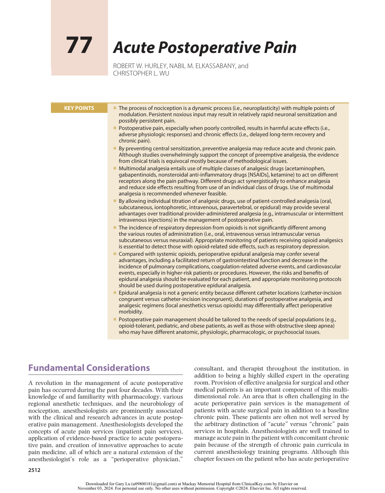

:::

<!-- PDF page 2 -->

pain, acute management of chronic pain in the hospitalized setting is discussed (see also Chapter 47).

Throughout the world, the widespread recognition of the under- treatment of acute pain by clinicians, economists, and health policy experts has led to the development of clinical practice guidelines for management of acute pain. In the United States, the Agency for Healthcare Quality and Research (formerly the Agency for Health Care Policy and Research) of the US Department of Health and Human Services1 and several professional societies (including the American Society of Anesthesiologists [ASA]),2-4 the Joint Commission,5 American Society of Regional Anesthesia and Pain Medicine, and American Pain Society6 have developed clinical practice guidelines for acute pain management or provided new pain management standards. Recently, a multi- society consensus on the guiding principles for management of acute perioperative pain was published.2 The Australian and New Zealand College of Anaesthetists and Faculty of Pain Medicine has published several editions of _Acute Pain Management: Scientific Evidence_ , which provides the latest evidence to support decision- making for the treatment of acute pain.7a In Europe, PROSPECT (i.e., procedure specific postoperative pain management) was formed in 2002 to improve the management of postoperative pain on a procedure- specific basis by using evidence- based research methodology to develop the best available consensus recommendations in a clinically useful format.7b In the United Kingdom, the National Institute for Health and Care Excellence (NICE) has developed evidence reviews for managing acute postoperative pain.7c

### PAIN PATHWAYS AND THE NEUROBIOLOGY OF NOCICEPTION

Surgery produces tissue injury with consequent release of histamine and inflammatory mediators such as peptides (e.g., bradykinin), lipids (e.g., prostaglandins), neurotransmitters (e.g., serotonin), and neurotrophins (e.g., nerve growth factor).8 Release of inflammatory mediators activates peripheral nociceptors, which initiate transduction and transmission of nociceptive information to the central nervous system (CNS) and the process of neurogenic inflammation in which release of neurotransmitters (i.e., substance P and calcitonin gene–related peptide) in the periphery induces vasodilatation and plasma extravasation.8 Noxious stimuli are transduced by peripheral nociceptors and transmitted by A and C nerve fibers from peripheral visceral and somatic sites to the dorsal horn of the spinal cord, where integration of peripheral nociceptive and descending modulatory input (i.e., serotonin, norepinephrine, γ- aminobutyric acid, enkephalin) occurs. Further transmission of nociceptive information is determined by complex modulating influences in the spinal cord. Some impulses pass to the ventral and ventrolateral horns to initiate segmental (spinal) reflex responses, which may be associated with increased skeletal muscle tone, inhibition of phrenic nerve function, or even decreased gastrointestinal motility. Others are transmitted to higher centers through the spinothalamic and spinoreticular tracts, where they induce supra- segmental and cortical responses to ultimately produce the perception of and affective component of pain.

Continuous release of inflammatory mediators in the periphery sensitizes functional nociceptors and activates dormant ones. Sensitization of peripheral nociceptors may occur and is marked by a decreased threshold for activation, increased rate of discharge with activation, and increased rate of basal (spontaneous) discharge. Intense noxious input from the periphery may also result in central sensitization (“persistent postinjury changes in the CNS that result in pain hypersensitivity”9 ) and hyperexcitability (“exaggerated and prolonged responsiveness of neurons to normal afferent input after tissue damage”9 ). Such noxious input may lead to functional changes in the dorsal horn of the spinal cord and other consequences that may later cause postoperative pain to be perceived as more painful than it would otherwise have been. The neural circuitry in the dorsal horn is extremely complex, and we are just beginning to elucidate the specific role of the various neurotransmitters and receptors in the process of nociception.8 However, it seems that certain receptors (e.g., _N_ - methyld- aspartate [NMDA]) may be especially important for the development of chronic pain after an acute injury, although other neurotransmitters or second messenger effectors (e.g., substance P, protein kinase C) may also play important roles in spinal cord sensitization and chronic pain. Our understanding of the neurobiology of nociception has progressed from the hard- wired system proposed by Descartes in the 17th century to the current view of neuroplasticity in which dynamic integration and modulation of nociceptive transmission take place at several levels. There still are many gaps in our knowledge of the specific roles of various receptors, neurotransmitters, and molecular structures in the process of nociception.

An understanding of the neurobiology of nociception is important for appreciating the transition from acute to chronic pain. The traditional dichotomy between acute and chronic pain is arbitrary because acute pain may quickly transition into chronic pain.10 Noxious stimuli can produce expression of new genes (which are the basis for neuronal sensitization) in the dorsal horn of the spinal cord within 1 hour and these changes are sufficient to alter behavior within the same timeframe.11 Also, the intensity of acute postoperative pain is a significant predictor of chronic postoperative pain.12 Control of perioperative pain (e.g., preventive analgesia) and the manner in which it is implemented (e.g., multimodal perioperative pain management) may be important in facilitating short- and long- term patient convalescence after surgery.

### ACUTE AND CHRONIC EFFECTS OF POSTOPERATIVE PAIN

Uncontrolled postoperative pain may produce a range of detrimental acute and chronic effects. The attenuation of perioperative pathophysiology that occurs during surgery through reduction of nociceptive input to the CNS and optimization of perioperative analgesia may decrease complications and facilitate recovery during the immediate postoperative period13 and after discharge from the hospital.

### Acute Effects

The perioperative period has a variety of pathophysiologic responses that may be initiated or maintained by nociceptive

<!-- PDF page 3 -->

input. At one time these responses may have had a beneficial teleological purpose, however the same response to the iatrogenic nature of modern- day surgery may be harmful. Uncontrolled perioperative pain may enhance some of this perioperative pathophysiology and increase patient morbidity and mortality. Attenuation of postoperative pain, especially with certain types of analgesic regimens, may decrease perioperative morbidity and mortality.

Transmission of nociceptive stimuli from the periphery to the CNS results in the neuroendocrine stress response. This is characterized by a release of a combination of local inflammatory substances (e.g., cytokines, prostaglandins, leukotrienes, tumor necrosis factor- α) and systemic mediators of the neuroendocrine response. The dominant neuroendocrine responses to pain involve hypothalamic– pituitary–adrenocortical and sympathoadrenal interactions. Suprasegmental reflex responses to pain result in increased sympathetic tone, increased catecholamine and catabolic hormone secretion (e.g., cortisol, adrenocorticotropic hormone, antidiuretic hormone, glucagon, aldosterone, renin, angiotensin II), and decreased secretion of anabolic hormones.14 The effects include sodium and water retention and increased levels of blood glucose, free fatty acids, ketone bodies, and lactate. A hypermetabolic, catabolic state occurs as metabolism and oxygen consumption are increased and metabolic substrates are mobilized from storage depots.14 The extent of the stress response is influenced by many factors, including the type of anesthesia and intensity of the surgical injury, with the extent of the stress response being proportional to the degree of surgical trauma.15 The negative nitrogen balance and protein catabolism may impede convalescence; however, attenuation of the stress response and postoperative pain may facilitate and accelerate the patient’s recovery postoperatively.

The neuroendocrine stress response may enhance detrimental physiologic effects in other areas of the body. The stress response is likely a factor in the postoperative development of hypercoagulability. Enhancement of coagulation (i.e., decreased levels of natural anticoagulants and increased levels of procoagulants), inhibition of fibrinolysis, and increased platelet reactivity and plasma viscosity may enhance the incidence of postoperative hypercoagulablerelated events such as deep venous thrombosis, vascular graft failure, and myocardial ischemia.16 The stress response may also enhance postoperative immunosuppression, the extent of which correlates with the severity of surgical injury.10 Hyperglycemia from the stress response may contribute to poor wound healing and depression of immune function.

Uncontrolled postoperative pain may activate the sympathetic nervous system and thereby contribute to morbidity or mortality. Sympathetic activation may increase myocardial oxygen consumption, which may be important in the development of myocardial ischemia and infarction,16 and may decrease myocardial oxygen supply through coronary vasoconstriction and attenuation of local metabolic coronary vasodilation.17 Activation of the sympathetic nervous system may also delay return of postoperative gastrointestinal motility, which may develop into paralytic ileus. Although postoperative ileus is the result of a combination of inhibitory input from central and local factors,16,17 an increase in sympathetic efferent activity, such as from

uncontrolled pain, may decrease gastrointestinal activity and delay return of gastrointestinal function.

Nociceptors are activated after surgical trauma and may initiate several detrimental spinal reflex arcs. Postoperative respiratory function is markedly decreased, especially after upper abdominal and thoracic surgery. Spinal reflex inhibition of phrenic nerve activity is an important component of this decreased postoperative pulmonary function.16 In addition to these, patients with poor postoperative pain control may breathe less deeply, have an inadequate cough, and be more susceptible to the development of postoperative pulmonary complications.17 Activation of nociceptors may also initiate spinal reflex inhibition of gastrointestinal tract function and delay return of gastrointestinal motility.16

Many detrimental postoperative pathophysiologic effects can occur in the perioperative period and can activate nociceptors and the stress response. Uncontrolled pain may activate the sympathetic nervous system, which can cause a variety of potentially harmful physiologic responses that may adversely increase morbidity and mortality. Nociceptor activation may also result in several detrimental inhibitory spinal reflexes. Control of the pathophysiologic processes associated with acute postoperative pain may attenuate the stress response, sympathetic outflow, and inhibitory spinal reflexes and contribute to improvements in morbidity, mortality, and patient- reported outcomes (e.g., health- related quality of life [HRQL], patient satisfaction).16

### Chronic Effects

Chronic persistent postsurgical pain (CPSP) is a largely unrecognized problem that may occur in 10% to 65% of postoperative patients (depending on the type of surgery), with 2% to 10% of these patients experiencing severe CPSP.18 Poorly controlled acute postoperative pain is an important predictive factor in the development of CPSP.12,19 The transition from acute to chronic pain occurs very quickly, and long- term behavioral and neurobiologic changes occur much sooner than was previously thought.10 CPSP is relatively common after procedures such as limb amputation (30% to 83%), thoracotomy (22% to 67%), sternotomy (27%), breast surgery (11% to 57%), and gallbladder surgery (up to 56%).12 Although the severity of acute postoperative pain may be an important predictor in the development of CPSP,12 a causal relationship has not been definitively established, and other factors (e.g., area of postoperative hyperalgesia) may be more important in predicting the development of CPSP.20 One such factor may be the severity of the patient’s preoperative pain. Patients with more intense levels of preoperative pain may also develop a degree of CNS sensitization predisposing them to the increased likelihood of higher postoperative pain and the subsequent development of chronic pain.20 Thus, it is important that acute pain service clinicians understand chronic pain conditions and involve themselves in the patient’s preoperative care. The increased involvement of the acute pain medicine team in preoperative anesthesia clinics or services can positively affect the incidence and severity of postoperative pain.

Control of acute postoperative pain may improve longterm recovery or patient- reported outcomes (e.g., quality of life). Patients whose pain is controlled in the early postoperative period (especially with the use of continuous epidural

<!-- PDF page 4 -->

or peripheral catheter techniques) may be able to actively participate in postoperative rehabilitation, which may improve short- and long- term recovery after surgery.21 Optimizing treatment of acute postoperative pain can improve HRQL.22 Postoperative chronic pain that develops as a result of poor postoperative pain control may interfere with patients’ activities of daily living.

### Preventive Analgesia

The older terminology of “preemptive” analgesia referred to an analgesic intervention that preceded a surgical injury and was more effective in relieving acute postoperative pain than the same treatment following surgery. The precise definition of preemptive analgesia is one of the major controversies in this area of medicine and contributes to the question of whether preemptive analgesia is clinically relevant. Definitions of preemptive analgesia include what is administered before the surgical incision, what prevents the establishment of central sensitization resulting from incisional injury only (i.e., intraoperative period), what prevents central sensitization resulting from incisional and inflammatory injury (i.e., intraoperative and postoperative periods), or the entire perioperative period encompassing preoperative interventions, intraoperative analgesia, and postoperative pain management (i.e., preventive analgesia).9 The first two definitions are relatively narrow and may contribute to the lack of a detectable effect of preemptive analgesia in clinical trials. The rationale for preemptive analgesia was based on the inhibition of the development of central sensitization. Effectively, noxious input initiated by surgical procedures induced a state of CNS hyperactivity that accentuates pain. Although a very popular and discussed theory, a single analgesic treatment (either peripheral or neuraxial) before the incision does not reduce postoperative pain behaviors beyond the expected duration of the analgesic effect.23 When the block of nociceptive afferents diminishes, the surgical injury is able to reinitiate central sensitization. Clinical trials have been negative.24 For these reasons, this terminology has fallen out of favor.

As stated previously, intense noxious input (e.g., postoperative pain from the periphery) can change the CNS (i.e., central sensitization) to induce “pain hypersensitivity” and hyperexcitability (i.e., exaggerated, and prolonged responsiveness of neurons to normal afferent input after tissue damage). Preventive analgesia aims at inhibiting the development of this type of chronic pain. This definition broadly includes any regimen given at any time during the perioperative period that can control pain- induced sensitization. Central sensitization and hyperexcitability can develop after the surgical incision in a patient who has no history of preoperative pain.

In contrast, some patients may already have existing acute or chronic pain and developed central sensitization prior to the surgical incision. These patients with preexisting pain may have even more intense pain in the postoperative period. This augmentation of already preexisting pain can occur in acutely hospitalized and even in those patients in sub- acute or chronic outpatient settings. Preventing the establishment of altered central processing by analgesic treatment may result in short- term (e.g., reduction in postoperative pain and accelerated recovery) and longterm (e.g., reduction in chronic pain and improvement in

HQRL)22 benefits during a patient’s convalescence). Unfortunately, many clinical trials lack clarity of study design and clear terminology of pre- emptive versus preventive analgesia.24,25

Timing of the intervention may not be as clinically important as other aspects of preventive analgesia (i.e., intensity and duration of the intervention). An intervention administered before the surgical incision is not preventive if it is incomplete or insufficient such that central sensitization is not prevented. Incisional and inflammatory injuries are important in initiating and maintaining central sensitization. Confining the definition of preventive analgesia to only the intraoperative (incisional) period is neither relevant nor appropriate because the inflammatory response lasts well into the postoperative period and continues to maintain central sensitization.

Maximal clinical benefit is observed when there is complete multi- segmental blockade of noxious stimuli with extension of this into the postoperative period. Preventing central sensitization with intensive multimodal analgesic interventions24 could theoretically reduce the intensity or even eliminate acute postoperative pain/hyperalgesia and chronic pain after surgery.12

### Multimodal Approach to Perioperative Recovery/ Enhanced Recovery after Surgery

The analgesic benefits of controlling postoperative pain are generally maximized when a multimodal strategy to facilitate the patient’s convalescence is implemented. Yet, postoperative pain treatment may not provide major improvements in some outcomes because it is unlikely that a unimodal intervention can be effective in addressing a complex problem such as perioperative outcomes.13,26 The complex nature of nociception and mixed mechanisms of generating surgical pain are also responsible for failure of unimodal analgesia to adequately address postoperative pain.13,26 Principles of a multimodal analgesia include using multiple strategies and drug classes to manage patient expectation and control postoperative pain to allow early mobilization, and enteral nutrition, and to attenuate the perioperative stress response.13 These strategies include: patient education, local anesthetic–based techniques (local infiltration, peripheral nerve blocks, and neuraxial analgesia),13 and a combination of analgesic drugs that act via different mechanisms on different receptors within the pain transmission pathway to provide synergistic effect, superior analgesia and physiologic benefits.

A multimodal approach to perioperative recovery, in order to control postoperative pathophysiology and facilitate rehabilitation, is an integral part of almost all enhanced recovery after surgery (ERAS) pathways and will result in accelerated recovery and decreased length of hospitalization.27 One of the key components of a multimodal analgesic regimen within any ERAS pathway is the minimization of opioid use and side effects from opioids by utilizing nonopioid analgesics and techniques.28 Patients undergoing major abdominal or thoracic procedures and who participate in a multimodal strategy have a reduction in hormonal and metabolic stress, preservation of totalbody protein, shorter times to tracheal extubation, lower pain scores, earlier return of bowel function, and earlier fulfillment of intensive care unit discharge criteria.27 ERAS

<!-- PDF page 5 -->

pathways integrate the most recent evidence from surgery, anesthesiology, nociceptive neurobiology, and pain treatment and transform traditional care programs into effective postoperative rehabilitation pathways.27 This approach will decrease perioperative morbidity, costs of care, length of hospital stay, and improve patient satisfaction without compromising safety.29,30 ERAS pathways are more common in adult surgical patients although there is increasing interest in utilizing ERAS in pediatric patients.29 Widespread implementation of these programs requires multidisciplinary collaboration, change in the traditional principles of postoperative care, additional resources, and expansion of the traditional acute pain service, which may be limited in the current economic climate.31

### Treatment Methods

Many options are available for the treatment of postoperative pain, including systemic (i.e., opioid and nonopioid) analgesics and regional (i.e., neuraxial and peripheral) analgesic techniques. By considering patients’ preferences and making an individualized assessment of the risks and benefits of each treatment modality, the clinician can optimize the postoperative analgesic regimen for each patient. Essential aspects of postoperative monitoring of patients receiving various postoperative analgesic treatment methods are listed in Box 77.1.32

## Systemic Analgesic Techniques

### OPIOIDS (see also Chapter 22)

### Advantages and Characteristics

Opioid analgesics are one of the cornerstone options for the treatment of postoperative pain. They generally exert their analgesic effects through μ- receptors in the CNS, although opioids may also act at peripheral opioid receptors. A theoretical advantage of opioid analgesics is that there is no analgesic ceiling. Realistically, the analgesic efficacy of opioids is typically limited by the development of tolerance or opioid- related side effects such as nausea, vomiting, sedation, or respiratory depression. Opioids may be administered by the subcutaneous, transcutaneous, transmucosal, or intramuscular route, but the most common routes of postoperative systemic opioid analgesic administration are oral and intravenous (IV). Opioids may also be administered at specific anatomic sites such as the intrathecal or epidural space (see later sections on Single- Dose Neuraxial Opioids and Continuous Epidural Analgesia).

There is wide inter- subject and intra- subject variability in the relationship of opioid dose, serum concentration, and analgesic response in the treatment of postoperative pain. Serum drug concentrations may exhibit wider variability with certain routes of administration (e.g., intramuscular) than with others (e.g., intravenous). In general, opioids are administered parenterally (intravenously or intramuscularly) for the treatment of moderate to severe postoperative pain, in part because these routes provide a more rapid and reliable onset of analgesic action than the oral route does. Parenteral opioid administration may be necessary in patients who are unable to tolerate oral intake

### Box 77.1 Monitoring and Documentation of Postoperative Analgesia

### Analgesic Medication

Medication, concentration, and dose of drug

Settings of PCA device: demand dose, lockout interval, continuous infusion

Amount of drug administered (including number of unsuccessful and successful doses)

Limits set (e.g., 1- and 4- hour limits on dose administered) Supplemental or breakthrough analgesics

### Routine Monitoring

Vital signs: temperature, heart rate, blood pressure, respiratory rate, average pain score Pain score at rest and with activity, pain relief Use of breakthrough medication

### Side Effects

Cardiovascular: hypotension, bradycardia, or tachycardia Respiratory status: respiratory rate, level of sedation Nausea and vomiting, pruritus, urinary retention

### Neurologic examination

Assessment of motor block or function and sensory level Evidence of epidural hematoma

### Instructions Provided

Treatment of side effects Concurrent use of other CNS depressants Parameters for triggering notification of the covering physician Provision of contact information (24 hours/7 days per week) if problems occur

Emergency analgesic treatment if the PCA device fails

*Postoperative analgesia includes systemic opioids and regional analgesic techniques. This list incorporates some of the important elements of preprinted orders, documentation, and intravenous PCA and epidural analgesia daily care described in the ASA Practice Guidelines for Acute Pain Management.32

_CNS_ , central nervous system; _PCA_ , patient- controlled analgesia.

postoperatively. The transition from parenteral to oral administration of opioids usually occurs after the patient resumes oral intake and postoperative pain has been stabilized with parenteral opioids.

Oral opioids do provide effective analgesia and, in some ways, remain an important analgesic option; however, considering the current opioid epidemic, judicious prescribing and use of opioids is warranted. It is clear that approximately 6% of opioid- naive patients undergoing common surgical procedures will continue filling opioid prescriptions 3–6 months after surgery and the vast majority of opioids prescribed by surgeons go unused by patients.7 As such, postoperative pain should be managed with a multimodal approach utilizing nonopioid medications (e.g., NSAIDs, acetaminophen) as first- line analgesic medications (assuming patients have no contraindications to these medications) and then administer opioids as needed for breakthrough pain. If opioids are to be prescribed or administered postoperatively, patient counseling prior to surgery is strongly recommended and institutional evidence- based prescribing guidelines based on the specific needs of each procedure should be considered.

<!-- PDF page 6 -->

### Intravenous Patient- Controlled Analgesia

Various factors, including the wide interpatient variability in analgesic needs, variability in serum drug levels (especially with intramuscular injection), and administrative delays, may contribute to inadequate postoperative analgesia. A traditional prescribed as-needed (PRN) analgesic regimen probably cannot compensate for these limitations. By circumventing some of these issues, intravenous patient- controlled analgesia (PCA) optimizes delivery of analgesic opioids and minimizes the effects of pharmacokinetic and pharmacodynamic variability in individual patients. Intravenous PCA is based on the premise that a negative- feedback loop exists; when pain is experienced, analgesic medication is selfadministered, and when pain is reduced, there are no further demands. When the negative- feedback loop is violated, excessive sedation or respiratory depression may occur. Although some equipment- related malfunctions can occur, the PCA device itself is relatively free of problems, and most problems related to PCA use result from user or operator error.33

A PCA device can be programmed for several variables, including the demand (bolus) dose, lockout interval, and background infusion (Table 77.1). An optimal demand or bolus dose is integral to the efficacy of intravenous PCA because an insufficient demand dose may result in inadequate analgesia, whereas an excessive demand dose may result in a higher incidence of undesirable side effects such as respiratory depression.34 Although the optimal demand dose is uncertain, the data available suggest that the optimal demand dose is 1 mg for morphine and 40 mcg for

fentanyl in opioid- naive patients; however, the actual dose for fentanyl (10 to 20 mcg) is often less in clinical practice.33 The lockout interval may also affect the analgesic efficacy of intravenous PCA. A lockout interval that is too long may result in inadequate analgesia and decrease the effectiveness of intravenous PCA. A lockout interval that is too short allows the patient to self- administer another demand dose before feeling the full analgesic effect of the previous dose and thus may contribute to an increase in medicationrelated side effects. In essence, the lockout interval is a safety feature of intravenous PCA, and although the optimal lockout interval is unknown, most intervals range from 5 to 10 minutes, depending on the medication in the PCA pump; varying the interval within this range appears to have no effect on analgesia or side effects33 (see Table 77.1).

Most PCA devices allow administration of a continuous or background infusion in addition to the demand dose. Initially, routine use of a background infusion predicted certain advantages, including improved analgesia, especially during sleep; however, analgesic benefits of a background infusion have not been successful in opioid- naive patients. A background infusion only increases the analgesic dosage used and the incidence of adverse respiratory events in the postoperative period, especially in adult subjects. Furthermore, use of a nighttime background infusion does not improve postoperative sleep patterns, analgesia, or recovery profiles.35

Although routine use of continuous or background infusion as part of intravenous PCA in adult opioid- naive

**Table 77.1** Intravenous Patient- Controlled Analgesia Regimens

|**Drug Concentration**|**Size of Bolus***|**Lockout Interval (min)**|**Continuous Infusion**|
|---|---|---|---|
|**AGONISTS**||||
|Morphine (1 mg/mL)||||
|Adult|0.5–2.0 mg|5–10|—|
|Pediatric|0.01–0.03 mg/kg (max, 0.15 mg/kg/hr)|5–10|0.01–0.03 mg/kg/hr|
|Fentanyl (0.01 mg/mL)||||
|Adult|10–20 mcg|4–10|—|
|Pediatric|0.5–1 mcg/kg (max, 4 mcg/kg/hr)|5–10|0.5–1 mcg/kg/hr|
|Hydromorphone (0.2 mg/mL)||||
|Adult|0.05–0.2 mg|5–10|—|
|Pediatric|0.003–0.005 mg/kg (max, 0.02 mg/kg/hr)|5–10|0.003–0.005 mg/kg/hr|
|Alfentanil (0.1 mg/mL)|0.1–0.2 mg|5–8|—|
|Methadone (1 mg/mL)|0.5–2.5 mg|8–20|—|
|Oxymorphone (0.25 mg/mL)|0.2–0.4 mg|8–10|—|
|Sufentanil (0.002 mg/mL)|2–5 mcg|4–10|—|
|**AGONIST–ANTAGONISTS**||||
|Buprenorphine (0.03 mg/mL)|0.03–0.1 mg|8–20|—|
|Nalbuphine (1 mg/mL)|1–5 mg|5–15|—|
|Pentazocine (10 mg/mL)|5–30 mg|5–15|—|

*All doses are for adult patients unless noted otherwise. Units vary across agents for size of the bolus (mg versus mg/kg versus mcg versus mcg/kg) and continuous infusion (mg/kg/hr versus mcg/kg/hr). The anesthesiologist should proceed with titrated intravenous loading doses if necessary to establish initial analgesia. Individual patient requirements vary widely, with smaller doses typically given to elderly or compromised patients. Continuous infusions are not initially recommended for opioid- naive adult patients.

::: details 原始表格與符號（PDF 第 6 頁）

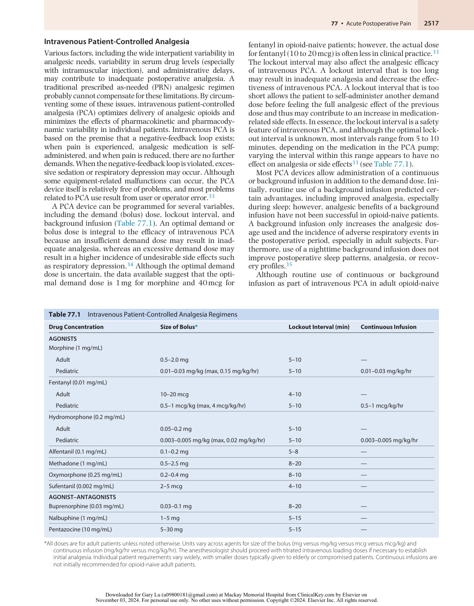

:::

<!-- PDF page 7 -->

patients is not recommended, a background infusion in opioid- tolerant or pediatric patients may be effective (see later sections on Opioid- Tolerant Patients and Pediatric Patients).

When compared with traditional PRN analgesic regimens, intravenous PCA provides superior postoperative analgesia and improves patient satisfaction, but the presence of economic benefits is not clear.36 A meta- analysis revealed that intravenous PCA (versus as- needed opioids) provides significantly better analgesia and patient satisfaction; however, these patients used more opioids and had a more frequent incidence of pruritus than those treated with PRN opioids, but there was no difference in the incidence of adverse events.36 With regard to economic outcomes, whether intravenous PCA is less expensive than traditional PRN intramuscular opioid administration is not clear because the calculations of cost are complex.

Intravenous PCA may provide advantages when assessing other patient- related outcomes such as patient satisfaction. Patients usually prefer intravenous PCA over intravenously, intramuscularly, or subcutaneously administered PRN opioids. Greater patient satisfaction with intravenous PCA may be the result of superior analgesia and perceived control over the administration of analgesic medications and avoidance of disclosing pain or securing analgesic medication from nurses; however, the reasons for patient satisfaction are complex and many factors may contribute to or predict satisfaction with intravenous PCA. Although intravenous PCA use overall creates better satisfaction, the proper assessment of patient satisfaction can be complex.37

The incidence of opioid- related adverse events from intravenous PCA is not different from that of PRN opioids administered intravenously, intramuscularly, or subcutaneously. The rate of respiratory depression associated with intravenous PCA is infrequent (approximately 1.5%) and is not more frequent than that with PRN systemic or neuraxial opioids.38 Factors that may influence the frequency and intensity of respiratory depression with intravenous PCA include use of a background infusion, advanced age (see also Chapter 61), concomitant administration of sedative or hypnotic drugs, and coexisting pulmonary disease such as obstructive sleep apnea (also see Chapter 9).39 Intravenous PCA–related respiratory depression may also be caused by errors in programming or administration (i.e., operator error).40

### NONOPIOIDS (see also Chapter 47)

### Nonsteroidal Anti- Inflammatory Agents

Nonsteroidal anti- inflammatory drugs (NSAIDs) consist of a diverse group of analgesic compounds with different pharmacokinetic properties. The primary mechanism by which NSAIDs exert their analgesic effect is through inhibition of cyclooxygenase (COX) and synthesis of prostaglandins, which are important mediators of peripheral sensitization and hyperalgesia. In addition to being peripherally acting analgesics, NSAIDs can also exert their analgesic effects through inhibition of spinal COX.41 The discovery of at least two COX isoforms (i.e., COX- 1 is constitutive and COX- 2 is inducible) with different functions (i.e., COX- 1 mediates platelet aggregation, hemostasis, and gastric mucosal

protection, whereas COX- 2 mediates pain, inflammation, and fever) has led to the development of selective COX- 2 inhibitors that differ from traditional NSAIDs, which block both COX- 1 and COX- 2.42 The discovery of a COX- 3 variant may represent a primary central mechanism by which acetaminophen and other antipyretics decrease pain and fever; however, the precise relationship between COX- 3 and acetaminophen is still uncertain.43

NSAIDs given alone generally provide effective analgesia for mild to moderate pain. NSAIDs are also traditionally considered a useful adjunct to opioids for the treatment of moderate to severe pain. Yet, some quantitative, systematic reviews suggest that NSAIDs, alone or in combination with opioids, may be more beneficial than previously thought (Table 77.2 and Fig. 77.1). NSAIDs may be administered orally or parenterally and are particularly useful as components of a multimodal analgesic regimen by producing analgesia through a different mechanism from that of opioids or local anesthetics. Several meta- analyses have examined the

**Table 77.2** Relative Efficacy of Single- Dose Analgesics in Providing Greater than 50% Relief of Moderate to Severe Postoperative Pain

|**Drug***|**Mean NNT**†|**95% CI**|
|---|---|---|
|Acetaminophen (1000 mg PO)|3.8|3.4–4.4|
|Aspirin (600 to 650 mg PO)|4.4|4.0–4.9|
|Aspirin (1000 mg PO)|4.0|3.2–5.4|
|Diclofenac (50 mg PO)|2.3|2.0–2.7|
|Diclofenac (100 mg PO)|1.9|1.6–2.2|
|Ibuprofen (600 mg PO)|2.4|1.9–3.3|
|Ketorolac (10 mg PO)|2.6|2.3–3.1|
|Ketorolac (30 mg IM)|3.4|2.5–4.9|
|Naproxen (550 mg PO)|2.7|2.3–3.3|
|Celebrex (200 mg PO)|3.5|2.9–4.4|
|Celebrex (400 mg PO)|2.1|1.8–2.5|
|Tramadol (100 mg PO)|4.8|3.8–6.1|
|Gabapentin (600 mg PO)|11|6.0–35|
|Codeine (60 mg) + acetaminophen (600 to 650 mg PO)|4.2|3.4–5.3|
|Oxycodone (5 mg) + acetaminophen (325 mg PO)|2.5|2.0–3.2|
|Codeine (60 mg PO)|16.7|11.0–48.0|
|Morphine (10 mg IM)|2.9|2.6–3.6|
|Oxycodone (15 mg PO)|2.4|1.5–4.9|

*Data obtained in part and modified from Bandolier with permission. http://www.bandolier.org.uk/booth/painpag/Acutrev/Analgesics/ Leagtab.html.

> †NNT in this case refers to the number of patients who must be treated to obtain greater than 50% relief of moderate to severe postoperative pain. NNT conveys statistical and clinical significance, is useful in comparing the efficacy of different interventions, and summarizes treatment effects in a clinically relevant manner. A lower mean NNT implies greater analgesic efficacy in this example. See Figure 77.1 for a graphic presentation of these data.

_CI_ , confidence interval; _IM_ , intramuscular; _NNT_ , number needed to treat; _PO_ , oral route.

::: details 原始表格與符號（PDF 第 7 頁）

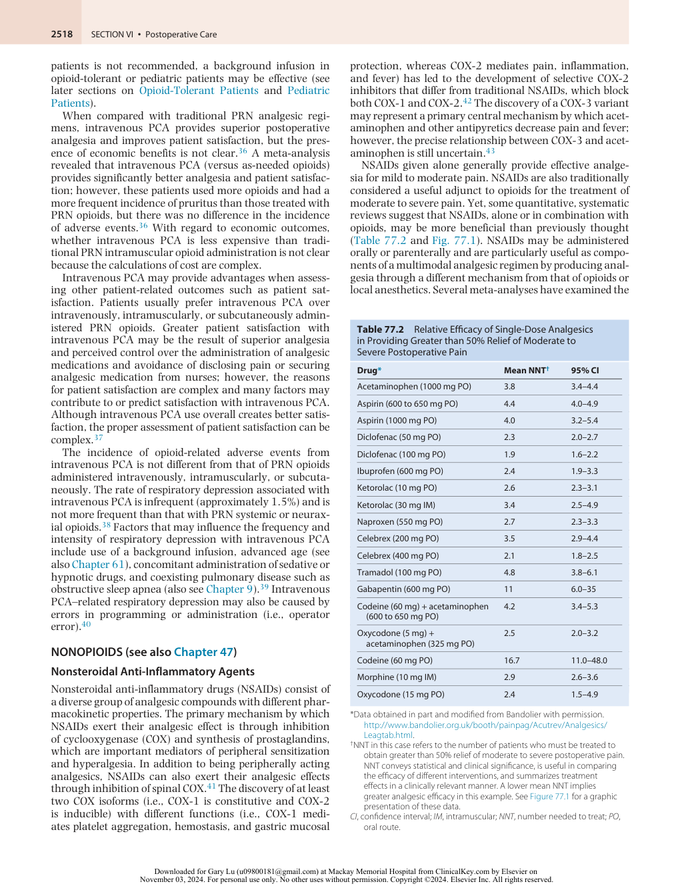

:::

<!-- PDF page 8 -->

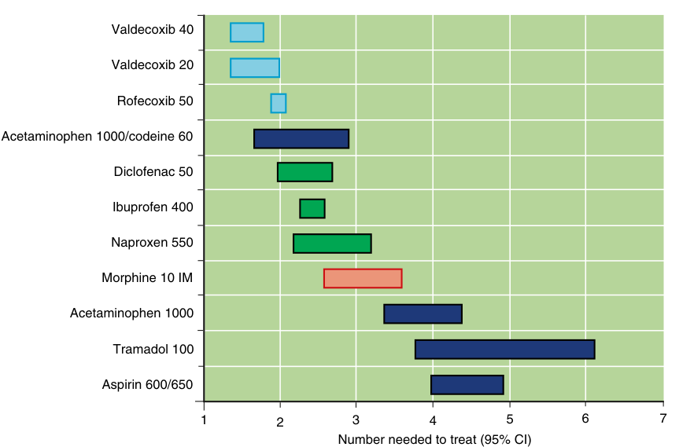

Valdecoxib 40 Valdecoxib 20 Rofecoxib 50 Acetaminophen 1000/codeine 60 Diclofenac 50 Ibuprofen 400 Naproxen 550 Morphine 10 IM Acetaminophen 1000 Tramadol 100 Aspirin 600/650 1 2 3 4 5 6 7 Number needed to treat (95% CI) 

**Fig. 77.1** Number needed to treat (NNT) for at least 50% pain relief in patients with moderate to severe pain. The mean and 95% confidence interval (CI) for the NNTs are shown for several opioid and nonopioid analgesics from Table 77.2. The NNTs are derived from trials investigating the efficacy of a single dose of nonopioid analgesic versus placebo in providing more than 50% pain relief for moderate to severe postoperative pain. Valdecoxib and Rofecoxib are no longer available and is included for informational purposes. Numbers with drug names are doses in mg. _IM,_ intramuscular. (From Bandolier. http://www.bandolier.org.uk/booth/painpag/Acutrev/Analgesics/Leagtab.html)

analgesic efficacy of NSAIDs (including COX- 2 inhibitors) and acetaminophen when added to intravenous PCA with opioids. Surprisingly and importantly, NSAIDs44,45 resulted in a statistically significant (but probably not clinically meaningful) reduction in pain scores.46,47 Although all regimens significantly decreased morphine consumption, only NSAIDs reduced risk for the opioid- related side effects of nausea, vomiting, and sedation.

Perioperative use of NSAIDs has several side effects, including decreased hemostasis, renal dysfunction, and gastrointestinal hemorrhage. Inhibition of COX and the formation of prostaglandins cause many of the side effects, which mediate many diverse processes throughout the body. Decreased hemostasis from NSAID use is from platelet dysfunction and inhibition of thromboxane A2 (generated by COX- 1), an important mediator of platelet aggregation and vasoconstriction. Evidence of the effect of NSAIDs on perioperative bleeding is equivocal; a surveillance study of perioperative ketorolac administration did not demonstrate a significant increase in operative site bleeding. Whether NSAIDs may also have a deleterious effect on bone healing and osteogenesis is controversial. Although NSAIDs have been used following acetabular/hip fractures and hip replacement surgery to reduce heterotopic ossification, the short- term effect of NSAIDs on other skeletal tissues is less clear.48 Two recent systematic reviews indicated that when examining the highest- quality studies, there was no increased risk of nonunion with NSAID exposure. Certainly, a short- term NSAID regimen can be used for treatment of post- fracture pain without significantly increasing the risk of disrupted healing.49 A brief (&lt;14 days) exposure to normal- dose NSAIDs (e.g., ketorolac &lt;120 mg/day) was

safe after spinal fusion; however, use of large- dose ketorolac (>120 mg/day) increased the risk of nonunion, suggesting a dose- dependent effect of perioperative NSAIDs on spinal fusion healing.50 Spine surgeons will more commonly err on the conservative side and refuse to have postoperative spine fusion patients receive NSAIDs.

Perioperative NSAID- induced renal dysfunction may occur in high- risk patients, such as those with hypovolemia, abnormal renal function, or abnormal serum electrolytes, because prostaglandins dilate the renal vascular beds and mediate diuretic and natriuretic renal effects. NSAIDs should not be withheld in patients with normal preoperative renal function as euvolemic patients with normal renal function are unlikely to be affected, although NSAIDs may cause a clinically unimportant transient reduction in renal function in the early postoperative period in patients with normal preoperative renal function.51 Gastrointestinal bleeding may be more likely with NSAID intake because of inhibition of COX- 1, which is required for the synthesis of cytoprotective gastric mucosal prostaglandins. Bronchospasm may be induced by NSAIDs (including aspirin).52 Because expression of peripheral COX- 2 is increased during inflammation, selective inhibition of COX- 2 could theoretically provide analgesia without the side effects associated with COX- 1 inhibition. COX- 2 inhibitors have a less frequent incidence of gastrointestinal complications53 and exhibit minimal platelet inhibition, even when administered in supratherapeutic doses.54 However, long- term use of COX- 2 inhibitors has an excess cardiovascular risk such that rofecoxib was withdrawn from the market.55 The cardiovascular risks of COX- 2 inhibitors are heterogeneous and influenced by many factors such as the specific medication,

<!-- PDF page 9 -->

dosage, and patient characteristics.55 Issues surrounding the perioperative use of COX- 2 inhibitors are slightly different from those of longer- term use of COX- 2 inhibitors. The perioperative use of potent COX- 2 inhibitors resulted in a higher rate of cardiovascular events in high- risk (coronary artery bypass grafting)56 but not lower- risk (major noncardiac surgery) patients. Celecoxib, a COX- 2 inhibitor, has less COX- 2 selectivity than other more potent COX- 2 inhibitors (rofecoxib) and is still clinically available.57 A randomized controlled trial (RCT) of 24,081 patients randomly assigned to celecoxib, naproxen, or ibuprofen found that celecoxib was found to be noninferior to ibuprofen or naproxen with regard to cardiovascular safety.58 Liu _et al._ studied 10,873 patients admitted for total joint arthroplasty and concluded that perioperative use of NSAIDs was not associated with increased risk of postoperative myocardial ischemia and may reduce the hospital length of stay.59,60 IV parecoxib may also provide effective analgesia as a systematic review noted that a single dose of parecoxib (20 mg or 40 mg) provided effective analgesia for up to 60% of those treated and was well tolerated.61

Another controversial topic about NSAIDs is the association with postoperative bleeding. It is not surprising that several meta- analyses indicate that COX- 2 inhibitors, which exhibit minimal platelet inhibition even when administered in supratherapeutic doses, are not associated with an increase in perioperative bleeding.46,62,63 More recent meta- analyses also indicate that traditional NSAIDs (ibuprofen, ketorolac) are not associated with an increase in perioperative bleeding. Finally, some studies have been published suggesting a link between NSAIDs and anastomotic leak, but most studies are flawed or have preexisting selection bias and a meta- analysis did not demonstrate a statistically significant increase in incidence of anastomotic dehiscence with NSAIDs.64,65 Newer formulations of NSAIDs are approved for use for treatment of acute postoperative pain (IV ibuprofen, and intranasal ketorolac4 ). Cost of the new agents remains to be an issue, especially in today’s cost- conscious health care environment.

### Acetaminophen

Acetaminophen has been used for several decades and is believed to have a central role of action in analgesia. It has antipyretic and anti- inflammatory properties. Its mechanism of action is through activation of descending serotonergic pathways in the central nervous system and via the inhibition of prostaglandin synthesis.66 It is used most often in conjunction with other medication as part of a multimodal analgesia protocol. Maximum recommended dose is 4 g/day in adult patients. The Food and Drug Administration (FDA) approved intravenous (IV) acetaminophen formulation for use in the US in 2011.67 Sinatra _et al._ studied the efficacy of IV acetaminophen after joints arthroplasty in a placebo controlled study.68 The study group had decreased pain scores, used less opioids, had a longer median time to morphine rescue compared to placebo, and were more satisfied with pain management. A meta- analysis of 865 patients enrolled in four clinical trials addressing the impact of addition of IV acetaminophen to multimodal analgesia after total hip arthroplasty (THA) and total knee arthroplasty (TKA) concluded that there was a significant decrease in pain score and opioid consumption

on postoperative days 1–3. Nausea and vomiting were decreased in acetaminophen.69 However, the quality of the studies included in the analysis was questioned. Peak plasma concentration is achieved faster after IV versus oral administration of acetaminophen.70 Evidence that increased bioavailability would enhance clinical efficacy is lacking. Cost effectiveness of the IV formulation and patient ability to tolerate oral intake, based on the targeted surgery, should be considered when considering integrating IV acetaminophen into a multimodal analgesia protocol. Data from 2013 show that the average increase in cost to hospitals adopting IV acetaminophen can be significant based on its use.71 Although acetaminophen is often considered to have relatively benign side effects, recent data suggest that a regular daily intake of 4 g acetaminophen for a period of 2 weeks is associated with increased systolic blood pressure in individuals with hypertension by approximately 5 mm Hg when compared with placebo.72

### Gabapentinoids

Gabapentin and pregabalin, antiepileptic drugs also used in the treatment of neuropathic pain, interact with calcium channel alpha2–delta ligands to inhibit calcium influx and subsequent release of excitatory neurotransmitters. However, oral pregabalin is absorbed more rapidly and has more absolute bioavailability (≥90% versus &lt;60%) than gabapentin.73 Despite these differences, oral gabapentin improves the analgesic efficacy of opioids both at rest and with movement, and reduces opioid consumption and opioid- related side effects, but with a possibly increased incidence of side effects such as sedation and dizziness.74–76 A meta- analysis investigating the analgesic efficacy of pregabalin for acute postoperative pain demonstrated use of pregabalin was associated with a decrease in opioid consumption and opioid- related side effects, but no difference in pain intensity.77 Another meta- analysis suggested that perioperative administration of pregabalin may provide additional analgesia in the short term but also results in an increase in side effects such as dizziness/light- headedness or visual disturbances.78

Although gabapentinoids are commonly used as part of a multimodal analgesic regimen, it should be noted that there have been recent publications questioning the analgesic benefits of gabapentinoids.79 Several studies have noted that the quality of evidence for a clinically relevant benefit of gabapentinoids is low and the serious adverse events in available trials were poorly reported.80–82 When examining trials with low risk of bias, gabapentinoids may actually have a minimal opioid- sparing effect but the risk of serious adverse events seems increased as the use of gabapentin is associated with increased rates of respiratory depression among patients undergoing laparoscopic surgery.83 A recent meta- analysis of RCTs revealed no clinically significant analgesic effect for the perioperative use of gabapentinoids, no effect on the prevention of postoperative chronic pain, and a greater risk of adverse events (dizziness and visual disturbance).84 Finally, gabapentinoids may not provide any additional analgesia versus for some surgical procedures including total hip arthroplasty.85 Clinicians should be aware of a 2019 FDA warning about the risk of serious breathing difficulties that can lead to death in patients who use gabapentinoids with opioid pain medicines or other

<!-- PDF page 10 -->

drugs that depress the CNS, or those who have underlying respiratory impairment, such as patients with chronic obstructive pulmonary disease or the elderly.86 The use of gabapentinoids should be considered on an individual basis after surgery.

### Ketamine

Ketamine is traditionally recognized as an intraoperatively administered anesthetic; however, subanesthetic dose (analgesic) ketamine can facilitate postoperative analgesia because of its NMDA- antagonistic properties, which may be important in attenuating central sensitization and opioid tolerance.87 Ketamine can be administered orally, intravenously (PCA or as a continuous infusion), subcutaneously, or intramuscularly. A systematic review of perioperative ketamine use found that perioperative analgesic doses of ketamine reduce rescue analgesic requirements and pain intensity.88 In addition, perioperative ketamine reduced 24- hour PCA morphine consumption and postoperative nausea or vomiting and had minimal adverse effects.88 A subsequent systematic review found that intravenous ketamine was an effective adjunct for postoperative analgesia, particularly in patients undergoing painful procedures, such as upper abdominal, thoracic, and major orthopedic surgeries.89 The administration of ketamine in postoperative pediatric patients is also associated with decreased postoperative pain intensity (also see Chapter 72).90 One potential concern is the possible impact of ketamine’s amnestic effects on the neuropharmacologic and cognitive level of patients with use of perioperative ketamine infusions.91 Although possible, these effects infrequently occur when the medication is given in analgesic doses. Ketamine has also been given epidurally and intrathecally, but racemic mixtures of ketamine are neurotoxic, and therefore the use of neuraxial racemic ketamine is strongly discouraged. Although further studies are needed to elucidate the specific parameters (e.g., dose, duration of use) for ketamine in the perioperative period, this analgesic can be considered on an individual basis as part of a multimodal approach to postoperative analgesia.

### Tramadol

Tramadol is a synthetic opioid that exhibits weak μ- agonist activity and inhibits reuptake of serotonin and norepinephrine although the relative degree of contribution of each modality to postoperative analgesia is not certain.92 Although tramadol exerts its analgesic effects primarily through central mechanisms, it may have peripheral local anesthetic properties and has been used as an adjunct for brachial plexus block.93 Tramadol is effective in treating mild to moderate postoperative pain94 and is comparable in analgesic efficacy to aspirin (650 mg) with codeine (60 mg) or ibuprofen (400 mg) (see Table 77.2 and Fig. 77.1).94 The addition of acetaminophen to tramadol (versus tramadol alone) may decrease the incidence of side effects of tramadol without reducing its analgesic efficacy.95 Use of tramadol in intravenous PCA results in similar pain scores when compared with that from intravenous PCA opioids; however, the side-effect profile is different between the two groups (i.e., a more frequent incidence of postoperative nausea/ vomiting but lower pruritus with tramadol).96 Advantages of tramadol for postoperative analgesia include a relative

lack of respiratory depression, major organ toxicity, and depression of gastrointestinal motility and a lower potential for abuse compared to that from traditional opioids.97 Common side effects (overall incidence of 1.6% to 6.1%) include dizziness, drowsiness, sweating, nausea, vomiting, dry mouth, and headache.94 Tramadol should be used with caution in patients with seizures or increased intracranial pressure and is contraindicated in those taking monoamine oxidase inhibitors.94

## Regional Analgesic Techniques (see also Chapters 41 and 42)

A variety of neuraxial (primarily epidural) and peripheral regional analgesic techniques may be used for the effective treatment of postoperative pain. In general, the analgesia provided by epidural and peripheral techniques (particularly when local anesthetics are used) is site specific and superior to that with systemic opioids, and use of these techniques may even reduce morbidity and mortality.16 However, as with all approaches, the risks and benefits should be compared especially regarding the controversies about use of these techniques in the presence of various anticoagulants.

### SINGLE- DOSE NEURAXIAL OPIOIDS

Administration of a single dose of opioid may be efficacious as a sole or adjuvant analgesic drug when administered intrathecally or epidurally. One of the most important factors in determining the clinical pharmacology for a particular opioid is its degree of lipophilicity (versus hydrophilicity) (Table 77.3). Once they have reached the cerebrospinal fluid (CSF) through direct intrathecal injection or gradual

**Table 77.3** Properties of Neuraxial Opioids

|**Property**|**Lipophilic Opioids**|**Hydrophilic Opioids**|
|---|---|---|
|Common drugs|Fentanyl, sufentanil|Morphine, hydromorphone|
|Onset of analgesia|Rapid onset (5–10 min)|Delayed onset (30–60 min)|
|Duration of analgesia*|Shorter duration (2–4 hr)|Longer duration (6–24 hr)|
|CSF spread|Minimal CSF spread|Extensive CSF spread|
|Site of action|Spinal &lt; systemic|Primarily spinal > supraspinal|
|Side effects|||
|Nausea and vomiting|Lower incidence with lipophilic than with hydrophilic opioids||
|Pruritus|Lower incidence with lipophilic than with hydrophilic opioids||
|Respiratory depression|Primarily early, minimal delay|Both early (&lt;6 hr) and delayed (>6 hr) possible|

*The duration of analgesia varies. _CSF_ , cerebrospinal fluid.

::: details 原始表格與符號（PDF 第 10 頁）

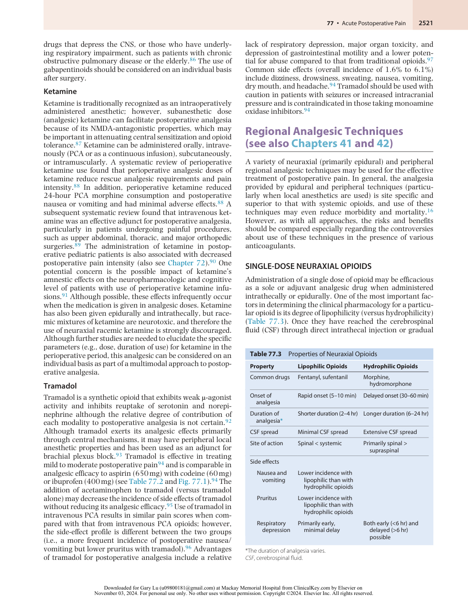

:::

<!-- PDF page 11 -->

migration from the epidural space, hydrophilic opioids (i.e., morphine and hydromorphone) tend to remain within the CSF and produce a delayed but longer duration of analgesia, along with a generally more frequent incidence of side effects because of the cephalic or supraspinal spread of these compounds. Neuraxial administration of lipophilic opioids, such as fentanyl and sufentanil, provides a rapid onset of analgesia, and their rapid clearance from CSF may limit cephalic spread and the development of certain side effects such as delayed respiratory depression. The site of analgesic action for hydrophilic opioids is overwhelmingly spinal, but the primary site of action (spinal versus systemic) for singledose neuraxial lipophilic opioids is not as certain.

The differences in pharmacokinetics between lipophilic and hydrophilic opioids may influence the choice of opioid to optimize analgesia and minimize side effects for a particular clinical situation. Single- dose intrathecal administration of a lipophilic opioid may be useful in situations (e.g., ambulatory surgical patients) in which rapid analgesic onset (minutes) is combined with a moderate duration of action (&lt;4 hours). Single- dose hydrophilic opioid administration provides effective postoperative analgesia and may be useful in patients monitored on an inpatient basis, for which a longer duration of analgesia would be beneficial.

Single- dose epidural administration of lipophilic and hydrophilic opioids is used to provide postoperative analgesia, with considerations generally being like those discussed for single- dose intrathecal administration of opioids. A single bolus of epidural fentanyl may be administered to provide rapid postoperative analgesia; however, diluting the epidural dose of fentanyl (typically 50 to 100 mcg) in at least 10 mL of preservative- free normal saline will decrease the onset and prolong the duration of analgesia, possibly because of an increase in initial spread and diffusion of the lipophilic opioid. Single- dose epidural morphine is effective for postoperative analgesia and use of a single- dose hydrophilic opioid may be especially helpful in providing postoperative epidural analgesia when the epidural catheter’s location is not congruent with the surgical incision (e.g., lumbar epidural catheter for thoracic surgery). Smaller doses of epidural morphine may be required for elderly patients (see also Chapter 41) and thoracic catheter sites (see also Chapter 42). Commonly used dosages for intrathecal and epidural administration of neuraxial opioids are provided in Table 77.4.

### CONTINUOUS EPIDURAL ANALGESIA (see also

### Chapter 41)

Analgesia delivered through an indwelling epidural catheter is a safe and effective method for management of acute postoperative pain. Postoperative epidural analgesia can provide analgesia superior to that with systemic opioids (Fig. 77.2).98,99 Of note, however, epidural analgesia is not a generic term but incorporates a wide range of options, including the choice and dose of analgesic agents, location of catheter placement, and onset and duration of perioperative use.100 Although this section focuses on the postoperative management of epidural analgesia, intraoperative use of the epidural catheter as part of a combined epidural– general anesthetic technique results in less pain and faster patient recovery immediately after surgery than general anesthesia followed by systemic opioids does. Each of these options may affect the quality of postoperative analgesia, patient- reported outcomes, and even rates of morbidity and mortality.

### ANALGESIC DRUGS

### Local Anesthetics

Spinal anesthesia is a very common approach for urologic and orthopedic procedures. Many observational studies have suggested that spinal anesthesia with local anesthetics offers advantages over general anesthetic techniques including lower risk of delirium, bleeding complications, length of hospital stay, and death.101–104 Recently, in the REGAIN trial, spinal anesthesia for hip- fracture surgery was not superior to general anesthesia with respect to delirium, mortality, and/or recovery of ambulation.105 Spinal anesthesia was associated with more severe postoperative pain and more prescription opioid analgesic use persistent to the 60- day study end point.106

Epidural infusion of local anesthetic alone may be used for postoperative analgesia, but in general it is not as effective in controlling pain as local anesthetic–opioid epidural analgesic combinations are.98,99 The precise location of action of local anesthetics in the epidural space is not clear, and potential sites include the spinal nerve roots, dorsal root ganglion, or spinal cord itself.107 Epidural infusion of local anesthetic alone may be warranted for postoperative analgesia in an attempt to avoid opioid- related side effects;

**Table 77.4** Dosing of Neuraxial Opioids*

|**Drug**|**Intrathecal or Subarachnoid** **Single Dose**|**Epidural Single Dose**|**Epidural Continuous Infusion**|
|---|---|---|---|
|Fentanyl|5–25 mcg|50–100 mcg|25–100 mcg/hr|
|Sufentanil|2–10 mcg|10–50 mcg|10–20 mcg/hr|
|Alfentanil|—|0.5–1 mg|0.2 mg/hr|
|Morphine|0.1–0.3 mg|1–5 mg|0.1–1 mg/hr|
|Hydromorphone|—|0.5–1 mg|0.1–0.2 mg/hr|
|Extended- release morphine†|Not recommended|5–15 mg|Not recommended|

*Doses are based on the use of a neuraxial opioid alone. No continuous intrathecal or subarachnoid infusions are provided. Lower doses may be effective when administered to the elderly or when injected in the cervical or thoracic region. Units vary across agents for single dose (mg versus mcg) and continuous infusion (mg/hr versus mcg/hr).

†See package insert for details on dosage and administration.

::: details 原始表格與符號（PDF 第 11 頁）

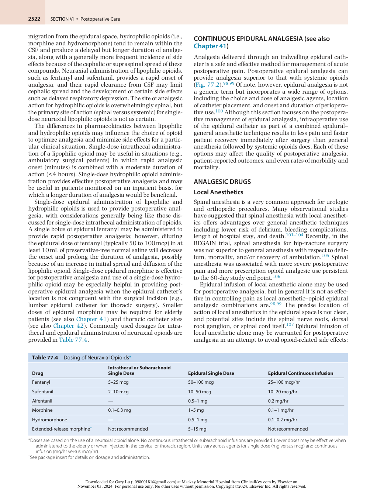

:::

<!-- PDF page 12 -->

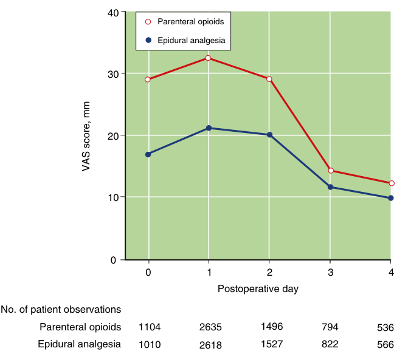

40 Parenteral opioids Epidural analgesia 30 20 10 0 0 1 2 3 4 Postoperative day No. of patient observations Parenteral opioids 1104 2635 1496 794 536 Epidural analgesia 1010 2618 1527 822 566 VAS score, mm 

**Fig. 77.2** Mean and standard deviation of visual analogue pain scores (VAS; y-axis) for both epidural analgesia (represented by _dark blue circles_ ) and parenteral opioids (represented by _open red circles_ ) for each postoperative day (x- axis) up to the fourth day after surgery. (From Block BM, Liu SS, Rowlingson AJ, et al. Efficacy of postoperative epidural analgesia: a meta- analysis. _JAMA_ . 2003;290:2455–2463, with permission.)

however, the sole use of local anesthetics is less common than the use of a local anesthetic–opioid combination because of a significant failure rate (from regression of sensory blockade and inadequate analgesia) and relatively high incidence of motor block and hypotension.100

### Opioids for Epidural Infusion

Opioids may be used alone for postoperative epidural infusion and do not generally cause motor block or hypotension from sympathetic blockade.100 There are differences between continuous epidural infusion of lipophilic (e.g., fentanyl, sufentanil) and hydrophilic (e.g., morphine, hydromorphone) opioids. The analgesic site of action (spinal versus systemic) of continuous epidural infusion of lipophilic opioids is not clear. Although some data suggest a benefit from epidural (versus intravenous) infusion of lipophilic opioids,108 the overall advantage of administering continuous epidural infusion of lipophilic opioids alone is marginal.100

The analgesic site of action for continuous hydrophilic opioid infusion is primarily spinal. Continuous infusion of a hydrophilic opioid may be especially useful for providing postoperative analgesia when the site of catheter insertion is not congruent with the site of surgery or when side effects (e.g., hypotension, motor block) are attributed to the epidural local anesthetic. Use of a continuous infusion rather than intermittent boluses of epidural morphine may result in superior analgesia with fewer side effects. Continuous epidural infusion of hydrophilic opioids may provide analgesia superior to that of traditional PRN administration of systemic opioids.

### Local Anesthetic–Opioid Combinations

Use of a local anesthetic and an opioid in an epidural infusion may have advantages over infusions consisting of a local anesthetic or opioid alone. When compared with a local anesthetic or opioid alone, a local anesthetic–opioid combination provides superior postoperative analgesia (including improved dynamic pain relief), limits regression of sensory blockade, and possibly decreases the dose of local anesthetic administered, although the effect on the incidence is uncertain.100 Continuous epidural infusion of a local anesthetic–opioid combination also provides analgesia superior to that of intravenous PCA with opioids.98 It is unclear whether the analgesic effect of the local anesthetic and opioid in epidural analgesia is additive or synergistic. The choice of local anesthetic for continuous epidural infusion varies. In general, bupivacaine or ropivacaine is chosen because of the differential and preferential clinical sensory blockade with minimal impairment of motor function. Concentrations used for postoperative epidural analgesia are lower than those used for intraoperative anesthesia. The choice of opioid also varies, although many clinicians prefer a lipophilic opioid (e.g., fentanyl, sufentanil) to allow rapid titration of analgesia.100 Use of a hydrophilic opioid (morphine, hydromorphone) as part of a local anesthetic–opioid epidural analgesic regimen may also provide effective postoperative analgesia. The optimal local anesthetic and opioid dose that provides the lowest pain scores with the fewest medication- related side effects is unknown and further investigation is needed to determine the optimal combinations for other types of surgical procedures with different epidural catheter insertion

<!-- PDF page 13 -->

**Table 77.5** Recommended Catheter Insertion Sites for Surgical Procedures

|**Location of Incision**|**Examples of Surgical Procedures**|**Congruent Epidural** **Catheter Placement**|
|---|---|---|
|Thoracic|Lung reduction, radical mastectomy, thoracotomy, thymectomy|T4–8|
|Upper abdominal|Cholecystectomy, esophagectomy, gastrectomy, hepatic resection, Whipple procedure|T6–8|
|Middle abdominal|Cystoprostatectomy, nephrectomy|T7–10|
|Lower abdominal|Abdominal aortic aneurysm repair, colectomy, radical prostatectomy, total abdominal hysterectomy|T8–11|
|Lower extremity|Femoral- popliteal bypass, total hip or total knee replacement|L1–4|

_L_ , lumbar level; _T_ , thoracic level.

sites and to compare the efficacy of these optimal continuous infusions with patient- controlled epidural analgesia (PCEA).

### Adjuvant Drugs

A variety of adjuvants may be added to epidural infusions to enhance analgesia while minimizing side effects, but none has gained widespread acceptance. Two of the more studied adjuvants are clonidine and epinephrine. Clonidine mediates its analgesic effects primarily through the spinal dorsal horn α2- receptors on primary afferents and interneurons, as well as the descending noradrenergic pathway, and the epidural dose typically used ranges from 5 to 20 mcg/h. Clinical application of clonidine is limited by its side effects: hypotension, bradycardia, and sedation. Hypotension and bradycardia are both dose dependent. Epidural administration of NMDA antagonists, such as ketamine, can theoretically be useful in attenuating central sensitization and potentiating the analgesic effect of epidural opioids, but additional safety and analgesic data are needed.

### LOCATION OF CATHETER INSERTION

Insertion of the epidural catheter congruent to the incisional dermatome (i.e., catheter incision–congruent analgesia) (Table 77.5) results in optimal postoperative epidural analgesia by infusing analgesics to the appropriate incisional dermatomes, providing superior analgesia, minimizing side effects (e.g., lower extremity motor block and urinary retention), and decreasing morbidity.16,100 When compared with catheter incision–congruent epidural analgesia, catheter incision–incongruent epidural analgesia (e.g., low lumbar catheter placement for thoracic procedures) results in increased pain and early removal of the epidural catheter because of ineffective analgesia. By targeting delivery of analgesic drugs to the appropriate dermatomes, catheter incision–congruent epidural analgesia may result in smaller drug requirements and decreased medicationrelated side effects. There is a more frequent incidence of lower extremity motor block with the use of lumbar epidural catheters, and an earlier- than- anticipated termination of epidural analgesia may also result. Use of a high thoracic epidural for abdominal or thoracic surgery does not inhibit sympathetic nerve activity in the lower extremities and may result in a relatively infrequent incidence of urinary retention, thus diminishing the need for routine bladder catheterization. Placement of thoracic epidural catheters is relatively safe, and a more frequent incidence

of neurologic complications is not documented with placement of a thoracic (versus lumbar) epidural catheter. Furthermore, the benefits of epidural analgesia in decreasing morbidity in patients undergoing abdominal and thoracic surgery are seen only with thoracic (congruent), not lumbar (incongruent) epidural catheter placement.

### SIDE EFFECTS OF NEURAXIAL ANALGESIC DRUGS

Many medication- related (opioid and local anesthetic) side effects can occur with the use of postoperative epidural analgesia, but before automatically ascribing the cause to the epidural analgesic regimen, other causes should be considered, such as hypovolemia, bleeding, and low cardiac output leading to hypotension and cerebrovascular accident, pulmonary edema, and evolving sepsis leading to respiratory depression. Standing orders and nursing protocols for analgesic regimens, neurologic monitoring, treatment of side effects, and physician notification about critical variables should be standard for all patients receiving neuraxial and other types of postoperative analgesia (see Box 77.1).

### Hypotension

The local anesthetics used in an epidural analgesic regimen may block sympathetic fibers and contribute to postoperative hypotension. Although the precise incidence of postoperative hypotension with postoperative epidural analgesia is uncertain, a systematic review of studies investigating postoperative analgesia found a mean (95% confidence interval [CI]) incidence of hypotension for epidural analgesia as 5.6% (3.0% to 10.2%).38 Strategies to treat noncritical hypotension caused by epidural analgesia include decreasing the overall dose of local anesthetic administered (by decreasing the rate or concentration), infusing an opioid epidural alone because it is unlikely that neuraxial opioid administration would contribute to postoperative hypotension, and treating the underlying cause of the decrease in blood pressure, e.g. blood loss/hypovolaemia.100

### Motor Block

Use of local anesthetics for postoperative epidural analgesia may also contribute to lower extremity motor block in approximately 2% to 3% of patients, and this may lead to the development of pressure sores in the heels.109 A metaanalysis noted a mean incidence of motor block of 3.2% with PCEA.98 A lower concentration of local anesthetic and catheter incision–congruent placement of epidural catheters for

::: details 原始表格與符號（PDF 第 13 頁）

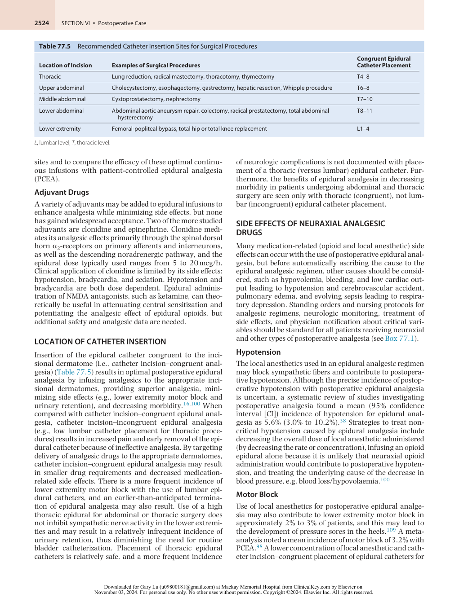

:::

<!-- PDF page 14 -->

abdominal or thoracic procedures may decrease the incidence of motor block. Although motor block resolves in most cases after stopping the epidural infusion for approximately 2 hours, persistent or increasing motor block should be evaluated promptly, and spinal hematoma, spinal abscess, and intrathecal catheter migration should be considered as part of the differential diagnosis.

### Nausea and Vomiting

Nausea and vomiting associated with neuraxial administration of single- dose opioid occurs in up to 50% of patients, and the cumulative incidence in those receiving continuous infusions of opioid may be as high as 80%. The overall data (neuraxial opioids and/or local anesthetic combined) suggest that the incidence of postoperative vomiting is similar between epidural analgesia and systemic opioids, although female patients will exhibit a more frequent incidence regardless of analgesic modality.110 The incidence of neuraxial opioid–related nausea and vomiting may be dose dependent although a recent meta- analysis suggested that a larger dose (≥0.3 mg) of intrathecal morphine did not increase the risk of postoperative nausea or vomiting compared to smaller dose (&lt;0.3 mg) of intrathecal morphine.111 Nausea and vomiting from neuraxial opioids may be related to the cephalad migration of opioid within the CSF to the area postrema in the medulla. Use of fentanyl alone or in combination with a local anesthetic in an epidural infusion is associated with fewer incidences of nausea and vomiting compared to infusions of morphine. A variety of drugs have been used successfully to treat neuraxial opioid–induced nausea and vomiting, including naloxone, droperidol, metoclopramide, dexamethasone, ondansetron, and transdermal scopolamine.

### Pruritus

Pruritus is one of the most common side effects of epidural or intrathecal administration of opioids, with an incidence of approximately 60% versus about 15% to 18% for epidural local anesthetic administration or systemic opioids.112 A systematic review of studies investigating postoperative analgesia found a mean (95% CI) incidence of pruritus for epidural analgesia as 16.1% (12.8% to 20%) versus 13.8% (10.7% to 17.5%) for intravenous opioid PCA.110 Although the cause of neuraxial opioid–induced pruritus is uncertain, peripheral histamine release is not the cause but may be related to central activation of an “itch center” in the medulla or activation of opioid receptors in the trigeminal nucleus or nerve roots with cephalad migration of the opioid. It is unclear whether the incidence of neuraxial opioid–related pruritus is dose dependent. Many drugs have been evaluated for the prevention and treatment of opioid- induced pruritus, which can be difficult to manage and quite bothersome for some patients. Intravenous naloxone, naltrexone, nalbuphine, and droperidol appear to be efficacious for the pharmacologic control of opioid- induced pruritus. Serotonin receptor antagonists may also be an effective modality in the prevention of neuraxial opioid– induced pruritus.

### Respiratory Depression

Neuraxial opioids used in appropriate doses are not associated with a higher incidence of respiratory depression

than that seen with systemic administration of opioids. The incidence of respiratory depression with neuraxial administration of opioids is dose dependent and typically ranges from 0.1% to 0.9%. The incidence of respiratory depression with neuraxial opioids is no more frequent than that seen after systemic opioid administration. The incidence of respiratory depression, as defined by a slow respiratory rate, should be less than 1%.38 The precise incidence of respiratory depression in actual clinical practice may be difficult to determine as there are many criteria (e.g., respiratory rate, oxygen saturation, partial pressure of carbon dioxide, and need to administer respiratory stimulants/reversal drugs), which have been used to define respiratory depression.38 Neuraxial lipophilic opioids cause less delayed respiratory depression than hydrophilic opioids, although administration of lipophilic opioids may cause early significant respiratory depression. Delayed respiratory depression is primarily associated with the cephalad spread of hydrophilic opioids, which typically occurs within 12 hours after injection of morphine. Risk factors for respiratory depression with neuraxial opioids include increasing dose, increasing age (also see Chapters 41 and 61), concomitant use of systemic opioids or sedatives, possibly of prolonged or extensive surgery, and the presence of comorbid conditions (e.g., obstructive sleep apnea; also see Chapter 9). Clinical assessments, such as the respiratory rate, may not reliably predict a patient’s ventilatory status or impending respiratory depression. Treatment with naloxone (and airway management if necessary) is effective in 0.1- to 0.4- mg increments; however, because its clinical duration of action is relatively short in comparison to the respiratory depressant effect of neuraxial opioids, continuous infusion of naloxone (0.5 to 5 mcg/kg/h) may be needed.113 Practice guidelines for the prevention, detection, and management of respiratory depression associated with neuraxial opioid administration have been published.114

### Urinary Retention

Urinary retention associated with the neuraxial administration of opioids is the result of an interaction with opioid receptors in the spinal cord that decreases the detrusor muscle’s strength of contraction. The incidence of urinary retention is more frequent with neuraxial administered opioids than when given systemically. Urinary retention does not depend on the opioid dose and may be treated with the use of low- dose naloxone, although at the risk of reversing the analgesic effect. Urinary retention occurred in 23.0% of patients, with the most frequent rate in those receiving epidural analgesia.110 However, the exact incidence of urinary retention seen clinically may be difficult to determine because patients who undergo major surgical procedures are often routinely catheterized.

### PATIENT- CONTROLLED EPIDURAL ANALGESIA

Epidural analgesia has traditionally been delivered at a fixed rate or as a continuous epidural infusion (CEI); however, the administration of epidural analgesia through a patientcontrolled device (PCEA) has become more common. Like intravenous PCA, PCEA allows individualization of postoperative analgesic requirements and may have several advantages over CEI, including lower drug use and better

<!-- PDF page 15 -->

patient satisfaction. PCEA may also provide analgesia superior to that afforded by intravenous PCA.98

PCEA is a relatively safe and effective technique for postoperative analgesia on routine surgical wards. Observational data from two series of over 1000 patients each reveal that more than 90% of patients with PCEA receive adequate analgesia, with a median pain score of 1 (of a possible 10) at rest and 4 with activity.115,116 The incidence of side effects is 1.8% to 16.7% for pruritus, 3.8% to 14.8% for nausea, 13.2% for sedation, 4.3% to 6.8% for hypotension, 0.1% to 2% for motor block, and 0.2% to 0.3% for respiratory depression.115,116 These rates are favorable and comparable to those reported with CEI.

The optimal PCEA analgesic solution and delivery parameters are unclear. Use of a continuous or background infusion in addition to the demand dose is more common with PCEA than with intravenous PCA and may provide analgesia superior to that with the use of a demand dose alone.117 In general, most acute pain specialists have gravitated toward a variety of low- concentration local anesthetic–opioid combinations (Table 77.6) in an attempt to improve analgesia while minimizing side effects, such as motor block and respiratory depression. As for CEI, addition of an opioid to the local anesthetic can provide analgesia superior to that with either analgesic alone. A lipophilic opioid is usually chosen because its rapid analgesic effect and shorter duration of action may be more suitable for use with PCEA.115 Use of lower concentrations of a local anesthetic (e.g., bupivacaine, ropivacaine) may provide excellent analgesia without significant motor block.118

### Benefits of Epidural Analgesia

Use of perioperative epidural anesthesia and analgesia, especially with a local anesthetic–based analgesic solution, can attenuate the pathophysiologic response to surgery and may be associated with a reduction in mortality and morbidity when compared with analgesia with systemically administered opioids.16,17 Meta- analysis of randomized data (141 trials enrolling 9559 subjects) found that

perioperative use of neuraxial anesthesia and analgesia (versus general anesthesia and systemic opioids) reduced overall mortality (primarily in orthopedic patients) by approximately 30%.119 Use of epidural analgesia can decrease the incidence of postoperative gastrointestinal, pulmonary, and possibly cardiac complications.16,120

After open anastomotic abdominal surgery, inhibiting sympathetic outflow, decreasing the total opioid dose, and attenuating spinal reflex inhibition of the gastrointestinal tract, postoperative thoracic epidural analgesia can facilitate return of gastrointestinal motility without contributing to anastomotic bowel dehiscence.120,121 Randomized clinical trials demonstrate that use of postoperative thoracic epidural analgesia with a local anesthetic–based analgesic solution allows earlier return of gastrointestinal function and fulfillment of discharge criteria.122 When compared with those who receive epidural opioids for postoperative analgesia, patients who receive epidural local anesthetics have an earlier return of gastrointestinal motility after abdominal surgery.122

Perioperative use of epidural analgesia with a local anesthetic–based regimen in patients undergoing abdominal and thoracic surgery decreases postoperative pulmonary complications,123,124 presumably by preserving postoperative pulmonary function through providing superior analgesia and thus reducing “splinting” behavior and attenuating the spinal reflex inhibition of diaphragmatic function.125 A meta- analysis of 48 randomized clinical trials126 and another large, randomized clinical trial127 demonstrated that use of thoracic epidural analgesia with a local anesthetic–based regimen decreased the incidence of pulmonary infections and complications. However, patients who received postoperative epidural opioids, intercostal blocks, wound infiltration, or intrapleural analgesia did not have a significant decrease in the incidence of pulmonary complications.126 A subsequent meta- analysis confirmed the benefits of thoracic epidural analgesia in decreasing perioperative pulmonary complications.128 A recent RCT found that patients undergoing major thoracic

**Table 77.6** Patient- Controlled Epidural Analgesia Regimens

|**Analgesic Solution***|**Continuous Rate (mL/h)**|**Demand Dose (mL)**|**Lockout Interval (min)**|
|---|---|---|---|
|**GENERAL REGIMENS**||||
|0.05% bupivacaine + 4 mcg/mL fentanyl|4|2|10–20|
|0.0625% bupivacaine + 5 mcg/mL fentanyl†|4–6|3–4|10–20|
|0.1% bupivacaine + 5 mcg/mL fentanyl|6|2|10–20|
|0.2% ropivacaine + 5 mcg/mL fentanyl|5|2|20|
|**THORACIC SURGERY**||||
|0.0625%–0.125% bupivacaine +5 mcg/mL fentanyl†|3–4|2–3|10–20|
|**ABDOMINAL SURGERY**||||
|0.0625% bupivacaine + 5 mcg/mL fentanyl†|4–6|3–4|10–20|
|0.125% bupivacaine + 0.5 mcg/mL sufentanil|3–5|2–3|10–20|
|0.1%–0.2% ropivacaine + 2 mcg/mL fentanyl|3–5|2–5|10–20|
|**LOWER EXTREMITY SURGERY**||||
|0.0625%–0.125% bupivacaine + 5 mcg/mL fentanyl†|4–6|3–4|10–20|

*Regimens listed are samples of local anesthetic–lipophilic opioid combinations from the literature.

†Patient-controlled epidural analgesic regimens commonly used at the Johns Hopkins Hospital.

::: details 原始表格與符號（PDF 第 15 頁）

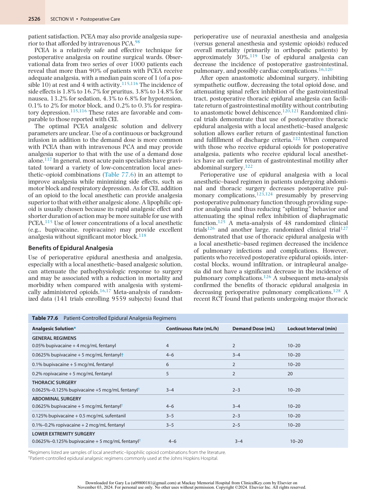

:::

<!-- PDF page 16 -->

and abdominal surgeries who were randomized to a combined epidural–general anesthetic (vs. general anesthesia) has significantly less delirium although intraoperative hypotension was more common in patients assigned to epidural anesthesia.129

Use of postoperative thoracic, but not lumbar epidural analgesia may decrease the incidence of postoperative myocardial infarction, possibly by attenuating the stress response and hypercoagulability, improving postoperative analgesia, and providing favorable redistribution of coronary blood flow. The finding that only thoracic epidural analgesia decreases the incidence of postoperative myocardial infarction corroborates experimental data on the physiologic benefits of thoracic epidural analgesia, such as a reduction in the severity of myocardial ischemia or size of infarction, attenuation of sympathetically mediated coronary vasoconstriction, and improvement of coronary flow to areas at risk for ischemia. The use of thoracic epidural analgesia in patients undergoing cardiac surgery decreased the risk of postoperative supraventricular arrhythmias and respiratory complications (also see Chapter 41).130

Although postoperative epidural analgesia decreases postoperative gastrointestinal, pulmonary, and possibly cardiac morbidity, the benefits of postoperative epidural analgesia are not as evident in other areas, such as postoperative coagulation, cognitive dysfunction,131 and immune function. While the use of intraoperative regional anesthesia decreases the incidence of hypercoagulablerelated events (e.g., deep venous thrombosis, pulmonary embolism, vascular graft failure),119 postoperative epidural analgesia does not obviously decrease the incidence of hypercoagulable- related events. Some authors question the efficacy of epidural analgesia in prevention of deep venous thrombosis, especially in the context of modern surgical practice where prophylactic anticoagulants are routinely used.132

The benefits of postoperative epidural analgesia are optimized when the epidural catheter is inserted in a location corresponding to the dermatomes covered by the surgical incision (i.e., catheter incision–congruent analgesia), which results in a smaller dose of drug administered and decreased incidence of drug- induced side effects, such as pruritus, nausea, vomiting, urinary retention, motor block, and hypotension.115 When compared with catheter incision– incongruent epidural analgesia, catheter incision–congruent analgesia provides earlier return of gastrointestinal function, a lower incidence of myocardial infarction, and superior analgesia.125 The ability of postoperative epidural analgesia to attenuate postoperative pathophysiology and improve outcomes also depends on the type of drugs used (opioids versus local anesthetics). Maximal attenuation of perioperative pathophysiology occurs with the use of a local anesthetic–based epidural analgesic solution. The use of a local anesthetic–based (versus opioid- based) analgesic solution is associated with earlier recovery of gastrointestinal motility after abdominal surgery122 and less frequent occurrence of pulmonary complications.126 Epidural analgesia is not a generic entity because different catheter locations and analgesic regimens may differentially affect perioperative morbidity.

It is unclear whether perioperative epidural analgesia may improve patient- reported outcomes.125 Use of postoperative

epidural analgesia may be associated with an improvement in postoperative analgesia and patient- reported outcomes such as patient satisfaction37 and HRQL.22 When compared with systemic opioids, epidural local anesthetics consistently provide superior analgesia.98,99 Although the concept of satisfaction is complex and difficult to measure accurately, the analgesic benefits of postoperative epidural analgesia may contribute to greater patient satisfaction37 and improved HRQL.22

There may be a possible link between the perioperative use of regional anesthesia/analgesia and a decrease in cancer recurrence.133 There are several hypothetical reasons why the perioperative use of regional anesthesia and analgesia would be of benefit in patients undergoing cancer surgery including attenuation of perioperative immunosuppression and decreased use of inhaled anesthetics/ opioids. A regional anesthetic–induced sympathectomy should increase blood flow to the extremities with subsequent improvement in tissue oxygenation and a potential favorable local anesthetic effect on tumor cell killing. However, there are multiple factors that may potentially affect cancer recurrence and the impact of perioperative regional analgesic techniques on a long- term outcome such as cancer recurrence is uncertain at this time and a recent observational study suggests that epidural analgesia may not be statistically significantly associated with less cancer recurrence.134 Use of neuraxial anesthesia/analgesia for total hip or knee replacement may decrease the risk of surgical site infections compared with general anesthesia.135

### Risks with Epidural Analgesia

The benefits of perioperative epidural anesthesia–analgesia must be weighed against the risks associated with this technique. Some complications are associated with placement of an epidural catheter, and several risks related to the use of indwelling epidural catheters (e.g., epidural hematoma and abscess) should be discussed in the context of postoperative epidural analgesia. A review of neurologic complications after regional anesthesia revealed that the rate of neurologic complications after central neuraxial blockade is less than 4 in 10,000 (0.04%); the rate of neuropathy after a peripheral nerve block is less than 3 in 100 (3%).136 However, permanent neurologic injury after either central neuraxial or peripheral nerve block is rare in contemporary anesthetic practice.136 Elements of routine monitoring of patients receiving neuraxial analgesia are presented in Box 77.1.

The concurrent use of anticoagulants and neuraxial anesthesia and analgesia has always been a relatively controversial issue but has been highlighted over the past decade by the increased incidence of spinal hematoma after the introduction of low- molecular- weight heparin in North America in 1993.

Different types and classes of anticoagulants have different pharmacokinetic properties that affect the timing of neuraxial catheter or needle insertion and catheter removal. Despite many observational and retrospective studies investigating the incidence of spinal hematoma in the setting of various anticoagulants and neuraxial techniques, no definitive conclusion regarding the absolute safety of neuraxial anesthesia and anticoagulation has been reached. The American Society of Regional Anesthesia and

<!-- PDF page 17 -->

Pain Medicine (ASRA) lists a series of guidelines based on the available literature for administration (insertion and removal) of neuraxial techniques in the presence of various anticoagulants, including oral anticoagulants (warfarin), antiplatelet agents, fibrinolytics–thrombolytics, standard unfractionated heparin, and low- molecular- weight heparin.137 The ASRA guidelines include the concepts that the timing of neuraxial needle or catheter insertion or removal should reflect the pharmacokinetic properties of the specific anticoagulant. Frequent neurologic monitoring is essential. Concurrent use of multiple anticoagulants may increase the risk of bleeding, and the analgesic regimen should be tailored to facilitate neurologic monitoring, which may be continued in some cases for 24 hours after removal of the epidural catheter. Although the ASRA guidelines were developed with the latest available literature, these guidelines are limited by the relatively rare incidence of epidural hematoma; there are observational studies during which procedures (e.g., epidural catheter removal) are performed outside the boundaries presented in the ASRA guidelines.138 A version of the ASRA guidelines on neuraxial anesthesia and anticoagulation137 can be found on their website, and some of these statements address the newer anticoagulants. Finally, the risk of epidural hematoma may be different for obstetric versus surgical patients.139

Infection associated with postoperative epidural analgesia may result from exogenous or endogenous sources.100 Serious infections (e.g., meningitis, spinal abscess) associated with epidural analgesics are rare (&lt;1 in 10,000),140 although a more frequent incidence has been observed (approximately 1 in 1000 to 2000).140 Closer examination of the studies that reported a more frequent incidence of epidural abscess reveals that the patients had a relatively longer duration of epidural analgesia or coexisting immunocompromising or complicating diseases (e.g., malignancy, trauma).100 Use of epidural analgesia in the general surgical population with a typical duration of postoperative catheterization (approximately 2 to 4 days) is not generally associated with epidural abscess formation.115 Even though serious infectious complications are rare after short- term (4 days) epidural infusions, there may be a relatively more frequent incidence of superficial inflammation or cellulitis (4% to 14%) and an even higher rate of catheter colonization (20% to 35%), with the proportion of positive cultures increasing with longer duration of catheterization; however, the catheter colonization rate may not be a good predictor of infection of the epidural space.141 A practice advisory from the American Society of Anesthesiologists discussing the prevention, diagnosis, and management of infectious complications associated with neuraxial techniques has been published.142

Although epidural analgesia may provide superior postoperative analgesia, migration of the epidural catheter out of the epidural space and into the intrathecal, intravascular, or subcutaneous space decreases the effectiveness of this technique. The failure rate (i.e., earlier- than- anticipated discontinuation of the catheter for any reason, placement of a nonfunctioning epidural catheter) ranges from approximately 6% to 25%, with many centers reporting a rate between 10% and 20%, but the incidence of actual premature epidural catheter dislodgment may be less frequent (mean, 5.7%; 95% CI, 4.0% to 7.4%).115,143 Fortunately,

the rate of intrathecal and intravascular migration of an epidural catheter is most likely much less frequent than the failure rate. Some authors have gone further to define a successful epidural as the one that provides good pain relief and facilitates postoperative mobilization and rehabilitation for as long as the catheter is in place.144 In that sense, determining failure rate may be even more difficult and only local institutional audits are able to define local failure rate.

Despite the less frequent occurrence of intravascular and intrathecal migration of postoperative epidural catheters, use of an epinephrine- containing test dose, administration of local anesthetic in fractionated doses, and aspiration of the catheter before bolus administration of local anesthetics may prevent complications (e.g., high or total spinal, seizures, neurotoxicity).100 The issue of whether lower extremity compartment syndrome can be consistently masked by the use of a local anesthetic–based epidural analgesic regimen is unresolved because use of systemic opioid analgesia has also been associated with a delayed diagnosis of compartment syndrome.145 The use of epidural analgesia after thoracic and abdominal surgery has been reported to be decreasing in many institutions for a number of reasons, including using minimally invasive surgical techniques, concerns over epidural side effects, resources needed to run an effective acute pain service, and availability of alternative analgesia modalities.132

### PERIPHERAL REGIONAL ANALGESIA (see also Chapter 42)

The use of peripheral regional analgesic techniques as a single injection or continuous infusion can provide site- specific analgesia superior to that with systemic opioids146 and may even result in improvement in various outcomes.147 A variety of wound infiltration and peripheral regional techniques (e.g., brachial plexus, lumbar plexus, femoral, sciatic–popliteal, and scalp nerve blocks) can be used to enhance postoperative analgesia. Peripheral regional techniques may have several advantages over systemic opioids (i.e., superior analgesia and decreased opioid- related side effects) and neuraxial techniques (i.e., decreased risk for spinal hematoma and less hemodynamic instability).148

A one- time injection of local anesthetic for peripheral regional techniques may be used primarily for intraoperative anesthesia or as an adjunct to postoperative analgesia. When compared with placebo, peripheral nerve blocks with local anesthetics provide superior analgesia and are associated with reduced perioperative opioid use, decreased opioid- related side effects, and improvement in patient satisfaction.148 The duration of postoperative analgesia resulting from the local anesthetic in the peripheral nerve block varies but may last up to 24 hours after injection. Additives to local anesthetics can also increase the duration of action of local anesthetic and improve the quality of nerve blocks. Some of these adjuvants include dexamethasone, clonidine, and dexmedetomidine.149 Postoperative rebound pain can be defined as hyperalgesia and increased pain after resolution of the peripheral nerve block. It can potentially diminish the overall benefit of these blocks as it may lead to an increase in opioid consumption once the block wears off. Patient education about the time course of the peripheral nerve blocks and using blocks in the context of multimodal

<!-- PDF page 18 -->

analgesia are effective strategies to counter the effect of rebound pain.150 Some authors suggested that the use of dexamethasone (intravenous or perineural) may blunt the effect of rebound pain.151,152

An earlier systematic review indicated that local anesthetics may also provide effective wound infiltration analgesia postoperatively for a variety of procedures.153 A more recent meta- analysis suggested that local anesthetic administered via wound catheters may not reduce pain intensity after surgery.154

Continuous infusions of local anesthetics can be administered through peripheral nerve catheters. Many methods can be used to insert perineural catheters, including nerve stimulation and ultrasound guidance.155 Randomized controlled trials suggest that use of peripheral regional analgesia may facilitate postoperative rehabilitation as evidenced by accelerated resumption of passive joint rangeof- motion, decrease in time until discharge readiness, and earlier actual discharge from the hospital or rehabilitation center.155,156 There is evidence that supports,157–159 and other that refutes160–162 the notion that nerve blocks may reduce the incidence of persistent pain after surgery in different settings. Continuous peripheral nerve blocks may be used in the outpatient (home) setting, typically using a portable ambulatory pump.155 When compared with systemic opioids, use of continuous infusions or patientcontrolled peripheral analgesia results in superior analgesia, decreased opioid- related side effects, and greater patient satisfaction.146,148 The optimal parameters (i.e., local anesthetic, concentration, opioid, adjuvants, and continuous versus PCA versus intermittent boluses) for peripheral analgesia are still being determined.163 With the evolution of the ultrasound guidance technology and description of new block technique, peripheral nerve blocks are now more integrated into new clinical pathways.

### TRUNCAL BLOCKS

Several nonepidural/truncal regional analgesic techniques can be used for the management of postoperative thoracic and abdominal pain. Some of these techniques are well established and others are relatively new, including paravertebral and intercostal blocks, transversus abdominis plane (TAP) blocks, quadratus lumborum (QL) blocks,164 erector spinae plane (ESP) blocks,165 interpleural (intrapleural) analgesia, and cryoanalgesia. Thoracic paravertebral block has been used for thoracic, breast, and upper abdominal surgery and for the treatment of rib fracture pain.166 Possible sites of analgesia for a thoracic paravertebral block include direct somatic nerve, sympathetic nerve, and epidural blockade.166 A thoracic paravertebral block can be administered as a single injection or as continuous infusion through a catheter, may provide analgesia equal or superior to that with thoracic epidural analgesia, and is a valuable alternative to thoracic epidural analgesia.144,167 Paravertebral blocks may be especially useful in providing postoperative analgesia after breast surgery.168 When compared to thoracic epidural analgesia, paravertebral analgesia has been shown to provide equivalent analgesia but with a better side-effect profile (e.g., lower incidence of hypotension) and also lower the risk of postoperative pulmonary complications.167,169 Continuous infusions of local

anesthetics through a paravertebral catheter are preferable to intermittent boluses as the former are associated with lower pain scores.170

Transversus abdominis plane nerve block is an approach for blocking the nerves supplying the abdominal wall to provide postoperative analgesia. Typically performed under ultrasound guidance, TAP blocks have been mostly described in adult patients (with some in pediatric patients) and used in a variety of surgical patients.171,172 Several systematic reviews indicate that TAP blocks may reduce postoperative morphine requirements, nausea and vomiting, and possibly the severity of pain after abdominal surgery.171,173 Although superior early postoperative analgesia appears to occur (within 24 hours of surgery), the surgical procedures, analgesic dosing, techniques, and timing for optimal analgesia following TAP block need further examination. The analgesic efficacy of TAP block using liposomal bupivacaine was shown to be noninferior to epidural analgesia after abdominal surgery.174 A host of truncal blocks have been described to provide analgesia for the thoracic and abdominal wall. These blocks are yet to be compared headto- head with well- established analgesic modality. Erector spinae plane block is one of the blocks that gained popularity in clinical practice and had its fair share of attention in literature. It was first described in 2016 by Forero _et al._165 for treatment of thoracic neuropathic pain. It is relatively easy to perform under ultrasound guidance and has been performed at different levels to treat various surgical procedures. These procedures include hip arthroplasty,175 lumbar fusion,176 laparotomies,177,178 shoulder arthroplasty,179 thoracic surgery,180 and cardiac surgery.181 The mechanism of action of the ESP and what exactly is the target nerve/s are still debated.182 Some authors propsed that ESP block targets the dorsal rami of spinal nerves while others suggested that it acts through spread of the local anesthetic to the paravertebral space.182 ESP blocks can be single shot, or continuous with catheter placement, especially in the treatment of multiple rib fractures.

The analgesic efficacy and the mechanism of interpleural analgesia are no longer controversial (i.e., sensory, or sympathetic block, or both). Interpleural analgesia is inferior to epidural and paravertebral analgesia for control of postoperative pain, preservation of lung function after thoracotomy, and reduction of postoperative pulmonary complications.126

Intercostal blocks may provide short- term postoperative analgesia and may be repeated postoperatively; however, the incidence of pneumothorax increases with each intercostal nerve blocked (1.4% per nerve, with an overall incidence of 8.7% per patient).183 Like interpleural analgesia, intercostal blocks do not reduce the incidence of pulmonary complications postoperatively when compared with epidural analgesia.126

### INTRA- ARTICULAR AND LOCAL INFILTRATION ANALGESIA

Local peripheral administration of opioids (e.g., intraarticular injection after knee surgery) may theoretically provide analgesia for up to 24 hours after surgery and decrease the incidence of chronic pain as peripheral opioid receptors are found on the peripheral terminals of primary

<!-- PDF page 19 -->

afferent nerves and are upregulated during inflammation of peripheral tissues. Results of the several randomized clinical trials investigating this topic have been summarized. A subsequent qualitative systematic review found no evidence for analgesic effect of intra- articular morphine after knee arthroscopy.184 A systemic effect of intra- articular morphine cannot be excluded. A systematic review suggested that intra- articular administration of NSAIDs may provide clinically relevant peripheral analgesia.185 Intraarticular injection of local anesthetics may provide a limited duration of postoperative analgesia, but the clinical benefit from intra- articular injection of local anesthetics is unclear. High-volume local infiltration of local anesthetic (LIA) is especially popular after total knee arthroplasty (TKA). Proponents cite its simplicity and no requirement for postoperative management as reasons to adopt the technique. A systematic review of 27 RCTs on LIA for TKA and THA showed that LIA for TKA was associated with reduced pain scores and opioid requirements up to 72 hours after surgery.186,187 Clinicians should be aware that there have been cases of glenohumeral chondrolysis reported in association with postarthroscopy infusion of local anesthetic.188

## Other Techniques

Other nonpharmacologic techniques, such as transcutaneous electrical nerve stimulation (TENS), acupuncture, exercise/activity, and psychological approaches, can be used to alleviate postoperative pain. The mechanism by which TENS produces analgesia is unclear but may be related to modulation of nociceptive impulses in the spinal cord, release of endogenous enkephalins, or a combination of these, and other mechanisms. Although the analgesic efficacy of these techniques is controversial, TENS and acupuncture may provide postoperative analgesia, decrease postoperative opioid requirements, reduce opioid- related side effects, and attenuate activation of the sympathoadrenal system. In general, all of these approaches to postoperative pain are relatively safe, noninvasive, and devoid of the systemic side effects seen with other analgesic treatment options.189 TENS may be of benefit in providing postoperative analgesia and decrease analgesic consumption.190,191 Early mobilization and activity therapy improve functional outcomes following orthopedic surgical procedures192 and are effective in reducing pain behaviors in animal models of surgical neuropathic pain.193 Although there are methodological issues with many of the available trials, and the precise role of these treatments in postoperative pain management is not clear, they represent alternative therapies to add to the clinician’s armamentarium. In the case of exercise and activity programs, these represent inexpensive and easily available therapies.

While this chapter has focused on the neurobiology of nociception and pharmacologic treatments available for the treatment of postoperative pain, the experience of pain is complex, multifaceted, and “an unpleasant sensory and emotional experience,” as defined in part by the International Association for the Study of Pain. The differential behavior response to surgical incision may be related to global (i.e., personality, gender, age, and culture) and specific (i.e., fear, depression, anger, and coping) psychological

factors.194 Cognitive therapy and behavior therapy may be efficacious in reducing pain and alleviating psychological factors associated with pain.195 Identifying and addressing psychological factors can reduce pain, improve the efficacy of pharmacologic analgesics, and diminish patients’ distress, in part through enhancement of the placebo effect.194 Although the placebo effect may have a psychological origin, the placebo response may exert part of its effects through activation of endogenous opioids and be useful in reducing the intensity of pain.196

## Postoperative Analgesia in Special Populations

The foregoing discussion has provided a general approach to the principles and practice of acute postoperative pain management, but this approach may need to be modified for certain populations that have unique anatomic, physiologic, pharmacologic, affective, and cognitive issues. Management of acute pain should be tailored to the specific needs of a particular population. Although each topic by itself could merit a separate chapter in some textbooks, the general principles and essence of the issues associated with each population are outlined, and references are made to other more extensive sources.

### OPIOID- TOLERANT PATIENTS: PATIENTS WITH PREEXISTING PAIN

Opioid- tolerant patients can be categorized into several groups: (1) those who have chronic pain for which they receive opioid- based analgesic therapy, (2) those who use opioids recreationally as a result of a substance use disorder, (3) those who have been injured and are having multiple surgeries (have established acute pain with high potential to progress to chronic pain), and (4) those who use opioids for a combination of numbers (1) and (2). Regardless of the reason the individual is using opioids, the management of their perioperative pain is considerably more challenging than those who are opioid- naive.

Even though there is no specific threshold or timeframe for when a patient becomes opioid tolerant, the FDA has recently provided guidelines for defining the opioid-tolerant patient.197 In summary, patients considered opioid-tolerant are those who are regularly taking at least: 60 mg oral morphine per day; 25 mcg transdermal fentanyl per hour; 30 mg oral oxycodone per day; 8 mg oral hydromorphone per day; 25 mg oral oxymorphone per day; or an equianalgesic dose of another opioid for one week or longer.

Postoperative pain may be difficult to manage in opioidtolerant patients because the standard approaches used for baseline assessment and assessment of response to therapy in opioid- naive or research patients are often less accurate for opioid- tolerant patients. Although opioid- tolerant patients require larger doses of analgesic medications (in addition to their baseline pain medication requirements) in the immediate postoperative period, many health care providers still do not provide adequate postoperative pain relief, in part because of the fear of addiction or medication- related side effects. In dealing with patients with chronic opioid use, health care providers often mistakenly interchange several

<!-- PDF page 20 -->

pharmacologic terms (i.e., tolerance, physical dependence, and addiction), a practice that may contribute to misunderstanding and inappropriate treatment decisions.

Tolerance refers to the pharmacologic property of an opioid in which an increasing amount is needed to maintain a given level of analgesia. Physical dependence is another pharmacologic property of opioids characterized by the occurrence of a withdrawal syndrome on abrupt discontinuation of the opioid or administration of an antagonist. Tolerance and physical dependence are pharmacologic properties of opioids and are not synonymous with the aberrant psychological state or behavior associated with addiction, a chronic disorder characterized by the compulsive use of a substance resulting in physical, psychological, or social harm to the user and continued use despite that harm.

Several principles of pain assessment and treatment can be applied to the postoperative management of opioidtolerant patients. The physician should expect high selfreported pain scores; base treatment decisions on objective pain assessment (e.g., ability to breathe deeply, cough, ambulate) in conjunction with patients’ self- reported pain scores; recognize the need to identify and treat two major problems, maintenance of a basal opioid requirement and control of incisional pain; and recognize that detoxification is not usually an appropriate goal in the perioperative period.198–200

The treatment of patients with prior opioid use requires the management of the expectations of the patient, the patient’s family, and your surgical colleagues. The goal of inpatient management of pain in patients with chronic pain, acute on chronic pain, is to stabilize and rationalize (if necessary) the patient’s outpatient pain medication regimen. The goal is not to treat their long- standing persistent pain that has been managed on an outpatient basis because it is unlikely in the very limited time in which you are a member

of their care team that you will be able to make a substantial positive difference. Therefore, several general strategies can be used for the treatment of postoperative pain in an opioid- tolerant or opioid-receiving chronic pain patient. Although chronic pain patients are not synonymous with opioid- tolerant patients, many of these patients are opioid tolerant, and the same general principles and strategies may be applied to chronic pain patients who are opioid tolerant. The physician can create a treatment plan early and discuss it with the patient, surgical team, and nursing staff; replace the patient’s baseline or basal opioid requirements postoperatively; anticipate an increase in postoperative analgesic requirements201 ; maximize the use of adjuvant drugs; consider the use of regional analgesic techniques; and plan for the transition to an oral regimen. The physician, patient, and other providers need to be aware that the nonopioid adjuvant medications (not including tramadol, NSAIDs, acetaminophen) may be started while the patient is an inpatient but are unlikely to have substantial impact on their chronic pain while they are hospitalized. Recognizing and addressing non- nociceptive sources of distress may be especially important for chronic pain patients.

Administration of a PRN analgesic regimen alone for opioid- tolerant patients is discouraged because replacing the basal opioid requirement in the postoperative period can optimize pain relief and possibly prevent opioid withdrawal. Basal opioid requirements can be administered systemically (typically intravenously) until the patient can tolerate an oral analgesic regimen.33 For example, 50% to 100% of the patient’s baseline opioid requirement can be administered by an intravenous PCA regimen, with a demand dose to cover the additional incisional pain. Conversion tables (Table 77.7) may facilitate equianalgesic conversion of opioids (i.e., different routes of administration of one opioid or conversion between two different opioids); however, these

**Table 77.7** Guidelines for Equianalgesic Dosing of Opioid Agonists

|||**Conversion to Morphine Milligram** **Equivalent (MME)**|
|---|---|---|
|**Drug**|**Relative Strength Compared to Morphine**|**Oral**|
|Morphine|–|1|
|Buprenorphine|Much, much stronger|N/A|
|Butorphanol|Much stronger|N/A|
|Codeine|Weaker|0.15|
|Fentanyl transdermal|Much, much stronger|2.4|
|Hydrocodone|Equivalent to mildly weaker|1|
|Hydromorphone|Much stronger|5|
|Levorphanol|Much stronger|11|
|Methadone|Stronger|4.7|
|Oxycodone|Stronger|1.5|
|Oxymorphone|Stronger|3|
|Pentazocine|Weaker|0.37|
|Tapentadol|Weaker|0.40|
|Tramadol|Much weaker|0.2|

MME conversion ratios are approximate and intended to serve only as an approximation and guide. Actual doses may vary, (https://www.cdc.gov/mmwr/ volumes/71/rr/rr7103a1.htm#T1_down) in part because of wide interpatient variability in response to opioids. Doses should be individualized and gradually titrated to effect. MME calculations should only be used from an opioid to morphine. Calculations from morphine to another opioid differ and are not presented. _TD_ , transdermal.

::: details 原始表格與符號（PDF 第 20 頁）

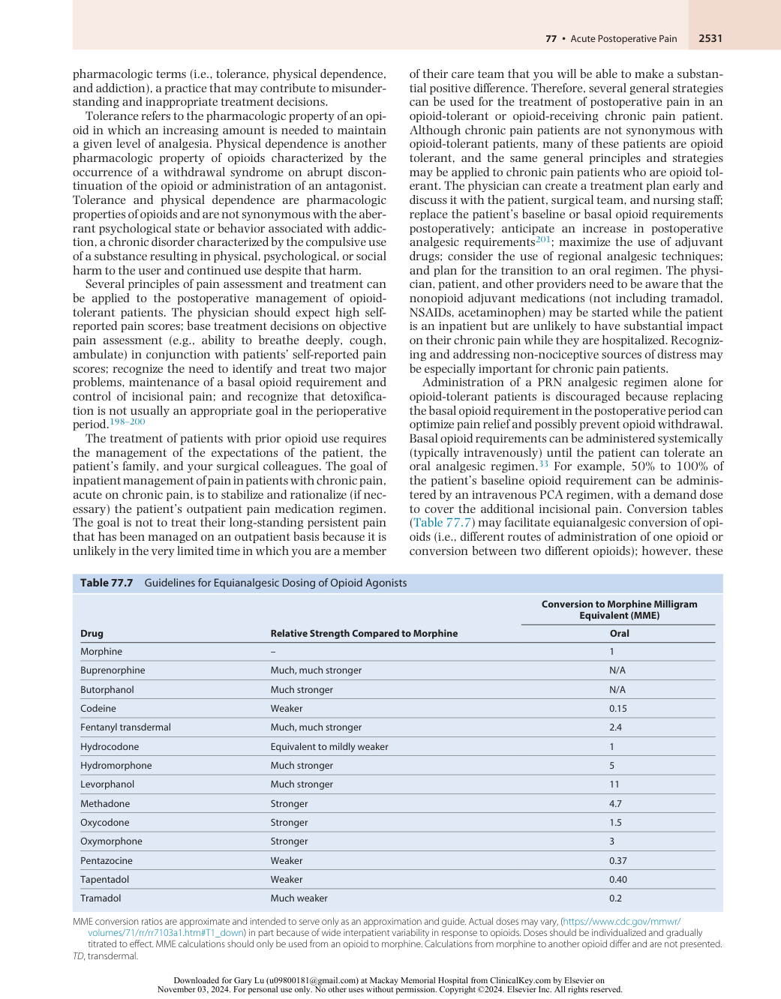

:::

<!-- PDF page 21 -->

tables provide only estimations to assist health care providers in initiating opioid titration.202

Opioid- tolerant patients generally require increased postoperative analgesic levels, including a larger demand dose.33,201 Patients may need frequent adjustment of the intravenous PCA demand dose or continuous infusion, depending on the analgesic requirements. There is individual variability in response to different opioids, and if a decision is made to switch opioids, the choice of opioid is probably not as important as using an equianalgesic dose. Patients may experience different side effects with different opioids and rotating to another opioid may be reasonable if the patient is not tolerating the first opioid.203 Adjuvant drugs such as NSAIDs should be administered on a regularly scheduled basis to optimize analgesic efficacy and possibly provide an opioid- sparing effect. Use of regional analgesic techniques with neuraxial opioids may provide excellent analgesia in opioid- tolerant patients while theoretically preventing withdrawal symptoms, although the clinician should be prepared to diagnose and treat perioperative opioid withdrawal in these patients.

After the patient is tolerating oral intake, conversion from intravenous opioids to oral form that would be more suitable for discharge home may be initiated. Opioid- tolerant patients can generally be converted to a combination of a regularly administered, controlled- release formulation of opioid (i.e., sustained- release morphine) and short- acting, immediate- release opioid on a PRN basis. Although conversion of intravenous opioid to an oral form can be accomplished over a period of 24 hours in opioid- tolerant patients, this process may take longer in extremely difficult cases. In patients with a relatively high basal requirement of intravenous opioid (e.g., high, continuous background infusion of intravenous opioid PCA), clinicians should be aware not to abruptly discontinue the intravenous infusion of opioid during this transition but ideally decrease the high basal requirement of intravenous opioid in a stepwise fashion to account for the slower onset of the sustained release. Converting from an intravenous to an oral form of opioid is not an exact science, and the conversion tables available can serve only as a rough guide because of significant interpatient variability in the sensitivity to opioids, lack of complete cross- tolerance between opioids (which may lead to greater than anticipated potency of a new opioid), and changes in the level of pain, which may rapidly decrease in the immediate postoperative period.202 Because of these factors, conversion of approximately 50% to 75% of the equianalgesic dose to a sustained- release preparation of opioid or a transdermal fentanyl patch, with the remainder converted to a short- acting opioid delivered on a PRN basis, may be a reasonable starting point in patients whose pain is reasonably controlled, although additional titration may be necessary.

Although opioids are most commonly used in these patients, with consultation of the inpatient pain services (if available), the physicians can consider the use of analgesic (low-dose) ketamine.204 Ketamine can be given as a basal infusion as a part of the ketamine PCA or a combination ketamine and opioid PCA, subcutaneously, or orally. Ketamine may have significant advantages, such as greater analgesic response, less frequent rates of respiratory depression and minimal impact on the gastrointestinal system,

over further opioid use in the opioid- tolerant or chronic pain patient in the postoperative setting.

Patients taking medications containing buprenorphine have some similar challenges to the opioid-tolerant or chronic pain patient in the perioperative setting but also possess the added difficulties associated with the partial μ _-_ opioid agonist pharmacodynamics of buprenorphine. Although buprenorphine is a partial agonist, when given in conjunction with a full μ- opioid agonist it functions as a pharmacologic antagonist. It also possesses variable time to dissociation from the opioid receptor, therefore when used in combination with a full agonist it is challenging to time the switch from antagonism of the μ- opioid receptor action to the full agonism of the morphine, oxycodone, hydromorphone, and the like. This can develop a dangerous situation in which previously appropriate dosages of one of the full agonists is now enough to result in respiratory depression or other dose- related adverse events. Although it is ideal to not take buprenorphine three days in advance of surgery, it is often not feasible in many of our surgical settings in which patients are first seen by the anesthesiologist directly prior to the operation. Also, a similar situation can occur in patients who are taking buprenorphine as opioid replacement therapy for an opioid use disorder (OUD)—otherwise known as medication-assisted therapy (MAT)—where discontinuing buprenorphine can precipitate withdrawal symptoms and the substitution of a full opioid agonist may provoke OUD relapse. In situations in which patients have not discontinued their buprenorphine therapy well in advance of their surgery, patients should receive their baseline buprenorphine via sublingual or transdermal routes. Alternatively, and if necessary, convert the patient buprenorphine requirements to the intravenous equivalent of buprenorphine while the patient is in the immediate perioperative period. While the patient is maintained on a stable dosage of buprenorphine, additional full agonist opioids may be titrated to pain reduction or alternatively nonopioid adjuvants including clonidine, ketamine, lidocaine, or dexmedetomidine can be used instead of opioids for the patient’s postoperative pain. Some authors suggest stopping buprenorphine preoperatively and switching to a shortacting opioid, or methadone, to prevent withdrawal symptoms if the surgery is major and will generate severe pain. The choice of methadone is a reasonable one as it is an effective full opioid agonist but also has a long half- life, thereby providing benefit for continuation of MAT. Recently, a multi- society panel published their recommendation for perioperative management of patients taking buprenorphine in the perioperative settings.205 The recommendation is to continue the medication through the perioperative period whenever feasible. Regardless of the approach, coordinated communication between the pain team, surgical service, and the primary buprenorphine prescriber should take place to make sure that patients eventually go back to their prescribed buprenorphine dose.206 Sometimes, the logistics of this process can be difficult. Therefore, often, anesthesiologists should opt to continue buprenorphine perioperatively and optimize all components of multimodal analgesia for postoperative pain management. Regional anesthesia and local infiltration techniques should be used whenever feasible in these patients.207

<!-- PDF page 22 -->

### PEDIATRIC PATIENTS (see also Chapters 72 and 74)

As in adults, undertreatment of acute pain occurs in a substantial percentage of children.208 Pediatric patients continue to be undertreated.209 In addition to anatomic, physiologic, pharmacodynamic, and pharmacokinetic differences between children and adults, there are barriers unique to pediatric patients that may interfere with effective postoperative pain control. Control of postoperative pain is important in pediatric patients because poor pain control may result in increased morbidity or mortality.210

Some of the most important barriers to pain control in pediatric patients are the myths that children and infants do not feel pain, that pain is not remembered, and that there is no untoward consequence of experiencing pain.209 These incorrect assumptions about pain in pediatric patients may hinder management of pediatric pain. Because of developmental, cognitive, and emotional differences, assessment of pain in pediatric patients can be difficult. Pediatric patients may have difficulty conceptualizing and quantifying a subjective experience such as pain. The lack of routine assessment and reassessment of pain may interfere with effective acute pain management.166 Special scales are available to assist young children in self- reporting of pain; however, interpretation of behavior and physiologic parameters may be used to estimate pain intensity in preverbal children or those who cannot self- report their pain. Furthermore, assessing pain in children with intellectual disabilities presents unique challenges.211

A plan for postoperative pain management should be discussed with the family and patient before surgery as pediatric patients may have many anxieties about pain and analgesic use after surgery. In general, the oral route of analgesic administration is preferred for mild to moderate pain. Intravenous or regional analgesia is appropriate for moderate to severe postoperative pain.166,212 Use of intramuscular injections is strongly discouraged because of the pain associated with injection and variable absorption of analgesic medications. Fear of needles may inhibit control of postoperative pain because pediatric patients may choose to suffer in silence rather than receive a painful and anxiety- provoking intramuscular injection. Addressing medication- related side effects is important to alleviate patient- related distress and improve compliance with the postoperative analgesic regimen.

Use of an intravenous PCA device allows individualization of analgesic requirements and offers pediatric patients autonomy. Children as young as 4 years have the cognitive and physical capability to appropriately use an intravenous PCA device.213 Although morphine is the standard by which other opioids are compared, morphine does not appear to have an analgesic advantage over other opioids (e.g., hydromorphone) when given in equianalgesic doses. Because of toxicity from its metabolite and much better alternatives, meperidine should not be used in the pain management of pediatric (or adult) patients.166 A meta- analysis examining whether the addition of a background or continuous infusion to an intravenous PCA opioid regimen would be associated with an increased risk of respiratory depression indicated that the addition of a continuous or background infusion was associated with a higher incidence of

respiratory events in adult but not in pediatric patients.35 Nurse- or parent- controlled analgesia is also effective and may be used in certain circumstances, but close monitoring of the patient may be needed because significant respiratory depression occurs in approximately 1.7% of patients, although some data suggest that children receiving PCA by proxy do not have a higher incidence of adverse events compared to those who do not receive PCA by proxy.214,215 For pediatric patients unable to use intravenous PCA, continuous infusions or intermittent intravenous administration of opioids is effective in providing postoperative analgesia.216 Although respiratory depression may occur with opioids regardless of the route administered, clinically significant respiratory depression in pediatric patients is relatively uncommon.213 Unlike adults, pediatric patients do not appear to exhibit multiple episodes of clinically significant oxygen desaturation postoperatively when treated with neuraxial, intravenous, or intramuscular opioids.217 Use of nonopioid analgesic agents, such as NSAIDs or acetaminophen, may improve overall analgesia, reduce the amount of opioid used postoperatively, and decrease some opioid- related side effects such as postoperative nausea and vomiting.218 For rectal administration of acetaminophen postoperatively, a larger dose (40 mg/kg followed by three doses of 20 mg/kg at 6- hour intervals) than that previously recommended may result in appropriate serum analgesic levels.219 In addition, other analgesics such as ketamine and tramadol may be considered as adjunct analgesic drugs for the treatment of postoperative pediatric pain in specific clinical situations.90,220

Peripheral and neuraxial regional analgesic techniques are commonly used and effective for acute pain management in pediatric patients. The use of ultrasound- guided regional analgesic techniques has been described and may further increase the use of efficacious regional analgesic techniques for pediatric postoperative pain management.221 One of the more frequently used techniques is epidural analgesia, which can be delivered as a single dose or by using a continuous- infusion catheter technique. The catheter may be inserted (typically using general anesthesia) anywhere along the epidural space (e.g., thoracic, lumbar, caudal), but the caudal approach seems to be the most common technique because the catheter can be easily advanced cephalad to the appropriate dermatome. Local anesthetics or opioids, or both, can be administered through the epidural catheter or needle to provide effective postoperative analgesia. Although epidural (caudal) analgesia may be safely administered to neonates, the clinician should recognize that the maximal continuous infusion dose is probably smaller than that in older children because of lower levels of α1- acid glycoprotein (which binds local anesthetics) and diminished ability of the relatively immature liver to metabolize amide local anesthetics.222 The addition of adjuvant drugs, such as clonidine, in the epidural infusion may enhance postoperative analgesia.223

Continuous epidural (caudal) analgesia may be used in the postoperative setting, and the infection rate associated with continuous epidural analgesia is extremely low despite the relatively high colonization rate.141 In addition, continuous peripheral catheter techniques can be used effectively in pediatric patients. Regional analgesic techniques may be useful in providing analgesia for wound incision

<!-- PDF page 23 -->

(e.g., herniorrhaphy or orchiopexy), thoracotomy, and orthopedic procedures.224 Local anesthetics may also be administered topically to provide analgesia. Despite a lack of data comparing outcomes for regional analgesia versus systemic opioids in the pediatric population, some evidence suggests that the use of epidural analgesia is associated with improvement in some outcomes such as earlier tracheal extubation, return of gastrointestinal function, and length of hospital stay.225 Finally, other modalities such as acupuncture may be a potentially useful adjunct for the treatment of pediatric postoperative pain although further large-scale randomized, controlled clinical trials are needed to define the role of these modalities in the treatment of pediatric postoperative pain.226

### OBESITY, OBSTRUCTIVE SLEEP APNEA, AND SLEEP (also see Chapter 9)

Patients with obesity and obstructive sleep apnea (OSA) may be at a more frequent risk for postoperative complications. Obesity and OSA are separate disease states, but there is some association between the two because OSA occurs in a relatively higher percentage of obese than nonobese patients. Yet, the optimal postoperative analgesic and monitoring regimen for patients with OSA is not clear. Data suggest that sleep is disrupted in the immediate postoperative period and may influence postoperative morbidity and patient- oriented outcomes.

Obesity is defined as a body mass index (BMI) of greater than 30 kg/m2 , with morbid and super morbid obesity defined as a BMI of greater than 35 and 55 kg/m2 , respectively. The prevalence of obesity has continued to increase over the past decades to epidemic proportions (including children and adolescents) and is similar across the different ethnic, educational, and income groups.227–229 Patients with OSA are generally at more frequent risk for pulmonary hypertension, cardiomyopathy, systemic hypertension, and possibly myocardial infarction. The pathophysiology of airflow obstruction is related primarily to upper airway pharyngeal collapse, including the retropalatal, retroglossal, and retro- epiglottic pharynx, during sleep, especially during rapid eye movement sleep. During these obstructive episodes, OSA patients may exhibit hypoxia, bradyarrhythmia or tachyarrhythmia, myocardial ischemia, abrupt decreases in left ventricular stroke volume and cardiac output, or increases in pulmonary and systemic blood pressure.

Based on our understanding of the pathophysiology of OSA, postoperative pain management can be difficult in this population. Patients with OSA may be at an increased risk for respiratory arrest.230 Although it is not clear whether OSA _per se_ will increase in the risk of postoperative hypoxemia when compared to other morbidly obese subjects, morbidly obese subjects (with or without OSA) most likely will experience frequent oxygen desaturation episodes in the postoperative period even with the use of supplemental oxygen. Use of sedative doses of benzodiazepines and opioids may result in frequent hypoxemia and apnea, which may be especially dangerous in OSA patients. Use of nonopioids (e.g., tramadol, dexmedetomidine) or an opioid- sparing technique may limit some of the respiratory- related events postoperatively. Avoiding respiratory depressants by optimizing the use of NSAIDs, nonopioid adjuvants (including

clonidine, ketamine, dexmedetomidine), epidural analgesia with a local anesthetic–based regimen, peripheral nerve blocks and local infiltration techniques, as well as complete avoidance of benzodiazepines, may attenuate the risk for respiratory depression and arrest.

The American Society of Anesthesiologists Task Force on Perioperative Management of Patients with Obstructive Sleep Apnea created guidelines that include recommendations for postoperative analgesia in patients with OSA.231 Although the consultants acknowledged that the conclusions regarding postoperative analgesic options were based on insufficient literature evaluating the effects of various analgesic techniques, the presence of equivocal literature regarding the use of epidural opioids versus intramuscular or intravenous opioids in reducing respiratory depression, and insufficient literature regarding the addition of a basal infusion to systemic patient- controlled opioids, the consultants nevertheless recommended that regional techniques rather than systemic opioids be used in an attempt to reduce the likelihood of adverse outcomes in patients at increased perioperative risk from OSA.231 In addition, the consultants recommended the exclusion (versus inclusion) of opioids from neuraxial postoperative analgesia to reduce perioperative risk and the use of NSAIDs to reduce adverse outcomes through their opioid- sparing effect. The consultants were equivocal regarding whether avoiding a basal infusion of opioids in patients with OSA reduces the likelihood of adverse outcomes.231 Unfortunately, there is a paucity of randomized clinical trial data to provide definitive high- quality evidence- based recommendations for the provision of postoperative analgesia to OSA patients.

## Inpatient Pain Services

“Acute pain services” (APS) or “acute pain medicine” (APM) or “inpatient pain service” (IPS) is not synonymous with regional anesthesiology and pain medicine services (RAAPM); each term describes a different role, and the terminology can be confusing to other physicians, anesthesiologists, and surgeons in the health care system. An APS/ APM is a more comprehensive service than a perioperative pain service. APS/APM/IPS take care of all inpatient acute pain issues including perioperative pain as well as medical pain and acute on chronic pain such as sickle cell disease, pancreatitis, acute exacerbations of inflammatory bowel disease, etc., with medicinal or catheter- based techniques for pain relief. A RAAPM service generally takes care of only perioperative pain patients. Which type of service each hospital has depends greatly on the local expertise, the local financial resources available, and the patient population. The “chronic” pain services developed from the needs of patients in hospitals with the less comprehensive type of acute pain service. As academic regional anesthesiologists have expanded their role to that of the perioperative pain physician or the acute pain medicine physician, they have developed services that encompass all inpatient pain concerns and the role or necessity of the primarily outpatient pain medicine physician (commonly referred to as the “chronic pain physician”) in the hospital has been reduced.

Although there are several models for the development of APS/APM/IPS, the key organizational aspects are similar

<!-- PDF page 24 -->

### Box 77.2 Organizational Aspects of an Inpatient Pain Medicine Service

|**Educational Activity**|
|---|
|Anesthesiologists|
|Advanced practice providers|
|Residency/fellowship teaching (if applicable)|
|Health insurance carriers|
|Hospital administrators|
|Nurses|
|Patients and families|
|Pharmacists Surgeons|
|**Administrative Activity**|
|Economic issues|
|Evaluation of equipment|
|Human resources: pain service personnel, administrative/ secretarial support|
|Institutional administrative activity|
|Quality improvement and assurance Research (if applicable)|
|**Nursing**|
|Continuing education and in- service training|
|Defining of roles in patient care|
|Nursing policies and procedures|
|Pain service nurse (if applicable)|
|Quality improvement and assurance|
|**Documentation**|
|Hospital policies and procedures|
|Bedside pain management assessment flow sheet|
|l Daily consultation notes|
|Educational packages|
|Protocol drive order- sets|

(Box 77.2). Development and maintenance of APS/APM/ IPS requires a commitment and financial support at the national and local (institutional and departmental) level. In the United States there is a dichotomy at the national and third- party payer levels between the requests for improved inpatient pain control, along with the introduction of practice guidelines or expanded roles for inpatient pain services, and decreased reimbursement for the provision of such services. Because there is a substantial financial burden associated with the establishment of an inpatient pain service, large- volume or larger hospitals may be more likely to have these services and access to more high- tech analgesic techniques such as regional analgesia. Formal inpatient pain services using postoperative pain protocols are more likely to be present in academic/teaching hospitals when compared to nonteaching hospitals. Whether inpatient pain services improve outcomes is unclear. Two earlier systematic reviews have examined the impact of acute pain services on patient outcomes,10,232 and although both systematic reviews suggest that the introduction of acute pain services is associated with a decrease in pain scores, the effect of acute pain services on the incidence of analgesic- related side effects (e.g., nausea, vomiting), satisfaction, and overall costs is uncertain. Despite the direct costs (e.g., personnel, equipment, medication) associated

with managing an acute pain service, there are not properly conducted pharmacoeconomic studies available to examine the cost- effectiveness (or lack) of an acute pain service. Two recent studies have shown that physician- led but advanced practice provider (APP)- run inpatient pain medicine services can reduce the cost of care and length of stay of patients with pain related to sickle cell disease.233,234 Use of postoperative epidural analgesia in the context of acute pain services may decrease the cost of patient care through shorter intensive care unit stays and a decreased rate of complications.16 Nevertheless, a randomized controlled trial comparing an anesthesiologist- led, nurse- based acute pain service group with patient- controlled analgesia versus a control group with systemic boluses of opioid analgesia noted that an acute pain service was likely to be cost-effective when the role of the acute pain service was extended to a specific group of major surgical procedures. A dedicated inpatient pain service allows anesthesiologists to extend their presence in the field of perioperative medicine although there is no universal agreement on how to provide these services in a financially viable way.232 This represents one of the numerous challenges that faces the development of these services. If that service can be shown to reduce costs through a decrease in complications, adverse events, length of stay and total cost, financial support from the health system may follow. As inpatient acute pain medicine services continue to evolve into comprehensive inpatient pain medicine services, there is less need for a separation of “acute” and “chronic” pain services for inpatient pain care. The elimination of this duplication and the indeterminate roles of service(s) can reduce costs and improve continuity of patient pain care. Continuity of care and reduction of cost can be achieved through the development of physician- led but APP- run inpatient pain services.234 Despite the costs associated with implementation of a comprehensive inpatient pain service, these services provide a valuable resource at the individual, institutional, and societal levels. With the development of the APS/APM, we now have different training goals for the traditional regional anesthesiology fellowships that now should include more formal education in chronic pain conditions and management of these conditions while the patient is hospitalized with their acute illness. This would involve education on the medical management of these conditions in the short  term, maintenance of the patient’s long- term therapies, and knowledge on how these interact with acute pain management.

With skills in regional anesthetic techniques and knowledge of the neurobiology of nociception and the pharmacology of analgesics and local anesthetics, as well as specialty education in the treatment of acute and chronic pain conditions, anesthesiologists are recognized leaders in perioperative pain relief and the development of acute pain services. Provision of inpatient analgesia, along with other services such as critical care medicine and preoperative evaluation, is highly compatible with the emerging identity of anesthesiologists as perioperative physicians and enhances the role of anesthesiologists as valued consultants outside the operating room.

### Complete references available online at expertconsult.com.

::: details 原始表格與符號（PDF 第 24 頁）

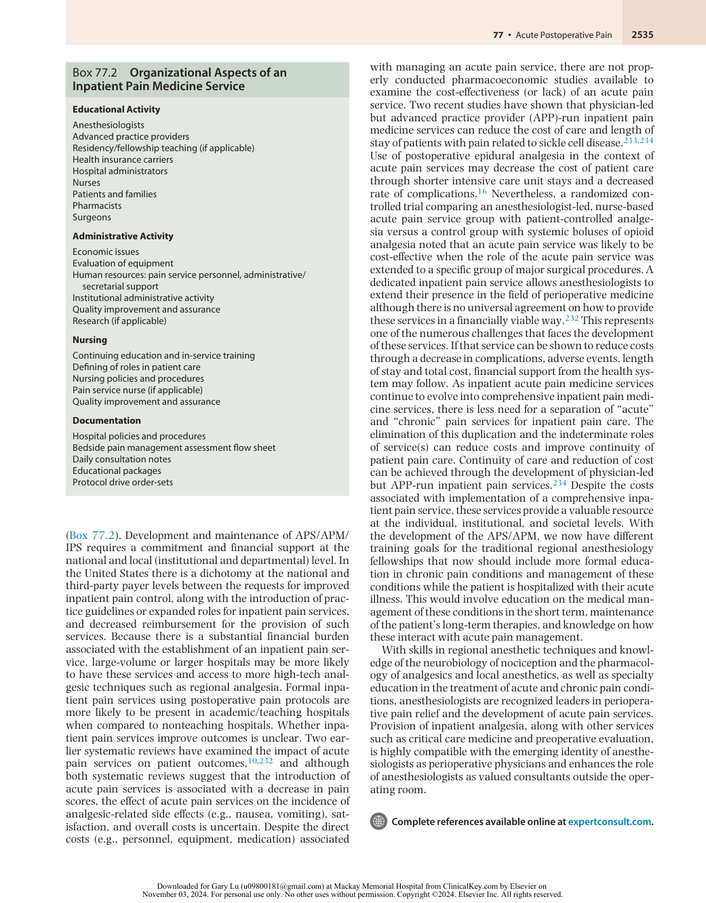

:::

<!-- PDF page 25 -->

### References

1.  Carr DB, et al. _Acute Pain Management: Operative or Medical Procedures and Trauma_ . US Department of Health and Human Services; 1992.

2.  Mariano ER, et al. _Reg Anesth Pain Med_ . 2022;47(2):118.

3.  American Society of Anesthesiologists Task Force on Acute Pain Management. _Anesthesiology_ . 2012;116(2):248.

4.  OPEN. https://michigan- open.org/prescribing- recommendations/.

5.  Joint Commission Statement on Pain Management. https://www.jointc ommission.org/joint_commission_statement_on_pain_management/.

6.  Chou R, et al. _J Pain_ . 2016;17(2):131.

- 7a.  Schug SA, et al. Acute pain management: scientific evidence. In: _Australian and New Zealand College of Anaesthetists and Faculty of Pain Medicine_ . 5th ed. 2020.

- 7b.  PROSPECT. https://esraeurope.org/prospect/.

- 7c.  NICE. https://www.nice.org.uk/guidance/ng180/evidence/n1-managing-acute-postoperative-pain-pdf-317993437913.

8.  Julius D, et al. _Nature_ . 2001;413(6852):203.

9.  Kissin I. _Anesthesiology_ . 2000;93(4):1138.

10.  Carr DB, et al. _Lancet_ . 1999;353(9169):2051.

11.  Besson JM. _Lancet_ . 1999;353(9164):1610.

12.  Perkins FM. _Anesthesiology_ . 2000;93(4):1123.

13.  Kehlet H, et al. _Br J Anaesth_ . 2001;87(1):62.

14.  Kehlet H. _Neural Blockade_ . Philadelphia: Lippincott- Raven; 1998:129.

15.  Desborough JP. _Br J Anaesth_ . 2000;85(1):109.

16.  Wu CL. _Anesth Analg_ . 2000;91(5):1232.

17.  Liu S, et al. _Anesthesiology_ . 1995;82(6):1474.

18.  Kehlet H, et al. _Lancet_ . 2006;367(9522):1618.

19.  Macrae WA. _Br J Anaesth_ . 2001;87(1):88.

20.  Eisenach JC. _Reg Anesth Pain Med_ . 2006;31(2):146.

21.  Capdevila X, et al. _Anesthesiology_ . 1999;91(1):8.

22.  Carli F, et al. _Anesthesiology_ . 2002;97(3):540.

23.  Brennan TJ, et al. _J Pain_ . 2000;1(2):96.

24.  Moiniche S, et al. _Anesthesiology_ . 2002;96(3):725.

25.  Ong CK, et al. _Anesth Analg_ . 2005;100(3):757, table of contents.

26.  Boisseau N, et al. _Br J Anaesth_ . 2001;87(4):564.

27.  Kehlet H, et al. _Am J Surg_ . 2002;183(6):630.

28.  Wick EC, et al. _JAMA Surg_ . 2017;152(7):691.

29.  George JA, et al. _Can J Anaesth_ . 2018;65(5):569.

30.  Stone AB, et al. _J Am Coll Surg_ . 2016;222(3):219.

31.  Wu CL, et al. _Jt Comm J Qual Patient Safety_ . 2015;41(10):447.

32.  Practice guidelines for acute pain management in the perioperative setting. _Anesthesiology_ . 1995;82(4):1071.

33.  Macintyre PE. _Br J Anaesth_ . 2001;87(1):36.

34.  Camu F, et al. _Anesth Analg_ . 1998;87(4):890.

35.  George JA, et al. _J Opioid Manag_ . 2010;6(1):47.

36.  Hudcova J, et al. _Cochrane Database Syst Rev_ . 2006;4:CD003348.

37.  Wu CL, et al. _Reg Anesth Pain Med_ . 2001;26(3):196.

38.  Cashman JN, et al. _Br J Anaesth_ . 2004;93(2):212.

39.  Looi- Lyons LC, et al. _J Clin Anesth_ . 1996;8(2):151.

40.  Schein JR, et al. _Drug Saf_ . 2009;32(7):549.

41.  Svensson CI, et al. _Annu Rev Pharmacol Toxicol_ . 2002;42:553.

42.  Sinatra R. _J Pain Symptom Manage_ . 2002;24(suppl 1):S18.

43.  Kis B, et al. _J Pharmacol Exp Ther_ . 2005;315(1):1.

44.  Elia N, et al. _Anesthesiology_ . 2005;103(6):1296.

45.  Remy C, et al. _Br J Anaesth_ . 2005;94(4):505.

46.  Straube S, et al. _Acta Anaesthesiol Scand_ . 2005;49(5):601.

47.  Marret E, et al. _Anesthesiology_ . 2005;102(6):1249.

48.  O’Connor JP, et al. _Drugs Today_ . 2008;44(9):693.

49.  Dodwell ER, et al. _Calcif Tissue Int_ . 2010;87(3):193.

50.  Li Q, et al. _Spine_ . 2011;36(7):E461.

51.  Lee A, et al. _Cochrane Database Syst Rev_ . 2007;(2):CD002765.

52.  Knowles SR, et al. _Ann Pharmacother_ . 2007;41(7):1191.

53.  Laine L. _J Pain Symptom Manage_ . 2002;23(4):S5.

54.  Leese PT, et al. _J Clin Pharmacol_ . 2000;40(2):124.

55.  Brophy JM. _Expert Opin Drug Saf_ . 2005;4(6):1005.

56.  Nussmeier NA, et al. _N Engl J Med_ . 2005;352(11):1081.

57.  Nussmeier NA, et al. _Anesthesiology_ . 2006;104(3):518.

58.  Obeid S, et al. _Eur Heart J Cardiovasc Pharmacother_ . 2022;8(6):611.

59.  Liu SS, et al. _Reg Anesth Pain Med_ . 2012;37(1):45.

60.  Nissen SE, et al. _N Engl J Med_ . 2016;375(26):2519.

61.  Lloyd R, et al. _Cochrane Database Syst Rev_ . 2009;(2):CD004771.

62.  Khan JS, et al. _Eur J Anaesthesiol_ . 2016;33(3):204.

63.  Teerawattananon C, et al. _Semin Arthritis Rheumatism_ . 2017; 46(4):520.

64.  Bhangu A, et al. _World J Surg_ . 2014;38(9):2247.

65.  Burton TP, et al. _Dis Colon Rectum_ . 2013;56(1):126.

66.  Smith HS. _Pain Physician_ . 2009;12(1):269.

67.  Smith HS. _Pain Med_ . 2011;12(6):961.

68.  Sinatra RS, et al. _Pain Pract_ . 2012;12(5):357.

69.  Yang L, et al. _Int J Surg_ . 2017;47:135.

70.  Langford RA, et al. _Anesth Analg_ . 2016;123(3):610.

71.  Poeran J, et al. _Reg Anesth Pain Med_ . 2015;40(3):284.

72.  MacIntyre IM, et al. _Circulation_ . 2022;145(6):416.

73.  Bockbrader HN, et al. _Clin Pharmacokinet_ . 2010;49(10):661.

74.  Mathiesen O, et al. _BMC Anesthesiol_ . 2007;7:6.

75.  Peng PW, et al. _Pain Res Manag_ . 2007;12(2):85.

76.  Hurley RW, et al. _Reg Anesth Pain Med_ . 2006;31(3):237.

77.  Zhang J, et al. _Br J Anaesth_ . 2011;106(4):454.

78.  Engelman E, et al. _Acta Anaesthesiol Scand_ . 2011;55(8):927.

79.  Doleman B, et al. _Anaesthesia_ . 2015;70(10):1186.

80.  Fabritius ML, et al. _Acta Anaesthesiol Scand_ . 2016;60(9):1188.

81.  Fabritius ML, et al. _BMC Anesthesiol_ . 2017;17(1).

82.  Fabritius ML, et al. _Br J Anaesth_ . 2017;119(4):775.

83.  Cavalcante AN, et al. _Anesth Analg_ . 2017;125(1):141.

84.  Verret M, et al. _Anesthesiology_ . 2020;133(2):265.

85.  Mao Y, et al. _BMC Musculoskeletal Dis_ . 2016;17(1).

86.  FDA. _Required New Warnings for Gabapentinoids about Risk of Respiratory Depression;_ 2019. https://www.fda.gov/news- events/fda- brief/ fda- brief- fda- requires- new- warnings- gabapentinoids- about- riskrespiratory- depression.

87.  Celerier E, et al. _Anesthesiology_ . 2000;92(2):465.

88.  Brinck EC, et al. _Cochrane Database Syst Rev_ . 2018;12:CD012033.

89.  Laskowski K, et al. _Can J Anaesth_ . 2011;58(10):911.

90.  Dahmani S, et al. _Paediatr Anaesth_ . 2011;21(6):636.

91.  Morgan CJ, et al. _Psychopharmacology (Berl)_ . 2006;188(4):408.

92.  Reeves RR, et al. _Drugs Today_ . 2008;44(11):827.

93.  Altunkaya H, et al. _Anesth Analg_ . 2004;99(5):1461; table of contents.

94.  Edwards JE, et al. _J Pain Symptom Manage_ . 2002;23(2):121.

95.  Ali M, et al. _Eur J Anaesthesiol_ . 2009;26(6):475.

96.  Murphy JD, et al. _J Opioid Manag_ . 2010;6(2):141.

97.  Green JL, et al. _Drug Saf_ . 2021;44(2):235.

98.  Wu CL, et al. _Anesthesiology_ . 2005;103(5):1079–1088; quiz 1109.

99.  Block BM, et al. _JAMA_ . 2003;290(18):2455.

100.  Wheatley RG, et al. _Br J Anaesth_ . 2001;87(1):47.

101.  Neuman MD, et al. _Anesthesiology_ . 2012;117(1):72.

102.  Ahn EJ, et al. _BMJ Open_ . 2019;9(9):e029245.

103.  Neuman MD, et al. _JAMA_ . 2014;311(24):2508.

104.  Chu CC, et al. _Anesthesiology_ . 2015;123(1):136.

105.  Neuman MD, et al. _N Engl J Med_ . 2021;385(22):2025.

106.  Neuman MD, et al. _Ann Intern Med_ . 2022;175(7):952.

107.  Liu SS, et al. _Reg Anesth Pain Med_ . 2002;27(2):122.

108.  Salomaki TE, et al. _Anesthesiology_ . 1991;75(5):790.

109.  Shah JL. _BMJ_ . 2000;321(7266):941.

110.  Dolin SJ, et al. _Br J Anaesth_ . 2005;95(5):584.

111.  Gehling M, et al. _Anaesthesia_ . 2009;64(6):643.

112.  Kjellberg F, et al. _Eur J Anaesthesiol_ . 2001;18(6):346.

113.  Wang J, et al. _Br J Anaesth_ . 1998;80(4):565.

114.  Horlocker TT, et al. _Anesthesiology_ . 2009;110(2):218.

115.  Liu SS, et al. _Anesthesiology_ . 1998;88(3):688.

116.  Wigfull J, et al. _Anaesthesia_ . 2001;56(1):70.

117.  Komatsu H, et al. _Br J Anaesth_ . 2001;87(4):633.

118.  Halpern SH, et al. _Anesth Analg_ . 2009;108(3):921.

119.  Rodgers A, et al. _BMJ_ . 2000;321(7275):1493.

120.  Liu SS, et al. _Anesth Analg_ . 2007;104(3):689.

121.  Holte K, et al. _Reg Anesth Pain Med_ . 2001;26(2):111.

122.  Jorgensen H, et al. _Cochrane Database Syst Rev_ . 2000;4:CD001893.

123.  Liu SS, et al. _Anesthesiology_ . 2004;101(1):153.

124.  Nishimori M, et al. _Cochrane Database Syst Rev_ . 2006;3:CD005059. 125.  Liu SS, et al. _Anesth Analg_ . 2007;105(3):789.

126.  Ballantyne JC, et al. _Anesth Analg_ . 1998;86(3):598.

127.  Rigg JR, et al. _Lancet_ . 2002;359(9314):1276.

128.  Popping DM, et al. _Arch Surg_ . 2008;143(10):990; discussion 1000.

129.  Li YW, et al. _Anesthesiology_ . 2021;135(2):218.

130.  Svircevic V, et al. _Anesthesiology_ . 2011;114(2):271.

131.  Wu CL, et al. _Reg Anesth Pain Med_ . 2004;29(3):257.

132.  Weiss R, et al. _Curr Opin Anaesthesiol_ . 2018;31(5):622.

133.  Snyder GL, et al. _Br J Anaesth_ . 2010;105(2):106.

134.  Hasselager RP, et al. _Anesthesiology_ . 2022;136(3):459. 135.  Chang CC, et al. _Anesthesiology_ . 2010;113(2):279. 136.  Brull R, et al. _Anesth Analg_ . 2007;104(4):965.

<!-- PDF page 26 -->

137.  Horlocker TT, et al. _Reg Anesth Pain Med_ . 2010;35(1):64. 138.  Liu SS, et al. _Reg Anesth Pain Med_ . 2011;36(3):231.

139.  Bateman BT, et al. _Anesth Analg_ . 2013;116(6):1380.

140.  Horlocker TT, et al. _Reg Anesth Pain Med_ . 2000;25(1):83.

141.  Simpson RS, et al. _Reg Anesth Pain Med_ . 2000;25(4):360.

142. _Anesthesiology_ . 2010;112(3):530.

143.  Dolin SJ, et al. _Br J Anaesth_ . 2002;89(3):409.

144.  Rawal N. _Reg Anesth Pain Med_ . 2012;37(3):310.

145.  Harrington P, et al. _Injury_ . 2000;31(5):387.

146.  Richman JM, et al. _Anesth Analg_ . 2006;102(1):248.

147.  Wang H, et al. _Reg Anesth Pain Med_ . 2002;27(2):139.

148.  Liu SS, et al. _Anesth Analg_ . 2003;96(1):263.

149.  Brummett CM, et al. _Int Anesthesiol Clin_ . 2011;49(4):104.

150.  Dada O, et al. _Int J Environ Res Public Health_ . 2019;16(18).

151.  Barry GS, et al. _Br J Anaesth_ . 2021;126(4):862.

152.  An K, et al. _PLoS One_ . 2015;10(4):e0123459.

153.  Dahl V, et al. _Acta Anaesthesiol Scand_ . 2000;44(10):1191.

154.  Gupta A, et al. _Acta Anaesthesiol Scand_ . 2011;55(7):785.

155.  Ilfeld BM. _Anesth Analg_ . 2011;113(4):904.

156.  Ilfeld BM, et al. _Pain_ . 2010;150(3):477.

157.  Liu SS, et al. _Reg Anesth Pain Med_ . 2012;37(4):415.

158.  Ilfeld BM, et al. _Ann Surg Oncol_ . 2015;22(6):2017.

159.  Ilfeld BM, et al. _Pain_ . 2021;162(3):938.

160.  Heesen M, et al. _Anaesthesia_ . 2016;71(12):1471.

161.  Sun EC, et al. _Anesth Analg_ . 2017;125(3):999.

162.  Mueller KG, et al. _Anesth Analg_ . 2017;125(3):1014.

163.  Jagannathan R, et al. _Reg Anesth Pain Med_ . 2019;44(4):447.

164.  El- Boghdadly K, et al. _Reg Anesth Pain Med_ . 2016;41(4):548.

165.  Forero M, et al. _Reg Anesth Pain Med_ . 2016;41(5):621.

166.  Karmakar MK. _Anesthesiology_ . 2001;95(3):771.

167.  Davies RG, et al. _Br J Anaesth_ . 2006;96(4):418.

168.  Schnabel A, et al. _Br J Anaesth_ . 2010;105(6):842.

169.  Joshi GP, et al. _Anesth Analg_ . 2008;107(3):1026.

170.  Kotze A, et al. _Br J Anaesth_ . 2009;103(5):626.

171.  Abdallah FW, et al. _Reg Anesth Pain Med_ . 2012;37(2):193.

172.  Mai CL, et al. _Paediatr Anaesth_ . 2012;22(9):831.

173.  Johns N, et al. _Colorectal Dis_ . 2012;14(10):e635.

174.  Turan A, et al. _J Clin Anesth_ . 2022;77:110640.

175.  Xu L, et al. _Pain Med_ . 2020;21(10):2423.

176.  Wang L, et al. _Pain Ther_ . 2021;10(2):1331.

177.  Chin KJ, et al. _Anaesthesia_ . 2017;72(4):452.

178.  Marija T, et al. _Saudi J Anaesth_ . 2020;14(4):528.

179.  Sun LY, et al. _Can J Anaesth_ . 2022;69(5):614.

180.  Kukreja P, et al. _Cureus_ . 2021;13(10):e18533.

181.  Hoogma DF, et al. _BMJ Open_ . 2021;11(4):e045833.

182.  Gadsden J. _Can J Anaesth_ . 2021;68(3):288.

183.  Shanti CM, et al. _J Trauma_ . 2001;51(3):536.

184.  Rosseland LA. _Reg Anesth Pain Med_ . 2005;30(1):83.

185.  Romsing J, et al. _Acta Anaesthesiol Scand_ . 2000;44(6):672.

186.  Andersen LO, et al. _Br J Anaesth_ . 2014;113(3):360.

187.  Moiniche S, et al. _Reg Anesth Pain Med_ . 1999;24(5):430.

188.  Scheffel PT, et al. _J Shoulder Elbow Surg_ . 2010;19(6):944.

189.  Ernst E, et al. _Am J Med_ . 2001;110(6):481.

190.  Bjordal JM, et al. _Eur J Pain_ . 2003;7(2):181.

191.  Sbruzzi G, et al. _Rev Bras Cir Cardiovasc_ . 2012;27(1):75.

192.  Khan F, et al. _Cochrane Database Syst Rev_ . 2008;(2):CD004957.

193.  Chen YW, et al. _Anesth Analg_ . 2012;114(6):1330.

194.  Eccleston C. _Br J Anaesth_ . 2001;87(1):144.

195.  Morley S, et al. _Pain_ . 1999;80(1–2):1.

196.  Hrobjartsson A, et al. _N Engl J Med_ . 2001;344(21):1594.

197.  FDA. 2012. http://www.fda.gov/downloads/Drugs/DrugSafety/Pos tmarketDrugSafetyInformationforPatientsandProviders/UCM2897 30.pdf.

198.  Huxtable CA, et al. _Anaesth Intensive Care_ . 2011;39(5):804.

199.  Gordon D, et al. _J Pain_ . 2008;9(5):383.

200.  Rozen D, et al. _J Opioid Manag_ . 2006;2(6):353.

201.  Patanwala AE, et al. _Pharmacotherapy_ . 2008;28(12):1453.

202.  Anderson R, et al. _J Pain Symptom Manage_ . 2001;21(5):397.

203.  Woodhouse A, et al. _Pain_ . 1999;80(3):545.

204.  Adam F, et al. _Anesth Analg_ . 2005;100(2):475.

205.  Kohan L, et al. _Reg Anesth Pain Med_ . 2021;46(10):840.

206.  Anderson TA, et al. _Anesthesiology_ . 2017;126(6):1180.

207.  Lembke A, et al. _Pain Med_ . 2019;20(3):425.

208.  American Academy of Pediatrics. _Pediatrics_ . 2001;108(3):793. 209.  Taylor EM, et al. _Pain Res Manag_ . 2008;13(1):25.

210.  Anand KJ, et al. _N Engl J Med_ . 1992;326(1):1.

211.  Breau LM, et al. _Pain Res Manag_ . 2009;14(2):116.

212.  Suresh S, et al. _Anesthesiol Clin_ . 2012;30(1):101. 213.  Kost- Byerly S. _Anesthesiol Clin North Am_ . 2002;20(1):115.

214.  Monitto CL, et al. _Anesth Analg_ . 2000;91(3):573.

215.  Voepel- Lewis T, et al. _Anesth Analg_ . 2008;107(1):70. 216.  van Dijk M, et al. _Pain_ . 2002;98(3):305.

217.  Tyler DC, et al. _Anesth Analg_ . 1995;80(1):14.

218.  Michelet D, et al. _Anesth Analg_ . 2012;114(2):393.

219.  Birmingham PK, et al. _Anesthesiology_ . 2001;94(3):385. 220.  Akbay BK, et al. _J Anesth_ . 2010;24(5):705. 221.  Tsui B, Suresh S. _Anesthesiology_ . 2010;112(2):473. 222.  Pirotte T, et al. _Reg Anesth Pain Med_ . 2002;27(1):110. 223.  De Negri P, et al. _Anesth Analg_ . 2001;93(1):71. 224.  Deer JD, et al. _Curr Opin Anaesthesiol_ . 2016;29(6):691. 225.  Cassady Jr JF, et al. _Reg Anesth Pain Med_ . 2000;25(3):246. 226.  Wu S, et al. _Pediatr Crit Care Med_ . 2009;10(3):291. 227.  Ogden CL, et al. _JAMA_ . 2012;307(5):483. 228.  Hullett BJ, et al. _Paediatr Anaesth_ . 2006;16(6):648. 229.  Zhuang PJ, et al. _Anaesthesia_ . 2011;66(11):989. 230.  Cullen DJ. _J Clin Anesth_ . 2001;13(2):83.

231.  Gross JB, et al. _Anesthesiology_ . 2006;104(5):1081. 232.  Sun E, et al. _Anesth Analg_ . 2010;111(4):841. 233.  Wachnik AA, et al. _Pain Med_ . 2022;23(12):2050. 234.  Welch- Coltrane JL, et al. _Pain Med_ . 2021;22(8):1743.

<!-- PDF page 27 -->

### References

1.  Carr DB, Jacox AK, Chapman RC, et al. _Clinical Practice Guideline: Acute Pain Management: Operative or Medical Procedures and Trauma_ . Rockville, MD: US Department of Health and Human Services; 1992.

2.  Mariano ER, Dickerson DM, Szokol JW, et al. A multisociety organizational consensus process to define guiding principles for acute perioperative pain management. _Reg Anesth Pain Med_ . 2022;47(2):118–127.

3.  American Society of Anesthesiologists Task Force on Acute Pain Management. Practice guidelines for acute pain management in the perioperative setting: an updated report by the American Society of Anesthesiologists Task Force on Acute Pain Management. _Anesthesiology_ . 2012;116(2):248–273.

4.  OPEN. Opioid prescribing. https://michigan- open.org/prescribingrecommendations/.

5.  Joint Commission Statement on Pain Management. https://www.jo intcommission.org/joint_commission_statement_on_pain_manage ment/.

6.  Chou R, Gordon DB, de Leon- Casasola OA, et al. Management of postoperative pain: a clinical practice guideline from the American Pain Society, the American Society of Regional Anesthesia and Pain Medicine, and the American Society of Anesthesiologists’ Committee on Regional Anesthesia, Executive Committee, and Administrative Council. _J Pain_ . 2016;17(2):131–157.

- 7a.  Schug SA, Palmer GM, Scott DA, et al. Acute pain management: scientific evidence. In: _Australian and New Zealand College of Anaesthetists and Faculty of Pain Medicine_ . 5th ed. 2020.

- 7b.  PROSPECT. https://esraeurope.org/prospect/.

- 7c.  NICE. https://www.nice.org.uk/guidance/ng180/evidence/n1-managing-acute-postoperative-pain-pdf-317993437913.

8.  Julius D, Basbaum AI. Molecular mechanisms of nociception. _Nature_ . 2001;413(6852):203–210.

9.  Kissin I. Preemptive analgesia. _Anesthesiology_ . 2000;93(4):1138– 1143.

10.  Carr DB, Goudas LC. Acute pain. _Lancet_ . 1999;353(9169):2051– 2058.

11.  Besson JM. The neurobiology of pain. _Lancet_ . 1999;353(9164):1610– 1615.

12.  Perkins FM, Kehlet H. Chronic pain as an outcome of surgery. A review of predictive factors. _Anesthesiology_ . 2000;93(4):1123– 1133.

13.  Kehlet H, Holte K. Effect of postoperative analgesia on surgical outcome. _Br J Anaesth_ . 2001;87(1):62–72.

14.  Kehlet H. Modification of responses to surgery by neural blockade. _Neural Blockade_ . Philadelphia: Lippincott- Raven; 1998:129–175.

15.  Desborough JP. The stress response to trauma and surgery. _Br J Anaesth_ . 2000;85(1):109–117.

16.  Wu CL, Fleisher LA. Outcomes research in regional anesthesia and analgesia. _Anesth Analg_ . 2000;91(5):1232–1242.

17.  Liu S, Carpenter RL, Neal JM. Epidural anesthesia and analgesia. Their role in postoperative outcome. _Anesthesiology_ . 1995;82(6):1474–1506.

18.  Kehlet H, Jensen TS, Woolf CJ. Persistent postsurgical pain: risk factors and prevention. _Lancet_ . 2006;367(9522):1618–1625.

19.  Macrae WA. Chronic pain after surgery. _Br J Anaesth_ . 2001;87(1):88–98.

20.  Eisenach JC. Treating and preventing chronic pain: a view from the spinal cord – Bonica Lecture, ASRA Annual Meeting, 2005. _Reg Anesth Pain Med_ . 2006;31(2):146–151.

21.  Capdevila X, Barthelet Y, Biboulet P, et al. Effects of perioperative analgesic technique on the surgical outcome and duration of rehabilitation after major knee surgery. _Anesthesiology_ . 1999;91(1):8–15.

22.  Carli F, Mayo N, Klubien K, et al. Epidural analgesia enhances functional exercise capacity and health- related quality of life after colonic surgery: results of a randomized trial. _Anesthesiology_ . 2002;97(3):540–549.

23.  Brennan TJ, Taylor BK. Analgesic treatment before incision compared with treatment after incision provides no improvement in postoperative pain relief. _J Pain_ . 2000;1(2):96–98.

24.  Moiniche S, Kehlet H, Dahl JB. A qualitative and quantitative systematic review of preemptive analgesia for postoperative pain relief: the role of timing of analgesia. _Anesthesiology_ . 2002;96(3):725–741.

25.  Ong CK, Lirk P, Seymour RA, Jenkins BJ. The efficacy of preemptive analgesia for acute postoperative pain management: a metaanalysis. _Anesth Analg_ . 2005;100(3):757–773.

26.  Boisseau N, Rabary O, Padovani B, et al. Improvement of ‘dynamic analgesia’ does not decrease atelectasis after thoracotomy. _Br J Anaesth_ . 2001;87(4):564–569.

27.  Kehlet H, Wilmore DW. Multimodal strategies to improve surgical outcome. _Am J Surg_ . 2002;183(6):630–641.

28.  Wick EC, Grant MC, Wu CL. Postoperative multimodal analgesia pain management with nonopioid analgesics and techniques. _JAMA Surg_ . 2017;152(7):691.

29.  George JA, Koka R, Gan TJ, et al. Review of the enhanced recovery pathway for children: perioperative anesthetic considerations. _Can J Anaesth_ . 2018;65(5):569–577.

30.  Stone AB, Grant MC, Pio Roda C, et al. Implementation costs of an enhanced recovery after surgery program in the United States: a financial model and sensitivity analysis based on experiences at a quaternary academic medical center. _J Am Coll Surg_ . 2016;222(3):219–225.

31.  Wu CL, Benson AR, Hobson DB, et al. Initiating an enhanced recovery pathway program: an anesthesiology department’s perspective. _Jt Comm J Quality Patient Safety_ . 2015;41(10):447–456.

32.  Practice guidelines for acute pain management in the perioperative setting. A report by the American Society of Anesthesiologists Task Force on Pain Management, Acute Pain Section. _Anesthesiology_ . 1995;82(4):1071–1081.

33.  Macintyre PE. Safety and efficacy of patient- controlled analgesia. _Br J Anaesth_ . 2001;87(1):36–46.

34.  Camu F, Van Aken H, Bovill JG. Postoperative analgesic effects of three demand- dose sizes of fentanyl administered by patientcontrolled analgesia. _Anesth Analg_ . 1998;87(4):890–895.

35.  George JA, Lin EE, Hanna MN, et al. The effect of intravenous opioid patient- controlled analgesia with and without background infusion on respiratory depression: a meta- analysis. _J Opioid Manag_ . 2010;6(1):47–54.

36.  Hudcova J, McNicol E, Quah C, et al. Patient controlled opioid analgesia versus conventional opioid analgesia for postoperative pain. _Cochrane Database Syst Rev_ . 2006(4):CD003348.

37.  Wu CL, Naqibuddin M, Fleisher LA. Measurement of patient satisfaction as an outcome of regional anesthesia and analgesia: a systematic review. _Reg Anesth Pain Med_ . 2001;26(3):196–208.

38.  Cashman JN, Dolin SJ. Respiratory and haemodynamic effects of acute postoperative pain management: evidence from published data. _Br J Anaesth_ . 2004;93(2):212–223.

39.  Looi- Lyons LC, Chung FF, Chan VW, McQuestion M. Respiratory depression: an adverse outcome during patient controlled analgesia therapy. _J Clin Anesth_ . 1996;8(2):151–156.

40.  Schein JR, Hicks RW, Nelson WW, et al. Patient- controlled analgesiarelated medication errors in the postoperative period: causes and prevention. _Drug Saf_ . 2009;32(7):549–559.

41.  Svensson CI, Yaksh TL. The spinal phospholipase- cyclooxygenaseprostanoid cascade in nociceptive processing. _Annu Rev Pharmacol Toxicol_ . 2002;42:553–583.

42.  Sinatra R. Role of COX- 2 inhibitors in the evolution of acute pain management. _J Pain Symptom Manage_ . 2002;24(suppl 1):S18– 27.

43.  Kis B, Snipes JA, Busija DW. Acetaminophen and the cyclooxygenase- 3 puzzle: sorting out facts, fictions, and uncertainties. _J Pharmacol Exp Ther_ . 2005;315(1):1–7.

44.  Elia N, Lysakowski C, Tramer MR. Does multimodal analgesia with acetaminophen, nonsteroidal antiinflammatory drugs, or selective cyclooxygenase- 2 inhibitors and patient- controlled analgesia morphine offer advantages over morphine alone? Meta- analyses of randomized trials. _Anesthesiology_ . 2005;103(6):1296–1304.

45.  Remy C, Marret E, Bonnet F. Effects of acetaminophen on morphine side- effects and consumption after major surgery: meta- analysis of randomized controlled trials. _Br J Anaesth_ . 2005;94(4):505–513.

46.  Straube S, Derry S, McQuay HJ, Moore RA. Effect of preoperative COX- II- selective NSAIDs (coxibs) on postoperative outcomes: a systematic review of randomized studies. _Acta Anaesthesiol Scand_ . 2005;49(5):601–613.

47.  Marret E, Kurdi O, Zufferey P, Bonnet F. Effects of nonsteroidal antiinflammatory drugs on patient- controlled analgesia morphine side effects: meta- analysis of randomized controlled trials. _Anesthesiology_ . 2005;102(6):1249–1260.

48.  O’Connor JP, Lysz T. Celecoxib, NSAIDs and the skeleton. _Drugs Today_ . 2008;44(9):693–709.

<!-- PDF page 28 -->

49.  Dodwell ER, Latorre JG, Parisini E, et al. NSAID exposure and risk of nonunion: a meta- analysis of case- control and cohort studies. _Calcif Tissue Int_ . 2010;87(3):193–202.

50.  Li Q, Zhang Z, Cai Z. High- dose ketorolac affects adult spinal fusion: a meta- analysis of the effect of perioperative nonsteroidal antiinflammatory drugs on spinal fusion. _Spine_ . 2011;36(7):E461–468.

51.  Lee A, Cooper MG, Craig JC, et al. Effects of nonsteroidal antiinflammatory drugs on postoperative renal function in adults with normal renal function. _Cochrane Database Syst Rev_ . 2007(2):CD002765.

52.  Knowles SR, Drucker AM, Weber EA, Shear NH. Management options for patients with aspirin and nonsteroidal antiinflammatory drug sensitivity. _Ann Pharmacother_ . 2007;41(7):1191–1200.

53.  Laine L. Gastrointestinal safety of coxibs and outcomes studies: what’s the verdict? _J Pain Symptom Manage_ . 2002;23(4):S5–S10.

54.  Leese PT, Hubbard RC, Karim A, et al. Effects of celecoxib, a novel cyclooxygenase- 2 inhibitor, on platelet function in healthy adults: a randomized, controlled trial. _J Clin Pharmacol_ . 2000;40(2):124– 132.

55.  Brophy JM. Celecoxib and cardiovascular risks. _Expert Opin Drug Saf_ . 2005;4(6):1005–1015.

56.  Nussmeier NA, Whelton AA, Brown MT, et al. Complications of the COX- 2 inhibitors parecoxib and valdecoxib after cardiac surgery. _N Engl J Med_ . 2005;352(11):1081–1091.

57.  Nussmeier NA, Whelton AA, Brown MT, et al. Safety and efficacy of the cyclooxygenase- 2 inhibitors parecoxib and valdecoxib after noncardiac surgery. _Anesthesiology_ . 2006;104(3):518–526.

58.  Obeid S, Libby P, Husni E, et al. Cardiorenal risk of celecoxib compared to naproxen, or ibuprofen in arthritis patients: insights from the PRECISION trial. _Eur Heart J Cardiovasc Pharmacother_ . 2022;8(6):611–621.

59.  Liu SS, Bae JJ, Bieltz M, et al. Association of perioperative use of nonsteroidal anti- inflammatory drugs with postoperative myocardial infarction after total joint replacement. _Reg Anesth Pain Med_ . 2012;37(1):45–50.

60.  Nissen SE, Yeomans ND, Solomon DH, et al. Cardiovascular safety of celecoxib, naproxen, or ibuprofen for arthritis. _N Engl J Med_ . 2016;375(26):2519–2529.

61.  Lloyd R, Derry S, Moore RA, McQuay HJ. Intravenous or intramuscular parecoxib for acute postoperative pain in adults. _Cochrane Database Syst Rev_ . 2009(2):CD004771.

62.  Khan JS, Margarido C, Devereaux PJ, et al. Preoperative celecoxib in noncardiac surgery. _Eur J Anaesthesiol_ . 2016;33(3):204–214.

63.  Teerawattananon C, Tantayakom P, Suwanawiboon B, Katchamart W. Risk of perioperative bleeding related to highly selective cyclooxygenase- 2 inhibitors: a systematic review and meta- analysis. _Semin Arthritis Rheumatism_ . 2017;46(4):520–528.

64.  Bhangu A, Singh P, Fitzgerald JEF, et al. Postoperative nonsteroidal anti- inflammatory drugs and risk of anastomotic leak: meta- analysis of clinical and experimental studies. _World J Surg_ . 2014;38(9):2247– 2257.

65.  Burton TP, Mittal A, Soop M. Nonsteroidal anti- inflammatory drugs and anastomotic dehiscence in bowel surgery. _Dis Colon Rectum_ . 2013;56(1):126–134.

66.  Smith HS. Potential analgesic mechanisms of acetaminophen. _Pain Physician_ . 2009;12(1):269–280.

67.  Smith HS. Perioperative intravenous acetaminophen and NSAIDs. _Pain Med_ . 2011;12(6):961–981.

68.  Sinatra RS, Jahr JS, Reynolds L, et al. Intravenous acetaminophen for pain after major orthopedic surgery: an expanded analysis. _Pain Pract_ . 2012;12(5):357–365.

69.  Yang L, Du S, Sun Y. Intravenous acetaminophen as an adjunct to multimodal analgesia after total knee and hip arthroplasty: a systematic review and meta- analysis. _Int J Surg_ . 2017;47:135– 146.

70.  Langford RA, Hogg M, Bjorksten AR, et al. Comparative plasma and cerebrospinal fluid pharmacokinetics of paracetamol after intravenous and oral administration. _Anesth Analg_ . 2016;123(3):610– 615.

71.  Poeran J, Babby J, Rasul R, et al. Tales from the Wild West of US drug pricing: the case of intravenous acetaminophen. _Reg Anesth Pain Med_ . 2015;40(3):284–286.

72.  MacIntyre IM, Turtle EJ, Farrah TE, et al. Regular acetaminophen use and blood pressure in people with hypertension: the PATH- BP Trial. _Circulation_ . 2022;145(6):416–423.

73.  Bockbrader HN, Wesche D, Miller R, et al. A comparison of the pharmacokinetics and pharmacodynamics of pregabalin and gabapentin. _Clin Pharmacokinet_ . 2010;49(10):661–669.

74.  Mathiesen O, Moiniche S, Dahl JB. Gabapentin and postoperative pain: a qualitative and quantitative systematic review, with focus on procedure. _BMC Anesthesiol_ . 2007;7:6.

75.  Peng PW, Wijeysundera DN, Li CC. Use of gabapentin for perioperative pain control – a meta- analysis. _Pain Res Manag_ . 2007;12(2):85– 92.

76.  Hurley RW, Cohen SP, Williams KA, et al. The analgesic effects of perioperative gabapentin on postoperative pain: a meta- analysis. _Reg Anesth Pain Med_ . 2006;31(3):237–247.

77.  Zhang J, Ho KY, Wang Y. Efficacy of pregabalin in acute postoperative pain: a meta- analysis. _Br J Anaesth_ . 2011;106(4):454–462.

78.  Engelman E, Cateloy F. Efficacy and safety of perioperative pregabalin for post- operative pain: a meta- analysis of randomized- controlled trials. _Acta Anaesthesiol Scand_ . 2011;55(8):927–943.

79.  Doleman B, Heinink TP, Read DJ, et al. A systematic review and meta- regression analysis of prophylactic gabapentin for postoperative pain. _Anaesthesia_ . 2015;70(10):1186–1204.

80.  Fabritius ML, Geisler A, Petersen PL, et al. Gabapentin for postoperative pain management – a systematic review with metaanalyses and trial sequential analyses. _Acta Anaesthesiol Scand_ . 2016;60(9):1188–1208.

81.  Fabritius ML, Geisler A, Petersen PL, et al. Gabapentin in procedurespecific postoperative pain management – preplanned subgroup analyses from a systematic review with meta- analyses and trial sequential analyses. _BMC Anesthesiol_ . 2017;17(1).

82.  Fabritius ML, Strøm C, Koyuncu S, et al. Benefit and harm of pregabalin in acute pain treatment: a systematic review with meta- analyses and trial sequential analyses. _Br J Anaesth_ . 2017;119(4):775–791.

83.  Cavalcante AN, Sprung J, Schroeder DR, Weingarten TN. Multimodal analgesic therapy with gabapentin and its association with postoperative respiratory depression. _Anesth Analg_ . 2017;125(1):141–146.

84.  Verret M, Lauzier F, Zarychanski R, et al. Perioperative use of gabapentinoids for the management of postoperative acute pain: a systematic review and meta- analysis. _Anesthesiology_ . 2020;133(2):265–279.

85.  Mao Y, Wu L, Ding W. The efficacy of preoperative administration of gabapentin/pregabalin in improving pain after total hip arthroplasty: a meta- analysis. _BMC Muscoskel Disord_ . 2016;17(1).

86.  FDA. _FDA Required New Warnings for Gabapentinoids about Risk of Respiratory Depression_ ; 2019. https://www.fda.gov/newsevents/fda- brief/fda- brief- fda- requires- new- warningsgabapentinoids- about- risk- respiratory- depression.

87.  Celerier E, Rivat C, Jun Y, et al. Long- lasting hyperalgesia induced by fentanyl in rats: preventive effect of ketamine. _Anesthesiology_ . 2000;92(2):465–472.

88.  Brinck EC, Tiippana E, Heesen M, et al. Perioperative intravenous ketamine for acute postoperative pain in adults. _Cochrane Database Syst Rev_ . 2018;12:CD012033.

89.  Laskowski K, Stirling A, McKay WP, Lim HJ. A systematic review of intravenous ketamine for postoperative analgesia. _Can J Anaesth_ . 2011;58(10):911–923.

90.  Dahmani S, Michelet D, Abback PS, et al. Ketamine for perioperative pain management in children: a meta- analysis of published studies. _Paediatr Anaesth_ . 2011;21(6):636–652.

91.  Morgan CJ, Curran HV. Acute and chronic effects of ketamine upon human memory: a review. _Psychopharmacology (Berl)_ . 2006;188(4):408–424.

92.  Reeves RR, Burke RS. Tramadol: basic pharmacology and emerging concepts. _Drugs Today_ . 2008;44(11):827–836.

93.  Altunkaya H, Ozer Y, Kargi E, et al. The postoperative analgesic effect of tramadol when used as subcutaneous local anesthetic. _Anesth Analg_ . 2004;99(5):1461–1464.

94.  Edwards JE, McQuay HJ, Moore RA. Combination analgesic efficacy: individual patient data meta- analysis of single- dose oral tramadol plus acetaminophen in acute postoperative pain. _J Pain Symptom Manage_ . 2002;23(2):121–130.

95.  Ali M, Khan FA. Comparison of analgesic effect of tramadol alone and a combination of tramadol and paracetamol in day- care laparoscopic surgery. _Eur J Anaesthesiol_ . 2009;26(6):475–479.

96.  Murphy JD, Yan D, Hanna MN, et al. Comparison of the postoperative analgesic efficacy of intravenous patient- controlled analgesia with tramadol to intravenous patient- controlled analgesia with opioids. _J Opioid Manag_ . 2010;6(2):141–147.

<!-- PDF page 29 -->

97.  Green JL, Dailey- Govoni T, Butler SF. Real- world data on nonmedical use of tramadol from patients evaluated for substance abuse treatment in the NAVIPPRO Addiction Severity Index- Multimedia Version (ASI- MV((R))) Network. _Drug Saf_ . 2021;44(2):235–244.

98.  Wu CL, Cohen SR, Richman JM, et al. Efficacy of postoperative patient- controlled and continuous infusion epidural analgesia versus intravenous patient- controlled analgesia with opioids: a meta- analysis. _Anesthesiology_ . 2005;103(5):1079–1088; quiz 1109–1010.

99.  Block BM, Liu SS, Rowlingson AJ, et al. Efficacy of postoperative epidural analgesia: a meta- analysis. _JAMA_ . 2003;290(18):2455– 2463.

100.  Wheatley RG, Schug SA, Watson D. Safety and efficacy of postoperative epidural analgesia. _Br J Anaesth_ . 2001;87(1):47–61.

101.  Neuman MD, Silber JH, Elkassabany NM, et al. Comparative effectiveness of regional versus general anesthesia for hip fracture surgery in adults. _Anesthesiology_ . 2012;117(1):72–92.

102.  Ahn EJ, Kim HJ, Kim KW, et al. Comparison of general anaesthesia and regional anaesthesia in terms of mortality and complications in elderly patients with hip fracture: a nationwide population- based study. _BMJ Open_ . 2019;9(9):e029245.

103.  Neuman MD, Rosenbaum PR, Ludwig JM, et al. Anesthesia technique, mortality, and length of stay after hip fracture surgery. _JAMA_ . 2014;311(24):2508–2517.

104.  Chu CC, Weng SF, Chen KT, et al. Propensity score- matched comparison of postoperative adverse outcomes between geriatric patients given a general or a neuraxial anesthetic for hip surgery: a population- based study. _Anesthesiology_ . 2015;123(1):136–147.

105.  Neuman MD, Feng R, Carson JL, et al. Spinal anesthesia or general anesthesia for hip surgery in older adults. _N Engl J Med_ . 2021;385(22):2025–2035.

106.  Neuman MD, Feng R, Ellenberg SS, et al. Pain, analgesic use, and patient satisfaction with spinal versus general anesthesia for hip fracture surgery: a randomized clinical trial. _Ann Intern Med_ . 2022;175(7):952–960.

107.  Liu SS, Bernards CM. Exploring the epidural trail. _Reg Anesth Pain Med_ . 2002;27(2):122–124.

108.  Salomaki TE, Laitinen JO, Nuutinen LS. A randomized double- blind comparison of epidural versus intravenous fentanyl infusion for analgesia after thoracotomy. _Anesthesiology_ . 1991;75(5):790– 795.

109.  Shah JL. Lesson of the week: postoperative pressure sores after epidural anaesthesia. _BMJ_ . 2000;321(7266):941–942.

110.  Dolin SJ, Cashman JN. Tolerability of acute postoperative pain management: nausea, vomiting, sedation, pruritus, and urinary retention. Evidence from published data. _Br J Anaesth_ . 2005;95(5):584–591.

111.  Gehling M, Tryba M. Risks and side- effects of intrathecal morphine combined with spinal anaesthesia: a meta- analysis. _Anaesthesia_ . 2009;64(6):643–651.

112.  Kjellberg F, Tramer MR. Pharmacological control of opioid- induced pruritus: a quantitative systematic review of randomized trials. _Eur J Anaesthesiol_ . 2001;18(6):346–357.

113.  Wang J, Pennefather S, Russell G. Low- dose naloxone in the treatment of urinary retention during extradural fentanyl causes excessive reversal of analgesia. _Br J Anaesth_ . 1998;80(4):565–566.

114.  Horlocker TT, Burton AW, Connis RT, et al. Practice guidelines for the prevention, detection, and management of respiratory depression associated with neuraxial opioid administration. _Anesthesiology_ . 2009;110(2):218–230.

115.  Liu SS, Allen HW, Olsson GL. Patient- controlled epidural analgesia with bupivacaine and fentanyl on hospital wards: prospective experience with 1,030 surgical patients. _Anesthesiology_ . 1998;88(3):688– 695.

116.  Wigfull J, Welchew E. Survey of 1057 patients receiving postoperative patient- controlled epidural analgesia. _Anaesthesia_ . 2001;56(1):70–75.

117.  Komatsu H, Matsumoto S, Mitsuhata H. Comparison of patientcontrolled epidural analgesia with and without night- time infusion following gastrectomy. _Br J Anaesth_ . 2001;87(4):633–635.

118.  Halpern SH, Carvalho B. Patient- controlled epidural analgesia for labor. _Anesth Analg_ . 2009;108(3):921–928.

119.  Rodgers A, Walker N, Schug S, et al. Reduction of postoperative mortality and morbidity with epidural or spinal anaesthesia: results from overview of randomised trials. _BMJ_ . 2000;321(7275):1493.

120.  Liu SS, Wu CL. Effect of postoperative analgesia on major postoperative complications: a systematic update of the evidence. _Anesth Analg_ . 2007;104(3):689–702.

121.  Holte K, Kehlet H. Epidural analgesia and risk of anastomotic leakage. _Reg Anesth Pain Med_ . 2001;26(2):111–117.

122.  Jorgensen H, Wetterslev J, Moiniche S, Dahl JB. Epidural local anaesthetics versus opioid- based analgesic regimens on postoperative gastrointestinal paralysis, PONV and pain after abdominal surgery. _Cochrane Database Syst Rev_ . 2000(4):CD001893.

123.  Liu SS, Block BM, Wu CL. Effects of perioperative central neuraxial analgesia on outcome after coronary artery bypass surgery: a metaanalysis. _Anesthesiology_ . 2004;101(1):153–161.

124.  Nishimori M, Ballantyne JC, Low JH. Epidural pain relief versus systemic opioid- based pain relief for abdominal aortic surgery. _Cochrane Database Syst Rev_ . 2006(3):CD005059.

125.  Liu SS, Wu CL. The effect of analgesic technique on postoperative patient- reported outcomes including analgesia: a systematic review. _Anesth Analg_ . 2007;105(3):789–808.

126.  Ballantyne JC, Carr DB, deFerranti S, et al. The comparative effects of postoperative analgesic therapies on pulmonary outcome: cumulative meta- analyses of randomized, controlled trials. _Anesth Analg_ . 1998;86(3):598–612.

127.  Rigg JR, Jamrozik K, Myles PS, et al. Epidural anaesthesia and analgesia and outcome of major surgery: a randomised trial. _Lancet_ . 2002;359(9314):1276–1282.

128.  Popping DM, Elia N, Marret E, et al. Protective effects of epidural analgesia on pulmonary complications after abdominal and thoracic surgery: a meta- analysis. _Arch Surg_ . 2008;143(10):990–999; discussion 1000.

129.  Li YW, Li HJ, Li HJ, et al. Delirium in older patients after combined epidural- general anesthesia or general anesthesia for major surgery: a randomized trial. _Anesthesiology_ . 2021;135(2):218–232.

130.  Svircevic V, van Dijk D, Nierich AP, et al. Meta- analysis of thoracic epidural anesthesia versus general anesthesia for cardiac surgery. _Anesthesiology_ . 2011;114(2):271–282.

131.  Wu CL, Hsu W, Richman JM, Raja SN. Postoperative cognitive function as an outcome of regional anesthesia and analgesia. _Reg Anesth Pain Med_ . 2004;29(3):257–268.

132.  Weiss R, Popping DM. Is epidural analgesia still a viable option for enhanced recovery after abdominal surgery. _Curr Opin Anaesthesiol_ . 2018;31(5):622–629.

133.  Snyder GL, Greenberg S. Effect of anaesthetic technique and other perioperative factors on cancer recurrence. _Br J Anaesth_ . 2010;105(2):106–115.

134.  Hasselager RP, Hallas J, Gogenur I. Epidural analgesia and recurrence after colorectal cancer surgery: a Danish retrospective registrybased cohort study. _Anesthesiology_ . 2022;136(3):459–471.

135.  Chang CC, Lin HC, Lin HW. Anesthetic management and surgical site infections in total hip or knee replacement: a population- based study. _Anesthesiology_ . 2010;113(2):279–284.

136.  Brull R, McCartney CJ, Chan VW, El- Beheiry H. Neurological complications after regional anesthesia: contemporary estimates of risk. _Anesth Analg_ . 2007;104(4):965–974.

137.  Horlocker TT, Wedel DJ, Rowlingson JC, et al. Regional anesthesia in the patient receiving antithrombotic or thrombolytic therapy: American Society of Regional Anesthesia and Pain Medicine Evidence- based Guidelines (Third Edition). _Reg Anesth Pain Med_ . 2010;35(1):64–101.

138.  Liu SS, Buvanendran A, Viscusi ER, et al. Uncomplicated removal of epidural catheters in 4365 patients with international normalized ratio greater than 1.4 during initiation of warfarin therapy. _Reg Anesth Pain Med_ . 2011;36(3):231–235.

139.  Bateman BT, Mhyre JM, Ehrenfeld J, et al. The risk and outcomes of epidural hematomas after perioperative and obstetric epidural catheterization: a report from the Multicenter Perioperative Outcomes Group Research Consortium. _Anesth Analg_ . 2013;116(6):1380–1385.

140.  Horlocker TT, Wedel DJ. Neurologic complications of spinal and epidural anesthesia. _Reg Anesth Pain Med_ . 2000;25(1):83–98.

141.  Simpson RS, Macintyre PE, Shaw D, et al. Epidural catheter tip cultures: results of a 4- year audit and implications for clinical practice. _Reg Anesth Pain Med_ . 2000;25(4):360–367.

142.  Practice advisory for the prevention, diagnosis, and management of infectious complications associated with neuraxial techniques: a report by the American Society of Anesthesiologists Task Force on Infectious Complications Associated with Neuraxial Techniques. _Anesthesiology_ . 2010;112(3):530–545.

<!-- PDF page 30 -->

143.  Dolin SJ, Cashman JN, Bland JM. Effectiveness of acute postoperative pain management: I. Evidence from published data. _Br J Anaesth_ . 2002;89(3):409–423.

144.  Rawal N. Epidural technique for postoperative pain: gold standard no more? _Reg Anesth Pain Med_ . 2012;37(3):310–317.

145.  Harrington P, Bunola J, Jennings AJ, et al. Acute compartment syndrome masked by intravenous morphine from a patient- controlled analgesia pump. _Injury_ . 2000;31(5):387–389.

146.  Richman JM, Liu SS, Courpas G, et al. Does continuous peripheral nerve block provide superior pain control to opioids? A metaanalysis. _Anesth Analg_ . 2006;102(1):248–257.

147.  Wang H, Boctor B, Verner J. The effect of single- injection femoral nerve block on rehabilitation and length of hospital stay after total knee replacement. _Reg Anesth Pain Med_ . 2002;27(2):139–144.

148.  Liu SS, Salinas FV. Continuous plexus and peripheral nerve blocks for postoperative analgesia. _Anesth Analg_ . 2003;96(1):263–272.

149.  Brummett CM, Williams BA. Additives to local anesthetics for peripheral nerve blockade. _Int Anesthesiol Clin_ . 2011;49(4):104–116.

150.  Dada O, Gonzalez Zacarias A, Ongaigui C, et al. Does rebound pain after peripheral nerve block for orthopedic surgery impact postoperative analgesia and opioid consumption? A narrative review. _Int J Environ Res Public Health_ . 2019;16(18).

151.  Barry GS, Bailey JG, Sardinha J, et al. Factors associated with rebound pain after peripheral nerve block for ambulatory surgery. _Br J Anaesth_ . 2021;126(4):862–871.

152.  An K, Elkassabany NM, Liu J. Dexamethasone as adjuvant to bupivacaine prolongs the duration of thermal antinociception and prevents bupivacaine- induced rebound hyperalgesia via regional mechanism in a mouse sciatic nerve block model. _PLoS One_ . 2015;10(4):e0123459.

153.  Dahl V, Raeder JC. Non- opioid postoperative analgesia. _Acta Anaesthesiol Scand_ . 2000;44(10):1191–1203.

154.  Gupta A, Favaios S, Perniola A, et al. A meta- analysis of the efficacy of wound catheters for post- operative pain management. _Acta Anaesthesiol Scand_ . 2011;55(7):785–796.

155.  Ilfeld BM. Continuous peripheral nerve blocks: a review of the published evidence. _Anesth Analg_ . 2011;113(4):904–925.

156.  Ilfeld BM, Mariano ER, Girard PJ, et al. A multicenter, randomized, triple- masked, placebo- controlled trial of the effect of ambulatory continuous femoral nerve blocks on discharge- readiness following total knee arthroplasty in patients on general orthopaedic wards. _Pain_ . 2010;150(3):477–484.

157.  Liu SS, Buvanendran A, Rathmell JP, et al. A cross- sectional survey on prevalence and risk factors for persistent postsurgical pain 1 year after total hip and knee replacement. _Reg Anesth Pain Med_ . 2012;37(4):415–422.

158.  Ilfeld BM, Madison SJ, Suresh PJ, et al. Persistent postmastectomy pain and pain- related physical and emotional functioning with and without a continuous paravertebral nerve block: a prospective 1- year follow- up assessment of a randomized, triple- masked, placebo- controlled study. _Ann Surg Oncol_ . 2015;22(6):2017–2025.

159.  Ilfeld BM, Khatibi B, Maheshwari K, et al. Ambulatory continuous peripheral nerve blocks to treat postamputation phantom limb pain: a multicenter, randomized, quadruple- masked, placebo- controlled clinical trial. _Pain_ . 2021;162(3):938–955.

160.  Heesen M, Klimek M, Rossaint R, et al. Paravertebral block and persistent postoperative pain after breast surgery: meta- analysis and trial sequential analysis. _Anaesthesia_ . 2016;71(12):1471–1481.

161.  Sun EC, Bateman BT, Memtsoudis SG, et al. Lack of association between the use of nerve blockade and the risk of postoperative chronic opioid use among patients undergoing total knee arthroplasty: evidence from the Marketscan Database. _Anesth Analg_ . 2017;125(3):999–1007.

162.  Mueller KG, Memtsoudis SG, Mariano ER, et al. Lack of association between the use of nerve blockade and the risk of persistent opioid use among patients undergoing shoulder arthroplasty: evidence from the Marketscan Database. _Anesth Analg_ . 2017;125(3):1014– 1020.

163.  Jagannathan R, Niesen AD, D’Souza RS, Johnson RL. Intermittent bolus versus continuous infusion techniques for local anesthetic delivery in peripheral and truncal nerve analgesia: the current state of evidence. _Reg Anesth Pain Med_ . 2019;44(4):447–451.

164.  El- Boghdadly K, Elsharkawy H, Short A, Chin KJ. Quadratus lumborum block nomenclature and anatomical considerations. _Reg Anesth Pain Med_ . 2016;41(4):548–549.

165.  Forero M, Adhikary SD, Lopez H, et al. The erector spinae plane block: a novel analgesic technique in thoracic neuropathic pain. _Reg Anesth Pain Med_ . 2016;41(5):621–627.

166.  Karmakar MK. Thoracic paravertebral block. _Anesthesiology_ . 2001;95(3):771–780.

167.  Davies RG, Myles PS, Graham JM. A comparison of the analgesic efficacy and side- effects of paravertebral vs epidural blockade for thoracotomy – a systematic review and meta- analysis of randomized trials. _Br J Anaesth_ . 2006;96(4):418–426.

168.  Schnabel A, Reichl SU, Kranke P, et al. Efficacy and safety of paravertebral blocks in breast surgery: a meta- analysis of randomized controlled trials. _Br J Anaesth_ . 2010;105(6):842–852.

169.  Joshi GP, Bonnet F, Shah R, et al. A systematic review of randomized trials evaluating regional techniques for postthoracotomy analgesia. _Anesth Analg_ . 2008;107(3):1026–1040.

170.  Kotze A, Scally A, Howell S. Efficacy and safety of different techniques of paravertebral block for analgesia after thoracotomy: a systematic review and metaregression. _Br J Anaesth_ . 2009;103(5):626–636.

171.  Abdallah FW, Chan VW, Brull R. Transversus abdominis plane block: a systematic review. _Reg Anesth Pain Med_ . 2012;37(2):193– 209.

172.  Mai CL, Young MJ, Quraishi SA. Clinical implications of the transversus abdominis plane block in pediatric anesthesia. _Paediatr Anaesth_ . 2012;22(9):831–840.

173.  Johns N, O’Neill S, Ventham NT, et al. Clinical effectiveness of transversus abdominis plane (TAP) block in abdominal surgery: a systematic review and meta- analysis. _Colorectal Dis_ . 2012;14(10):e635–642.

174.  Turan A, Cohen B, Elsharkawy H, et al. Transversus abdominis plane block with liposomal bupivacaine versus continuous epidural analgesia for major abdominal surgery: the EXPLANE randomized trial. _J Clin Anesth_ . 2022;77:110640.

175.  Xu L, Leng JC, Elsharkawy H, et al. Replacement of fascia iliaca catheters with continuous erector spinae plane blocks within a clinical pathway facilitates early ambulation after total hip arthroplasty. _Pain Med_ . 2020;21(10):2423–2429.

176.  Wang L, Wu Y, Dou L, et al. Comparison of two ultrasound- guided plane blocks for pain and postoperative opioid requirement in lumbar spine fusion surgery: a prospective, randomized, and controlled clinical trial. _Pain Ther_ . 2021;10(2):1331–1341.

177.  Chin KJ, Adhikary S, Sarwani N, Forero M. The analgesic efficacy of pre- operative bilateral erector spinae plane (ESP) blocks in patients having ventral hernia repair. _Anaesthesia_ . 2017;72(4):452–460.

178.  Marija T, Aleksandar D. Erector spinae plane block in various abdominal surgeries: a case series. _Saudi J Anaesth_ . 2020;14(4):528–530.

179.  Sun LY, Basireddy S, Gerber LN, et al. Continuous interscalene versus phrenic nerve- sparing high- thoracic erector spinae plane block for total shoulder arthroplasty: a randomized controlled trial. _Can J Anaesth_ . 2022;69(5):614–623.

180.  Kukreja P, Herberg TJ, Johnson BM, et al. Retrospective case series comparing the efficacy of thoracic epidural with continuous paravertebral and erector spinae plane blocks for postoperative analgesia after thoracic surgery. _Cureus_ . 2021;13(10):e18533.

181.  Hoogma DF, Rex S, Tournoy J, Verbrugghe P, Fieuws S, Al Tmimi L. Erector spinae plane block for minimally invasive mitral valve surgery: a double- blind, prospective, randomised placebo- controlled trial –  a study protocol. _BMJ Open_ . 2021;11(4):e045833.

182.  Gadsden J. The erector spinae plane block: the case of the elusive mechanism of action. _Can J Anaesth_ . 2021;68(3):288–292.

183.  Shanti CM, Carlin AM, Tyburski JG. Incidence of pneumothorax from intercostal nerve block for analgesia in rib fractures. _J Trauma_ . 2001;51(3):536–539.

184.  Rosseland LA. No evidence for analgesic effect of intra- articular morphine after knee arthroscopy: a qualitative systematic review. _Reg Anesth Pain Med_ . 2005;30(1):83–98.

185.  Romsing J, Moiniche S, Ostergaard D, Dahl JB. Local infiltration with NSAIDs for postoperative analgesia: evidence for a peripheral analgesic action. _Acta Anaesthesiol Scand_ . 2000;44(6):672–683.

186.  Andersen LO, Kehlet H. Analgesic efficacy of local infiltration analgesia in hip and knee arthroplasty: a systematic review. _Br J Anaesth_ . 2014;113(3):360–374.

187.  Moiniche S, Mikkelsen S, Wetterslev J, Dahl JB. A systematic review of intra- articular local anesthesia for postoperative pain relief after arthroscopic knee surgery. _Reg Anesth Pain Med_ . 1999;24(5):430– 437.

<!-- PDF page 31 -->

188.  Scheffel PT, Clinton J, Lynch JR, et al. Glenohumeral chondrolysis: a systematic review of 100 cases from the English language literature. _J Shoulder Elbow Surg_ . 2010;19(6):944–949.

189.  Ernst E, White AR. Prospective studies of the safety of acupuncture: a systematic review. _Am J Med_ . 2001;110(6):481–485.

190.  Bjordal JM, Johnson MI, Ljunggreen AE. Transcutaneous electrical nerve stimulation (TENS) can reduce postoperative analgesic consumption. A meta- analysis with assessment of optimal treatment parameters for postoperative pain. _Eur J Pain_ . 2003;7(2):181–188.

191.  Sbruzzi G, Silveira SA, Silva DV, et al. Transcutaneous electrical nerve stimulation after thoracic surgery: systematic review and meta- analysis of 11 randomized trials. _Rev Bras Cir Cardiovasc_ . 2012;27(1):75–87.

192.  Khan F, Ng L, Gonzalez S, Hale T, Turner- Stokes L. Multidisciplinary rehabilitation programmes following joint replacement at the hip and knee in chronic arthropathy. _Cochrane Database Syst Rev_ . 2008(2):CD004957.

193.  Chen YW, Li YT, Chen YC, et al. Exercise training attenuates neuropathic pain and cytokine expression after chronic constriction injury of rat sciatic nerve. _Anesth Analg_ . 2012;114(6):1330–1337.

194.  Eccleston C. Role of psychology in pain management. _Br J Anaesth_ . 2001;87(1):144–152.

195.  Morley S, Eccleston C, Williams A. Systematic review and metaanalysis of randomized controlled trials of cognitive behaviour therapy and behaviour therapy for chronic pain in adults, excluding headache. _Pain_ . 1999;80(1–2):1–13.

196.  Hrobjartsson A, Gotzsche PC. Is the placebo powerless? An analysis of clinical trials comparing placebo with no treatment. _N Engl J Med_ . 2001;344(21):1594–1602.

197.  FDA. 2012. http://www.fda.gov/downloads/Drugs/DrugSafety/Pos tmarketDrugSafetyInformationforPatientsandProviders/UCM2897 30.pdf.

198.  Huxtable CA, Roberts LJ, Somogyi AA, MacIntyre PE. Acute pain management in opioid- tolerant patients: a growing challenge. _Anaesth Intensive Care_ . 2011;39(5):804–823.

199.  Gordon D, Inturrisi CE, Greensmith JE, et al. Perioperative pain management in the opioid- tolerant individual. _J Pain_ . 2008;9(5):383– 387.

200.  Rozen D, DeGaetano NP. Perioperative management of opioidtolerant chronic pain patients. _J Opioid Manag_ . 2006;2(6):353– 363.

201.  Patanwala AE, Jarzyna DL, Miller MD, Erstad BL. Comparison of opioid requirements and analgesic response in opioid- tolerant versus opioid- naive patients after total knee arthroplasty. _Pharmacotherapy_ . 2008;28(12):1453–1460.

202.  Anderson R, Saiers JH, Abram S, Schlicht C. Accuracy in equianalgesic dosing. conversion dilemmas. _J Pain Symptom Manage_ . 2001;21(5):397–406.

203.  Woodhouse A, Ward ME, Mather LE. Intra- subject variability in post- operative patient- controlled analgesia (PCA): is the patient equally satisfied with morphine, pethidine and fentanyl? _Pain_ . 1999;80(3):545–553.

204.  Adam F, Chauvin M, Du Manoir B, et al. Small- dose ketamine infusion improves postoperative analgesia and rehabilitation after total knee arthroplasty. _Anesth Analg_ . 2005;100(2):475–480.

205.  Kohan L, Potru S, Barreveld AM, et al. Buprenorphine management in the perioperative period: educational review and recommendations from a multisociety expert panel. _Reg Anesth Pain Med_ . 2021;46(10):840–859.

206.  Anderson TA, Quaye ANA, Ward EN, et al. To stop or not, that is the question: acute pain management for the patient on chronic buprenorphine. _Anesthesiology_ . 2017;126(6):1180–1186.

207.  Lembke A, Ottestad E, Schmiesing C. Patients maintained on buprenorphine for opioid use disorder should continue buprenorphine through the perioperative period. _Pain Med_ . 2019;20(3):425– 428.

208.  American Academy of Pediatrics. Committee on Psychosocial Aspects of Child and Family Health, Task Force on Pain in Infants, Children and Adolescents. The assessment and management of acute pain in infants, children, and adolescents. _Pediatrics_ . 2001;108(3):793–797.

209.  Taylor EM, Boyer K, Campbell FA. Pain in hospitalized children: a prospective cross- sectional survey of pain prevalence, intensity,

   - assessment and management in a Canadian pediatric teaching hospital. _Pain Res Manag_ . 2008;13(1):25–32.

210.  Anand KJ, Hickey PR. Halothane- morphine compared with highdose sufentanil for anesthesia and postoperative analgesia in neonatal cardiac surgery. _N Engl J Med_ . 1992;326(1):1–9.

211.  Breau LM, Burkitt C. Assessing pain in children with intellectual disabilities. _Pain Res Manag_ . 2009;14(2):116–120.

212.  Suresh S, Birmingham PK, Kozlowski RJ. Pediatric pain management. _Anesthesiol Clin_ . 2012;30(1):101–117.

213.  Kost- Byerly S. New concepts in acute and extended postoperative pain management in children. _Anesthesiol Clin North Am_ . 2002;20(1):115–135.

214.  Monitto CL, Greenberg RS, Kost- Byerly S, et al. The safety and efficacy of parent- /nurse- controlled analgesia in patients less than six years of age. _Anesth Analg_ . 2000;91(3):573–579.

215.  Voepel- Lewis T, Marinkovic A, Kostrzewa A, et al. The prevalence of and risk factors for adverse events in children receiving patientcontrolled analgesia by proxy or patient- controlled analgesia after surgery. _Anesth Analg_ . 2008;107(1):70–75.

216.  van Dijk M, Bouwmeester NJ, Duivenvoorden HJ, et al. Efficacy of continuous versus intermittent morphine administration after major surgery in 0- 3- year- old infants; a double- blind randomized controlled trial. _Pain_ . 2002;98(3):305–313.

217.  Tyler DC, Woodham M, Stocks J, et al. Oxygen saturation in children in the postoperative period. _Anesth Analg_ . 1995;80(1):14–19.

218.  Michelet D, Andreu- Gallien J, Bensalah T, et al. A meta- analysis of the use of nonsteroidal antiinflammatory drugs for pediatric postoperative pain. _Anesth Analg_ . 2012;114(2):393–406.

219.  Birmingham PK, Tobin MJ, Fisher DM, et al. Initial and subsequent dosing of rectal acetaminophen in children: a 24- hour pharmacokinetic study of new dose recommendations. _Anesthesiology_ . 2001;94(3):385–389.

220.  Akbay BK, Yildizbas S, Guclu E, et al. Analgesic efficacy of topical tramadol in the control of postoperative pain in children after tonsillectomy. _J Anesth_ . 2010;24(5):705–708.

221.  Tsui B, Suresh S. Ultrasound imaging for regional anesthesia in infants, children, and adolescents: a review of current literature and its application in the practice of extremity and trunk blocks. _Anesthesiology_ . 2010;112(2):473–492.

222.  Pirotte T, Veyckemans F. Postoperative apnea in a former preterm infant: clonidine or too much unbound bupivacaine? _Reg Anesth Pain Med_ . 2002;27(1):110–111.

223.  De Negri P, Ivani G, Visconti C, et al. The dose- response relationship for clonidine added to a postoperative continuous epidural infusion of ropivacaine in children. _Anesth Analg_ . 2001;93(1):71–76.

224.  Deer JD, Sawardekar A, Suresh S. Day surgery regional anesthesia in children: safety and improving outcomes, do they make a difference? _Curr Opin Anaesthesiol_ . 2016;29(6):691–695.

225.  Cassady Jr JF, Lederhaas G, Cancel DD, et al. A randomized comparison of the effects of continuous thoracic epidural analgesia and intravenous patient- controlled analgesia after posterior spinal fusion in adolescents. _Reg Anesth Pain Med_ . 2000;25(3):246–253.

226.  Wu S, Sapru A, Stewart MA, et al. Using acupuncture for acute pain in hospitalized children. _Pediatr Crit Care Med_ . 2009;10(3):291– 296.

227.  Ogden CL, Carroll MD, Kit BK, Flegal KM. Prevalence of obesity and trends in body mass index among US children and adolescents, 1999- 2010. _JAMA_ . 2012;307(5):483–490.

228.  Hullett BJ, Chambers NA, Pascoe EM, Johnson C. Tramadol vs morphine during adenotonsillectomy for obstructive sleep apnea in children. _Paediatr Anaesth_ . 2006;16(6):648–653.

229.  Zhuang PJ, Wang X, Zhang XF, et al. Postoperative respiratory and analgesic effects of dexmedetomidine or morphine for adenotonsillectomy in children with obstructive sleep apnoea. _Anaesthesia_ . 2011;66(11):989–993.

230.  Cullen DJ. Obstructive sleep apnea and postoperative analgesia – a potentially dangerous combination. _J Clin Anesth_ . 2001;13(2):83–85.

231.  Gross JB, Bachenberg KL, Benumof JL, et al. Practice guidelines for the perioperative management of patients with obstructive sleep apnea: a report by the American Society of Anesthesiologists Task Force on Perioperative Management of Patients With Obstructive Sleep Apnea. _Anesthesiology_ . 2006;104(5):1081–1093; quiz 1117– 1118.

<!-- PDF page 32 -->

232.  Sun E, Dexter F, Macario A. Can an acute pain service be costeffective? _Anesth Analg_ . 2010;111(4):841–844.

233.  Wachnik AA, Welch- Coltrane JL, Adams MCB, et al. A standardized emergency department order set decreases admission rates and inpatient length of stay for adults patients with sickle cell disease. _Pain Med_ . 2022;23(12):2050–2060.

234.  Welch- Coltrane JL, Wachnik AA, Adams MCB, et al. Implementation of individualized pain care plans decreases length of stay and hospital admission rates for high utilizing adults with sickle cell disease. _Pain Med_ . 2021;22(8):1743–1752.
