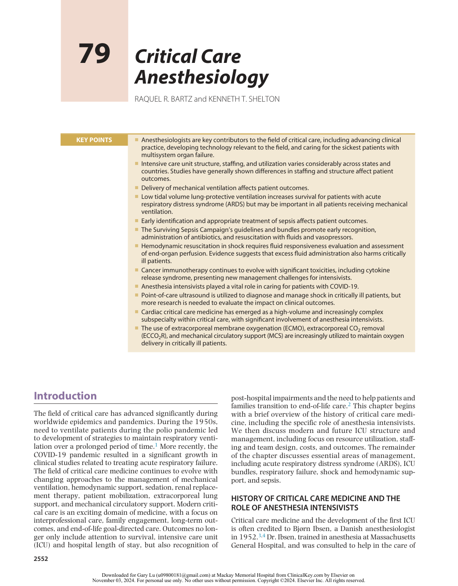
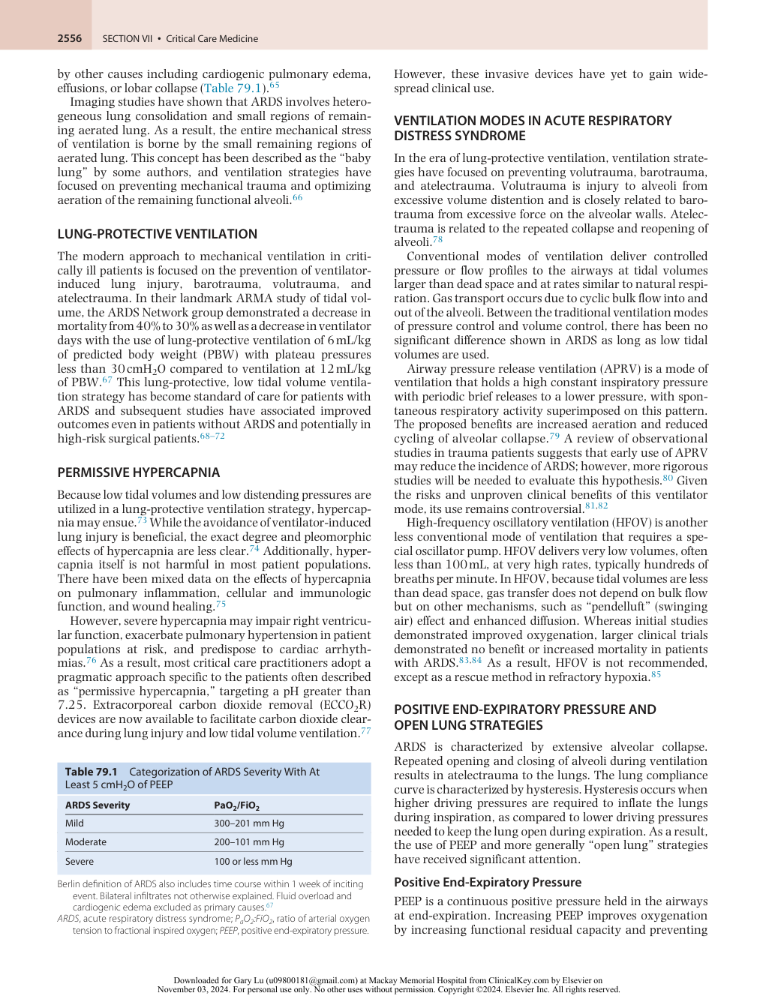
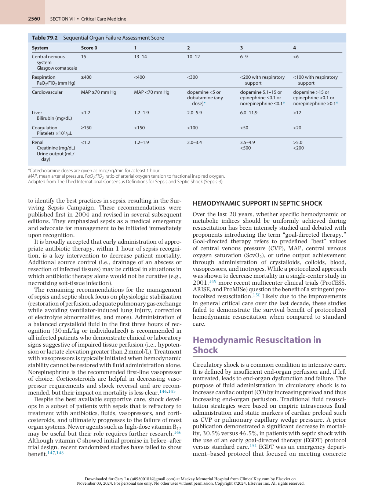
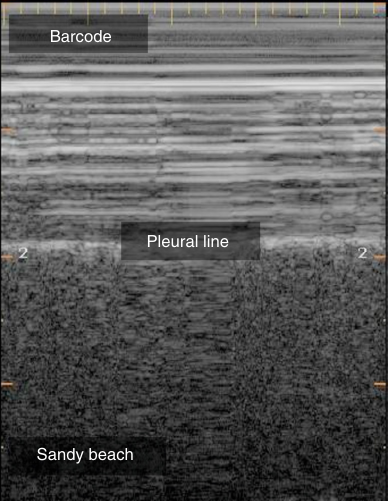
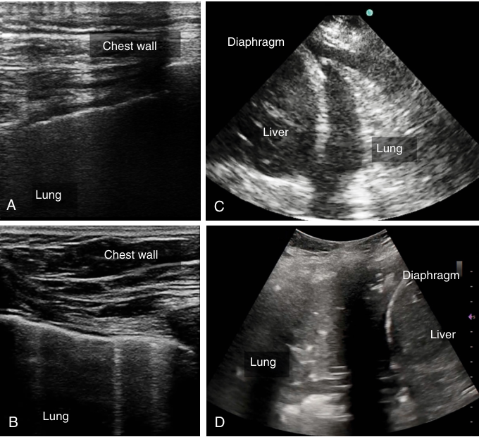
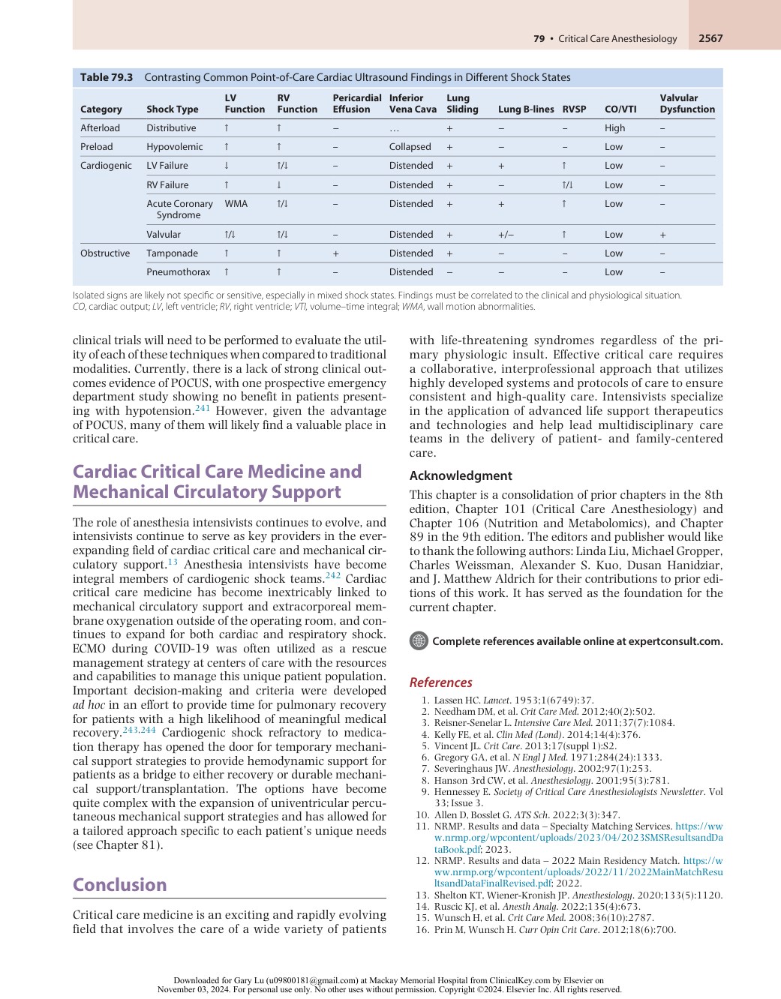

# Critical Care Anesthesiology

<!-- PDF page 1 -->

RAQUEL R. BARTZ and KENNETH T. SHELTON

|**KEY POINTS**|ᑏAnesthesiologists are key contributors to the field of critical care, including advancing clinical practice, developing technology relevant to the field, and caring for the sickest patients with multisystem organ failure. ᑏIntensive care unit structure, staffing, and utilization varies considerably across states and countries. Studies have generally shown differences in staffing and structure affect patient outcomes.|
|---|---|
||ᑏDelivery of mechanical ventilation affects patient outcomes. ᑏLow tidal volume lung- protective ventilation increases survival for patients with acute respiratory distress syndrome (ARDS) but may be important in all patients receiving mechanical ventilation.|
||ᑏEarly identification and appropriate treatment of sepsis affects patient outcomes. ᑏThe Surviving Sepsis Campaign’s guidelines and bundles promote early recognition, administration of antibiotics, and resuscitation with fluids and vasopressors. ᑏHemodynamic resuscitation in shock requires fluid responsiveness evaluation and assessment of end-organ perfusion. Evidence suggests that excess fluid administration also harms critically ill patients.|
||ᑏCancer immunotherapy continues to evolve with significant toxicities, including cytokine release syndrome, presenting new management challenges for intensivists. ᑏAnesthesia intensivists played a vital role in caring for patients with COVID- 19. ᑏPoint- of- care ultrasound is utilized to diagnose and manage shock in critically ill patients, but more research is needed to evaluate the impact on clinical outcomes. ᑏCardiac critical care medicine has emerged as a high- volume and increasingly complex subspecialty within critical care, with significant involvement of anesthesia intensivists. ᑏThe use of extracorporeal membrane oxygenation (ECMO), extracorporeal CO2removal (ECCO2R), and mechanical circulatory support (MCS) are increasingly utilized to maintain oxygen delivery in critically ill patients.|

## Introduction

The field of critical care has advanced significantly during worldwide epidemics and pandemics. During the 1950s, need to ventilate patients during the polio pandemic led to development of strategies to maintain respiratory ventilation over a prolonged period of time.1 More recently, the COVID- 19 pandemic resulted in a significant growth in clinical studies related to treating acute respiratory failure. The field of critical care medicine continues to evolve with changing approaches to the management of mechanical ventilation, hemodynamic support, sedation, renal replacement therapy, patient mobilization, extracorporeal lung support, and mechanical circulatory support. Modern critical care is an exciting domain of medicine, with a focus on interprofessional care, family engagement, long- term outcomes, and end- of- life goal- directed care. Outcomes no longer only include attention to survival, intensive care unit (ICU) and hospital length of stay, but also recognition of

post- hospital impairments and the need to help patients and families transition to end- of- life care.2 This chapter begins with a brief overview of the history of critical care medicine, including the specific role of anesthesia intensivists. We then discuss modern and future ICU structure and management, including focus on resource utilization, staffing and team design, costs, and outcomes. The remainder of the chapter discusses essential areas of management, including acute respiratory distress syndrome (ARDS), ICU bundles, respiratory failure, shock and hemodynamic support, and sepsis.

### HISTORY OF CRITICAL CARE MEDICINE AND THE ROLE OF ANESTHESIA INTENSIVISTS

Critical care medicine and the development of the first ICU is often credited to Bjørn Ibsen, a Danish anesthesiologist in 1952.3,4 Dr. Ibsen, trained in anesthesia at Massachusetts General Hospital, and was consulted to help in the care of

::: details 原始表格與符號（PDF 第 1 頁）

:::

<!-- PDF page 2 -->

a 12- year- old girl with poliomyelitis (polio) and respiratory failure. He instituted the approach of manual positive pressure ventilation via a tracheotomy and later applied this approach to ventilation to patients throughout the course of the polio epidemic in Copenhagen. Dr. Ibsen also implemented an approach to caring for groups of patients with respiratory failure in a dedicated location creating a modern version of the ICU.3,4 Other versions of the ICU were created to care for the sickest of patients with specific diseases. In 1923, Walter Dandy, a neurosurgeon at Johns Hopkins University, opened a three- bed unit to care for postoperative neurosurgery patients.5 Max Harry Weil, another key figure in modern critical care, opened a four- bed “shock unit” in 1958 at the Los Angeles County + University of Southern California (LA+USC) Medical Center.4

Since the early ICUs, modern critical care has focused on continuous physiologic monitoring and the application of advanced life- sustaining therapies including mechanical ventilation, extracorporeal membrane oxygenation (ECMO), and continuous renal replacement therapy. ICUs have become more specialized; however, all of them care for the same common disease processes such as sepsis, acute respiratory distress syndrome (ARDS), acute renal failure, cardiac arrest, and acute pulmonary emboli, and all must deal with patients at the end of their life. Progress in caring for critically ill patients has required periodic shifts in practice over time as new evidence is generated. These shifts have occurred in how patients are sedated, how mechanical ventilation is administered, how patients are monitored in the ICU, how much fluid and vasopressors are used to maintain adequate oxygen delivery, how long antibiotics are utilized, and thresholds for blood transfusion among many other practices that have changed over time.

Modern critical care practice would not have advanced to where it is today without anesthesiologists. Dating back to Dr. Ibsen, who co- located his patients with respiratory failure, and later George Gregory, a pediatric anesthesiologist and intensivist who convinced his colleagues to use continuous positive airway pressure (CPAP) for the treatment of neonatal idiopathic respiratory distress syndrome, and John Severinghaus, who was the key contributor to the development of the first blood gas electrode apparatus in the late 1950s, many anesthesiologists have helped the field of critical care medicine progress to its current state.6,7 In the United States, a decline in the role of the critical care anesthesiologist occurred in relation to other countries. However, the COVID- 19 pandemic demonstrated how the skillset of the anesthesia intensivist could be applied in both the operating rooms and ICUs. In 2001, several academic leaders from the United States and Europe authored an editorial raising alarm based on the following: less than 4% of US anesthesiologists have a special certificate in critical care, only 12% of the members of the Society of Critical Care Medicine (SCCM) are anesthesiologists, and relatively few anesthesia critical care diplomates graduate each year from fellowships.8 By contrast, in Europe, anesthesia intensivists continued to maintain a central role in the field of critical care medicine. Although the number of accredited fellowship programs in anesthesia critical care has increased,9 the number of anesthesia critical care diplomates certified by the American Board of Anesthesiology remains low in comparison to other anesthesia subspecialties like pain medicine and pediatric anesthesiology.9

Additionally, the number of pulmonary/critical care fellows entering sub- specialization is now greater than the number of anesthesia residency positions.10–12 Critical care medicine is perceived as a less desirable career path for anesthesiologists due to limited exposure to highquality critical care rotations, lack of faculty mentors, and more favorable financial incentives in anesthesia- based fields. Despite these challenges, the Society of Critical Care Anesthesiologists continues to play a primary advocacy, educational, and mentoring role, and memberships have increased over the past several years.

More recently, with the expected growth of the heart failure patient population across the world, cardiac critical care medicine has emerged as an area of focus for anesthesia intensivists. The evolution of mechanical circulatory support has created a need for highly trained anesthesia intensivists with a deep understanding of complex cardiopulmonary physiology within multidisciplinary shock teams of care.13 Anesthesia intensivists are adequately positioned within critical care to advance the field as the focus becomes patient- centric with individualized treatment strategies and advanced models of care.14 Future roles of anesthesia intensivists in the United States are expanding given the need to care for patients with increasing comorbidities undergoing surgery across American hospitals. Additionally, private and academic physician groups who utilized anesthesia intensivists during the early days of the COVID- 19 pandemic recognize the value anesthesiologists bring to their teams.

## Intensive Care Unit Structure and Management

### CAPACITY, UTILIZATION, AND COST

The definition of an intensive care unit (ICU) as well as bed utilization varies across countries. The United States, Belgium, and Germany have more than 20 ICU beds per 100,000 population, whereas the United Kingdom, the Netherlands, France, and Spain have fewer than 10 ICU beds per 100,000 population.15 Large variations in the volume and type of ICU admissions in developed countries also exist.16 The variations are due to differences in bed availability and reflect different approaches to admission, triage, and postsurgical utilization of ICU capabilities.16–18 A large prospective study of noncardiac surgery in Europe demonstrated high mortality rates and significant variability in utilization of critical cares services. Perhaps most striking was the finding that among surgical patients who died, the overwhelming majority (73%) were never admitted to an ICU.19 Therefore, despite concerns about over- utilization of expensive resources in some countries, this study suggests an alarming under- utilization of essential critical care services in others.

In the United States, ICU beds and cost continue to grow, whereas occupancy has remained generally flat. Prior studies have shown that in 2005 there were 93,955 ICU beds with occupancy rates of 68%. Critical care costs represented 13.4% of all hospital costs and 0.66% of gross domestic product (GDP).20 By 2010, critical care beds had increased to 103,900, with stable occupancy rates over the previous decade. The greatest growth occurred in neonatal ICU beds

<!-- PDF page 3 -->

with similar, but much lower, growth rates in adult and pediatric ICU beds.21 Critical care costs continue to grow, representing 3% of all US health care spending and 1% of the GDP in 2014.22 The type of growth in ICU beds is also worth noting, as described in a recent analysis of Medicare and Medicaid data.21 Over 15 years, more than 72% of total ICU bed growth occurred in teaching hospitals. Multivariate analysis also demonstrated that large hospitals with high occupancy and teaching hospitals with high occupancy were most associated with next- year growth in the number of ICU beds. The investigators concluded that this may represent a type of “ _de facto_ regionalization,” which may in turn lead to higher quality of care. Moreover, they suggest their results also contradict the theory that ICU bed growth and supply represents a type of “demand elasticity,”23 whereby increasing supply drives demand without clear benefits to patient care and the potential to change practice patterns and increase costs.24,25

### STRUCTURE AND STAFFING PATTERNS IN THE INTENSIVE CARE UNIT

Much like the number and use of ICU beds, considerable variability exists throughout the world in the structure and staffing of ICUs. ICUs are sometimes described as “open” or “closed” depending on whether the team caring for the patient has the primary responsibility for delivery of care to the patient versus acting as a consulting service. North American ICUs, when compared to the rest of the world, are more likely to have an “open” structure and be stratified into medical and surgical units rather than patient populations with mixed disease and are less likely to have 24/7 intensivist presence although this is rapidly changing.26 A common research approach to determine ICU staffing structure is to categorize staffing as “low intensity” (no intensivist or only elective intensivist consult) or “high intensity” (all care directed by intensivist or mandatory intensivist consult).27 Significant attention over the past two decades has focused on the optimal ICU structure and staffing models: specialized versus mixed, “high intensity” versus “low intensity,” optimal physician and nursing staffing ratios, the presence of an in- house nighttime intensivist, utilization of advanced practice providers (APPs), and best ICU team structure.

The data do not clearly demonstrate outcome differences in specialized units but show increased mortality for patients “boarding” on a non- primary unit in a specialized system.28 Many studies, including two large systematic reviews, have investigated outcomes associated with the intensity of ICU staffing.27,29–35 The outcomes have been mixed but generally favor improved mortality and length of stay outcomes with a “high- intensity” model. Data are more limited with regard to provider- to- patient ratios, but a retrospective study in the United Kingdom showed a U- shaped relationship between patient- to- intensivist ratios, with an optimal ratio of 7.5. Optimal nursing ratios are also not well described but a large, multinational observational study demonstrated that nurse- to- patient ratios less than 1.5 are associated with lower risk of in- hospital death.26 During the COVID- 19 pandemic, ICU strain was associated with an increased risk of death in a Veterans population.36 In Australia, recent evidence suggested that lower nurse- to- patient ratios result in improved outcomes.37 The

Working Group on Quality Improvement of the European Society of Intensive Care Medicine (ESICM) recommends 8 to 12 beds as optimal size.38

The use of nighttime intensivists has been an active area of study with mixed results. Most studies demonstrate a lack of mortality benefit.39–42 However, in one study, intensivist presence was associated with reduced in- hospital mortality in ICUs with low- intensity daytime staffing.42 Furthermore, a before- and- after prospective study of 24/7 mandatory intensivist presence showed an association with reduced hospital length of stay and complication rate, as well as improved staff satisfaction and adherence to processes of care.43 Based on available data, some investigators and critical care organizations (CCOs) have concluded that nighttime intensivists are costly and without significant benefit,39,44 whereas others vigorously argue for the value of a 24/7 intensivist model in high complexity, highvolume ICUs, emphasizing that the benefits derive not just from intensivist presence but rather intensivist- led changes in the systematic care delivery.45

The best approach to team structure and function in the ICU has been an active area of discussion. As discussed earlier, “open” or “low- intensity” ICUs may use hospitalists or emergency medicine physicians to care for patients in the ICU. Many academic and community- based institutions use nurse practitioners (NPs) and physician assistants (PAs) – often described as advanced practice providers (APPs) – as core members of the team.46 Studies demonstrate equivalent mortality and length of stay outcomes when compared to teams that include both residents and pulmonary/critical care fellows.46–48 A larger, more recent retrospective study of cohort data from 29 ICUs in 22 hospitals examined the association between exposure to NP/PA ICU staffing and inhospital mortality. While the patients in NP/PA- staffed ICUs had lower severity of illness and use of mechanical ventilation, the unadjusted and risk- adjusted mortality was similar in ICUs with and without NPs/PAs. In addition to these outcomes, there is evidence of positive perceptions of NPs/ PAs from other ICU providers, including physicians, nurses, and respiratory therapists.49 Accessibility, communication skills, and knowledge of and adherence to guidelines were recognized as core strengths of the NPs and PAs. Additionally, reduced turnover of team members occurs with the presence of APPs skilled in the management of critically ill patients as opposed to residents who rotate monthly.

In addition to the benefits of non- physician providers, evidence supports the benefits of multidisciplinary teams and interprofessional practice in caring for critically ill patients. A retrospective study of medical ICU patients in Pennsylvania hospitals demonstrated the greatest mortality benefit to high- intensity intensivist staffing and daily multidisciplinary rounds.50 A recent review of interprofessional practice describes the robust literature supporting the value of interprofessional practice in the ICU.51 Pharmacists, respiratory therapists, and physical and occupational therapists are essential providers in the daily care of critically ill patients and improve short- term and longerterm outcomes.

There are guidelines and expectations that address some of the previously discussed aspects of ICU structure. The Leapfrog Group, a major nonprofit organization that advocates for health care transparency, rates hospitals on

<!-- PDF page 4 -->

many factors including ICU staffing. The highest Leapfrog rating requires all critically ill patients to be managed or actively comanaged by a board certified intensivist. The SCCM’s Task Force on Models of Critical Care concludes that an “intensivist- led, high- intensity” team is an “integral” part of care delivery in the ICU. These guidelines do not make a recommendation for either direct management of all patients (i.e., “closed” model) or mandatory consultation by an intensivist.52 Similarly, the SCCM’s Admission, Discharge, and Triage Task Force gave a 1B recommendation for a high- intensity staffing model with “day- to- day” management either via a fully “closed” structure or with a mandatory intensivist model; the SCCM does not recommend 24- hour intensivist staffing if the ICU operates within a high- intensity structure.53

### MANAGEMENT AND QUALITY IMPROVEMENT

The quality of an ICU depends to a significant degree on the management structure, as well as the organizational approach to clinical practice, standardized processes, and quality improvement. Management structures vary but typically include a medical director and head nurse or nurse manager as a basic leadership structure.38 Experts and critical care societies recognize the challenges and importance of selecting and developing skilled critical care leaders. One recent review highlights the need for a leader to maintain and foster “continuity, consistency, and communication” in both clinical practice and the organizational practice.54 Although this may seem straightforward, critical care leaders operate in a demanding and complex environment. They must understand broader patient flow, health system operations, and finances. Equally important are strong leadership skills, especially the ability to listen and learn, adapt to changing clinical and organizational circumstances, and constantly serve as a “catalyst for change.”55 The COVID- 19 pandemic especially brought out the need for leaders to adapt in an environment where significant patient volumes and treatment information were rapidly changing.

Beyond development of individual leaders, organizations are increasingly focused on how to best integrate ICUs and their leaders within a critical care structure. The SCCM’s Academic Leaders in Critical Care Medicine Task Force highlights the growing number of academic medical centers now with critical care organizations (CCOs). They describe a road map for integration of operations to focus on patient quality, safety, and value: first using a “horizontal” approach with all ICUs operating in a single system with defined responsibility and accountability for valuebased care; and then a “vertical” approach using a population health model with care provided across the continuum for all critically ill patients during and after ICU care.56 The Task Force also presents a follow- up plan for integration of critical care services into a single organization that explicitly includes the academic missions of research, professional development, and education.57

High-quality clinical practice and appropriate use of expensive and often limited resources benefit from a clear set of administrative and clinical guidelines. The SCCM revised the Admission, Discharge, and Triage Guidelines, providing useful guidance for institutions developing policies and

protocols for patient flow and quality assurance.53 Experts and professional societies agree that specific protocols of care applied to practices like central line insertion and management of mechanical ventilation, and broader challenges such as the use of the ICU for potentially inappropriate care, help provide high-quality, high-value care in a collaborative model.58,59 Checklists and bundles often form the foundation for standardization of care and function as a mechanism to implement evidence- based practices and guidelines. The SCCM’s ICU Liberation project, for example, provides the ABCDEF Bundle as a daily, standardized approach to the implementation of the guidelines for the Prevention and Management of Pain, Agitation/Sedation, Delirium, Immobility, and Sleep Disruption in adult ICU patients.60,61 Standardization of care is a necessary step, but quality and value also depend on a robust approach to process improvement. Each ICU or CCO must first define which quality and safety metrics to measure.62 ICU and CCO leadership must consider the entire scope of quality in critical care. Recent guidelines describing best practices for family- centered care in the ICU highlight the importance of including measures of family support in our definition of quality in critical care.63 Once defined, the organization’s quality efforts will largely be determined by its ability to collect, analyze, and disseminate data to key leaders and ICU providers and staff and implement changes that improve outcomes.52,64

In summary, critical care medicine is a relatively young medical specialty with a strong history of anesthesiologist involvement since its inception. The practice of critical care medicine continues to grow and evolve rapidly, in terms of medical advancement, practice structure, and integration into the broader landscape of population health. In the next sections we discuss several of the central disease syndromes and therapeutic modalities that have come to define the modern practice of critical care medicine.

## Acute Respiratory Distress Syndrome and Lung- Protective Ventilation

### ACUTE RESPIRATORY DISTRESS SYNDROME

ARDS is characterized by noncardiogenic pulmonary edema, heterogeneous infiltrates, decreased lung compliance, and severe hypoxemia.65 It is a syndrome that involves injury and increased epithelial–endothelial permeability of the alveoli. It can occur as a result of direct chemical injury, systemic inflammation including sepsis, trauma, or numerous other causes common in critically ill patients.

The 2012 Berlin definition of ARDS focused on clarifying the quantification of hypoxia, the acute timing, and the radiographic findings. Using the ratio of arterial oxygen tension to fractional inspired oxygen (PaO2:FiO2), ARDS is graded mild if this ratio is 300 mm Hg or less, but greater than 200 mm Hg; moderate if 200 mm Hg or less, but greater than 100 mm Hg; and severe if 100 mm Hg or less. These measurements should be obtained with a positive end- expiratory pressure (PEEP) of at least 5 cmH2O. The onset must be within 7 days of the presumed inciting insult, and bilateral lung infiltrates must not be fully explainable

<!-- PDF page 5 -->

by other causes including cardiogenic pulmonary edema, effusions, or lobar collapse (Table 79.1).65

Imaging studies have shown that ARDS involves heterogeneous lung consolidation and small regions of remaining aerated lung. As a result, the entire mechanical stress of ventilation is borne by the small remaining regions of aerated lung. This concept has been described as the “baby lung” by some authors, and ventilation strategies have focused on preventing mechanical trauma and optimizing aeration of the remaining functional alveoli.66

### LUNG- PROTECTIVE VENTILATION

The modern approach to mechanical ventilation in critically ill patients is focused on the prevention of ventilatorinduced lung injury, barotrauma, volutrauma, and atelectrauma. In their landmark ARMA study of tidal volume, the ARDS Network group demonstrated a decrease in mortality from 40% to 30% as well as a decrease in ventilator days with the use of lung- protective ventilation of 6 mL/kg of predicted body weight (PBW) with plateau pressures less than 30 cmH2O compared to ventilation at 12 mL/kg of PBW.67 This lung- protective, low tidal volume ventilation strategy has become standard of care for patients with ARDS and subsequent studies have associated improved outcomes even in patients without ARDS and potentially in high- risk surgical patients.68–72

### PERMISSIVE HYPERCAPNIA

Because low tidal volumes and low distending pressures are utilized in a lung- protective ventilation strategy, hypercapnia may ensue.73 While the avoidance of ventilator- induced lung injury is beneficial, the exact degree and pleomorphic effects of hypercapnia are less clear.74 Additionally, hypercapnia itself is not harmful in most patient populations. There have been mixed data on the effects of hypercapnia on pulmonary inflammation, cellular and immunologic function, and wound healing.75

However, severe hypercapnia may impair right ventricular function, exacerbate pulmonary hypertension in patient populations at risk, and predispose to cardiac arrhythmias.76 As a result, most critical care practitioners adopt a pragmatic approach specific to the patients often described as “permissive hypercapnia,” targeting a pH greater than 7.25. Extracorporeal carbon dioxide removal (ECCO2R) devices are now available to facilitate carbon dioxide clearance during lung injury and low tidal volume ventilation.77

**Table 79.1** Categorization of ARDS Severity With At Least 5 cmH2O of PEEP

|**ARDS Severity**|**PaO2/FiO2**|
|---|---|
|Mild|300–201 mm Hg|
|Moderate|200–101 mm Hg|
|Severe|100 or less mm Hg|

Berlin definition of ARDS also includes time course within 1 week of inciting event. Bilateral infiltrates not otherwise explained. Fluid overload and cardiogenic edema excluded as primary causes.67

_ARDS_ , acute respiratory distress syndrome; _PaO2:FiO2_ , ratio of arterial oxygen tension to fractional inspired oxygen; _PEEP_ , positive end- expiratory pressure.

However, these invasive devices have yet to gain widespread clinical use.

### VENTILATION MODES IN ACUTE RESPIRATORY DISTRESS SYNDROME

In the era of lung- protective ventilation, ventilation strategies have focused on preventing volutrauma, barotrauma, and atelectrauma. Volutrauma is injury to alveoli from excessive volume distention and is closely related to barotrauma from excessive force on the alveolar walls. Atelectrauma is related to the repeated collapse and reopening of alveoli.78

Conventional modes of ventilation deliver controlled pressure or flow profiles to the airways at tidal volumes larger than dead space and at rates similar to natural respiration. Gas transport occurs due to cyclic bulk flow into and out of the alveoli. Between the traditional ventilation modes of pressure control and volume control, there has been no significant difference shown in ARDS as long as low tidal volumes are used.

Airway pressure release ventilation (APRV) is a mode of ventilation that holds a high constant inspiratory pressure with periodic brief releases to a lower pressure, with spontaneous respiratory activity superimposed on this pattern. The proposed benefits are increased aeration and reduced cycling of alveolar collapse.79 A review of observational studies in trauma patients suggests that early use of APRV may reduce the incidence of ARDS; however, more rigorous studies will be needed to evaluate this hypothesis.80 Given the risks and unproven clinical benefits of this ventilator mode, its use remains controversial.81,82

High- frequency oscillatory ventilation (HFOV) is another less conventional mode of ventilation that requires a special oscillator pump. HFOV delivers very low volumes, often less than 100 mL, at very high rates, typically hundreds of breaths per minute. In HFOV, because tidal volumes are less than dead space, gas transfer does not depend on bulk flow but on other mechanisms, such as “pendelluft” (swinging air) effect and enhanced diffusion. Whereas initial studies demonstrated improved oxygenation, larger clinical trials demonstrated no benefit or increased mortality in patients with ARDS.83,84 As a result, HFOV is not recommended, except as a rescue method in refractory hypoxia.85

### POSITIVE END- EXPIRATORY PRESSURE AND OPEN LUNG STRATEGIES

ARDS is characterized by extensive alveolar collapse. Repeated opening and closing of alveoli during ventilation results in atelectrauma to the lungs. The lung compliance curve is characterized by hysteresis. Hysteresis occurs when higher driving pressures are required to inflate the lungs during inspiration, as compared to lower driving pressures needed to keep the lung open during expiration. As a result, the use of PEEP and more generally “open lung” strategies have received significant attention.

### Positive End- Expiratory Pressure

PEEP is a continuous positive pressure held in the airways at end- expiration. Increasing PEEP improves oxygenation by increasing functional residual capacity and preventing

::: details 原始表格與符號（PDF 第 5 頁）

:::

<!-- PDF page 6 -->

alveolar collapse at expiration, thus maintaining alveolar recruitment. Excessive PEEP can result in regional or global lung overdistention or exacerbate air trapping. Furthermore, excessive PEEP impairs right ventricular function and venous return, possibly necessitating excess intravenous fluid administration.

Early animal studies demonstrated that the use of PEEP ameliorates ventilation- induced lung injury.86 As such, a minimum of 5 cmH2O of PEEP is recommended by ARDSnet ventilation protocol.67 However, large clinical studies comparing lower PEEP protocols to higher PEEP protocols failed to demonstrate improvement in clinical outcomes, although oxygenation was improved.87–89 The failure of these studies led to the more sophisticated methods of titrating PEEP usually included in open lung strategies (OLSs).

### Open Lung Strategies

OLSs use the combination of lung- protective ventilation with PEEP optimization and possibly recruitment maneuvers. The goal is to maintain aeration of functional lung tissue, thereby preventing atelectrauma, cyclic collapse of the alveoli, and focal lung stress in the remaining compliant regions of the lung. Various PEEP titration strategies have been integrated with recruitment maneuvers into “open lung” strategies.

### Esophageal Manometry, Transpulmonary Pres-

**sures, and Positive End- Expiratory Pressure.** One method to titrate PEEP is to use esophageal pressures via an esophageal balloon to guide determination of the best PEEP. The mechanical stresses of airway pressure can be separated into two components borne by the intrinsic lung compliance and the external chest wall compliance. However, only the lung component, as quantified by the transpulmonary pressure, is involved in ventilation- associated lung injury.90 The relative contributions of these two components can be difficult to predict and are affected by numerous conditions including ARDS, pulmonary edema, atelectasis, obesity, abdominal compartment syndrome, and burns.91,92

The transpulmonary pressure is calculated by subtracting the pleural pressure, outside the lung but inside the chest wall, from the total airway pressure. Pressure measurements in the esophagus are considered a surrogate of pleural pressure. This can be performed by placing a specifically designed air- filled pressure transducing catheter, similar to an orogastric tube, in the esophagus.90 With this method, PEEP can be titrated to prevent negative transpulmonary pressures that collapse the lung at the end of expiration. This maneuver holds special promise for patients with abnormal chest wall compliance, such as those with morbid obesity. Titration of PEEP using esophageal pressures in ARDS may allow the use of higher airway pressures without risking lung injury.93 One clinical study demonstrated improved oxygenation and lung compliance with this approach in association with higher PEEP; however, a randomized study showed no difference in overall outcomes.94 Specific patient populations, such as obese patients, may benefit from PEEP titration but further studies are needed to demonstrate improvement in outcomes of different patient populations with this approach.95

**Decremental Positive End- Expiratory Pressure Trials.** Trials of decremental PEEP involve raising PEEP to a high level (20–25 cmH2O) after a recruitment maneuver. The PEEP is then slowly decreased in a stepwise manner. The final PEEP is set at the level that maximized lung compliance, which is calculated by dividing driving pressure by tidal volume.96 Initial clinical results of OLSs demonstrated promising physiologic improvement in patients with severe ARDS. However, these initial studies were heterogeneous in nature, and in the largest randomized prospective trial of an open lung protocol, 6- month mortality, ventilator days, and risk of pneumothorax was actually increased.97–100 Criticisms of this latter study include use of high recruitment pressures resulting in increased barotrauma and hemodynamic instability. Further research is needed to elucidate the best recruitment and PEEP strategies for patients with ARDS.

### Recruitment Maneuvers with PEEP Titration. The

goal of recruitment maneuvers is to aerate previously collapsed lung in order to improve gas exchange and overall lung stress. The most common recruitment maneuver is simply holding sustained airway pressure for a set time period, typically 30 to 40 cmH2O for 30 to 40 seconds. This therapy is not benign, and common complications include transient hemodynamic instability, oxygen desaturation, ventilator dyssynchrony, or, rarely, tension pneumothorax.101 As such, the patient should be closely monitored during and after recruitment maneuvers. Another potentially gentler method of recruitment is incremental PEEP titration. PEEP is increased in a stepwise manner of 2 to 5 cmH2O every 3 to 5 minutes until there is a worsening of respiratory system compliance or hemodynamic parameters. However, there is little evidence of the superiority of any specific recruitment maneuvers. Furthermore, there is an overall lack of strong evidence for improved clinical outcome, leaving the role of any recruitment maneuver in ventilation strategies uncertain.99

### PRONE POSITIONING

Prone positioning has a number of physiologic benefits in ARDS. Ventilation–perfusion matching and lung aeration is improved, and parenchymal heterogeneity is reduced, contributing to a protective effect against ventilatorinduced lung injury.102 In the largest study of only patients with moderate to severe ARDS, defined as PaO2:FiO2 less than 150 mm Hg, 28- day mortality was significantly reduced.103 Therefore, a trial of prone positioning is recommended in severe ARDS, with the caveat that benefits are demonstrated at centers with deep experience. At centers with less experienced practitioners, prone positioning may be technically challenging with risk for increased serious complications.104 However, to treat patients with COVID19 induced ARDS, prone positioning has become increasingly utilized throughout ICUs around the world to improve oxygenation.

### SELF- INDUCED LUNG INJURY

In negative pressure spontaneous respiration, chest wall expansion exerts a negative pressure on the thoracic organs,

<!-- PDF page 7 -->

including the lungs. In instances of increased respiratory drive and lung injury, concern exists that lung injury can be induced in the spontaneously breathing patient not receiving positive pressure ventilation. In animal studies, chemically induced hyperventilation alone has been demonstrated to induce lung injury.105 In mild lung injury, spontaneous respiration is associated with better oxygenation, improved dependent lung aeration, and decreased diaphragm atrophy. However, in severe lung injury, spontaneous respiration may be associated with increased lung injury.106 Whether or not large tidal volumes in spontaneously breathing patients at atmospheric pressures leads to lung- injury is still theoretical, with more research needed to determine how to best ventilate patients whose lungs have normal compliance.

### NEUROMUSCULAR BLOCKADE

Neuromuscular blocking agents are used to facilitate synchrony with mechanical ventilation by removing spontaneous chest wall and diaphragm motion. Facilitating ventilator–patient synchrony lowers ventilation pressures, decreases risk of barotrauma, and improves oxygenation. Additionally, some animal data suggest the neuromuscular blocking agent cisatracurium has direct lung- protective properties through anti- inflammatory actions.107 One observational study comparing vecuronium and cisatracurium found significantly fewer days on the ventilator with cisatracurium, although no difference in mortality or other clinical outcomes.108 In a prospective study of neuromuscular blockade in ARDS, the ACURASYS study, cisatracurium administration for the first 48 hours was found to decrease lung injury and mortality in patients with severe ARDS whose PaO2:FiO2 was less than 150 mm Hg. Additionally, no increased incidence of weakness or critical illness myopathy was seen with this short duration of use.109 However, this study was criticized for being relatively small, single centered, and for having insufficiently long followup to evaluate critical illness myopathy. To address these concerns, the larger, multicentered Reevaluation Of Systemic Early Neuromuscular Blockade (ROSE) study was performed by the Prevention and Early Treatment of Acute Lung Injury (PETAL) Network investigators.110 In this more recent trial, early continuous neuromuscular blockade did not lower all- cause mortality at 90 days. There were no consistent between- group differences in outcomes at 3, 6, and 12 months. However, when compared to the ACURASYS trial, patients in the ROSE trial received higher levels of PEEP, and those not paralyzed also received lighter sedation, potentially contributing to the difference in observed outcomes.110

### NONINVASIVE POSITIVE- PRESSURE VENTILATION AND HIGH- FLOW NASAL CANNULA

CPAP and bilevel positive airway pressure (bilevel PAP) masks have been shown to be effective first- line treatment in respiratory failure due to acute cardiogenic pulmonary edema and chronic obstructive pulmonary disease (COPD).111,112 However, their use in ARDS is controversial. Although avoidance of endotracheal intubation has many

benefits, studies have failed to show a decrease in need for intubation or mortality. In fact, in one study, noninvasive positive- pressure ventilation (NPPV) was associated with increased mortality compared to high- flow nasal cannula (HFNC).113 Patients generally tolerate HFNC better than mask NPPV, and HFNC in systematic review was not found to be inferior in intubation rates or mortality compared to NPPV.114 However, the HIGH trial, a prospective, multicenter, randomized study in immunocompromised patients, failed to show any benefit in mortality, intubation rates, or even patient comfort for HFNC compared with conventional oxygen therapy.115 Further research in the role of HFNC and other non- mask forms of NPPV is needed.

### SUMMARY OF EVIDENCE- BASED VENTILATION IN CRITICALLY ILL PATIENTS AND FUTURE RESEARCH

The use of lung- protective ventilation with 6 mL/kg of PBW is recommended. The use of PEEP at a minimum of 5 cmH2O and titration based upon the ARDSnet protocol is recommended, but the optimal PEEP level is unclear. In severe ARDS, the early use of prone positioning has been shown to improve mortality. HFOV is not recommended as a primary ventilation method. Future research will need to establish the role of recruitment maneuvers and optimal PEEP titration strategies. The role of noninvasive ventilation, neuromuscular blockade, and the risk of self- induced lung injury will also need to be clarified in the treatment of ARDS.

Ultra- low tidal volume ventilation, 4 mL/kg of PBW or less, continues to be investigated. The technology of artificial gas exchange devices, extracorporeal carbon dioxide exchangers, or venovenous ECMO support continues to be advanced.116 Finally, despite negative trials of aspirin, statins, and beta- agonists, new pharmacologic and biologic therapies including mesenchymal stem cell therapies continue to be investigated.70,117,118

### MANAGEMENT OF PAIN AND AGITATION

Sedatives are some of the most commonly administered medications in the ICU. The purpose of sedatives is to manage agitation to ensure the safety of the patient and care providers, and to prevent dangerous events such as unintended extubation or removal of treatment apparatus such as central lines. The first step to effectively manage agitation is to identify and address underlying causes. Pain is a common cause of agitation in the critically ill and is often underappreciated.119 Delirium is extremely common in the critically ill and is associated with adverse outcomes including increased length of stay and mortality.120 Delirium can manifest as hypoactivity or with agitation. The first- line interventions to prevention and management should be nonpharmacologic.

When sedatives are needed, targeting light sedation is recommended.60 The use of light sedation is not associated with increased posttraumatic stress disorder, and may be associated with shorter ventilator time or even decreased mortality.121 The use of daily sedation interruptions or nursing- driven protocols with standardized tools are both effective methods to achieve this goal.60 Two well- validated scales for sedation assessment are the

<!-- PDF page 8 -->

Richmond Agitation–Sedation Scale and the Sedation– Agitation Scale.122,123 Some even propose protocols that try to completely avoid traditional sedatives and focus primarily on analgesia and control of agitated delirium with haloperidol.124 Though this approach may be associated with shorter length of stay and mechanical ventilation, further study is needed to confirm this finding. Furthermore, there is a suggestion that benzodiazepines lead to increased hyperalgesia with administered opioids. This should be considered in patients who require opioids for pain.125

The best choice of specific initial sedative agents remains controversial. However, benzodiazepines, when compared to propofol or dexmedetomidine, may be associated with increased delirium and length of mechanical ventilation.126–129 Propofol, with the benefits of short duration and rapid titration, is a very common choice, but may cause hypertriglyceridemia or, rarely, propofol infusion syndrome.130 Triglycerides should be monitored on a regular basis for patients receiving prolonged propofol use. Propofol infusion syndrome is a serious complication associated with high dose and prolonged infusion duration that presents with metabolic acidosis, electrocardiogram (ECG) and conduction abnormalities, and rhabdomyolysis.131 Dexmedetomidine is used as a common sedative in the ICU. Several studies have suggested that it is less deliriogenic than other sedatives.132–134 However, dexmedetomidine may lead to hypotension and bradycardia. Determining appropriate sedation strategies must be targeted to each patient’s needs and their underlying physiology.

Neuroleptic drugs such as haloperidol are rarely used as primary sedatives but can be used to control agitated delirium that may result in harm to patient or staff. However, studies have not shown clear benefit with the use of antipsychotics in the prevention or treatment of delirium.135 Furthermore, many patients who start treatment with antipsychotics in the ICU are discharged with a prescription for antipsychotics with the accompanying dangerous side effects associated with long- term use.136

Pragmatically, regardless of the specific sedative agent or protocol and scales used, the evidence points toward using a systematic and adaptive practice of minimizing psychoactive agents, while maintaining safety of the patient and care providers.

## Sepsis and Shock

### INFECTION, SYSTEMIC INFLAMMATORY RESPONSE SYNDROME, AND SEPSIS

Sepsis is one of the most common diagnoses treated in ICUs. It is estimated that at least 1.7 million patients develop sepsis every year in the United States alone, the majority of whom are over the age of 65.137,138 Mortality, which reaches 10% in patients with sepsis and 40% in patients with septic shock, is typically a result of multiple organ dysfunction syndrome (MODS). Sepsis has been defined as a “life- threatening organ dysfunction that is a result of dysregulated host response to infection.”139

The most recent definition of sepsis (“Sepsis- 3”), introduced in 2016 by the SCCM/ESICM task force, emphasizes the importance of organ dysfunction for sepsis diagnosis,

as opposed to systemic inflammatory response syndrome (SIRS). Although features of SIRS (tachycardia, tachypnea, fever/hypothermia, leukocytosis/leukopenia) are found in many patients with sepsis, SIRS is not a specific response to infection and can develop in many noninfectious conditions (major trauma, major surgery, burns, necrotizing pancreatitis).140 All patients with sepsis, however, have clinical or laboratory evidence of acute organ dysfunction (e.g., hypotension, hypoxemia, altered mental status, oliguria).

The transition from infection to sepsis is believed to occur when the inflammatory response to the pathogen becomes dysregulated, spreading beyond the original site of infection and leading to systemic organ dysfunction. The organ dysfunction has been defined as an increase in the Sequential Organ Failure Assessment (SOFA) score by at least 2 points. The SOFA score uses a simple numeric assessment (0–4) of neurologic, cardiovascular, respiratory, renal, liver, and hematologic function to assess the severity of a patient’s physiologic deterioration (Table 79.2). While SOFA score _per se_ is not diagnostic of sepsis, the increase in SOFA score in a patient with a suspected or confirmed infection indicates a substantially increased risk of in- hospital mortality. Clinicians must maintain a high suspicion for infection in all patients that manifest worsening organ function. It is important to note, however, that in approximately half of the cases of sepsis, the causative microbe is never identified.139,141 This is because of the limitations of currently used culture- based microbiology methods, inadequate sampling, or concurrent treatment with antimicrobials. Because the initial clinical presentation of sepsis is variable and laboratory findings are nonspecific, detecting sepsis early remains a clinical challenge. Newer methods using EHR- derived algorithms to aid the clinician in early recognition of sepsis have been developed and hold promise for improving patient outcomes.142

### SEPTIC SHOCK

In patients with septic shock, the dysregulated host response to infection is associated with severe circulatory, cellular, and metabolic abnormalities. Required for the clinical diagnosis of septic shock is elevation of plasma lactate levels greater than 2 mmol/L and the requirement for vasopressor support to maintain mean arterial pressure (MAP) greater than 65 mm Hg despite adequate fluid resuscitation. Circulatory failure that occurs in septic shock is a result of vasodilation and increased vascular permeability, which lead to decreased effective circulating volume. Myocardial dysfunction develops in a significant percentage of patients with septic shock. Tissue perfusion is further impaired by tissue edema and aberrant activation of coagulation at the microvascular level. The ability of tissues to extract and utilize oxygen is also impaired, likely due to sepsis- induced mitochondrial dysfunction.143 Reflecting these perfusion and cellular abnormalities are supranormal values of oxyhemoglobin saturation in mixed venous or central venous blood often found in patients with septic shock.

### SURVIVING SEPSIS CAMPAIGN

The high prevalence, high mortality, and mounting costs of intensive care have led to continuous worldwide efforts

<!-- PDF page 9 -->

**Table 79.2** Sequential Organ Failure Assessment Score

|**System**|**Score 0**|**1**|**2**|**3**|**4**|
|---|---|---|---|---|---|
|Central nervous system Glasgow coma scale|15|13–14|10–12|6–9|&lt;6|
|Respiration PaO2/FiO2(mm Hg)|≥400|&lt;400|&lt;300|&lt;200 with respiratory support|&lt;100 with respiratory support|
|Cardiovascular|MAP≥70 mm Hg|MAP &lt;70 mm Hg|dopamine &lt;5 or dobutamine (any dose)*|dopamine 5.1–15 or epinephrine≤0.1 or norepinephrine≤0.1*|dopamine >15 or epinephrine >0.1 or norepinephrine >0.1*|
|Liver Bilirubin (mg/dL)|&lt;1.2|1.2–1.9|2.0–5.9|6.0–11.9|>12|
|Coagulation Platelets ×103/μL|≥150|&lt;150|&lt;100|&lt;50|&lt;20|
|Renal Creatinine (mg/dL) Urine output (mL/ day)|&lt;1.2|1.2–1.9|2.0–3.4|3.5–4.9 &lt;500|>5.0 &lt;200|

*Catecholamine doses are given as mcg/kg/min for at least 1 hour. _MAP_ , mean arterial pressure. _PaO2:FiO2_ , ratio of arterial oxygen tension to fractional inspired oxygen. Adapted from The Third International Consensus Definitions for Sepsis and Septic Shock (Sepsis- 3).

to identify the best practices in sepsis, resulting in the Surviving Sepsis Campaign. These recommendations were published first in 2004 and revised in several subsequent editions. They emphasized sepsis as a medical emergency and advocate for management to be initiated immediately upon recognition.

It is broadly accepted that early administration of appropriate antibiotic therapy, within 1 hour of sepsis recognition, is a key intervention to decrease patient mortality. Additional source control (i.e., drainage of an abscess or resection of infected tissues) may be critical in situations in which antibiotic therapy alone would not be curative (e.g., necrotizing soft- tissue infection).

The remaining recommendations for the management of sepsis and septic shock focus on physiologic stabilization (restoration of perfusion, adequate pulmonary gas exchange while avoiding ventilator- induced lung injury, correction of electrolyte abnormalities, and more). Administration of a balanced crystalloid fluid in the first three hours of recognition (30 mL/kg or individualized) is recommended in all infected patients who demonstrate clinical or laboratory signs suggestive of impaired tissue perfusion (i.e., hypotension or lactate elevation greater than 2 mmol/L). Treatment with vasopressors is typically initiated when hemodynamic stability cannot be restored with fluid administration alone. Norepinephrine is the recommended first- line vasopressor of choice. Corticosteroids are helpful in decreasing vasopressor requirements and shock reversal and are recommended, but their impact on mortality is less clear.144,145

Despite the best available supportive care, shock develops in a subset of patients with sepsis that is refractory to treatment with antibiotics, fluids, vasopressors, and corticosteroids, and ultimately progresses to the failure of most organ systems. Newer agents such as high- dose vitamin B12 may be useful but their role requires further research.146 Although vitamin C showed initial promise in before–after trial design, recent randomized studies have failed to show benefit.147,148

### HEMODYNAMIC SUPPORT IN SEPTIC SHOCK

Over the last 20 years, whether specific hemodynamic or metabolic indices should be uniformly achieved during resuscitation has been intensely studied and debated with proponents introducing the term “goal- directed therapy.” Goal- directed therapy refers to predefined “best” values of central venous pressure (CVP), MAP, central venous oxygen saturation (ScvO2), or urine output achievement through administration of crystalloids, colloids, blood, vasopressors, and inotropes. While a protocolized approach was shown to decrease mortality in a single- center study in 2001,149 more recent multicenter clinical trials (ProCESS, ARISE, and ProMISe) question the benefit of a stringent protocolized resuscitation.150 Likely due to the improvements in general critical care over the last decade, these studies failed to demonstrate the survival benefit of protocolized hemodynamic resuscitation when compared to standard care.

## Hemodynamic Resuscitation in Shock

Circulatory shock is a common condition in intensive care. It is defined by insufficient end-organ perfusion and, if left untreated, leads to end-organ dysfunction and failure. The purpose of fluid administration in circulatory shock is to increase cardiac output (CO) by increasing preload and thus increasing end-organ perfusion. Traditional fluid resuscitation strategies were based on empiric intravenous fluid administration and static markers of cardiac preload such as CVP or pulmonary capillary wedge pressure. A prior publication demonstrated a significant decrease in mortality, 30.5% versus 46.5%, in patients with septic shock with the use of an early goal- directed therapy (EGDT) protocol versus standard care.151 EGDT was an emergency department–based protocol that focused on meeting concrete

::: details 原始表格與符號（PDF 第 9 頁）

:::

<!-- PDF page 10 -->

targets of CVP, oxygen delivery, and ScvO2. This involved aggressive fluid resuscitation, allogenic red blood cell transfusion, and inotropic support per algorithm. Subsequent studies called various parts of this aggressive protocol into question. Three larger, multicenter prospective randomized studies showed no difference between EGDT and standard care.151–153 Thus, the benefit of the EGDT may have been due to the early intervention by a specialized treatment team, rather than the aggressive therapy protocol.150

This data emerged with increasing evidence of harm caused by excessive intravenous fluid administration. One multicentered retrospective study of patients in septic shock demonstrated an association between positive fluid balance, higher CVP, and mortality.154 Another multicentered observational study associated positive fluid balance with increased mortality and renal failure.155 In a prospective randomized trial, a conservative fluid protocol demonstrated significantly shorter ICU length of stay and fewer ventilator days in patients with ARDS, but no difference in mortality.156 Data from the CLASSIC trial demonstrated feasibility of a fluid restrictive protocol in critically ill septic patients without apparent worsened outcomes, but it was underpowered for many important clinical outcomes.157

Although fluid resuscitation in septic shock is standard of care, there is no high- quality large- scale clinical outcomes data on the efficacy of intravenous fluid resuscitation. In the thought- provoking multicentered 2011 FEAST trial, children presenting with septic shock in a resource- poor setting were prospectively randomized to intravenous fluid administration.158 Surprisingly, mortality was increased in the fluid administration arm, primarily from cardiovascular collapse.159 In adults, a single-center randomized study of patients with septic shock in a resource- limited setting also saw increased mortality when randomized to more aggressive intravenous fluid administration.160 Given the specific resource- limited setting and patient population in these two studies, the results are not generalizable. However, these unexpected results do challenge the traditional dogma of intravenous fluid administration in septic shock and raise questions about the Surviving Sepsis Campaign’s recommendation for 30 mL/kg crystalloid bolus in the initial management of septic shock.161,162

Modern fluid resuscitation strategies in circulatory shock are shifting away from empiric intravenous fluid volumes toward a rational approach of supporting perfusion pressure, identifying end-organ malperfusion, evaluating fluid responsiveness, and administration of fluids to augment CO in a targeted manner.

### END- ORGAN PERFUSION

Since the goal of fluid resuscitation is to restore end-organ perfusion, the first step should be to identify end-organ malperfusion. There are many surrogates used as indicators for end-organ perfusions, but they all have their limitations and confounders. The most commonly used markers in shock are urine output, lactate, and base deficit.

### Urine Output

Urine output is universally measured in critically ill patients. Urine output of less than 0.5 mL/kg/h is a common cut- off used in adults as a marker for systemic malperfusion or

hypovolemia. However, urine output is not directly correlated to end-organ perfusion and injury.163 There are many confounders, especially in the critical care setting, including neurohumoral effects, diuretic use, intrinsic kidney injury, obstructive uropathies, and exogenous vasopressin administration. Despite these many limitations, the ubiquity of this measurement has made it a core component of evaluating a patient in shock.164 There is further research examining real- time urine output rate as a more effective monitor in shock and may be associated with decreased rates of acute kidney injury.165,166

### Lactate

Lactate is one of the most commonly measured markers of organ ischemia. Lactate is a product of glycolysis and even under normal physiologic conditions is produced at a high rate. Although production may be increased by tissue- level hypoxia, there are many other causes of increased lactate production that are not secondary to lack of perfusion. These include β- adrenergic activation, acute lung injury, or medications. Furthermore, lactate clearance can be reduced by hepatic or mitochondrial dysfunction. Thus, although elevated lactate levels are associated with poor outcomes in shock states, it may not be a specific marker for organ malperfusion or ischemia.167

### Standard Base Deficit

Standard base deficit is a calculated value based on blood gas measurement as a gauge of metabolic acidosis. It approximates the amount of base that must be added to _in vitro_ blood at 37°C and PACO2 of 40 mm Hg to bring the pH to 7.4. Like lactate, elevated base deficit has been associated with mortality and poor clinical outcomes in shock states, especially in trauma. However, base deficit is affected by many factors. It can also be confounded by nonperfusionrelated conditions including sodium and chloride concentrations, hypoalbuminemia, respiration, exogenous sodium bicarbonate, or sodium chloride administration.168,169

### Other Tissue- Specific Perfusion Markers

The three traditional markers of end-organ perfusion discussed thus far are global markers that may be normal even when regional organ-level malperfusion exists. Newer techniques, such as near- infrared spectroscopy, transcutaneous oximetry, and gastric pH/tonometry, may provide a more specific and sensitive end- point target in shock.170–173 Currently, however, these technologies are primarily used in research and there is no strong clinical evidence of superior clinical outcomes compared to traditional end points.174 Future developments will also likely involve organ- or inflammation- specific biomarkers.

### CARDIAC OUTPUT

The purpose of intravenous fluids during resuscitation is to increase cardiac output (CO); therefore, it is important to evaluate the adequacy and the response of CO to avoid excess intravenous fluid administration. There have been an increasing number of noninvasive technologies available to measure CO in the ICU to supplement the physical examination. Each has its own strengths and weaknesses, but no single technology has been proven clinically

<!-- PDF page 11 -->

superior. The absolute measurement accuracy of many of these devices is highly variable, especially under rapidly changing hemodynamic conditions. Although the different methods have been validated individually, actual interdevice agreement is likely poor.175,176 Measurements from one device cannot be directly compared to another; this may be true even within the same technology from different manufacturers.177 Several of the most commonly used CO measurement techniques are reviewed in the next section. Refer to Chapter 32 on cardiovascular monitoring.

### Pulmonary Artery Catheter, Thermal Dilution

Pulmonary artery catheters (PACs) are considered the gold standard of CO measurements. In addition to direct measurement of pulmonary artery and pulmonary capillary wedge pressures, they allow for intermittent or continuous thermal dilution measurements of CO. This method involves injecting a known amount of cold solution into the right atrium and measuring the temperature change over time in the pulmonary artery. Based on the Steward–Hamilton equation, the area under the curve of the temperature change is inversely proportional to the CO. Current PACs also offer continuous CO measurements with thermal heating elements proximal to the pulmonary artery. Although thermal dilution PAC is the gold standard, precision error is approximately 15% to 20% even in idealized laboratory conditions.178–181 This precision is further worsened in patients with low CO or severe tricuspid regurgitation.182 Although PACs were once widely used in critically ill patients, their routine use has fallen out of favor after multiple studies failed to demonstrate improved clinical outcomes and the possibility of increased complication rates with PAC usage.183 In select patients, PAC still provides valuable information during shock resuscitation and can be used to monitor pulmonary artery pressures, CO, and CO responses to intravenous fluid challenges.

### Transpulmonary Thermal Dilution or Lithium Dye Dilution

Transpulmonary thermal or other dye dilution techniques use the same principles of the Steward–Hamilton equation; however, the indicator solution is injected into the superior vena cava and the change is measured near the aorta, typically on a femoral or axillary arterial line. The advantage of this technique is that it does not require placement of a PAC and is easy to use. Accuracy and precision are similar to PAC measurements, although it also becomes inaccurate at low CO.184,185 These systems also allow the measurement of other physiologic parameters such as extravascular lung water.

### Pulse Contour Analysis

Pulse contour analysis measures CO by analyzing the morphology of the arterial pressure waveform and thus requires a good-quality arterial line tracing.186 By measuring the area under the systolic portion of the curve and estimating the arterial impedance, the stroke volume can be derived. In modern systems, this is combined with proprietary algorithms with more advanced waveform analysis.175 These methods suffer from drift and inaccuracy in rapidly changing hemodynamic states, so they are often coupled with thermal or dye dilution techniques for intermittent

calibration.177 The advantages of these devices are in providing a continuous measurement of stroke volume and stroke volume variability, while avoiding the need for central line. These devices have been investigated in perioperative hemodynamic optimization with mixed results in improving clinical outcomes.187,188

### ELECTRICAL BIOREACTANCE AND IMPEDANCE

Bioreactance and bioimpedance methods measure CO by measuring the changing properties of an electric field placed across the thorax. This is related to the movement of blood into and out of the chest and thus the CO. The main advantage of this technique is that it is minimally invasive and only requires several electrodes placed on the chest. The accuracy of these devices can be variable depending on the clinical situation, and measurements may correlate poorly with other techniques.189,190 Currently these devices are used in research settings and have widespread utilization for patient care.

### TRANSTHORACIC AND TRANSESOPHAGEAL ECHOCARDIOGRAPHY

Point- of- care ultrasonography and rescue echocardiography are increasingly utilized to provide information for patients in undifferentiated shock in the intensive care unit. This is particularly important in cardiac critical care where medical management and the decision to return to the operating room or the interventional catheterization lab for patients in postcardiotomy shock often hinges on echocardiographic data.191 Focused cardiac ultrasound and echocardiography can be used to measure stroke volume and stroke distance.192 This is performed by pulse wave Doppler integration of systolic flow at the left ventricular outflow tract (LVOT). This is typically performed from the transthoracic apical window or the transesopha geal echocardiography (TEE) deep transgastric esophageal window. The volume–time integral (VTI) of the flow velocity curve gives the stroke distance. The VTI multiplied by the LVOT cross- sectional area gives the stroke volume, but VTI alone can be used as an index of stroke volume. However, this technique is very operator dependent, can be labor intensive, and does not account for aortic valve regurgitation. Furthermore, some studies have reported poor agreement with other methods of CO measurement.193

Esophageal Doppler operates in a similar manner, except the probe is placed in the esophagus and measures velocities in the descending aorta. These velocities are then indexed to the patient to estimate the total CO.176,194 Esophageal Doppler utilization is beneficial in the operating room environment but it has yet to be widely accepted in ICU management of patients in shock.

### Mixed Venous and Central Venous Saturation

Mixed venous oxygen saturation drawn from the pulmonary artery is an indicator of the balance between global oxygen delivery and global oxygen consumption. Although CO can be calculated using Fick’s principle with assumptions about oxygen consumption, a low mixed venous oxygen saturation, less than 65% to 70%, suggests a possible deficit of oxygen delivery relative to oxygen consumption. Since it is a global measure, organ- specific ischemia may

<!-- PDF page 12 -->

be present even with normal or elevated mixed venous saturations.195

Measurement of mixed venous oxygen saturations requires placement of a PAC. As a result, some have proposed central venous saturation from the vena cava as a surrogate. Unfortunately, the relationship between central venous saturation and mixed venous saturation has been found to be variable.196,197 Central venous measurement may be more useful when trended over time in response to fluid challenges.

### FLUID RESPONSIVENESS

The hemodynamic purpose of intravenous fluid administration is to increase global oxygen delivery by increasing CO. In this regard, the administration of intravenous fluid is only beneficial if it increases CO. A patient is considered “fluid responsive” if they are able to increase their CO to a fluid bolus.

Traditional static indicators for fluid administration were measurements of filling pressures to the left or right ventricle. These included CVP and pulmonary capillary wedge pressures. These measurements also have their ultrasound corollaries: inferior vena cava diameter, end- diastolic, and end- systolic ventricular diameter.198 Unfortunately, despite their widespread use, these static indicators of preload, and even their trend, have been found to be relatively poor predictors of volume responsiveness over time.199

As a result, dynamic indicators of fluid responsiveness have become increasingly used. The most straightforward dynamic test of fluid responsiveness is a fluid challenge with measurement of CO before and after. Typically, a small bolus of approximately 100 to 250 mL of intravenous fluid is used. Similarly, a passive leg raise test resulting in transient autotransfusions of approximately 500 mL from the lower extremities has also been shown to be an effective predictor of fluid responsiveness.200

Other dynamic indicators depend upon cardiopulmonary interactions and the consistent variations of intrathoracic pressure created by controlled mechanical ventilation to create detectable beat- to- beat variations in stroke volumes. As positive pressure breath is delivered, right ventricular preload is decreased and afterload increased. Meanwhile, the left ventricle preload experiences a transient increase and then a decrease as left ventricular afterload decreases. This process is reversed on expiration.201 If the stroke volume is sensitive to these swings in preload, the stroke volume will vary significantly during the respiratory cycle and is indicative that the patient is likely volume responsive.199,202,203 The measured parameters can be stroke volume variation, pulse pressure variation, or inferior vena cava distensibility on ultrasound; various studies have reported different cut- offs for predicting volume responsiveness.204,205 These techniques may not be accurate in arrhythmias, right or left heart failure, or low tidal volume ventilation.201 However, these dynamic indicators have been shown consistently superior in predicting volume responsiveness compared to static preload measures.

### SUMMARY OF FLUID RESUSCITATION IN SHOCK

The goal of intravenous fluid administration in shock is to restore end-organ perfusion by augmenting CO. There is

increasing evidence that excess intravenous fluid administration is harmful in critically ill patients. Thus, the patient should be assessed for end-organ malperfusion, insufficient CO, and likelihood of fluid responsiveness prior to and during fluid resuscitation.206,207

## Care for Patients Receiving Cancer Immunotherapy in the Intensive Care Unit

Cancer immunotherapy is an evolving field of oncology. Two major therapeutic approaches utilized in cancer immunotherapy are based on either enhancing the patient’s own antitumor immunity (immune checkpoint inhibitors, cytokines, vaccines) or administration of tumor- reactive immune cells (chimeric antigen receptor [CAR] T- cells, T- cell receptor engineered T- cells). The outcomes of these therapies are currently studied in several hundreds of clinical trials. Remarkable results have already been achieved in certain types of cancer (melanoma, leukemias, lymphomas) for which immunotherapy is now being used as a standard of care.

Besides the desired antitumor effects, immunotherapy can also trigger unique toxicities resulting from excessive immune system activation. These may be restricted to certain organs (colitis, pneumonitis) or be a systemic inflammatory response (cytokine release syndrome [CRS]). When severe, immunotherapy toxicities can be life- threatening and their management may require admission to the ICU for continuous monitoring and supportive care. Intensivists thus increasingly find themselves leading and coordinating multidisciplinary care for complex oncologic patients.

### IMMUNE CHECKPOINT INHIBITORS

Immune checkpoint inhibitors are the most commonly administered form of cancer immunotherapy. These agents enhance antitumor activity of the patient’s own T- cells by blocking certain T- cell inhibitory signals. Food and Drug Administration (FDA)- approved inhibitors of PD- 1 (pembrolizumab, nivolumab), PD- L1 (atezolizumab, avelumab, durvalumab), and CTLA- 4 (ipilimumab) are used in treatments of various solid tumors including melanoma, non- small- cell lung cancer, head and neck squamous cancers, and renal cell carcinoma. These agents can produce a unique set of side effects, termed immune- related adverse events, which may be dermatologic, gastrointestinal, hepatic, endocrine, pulmonary, cardiac, or neurologic inflammatory complications. These side effects typically manifest weeks to months after initiation of the therapy.

The mainstay of the management in cases of moderateand high- grade toxicity is the interruption of the checkpoint inhibitor and administration of corticosteroids. Tumor necrosis factor- α antagonists have been used in cases refractory to steroids. ICU monitoring and supportive care may be required in cases of severe pneumonitis (oxygen therapy, mechanical ventilation), myocarditis (inotropic support, antiarrhythmics), severe enterocolitis (fluid and electrolyte repletion), liver failure, and adrenal insufficiency. Echocardiography should be performed in patients

<!-- PDF page 13 -->

with new-onset dyspnea, pulmonary edema, or hypotension. Patients receiving prolonged immunosuppression for the treatment of checkpoint inhibitor toxicity are at an especially high risk of infectious complications (opportunistic infections, sepsis).208

### CHIMERIC ANTIGEN RECEPTOR T- CELLS

CAR T- cells are genetically engineered T- cells that have the ability to bind to target tumor cells, undergo supraphysiologic activation, and cause tumor cell lysis. Upon completion of an _ex vivo_ manufacturing process, CAR T- cells are infused into patients and patients typically remain monitored for several days in the hospital setting. Currently, CAR T- cells are used in the treatment of certain relapsed/ refractory hematologic malignancies (leukemias, lymphomas, multiple myeloma) but clinical trials in patients with solid tumors are also ongoing. Two CD19- directed CAR T- cell products for treatment of B- cell malignancies (nonHodgkin lymphoma, acute lymphoblastic leukemia) have been FDA approved and cases of complete disease remission have been reported.

However, CAR T- cell therapy is frequently associated with toxicities that can range from minor (fatigue, fever, myalgias) to life- threatening (shock, multiple organ dysfunction). These toxicities are primarily driven by proinflammatory cytokines (interleukin-6 [IL-6], interferon- γ [IFN- γ]) that are released upon CAR T- cell–tumor cell interaction. Of importance to ICU clinicians are severe forms of CRS and neurotoxicity, which require ICU monitoring and management. CRS typically manifests within several days after CAR T- cell infusion by a spectrum of fever, tachycardia, hypotension, or respiratory insufficiency. The onset of neurotoxicity (encephalopathy, aphasia, or seizures) can be delayed and is not necessarily preceded by clinically significant CRS. Fatal cases of diffuse cerebral edema have been reported.

The mainstay of the therapy of severe forms of CRS is the administration of anti- inflammatory agents (IL- 6 antagonists, corticosteroids) in conjunction with individualized supportive care (fluid resuscitation, vasopressors, mechanical ventilation, renal replacement therapy). Neurotoxicity is treated with anticonvulsants and corticosteroids. It is crucial that other precipitating factors of neurologic, hemodynamic, or respiratory decline that are common in patients with advanced cancer are always actively excluded. Sepsis, which often resembles CRS, is a frequent cause of morbidity and mortality in this patient population.209,210

## COVID- 19 Pandemic

Anesthesia intensivists were critical in the management of patients during the initial and subsequent phases of the COVID- 19 pandemic. Initially, given expertise with mechanical ventilation in the operating room, anesthesia intensivists were utilized for their expertise of using anesthesia machines for the purposes of mechanical ventilation. They were also utilized for their knowledge on intubating critically ill patients in the non–operating room setting. To adequately care for patients with COVID- 19, several randomized controlled trials as well as adaptive platform trials evaluated agents which reduced mortality.211–214

Anesthesia intensivists were instrumental in providing care for COVID- 19 positive patients who did or did not require surgery. Additionally, many helped participate in building ECMO services for the sickest of patients.

## Point- of- Care Ultrasound in Critical Care

As a result of improving technology, decreasing cost, and widening availability, the use of point- of- care ultrasound (POCUS) has become a valuable tool in the practice of critical care. Ultrasound is used for many reasons in the ICU, from vascular access to cardiopulmonary evaluation. POCUS allows for rapid and repeated assessments of the critically ill patient at the bedside to augment traditional physical examination and physiologic monitors. Because techniques and technologies continue to evolve, there are a multitude of published protocols. Although the exact protocol used is of less significance, the specific skills and applications of ultrasound are becoming a core competency in the ICU.215,216 Ultimately, ultrasound is another tool in the armamentarium of the intensivist that requires understanding of physiology and expert clinical decision- making for safe and beneficial use.

### VASCULAR ULTRASOUND

Vascular cannulation is a vital skill in the ICU. Ultrasound guidance can be used before the procedure to confirm anatomy and vessel patency or, preferentially, it can be used in real time during the procedure. There are different techniques, the two most common being out- of- plane needle insertion with short- axis view of the vessel, or in- plane needle insertion with a long- axis view of the vessel. Ultrasound can be used for cannulating central venous structures, arteries, or even peripheral veins.

_Central venous access_ is one of the most common procedures in the ICU. The use of ultrasound imaging to assist catheter insertion is a Grade 1B recommendation by the SCCM guidelines.215,217 For the cannulation of the internal jugular or femoral veins, SCCM offers an even stronger Grade 1A recommendation.215,218 For other central venous cannulation sites, such as the subclavian veins, ultrasound guidance may still improve success and reduce complications, but the evidence is not as definitive.219 Specific recommendations are given for the use of real- time imaging in the short axis when using ultrasound; however, the conclusions are weaker.220,221 Although the long- axis ultrasound view of vessels can have benefits such as reducing posterior wall puncture, the short- axis orientation affords a view of surrounding structures, requires less training, and has been shown to have a higher success rate in some studies.222

_Arterial cannulation_ is another common procedure in the ICU and the use of ultrasound guidance is a Grade 2B recommendation.215,216 A recent meta- analysis of randomized controlled trials concluded real- time ultrasound guidance decreased time to cannulation and hematoma formation.223 A study of radial arterial access for cardiac catheterization also demonstrated ultrasound significantly decreased the frequency of “difficult access” requiring greater than five attempts or 5 minutes.224 Given the high incidence of

<!-- PDF page 14 -->

difficult access in critically ill patients, due to peripheral edema, peripheral vascular disease, and weak pulses, ultrasound guidance for arterial cannulation is likely even more valuable in the ICU compared to other settings.

_Deep venous thrombosis_ (DVT) is a common complication in postsurgical and ICU patients that can have serious sequelae including pulmonary embolism. Diagnosis of DVT is traditionally made by a sonographer- performed vascular examination with formal interpretation by a specialist. In contrast, examination with POCUS by an anesthesia intensivist can reduce time to diagnosis and be performed when sonographers are unavailable. By using 2D ultrasound to examine the popliteal artery and femoral veins for compressibility along their length, proximal DVTs can be readily diagnosed at the bedside. In one study, a sensitivity and specificity of 86% and 96%, respectively, was achieved even with inexperienced practitioners.225 Ultrasound screening for DVT by an intensivist is a Grade 1B recommendation in SCCM guidelines.215

### LUNG ULTRASOUND

Ultrasound examination of the lung can be used to identify and manage many pathologies in the ICU.226 Normal lung is well aerated and does not transmit ultrasound. When imaging healthy lung, only the pleural line is visualized and anything beyond the pleural line is noise or artifact. However, changes or loss in these characteristic ultrasound artifacts can be used to identify pathology.

Three artifacts are expected in normal lung ultrasound: A- lines, lung sliding, and B- lines. A- lines are regularly spaced repeats of the pleural line that appear as horizontal lines deep to the true pleural line. These are artifacts created by reverberations between pleural line and soft tissue. “Lung sliding” artifact is a shimmering of the pleural line that has been described as “ants walking on a twig” that also causes shifting graininess beyond the pleural line. This is created by the sliding of the parietal and visceral pleura of the lung against each other. The M- mode corollary of lung sliding is the “sandy beach” sign, where the soft tissue above pleura appears as stable horizontal lines, “sky,” and below the pleural line a grainy pattern of “a sandy beach” due to lung sliding artifact. See Fig. 79.1 for an example of M- mode appearance of normal lung. “B- lines” are a third kind of artifact occasionally seen in normal lung. They are vertical streaks that radiate down from the pleural line to the far field image. Sometimes called “comet tails” or “pleural rockets,” they are caused by fine reverberation within interlobular septae. One or two B- lines in a rib space can be normal, especially in the dependent lung fields.227,228

_Pneumothorax_ is a common pathology in the ICU and can rapidly be diagnosed by ultrasound. Pneumothorax is readily identified on ultrasound by loss of lung sliding artifact and absence of B- lines due to loss of contact between the pleural surfaces. There may also be the predominance of A- lines, since they arise between the pleura and soft tissue. If M- mode is applied, there is loss of the “sandy beach” sign and the entire field appears as stable horizontal lines that has been called the “barcode” sign. Ultrasound is very sensitive and highly specific in the diagnosis of pneumothorax and consistently outperforms supine chest X- ray.229 Poor image quality and concurrent

Barcode Pleural line Sandy beach 

**Fig. 79.1 An M- mode ultrasound tracing of normal lung.** The near field at the top of the image is dominated by a pattern of horizontal lines created by the relatively still soft tissue above the lung pleura. At 2-cm depth is the pleural line, and below this there is a grainy pattern created by the lung sliding artifact of normally aerated lung. This creates the “sandy beach” sign where the linear pattern of soft tissue is the “sky” above the grainy “beach” pattern created by normal lung sliding.

pathologies, such as adhesions or bronchial intubation that prevent sliding of the lung pleura, may result in false positives. However, the presence of “lung point,” a transition point between lung sliding and non- sliding, conferred a specificity of 100% compared to chest computed tomography in some studies.230 The use of ultrasound for diagnosis of pneumothorax is a Grade 1A recommendation by the SCCM.215

_Pleural effusions_ are easily visualized by ultrasound. Since effusions are fluids, they efficiently transmit ultrasound and appear as a hypoechoic area below the pleural line that allows imaging of deeper structures. They are usually best imaged in the dependent regions from the posterior axillary line. Atelectatic lung can often be seen floating in larger effusions (see Fig. 79.2 for an example).227,228 Loculations with the effusion can also be identified with ultrasound imaging. Compared to traditional chest radiographs, POCUS has been shown to be equivalent or superior in the diagnosis of pleural effusion and allows for quantification and localization. Effusions of greater than 5 cm from the anterior pleural line to lung have been associated with volumes greater than 500 mL.228 The use of ultrasound for pleural effusions diagnosis is a Grade 1A recommendation and a Grade 1B recommendation for thoracentesis guidance by the SCCM.215

_Alveolar–interstitial syndrome_ occurs in conditions such as pulmonary edema, pneumonia, and ARDS. This can be seen on ultrasound by progressively increasing number, density, and confluence of B- lines. Greater than three B- lines in one rib space is considered pathologic and indicates thickening of the interlobular septae from edema or alveolar edema. In severe consolidation and atelectasis, aeration is lost and ultrasound is transmitted through the tissue. On ultrasound

<!-- PDF page 15 -->

Chest wall Diaphragm Liver Lung Lung A C Chest wall Diaphragm Liver Lung Lung B D 

**Fig. 79.2 Common lung ultrasound pathologies.** (A) Normal lung ultrasound. (B) Atelectatic lung in a pleural effusion. (C) Confluent B- lines indicative of alveolar syndromes like severe pulmonary edema or diffuse alveolar hemorrhage. (D) Consolidated lung with hyperechoic air bronchograms seen in pneumonia or acute respiratory distress syndrome.

imaging, the lung has liver- like appearance (hepatization), sometimes with visible air bronchograms and blood vessels.

All these ultrasound findings, in combination with other findings, have been combined into effective protocols, such as the BLUE- protocol to differentiate between pulmonary pathologies in critically ill patients.215,228,231 For example, a COPD exacerbation would be characterized by relatively normal lung ultrasound. In comparison, cardiogenic pulmonary edema from congestive heart failure would be dominated by increased B- lines from interstitial edema and pleural effusions. Pneumonia and ARDS on ultrasound may be characterized by increased B- lines, consolidation, and decreased lung sliding due to exudative adhesions.232 A recent meta- analysis suggests that ultrasound can accurately diagnose pneumonia; however, further research needs to be performed on the broader use of POCUS with alveolar and interstitial disease. Its use is a Grade 2B recommendation.233 See Fig. 79.2 for examples of the ultrasound appearance of common pathologies.

dysfunction or dilation, right ventricular systolic dysfunction or dilation, pericardial effusions, inference of elevated filling pressures, predictions of volume responsiveness, gross intracardiac masses, and severe valvular pathology.216,226,235–237 For further details, refer to Chapter 33 on Perioperative Echocardiography and Point- of- Care Ultrasound (POCUS).

Ultrasound evaluation of cardiac and related structures allows for the rapid assessment of patients in undifferentiated shock and has been shown to be more accurate in diagnosing cardiac pathology than physical examination.235 Information gained when integrated with other clinical information can be used to quickly narrow the differential diagnosis. Table 79.3 gives common findings in different shock states. Cardiac ultrasound during cardiac arrest and cardiopulmonary resuscitation is a valuable tool that can provide key information.226,235 Furthermore, since the examination is performed by the bedside critical care physician, assessments can be repeated to monitor and evaluate response to therapies.

### CARDIAC ULTRASOUND

Cardiac ultrasound performed by anesthesia intensivists has gone by many names including “focused cardiac ultrasound,” “point- of- care echocardiography,” “bedside cardiac ultrasound,” and “critical care echocardiography (CCE).”216,234 Regardless of the name, ultrasound assessment of cardiac structures by anesthesia intensivists can rapidly identify many relevant findings in the unstable patient. These findings include left ventricular systolic

### OTHER APPLICATIONS AND THE FUTURE

Critical care ultrasound is a rapidly developing field. Research continues and more applications are being explored. This includes ultrasound of the optic nerve to evaluate for elevated intracranial pressures, abdominal ultrasound, diaphragmatic ultrasound for ventilator weaning, lung ultrasound for fluid resuscitation, gastric ultrasound, airway ultrasound, and others.231,238–240 Ultimately, more

<!-- PDF page 16 -->

**Table 79.3** Contrasting Common Point- of- Care Cardiac Ultrasound Findings in Different Shock States

|**Category**|**Shock Type**|**LV** **Function**|**RV** **Function**|**Pericardial** **Effusion**|**Inferior** **Vena Cava**|**Lung** **Sliding**|**Lung B- lines**|**RVSP**|**CO/VTI**|**Valvular** **Dysfunction**|
|---|---|---|---|---|---|---|---|---|---|---|
|Afterload|Distributive|↑|↑|−|…|+|−|–|High|–|
|Preload|Hypovolemic|↑|↑|–|Collapsed|+|−|–|Low|–|
|Cardiogenic|LV Failure|↓|↑/↓|–|Distended|+|+|↑|Low|–|
||RV Failure|↑|↓|–|Distended|+|−|↑/↓|Low|–|
||Acute Coronary Syndrome|WMA|↑/↓|–|Distended|+|+|↑|Low|–|
||Valvular|↑/↓|↑/↓|–|Distended|+|+/−|↑|Low|+|
|Obstructive|Tamponade|↑|↑|+|Distended|+|−|–|Low|–|
||Pneumothorax|↑|↑|–|Distended|−|−|–|Low|–|

Isolated signs are likely not specific or sensitive, especially in mixed shock states. Findings must be correlated to the clinical and physiological situation. _CO_ , cardiac output; _LV_ , left ventricle; _RV_ , right ventricle; _VTI,_ volume–time integral; _WMA_ , wall motion abnormalities.

clinical trials will need to be performed to evaluate the utility of each of these techniques when compared to traditional modalities. Currently, there is a lack of strong clinical outcomes evidence of POCUS, with one prospective emergency department study showing no benefit in patients presenting with hypotension.241 However, given the advantage of POCUS, many of them will likely find a valuable place in critical care.

## Cardiac Critical Care Medicine and Mechanical Circulatory Support

The role of anesthesia intensivists continues to evolve, and intensivists continue to serve as key providers in the everexpanding field of cardiac critical care and mechanical circulatory support.13 Anesthesia intensivists have become integral members of cardiogenic shock teams.242 Cardiac critical care medicine has become inextricably linked to mechanical circulatory support and extracorporeal membrane oxygenation outside of the operating room, and continues to expand for both cardiac and respiratory shock. ECMO during COVID- 19 was often utilized as a rescue management strategy at centers of care with the resources and capabilities to manage this unique patient population. Important decision- making and criteria were developed _ad hoc_ in an effort to provide time for pulmonary recovery for patients with a high likelihood of meaningful medical recovery.243,244 Cardiogenic shock refractory to medication therapy has opened the door for temporary mechanical support strategies to provide hemodynamic support for patients as a bridge to either recovery or durable mechanical support/transplantation. The options have become quite complex with the expansion of univentricular percutaneous mechanical support strategies and has allowed for a tailored approach specific to each patient’s unique needs (see Chapter 81).

## Conclusion

Critical care medicine is an exciting and rapidly evolving field that involves the care of a wide variety of patients

with life- threatening syndromes regardless of the primary physiologic insult. Effective critical care requires a collaborative, interprofessional approach that utilizes highly developed systems and protocols of care to ensure consistent and high- quality care. Intensivists specialize in the application of advanced life support therapeutics and technologies and help lead multidisciplinary care teams in the delivery of patient- and family- centered care.

### Acknowledgment

This chapter is a consolidation of prior chapters in the 8th edition, Chapter 101 (Critical Care Anesthesiology) and Chapter 106 (Nutrition and Metabolomics), and Chapter 89 in the 9th edition. The editors and publisher would like to thank the following authors: Linda Liu, Michael Gropper, Charles Weissman, Alexander S. Kuo, Dusan Hanidziar, and J. Matthew Aldrich for their contributions to prior editions of this work. It has served as the foundation for the current chapter.

### Complete references available online at expertconsult.com.

### References

1.  Lassen HC. _Lancet_ . 1953;1(6749):37.

2.  Needham DM, et al. _Crit Care Med_ . 2012;40(2):502.

3.  Reisner- Senelar L. _Intensive Care Med_ . 2011;37(7):1084.

4.  Kelly FE, et al. _Clin Med (Lond)_ . 2014;14(4):376.

5.  Vincent JL. _Crit Care_ . 2013;17(suppl 1):S2.

6.  Gregory GA, et al. _N Engl J Med_ . 1971;284(24):1333.

7.  Severinghaus JW. _Anesthesiology_ . 2002;97(1):253.

8.  Hanson 3rd CW, et al. _Anesthesiology_ . 2001;95(3):781.

9.  Hennessey E. _Society of Critical Care Anesthesiologists Newsletter_ . Vol 33; Issue 3.

10.  Allen D, Bosslet G. _ATS Sch_ . 2022;3(3):347.

11.  NRMP. Results and data – Specialty Matching Services. https://ww w.nrmp.org/wpcontent/uploads/2023/04/2023SMSResultsandDa taBook.pdf; 2023.

12.  NRMP. Results and data – 2022 Main Residency Match. https://w ww.nrmp.org/wpcontent/uploads/2022/11/2022MainMatchResu ltsandDataFinalRevised.pdf; 2022.

13.  Shelton KT, Wiener-Kronish JP. _Anesthesiology_ . 2020;133(5):1120.

14.  Ruscic KJ, et al. _Anesth Analg_ . 2022;135(4):673.

15.  Wunsch H, et al. _Crit Care Med_ . 2008;36(10):2787.

16.  Prin M, Wunsch H. _Curr Opin Crit Care_ . 2012;18(6):700.

::: details 原始表格與符號（PDF 第 16 頁）

:::

<!-- PDF page 17 -->

17.  Wunsch H, et al. _Anesthesiology_ . 2016;124(4):899. 18.  Katz JN. _JAMA Cardiol_ . 2017;2(1):45. 19.  Pearse RM, et al. _Lancet_ . 2012;380(9847):1059. 20.  Halpern NA, Pastores SM. _Crit Care Med_ . 2010;38(1):65. 21.  Halpern NA, et al. _Crit Care Med_ . 2016;44(8):1490. 22.  Barbash IJ, Kahn JM. _JAMA_ . 2015;314(12):1240. 23.  Gooch RA, Kahn JM. _JAMA_ . 2014;311(6):567. 24.  Chen LM, et al. _Arch Intern Med_ . 2012;172(16):1220. 25.  Stelfox HT, et al. _Arch Intern Med_ . 2012;172(6):467. 26.  Sakr Y, et al. _Crit Care Med_ . 2015;43(3):519. 27.  Pronovost PJ, et al. _JAMA_ . 2002;288(17):2151. 28.  Lott JP, et al. _Am J Respir Crit Care Med_ . 2009;179(8):676. 29.  Wilcox ME, et al. _Crit Care Med_ . 2013;41(10):2253. 30.  Wise KR, et al. _J Hosp Med_ . 2012;7(3):183. 31.  Yoo EJ, et al. _J Intensive Care Med_ . 2016;31(5):325. 32.  Levy MM, et al. _Ann Intern Med_ . 2008;148(11):801. 33.  Dimick JB, et al. _Crit Care Med_ . 2001;29(4):753. 34.  Pronovost PJ, et al. _JAMA_ . 1999;281(14):1310. 35.  Costa DK, et al. _Crit Care Med_ . 2015;43(11):2275. 36.  Bravata DM, et al. _JAMA Netw Open_ . 2021;4(1):e2034266. 37.  McHugh MD, et al. _Lancet_ . 2021;397(10288):1905. 38.  Valentin A, et al. _Intensive Care Med_ . 2011;37(10):1575. 39.  Kerlin MP, et al. _Am J Respir Crit Care Med_ . 2017;195(3):383. 40.  Kerlin MP, et al. _Chest_ . 2015;147(4):951. 41.  Kerlin MP, et al. _N Engl J Med_ . 2013;368(23):2201. 42.  Wallace DJ, et al. _N Engl J Med_ . 2012;366(22):2093. 43.  Gajic O, et al. _Crit Care Med_ . 2008;36(1):36. 44.  Lilly CM. _Chest_ . 2015;147(4):867. 45.  Sabov M, Daniels CE. _Crit Care Med_ . 2018;46(1):149. 46.  Garland A, Gershengorn HB. _Chest_ . 2013;143(1):214. 47.  Gershengorn HB, et al. _Chest_ . 2011;139(6):1347. 48.  Hoffman LA, et al. _Am J Crit Care_ . 2005;14(2):121. 49.  Hoffman LA, et al. _Am J Crit Care_ . 2004;13(6):480. 50.  Kim MM, et al. _Arch Intern Med_ . 2010;170(4):369. 51.  Donovan AL, et al. _Crit Care Med_ . 2018;46(6):980. 52.  Weled BJ, et al. _Crit Care Med_ . 2015;43(7):1520. 53.  Nates JL, et al. _Crit Care Med_ . 2016;44(8):1553.

54.  St Andre A. _Crit Care Med_ . 2015;43(4):874. 55.  St Andre A. _Crit Care Med_ . 2015;43(5):1096. 56.  Leung S, et al. _Crit Care Med_ . 2018;46(1):1.

57.  Moore JE, et al. _Crit Care Med_ . 2018;46(4):e334. 58.  Bosslet GT, et al. _Am J Respir Crit Care Med_ . 2015;191(11):1318. 59.  Wunsch H, et al. _Crit Care Clin_ . 2012;28(1):25, v. 60.  Devlin JW, et al. _Crit Care Med_ . 2018;46(9):e825. 61.  Ely EW. _Crit Care Med_ . 2017;45(2):321.

62.  Rhodes A, et al. _Intensive Care Med_ . 2012;38(4):598. 63.  Davidson JE, et al. _Crit Care Med_ . 2017;45(1):103. 64.  Murphy DJ, et al. _Chest_ . 2015;147(4):1168.

65.  Force ADT, et al. _JAMA_ . 2012;307(23):2526.

66.  Gattinoni L, et al. _Intensive Care Med_ . 2016;42(5):663. 67.  Acute Respiratory Distress Syndrome Network, et al. _N Engl J Med_ . 2000;342(18):1301.

68.  Fan E, et al. _JAMA_ . 2005;294(22):2889.

69.  Needham DM, et al. _BMJ (Clin Res Ed)_ . 2012;344:e2124. 70.  Fan E, et al. _JAMA_ . 2018;319(7):698.

71.  Serpa Neto A, et al. _JAMA_ . 2012;308(16):1651.

72.  Futier E, et al. _N Engl J Med_ . 2013;369(5):428.

73.  Hickling KG. _Am J Respir Crit Care Med_ . 2000;162(6):2021. 74.  Nin N, et al. _Intensive Care Med_ . 2017;43(2):200.

75.  Laffey JG, et al. _Intensive Care Med_ . 2004;30(3):347.

76.  Mekontso Dessap A, et al. _Intensive Care Med_ . 2009;35(11):1850. 77.  Fanelli V, et al. _Crit Care_ . 2016;20:36. 78.  Curley GF, et al. _Chest_ . 2016;150(5):1109.

79.  Habashi NM. _Crit Care Med_ . 2005;33(3 Suppl):S228.

80.  Andrews PL, et al. _J Trauma Acute Care Surg_ . 2013;75(4):635. 81.  Daoud EG, et al. _Respir Care_ . 2012;57(2):282.

82.  MirelesCabodevila E, Kacmarek RM. _Respir Care_ . 2016;61(6):761. 83.  Young D, et al. _N Engl J Med_ . 2013;368(9):806. 84.  Ferguson ND, et al. _N Engl J Med_ . 2013;368(9):795.

85.  Sud S, et al. _Cochrane Database Syst Rev_ . 2016;4(4):CD004085. 86.  Webb HH, Tierney DF. _Am Rev Respir Dis_ . 1974;110(5):556. 87.  Brower RG, et al. _N Engl J Med_ . 2004;351(4):327.

88.  Mercat A, et al. _JAMA_ . 2008;299(6):646. 89.  Santa Cruz R, et al. _Cochrane Database Syst Rev_ . 2013;2013(6): CD009098.

90.  Akoumianaki E, et al. _Am J Respir Crit Care Med_ . 2014;189(5):520.

91.  Gulati G, et al. _Crit Care Med_ . 2013;41(8):1951.

92.  Talmor D, et al. _N Engl J Med_ . 2008;359(20):2095.

93.  Grasso S, et al. _Intensive Care Med_ . 2012;38(3):395.

94.  Beitler JR, et al. _JAMA_ . 2019;321(9):846.

95.  Talmor D, et al. _Crit Care Med_ . 2006;34(5):1389.

96.  Hess DR. _Respir Care_ . 2015;60(11):1688.

97.  Briel M, et al. _JAMA_ . 2010;303(9):865.

98.  Hodgson C, et al. _Cochrane Database Syst Rev_ . 2016;11(11):CD006667.

99.  Writing Group for the Alveolar Recruitment for Acute Respiratory Distress Syndrome Trial I, et al. _JAMA_ . 2017;318(14):1335.

100.  Kacmarek RM, et al. _Crit Care Med_ . 2016;44(1):32.

101.  Fan E, et al. _Respir Care_ . 2012;57(11):1842.

102.  Scholten EL, et al. _Chest_ . 2017;151(1):215.

103.  Guerin C, et al. _N Engl J Med_ . 2013;368(23):2159.

104.  Lee JM, et al. _Crit Care Med_ . 2014;42(5):1252.

105.  Mascheroni D, et al. _Intensive Care Med_ . 1988;15(1):8.

106.  Yoshida T, et al. _Crit Care Med_ . 2013;41(2):536.

107.  Fanelli V, et al. _Anesthesiology_ . 2016;124(1):132.

108.  Sottile PD, et al. _Am J Respir Crit Care Med_ . 2018;197(7):897.

109.  Papazian L, et al. _N Engl J Med_ . 2010;363(12):1107.

110.  National Heart, Lung, and Blood Institute PETAL Clinical Trials Network, et al. _N Engl J Med_ . 2019;380(21):1997.

111.  Osadnik CR, et al. _Cochrane Database Syst Rev_ . 2017;7(7):CD004104.

112.  Delclaux C, et al. _JAMA_ . 2000;284(18):2352.

113.  Frat JP, et al. _N Engl J Med_ . 2015;372(23):2185.

114.  Ni YN, et al. _Chest_ . 2017;151(4):764.

115.  Azoulay E, et al. _JAMA_ . 2018;320(20):2099.

116.  Munshi L, et al. _Lancet Respir Med_ . 2019;7(2):163.

117.  Antebi B, et al. _J Trauma Acute Care Surg_ . 2018;84(1):183.

118.  Bowdish ME, et al. _Am J Respir Crit Care Med_ . 2023;207(3):261.

119.  Chanques G, et al. _Anesthesiology_ . 2007;107(5):858.

120.  Ouimet S, et al. _Intensive Care Med_ . 2007;33(1):66.

121.  Shehabi Y, et al. _Am J Respir Crit Care Med_ . 2012;186(8):724.

122.  Ely EW, et al. _JAMA_ . 2003;289(22):2983.

123.  Riker RR, et al. _Intensive Care Med_ . 2001;27(5):853.

124.  Strom T, et al. _Lancet_ . 2010;375(9713):475.

125.  Martyn JAJ, et al. _N Engl J Med_ . 2019;380(4):365.

126.  Pandharipande PP, et al. _JAMA_ . 2007;298(22):2644.

127.  Riker RR, et al. _JAMA_ . 2009;301(5):489.

128.  Hall RI, et al. _Chest_ . 2001;119(4):1151.

129.  Carson SS, et al. _Crit Care Med_ . 2006;34(5):1326.

130.  Hemphill S, et al. _Br J Anaesth_ . 2019;122(4):448.

131.  Krajcova A, et al. _Crit Care_ . 2015;19:398.

132.  Jakob SM, et al. _JAMA_ . 2012;307(11):1151.

133.  Skrobik Y, et al. _Am J Respir Crit Care Med_ . 2018;197(9):1147.

134.  Qu JZ, et al. _EClinicalMedicine_ . 2023;56:101796.

135.  van den Boogaard M, et al. _JAMA_ . 2018;319(7):680.

136.  Tomichek JE, et al. _Crit Care_ . 2016;20(1):378.

137.  Angus DC, et al. _Crit Care Med_ . 2001;29(7):1303.

138.  CDC. Sepsis – Technical Resources and Guidelines. www.CDC.gov/se psis/datareports/index.html.

139.  Singer M, et al. _JAMA_ . 2016;315(8):801.

140.  Kaukonen KM, et al. _N Engl J Med_ . 2015;372(17):1629.

141.  Gupta S, et al. _Chest_ . 2016;150(6):1251.

142.  Bedoya AD, et al. _JAMIA Open_ . 2020;3(2):252.

143.  Arulkumaran N, et al. _Shock_ . 2016;45(3):271.

144.  Rhodes A, et al. _Intensive Care Med_ . 2017;43(3):304.

145.  Levy MM, et al. _Crit Care Med_ . 2018;46(6):997.

146.  Patel JJ, et al. _Chest_ . 2023;163(2):303.

147.  Marik PE, et al. _Chest_ . 2017;151(6):1229.

148.  Sevransky JE, et al. _JAMA_ . 2021;325(8):742.

149.  Rivers E, et al. _N Engl J Med_ . 2001;345(19):1368.

150.  PRISM Investigators, et al. _N Engl J Med_ . 2017;376(23):2223.

151.  Pro CI, et al. _N Engl J Med_ . 2014;370(18):1683.

152.  ARISE Investigators, et al. _N Engl J Med_ . 2014;371(16):1496.

153.  Mouncey PR, et al. _N Engl J Med_ . 2015;372(14):1301.

154.  Payen D, et al. _Crit Care_ . 2008;12(3):R74.

155.  Boyd JH, et al. _Crit Care Med_ . 2011;39(2):259.

156.  National Heart, Lung, and Blood Institute Acute Respiratory Distress Syndrome (ARDS) Clinical Trials Network, et al. _N Engl J Med_ . 2006;354(24):2564.

157.  Hjortrup PB, et al. _Intensive Care Med_ . 2016;42(11):1695.

158.  Maitland K, et al. _N Engl J Med_ . 2011;364(26):2483.

159.  Maitland K, et al. _BMC Med_ . 2013;11:68.

<!-- PDF page 18 -->

160.  Andrews B, et al. _JAMA_ . 2017;318(13):1233.

161.  Evans L, et al. _Intensive Care Med_ . 2021;47(11):1181.

162.  Rhodes A, et al. _Crit Care Med_ . 2017;45(3):486.

163.  Prowle JR, et al. _Crit Care_ . 2011;15(4):R172.

164.  Paratz JD, et al. _Shock_ . 2014;42(4):295.

165.  Jin K, et al. _Chest_ . 2017;152(5):972.

166.  Brotfain E, et al. _World J Emerg Surg_ . 2017;12:41.

167.  Suetrong B, Walley KR. _Chest_ . 2016;149(1):252.

168.  Berend K. _N Engl J Med_ . 2018;378(15):1419.

169.  Mutschler M, et al. _Crit Care_ . 2013;17(2):R42.

170.  Crookes BA, et al. _J Trauma_ . 2005;58(4):806.

171.  Yu M, et al. _Shock_ . 2007;27(6):615.

172.  Gomersall CD, et al. _Crit Care Med_ . 2000;28(3):607.

173.  Zhang X, et al. _Crit Care_ . 2015;19(1):22.

174.  Hasanin A, et al. _J Intensive Care_ . 2017;5:24.

175.  Clement RP, et al. _Curr Opin Crit Care_ . 2017;23(4):302.

176.  Peyton PJ, Chong SW. _Anesthesiology_ . 2010;113(5):1220.

177.  Hadian M, et al. _Crit Care_ . 2010;14(6):R212.

178.  Yang XX, et al. _Anesth Analg_ . 2011;112(1):70.

179.  Smith SA, Littler WA. _J Clin Hosp Pharm_ . 1985;10(2):113.

180.  Bootsma IT, et al. _J Clin Monitoring Computing_ . 2022;36(1):5.

181.  Bootsma IT, et al. _J Clin Monitoring Computing_ . 2022;36(1):17.

182.  Heerdt PM, et al. _J Cardiothorac Vasc Anesth_ . 2001;15(2):183.

183.  Connors Jr AF, et al. _JAMA_ . 1996;276(11):889.

184.  Harvey S, et al. _Lancet_ . 2005;366(9484):472.

185.  Reuter DA, et al. _Anesth Analg_ . 2010;110(3):799.

186.  Westerhof N, et al. _Med Biol Eng Comput_ . 2009;47(2):131.

187.  Pearse RM, et al. _JAMA_ . 2014;311(21):2181.

188.  Osawa EA, et al. _Crit Care Med_ . 2016;44(4):724.

189.  Fagnoul D, et al. _Crit Care_ . 2012;16(6):460.

190.  De Pascale G, et al. _J Anesth_ . 2017;31(4):545.

191.  Lu SY, et al. _J Cardiothorac Vasc Anesth_ . 2020;34(10):2682.

192.  Mercado P, et al. _Crit Care_ . 2017;21(1):136.

193.  Wetterslev M, et al. _Intensive Care Med_ . 2016;42(8):1223.

194.  Gunn SR, et al. _Intensive Care Med_ . 2006;32(10):1537.

195.  Squara P. _Crit Care_ . 2014;18(6):579.

196.  Chawla LS, et al. _Chest_ . 2004;126(6):1891.

197.  van Beest PA, et al. _Crit Care_ . 2010;14(6):R219.

198.  Marik PE, et al. _Chest_ . 2008;134(1):172.

199.  Michard F, Teboul JL. _Chest_ . 2002;121(6):2000.

200.  Bentzer P, et al. _JAMA_ . 2016;316(12):1298.

201.  Michard F, Teboul JL. _Crit Care_ . 2000;4(5):282.

   203.  Vignon P, et al. _Am J Respir Crit Care Med_ . 2017;195(8):1022. 204.  Feissel M, et al. _Intensive Care Med_ . 2004;30(9):1834.

   205.  Barbier C, et al. _Intensive Care Med_ . 2004;30(9):1740.

   206.  Lammi MR, et al. _Chest_ . 2015;148(4):919.

   207.  Marik PE. _Crit Care Med_ . 2016;44(10):1920.

   208.  Brahmer JR, et al. _J Clin Oncol_ . 2018;36(17):1714.

   209.  Gutierrez C, et al. _Crit Care Med_ . 2018;46(9):1402.

   210.  Neelapu SS, et al. _Nat Rev Clin Oncol_ . 2018;15(1):47.

   211.  Group RC. _Lancet_ . 2021;397(10285):1637.

   212.  Tomazini BM, et al. _JAMA_ . 2020;324(13):1307.

   213.  Group RC, et al. _N Engl J Med_ . 2021;384(8):693.

   214.  Beigel JH, et al. _N Engl J Med_ . 2020;383(19):1813.

   215.  Frankel HL, et al. _Crit Care Med_ . 2015;43(11):2479.

   216.  Diaz- Gomez JL, et al. _Crit Care Med_ . 2017;45(11):1801.

   217.  Milling Jr TJ, et al. _Crit Care Med_ . 2005;33(8):1764.

   218.  Brass P, et al. _Cochrane Database Syst Rev_ . 2015;1(1):CD006962.

   219.  Brass P, et al. _Cochrane Database Syst Rev_ . 2015;1(1):CD011447.

   220.  Chittoodan S, et al. _Med Ultrason_ . 2011;13(1):21.

   221.  Fragou M, et al. _Crit Care Med_ . 2011;39(7):1607.

   222.  Saugel B, et al. _Crit Care_ . 2017;21(1):225.

   223.  Gu WJ, et al. _Chest_ . 2016;149(1):166.

   224.  Seto AH, et al. _JACC Cardiovasc Interv_ . 2015;8(2):283. 225.  Kory PD, et al. _Chest_ . 2011;139(3):538. 226.  Levitov A, et al. _Crit Care Med_ . 2016;44(6):1206. 227.  Lichtenstein DA. _Ann Intensive Care_ . 2014;4(1):1. 228.  Bouhemad B, et al. _Crit Care_ . 2007;11(1):205.

   229.  Ding W, et al. _Chest_ . 2011;140(4):859. 230.  Lichtenstein DA, et al. _Crit Care Med_ . 2005;33(6):1231. 231.  Lichtenstein DA. _Chest_ . 2015;147(6):1659. 232.  Copetti R, et al. _Cardiovasc Ultrasound_ . 2008;6:16. 233.  Llamas- Alvarez AM, et al. _Chest_ . 2017;151(2):374. 234.  Spencer KT, et al. _J Am Soc Echocardiogr_ . 2013;26(6):567. 235.  Via G, et al. _J Am Soc Echocardiogr_ . 2014;27(7):683.e681. 236.  Jensen MB, et al. _Eur J Anaesthesiol_ . 2004;21(9):700. 237.  Melamed R, et al. _Chest_ . 2009;135(6):1416. 238.  Llamas- Alvarez AM, et al. _Chest_ . 2017;152(6):1140. 239.  Soldatos T, et al. _Emerg Med J_ . 2009;26(9):630.

   240.  Chatelon J, et al. _Crit Care Med_ . 2016;44(12):e1255. 241.  Atkinson PR, et al. _Ann Emerg Med_ . 2018;72(4):478. 242.  Dalia AA, et al. _J Cardiothorac Vasc Anesth_ . 2019;33(4):902. 243.  Dalia AA, et al. _J Cardiothorac Vasc Anesth_ . 2022;36(9):3668. 244.  Crowley J, et al. _Crit Care Med_ . 2020;48(10):e985.

202.  Mandeville JC, Colebourn CL. _Crit Care Res Pract_ . 2012;2012:513480.

<!-- PDF page 19 -->

### References

1.  Lassen HC. A preliminary report on the 1952 epidemic of poliomyelitis in Copenhagen with special reference to the treatment of acute respiratory insufficiency. _Lancet_ . 1953;1(6749):37–41.

2.  Needham DM, Davidson J, Cohen H, et al. Improving long- term outcomes after discharge from intensive care unit: report from a stakeholders’ conference. _Crit Care Med_ . 2012;40(2):502–509.

3.  Reisner- Senelar L. The birth of intensive care medicine: Bjorn Ibsen’s records. _Intensive Care Med_ . 2011;37(7):1084–1086.

4.  Kelly FE, Fong K, Hirsch N, Nolan JP. Intensive care medicine is 60 years old: the history and future of the intensive care unit. _Clin Med (Lond)_ . 2014;14(4):376–379.

5.  Vincent JL. Critical care – where have we been and where are we going? _Crit Care_ . 2013;17(suppl 1):S2.

6.  Gregory GA, Kitterman JA, Phibbs RH, Tooley WH, Hamilton WK. Treatment of the idiopathic respiratory- distress syndrome with continuous positive airway pressure. _N Engl J Med_ . 1971;284(24):1333– 1340.

7.  Severinghaus JW. The invention and development of blood gas analysis apparatus. _Anesthesiology_ . 2002;97(1):253–256.

8.  Hanson 3rd CW, Durbin Jr CG, Maccioli GA, et al. The anesthesiologist in critical care medicine: past, present, and future. _Anesthesiology_ . 2001;95(3):781–788.

9.  Hennessey E. Results and trends in the anesthesia critical care medicine fellowship match. _Society of Critical Care Anesthesiologists Newsletter_ . Vol 33; Issue 3.

10.  Allen D, Bosslet G. Application trends in pulmonary and critical care medicine fellowships. _ATS Sch_ . 2022;3(3):347–351.

11.  NRMP. Results and data – Specialty Matching Services. https://www .nrmp.org/wp- content/uploads/2023/04/2023- SMS- Results- andData- Book.pdf; 2023.

12.  NRMP. Results and data – 2022 Main Residency Match. https://w ww.nrmp.org/wp- content/uploads/2022/11/2022- Main- MatchResults- and- Data- Final- Revised.pdf; 2022.

13.  Shelton KT, Wiener- Kronish JP. Evolving role of anesthesiology intensivists in cardiothoracic critical care. _Anesthesiology_ . 2020;133(5):1120–1126.

14.  Ruscic KJ, Hanidziar D, Shaw KM, et al. Systems anesthesiology: integrating insights from diverse disciplines to improve perioperative care. _Anesth Analg_ . 2022;135(4):673–677.

15.  Wunsch H, Angus DC, Harrison DA, et al. Variation in critical care services across North America and Western Europe. _Crit Care Med_ . 2008;36(10):2787–2793, e2781–2789.

16.  Prin M, Wunsch H. International comparisons of intensive care: informing outcomes and improving standards. _Curr Opin Crit Care_ . 2012;18(6):700–706.

17.  Wunsch H, Gershengorn HB, Cooke CR, et al. Use of intensive care services for Medicare beneficiaries undergoing major surgical procedures. _Anesthesiology_ . 2016;124(4):899–907.

18.  Katz JN. Who belongs in the cardiac intensive care unit? _JAMA Cardiol_ . 2017;2(1):45–46.

19.  Pearse RM, Moreno RP, Bauer P, et al. Mortality after surgery in Europe: a 7 day cohort study. _Lancet_ . 2012;380(9847):1059–1065.

20.  Halpern NA, Pastores SM. Critical care medicine in the United States 2000- 2005: an analysis of bed numbers, occupancy rates, payer mix, and costs. _Crit Care Med_ . 2010;38(1):65–71.

21.  Halpern NA, Goldman DA, Tan KS, Pastores SM. Trends in critical care beds and use among population groups and Medicare and Medicaid beneficiaries in the United States: 2000- 2010. _Crit Care Med_ . 2016;44(8):1490–1499.

22.  Barbash IJ, Kahn JM. Assessing the value of intensive care. _JAMA_ . 2015;314(12):1240–1241.

23.  Gooch RA, Kahn JM. ICU bed supply, utilization, and health care spending: an example of demand elasticity. _JAMA_ . 2014;311(6):567–568.

24.  Chen LM, Render M, Sales A, et al. Intensive care unit admitting patterns in the Veterans Affairs health care system. _Arch Intern Med_ . 2012;172(16):1220–1226.

25.  Stelfox HT, Hemmelgarn BR, Bagshaw SM, et al. Intensive care unit bed availability and outcomes for hospitalized patients with sudden clinical deterioration. _Arch Intern Med_ . 2012;172(6):467–474.

26.  Sakr Y, Moreira CL, Rhodes A, et al. The impact of hospital and ICU organizational factors on outcome in critically ill patients: results from the Extended Prevalence of Infection in Intensive Care study. _Crit Care Med_ . 2015;43(3):519–526.

27.  Pronovost PJ, Angus DC, Dorman T, et al. Physician staffing patterns and clinical outcomes in critically ill patients: a systematic review. _JAMA_ . 2002;288(17):2151–2162.

28.  Lott JP, Iwashyna TJ, Christie JD, et al. Critical illness outcomes in specialty versus general intensive care units. _Am J Respir Crit Care Med_ . 2009;179(8):676–683.

29.  Wilcox ME, Chong CA, Niven DJ, et al. Do intensivist staffing patterns influence hospital mortality following ICU admission? A systematic review and meta- analyses. _Crit Care Med_ . 2013;41(10):2253–2274.

30.  Wise KR, Akopov VA, Williams Jr BR, et al. Hospitalists and intensivists in the medical ICU: a prospective observational study comparing mortality and length of stay between two staffing models. _J Hosp Med_ . 2012;7(3):183–189.

31.  Yoo EJ, Edwards JD, Dean ML, Dudley RA. Multidisciplinary critical care and intensivist staffing: results of a statewide survey and association with mortality. _J Intensive Care Med_ . 2016;31(5):325– 332.

32.  Levy MM, Rapoport J, Lemeshow S, et al. Association between critical care physician management and patient mortality in the intensive care unit. _Ann Intern Med_ . 2008;148(11):801–809.

33.  Dimick JB, Pronovost PJ, Heitmiller RF, Lipsett PA. Intensive care unit physician staffing is associated with decreased length of stay, hospital cost, and complications after esophageal resection. _Crit Care Med_ . 2001;29(4):753–758.

34.  Pronovost PJ, Jenckes MW, Dorman T, et al. Organizational characteristics of intensive care units related to outcomes of abdominal aortic surgery. _JAMA_ . 1999;281(14):1310–1317.

35.  Costa DK, Wallace DJ, Kahn JM. The association between daytime intensivist physician staffing and mortality in the context of other ICU organizational practices: a multicenter cohort study. _Crit Care Med_ . 2015;43(11):2275–2282.

36.  Bravata DM, Perkins AJ, Myers LJ, et al. Association of intensive care unit patient load and demand with mortality rates in US Department of Veterans Affairs hospitals during the COVID- 19 pandemic. _JAMA Netw Open_ . 2021;4(1):e2034266.

37.  McHugh MD, Aiken LH, Sloane DM, et al. Effects of nurse- to- patient ratio legislation on nurse staffing and patient mortality, readmissions, and length of stay: a prospective study in a panel of hospitals. _Lancet_ . 2021;397(10288):1905–1913.

38.  Valentin A, Ferdinande P, Improvement EWGQ. Recommendations on basic requirements for intensive care units: structural and organizational aspects. _Intensive Care Med_ . 2011;37(10):1575–1587.

39.  Kerlin MP, Adhikari NK, Rose L, et al. An official American Thoracic Society systematic review: the effect of nighttime intensivist staffing on mortality and length of stay among intensive care unit patients. _Am J Respir Crit Care Med_ . 2017;195(3):383–393.

40.  Kerlin MP, Harhay MO, Kahn JM, Halpern SD. Nighttime intensivist staffing, mortality, and limits on life support: a retrospective cohort study. _Chest_ . 2015;147(4):951–958.

41.  Kerlin MP, Small DS, Cooney E, et al. A randomized trial of nighttime physician staffing in an intensive care unit. _N Engl J Med_ . 2013;368(23):2201–2209.

42.  Wallace DJ, Angus DC, Barnato AE, et al. Nighttime intensivist staffing and mortality among critically ill patients. _N Engl J Med_ . 2012;366(22):2093–2101.

43.  Gajic O, Afessa B, Hanson AC, et al. Effect of 24- hour mandatory versus on- demand critical care specialist presence on quality of care and family and provider satisfaction in the intensive care unit of a teaching hospital. _Crit Care Med_ . 2008;36(1):36–44.

44.  Lilly CM. ICU physician staffing: what else do we need to know? _Chest_ . 2015;147(4):867–868.

45.  Sabov M, Daniels CE. The value of 24/7 in- house ICU staffing 24/7 intensivist in the ICU. _Crit Care Med_ . 2018;46(1):149–151.

46.  Garland A, Gershengorn HB. Staffing in ICUs: physicians and alternative staffing models. _Chest_ . 2013;143(1):214–221.

47.  Gershengorn HB, Wunsch H, Wahab R, et al. Impact of nonphysician staffing on outcomes in a medical ICU. _Chest_ . 2011;139(6):1347– 1353.

48.  Hoffman LA, Tasota FJ, Zullo TG, et al. Outcomes of care managed by an acute care nurse practitioner/attending physician team in a subacute medical intensive care unit. _Am J Crit Care_ . 2005;14(2):121– 130; quiz 131–132.

49.  Hoffman LA, Happ MB, Scharfenberg C, et al. Perceptions of physicians, nurses, and respiratory therapists about the role of acute care nurse practitioners. _Am J Crit Care_ . 2004;13(6):480–488.

<!-- PDF page 20 -->

50.  Kim MM, Barnato AE, Angus DC, et al. The effect of multidisciplinary care teams on intensive care unit mortality. _Arch Intern Med_ . 2010;170(4):369–376.

51.  Donovan AL, Aldrich JM, Gross AK, et al. Interprofessional care and teamwork in the ICU. _Crit Care Med_ . 2018;46(6):980–990.

52.  Weled BJ, Adzhigirey LA, Hodgman TM, et al. Critical care delivery: the importance of process of care and ICU structure to improved outcomes: an update from the American College of Critical Care Medicine Task Force on Models of Critical Care. _Crit Care Med_ . 2015;43(7):1520–1525.

53.  Nates JL, Nunnally M, Kleinpell R, et al. ICU admission, discharge,

   - and triage guidelines: a framework to enhance clinical operations, development of institutional policies, and further research. _Crit Care Med_ . 2016;44(8):1553–1602.

54.  St Andre A. The formation, elements of success, and challenges in managing a critical care program: Part I. _Crit Care Med_ . 2015;43(4):874–879.

55.  St Andre A. The formation, elements of success, and challenges in managing a critical care program: part II. _Crit Care Med_ . 2015;43(5):1096–1101.

56.  Leung S, Gregg SR, Coopersmith CM, et al. Critical care organizations: business of critical care and value/performance building. _Crit Care Med_ . 2018;46(1):1–11.

57.  Moore JE, Oropello JM, Stoltzfus D, et al. Critical care organizations: building and integrating academic programs. _Crit Care Med_ . 2018;46(4):e334–e341.

58.  Bosslet GT, Pope TM, Rubenfeld GD, et al. An official ATS/AACN/ ACCP/ESICM/SCCM policy statement: Responding to requests for potentially inappropriate treatments in intensive care units. _Am J Respir Crit Care Med_ . 2015;191(11):1318–1330.

59.  Wunsch H, Gershengorn H, Scales DC. Economics of ICU organization and management. _Crit Care Clin_ . 2012;28(1):25–37, v.

60.  Devlin JW, Skrobik Y, Gelinas C, et al. Clinical practice guidelines for the prevention and management of pain, agitation/sedation, delirium, immobility, and sleep disruption in adult patients in the ICU. _Crit Care Med_ . 2018;46(9):e825–e873.

61.  Ely EW. The ABCDEF bundle: science and philosophy of how ICU liberation serves patients and families. _Crit Care Med_ . 2017;45(2):321– 330.

62.  Rhodes A, Moreno RP, Azoulay E, et al. Prospectively defined indicators to improve the safety and quality of care for critically ill patients: a report from the Task Force on Safety and Quality of the European Society of Intensive Care Medicine (ESICM). _Intensive Care Med_ . 2012;38(4):598–605.

63.  Davidson JE, Aslakson RA, Long AC, et al. Guidelines for familycentered care in the neonatal, pediatric, and adult ICU. _Crit Care Med_ . 2017;45(1):103–128.

64.  Murphy DJ, Ogbu OC, Coopersmith CM. ICU director data: using data to assess value, inform local change, and relate to the external world. _Chest_ . 2015;147(4):1168–1178.

65.  Force ADT, Ranieri VM, Rubenfeld GD, et al. Acute respiratory distress syndrome: the Berlin Definition. _JAMA_ . 2012;307(23):2526– 2533.

66.  Gattinoni L, Marini JJ, Pesenti A, et al. The “baby lung” became an adult. _Intensive Care Med_ . 2016;42(5):663–673.

67.  Acute Respiratory Distress Syndrome Network, Brower RG, Matthay MA, et al. Ventilation with lower tidal volumes as compared with traditional tidal volumes for acute lung injury and the acute respiratory distress syndrome. _N Engl J Med_ . 2000;342(18):1301–1308.

68.  Fan E, Needham DM, Stewart TE. Ventilatory management of acute lung injury and acute respiratory distress syndrome. _JAMA_ . 2005;294(22):2889–2896.

69.  Needham DM, Colantuoni E, Mendez- Tellez PA, et al. Lung protective mechanical ventilation and two year survival in patients with acute lung injury: prospective cohort study. _BMJ (Clin Res Ed)_ . 2012;344:e2124.

70.  Fan E, Brodie D, Slutsky AS. Acute respiratory distress syndrome: advances in diagnosis and treatment. _JAMA_ . 2018;319(7):698– 710.

71.  Serpa Neto A, Cardoso SO, Manetta JA, et al. Association between use of lung- protective ventilation with lower tidal volumes and clinical outcomes among patients without acute respiratory distress syndrome: a meta- analysis. _JAMA_ . 2012;308(16):1651– 1659.

72.  Futier E, Constantin JM, Paugam- Burtz C, et al. A trial of intraoperative low- tidal- volume ventilation in abdominal surgery. _N Engl J Med_ . 2013;369(5):428–437.

73.  Hickling KG. Lung- protective ventilation in acute respiratory distress syndrome: protection by reduced lung stress or by therapeutic hypercapnia? _Am J Respir Crit Care Med_ . 2000;162(6):2021–2022.

74.  Nin N, Muriel A, Penuelas O, et al. Severe hypercapnia and outcome of mechanically ventilated patients with moderate or severe acute respiratory distress syndrome. _Intensive Care Med_ . 2017;43(2):200–208.

75.  Laffey JG, O’Croinin D, McLoughlin P, Kavanagh BP. Permissive hypercapnia – role in protective lung ventilatory strategies. _Intensive Care Med_ . 2004;30(3):347–356.

76.  Mekontso Dessap A, Charron C, Devaquet J, et al. Impact of acute hypercapnia and augmented positive end- expiratory pressure on right ventricle function in severe acute respiratory distress syndrome. _Intensive Care Med_ . 2009;35(11):1850–1858.

77.  Fanelli V, Ranieri MV, Mancebo J, et al. Feasibility and safety of low- flow extracorporeal carbon dioxide removal to facilitate ultraprotective ventilation in patients with moderate acute respiratory distress sindrome. _Crit Care_ . 2016;20:36.

78.  Curley GF, Laffey JG, Zhang H, Slutsky AS. Biotrauma and ventilator- induced lung injury: clinical implications. _Chest_ . 2016;150(5):1109–1117.

79.  Habashi NM. Other approaches to open- lung ventilation: airway pressure release ventilation. _Crit Care Med_ . 2005;33(3 Suppl):S228–S240.

80.  Andrews PL, Shiber JR, Jaruga- Killeen E, et al. Early application of airway pressure release ventilation may reduce mortality in highrisk trauma patients: a systematic review of observational trauma ARDS literature. _J Trauma Acute Care Surg_ . 2013;75(4):635–641.

81.  Daoud EG, Farag HL, Chatburn RL. Airway pressure release ventilation: what do we know? _Respir Care_ . 2012;57(2):282–292.

82.  Mireles- Cabodevila E, Kacmarek RM. Should airway pressure release ventilation be the primary mode in ARDS? _Respir Care_ . 2016;61(6):761–773.

83.  Young D, Lamb SE, Shah S, et al. High- frequency oscillation for acute respiratory distress syndrome. _N Engl J Med_ . 2013;368(9):806–813.

84.  Ferguson ND, Cook DJ, Guyatt GH, et al. High- frequency oscillation in early acute respiratory distress syndrome. _N Engl J Med_ . 2013;368(9):795–805.

85.  Sud S, Sud M, Friedrich JO, et al. High- frequency oscillatory ventilation versus conventional ventilation for acute respiratory distress syndrome. _Cochrane Database Syst Rev_ . 2016;4(4):CD004085.

86.  Webb HH, Tierney DF. Experimental pulmonary edema due to intermittent positive pressure ventilation with high inflation pressures. Protection by positive end- expiratory pressure. _Am Rev Respir Dis_ . 1974;110(5):556–565.

87.  Brower RG, Lanken PN, MacIntyre N, et al. Higher versus lower positive end- expiratory pressures in patients with the acute respiratory distress syndrome. _N Engl J Med_ . 2004;351(4):327–336.

88.  Mercat A, Richard JC, Vielle B, et al. Positive end- expiratory pressure setting in adults with acute lung injury and acute respiratory distress syndrome: a randomized controlled trial. _JAMA_ . 2008;299(6):646–655.

89.  Santa Cruz R, Rojas JI, Nervi R, et al. High versus low positive endexpiratory pressure (PEEP) levels for mechanically ventilated adult patients with acute lung injury and acute respiratory distress syndrome. _Cochrane Database Syst Rev_ . 2013;2013(6):CD009098.

90.  Akoumianaki E, Maggiore SM, Valenza F, et al. The application of esophageal pressure measurement in patients with respiratory failure. _Am J Respir Crit Care Med_ . 2014;189(5):520–531.

91.  Gulati G, Novero A, Loring SH, Talmor D. Pleural pressure and optimal positive end- expiratory pressure based on esophageal pressure versus chest wall elastance: incompatible results. _Crit Care Med_ . 2013;41(8):1951–1957.

92.  Talmor D, Sarge T, Malhotra A, et al. Mechanical ventilation guided by esophageal pressure in acute lung injury. _N Engl J Med_ . 2008;359(20):2095–2104.

93.  Grasso S, Terragni P, Birocco A, et al. ECMO criteria for influenza A (H1N1)- associated ARDS: role of transpulmonary pressure. _Intensive Care Med_ . 2012;38(3):395–403.

94.  Beitler JR, Sarge T, Banner- Goodspeed VM, et al. Effect of titrating positive end- expiratory pressure (PEEP) with an esophageal pressure- guided strategy vs an empirical high PEEP- FiO2 strategy on death and days free from mechanical ventilation among patients with acute respiratory distress syndrome: a randomized clinical trial. _JAMA_ . 2019;321(9):846–857.

<!-- PDF page 21 -->

95.  Talmor D, Sarge T, O’Donnell CR, et al. Esophageal and transpulmonary pressures in acute respiratory failure. _Crit Care Med_ . 2006;34(5):1389–1394.

96.  Hess DR. Recruitment maneuvers and PEEP titration. _Respir Care_ . 2015;60(11):1688–1704.

97.  Briel M, Meade M, Mercat A, et al. Higher vs lower positive endexpiratory pressure in patients with acute lung injury and acute respiratory distress syndrome: systematic review and meta- analysis. _JAMA_ . 2010;303(9):865–873.

98.  Hodgson C, Goligher EC, Young ME, et al. Recruitment manoeuvres for adults with acute respiratory distress syndrome receiving mechanical ventilation. _Cochrane Database Syst Rev_ . 2016; 11(11):CD006667.

99.  Writing Group for the Alveolar Recruitment for Acute Respiratory Distress Syndrome Trial I; Cavalcanti AB, Suzumura EA, et al. Effect of lung recruitment and titrated positive end- expiratory pressure (PEEP) vs low PEEP on mortality in patients with acute respiratory distress syndrome: a randomized clinical trial. _JAMA_ . 2017;318(14):1335–1345.

100.  Kacmarek RM, Villar J, Sulemanji D, et al. Open lung approach for the acute respiratory distress syndrome: a pilot, randomized controlled trial. _Crit Care Med_ . 2016;44(1):32–42.

101.  Fan E, Checkley W, Stewart TE, et al. Complications from recruitment maneuvers in patients with acute lung injury: secondary analysis from the lung open ventilation study. _Respir Care_ . 2012;57(11):1842–1849.

102.  Scholten EL, Beitler JR, Prisk GK, Malhotra A. Treatment of ARDS with prone positioning. _Chest_ . 2017;151(1):215–224.

103.  Guerin C, Reignier J, Richard JC, et al. Prone positioning in severe acute respiratory distress syndrome. _N Engl J Med_ . 2013;368(23):2159–2168.

104.  Lee JM, Bae W, Lee YJ, Cho YJ. The efficacy and safety of prone positional ventilation in acute respiratory distress syndrome: updated study- level meta- analysis of 11 randomized controlled trials. _Crit Care Med_ . 2014;42(5):1252–1262.

105.  Mascheroni D, Kolobow T, Fumagalli R, et al. Acute respiratory failure following pharmacologically induced hyperventilation: an experimental animal study. _Intensive Care Med_ . 1988;15(1):8– 14.

106.  Yoshida T, Uchiyama A, Matsuura N, et al. The comparison of spontaneous breathing and muscle paralysis in two different severities of experimental lung injury. _Crit Care Med_ . 2013;41(2):536–545.

107.  Fanelli V, Morita Y, Cappello P, et al. Neuromuscular blocking agent cisatracurium attenuates lung injury by inhibition of nicotinic acetylcholine receptor- alpha1. _Anesthesiology_ . 2016;124(1):132–140.

108.  Sottile PD, Kiser TH, Burnham EL, et al. An observational study of the efficacy of cisatracurium compared with vecuronium in patients with or at risk for acute respiratory distress syndrome. _Am J Respir Crit Care Med_ . 2018;197(7):897–904.

109.  Papazian L, Forel JM, Gacouin A, et al. Neuromuscular blockers in early acute respiratory distress syndrome. _N Engl J Med_ . 2010;363(12):1107–1116.

110.  National Heart, Lung, and Blood Institute PETAL Clinical Trials Network, et al.. Early neuromuscular blockade in the acute respiratory distress syndrome. _N Engl J Med_ . 2019;380(21):1997–2008.

111.  Osadnik CR, Tee VS, Carson- Chahhoud KV, et al. Non- invasive ventilation for the management of acute hypercapnic respiratory failure due to exacerbation of chronic obstructive pulmonary disease. _Cochrane Database Syst Rev_ . 2017;7(7):CD004104.

112.  Delclaux C, L’Her E, Alberti C, et al. Treatment of acute hypoxemic nonhypercapnic respiratory insufficiency with continuous positive airway pressure delivered by a face mask: a randomized controlled trial. _JAMA_ . 2000;284(18):2352–2360.

113.  Frat JP, Thille AW, Mercat A, et al. High- flow oxygen through nasal cannula in acute hypoxemic respiratory failure. _N Engl J Med_ . 2015;372(23):2185–2196.

114.  Ni YN, Luo J, Yu H, et al. Can high- flow nasal cannula reduce the rate of endotracheal intubation in adult patients with acute respiratory failure compared with conventional oxygen therapy and noninvasive positive pressure ventilation? A systematic review and meta- analysis. _Chest_ . 2017;151(4):764–775.

115.  Azoulay E, Lemiale V, Mokart D, et al. Effect of high- flow nasal oxygen vs standard oxygen on 28- day mortality in immunocompromised patients with acute respiratory failure: the HIGH randomized clinical trial. _JAMA_ . 2018;320(20):2099–2107.

116.  Munshi L, Walkey A, Goligher E, et al. Venovenous extracorporeal membrane oxygenation for acute respiratory distress syndrome: a systematic review and meta- analysis. _Lancet Respir Med_ . 2019;7(2):163–172.

117.  Antebi B, Mohammadipoor A, Batchinsky AI, Cancio LC. The promise of mesenchymal stem cell therapy for acute respiratory distress syndrome. _J Trauma Acute Care Surg_ . 2018;84(1):183–191.

118.  Bowdish ME, Barkauskas CE, Overbey JR, et al. A randomized trial of mesenchymal stromal cells for moderate to severe ARDS from COVID- 19. _Am J Respir Crit Care Med_ . 2023;207(3):261–270.

119.  Chanques G, Sebbane M, Barbotte E, et al. A prospective study of pain at rest: incidence and characteristics of an unrecognized symptom in surgical and trauma versus medical intensive care unit patients. _Anesthesiology_ . 2007;107(5):858–860.

120.  Ouimet S, Kavanagh BP, Gottfried SB, Skrobik Y. Incidence, risk factors and consequences of ICU delirium. _Intensive Care Med_ . 2007;33(1):66–73.

121.  Shehabi Y, Bellomo R, Reade MC, et al. Early intensive care sedation predicts long- term mortality in ventilated critically ill patients. _Am J Respir Crit Care Med_ . 2012;186(8):724–731.

122.  Ely EW, Truman B, Shintani A, et al. Monitoring sedation status over time in ICU patients: reliability and validity of the Richmond Agitation- Sedation Scale (RASS). _JAMA_ . 2003;289(22):2983– 2991.

123.  Riker RR, Fraser GL, Simmons LE, Wilkins ML. Validating the Sedation- Agitation Scale with the Bispectral Index and Visual Analog Scale in adult ICU patients after cardiac surgery. _Intensive Care Med_ . 2001;27(5):853–858.

124.  Strom T, Martinussen T, Toft P. A protocol of no sedation for critically ill patients receiving mechanical ventilation: a randomised trial. _Lancet_ . 2010;375(9713):475–480.

125.  Martyn JAJ, Mao J, Bittner EA. Opioid tolerance in critical illness. _N Engl J Med_ . 2019;380(4):365–378.

126.  Pandharipande PP, Pun BT, Herr DL, et al. Effect of sedation with dexmedetomidine vs lorazepam on acute brain dysfunction in mechanically ventilated patients: the MENDS randomized controlled trial. _JAMA_ . 2007;298(22):2644–2653.

127.  Riker RR, Shehabi Y, Bokesch PM, et al. Dexmedetomidine vs midazolam for sedation of critically ill patients: a randomized trial. _JAMA_ . 2009;301(5):489–499.

128.  Hall RI, Sandham D, Cardinal P, et al. Propofol vs midazolam for ICU sedation: a Canadian multicenter randomized trial. _Chest_ . 2001;119(4):1151–1159.

129.  Carson SS, Kress JP, Rodgers JE, et al. A randomized trial of intermittent lorazepam versus propofol with daily interruption in mechanically ventilated patients. _Crit Care Med_ . 2006;34(5):1326–1332.

130.  Hemphill S, McMenamin L, Bellamy MC, Hopkins PM. Propofol infusion syndrome: a structured literature review and analysis of published case reports. _Br J Anaesth_ . 2019;122(4):448–459.

131.  Krajcova A, Waldauf P, Andel M, Duska F. Propofol infusion syndrome: a structured review of experimental studies and 153 published case reports. _Crit Care_ . 2015;19:398.

132.  Jakob SM, Ruokonen E, Grounds RM, et al. Dexmedetomidine vs midazolam or propofol for sedation during prolonged mechanical ventilation: two randomized controlled trials. _JAMA_ . 2012;307(11):1151–1160.

133.  Skrobik Y, Duprey MS, Hill NS, Devlin JW. Low- dose nocturnal dexmedetomidine prevents ICU delirium. A randomized, placebocontrolled trial. _Am J Respir Crit Care Med_ . 2018;197(9):1147– 1156.

134.  Qu JZ, Mueller A, McKay TB, et al. Nighttime dexmedetomidine for delirium prevention in non- mechanically ventilated patients after cardiac surgery (MINDDS): a single- centre, parallel- arm, randomised, placebo- controlled superiority trial. _EClinicalMedicine_ . 2023;56:101796.

135.  van den Boogaard M, Slooter AJC, Bruggemann RJM, et al. Effect of haloperidol on survival among critically ill adults with a high risk of delirium: the REDUCE randomized clinical trial. _JAMA_ . 2018;319(7):680–690.

136.  Tomichek JE, Stollings JL, Pandharipande PP, et al. Antipsychotic prescribing patterns during and after critical illness: a prospective cohort study. _Crit Care_ . 2016;20(1):378.

137.  Angus DC, Linde- Zwirble WT, Lidicker J, et al. Epidemiology of severe sepsis in the United States: analysis of incidence, outcome, and associated costs of care. _Crit Care Med_ . 2001;29(7):1303–1310.

<!-- PDF page 22 -->

138.  CDC. Sepsis – Technical Resources and Guidelines. www.CDC.gov/se psis/datareports/index.html.

139.  Singer M, Deutschman CS, Seymour CW, et al. The Third International Consensus Definitions for Sepsis and Septic Shock (Sepsis- 3). _JAMA_ . 2016;315(8):801–810.

140.  Kaukonen KM, Bailey M, Pilcher D, et al. Systemic inflammatory response syndrome criteria in defining severe sepsis. _N Engl J Med_ . 2015;372(17):1629–1638.

141.  Gupta S, Sakhuja A, Kumar G, et al. Culture- negative severe sepsis: nationwide trends and outcomes. _Chest_ . 2016;150(6):1251–1259.

142.  Bedoya AD, Futoma J, Clement ME, et al. Machine learning for early detection of sepsis: an internal and temporal validation study. _JAMIA Open_ . 2020;3(2):252–260.

143.  Arulkumaran N, Deutschman CS, Pinsky MR, et al. Mitochondrial function in sepsis. _Shock_ . 2016;45(3):271–281.

144.  Rhodes A, Evans LE, Alhazzani W, et al. Surviving Sepsis Campaign: international guidelines for management of sepsis and septic shock: 2016. _Intensive Care Med_ . 2017;43(3):304–377.

145.  Levy MM, Evans LE, Rhodes A. The Surviving Sepsis Campaign bundle: 2018 update. _Crit Care Med_ . 2018;46(6):997–1000.

146.  Patel JJ, Willoughby R, Peterson J, et al. High- dose IV hydroxocobalamin (vitamin B12) in septic shock: a double- blind, allocationconcealed, placebo- controlled single- center pilot randomized controlled trial (The Intravenous Hydroxocobalamin in Septic Shock Trial). _Chest_ . 2023;163(2):303–312.

147.  Marik PE, Khangoora V, Rivera R, et al. J. Hydrocortisone, vitamin C, and thiamine for the treatment of severe sepsis and septic shock: a retrospective before- after study. _Chest_ . 2017;151(6):1229–1238.

148.  Sevransky JE, Rothman RE, Hager DN, et al. Effect of vitamin C, thiamine, and hydrocortisone on ventilator- and vasopressor- free days in patients with sepsis: the VICTAS randomized clinical trial. _JAMA_ . 2021;325(8):742–750.

149.  Rivers E, Nguyen B, Havstad S, et al. Early goal- directed therapy in the treatment of severe sepsis and septic shock. _N Engl J Med_ . 2001;345(19):1368–1377.

150.  PRISM Investigators, Rowan KM, Angus DC, et al. Early, goaldirected therapy for septic shock – a patient- level meta- analysis. _N Engl J Med_ . 2017;376(23):2223–2234.

151.  Pro CI, Yealy DM, Kellum JA, et al. A randomized trial of protocolbased care for early septic shock. _N Engl J Med_ . 2014;370(18):1683– 1693.

152.  ARISE Investigators; ANZICS Clinical Trials Group, Peake SL, et al. Goal- directed resuscitation for patients with early septic shock. _N Engl J Med_ . 2014;371(16):1496–1506.

153.  Mouncey PR, Osborn TM, Power GS, et al. Trial of early, goal- directed resuscitation for septic shock. _N Engl J Med_ . 2015;372(14):1301– 1311.

154.  Payen D, de Pont AC, Sakr Y, et al. A positive fluid balance is associated with a worse outcome in patients with acute renal failure. _Crit Care_ . 2008;12(3):R74.

155.  Boyd JH, Forbes J, Nakada TA, et al. Fluid resuscitation in septic shock: a positive fluid balance and elevated central venous pressure are associated with increased mortality. _Crit Care Med_ . 2011;39(2):259–265.

156.  National Heart, Lung, and Blood Institute Acute Respiratory Distress Syndrome (ARDS) Clinical Trials Network; Wiedemann HP, Wheeler AP, et al. Comparison of two fluid- management strategies in acute lung injury. _N Engl J Med_ . 2006;354(24):2564–2575.

157.  Hjortrup PB, Haase N, Bundgaard H, et al. Restricting volumes of resuscitation fluid in adults with septic shock after initial management: the CLASSIC randomised, parallel- group, multicentre feasibility trial. _Intensive Care Med_ . 2016;42(11):1695–1705.

158.  Maitland K, Kiguli S, Opoka RO, et al. Mortality after fluid bolus in African children with severe infection. _N Engl J Med_ . 2011;364(26):2483–2495.

159.  Maitland K, George EC, Evans JA, et al. Exploring mechanisms of excess mortality with early fluid resuscitation: insights from the FEAST trial. _BMC Med_ . 2013;11:68.

160.  Andrews B, Semler MW, Muchemwa L, et al. Effect of an early resuscitation protocol on in- hospital mortality among adults with sepsis and hypotension: a randomized clinical trial. _JAMA_ . 2017;318(13):1233–1240.

161.  Evans L, Rhodes A, Alhazzani W, et al. Surviving Sepsis Campaign: international guidelines for management of sepsis and septic shock 2021. _Intensive Care Med_ . 2021;47(11):1181–1247.

162.  Rhodes A, Evans LE, Alhazzani W, et al. Surviving Sepsis Campaign: international guidelines for management of sepsis and septic shock: 2016. _Crit Care Med_ . 2017;45(3):486–552.

163.  Prowle JR, Liu YL, Licari E, et al. Oliguria as predictive biomarker of acute kidney injury in critically ill patients. _Crit Care_ . 2011;15(4):R172.

164.  Paratz JD, Stockton K, Paratz ED, et al. Burn resuscitation – hourly urine output versus alternative endpoints: a systematic review. _Shock_ . 2014;42(4):295–306.

165.  Jin K, Murugan R, Sileanu FE, et al. Intensive monitoring of urine output is associated with increased detection of acute kidney injury and improved outcomes. _Chest_ . 2017;152(5):972–979.

166.  Brotfain E, Klein Y, Toledano R, et al. Urine flow rate monitoring in hypovolemic multiple trauma patients. _World J Emerg Surg_ . 2017;12:41.

167.  Suetrong B, Walley KR. Lactic acidosis in sepsis: it’s not all anaerobic: implications for diagnosis and management. _Chest_ . 2016;149(1):252–261.

168.  Berend K. Diagnostic use of base excess in acid- base disorders. _N Engl J Med_ . 2018;378(15):1419–1428.

169.  Mutschler M, Nienaber U, Brockamp T, et al. Renaissance of base deficit for the initial assessment of trauma patients: a base deficitbased classification for hypovolemic shock developed on data from 16,305 patients derived from the TraumaRegister DGU(R). _Crit Care_ . 2013;17(2):R42.

170.  Crookes BA, Cohn SM, Bloch S, et al. Can near- infrared spectroscopy identify the severity of shock in trauma patients?. _J Trauma_ . 2005;58(4):806–813; discussion 813–806.

171.  Yu M, Chapital A, Ho HC, et al. A prospective randomized trial comparing oxygen delivery versus transcutaneous pressure of oxygen values as resuscitative goals. _Shock_ . 2007;27(6):615–622.

172.  Gomersall CD, Joynt GM, Freebairn RC, et al. Resuscitation of critically ill patients based on the results of gastric tonometry: a prospective, randomized, controlled trial. _Crit Care Med_ . 2000;28(3):607–614.

173.  Zhang X, Xuan W, Yin P, et al. Gastric tonometry guided therapy in critical care patients: a systematic review and meta- analysis. _Crit Care_ . 2015;19(1):22.

174.  Hasanin A, Mukhtar A, Nassar H. Perfusion indices revisited. _J Intensive Care_ . 2017;5:24.

175.  Clement RP, Vos JJ, Scheeren TWL. Minimally invasive cardiac output technologies in the ICU: putting it all together. _Curr Opin Crit Care_ . 2017;23(4):302–309.

176.  Peyton PJ, Chong SW. Minimally invasive measurement of cardiac output during surgery and critical care: a meta- analysis of accuracy and precision. _Anesthesiology_ . 2010;113(5):1220–1235.

177.  Hadian M, Kim HK, Severyn DA, Pinsky MR. Cross- comparison of cardiac output trending accuracy of LiDCO, PiCCO, FloTrac and pulmonary artery catheters. _Crit Care_ . 2010;14(6):R212.

178.  Yang XX, Critchley LA, Joynt GM. Determination of the precision error of the pulmonary artery thermodilution catheter using an in vitro continuous flow test rig. _Anesth Analg_ . 2011;112(1):70–77.

179.  Smith SA, Littler WA. Antihypertensive agents – the race for third place. _J Clin Hosp Pharm_ . 1985;10(2):113–122.

180.  Bootsma IT, Boerma EC, de Lange F, Scheeren TWL. The contemporary pulmonary artery catheter. Part 1: placement and waveform analysis. _J Clin Monitoring Computing_ . 2022;36(1):5–15.

181.  Bootsma IT, Boerma EC, Scheeren TWL, de Lange F. The contemporary pulmonary artery catheter. Part 2: measurements, limitations, and clinical applications. _J Clin Monitoring Computing_ . 2022;36(1):17–31.

182.  Heerdt PM, Blessios GA, Beach ML, Hogue CW. Flow dependency of error in thermodilution measurement of cardiac output during acute tricuspid regurgitation. _J Cardiothorac Vasc Anesth_ . 2001;15(2):183– 187.

183.  Connors Jr AF, Speroff T, Dawson NV, et al. The effectiveness of right heart catheterization in the initial care of critically ill patients. SUPPORT Investigators. _JAMA_ . 1996;276(11):889–897.

184.  Harvey S, Harrison DA, Singer M, et al. Assessment of the clinical effectiveness of pulmonary artery catheters in management of patients in intensive care (PAC- Man): a randomised controlled trial. _Lancet_ . 2005;366(9484):472–477.

185.  Reuter DA, Huang C, Edrich T, et al. Cardiac output monitoring using indicator- dilution techniques: basics, limits, and perspectives. _Anesth Analg_ . 2010;110(3):799–811.

<!-- PDF page 23 -->

186.  Westerhof N, Lankhaar JW, Westerhof BE. The arterial Windkessel. _Med Biol Eng Comput_ . 2009;47(2):131–141.

187.  Pearse RM, Harrison DA, MacDonald N, et al. Effect of a perioperative, cardiac output- guided hemodynamic therapy algorithm on outcomes following major gastrointestinal surgery: a randomized clinical trial and systematic review. _JAMA_ . 2014;311(21):2181– 2190.

188.  Osawa EA, Rhodes A, Landoni G, et al. Effect of perioperative goaldirected hemodynamic resuscitation therapy on outcomes following cardiac surgery: a randomized clinical trial and systematic review. _Crit Care Med_ . 2016;44(4):724–733.

189.  Fagnoul D, Vincent JL, Backer de D. Cardiac output measurements using the bioreactance technique in critically ill patients. _Crit Care_ . 2012;16(6):460.

190.  De Pascale G, Singer M, Brealey D. Comparison of stroke volume measurement between non- invasive bioreactance and esophageal Doppler in patients undergoing major abdominal- pelvic surgery. _J Anesth_ . 2017;31(4):545–551.

191.  Lu SY, Dalia AA, Cudemus G, Shelton KT. Rescue echocardiography/ ultrasonography in the management of combined cardiac surgical and medical patients in a cardiac intensive care unit. _J Cardiothorac Vasc Anesth_ . 2020;34(10):2682–2688.

192.  Mercado P, Maizel J, Beyls C, et al. Transthoracic echocardiography: an accurate and precise method for estimating cardiac output in the critically ill patient. _Crit Care_ . 2017;21(1):136.

193.  Wetterslev M, Moller- Sorensen H, Johansen RR, Perner A. Systematic review of cardiac output measurements by echocardiography vs. thermodilution: the techniques are not interchangeable. _Intensive Care Med_ . 2016;42(8):1223–1233.

194.  Gunn SR, Kim HK, Harrigan PW, Pinsky MR. Ability of pulse contour and esophageal Doppler to estimate rapid changes in stroke volume. _Intensive Care Med_ . 2006;32(10):1537–1546.

195.  Squara P. Central venous oxygenation: when physiology explains apparent discrepancies. _Crit Care_ . 2014;18(6):579.

196.  Chawla LS, Zia H, Gutierrez G, et al. Lack of equivalence between central and mixed venous oxygen saturation. _Chest_ . 2004;126(6):1891–1896.

197.  van Beest PA, van Ingen J, Boerma EC, et al. No agreement of mixed venous and central venous saturation in sepsis, independent of sepsis origin. _Crit Care_ . 2010;14(6):R219.

198.  Marik PE, Baram M, Vahid B. Does central venous pressure predict fluid responsiveness? A systematic review of the literature and the tale of seven mares. _Chest_ . 2008;134(1):172–178.

199.  Michard F, Teboul JL. Predicting fluid responsiveness in ICU patients: a critical analysis of the evidence. _Chest_ . 2002;121(6):2000–2008.

200.  Bentzer P, Griesdale DE, Boyd J, et al. Will this hemodynamically unstable patient respond to a bolus of intravenous fluids? _JAMA_ . 2016;316(12):1298–1309.

201.  Michard F, Teboul JL. Using heart- lung interactions to assess fluid responsiveness during mechanical ventilation. _Crit Care_ . 2000;4(5):282–289.

202.  Mandeville JC, Colebourn CL. Can transthoracic echocardiography be used to predict fluid responsiveness in the critically ill patient? A systematic review. _Crit Care Res Pract_ . 2012;2012:513480.

203.  Vignon P, Repesse X, Begot E, et al. Comparison of echocardiographic indices used to predict fluid responsiveness in ventilated patients. _Am J Respir Crit Care Med_ . 2017;195(8):1022–1032.

204.  Feissel M, Michard F, Faller JP, Teboul JL. The respiratory variation in inferior vena cava diameter as a guide to fluid therapy. _Intensive Care Med_ . 2004;30(9):1834–1837.

205.  Barbier C, Loubieres Y, Schmit C, et al. Respiratory changes in inferior vena cava diameter are helpful in predicting fluid responsiveness in ventilated septic patients. _Intensive Care Med_ . 2004;30(9):1740– 1746.

206.  Lammi MR, Aiello B, Burg GT, et al. Response to fluid boluses in the fluid and catheter treatment trial. _Chest_ . 2015;148(4):919–926.

207.  Marik PE. Fluid responsiveness and the six guiding principles of fluid resuscitation. _Crit Care Med_ . 2016;44(10):1920–1922.

208.  Brahmer JR, Lacchetti C, Schneider BJ, et al. Management of immune- related adverse events in patients treated with immune checkpoint inhibitor therapy: American Society of Clinical Oncology Clinical Practice Guideline. _J Clin Oncol_ . 2018;36(17):1714–1768.

209.  Gutierrez C, McEvoy C, Mead E, et al. Management of the critically ill adult chimeric antigen receptor- T cell therapy patient: a critical care perspective. _Crit Care Med_ . 2018;46(9):1402–1410.

210.  Neelapu SS, Tummala S, Kebriaei P, et al. Chimeric antigen receptor T- cell therapy – assessment and management of toxicities. _Nat Rev Clin Oncol_ . 2018;15(1):47–62.

211.  Group RC. Tocilizumab in patients admitted to hospital with COVID19 (RECOVERY): a randomised, controlled, open- label, platform trial. _Lancet_ . 2021;397(10285):1637–1645.

212.  Tomazini BM, Maia IS, Cavalcanti AB, et al. Effect of dexamethasone on days alive and ventilator- free in patients with moderate or severe acute respiratory distress syndrome and COVID- 19: the CoDEX randomized clinical trial. _JAMA_ . 2020;324(13):1307–1316.

213.  Group RC, Horby P, Lim WS, et al. Dexamethasone in hospitalized patients with Covid- 19. _N Engl J Med_ . 2021;384(8):693–704.

214.  Beigel JH, Tomashek KM, Dodd LE, et al. Remdesivir for the treatment of Covid- 19 – final report. _N Engl J Med_ . 2020;383(19):1813– 1826.

215.  Frankel HL, Kirkpatrick AW, Elbarbary M, et al. Guidelines for the appropriate use of bedside general and cardiac ultrasonography in the evaluation of critically ill patients. Part I: general ultrasonography. _Crit Care Med_ . 2015;43(11):2479–2502.

216.  Diaz- Gomez JL, Frankel HL, Hernandez A. National certification in critical care echocardiography: its time has come. _Crit Care Med_ . 2017;45(11):1801–1804.

217.  Milling Jr TJ, Rose J, Briggs WM, et al. Randomized, controlled clinical trial of point- of- care limited ultrasonography assistance of central venous cannulation: the Third Sonography Outcomes Assessment Program (SOAP- 3) Trial. _Crit Care Med_ . 2005;33(8):1764–1769.

218.  Brass P, Hellmich M, Kolodziej L, et al. Ultrasound guidance versus anatomical landmarks for internal jugular vein catheterization. _Cochrane Database Syst Rev_ . 2015;1(1):CD006962.

219.  Brass P, Hellmich M, Kolodziej L, et al. Ultrasound guidance versus anatomical landmarks for subclavian or femoral vein catheterization. _Cochrane Database Syst Rev_ . 2015;1(1):CD011447.

220.  Chittoodan S, Breen D, O’Donnell BD, Iohom G. Long versus short axis ultrasound guided approach for internal jugular vein cannulation: a prospective randomised controlled trial. _Med Ultrason_ . 2011;13(1):21–25.

221.  Fragou M, Gravvanis A, Dimitriou V, et al. Real- time ultrasoundguided subclavian vein cannulation versus the landmark method in critical care patients: a prospective randomized study. _Crit Care Med_ . 2011;39(7):1607–1612.

222.  Saugel B, Scheeren TWL, Teboul JL. Ultrasound- guided central venous catheter placement: a structured review and recommendations for clinical practice. _Crit Care_ . 2017;21(1):225.

223.  Gu WJ, Wu XD, Wang F, et al. Ultrasound guidance facilitates radial artery catheterization: a meta- analysis with trial sequential analysis of randomized controlled trials. _Chest_ . 2016;149(1):166–179.

224.  Seto AH, Roberts JS, Abu- Fadel MS, et al. Real- time ultrasound guidance facilitates transradial access: RAUST (Radial Artery access with Ultrasound Trial). _JACC Cardiovasc Interv_ . 2015;8(2):283–291.

225.  Kory PD, Pellecchia CM, Shiloh AL, et al. Accuracy of ultrasonography performed by critical care physicians for the diagnosis of DVT. _Chest_ . 2011;139(3):538–542.

226.  Levitov A, Frankel HL, Blaivas M, et al. Guidelines for the appropriate use of bedside general and cardiac ultrasonography in the evaluation of critically ill patients. Part II: cardiac ultrasonography. _Crit Care Med_ . 2016;44(6):1206–1227.

227.  Lichtenstein DA. Lung ultrasound in the critically ill. _Ann Intensive Care_ . 2014;4(1):1.

228.  Bouhemad B, Zhang M, Lu Q, Rouby JJ. Clinical review: bedside lung ultrasound in critical care practice. _Crit Care_ . 2007;11(1):205.

229.  Ding W, Shen Y, Yang J, et al. Diagnosis of pneumothorax by radiography and ultrasonography: a meta- analysis. _Chest_ . 2011;140(4):859– 866.

230.  Lichtenstein DA, Meziere G, Lascols N, et al. Ultrasound diagnosis of occult pneumothorax. _Crit Care Med_ . 2005;33(6):1231–1238.

231.  Lichtenstein DA. BLUE- protocol and FALLS- protocol: two applications of lung ultrasound in the critically ill. _Chest_ . 2015;147(6): 1659–1670.

232.  Copetti R, Soldati G, Copetti P. Chest sonography: a useful tool to differentiate acute cardiogenic pulmonary edema from acute respiratory distress syndrome. _Cardiovasc Ultrasound_ . 2008;6:16.

233.  Llamas- Alvarez AM, Tenza- Lozano EM, Latour- Perez J. Accuracy of lung ultrasonography in the diagnosis of pneumonia in adults: systematic review and meta- analysis. _Chest_ . 2017;151(2):374– 382.

<!-- PDF page 24 -->

234.  Spencer KT, Kimura BJ, Korcarz CE, et al. Focused cardiac ultrasound: recommendations from the American Society of Echocardiography. _J Am Soc Echocardiogr_ . 2013;26(6):567–581.

235.  Via G, Hussain A, Wells M, et al. International evidence- based recommendations for focused cardiac ultrasound. _J Am Soc Echocardiogr_ . 2014;27(7):683.e681–e683.

236.  Jensen MB, Sloth E, Larsen KM, Schmidt MB. Transthoracic echocardiography for cardiopulmonary monitoring in intensive care. _Eur J Anaesthesiol_ . 2004;21(9):700–707.

237.  Melamed R, Sprenkle MD, Ulstad VK, et al. Assessment of left ventricular function by intensivists using hand- held echocardiography. _Chest_ . 2009;135(6):1416–1420.

238.  Llamas- Alvarez AM, Tenza- Lozano EM, Latour- Perez J. Diaphragm and lung ultrasound to predict weaning outcome: systematic review and meta- analysis. _Chest_ . 2017;152(6):1140–1150.

239.  Soldatos T, Chatzimichail K, Papathanasiou M, Gouliamos A. Optic nerve sonography: a new window for the non- invasive evaluation of intracranial pressure in brain injury. _Emerg Med J_ . 2009;26(9):630– 634.

240.  Chatelon J, Bourillon C, Darmon H, et al. Feasibility and predictive value of ultrasound assessment of the gastric residual volume in surgical critically ill patients: a pilot study. _Crit Care Med_ . 2016;44(12):e1255–e1257.

241.  Atkinson PR, Milne J, Diegelmann L, et al. Does point- of- care ultrasonography improve clinical outcomes in emergency department patients with undifferentiated hypotension? An international randomized controlled trial from the SHoC- ED Investigators. _Ann Emerg Med_ . 2018;72(4):478–489.

242.  Dalia AA, Ortoleva J, Fiedler A, et al. Extracorporeal membrane oxygenation is a team sport: institutional survival benefits of a formalized ECMO team. _J Cardiothorac Vasc Anesth_ . 2019;33(4):902–907.

243.  Dalia AA, Convissar D, Crowley J, et al. The role of extracorporeal membrane oxygenation in COVID- 19. _J Cardiothorac Vasc Anesth_ . 2022;36(9):3668–3675.

244.  Crowley J, Raz Y, Funamoto M, Shelton KT. Adult extracorporeal membrane oxygenation patient selection during coronavirus disease 2019: the value of a review panel during coronavirus disease 2019. _Crit Care Med_ . 2020;48(10):e985–e986.
