# Neurocritical Care

<!-- PDF page 1 -->

NERISSA U. KO and KRISTIN ENGELHARD

- **KEY POINTS** Critical care of the nervous system is based on control of cerebral and spinal cord physiology and the prevention of secondary insults. This goal, in turn, depends on the comprehensive maintenance and adequacy of physiologic parameters and organ function.

- Cerebral function is critically dependent on oxygen delivery matching metabolism. ᑏ Increased intracranial volume beyond the capacity of compensatory mechanisms increases intracranial pressure (ICP) and may diminish perfusion adversely. The resulting cellular energy failure both initiates and propagates edema and inflammation.

- The resolution of cerebral edema depends on hydrostatic and osmolar forces applied to the blood–brain barrier. Excess perfusion pressure or intravascular hypotonicity worsens edema and must be avoided.

- Blood–brain barrier disruption varies over time and by pathologic process, and it affects the ability of hypertonic agents to exert a beneficial osmotic effect.

- Fever is common and challenging to manage in the neurocritical care unit. It is associated with worse patient outcomes across a range of pathologic processes.

- Neurologic monitoring comprises placement of appropriate monitoring devices as well as prompt response and institution of therapy to the changes detected. The goal is to optimize the physiologic environment. Clinical examination of neurologic function remains a crucial part of monitoring and care.

- The main principle in the treatment of traumatic brain injury involves the control of physiologic parameters such as ICP to achieve an adequate cerebral perfusion pressure.

- Although the pathophysiologic mechanisms leading to secondary brain damage are well characterized, there are no pharmacological interventions to minimize it.

- After the initial hemorrhage and early brain injury, mortality and morbidity from subarachnoid hemorrhage (SAH) arise from rebleeding and delayed cerebral ischemia.

- Early treatments of ruptured aneurysms, including medical and endovascular therapies, to improve cerebral perfusion, maintain blood volume, and optimize oxygen delivery, have improved outcomes. SAH may be accompanied by significant pulmonary, cardiovascular, or endocrine effects that must be minimized.

- Successful therapy for ischemic stroke is contingent on a time window of viability. Urgent assessment and rapid treatment are crucial to a good outcome. Endovascular therapy, in conjunction with advances in imaging, has led to significant outcome benefits.

- Injury to the spinal cord necessitates careful evaluation of respiratory mechanics to assure adequate ventilation.

- Early recognition of neuromuscular disorders and initiation of ventilatory support, treatment interventions, and supportive care in the neurocritical care unit are beneficial for patient outcomes.

- Infections of the central nervous system demand an aggressive approach to volume resuscitation, cerebrospinal fluid sampling, and early empiric antibiotic therapy, similar to treatment for sepsis.

Critical care of the central nervous system (CNS) involves collaboration among several disciplines: neurosurgery, anesthesiology, neurology, neuroradiology, and electrophysiology. Each discipline offers unique contributions, which, in partnership, provide optimal care not only to the injured brain but also to the cardiopulmonary, endocrine, gastrointestinal, and renal systems that support cerebral physiology.1 Integration of the complex goals of this care relies on the physician specializing in neurocritical care. The use of a neurocritical care team, rather than single

specialty care, has been associated with reduced in- hospital mortality and length of stay.2 It is possible that additional sub- specialization, such as a dedicated neurovascular team, could further improve patient outcome.3 Although other specialists can train to be neurointensivists, anesthesiologists with training in neuroanesthesia and critical care are particularly well suited to demonstrate the combination of airway and cardiovascular support skills that, together with an understanding of the physiology and pharmacology of the nervous system, may improve the outcome.

<!-- PDF page 2 -->

### Box 80.1 Potential Systemic Complications Associated with Serious Brain Injury

|Global Cardiovascular|Pyrexia Inflammatory activation Arrhythmia: bradycardia, tachycardia, atrial fibrillation|
|---|---|
||Hypertension Hypotension Left ventricular dysfunction|
|Respiratory|Apnea|
||Pneumonia: aspiration, hypostatic, ventilator associated Pulmonary edema|
||Acute respiratory distress syndrome (ARDS)|
|Gastrointestinal|Gastric erosion Ileus|
||Constipation Perforation|
||Malabsorption|
|Renal|Dehydration Acute renal failure|
||Urinary tract infection|
|Hematologic|Anemia|
||Leukocytosis|
||Coagulopathy, disseminated intravascular coagulation|
||Deep venous thrombosis, pulmonary embolism|
|Metabolic or endocrine|Hyponatremia, hypernatremia Hypoglycemia, hyperglycemia, Hypokalemia, hyperkalemia Hypomagnesemia Hypophosphatemia|
||Catabolic azotemia|
||Rhabdomyolysis|

Although the brain has certain preeminence among the organs of the body, it relies on a stable platform of organ function elsewhere to enable homeostatic control and mechanisms of repair and recovery. Injury to the brain is associated with and precipitates a wide spectrum of dysfunction of other organ systems (Box 80.1). _Vice versa_ , brain function can also be perturbed by injury of the other organs. This mutual relationship is best described by the concept of organ crosstalk.4–7

## Intracranial Physiology and Cerebrovascular Autoregulation

The cerebrovascular circulation is constrained by a rigid perimeter of bone (see also Chapter 10). After exhaustion of limited compensatory mechanisms, the bony confines of the skull mandate increasing intracranial pressure (ICP) consequent to increasing intracranial volume. The change in ICP with change in intracranial volume is often referred to as the intracranial compliance curve, but it is more appropriately termed the _intracranial elastance curve_ (Fig. 80.1). The increase in elastance (i.e., changes in ICP as a function of changes in intracranial volume) implies poor compliance, and a small change in volume can lead to an inordinate

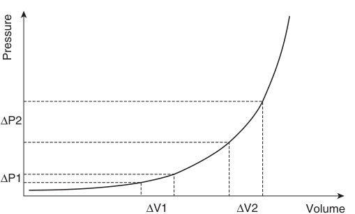

∆P2 ∆P1 ∆V1 ∆V2 Volume Pressure 

**Fig. 80.1** Intracranial pressure–volume relationship: additional intracranial volume (ΔV1) is accommodated with minimal change in intracranial pressure (ΔP1). Once this capacity is exhausted, the same increase in volume (ΔV2) leads to an exponential rise in intracranial pressure (ΔP2).

increase in pressure. These changes in volume are due to the increase in intracranial tissue or fluid content (i.e., blood, interstitial fluid/edema, or cerebrospinal fluid [CSF]). Tissue content is relevant insofar as mass lesions influence intracerebral elastance and accentuate the effects of fluid changes. Small increases in volume can be accommodated by an outflow of CSF from the cranial cavity into the spinal canal, producing an exponential pressure–volume relationship (see Fig. 80.1).

The cranial vault is compartmentalized by the falx cerebri and tentorium cerebelli, which creates the possibility of internal pressure gradients (Fig. 80.2). Pressure gradients are initially hydraulically equilibrated, with CSF moving from the ventricular chambers to the extracranial spinal space. Continued increase in intracranial volume eventually leads to herniation of brain tissue through the “apertures” of the compartments. Brain herniation may contribute to impedance of CSF drainage either by occlusion of the foramina of Monro in the case of lateral herniation or by occlusion of the third ventricle and aqueduct by supratentorial herniation through the tentorial gap. This situation typically gives rise to clinical features of midbrain compression. Unilateral pupillary dilation, ipsilateral or even contralateral paralysis (the Kernohan notch phenomenon), and abnormalities of respiration are apparent in the patient. If the herniation continues, it will result in cerebellar descent through the foramen magnum with consequent compression of the brainstem, thus producing bilateral pupillary fixation, either tachycardia or bradycardia, and systemic hypertension.8

Changes in cerebral mass secondary to increase in intracerebral venous blood volume can arise from venous drainage obstruction by compression of the easily susceptible bridging veins draining from cortex to venous sinuses. Once an individual threshold of elastance is crossed, changes in volume exert a mass effect on the draining veins, which act as Starling resistors. This effect decreases drainage, which, in turn, amplifies and prolongs pressure increases. Blood volume increases may be extravascular (i.e., hemorrhage) or intravascular (i.e., accumulation within a predominantly venous capacitance circulation).

The other main fluid mass effect is through edema, either cytotoxic or vasogenic.9 Cytotoxic edema results

::: details 原始表格與符號（PDF 第 2 頁）

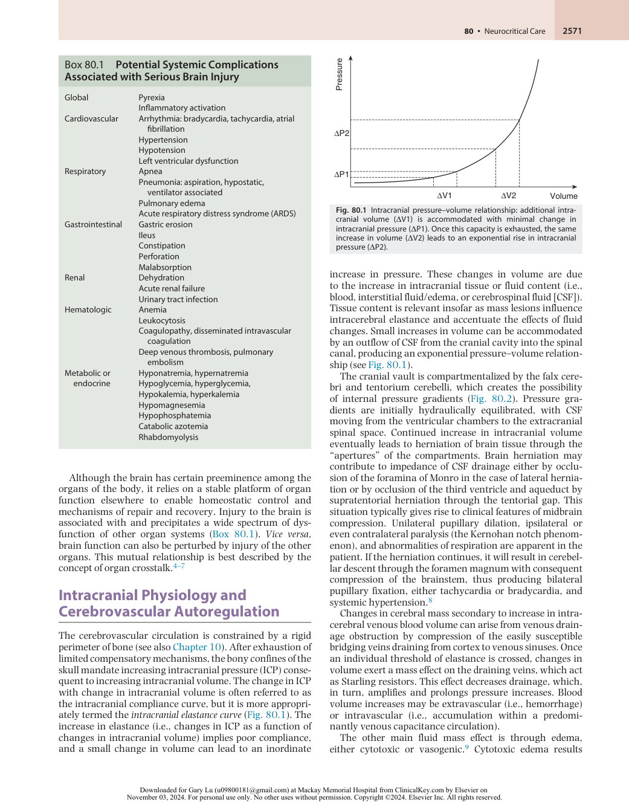

:::

<!-- PDF page 3 -->

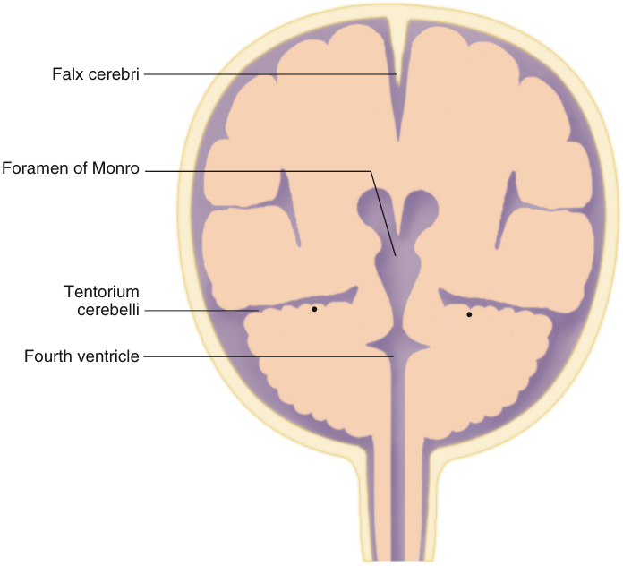

Falx cerebri Foramen of Monro Tentorium cerebelli • • Fourth ventricle 

**Fig. 80.2 Schematic of intracranial compartments: coronal section.**

from hypoxia, with swelling of the intracellular compartment, whereas vasogenic edema in the interstitium usually develops from a breach of the blood–brain barrier, often in response to high blood pressure.10

Changes in the control of cerebral blood volume (CBV) may have significant effects on ICP and, thereby, on cerebral perfusion pressure (CPP). The cerebral vasculature responds to increase in arterial partial pressure of carbon dioxide (PaCO2), decrease of arterial partial pressure of oxygen (PaO2), and reduced mean arterial pressure (MAP) by dynamically altering arteriolar caliber to maintain a constantly matched cerebral blood flow (CBF) sufficient to meet metabolic demands (Fig. 80.3). Carbon dioxide, as with hydrogen, potassium, calcium, nitric oxide, adenosine, and lactate, is among many purported metabolic mediators of flow.11 A reduction in substrate delivery (i.e., oxygen and nutrients) to less than the threshold necessary to maintain cellular viability induces cell injury with consecutive cytokine and chemokine release. This inflammatory amplification expands the injury, disrupts the blood–brain barrier function, and may directly lead to apoptosis or necrosis.12 The disruption of the blood–brain barrier creates vasogenic edema and allows serum proteins to cross into brain parenchyma with prolonged effects. This process is more evident in the high metabolically active gray matter than in white matter.

CBF control may be directly compromised by brain injury or by abnormalities of respiration and arterial blood pressure. Consequently, untoward changes in physiologic parameters, including arterial hypotension, hypoxia, hyper- and hypocapnia, hyper- and hypoglycemia, and

Arterial

Venous

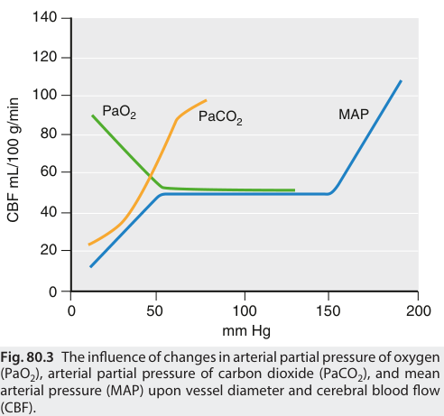

140 120 100 PaO2 PaCO2 MAP 80 60 40 20 0 0 50 100 150 200 mm Hg Fig. 80.3  The influence of changes in arterial partial pressure of oxygen (PaO2), arterial partial pressure of carbon dioxide (PaCO2), and mean arterial pressure (MAP) upon vessel diameter and cerebral blood flow (CBF). CBF mL/100 g/min 

fever, as well as seizures, produce what is termed a _secondary physiologic insult._ The _primary injury_ is caused by the direct destruction of tissue during the initial trauma or ischemia, while the area of the _secondary injury_ slowly extends into

<!-- PDF page 4 -->

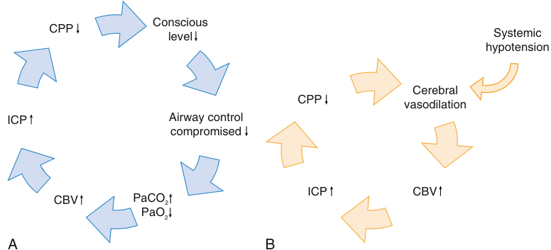

Conscious CPP level Systemic hypotension Cerebral CPP vasodilation ICP Airway control compromised ICP CBV CBV PaCO2 PaO2 A B 

**Fig. 80.4** (A) Ventilatory–neurologic circle of dysfunction. Induced changes in partial pressure of carbon dioxide (PaCO2) and partial pressure of oxygen (PaO2) produce changes in cerebral blood volume (CBV), intracranial pressure (ICP), and cerebral perfusion pressure (CPP). This, in turn, impairs ventilatory control. (B) Hemodynamic–neurologic circle of dysfunction. Like the diagram in (A), systemic hypotension induces cerebral vasodilation, which increases CBV and ICP and reduces CPP, which, in turn, increases vasodilation.

the intact tissue and induces further harm to the vulnerable brain and worsens outcome.13 The control of the secondary brain injury is the target of the development of potential neuroprotection protocols.14

concerns regarding adverse effects on ICP.7,22 The use of positive end-expiratory pressure (PEEP) up to 15 cm H2O appears to improve brain tissue oxygen pressure and oxygen saturation without negative effects on ICP or CPP.23,24

## General Cardiopulmonary Considerations

## Fluids, Electrolytes, Blood Glucose Concentration

Arterial hypotension, especially in combination with hypoxemia, is a well- documented source of cerebral morbidity.15–17 Therefore, a reduction of cardiac output and CPP must be avoided to prevent further deterioration of the level of consciousness, which in turn leads to airway compromise and hypercapnia and hypoxia. Hypercapnia, hypoxia, and arterial hypotension lead to autoregulatory cerebral vasodilation, which increases CBV and ICP and further diminishes CPP, perpetuating the vicious circle (Fig. 80.4).

Any deterioration in ventilatory efficacy adversely affects cerebral elastance through carbon dioxide–induced vasodilation and leads to hypoxemia, which can cause direct as well as indirect injury to the brain.18 Arterial hypoxemia, less than 60 mm Hg, is a significant contributor to secondary insult from vasodilatory ICP effects, in addition to reduced oxygen delivery to the cell. Pulmonary compromise is often seen in neurologic patients with altered mental status due to impaired airway reflexes and repeated aspiration episodes, which culminate in a significant incidence of pneumonia, irrespective of the initiating pathologic process.19,20 Another potential mechanism is the release of cytokines from the brain in response to the inflammatory process triggered by an injury.7 This release may be sufficient to induce acute respiratory distress syndrome (ARDS) and systemic inflammatory response syndrome (SIRS).6,21 Conversely, ARDS can also trigger cerebral inflammation by releasing inflammatory mediators like cytokines. The ventilatory treatment for ARDS may create a therapeutic dilemma in the presence of cerebral pathophysiology. However, protective mechanical ventilation, developed to minimize alveolar distention and reduce lung injury, appears to be feasible in neurosurgical patients, despite theoretic

Normally, capillary fluid shift is a function of hydrostatic pressure pushing fluid out and the balance of osmotic forces retaining fluid within25 :

Jv = Kf ([Pc − Pi) − _σ_ [ _π_ c − _π_ i])

where Jv is the net fluid movement between compartments, Pc is the capillary hydrostatic pressure, Pi is the interstitial hydrostatic pressure, πc is the capillary osmotic pressure, πi is the interstitial osmotic pressure, Kf is the filtration coefficient (this is a product of surface area and hydraulic conductivity), and σ is the reflection coefficient (the membrane impermeability toward osmotically active particles).

In extracranial capillaries, these osmotic forces are derived from oncotic pressure because smaller solutes can cross the capillary basement membrane following concentration gradients and only large protein molecules remain to exert their effect. However, in the brain, because of the presence of tight junctions in the endothelium, the intact blood–brain barrier reflects smaller solutes (e.g., sodium and chloride ions), and this relative impermeability renders cerebral capillary fluid shift a function of hydrostatic and _total_ osmolar forces, with the oncotic pressure being responsible for only 1 mOsmol/kg.26 Therefore, the fluid shift in the cerebral capillaries is most dependent on the osmolar gradient. In the absence of externally administered osmotically active substances (e.g., mannitol), plasma osmolality is 280 to 300 mOsm/kg and is almost entirely determined by sodium concentration.

Plasmaosmolality = [NA]serum × 2 + glucose/18 + BUN/2.8

where Na is sodium and BUN is blood urea nitrogen.

<!-- PDF page 5 -->

**Table 80.1** Osmolarity and Osmolality of Commonly Used Intravenous Fluids

|**Fluid**|**Mean Measured** **Osmolality** **(mOsm/kg)**|**Theoretical Osmolarity** **(mOsm/L)**|
|---|---|---|
|Plasma|288 [280–300]|291|
|Isotonic saline 0.9%|285 [282–286]|308|
|Ringer´s lactate solution|257 [257–258]|276|
|Gelatin 4%|271 [270–272]|274|
|Human albumin (4%)|266 [266–267]|274.4|

As a reduction of plasma osmolality of 4 to 5 mOsm/kg increases cerebral edema, hypotonic solutions must not be used in the neurosurgical patient. Table 80.1 shows that the mean measured osmolality is often lower than the calculated osmolarity.26 Hence, intravascular fluid therapy must be carefully considered under circumstances of cerebral ischemia and inflammation.

The brain exerts homeostatic control on metabolic and endocrine activity, and neurologic dysfunction can manifest as untoward changes in fluid and electrolyte balance. Diabetes insipidus is a florid example of this, with polyuria, subsequent hypovolemia, and, if the disorder is left untreated, systemic hypotension. Iatrogenic causes may include the use of osmotic diuretics. Sympathetic denervation stemming from brainstem or spinal cord injury (SCI) may also contribute to reductions in venous return due to increased vasodilation and peripheral venous pooling.27

Stress- induced hyperglycemia is associated with higher morbidity and mortality in patients with neuronal injury.28 At the same time tight glycemic control, targeting plasma glucose levels of 80 to 120 mg/dL, increased the risk of hypoglycemia and did not improve outcomes compared to conventional therapy allowing a maximal glucose concentration of 150 mg/dL.29 Therefore, moderate glycemic control with a target blood glucose level of 110 to 150 mg/dL is advocated.

## Temperature Control

Fever occurs with an incidence of up to 70% in brain injured patients.30 The degree and duration of early hyperthermia are closely correlated with a higher morbidity and mortality after neurologic injury.31 The temperature threshold that produces progressive thermal injury to the metabolically active brain cells, blood–brain barrier, and vascular endothelium appears to be between 39°C and 40°C.32 Hyperthermia, an often overlooked insult to the compromised brain, increases oxygen utilization and metabolic stress.31,33 Patients in the ICU can have multiple risk factors for hyperthermia such as infection from indwelling catheters (e.g., arterial, venous, CSF) or lung injury.33 However, in up to one- third of cases, the cause of the fever remains unexplained and often is classified as central fever.30

The concept of targeted temperature management in neurocritical care includes therapeutic mild hypothermia,

controlled normothermia, and aggressive treatment of fever.34,35 Because induced moderate hypothermia has not improved outcome in patients with head trauma, it should be used only after careful consideration of the potential benefit.36 Gel pads or intravascular temperaturemodulating devices with servo- controls can effectively reduce body temperature. Cold saline infusions are additionally recommended.35 Core temperature should be monitored continuously using an esophageal temperature probe or a bladder temperature probe.35 Shivering should be treated promptly with non- sedating interventions (e.g., acetaminophen) instead of narcotic analgesics, sedatives, or paralytics.

## Monitoring

Preventing or minimizing secondary brain damage requires the use of physiologic monitoring devices to provide an individualized therapy. The most important neuromonitoring devices are shown in Fig. 80.5 (see Chapter 35).37–40 Neuromonitoring does not obviate the need for regular neurologic clinical examination. Monitors (e.g., processed electrical activity, cerebral oxygenation, and ICP) are merely surrogates of the actual integrity of brain tissue and cerebral function. Similarly, attention should be paid to evaluation of volume status, cardiovascular function, respiratory care, and metabolic consumption.

### CLINICAL EXAMINATION

Comprehensive neurocritical care encompasses the ability to perform a competent neurologic examination. Reproducible and objective assessment of neurologic function is as important as some of the sophisticated technology mentioned later, with the advantage that it offers better insight into global nervous system function and allows integration of information in an inherently complex dynamic system. One of the most basic yet important examinations is the pupillary light reflex, the unilateral absence of which may indicate midbrain compression from uncal herniation, which is a neurologic emergency. Bilaterally absent pupillary reflexes signify imminent or established cerebellar herniation, but this may be reversible with rapid efficacious treatment.

Clinical scales have been devised for common neurologic settings. The Glasgow Coma Scale (GCS) is a well- known, universally applied scale (Table 80.2).41 It relies on independent assessment of eye opening, speech, and best motor movement in response to progressive trials of command, voice, and noxious stimuli. Its accuracy is compromised by the use of sedatives/anesthetics. In clinical practice, duration of loss of consciousness, altered consciousness, and posttraumatic amnesia are also considered. The World Federation of Neurologic Surgeons (WFNS) scale is the preferred rating because it uses the more prevalent GCS but with a modifying component for focal deficit (Table 80.3). The Hunt and Hess Scale describes the severity of subarachnoid hemorrhages and is used as an outcome predictor (Table 80.4).42,43 Knowing and using these scales are crucial to understanding the terminology and practice of neurocritical care.

::: details 原始表格與符號（PDF 第 5 頁）

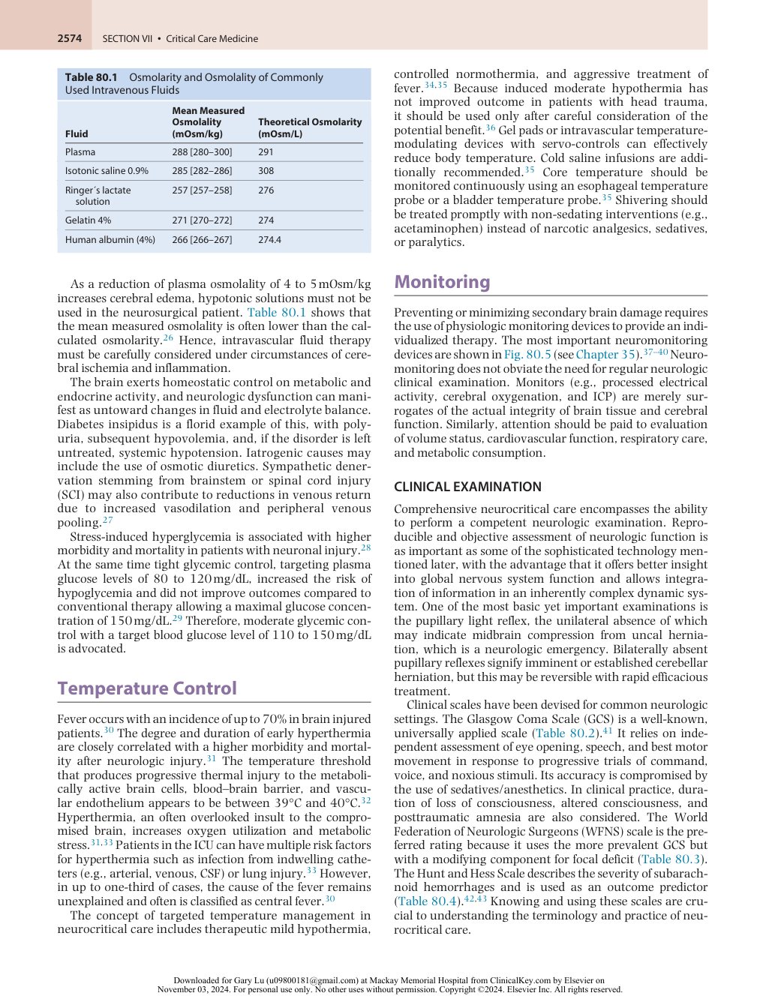

:::

<!-- PDF page 6 -->

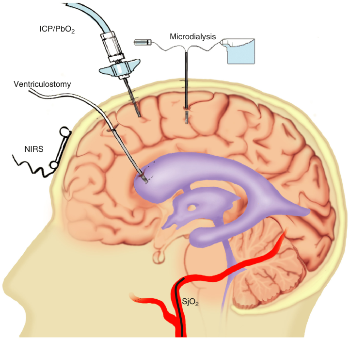

ICP/PbO2 Microdialysis Ventriculostomy NIRS SjO2 

**Fig. 80.5** Schematic of available intracranial monitoring, with near- infrared oximetry (NIRS), intracranial pressure (ICP, either by ventriculostomy or parenchymal probe), brain tissue oximetry (Pbo2), microdialysis, and jugular venous oximetry (SjO2).

### INTRACRANIAL PRESSURE AND CEREBRAL PERFUSION PRESSURE

### Intracranial Pressure

Increased ICP after head trauma is an important and wellestablished indicator of secondary brain injury and is associated with higher mortality and poor long- term outcome, especially when it is refractory to treatment.37,44–46 However, the clinical benefit of ICP monitoring is still under discussion.47–51 The indications for ICP monitoring (e.g., severe head trauma and abnormal computed tomography [CT] scan) and the recommended ICP threshold of 22 mm Hg given in the guidelines are more expert- than evidencebased.52,53 The sole randomized clinical trial evaluating the potential benefit of ICP monitoring revealed that ICP monitoring does not influence long- term outcome after head trauma.47 At the same time an international prospective, observational cohort study including 146 intensive care units (ICUs) in 42 countries showed that the use of ICP monitoring and ICP management might be associated with lower 6- month mortality in patients with severe brain injury.54 Furthermore, ICP- guided therapy in the context of duration of elevated ICP or in combination with information from other neuromonitoring devices may allow for more individualized therapy and, thereby, improve outcome.37,55,56 For example, the cumulative ICP- time burden with an ICP of 20 mm Hg for longer than 37 minutes diminishes outcome,

whereas shorter periods had no adverse effects.57 Impaired cerebrovascular autoregulation or a CPP below 50 mm Hg reduces the ability to tolerate an elevated ICP.57

In clinical practice, two different methods of monitoring ICP are used: microtransducer devices (strain gauge or fiberoptic types) and ventricular catheters.58 Microtransducer systems are less invasive and easier to place, but they cannot drain CSF and may represent only the compartment pressure where they were placed (see Fig. 80.5).59 The ventricular catheter is still the “gold standard” of measurement, as long as the ventricles are accessible, because they reflect global ICP and allow therapeutic drainage of CSF. However, they have an increased risk of complications, such as bleeding or infection.58 Currently, noninvasive ICP measurements are not sufficiently reliable and cannot monitor the dynamics continuously, and, thus, are of research interest only.37

### Cerebral Perfusion Pressure

Cerebral perfusion pressure is the difference between MAP (zero reference point at the external meatus acusticus) and the ICP. However, many interventions to decrease ICP, such as head elevation or barbiturate coma, suppress MAP and therefore may also lower CPP. Most guidelines recommend CPP should be kept between 60 and 70 mm Hg, as higher or lower values worsen outcome after head trauma.45,52 Recently, the concept of targeting an individualized optimal

<!-- PDF page 7 -->

**Table 80.2** Glasgow Coma Scale for Head Injury

|**Ability**|**Score**|
|---|---|
|**MOTOR RESPONSE** Normal|**6**|
|Localized to pain (purposeful movement to side of pain)|**5**|
|Withdraws to pain|**4**|
|Abnormal flexion to pain_(an abnormal posture that can_ _include rigidity, clenched fists, legs held straight out, and_ _arms bent inward toward the body with the wrists and_ _fingers bent and held on the chest)_|**3**|
|Abnormal extension to pain_(an abnormal posture that_ _can include rigidity, arms and legs held straight out,_ _toes pointed downward, and head and neck arched_ _backward)_|**2**|
|None|**1**|
|**VERBAL RESPONSE**||
|Normal conversation|**5**|
|Disoriented conversation|**4**|
|Words, but not coherent|**3**|
|No words, only sounds|**2**|
|None|**1**|
|**EYE OPENING** Spontaneous|**4**|
|To voice|**3**|
|To pain|**2**|
|None|**1**|
|SUM|3–15|

**Table 80.3** World Federation of Neurologic Surgeons Scale

|**Grade**|**Clinical Presentation**|
|---|---|
|Grade 1|GCS score of 15, motor deficit absent|
|Grade 2|GCS score of 13–14, motor deficit absent|
|Grade 3|GCS score of 13–14, motor deficit present|
|Grade 4|GCS score of 7–12, motor deficit absent or present|
|Grade 5|GCS score of 3–6, motor deficit absent or present|

_GCS,_ Glasgow Coma Scale.

**Table 80.4** Hunt and Hess Grading System

|**Grade**|**Clinical Presentation**|**Survival (%)**|
|---|---|---|
|Grade 1|Asymptomatic or mild headache|70|
|Grade 2|Moderate to severe headache, nuchal rigidity, and no neurologic deficit other than possible cranial nerve palsy|60|
|Grade 3|Mild alteration in mental status (confusion, lethargy) and mild focal neurologic deficit|50|
|Grade 4|Stupor and/or hemiparesis|20|
|Grade 5|Comatose and/or decerebrate rigidity|10|

**Table 80.5** Functional Thresholds of Cerebral Blood Flow

(Table 80.5). Further reductions in CBF lead to structural 

|**CBF (mL/100 g/min)**|**Result**|
|---|---|
|50|Normal|
|20|EEG slowing|
|15|Isoelectric EEG|
|6–15|Ischemic penumbra|
|&lt;6|Neuronal death|

_CBF,_ cerebral blood flow; _EEG,_ electroencephalogram.

CPP was introduced, suggesting that an optimal CPP can be calculated for each patient, leading to a more favorable outcome compared with the standard threshold.60,61

### CEREBRAL BLOOD FLOW

A constant, uninterrupted CBF is pivotal for the brain, as it has no storage for energy or oxygen. A decrease in CBF below 20 mL/100 g/min causes functional impairment (Table 80.5). Further reductions in CBF lead to structural damage of brain tissue. Modern imaging techniques such as CT perfusion or positron emission tomography (PET) provide detailed information about cerebral hemodynamics, but cannot clinically be used for continuous monitoring of CBF.37 Therefore, bedside solutions for continuous CBF measurement are necessary.

### Thermal Diffusion Flowmetry

Thermal diffusion flowmetry is an invasive, continuous, and quantitative technique to measure local CBF. The thermal diffusion flowmetry catheter measures the temperature difference between a thermistor, which is heated some degrees above tissue temperature, and a temperature probe. The temperature difference can be converted to an absolute measurement of CBF in mL/100 g/min. The catheter is placed in areas at risk for hypoperfusion and can further help detect intracerebral vasospasm and assess cerebrovascular autoregulation.62,63 However, there are still concerns about the validity of using thermal diffusion flowmetry long term, as monitor dysfunctions secondary to placement errors and missing data during recalibration occur.64

### Transcranial Doppler Ultrasonography

Transcranial Doppler (TCD) ultrasonography is a noninvasive bedside monitoring technique that uses the Doppler shift effect to assess flow velocity in insonated cerebral arteries.65 Flow velocity has a linear relationship to CBF as long as the vessel’s cross- sectional area and the angle of insonation remain constant.66 This technique can continuously monitor flow velocity within the main components of the circle of Willis through the ophthalmic, temporal, and foramen magnum acoustic windows.67 It has excellent temporal resolution and can detect inadequate CBF, assess pressure autoregulation and carbon dioxide reactivity, sense intra- arterial microemboli, and help predict outcome in patients with head trauma.67–69 These data can serve as a surrogate measurement for optimized blood pressure and ventilation management in neurocritical care patients.70

::: details 原始表格與符號（PDF 第 7 頁）

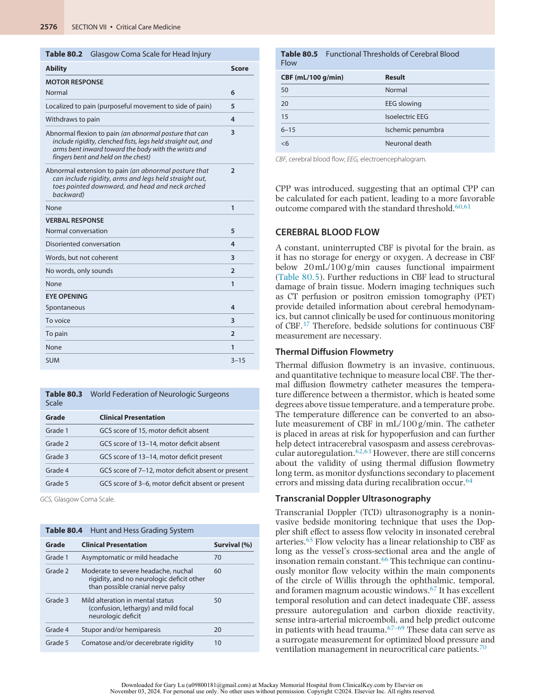

:::

<!-- PDF page 8 -->

An elevated ICP can be detected early, before clinical decompensation, by loss of diastolic flow profile.65,71 Changes of velocity can be used to assess alterations of vascular caliber (e.g., arterial vasospasm) or vascular stenosis.67,72 High flow velocities in the middle cerebral artery (MCA) can be caused by vasospasm or hyperemia. This can be distinguished by calculating the ratio between the MCA and the extracranial carotid artery flow velocity (the Lindegaard index).67 If the velocity at the MCA is increased more than the ICA, it indicates vasospasm as the source of the elevated velocity as opposed to hyperemia.

### CEREBROVASCULAR AUTOREGULATION AND VASOMOTOR REACTIVITY

Monitors of CBF can assess the response of the cerebral vasculature to changes in metabolism and blood pressure (i.e., cerebrovascular autoregulation).73 Static cerebrovascular autoregulation can be determined with sustained blood pressure manipulation by using either a tilt test or a direct vasopressor, whereas dynamic cerebrovascular autoregulation, can be assessed using rapid deflation of thigh cuffs that have been inflated above systolic blood pressure (SBP). For continuous assessment of cerebrovascular autoregulation, the pressure reactivity index is an established tool. Using the Pearson correlation coefficient the pressure curves of ICP and arterial blood pressure are correlated, calculating an index between −1 and +1.61

Instead of ICP other parameters like the CBF (measured by TCD), the brain tissue PO2, or near- infrared spectroscopy (NIRS) derived variables can be used to calculate an autoregulatory index to assess the status of the cerebral autoregulation.74–78 The lack of cerebrovascular autoregulation is more often associated with a poor outcome.79,80

### CEREBRAL OXYGENATION

To assess the adequacy of cerebral perfusion, measurement of cerebral oxygenation is indicated, because it gives the balance between cerebral oxygen delivery and utilization.

### Jugular Venous Oxygen Saturation

The Fick principle may be reversed to examine the venous oxygen saturation which, assuming a constant hematocrit and metabolism, can offer an assessment of the adequacy of CBF and associated oxygen delivery relative to cerebral oxygen consumption:

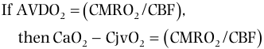

If AVDO2   CMRO2 /CBF  , then CaO2  CjvO2   CMRO2 /CBF  

Ignoring the contribution of dissolved oxygen, then:

(SaO2 − SjvO2) × Hgb × 1.34 = (CMRO2/CBF) 

where AVDO2 is the arteriovenous oxygen content difference; CMRO2 is the cerebral oxygen metabolic rate; CaO2, CjvO2, SaO2, and SjvO2 are the arterial oxygen and jugular venous oxygen contents and saturations, respectively; Hgb is the hemoglobin concentration; and 1.34 is the oxygen affinity constant.

_In vivo_ , catheters to measure SjvO2 are placed in retrograde fashion through the internal jugular vein to its

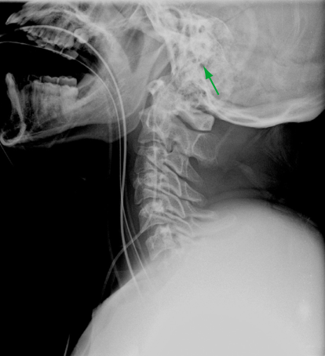

**Fig. 80.6** Lateral cervical spine radiograph showing appropriate positioning of the jugular venous oximetry catheter above the lower border of the C1 vertebra (the _arrow tip_ is actually within the jugular foramen).

jugular bulb at the foramen, or even beyond, to the large sinuses (Fig. 80.6). SjvO2 can be measured intermittently by sampling venous blood from a catheter or continuously by fiberoptic measurement. The normal range of SjvO2 lies between 55% and 75%. Both desaturation (&lt;50%, suggesting inadequate delivery or excess consumption) and abnormally high saturation (>75%, suggesting hyperemia or stroke) have been associated with poor outcomes.52,81 The arteriovenous oxygen content difference is possibly a more accurate assessment of the adequacy of flow and predictor of outcome.82 Jugular venous oximetry is sometimes insensitive to focal changes because it reflects the averaged global cerebral venous oxygen saturation from the confluence of hemispheric venous drainage. Consequently, some authors have suggested using oxygen consumption in combination with the cerebral arteriovenous gradient of lactate to make stoichiometric assessments of aerobic versus anaerobic metabolism.83 The idea is to base goal- directed therapy on metabolic indices (SjvO2) rather than on hemodynamic indices (ICP and CPP).84 However, due to technical problems (e.g., displacement of catheter) and its low sensitivity, the clinical use of jugular venous oximetry has decreased in favor of alternative methods for brain tissue oxygen monitoring.85

### Brain Tissue Oxygen Tension

Miniaturized Clark electrodes have been developed and combined with ICP catheters to provide simultaneous measurements of brain tissue oxygen tension (PbO2) and ICP. The PbO2 should be measured in the area of risk, which contains still viable subcortical white matter.86 With a CTguided technique, the electrodes can be placed even more precisely, which improves their informative value.87 The normal range of PbO2 lies between 20 and 45 mm Hg. In clinical settings, values less than 15 to 20 mm Hg are considered as cerebral ischemia and below 10 mm Hg as severe ischemia.88 Several studies have demonstrated a correlation

<!-- PDF page 9 -->

between low PbO2 and poor outcome after traumatic brain injury (TBI).89 Therapy guided by combined ICP (&lt;20 mm Hg) and CPP (60–70 mm Hg) and PbO2 (>20 mm Hg) was superior to ICP and CPP therapy alone.90–92 To increase a low PbO2 (&lt;20 mm Hg), mechanical ventilator settings should be optimized. A challenge of 100% oxygen for 2 minutes (a temporary method to restore PbO2 and to verify probe function) can be performed and CPP and ICP, hemoglobin, and sedation should be optimized.93

### Near- Infrared Spectroscopy

Pulse oximetry for the brain relies on the principle of reflectance spectroscopy in which near- infrared light traverses bone. The light is scattered and reflected in a ratio that is inversely proportional to the concentration of light- absorbing materials in tissue (e.g., hemoglobin and oxyhemoglobin). The surface detector is constructed and calibrated to detect light that has traversed down to the cerebral cortex and back. An adjacent detector is positioned to detect a signal from superficial tissues, and both signals are then used in an algorithm to derive an estimated tissue saturation.94

NIRS is a noninvasive approach to continuously monitor regional critical oxygen supply/demand mismatch. The normal range lies between 60% and 75%, but the lower threshold varies considerably among individual patients.95 Unfortunately, the sensitivity to detect isolated cerebral hypoperfusion is low, and, therefore, high- quality data supporting the use of NIRS in patients with TBI, subarachnoid hemorrhage (SAH), or stroke are missing.37,77 In contrast, NIRS is an excellent trend monitor in patients with cerebral hypoperfusion caused by systemic changes, such as during cardiac surgery where a decreased NIRS compared to the awake baseline correlates with poor outcome.95–97

### BRAIN METABOLISM AND BIOCHEMISTRY – CEREBRAL MICRODIALYSIS

Cerebral microdialysis probes can assess the biochemical milieu of the brain. The probes are placed through a burr hole and cycle small volumes of dialysate through the catheter to an extracranial collection system. The tip of the catheter should be placed in at- risk brain tissue, which is most vulnerable to secondary brain damage.98 A semipermeable membrane (molecular weight cutoff of 20 kDa) is incorporated in the tips of the probes through which various substances can diffuse along their concentration gradient (e.g., lactate, pyruvate, glucose, glycerol, and glutamate) into the dialysate for collection and analysis using a bedside high- pressure liquid chromatography device.99 As these substances are associated with glucose metabolism, hypoxia/ischemia, and cellular energy failure, the cerebral microdialysis is used to guide individualized therapy to optimize substrate supply, cerebral perfusion, and oxygen transport.100,101 An increased lactate:pyruvate ratio with a low pyruvate concentration in combination with a low glucose concentration can indicate a profound reduction in energy substrate supply and is associated with poor outcome after brain injury.102 In contrast, an increased lactate:pyruvate ratio with normal pyruvate and glucose concentrations is an indicator of a nonischemic cause (e.g., mitochondrial dysfunction).103 Glutamate is a marker of

excitotoxic brain damage and glycerol can indicate membrane breakdown of neurons.104,105 Recently, probes with a high- molecular- weight cutoff membrane (100 kDa) have been used to detect biomarkers for neuronal damage like S100B or cytokines.106,107 Despite promising results, the clinical utility of cerebral microdialysis–guided therapy is still under discussion.

### NEUROPHYSIOLOGIC MONITORING

Clinical neurophysiology picks up the electrical activity of the central or peripheral nervous system.108 It includes electroencephalography (EEG), evoked potentials (EP), and electroneuromyography, and is very useful for diagnosis, prognosis, and follow- up of cerebral disorders.108 However, clinical neurophysiology only evaluates the current functional brain status and cannot predict future complications.

### Electroencephalography

The electroencephalogram (EEG) records spontaneous electrical activity of cortical neurons detected by appropriately placed electrodes in a radial and axial array as defined by the 10/20 system, an internationally standardized system of recording. The EEG is a surrogate parameter for functional cortical neuron metabolism and brain integrity. The spectrum of component frequencies, together with amplitude and power, can be quantified and analyzed in a variety of fashions. These same frequencies are used by processed EEG (pEEG) monitors to assess the depth of anesthesia. In unconscious patients in the neurocritical care unit, EEG should be continuously used for the detection of nonconvulsive seizures, which can frequently occur and are associated with intracranial hypertension and cerebral metabolic derangements.109,110 As the detection of nonconvulsive seizures is difficult, automatic monitoring systems have been developed.111 Unfortunately, the current automatic detection of seizures is fraught with false negatives and false positives and cannot replace an EEG- trained neurologist.111

For prognosis after anoxic brain damage, poor outcome is associated with malignant EEG patterns like burstsuppression, α- coma, and low- voltage delta. In contrast, the persistence of EEG reactivity is an indicator of good outcome. Further development of intracranial electrocorticography, an invasive form of EEG monitoring, might allow the continuous detection of so- called spreading depolarizations, which occur in about half the patients with head trauma and can lead to secondary brain damage.112,113

### Evoked Potentials

Evoked potentials measure changes in neuronal activity, which are triggered by sensory stimuli.108 They reflect the passive response of the cerebral cortex or the brainstem to peripheral (acoustic, somatosensory, or visual) or central (transcranial magnetic stimulation) stimuli. In contrast to the EEG, where spontaneous cortical activity is recorded, the EPs monitor the integrity of central and peripheral tracts. The EP signals are quantified according to latency and amplitude. In the absence of peripheral or cervical dysfunction, the bilateral absence of the N20 somatosensory EP response to median- nerve stimulation is the most reliable predictor of non- awakening in post- anoxic coma, whereas the preservation of cognitive EPs predicts awakening

<!-- PDF page 10 -->

with a very high probability, irrespective of coma etiology.108,114,115 After TBI, impairment of brainstem activity is the best predictor of bad outcome.108

### MULTIMODALITY NEUROMONITORING

Multimodality monitoring uses a combination of parameters to identify, prevent, and treat the mechanisms of secondary brain damage and guide individualized therapy.68,116 In this way, the advantages of the various measurement methods are to be combined synergistically, while at the same time reducing possible risks associated with the application of each individual measurement method. Various commercial systems are available to process and display multiple data streams.117 The combination of ICP, cerebrovascular autoregulation, PbO2, continuous EEG (cEEG), and cerebral microdialysis offers the possibility to individualize care decisions in patients with severe brain injury.40,118 In the future, the development of computational model interpretation of these complex multimodal data sets will provide summary outputs to suggest individual therapies.37,119

### RADIOGRAPHIC IMAGING

The most important diagnostic modalities for unconscious and brain- injured patients are CT, including CTangiography (CTA), and magnetic resonance imaging (MRI). CT and CTA are very efficient methods, while MRI is time consuming but more sensitive for brainstem lesions as well as for axonal injuries. These imaging techniques are used to diagnose damage after TBI (intracranial masses, cortical contusions, and neuronal/axonal injury), an epidural or subdural hematoma, subarachnoid hemorrhage (SAH), ischemic or hemorrhagic stroke, cerebral vein/sinus thrombosis, or postoperative complications such as brain edema or rebleeding.

It is important to standardize and categorize CT images for meaningful comparison of therapeutic modalities in clinical trials and for assessment of prognosis. For TBI, the novel Stockholm and Helsinki CT scores seem to give a more accurate outcome prediction compared to the Marshall CT classification and the Rotterdam CT score (Tables 80.6 and 80.7).120 After SAH, the Hijdra sum score seems to be superior to the more commonly used modified Fisher scale in assessing the amount of subarachnoid blood and in predicting the occurrence and severity of cerebral vasospasm.121,122 (Tables 80.8 and 80.9). For early assessment of neuronal damage after stroke, the Alberta Stroke Program Early CT Score (ASPECTS) uses signs of early ischemic lesions in regions M1 to M6 and the basal ganglia.123–126

## Common Diseases in the Neurocritical Care Unit

### TRAUMA

### Traumatic Brain Injury

Severe TBI is mainly a result of traffic accidents, assaults, falls, and domestic abuse. It is the leading cause of disability and death in young male adults.127,128 The Global Burden

**Table 80.6** Marshall Scale: Computed Tomography Categories for Head Injury

|**Category**|**Definition**|
|---|---|
|Diffuse injury I|No visible intracranial pathologic process|
|Diffuse injury II|Cisterns are present with midline shift of 0–5 mm and/or lesion densities present; no high- or mixed- density lesions at >25 mL|
|Diffuse injury III|Cisterns compressed or absent, with midline shift of 0–5 mm; no high- or mixed- density lesions of >25 mL|
|Diffuse injury IV|Midline shift of >5 mm; no high- or mixed- density lesion of >25 mL|
|Evacuated mass lesion (V)|Any lesion surgically evacuated|
|Non- evacuated mass lesion (VI)|High- or mixed- density lesion of >25 mL; not surgically evacuated|

**Table 80.7** Classification of the Severity of Traumatic Brain Injury

|**Criteria**|**Mild**|**Moderate**|**Severe**|
|---|---|---|---|
|Structural imaging|Normal|Normal or abnormal|Normal or abnormal|
|Loss of consciousness|&lt;30 min|30 min to 24 h|>24 h|
|Posttraumatic amnesia|0–1 day|>1 and &lt;7 days|>7 days|
|GCS (best available in 24 h)|13–15|9–12|3–8|
|Abbreviated injury scale score: Head|1–2|3|4–6|

_GCS_ , Glasgow Coma Scale.

**Table 80.8** Fisher Scale (Computed Tomography Appearance)

|**Grade**|**Clinical Presentation**|
|---|---|
|Grade 1|No blood detected|
|Grade 2|Diffuse deposition of subarachnoid blood, no clots, and no layers of blood &lt;1 mm|
|Grade 3|Localized clots and/or vertical layers of blood≥1 mm in thickness|
|Grade 4|Diffuse or no subarachnoid blood, but intracerebral or intraventricular clots present|

**Table 80.9** Modified Fisher Scale (Computed Tomography Appearance)

|**Grade**|**Clinical Presentation**|
|---|---|
|Grade 0|No blood detected|
|Grade 1|Thin subarachnoid blood,*no intraventricular hemorrhage|
|Grade 2|Thin subarachnoid blood, with intraventricular hemorrhage|
|Grade 3|Thick subarachnoid blood, no intraventricular hemorrhage|
|Grade 4|Thick subarachnoid blood, with intraventricular hemorrhage|

*Vertical thickness of 1 mm separates thin from thick subarachnoid hemorrhage.

::: details 原始表格與符號（PDF 第 10 頁）

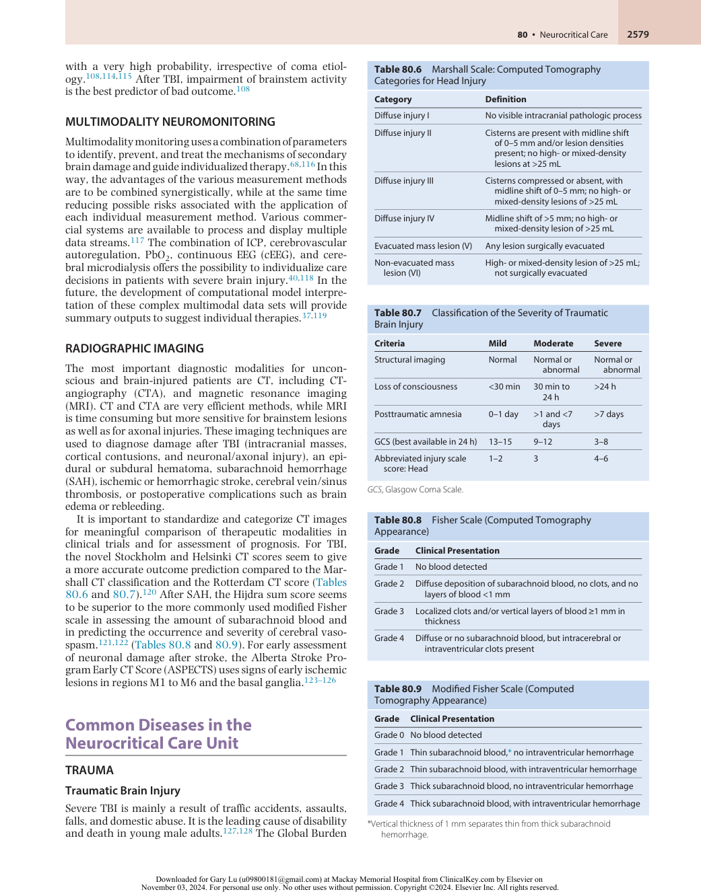

:::

<!-- PDF page 11 -->

of Disease study assumes that globally 27 million cases of head trauma occur per year.129 Poor outcomes after TBI are correlated to older age and are worse after falls.130,131 The primary injury, which is defined by the kinetic impact of the trauma, deforms the brain structure. The pattern of this damage covers a wide spectrum from localized contusion to diffusely scattered foci, lacerations, and hematomas varying with the circumstances of the incident and the architecture of the victim’s brain. TBI is classified by whether it is via blunt or penetrating mechanism. Penetrating injury may again have widely varying consequences depending on site, depth, and energy, but is generally fatal if it bilaterally traverses the midbrain.132 The GCS categorizes TBI into mild, moderate, and severe injury according to the patient’s presenting clinical characteristics and correlates with outcome after TBI (see Table 80.2).133 Additionally, the Abbreviated Injury Scale (AIS) score for the head and neck region classifies TBI by ranking injuries on a six- point scale based on mortality risk, with “1” indicating minor injury and “6” indicating a nonsurvivable injury. Both scores are comparable in predicting short- term mortality after severe TBI.134 The management of TBI in the ICU should include comprehensive examination and assessment using such principles as outlined in the Advanced Trauma and Life Support protocol because occult injuries can escape initial screening.

### Pathophysiology

As the brain has no tolerance for hypoxia, TBI patients need immediate treatment according to current guidelines.52 Unfortunately, the extent of the primary injury cannot be influenced by therapy and, therefore, prevention (e.g., by helmets or airbags) is the only way to avoid damage. The primary brain damage triggers a cascade of pathophysiologic changes, which then lead to secondary brain damage. During the first posttraumatic days, the aim of treatment is to minimize the secondary damage as much as possible to rescue salvageable brain tissue. Pathologic processes such as elevated ICP (due to edema, hemorrhage, obstruction of CSF flow), diminution of arterial inflow, and consequent reduction in CPP with resulting tissue hypoxia and loss of cerebrovascular autoregulation increase secondary brain damage. Inflammation, massive release of excitatory neurotransmitters, apoptotic cell death, high lactic acid concentrations due to anaerobic glycolysis, depleted adenosine triphosphate (ATP) stores, increased intracellular Ca2+ concentrations, generation of free radicals, and proteolysis are some of the identified contributors to secondary brain damage. Unfortunately, despite intense research and characterization of all these mechanisms, no drug has been identified that can improve outcome after TBI in randomized, prospective clinical trials. This is most likely related to the complex pathophysiology of brain damage, the heterogeneous patterns of damage, and various preexisting patient diseases. TBI also leads to disturbances in other systems such as: sympathetic discharge of the autonomic nervous system, inflammatory responses, endocrine dysfunctions, electrolyte imbalances, cardiovascular and respiratory disturbances, and coagulation impairments. These systemic effects must be monitored and immediately treated, as they also contribute to secondary brain damage.

Traumatic SAH (tSAH) occurs in up to 60% of admissions for TBI and influences outcome.135–137 Approximately 20%

of patients with tSAH may also develop vasospasm, which causes secondary ischemic insult.

### Treatment

All therapeutic strategies focus on optimization of the delivery of oxygen and glucose to the brain cells. These strategies include maintaining adequate CPP, controlling ICP, and optimizing oxygenation. Therefore, in the critical care setting, the management of TBI patients should follow established protocols with close monitoring of parameters, including CPP, ICP, and oxygenation status.138–140 An algorithm for ICP- monitor- based TBI management was provided by a consensus group defining 18 fundamental and 10 obsolete treatments using a three- tier algorithm.140,141 The expected interventions include treatment in the ICU, mechanical ventilation, neurologic examination, elevated head of bed, analgesia and sedation, and fever prevention. The recommended interventions include the continuous measurement of arterial blood pressure, insertion of a central line, maintenance of physiologic parameters, and antiseizure medication. Not recommended are scheduled and continuous hyperosmolar therapy, routine use of steroids, furosemide, therapeutic hypothermia, hyperventilation (PaCO2 &lt;30 mm Hg), high- dose propofol, and CPP >90 mm Hg.

**Cerebral Perfusion Pressure and Hemodynamic Management.** Cerebral perfusion pressure is MAP (measured at the level of the external meatus acusticus) minus ICP. It is the main driver of oxygen and substrate delivery to the brain tissue142,143 and is recommended to be kept between 60 and 70 mm Hg.52,144 Most likely, these thresholds have to be adapted to age and status of cerebrovascular autoregulation.144 Aggressive attempts to maintain CPP above 90 mm Hg with fluids and vasopressors should be avoided, as this treatment increases the risk of respiratory failure. Even modestly elevated fluid balance is associated with worse outcome.145,146 At the same time, arterial hypotension with an SBP below 90 mm Hg has to be avoided in the management of TBI patients, as it is strongly correlated with poor outcome.18,136 While it is currently recommended to maintain SBP >100 mm Hg for patients 50 to 69 years old or ≥110 mm Hg for patients 15 to 49 or ≥70 years old, recent data suggest that an SBP of ≥135 mm Hg may be more optimum.52,130 To optimize vasopressor choice, it might be helpful to additionally monitor cardiac output, as this has direct impact on CPP.147

**Intracranial Pressure.** Elevated ICP above 22 mm Hg is associated with increased mortality and should be treated with measures according to the checklist in Box 80.2.52 However, it is possible that in the future, reducing the duration of episodes of elevated ICP will be an important aspect to guide therapy.148 Management of ICP includes optimizing patient position (elevated head of bed), osmotherapy with mannitol or hypertonic saline (only as bolus and never prophylactic), sedation with barbiturates or propofol, and ventricular drains.139,149,150 If intracranial masses cause the elevated ICP, immediate detection and surgical evacuation is crucial.139,140,151 Hyperventilation reduces CBV and ICP due to its vasoconstrictive effect, but at the same time hyperventilation leads to a mismatch between

<!-- PDF page 12 -->

### Box 80.2 Management Checklist for the Treatment of Intracranial Hypertension

1.  Keep physiologic variables in normal range (normotension, normocapnia, normoxia, normothermia, normoglycemia, normovolemia)

2.  Head position (30- degree elevation); avoid rotation of the head

3.  CPP 60–70 mm Hg; massive fluid therapy or high doses of vasoconstrictors should be avoided

4.  Normocapnia (PaCO2 = 35–38 mm Hg); if ICP >20–25 mm Hg, then induce short- term hyperventilation (PaCO2 = 30–35 mm Hg)

5.  Provide adequate sedation

6.  CSF drainage if ventricles are still detectable

7.  Consider mannitol or hypertonic saline

8.  Consider barbiturate therapy (under EEG monitoring)

9.  Fever control

_CPP_ , cerebral perfusion pressure; _CSF_ , cerebrospinal fluid; _EEG_ , electroencephalogram; _ICP_ , increases intracranial pressure; _PaCO2_ , arterial partial pressure of carbon dioxide.

daily neurologic examination. Care should be taken to screen patients for propofol infusion syndrome, which can occur when high- dose propofol is used over several days.160 Most of the barbiturates and benzodiazepines have a longer half- life and are, therefore, less suitable. Low- dose inhalational anesthetic can also be used. At higher concentrations, volatile anesthetics possess a direct vasodilatory effect, which increases CBV and ICP. Ketamine was contraindicated in TBI patients due to perceived risks of causing intracranial hypertension, but in intubated and ventilated patients, ketamine has no adverse effect on ICP.161 Ketamine has several favorable effects like reduced need of supplementary vasopressors and narcotics, activation of bowel movement, and bronchodilation.162 Narcotics, like sufentanil, fentanyl, and remifentanil, have no effects on ICP as long as MAP is maintained. Muscle relaxants can be used in TBI patients, with the potential exception of succinylcholine, which possibly increases ICP. Nitrous oxide (N2O) and etomidate should not be used in patients after severe TBI.

### Additional Interventions

oxygen delivery and oxygen consumption.152 Therefore, hyperventilation is only a temporizing measure until other ICP- lowering measures are available. Decompressive craniectomy has been a strategy to lower ICP, but unfortunately this intervention increases the number of patients surviving in a vegetative state or with severe brain damage.153–155 The updated recommendations of the Brain Trauma Foundation (BTF) now suggest a decompressive craniectomy only in patients with late refractory increased ICP, but not in patients with early refractory increased ICP.156 Prophylactic mild hypothermia was a promising intervention to reduce ICP; however, in prospective multicenter studies, this therapy was not superior to normothermia.36 ICP control with high- dose steroids was shown to have an adverse effect on mortality and morbidity in a multicenter study of more than 10,000 patients with brain injury.157 Therefore, steroids are not recommended for control of ICP after TBI.

**Oxygenation and Ventilation.** Patients with GCS scores of 8 or less should be intubated and ventilated to avoid hypoxia and hypercapnia. In patients with increased ICP the PaO2 should be 80–120 mm Hg and the PaCO2 35–38 mm Hg.52 Correct adjustment of mechanical ventilation parameters is essential for TBI patients as they contribute to secondary brain damage. While mild short- term hypocapnia can be used in refractory elevated ICP, prolonged prophylactic hyperventilation with PaCO2 &lt;30 mm Hg is not recommended.52,139,140 Lung- protective ventilation strategy can be used, although it carries the risk of increased PaCO2 and ICP.158,159 It is always a challenge to find a balance between brain and lung protection in patients with TBI. Early tracheostomy can facilitate early weaning and reduce mechanical ventilation days, but there is no evidence that it reduces mortality or the rate of nosocomial pneumonia. If PEEP is necessary to improve oxygenation and alveolar recruitment, levels up to 15 cm H2O have been shown to increase brain tissue oxygen pressure and oxygen saturation without increase in ICP or decrease in CPP.23

**Sedation.** TBI patients should be sedated with drugs with a short context- sensitive half- life like propofol to facilitate

**NUTRITION.** In TBI patients, enteral nutrition is recommended to attain basal caloric replacement between the days 5 and 7 after TBI.52 Enteral feeding using a transgastric jejunal tube should be started as soon as possible.163,164 Nutritional deficits occur often in brain-injured critically ill patients, and greater energy and protein deficits are associated with prolonged ICU and hospital stays.165 It is possible that an even earlier start at day one after trauma can be beneficial in terms of better control of infection and overall complications.166 Blood glucose concentration should be maintained between 110 and 150 mg/dL, with a maximal upper limit of 180 mg/dL.29,167

**TRANSFUSION AND ANTICOAGULATION.** Mortality in patients with severe TBI was lower when a liberal strategy of red blood cell transfusion with a trigger at Hb &lt;9 g/dL was used compared with restrictive management with a trigger at Hb &lt;7 g/dL.140,168 However, it might be even better to transfuse red blood cells on individual systemic and cerebral physiologic triggers.

Up to 25% of patients with isolated TBI develop deep vein thrombosis (DVT) with the risk of pulmonary embolism.169 Low- molecular- weight heparin or low- dose unfractionated heparin should be used in combination with mechanical prophylaxis, despite the increased risk of intracranial hemorrhage expansion.52 The Parkland Protocol, which stratifies patients into different risk groups for spontaneous progression of hemorrhage, can help assess the optimal timing for the start of DVT prophylaxis.170

**SEIZURE PROPHYLAXIS.** The incidence of early posttraumatic seizures (during the first week after TBI) can be reduced by phenytoin.52 As these early posttraumatic seizures do not influence outcome, this prevention is not obligatory. Late posttraumatic seizures are not susceptible to prophylactic interventions.

### Spinal Cord Injury

Spinal cord injury (SCI) can be due to traumatic (e.g. fall, accident) or nontraumatic causes (e.g. infection, vascular damage).171 In up to 5% of all major trauma cases, the spinal cord is injured and about 14% of these patients suffer from an unstable spine injury.172 According to the Global

<!-- PDF page 13 -->

|**Table 80**|**.10**ASIA Classification of Spinal Injury|
|---|---|
|**Grade**|**Clinical Presentation**|
|Grade A|Complete. No sensory or motor function is preserved in the sacral segments S4–S5|
|Grade B|Incomplete. Sensory but not motor function is preserved below the neurologic level and includes the sacral segments S4–S5|
|Grade C|Incomplete. Motor function is preserved below the neurologic level, and more than half of key muscles below the neurologic level have a muscle grade less than 3 (Grades 0–2).|
|Grade D|Incomplete. Motor function is preserved below the neurologic level, and at least half of key muscles below the neurologic level have a muscle grade greater than or equal to 3|
|Grade E|Normal. Sensory and motor functions are normal.|

_ASIA,_ American Spinal Injury Association.

Burden of Disease study, every year 930,000 new cases of spinal cord injury occur.129,171 The American Spinal Injury Association (ASIA) has classified SCI into five categories, where ASIA A represents a complete impairment and ASIA E represents normal sensation and motor function (Table 80.10). Surgical decompression of the spinal cord should be performed within 24 hours after SCI and is associated with improved neurologic outcome.173,174

Damage to the sympathetic outflow to the heart and vasculature after SCI contributes to systemic hypotension and bradycardia from unopposed vagal tone, commonly referred to as neurogenic shock.175 Injuries above T7 have an 85% risk of serious cardiovascular instability.176 To avoid secondary injury after SCI, the MAP should be kept above 85 to 90 mm Hg during the first seven days after injury using fluid and vasopressor therapy.177–179 The benefit of routine measurement of spinal cord perfusion pressure is still unclear.180 Although increased spinal cord perfusion pressure is associated with better outcome, the monitoring via intradural catheters may itself cause injury and infection. Fluid therapy should be monitored by cardiac output monitoring devices. Hypotonic solutions like dextrose 5% in water, Ringer’s lactate, and 0.45% sodium chloride should be avoided, as they worsen cord edema. Vasopressors should be inotropic, chronotropic, and vasoconstrictive like α1- and β1- agonists (dopamine, norepinephrine). Dobutamine has generally no indication because of its β2- receptor activation and its vasodilatory effects. In cases with lifethreatening bradycardia, a cardiac pacemaker placement can be considered.181

The need for ventilatory support depends on the level of injury. The muscles contributing to respiration are the diaphragm (phrenic nerve, C3–5), the intercostal muscles (thoracic nerves), and the accessory muscles, including the sternocleidomastoid (cranial nerve 11) and scalene muscles (cervical plexus). Respiratory failure secondary to abdominal and intercostal muscle paralysis can still occur even with injuries below C5 because these muscles significantly increase the efficiency of diaphragmatic contractions. The traumatic sympathectomy also leads to intestinal atony with subsequent abdominal distention, which further deteriorates the efficacy of the already compromised diaphragm.

With complete cervical SCI, acute respiratory failure is common, secondary to the sudden loss of functional residual capacity and the inability of the sternocleidomastoid muscle to stabilize the chest wall. As hypoxia leads to poor outcome after SCI, patients who develop respiratory insufficiency should be intubated as soon as possible. Weaning should be started early and if it is complicated, the patient should receive a tracheostomy to reduce mechanical ventilation days, decrease the need for sedation, and facilitate pulmonary toilet.

Lower limb blood flow is reduced with increased arterial and venous pooling. This is associated with a higher incidence of thromboembolic disease, and administration of venous thromboembolism prophylaxis within 72 hours after injury is recommended. Inferior vena cava filters are not suitable for prophylaxis.178

Many drugs have been tested for their potential neuroprotective effects; however, high- dose methylprednisolone, monosialotetrahexosylganglioside (GM- 1), riluzole, fibroblast growth factor, minocycline, or magnesium have not improved outcome after SCI in prospective, randomized, multicenter studies.182 Early mild hypothermia after SCI showed some promising results in clinical studies; however, they must be validated by prospective, randomized, multicenter studies.183

### CEREBROVASCULAR DISEASES

Cerebrovascular diseases remain among the leading causes of death and disability worldwide, with an expected increase in global stroke burden especially among low- income countries.184 Although clinical presentations and outcomes are highly variable, initial management often requires critical care resuscitation. Acute ischemic strokes (AIS) are the most common (62%) of stroke subtypes and with the rise in endovascular treatments comprise an increasingly large proportion of patients requiring post- procedural ICU management. The remaining are hemorrhagic strokes (intracerebral hemorrhage [ICH] 28% and subarachnoid hemorrhage [SAH] 10%), which are often the most medically complex and have the longest length of stay and highest ICU morbidity and mortality.185 The following sections provide an overview of the most common critical care management issues for SAH, AIS, and ICH.

### Subarachnoid Hemorrhage

SAH is a neurologic emergency that requires critical care management and is associated with severe morbidity and mortality.185 Most cases of SAH are aneurysmal in origin (aSAH). The incidence of aSAH worldwide is 6.1 per 100,000 person- years, but variable by ethnicity and geography – a trend for decreasing incidence in North America with increasing incidence in Japan.186 Women have a greater risk than men (1.3- fold relative risk) and often present at older age >55. Higher incidence is also noted among Blacks and Hispanics compared to Caucasians.187 Risk factors for aSAH include older age (mean age of 55 years), cigarette smoking, hypertension, heavy alcohol abuse, use of sympathomimetic agents, family history of SAH, and prior history of aSAH.188 Although case fatality rates had declined in recent decades from 50% to 33% with the advent of endovascular treatment, microsurgical

::: details 原始表格與符號（PDF 第 13 頁）

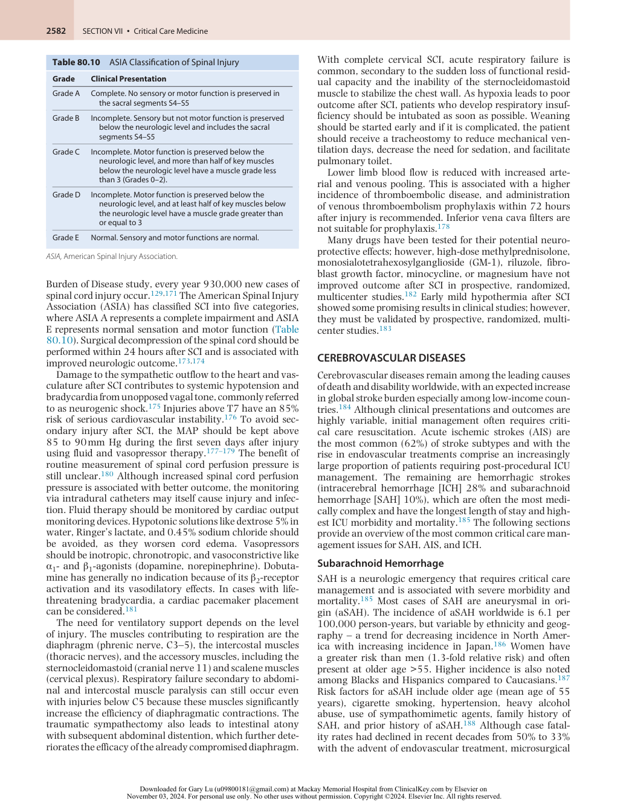

:::

<!-- PDF page 14 -->

techniques, and improved ICU management, in- hospital mortality and prehospital mortality remain high at 13% and 26%, respectively, with significant disability among survivors contributing to high socioeconomic costs.189,190

### Early Brain Injury

The degree of neurologic dysfunction and the amount of bleeding are the strongest predictors of clinical outcome and complications after SAH. The Hunt and Hess grading scale and World Federation of Neurological Surgeons Scale (WFNSS) are the most widely used (see Tables 80.3 and 80.4) with higher Hunt and Hess and WFNSS grades associated with worse clinical outcomes.42,43 In the first 72 hours after the acute bleed, multiple mechanisms such as transient global ischemia, elevated intracranial pressures, and toxicity from SAH have been implicated in early brain injury.191 Subsequent effects on CBF, microcirculatory changes, cerebral edema, and sympathetic response can lead to both neurologic and systemic complications.192 Acute management of blood pressure and oxygenation are critical in this period along with the prevention of early complications such as rebleeding, acute hydrocephalus, and elevated ICPs. Ideally, patients should be managed in high- volume facilities with dedicated neurocritical care units.193,194

**Rebleeding.** Rebleeding is a serious complication that significantly worsens outcomes and increases mortality to as high as 70%.195 To reduce the risk of rebleeding, guidelines recommend securing the ruptured aneurysm by surgical clipping or endovascular coiling as soon as possible and ideally within the first 24 hours after symptom onset.196–198 Simple endovascular coiling is the recommended treatment when the location, size, and morphology of the aneurysm are favorable, and is associated with higher odds of favorable outcome at one year. Some aneurysms may be more suitable for surgical clipping. There should not be any delay in securing a ruptured aneurysm, regardless of the treatment modality chosen.199,200

When surgical clipping or endovascular coiling are delayed, short- term (less than 72 hours) treatment with antifibrinolytic agents (aminocaproic acid or tranexamic acid) may be considered in selected cases, but treatment has not been shown to improve outcomes in clinical trials.201–203 Reversal of anticoagulants with standardized protocols is recommended.204 Treatment with anti- seizure medications in patients who present with seizures is recommended for no longer than 7 days. EEG monitoring and prophylactic treatment should be limited to high- risk patients with avoidance of phenytoin in all patients.197,205–208 While there is no specific blood pressure target associated with reduction in rebleeding, close hemodynamic monitoring and avoidance of blood pressure variability, especially hypotension, may improve functional outcomes.209

**Acute Hydrocephalus.** Acute hydrocephalus develops in 15% to 87% of patients after SAH, and emergency CSF diversion (with ventriculostomy and/or lumbar drain) may be lifesaving.210,211 Patients with hydrocephalus can develop progressive deterioration leading to stupor and coma as well as more subtle clinical signs of gaze palsy, pupillary dysfunction, and cognitive slowing. Head CT

showing ventricular dilation can be diagnostic and can facilitate early ventriculostomy placement. Hydrocephalus after SAH can be caused by CSF outflow obstruction or by impaired arachnoid granulation CSF absorption.212 Most patients should have ventriculostomy drains removed when they no longer require external drainage and ICPs have stabilized. Some patients will develop delayed hydrocephalus (3–21 days after the onset), and 8.9%–48% of patients will need ventriculoperitoneal (VP) shunt placement for chronic hydrocephalus.210

### Neurogenic Cardiac and Pulmonary Disturbances.

Cardiac and pulmonary disturbances are common after SAH and are thought to be secondary to a surge in catecholamine levels and sympathetic tone.213–215 Significant autonomic nervous system disturbance after SAH can result in changes in the electrocardiogram and lead to myocardial dysfunction. Transient electrocardiogram (ECG) abnormalities range from sinus tachycardia, peaked T- waves, T- wave inversions, and QT prolongation to ST segment depression or elevation.216 Electrocardiographic changes are frequent but do not appear to relate to outcome.217

Cardiac dysfunction, however, can have a significant impact on management after SAH. Abnormal echocardiography has been described in up to 8% of SAH patients. Poor-grade SAH patients can develop sudden hypoxemia and cardiogenic shock with or without pulmonary edema. This phenomenon of neurogenic stunned myocardium can cause severe limitation of cardiac contractility, which is reversible and associated with a good recovery profile. Patients with SAH have echocardiogram changes similar to takotsubo cardiomyopathy, which is also an acute transient dysfunction resulting from sympathetic overactivity.218 Adrenoreceptor polymorphism has been implicated in myocardial stunning. Different receptor genotypes have an increased sensitivity to catecholamines and are associated with a 3- to 4.8- fold increased risk of cardiac injury and dysfunction.219

Troponins are frequently elevated in about 30% of patients after acute SAH. High serum levels are associated with increased hemorrhage, hemodynamic fluctuations, and worse outcomes.220 Release of troponin can represent cardiac ischemia in patients with atherosclerotic heart disease or a “myocardial leak” from neurogenic injury.220

Cardiac dysfunction may complicate and limit the active treatment options for delayed cerebral ischemia (DCI) and increased ICP. A typical strategy for cardiovascular management is given in Box 80.3 based on comprehensive consensus guidelines.196,197

Acute lung injury is a frequent complication after SAH, with up to 27% of patients developing severe pulmonary dysfunction, including ARDS, which is associated with longer ICU length of stay and poor neurologic outcomes.221 In addition to acquired respiratory infections, common in ventilated ICU patients, neurogenic pulmonary edema caused by increased permeability of the pulmonary vasculature can occur in isolation or in combination with neurogenic cardiac problems.222

### Secondary Brain Injury

**Delayed Cerebral Ischemia.** DCI is one of the most severe complications of SAH and is associated with worse

<!-- PDF page 15 -->

### Box 80.3 Suggested Cardiovascular Management Strategies in Subarachnoid Hemorrhage

### General

1.  Manage hypertension in unsecured aneurysms Target SBP goal no longer recommended in updated AHA guideline

2.  Maintain euvolemia prophylactically; no role for prophylactic hypervolemia

3.  Administer nimodipine **Cardiovascular Instability**

1.  BP and cardiac output goals will alter as aneurysm is secured 2.  ECG 3.  If abnormal (QTc prolongation, ST- segment changes): check troponins

4.  If troponins elevated: perform echocardiography 5.  Perform echocardiography if any hemodynamic lability or heart failure is suspected

6.  Monitor cardiac output 7.  Select vasopressors for cardiac output and blood pressure 8.  Consider aneurysm treatment as soon as practical 9.  Reserve coronary catheterization for isolated wall motion deficit and rising troponins (coil aneurysm first if possible)

10.  Delayed cerebral ischemia: treat with euvolemia/mild hypervolemia, vasopressors, and cardiac output monitoring; adjust management based on perfusion targets when possible

11.  Transfusion: maintain hematocrit >25%

_BP,_ blood pressure; _ECG,_ electrocardiogram.

outcomes. Although the exact mechanism of DCI is still unclear, multiple potential etiologies have been identified beyond large vessel cerebral vasospasm, including microcirculatory dysfunction, microthrombosis, cortical spreading depolarization/ischemia, blood–brain barrier breakdown, cerebral autoregulation impairment, and neuroinflammation.223–226 About one- third of patients will develop symptoms from DCI as early as 3 to 5 days after the onset, with a peak frequency between 5 and 7 days. Seventy percent of patients will develop angiographic vasospasm, although only 30% to 40% of patients will become symptomatic. Not all patients with DCI have evidence of vasospasm, suggesting vasospasm- independent mechanisms.227

Cerebral vasospasm is still considered as a cause of DCI, and most often the target of treatment interventions. Patients with a large amount of subarachnoid blood are at higher risk for developing vasospasm. Radiographic tools such as the Hijdra sum score and Fisher score were developed to predict vasospasm (see Table 80.8).121,228 The modified Fisher score is the most commonly used to clinically prognosticate the risk of vasospasm (see Table 80.9), with the highest incidence of vasospasm observed in patients with modified Fisher grade 4.229,230 Vasospasm monitoring is facilitated by serial clinical exams and the use of imaging modalities such as transcranial Doppler, CT with perfusion, and cerebral angiography, with increased use of cEEG and invasive monitors to detect DCI in high- grade patients.231–233

Medical management of DCI centers on augmentation of arterial blood pressure with vasopressors and goal- directed volume management to achieve euvolemia rather than

hypervolemia.234,235 “Triple- H therapy,” hypertension– hypervolemia–hemodilution, is no longer recommended because there was little evidence of benefit and potential harm shown in randomized controlled trials and metaanalyses.236 The use of deliberate transfusion to increase oxygen delivery in the setting of DCI is controversial and needs to be balanced against the deleterious effects of transfusion. A prospective trial is awaited. Trials of endothelin antagonists, magnesium, and statins did not show any effect on outcome even though some interventions were associated with a decrease in the incidence of vasospasm.237–239

Nimodipine should be started for all patients as soon as possible after diagnosis and continued for 21 days. Studies on the use of nimodipine provide the only level I evidence from randomized controlled trials in SAH that showed modest reduction in the incidence of ischemic deficit without any apparent effect on angiographic vasospasm.240

In patients who are refractory to medical therapy for DCI, the use of endovascular therapies can be considered.241 Mechanical balloon dilation of blood vessels (angioplasty) can provide an effective treatment for vasospasm involving the larger arteries.242,243 Intra- arterial injections of vasodilator agents, most commonly calcium channel blockers such as nicardipine and verapamil, can be effective in smaller caliber vessels but are limited by the transient nature of their effects (&lt;24 hours).244

**Hyponatremia.** Hyponatremia is observed in 30% to 40% of patients with SAH, and is most commonly the result of cerebral salt- wasting syndrome (CSWS) or the syndrome of inappropriate secretion of antidiuretic hormone (SIADH).245 Because these two conditions have different pathophysiology, correct diagnosis and management of hyponatremia is important, particularly when it precedes development of DCI and can worsen clinical outcome.246 In CSWS, sodium is actively excreted from the body in high concentration, and accompanying diuresis occurs, despite ongoing hyponatremia with hypovolemia.247 Management of CSWS is the replacement of sodium with isotonic or hypertonic saline to restore volume depletion. Fludrocortisone is considered if diuresis is active and precludes the maintenance of adequate fluid balance.248,249 Patients with SIADH are typically hypervolemic and are treated with fluid restriction to restore euvolemia and suppress antidiuretic hormone (ADH) release.250 A suggested algorithm for resolving diagnostic uncertainty is given in Fig. 80.7.

### Ischemic Stroke

While AIS has declined as the 11th leading cause of death in the United States, ischemic stroke remains the second leading cause of death and the third leading cause of combined death and disability worldwide with disproportionately higher mortality rates in middle- income and lower- income countries. Although mortality has declined in the United States, stroke remains a major source of disability.251

Acute ischemic stroke (AIS) is increasingly a treatable neurologic emergency. The deprivation of oxygen and nutrients to the brain beyond the combined thresholds of severity and time induces cellular death in neuronal tissue, resulting in ischemic infarction. The ischemic penumbra is potentially salvageable when factors such as collateral flow and residual perfusion blood flow yield a

<!-- PDF page 16 -->

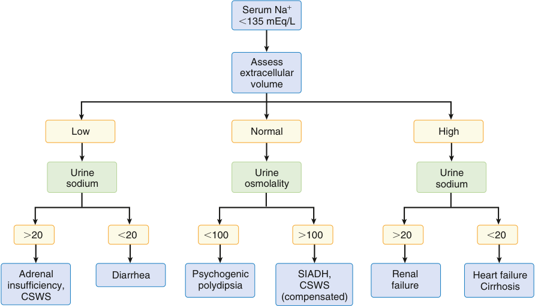

Serum Na + �135 mEq/L Assess extracellular volume Low Normal High Urine Urine Urine sodium osmolality sodium �20 �20 �100 �100 �20 �20 Adrenal Diarrhea Psychogenic SIADH, Renal Heart failure insufficiency, polydipsia CSWS failure Cirrhosis CSWS (compensated) 

**Fig. 80.7 Algorithm for the differential diagnosis of hyponatremia in the neurosurgical patient.** _CSWS,_ cerebral salt- wasting syndrome; _SIADH,_ syndrome of inappropriate secretion of antidiuretic hormone.

longer period before irreversible ischemic injury, thereby giving the opportunity for aggressive intervention with revascularization therapies such as thrombolysis and mechanical thrombectomy. Current guidelines recommend intravenous thrombolytics within 4.5 hours and embolectomy with modern thrombectomy devices for large vessel occlusion within 6 hours of symptom onset in eligible patients.252–254 With current perfusion imaging tools, expansion of thrombolysis in patients with unclear symptom onset in expanded time windows after stroke onset has shown efficacy in selected patients.255,256 In addition, there is increasing evidence and usage of tenecteplase as an alternative to alteplase.257 Using similar perfusion imaging tools, mechanical thrombectomy beyond 6 hours has also shown safety and efficacy in selected patients with favorable perfusion imaging.252,253,258 Vertebrobasilar occlusion may also benefit from the more recent techniques in even longer time windows.259

Successful management of AIS extends beyond the emergency treatment to reperfuse and recover threatened brain tissue. Ongoing management in the critical care setting is necessary to maintain adequate CBF to protect the ischemic penumbra and address factors that adversely affect vulnerable ischemic brain tissue such as fever and abnormal glucose. Early management of the potential complications of AIS, including postinfarction cerebral edema, hemorrhagic transformation, and reperfusion injury, are critical to improving patient outcomes.260

Hypotension is uncommon after AIS but requires aggressive management. Neurologic deterioration, poor outcomes, and increased mortality have been reported with baseline blood pressures less than 100/70 mm Hg.261 Common causes of arterial hypotension include hypovolemia, blood loss, decreased cardiac output, myocardial infarction, and arrhythmias. Neurocardiogenic injury has been

described, especially with involvement of the right insula, and may predispose to ECG changes and life- threatening arrhythmias.262,263 The most common arrhythmia associated with AIS is atrial fibrillation.264 Cardiac monitoring is recommended for at least the first 24 hours after stroke, with additional monitoring of cardiac function if there is evidence of symptomatic heart failure.

Elevated blood pressure should not be aggressively treated in the acute setting because the potential risk of lowering blood pressure may threaten penumbral perfusion and exacerbate brain ischemia.265 Urgent antihypertensive treatment may be needed for medical complications such as hypertensive encephalopathy, aortic dissection, and acute organ failure. Cautious lowering of blood pressure by 15% if it exceeds 220/120 mm Hg is indicated in certain clinical conditions. Because of the risk of hemorrhagic transformation with thrombolysis, blood pressure should be lowered to less than or equal to 185/110 mm Hg prior to treatment and maintained at less than 180/105 mm Hg for at least 24 hours.252 Blood pressure goals after mechanical thrombectomy should be individualized, depending on degree of recanalization, with lower SBP 120–140 mm Hg associated with improved functional outcomes in cases with complete recanalization.266

Hypoxia can also exacerbate ischemic injury. Poor airway control, hypoventilation, and aspiration pneumonia are most common after AIS. The patient’s airway should be assessed, and tracheal intubation must be considered in stuporous or comatose patients. In addition, patients with brainstem involvement may be at high risk for aspiration. Although intubation and mechanical ventilation is associated with poor outcome and increased mortality, prevention of hypoxia and aspiration pneumonia should be considered.252 Early tracheostomy in severe stroke patients was not shown to improve survival or disability at 6 months.267

::: warning 符號需核對
此頁有符號無法完整擷取，請展開下方原始頁面核對。
:::

::: details 原始表格與符號（PDF 第 16 頁）

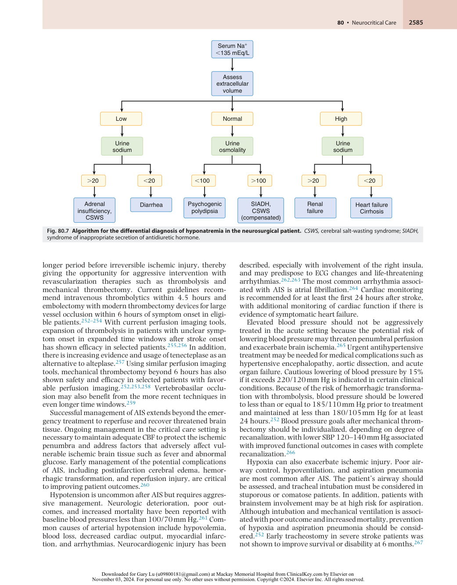

:::

<!-- PDF page 17 -->

Changes in the patient examination after AIS may indicate a hemorrhagic complication, cerebral hyperperfusion, or cerebral edema and should prompt an emergent noncontrast CT. Thrombolysis bleeding should be treated with emergency administration of cryoprecipitate. Other rare events to monitor after alteplase administration include allergic reactions such as anaphylaxis and angioedema.268,269 Attention should be paid to any signs of systemic hemorrhage such as lower abdominal pain, which may indicate retroperitoneal bleeding after thrombolysis. Cerebral hyperperfusion is rare but can also cause neurologic symptoms likely caused by sudden, rapid increase in CBF following revascularization. If severe, patients may develop headache, seizures, confusion, and potentially fatal cerebral edema and intracranial hemorrhage. Blood pressure should be monitored and lowered in patients with suspected hyperperfusion syndrome.270

Cerebral edema typically occurs during the first 3 to 5 days after AIS and subsides by 2 weeks. The overall risk of significant cerebral edema is low but tends to occur with distal carotid artery or MCA occlusion with complete MCA infarction. A subset of patients can have early (within 24 hours) malignant cerebral edema with brain herniation signs, which is associated with the highest mortality after AIS. Posterior fossa strokes are also associated with rapid neurologic deterioration from brain edema. Cerebellar infarctions may produce local edema that causes acute hydrocephalus with brainstem compression that can lead to rapid coma and sudden respiratory failure. Medical management using hyperosmolar therapies with mannitol and hypertonic saline and temporary hyperventilation may be helpful. Surgical interventions include management of hydrocephalus with external ventricular drainage and decompressive craniectomy. Early suboccipital craniectomy is potentially lifesaving with good clinical results.271 Hemicraniectomy for anterior circulation stroke remains more controversial. In selected patients when performed early, outcomes may be better. Based on the combination of randomized trials in Europe, early decompressive hemicraniectomy is effective in decreasing mortality and improving clinical outcome in survivors.153,154

A standardized and systematic approach to stroke treatment provided by certified stroke centers improves outcome. Established protocols for all stroke patients including their ICU care have led to more uniform management of not only emergency care, but also supportive medical care such as glucose control, prevention of deep venous thrombosis, nutrition, and early rehabilitation.272 Fever is associated with poor outcome in stroke patients, but there is a lack of high- quality data to guide the method of fever control and temperature management.273 Early rehabilitation has been associated with improved stroke outcomes, however, timing &lt;24 hours and intensity of early mobilization may be associated with worse outcomes.274 Multidisciplinary care with specialized neurointensive care teams has been associated with shorter length of stay and improved hospital outcomes.275

### INtracerebral Hemorrhage

Intracerebral hemorrhage accounts for 28% of strokes worldwide, with a high case fatality rate especially in lowincome countries.184 There was two- fold higher risk of ICH in low- income to upper- middle- income countries compared with high- income countries. Nontraumatic ICH is often

categorized as spontaneous or primary when associated with risk factors such as hypertension, tobacco, alcohol and substance use, antithrombotic medications, underlying coagulopathy, and amyloid angiopathy (especially in lobar hemorrhages). ICH may also arise from secondary causes such as ruptured aneurysm, ruptured vascular malformation, cerebral venous sinus thromboses, conversion from ischemic stroke, or tumor. This wide range of differential diagnoses can swiftly be diagnosed by CT/MR angiogram and/or venogram, with accompanying clinical signs aiding localization. Angiography may be required to further characterize any underlying vascular sources such as aneurysm, arteriovenous malformation, or dural fistula. MRI with specialized sequences remains the most sensitive imaging modality for ICH and can be useful in determining underlying etiology.

ICU management is important to avoid secondary insult by reducing the incidence of rebleeding, hypoxemia, hypercarbia, or cerebral edema. Similar to AIS, specialized multidisciplinary stroke care is associated with improved outcomes for patients with ICH.276 Initial care is directed toward the airway and circulation, with control of arterial blood pressure and early reversal of coagulopathy to decrease the risk of ICH volume expansion and rebleeding.277 If the ICH is in the posterior fossa or midbrain, consideration should be given to the insertion of a ventriculostomy and early surgical decompression to reduce the risk of hydrocephalus and brainstem compression. Patients with lesions in these regions are prone to airway and respiratory problems and may need early tracheal intubation to protect their airway and prevent aspiration. The use of clinical severity scores such as NIH Stroke Scale and GCS with hourly neurologic assessments can detect early clinical deterioration, prompting repeat imaging and aggressive management of cerebral edema or hematoma expansion. Medical management of volume status and sodium can be critical in patients with cerebral edema requiring hyperosmolar therapies.278 Validated prognostic scores such as the ICH score for mortality and FUNC score for functional independence are additional tools that providers can use in shared decision- making to communicate goals of care.279,280

Hypertension after ICH is common and associated with increased hematoma volumes and worse outcomes. Based on randomized controlled trials of aggressive blood pressure management, lowering SBP to a range of 120 to 140 mm Hg was safe, but did not improve outcomes when compared to lowering SBP to 140 to 160 mm Hg and this is reflected in the American Heart Association guidelines.281–283 If the initial CT or MRI appearance suggests aneurysm or arteriovenous malformation, then care should be taken to limit blood pressure to reduce the risk of rebleeding. The addition of ICP monitoring allows setting a CPP target and provides a more physiologic approach to the management of systemic blood pressure. Acute BP lowering should be initiated early within 2 hours of ICH onset using close monitoring and agents that minimize BP variability.284 In ICH with mild to moderate severity, SBP goal of 130–150 mm Hg is reasonable to decrease hematoma expansion and improve outcomes. Acute lowering to SBP &lt;130 mm Hg is potentially harmful.283,285

Coagulopathy increases ICH severity with significant hematoma expansion. Acute management with rapid

<!-- PDF page 18 -->

reversal of coagulopathy is warranted.286 In the setting of vitamin K antagonists, use of prothrombin complex concentrates (PCCs) is advocated, followed by vitamin K. In a prospective, randomized trial of PCC compared to fresh frozen plasma (FFP), PCCs had significantly faster international normalized ratio correction, decreased hematoma expansion, and decreased mortality.287 There were no significant differences with thrombotic complications, and PCCs avoided the risk of volume overload and transfusion reactions associated with FFP. In patients with known recent thrombotic events, PCCs should be used with caution. With increasing use of the direct oral anticoagulants (DOACs), there is a rising need for rapid reversal agents for DOACassociated ICH. Idarucizumab is a monoclonal antibody that can bind to dabigatran and rapidly correct coagulopathy in the setting of life- threatening bleed.288 Andexanet alfa is another recombinant coagulation factor for reversal of factor Xa inhibitors.286,289 In ICH patients on antiplatelet therapy, the use of platelet transfusions to reduce the risk of hematoma expansion and improve outcomes is more controversial. In a prospective, randomized trial of platelet transfusion within 6 hours compared to standard medical therapy in a nonsurgical ICH population, there was no benefit to transfusion, and an increase in mortality and higher disability.290 Platelet transfusion prior to surgical intervention has not been well studied. Use of other agents such as desmopressin, tranexamic acid, and factor VIIa are even less well established.

Other neuroprotection strategies remain unproven. Unlike SAH, nimodipine does not have an established role in ICH. Corticosteroids are also not indicated. Statins may be beneficial in ICH when continued in current users. However, starting statins in acute ICH has not been proven beneficial. The role of long- term statin and increased risk of recurrent bleed is also controversial.281,291,292

Large trials of surgical hematoma evacuation have not shown benefit.293 However, in patients with cerebellar hemorrhage and brainstem compression or in those showing acute neurologic deterioration or obstructive hydrocephalus, surgical evacuation may be indicated.281 The use of thrombolytics in intraventricular hemorrhage was shown in a randomized, controlled trial to improve mortality, but not functional outcome.294 Minimally invasive hematoma evacuation in selected patients with or without thrombolysis has been associated with lower mortality compared to medical management and may improve functional outcomes compared to craniotomy.295,296

### STATUS EPILEPTICUS

Status epilepticus (SE) is a medical and neurologic emergency affecting both children and adults that is associated with significant morbidity and mortality. Updated SE definitions including seizure type, duration without spontaneous resolution, and likelihood of neuronal injury have helped to standardize timely initiation of intervention but have led to variability in reported incidence rates, 8 to 60 per 100,000 person- years worldwide.297,298 Although all types of seizures may present as SE, there are two main classifications: convulsive (typically generalized tonic–clonic activity) and nonconvulsive. Refractory SE occurs in 20%–30% of patients with persistent seizures after initial benzodiazepine

treatment and adequate dosing of a single second- line agent. Super- refractory SE is associated with increased mortality when seizures persist or recur after 24 hours with additional treatment with a third- line therapy. Continuous EEG monitoring is advisable to direct management of seizures and to detect nonconvulsive seizures especially in comatose critically ill patients with no other explanations for the comatose state.299

Seizure activity may arise from multiple etiologies, including any major insult affecting the cerebral cortex (e.g. vascular, infectious, mechanical, metabolic, or toxic). Even mild insults may provoke status epilepticus if the seizure threshold is reduced by preexisting parenchymal disease or comorbidity (e.g., alcohol withdrawal). Given the previously outlined emphasis on the avoidance and termination of secondary insult to the brain, management of status epilepticus is focused on acute stabilization, rapid control of seizures, and timely identification and treatment of the underlying etiology. Management guidelines have been published that address the important phases of management.300,301 Initial goals include stabilization of the patient’s airway, breathing, and circulation with rapid assessment of any neurologic disability. The subsequent treatment phases focus on seizure termination and prevention of recurrence. Prompt treatment of seizure in the first 5 to 10 minutes should be instituted because a seizure lasting beyond 5 minutes is unlikely to stop spontaneously. Recommended agents include first- line benzodiazepines lorazepam 0.1 mg/kg or 4 mg intravenous (IV) or diazepam 0.2 mg/kg IV. If no IV access, midazolam 10 mg intramuscular (IM) should be administered. If seizures persist after a single repeated dose of benzodiazepine, second- line treatments should be administered with IV loading doses of one of the following antiseizure medications: fosphenytoin, valproic acid, or levetiracetam.302 Ongoing seizures despite initial therapies are considered refractory SE and initiation of third- line therapies are indicated, typically midazolam or propofol infusions after initial loading doses. Barbiturates including thiopental or pentobarbital can also be used as third- line agents. This approach would likely require intubation and ventilation. Paralytic agents should be avoided for the long term due to fear of masking ongoing or recurrent seizures. In patients with super- refractory SE, options include inhaled anesthetics and ketamine. Nonpharmacologic treatments with vagal nerve stimulation and electroconvulsive therapies have been used with success, but evidence supporting their routine use is lacking. Additional workup for rare etiologies and transfer to specialized ICUs with continuous EEG capabilities is recommended.299,303,304

Status epilepticus is also associated with numerous systemic complications that can be related directly to the neurologic injury or associated with the treatments. Early management of acute hypoxic respiratory failure and associated acid–base imbalance can prevent secondary injury. Treatment of glucose abnormalities and early detection and treatment of infection can also prevent seizure recurrence. Myocardial depression from cardiotoxicity of treatments may require additional cardiac monitoring and vasopressor support. Traumatic injury, rhabdomyolysis, and renal dysfunction should be monitored in patients with prolonged convulsions. Many of the antiepileptic medications can cause ileus, hypomotility, and potentially gut ischemia.305

<!-- PDF page 19 -->

### NEUROMUSCULAR DISEASES

Neuromuscular diseases involving the muscle, nerve, and neuromuscular junction can pose unique challenges for the anesthesiologist in the ICU. We will review two common diseases that may require critical care management.

### Guillain–Barré Syndrome

Guillain–Barré syndrome (GBS) is a common cause of acute, severe neuropathy occurring at a rate of 0.81 to 1.89 cases per 100,000 persons per year worldwide. The incidence increases with age and is more prevalent in men. Because of the associated complications, including respiratory failure, GBS is one of the neurologic causes of admission to critical care units. Although GBS is associated with low overall mortality (&lt;3%), mortality increases with the need for mechanical ventilation (14.3%). These patients tend to have a higher incidence of cardiorespiratory arrest before ICU admission, prolonged ICU length of stay, and higher severity of illness scores.306–309

Several distinct clinical variants are associated with the syndrome, including acute inflammatory demyelinating polyneuropathy (AIDP), acute motor axonal neuropathy (AMAN), acute motor–sensory axonal neuropathy (AMSAN), and Miller–Fisher syndrome (MFS). The classic and most common variant of GBS is AIDP that typically manifests as a relatively symmetric, ascending muscle weakness that can progressively lead to severe flaccid paralysis and respiratory failure affecting 20% to 30% of cases. More than half the patients have a recent history of bacterial or viral infection. _Campylobacter jejuni_ is the most frequently observed pathogen, along with cytomegalovirus, Epstein–Barr virus, and herpes simplex virus.310 Regional variation has been associated with higher rates of infectious exposures, including recent association with the Zika and chikungunya viral epidemics and with SARS- CoV- 2 infection.311,312 Noninfectious triggers have also been identified including vaccinations and immune checkpoint inhibitors. GBS may also display sensory and autonomic features, depending on the subtype, and variation in speed of onset and offset. The AMAN variant is usually associated with _C. jejuni_ infections, and the severe limb weakness is related to the autoimmune antibody response against GM1, GD1a, and GalNAc- GD1a gangliosides. Similarly, with the MFS variant, anti- GQ1b antibodies can cause symptoms affecting the cranial nerves, resulting in the clinical triad of ophthalmoplegia, ataxia, and areflexia.308,313

Commonly, the preceding infection or other immune response triggers an autoimmune reaction to peripheral nerves and spinal roots. Within 1 to 2 weeks after exposure, symptoms progress over several days to reach their peak at 2 to 4 weeks, with a plateau thereafter. In approximately 5% of patients, GBS progresses more rapidly, with maximal loss of function within 72 hours of symptom onset. At 4 weeks, most patients have progressed to the limit of their symptoms, and improvement is observed to start soon thereafter. However, recovery may be protracted for months to years, depending on the extent of nerve injury.314,315

Investigations should include electrocardiography, CSF protein (for acellular protein elevation), antibody status, and screening for possible causative pathogens. For prognosis, electrophysiologic studies (axonal degeneration

is associated with poorer recovery), and antibody status (GM1 antibody is associated with worse recovery) can be helpful.315

Loss of ventilatory efficacy is often the main reason for admission to the ICU. A forced vital capacity of less than 20 mL/kg is a sensitive indicator of need for observation, and 15 mL/kg for probable intubation, along with maximal inspiratory pressure (MIP) less than −30 cm H2O and clinical signs of fatigue and airway compromise. Hypercarbia is a relatively late sign, and the clinician should not rely on it. The Erasmus GBS Respiratory Insufficiency Score (EGRIS) is a validated tool to assist in prediction of which patients may benefit from early admission to the ICU based on severity of weakness, timing of symptoms, and bulbar symptoms.316 Early tracheostomy in identifiably prolonged respiratory failure cases is appropriate.317

Dysautonomia occurs in up to 20% of patients and is a source of morbidity.315 ICU level monitoring should also be considered for GBS patients with autonomic nervous system involvement that can cause cardiac arrhythmia, blood pressure lability, uncontrolled sweating, temperature dysregulation, ileus, and bladder dysfunction.

Supportive care in the ICU is important for patient outcomes, including DVT prophylaxis, early mobilization and rehabilitation, nutrition, glucose control, and psychosocial support. Specific challenges to management are the problems of deafferentation pain and psychiatric depression. The pain can be severe, is truncal in distribution, and may respond to anticonvulsants more than opiates. It certainly contributes to the frequently observed depression. This pain is often magnified by immobility, boredom, and the limited ability of busy staff to engage actively with a cognitively intact patient.315

Both symptom limitation and recovery from GBS have been improved with the use of plasmapheresis or intravenous immune globulin (IVIG). No advantage is seen with one treatment approach over the other or in combination. However, many physicians try them sequentially in cases of treatment failure. In patients with acute respiratory failure, persistent lack of foot flexion at the conclusion of immunotherapy is an indicator of prolonged mechanical ventilation.318 Neither interferon nor corticosteroid use has been shown to improve outcome, either alone or in combination with immunotherapy, but newer immune modulation drugs are currently in clinical trials.309,319

### Myasthenia Gravis

Several disorders affecting the neuromuscular junction, including toxins and immune- mediated and genetic syndromes, can cause skeletal muscle weakness. Myasthenia gravis (MG) is the most common of these disorders. Although the majority of patients with MG have autoantibodies against the muscle nicotinic acetylcholine receptor (AChR- Ab), some patients will have autoantibodies to muscle- specific tyrosine kinase (MuSK- Ab) or lipoproteinrelated protein 4 (LRP4). Myasthenia itself has a strong association with various autoimmune conditions (e.g., thyroid disease, pernicious anemia, and rheumatoid arthritis), as well as being linked to women with certain human leukocyte antigen types.320,321

<!-- PDF page 20 -->

Although MG is a relatively rare disease (incidence of 4 to 12 per million person- years and prevalence of 40 to 180 per million worldwide), it is relevant to neurocritical care in that patients can present acutely in myasthenic crisis with rapid deterioration of muscle function and ventilatory failure. Typical of autoimmune diseases, MG occurs in young adult women, with a mean age of 30. There is also a late-onset presentation in men with mean age over 50 years. Modern management with immunosuppression and supportive treatment has led to improved prognosis with overall mortality rates of 2.2% to 4.5%, including recent lower ICU mortality rates of 5.3%.322,323

The myasthenic crisis can be precipitated by a progression in severity of the disease state or often by amplification by another factor. This factor can include infection, recent surgery, or interruption of immunosuppressants. Many drugs can exacerbate myasthenic crisis, including aminoglycosides, fluoroquinolones, anticonvulsants (including phenytoin), steroids, beta blockers, calcium channel antagonists, ketamine, lidocaine, neuromuscular blockers, and anticholinergic agents.324 Immune checkpoint inhibitors have also been associated with MG and other immune- mediated neurologic illnesses.

The diagnosis should be suspected in patients with variable weakness, including respiratory, ocular, and bulbar muscles. Diagnostic workup is often to exclude GBS, brainstem stroke, organophosphate poisoning, and botulism. Tests should include electrophysiologic studies (helpful in seronegative cases), CSF protein, edrophonium response (less commonly used), and autoantibody testing to AChR, MUSK, and LRP4, which is important for diagnosis and management.320

The presentation is typically that of acutely worsening weakness of the respiratory or pharyngeal muscles. The patient should be observed closely for signs of impending respiratory failure. Forced vital capacity is useful, with 15 mL/kg being a useful trigger for intubation.325

Symptomatic treatment with acetylcholinesterase inhibitors is often diagnostic as well as therapeutic, balancing improvement in weakness with side effects from cholinergic stimulation. The other mainstay of therapy is immunomodulation. Typically, IVIG or plasmapheresis is started quickly to limit progression of severe generalized symptoms and avert frank crisis. Corticosteroids do have a role in establishing longer- term control of immunosuppression because IVIG and plasmapheresis have limited duration of efficacy. Corticosteroids alone are associated with a transient worsening of symptoms, before improvement, so they are best used concurrently with or immediately after plasmapheresis or IVIG. Chronic management typically involves tapering to low doses of prednisone with addition of a glucocorticoid- sparing immunomodulating agent such as azathioprine, mycophenolate mofetil, cyclosporine, or tacrolimus and consideration for rituximab and methotrexate if necessary. Newer immunosuppression agents, including eculizumab targeting complement inhibition should be considered in severe refractory cases.326 Thymectomy including minimally invasive interventions should be considered in selected patients when able to tolerate procedures.327

### CENTRAL NERVOUS SYSTEM INFECTION

Meningitis and encephalitis can be life- threatening neurologic emergencies that require critical care management. Inflammation of the meninges and/or the brain can be infectious, neoplastic, or autoimmune with CNS infections being the most common and having significant morbidity and mortality. Early recognition and treatment particularly of bacterial meningitis and herpes encephalitis can improve patient outcomes. The global burden of CNS infections has decreased, but the disease remains highly variable by region and age, disproportionately impacting lower- income countries. For bacterial meningitis, there are an estimated 3 million cases each year, with the highest incidence of 85 cases per 100,000 persons in low-income versus 6 cases per 100,000 persons in higher-income countries.328 The incidence of infectious encephalitis is estimated at 1.5 to 7 cases per 100,000 persons worldwide.329

### Meningitis

Meningitis is a serious condition producing inflammation of the leptomeninges covering the brain and spinal cord. The causative pathogens differ among different patient populations. Community infections are frequently caused by _Streptococcus pneumoniae, Haemophilus influenzae, Listeria monocytogenes, Neisseria meningitidis,_ and group B streptococci. Since the advent of childhood vaccination programs, meningitis has become quite rare in high- income countries, with the highest incidence in children under the age of 1. In low- income countries, poverty and poor access to health care have led to persistently high rates of infection. In the United States, _H. influenzae_ affects mainly adults, but other organisms tend to affect all age groups. The highest rates of meningitis occur in sub- Saharan Africa where meningococcal disease is endemic. Worldwide, _S. pneumonia_ , _N. meningitidis_ , and _H. influenzae_ are the most common pathogens in most age groups across regions.330

Viral infections typically have a more subacute presentation and are the most common cause of meningitis primarily due to non- polio enteroviruses and herpesviruses. In a third to half of cases, no etiology is identified and often is referred to as “aseptic meningitis.”331 Fungal and tuberculous meningitis should be considered in immunocompromised patients, especially in the setting of chronic infection. Nosocomial infection, in contrast, predominantly arises in the neurosurgical patient, especially with the use of ventricular devices, and the pathogens here comprise gramnegative rods and staphylococci.332

Initial assessment should include basic resuscitation, attention to airway management in patients with low GCS, and assessment of sepsis. Clinical features include headache, fever, nuchal rigidity, and change in mental status. Less often, photophobia, papilledema, and new- onset seizures may be seen. A rash is typical of meningococcal infection. Tests should include CSF cell count, protein, glucose, Gram stain, and culture, but any previous antibiotic dosing can diminish sensitivity, although polymerase chain reaction (PCR) testing may be able to identify small amounts of DNA in a sample. Viral PCR, immunoglobulin, fungal antigens, and cultures can also be considered. Opening pressure should always be recorded when possible. A CT scan should

<!-- PDF page 21 -->

delay the lumbar puncture only when the patient’s history suggests a previous mass lesion, stroke, or focal infection, recent seizures, or immunocompromised state.333 Similarly, signs of papilledema, depressed level of consciousness, or focal deficit indicate a need for a CT examination to avoid herniation. Cerebral edema can develop in patients with meningitis and can lead to acute deterioration in mental status. ICP monitoring may be indicated.334

Treatment should be instituted quickly, delaying only to obtain emergency samples for Gram stain and culture. If no identification is possible on Gram stain, empiric antibiotic therapy should be delivered with third- generation cephalosporins (e.g., ceftriaxone or cefotaxime), along with vancomycin, until organism identification and sensitivities are obtained. This approach covers many of the communityacquired pathogens but should be tailored to individual patients and other potential pathogens. Nosocomial or trauma- associated infections may need broader-spectrum antibiotic coverage. Steroids are useful adjuncts in bacterial meningitis and have been shown to reduce complications but not overall mortality.335,336 The outcome of meningitis is a function of patient- related factors, the pathogenicity of the organism, and the time to effective treatment. Longterm sequelae include hearing loss, focal deficits, seizures, and cognitive dysfunction.337

### Encephalitis

Encephalitis involves inflammation of the brain parenchyma and manifests with fever, headache, encephalopathy, and alteration of consciousness. Patients may also have delirium, focal deficit, or seizures. Nuchal rigidity may be present in a mixed meningoencephalitis picture but should be absent in isolated encephalitis. Involvement of the spinal cord (encephalomyelitis) and nerve roots (encephalomyeloradiculitis) can also occur. Accompanying identifiers may be a vesicular rash associated with herpes zoster (although its absence does not remove zoster from the differential diagnosis), bilateral paralysis typical of West Nile disease, parotitis if mumps is suspected, and, of course, the hyperactivity, hydrophobia, and pharyngeal spasm of rabies.338

Many nonviral and noninfectious causes of encephalitis may confound the diagnosis. These include an expanding group of autoimmune encephalitis, vasculitis, systemic lupus erythematosus, stroke, rickettsial and parasitic infections, and drug- induced meningitis. Careful examination of clinical features, history, and laboratory data is necessary.339 CSF should be drawn for viral DNA PCR as well as the routine biochemistry, culture, and cell count. MRI with contrast is useful in identifying the demyelination and edema that can be difficult to see on CT. Serum serology is helpful for the diagnosis of Epstein–Barr virus, mumps, and West Nile disease as sources of encephalitis. Paired samples are recommended to allow later comparison if CSF PCR is unhelpful. Brain biopsy was considered the gold standard but is now a last option, after CSF PCR, culture, and serology have proven negative.340

Herpes simplex type 1 infection carries a very poor outlook if it is not treated expeditiously, and a course of empiric intravenous acyclovir is recommended until

herpes infection has been excluded. Treatment for other viral etiologies is mainly supportive, including respiratory care and seizure management.334 Other mosquito- borne viral infections such as West Nile and Zika have been increasing globally.

Often, the pathogen remains unidentified, and outcome usually then depends on classification of the clinical features, with intractable seizure and cerebral edema carrying a worse prognosis. Self- limiting seizure usually indicates a swift recovery. The advent of metagenomic sequencing has advanced the ability to detect a wide array of pathogens with the potential to discover new organisms in cases of unexplained meningitis and encephalitis.341,342

## Postoperative Neurosurgical Care

Many neurosurgical procedures are lengthy and involve significant insult to the brain. Thus, postoperative ICU admission is necessary to avoid secondary insult and monitor postoperative complications like intracranial rebleeding, cerebral edema, or seizures. The incidence of post- craniotomy bleeding of 0.5% is associated with increased blood pressure during and after surgery (SBP >160 mm Hg; MAP >110 mm Hg) and mainly occurs during the first 24 hours.343

The patient should be extubated immediately after surgery if possible because a full neurologic evaluation of the awake patient is the best way to detect post- craniotomy complications. Exceptions are possibly extremely long operations, low preoperative GCS, major surgery in the posterior cranial fossa or close to the brain stem, or a high risk for the development of cerebral edema. The incidence for postoperative complications is higher in patients with intraventricular tumors.344 Early extubation in combination with close neurologic monitoring is safe and omits the need for routine postoperative CT.345 In patients where a planned extubation cannot be performed within 1 hour after surgery, an immediate CT should be performed, as these patients have a high risk for postoperative complications and may need emergency interventions.345

Pain is often underestimated after craniotomy and narcotics are often avoided due to the fear of hypoventilation, which might increase ICP.346 Therefore, a careful evaluation of pain using the visual analogue scale and adequate therapy with a multimodal regimen should be initiated. A scalp block with local anesthetics also reduces postoperative pain.

Patients after craniotomy have a high risk for postoperative nausea and vomiting. As retching and vomiting are extremely unpleasant for the patient and additionally increase the risk of rebleeding, pharmacologic prevention with selective serotonin antagonists (e.g., ondansetron and granisetron) in combination with low- dose corticosteroids should be used.347

DVT and pulmonary embolism occur in 3% of the patients up to 30 days after craniotomy with a peak at the third postoperative day. Prophylaxis with heparin can be initiated in most cases 1 day after surgery.348,349

<!-- PDF page 22 -->

## Brain Death

The diagnosis of brain death remains one of the most challenging and controversial areas of neurocritical care. Physicians must have adequate training and understanding of the principles of brain death declaration and be able to apply them assiduously and without compromise.

Declaration of brain death was originally codified by the Harvard criteria in 1968.350 Over the years, guidelines and protocols have been developed with determination of brain death or death by neurologic criteria more widely accepted worldwide.351 However, there remains significant variability and lack of consistency in determination of brain death that required international consensus.352 As a prerequisite, the mechanisms for the irreversible cause of neurologic dysfunction should be clear. The examination must be done in circumstances of adequate systemic oxygenation and perfusion. Confounders, such as hypothermia, metabolic compromise, and persistent sedative or neuromuscular drugs must be corrected. The diagnosis is built on a thorough clinical examination of nervous system function, involving evaluation of the reflex response of the brain and cranial nerves. One of the tests should include an appropriately conducted apnea trial in the presence of the responsible physician, with confirmation of adequate changes in PaCO2. If for any reason any test cannot be completed in a safe manner or to the satisfaction of the responsible physician(s), then an ancillary test should be performed based on standard policies.353,354 The hospital should have an institutionally approved protocol for brain death declaration and the conduct of any ancillary tests.

Proper training and knowledge of administrative and legal policies are essential, as there may be differences across hospitals, regions, and countries. In addition, physician qualifications may vary by subspecialty and standardized courses and training are readily available. Use of existing standard guidelines for both adult and pediatric patients as well globally accepted minimum standard criteria will improve the consistency of protocols and procedures in the determination of brain death.352,353,355,356 Perhaps more important than the diagnosis of brain death is communication between the care team and the family. Given the complex social, legal, and religious interpretations of brain death, shared decision- making with multidisciplinary teams and family is essential.

## Ethical Considerations

Ethical issues are frequently encountered in a neurocritical care unit (see Chapter 7). Unfortunately, significant life- altering morbidity can occur, to the extent that many patients and families would not prefer aggressive therapy.357 This can be a difficult concept to accept for the physician, whose aim is to heal and preserve life. However, the ethical imperative in Western culture is to preserve the autonomy of the individual (along with the principles of nonmaleficence, beneficence, and justice), and this has been extended to health care decision- making. This situation may lead to uncomfortable choices and communication within the health care team, whose members may

have differing opinions on goals as well as the patient and relatives, who, again, may think very differently.

Certain strategies can avoid or minimize these difficulties:

- Prognosis should be made based on the best available evidence. This may involve planning and discussion among the team members in advance of family meetings. Personal anecdotes should be avoided, even if solicited.

- The relationship within the team should be open and collegial, with mutual respect given to the principle of open discussion. This approach avoids misperception of goals and attitudes and enables more consistent communication with families, who often find dissonance among members of the ICU team disturbing.

- The presence of an advance directive offers major benefits, and the neurocritical care unit should have an admissions protocol that includes asking all competent, conscious patients to consider making their attitudes or wishes known.

- Regular family and patient conferences allow communication of prognosis and offer the opportunity for correction of any misconceptions, as well as progressive education of the family members to anticipated problems.

- Internal institutional mechanisms for raising concerns and conducting reviews should be in place. This is often facilitated by the presence of an institutional ethics committee, whose members can examine the issues, promote educational discussion, and help achieve consensus.

- All decision- making should be documented carefully and completely.

- Orders for limitation or withdrawal of therapy should be written explicitly, and institutional protocols should be used wherever possible.

Other important areas of possible conflict exist that are not possible to address within the confines of this text, but readers are advised to educate themselves on these and include the following:

- The issues surrounding organ donation from the brain dead and the non- heart- beating donor (Fig. 80.8)

- Withdrawal of care for the incompetent patient without family

- Hospital bylaws and state legislation on the certification of death, whether that be by neurologic or cardiovascular criteria

## Conclusion

Neurocritical care demands a thorough comprehension of the physiology, pharmacology, and pathology of the nervous system as well as for the organ systems supporting it. The best care is provided in circumstances that allow multidisciplinary collaboration with the optimal integration of multiple demanding pathologic processes.

### Acknowledgment

The editors and publisher would like to thank Michael J. Souter and Arthur M. Lam for their contributions to the earlier edition of this work. It has served as the foundation for the current chapter.

<!-- PDF page 23 -->

### Critical Pathway for Organ Donation&42;

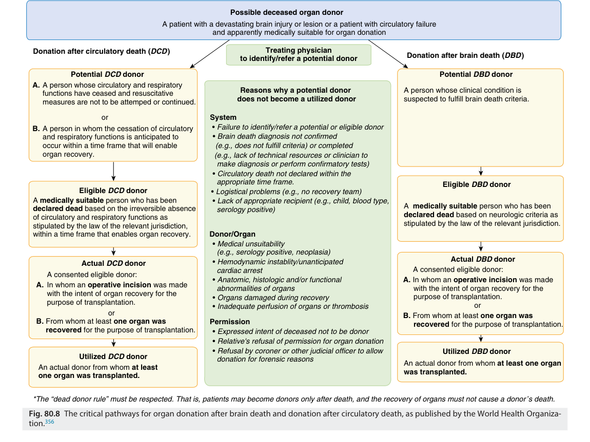

Possible deceased organ donor A patient with a devastating brain injury or lesion or a patient with circulatory failure and apparently medically suitable for organ donation Donation after circulatory death ( DCD ) Treating physician Donation after brain death ( DBD ) to identify/refer a potential donor Potential DCD donor Potential DBD donor A. A person whose circulatory and respiratory functions have ceased and resuscitative Reasons why a potential donor  A person whose clinical condition is measures are not to be attemped or continued.  does not become a utilized donor  suspected to fulfill brain death criteria. or System B. A person in whom the cessation of circulatory •  Failure to identify/refer a potential or eligible donor and respiratory functions is anticipated to •  Brain death diagnosis not confirmed occur within a time frame that will enable (e.g., does not fulfill criteria) or completed organ recovery. (e.g., lack of technical resources or clinician to   make diagnosis or perform confirmatory tests) •  Circulatory death not declared within the   appropriate time frame. Eligible DBD donor Eligible DCD donor •  Logistical problems (e.g., no recovery team) A  medically suitable  person who has been •  Lack of appropriate recipient (e.g., child, blood type, declared dead  based on the irreversible absence   serology positive)  A   medically suitable  person who has been of circulatory and respiratory functions as declared dead  based on neurologic criteria as stipulated by the law of the relevant jurisdiction,  stipulated by the law of the relevant jurisdiction. within a time frame that enables organ recovery. Donor/Organ •  Medical unsuitability   (e.g., serology positive, neoplasia) Actual DBD donor Actual DCD donor •  Hemodynamic instablity/unanticipated   cardiac arrest    A consented eligible donor: A consented eligible donor: •  Anatomic, histologic and/or functional A.  In whom an  operative incision  was made A. In whom an  operative incision  was made   abnormalities of organs      with the intent of organ recovery for the with the intent of organ recovery for the •  Organs damaged during recovery      purpose of transplantation. purpose of transplantation. •  Inadequate perfusion of organs or thrombosis or or B.  From whom at least  one organ was B. From whom at least  one organ was Permission      recovered  for the purpose of transplantation. recovered  for the purpose of transplantation. •  Expressed intent of deceased not to be donor •  Relative's refusal of permission for organ donation •  Refusal by coroner or other judicial officer to allow Utilized DBD donor Utilized DCD donor   donation for forensic reasons  An actual donor from whom  at least  An actual donor from whom  at least one organ was transplanted.  one organ was transplanted. *The “dead donor rule” must be respected. That is, patients may become donors only after death, and the recovery of organs must not cause a donor’s death. Fig. 80.8  The critical pathways for organ donation after brain death and donation after circulatory death, as published by the World Health Organiza- tion. 356 

**Complete references available online at expertconsult.com.**

### References

1.  Zygun D. _Curr Opin Crit Care_ . 2005;11:139.

2.  Suarez JI, et al. _Crit Care Med_ . 2004;32:2311.

3.  Khan AU, et al. _Clin Neurol Neurosurg_ . 2015;133:55.

4.  Han D, et al. _Curr Neuropharmacol_ . 2021;19:1590.

5.  Afsar B, et al. _Eur J Intern Med_ . 2016;36:7.

6.  Quilez ME, et al. _Curr Opin Crit Care_ . 2012;18:23.

7.  Ziaka M, et al. _Crit Care_ . 2021;25:358.

8.  Kalmar AF, et al. _Br J Anaesth_ . 2005;94:791.

9.  Michinaga S, et al. _Int J Mol Sci_ . 2015;16:9949.

10.  Beaumont A, et al. _J Neurotrauma_ . 2001;18:1359.

11.  Venkat P, et al. _Croat Med J_ . 2016;57:223.

12.  Corps KN, et al. _JAMA Neurol_ . 2015;72:355.

13.  Bramlett HM, et al. _J Neurotrauma_ . 2015;32:1834.

14.  Beez T, et al. _BMC Neurol_ . 2017;17.

15.  Baekgaard JS, et al. _Crit Care_ . 2020;24:604.

16.  Shibahashi K, et al. _World Neurosurg_ . 2021;149:e504.

17.  Shibahashi K, et al. _World Neurosurg_ . 2018;120:e667.

18.  McHugh GS, et al. _J Neurotrauma_ . 2007;24:287.

19.  Karanjia N, et al. _Neurocrit Care_ . 2011;15:4.

20.  Heuer JF, et al. _Intensive Care Med_ . 2011;37:1182.

21.  Gonzalvo R, et al. _Crit Care_ . 2007;11:216.

22.  Young N, et al. _Curr Opin Crit Care_ . 2010;16:45.

23.  Nemer SN, et al. _J Crit Care_ . 2015;30:1263.

24.  Boone MD, et al. _Neurocrit Care_ . 2017;26:174.

25.  Diringer MN, et al. _Neurocrit Care_ . 2004;1:219.

26.  Van Aken HK, et al. _Curr Opin Anaesthesiol_ . 2012;25:563.

27.  Claydon VE, et al. _Spinal Cord_ . 2006;44:341.

28.  Rau CS, et al. _Int J Environ Res Public Health_ . 2017;14.

29.  Hermanides J, et al. _Crit Care_ . 2018;22:11.

30.  Badjatia N. _Curr Opin Crit Care_ . 2009;15:79.

31.  Li J, et al. _J Neurotrauma_ . 2012;29:96.

32.  Wang H, et al. _Front Neurosci_ . 2014;8:307.

33.  Kilpatrick MM, et al. _Neurosurgery_ . 2000;47:850.

34.  Bohman LE, et al. _Curr Opin Crit Care_ . 2014;20:182.

35.  Madden LK, et al. _Neurocrit Care_ . 2017;27:468.

36.  Andrews PJ, et al. _N Engl J Med_ . 2015;373:2403.

37.  Smith M. _Anesthesiology_ . 2018;128:401.

38.  Citerio G, et al. _Curr Opin Crit Care_ . 2015;21:113.

39.  Kirkman MA, et al. _Anesthesiol Clin_ . 2016;34:511.

40.  Makarenko S, et al. _J Clin Neurosci_ . 2016;26:8.

41.  Teasdale G, et al. _Lancet Neurol_ . 2014;13:844.

42.  Report of World Federation of Neurological Surgeons Committee on a Universal Subarachnoid Hemorrhage Grading Scale. _J Neurosurg_ . 1988;68:985.

43.  Hunt WE, et al. _J Neurosurg_ . 1968;28:14.

44.  Badri S, et al. _Intensive Care Med_ . 2012;38:1800.

45.  Balestreri M, et al. _Neurocrit Care_ . 2006;4:8.

46.  Farahvar A, et al. _Curr Opin Anaesthesiol_ . 2011;24:209.

47.  Chesnut RM, et al. _N Engl J Med_ . 2012;367:2471.

48.  Dawes AJ, et al. _J Trauma Acute Care Surg_ . 2015;78:492.

49.  MacLaughlin BW, et al. _Am J Surg_ . 2015;210:1082.

50.  Talving P, et al. _J Neurosurg_ . 2013;119:1248.

<!-- PDF page 24 -->

51.  Alali AS, et al. _J Neurotrauma_ . 2013;30:1737.

52.  Carney N, et al. _Neurosurgery_ . 2017;80:6.

53.  Stocchetti N, et al. _Acta Neurochir (Wien)_ . 2014;156:1615.

54.  Citerio G, et al. _Lancet Neurol_ . 2021;20:979.

55.  Robba C, et al. _Lancet Neurol_ . 2021;20:548.

56.  Dallagiacoma S, et al. _Neurology_ . 2022;99:E98.

57.  Guiza F, et al. _Intensive Care Med_ . 2015;41:1067.

58.  Smith M. _Anesth Analg_ . 2008;106:240.

59.  Sahuquillo J, et al. _J Neurosurg_ . 1999;90:16.

60.  Petkus V, et al. _J Neurotrauma_ . 2020;37:389.

61.  Aries MJ, et al. _Crit Care Med_ . 2012;40:2456.

62.  Mathieu F, et al. _J Neurotrauma_ . 2019;36:1707.

63.  Rosenthal G, et al. _J Neurosurg_ . 2011;114:62.

64.  Akbik OS, et al. _Curr Neurol Neurosci Rep_ . 2016;16:72.

65.  Robba C, et al. _J Neurosci Res_ . 2018;96:720.

66.  Aaslid R, et al. _J Neurosurg_ . 1982;57:769.

67.  Willie CK, et al. _J Neurosci Methods_ . 2011;196:221.

68.  Bouzat P, et al. _Curr Opin Crit Care_ . 2014;20:153.

69.  Saedon M, et al. _Br J Surg_ . 2014;101:1551.

70.  Blanco P, et al. _J Ultrasound_ . 2018;21:1.

71.  Cardim D, et al. _Resuscitation_ . 2019;137:221.

72.  Bonow RH, et al. _Neurosurg Focus_ . 2019;47:E2.

73.  Czosnyka M, et al. _Neurocrit Care_ . 2014;21(suppl 2):S95.

74.  Jaeger M, et al. _Crit Care Med_ . 2006;34:1783.

75.  Sorrentino E, et al. _Neurocrit Care_ . 2011;14:188.

76.  Lazaridis C, et al. _Neurocrit Care_ . 2014;21:345.

77.  Weigl W, et al. _J Cereb Blood Flow Metab_ . 2016;36:1825.

78.  Zeiler FA, et al. _J Neurotrauma_ . 2017;34:3224.

79.  Rivera- Lara L, et al. _Crit Care Med_ . 2017;45:695.

80.  Petkus V, et al. _Neurocrit Care_ . 2019;30:42.

81.  Robertson CS, et al. _J Neurotrauma_ . 1995;12:891.

82.  Stocchetti N, et al. _Anesth Analg_ . 2004;99:230.

83.  Robertson CS, et al. _J Neurosurg_ . 1987;67:361.

84.  Artru F, et al. _J Neurosurg Anesthesiol_ . 2004;16:226.

85.  Stocchetti N, et al. _Intensive Care Med_ . 2015;41:412.

86.  Ponce LL, et al. _Neurosurgery_ . 2012;70:1492.

87.  Hani L, et al. _Neurocrit Care_ . 2021;35:197.

88.  van den Brink WA, et al. _Neurosurgery_ . 2000;46:868.

89.  Robba C, et al. _Front Neurol_ . 2020;11:771.

90.  Lin CM, et al. _BioMed Res Int_ . 2015;2015:529580.

91.  Spiotta AM, et al. _J Neurosurg_ . 2010;113:571.

92.  Nangunoori R, et al. _Neurocrit Care_ . 2012;17:131.

93.  Bohman LE, et al. _Neurocritical Care_ . 2011;14:361.

94.  Ghosh A, et al. _Anesth Analg_ . 2012;115:1373.

95.  Holmgaard F, et al. _Br J Anaesth_ . 2018;121:1203.

96.  Colak Z, et al. _Eur J Cardio Thorac Surg_ . 2015;47:447.

97.  Harilall Y, et al. _Heart Lung Circ_ . 2014;23:68.

98.  Hutchinson PJ, et al. _Intensive Care Med_ . 2015;41:1517.

99.  Kirkman MA, et al. _Anesthesiol Clin_ . 2012;30:269.

100.  Carteron L, et al. _Front Neurol_ . 2017;8:601.

101.  Kurtz P, et al. _Front Neurosci_ . 2020;14:190.

102.  Timofeev I, et al. _Brain_ . 2011;134:484.

103.  Larach DB, et al. _Neurocrit Care_ . 2011;15:609.

104.  Clausen T, et al. _J Neurosurg_ . 2005;103:233.

105.  Chamoun R, et al. _J Neurosurg_ . 2010;113:564.

106.  Helmy A, et al. _J Cereb Blood Flow Metab_ . 2011;31:658.

107.  Afinowi R, et al. _J Neurosci Methods_ . 2009;181:95.

108.  Guerit JM. _Curr Opin Crit Care_ . 2010;16:98.

109.  Vespa PM, et al. _Crit Care Med_ . 2007;35:2830.

110.  Claassen J, et al. _Intensive Care Med_ . 2013;39:1337.

111.  Schramm P, et al. _J Crit Care_ . 2017;39:62.

112.  Hartings JA, et al. _Brain_ . 2011;134:1529.

113.  Dreier JP, et al. _J Cereb Blood Flow Metab_ . 2017;37:1595.

114.  Zandbergen EG, et al. _Neurology_ . 2006;66:62.

115.  Sandroni C, et al. _Intensive Care Med_ . 2020;46:1803.

116.  Le Roux P, et al. _Neurocrit Care_ . 2014;21(suppl 2):S1.

117.  Lazaridis C, et al. _Neurosurg Clin N Am_ . 2016;27:509.

118.  Labak C, et al. _Front Neurol_ . 2022;13:869107.

119.  Caldwell M, et al. _PLoS One_ . 2015;10:e0126695.

120.  Thelin EP, et al. _PLoS Med_ . 2017;14:e1002368.

121.  Dupont SA, et al. _Neurocrit Care_ . 2009;11:71.

122.  Smith ML, et al. _Surg Neurol_ . 2005;63:229.

123.  Beare R, et al. _PLoS One_ . 2015;10:e0125687.

124.  Padroni M, et al. _PLoS One_ . 2016;11:e0147910.

125.  Leker RR, et al. _Neuroradiology_ . 2021;63:769.

126.  Caruso P, et al. _Neurol Sci_ . 2021;42:4231.

127.  Maas AI, et al. _Lancet Neurol_ . 2008;7:728.

128.  Olesen J, et al. _Eur J Neurol_ . 2012;19:155.

129.  GBD 2016 Traumatic Brain Injury and Spinal Cord Injury Collaborators. _Lancet Neurol_ . 2019;18:56.

130.  Butcher I, et al. _J Neurotrauma_ . 2007;24:294.

131.  Mushkudiani NA, et al. _J Neurotrauma_ . 2007;24:259.

132.  Kim KA, et al. _Neurosurgery_ . 2005;57:737.

133.  Marmarou A, et al. _J Neurotrauma_ . 2007;24:270.

134.  Rached M, et al. _Injury_ . 2019;50:65.

135.  Mattioli C, et al. _J Neurosurg_ . 2003;98:37.

136.  Murray GD, et al. _J Neurotrauma_ . 2007;24:329.

137.  Maas AI, et al. _J Neurotrauma_ . 2007;24:303.

138.  Helmy A, et al. _Br J Anaesth_ . 2007;99:32.

139.  Meyfroidt G, et al. _Intensive Care Med_ . 2022;48:649.

140.  Hawryluk GWJ, et al. _Intensive Care Med_ . 2019;45:1783.

141.  Meyfroidt G, et al. _Intensive Care Med_ . 2022;48:989.

142.  Launey Y, et al. _JAMA Neurol_ . 2020;77:339.

143.  Hermanides J, et al. _Brain_ . 2021;144:3492.

144.  Sorrentino E, et al. _Neurocrit Care_ . 2012;16:258.

145.  Wiegers EJA, et al. _Lancet Neurol_ . 2021;20:627.

146.  Bartenstein DW, et al. _Br J Dermatol_ . 2019;181:366.

147.  Castle- Kirszbaum M, et al. _J Neurosurg Anesthesiol_ . 2022;34:352.

148.  Akerlund CA, et al. _PLoS One_ . 2020;15:e0243427.

149.  Rickard AC, et al. _Emerg Med J_ . 2014;31:679.

150.  Poole D, et al. _Neurocrit Care_ . 2020;32:252.

151.  Chesnut R, et al. _Intensive Care Med_ . 2020;46:919.

152.  Coles JP, et al. _Crit Care Med_ . 2007;35:568.

153.  Cooper DJ, et al. _N Engl J Med_ . 2011;364:1493.

154.  Hutchinson PJ, et al. _N Engl J Med_ . 2016;375:1119.

155.  Cooper DJ, et al. _J Neurotrauma_ . 2020;37:810.

156.  Hawryluk GWJ, et al. _Neurosurgery_ . 2020;87:427.

157.  Edwards P, et al. _Lancet_ . 2005;365:1957.

158.  Robba C, et al. _Chest_ . 2020;158:2292.

159.  Robba C, et al. _Intensive Care Med_ . 2020;46:2397.

160.  Cremer OL, et al. _Lancet_ . 2001;357:117.

161.  Kolenda H, et al. _Acta Neurochir_ . 1997;138:1193.

162.  Morris C, et al. _Anaesthesia_ . 2009;64:532.

163.  Chourdakis M, et al. _JPEN J Parenter Enteral Nutr_ . 2012;36:108.

164.  Acosta- Escribano J, et al. _Intensive Care Med_ . 2010;36:1532.

165.  Chapple LA, et al. _Crit Care_ . 2016;20:6.

166.  Chiang YH, et al. _J Neurotrauma_ . 2012;29:75.

167.  Nice- Sugar Study Investigators for the Australian and New Zealand Intensive Care Society Clinical Trials Group and the Canadian Critical Care Trials Group, et al. _Intensive Care Med_ . 2015;41:1037.

168.  Gobatto ALN, et al. _Crit Care_ . 2019;23:89.

169.  Denson K, et al. _Am J Surg_ . 2007;193:380.

170.  Pastorek RA, et al. _J Neurotrauma_ . 2014;31:1737.

171.  Ding W, et al. _Spine (Phila Pa 1976)_ . 2022;47:1532.

172.  Ollerton JE, et al. _Emergency Med J_ . 2006;23:3.

173.  Wilson JR, et al. _Spinal Cord_ . 2012;50:840.

174.  Dvorak MF, et al. _J Neurotrauma_ . 2015;32:645. 175.  Barnett MD, et al. _J Palliat Med_ . 2018;21:1504.

176.  Amzallag M. _Int Anesthesiol Clin_ . 1993;31:87.

177.  Wilkerson C, et al. _Neurosurg Clin N Am_ . 2021;32:341.

178.  Walters BC, et al. _Neurosurgery_ . 2013;60(suppl 1):82. 179.  Smith BW, et al. _World Neurosurg_ . 2018;109:e502. 180.  Evaniew N, et al. _J Neurotrauma_ . 2020;37:1127. 181.  Moerman JR, et al. _J Trauma_ . 2011;70:1485.

182.  Ahuja CS, et al. _Neurosurgery_ . 2017;80:S9. 183.  Martirosyan NL, et al. _Clin Neurol Neurosurg_ . 2017;154:79. 184.  GBD 2019 Stroke Collaborators. _Lancet Neurol_ . 2021;20:795. 185.  Feigin VL, et al. _Lancet Neurol_ . 2009;8:355. 186.  Etminan N, et al. _JAMA Neurol_ . 2019;76:588. 187.  Nieuwkamp DJ, et al. _Lancet Neurol_ . 2009;8:635. 188.  Zuurbier CCM, et al. _Stroke_ . 2022;53:1645. 189.  Wahood W, et al. _Neurocrit Care_ . 2022;37:209. 190.  Vergouwen MD, et al. _Neurology_ . 2016;86:59. 191.  Rass V, et al. _Curr Neurol Neurosci Rep_ . 2019;19:78. 192.  Osgood ML. _Curr Neurol Neurosci Rep_ . 2021;21:50. 193.  Neifert SN, et al. _Transl Stroke Res_ . 2021;12:428. 194.  Egawa S, et al. _J Crit Care_ . 2016;32:52.

195.  Lord AS, et al. _Neurology_ . 2012;78:31.

196.  Connolly Jr ES, et al. _Stroke_ . 2012;43:1711.

197.  Diringer MN, et al. _Neurocrit Care_ . 2011;15:211.

<!-- PDF page 25 -->

198.  Haley Jr EC, et al. _Stroke_ . 1992;23:205.

199.  Lindgren A, et al. _Cochrane Database Syst Rev_ . 2018;8:CD003085. 200.  Molyneux A, et al. _Lancet_ . 2002;360:1267. 201.  Molyneux AJ, et al. _Lancet_ . 2005;366:1924. 202.  Ren J, et al. _Front Neurol_ . 2021;12:710495. 203.  Post R, et al. _Lancet_ . 2021;397:112. 204.  Frontera JA, et al. _Neurocrit Care_ . 2016;24:6. 205.  Chen Y, et al. _Neurosurg Rev_ . 2021;44:2459. 206.  Kondziella D, et al. _Neurocrit Care_ . 2015;22:450. 207.  Murphy- Human T, et al. _World Neurosurg_ . 2011;75:269. 208.  Human T, et al. _Neurocrit Care_ . 2018;28:169. 209.  Ascanio LC, et al. _Neurosurgery_ . 2020;87:779. 210.  Xie Z, et al. _World Neurosurg_ . 2017;106:844. 211.  Ransom ER, et al. _Neurocrit Care_ . 2007;6:174. 212.  Graff- Radford NR, et al. _Arch Neurol_ . 1989;46:744. 213.  Ibrahim MS, et al. _Neurocrit Care_ . 2019;30:508. 214.  Hall A, et al. _World Neurosurg_ . 2018;109:381. 215.  Ogura T, et al. _Neurol Res_ . 2012;34:484. 216.  Mayer SA, et al. _Stroke_ . 1999;30:780. 217.  Manninen PH, et al. _J Neurosurg Anesthesiol_ . 1995;7:12. 218.  Zaroff JG, et al. _J Am Soc Echocardiogr_ . 2000;13:774. 219.  Zaroff JG, et al. _Stroke_ . 2006;37:1680. 220.  Hravnak M, et al. _Stroke_ . 2009;40:3478. 221.  Mazeraud A, et al. _Neurocrit Care_ . 2021;34:1000. 222.  van der Bilt IA, et al. _Neurology_ . 2009;72:635. 223.  Lucke- Wold BP, et al. _Int J Mol Sci_ . 2016;17:497. 224.  de Oliveira Manoel AL, et al. _Front Neurol_ . 2018;9:292. 225.  Geraghty JR, et al. _Curr Atheroscler Rep_ . 2017;19:50. 226.  Macdonald RL. _Nat Rev Neurol_ . 2014;10:44. 227.  Rabinstein AA, et al. _Stroke_ . 2005;36:992. 228.  Fisher CM, et al. _Neurosurgery_ . 1980;6:1. 229.  Claassen J, et al. _Stroke_ . 2001;32:2012. 230.  Frontera JA, et al. _Neurosurgery_ . 2006;59:21. 231.  Scherschinski L, et al. _Neurosurg Focus_ . 2022;52:E3. 232.  Westermaier T, et al. _Neurocrit Care_ . 2014;20:406. 233.  Veldeman M, et al. _Stroke_ . 2021;52:3624. 234.  Haegens NM, et al. _Stroke_ . 2018;49:2630. 235.  Chui J, et al. _J Neurosurg Anesthesiol_ . 2022;34:35. 236.  Treggiari MM, et al. _J Neurosurg_ . 2003;98:978. 237.  Dayyani M, et al. _Stroke_ . 2022;53:1993.

238.  Bohara S, et al. _Clin Neurol Neurosurg_ . 2021;207:106787. 239.  Macdonald RL, et al. _Lancet Neurol_ . 2011;10:618. 240.  Dorhout Mees SM, et al. _Cochrane Database Syst Rev_ . 2007:CD000277. 241.  Jun P, et al. _AJNR Am J Neuroradiol_ . 2010;31:1911. 242.  Eskridge JM, et al. _Neurosurgery_ . 1998;42:510. 243.  Bejjani GK, et al. _Neurosurgery_ . 1998;42:979. 244.  Elliott JP, et al. _J Neurosurg_ . 1998;88:277. 245.  Harrigan MR. _Neurosurgery_ . 1996;38:152. 246.  Shah K, et al. _World Neurosurg_ . 2018;109:222. 247.  Qureshi AI, et al. _Neurosurgery_ . 2002;50:749. 248.  Mori T, et al. _J Neurosurg_ . 1999;91:947. 249.  Human T, et al. _Neurocrit Care_ . 2017;27:242. 250.  Woo CH, et al. _Neurocrit Care_ . 2009;11:228. 251.  Tsao CW, et al. _Circulation_ . 2022;145:e153. 252.  Powers WJ, et al. _Stroke_ . 2019;50:e344. 253.  Nogueira RG, et al. _N Engl J Med_ . 2018;378:11. 254.  Saver JL, et al. _JAMA_ . 2016;316:1279. 255.  Campbell BCV, et al. _Lancet_ . 2019;394:139. 256.  Thomalla G, et al. _Lancet_ . 2020;396:1574. 257.  Burgos AM, et al. _Stroke_ . 2019;50:2156. 258.  Albers GW, et al. _N Engl J Med_ . 2018;378:708. 259.  Kansara A, et al. _J Neurointerv Surg_ . 2012;4:274. 260.  Herpich F, et al. _Crit Care Med_ . 2020;48:1654. 261.  Castillo J, et al. _Stroke_ . 2004;35:520. 262.  Korpelainen JT, et al. _Stroke_ . 1996;27:2059. 263.  Orlandi G, et al. _Acta Neurol Scand_ . 2000;102:317. 264.  Britton M, et al. _Acta Med Scand_ . 1979;205:425. 265.  Green CR, et al. _Curr Neurol Neurosci Rep_ . 2022;22:143. 266.  Anadani M, et al. _Stroke_ . 2019;50:2448. 267.  Bosel J, et al. _JAMA_ . 2022;327:1899. 268.  Yaghi S, et al. _JAMA Neurol_ . 2015;72:1451.

269.  Stone JA, et al. _Curr Treat Options Neurol_ . 2017;19:1. 270.  Kirchoff- Torres KF, et al. _Curr Pain Headache Rep_ . 2018;22:24. 271.  Cook AM, et al. _Neurocrit Care_ . 2020;32:647. 272.  Alberts MJ, et al. _Stroke_ . 2005;36:1597.

273.  Greer DM, et al. _Stroke_ . 2008;39:3029. 274.  Langhorne P, et al. _Cochrane Database Syst Rev_ . 2018;10:CD006187. 275.  Bershad EM, et al. _Neurocrit Care_ . 2008;9:287.

276.  Langhorne P, et al. _Cochrane Database Syst Rev_ . 2020;4:CD000197.

277.  Greenberg SM, et al. _Stroke_ . 2022;53:e282.

278.  Cusack TJ, et al. _Curr Treat Options Neurol_ . 2018;20:1.

279.  Hemphill 3rd JC, et al. _Stroke_ . 2001;32:891.

280.  FitzMaurice E, et al. _Stroke_ . 2008;39:2151.

281.  Hemphill 3rd JC, et al. _Stroke_ . 2015;46:2032.

282.  Anderson CS, et al. _N Engl J Med_ . 2013;368:2355.

283.  Qureshi AI, et al. _N Engl J Med_ . 2016;375:1033.

284.  Moullaali TJ, et al. _Lancet Neurol_ . 2019;18:857.

285.  Anderson C, et al. _Int J Stroke_ . 2013;8:327.

286.  Frontera JA, et al. _Crit Care Med_ . 2016;44:2251.

287.  Steiner T, et al. _Lancet Neurol_ . 2016;15:566.

288.  Pollack Jr CV, et al. _N Engl J Med_ . 2017;377:431.

289.  Connolly SJ, et al. _N Engl J Med_ . 2019;380:1326.

290.  Baharoglu MI, et al. _Lancet_ . 2016;387:2605.

291.  Goldstein LB, et al. _Neurology_ . 2008;70:2364.

292.  Tapia Perez JH, et al. _J Stroke Cerebrovasc Dis_ . 2015;24:2521. 293.  Mendelow AD, et al. _Lancet_ . 2005;365:387.

294.  Hanley DF, et al. _Lancet_ . 2017;389:603.

295.  Hanley DF, et al. _Lancet_ . 2019;393:1021. 296.  Li M, et al. _Clin Neurol Neurosurg_ . 2020;188:105617. 297.  Leitinger M, et al. _Epilepsy Behav_ . 2020;103:106720.

298.  Trinka E, et al. _Epilepsia_ . 2015;56:1515.

299.  Fan JM, et al. _Neurol Clin_ . 2022;40:1.

300.  Brophy GM, et al. _Neurocrit Care_ . 2012;17:3.

301.  Glauser T, et al. _Epilepsy Curr_ . 2016;16:48.

302.  Kapur J, et al. _N Engl J Med_ . 2019;381:2103. 303.  Trinka E, et al. _Continuum (Minneap Minn)_ . 2022;28:559. 304.  Zeiler FA, et al. _Seizure_ . 2016;43:14.

305.  Sutter R, et al. _Crit Care Med_ . 2018;46:138.

306.  Shahrizaila N, et al. _Lancet_ . 2021;397:1214.

307.  Ancona P, et al. _J Crit Care_ . 2018;45:58.

308.  Willison HJ, et al. _Lancet_ . 2016;388:717.

309.  van den Berg B, et al. _Nat Rev Neurol_ . 2014;10:469.

310.  Rees JH, et al. _N Engl J Med_ . 1995;333:1374. 311.  Koike H, et al. _Neurol Ther_ . 2021;10:523. 312.  Musso D, et al. _Lancet_ . 2015;386:243.

313.  Leonhard SE, et al. _Nat Rev Neurol_ . 2019;15:671.

314.  Cosi V, et al. _Neurol Sci_ . 2006;27(suppl 1):S47.

315.  Hughes RA, et al. _Lancet_ . 2005;366:1653.

316.  Walgaard C, et al. _Ann Neurol_ . 2010;67:781.

317.  Walgaard C, et al. _Neurocrit Care_ . 2017;26:6.

318.  Fourrier F, et al. _Crit Care_ . 2011;15:R65.

319.  Shang P, et al. _Front Pharmacol_ . 2021;12:608130.

320.  Gilhus NE. _N Engl J Med_ . 2016;375:2570.

321.  Gilhus NE, et al. _Lancet Neurol_ . 2015;14:1023.

322.  Carr AS, et al. _BMC Neurol_ . 2010;10:46.

323.  Al- Bassam W, et al. _J Crit Care_ . 2018;45:90.

324.  Juel VC. _Semin Neurol_ . 2004;24:75.

325.  Wu JY, et al. _Neurocrit Care_ . 2009;10:35.

326.  Narayanaswami P, et al. _Neurology_ . 2021;96:114.

327.  Bodkin C, et al. _Neurol Clin_ . 2021;39:133.

328.  Robertson FC, et al. _J Neurosurg_ . 2018;130:1107.

329.  Venkatesan A, et al. _Lancet_ . 2019;393:702.

330.  Oordt- Speets AM, et al. _PLoS One_ . 2018;13:e0198772.

331.  Kupila L, et al. _Neurology_ . 2006;66:75.

332.  Bystritsky RJ, et al. _Neurol Clin_ . 2022;40:77.

333.  Tunkel AR, et al. _Clin Infect Dis_ . 2004;39:1267.

334.  Gaieski DF, et al. _Neurocrit Care_ . 2017;27:124.

335.  Brouwer MC, et al. _Cochrane Database Syst Rev_ . 2015:CD004405. 336.  Figueiredo AHA, et al. _Neurol Clin_ . 2018;36:809.

337.  Lucas MJ, et al. _J Infect_ . 2016;73:18.

338.  Boucher A, et al. _Med Mal Infect_ . 2017;47:221.

339.  Richie MB. _Neurol Clin_ . 2022;40:93.

340.  Armangue T, et al. _Curr Opin Neurol_ . 2014;27:361.

341.  Wilson MR, et al. _N Engl J Med_ . 2019;380:2327.

342.  Kennedy PGE, et al. _Viruses_ . 2017;9:138.

343.  Jian M, et al. _Br J Anaesth_ . 2014;113:832.

344.  Schar RT, et al. _World Neurosurg_ . 2018;113:e769.

345.  Schar RT, et al. _PLoS One_ . 2016;11:e0153499.

346.  Mordhorst C, et al. _J Neurosurg Anesthesiol_ . 2010;22:202. 347.  Latz B, et al. _J Neurosurg_ . 2011;114:491.

<!-- PDF page 26 -->

348.  Scheller C, et al. _J Neurol Surg Cent Eur Neurosurg_ . 2014;75:2. 349.  Chaichana KL, et al. _Neurol Res_ . 2013;35:206. 350. _JAMA_ . 1968;205:337. 351.  Lewis A, et al. _Neurology_ . 2020;95:e299. 352.  Greer DM, et al. _JAMA_ . 2020;324:1078.

353.  Wijdicks EF, et al. _Neurology_ . 2010;74:1911. 354.  Shemie SD, et al. _Intensive Care Med_ . 2014;40:788.

355.  Nakagawa TA, et al. _Pediatrics_ . 2011;128:e720.

356.  Dominguez- Gil B, et al. _Transpl Int_ . 2011;24:373.

357.  Buchanan KM, et al. _Neurosurgery_ . 2000;46:831.

<!-- PDF page 27 -->

### References

1.  Zygun D. Non- neurological organ dysfunction in neurocritical care: impact on outcome and etiological considerations. _Curr Opin Crit Care_ . 2005;11:139–143.

2.  Suarez JI, Zaidat OO, Suri MF, et al. Length of stay and mortality in neurocritically ill patients: impact of a specialized neurocritical care team. _Crit Care Med_ . 2004;32:2311–2317.

3.  Khan AU, Dulhanty L, Vail A, et al. Impact of specialist neurovascular care in subarachnoid haemorrhage. _Clin Neurol Neurosurg_ . 2015;133:55–60.

4.  Han D, Liu H, Gao Y, Feng J. Targeting brain- spleen crosstalk after stroke: new insights into stroke pathology and treatment. _Curr Neuropharmacol_ . 2021;19:1590–1605.

5.  Afsar B, Sag AA, Yalcin CE, et al. Brain- kidney cross- talk: definition and emerging evidence. _Eur J Intern Med_ . 2016;36:7–12.

6.  Quilez ME, Lopez- Aguilar J, Blanch L. Organ crosstalk during acute lung injury, acute respiratory distress syndrome, and mechanical ventilation. _Curr Opin Crit Care_ . 2012;18:23–28.

7.  Ziaka M, Exadaktylos A. Brain- lung interactions and mechanical ventilation in patients with isolated brain injury. _Crit Care_ . 2021;25:358.

8.  Kalmar AF, Van Aken J, Caemaert J, et al. Value of Cushing reflex as warning sign for brain ischaemia during neuroendoscopy. _Br J Anaesth_ . 2005;94:791–799.

9.  Michinaga S, Koyama Y. Pathogenesis of brain edema and investigation into anti- edema drugs. _Int J Mol Sci_ . 2015;16:9949–9975.

10.  Beaumont A, Hayasaki K, Marmarou A, et al. Contrasting effects of dopamine therapy in experimental brain injury. _J Neurotrauma_ . 2001;18:1359–1372.

11.  Venkat P, Chopp M, Chen J. New insights into coupling and uncoupling of cerebral blood flow and metabolism in the brain. _Croat Med J_ . 2016;57:223–228.

12.  Corps KN, Roth TL, McGavern DB. Inflammation and neuroprotection in traumatic brain injury. _JAMA Neurol_ . 2015;72:355–362.

13.  Bramlett HM, Dietrich WD. Long- term consequences of traumatic brain injury: current status of potential mechanisms of injury and neurological outcomes. _J Neurotrauma_ . 2015;32:1834–1848.

14.  Beez T, Steiger HJ, Etminan N. Pharmacological targeting of secondary brain damage following ischemic or hemorrhagic stroke, traumatic brain injury, and bacterial meningitis – a systematic review and meta- analysis. _BMC Neurol_ . 2017;17.

15.  Baekgaard JS, Abback PS, Boubaya M, et al. Early hyperoxemia is associated with lower adjusted mortality after severe trauma: results from a French registry. _Crit Care_ . 2020;24:604.

16.  Shibahashi K, Hoda H, Okura Y, Hamabe Y. Acceptable blood pressure levels in the prehospital setting for patients with traumatic brain injury: a multicenter observational study. _World Neurosurg_ . 2021;149:e504–e511.

17.  Shibahashi K, Sugiyama K, Okura Y, et al. Defining hypotension in patients with severe traumatic brain injury. _World Neurosurg_ . 2018;120:e667–e674.

18.  McHugh GS, Engel DC, Butcher I, et al. Prognostic value of secondary insults in traumatic brain injury: results from the IMPACT study. _J Neurotrauma_ . 2007;24:287–293.

19.  Karanjia N, Nordquist D, Stevens R, Nyquist P. A clinical description of extubation failure in patients with primary brain injury. _Neurocrit Care_ . 2011;15:4–12.

20.  Heuer JF, Pelosi P, Hermann P, et al. Acute effects of intracranial hypertension and ARDS on pulmonary and neuronal damage: a randomized experimental study in pigs. _Intensive Care Med_ . 2011;37:1182–1191.

21.  Gonzalvo R, Marti- Sistac O, Blanch L, Lopez- Aguilar J. Bench- tobedside review: brain- lung interaction in the critically ill –  a pending issue revisited. _Crit Care_ . 2007;11:216.

22.  Young N, Rhodes JK, Mascia L, Andrews PJ. Ventilatory strategies for patients with acute brain injury. _Curr Opin Crit Care_ . 2010;16:45– 52.

23.  Nemer SN, Caldeira JB, Santos RG, et al. Effects of positive endexpiratory pressure on brain tissue oxygen pressure of severe traumatic brain injury patients with acute respiratory distress syndrome: a pilot study. _J Crit Care_ . 2015;30:1263–1266.

24.  Boone MD, Jinadasa SP, Mueller A, et al. The effect of positive endexpiratory pressure on intracranial pressure and cerebral hemodynamics. _Neurocrit Care_ . 2017;26:174–181.

25.  Diringer MN, Zazulia AR. Osmotic therapy: fact and fiction. _Neurocrit Care_ . 2004;1:219–233.

26.  Van Aken HK, Kampmeier TG, Ertmer C, Westphal M. Fluid resuscitation in patients with traumatic brain injury: what is a SAFE approach? _Curr Opin Anaesthesiol_ . 2012;25:563–565.

27.  Claydon VE, Steeves JD, Krassioukov A. Orthostatic hypotension following spinal cord injury: understanding clinical pathophysiology. _Spinal Cord_ . 2006;44:341–351.

28.  Rau CS, Wu SC, Chen YC, et al. Stress- induced hyperglycemia, but not diabetic hyperglycemia, is associated with higher mortality in patients with isolated moderate and severe traumatic brain injury: analysis of a propensity score- matched population. _Int J Environ Res Public Health_ . 2017;14.

29.  Hermanides J, Plummer MP, Finnis M, et al. Glycaemic control targets after traumatic brain injury: a systematic review and metaanalysis. _Crit Care_ . 2018;22:11.

30.  Badjatia N. Fever control in the neuro- ICU: why, who, and when? _Curr Opin Crit Care_ . 2009;15:79–82.

31.  Li J, Jiang JY. Chinese Head Trauma Data Bank: effect of hyperthermia on the outcome of acute head trauma patients. _J Neurotrauma_ . 2012;29:96–100.

32.  Wang H, Wang B, Normoyle KP, et al. Brain temperature and its fundamental properties: a review for clinical neuroscientists. _Front Neurosci_ . 2014;8:307.

33.  Kilpatrick MM, Lowry DW, Firlik AD, et al. Hyperthermia in the neurosurgical intensive care unit. _Neurosurgery_ . 2000;47:850–855; discussion 855–856.

34.  Bohman LE, Levine JM. Fever and therapeutic normothermia in severe brain injury: an update. _Curr Opin Crit Care_ . 2014;20:182–188.

35.  Madden LK, Hill M, May TL, et al. The implementation of targeted temperature management: an evidence- based guideline from the Neurocritical Care Society. _Neurocrit Care_ . 2017;27:468–487.

36.  Andrews PJ, Sinclair HL, Rodriguez A, et al. Hypothermia for intracranial hypertension after traumatic brain injury. _N Engl J Med_ . 2015;373:2403–2412.

37.  Smith M. Multimodality neuromonitoring in adult traumatic brain injury: a narrative review. _Anesthesiology_ . 2018;128:401–415.

38.  Citerio G, Oddo M, Taccone FS. Recommendations for the use of multimodal monitoring in the neurointensive care unit. _Curr Opin Crit Care_ . 2015;21:113–119.

39.  Kirkman MA, Smith M. Multimodality neuromonitoring. _Anesthesiol Clin_ . 2016;34:511–523.

40.  Makarenko S, Griesdale DE, Gooderham P, Sekhon MS. Multimodal neuromonitoring for traumatic brain injury: a shift towards individualized therapy. _J Clin Neurosci_ . 2016;26:8–13.

41.  Teasdale G, Maas A, Lecky F, et al. The Glasgow Coma Scale at 40 years: standing the test of time. _Lancet Neurol_ . 2014;13:844–854.

42.  Report of World Federation of Neurological Surgeons Committee on a Universal Subarachnoid Hemorrhage Grading Scale. _J Neurosurg_ . 1988;68:985–986.

43.  Hunt WE, Hess RM. Surgical risk as related to time of intervention in the repair of intracranial aneurysms. _J Neurosurg_ . 1968;28:14–20.

44.  Badri S, Chen J, Barber J, et al. Mortality and long- term functional outcome associated with intracranial pressure after traumatic brain injury. _Intensive Care Med_ . 2012;38:1800–1809.

45.  Balestreri M, Czosnyka M, Hutchinson P, et al. Impact of intracranial pressure and cerebral perfusion pressure on severe disability and mortality after head injury. _Neurocrit Care_ . 2006;4:8–13.

46.  Farahvar A, Huang JH, Papadakos PJ. Intracranial monitoring in traumatic brain injury. _Curr Opin Anaesthesiol_ . 2011;24:209–213.

47.  Chesnut RM, Temkin N, Carney N, et al. A trial of intracranialpressure monitoring in traumatic brain injury. _N Engl J Med_ . 2012;367:2471–2481.

48.  Dawes AJ, Sacks GD, Cryer HG, et al. Intracranial pressure monitoring and inpatient mortality in severe traumatic brain injury: a propensity score- matched analysis. _J Trauma Acute Care Surg_ . 2015;78:492–501; discussion 502.

49.  MacLaughlin BW, Plurad DS, Sheppard W, et al. The impact of intracranial pressure monitoring on mortality after severe traumatic brain injury. _Am J Surg_ . 2015;210:1082–1086; discussion 1086– 1087.

50.  Talving P, Karamanos E, Teixeira PG, et al. Intracranial pressure monitoring in severe head injury: compliance with Brain Trauma Foundation guidelines and effect on outcomes: a prospective study. _J Neurosurg_ . 2013;119:1248–1254.

<!-- PDF page 28 -->

51.  Alali AS, Fowler RA, Mainprize TG, et al. Intracranial pressure monitoring in severe traumatic brain injury: results from the American College of Surgeons Trauma Quality Improvement Program. _J Neurotrauma_ . 2013;30:1737–1746.

52.  Carney N, Totten AM, O’Reilly C, et al. Guidelines for the management of severe traumatic brain injury, fourth edition. _Neurosurgery_ . 2017;80:6–15.

53.  Stocchetti N, Picetti E, Berardino M, et al. Clinical applications of intracranial pressure monitoring in traumatic brain injury: report of the Milan Consensus Conference. _Acta Neurochir (Wien)_ . 2014;156:1615–1622.

54.  Citerio G, Robba C, Graziano F, Rebora P. Intracranial pressure monitoring and unfavourable outcomes – authors’ reply. _Lancet Neurol_ . 2021;20:979.

55.  Robba C, Graziano F, Rebora P, et al. Intracranial pressure monitoring in patients with acute brain injury in the intensive care unit (SYNAPSE- ICU): an international, prospective observational cohort study. _Lancet Neurol_ . 2021;20:548–558.

56.  Dallagiacoma S, Robba C, Graziano F, et al. Intracranial pressure monitoring in patients with spontaneous intracerebral hemorrhage insights from the SYNAPSE- ICU Study. _Neurology_ . 2022;99:E98– E108.

57.  Guiza F, Depreitere B, Piper I, et al. Visualizing the pressure and time burden of intracranial hypertension in adult and paediatric traumatic brain injury. _Intensive Care Med_ . 2015;41:1067–1076.

58.  Smith M. Monitoring intracranial pressure in traumatic brain injury. _Anesth Analg_ . 2008;106:240–248.

59.  Sahuquillo J, Poca MA, Arribas M, et al. Interhemispheric supratentorial intracranial pressure gradients in head- injured patients: are they clinically important? _J Neurosurg_ . 1999;90:16–26.

60.  Petkus V, Preiksaitis A, Chaleckas E, et al. Optimal cerebral perfusion pressure: targeted treatment for severe traumatic brain injury. _J Neurotrauma_ . 2020;37:389–396.

61.  Aries MJ, Czosnyka M, Budohoski KP, et al. Continuous determination of optimal cerebral perfusion pressure in traumatic brain injury. _Crit Care Med_ . 2012;40:2456–2463.

62.  Mathieu F, Khellaf A, Thelin EP, Zeiler FA. Continuous thermal diffusion- based cerebral blood flow monitoring in adult traumatic brain injury: a scoping systematic review. _J Neurotrauma_ . 2019;36:1707–1723.

63.  Rosenthal G, Sanchez- Mejia RO, Phan N, et al. Incorporating a parenchymal thermal diffusion cerebral blood flow probe in bedside assessment of cerebral autoregulation and vasoreactivity in patients with severe traumatic brain injury. _J Neurosurg_ . 2011;114:62–70.

64.  Akbik OS, Carlson AP, Krasberg M, Yonas H. The utility of cerebral blood flow assessment in TBI. _Curr Neurol Neurosci Rep_ . 2016;16:72.

65.  Robba C, Cardim D, Sekhon M, et al. Transcranial Doppler: a stethoscope for the brain- neurocritical care use. _J Neurosci Res_ . 2018;96:720–730.

66.  Aaslid R, Markwalder T- M, Nornes H. Noninvasive transcranial Doppler ultrasound recording of flow velocity in basal cerebral arteries. _J Neurosurg_ . 1982;57:769–774.

67.  Willie CK, Colino FL, Bailey DM, et al. Utility of transcranial Doppler ultrasound for the integrative assessment of cerebrovascular function. _J Neurosci Methods_ . 2011;196:221–237.

68.  Bouzat P, Oddo M, Payen JF. Transcranial Doppler after traumatic brain injury: is there a role? _Curr Opin Crit Care_ . 2014;20:153–160.

69.  Saedon M, Dilshad A, Tiivas C, et al. Prospective validation study of transorbital Doppler ultrasound imaging for the detection of transient cerebral microemboli. _Br J Surg_ . 2014;101:1551–1555.

70.  Blanco P, Abdo- Cuza A. Transcranial Doppler ultrasound in neurocritical care. _J Ultrasound_ . 2018;21:1–16.

71.  Cardim D, Griesdale DE, Ainslie PN, et al. A comparison of noninvasive versus invasive measures of intracranial pressure in hypoxic ischaemic brain injury after cardiac arrest. _Resuscitation_ . 2019;137:221–228.

72.  Bonow RH, Young CC, Bass DI, et al. Transcranial Doppler ultrasonography in neurological surgery and neurocritical care. _Neurosurg Focus_ . 2019;47:E2.

73.  Czosnyka M, Miller C; Participants in the International Multidisciplinary Consensus Conference on Multimodality Monitoring. Monitoring of cerebral autoregulation. _Neurocrit Care_ . 2014;21(suppl 2):S95–102.

74.  Jaeger M, Schuhmann MU, Soehle M, Meixensberger J. Continuous assessment of cerebrovascular autoregulation after traumatic brain

injury using brain tissue oxygen pressure reactivity. _Crit Care Med_ . 2006;34:1783–1788.

75.  Sorrentino E, Budohoski KP, Kasprowicz M, et al. Critical thresholds for transcranial Doppler indices of cerebral autoregulation in traumatic brain injury. _Neurocrit Care_ . 2011;14:188–193.

76.  Lazaridis C, Andrews CM. Brain tissue oxygenation, lactate- pyruvate ratio, and cerebrovascular pressure reactivity monitoring in severe traumatic brain injury: systematic review and viewpoint. _Neurocrit Care_ . 2014;21:345–355.

77.  Weigl W, Milej D, Janusek D, et al. Application of optical methods in the monitoring of traumatic brain injury: a review. _J Cereb Blood Flow Metab_ . 2016;36:1825–1843.

78.  Zeiler FA, Donnelly J, Calviello L, et al. Pressure autoregulation measurement techniques in adult traumatic brain injury, part II: a scoping review of continuous methods. _J Neurotrauma_ . 2017;34:3224–3237.

79.  Rivera- Lara L, Zorrilla- Vaca A, Geocadin R, et al. Predictors of outcome with cerebral autoregulation monitoring: a systematic review and meta- analysis. _Crit Care Med_ . 2017;45:695–704.

80.  Petkus V, Preiksaitis A, Krakauskaite S, et al. Non- invasive cerebrovascular autoregulation assessment using the volumetric reactivity index: prospective study. _Neurocrit Care_ . 2019;30:42–50.

81.  Robertson CS, Gopinath SP, Goodman JC, et al. SjvO2 monitoring in head- injured patients. _J Neurotrauma_ . 1995;12:891–896.

82.  Stocchetti N, Canavesi K, Magnoni S, et al. Arterio- jugular difference of oxygen content and outcome after head injury. _Anesth Analg_ . 2004;99:230–234.

83.  Robertson CS, Grossman RG, Goodman JC, Narayan RK. The predictive value of cerebral anaerobic metabolism with cerebral infarction after head injury. _J Neurosurg_ . 1987;67:361–368.

84.  Artru F, Dailler F, Burel E, et al. Assessment of jugular blood oxygen and lactate indices for detection of cerebral ischemia and prognosis. _J Neurosurg Anesthesiol_ . 2004;16:226–231.

85.  Stocchetti N, Magnoni S, Zanier ER. My paper 20 years later: cerebral venous oxygen saturation studied with bilateral samples in the internal jugular veins. _Intensive Care Med_ . 2015;41:412–417.

86.  Ponce LL, Pillai S, Cruz J, et al. Position of probe determines prognostic information of brain tissue PO2 in severe traumatic brain injury. _Neurosurgery_ . 2012;70:1492–1502; discussion 1502–1503.

87.  Hani L, Ropelato MD, Wagner F, et al. Individualized brain tissue oxygen- monitoring probe placement helps to guide therapy and optimizes outcome in neurocritical care. _Neurocrit Care_ . 2021;35:197– 209.

88.  van den Brink WA, van Santbrink H, Steyerberg EW, et al. Brain oxygen tension in severe head injury. _Neurosurgery_ . 2000;46:868– 876; discussion 876–878.

89.  Robba C, Asgari S, Gupta A, et al. Lung injury is a predictor of cerebral hypoxia and mortality in traumatic brain injury. _Front Neurol_ . 2020;11:771.

90.  Lin CM, Lin MC, Huang SJ, et al. A prospective randomized study of brain tissue oxygen pressure- guided management in moderate and severe traumatic brain injury patients. _BioMed Res Int_ . 2015;2015:529580.

91.  Spiotta AM, Stiefel MF, Gracias VH, et al. Brain tissue oxygendirected management and outcome in patients with severe traumatic brain injury. _J Neurosurg_ . 2010;113:571–580.

92.  Nangunoori R, Maloney- Wilensky E, Stiefel M, et al. Brain tissue oxygen- based therapy and outcome after severe traumatic brain injury: a systematic literature review. _Neurocrit Care_ . 2012;17:131– 138.

93.  Bohman LE, Heuer GG, Macyszyn L, et al. Medical management of compromised brain oxygen in patients with severe traumatic brain injury. _Neurocritical Care_ . 2011;14:361–369.

94.  Ghosh A, Elwell C, Smith M. Review article: cerebral nearinfrared spectroscopy in adults: a work in progress. _Anesth Analg_ . 2012;115:1373–1383.

95.  Holmgaard F, Vedel AG, Langkilde A, et al. Differences in regional cerebral oximetry during cardiac surgery for patients with or without postoperative cerebral ischaemic lesions evaluated by magnetic resonance imaging. _Br J Anaesth_ . 2018;121:1203– 1211.

96.  Colak Z, Borojevic M, Bogovic A, et al. Influence of intraoperative cerebral oximetry monitoring on neurocognitive function after coronary artery bypass surgery: a randomized, prospective study. _Eur J Cardio Thorac Surg_ . 2015;47:447–454.

<!-- PDF page 29 -->

97.  Harilall Y, Adam JK, Biccard BM, Reddi A. The effect of optimising cerebral tissue oxygen saturation on markers of neurological injury during coronary artery bypass graft surgery. _Heart Lung Circ_ . 2014;23:68–74.

98.  Hutchinson PJ, Jalloh I, Helmy A, et al. Consensus statement from the 2014 international microdialysis forum. _Intensive Care Med_ . 2015;41:1517–1528.

99.  Kirkman MA, Smith M. Multimodal intracranial monitoring: implications for clinical practice. _Anesthesiol Clin_ . 2012;30:269–287.

100.  Carteron L, Bouzat P, Oddo M. Cerebral microdialysis monitoring to improve individualized neurointensive care therapy: an update of recent clinical data. _Front Neurol_ . 2017;8:601.

101.  Kurtz P, Rocha EEM. Nutrition therapy, glucose control, and brain metabolism in traumatic brain injury: a multimodal monitoring approach. _Front Neurosci_ . 2020;14:190.

102.  Timofeev I, Carpenter KL, Nortje J, et al. Cerebral extracellular chemistry and outcome following traumatic brain injury: a microdialysis study of 223 patients. _Brain_ . 2011;134:484–494.

103.  Larach DB, Kofke WA, Le Roux P. Potential non- hypoxic/ischemic causes of increased cerebral interstitial fluid lactate/pyruvate ratio: a review of available literature. _Neurocrit Care_ . 2011;15:609–622.

104.  Clausen T, Alves OL, Reinert M, et al. Association between elevated brain tissue glycerol levels and poor outcome following severe traumatic brain injury. _J Neurosurg_ . 2005;103:233–238.

105.  Chamoun R, Suki D, Gopinath SP, et al. Role of extracellular glutamate measured by cerebral microdialysis in severe traumatic brain injury. _J Neurosurg_ . 2010;113:564–570.

106.  Helmy A, Carpenter KL, Menon DK, et al. The cytokine response to human traumatic brain injury: temporal profiles and evidence for cerebral parenchymal production. _J Cereb Blood Flow Metab_ . 2011;31:658–670.

107.  Afinowi R, Tisdall M, Keir G, et al. Improving the recovery of S100B protein in cerebral microdialysis: implications for multimodal monitoring in neurocritical care. _J Neurosci Methods_ . 2009;181:95–99.

108.  Guerit JM. Neurophysiological testing in neurocritical care. _Curr Opin Crit Care_ . 2010;16:98–104.

109.  Vespa PM, Miller C, McArthur D, et al. Nonconvulsive electrographic seizures after traumatic brain injury result in a delayed, prolonged increase in intracranial pressure and metabolic crisis. _Crit Care Med_ . 2007;35:2830–2836.

110.  Claassen J, Taccone FS, Horn P, et al. Recommendations on the use of EEG monitoring in critically ill patients: consensus statement from the neurointensive care section of the ESICM. _Intensive Care Med_ . 2013;39:1337–1351.

111.  Schramm P, Luczak J, Engelhard K, et al. Continuous electroencephalography in a mixed non- neurological intensive care population, an observational study. _J Crit Care_ . 2017;39:62–65.

112.  Hartings JA, Watanabe T, Bullock MR, et al. Spreading depolarizations have prolonged direct current shifts and are associated with poor outcome in brain trauma. _Brain_ . 2011;134:1529–1540.

113.  Dreier JP, Fabricius M, Ayata C, et al. Recording, analysis, and interpretation of spreading depolarizations in neurointensive care: review and recommendations of the COSBID research group. _J Cereb Blood Flow Metab_ . 2017;37:1595–1625.

114.  Zandbergen EG, Hijdra A, Koelman JH, et al. Prediction of poor outcome within the first 3 days of postanoxic coma. _Neurology_ . 2006;66:62–68.

115.  Sandroni C, D’Arrigo S, Cacciola S, et al. Prediction of poor neurological outcome in comatose survivors of cardiac arrest: a systematic review. _Intensive Care Med_ . 2020;46:1803–1851.

116.  Le Roux P, Menon DK, Citerio G, et al. Consensus summary statement of the International Multidisciplinary Consensus Conference on Multimodality Monitoring in Neurocritical Care: a statement for healthcare professionals from the Neurocritical Care Society and the European Society of Intensive Care Medicine. _Neurocrit Care_ . 2014;21(suppl 2):S1–26.

117.  Lazaridis C, Robertson CS. The role of multimodal invasive monitoring in acute traumatic brain injury. _Neurosurg Clin N Am_ . 2016;27:509–517.

118.  Labak C, Shammassian BH, Zhou X, Alkhachroum A. Multimodality monitoring for delayed cerebral ischemia in subarachnoid hemorrhage: a mini review. _Front Neurol_ . 2022;13:869107.

119.  Caldwell M, Hapuarachchi T, Highton D, et al. BrainSignals revisited: simplifying a computational model of cerebral physiology. _PLoS One_ . 2015;10:e0126695.

120.  Thelin EP, Nelson DW, Vehvilainen J, et al. Evaluation of novel computerized tomography scoring systems in human traumatic brain injury: an observational, multicenter study. _PLoS Med_ . 2017;14:e1002368.

121.  Dupont SA, Wijdicks EF, Manno EM, et al. Timing of computed tomography and prediction of vasospasm after aneurysmal subarachnoid hemorrhage. _Neurocrit Care_ . 2009;11:71–75.

122.  Smith ML, Abrahams JM, Chandela S, et al. Subarachnoid hemorrhage on computed tomography scanning and the development of cerebral vasospasm: the Fisher grade revisited. _Surg Neurol_ . 2005;63:229–234; discussion 234–235.

123.  Beare R, Chen J, Phan TG; VISTA- Acute Collaboration. Googling stroke ASPECTS to determine disability: exploratory analysis from VISTA- Acute Collaboration. _PLoS One_ . 2015;10:e0125687.

124.  Padroni M, Bernardoni A, Tamborino C, et al. Cerebral blood volume ASPECTS is the best predictor of clinical outcome in acute ischemic stroke: a retrospective, combined semi- quantitative and quantitative assessment. _PLoS One_ . 2016;11:e0147910.

125.  Leker RR, Honig A, Filioglo A, et al. Post- stroke ASPECTS predicts outcome after thrombectomy. _Neuroradiology_ . 2021;63:769–775.

126.  Caruso P, Ridolfi M, Lugnan C, et al. Multimodal CT pc- ASPECTS in infratentorial stroke: diagnostic and prognostic value. _Neurol Sci_ . 2021;42:4231–4240.

127.  Maas AI, Stocchetti N, Bullock R. Moderate and severe traumatic brain injury in adults. _Lancet Neurol_ . 2008;7:728–741.

128.  Olesen J, Gustavsson A, Svensson M, et al. The economic cost of brain disorders in Europe. _Eur J Neurol_ . 2012;19:155–162.

129.  GBD 2016 Traumatic Brain Injury and Spinal Cord Injury Collaborators. Global, regional, and national burden of traumatic brain injury and spinal cord injury, 1990- 2016: a systematic analysis for the Global Burden of Disease Study 2016. _Lancet Neurol_ . 2019;18:56– 87.

130.  Butcher I, Maas AI, Lu J, et al. Prognostic value of admission blood pressure in traumatic brain injury: results from the IMPACT study. _J Neurotrauma_ . 2007;24:294–302.

131.  Mushkudiani NA, Engel DC, Steyerberg EW, et al. Prognostic value of demographic characteristics in traumatic brain injury: results from the IMPACT study. _J Neurotrauma_ . 2007;24:259–269.

132.  Kim KA, Wang MY, McNatt SA, et al. Vector analysis correlating bullet trajectory to outcome after civilian through- and- through gunshot wound to the head: using imaging cues to predict fatal outcome. _Neurosurgery_ . 2005;57:737–747; discussion 747.

133.  Marmarou A, Lu J, Butcher I, et al. Prognostic value of the Glasgow Coma Scale and pupil reactivity in traumatic brain injury assessed pre- hospital and on enrollment: an IMPACT analysis. _J Neurotrauma_ . 2007;24:270–280.

134.  Rached M, Gaudet JG, Delhumeau C, Walder B. Comparison of two simple models for prediction of short term mortality in patients after severe traumatic brain injury. _Injury_ . 2019;50(1):65–72.

135.  Mattioli C, Beretta L, Gerevini S, et al. Traumatic subarachnoid hemorrhage on the computerized tomography scan obtained at admission: a multicenter assessment of the accuracy of diagnosis and the potential impact on patient outcome. _J Neurosurg_ . 2003;98:37–42.

136.  Murray GD, Butcher I, McHugh GS, et al. Multivariable prognostic analysis in traumatic brain injury: results from the IMPACT study. _J Neurotrauma_ . 2007;24:329–337.

137.  Maas AI, Steyerberg EW, Butcher I, et al. Prognostic value of computerized tomography scan characteristics in traumatic brain injury: results from the IMPACT study. _J Neurotrauma_ . 2007;24:303–314.

138.  Helmy A, Vizcaychipi M, Gupta AK. Traumatic brain injury: intensive care management. _Br J Anaesth_ . 2007;99:32–42.

139.  Meyfroidt G, Bouzat P, Casaer MP, et al. Management of moderate to severe traumatic brain injury: an update for the intensivist. _Intensive Care Med_ . 2022;48:649–666.

140.  Hawryluk GWJ, Aguilera S, Buki A, et al. A management algorithm for patients with intracranial pressure monitoring: the Seattle International Severe Traumatic Brain Injury Consensus Conference (SIBICC). _Intensive Care Med_ . 2019;45:1783–1794.

141.  Meyfroidt G, Bouzat P, Casaer MP, et al. Correction to: management of moderate to severe traumatic brain injury: an update for the intensivist. _Intensive Care Med_ . 2022;48:989–991.

142.  Launey Y, Fryer TD, Hong YT, et al. Spatial and temporal pattern of ischemia and abnormal vascular function following traumatic brain injury. _JAMA Neurol_ . 2020;77:339–349.

<!-- PDF page 30 -->

143.  Hermanides J, Hong YT, Trivedi M, et al. Metabolic derangements are associated with impaired glucose delivery following traumatic brain injury. _Brain_ . 2021;144:3492–3504.

144.  Sorrentino E, Diedler J, Kasprowicz M, et al. Critical thresholds for cerebrovascular reactivity after traumatic brain injury. _Neurocrit Care_ . 2012;16:258–266.

145.  Wiegers EJA, Lingsma HF, Huijben JA, et al. Fluid balance and outcome in critically ill patients with traumatic brain injury (CENTERTBI and OzENTER- TBI): a prospective, multicentre, comparative effectiveness study. _Lancet Neurol_ . 2021;20:627–638.

146.  Bartenstein DW, Fisher JM, Stamoulis C, et al. Clinical features and outcomes of spitzoid proliferations in children and adolescents. _Br J Dermatol_ . 2019;181:366–372.

147.  Castle- Kirszbaum M, Parkin WG, Goldschlager T, Lewis PM. Cardiac output and cerebral blood flow: a systematic review of cardiocerebral coupling. _J Neurosurg Anesthesiol_ . 2022;34(4):352–363.

148.  Akerlund CA, Donnelly J, Zeiler FA, et al. Impact of duration and magnitude of raised intracranial pressure on outcome after severe traumatic brain injury: a CENTER- TBI high- resolution group study. _PLoS One_ . 2020;15:e0243427.

149.  Rickard AC, Smith JE, Newell P, et al. Salt or sugar for your injured brain? A meta- analysis of randomised controlled trials of mannitol versus hypertonic sodium solutions to manage raised intracranial pressure in traumatic brain injury. _Emerg Med J_ . 2014;31:679–683.

150.  Poole D, Citerio G, Helbok R, et al. Evidence for mannitol as an effective agent against intracranial hypertension: an individual patient data meta- analysis. _Neurocrit Care_ . 2020;32:252–261.

151.  Chesnut R, Aguilera S, Buki A, et al. A management algorithm for adult patients with both brain oxygen and intracranial pressure monitoring: the Seattle International Severe Traumatic Brain Injury Consensus Conference (SIBICC). _Intensive Care Med_ . 2020;46:919– 929.

152.  Coles JP, Fryer TD, Coleman MR, et al. Hyperventilation following head injury: effect on ischemic burden and cerebral oxidative metabolism. _Crit Care Med_ . 2007;35:568–578.

153.  Cooper DJ, Rosenfeld JV, Murray L, et al. Decompressive craniectomy in diffuse traumatic brain injury. _N Engl J Med_ . 2011;364:1493– 1502.

154.  Hutchinson PJ, Kolias AG, Timofeev IS, et al. Trial of decompressive craniectomy for traumatic intracranial hypertension. _N Engl J Med_ . 2016;375:1119–1130.

155.  Cooper DJ, Rosenfeld JV, Murray L, et al. Patient outcomes at twelve months after early decompressive craniectomy for diffuse traumatic brain injury in the randomized DECRA clinical trial. _J Neurotrauma_ . 2020;37:810–816.

156.  Hawryluk GWJ, Rubiano AM, Totten AM, et al. Guidelines for the management of severe traumatic brain injury: 2020 update of the Decompressive Craniectomy Recommendations. _Neurosurgery_ . 2020;87:427–434.

157.  Edwards P, Arango M, Balica L, et al. Final results of MRC CRASH, a randomised placebo- controlled trial of intravenous corticosteroid in adults with head injury – outcomes at 6 months. _Lancet_ . 2005;365:1957–1959.

158.  Robba C, Rebora P, Banzato E, et al. Incidence, risk factors, and effects on outcome of ventilator- associated pneumonia in patients with traumatic brain injury: analysis of a large, multicenter, prospective, observational longitudinal study. _Chest_ . 2020;158:2292– 2303.

159.  Robba C, Poole D, McNett M, et al. Mechanical ventilation in patients with acute brain injury: recommendations of the European Society of Intensive Care Medicine Consensus. _Intensive Care Med_ . 2020;46:2397–2410.

160.  Cremer OL, Moons KG, Bouman EA, et al. Long- term propofol infusion and cardiac failure in adult head- injured patients. _Lancet_ . 2001;357:117–118.

161.  Kolenda H, Gremmelt A, Rading S, Braun U, Markakis E. Ketamine for analgosedative therapy in intensive care treatment of headinjured patients. _Acta Neurochir_ . 1997;138:1193–1199.

162.  Morris C, Perris A, Klein J, Mahoney P. Anaesthesia in haemodynamically compromised emergency patients: does ketamine represent the best choice of induction agent? _Anaesthesia_ . 2009;64:532–539.

163.  Chourdakis M, Kraus MM, Tzellos T, et al. Effect of early compared with delayed enteral nutrition on endocrine function in patients with traumatic brain injury: an open- labeled randomized trial. _JPEN J Parenter Enteral Nutr_ . 2012;36:108–116.

164.  Acosta- Escribano J, Fernandez- Vivas M, Grau Carmona T, et al. Gastric versus transpyloric feeding in severe traumatic brain injury: a prospective, randomized trial. _Intensive Care Med_ . 2010;36:1532– 1539.

165.  Chapple LA, Chapman MJ, Lange K, et al. Nutrition support practices in critically ill head- injured patients: a global perspective. _Crit Care_ . 2016;20:6.

166.  Chiang YH, Chao DP, Chu SF, et al. Early enteral nutrition and clinical outcomes of severe traumatic brain injury patients in acute stage: a multi- center cohort study. _J Neurotrauma_ . 2012;29:75–80.

167.  Nice- Sugar Study Investigators for the Australian and New Zealand Intensive Care Society Clinical Trials Group and the Canadian Critical Care Trials Group. Intensive versus conventional glucose control in critically ill patients with traumatic brain injury: long- term follow- up of a subgroup of patients from the nice- sugar study. et al _Intensive Care Med_ . 2015;41:1037–1047.

168.  Gobatto ALN, Link MA, Solla DJ, et al. Transfusion requirements after head trauma: a randomized feasibility controlled trial. _Crit Care_ . 2019;23:89.

169.  Denson K, Morgan D, Cunningham R, et al. Incidence of venous thromboembolism in patients with traumatic brain injury. _Am J Surg_ . 2007;193:380–383; discussion 383–384.

170.  Pastorek RA, Cripps MW, Bernstein IH, et al. The Parkland Protocol’s modified Berne- Norwood criteria predict two tiers of risk for traumatic brain injury progression. _J Neurotrauma_ . 2014;31:1737– 1743.

171.  Ding W, Hu S, Wang P, et al. Spinal cord injury: the global incidence, prevalence, and disability from the Global Burden of Disease Study 2019. _Spine (Phila Pa 1976)_ . 2022;47:1532–1540.

172.  Ollerton JE, Parr MJA, Harrison K, et al. Potential cervical spine injury and difficult airway management for emergency intubation of trauma adults in the emergency department – a systematic review. _Emergency Med J_ . 2006;23:3–11.

173.  Wilson JR, Singh A, Craven C, et al. Early versus late surgery for traumatic spinal cord injury: the results of a prospective Canadian cohort study. _Spinal Cord_ . 2012;50:840–843.

174.  Dvorak MF, Noonan VK, Fallah N, et al. The influence of time from injury to surgery on motor recovery and length of hospital stay in acute traumatic spinal cord injury: an observational Canadian cohort study. _J Neurotrauma_ . 2015;32:645–654.

175.  Barnett MD, Ruiz IA. Psychological distress and compassion fatigue among hospice nurses: the mediating role of self- esteem and negative affect. _J Palliat Med_ . 2018;21:1504–1506.

176.  Amzallag M. Autonomic hyperreflexia. _Int Anesthesiol Clin_ . 1993;31:87–102.

177.  Wilkerson C, Dailey AT. Spinal cord injury management on the front line: ABCs of spinal cord injury treatment based on American Association of Neurological Surgeons/Congress of Neurological Surgeons Guidelines and Common Sense. _Neurosurg Clin N Am_ . 2021;32:341– 351.

178.  Walters BC, Hadley MN, Hurlbert RJ, et al. Guidelines for the management of acute cervical spine and spinal cord injuries: 2013 update. _Neurosurgery_ . 2013;60(suppl 1):82–91.

179.  Smith BW, Joseph JR, Saadeh YS, et al. Radiosurgery for treatment of renal cell metastases to spine: a systematic review of the literature. _World Neurosurg_ . 2018;109:e502–e509.

180.  Evaniew N, Mazlouman SJ, Belley- Cote EP, et al. Interventions to optimize spinal cord perfusion in patients with acute traumatic spinal cord injuries: a systematic review. _J Neurotrauma_ . 2020;37:1127– 1139.

181.  Moerman JR, Christie 3rd B, Sykes LN, et al. Early cardiac pacemaker placement for life- threatening bradycardia in traumatic spinal cord injury. _J Trauma_ . 2011;70:1485–1488.

182.  Ahuja CS, Nori S, Tetreault L, et al. Traumatic spinal cord injuryrepair and regeneration. _Neurosurgery_ . 2017;80:S9–S22.

183.  Martirosyan NL, Patel AA, Carotenuto A, et al. The role of therapeutic hypothermia in the management of acute spinal cord injury. _Clin Neurol Neurosurg_ . 2017;154:79–88.

184.  GBD 2019 Stroke Collaborators. Global, regional, and national burden of stroke and its risk factors, 1990- 2019: a systematic analysis for the Global Burden of Disease Study 2019. _Lancet Neurol_ . 2021;20:795–820.

185.  Feigin VL, Lawes CM, Bennett DA, et al. Worldwide stroke incidence and early case fatality reported in 56 population- based studies: a systematic review. _Lancet Neurol_ . 2009;8:355–369.

<!-- PDF page 31 -->

186.  Etminan N, Chang HS, Hackenberg K, et al. Worldwide incidence of aneurysmal subarachnoid hemorrhage according to region, time period, blood pressure, and smoking prevalence in the population: a systematic review and meta- analysis. _JAMA Neurol_ . 2019;76:588– 597.

187.  Nieuwkamp DJ, Setz LE, Algra A, et al. Changes in case fatality of aneurysmal subarachnoid haemorrhage over time, according to age, sex, and region: a meta- analysis. _Lancet Neurol_ . 2009;8:635– 642.

188.  Zuurbier CCM, Bourcier R, Constant Dit Beaufils P, et al. Number of affected relatives, age, smoking, and hypertension prediction score for intracranial aneurysms in persons with a family history for subarachnoid hemorrhage. _Stroke_ . 2022;53:1645–1650.

189.  Wahood W, Rizvi AA, Alexander AY, et al. Trends in admissions and outcomes for treatment of aneurysmal subarachnoid hemorrhage in the United States. _Neurocrit Care_ . 2022;37:209–218.

190.  Vergouwen MD, Jong- Tjien- Fa AV, Algra A, Rinkel GJ. Time trends in causes of death after aneurysmal subarachnoid hemorrhage: a hospital- based study. _Neurology_ . 2016;86:59–63.

191.  Rass V, Helbok R. Early brain injury after poor- grade subarachnoid hemorrhage. _Curr Neurol Neurosci Rep_ . 2019;19:78.

192.  Osgood ML. Aneurysmal subarachnoid hemorrhage: review of the pathophysiology and management strategies. _Curr Neurol Neurosci Rep_ . 2021;21:50.

193.  Neifert SN, Chapman EK, Martini ML, et al. Aneurysmal subarachnoid hemorrhage: the last decade. _Transl Stroke Res_ . 2021;12:428– 446.

194.  Egawa S, Hifumi T, Kawakita K, et al. Impact of neurointensivistmanaged intensive care unit implementation on patient outcomes after aneurysmal subarachnoid hemorrhage. _J Crit Care_ . 2016;32:52–55.

195.  Lord AS, Fernandez L, Schmidt JM, et al. Effect of rebleeding on the course and incidence of vasospasm after subarachnoid hemorrhage. _Neurology_ . 2012;78:31–37.

196.  Connolly Jr ES, Rabinstein AA, Carhuapoma JR, et al. Guidelines for the management of aneurysmal subarachnoid hemorrhage: a guideline for healthcare professionals from the American Heart Association/American Stroke Association. _Stroke_ . 2012;43:1711–1737.

197.  Diringer MN, Bleck TP, Claude Hemphill 3rd J, et al. Critical care management of patients following aneurysmal subarachnoid hemorrhage: recommendations from the Neurocritical Care Society’s Multidisciplinary Consensus Conference. _Neurocrit Care_ . 2011;15:211–240.

198.  Haley Jr EC, Kassell NF, Torner JC. The international cooperative study on the timing of aneurysm surgery. The North American experience. _Stroke_ . 1992;23:205–214.

199.  Lindgren A, Vergouwen MD, van der Schaaf I, et al. Endovascular coiling versus neurosurgical clipping for people with aneurysmal subarachnoid haemorrhage. _Cochrane Database Syst Rev_ . 2018;8: CD003085.

200.  Molyneux A, Kerr R, Stratton I, et al. International Subarachnoid Aneurysm Trial (ISAT) of neurosurgical clipping versus endovascular coiling in 2143 patients with ruptured intracranial aneurysms: a randomised trial. _Lancet_ . 2002;360:1267–1274.

201.  Molyneux AJ, Kerr R, Langham J, Lindsay K. Applicability of coiling for subarachnoid haemorrhage. _Lancet_ . 2005;366:1924.

202.  Ren J, Qian D, Wu J, et al. Safety and efficacy of tranexamic acid in aneurysmal subarachnoid hemorrhage: a meta- analysis of randomized controlled trials. _Front Neurol_ . 2021;12:710495.

203.  Post R, Germans MR, Tjerkstra MA, et al. Ultra- early tranexamic acid after subarachnoid haemorrhage (ULTRA): a randomised controlled trial. _Lancet_ . 2021;397:112–118.

204.  Frontera JA, Lewin 3rd JJ, Rabinstein AA, et al. Guideline for reversal of antithrombotics in intracranial hemorrhage: a statement for healthcare professionals from the Neurocritical Care Society and Society of Critical Care Medicine. _Neurocrit Care_ . 2016;24:6–46.

205.  Chen Y, Xia F, Cai C, et al. Duration and choices of prophylactic anticonvulsants in subarachnoid hemorrhage: a systematic review and meta- analysis. _Neurosurg Rev_ . 2021;44:2459–2467.

206.  Kondziella D, Friberg CK, Wellwood I, et al. Continuous EEG monitoring in aneurysmal subarachnoid hemorrhage: a systematic review. _Neurocrit Care_ . 2015;22:450–641.

207.  Murphy- Human T, Welch E, Zipfel G, et al. Comparison of shortduration levetiracetam with extended- course phenytoin for seizure prophylaxis after subarachnoid hemorrhage. _World Neurosurg_ . 2011;75:269–274.

208.  Human T, Diringer MN, Allen M, et al. A randomized trial of brief versus extended seizure prophylaxis after aneurysmal subarachnoid hemorrhage. _Neurocrit Care_ . 2018;28:169–174.

209.  Ascanio LC, Enriquez- Marulanda A, Maragkos GA, et al. Effect of blood pressure variability during the acute period of subarachnoid hemorrhage on functional outcomes. _Neurosurgery_ . 2020;87:779– 787.

210.  Xie Z, Hu X, Zan X, et al. Predictors of shunt- dependent hydrocephalus after aneurysmal subarachnoid hemorrhage? A systematic review and meta- analysis. _World Neurosurg_ . 2017;106:844–860. e6.

211.  Ransom ER, Mocco J, Komotar RJ, et al. External ventricular drainage response in poor grade aneurysmal subarachnoid hemorrhage: effect on preoperative grading and prognosis. _Neurocrit Care_ . 2007;6:174–180.

212.  Graff- Radford NR, Torner J, Adams Jr HP, Kassell NF. Factors associated with hydrocephalus after subarachnoid hemorrhage. A report of the Cooperative Aneurysm Study. _Arch Neurol_ . 1989;46:744– 752.

213.  Ibrahim MS, Samuel B, Mohamed W, Suchdev K. Cardiac dysfunction in neurocritical care: an autonomic perspective. _Neurocrit Care_ . 2019;30:508–521.

214.  Hall A, O’Kane R. The extracranial consequences of subarachnoid hemorrhage. _World Neurosurg_ . 2018;109:381–392.

215.  Ogura T, Satoh A, Ooigawa H, et al. Characteristics and prognostic value of acute catecholamine surge in patients with aneurysmal subarachnoid hemorrhage. _Neurol Res_ . 2012;34:484–490.

216.  Mayer SA, Lin J, Homma S, et al. Myocardial injury and left ventricular performance after subarachnoid hemorrhage. _Stroke_ . 1999;30:780–786.

217.  Manninen PH, Ayra B, Gelb AW, Pelz D. Association between electrocardiographic abnormalities and intracranial blood in patients following acute subarachnoid hemorrhage. _J Neurosurg Anesthesiol_ . 1995;7:12–16.

218.  Zaroff JG, Rordorf GA, Ogilvy CS, Picard MH. Regional patterns of left ventricular systolic dysfunction after subarachnoid hemorrhage: evidence for neurally mediated cardiac injury. _J Am Soc Echocardiogr_ . 2000;13:774–779.

219.  Zaroff JG, Pawlikowska L, Miss JC, et al. Adrenoceptor polymorphisms and the risk of cardiac injury and dysfunction after subarachnoid hemorrhage. _Stroke_ . 2006;37:1680–1685.

220.  Hravnak M, Frangiskakis JM, Crago EA, et al. Elevated cardiac troponin I and relationship to persistence of electrocardiographic and echocardiographic abnormalities after aneurysmal subarachnoid hemorrhage. _Stroke_ . 2009;40:3478–3484.

221.  Mazeraud A, Robba C, Rebora P, et al. Acute distress respiratory syndrome after subarachnoid hemorrhage: incidence and impact on the outcome in a large multicenter, retrospective cohort. _Neurocrit Care_ . 2021;34:1000–1008.

222.  van der Bilt IA, Hasan D, Vandertop WP, et al. Impact of cardiac complications on outcome after aneurysmal subarachnoid hemorrhage: a meta- analysis. _Neurology_ . 2009;72:635–642.

223.  Lucke- Wold BP, Logsdon AF, Manoranjan B, et al. Aneurysmal subarachnoid hemorrhage and neuroinflammation: a comprehensive review. _Int J Mol Sci_ . 2016;17:497.

224.  de Oliveira Manoel AL, Macdonald RL. Neuroinflammation as a target for intervention in subarachnoid hemorrhage. _Front Neurol_ . 2018;9:292.

225.  Geraghty JR, Testai FD. Delayed cerebral ischemia after subarachnoid hemorrhage: beyond vasospasm and towards a multifactorial pathophysiology. _Curr Atheroscler Rep_ . 2017;19:50.

226.  Macdonald RL. Delayed neurological deterioration after subarachnoid haemorrhage. _Nat Rev Neurol_ . 2014;10:44–58.

227.  Rabinstein AA, Weigand S, Atkinson JL, Wijdicks EF. Patterns of cerebral infarction in aneurysmal subarachnoid hemorrhage. _Stroke_ . 2005;36:992–997.

228.  Fisher CM, Kistler JP, Davis JM. Relation of cerebral vasospasm to subarachnoid hemorrhage visualized by computerized tomographic scanning. _Neurosurgery_ . 1980;6:1–9.

229.  Claassen J, Bernardini GL, Kreiter K, et al. Effect of cisternal and ventricular blood on risk of delayed cerebral ischemia after subarachnoid hemorrhage: the Fisher scale revisited. _Stroke_ . 2001;32:2012– 2020.

230.  Frontera JA, Claassen J, Schmidt JM, et al. Prediction of symptomatic vasospasm after subarachnoid hemorrhage: the modified Fisher scale. _Neurosurgery_ . 2006;59:21–27; discussion 27.

<!-- PDF page 32 -->

231.  Scherschinski L, Catapano JS, Karahalios K, et al. Electroencephalography for detection of vasospasm and delayed cerebral ischemia in aneurysmal subarachnoid hemorrhage: a retrospective analysis and systematic review. _Neurosurg Focus_ . 2022;52:E3.

232.  Westermaier T, Pham M, Stetter C, et al. Value of transcranial Doppler, perfusion- CT and neurological evaluation to forecast secondary ischemia after aneurysmal SAH. _Neurocrit Care_ . 2014;20:406–412.

233.  Veldeman M, Albanna W, Weiss M, et al. Invasive multimodal neuromonitoring in aneurysmal subarachnoid hemorrhage: a systematic review. _Stroke_ . 2021;52:3624–3632.

234.  Haegens NM, Gathier CS, Horn J, et al. Induced hypertension in preventing cerebral infarction in delayed cerebral ischemia after subarachnoid hemorrhage. _Stroke_ . 2018;49:2630–2636.

235.  Chui J, Craen R, Dy- Valdez C, et al. Early goal- directed therapy during endovascular coiling procedures following aneurysmal subarachnoid hemorrhage: a pilot prospective randomized controlled study. _J Neurosurg Anesthesiol_ . 2022;34:35–43.

236.  Treggiari MM, Wlader B, Suter PM, Romand JA. Systematic review of the prevention of delayed ischemic neurological deficits with hypertension, hypervolemia, and hemodilution therapy following subarachnoidal hemorrhage. _J Neurosurg_ . 2003;98:978–984.

237.  Dayyani M, Sadeghirad B, Grotta JC, et al. Prophylactic therapies for morbidity and mortality after aneurysmal subarachnoid hemorrhage: a systematic review and network meta- analysis of randomized trials. _Stroke_ . 2022;53:1993–2005.

238.  Bohara S, Gaonkar VB, Garg K, et al. Effect of statins on functional outcome and mortality following aneurysmal subarachnoid hemorrhage – results of a meta- analysis, metaregression and trial sequential analysis. _Clin Neurol Neurosurg_ . 2021;207:106787.

239.  Macdonald RL, Higashida RT, Keller E, et al. Clazosentan, an endothelin receptor antagonist, in patients with aneurysmal subarachnoid haemorrhage undergoing surgical clipping: a randomised, double- blind, placebo- controlled phase 3 trial (CONSCIOUS- 2). _Lancet Neurol_ . 2011;10:618–625.

240.  Dorhout Mees SM, Rinkel GJ, Feigin VL, et al. Calcium antagonists for aneurysmal subarachnoid haemorrhage. _Cochrane Database Syst Rev_ . 2007:CD000277.

241.  Jun P, Ko NU, English JD, et al. Endovascular treatment of medically refractory cerebral vasospasm following aneurysmal subarachnoid hemorrhage. _AJNR Am J Neuroradiol_ . 2010;31:1911–1916.

242.  Eskridge JM, McAuliffe W, Song JK, et al. Balloon angioplasty for the treatment of vasospasm: results of first 50 cases. _Neurosurgery_ . 1998;42:510–516; discussion 516–517.

243.  Bejjani GK, Bank WO, Olan WJ, Sekhar LN. The efficacy and safety of angioplasty for cerebral vasospasm after subarachnoid hemorrhage. _Neurosurgery_ . 1998;42:979–986; discussion 986–987.

244.  Elliott JP, Newell DW, Lam DJ, et al. Comparison of balloon angioplasty and papaverine infusion for the treatment of vasospasm following aneurysmal subarachnoid hemorrhage. _J Neurosurg_ . 1998;88:277–284.

245.  Harrigan MR. Cerebral salt wasting syndrome: a review. _Neurosurgery_ . 1996;38:152–160.

246.  Shah K, Turgeon RD, Gooderham PA, Ensom MHH. Prevention and treatment of hyponatremia in patients with subarachnoid hemorrhage: a systematic review. _World Neurosurg_ . 2018;109:222–229.

247.  Qureshi AI, Suri MF, Sung GY, et al. Prognostic significance of hypernatremia and hyponatremia among patients with aneurysmal subarachnoid hemorrhage. _Neurosurgery_ . 2002;50:749–755; discussion 755–756.

248.  Mori T, Katayama Y, Kawamata T, Hirayama T. Improved efficiency of hypervolemic therapy with inhibition of natriuresis by fludrocortisone in patients with aneurysmal subarachnoid hemorrhage. _J Neurosurg_ . 1999;91:947–952.

249.  Human T, Cook AM, Anger B, et al. Treatment of hyponatremia in patients with acute neurological injury. _Neurocrit Care_ . 2017;27:242–248.

250.  Woo CH, Rao VA, Sheridan W, Flint AC. Performance characteristics of a sliding- scale hypertonic saline infusion protocol for the treatment of acute neurologic hyponatremia. _Neurocrit Care_ . 2009;11:228–234.

251.  Tsao CW, Aday AW, Almarzooq ZI, et al. Heart disease and stroke statistics- 2022 update: a report from the American Heart Association. _Circulation_ . 2022;145:e153–e639.

252.  Powers WJ, Rabinstein AA, Ackerson T, et al. Guidelines for the early management of patients with acute ischemic stroke: 2019 update to

   - the 2018 guidelines for the early management of acute ischemic stroke: a guideline for healthcare professionals from the American Heart Association/American Stroke Association. _Stroke_ . 2019;50:e344–e418.

253.  Nogueira RG, Jadhav AP, Haussen DC, et al. Thrombectomy 6 to 24 hours after stroke with a mismatch between deficit and infarct. _N Engl J Med_ . 2018;378:11–21.

254.  Saver JL, Goyal M, van der Lugt A, et al. Time to treatment with endovascular thrombectomy and outcomes from ischemic stroke: a meta- analysis. _JAMA_ . 2016;316:1279–1288.

255.  Campbell BCV, Ma H, Ringleb PA, et al. Extending thrombolysis to 4.5- 9 h and wake- up stroke using perfusion imaging: a systematic review and meta- analysis of individual patient data. _Lancet_ . 2019;394:139–147.

256.  Thomalla G, Boutitie F, Ma H, et al. Intravenous alteplase for stroke with unknown time of onset guided by advanced imaging: systematic review and meta- analysis of individual patient data. _Lancet_ . 2020;396:1574–1584.

257.  Burgos AM, Saver JL. Evidence that tenecteplase is noninferior to alteplase for acute ischemic stroke: meta- analysis of 5 randomized trials. _Stroke_ . 2019;50:2156–2162.

258.  Albers GW, Marks MP, Kemp S, et al. Thrombectomy for stroke at 6 to 16 hours with selection by perfusion imaging. _N Engl J Med_ . 2018;378:708–718.

259.  Kansara A, Pandey P, Tiwari A, et al. Stenting of acute and subacute intracranial vertebrobasilar arterial occlusive lesions. _J Neurointerv Surg_ . 2012;4:274–280.

260.  Herpich F, Rincon F. Management of acute ischemic stroke. _Crit Care Med_ . 2020;48:1654–1663.

261.  Castillo J, Leira R, Garcia MM, et al. Blood pressure decrease during the acute phase of ischemic stroke is associated with brain injury and poor stroke outcome. _Stroke_ . 2004;35:520–526.

262.  Korpelainen JT, Sotaniemi KA, Huikuri HV, Myllya VV. Abnormal heart rate variability as a manifestation of autonomic dysfunction in hemispheric brain infarction. _Stroke_ . 1996;27:2059–2063.

263.  Orlandi G, Fanucchi S, Strata G, et al. Transient autonomic nervous system dysfunction during hyperacute stroke. _Acta Neurol Scand_ . 2000;102:317–321.

264.  Britton M, de Faire U, Helmers C, et al. Arrhythmias in patients with acute cerebrovascular disease. _Acta Med Scand_ . 1979;205:425–428.

265.  Green CR, Hemphill JC. Blood pressure in acute stroke and secondary stroke prevention. _Curr Neurol Neurosci Rep_ . 2022;22:143–150.

266.  Anadani M, Orabi MY, Alawieh A, et al. Blood pressure and outcome after mechanical thrombectomy with successful revascularization. _Stroke_ . 2019;50:2448–2454.

267.  Bosel J, Niesen WD, Salih F, et al. Effect of early vs standard approach to tracheostomy on functional outcome at 6 months among patients with severe stroke receiving mechanical ventilation: the SETPOINT2 randomized clinical trial. _JAMA_ . 2022;327:1899–1909.

268.  Yaghi S, Boehme AK, Dibu J, et al. Treatment and outcome of thrombolysis- related hemorrhage: a multicenter retrospective study. _JAMA Neurol_ . 2015;72:1451–1457.

269.  Stone JA, Willey JZ, Keyrouz S, et al. Therapies for hemorrhagic transformation in acute ischemic stroke. _Curr Treat Options Neurol_ . 2017;19:1.

270.  Kirchoff- Torres KF, Bakradze E. Cerebral hyperperfusion syndrome after carotid revascularization and acute ischemic stroke. _Curr Pain Headache Rep_ . 2018;22:24.

271.  Cook AM, Morgan Jones G, Hawryluk GWJ, et al. Guidelines for the acute treatment of cerebral edema in neurocritical care patients. _Neurocrit Care_ . 2020;32:647–666.

272.  Alberts MJ, Latchaw RE, Selman WR, et al. Recommendations for comprehensive stroke centers: a consensus statement from the Brain Attack Coalition. _Stroke_ . 2005;36:1597–1616.

273.  Greer DM, Funk SE, Reaven NL, et al. Impact of fever on outcome in patients with stroke and neurologic injury: a comprehensive metaanalysis. _Stroke_ . 2008;39:3029–3035.

274.  Langhorne P, Collier JM, Bate PJ, et al. Very early versus delayed mobilisation after stroke. _Cochrane Database Syst Rev_ . 2018;10: CD006187.

275.  Bershad EM, Feen ES, Hernandez OH, et al. Impact of a specialized neurointensive care team on outcomes of critically ill acute ischemic stroke patients. _Neurocrit Care_ . 2008;9:287–292.

276.  Langhorne P, Ramachandra D; Stroke Unit Trialists’ Collaboration. Organised inpatient (stroke unit) care for stroke: network metaanalysis. _Cochrane Database Syst Rev_ . 2020;4:CD000197.

<!-- PDF page 33 -->

277.  Greenberg SM, Ziai WC, Cordonnier C, et al. 2022 guideline for the management of patients with spontaneous intracerebral hemorrhage: a guideline from the American Heart Association/American Stroke Association. _Stroke_ . 2022;53:e282–e361.

278.  Cusack TJ, Carhuapoma JR, Ziai WC. Update on the treatment of spontaneous intraparenchymal hemorrhage: medical and interventional management. _Curr Treat Options Neurol_ . 2018;20:1.

279.  Hemphill 3rd JC, Bonovich DC, Besmertis L, et al. The ICH score: a simple, reliable grading scale for intracerebral hemorrhage. _Stroke_ . 2001;32:891–897.

280.  FitzMaurice E, Wendell L, Snider R, et al. Effect of statins on intracerebral hemorrhage outcome and recurrence. _Stroke_ . 2008;39:2151– 2154.

281.  Hemphill 3rd JC, Greenberg SM, Anderson CS, et al. Guidelines for the management of spontaneous intracerebral hemorrhage: a guideline for healthcare professionals from the American Heart Association/American Stroke Association. _Stroke_ . 2015;46:2032–2060.

282.  Anderson CS, Heeley E, Huang Y, et al. Rapid blood- pressure lowering in patients with acute intracerebral hemorrhage. _N Engl J Med_ . 2013;368:2355–2365.

283.  Qureshi AI, Palesch YY, Barsan WG, et al. Intensive blood- pressure lowering in patients with acute cerebral hemorrhage. _N Engl J Med_ . 2016;375:1033–1043.

284.  Moullaali TJ, Wang X, Martin RH, et al. Blood pressure control and clinical outcomes in acute intracerebral haemorrhage: a preplanned pooled analysis of individual participant data. _Lancet Neurol_ . 2019;18:857–864.

285.  Anderson C, Heeley E, Heritier S, et al. Statistical analysis plan for the second INTEnsive blood pressure Reduction in Acute Cerebral hemorrhage Trial (INTERACT2): a large- scale investigation to solve longstanding controversy over the most appropriate management of elevated blood pressure in the hyperacute phase of intracerebral hemorrhage. _Int J Stroke_ . 2013;8:327–328.

286.  Frontera JA, Lewin 3rd JJ, Rabinstein AA, et al. Guideline for reversal of antithrombotics in intracranial hemorrhage: executive summary. A statement for healthcare professionals from the neurocritical care society and the society of critical care medicine. _Crit Care Med_ . 2016;44:2251–2257.

287.  Steiner T, Poli S, Griebe M, et al. Fresh frozen plasma versus prothrombin complex concentrate in patients with intracranial haemorrhage related to vitamin K antagonists (INCH): a randomised trial. _Lancet Neurol_ . 2016;15:566–573.

288.  Pollack Jr CV, Reilly PA, van Ryn J, et al. Idarucizumab for dabigatran reversal – full cohort analysis. _N Engl J Med_ . 2017;377:431–441.

289.  Connolly SJ, Crowther M, Eikelboom JW, et al. Full study report of andexanet alfa for bleeding associated with factor Xa inhibitors. _N Engl J Med_ . 2019;380:1326–1335.

290.  Baharoglu MI, Cordonnier C, Al- Shahi Salman R, et al. Platelet transfusion versus standard care after acute stroke due to spontaneous cerebral haemorrhage associated with antiplatelet therapy (PATCH): a randomised, open- label, phase 3 trial. _Lancet_ . 2016;387:2605–2613.

291.  Goldstein LB, Amarenco P, Szarek M, et al. Hemorrhagic stroke in the stroke prevention by aggressive reduction in cholesterol levels study. _Neurology_ . 2008;70:2364–2370.

292.  Tapia Perez JH, Yildiz OC, Schneider T, Nimsky C. Meta- analysis of statin use for the acute therapy of spontaneous intracerebral hemorrhage. _J Stroke Cerebrovasc Dis_ . 2015;24:2521–2526.

293.  Mendelow AD, Gregson BA, Fernandes HM, et al. Early surgery versus initial conservative treatment in patients with spontaneous supratentorial intracerebral haematomas in the International Surgical Trial in Intracerebral Haemorrhage (STICH): a randomised trial. _Lancet_ . 2005;365:387–397.

294.  Hanley DF, Lane K, McBee N, et al. Thrombolytic removal of intraventricular haemorrhage in treatment of severe stroke: results of the randomised, multicentre, multiregion, placebo- controlled CLEAR III trial. _Lancet_ . 2017;389:603–611.

295.  Hanley DF, Thompson RE, Rosenblum M, et al. Efficacy and safety of minimally invasive surgery with thrombolysis in intracerebral haemorrhage evacuation (MISTIE III): a randomised, controlled, open- label, blinded endpoint phase 3 trial. _Lancet_ . 2019;393:1021– 1032.

296.  Li M, Mu F, Su D, et al. Different surgical interventions for patients with spontaneous supratentorial intracranial hemorrhage: a network meta- analysis. _Clin Neurol Neurosurg_ . 2020;188:105617.

297.  Leitinger M, Trinka E, Zimmermann G, et al. Epidemiology of status epilepticus in adults: apples, pears, and oranges – a critical review. _Epilepsy Behav_ . 2020;103:106720.

298.  Trinka E, Cock H, Hesdorffer D, et al. A definition and classification of status epilepticus–report of the ILAE task force on classification of status epilepticus. _Epilepsia_ . 2015;56:1515–1523.

299.  Fan JM, Singhal NS, Guterman EL. Management of status epilepticus and indications for inpatient electroencephalography monitoring. _Neurol Clin_ . 2022;40:1–16.

300.  Brophy GM, Bell R, Claassen J, et al. Guidelines for the evaluation and management of status epilepticus. _Neurocrit Care_ . 2012;17:3– 23.

301.  Glauser T, Shinnar S, Gloss D, et al. Evidence- based guideline: treatment of convulsive status epilepticus in children and adults: report of the Guideline Committee of the American Epilepsy Society. _Epilepsy Curr_ . 2016;16:48–61.

302.  Kapur J, Elm J, Chamberlain JM, et al. Randomized trial of three anticonvulsant medications for status epilepticus. _N Engl J Med_ . 2019;381:2103–2113.

303.  Trinka E, Leitinger M. Management of status epilepticus, refractory status epilepticus, and super- refractory status epilepticus. _Continuum (Minneap Minn)_ . 2022;28:559–602.

304.  Zeiler FA, Matuszczak M, Teitelbaum J, et al. Plasmapheresis for refractory status epilepticus, part I: a scoping systematic review of the adult literature. _Seizure_ . 2016;43:14–22.

305.  Sutter R, Dittrich T, Semmlack S, et al. Acute systemic complications of convulsive status epilepticus – a systematic review. _Crit Care Med_ . 2018;46:138–145.

306.  Shahrizaila N, Lehmann HC, Kuwabara S. Guillain–Barré syndrome. _Lancet_ . 2021;397:1214–1228.

307.  Ancona P, Bailey M, Bellomo R. Characteristics, incidence and outcome of patients admitted to intensive care unit with Guillain–Barré syndrome in Australia and New Zealand. _J Crit Care_ . 2018;45:58– 64.

308.  Willison HJ, Jacobs BC, van Doorn PA. Guillain–Barré syndrome. _Lancet_ . 2016;388:717–727.

309.  van den Berg B, Walgaard C, Drenthen J, et al. Guillain–Barré syndrome: pathogenesis, diagnosis, treatment and prognosis. _Nat Rev Neurol_ . 2014;10:469–482.

310.  Rees JH, Soudain SE, Gregson NA, Hughes RA. _Campylobacter jejuni_ infection and Guillain–Barré syndrome. _N Engl J Med_ . 1995;333:1374–1379.

311.  Koike H, Chiba A, Katsuno M. Emerging infection, vaccination, and Guillain–Barré syndrome: a review. _Neurol Ther_ . 2021;10:523–537.

312.  Musso D, Cao- Lormeau VM, Gubler DJ. Zika virus: following the path of dengue and chikungunya? _Lancet_ . 2015;386:243–244.

313.  Leonhard SE, Mandarakas MR, Gondim FAA, et al. Diagnosis and management of Guillain–Barré syndrome in ten steps. _Nat Rev Neurol_ . 2019;15:671–683.

314.  Cosi V, Versino M. Guillain–Barré syndrome. _Neurol Sci_ . 2006;27(suppl 1):S47–51.

315.  Hughes RA, Cornblath DR. Guillain–Barré syndrome. _Lancet_ . 2005;366:1653–1666.

316.  Walgaard C, Lingsma HF, Ruts L, et al. Prediction of respiratory insufficiency in Guillain–Barré syndrome. _Ann Neurol_ . 2010;67:781– 787.

317.  Walgaard C, Lingsma HF, van Doorn PA, et al. Tracheostomy or not: prediction of prolonged mechanical ventilation in Guillain–Barré syndrome. _Neurocrit Care_ . 2017;26:6–13.

318.  Fourrier F, Robriquet L, Hurtevent JF, Spagnolo S. A simple functional marker to predict the need for prolonged mechanical ventilation in patients with Guillain–Barré syndrome. _Crit Care_ . 2011;15:R65.

319.  Shang P, Feng J, Wu W, Zhang HL. Intensive care and treatment of severe Guillain–Barré syndrome. _Front Pharmacol_ . 2021;12:608130.

320.  Gilhus NE. Myasthenia gravis. _N Engl J Med_ . 2016;375:2570–2581. 321.  Gilhus NE, Verschuuren JJ. Myasthenia gravis: subgroup classification and therapeutic strategies. _Lancet Neurol_ . 2015;14:1023–1036.

322.  Carr AS, Cardwell CR, McCarron PO, McConville J. A systematic review of population based epidemiological studies in myasthenia gravis. _BMC Neurol_ . 2010;10:46.

323.  Al- Bassam W, Kubicki M, Bailey M, et al. Characteristics, incidence, and outcome of patients admitted to the intensive care unit with myasthenia gravis. _J Crit Care_ . 2018;45:90–94.

324.  Juel VC. Myasthenia gravis: management of myasthenic crisis and perioperative care. _Semin Neurol_ . 2004;24:75–81.

<!-- PDF page 34 -->

325.  Wu JY, Kuo PH, Fan PC, et al. The role of non- invasive ventilation and factors predicting extubation outcome in myasthenic crisis. _Neurocrit Care_ . 2009;10:35–42.

326.  Narayanaswami P, Sanders DB, Wolfe G, et al. International consensus guidance for management of myasthenia gravis: 2020 update. _Neurology_ . 2021;96:114–122.

327.  Bodkin C, Pascuzzi RM. Update in the management of myasthenia gravis and Lambert- Eaton myasthenic syndrome. _Neurol Clin_ . 2021;39:133–146.

328.  Robertson FC, Lepard JR, Mekary RA, et al. Epidemiology of central nervous system infectious diseases: a meta- analysis and systematic review with implications for neurosurgeons worldwide. _J Neurosurg_ . 2018;130:1107–1126.

329.  Venkatesan A, Michael BD, Probasco JC, et al. Acute encephalitis in immunocompetent adults. _Lancet_ . 2019;393:702–716.

330.  Oordt- Speets AM, Bolijn R, van Hoorn RC, et al. Global etiology of bacterial meningitis: a systematic review and meta- analysis. _PLoS One_ . 2018;13:e0198772.

331.  Kupila L, Vuorinen T, Vainionpaa R, et al. Etiology of aseptic meningitis and encephalitis in an adult population. _Neurology_ . 2006;66:75–80.

332.  Bystritsky RJ, Chow FC. Infectious meningitis and encephalitis. _Neurol Clin_ . 2022;40:77–91.

333.  Tunkel AR, Hartman BJ, Kaplan SL, et al. Practice guidelines for the management of bacterial meningitis. _Clin Infect Dis_ . 2004;39:1267– 1284.

334.  Gaieski DF, O’Brien NF, Hernandez R. Emergency neurologic life support: meningitis and encephalitis. _Neurocrit Care_ . 2017;27:124– 133.

335.  Brouwer MC, McIntyre P, Prasad K, van de Beek D. Corticosteroids for acute bacterial meningitis. _Cochrane Database Syst Rev_ . 2015: CD004405.

336.  Figueiredo AHA, Brouwer MC, van de Beek D. Acute communityacquired bacterial meningitis. _Neurol Clin_ . 2018;36:809–820.

337.  Lucas MJ, Brouwer MC, van de Beek D. Neurological sequelae of bacterial meningitis. _J Infect_ . 2016;73:18–27.

338.  Boucher A, Herrmann JL, Morand P, et al. Epidemiology of infectious encephalitis causes in 2016. _Med Mal Infect_ . 2017;47:221–235.

339.  Richie MB. Autoimmune meningitis and encephalitis. _Neurol Clin_ . 2022;40:93–112.

340.  Armangue T, Leypoldt F, Dalmau J. Autoimmune encephalitis as differential diagnosis of infectious encephalitis. _Curr Opin Neurol_ . 2014;27:361–368.

341.  Wilson MR, Sample HA, Zorn KC, et al. Clinical metagenomic sequencing for diagnosis of meningitis and encephalitis. _N Engl J Med_ . 2019;380:2327–2340.

342.  Kennedy PGE, Quan PL, Lipkin WI. Viral encephalitis of unknown cause: current perspective and recent advances. _Viruses_ . 2017;9:138.

343.  Jian M, Li X, Wang A, et al. Flurbiprofen and hypertension but not hydroxyethyl starch are associated with post- craniotomy intracranial haematoma requiring surgery. _Br J Anaesth_ . 2014;113:832– 839.

344.  Schar RT, Schwarz C, Soll N, et al. Early postoperative perils of intraventricular tumors: an observational comparative study. _World Neurosurg_ . 2018;113:e769–e776.

345.  Schar RT, Fiechter M, Z’Graggen WJ, et al. No routine postoperative head CT following elective craniotomy – a paradigm shift?. _PLoS One_ . 2016;11:e0153499.

346.  Mordhorst C, Latz B, Kerz T, et al. Prospective assessment of postoperative pain after craniotomy. _J Neurosurg Anesthesiol_ . 2010;22:202– 206.

347.  Latz B, Mordhorst C, Kerz T, et al. Postoperative nausea and vomiting in patients after craniotomy: incidence and risk factors. _J Neurosurg_ . 2011;114:491–496.

348.  Scheller C, Rachinger J, Strauss C, et al. Therapeutic anticoagulation after craniotomies: is the risk for secondary hemorrhage overestimated? _J Neurol Surg Cent Eur Neurosurg_ . 2014;75:2–6.

349.  Chaichana KL, Pendleton C, Jackson C, et al. Deep venous thrombosis and pulmonary embolisms in adult patients undergoing craniotomy for brain tumors. _Neurol Res_ . 2013;35:206–211.

350.  A definition of irreversible coma. Report of the Ad Hoc Committee of the Harvard Medical School to Examine the Definition of Brain Death. _JAMA_ . 1968;205:337–340.

351.  Lewis A, Bakkar A, Kreiger- Benson E, et al. Determination of death by neurologic criteria around the world. _Neurology_ . 2020;95:e299– e309.

352.  Greer DM, Shemie SD, Lewis A, et al. Determination of brain death/ death by neurologic criteria: the World Brain Death Project. _JAMA_ . 2020;324:1078–1097.

353.  Wijdicks EF, Varelas PN, Gronseth GS, et al. Evidence- based guideline update: determining brain death in adults: report of the Quality Standards Subcommittee of the American Academy of Neurology. _Neurology_ . 2010;74:1911–1918.

354.  Shemie SD, Hornby L, Baker A, et al. International guideline development for the determination of death. _Intensive Care Med_ . 2014;40:788–797.

355.  Nakagawa TA, Ashwal S, Mathur M, et al. Clinical report – Guidelines for the determination of brain death in infants and children: an update of the 1987 task force recommendations. _Pediatrics_ . 2011;128:e720–740.

356.  Dominguez- Gil B, Delmonico FL, Shaheen FA, et al. The critical pathway for deceased donation: reportable uniformity in the approach to deceased donation. _Transpl Int_ . 2011;24:373–378.

357.  Buchanan KM, Elias LJ, Goplen GB. Differing perspectives on outcome after subarachnoid hemorrhage: the patient, the relative, the neurosurgeon. _Neurosurgery_ . 2000;46:831–838.
