# Extracorporeal Membrane Oxygenation and Cardiac Devices

<!-- PDF page 1 -->

KENNETH T. SHELTON, SHINHIRO TAKEDA, and GASTON CUDEMUS

|**KEY POINTS**|ᑏCardiopulmonary bypass is the progenitor of extracorporeal membrane oxygenation (ECMO) and both provide circulatory support and gas exchange for patients with severe but potentially reversible respiratory and/or cardiac failure. Although the term extracorporeal life support (ECLS) might describe the system more accurately, ECMO is most often used and universally accepted for describing all its applications. ᑏDifferent configurations of ECMO (e.g., venovenous [VV], venoarterial [VA], venous to pulmonary artery [VPA]) along with hybrid circuits (VV- A, V- AV) can be utilized depending on the severity of the organ failure (e.g., respiratory failure, cardiogenic shock, cardiogenic shock associated with respiratory failure, respiratory failure in association with right ventricular failure). The most rapid way to initiate ECMO urgently (excluding patients undergoing cardiac surgery) is peripheral VA cannulation. ᑏECMO must be viewed as a “bridging” therapy, where the anticipated outcome is either recovery or replacement of the failing heart, lung, or both. Assessment of the likelihood of survival using recently published scoring systems, and of the patient’s potential candidacy for transplant or cardiac device placement should be made prior to initiation. The decision to proceed with ECMO should be made by a team rather than an individual. ᑏOverall survival from VV ECMO is now approximately 60% in adults with acute respiratory distress syndrome (ARDS) from viral or bacterial infection, whereas survival from VA ECMO in adults with severe cardiac failure is approximately 40%. Where ECMO is urgently initiated in the setting of cardiopulmonary resuscitation, survival in adults is 29%. ᑏVascular access is a critical aspect of ECMO as different sites are associated with different characteristics of flow and gas exchange in combination with the patient’s native heart and lung functions. Vascular complications are common, with arterial complications being more frequent and severe than venous complications. ᑏAnticoagulation management is institution specific, varying by the nature of the circuit (how much of the ECMO circuit is heparin bonded), flow (greater anticoagulation needed for lower flows), and which coagulation tests are readily available. Bleeding and clotting complications are common. ᑏThe cardiac anesthesiologist plays an important role in the cannulation and decannulation of patients, managing sedation and cardiac support medications and providing echocardiographic assessment of cannula placement and cardiac function. The anesthesiologist- intensivist is an integral part of the management team in the intensive care unit (ICU), providing a continuum of care through ECMO management and potential transition to advanced therapies.|
|---|---|

## Introduction

Extracorporeal membrane oxygenation or ECMO refers to several configurations of extracorporeal circulatory and/ or respiratory support. As the technology evolved, other acronyms such as MCS (mechanical circulatory support) and ECLS (extracorporeal life support) have been used, but in North America ECMO continues to be the most used term to describe a circuit, pump, and oxygenator that can perform the work of the heart and lungs by adding oxygen

and removing carbon dioxide from circulating blood for prolonged intervals. Venovenous (VV) ECMO withdraws venous blood and returns oxygenated blood to the right side of the heart supporting only respiration; venoarterial (VA) ECMO withdraws venous blood and returns oxygenated blood to the arterial system, thereby supporting both respiration and circulation. Another configuration is venous– pulmonary artery (VPA) ECMO, used to support the right heart and the lungs when there is right heart failure and respiratory failure, but the left heart is not supported. Additional hybrid circuits including VV- A and V- AV ECMO,

::: details 原始表格與符號（PDF 第 1 頁）

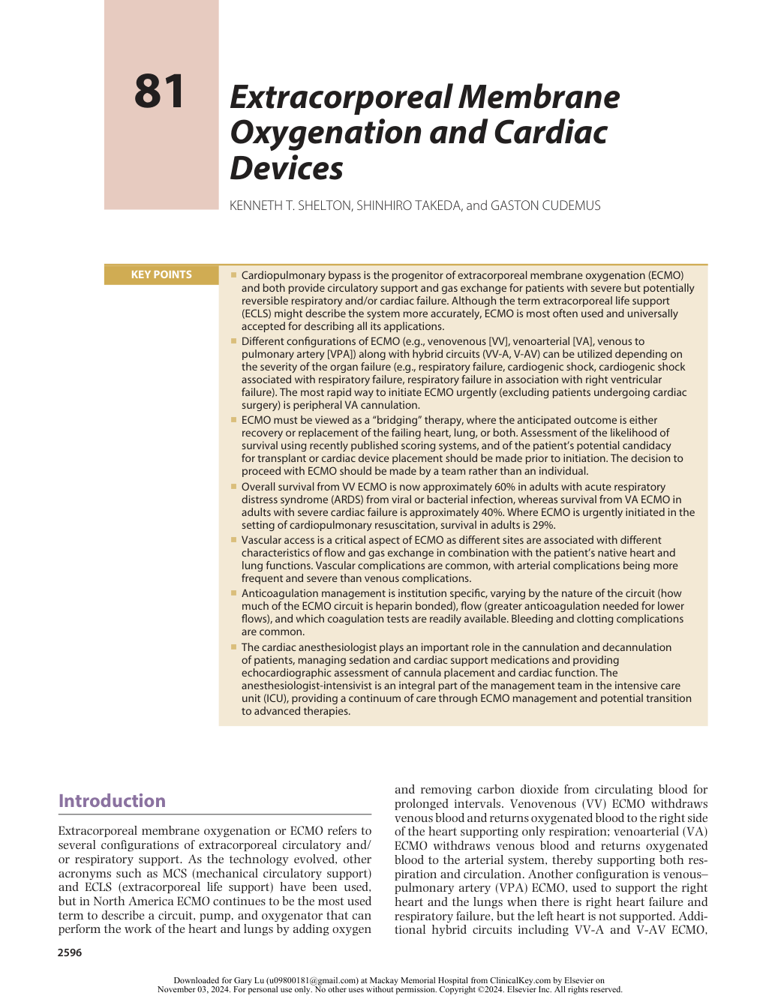

:::

<!-- PDF page 2 -->

which provide additional venous return for low- flow states or manage cerebral hypoxemia, respectively, are also discussed in this chapter.

An ECMO circuit comprises cannulae inserted into large vessels to remove and return the blood from the patient, tubing to connect to a nonpulsatile centrifugal pump that generates blood flow, and an oxygenator, where an oxygen–air mixture flows through the blood, referred to as the “sweep.” This is a closed system without a reservoir. Some or all of the circuit components are surface bonded with heparin, and the system is designed for extended use, such as days or weeks. This contrasts with the extracorporeal circuit used for cardiopulmonary bypass (CPB) in the operating room that uses larger- diameter and longer tubing and is an open system with a reservoir designed to receive input not only from the venous cannula but also from the operative field. Such CPB circuits may or may not be heparin bonded and are intended for surgical use of short duration (e.g., hours). There is some evidence in the lung transplant literature that use of ECMO during the surgical procedure may be associated with a decreased systemic inflammatory response than the use of the traditional CPB.1 The distinction between a “closed” versus “open” extracorporeal support device becomes important when discussing the potential benefit of providing additional blood products directly into an open reservoir and the potential risk of air entry into the circuit.

Pumpless extracorporeal lung assist (pECLA), or the Novalung, uses the patient’s arterial pressure rather than a pump to drive blood through an extracorporeal oxygenator. It therefore supports only respiration. This device requires less anticoagulation than traditional ECMO but due to lower flows and the membrane area, it has a more limited capacity for oxygenation.2 Implanted in a pulmonary artery to left atrium configuration, the device has been used to support patients with pulmonary hypertension awaiting lung transplantation.3 It is available in North America but is less widely used than ECMO and is not discussed further.

## History of Extracorporeal Cardiorespiratory Support

The history of ECMO is inextricably bound to the development of CPB for cardiac surgery. The first successful use of CPB in a human was by Gibbon in 1953, to repair an atrial septal defect in an 18- year- old patient.4 The following year, Warden and colleagues reported cardiac surgery using extracorporeal circulation,5 after which there was an increasing number of reports from many centers. Among the major limitations in these early reports was the use of “bubble” oxygenators where oxygen is bubbled through a reservoir of blood to achieve gas exchange. These oxygenators are associated with red blood cell trauma and coagulopathy with prolonged use.6 Membrane oxygenators, which separate the respiratory gases from the blood, reduced these effects, making the oxygenators suitable for longer- term use. The first successful reports of prolonged support outside of the operating room was in 1972 by Hill and associates7 in a 24- year- old trauma patient, and by Bartlett after neonatal cardiac surgery.8 In 1985 Bartlett and associates reported the successful use of ECMO for

neonatal respiratory failure in 11 patients.9 In the following two decades a number of additional trials showed the benefit of ECMO in neonatal respiratory failure, the most definitive of which was published in 1996 by the UK Collaborative ECMO Trial Group in 185 infants.10 In the same year Green and colleagues11 published a trial demonstrating similar benefit in older pediatric patients with respiratory failure. The initial use in the first decades was for respiratory failure, using VV ECMO. During this period the Extracorporeal Life Support Organization, or ELSO, was founded, first at the University of Michigan in 1989, then a European ELSO group formed in 1991. This organization has played a key role in documenting worldwide ECMO use, and pioneering education, research, and development in all types of ECMO support in all populations. Fig. 81.1 and Table 81.1 illustrate the increase in use of ECMO and the survival data since 1990 (www.ELSO.org).

## ECMO for Respiratory Failure (VV ECMO)

In contrast to the ECMO experience in neonatal and pediatric respiratory failure as previously described, demonstration of benefit in adults took longer and was delayed in part due to the publication of a trial in 1979 by Zapol and associates12 in 90 adult patients with respiratory failure. This trial had many limitations, including use of VA rather than VV ECMO, patient selection, anticoagulation technique, bleeding complications, and the use of hightidal volume and low positive end- expiratory pressure (PEEP), which was standard at the time. The poor outcomes deterred the use of ECMO in adults for more than 20 years. From 2001 to 2006, a large, ambitious British trial, the CESAR trial, was performed to evaluate VV ECMO for respiratory failure in adults.13 This study was performed during the H1N1 influenza pandemic and involved transferring patients with severe respiratory failure to a central expert ECMO center, where they were randomly assigned to ECMO or standard therapy. Despite some methodologic and statistical limitations, the results supported the use of ECMO performed in a specialized center to improve survival: 63% versus 47% survival with ECMO versus standard treatment (relative risk [RR] 0.69; 95% confidence interval [CI] 0.5–0.97; _P_ = .03). At the same time, another case series of VV ECMO in adults with severe acute respiratory distress syndrome (ARDS) due to H1N1 was reported from Australia and New Zealand (ANZ ECMO).14 This study found 79% survival at 30 days in patients who received ECMO. Recently a large multicenter trial of VV ECMO in adults with severe ARDS, the EOLIA trial, was published in 2018,15 with the authors concluding no difference in mortality between ECMO and conventional therapy at 60 days: 35% versus 46% ( _P_ = .09), with 28% of the control group crossing over to ECMO after randomization and a 57% mortality in this crossover group. Editorial comments on this study have challenged the authors’ conclusion, maintaining that it supports the use of early ECMO in adults with severe ARDS.16,17 The ELSO database reports survival to discharge with ECMO for adult respiratory failure as 60%, with this percentage being relatively stable over 15 years.18 ECMO was also performed in many

<!-- PDF page 3 -->

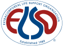

### Centers by year

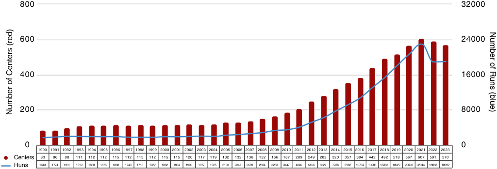

800 32000 600 24000 400 16000 200 8000 0 0 Centers Runs Number of Centers (red) Number of Runs (blue) 

**Fig. 81.1** International Registry of extracorporeal membrane oxygenation cases and centers, from the Extracorporeal Life Support Organization. (From ELSO website, www.ELSO.org.)

**Table 81.1** International Registry of ECMO – Survival from ECMO and from Hospitalization, by Age Category (Neonatal, Pediatric, or Adult) and Indication (Pulmonary, Cardiac, or “ECPR” [ECMO for Cardiopulmonary Resuscitation])

||**Total Runs**|**Survived** **ECLS**||**Survived** **to DC**||
|---|---|---|---|---|---|
|**ADULT**||||||
|Pulmonary|44,454|29,504|66%|26,019|58%|
|Cardiac|39,659|23,763|59%|18,027|45%|
|ECPR|12,125|5102|42%|3684|30%|
|**PEDIATRIC**||||||
|Pulmonary|11,935|8685|72%|7295|61%|
|Cardiac|15,230|11,074|72%|8293|54%|
|ECPR|6182|3647|58%|2619|42%|
|**NEONATAL**||||||
|Pulmonary|34,239|29,972|87%|25,005|73%|
|Cardiac|10,233|7085|69%|4546|44%|
|ECPR|2439|17,700|69%|1042|42%|
|**Total**|**176,496**|**120,532**|**68%**|**96,530**|**54%**|

Data Through December 31, 2021. ELSO Registry. www.ELSO.org.

### Box 81.1 Indications for VV ECMO

- Severe ARDS

- Murray score of 2.522

- Berlin definition23

- Respiratory failure associated with: Refractory hypoxemia despite maximum less invasive therapies e.g., FiO2 >90%, PEEP >15 cm H2O, prone ventilation Refractory hypercarbia (e.g., PaCO2 >80) with acidosis Injurious ventilating pressures (e.g., plateau pressures >30 mm Hg) with lung- protective tidal volumes

- Common clinical conditions

- Severe pneumonia (viral or bacterial)

- Aspiration pneumonitis

- ARDS from any cause

- Pulmonary contusion

- Status asthmaticus

- Severe air leak syndrome

- Inhalation injury

- Airway obstruction (e.g., mediastinal mass)

- Pre and post lung transplant

- _ARDS,_ acute respiratory distress syndrome; _FiO2,_ fraction of inspired oxygen: _PaCO2,_ arterial partial pressure of carbon dioxide; _PEEP,_ positive endexpiratory pressure; _VV ECMO,_ venovenous extracorporeal membrane oxygen ation.

centers for critically ill patients during the COVID- 19 pandemic. It has been reported that a survival rate of 50% or higher can be achieved in some circumstances. Many centers are still collecting data.19–21

### INDICATIONS FOR VV ECMO IN RESPIRATORY FAILURE

Box 81.1 lists common indications for VV ECMO in respiratory failure. As VV ECMO supports only respiratory function, if the patient has right- or left- sided cardiac failure then another configuration must be used. The most common

indication is ARDS, most commonly due to viral or bacterial infection. As indicated previously, the experience from H1N1 viral pneumonia provided a framework for the ECMO management of patients with COVID- 19. A commonly used assessment for the severity of ARDS is the Murray score, which is based on four standard criteria: PaO2/FiO2 (arterial partial pressure of oxygen/fraction of inspired oxygen) gradient for oxygen, degree of PEEP, number of quadrants affected as shown on the chest radiograph, and lung compliance.22 In 2012, the Berlin criteria were published, where the severity of ARDS is based on the PaO2/FiO2 gradient for oxygen if other criteria are present.23 In general, patients with severe ARDS

::: details 原始表格與符號（PDF 第 3 頁）

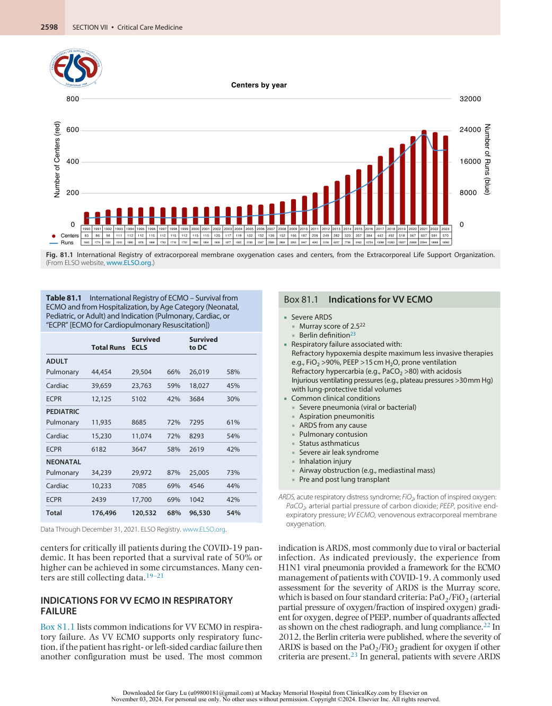

:::

<!-- PDF page 4 -->

(PaO2/FiO2 gradient of &lt;100 mm Hg with PEEP >5) are potential candidates for ECMO as the mortality without ECMO is approximately 40%.23 As described later in the section on the ethics of ECMO, there are studies that evaluate the likelihood of survival at the time ECMO is being considered; this can help guide decision- making. It should also be mentioned that from the CESAR trial described earlier,13 if a patient being considered for VV ECMO is not at an ECMO center or one with expertise in management of ARDS, transfer to such a facility is likely to provide a better outcome even in the absence of ECMO. While not formally studied, many reports indicate that outcomes are better with earlier institution of ECMO, probably at least in part because this permits the use of lung protective ventilation when respiration is supported by ECMO.24

### CONTRAINDICATIONS TO VV ECMO

In keeping with ELSO guidelines18 there are no absolute contraindications for VV ECMO in adults. There are, however, conditions known to be associated with a poor outcome, despite ECMO; these should always be considered before initiating ECMO assistance. These conditions include injurious mechanical ventilation for seven days or longer, major pharmacologic immunosuppression, and intracranial hemorrhage that is recent or expanding. Specific patient conditions should also be considered. Although no specific age is a contraindication, increased age is considered to increase the risk.18 A body mass index (BMI) of more than 40 to 45 may be associated with technical difficulties and the risk of not being able to achieve an adequate blood flow. VV ECMO is a bridge to either recovery or lung transplant; if neither of these outcomes appears at all likely then its initiation is not advisable.

## Extracorporeal Membrane Oxygenation for Patients Awaiting and Undergoing Lung Transplantation

The history of ECMO for severe respiratory failure as described previously refers mostly to patients with acute or acute on chronic disease where recovery could be anticipated. Another population is patients with end- stage chronic lung disease awaiting lung transplantation. These patients often have a slow (in years) deterioration in function and an increased need for oxygen support, with the final stage being an acute deterioration where standard therapy with mechanical ventilation ultimately fails. Institution of ECMO to prolong survival until transplant, use of ECMO during transplant surgery, and extension or initiation of ECMO postoperatively for primary graft dysfunction (PGD) or other indications have all become common applications for this advanced therapy. As recently as 2010 there was concern that the use of ECMO resulted in a reduced long- term survival from lung transplantation,25 but this is no longer the case. Case reports, single-center reports, and surveys have documented that the use of pretransplant ECMO, sometimes for months, was followed by successful transplant and good long- term outcomes.26,27 Raleigh and associates compared ten studies on the use of preoperative

ECMO for lung transplant patients and found similar outcomes to the patients who did not need ECMO,28 and Loor and associates described factors that contributed to posttransplant survival in this population.29 Intraoperative use of ECMO during the procedure has also been shown to reduce the inflammatory response, leads to less PGD when compared to CPB, and leads to improved short- term and longer- term outcomes1,29,30 even when compared to no use of either CPB or ECMO intraoperatively.31 While preoperative ECMO may be VV, VA, or VPA, intraoperatively VA ECMO is usually used due to surgical manipulation of the heart with its attendant hemodynamic compromise as well as the need for one- lung ventilation in patients with endstage pulmonary disease and elevated pulmonary vascular pressures. Postoperatively, ECMO support may be needed to support the new lungs in the face of PGD, the right heart, the left heart, or any combination of these. Postoperative ECMO support is also associated with excellent outcomes.31

## Emerging Infectious Diseases, Coronavirus Disease 2019 (COVID- 19)

In 2020, the coronavirus disease 2019 (COVID- 19) pandemic spread from Wuhan, China, throughout the world.32,33 In a large cohort study conducted in China during the early phase of the pandemic, 5% of symptomatic patients required intensive care such as mechanical ventilation and ECMO, and the mortality rate in this patient group was as high as 49%.34

Early in the pandemic, ECMO was considered in select centers with the infrastructure to offer this resourceintensive technology as a bridge to recover.35 In an attempt to categorize COVID- 19, pneumonia experts have started to consider two types: type L, in which pulmonary compliance is maintained, while hypoxemia occurs due to disturbance in the pulmonary circulation; and type H, in which pulmonary compliance is reduced with poor gas exchange due to increased edema and increased lung elastance.36 Patients with type H pneumonia are poorly responsive to mechanical ventilation and perhaps therefore better candidates for ECMO.

Regarding ECMO management, some special points about COVID- 19 deserve mentioning. Venovenous (VV) ECMO for acute respiratory failure accounts for the majority of ECMO use for COVID- 19 patients. However, cardiovascular complications in various forms have been reported in COVID- 19 patients, including acute myocardial injury, cardiomyopathy, arrhythmia, pericardial effusion, and venous thromboembolism.37 Myocardial injury has been reported in 22% of patients admitted to the ICU.38 Venoarterial (VA) ECMO should be considered in patients in cardiogenic shock poorly responsive to medication therapy.

Early data of patients with COVID- 19 suggested mortality rates as high as 90%39 ; however, as ECMO candidacy evolved during the pandemic mortality rates as low as 39% in a single large multinational cohort study published by ELSO in September 2020 were later reported.40 Furthermore, reports from various parts of the world demonstrated outcomes comparable to previously reported outcomes of ECMO for acute respiratory failure.19–21 ECMO

<!-- PDF page 5 -->

use therefore is very much considered an option at many experienced centers for care of refractory COVID- 19 respiratory failure.41,42

Similar to the experience during H1N1, countries with treatment support networks and treatment consultation for critically ill patients requiring ECMO and mechanical ventilation seemed to fare better than programs without this support.43–45 The global COVID- 19 pandemic placed substantial pressure on the health care system around the world and forced programs to think critically about criteria for appropriate use of ECMO circuits.41,42,46

## ECMO for Circulatory Failure (VA ECMO)

VA ECMO can be used to support the heart and lungs temporarily in a patient with poor cardiac function who undergoes an invasive cardiology procedure, to continue postoperative cardiopulmonary support in a cardiac surgery patient who fails to separate from CPB, and in a patient with refractory cardiac failure with or without associated respiratory failure. These conditions may occur due to an acute recoverable illness (e.g., myocarditis) or may be in the setting of acute on chronic heart failure in patients being evaluated for long- term advanced therapies such as a durable ventricular assist device or cardiac transplant. Urgent use of ECMO in the acute setting of in- hospital cardiac arrest (extracorporeal cardiopulmonary resuscitation, [ECPR]) is also practiced in some centers and is expected to expand as the technology improves and percutaneous support systems become more available. Finally, as VA ECMO can be instituted at the bedside, it may be the preferred technique for emergent cannulation in any form of respiratory

or cardiac failure, with elective conversion to another form (e.g., VV ECMO) once the patient has stabilized.

The historical perspective for use of VA ECMO for cardiac or combined cardiorespiratory support in adults is illustrated in the 2016 report from the ELSO registry.47 Adult cardiac ECMO was in its infancy in 1990 with little increase in use until 2006 when its use began to increase exponentially. There were more than 2000 adult cardiac ECMO runs reported to ELSO in 2015, which comprises an ever- increasing proportion of all ECMO runs (Fig. 81.2). This exponential increase was likely fueled by consistent success in the neonatal and pediatric populations; improvements in the ECMO circuits, pumps, and oxygenators; and the success and experience with VV ECMO for adult respiratory failure. Overall survival in adults who receive ECMO for cardiac indications is approximately 40% with a slight increasing trend over the last 10 years.47

### INDICATIONS FOR VA ECMO

For periprocedural support of the heart only, short- term devices such as a percutaneous left ventricular assist device (LVAD, e.g., Impella or TandemHeart) are one type of support; the other is short- term ECMO, usually peripheral (femoral) VA ECMO. Percutaneous right ventricular assist devices are also now making their way into mainstream mechanical support strategies (Impella RP, ProtekDuo- LivaNova). Recent reviews of temporary circulatory support devices in cardiology compare and summarize risks, benefits, and outcomes with the different approaches in different settings.48,49 ECMO procedural specialists are much more likely to use VA ECMO in the setting of postcardiotomy failure, partly due to familiarity

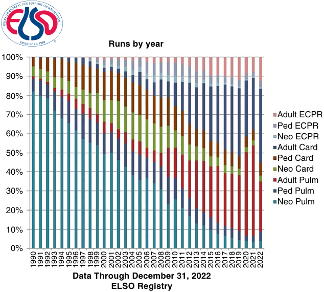

Runs by year 100% 90% 80% 70% Adult ECPR Ped ECPR 60% Neo ECPR Adult Card 50% Ped Card 40% Neo Card Adult Pulm 30% Ped Pulm Neo Pulm 20% 10% 0% Data Through December 31, 2022 ELSO Registry 1990 1991 1992 1993 1994 1995 1996 1997 1998 1999 2000 2001 2002 2003 2004 2005 2006 2007 2008 2009 2010 2011 2012 2013 2014 2015 2016 2017 2018 2019 2020 2021 2022 

**Fig. 81.2** Distribution of trends in extracorporeal membrane oxygenation (ECMO) utilization (data from the ELSO registry) by patient age and indication (pulmonary or cardiac). In the early years the majority of ECMO was neonatal respiratory, whereas in recent years it is more adult respiratory and cardiac. (From ELSO website, www.ELSO.org.)

<!-- PDF page 6 -->

with cannulation (or the presence of central cannulae), but also due to the support this provides for both ventricles and the lungs. Reviews of postcardiotomy ECMO suggest approximately 30% survival to hospital discharge.50,51

For support of the patient with refractory end- stage cardiac failure who may be a potential candidate for durable LVAD or transplant, or who has already been evaluated for such advanced therapy, there are advantages and disadvantages to both the short- term LVAD (Impella or TandemHeart) and ECMO. As discussed later, a significant advantage of these devices over VA ECMO is decompression of the left ventricle. If placed via the axillary/subclavian artery, the patient can be somewhat mobile. If, however, the right heart, or lungs, or both, needs support, then either biventricular percutaneous or surgical ventricular support with or without an oxygenator is most appropriate. Another issue is urgency or acuity: peripheral VA ECMO can be initiated at the bedside without imaging more rapidly than a temporary assist device. The main problem if this support is needed for days or weeks is the femoral cannulae prevent mobilization. A recent systematic review (publications between 2006 and 2016) of short- term mechanical circulatory support as a bridge to durable LVAD or transplant (or recovery) documented a wide range in the number of days of support (individual study means of up to 47 days) and an overall 45% to 66% of patients surviving to discharge.52 In this report where the support was via central ECMO, a higher proportion of patients went on to receive durable LVAD or transplant and survived to discharge than those who received peripheral ECMO.

For acute recoverable myocardial illness such as myocarditis, survival is approximately 67% with VA ECMO.53 This is a better outcome than for other cardiac indications, likely reflective of the younger age of such patients and possibly because in this setting ECMO is usually instituted before cardiogenic shock or arrest.

In the 2016 ELSO report, use of ECMO in the setting of CPR or ECPR in adults comprised approximately 15% of all adult ECMO.47 Sixty- six percent of all centers reporting to the registry indicate some use in this setting. While referrals for ECMO for respiratory and cardiac failure are often relatively acute and urgent, in the setting of bedside CPR, ECMO needs to be instituted very rapidly; time from starting CPR to ECMO initiation is an important determinant of good outcome.54,55 This limits its use to institutions able to support a team that is ready for such rapid activation. Survival to discharge is, not surprisingly, the lowest of all ECMO applications in both adults (29%) and pediatrics (41%).47 The quality of evidence in published studies comparing ECLS to standard CPR is low, with a great deal of heterogeneity.55

Indications for VA ECMO are summarized in Box 81.2. According to the 2013 ELSO guidelines18 the most common indication for VA ECMO in adult cardiac failure is the presence of cardiogenic shock with end- organ hypoperfusion despite the use of dual inotropes and significant vasopressor requirement. This includes cardiogenic shock with or without myocardial infarction, fulminant myocarditis, peripartum cardiomyopathy, decompensated chronic heart failure, right heart failure, medication or toxic drug overdose, and postcardiotomy shock.

### Box 81.2 Indications for VA ECMO

- Cardiogenic shock Hypotension/poor tissue perfusion despite maximum medical therapy ± balloon pump

- Combined cardiorespiratory failure Cardiogenic shock with pulmonary edema and hypoxemia

- Urgent ECMO for respiratory failure As temporizing measure before institution of VV ECMO

- Common clinical conditions Refractory cardiogenic shock (any cause) Failure to separate from cardiopulmonary bypass Bridge to durable ventricular assist device or transplant Intraoperative lung transplant Unstable arrhythmias Anaphylaxis Massive pulmonary embolus Cardiac arrest without return of spontaneous circulation

_VA ECMO_ , venoarterial extracorporeal membrane oxygenation; _VV ECMO_ , venovenous extracorporeal membrane oxygenation.

### CONTRAINDICATIONS TO VA ECMO

Absolute contraindications to VA ECMO include acute intracranial hemorrhage or massive stroke, active bleeding, and severe aortic insufficiency. Relative contraindications (variable by center) may include contraindication for anticoagulation, advanced age, obesity, active cancer, chronic hemodialysis, end- stage liver disease, and aortic dissection. As is the case for VV ECMO, if neither recovery nor candidacy for durable therapy (LVAD or transplant) are likely, VA ECMO should not be initiated.

## The Ethics of Extracorporeal Membrane Oxygenation

The initiation of any form of ECMO is lifesaving when the heart and/or lungs are failing despite maximum medical therapies. It is a very invasive and labor- intensive therapy, with associated severe complications, and may confine a patient to an ICU for days, weeks, or even months. As the practice has evolved over time, many groups have tried to address issues of patient appropriateness, possible exclusion criteria, and prognosis before initiating the therapy. An essential consideration is that ECMO is a “bridge” to something else and cannot be viewed as a long- term solution; Box 81.3 lists the uses of ECMO as a “bridging” therapy to a variety of possible scenarios. The following discussion addresses only the individual patient ethical dilemmas, and not the overriding issue of the use of a limited availability, expensive, and labor- intensive therapy with its cost:benefit implications, and overall implications for health care systems.

When an otherwise relatively young and healthy patient develops an acute severe illness resulting in acute cardiac failure and shock (e.g., viral cardiomyopathy) or acute refractory lung failure (e.g., viral pneumonia), the decision to initiate lifesaving extracorporeal support as a “bridge to recovery” seems relatively straightforward. Similarly, a patient with end- stage disease of any kind who already has a “do not resuscitate” status would likely not be a candidate

<!-- PDF page 7 -->

### Box 81.3 Extracorporeal Membrane Oxygenation as “Bridge” Therapy

|Bridge to Decision|Urgent initiation before the ability to assess likelihood of recovery or candidacy for advanced therapy|
|---|---|
|Bridge to Recovery|Initiation for organ failure that is believed to be potentially recoverable|
|Bridge to Advanced Durable Therapy|Initiation after acceptance for eligibility for device (e.g., VAD) or transplant|
|“Bridge to Nowhere”|Bridge to decision which is likely to be non- recovery and non- eligibility for advanced therapy|

regarding “do not resuscitate,” assessing the values and goals of the patient.58 Counseling for ICU caregivers as well as family, including postmortem “debriefings,” can be very valuable to help staff deal with end- of- life issues. There are few settings where withdrawal of therapy can so immediately result in death, where patients have intact neurologic function but are on the “bridge to nowhere”; it can be extremely troubling to all involved when ECMO is stopped.

## The Mechanics of Extracorporeal Membrane Oxygenation

### THE PUMP

_VAD,_ ventricular assist device.

for ECMO if the heart suddenly failed. Unfortunately, the clinical spectrum of potential candidates runs as a continuum between these two examples. Tools to help assess the likelihood of a successful outcome with this advanced therapy are needed.

The ELSO registry database has been used to study the likelihood of survival prior to ECMO initiation, both in respiratory failure (Table 81.2)56 and cardiac failure (Table 81.3)40 There are many common elements in these publications, including the duration and degree of respiratory support, age, other organ function, and acidosis. While these publications can be used as a general guide and can be quoted to referring physicians and families, they must be placed in clinical context; decision- making for lifesustaining treatment must be patient- specific. Courtwright and associates42 make a point of the need to emphasize to the patient’s family the “bridging” nature of ECMO therapy, and that a destination must be formulated at the outset or early on. Because of the need for anticoagulation and the risk for bleeding or thrombosis, patients who are not candidates for anticoagulation (e.g., intracranial hemorrhage) are generally not candidates for ECMO, even though more experience is accumulating with reduced or even no anticoagulation with the use of anticoagulant-bonded equipment. Patients with underlying severe disease who are not expected to survive more than some predetermined period (i.e., six months or a year) independent of the need for ECMO are unlikely to be considered as candidates. Rather than have a single physician or ECMO cannulation specialist determine whether ECMO should be initiated in a given patient, especially when a request comes from an outside hospital, many institutions make this a shared decision by a small committee (i.e., three individuals) who are all familiar with and participate in ECMO management.57

Overall survival for adult respiratory and cardiac ECMO is approximately 60% and 40%, respectively. Although this is certainly a major advance for diseases that were previously not survivable, the other side of this coin is that mortality remains at 40% and 60%. It makes good sense to engage palliative care and/or an ethics committee and other counselling services, where available and appropriate, at the outset for this therapy.42,57 When ECMO is being considered but there is uncertainty about the likelihood of recovery or candidacy for advanced durable therapy, discussions with family and caregivers should be similar to those made

The delivery of ECMO includes a centrifugal pump in series with a membrane oxygenator connected by tubing to an inflow and an outflow cannula from the pump to the patient. Convention is to describe the cannulae in relation to the pump: the inflow cannula aspirates venous blood from the patient and the outflow cannula carries arterialized blood from the pump to the patient. Figs. 81.3 and 81.4 illustrate two common ECMO pumps in use today. Fig. 81.3 shows the Maquet Cardiohelp device (Getinge Group, Wayne, NJ) where the pump head and oxygenator are combined into one disposable unit. Fig. 81.4 shows the Thoratec CentriMag pump where the pump head and oxygenator can be disposed separately. Both pumps work in a similar manner with a magnetically driven rotor. Note, the only variable that is adjustable on the pump is the number of revolutions per minute (RPM); the flow generated at a given RPM is dependent on filling (preload) and impedance to ejection (afterload).59 In the human heart, it has been argued that venous return is the single most important factor in maintaining adequate cardiac output.49 In a similar way, the most important determinants of flow for a centrifugal pump fed from the patient’s central veins and right atrium are the volume status of the venous circulation and internal diameter of the cannula. Also important in VA ECMO is the mean systemic pressure, as the flow from the pump will be reduced by hypertension. While the centrifugal pumps used in ECMO are relatively nontraumatic to red blood cells, there is hemolysis especially at high RPM settings. To maximize flow at a low RPM, thereby reducing hemolysis, the goal is to maintain adequate preload and decrease afterload. Use of the largest possible arterial or outflow cannula will also reduce hemolysis, but this need must be balanced with the patient’s vessel size.

What is less clear physiologically is how much ECMO flow is necessary for adequate tissue perfusion. This is a complex question, and the answer can vary depending on the current physiologic state of the patient (e.g., native cardiac function, hyperthermia, hypothermia, sepsis, ischemia). Most centers have settled on a “normal cardiac output” ECMO flow of 2.2 to 2.4 L/min/m2 as an initial goal, but this may not be possible in a large patient due to cannula size. Using markers of end- organ perfusion (mental status changes, lactate, mixed venous oxygen saturation, liver function tests, creatinine), the flow goal can be changed as is feasible and necessary. A very important feature of ECMO is that the flow is not necessarily replacing the patient’s own cardiac output, either

::: details 原始表格與符號（PDF 第 7 頁）

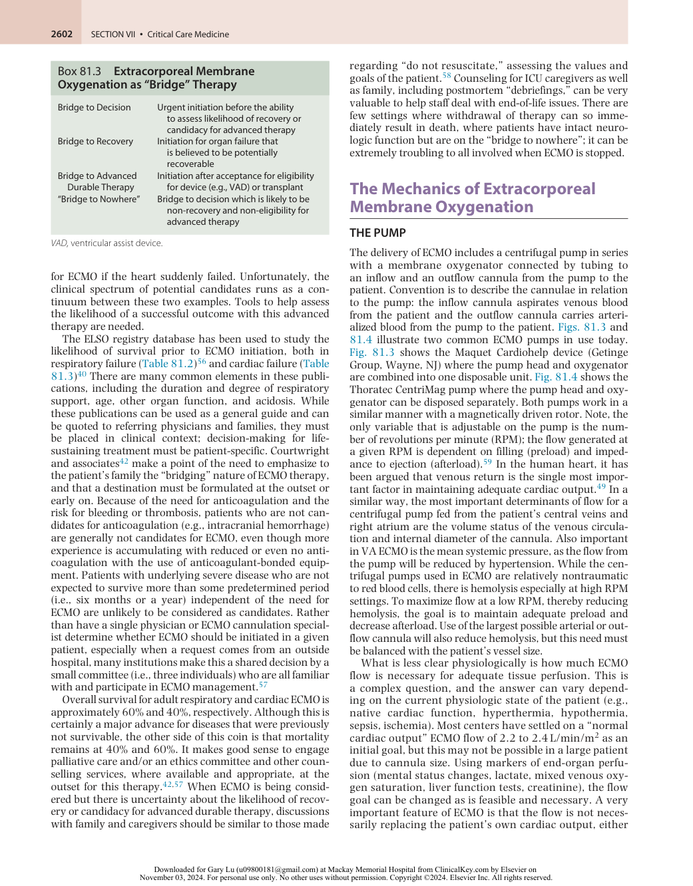

:::

<!-- PDF page 8 -->

### Table 81.2 The “RESP” Score for Pre- ECMO Prediction of Survival at 30 Days After Initiation of VV ECMO for Respiratory Failure

|**Parameter**|**Score**|
|---|---|
|**AGE, YEARS**||
|18–49|0|
|50–59|−2|
|≥60|−3|
|Immunocompromised status*|−2|
|**MECHANICAL VENTILATION PRIOR TO INITIATION OF ECMO**||
|&lt;48 h|3|
|48 h to 7 days|1|
|>7 days|0|
|**ACUTE RESPIRATORY DIAGNOSIS GROUP (SELECT ONLY ONE)**||
|Viral pneumonia|3|
|Bacterial pneumonia|3|
|Asthma|11|
|Trauma and burn|3|
|Aspiration pneumonitis|5|
|Other acute respiratory diagnoses|1|
|Nonrespiratory and chronic respiratory diagnoses|0|
|Central nervous system dysfunction†|−7|
|Acute associated (nonpulmonary) infection‡|−3|
|Neuromuscular blockade agents before ECMO|1|
|Nitric oxide use before ECMO|−1|
|Bicarbonate infusion before ECMO|−2|
|Cardiac arrest before ECMO|−2|
|**PaCO2, mm Hg** &lt;75|0|
|≥75|−1|
|**PEAK INSPIRATORY PRESSURE, cm H2O**||
|&lt;42|0|
|≥42|−1|
|Total score|−22 to 15|
|**Total RESP Score** **Risk Class**|**Survival**|
|**HOSPITAL SURVIVAL BY RISK CLASS**||
|≥6 I|92%|
|3–5 II|76%|
|−1 to 2 III|57%|
|−5 to −2 IV|33%|
|≤−6 V|18%|

An online calculator is available at www.respscore.com.

*“Immunocompromised” is defined as hematologic malignancies, solid tumor, solid organ transplantation, human immunodeficiency virus, and cirrhosis.

†“Central nervous system dysfunction” diagnosis combined neurotrauma, stroke, encephalopathy, cerebral embolism, and seizure and epileptic syndrome.

‡“Acute associated (nonpulmonary) infection” is defined as another bacterial, viral, parasitic, or fungal infection that did not involve the lung.

_ECMO,_ extracorporeal membrane oxygenation; _RESP,_ respiratory ECMO survival prediction; _VV ECMO,_ venovenous ECMO.

From Schmidt M, Bailey M, Sheldrake J, et al. Predicting survival after extracorporeal membrane oxygenation for severe acute respiratory failure. The Respiratory Extracorporeal Membrane Oxygenation Survival Prediction (RESP) score. _Am J Respir Crit Care Med_ . 2014;189(11):1374–1382.

::: details 原始表格與符號（PDF 第 8 頁）

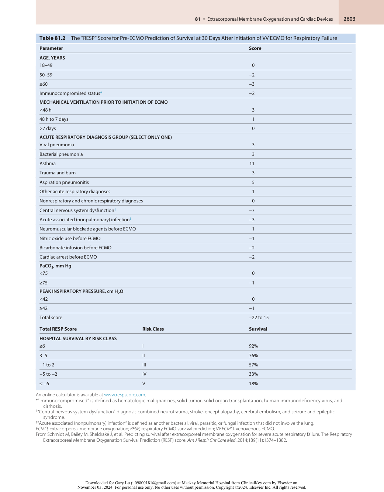

:::

<!-- PDF page 9 -->

**Table 81.3** The “SAVE” Score for Pre- ECMO Prediction of Survival at 30 Days After Initiation of VA ECMO for Cardiac Failure

|**Parameter**|**Score**|
|---|---|
|**ACUTE CARDIOGENIC SHOCK DIAGNOSIS GROUP (SELECT ONE OR MORE)**||
|Myocarditis|3|
|Refractory VT/VF|2|
|Post heart or lung transplantation|3|
|Congenital heart disease|−3|
|Other diagnoses leading to cardiogenic shock requiring VA ECMO|0|
|**AGE (YEARS)**||
|18–38|7|
|39–52|4|
|53–62|3|
|≥63|0|
|**WEIGHT (kg)**||
|≤65|1|
|65–89|2|
|≥90|0|
|**ACUTE PRE- ECMO ORGAN FAILURES (SELECT ONE OR MORE IF REQUIRED)** Liver failure*|−3|
|Central nervous system dysfunction†|−3|
|Renal failure‡|−3|
|Chronic renal failure§|−6|
|**DURATION OF INTUBATION PRIOR TO INITIATION OF ECMO (h)** ≤10|0|
|11–29|−2|
|≥30|−4|
|Peak inspiratory pressure≤20 cm H2O|3|
|Pre- ECMO cardiac arrest|−2|
|Diastolic blood pressure before ECMO≥40 mm Hg¶|3|
|Pulse pressure before ECMO≤20 mm Hg¶|−2|
|HCO3before ECMO≤15 mmol/L¶|−3|
|Constant value to add to all calculations of SAVE- score|−6|
|**Total score**|−**35 to 17**|
|**Total SAVE- Score** **Risk Class**|**Survival (%)**|
|**HOSPITAL SURVIVAL BY RISK CLASS**||
|>5 I|75|
|1–5 II|58|
|−4 to 0 III|42|
|−9 to −5 IV|30|
|≤−10 V|18|

An online calculator is available at www.save- score.com.

*Liver failure was defined as bilirubin ≥33 mcmol/L or elevation of serum aminotransferases (ALT or AST) >70 UI/L.

†CNS dysfunction combined neurotrauma, stroke, encephalopathy, cerebral embolism, as well as seizure and epileptic syndromes. ‡Renal failure is defined as acute renal insufficiency (e.g., creatinine >1.5 mg/dL) with or without renal replacement therapy (RRT). §Chronic renal failure is defined as either kidney damage or glomerular filtration rate &lt;60 mL/min/1.73 m2 for ≥3 months. ¶Worse value within 6 hours prior to ECMO cannulation. _VA ECMO,_ venoarterial extracorporeal membrane oxygenation; _VF,_ ventricular fibrillation; _VT,_ ventricular tachycardia.

From Schmidt M, Burrell A, Roberts L, et al. Predicting survival after ECMO for refractory cardiogenic shock: the survival after veno- arterial- ECMO (SAVE)- score. _Eur Heart J_ . 2015;36(33):2246–2256.

::: details 原始表格與符號（PDF 第 9 頁）

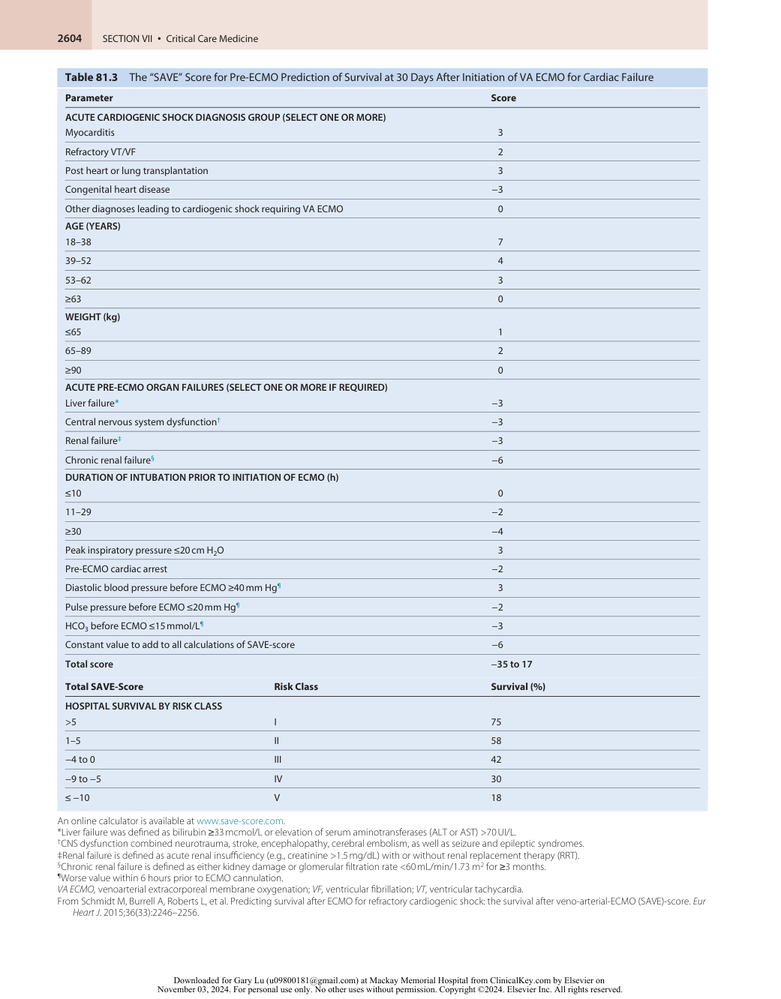

:::

<!-- PDF page 10 -->

on the right side or the left. With VV ECMO, the circuit may oxygenate only a fraction of the total venous return so that there will still be significant shunt of poorly oxygenated blood through the lungs. With VA ECMO in severe cardiac failure, the circuit may supply most of the blood flow, but as cardiac function improves, native flow may become a significant proportion of total flow. In this case, like VV ECMO, the native blood flow through the lungs will dilute the gas exchange benefit provided by the VA ECMO.

The effects of continuous flow rather than physiologic pulsatile flow on the vasculature and organ systems have been studied for short- term CPB runs and long- term durable LVADs, but not well for moderate duration (e.g., days

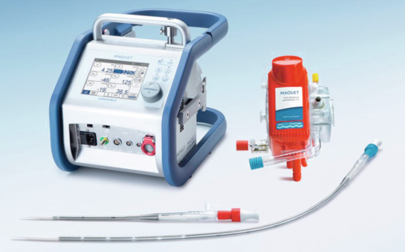

**Fig. 81.3** The Maquet “Cardiohelp” system showing the pump, the combined pump head/oxygenator, and an arterial and venous cannula. (Courtesy MAQUET Cardiovascular, LLC, Wayne, NJ.)

to weeks) as seen in ECMO patients. Changes with durable LVADs include increased aortic valve regurgitation (if it is not opening), histologic alterations in the aorta making it stiffer, gastrointestinal mucosal changes associated with increased bleeding and arteriovenous malformations, and acquired von Willebrand disease.60 Despite this, continuous flow nonpulsatile pumps have replaced pulsatile pumps in all settings of extracorporeal support because of their simplicity, durability, and the reduced trauma to red blood cells. Hemolysis and issues related to coagulation top the list of things to follow closely while on a continuous flow circuit.61 Lactate dehydrogenase, haptoglobin, bilirubin, and free hemoglobin all remain important laboratory parameters to follow while on ECMO to assess for hemolysis.62

### THE OXYGENATOR

The membrane oxygenator is constructed to separate gas flow around microtubules of membrane through which the blood is passed, with additional circuitry permitting heat exchange. Traditionally “flow” refers to the flow of blood through the ECMO circuit, and the amount of air–oxygen mixture run through the oxygenator is the “sweep.” Oxygenation of the blood is determined by the FiO2 of the sweep gas mixture, and carbon dioxide removal is determined by the liters per minute of sweep, which is commonly in the range of 1 to 5 L/min depending on the patient’s metabolic state, size, native lung function, and ventilator settings. Oxygen transfer is very effective at normal blood flows, with post- oxygenator blood samples usually showing a partial pressure of oxygen (pO2) of more than 300 mm Hg when

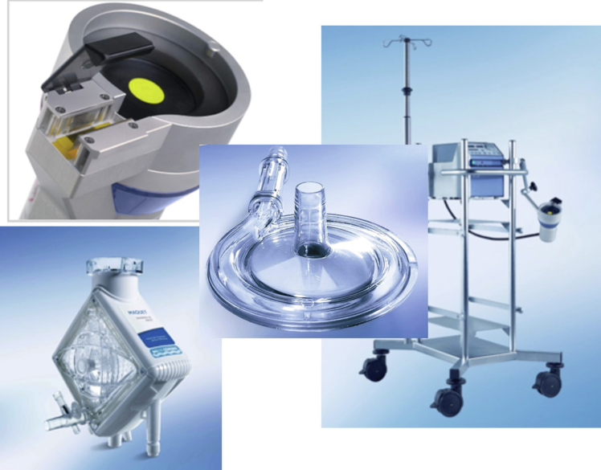

**Fig. 81.4** The Thoratec “CentriMag” pump ( _top left_ ) with cart/control panel ( _top right_ ), pump head ( _center_ ) and oxygenator ( _bottom left_ ). (Courtesy Thoratec Switzerland GmbH, Zürich, Switzerland.)

<!-- PDF page 11 -->

the sweep is 100% oxygen. The patient’s blood gas values will be the result of a combination of the ECMO blood flow with its carbon dioxide and oxygen content, and the patient’s native circulation and gas exchange. Figs. 81.3 and 81.4 show the membrane oxygenator most widely used in North America. With time (days to weeks) the oxygenator becomes less efficient at gas exchange due to build- up of fibrin and micro- or macrothrombi. Need for an increase in FiO2 or sweep should prompt an evaluation of the pressure drop across the membrane and a post- oxygenator blood gas.

### PULSATILITY WITH VA ECMO

Pulsatility is a term used when describing the arterial waveform both in patients on ECMO and in those with durable LVADs. In the latter case, pulsatility with the cardiac cycle may be related both to LV ejection (i.e., independent of the LVAD) and to the increased filling of the ventricular assist device due to left ventricular contractility. Pulsatility can be detected in this latter case even without aortic valve opening. With VA ECMO, the blood filling the ECMO circuit comes from the venous side so any pulsatility is due entirely to left ventricular ejection. When VA ECMO is initiated for cardiac decompensation, there is often very little pulsatility, but as the left ventricle recovers there is gradual recovery of a normal arterial waveform as native left ventricular ejection increases. With VV ECMO, there is normal filling of the left ventricle and arterial pulsatility is not affected.

### FLOW AND GAS EXCHANGE PHYSIOLOGY WITH VV ECMO

When VV ECMO is instituted using two separate cannulae as shown in Fig. 81.5, there are two main limitations to its effectiveness. The first limitation is that the patient’s native cardiac output may be equal to or even greater than the ECMO flow, which is functionally a large shunt through the lungs. This may lead to inadequate oxygenation despite what appears to be appropriate pump and oxygenator function. The second limitation, due to proximity of the cannulae in the right atrium, is recirculation where some portion of the oxygenated blood being pumped into the patient is aspirated back into the inflow cannula rather than going through the tricuspid valve. This will also result in poor gas exchange.63,64 Use of the Avalon dual- lumen cannula (Figs. 81.6 and 81.7), where blood is aspirated from superior vena cava and inferior vena cava ports on one lumen and returned through a port positioned (using transesophageal echocardiography [TEE] guidance) such that it flows into the tricuspid valve, is less likely to cause recirculation. The improvement in gas exchange with VV ECMO may result in partial relief of pulmonary hypertension, possibly avoiding the need for right ventricular assist (i.e., VPA or VA ECMO). If oxygenation is not adequately improved due to problems with recirculation or native cardiac output, either additional pulmonary measures such as increasing PEEP and/or prone positioning or transfusing to a higher hemoglobin can improve oxygen delivery. Addition of a second ECMO circuit is also a possibility.

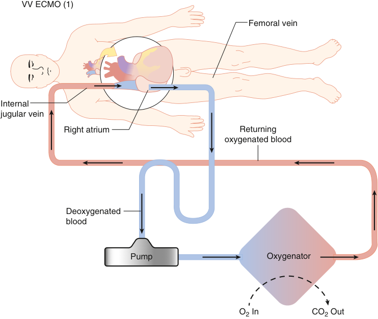

VV ECMO (1) Femoral vein Internal jugular vein Right atrium Returning oxygenated blood Deoxygenated blood Pump Oxygenator O2 In CO2 Out 

**Fig. 81.5** Traditional venovenous extracorporeal membrane oxygenation (VV ECMO) circuit with inflow cannula in right femoral vein and outflow cannula in right internal jugular vein.

<!-- PDF page 12 -->

### FLOW AND GAS EXCHANGE PHYSIOLOGY WITH VA ECMO

Peripheral VA ECMO usually is performed with a venous cannula advanced from the femoral vein into the right atrium, and a femoral arterial cannula that ends in the internal iliac artery (Fig. 81.8). Physiology of this arterial flow is complex in that it competes with native left ventricular ejection and poses an afterload stress to the failing left ventricle.65,66 A principle of treating the failing heart is to reduce wall stress and myocardial oxygen consumption and decrease pulmonary pressures; this is violated with VA ECMO. It may be necessary to decompress the left ventricle with either an Impella or a surgically placed left ventricular vent if it is not possible to adequately improve left ventricular function with inotropes or to keep systemic pressures low. Competition with left ventricular ejection means that

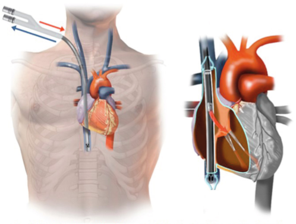

**Fig. 81.6** Venovenous extracorporeal membrane oxygenation cannulation with the Avalon cannula (Maquet Inc.). The dual- lumen catheter is placed in the right internal jugular vein, with venous blood drawn from the superior and inferior vena cavae ( _blue arrow_ ) into the extracorporeal membrane oxygenation circuit where it is oxygenated and pumped back into the right atrium directed toward the tricuspid valve ( _red arrow_ ). (Courtesy MAQUET Cardiovascular, LLC, Wayne, NJ.)

the ECMO flow from the iliac artery may not reach the aortic arch, leaving the coronary and cerebral vessels hypoxic if there is poor native lung function. The place in the aorta where the ECMO flow meets the native flow (from the left ventricle–aortic valve) is sometimes called the “mixing cloud”; ideally this is as close to the heart as possible. For this reason, the right radial artery (rather than the left), reflecting aortic blood flow closest to the heart and to the brain, is the sampling site of choice.67 The phenomenon of poorly oxygenated cerebral and upper body oxygenation but good oxygenation in the lower body is called the “harlequin syndrome” (after an autonomic condition associated with asymmetric upper body sweating and flushing). Solutions to this problem include central cannulation (requiring sternotomy/thoracotomy) where the arterial cannula is in the ascending aorta, or addition of a second cannula in the right atrium to which part of the ECMO outflow is diverted, or V- AV ECMO.68 This runs the risk of recirculation at the atrium, as well as too high a flow diverted away from the aorta and systemic circulation due to the low resistance of the pulmonary circulation. Partial clamping of this cannula

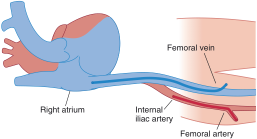

Femoral vein Right atrium Internal iliac artery Femoral artery 

**Fig. 81.8 Venoarterial extracorporeal membrane oxygenation circuit with femoral cannulation.** The venous cannula ( _dark blue_ ) is advanced to the junction of the inferior vena cava and right atrium, then attached to the pump inflow side of the circuit; the arterial cannula ( _red_ ) is advanced to the iliac artery and attached to the oxygenator/pump outflow side of the circuit.

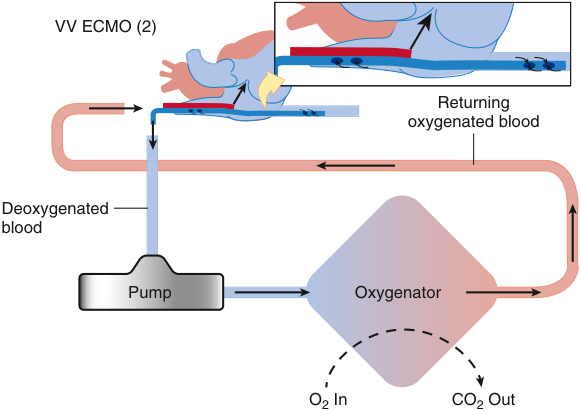

VV ECMO (2) Returning oxygenated blood Deoxygenated blood Pump Oxygenator O2 In CO2 Out 

**<mark>Fig. 81.7</mark>** <mark>Venovenous extracorporeal membrane oxygenation (VV ECMO) circuit using the Avalon cannula (Maquet Inc).</mark>

<!-- PDF page 13 -->

to increase resistance will help drive blood to the systemic cannula.

### EXTRACORPOREAL MEMBRANE OXYGENATION FOR THE FAILING RIGHT HEART

Clinical circumstances where only the right heart needs mechanical assist are less common than when the left ventricle or both ventricles are failing. Pulmonary hypertension with right ventricular failure in the pre–lung transplant patient, or immediately post–durable LVAD placement where there is right ventricular failure are two examples. It is possible to support the right ventricle alone with VPA ECMO where the venous cannula is in the right atrium and the “arterial” (outflow) cannula is surgically placed in the pulmonary artery via a graft (Fig. 81.9). If the lungs are intact, then an oxygenator may not be needed and support of the right ventricle can be accomplished by percutaneous devices (TandemHeart or Impella) or with surgically placed ECMO, or, more correctly, right ventricular assist device (RVAD) circuit without an oxygenator. If there is also respiratory failure, then an oxygenator can be added to the circuit to provide true ECMO. This latter combination for right ventricular failure after LVAD provides a flexible means for managing the RV, lungs, and LV relatively independently.69

## Vascular Access for Extracorporeal Membrane Oxygenation

Vascular cannulation location and technique vary depending on the type of support needed, the patient’s age, size, and clinical situation, and the need for imaging. Actual placement techniques include percutaneous vessel puncture (Seldinger technique) followed by guidewire, serial

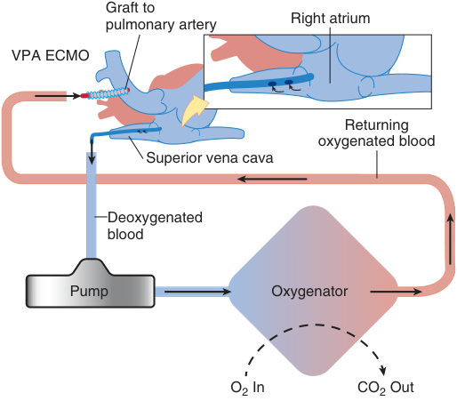

Graft to Right atrium pulmonary artery VPA ECMO Returning oxygenated blood Superior vena cava D eoxygenated blood Pump Oxygenator O2 In CO2 Out 

**Fig. 81.9** Venous–pulmonary artery extracorporeal membrane oxygenation (VPA ECMO) circuit showing the venous cannula placed through the internal jugular vein to the right atrium, and the arterial cannula placed in a graft which is sewn to the pulmonary artery.

dilators, then finally the cannula. Alternatively, surgical cutdown and direct exposure can be used for peripheral vessels. Finally, surgical access to the right atrium, pulmonary artery, and ascending aorta requires sternotomy/thoracotomy. For percutaneous access there can be little doubt that ultrasound is a very valuable aid. Although there is little science to support this contention specifically for ECMO, in other settings there is compelling evidence.70,71

In order to verify placement of the venous cannula appropriately in the right atrium or at the junctions of the superior and inferior vena cavae with the right atrium, TEE is very helpful; similarly, during placement of guidewires in peripheral vessels the use of TEE to verify wires in the aorta or the right atrium is also very helpful. Finally, radiographic imaging may be used for guiding the wire used for right internal jugular (RIJ) vein placement with a dual- lumen catheter (Avalon), followed by TEE imaging to verify correct cannula placement. Vascular cannulation, especially arterial, requires heparinization during cannula placement and generally also requires two operators, for either percutaneous access (one person to handle guidewire, dilators, and intermittent vascular occlusion) or for cutdown (surgical assistance in addition to handling wire and dilators).

### CANNULATION FOR VV ECMO

In the original descriptions of VV ECMO in adults, two cannulae were used: one usually inserted in the right femoral vein and advanced to the junction between the inferior vena cava and the right atrium, and the other inserted in the RIJ vein and advanced through the superior vena cava into the right atrium (see Fig. 81.5). The largest possible cannulae are used to maximize flow. When the cannulation of the internal jugular vein is technically not possible, an alternative configuration of VV ECMO support involves bilateral femoral cannulation. The tip of the drainage venous cannula is placed in the inferior vena cava while the tip of the outflow cannula is positioned into the right atrium. Either technique presents a major drawback in terms of recirculation, where some portion of the oxygenated blood returned to the right atrium is re- aspirated back into the inflow cannula.

The Avalon ELITE is a dual- lumen cannula used in contemporary VV ECMO, and many centers insert this catheter as the first choice if possible. With this cannula designed for RIJ placement, one lumen is used for inflow to the ECMO circuit; this lumen is designed to reside such that ports for aspiration of blood are in both the superior and vena cavae but not the right atrium. The second lumen where the pump outflow is directed is designed to be positioned in the right atrium aimed at the tricuspid valve (see Fig. 81.6). By use of inflow ports in the vena cavae and outflow in the right atrium directed at the tricuspid valve, blood recirculation is minimized. Use of echocardiography to place the cannula is important to be sure the inflow and outflow ports are in the correct position. TEE is especially useful in identifying the direction of the outflow jet of blood toward the tricuspid valve. In addition to the advantage of a single vascular access and minimal recirculation, the Avalon ELITE catheter improves patient comfort and facilitates mobilization and rehabilitation. It may also decrease the infectious risk associated with groin cannulation. The main limitation of

<!-- PDF page 14 -->

this cannula is the maximum internal diameter achievable for pump inflow, as this is the main determinant of the flow rate.

### CANNULATION FOR VA ECMO

The objective of VA ECMO is to provide oxygenated blood into the systemic circulation, so cannulation of a large artery for the outflow cannula is required. The femoral arteries are usually the first choice, and only in particular conditions (e.g., burns, open wounds, significant peripheral vascular disease) is the subclavian or axillary artery used. Vascular cannulation for peripheral VA ECMO is therefore mostly done using a venous cannula in the femoral vein advanced to the inferior vena cava/right atrium junction, and an arterial cannula entering the femoral artery with the tip residing in the common iliac artery (see Fig. 81.8). As in VV ECMO, the maximum flow achievable is mostly determined by the internal diameter and length of the venous cannula. Placement of the femoral arterial cannula, as with the venous cannula, can be done using the Seldinger technique and serial dilators, or surgical cutdown. Imaging is not required; the venous cannula is placed by the inserter estimating the position of the inferior vena cava/right atrium junction, with possible adjustment in position if needed later. Surgical cutdown is required for accessing the subclavian or axillary artery.

To reduce the incidence of distal limb ischemia in the cannulated leg, small catheters (commonly referred to as distal perfusion catheters) can be placed distal to the ECMO arterial cannula, aiming down the leg (Fig. 81.10). Different parts of the distal limb arterial tree can be used as cannulation sites; the femoral artery is most often used but the superficial femoral artery or posterior tibial artery have also

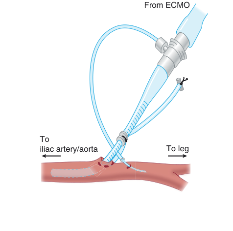

From ECMO To iliac artery/aorta To leg 

**Fig. 81.10 Illustration of a “distal perfusion cannula” in the femoral artery.** The extracorporeal membrane oxygenation (ECMO) arterial cannula is placed in the artery and advanced to the internal iliac artery; the distal perfusion cannula is placed distal to the arterial ECMO cannula, aiming down the leg to provide additional perfusion.

been described. Another possible approach to limit distal limb ischemia is to sew a synthetic graft onto the femoral artery and place the cannula in the graft rather than the vessel itself. This approach is always used for subclavian/ axillary cannulation. In some centers the femoral artery and vein on the same side are cannulated; in others one cannula is placed in each extremity to avoid both reduced arterial perfusion and increased venous obstruction to the same extremity.

The subclavian/axillary artery cannulation for VA ECMO has both advantages and drawbacks when compared to the femoral site. The subclavian artery is rarely affected by atherosclerotic lesions compared to the femoral artery. The presence of a rich collateral flow may reduce the risk of distal extremity ischemia, bacterial contamination is less likely in this anatomic region, and it provides a systemic antegrade perfusion into the distal aortic arch (more proximal than the common iliac). The drawbacks include a potentially challenging surgical dissection in obese patients or in the presence of chest wall edema; the vessel is smaller than the femoral artery, and the limited reports for its use suggest an increased risk of hyperperfusion (rather than hypoperfusion) to the extremity.72 It is not used in acute emergent cannulations (e.g., unstable cardiogenic shock or cardiac arrest) as it is time- consuming. With axillary artery cannulation, the venous cannula is usually placed in the RIJ to obtain the potential benefit of patient mobility.

Direct cardiac and aortic cannulation for VA ECMO is usually used for patients who cannot come off CPB in the operating room, using the CPB cannulas (central ECMO). The short, large- bore venous cannula permits excellent venous drainage. As oxygenated blood is returned to the ascending aorta, there is less concern for upper body hypoxemia. Other circumstances where central VA ECMO may be used include failure to obtain adequate flow from peripheral cannulation due to vessel size or disease, inadequate improvement in oxygenation (usually upper body), or vascular complications from peripheral VA ECMO. Central cannulation may also facilitate mobilization (e.g., out of bed) provided there is chest wall stability (Fig. 81.11).

### CANNULATION FOR VPA ECMO

For right ventricular dysfunction or failure but intact left ventricular function, it would be ideal to avoid peripheral arterial cannulation (i.e., VA ECMO). If the lungs function adequately, a temporary RVAD could be used (e.g., ImpellaRP). If lung assist in addition to right ventricular assist is needed, then two options are (1) VPA ECMO using a graft placed surgically on the pulmonary artery for outflow and either a femoral or RIJ venous cannula, or (2) use of a Protek Duo (Cardiac Assist, Inc., Pittsburgh, PA) dual- lumen cannula similar to the Avalon but designed to have the tip reside in the pulmonary artery rather than the inferior vena cava. This cannula is placed via the RIJ with inflow ports in the right atrium and outflow ports in the pulmonary artery. It can provide both oxygenation and cardiac output for the pulmonary circulation but not require a systemic (arterial) cannula. Although there is less experience with the Protek Duo dual- lumen cannula than with the Avalon, it appears to be promising.73

<!-- PDF page 15 -->

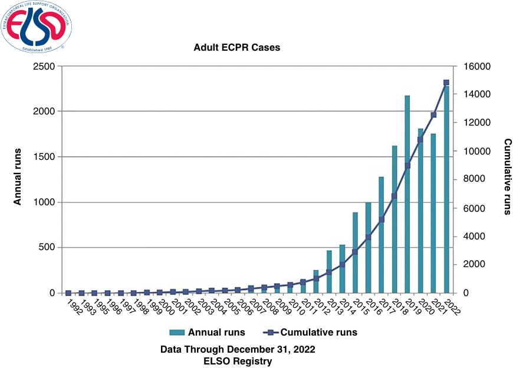

Adult ECPR Cases 2500 16000 14000 2000 12000 10000 1500 8000 1000 6000 4000 500 2000 0 0 Annual runs Cumulative runs Data Through December 31, 2022 ELSO Registry 199219931995199619971998199920002001200220032004200520062007200820092010201120122013201420152016201720182019202020212022 Annual runs Cumulative runs 

**Fig. 81.11** The Extracorporeal Life Support Organization (ELSO) registry remains the primary resource for tracking international ECMO utilization. Adult ECMO use remains high, and extracorporeal cardiopulmonary resuscitation (ECPR) is now more frequently used as an extension of advanced cardiac life support (ACLS). (From ELSO website, www.ELSO.org.)

### ALTERNATIVE CANNULATION STRATEGIES

The cannulation strategy may not be fixed for the duration of the ECMO support; patient physiology or clinical condition and needs may change over time and modifications in ECMO configuration may occasionally be necessary. Conversion from the initial ECMO strategy to a different modality should always be considered if the patient’s perfusion is inadequate, other goals of therapy are not being met, or if complications are arising because of the cannulation strategy (upper extremity hypoxemia with femoral VA ECMO74 or left ventricle distention with VA ECMO).

Conversion from VV to VA or from VA to VV ECMO, or the use of “hybrid” modes, may be desirable or necessary. Patients on VV ECMO can have hemodynamic deterioration (secondary to right, left, or biventricular failure) and require cardiocirculatory support. This can be achieved by the addition of an arterial perfusion cannula to the circuit. This ECMO configuration (also known as venoarterial– venous [V- AV] ECMO) provides circulatory support through an arterial cannula introduced via the femoral or subclavian artery and is referred to as a hybrid approach.75 In situations where femoral VA ECMO does not provide sufficient oxygenated blood to the upper body (harlequin syndrome or north/ south syndrome), an extra outflow cannula can be introduced to the right atrium via the RIJ, directing oxygenated blood into the pulmonary circulation (V- AV ECMO hybrid approach).76 Alternatively, the femoral arterial cannula can be converted to a central (proximal aortic) position, requiring sternotomy or thoracotomy. When there is left ventricular distention with VA ECMO that cannot be overcome with

inotropic drugs, then surgical placement of a left- sided inflow vent (usually in the left atrium or pulmonary vein) or insertion of an Impella may be necessary. Placement of additional cannulae of any kind must be approached with caution and the cannula flow monitored. Bleeding and clotting complications are compounded by use of additional cannulae.

## Monitoring on Extracorporeal Membrane Oxygenation

### PUMP PRESSURES AND FLOWS

Understanding pressures and flows in the circuit is key to the management of an ECMO patient. The Maquet Cardiohelp device has built- in pressure transducers such that it measures the incoming pressure to the pump (the venous pressure), the pressure after the pump but before the oxygenator, and finally the pressure after the oxygenator (the outflow pressure). It also has a flow probe on the outflow cannula and a monitoring probe for air on the inflow cannula. To generate flow, the pump creates a negative pressure on the venous side, and this pressure is displayed on the console. As this pressure becomes more negative, concern arises regarding the patient’s volume status or cannula obstruction or malposition. For the same flow, a smaller cannula will require a greater negative pressure. Greater negative pressures usually precede the phenomenon of venous line “chatter” where flow is intermittently reduced or stopped when the inflow ports are sucked against the venous wall due to inadequate patient volume status.

<!-- PDF page 16 -->

The pressure change across the oxygenator is used to indicate the possibility of obstruction due to accumulation of fibrin or clot. Outflow cannula pressure, also displayed, can be elevated by cannula obstruction or high arterial pressure in the patient. Smaller cannulae require higher pressures to generate flow than larger ones. The Maquet Cardiohelp device also has a sampling port on the outflow cannula (post oxygenator) to allow blood gas analysis in the assessment of membrane function. Declining pO2 or rising carbon dioxide partial pressure (pCO2) indicate a need to change the oxygenator. There is no venous side sampling port for VV ECMO to help diagnosis recirculation. An access point pre- pump is a potential source for air entrainment.

Flow probes can be applied to the branches of outflow cannulae connected to the circuit if these are employed. For example, a probe can be attached to the distal perfusion cannula used in peripheral VA ECMO or to the left ventricular vent in the centrally cannulated patient. A flow that drops abruptly may indicate occlusion of the line possibly from fibrin/thrombus formation.

### INTRAVASCULAR PRESSURES

The arterial catheter offering both continuous blood pressure monitoring and sampling for blood gas analysis is an essential monitor in this patient population. As previously mentioned, all current forms of mechanical circulatory support (except intra- aortic balloon pumps) provide continuous flow. In the patient on VA ECMO, the arterial line provides real- time information regarding the relative contribution of the native heart (pulsatile) versus the ECMO pump (nonpulsatile). Blood pressure cuffs (manual or automatic) are not able to provide this type of continuous monitoring and in the absence of pulsatility may not be able to measure the pressure at all. In the VA ECMO patient, the location of the arterial catheter is also important as mentioned; blood gas samples from left upper extremity catheters may not reflect the blood perfusing the coronaries and the brain, depending on the location of the “mixing cloud.”

A central venous catheter provides access to administer vasoactive and inotropic drugs, and while the presence of a large cannula near or in the right atrium from which the ECMO pump is aspirating blood likely affects the pressure measurement, it can be a useful trend to monitor especially during weaning of flow. Although use of the pulmonary artery catheter in settings other than severe heart failure or cardiac surgery has greatly declined, it provides very useful information in the patient on VA ECMO. A problem with VA ECMO is left ventricular distention due to the afterload stress, so elevated or rising pulmonary artery pressure can be the first indication of this phenomenon, preceding pulmonary edema or even pulmonary hemorrhage. A rising mean pulmonary artery pressure may initiate a discussion regarding treatment with inotropic medications or placement of an Impella and be used to monitor the effectiveness of such treatment. During weaning trials when the ECMO pump flow is progressively reduced, the pulmonary artery catheter provides pressures on both sides of the heart and information about biventricular function.

### TISSUE OXIMETRY

Tissue oximetry has been used for many years in the cardiac operating room to assess the adequacy of cerebral

perfusion. Some ECMO centers are now using this technology to assess both cerebral oxygenation (in the sedated patient) as well as distal extremity perfusion where there is vessel cannulation.77 Tissue oximetry applied to the lower extremities may alert the provider of a mismatch between the cannulated extremity and the one that is not. This information, along with clinical assessment (physical state of the extremity and pulses) and flow probes applied to the circuit, can be used to guide intentional changes in flow or cannula reposition/relocation. Decreasing the cannulated extremity perfusion can sometimes be necessary if there is edema or compartment syndrome.

## Anticoagulation

There is continuous contact between the foreign surfaces of the circuit and the patient’s blood while on ECMO. Foreign surfaces are intrinsically thrombogenic, placing the circuit components at an increased risk for thrombosis and the patient at risk for embolic complications as well as reduced pump effectiveness. Both Maquet and Thoratec (Thoratec Corp., Pleasanton, CA) have tried to address this issue by coating the circuit blood- contacting surfaces with proprietary heparin or heparin–albumin bonding processes. In some instances, it is possible to run ECMO without anticoagulation or low levels of anticoagulation, but this is not well studied.78,79

The membrane oxygenator and distal perfusion tubing used in femoral arterial cannulation are commonly reported sites for clot formation. To prevent thrombosis, the standard practice in North America is to administer antithrombotic therapy to a target below the levels used for CPB. The goal is to maintain the circuit with minimal thrombotic risk to the circuit and minimal hemorrhagic risk to the patient.80 Anticoagulation targets may be altered by the absence of circuit coating, the flow rate (higher target for lower flows), and patient- specific factors such as thrombocytopenia or other coagulation disorders.

Unfractionated heparin (UFH) is the most used anticoagulant for ECMO. Heparin works via antithrombin III (AT3); the heparin–AT3 complex then inhibits thrombin and factor Xa.81 Patients usually receive an initial UFH bolus of 50 to 100 units/kg at the time of cannulation. Dosing of UFH and monitoring anticoagulation status is institution specific. Problems with the use of UFH include its relative unpredictable bioavailability, the necessity for maintaining AT3 levels, and the occurrence of heparin- induced thrombocytopenia with thrombosis (HITT).80,82 If the AT3 concentration in plasma is low, coagulation can occur even when large doses of heparin are given. The level of AT3 should be monitored, especially if there is an increasing need for heparin dose to achieve the desired anticoagulation. A low AT3 level can be treated by giving fresh frozen plasma or recombinant AT3.

## Therapeutic Monitoring of Unfractionated Heparin

The pros and cons of different anticoagulation strategies are shown in Table 81.4.

<!-- PDF page 17 -->

**Table 81.4** Anticoagulation Strategies

|**Drug**|**Pro**|**Absolute/Relative Contraindications**|
|---|---|---|
|No anticoagulation|Avoids anticoagulation in high- risk patients (hemorrhagic CVA, postoperative bleeding, etc.)|High risk for thrombus/embolism/short circuit life span|
|Unfractionated heparin|Most frequently used|HITT|
|Low- molecular- weight heparin|Infrequently used|Very dependent on renal function and patient weight, HITT|
|Argatroban|No concern for HITT|Hepatically cleared|
|Bivalirudin|No concern for HITT, short half- life|Renally cleared|
|Heparin-bonded circuits|Decreases fibrin coating of circuits|HITT|

_CVA,_ cerebrovascular accident; _HITT,_ heparin- induced thrombocytopenia and thrombosis.

### ACTIVATED CLOTTING TIME

The activated clotting time (ACT) remains the most utilized test for ECMO to guide UFH dosage, because it is a pointof- care (POC) whole- blood test that provides immediate results.83 Results of the ACT may be affected by factors other than UFH, including anemia, hypofibrinogenemia, thrombocytopenia and coagulation factor deficiencies, hypothermia, and hemodilution. The UFH infusion is titrated to maintain the ACT at institution- specific levels, usually 1.5 times normal (180–220 s).18

### ACTIVATED PARTIAL THROMBOPLASTIN TIME

The activated partial thromboplastin time (aPTT) is a laboratory standardized test used in adults where moderate doses of UFH are administered, and many adult ECMO programs use the aPTT instead of the ACT. The aPTT appears to reflect heparin anticoagulation more accurately in the critical care setting.84

Although POC devices are available, in most institutions the aPTT test is performed in the hospital laboratory with the attendant delay in obtaining results. Point- of- care devices which measure aPTT are available, but these tests are done on whole blood samples and may not be as reliable as laboratory- based tests. The laboratory aPTT may be affected by factors other than heparin effect such as factor deficiencies or presence of inhibitors. If the patient has a high platelet or white cell count, or is hypercoagulable, a large amount of heparin may be required to maintain the target aPTT. If the patient is thrombocytopenic, in renal failure, or has circulating fibrin split products, a reduced aPTT target may be appropriate.

### ANTI- FACTOR Xa (“HEPARIN LEVEL”)

Some institutions use the anti- factor Xa (anti- Xa) assay as the gold standard test to monitor therapeutic UFH dosing.85 The anti- Xa assay is not a measure of UFH concentration, but rather a measure of UFH effect, based on the ability of the UFH–AT3 complex to inhibit factor Xa.81 In contrast to the ACT and aPTT, the anti- Xa assay is specific to the anticoagulant effect of UFH and is not influenced by coagulopathy, thrombocytopenia, or dilution. Studies in this patient population have shown poor correlation of anti- Xa assay to ACT, suggesting the anti- Xa test to be preferable.86 In addition, the anti- Xa activity is associated with better

accuracy and reproducibility than the aPTT in many clinical settings.87

### HEPARIN- INDUCED THROMBOCYTOPENIA

Heparin- induced thrombocytopenia (HIT or HITT) is a relatively uncommon but severe complication of UFH therapy. Diagnosis may be challenging with patients on ECMO, as thrombocytopenia from various origins (multiorgan dysfunction, sepsis, platelet activation and consumption by the ECMO circuit, bleeding, hemodilution) is common. Two types of HITT are described. Type I is relatively benign, of nonimmune origin, and occurs early without thrombotic complications. It usually spontaneously resolves despite continued treatment with heparin. Type II (HITT) is lifethreatening, of immune origin, and late onset. This syndrome leads to venous and/or arterial thrombosis.88

HITT treatment consists of stopping the UFH infusion and any contact with any form of heparin, avoiding platelet transfusions, and administering an alternative anticoagulant treatment such as one of the direct thrombin inhibitors, argatroban or bivalirudin. Argatroban is hepatically cleared whereas bivalirudin has a component of renal elimination; both drugs must be carefully dose- adjusted and monitored in critically ill patients. The Maquet circuit is always heparin- bonded; it is possible to have non- heparinbonded circuitry using the Thoratec CentriMag system. As the effect of heparin- bonded circuitry on the development or maintenance of HITT is not well understood, if HITT is diagnosed there should be an effort to change to a nonheparin- bonded circuit.89

## Weaning from Extracorporeal Membrane Oxygenation

### WEANING FROM VA ECMO

Weaning from VA ECMO is both an art and a science as every patient is different, and both pulmonary and cardiac weaning may be required. Many of the principles used in the cardiac operating room to separate a patient from CPB apply to the patient on VA ECMO. “Ramp” trials for VA ECMO patients where the ECMO support is reduced in a graded fashion while monitoring blood pressure, filling pressures, oxygenation, and often continuous echocardiography, are part of the management of the ECMO

::: details 原始表格與符號（PDF 第 17 頁）

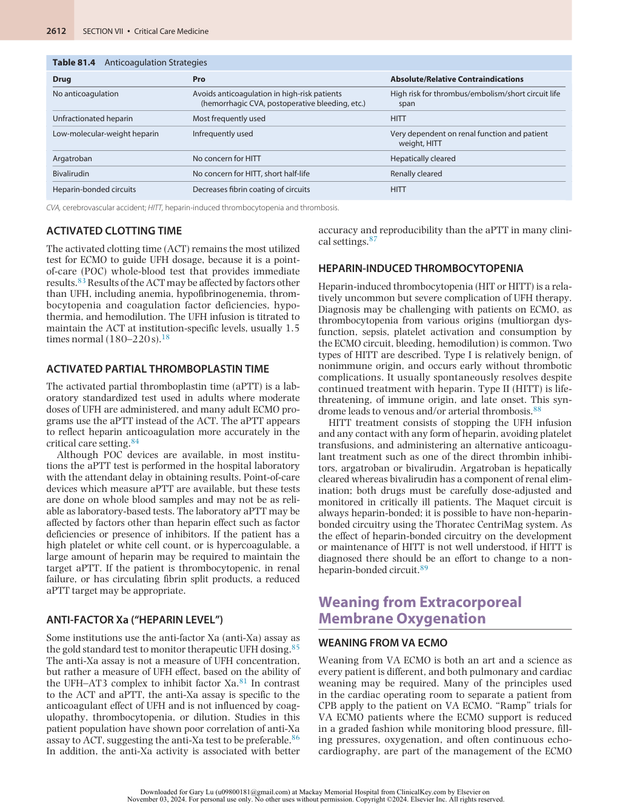

:::

<!-- PDF page 18 -->

patient in the ICU.69 The pulsatility of the arterial waveform and how it is affected when the ECMO flow is reduced is also important. The desired response to a ramp trial is for the patient to maintain stable blood pressure and pulsatility on minimal inotropic and vasopressor support, with no significant increase in filling pressures, and preserved ventricular function by echocardiographic assessment. Another important consideration is resolution of pulmonary congestion or edema before a ramp trial is performed. In general, once the patient is ready for weaning, there will be good pulsatility indicating the native cardiac output is perfusing the ascending aorta and great vessels; the blood gas from the right radial artery will reflect the native lung function. It may be desirable to reduce the FiO2 of the sweep and reduce the sweep itself to confirm that the patient can oxygenate and ventilate adequately with their own lungs. Appropriate anticoagulation is important before the ramp trials; often a small bolus dose of heparin (e.g., 1000 units) is given prior to the trial. A general rule for bedside ramp trials for VA ECMO in the ICU is to not decrease the blood flow below 2 L/min. It is important to keep in mind that other cannulae that may come off the main ECMO circuit will also show a decrease in flow during ramp trials (distal perfusion cannulae or left ventricular vents). Providers should be mindful of this when managing patients with high- risk extremities. Once the ramp trial is successful, patients can then be taken to the operating room for decannulation where they are usually monitored with TEE and a pre- decannulation ramp trial is repeated. In some institutions, decannulation can be performed at the bedside in the ICU with an operating room–like setup for surgical repair of the artery.

Weaning from VPA ECMO is like weaning from VA ECMO but the focus is on the right heart rather than the left heart, and attention to the ability of the patient’s own lungs to adequately perform gas exchange.

### WEANING FROM VV ECMO

VV ECMO ramp trials are often easier to perform as most of the information regarding the ability of the patient’s lungs to oxygenate and ventilate can be obtained without a change in circuit flow. The purpose of the VV ECMO circuit is to perform gas exchange, but unlike VA ECMO the pump function provides no cardiac support. Weaning trials only need to decrease FiO2 of the sweep to reduce oxygenation support or decrease sweep itself to reduce “ventilation” (CO2 removal). Stopping the flow of oxygen/air across the membrane entirely may be performed as a last step prior to decannulation. This is called a “cap” trial whereby a cap is placed over the gas delivery inlet of the membrane valve itself. However, this process may damage the oxygenator, and if the trial is unsuccessful, may lead to a need to replace it. As a general principle, the sweep should not be reduced below 0.8 L/min for anything but a brief (few minutes) time. Venous ECMO cannulae can usually be removed in the ICU without the need for vascular repair.

### WEANING THE PATIENT WITH SEPARATE RVAD, LVAD, AND ECMO

Some patients with biventricular failure and pulmonary edema may have cardiopulmonary support in a

configuration of CentriMag LVAD, a CentriMag RVAD, and an oxygenator connected to the RVAD circuit. This cannulation strategy provides separate biventricular support with the added benefit of an oxygenator in a VV ECMO configuration (i.e., LVAD plus VPA ECMO). It provides the ability to separately assess native lung function, right heart function, and left heart function during ramp trials. The VV ECMO weaning trial can then be performed as described, without a change in LVAD or RVAD blood flow. Reduction in FiO2 of the sweep and in the sweep itself are monitored with arterial blood gases, with the ability to remove the oxygenator but continue with biventricular support. The RVAD and LVAD can then be weaned separately as determined by the patient’s native right- and left- heart function.

## Complications of Extracorporeal Membrane Oxygenation

There are many complications associated with all types of ECMO. These complications have been the subject of recent systematic reviews both for VA ECMO and for VV ECMO and are also described in the annual reports from ELSO. There is less experience with VPA and V- AV ECMO configurations but many of the same issues exist with these more complex circuits. Complications of vascular cannulation, bleeding, or clotting from excessive or inadequate anticoagulation, neurologic injury (i.e., intracerebral bleed) usually related to coagulation management, and infection all occur with a significant incidence. With VA ECMO, most vascular complications are arterial; overall vascular complications with VV ECMO, especially the double- lumen Avalon, are less common. Renal injury occurring prior to initiation of ECMO or during ECMO is associated with a worse outcome.90

Vaquer and associates91 performed a systematic review and meta- analysis, selecting 12 studies from 2000 through 2015, including 1042 patients who underwent VV ECMO for ARDS. The mean hospital mortality in these studies was 38%, with a mean 7% mortality due to complications. They found 40% of patients experienced medical complications, the most common of which was bleeding (29%). Intracerebral bleeding occurred in 5%. The 2016 ELSO report suggests a similar incidence of bleeding, looking at adult ECMO for all respiratory indications. The ELSO report describes an incidence of 10% cannula infections, with Vaquer and associates91 finding an incidence of all infections of 17%. The ELSO report does not indicate the mortality attributable to complications but does give overall mortality of respiratory (VV) ECMO as 38% with 42% hospital mortality.18

For VA ECMO, the majority of which is femoral, the overall incidence of complications related to the ECMO itself is greater than for VV ECMO. This is illustrated in the 2016 ELSO report, and two recent independent reports – one single center and one meta- analysis. In the ELSO report of all adult cardiac ECMO, the overall incidence of bleeding is 42% rather than 32% for VV ECMO. Infectious complications are comparable, but renal failure and hyperbilirubinemia are both greater. In a meta- analysis of 1866 patients who received VA ECMO for cardiac arrest or cardiogenic shock between 2005 and 2012, Cheng and associates53 found an incidence of major bleeding complications of 40% as well as a similar incidence of needing re- thoracotomy if central ECMO was

<!-- PDF page 19 -->

used after cardiotomy. The incidence of significant infection was 30% overall. Most strikingly, the incidence of acute kidney injury was 55%, with 46% needing dialysis. They also found an incidence of lower extremity ischemia of 17%, compartment syndrome requiring fasciotomy of 10%, and amputation of 5%. They did not report mortality attributable to the ECMO. In a single- center report by Kaushal and associates,92 findings associated with hospital mortality included increasing age, the indication for ECMO being cardiac arrest, prolonged ECMO run, need for pre- ECMO dialysis (but not if initiated during ECMO), and limb ischemia.

### PERIPHERAL EXTREMITY ISCHEMIA

Limb ischemia, compartment syndrome requiring fasciotomy, and amputation are significant risks of peripheral cannulation for VA ECMO. Approaches to reducing this complication include careful selection of cannula size, meticulous technique in cannula insertion to prevent vessel injury, and interventions to improve flow to the distal extremity such as placement of a distal perfusion cannula or use of an arterial graft, rather than the vessel itself. Compartment syndrome can be caused by a mismatch in venous outflow to the arterial inflow, which could potentially be avoided by placing the venous and arterial cannulae in different extremities. Attentive monitoring of the cannulated extremity for pulses, edema, pain, tissue tension, and temperature, and early intervention if there are ischemic changes, are essential. Some centers use oximetry sensors to compare cannulated and noncannulated extremities.

Hyperperfusion is a less common complication, usually associated with an arterial graft to either a femoral or axillary artery, which then provides the extremity with excessive perfusion leading to hyperemia, patient discomfort, and potentially, compartment syndrome. Chamogeorgakis and associates72 report that hyperperfusion syndrome occurs in 20% of patients when the axillary artery is used (with the cannula residing in an end- to- side graft to the artery), and 20% of these patients will go on to develop compartment syndrome. This is a reason why the axillary artery is not a vessel of first choice for VA ECMO. We have also seen this in a lower extremity in a small female patient who had an arterial graft due to small artery size, where the venous cannula was in the femoral vein on the same side.

Several reports have addressed the effectiveness of distal perfusion catheters93,94 and arterial grafts rather than vessel cannulation95,96 ; while these approaches reduce ischemic complications, they do not eliminate them. Vigilance on the part of the care team and early intervention to change cannulation strategy are essential to prevent limb loss.

team, even when the cannulation is performed by a surgeon. ECMO management in the ICU can involve cardiologists for patients needing cardiac support, pulmonary physicians for those needing only respiratory support, or critical care physicians of all backgrounds in all patients on ECMO. A critical care anesthesiologist who is also cardiac anesthesia trained is an ideal participant in the management of these patients as many aspects of ECMO are related to CPB. In some institutions, nonsurgical members of the critical care team may be involved in the cannulation and initiation of ECMO as well as its ongoing management. The concept of an ECMO team has been described by two of the authors of this chapter, suggesting that outcomes of ECMO can be significantly improved with the strong engagement of cardiac and critical care anesthesiologists.97 This may be particularly important in “ECMO to go” where a team from the ECMO center travels to an outside hospital to initiate and then manage ECMO as well as other life- support modalities during transfer. The European experience indicates a stronger role for anesthesiologists in this process than in the United States.98 Management of patients needing what is essentially a surgical intervention for urgent cardiorespiratory support is very much part of the practice of cardiothoracic anesthesiology, as is the invaluable intraoperative guidance provided by TEE to monitor cardiac function and advancement and correct cannulae positioning.99 Similarly, during decannulation from cardiac ECMO, echocardiographic evaluation of the heart is essential during and after support has been removed.

### Acknowledgment

The editors and publisher would like to thank Dr. James Ramsay for contributing a chapter on this topic in the prior edition of this work. It has served as the foundation for the current chapter.

**Complete references available online at expertconsult.com.**

### References

1.  Nazarnia S, Subramaniam K. _J Cardiothorac Vasc Anesth_ . 2017; 31(4):1505.

2.  Ju Z, et al. _Exp Ther Med_ . 2018;15(2):1950.

3.  Vasanthan V, et al. _Can J Cardiol_ . 2017;33(7):950.e11.

4.  Kirklin JW, et al. _Ann Surg_ . 1956;144(1):2.

5.  Warden HE, et al. _J Thorac Surg_ . 1955;30(6):649.

6.  Iwahashi HK, et al. _J Artif Organs_ . 2004;7(3):111.

7.  Hill JD, et al. _N Engl J Med_ . 1972;286(12):629.

8.  Bartlett RH. _ASAIO J_ . 2017;63(6):832.

9.  Bartlett RH, et al. _Pediatrics_ . 1985;76(4):479.

10.  UK Collaborative ECMO Trial Group. _Lancet_ . 1996;348(9020):75.

11.  Green TP, et al. _Crit Care Med_ . 1996;24(2):323.

12.  Zapol WM, et al. _JAMA_ . 1979;242(20):2193.

13.  Peek GJ, et al. _Lancet_ . 2009;374(9698):1351.

14.  Davies A, et al. _JAMA_ . 2009;302(17):1888.

15.  Combes A, et al. _N Engl J Med_ . 2018;378(21):1965.

16.  Mi MY, et al. _N Engl J Med_ . 2018;379(9):884.

## The Anesthesiologist’s Role in Extracorporeal Membrane Oxygenation

In many institutions, all ECMO cannulation, management, and decannulation is led by cardiac or thoracic surgeons. In others, respiratory ECMO is managed by a medical ICU

17.  Bartlett RH. _Crit Care Med_ . 2019;47(1):114.

18. _ELSO_ . 2018. https://www.elso.org/.

19. _ELSO_ . 2022. https://www.elso.org/COVID19.aspx.

20. _European ELSO_ . 2022. https://www.euroelso.net/covid- 19/covid19- survey/.

21.  Ramanathan K, et al. _Crit Care_ . 2021;25:211.

22.  Murray JF, et al. _Am Rev Respir Dis_ . 1988;138(3):720.

23.  Ranieri VM, et al. _JAMA_ . 2012;307(23):2526.

24.  Combes A, et al. _Curr Opin Crit Care_ . 2017;23(1):60.

25.  Mason DP, et al. _J Thorac Cardiovasc Surg_ . 2010;139(3):765.

<!-- PDF page 20 -->

26.  Salam S, et al. _ASAIO J_ . 2017;63(5):e66.

27.  Tsiouris A, et al. _ASAIO J_ . 2018;64(5):689.

28.  Raleigh L, et al. _Semin CardioThorac Vasc Anesth_ . 2015;19(4):342.

29.  Loor G, et al. _J Thorac Dis_ . 2017;9(9):3352.

30.  Machuca TN, et al. _J Thorac Cardiovasc Surg_ . 2015;149(4):1152.

31.  Hoetzenecker K, et al. _J Thorac Cardiovasc Surg_ . 2018;155(5):2193.

32. _WHO COVID- 19 Dashboard_ . 2022. https://covid19.who.int/.

33.  Berlin DA, et al. _N Engl J Med_ . 2020;383:2451.

34.  Wu Z, McGoogan JM. _JAMA_ . 2020;323:1239.

35.  Dalia AA, et al. _J Cardiothorac Vasc Anesth_ . 2022;36:3668.

36.  Gattinoni L, et al. _Intensive Care Med_ . 2020;46:1099.

37.  Badulak J, et al. _ASAIO J_ . 2021;67:485.

38.  Clerkin KJ, et al. _Circulation_ . 2020;141:1648.

39.  Henry BM, Lippi G. _J Crit Care_ . 2020;58:27.

40.  Barbaro RP, et al. _Lancet_ . 2020;396:1071.

41.  Crowley J, et al. _Crit Care Med_ . 2020;48:e985.

42.  Osho AA, et al. _Ann Surg_ . 2020;272:e75.

43.  Takeda S. _Acute Med Surg_ . 2020;7:e510.

44.  Ogura T. _Membranes_ . 2021:11.

45.  Ohshimo S, et al. _Crit Care_ . 2022;26:354.

46.  Mazzeffi MA, et al. _Anesth Analg_ . 2022;135:719.

47.  Thiagarajan RR, et al. _ASAIO J_ . 2017;63(1):60.

48.  Gilotra NA, Stevens GR. _Clin Med Insights Cardiol_ . 2014;8(suppl 1):75.

49.  Touchan J, Guglin M. _Curr Treat Options Cardiovasc Med_ . 2017;19(10):77.

50.  Khorsandi M, et al. _J Cardiothorac Surg_ . 2017;12(1):55.

51.  Wang L, et al. _J Cardiothorac Vasc Anesth_ . 2018;32(5):2087.

52.  den Uil CA, et al. _Eur J Cardio Thorac Surg_ . 2017;52(1):14.

53.  Cheng R, et al. _J Card Fail_ . 2014;20(6):400.

54.  Debaty G, et al. _Resuscitation_ . 2017;112:1.

55.  Holmberg MJ, et al. _Resuscitation_ . 2018;131:91.

56.  Schmidt M, et al. _Am J Respir Crit Care Med_ . 2014;189(11):1374.

57.  Abrams D, et al. _Intensive Care Med_ . 2018;44(6):717.

58.  Brodie D, et al. _Lancet Respir Med_ . 2017;5(10):769.

59.  Haft JW, Firmin R. In: Annich GM, et al., eds. _ECMO. Extracorporeal Cardiopulmonary Support in Critical Care_ . 4th ed. Extracorporeal Life Support Organization; 2012:323.

60.  Patel SR, Jorde UP. _Curr Opin Cardiol_ . 2016;31(3):329.

61.  Slaughter MS. _J Cardiovasc Transl Res_ . 2010;3(6):618.

62.  O’Brien C, et al. _J Pediatr Surg_ . 2017;52(6):975.

63.  Xie A, et al. _J Crit Care_ . 2016;36:107.

64.  Pierrakos C, et al. _J Crit Care_ . 2017;37:60.

65.  Fuhrman BP, et al. _Artif Organs_ . 1999;23(11):966.

66.  Brasseur A, et al. _J Thorac Dis_ . 2018;10(suppl 5):S707.

67.  Bartlett RH. In: Annich GM, et al., eds. _ECMO. Extracorporeal Cardiopulmonary Support in Critical Care_ . 4th ed. Extracorporeal Life Support Organization; 2012:149.

68.  Cakici M, et al. _Interact Cardiovasc Thorac Surg_ . 2018;26(1):112.

69.  Reynolds HR, Hochman JS. _Circulation_ . 2008;117(5):686.

70.  Seto AH, et al. _JACC Cardiovasc Interv_ . 2010;3(7):751.

71.  Schmidt GA, et al. _Intensive Care Med_ . 2019;45(4):434.

72.  Chamogeorgakis T, et al. _J Thorac Cardiovasc Surg_ . 2013;145(4):1088.

73.  Ravichandran AK, et al. _ASAIO J_ . 2018;64(4):570.

74.  Biscotti M, et al. _ASAIO J_ . 2014;60(6):635.

75.  Ius F, et al. _Interact Cardiovasc Thorac Surg_ . 2015;20(6):761.

76.  Werner NL, et al. _ASAIO J_ . 2016;62(5):578.

77.  Steffen RJ, et al. _Ann Thorac Surg_ . 2014;98(5):1853.

78.  Galvagno SM, et al. _Perfusion_ . 2019;34(6):523.

79.  Raman J, et al. _J Heart Lung Transplant_ . 2019;38(4):433.

80.  Kawahito K, Nose Y. _Artif Organs_ . 1997;21(4):323.

81.  Hirsh J, et al. _Chest_ . 2001;119(suppl 1):64s.

82.  Annich GM. _J Thromb Haemost_ . 2015;13(suppl 1):S336.

83.  Horton S, Augustin S. _Methods Mol Biol_ . 2013;992:155.

84.  De Waele JJ, et al. _Intensive Care Med_ . 2003;29(2):325.

85.  Becker RC. _J Thromb Thrombolysis_ . 2005;20(1):65.

86.  Delmas C, et al. _J Intensive Care Med_ . 2020;35(7):679.

87.  Burki S, et al. _BMJ Open_ . 2018;8(6):e022943.

88.  Koster A, et al. _Ann Thorac Surg_ . 2007;83(1):72.

89.  Natt B, et al. _J Extra Corpor Technol_ . 2017;49(1):54.

90.  Kilburn DJ, et al. _BioMed Res Int_ . 2016;2016:1094296.

91.  Vaquer S, et al. _Ann Intensive Care_ . 2017;7(1):51.

92.  Kaushal M, et al. _J Cardiothorac Vasc Anesth_ . 2019;33(4):910.

93.  Ranney DN, et al. _ASAIO J_ . 2018;64(3):328.

94.  Lamb KM, et al. _J Vasc Surg_ . 2017;65(4):1074.

95.  Calderon D, et al. _Tex Heart Inst J_ . 2015;42(6):537.

96.  Jackson KW, et al. _Ann Thorac Surg_ . 2012;94(5):e111.

97.  Dalia AA, et al. _J Cardiothorac Vasc Anesth_ . 2019;33(4):902.

98.  Nwozuzu A, et al. _J Cardiothorac Vasc Anesth_ . 2016;30(6):1441.

99.  Combes A, et al. _Am J Respir Crit Care Med_ . 2014;190(5):488.

<!-- PDF page 21 -->

### References

1.  Nazarnia S, Subramaniam K. Pro: veno- arterial Extracorporeal Membrane Oxygenation (ECMO) should be used routinely for bilateral lung transplantation. _J Cardiothorac Vasc Anesth_ . 2017;31(4):1505– 1508.

2.  Ju Z, et al. Effects of pumpless extracorporeal lung assist on hemodynamics, gas exchange and inflammatory cascade response during experimental lung injury. _Exp Ther Med_ . 2018;15(2):1950–1958.

3.  Vasanthan V, et al. Extended bridge to heart and lung transplantation using pumpless extracorporeal lung assist. _Can J Cardiol_ . 2017;33(7):950.e11–950.e13.

4.  Kirklin JW, et al. Studies in extracorporeal circulation. I. Applicability of Gibbon- type pump- oxygenator to human intracardiac surgery: 40 cases. _Ann Surg_ . 1956;144(1):2–8.

5.  Warden HE, et al. Direct vision intracardiac surgery by means of a reservoir of “arterialized venous” blood; description of a simple method and report of the first clinical case. _J Thorac Surg_ . 1955;30(6):649– 656; discussion 656–657.

6.  Iwahashi H, Yuri K, Nose Y. Development of the oxygenator: past, present, and future. _J Artif Organs_ . 2004;7(3):111–120.

7.  Hill JD, et al. Prolonged extracorporeal oxygenation for acute posttraumatic respiratory failure (shock- lung syndrome). Use of the Bramson membrane lung. _N Engl J Med_ . 1972;286(12):629–634.

8.  Bartlett RH. Esperanza: the first neonatal ECMO patient. _ASAIO J_ . 2017;63(6):832–843.

9.  Bartlett RH, et al. Extracorporeal circulation in neonatal respiratory failure: a prospective randomized study. _Pediatrics_ . 1985;76(4):479– 487.

10.  UK Collaborative ECMO Trial Group. UK collaborative randomised trial of neonatal extracorporeal membrane oxygenation. UK Collaborative ECMO Trial Group. _Lancet_ . 1996;348(9020):75–82.

11.  Green TP, et al. The impact of extracorporeal membrane oxygenation on survival in pediatric patients with acute respiratory failure. Pediatric Critical Care Study Group. _Crit Care Med_ . 1996;24(2):323–329.

12.  Zapol WM, et al. Extracorporeal membrane oxygenation in severe acute respiratory failure. A randomized prospective study. _JAMA_ . 1979;242(20):2193–2196.

13.  Peek GJ, et al. Efficacy and economic assessment of conventional ventilatory support versus extracorporeal membrane oxygenation for severe adult respiratory failure (CESAR): a multicentre randomised controlled trial. _Lancet_ . 2009;374(9698):1351–1363.

14.  Davies A, et al. Extracorporeal membrane oxygenation for 2009 influenza A(H1N1) acute respiratory distress syndrome. _JAMA_ . 2009;302(17):1888–1895.

15.  Combes A, et al. Extracorporeal membrane oxygenation for severe acute respiratory distress syndrome. _N Engl J Med_ . 2018;378(21):1965–1975.

16.  Mi MY, Matthay MA, Morris AH. Extracorporeal membrane oxygenation for severe acute respiratory distress syndrome. _N Engl J Med_ . 2018;379(9):884–887.

17.  Bartlett RH. Extracorporeal membrane oxygenation for acute respiratory distress syndrome: EOLIA and beyond. _Crit Care Med_ . 2019;47(1):114–117.

18. _ELSO_ . 2018. https://www.elso.org/.

19. _ELSO_ . 2022. https://www.elso.org/COVID19.aspx.

20. _European ELSO_ . 2022. https://www.euroelso.net/covid- 19/covid19- survey/.

21.  Ramanathan K, Shekar K, Ling RR, et al. Extracorporeal membrane oxygenation for COVID- 19: a systematic review and meta- analysis. _Crit Care_ . 2021;25:211.

22.  Murray JF, et al. An expanded definition of the adult respiratory distress syndrome. _Am Rev Respir Dis_ . 1988;138(3):720–723.

23.  Ranieri VM, et al. Acute respiratory distress syndrome: the Berlin definition. _JAMA_ . 2012;307(23):2526–2533.

24.  Combes A, et al. Extracorporeal membrane oxygenation: beyond rescue therapy for acute respiratory distress syndrome? _Curr Opin Crit Care_ . 2017;23(1):60–65.

25.  Mason DP, et al. Should lung transplantation be performed for patients on mechanical respiratory support? the US experience. _J Thorac Cardiovasc Surg_ . 2010;139(3):765–773.e1.

26.  Salam S, et al. Lung transplantation after 125 days on ECMO for severe refractory hypoxemia with no prior lung disease. _ASAIO J_ . 2017;63(5):e66–e68.

27.  Tsiouris A, Budev MM, Yun JJ. Extracorporeal membrane oxygenation as a bridge to lung transplantation in the United States: a multicenter survey. _ASAIO J_ . 2018;64(5):689–693.

28.  Raleigh L, Ha R, Hill C. Extracorporeal membrane oxygenation applications in cardiac critical care. _Semin CardioThorac Vasc Anesth_ . 2015;19(4):342–352.

29.  Loor G, Simpson L, Parulekar A. Bridging to lung transplantation with extracorporeal circulatory support: when or when not? _J Thorac Dis_ . 2017;9(9):3352–3361.

30.  Machuca TN, et al. Outcomes of intraoperative extracorporeal membrane oxygenation versus cardiopulmonary bypass for lung transplantation. _J Thorac Cardiovasc Surg_ . 2015;149(4):1152– 1157.

31.  Hoetzenecker K, et al. Intraoperative extracorporeal membrane oxygenation and the possibility of postoperative prolongation improve survival in bilateral lung transplantation. _J Thorac Cardiovasc Surg_ . 2018;155(5):2193–2206.e3.

32. _WHO COVID- 19 Dashboard_ . 2022. https://covid19.who.int/.

33.  Berlin DA, Gulick RM, Martinez FJ. Severe Covid- 19. _N Engl J Med_ . 2020;383:2451–2460.

34.  Wu Z, McGoogan JM. Characteristics of and important lessons from the coronavirus disease 2019 (COVID- 19) outbreak in China: summary of a report of 72 314 cases from the Chinese Center for Disease Control and Prevention. _JAMA_ . 2020;323:1239–1242.

35.  Dalia AA, Convissar D, Crowley J, et al. The role of extracorporeal membrane oxygenation in COVID- 19. _J Cardiothorac Vasc Anesth_ . 2022;36:3668–3675.

36.  Gattinoni L, Chiumello D, Caironi P, et al. COVID- 19 pneumonia: different respiratory treatments for different phenotypes? _Intensive Care Med_ . 2020;46:1099–1102.

37.  Badulak J, Antonini MV, Stead CM, et al. Extracorporeal membrane oxygenation for COVID- 19: updated 2021 guidelines from the extracorporeal life support organization. _ASAIO J_ . 2021;67:485–495.

38.  Clerkin KJ, Fried JA, Raikhelkar J, et al. COVID- 19 and cardiovascular disease. _Circulation_ . 2020;141:1648–1655.

39.  Henry BM, Lippi G. Poor survival with extracorporeal membrane oxygenation in acute respiratory distress syndrome (ARDS) due to coronavirus disease 2019 (COVID- 19): pooled analysis of early reports. _J Crit Care_ . 2020;58:27–28.

40.  Barbaro RP, MacLaren G, Boonstra PS, et al. Extracorporeal membrane oxygenation support in COVID- 19: an international cohort study of the Extracorporeal Life Support Organization registry. _Lancet_ . 2020;396:1071–1078.

41.  Crowley J, Raz Y, Funamoto M, Shelton KT. Adult extracorporeal membrane oxygenation patient selection during coronavirus disease 2019: the value of a review panel during coronavirus disease 2019. _Crit Care Med_ . 2020;48:e985–e986.

42.  Osho AA, Moonsamy P, Hibbert KA, et al. Veno- venous extracorporeal membrane oxygenation for respiratory failure in COVID- 19 patients: early experience from a major academic medical center in North America. _Ann Surg_ . 2020;272:e75–e78.

43.  Takeda S. Nationwide system to centralize decisions around extracorporeal membranous oxygenation use for severe COVID- 19 pneumonia in Japan. _Acute Med Surg_ . 2020;7:e510.

44.  Ogura T, Ohshimo S, Liu K, et al. Establishment of a disaster management- like system for COVID- 19 patients requiring venovenous extracorporeal membrane oxygenation in Japan. _Membranes_ . 2021;11.

45.  Ohshimo S, Liu K, Ogura T, et al. Trends in survival during the pandemic in patients with critical COVID- 19 receiving mechanical ventilation with or without ECMO: analysis of the Japanese national registry data. _Crit Care_ . 2022;26:354.

46.  Mazzeffi MA, Krajewski M, Shelton K, et al. Measuring and reporting quality for adult extracorporeal membrane oxygenation centers: is it possible and is it time? _Anesth Analg_ . 2022;135:719–724.

47.  Thiagarajan RR, et al. Extracorporeal Life Support Organization registry international report 2016. _ASAIO J_ . 2017;63(1):60–67.

48.  Gilotra NA, Stevens GR. Temporary mechanical circulatory support: a review of the options, indications, and outcomes. _Clin Med Insights Cardiol_ . 2014;8(suppl 1):75–85.

49.  Touchan J, Guglin M. Temporary mechanical circulatory support for cardiogenic shock. _Curr Treat Options Cardiovasc Med_ . 2017;19(10):77.

<!-- PDF page 22 -->

50.  Khorsandi M, et al. Extra- corporeal membrane oxygenation for refractory cardiogenic shock after adult cardiac surgery: a systematic review and meta- analysis. _J Cardiothorac Surg_ . 2017;12(1):55.

51.  Wang L, Wang H, Hou X. Clinical outcomes of adult patients who receive extracorporeal membrane oxygenation for postcardiotomy cardiogenic shock: a systematic review and meta- analysis. _J Cardiothorac Vasc Anesth_ . 2018;32(5):2087–2093.

52.  den Uil CA, et al. Short- term mechanical circulatory support as a bridge to durable left ventricular assist device implantation in refractory cardiogenic shock: a systematic review and meta- analysis. _Eur J Cardio Thorac Surg_ . 2017;52(1):14–25.

53.  Cheng R, et al. Clinical outcomes in fulminant myocarditis requiring extracorporeal membrane oxygenation: a weighted meta- analysis of 170 patients. _J Card Fail_ . 2014;20(6):400–406.

54.  Debaty G, et al. Prognostic factors for extracorporeal cardiopulmonary resuscitation recipients following out- of- hospital refractory cardiac arrest. A systematic review and meta- analysis. _Resuscitation_ . 2017;112:1–10.

55.  Holmberg MJ, et al. Extracorporeal cardiopulmonary resuscitation for cardiac arrest: a systematic review. _Resuscitation_ . 2018;131:91–100.

56.  Schmidt M, et al. Predicting survival after extracorporeal membrane oxygenation for severe acute respiratory failure. The Respiratory Extracorporeal Membrane Oxygenation Survival Prediction (RESP) score. _Am J Respir Crit Care Med_ . 2014;189(11):1374–1382.

57.  Abrams D, et al. Position paper for the organization of ECMO programs for cardiac failure in adults. _Intensive Care Med_ . 2018;44(6):717–729.

58.  Brodie D, et al. Treatment limitations in the era of ECMO. _Lancet Respir Med_ . 2017;5(10):769–770.

59.  Haft JW, Firmin R. Adult cardiac support. In: Annich GM, Lynch WR, MacLaren G, et al., eds. _ECMO. Extracorporeal Cardiopulmonary Support in Critical Care_ . 4th ed. Ann Arbor, MI: Extracorporeal Life Support Organization; 2012:323–330.

60.  Patel SR, Jorde UP. Creating adequate pulsatility with a continuous flow left ventricular assist device: just do it. _Curr Opin Cardiol_ . 2016;31(3):329–336.

61.  Slaughter MS. Hematologic effects of continuous flow left ventricular assist devices. _J Cardiovasc Transl Res_ . 2010;3(6):618–624.

62.  O’Brien C, et al. Centrifugal pumps and hemolysis in pediatric extracorporeal membrane oxygenation (ECMO) patients: an analysis of Extracorporeal Life Support Organization (ELSO) registry data. _J Pediatr Surg_ . 2017;52(6):975–978.

63.  Xie A, Yan TD, Forrest P. Recirculation in venovenous extracorporeal membrane oxygenation. _J Crit Care_ . 2016;36:107–110.

64.  Pierrakos C, et al. Injection of agitated saline to detect recirculation with transthoracic echocardiography during venovenous extracorporeal oxygenation: a pilot study. _J Crit Care_ . 2017;37:60–64.

65.  Fuhrman BP, et al. Pathophysiology of cardiac extracorporeal membrane oxygenation. _Artif Organs_ . 1999;23(11):966–969.

66.  Brasseur A, et al. Hybrid extracorporeal membrane oxygenation. _J Thorac Dis_ . 2018;10(suppl 5):S707–S715.

67.  Bartlett RH. Management of blood flow and gas exchange during ECLS. In: Annich GM, Lynch WR, MacLaren G, et al., eds. _ECMO. Extracorporeal Cardiopulmonary Support in Critical Care_ . 4th ed. Ann Arbor, MI: Extracorporeal Life Support Organization; 2012:149–156.

68.  Cakici M, et al. Controlled flow diversion in hybrid venoarterialvenous extracorporeal membrane oxygenation. _Interact Cardiovasc Thorac Surg_ . 2018;26(1):112–118.

69.  Reynolds HR, Hochman JS. Cardiogenic shock: current concepts and improving outcomes. _Circulation_ . 2008;117(5):686–697.

70.  Seto AH, et al. Real- time ultrasound guidance facilitates femoral arterial access and reduces vascular complications: FAUST (Femoral Arterial Access with Ultrasound Trial). _JACC Cardiovasc Interv_ . 2010;3(7):751–758.

71.  Schmidt GA, et al. Ultrasound- guided vascular access in critical illness. _Intensive Care Med_ . 2019;45(4):434–446.

72.  Chamogeorgakis T, et al. Outcomes of axillary artery side graft cannulation for extracorporeal membrane oxygenation. _J Thorac Cardiovasc Surg_ . 2013;145(4):1088–1092.

73.  Ravichandran AK, et al. Outcomes with the Tandem Protek duo dual- lumen percutaneous right ventricular assist device. _ASAIO J_ . 2018;64(4):570–572.

74.  Biscotti M, et al. Hybrid configurations via percutaneous access for extracorporeal membrane oxygenation: a single- center experience. _ASAIO J_ . 2014;60(6):635–642.

75.  Ius F, et al. Veno- veno- arterial extracorporeal membrane oxygenation for respiratory failure with severe haemodynamic impairment:

technique and early outcomes. _Interact Cardiovasc Thorac Surg_ . 2015;20(6):761–767.

76.  Werner NL, et al. The University of Michigan experience with venovenoarterial hybrid mode of extracorporeal membrane oxygenation. _ASAIO J_ . 2016;62(5):578–583.

77.  Steffen RJ, et al. Using near- infrared spectroscopy to monitor lower extremities in patients on venoarterial extracorporeal membrane oxygenation. _Ann Thorac Surg_ . 2014;98(5):1853–1854.

78.  Galvagno SM, et al. Long term veno- venous extracorporeal life support without intravenous anticoagulation for diffuse alveolar hemorrhage. _Perfusion_ . 2019;34(6):523–525.

79.  Raman J, et al. A comparison of low and standard anti- coagulation regimens in extracorporeal membrane oxygenation. _J Heart Lung Transplant_ . 2019;38(4):433–439.

80.  Kawahito K, Nose Y. Hemolysis in different centrifugal pumps. _Artif Organs_ . 1997;21(4):323–326.

81.  Hirsh J, et al. Heparin and low- molecular- weight heparin: mechanisms of action, pharmacokinetics, dosing, monitoring, efficacy, and safety. _Chest_ . 2001;119(suppl 1):64s–94s.

82.  Annich GM. Extracorporeal life support: the precarious balance of hemostasis. _J Thromb Haemost_ . 2015;13(suppl 1):S336–S342.

83.  Horton S, Augustin S. Activated clotting time (ACT). _Methods Mol Biol_ . 2013;992:155–167.

84.  De Waele JJ, et al. The use of the activated clotting time for monitoring heparin therapy in critically ill patients. _Intensive Care Med_ . 2003;29(2):325–328.

85.  Becker RC. Cell- based models of coagulation: a paradigm in evolution. _J Thromb Thrombolysis_ . 2005;20(1):65–68.

86.  Delmas C, et al. Anticoagulation monitoring under ECMO support: a comparative study between the activated coagulation time and the anti- Xa activity assay. _J Intensive Care Med_ . 2020;35(7):679–686.

87.  Burki S, et al. Accuracy, reproducibility and costs of different laboratory assays for the monitoring of unfractionated heparin in clinical practice: a prospective evaluation study and survey among Swiss institutions. _BMJ Open_ . 2018;8(6):e022943.

88.  Koster A, et al. Impact of heparin- induced thrombocytopenia on outcome in patients with ventricular assist device support: singleinstitution experience in 358 consecutive patients. _Ann Thorac Surg_ . 2007;83(1):72–76.

89.  Natt B, et al. Suspected heparin- induced thrombocytopenia in patients receiving extracorporeal membrane oxygenation. _J Extra Corpor Technol_ . 2017;49(1):54–58.

90.  Kilburn DJ, Shekar K, Fraser JF. The complex relationship of extracorporeal membrane oxygenation and acute kidney injury: causation or association? _BioMed Res Int_ . 2016;2016:1094296.

91.  Vaquer S, et al. Systematic review and meta- analysis of complications and mortality of veno- venous extracorporeal membrane oxygenation for refractory acute respiratory distress syndrome. _Ann Intensive Care_ . 2017;7(1):51.

92.  Kaushal M, et al. Patient demographics and extracorporeal membranous oxygenation (ECMO)- related complications associated with survival to discharge or 30- day survival in adult patients receiving venoarterial (VA) and venovenous (VV) ECMO in a quaternary care urban center. _J Cardiothorac Vasc Anesth_ . 2019;33(4):910–917.

93.  Ranney DN, et al. Vascular complications and use of a distal perfusion cannula in femorally cannulated patients on extracorporeal membrane oxygenation. _ASAIO J_ . 2018;64(3):328–333.

94.  Lamb KM, et al. Arterial protocol including prophylactic distal perfusion catheter decreases limb ischemia complications in patients undergoing extracorporeal membrane oxygenation. _J Vasc Surg_ . 2017;65(4):1074–1079.

95.  Calderon D, et al. Modified T- graft for extracorporeal membrane oxygenation in a patient with small- caliber femoral arteries. _Tex Heart Inst J_ . 2015;42(6):537–539.

96.  Jackson KW, et al. Side- arm grafts for femoral extracorporeal membrane oxygenation cannulation. _Ann Thorac Surg_ . 2012;94(5):e111– e112.

97.  Dalia AA, et al. Extracorporeal membrane oxygenation is a team sport: institutional survival benefits of a formalized ECMO team. _J Cardiothorac Vasc Anesth_ . 2019;33(4):902–907.

98.  Nwozuzu A, Fontes ML, Schonberger RB. Mobile extracorporeal membrane oxygenation teams: the North American versus the European experience. _J Cardiothorac Vasc Anesth_ . 2016;30(6):1441–1448.

99.  Combes A, et al. Position paper for the organization of extracorporeal membrane oxygenation programs for acute respiratory failure in adult patients. _Am J Respir Crit Care Med_ . 2014;190(5):488–496.
