# Cardiopulmonary Resuscitation and Advanced Cardiac Life Support

<!-- PDF page 1 -->

ADAM A. DALIA, AVINASH B. KUMAR, and STEN RUBERTSSON

### KEY POINTS

- Cardiac arrest is a major public health issue worldwide. Despite significant advances in resuscitation science, survival rates remain considerably low. Improvement of patient survival and neurologic outcome relies on the development and implementation of vigorous and evidence- based resuscitation guidelines involving basic life support (BLS), advanced cardiovascular life support, and post–cardiac arrest care.

- In cardiac arrests without hypoxic causes, oxygen content in the lungs at the time of cardiac arrest is usually sufficient for maintaining acceptable arterial oxygen content during the first several minutes of cardiopulmonary resuscitation (CPR). Blood flow rather than arterial oxygen content is the limiting factor for oxygen delivery to coronary, cerebral, and systemic circulation during CPR. Thus, rescue breaths are less important than initiating effective chest compressions as soon as possible after sudden cardiac arrest (SCA).

- The mechanism through which chest compressions generate blood flow can be explained by the thoracic or cardiac pump theories. The provision of uninterrupted, high- quality chest compressions after SCA is associated with better survival and neurologic outcomes than delaying chest compressions for airway intervention in both adult and pediatric patients. “Circulation, airway, breathing” has replaced “airway, breathing, circulation.”

- A single resuscitative shock should be delivered at the earliest possible opportunity after the recognition of cardiac arrest with a shockable rhythm (ventricular fibrillation or pulseless ventricular tachycardia), followed immediately by the resumption of chest compressions without post- shock cardiac rhythm analysis. Outcome studies have failed to demonstrate the benefit of a period of chest compressions before shock or for a series of stacked shocks.

- Vasopressor medications during resuscitation have been de- emphasized in deference to providing uninterrupted, high- quality chest compressions. Standard- dose epinephrine (1 mg every 3–5 minutes) is recommended for patients in cardiac arrest. Vasopressin offers no advantage as a substitute for epinephrine in cardiac arrest and has been removed from the adult cardiac arrest algorithm.

- Continuous flow left ventricular assist devices result in an unconventional, unique physiologic state of hemodynamically stable pulseless electric activity. Assessment of adequate tissue perfusion is the most important factor in determining the need for circulatory assistance such as chest compressions. Total artificial hearts (TAHs) are refractory to chest compressions, antiarrhythmic drugs, and electric therapy. Vasopressor medications are contraindicated because they increase afterload, result in complete hemodynamic collapse with pulmonary edema, and worsen TAH function.

- In consideration of opioid overdose epidemiology, patients with known or suspected opioid ingestion who are in cardiac or respiratory arrest should receive intravenous, intramuscular, or intranasal naloxone in addition to standard BLS care.

- For non- shockable rhythms, the essential step will be early detection and correction of potentially reversible underlying causes. Ultrasound technology is used to assess the etiology and the management of these patients, as well as to predict the possibility of return of spontaneous circulation (ROSC) and to justify the termination of resuscitative efforts. However, utilization of this technique should not interfere with other resuscitation efforts such as chest compressions.

- Asphyxiation is a much more common cause of cardiac arrest in infants and children than primary cardiac events, and airway management and ventilation are therefore more important during the resuscitation of children. However, in order to facilitate training, retention, and implementation of resuscitation guidelines, the pediatric resuscitation guidelines follow similar principles as adult guidelines.

<!-- PDF page 2 -->

- Targeted temperature management (TTM) applied to comatose survivors of out- of- hospital cardiac arrests has significantly improved the neurologic recovery in those surviving to hospital discharge. A target temperature between 32°C and 36°C is recommended for at least 24 hours, and normothermia (to treat fever) should be maintained beyond this window. Prognostication should not occur until 72 hours after ROSC or, if TTM is provided, 72 hours after completion of TTM.

- Most deaths after SCA in both adults and children typically occur within the first 24 hours. Coordinated postresuscitation care involving access to coronary catheterization capabilities and intensive care management that includes TTM represents the best chance survivors of SCA have for optimal neurologic and cardiac recovery.

- New technologies such as individualized CPR, extracorporeal CPR, controlled automated reperfusion of the whole body (CARL), and emergency preservation for delayed resuscitation may offer opportunities for patients suffering from cardiac arrest.

## Sudden Cardiac Arrest and Cardiopulmonary Resuscitation

### BRIEF HISTORY AND PHYSIOLOGIC CONSIDERATIONS

Cardiac arrest is a major public health issue, with more than 500,000 deaths per year in the United States.1 Seventy percent of out- of- hospital cardiac arrests (OHCAs) occur at home, and approximately 50% are unwitnessed. Despite significant advances in resuscitation science, survival rates remain considerably low for both OHCA and inhospital cardiac arrest (IHCA). Only 9.3% of adult patients with nontraumatic cardiac arrest who receive resuscitation efforts from emergency medical services (EMS) survive to hospital discharge.1 IHCA has a better outcome, with 22.4% of adults surviving to hospital discharge.2 Statistics for Europe are similar, with OHCA as one of the leading causes of death in Europe and an overall survival rate of 2.6% to 10.7%.3–5

Sudden cardiac arrest (SCA) is a complex and dynamic process. Forward systemic arterial blood flow continues after cardiac arrest until the pressure gradient between the aorta and right heart reaches equilibrium. A similar process occurs with forward pulmonary blood flow between the pulmonary artery and the left atrium. As the arteriovenous pressure gradient diminishes, the left heart filling is decreased, right heart filling is increased, and the venous capacitance vessels become increasingly distended. When the arterial and venous pressures reach equilibration (approximately 5 minutes after no- flow cardiac arrest), coronary perfusion and cerebral blood flows stop. The goal of cardiopulmonary resuscitation (CPR) thus is to maintain oxygen and blood supply to vital organs, restore spontaneous circulation, minimize postresuscitation organ injury, and ultimately improve the patient’s survival and neurologic outcome.

The history of CPR traces back to the biblical age. However, the more contemporary approach to CPR dates back to the 1950s.6 James Elam and Peter Safar showed that the earlier methods of resuscitation with chest pressure and arm lift were ineffective, and that mouth- to- mouth ventilation was an easily learned and life- saving approach. William B. Kouwenhoven of Johns Hopkins University is

credited with introducing a formalized system of chest compressions. Claude Beck of Case Western Reserve University and Paul Zoll of Beth Israel Hospital introduced defibrillation to break ventricular fibrillation. In 1966, the National Academy of Sciences National Research Council conference generated consensus standards for the performance of CPR and opened the modern era of CPR.

The mechanism through which chest compressions generate blood flow can be explained by the thoracic or cardiac pump theories. The thoracic pump theory postulates that blood flows from the thorax when the intrathoracic vascular pressures exceed extrathoracic pressures.7,8 The venous- to- arterial blood flow direction is a result of venous valves that prevent retrograde flow at the thoracic inlet. According to the cardiac pump theory, blood flow is generated as a result of actual compression of the heart between the sternum and the vertebral column.8,9 Transesophageal echocardiography (TEE) during CPR in humans allowed direct visualization of changes in cardiac chambers and valve functions during chest compressions, as well as the direction of blood flow. During chest compression, the tricuspid and mitral valves close, the left and right ventricular volumes decrease, and blood is ejected into the arterial system.10,11 During the decompression phase of CPR, the pressure gradient between the systemic venous system and thoracic cavity facilitates blood flow into the heart chambers. Systemic blood flow during CPR is dependent on effective chest compressions but also on the venous blood return to the heart. Therefore, even modest increases in the intrathoracic pressure, as might occur with overzealous ventilation during CPR, will impair venous return and negatively impact systemic, coronary, and cerebral perfusions and reduce the chances of return of spontaneous circulation (ROSC).

Cardiac output during CPR with effective, uninterrupted chest compression is at best 25% to 30% of the normal spontaneous circulation. In cardiac arrests without hypoxic causes (e.g., suffocation, drowning), oxygen content in the lungs at the time of cardiac arrest is usually sufficient for maintaining acceptable arterial oxygen content during the first several minutes of CPR. Blood flow rather than arterial oxygen content is the limiting factor for oxygen delivery to coronary, cerebral, and systemic circulation during CPR. Thus, rescue breaths are less important than initiating effective chest compressions as soon as possible after SCA.

<!-- PDF page 3 -->

Understanding the pathophysiology during SCA and CPR is vitally important. The actual improvement of patient outcome, however, relies on development and implementation of vigorous and evidence- based resuscitation guidelines. The more recent recommendations, the 2020 American Heart Association (AHA) Guidelines for Cardiopulmonary Resuscitation and Emergency Cardiovascular Care12 (ECC), represent the fifth internationally recognized resuscitation guidelines from the AHA and the European Resuscitation Council; therefore, these guidelines are practiced in many countries and medical specialties. More recently, the guidelines underwent a major updating process change. Instead of updating guidelines every five years, the new process involves a continuous evidence evaluation process and annual guidelines update. The intent of this chapter is to review the history, rationale, and current understanding of both basic life support (BLS) and advanced cardiovascular life support (ACLS) techniques based on the most recently updated guidelines.

### BASIC LIFE SUPPORT

BLS is, according to the Carnegie Safety Institute, the foundation for saving lives after cardiac arrest. Fundamental aspects of adult BLS include immediate recognition of SCA and activation of the emergency response system, early CPR, and rapid defibrillation with an automated external defibrillator (AED). Initial recognition and response to heart attack and stroke are also considered as parts of the BLS. All BLS interventions are time sensitive for preventing SCA, terminating SCA, or supporting circulation until spontaneous circulation is restored. The steps of the adult BLS algorithm for health care providers are illustrated in Fig. 82.1.

The 2020 AHA Guidelines for CPR and ECC on BLS continue to emphasize the simplified universal adult BLS algorithm. The recommended sequence for a single rescuer is to initiate chest compressions before giving rescue breaths (“circulation, airway, breathing” [C- A- B] rather than “airway, breathing, circulation” [A- B- C]) to reduce any delay in providing effective chest compressions in adults without hypoxia as the likely cause of cardiac arrest. The single rescuer should begin CPR with 30 chest compressions followed by 2 breaths. The guideline, in addition, also emphasizes a simultaneous, choreographed approach to the performance of chest compressions, airway management, rescue breathing, rhythm detection, and shocks (if indicated) by an integrated team of highly trained rescuers in applicable settings such as the hospital environment. With the current rhythm analysis technology, pause of chest compressions may still be required for accurate rhythm analysis, but the compressions should be resumed as soon as possible after rhythm analysis or defibrillation. The key components of high- quality CPR for BLS providers are summarized in Table 82.1.

### Recognition of Sudden Cardiac Arrest

The necessary first step in the management of cardiac arrest is its immediate recognition. Studies have shown that both lay rescuers and health care providers have difficulty detecting a weak pulse.13 The health care provider should take no more than 10 seconds to check for a pulse and, if the rescuer does not definitely feel a pulse within that time period, start

chest compressions. Ideally, the pulse check is performed simultaneously with the examination for breathing or gasping, to minimize delay in the detection of cardiac arrest and initiation of CPR. Cardiac arrest victims sometimes present with seizure- like activity or agonal gasps that can confuse potential rescuers. If the victim is unresponsive with absent or abnormal breathing, the rescuer should assume that the victim is in cardiac arrest.

### Bystander Cardiopulmonary Resuscitation

For victims of OHCA, the key determinants of survival are timely performance of high- quality bystander CPR and, in the presence of any of the shockable rhythms of ventricular fibrillation or pulseless ventricular tachycardia (VT), defibrillation. Similarly, for IHCA, the important providerdependent determinants of survival are early defibrillation for shockable rhythms and high- quality CPR, along with recognition and response to deteriorating patients before an arrest. The implication of timely CPR is discussed in the next section of this chapter. The components of high- quality CPR include compressing the chest at an adequate rate and depth, allowing complete chest recoil after each compression, minimizing interruptions in compressions, and avoiding excessive ventilation.

As previously described, chest compressions create blood flow by increasing the intrathoracic pressure and directly compressing the heart. The 2020 AHA Guidelines for CPR and ECC recommended a chest compression rate of 100 to 120/min (updated from at least 100/min), and a chest compression depth for adults of at least 2 inches (5 cm) but not greater than 2.4 inches (6 cm). Despite the “push hard and push fast” recommendation, most CPR feedback devices have shown that compressions are more often too shallow than too deep.14 In clinical practice, the compression depth may be difficult to judge without the use of feedback devices, and identification of upper limits of compression depth may be challenging. The addition of an upper limit of compression rate is based on a large registry study analysis associating extremely rapid compression rates (greater than 140/ min) with inadequate compression depth.15 Overzealous and rapid chest compressions also compromise chest recoil and venous return and can potentially have adverse effects on patient survival and outcome.

The total number of compressions delivered during resuscitation is an important determinant of ROSC and survival with good neurologic function from cardiac arrest.16,17 The number of compressions delivered is affected by the compression rate (the frequency of chest compressions per minute) and by the compression fraction (the portion of total CPR time during which compressions are performed). Obviously, increases in compression rate and fraction increase the total number of compressions delivered. Compression fraction is improved by reducing the number and duration of any interruptions in compressions (such as securing the airway, delivering rescue breaths, or allowing AED analysis).

Compression- only CPR is easy for an untrained rescuer to perform and can be more effectively guided by dispatchers over the telephone. Moreover, survival rates from adult cardiac arrests of cardiac etiology are similar with either compression- only CPR or CPR with both compressions and rescue breaths when provided before EMS arrival.18,19

<!-- PDF page 4 -->

### Adult Basic Life Support Algorithm for Health Care Providers

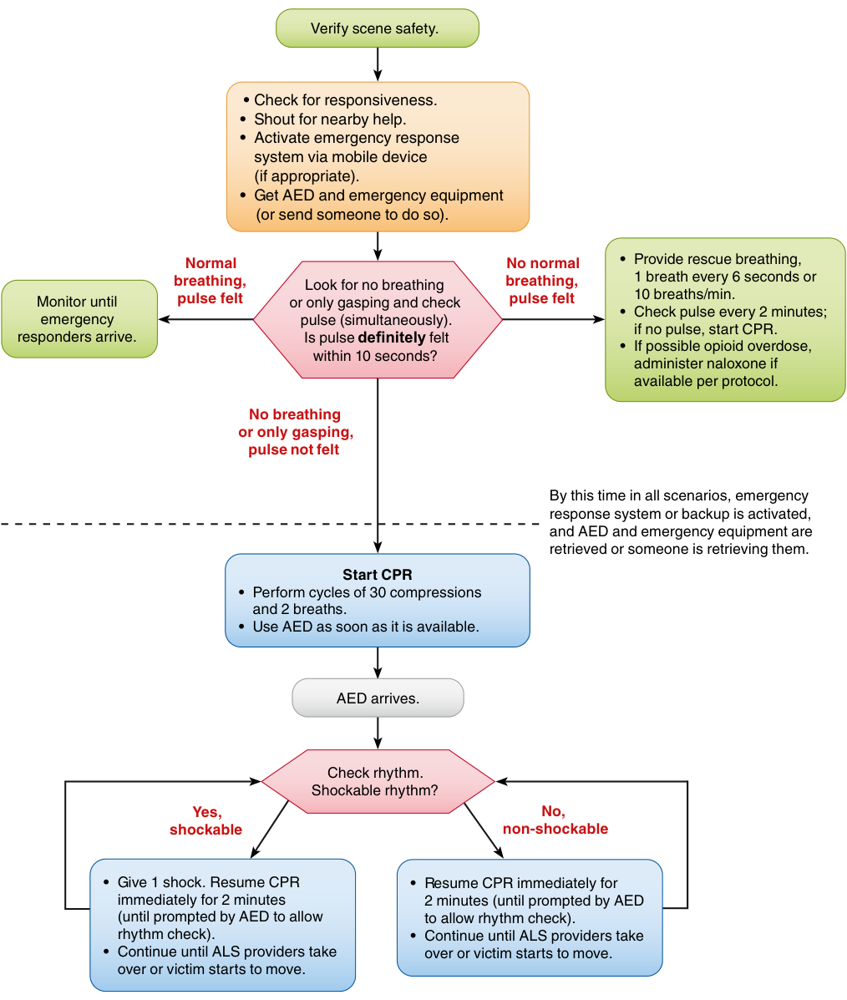

Verify scene safety. • Check for responsiveness. • Shout for nearby help. • Activate emergency response system via mobile device (if appropriate). • Get AED and emergency equipment (or send someone to do so). Normal  No normal  • Provide rescue breathing, breathing,  Look for no breathing   breathing,  1 breath every 6 seconds or 10 breaths/min. Monitor until  pulse felt or only gasping and check  pulse felt • Check pulse every 2 minutes; emergency  pulse (simultaneously). if no pulse, start CPR. responders arrive. Is pulse  definitely  felt • If possible opioid overdose, within 10 seconds? administer naloxone if available per protocol. No breathing or only gasping, pulse not felt By this time in all scenarios, emergency response system or backup is activated, and AED and emergency equipment are retrieved or someone is retrieving them. Start CPR • Perform cycles of 30 compressions and 2 breaths. • Use AED as soon as it is available. AED arrives. Check rhythm. Shockable rhythm? Yes, No, shockable non-shockable • Give 1 shock. Resume CPR  • Resume CPR immediately for immediately for 2 minutes 2 minutes (until prompted by AED (until prompted by AED to allow  to allow rhythm check). rhythm check). • Continue until ALS providers take • Continue until ALS providers take  over or victim starts to move. over or victim starts to move. 

© 2020 American Heart Association

**Fig. 82.1 Basic Life Support Health Care Provider Adult Cardiac Arrest Algorithm – 2020 update.** _AED_ , automated external defibrillator; _ALS,_ advanced life support; _CPR_ , cardiopulmonary resuscitation. (From Kleinman ME, Brennan EE, Goldberger ZD, et al. Part 5: Adult Basic Life Support and Cardiopulmonary Resuscitation Quality: 2020 American Heart Association Guidelines Update for Cardiopulmonary Resuscitation and Emergency Cardiovascular Care. _Circulation_ . 2020;132[18 suppl 2]:S414–S435. https://cpr.heart.org/- /media/CPR- Files/CPR- Guidelines- Files/Highlights/Hghlghts_2020_ECC_Guidelines_English.pdf.)

<!-- PDF page 5 -->

**Table 82.1** Summary of Components of High- Quality Cardiopulmonary Resuscitation

|**Component**|**Adults and Adolescents**|**Children (Age 1 Year to** **Puberty)**|**Infants (Age Less Than 1 Year,** **Excluding Newborns)**|
|---|---|---|---|
|Scene safety|Make sure the environment is safe for rescuers and|victim||
|Recognition of cardiac arrest|Check for responsiveness No breathing or only gasping (i.e., no normal breath No definite pulse felt within 10 s (Breathing and pulse check can be performed simul|ing) taneously in less than 10 s)||
|Activation of emergency response system|If you are alone with no mobile phone, leave the victim to activate the emergency response system and get the AED before beginning CPR Otherwise, send someone and begin CPR immediately; use the AED as soon as it is available|_Witnessed collapse_ Follow steps for adults and _Unwitnessed collapse_ Give 2 min of CPR Leave the victim to activate the AED Return to the child or infan it is available|adolescents on the left the emergency response system and get t and resume CPR; use the AED as soon as|
|Compression–ventilation ratio_without advanced_ _airway_|1 or 2 rescuers 30:2|1 rescuer 30:2 2 or more rescuers 15:2||
|Compression–ventilation ratio_with advanced_ _airway_|Continuous compressions at a rate of 100–120/min Give 1 breath every 6 s (10 breaths/min)|||
|Compression rate|100–120/min|||
|Compression depth|At least 2 inches (5 cm)*|At least one- third AP diameter of chest About 2 inches (5 cm)|At least one- third AP diameter of chest About 1 ½ inches (4 cm)|
|Hand placement|2 hands on the lower half of the breastbone (sternum)|2 hands or 1 hand (optional for very small child) on the lower half of the breastbone (sternum)|_1 rescuer_ 2 fingers in the center of the chest, just below the nipple line _2 or more rescuers_ 2 thumb- encircling hands in the center of the chest, just below the nipple line|
|Chest recoil|Allow full recoil of chest after each compression; do|not lean on the chest after e|ach compression|
|Minimizing interruptions|Limit interruptions in chest compressions to less tha|n 10 s||

*Compression depth should be no more than 2.4 inches (6 cm). _AED_ , automated external defibrillator; _AP_ , anteroposterior; _CPR_ , cardiopulmonary resuscitation. From Kleinman ME, Brennan EE, Goldberger ZD, et al. Part 5: Adult Basic Life Support and Cardiopulmonary Resuscitation Quality: 2020 American Heart Association Guidelines Update for Cardiopulmonary Resuscitation and Emergency Cardiovascular Care. _Circulation_ . 2020;132[18 suppl 2]:S414–S435. https://cpr.heart.org/- /media/CPR- Files/CPR- Guidelines- Files/Highlights/Hghlghts_2020_ECC_Guidelines_English.pdf.

However, for the trained lay rescuer who is able, the recommendation remains for the rescuer to perform both compressions and breaths, especially for victims with asphyxiation causes of cardiac arrest or prolonged CPR. The same emphasis on rescue breathing should also apply to the pediatric population. All lay rescuers should, at a minimum, provide chest compressions for victims of cardiac arrest. The rescuer should continue CPR until an AED arrives and is ready for use, EMS providers take over care of the victim, or the victim starts to move.

The 2020 AHA Guidelines for CPR and ECC emphasize the initiation of chest compressions before ventilation (i.e., a change in the sequence from A- B- C to C- A- B). The prioritization of circulation (C) over ventilation reflected the overriding importance of blood flow generation for successful resuscitation and practical delays inherent to initiation of rescue breaths (B). Physiologically, in most cases of SCA, the need for assisted ventilation is a lower priority because of the availability of adequate arterial oxygen content at the time of an SCA. The presence of this oxygen and its renewal

through gasping and chest compressions (provided there is a patent airway) also supported the use of compressiononly CPR and the use of passive oxygen delivery.

### Shock First or Chest Compressions?

Previous guidelines recommended a period of chest compressions before attempting defibrillation in unwitnessed cardiac arrests or when CPR had been delayed longer than four minutes. However, two recent randomized controlled trials failed to demonstrate a benefit (ROSC or hospital discharge) when CPR was performed before defibrillation.20,21 Thus, the 2020 AHA Guidelines for CPR and ECC recommend that for adult witnessed cardiac arrests when an AED is immediately available, the defibrillator should be used as soon as possible. For adults with unmonitored cardiac arrest or for whom an AED is not immediately available, it is reasonable that chest compressions be initiated while the defibrillator equipment is being retrieved and applied, and that defibrillation, if indicated, be attempted as soon as the device is ready for use.

::: details 原始表格與符號（PDF 第 5 頁）

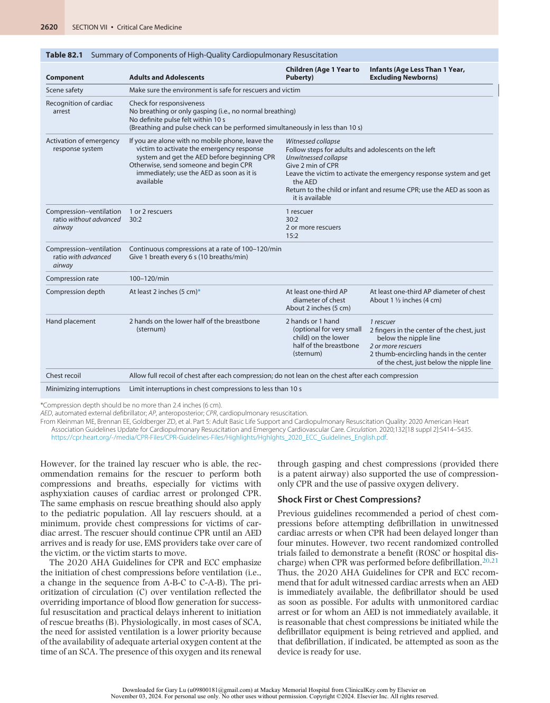

:::

<!-- PDF page 6 -->

### Automated External Defibrillators and Manual Defibrillation

Ventricular fibrillation (VF) and pulseless VT are the most common cardiac arrhythmias encountered during witnessed cardiac arrest in adults. CPR prolongs tissue viability and the duration of VF by providing oxygen and energy substrate but cannot convert the arrhythmia to an organized rhythm in most circumstances. Defibrillation delivers an electrical current passing through the myocardium to interrupt disorganized cardiac activity and restore an organized cardiac rhythm.22

The first AED was introduced in 1979.23 When it is applied to an individual with possible SCA, the AED analyzes the cardiac rhythm, and then prompts defibrillation if it is VF or rapid VT. A trained rescuer needs to simply apply the defibrillator pads to the patient’s chest, activate the AED, and deliver the shock through the push of a button when prompted to do so by the AED. Thus, the purpose is to have early defibrillation more readily available through trained bystanders, such as security guards, police, and the public.

When a standard manual defibrillator is used in resuscitation, the rescuer needs to interpret the rhythm and shock when appropriate. If a monophasic defibrillator is available, then a single 360 joule (J) shock should be delivered. With biphasic defibrillators, a much lower energy level (150– 200 J) is usually sufficient to terminate the arrhythmia due to its ability to compensate and adjust for the patient’s impedance. If the rescuer is unfamiliar with the waveform used or the manufacturer recommendations, then the maximal available energy should be used as the default energy. There is no evidence indicating superiority of one biphasic waveform design or energy level for the termination of VF with the first shock. For subsequent shocks, it is reasonable to select fixed versus escalating energy based on the specific manufacturer’s instructions.

The same protocol used with the AED should be applied when using the manual defibrillator: (1) emphasis is placed on delivering uninterrupted chest compressions while defibrillator pads are being applied and for periods when rhythm analysis is not occurring; (2) chest compressions are immediately resumed after shock delivery; (3) cardiac rhythm is reanalyzed as indicated after 2 minutes of chest compressions and rescue breathing; and (4) defibrillation is attempted only for VF and rapid VT.24

### Single versus Stacked Defibrillation

The 2020 AHA Guidelines for CPR and ECC recommended a 2- minute period of chest compressions after each shock instead of immediate successive shocks for persistent VF.

The rationale for this is that when VF is terminated, a brief period of asystole or pulseless electrical activity (PEA) typically ensues and a perfusing rhythm is unlikely to be present immediately, necessitating chest compressions to provide organ perfusion and circulation of ACLS drugs. No difference in the 1- year survival or frequency of VF recurrence was shown when a single-shock protocol with 2 minutes of CPR between successive shocks was compared against a previous resuscitation protocol employing three initial stacked shocks with 1 minute of CPR between subsequent shocks.25,26 A recent study demonstrated that in monitored in- hospital VF/VT arrests, expeditious

defibrillation with use of stacked shocks is associated with a higher rate of ROSC and survival to hospital discharge.27 Without further data, current AHA guidelines recommend that a single- shock strategy (as opposed to stacked shocks) is reasonable for defibrillation. Stacked defibrillation is considered only during cardiac surgery or in the cardiac catheterization laboratory where invasive monitoring and defibrillation pads are in place already.

### Determination of Efficiency of Cardiopulmonary Resuscitation

Immediately after cardiac arrest, when minute ventilation is constant and carbon dioxide (CO2) production is unchanged, the changes in the partial pressure of end- tidal CO2 (PETCO2) can serve as a reliable surrogate for pulmonary blood flow and cardiac output. This has been proven extensively by animal and human studies during cardiac arrest and CPR and after ROSC.28–30 Monitoring of both PETCO2 by quantitative waveform capnography with controlled ventilation and systemic arterial pressure by invasive monitoring should provide optimal assessment of the efficiency of CPR. These parameters can be monitored continuously, without interrupting chest compressions. An abrupt increase in any of these parameters is a sensitive indicator of ROSC. The 2020 AHA Guidelines for CPR and ECC endorse this monitoring as a class I recommendation for adults with SCA with an endotracheal tube (ETT) or supraglottic airway (SGA) device in place. In addition, coronary perfusion pressure, arterial relaxation pressure, and central venous oxygen saturation can assist in determination of the efficiency of CPR, although these monitoring techniques require more complex catheters or devices. Currently there are no clinical trials that have studied whether titrating resuscitative efforts to a single or combined set of physiologic parameters during CPR results in improved survival or neurologic outcome. The 2020 AHA Guidelines for CPR and ECC recommended that PETCO2 should be maintained above 10 mm Hg,31 and ideally PETCO2 above 20 mm Hg at all time points measured between 5 and 10 minutes postintubation best predicted ROSC.32,33

### Update to Airway Management and Ventilation in Cardiac Arrest

When cardiac arrest occurs, adequate oxygen delivery is required to restore the energy state of the heart as well as other vital organs, and consequently ventilation becomes an essential part of the resuscitation. However, it also needs to be emphasized that during the first few minutes after cardiac arrest, oxygen delivery to tissues with CPR is limited more by blood flow and low cardiac output than arterial oxygen content.29 Low cardiac output associated with CPR results in low oxygen uptake from the lungs that, in turn, reduces the need to ventilate the patient during this low- flow state.34 Thus, chest compressions are the priority intervention, unless the cardiac arrest is due to asphyxiation, drowning, or suffocation, which are the only circumstances in which ventilation must be provided before chest compressions.12

Health care providers must determine the best way to support ventilation and oxygenation. Options include standard bag–mask ventilation versus placement of an advanced airway (i.e., ETT or SGA device). Bag–mask ventilation

<!-- PDF page 7 -->

with a head tilt–chin lift or head tilt–jaw thrust maneuver is recommended for initial airway control in most circumstances. There is inadequate evidence to show a difference in survival or favorable neurologic outcome with the use of bag–mask ventilation compared with endotracheal intubation or other advanced airway devices.35,36 There is also inadequate evidence favoring the use of endotracheal intubation compared with other advanced airway devices.37 Thus 2020 AHA/Guidelines for CPR and ECC recommend that either a bag–mask device or an advanced airway may be used for oxygenation and ventilation during CPR in both the in- hospital and out- of- hospital settings, assuming that providers have adequate experience to insert the airway and verify proper position with minimal interruption in chest compressions. The choice of bag–mask device versus advanced airway insertion is determined by the skill and experience of the provider.

Regarding the inspired oxygen concentration, the 2020 AHA Guidelines for CPR and ECC support providing the maximal inspired oxygen concentration during CPR. Since oxygen delivery is dependent on both blood flow and arterial oxygen content and blood flow is typically limited during CPR, it is theoretically important to maximize the oxygen content of arterial blood by maximizing inspired oxygen concentration. Evidence for the detrimental effects of hyperoxia that may exist in the immediate post–cardiac arrest period should not be extrapolated to the low- flow state of CPR, where oxygen delivery is unlikely to exceed demand or cause an increase in tissue PO2. Therefore, until further data are available, physiology and expert consensus support providing the maximal inspired oxygen concentration during CPR.

After ETT placement, it is very important to confirm its correct placement, although this could be very challenging due to the patient’s body habitus, low- flow status, and distraction from other resuscitative tasks. In addition to observation of chest rise and auscultation of the lungs and stomach, continuous waveform capnography is recommended as the most reliable method of confirming and monitoring correct placement of an ETT.38 However, falsepositive results (CO2 detection with esophageal intubation) can still occur, especially within the first few breaths due to air/CO2 insufflation of the stomach during bag–mask ventilation. False- negative results (i.e., absent exhaled CO2 in the presence of tracheal intubation) can occur in the setting of pulmonary embolism (PE), low cardiac output, or severe obstructive pulmonary disease. If continuous waveform capnography is not available, a nonwaveform CO2 detector, fiberoptic scope, esophageal detector, or ultrasound device used by an experienced operator are reasonable alternatives.

If bag–mask ventilation is chosen, 2 breaths are delivered after 30 chest compressions during one- and twoperson CPR, providing that the rescuer(s) is(are) trained in CPR. Each breath is delivered over approximately 1 second. After placement of an advanced airway, it is recommended to provide 1 breath every 6 seconds (10 breaths/ min) while continuous chest compressions are being performed. Extreme caution should be taken to avoid excessive airway pressure that will compromise venous return in cardiac arrest patients, as hyperventilation is common during enthusiastic resuscitation.

### ADVANCED CARDIAC LIFE SUPPORT: MANAGEMENT OF CARDIAC ARREST

BLS, ACLS, and post–cardiac arrest care are integral steps in the AHA’s “chain of survival” for patients suffering from cardiac arrest. CPR almost invariably necessitates rapid progression to ACLS interventions and follow- up care. There is overlap between these steps, as each stage of care progresses to the next, but generally ACLS comprises the level of care between BLS and post–cardiac arrest care. The 2020 AHA Guidelines for CPR and ECC Adult Cardiac Arrest Algorithm is illustrated in Fig. 82.2. This section reviews the different interventions for managing cardiac arrest patients based on the presenting electrocardiogram (ECG) rhythm, medications used during cardiac arrest, special situations of cardiac arrest, and new technologies developed to facilitate resuscitation and improve the patient’s survival.

### Asystole

Asystole is the complete and sustained absence of electrical activity and portends extremely poor prognosis. Management of a patient in cardiac arrest with asystole follows the same pathway as management of PEA (as discussed later). The top priorities are also similar: following the steps in the ACLS Pulseless Arrest Algorithm and identifying and correcting any treatable, underlying causes for the asystole. In most patients, asystole is irreversible, but a brief trial of resuscitation, beginning with effective chest compressions, oxygen therapy, and intravenous (IV) epinephrine, is indicated particularly in the setting of witnessed cardiac arrest. Atropine is no longer recommended for treating asystole. Asystole should be differentiated from agonal bradycardia and fine ventricular fibrillation.

### Pulseless Electrical Activity

PEA refers to the presence of organized electrical activity without a palpable pulse. Priority must be given to identifying possible reversible causes of PEA, which is frequently referred to as the five Hs (Hypoxia, Hypovolemia, Hypothermia, Hyper- or Hypokalemia, and Hydrogen ions or acidosis) and Ts (Tamponade, Tension pneumothorax, Toxins, Thrombosis pulmonary, and Thrombosis coronary). These causes should be considered based upon each patient’s circumstances. Severe hypoxia in respiratory emergencies can result in PEA. In the trauma patient, hypovolemia, cardiac tamponade, and tension pneumothorax are possible causes of cardiac arrest and must be considered and acutely treated. Unanticipated cardiac arrest occurring in the intraoperative and postoperative periods should include acute massive pulmonary thromboembolism or air emboli as possible causes. Electrolyte and metabolic derangements such as severe hyperkalemia, metabolic acidosis, or drug (e.g., digitalis, beta blockers, calcium channel blockers, tricyclic antidepressants) overdose frequently presents as idioventricular rhythms. In every circumstance, prompt initiation of chest compressions and the administration of 1 mg epinephrine are recommended as temporizing measures until more definitive therapy can be provided once the cause for the PEA is identified. Each of these scenarios has an associated intervention unique to that situation. Asystole or VF can develop if PEA is not corrected.

<!-- PDF page 8 -->

### Adult Cardiac Arrest Algorithm

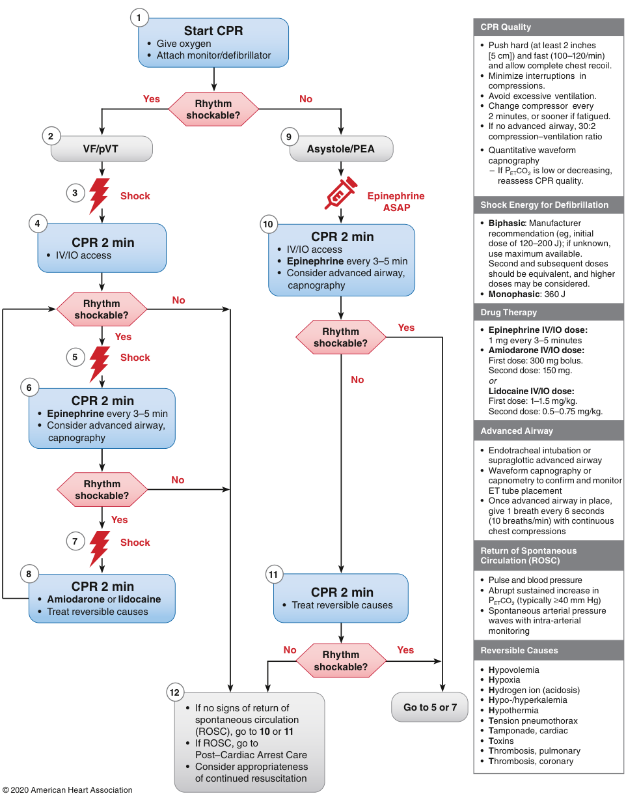

1 Start CPR CPR Quality • Give oxygen • Push hard (at least 2 inches • Attach monitor/defibrillator [5 cm]) and fast (100–120/min) and allow complete chest recoil. • Minimize interruptions in compressions. Yes No • Avoid excessive ventilation. Rhythm  • Change compressor every shockable? 2 minutes, or sooner if fatigued. • If no advanced airway, 30:2 2 9 compression–ventilation ratio VF/pVT Asystole/PEA • Quantitative waveform capnography – If P CO  is low or decreasing, reassess CPR quality. 3 Shock Epinephrine ASAP Shock Energy for Defibrillation 4 10 • Biphasic : Manufacturer CPR 2 min recommendation (eg, initial CPR 2 min dose of 120–200 J); if unknown, • IV/IO access • IV/IO access use maximum available. • Epinephrine  every 3–5 min Second and subsequent doses • Consider advanced airway, should be equivalent, and higher capnography doses may be considered. • Monophasic : 360 J Rhythm  No shockable? Drug Therapy Yes shockable?Rhythm  Yes • Epinephrine IV/IO dose: 1 mg every 3–5 minutes • Amiodarone IV/IO dose: 5 Shock First dose: 300 mg bolus. Second dose: 150 mg. No or 6 Lidocaine IV/IO dose: CPR 2 min First dose: 1–1.5 mg/kg. • Epinephrine  every 3–5 min Second dose: 0.5–0.75 mg/kg. • Consider advanced airway, Advanced Airway capnography • Endotracheal intubation or supraglottic advanced airway • Waveform capnography or Rhythm  No capnometry to confirm and monitor shockable? ET tube placement • Once advanced airway in place, give 1 breath every 6 seconds Yes (10 breaths/min) with continuous chest compressions 7 Shock Return of Spontaneous Circulation (ROSC) 8 11 • Pulse and blood pressure CPR 2 min CPR 2 min • Abrupt sustained increase in • A miodarone  or  lidocaine • Treat reversible causes P CO  (typically ≥40 mm Hg) • Treat reversible causes • Spontaneous arterial pressure waves with intra-arterial monitoring No Yes Reversible Causes Rhythm shockable? • H ypovolemia • H ypoxia 12 • H ydrogen ion (acidosis) • H ypo-/hyperkalemia • If no signs of return of  Go to 5 or 7 • H ypothermia spontaneous circulation • T ension pneumothorax (ROSC), go to  10  or  11 • T amponade, cardiac • If ROSC, go to  • T oxins Post–Cardiac Arrest Care • T hrombosis, pulmonary • T hrombosis, coronary • Consider appropriateness of continued resuscitation © 2020 American Heart Association 

**Fig. 82.2 2020 American Heart Association Adult Advanced Cardiovascular Life Support Algorithm.** _CPR_ , cardiopulmonary resuscitation; _ET,_ endotracheal; _IO_ , intraosseous; _IV_ , intravenous; _PEA_ , pulseless electric activity; _PETCO2_ . pressure of end-tidal carbon dioxide; _pVT_ , pulseless ventricular tachycardia; _VF_ , ventricular fibrillation; _VT_ , ventricular tachycardia. (From Link MS, Berkow LC, Kudenchuk PJ, et al. Part 7: Adult Advanced Cardiovascular Life Support: 2020 American Heart Association Guidelines Update for Cardiopulmonary Resuscitation and Emergency Cardiovascular Care. _Circulation_ . 2020;132[18 suppl 2]:S444–S464. https://cpr.heart.org/en/resuscitation- science/cpr- and- ecc- guidelines/algorithms#adult.)

<!-- PDF page 9 -->

### Pulseless Ventricular Tachycardia or Ventricular Fibrillation

Pulseless VT and VF are shockable rhythms and hence the most treatable causes of cardiac arrest, yielding the greatest likelihood of ROSC and long- term survival in both inhospital and out- of- hospital settings. Early defibrillation, not pharmacologic intervention, is responsible for the improved survival after VF cardiac arrest. Therefore, AEDs are placed in public locations to ensure early defibrillation can be performed by rescuers.

When a pulseless VT or VF arrest occurs, defibrillation should be performed at the earliest opportunity. Chest compressions should be immediately resumed after the delivery of shock and continued for 2 minutes before reassessing the underlying cardiac rhythm unless obvious evidence for ROSC occurs. No evidence supports one biphasic waveform over another. Defibrillation energies should be increased until VF is terminated. In circumstances in which pulseless VT or VF is terminated with defibrillation but pulseless VT or VF recurs, defibrillation should use the previously successful energy level.

If ROSC does not occur after an initial defibrillation attempt, then five cycles of CPR consisting of 30 compressions to 2 ventilations (non- intubated patient) should be performed before rechecking of rhythm. Placement of an SGA device or endotracheal intubation can be considered in this interval. Peripheral IV access should be attempted if not already established without interruption of the chest compressions.

### Resuscitation Medications During Cardiac Arrest

**Epinephrine.** Epinephrine produces beneficial effects in patients during cardiac arrest, primarily due to its α- adrenergic effects increasing coronary perfusion pressure and cerebral perfusion pressure during CPR. The β- adrenergic effects of epinephrine are controversial because they may increase myocardial work and reduce subendocardial perfusion. Thus standard- dose epinephrine (1 mg every 3–5 minutes) is recommended for patients in cardiac arrest. High- dose epinephrine is not recommended for routine use in cardiac arrest. The exceptions to this recommendation are special circumstances requiring higher or repeated doses of epinephrine, such as in patients with beta blocker overdose, calcium channel blocker overdose, or when epinephrine is titrated to real- time physiologically monitored parameters.

Regarding the timing of epinephrine administration, multiple trials showed the early administration of epinephrine in non- shockable rhythms (asystole or PEA) was associated with increased ROSC, survival to hospital discharge, and neurologically intact survival.39,40 For shockable rhythms (VF or pulseless VT), there is insufficient evidence to make a recommendation as to the optimal timing of epinephrine, particularly in relation to defibrillation. Therefore, early administration of epinephrine is recommended after the onset of cardiac arrest caused by an initial nonshockable rhythm.

**Vasopressin.** Vasopressin is a non- adrenergic peripheral vasoconstrictor that also causes coronary and renal vasoconstriction which has been removed from the ACLS algorithm in 2015 and remains this way in the 2020 updated

guidelines. Studies compared multiple doses of standarddose epinephrine with multiple doses of vasopressin (40 units IV) or vasopressin in combination with epinephrine after OHCA and showed no benefit with the use of vasopressin solely or in combination with epinephrine for ROSC or survival to discharge with or without good neurologic outcome.41 Vasopressin offers no advantage as a substitute for epinephrine in cardiac arrest and thus has been removed from the adult cardiac arrest algorithm.

**Antiarrhythmia Medications.** The role of antiarrhythmic medications during shock- refractory VF/pulseless VT is to facilitate the restoration and maintenance of a spontaneous perfusing rhythm in concert with the shock termination of VF, instead of directly converting VF/pulseless VT to an organized perfusing rhythm. Some antiarrhythmic drugs have been associated with increased rates of ROSC and hospital admission, but none have yet been proven to increase long- term survival or survival with good neurologic outcome. The 2020 AHA Guidelines for CPR and ECC on ACLS recommend that amiodarone may be considered for VF/pulseless VT that is unresponsive to CPR, defibrillation, and a vasopressor therapy; and lidocaine may be considered as an alternative to amiodarone. Routine use of magnesium for VF/pulseless VT is not recommended in adult patients, nor is the routine use of sodium bicarbonate for any patient in cardiac arrest.

**Steroids.** The use of steroids in cardiac arrest has been assessed in both IHCA and OHCA settings. In IHCA, patients administered steroids combined with a vasopressor bundle or cocktail of epinephrine and vasopressin had improved ROSC compared with patients given a saline placebo and epinephrine.42 However, further studies are needed before recommending the routine use of this therapeutic strategy. For patients with OHCA, studies showed inconsistent benefit of use of steroids alone during CPR and thus routine use is not recommended.

### Cardiopulmonary Resuscitation in Patients with Mechanical Circulatory Support

Cardiac arrest in patients on mechanical circulatory support (MCS) has become a much more common clinical scenario due to the increased use of this therapy in patients with endstage heart failure. Because of the unique characteristics of mechanical support, these patients have physical findings that cannot be interpreted the same as for patients without MCS. This section briefly describes the common types of MCS devices that health care providers may encounter and presents expert, consensus- based recommendations from the recent AHA guidelines for the evaluation and resuscitation of adult patients with MCS and suspected cardiovascular collapse or cardiac arrest.43

MCS with ventricular assist devices (VADs) can support function of the left ventricle (LV), the right ventricle (RV), or both ventricles with a biventricular assist device. A total artificial heart (TAH) replaces the heart itself. Most patients who are discharged home with MCS currently have a durable left VAD (LVAD). Continuous- flow LVADs are the more current generation of VADs. It results in an unconventional, unique physiologic state of hemodynamically stable PEA, which we refer to in this population as

<!-- PDF page 10 -->

pseudo- PEA. Vital signs such as noninvasive blood pressure or oxygen saturation may be difficult to obtain. These factors can easily confuse health care providers rendering care to these patients. Lack of a pulse alone in a patient with a continuous- flow LVAD is common and cannot be used to determine whether a patient is in cardiac arrest or a lowflow, low- perfusion state.

Assessment of adequate tissue perfusion is the most important factor in determining the need for circulatory assistance such as chest compressions. Clinical findings such as skin color and capillary refill are reasonable predictors of the presence of adequate flow and perfusion. If an LVAD is definitively confirmed by a trained person and there are no signs of life, bystander CPR, including chest compressions, is recommended. Many tachyarrhythmias are tolerated well in patients with an LVAD, although they can affect RV filling. Similar to the decision made for patients without VADs, the decision to cardiovert or to defibrillate a patient with an LVAD with VT or VF is based on the adequacy of mental status and perfusion. Fig. 82.3 outlines

consensus- derived recommendations for first- responder assessment of a patient with an LVAD.

For patients with a TAH, the native ventricles are removed completely; therefore, there is no electric depolarization and therefore no detectable ECG tracing. Chest compressions are ineffective because the mechanical ventricles are rigid and cannot be compressed. Antiarrhythmic drugs and electric therapy (e.g., pacing, defibrillation/cardioversion) are also futile for similar reasons. Standard vasopressor drugs used in ACLS such as epinephrine or vasopressin are contraindicated because they increase afterload, result in complete hemodynamic collapse with pulmonary edema, and worsen TAH function. The only therapeutic option is to try to restore mechanical function of the device. One liter of normal saline solution should be administered intravenously to treat for possible hypovolemia. Assisted ventilation should be performed as needed, and the patient should be transported to the hospital as soon as possible. Fig. 82.4 provides an algorithm for evaluation and treatment of a patient with a TAH who is altered mentally, unresponsive, or in respiratory distress.

(e.g. King) airway results in a falsely

**Fig. 82.3 Algorithm showing response to a patient with a left ventricular assist device (LVAD) with unresponsiveness or other altered mental status.** _ACLS_ , advanced cardiovascular life support; _EMS_ , emergency medical services; _ET_ , endotracheal; _MAP_ , mean arterial pressure; _PETCO2_ , partial pressure of end- tidal carbon dioxide; _VAD_ , ventricular assist device. (From Peberdy MA, Gluck JA, Ornato JP, et al. Cardiopulmonary Resuscitation in Adults and Children with Mechanical Circulatory Support: A Scientific Statement from the American Heart Association. _Circulation_ . 2017;135[24]:e1115–e1134.)

<!-- PDF page 11 -->

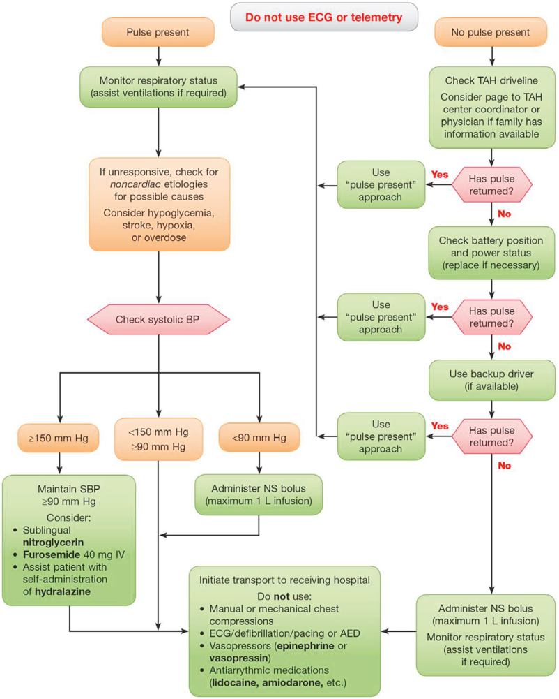

**Fig. 82.4 Algorithm showing response to a patient with a total artificial heart (TAH) with altered mental status, unresponsiveness, or respiratory distress.** _AED_ , automated external defibrillator; _BP_ , blood pressure; _ECG_ , electrocardiogram; _IV_ , intravenous; _NS_ , normal saline; _SBP_ , systolic blood pressure. (From Peberdy MA, Gluck JA, Ornato JP, et al. Cardiopulmonary Resuscitation in Adults and Children with Mechanical Circulatory Support: A Scientific Statement from the American Heart Association. _Circulation_ . 2017;135[24]:e1115–e1134.)

### Cardiopulmonary Resuscitation Using a Mechanical Cardiopulmonary Resuscitation Device

Delivering high- quality chest compressions to achieve ROSC and maintain perfusion to vital organs is vitally important to improving survival and neurologic outcome after cardiac arrest. However, manual conventional chest compressions are frequently affected by fatigue, varying skill levels and training, pauses during defibrillation and the switch of rescuers, and adherence to protocols.44 It is even more difficult to ensure high- quality chest compressions during transport.45 Studies showed that manual compressions provide

only approximately 30% of normal cardiac output, at best.46 Mechanical chest compression devices have therefore been developed to improve CPR. These devices are designed to deliver compressions of consistent rate and depth, eliminate fatigue as a factor, and provide an opportunity to reduce the frequency and length of pauses in compression.

Initial experimental studies with the mechanical chest compression device showed improved organ perfusion pressures, enhanced cerebral blood flow, and higher end- tidal CO2 compared with manual CPR.47,48 A large multicenter randomized controlled trial showed, nevertheless, that an algorithm combining mechanical chest compressions and defibrillation during ongoing compressions provided no

<!-- PDF page 12 -->

survival advantage over manual CPR administered according to guidelines.49 No difference in survival or neurologic outcome was seen for up to 6 months after the cardiac arrest, even though the mechanical chest compression devices reduced interruptions in chest compressions, and enabled defibrillation during ongoing compressions.

The possible explanation for this discrepancy between early studies and the large clinical trial is that application of the mechanical device resulted in long pauses of chest compression (median device application time 36.0 seconds) and pause in chest compression is clearly associated with worse clinical outcome. The 2020 AHA Guidelines for CPR and ECC recommend that manual chest compressions remain the standard of care for the treatment of cardiac arrest, but mechanical CPR devices may be a reasonable alternative for use by properly trained personnel in specific settings where the delivery of high- quality manual compressions may be challenging or dangerous for the provider (e.g., limited rescuers available, prolonged CPR, during hypothermic cardiac arrest, during preparation for extracorporeal CPR [ECPR]). Future emphasis should be placed on streamlining and appropriately timing the deployment of these compression devices.

### Echocardiography in Cardiac Arrest

For non- shockable rhythms, the essential step will be early detection and correction of potentially reversible underlying causes, such as the Hs and Ts of PEA arrest, as described earlier. Echocardiography has revolutionized our ability to assess the etiology and hence the management of these patients. However, performing and interpreting echocardiography frequently proves much more challenging in the real scene of cardiac arrest.

Point- of- care (POC) focused echocardiography can help assess the volume status, ventricular function, valvular disease, cardiac tamponade, PE, and tension pneumothorax. The TEE, compared with transthoracic echocardiography (TTE), provides constant visualization of the heart during chest compressions, and gives live feedback on cardiac contractility and the quality of compressions. It is less affected by the body habitus, presence of subcutaneous air, and by chest movements. Several studies have evaluated the feasibility and clinical influence of TEE in cardiac arrest patients. TEE showed moderate sensitivity and specificity for diagnosing cause of arrest, and may further impact treatment.50,51 However, it is unclear if these benefits will be translated to improved patient outcome. Thus, the 2020 AHA Guidelines for CPR and ECC suggested that if a qualified sonographer is present and use of ultrasound does not interfere with the standard cardiac arrest treatment protocol, then ultrasound may be considered as an adjunct to standard patient evaluation and resuscitation measures.

More recently, POC-focused echocardiography has also been used to predict short- term outcome in patients with cardiac arrest. Recent meta- analysis showed spontaneous cardiac movement had a sensitivity of 95% and specificity of 80% to predict ROSC, and sensitivity of 90% and specificity of 78% to predict survival to hospital admission.52 Absence of spontaneous cardiac movement on echocardiography has a low likelihood of favorable outcome and can aid in the decision of termination of resuscitation. The caveat is that the interpretation of spontaneous cardiac movement is still

very operator dependent. In addition, in cases of significant bradycardia, the image could be potentially interpreted as cardiac standstill between the cardiac contractions.

### Cardiac or Respiratory Arrest Associated with Opioid Overdose

In 2022, the Centers for Disease Control and Prevention (CDC) State Unintentional Drug Overdose Reporting System (SUDORS) reported 89.1% of all cases of fatal overdose had at least one opioid involved and accounted for 41,744 deaths in the US.53 In 2012, opioid overdose became the leading cause of unintentional injurious death in people aged 25 to 60 years in the United States, accounting for more deaths than motor vehicle collisions.54 A majority of these deaths are associated with prescription opioids. In consideration of this epidemiology, the 2020 AHA Guidelines for CPR and ECC on BLS recommended that for patients with known or suspected opioid poisoning who are unresponsive with no normal breathing but a pulse, it is reasonable for appropriately trained lay rescuers and BLS providers, in addition to providing standard BLS care, to administer intramuscular (IM) or intranasal naloxone.

The ideal dose of naloxone is unknown, and a specific dose is not recommended; an empiric starting dose of 0.04 to 0.4 mg IV or IM was recommended to avoid provoking severe opioid withdrawal in patients with opioid dependency and to allow for consideration of a range of doses, depending on the clinical scenario. Repeat doses or dose escalation to 2 mg IV or IM was recommended if the initial response was inadequate. Regardless of the care setting and route of administration, the initial goal of therapy is to restore and maintain patent airway and ventilation, preventing respiratory and cardiac arrest, without provoking severe opioid withdrawal.

### Recognition and Emergency Response for Suspected Stroke

Each year, about 6.5 million people die from stroke worldwide, and 1 million from cerebrovascular diseases in the 15 countries of the European Union.55,56 According to the 2013 Global Burden of Disease study, stroke is the second largest contributor to disability- adjusted life years (113 million disability- adjusted life years) in the world after ischemic heart disease, is a major cause of disability, and is the second most common cause of dementia, after Alzheimer disease.57 Identifying clinical signs of possible stroke (sudden weakness or numbness of the face, arm, or leg, especially on one side of the body; sudden confusion, trouble speaking, or understanding; sudden trouble seeing in one or both eyes; sudden trouble walking, dizziness, loss of balance, or coordination; or sudden severe headache with no known cause) is important because fibrinolytic treatment must be provided within a few hours of onset of symptoms.58,59 Community and professional education is essential to increase the early recognition and treatment to improve patient outcome.

The AHA and American Society of Anesthesiologists developed a community- oriented “stroke chain of survival” that links actions to be taken by patients, family members, and health care providers to maximize stroke recovery. Important components of this chain are rapid recognition and reaction to stroke warning signs, rapid EMS dispatch, transport and hospital pre- notification, and rapid diagnosis and treatment in the hospital. The algorithm goals for

<!-- PDF page 13 -->

management of patients with suspected stroke is illustrated in Fig. 82.5.

## Recognition and Management of Specific Arrhythmias

This section highlights recommendations for management of patients with acute symptomatic arrhythmias. It needs to be emphasized that electrocardiographic and rhythm information should be interpreted within the context of total patient assessment. For example, when a patient with respiratory failure and severe hypoxemia becomes

hypotensive and develops a bradycardia, the bradycardia is not the primary cause of instability. Treating the bradycardia without treating the hypoxemia is unlikely to improve the patient’s condition. Errors in diagnosis and treatment are likely to occur if ACLS providers base their treatment decisions solely on rhythm interpretation and neglect the clinical evaluation of each specific patient.

In general, “unstable arrhythmias” refer to a condition in which vital organ function is acutely impaired due to inefficient cardiac contractions and insufficient cardiac output, or cardiac arrest is ongoing or imminent. When an arrhythmia causes a patient to be unstable, immediate intervention is indicated. “Symptomatic arrhythmias” imply that

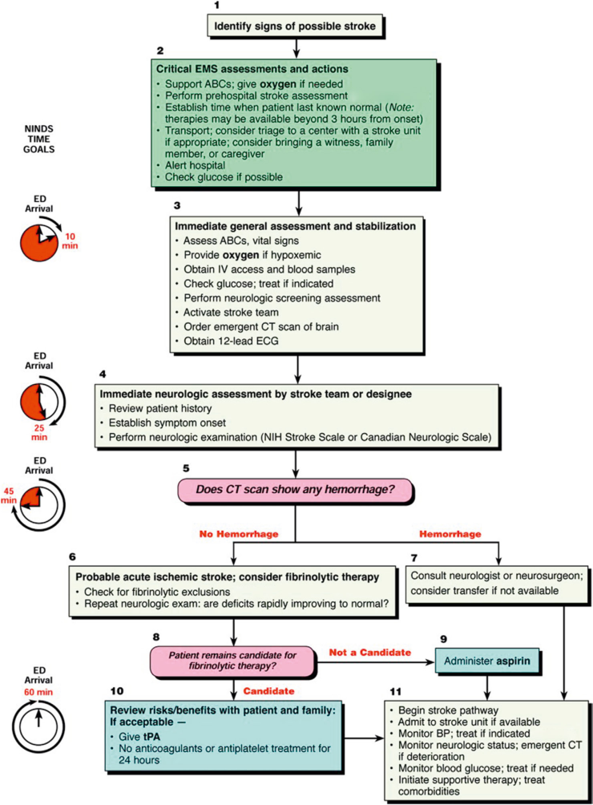

**Fig. 82.5 American Heart Association Algorithm for Suspected Stroke.** _ABC_ , airway, breathing, circulation; _BP_ , blood pressure; _CT_ , computed tomography; _ECG_ , electrocardiogram; _ED_ , emergency department; _EMS_ , emergency medical services; _IV_ , intravenous; _NIH_ , National Institutes of Health; _NINDS_ , National Institute of Neurological Disorders and Stroke; _tPA_ , tissue plasminogen activator. (From Jauch EC, Cucchiara B, Adeoye O, et al. Part 11: Adult Stroke: 2010 American Heart Association Guidelines for Cardiopulmonary Resuscitation and Emergency Cardiovascular Care. _Circulation_ . 2010;122(18 Suppl 3):S818–828. Erratum in: Circulation. 2011;124(15):e404.)

<!-- PDF page 14 -->

an arrhythmia is causing symptoms, such as palpitations, lightheadedness, or dyspnea, but the patient is stable and not in imminent danger. In such cases, more time is available to decide on the most appropriate intervention. In both unstable and symptomatic cases, the provider must make an assessment as to whether the arrhythmia is causing the patient to be unstable or symptomatic. It is critically important to determine the cause of the patient’s instability to properly direct the treatment.

### BRADYARRHYTHMIA

Bradycardia is defined as a heart rate of less than 60 beats/ min. However, when bradycardia is the cause of symptoms, the rate is generally less than 50 beats/min. A slow heart rate may be physiologically normal for some patients, whereas a heart rate of more than 50 beats/min may be inadequate for others. Hence, 50 beats/min is a relative number, and it is important to also assess the patient’s clinical presentation.

Depending on the origin of the arrhythmia, bradyarrhythmias can be classified as supraventricular (sinus, junctional, or various degrees of atrioventricular [AV] block) or ventricular (complete heart block with a very slow idioventricular escape rhythm). Sinus (or junctional) bradycardia and type I (AV nodal) second- degree block are usually manifestations of increased vagal tone. AV blocks are classified as first, second, and third degree. A first- degree AV block is defined by a prolonged PR interval (>0.20 second) and is generally benign. Second- degree AV block is divided into Mobitz types I and II. In Mobitz type I block, the block is at the AV node and is often transient and asymptomatic. In Mobitz type II block, the block is usually below the AV node within the His–Purkinje system; this block is often symptomatic, with the potential to progress to complete (third- degree) AV block. Third- degree AV block may occur at the AV node, bundle of His, or bundle branches. When third- degree AV block is present, the atria and ventricles are completely dissociated. Third- degree AV block can be permanent or transient, depending on the underlying cause.

Because hypoxemia is a common cause of bradycardia, initial evaluation of any patient with bradycardia should focus on signs of increased work of breathing (tachypnea, intercostal retractions, suprasternal retractions, paradoxical abdominal breathing) and oxygen saturation as determined by pulse oximetry. If oxygenation is inadequate or the patient shows signs of increased work of breathing, supplementary oxygen should be provided. A monitor should be attached to the patient for blood pressure, ECG, and oxygen saturation monitoring, and IV access should be established. If possible, obtain a 12- lead ECG to better define the rhythm. While initiating treatment, evaluate the patient’s clinical status and identify potentially reversible causes.

The provider must identify signs and symptoms of poor perfusion and determine if those signs are likely to be caused by the bradycardia. If the signs and symptoms are not due to bradycardia, the provider should reassess the underlying cause of the patient’s symptoms. Asymptomatic or minimally symptomatic patients do not necessarily require treatment unless there is suspicion that the rhythm is likely to progress to symptoms or more advanced bradyarrhythmias (e.g., Mobitz type II second- degree AV block in the setting of acute myocardial infarction). If the bradycardia

is suspected to be the cause of acute altered mental status, ischemic chest discomfort, acute heart failure, hypotension, or other signs of shock, the patient should receive immediate treatment.

Atropine remains the first- line drug for acute symptomatic bradycardia. The recommended atropine dose for bradycardia is 1 mg IV every 3 to 5 minutes to a maximum total dose of 3 mg. Doses of atropine sulfate of less than 0.5 mg may result in paradoxical bradycardia. Atropine will also unlikely be effective in patients who had heart transplantation because the transplanted heart lacks vagal innervation. Since atropine works by reversing the muscarinic effects of the parasympathetic nervous system, it is not the preferred drug of choice for type II second- degree or thirddegree AV block or in patients with third- degree AV block with a new wide- QRS complex where the location of block is likely to be more distal than the AV nodes. These bradyarrhythmias are not likely to be responsive to atropine and should be treated with transcutaneous pacing (TCP) or β- adrenergic agonists as temporizing measures while the patient is prepared for transvenous pacing.

If bradycardia is unresponsive to atropine, IV infusion of β- adrenergic agonists (dopamine, epinephrine) can be considered. Dopamine is a catecholamine with both α- and β- adrenergic actions and can be titrated to target heart rate or vasoconstriction more selectively. At lower doses, dopamine has a more selective effect on inotropy and heart rate; at higher doses (>10 mcg/kg/min), it also has vasoconstrictive effects. Epinephrine, as described previously, is a catecholamine with α- and β- adrenergic actions. Isoproterenol is a β- adrenergic agent with β1 and β2 effects, resulting in an increase in heart rate and vasodilation. The recommended adult dose is 2–10 mcg/min by IV infusion, titrated to the appropriate heart rate and rhythm response.

TCP can be done through the multifunctional pacing/ defibrillating pads. It is painful, and sedation should be considered in all awake patients. TCP should be considered a temporary measure only, and the patient should always be prepared for transvenous pacing. Expert consultation should be obtained as soon as possible. Transesophageal atrial pacing can be effective in treating intraoperative supraventricular bradyarrhythmias such as sinus or junctional bradycardia. This device is compatible with most external pacing devices and defibrillators. However, transesophageal pacing is only effective at pacing the atria, at least in its current configuration. In a patient who has AV conduction issues, such as complete heart block, this intervention is ineffective. Effective and consistent pacing also relies on normal acid–base status and electrolyte concentrations; thus, acidemia and electrolyte abnormalities such as severe hyperkalemia need to be corrected if pacing is not successful.

Fig. 82.6 illustrates the bradyarrhythmias treatment algorithm recommended in the 2020 AHA Guidelines for CPR and ECC.

### TACHYARRHYTHMIA

Tachyarrhythmia is defined as an arrhythmia with a rate of more than 100 beats/min, although, as with defining bradycardia, an arrhythmia rate of 150 or more beats/min is more likely to cause clinical symptoms. When encountering patients with tachycardia, efforts should be made to

<!-- PDF page 15 -->

### Adult Bradycardia Algorithm

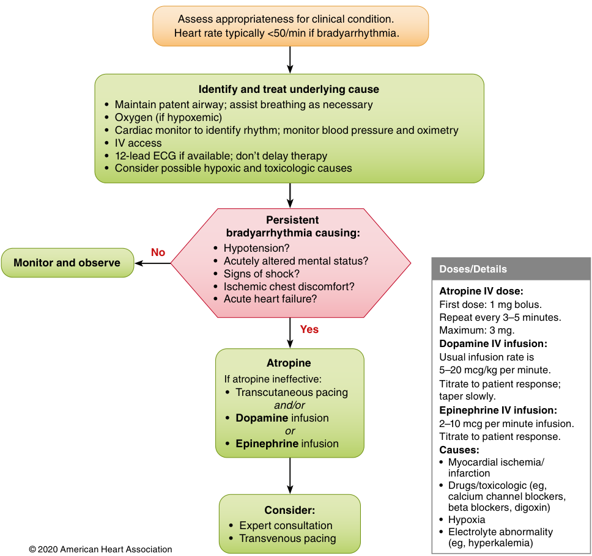

Assess appropriateness for clinical condition. Heart rate typically &lt;50/min if bradyarrhythmia. Identify and treat underlying cause • Maintain patent airway; assist breathing as necessary • Oxygen (if hypoxemic) • Cardiac monitor to identify rhythm; monitor blood pressure and oximetry • IV access • 12-lead ECG if available; don’t delay therapy • Consider possible hypoxic and toxicologic causes Persistent bradyarrhythmia causing: No • Hypotension? Monitor and observe • Acutely altered mental status? Doses/Details • Signs of shock? • Ischemic chest discomfort? Atropine IV dose: • Acute heart failure? First dose: 1 mg bolus. Repeat every 3–5 minutes. Yes Maximum: 3 mg. Dopamine IV infusion: Usual infusion rate is Atropine 5–20 mcg/kg per minute. If atropine ineffective: Titrate to patient response; • Transcutaneous pacing taper slowly. and/or Epinephrine IV infusion: • Dopamine  infusion 2–10 mcg per minute infusion. or Titrate to patient response. • Epinephrine  infusion Causes: • Myocardial ischemia/ infarction • Drugs/toxicologic (eg, calcium channel blockers, Consider: beta blockers, digoxin) • Hypoxia • Expert consultation • Electrolyte abnormality • Transvenous pacing (eg, hyperkalemia) © 2020 American Heart Association 

**Fig. 82.6 2020 American Heart Association adult bradycardia with a pulse algorithm.** _ECG_ , electrocardiogram; _IV_ , intravenous. (From Link MS, Berkow LC, Kudenchuk PJ, et al. Part 7: Adult Advanced Cardiovascular Life Support: 2020 American Heart Association Guidelines Update for Cardiopulmonary Resuscitation and Emergency Cardiovascular Care. _Circulation_ . 2020;132[18 suppl 2]:S444–S464. https://cpr.heart.org/en/resuscitation- science/cpr- and- eccguidelines/algorithms#adult.)

determine whether the tachycardia is the primary cause of the presenting symptoms, or secondary to an underlying condition that is causing both the presenting symptoms and the faster heart rate.

Tachycardia can be classified in several ways, based on the appearance of the QRS complex, heart rate, and regularity. Narrow- complex tachycardias (supraventricular tachycardia [SVT], QRS &lt;0.12 second) include sinus tachycardia, atrial fibrillation, atrial flutter, AV nodal reentry, accessory pathway–mediated tachycardia, atrial tachycardia (including automatic and reentry forms), multifocal atrial tachycardia, and junctional tachycardia. Wide QRS–complex tachycardias (QRS ≥0.12 second) include VT and VF, SVT with aberrancy, preexcitation tachycardias (Wolff–Parkinson–White syndrome), and ventricular- paced rhythms.

Because hypoxemia is a common cause of tachycardia, initial evaluation of any patient with tachycardia, like those with bradycardia, should focus on identifying signs of increased work of breathing and oxygen saturation. Patients should be closely monitored, and supplemental oxygen provided. A 12- lead ECG better defines the rhythm, but the process should not delay immediate cardioversion if the patient is unstable.

If signs and symptoms persist despite provision of supplementary oxygen and support of airway and ventilation, the provider should assess the patient’s degree of instability and determine if the instability is related to the tachycardia. If the patient demonstrates rate- related cardiovascular compromise with signs and symptoms such as acute altered mental status, ischemic chest discomfort, acute

<!-- PDF page 16 -->

heart failure, hypotension, or other signs of shock suspected to be due to a tachyarrhythmia, the provider should proceed to immediate synchronized cardioversion, which can terminate tachyarrhythmias by interrupting the underlying reentrant pathway. The recommended initial biphasic energy dose for cardioversion of atrial fibrillation is 120 to 200 J. Cardioversion of atrial flutter and other SVTs generally requires less energy; an initial energy of 50 J to 100 J is often sufficient. If the initial 50 J shock fails, the provider should increase the dose in a stepwise fashion. Monomorphic VT with a pulse responds well to monophasic or biphasic waveform cardioversion (synchronized) shocks at initial energies of 100 J. If a patient has polymorphic VT, treat the rhythm as VF and deliver high- energy unsynchronized shocks (defibrillation doses).

If the patient with tachycardia is stable, then determine if the patient has a narrow- complex or wide- complex tachycardia, whether the rhythm is regular or irregular, and for wide complexes whether the QRS morphology is monomorphic or polymorphic. Therapy is then tailored accordingly. For regular narrow- complex SVT, vagal maneuvers such as carotid massage or Valsalva maneuver are used first to terminate the arrhythmia. If vagal maneuvers are unsuccessful, then adenosine is the drug of choice for terminating organized rapid supraventricular arrhythmias. Adenosine slows sinoatrial and AV nodal conduction and prolongs refractoriness, which is very effective in terminating paroxysmal SVT (PSVT), the most common cause of which is reentry within the AV node. The drug is also used to diagnose the underlying mechanism in tachyarrhythmias of uncertain origin (e.g., atrial fibrillation, atrial flutter) by inducing transient block of AV nodal conduction. If adenosine or vagal maneuvers fail to convert PSVT, PSVT recurs after such treatment, or these treatments disclose a different form of SVT (such as atrial fibrillation or flutter), it is reasonable to use longer- acting AV nodal blocking agents, such as the non- dihydropyridine calcium channel blockers (verapamil and diltiazem) or beta blockers.

Treatable causes of VT should always be sought before or during pharmacologic or electrical interventions. Hypoxemia, hypercapnia, hypokalemia, or hypomagnesemia (or both), digitalis toxicity, and acid–base derangements are obvious causes for VT and should be quickly evaluated and corrected if present. If antiarrhythmic therapy is pursued, procainamide, amiodarone, or sotalol are recommended. Importantly, only one drug should be administered; a second drug should not be added without expert consultation. Hypotension is common with all three of these medications.

The evaluation and management of tachyarrhythmias is illustrated in the 2020 ACLS Tachycardia with Pulse Algorithm (Fig. 82.7). The medications used for tachyarrhythmia are listed in Tables 82.2 and 82.3.

## Postresuscitation Interventions

### EMERGENCY PERCUTANEOUS CORONARY INTERVENTIONS

Myocardial ischemia can be a precipitating factor for VF and likely accounts for a significant proportion of the underlying triggers of OHCA cases.

It seems intuitive to offer emergent coronary interventions in this patient cohort. However, there are practical considerations including diagnostic challenges of ST segment elevation myocardial infarction (STEMI) with routine 12- lead ECGs in the postarrest patients including a high false- negative rate. A poor neurologic exam post ROSC may confound the clinical picture and can make the interventionalist reluctant to offer the procedure. The paucity of data from RCTs in this patient population may also add to the challenge of offering early coronary interventions. A nonmedical reason that has become more prevalent across the health care spectrum is the reluctance to take on high mortality risk cases in specialties such as cardiovascular care where outcomes are publicly reported and compared.60

Callaway _et al._ summarized 15 observational studies reporting improved survival to hospital discharge associated with emergency coronary angiography in patients with ST elevation after cardiac arrest. Nine observational studies showed improved neurologically favorable outcome associated with emergency coronary angiography in patients with ST elevation after cardiac arrest.61 The overall experience strongly suggests that any STEMI patient who suffers OHCA and is successfully resuscitated should be treated with emergent reperfusion, typically percutaneous coronary intervention (PCI). European Society of Cardiology and the combined entity of the American College of Cardiology Foundation and the AHA support this view. This is in line with the recommendations for non–cardiac arrest STEMI patients as well (Fig. 82.8).

The consensus statement states that emergency coronary angiography is reasonable for select (e.g., electrically, or hemodynamically unstable) adult patients who are comatose after OHCA of suspected cardiac origin but without ST elevation on ECG. Coronary angiography should be considered in post–cardiac arrest patients if indicated regardless of whether the patient is comatose or awake.60,62

### TARGETED TEMPERATURE MANAGEMENT (TTM)

The Cardiac Arrest Registry to Enhance Survival (CARES) was created to identify cases of out- of- hospital cardiac arrest, measure how well emergency medical services (EMS) perform key elements of emergency cardiac care, and determine outcomes through hospital discharge. Each year, approximately 350,000 persons in the United States experience an out- of- hospital cardiac arrest (OHCA) or sudden death; approximately 90% of persons who experience an OHCA die. The CARES report outlined a 9.3% survival to hospital discharge from among the 147,700 patients who suffered a nontraumatic OHCA.1 The advent and implementation of a standardized approach to the recognition of near fatal events and modern cardiopulmonary resuscitation (CPR) has had a tremendous impact on saving lives since the 1960s.

The mortality remains high for patients who experience an out- of- hospital cardiac arrest (OHCA) and especially if they remain comatose after the return of circulation (ROSC) post CPR. Devastating neurologic injury, particularly anoxic brain injury, is frequent in this patient cohort. Over the years numerous pharmacologic interventions including steroids, barbiturates (e.g., thiopental), and nimodipine have been tried for cerebral protection in this patient population with

<!-- PDF page 17 -->

### Adult Tachycardia with a Pulse Algorithm

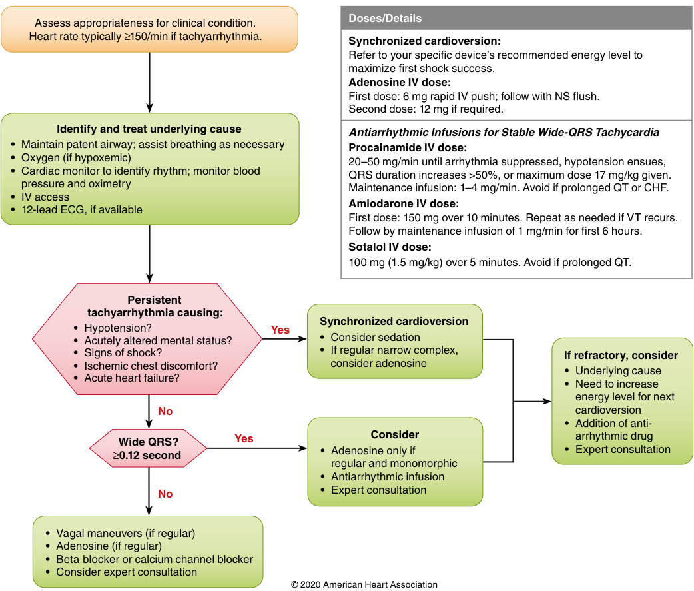

Doses/Details Assess appropriateness for clinical condition. Heart rate typically ≥150/min if tachyarrhythmia. Synchronized cardioversion: Refer to your specific device’s recommended energy level to maximize first shock success. Adenosine IV dose: First dose: 6 mg rapid IV push; follow with NS flush. Second dose: 12 mg if required. Identify and treat underlying cause Antiarrhythmic Infusions for Stable Wide-QRS Tachycardia • Maintain patent airway; assist breathing as necessary Procainamide IV dose: • Oxygen (if hypoxemic) 20–50 mg/min until arrhythmia suppressed, hypotension ensues, • Cardiac monitor to identify rhythm; monitor blood QRS duration increases >50%, or maximum dose 17 mg/kg given. pressure and oximetry Maintenance infusion: 1–4 mg/min. Avoid if prolonged QT or CHF. • IV access Amiodarone IV dose: • 12-lead ECG, if available First dose: 150 mg over 10 minutes. Repeat as needed if VT recurs. Follow by maintenance infusion of 1 mg/min for first 6 hours. Sotalol IV dose: 100 mg (1.5 mg/kg) over 5 minutes. Avoid if prolonged QT. Persistent tachyarrhythmia causing: Synchronized cardioversion • Hypotension? Yes • Acutely altered mental status? • Consider sedation • Signs of shock? • If regular narrow complex,  If refractory, consider • Ischemic chest discomfort? consider adenosine • Underlying cause • Acute heart failure? • Need to increase energy level for next No cardioversion • Addition of anti- Wide QRS?  Yes Consider arrhythmic drug ≥ 0.12 second • Adenosine only if  • Expert consultation regular and monomorphic • Antiarrhythmic infusion No • Expert consultation • Vagal maneuvers (if regular) • Adenosine (if regular) • Beta blocker or calcium channel blocker • Consider expert consultation © 2020 American Heart Association 

**Fig. 82.7 2020 American Heart Association Adult Tachycardia with a Pulse Algorithm.** _CHF_ , congestive heart failure; _ECG_ , electrocardiogram; _IV_ , intravenous; _NS_ , normal saline; _VT_ , ventricular tachycardia. (From Link MS, Berkow LC, Kudenchuk PJ, et al. Part 7: Adult Advanced Cardiovascular Life Support: 2020 American Heart Association Guidelines Update for Cardiopulmonary Resuscitation and Emergency Cardiovascular Care. _Circulation_ . 2020;132[18 suppl 2]:S444–S464. https://cpr.heart.org/en/resuscitation- science/cpr- and- ecc- guidelines/algorithms#adult.)

unsatisfactory results.63 The concept of hypothermia as a neuroprotective strategy is not novel, with the earliest published studies from the late 1950s. The seminal publications describing the use of systemic hypothermia to 33°C within 2 hours of OHCA and maintained for 12 or 24 hours, which showed improved outcomes amongst survivors, revived the role of temperature management for the present day practice.63,64 Following Bernard _et al._ ’s publication, a number of other studies also evaluated induced hypothermia after cardiac arrest, leading to more widespread use, and this is now advocated by international guidelines.64,65

The precise mechanism of cerebral protection is likely more complex than a linear decrease in the cerebral metabolic rate (i.e., for every 1°C reduction in brain temperature, a 6% reduction in cerebral metabolic rate). By limiting the metabolic demands and decreasing the utilization of

oxygen and glucose, the risk of energetics failure is reduced. This preserves the ion channel integrity, and decreases the intracellular calcium influx which triggers neuronal apoptotic pathways.63,66 Animal models have evaluated the role of hypothermia and its effects on pathways leading to excitotoxicity, apoptosis, inflammation and free radical production, as well as blood flow, metabolism and blood–brain barrier integrity.67

### Patient Selection for TTM

Therapeutic hypothermia (also called targeted temperature management) is now the standard of care and recommended in international resuscitation guidelines to OHCA and cardiac arrest in an in- hospital setting.68,69 TTM encompasses therapeutic hypothermia, controlled normothermia, and treatment of fever. The level of evidence supports the use

<!-- PDF page 18 -->

### Table 82.2 Summary of Medications Used for Supraventricular Tachycardia

|**Drug**|**Characteristics**|**Indication(s)**|**Dosing**|**Side Effects**|**Precautions** **or Special** **Considerations**|
|---|---|---|---|---|---|
|Adenosine|Endogenous purine nucleoside; briefly depresses sinus node rate and AV node conduction; vasodilator|ᑏStable, narrow- complex regular tachycardias ᑏUnstable narrow- complex regular tachycardias while preparations are made for electrical cardioversion. ᑏStable, regular, monomorphic, wide- complex tachycardia as a therapeutic and diagnostic maneuver|6 mg IV as a rapid IV push followed by a 20 mL saline flush; repeat if required as 12 mg IV push|Hypotension, bronchospasm, chest discomfort|Contraindicated in patients with asthma; may precipitate atrial fibrillation, which may be very rapid in patients with WPW; thus a defibrillator should be readily available; reduce dose in post– cardiac transplant patients, those taking dipyridamole or carbamazepine and when administered via a central vein|
|Diltiazem, Verapamil|Non- dihydropyridine calcium channel blockers; slow AV node conduction and increase AV node refractoriness; vasodilators, negative inotropes|ᑏStable, narrow- complex tachycardias if rhythm remains uncontrolled or unconverted by adenosine or vagal maneuvers or if SVT is recurrent. ᑏControl ventricular rate in patients with atrial fibrillation or atrial flutter|Diltiazem: Initial dose 15–20 mg (0.25 mg/kg) IV over 2 min; additional 20–25 mg (0.35 mg/ kg) IV in 15 min if needed; 5–15 mg/h IV maintenance infusion (titrated to AF heart rate if given for rate control) Verapamil: Initial dose 2.5–5 mg IV given over 2 min; may repeat as 5–10 mg every 15–30 min to total dose of 20–30 mg|Hypotension, bradycardia, precipitation of heart failure|Should only be given to patients with narrow- complex tachycardias (regular or irregular). Avoid in patients with heart failure and preexcited AF or flutter or rhythms consistent with VT|
|Atenolol, Esmolol, Metoprolol, Propranolol|Beta blockers; reduce effects of circulating catecholamines; reduce heart rate, AV node conduction and blood pressure; negative inotropes|ᑏStable, narrow- complex tachycardias if rhythm remains uncontrolled or unconverted by adenosine or vagal maneuvers or if SVT is recurrent. ᑏControl ventricular rate in patients with atrial fibrillation or atrial flutter ᑏCertain forms of polymorphic VT (associated with acute ischemia, familial LQTS, catecholaminergic)|Atenolol (β1specific blocker) 5 mg IV over 5 min; repeat 5 mg in 10 min if arrhythmia persists or recurs Esmolol (β1specific blocker with 2- to 9- min half- life) IV loading dose 500 mcg/kg (0.5 mg/kg) over 1 min, followed by an infusion of 50 mcg/kg per min (0.05 mg/kg/ min); if response is inadequate, infuse second loading bolus of 0.5 mg/kg over 1 min and increase maintenance infusion to 100 mcg/kg (0.1 mg/kg) per min; increment; increase in this manner if required to maximum infusion rate of 300 mcg/kg [0.3 mg/kg] per min Metoprolol (β1specific blocker) 5 mg over 1–2 min repeated as required every 5 min to maximum dose of 15 mg Propranolol (nonselective beta blocker) 0.5–1 mg over 1 min, repeated up to a total dose of 0.1 mg/kg if required|Hypotension, bradycardia, precipitation of heart failure|Avoid in patients with asthma, obstructive airway disease, decompensated heart failure and preexcited atrial fibrillation or flutter|
|Procainamide|Sodium and potassium channel blocker|ᑏPreexcited atrial fibrillation|20–50 mg/min until arrhythmia suppressed, hypotension ensues, or QRS prolonged by 50%, or total cumulative dose of 17 mg/ kg; or 100 mg every 5 min until arrhythmia is controlled or other conditions described above are met|Bradycardia, hypotension, torsades de pointes|Avoid in patients with QT prolongation and CHF|

::: details 原始表格與符號（PDF 第 18 頁）

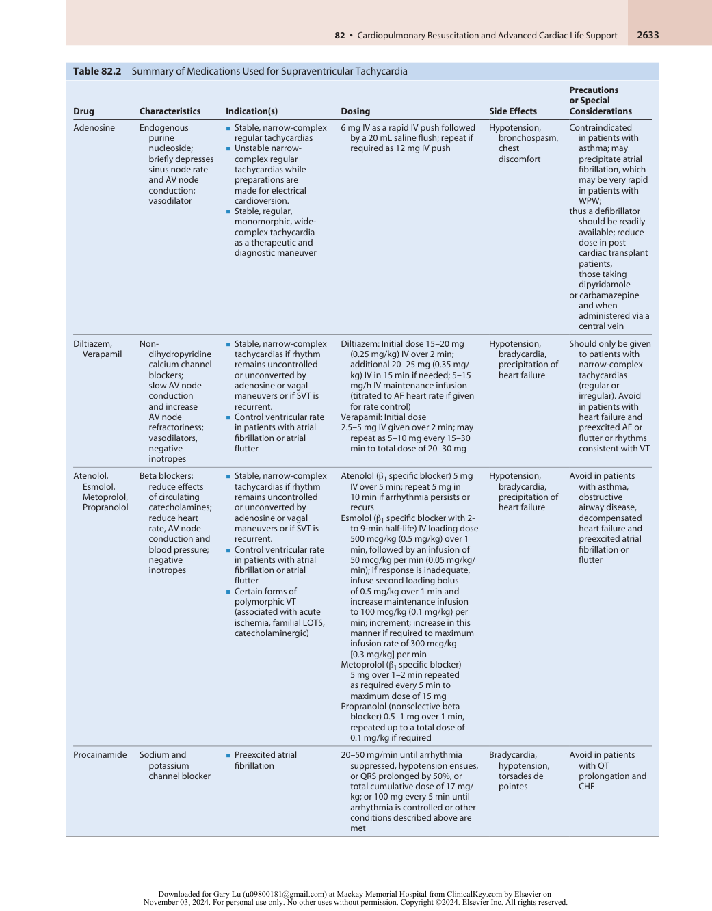

:::

<!-- PDF page 19 -->

**Table 82.2** Summary of Medications Used for Supraventricular Tachycardia – cont’d

|**Drug**|**Characteristics**|**Indication(s)**|**Dosing**|**Side Effects**|**Precautions** **or Special** **Considerations**|
|---|---|---|---|---|---|
|Amiodarone|Multichannel blocker (sodium, potassium, calcium channel, and noncompetitive alpha/beta blocker)|ᑏStable irregular narrow- complex tachycardia (atrial fibrillation) ᑏStable regular narrow- complex tachycardia ᑏTo control rapid ventricular rate due to accessory pathway conduction in preexcited atrial arrhythmias|150 mg given over 10 min and repeated, if necessary, followed by a 1 mg/min infusion for 6 h. Total dose over 24 h should not exceed 2.2 g.|Bradycardia, hypotension, phlebitis||
|Digoxin|Cardiac glycoside with positive inotropic effects; slows AV node conduction by enhancing parasympathetic tone; slow onset of action|ᑏStable, narrow- complex regular tachycardias if rhythm remains uncontrolled or unconverted by adenosine or vagal maneuvers or if SVT is recurrent. ᑏControl ventricular rate in patients with atrial fibrillation or atrial flutter|8–12 mcg/kg total loading dose, half of which is administered initially over 5 min, and remaining portion as 25% fractions at 4- to 8- h intervals|Bradycardia|Slow onset of action and relative low potency renders it less useful for treatment of acute arrhythmias|

_AF_ , atrial fibrillation; _AV_ , atrioventricular; _CHF_ , congestive heart failure; _IV_ , intravenous; _LQTS,_ long QT syndrome; _SVT_ , supraventricular tachycardia; _VT_ , ventricular tachycardia; _WPW,_ Wolff–Parkinson–White syndrome. From https://cpr.heart.org/en/resuscitation- science/cpr- and- ecc- guidelines.

**Table 82.3** Summary of Medications Used for Ventricular Tachycardia

|**Drug**|**Characteristics**|**Indication(s)**|**Dosing**|**Side Effects**|**Precautions or Special** **Considerations**|
|---|---|---|---|---|---|
|Procainamide|Sodium and potassium channel blocker|ᑏHemodynamically stable monomorphic VT|20–50 mg/min until arrhythmia suppressed, hypotension ensues, or QRS prolonged by 50%, or total cumulative dose of 17 mg/kg; or 100 mg every 5 min until arrhythmia is controlled or other conditions described previously are met|Bradycardia, hypotension, torsades de pointes|Avoid in patients with QT prolongation and CHF|
|Amiodarone|Multichannel blocker (sodium, potassium, calcium channel, alpha and noncompetitive beta blocker)|ᑏHemodynamically stable monomorphic VT ᑏPolymorphic VT with normal QT interval|150 mg given over 10 min and repeated, if necessary, followed by a 1 mg/min infusion for 6 h. Total dose over 24 h should not exceed 2.2 g|Bradycardia, hypotension, phlebitis||
|Sotalol|Potassium channel blocker and nonselective beta blocker|ᑏHemodynamically stable monomorphic VT|In clinical studies 1.5 mg/ kg infused over 5 min; however, US package labeling recommends any dose of the drug should be infused slowly over a period of 5 h|Bradycardia, hypotension, torsades de pointes|Avoid in patients with QT prolongation and CHF|
|Lidocaine|Relatively weak sodium channel blocker|ᑏHemodynamically stable monomorphic VT|Initial doses range from 1 to 1.5 mg/kg IV; repeated if required at 0.5–0.75 mg/kg IV every 5–10 min up to maximum cumulative dose of 3 mg/kg; 1–4 mg/min (30–50 mcg/kg/ min) maintenance infusion|Slurred speech, altered consciousness, seizures, bradycardia||
|Magnesium|Cofactor in variety of cell processes including control of sodium and potassium transport|ᑏPolymorphic VT associated with QT prolongation (torsades de pointes)|1–2 g IV over 15 min|Hypotension, CNS toxicity, respiratory depression|Follow magnesium levels if frequent or prolonged dosing required, particularly in patients with impaired renal function|

_CHF,_ congestive heart failure; _CNS,_ central nervous system; _IV_ , intravenous; _VT_ , ventricular tachycardia. From https://cpr.heart.org/en/resuscitation- science/cpr- and- ecc- guidelines.

::: details 原始表格與符號（PDF 第 19 頁）

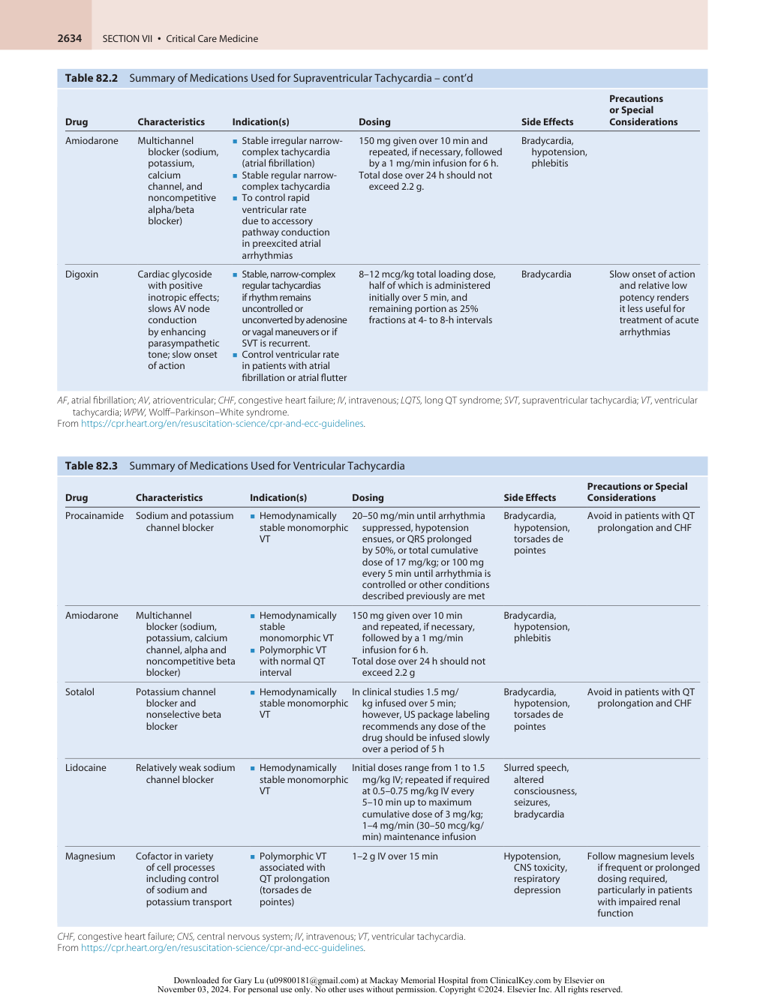

:::

<!-- PDF page 20 -->

### ACLS Healthcare Provider Post–Cardiac Arrest Care Algorithm

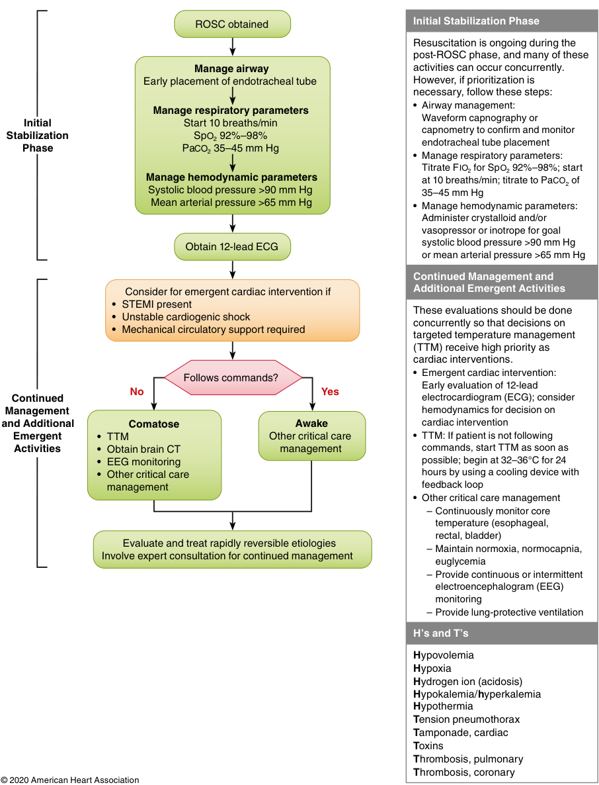

ROSC obtained Initial Stabilization Phase Resuscitation is ongoing during the post-ROSC phase, and many of these Manage airway activities can occur concurrently. Early placement of endotracheal tube However, if prioritization is necessary, follow these steps: • Airway management: Manage respiratory parameters Initial  Start 10 breaths/min Waveform capnography or Stabilization  SpO2 92%–98% capnometry to confirm and monitor endotracheal tube placement Phase PaCO2 35–45 mm Hg • Manage respiratory parameters: Titrate FIO2 for SpO2 92%–98%; start Manage hemodynamic parameters at 10 breaths/min; titrate to PaCO2 of Systolic blood pressure >90 mm Hg  35–45 mm Hg Mean arterial pressure >65 mm Hg • Manage hemodynamic parameters: Administer crystalloid and/or vasopressor or inotrope for goal Obtain 12-lead ECG systolic blood pressure >90 mm Hg or mean arterial pressure >65 mm Hg Continued Management and Consider for emergent cardiac intervention if Additional Emergent Activities • STEMI present These evaluations should be done • Unstable cardiogenic shock concurrently so that decisions on • Mechanical circulatory support required targeted temperature management (TTM) receive high priority as cardiac interventions. Follows commands? • Emergent cardiac intervention: Early evaluation of 12-lead No Yes Continued  electrocardiogram (ECG); consider Management  hemodynamics for decision on and Additional  Comatose Awake cardiac intervention Emergent  • TTM  Other critical care  • TTM: If patient is not following Activities • Obtain brain CT management commands, start TTM as soon as • EEG monitoring possible; begin at 32–36°C for 24 • Other critical care  hours by using a cooling device with management feedback loop • Other critical care management – Continuously monitor core temperature (esophageal, rectal, bladder) Evaluate and treat rapidly reversible etiologies – Maintain normoxia, normocapnia, Involve expert consultation for continued management euglycemia – Provide continuous or intermittent electroencephalogram (EEG) monitoring – Provide lung-protective ventilation H’s and T’s H ypovolemia H ypoxia H ydrogen ion (acidosis) H ypokalemia/ h yperkalemia H ypothermia T ension pneumothorax T amponade, cardiac T oxins T hrombosis, pulmonary T hrombosis, coronary © 2020 American Heart Association 

**Fig. 82.8 2020 American Heart Association Adult Post–Cardiac Arrest Care Algorithm.** (From O’Connor RE, Al Ali AS, Brady WJ, et al. Adult Post– Cardiac Arrest Care Algorithm: 2020 American Heart Association Guidelines Update for Cardiopulmonary Resuscitation and Emergency Cardiovascular Care. _Circulation_ . 2020;132[18 suppl 2]:S483–S500. https://cpr.heart.org/en/resuscitation- science/cpr- and- ecc- guidelines.)

<!-- PDF page 21 -->

of TTM in the management of comatose patients who suffered an OHCA with ROSC, particularly patients whose etiology of arrest was a shockable cardiac rhythm (ventricular fibrillation/pulseless ventricular tachycardia)69 or a nonshockable cardiac rhythm (asystole or pulseless electrical activity). The temperature range currently recommended for TTM is between 32°C and 36°C in order to improve survival with good neurologic outcome after cardiac arrest (CA).69 In the pediatric patient population, TTM to maintain normothermia is recommended in order to improve neurologic outcome.69

Core temperature modulation has been described as a management strategy for several cardiac and noncardiac conditions. These include acute control of intracranial pressure in traumatic brain injury, cerebral protection for traumatic brain injury, neuroprotection in ischemic stroke, and neuroprotection in spinal cord injury. In this section, we review the literature on TTM in the post- ROSC patients of cardiac origin.

### Timing and Duration of TTM

The Neurocritical Care Society published guidelines for the implementation of a TTM suggesting a period of TTM for at least 24 hours for OHCA. They also recommend against >72 hours’ duration of TTM and/or lower temperature targets than 32°C in neonates backed by moderate grades of evidence as conditional recommendations.70 The recent International Liaison Committee on Resuscitation (ILCOR) and AHA advisory statement suggests selecting and maintaining a constant target temperature between 32°C and 36°C for post- CA patients and to use TTM for at least for 24 hours.71

Preclinical and laboratory literature suggests that the greatest benefit of hypothermia in neuroprotection is when it is effectively applied within hours of event, with likely benefit being within 6 hours of event regardless of mechanism of injury. This, however, has not been supported in human studies at this time.70 Interestingly the American Academy of Neurology practice guidelines for reducing brain injury after CPR recommends against the use of cold saline as an adjunctive therapy in the prehospital setting.72

### Achieving TTM

The temperature target of TTM has been revisited in several randomized controlled trials. The practical method of achieving TTM uses three broad categories of techniques and devices.73,74 These are:

- Conventional cooling techniques (cold fluids, ice packs, etc.)

- Surface cooling systems (air or fluid circulated)

- Intravascular cooling systems

The early trials of TTM used the infusion of cold IV fluids and ice packs to decrease the core temperature rapidly in the setting of post-CA. Automated cooling systems have made the prescription of TTM more controlled and streamlined. Surface cooling methods include the use of pads that circulate cold air or water through pads applied to the skin.75,76 Core cooling can also be achieved with the use of intravascular heat exchange catheters placed in the central veins or more frequently by a combination of core- cooling and surfacecooling modalities.

Achieving consistent temperature control with least variability is a key clinical consideration when applying TTM. There is little debate about the role of fever and the detrimental effects of hyperthermia in the post- arrest patient. There are several studies including a large trial of over 600 patients that evaluated the effect of fever post-CA on outcomes. Fever is common within 48 hours post-CA (about 40%) with the pyrexia burden being higher in the non- TTM patient population. The onset of pyrexia from time of CA has an impact on neurologic outcome.77

### POST–CARDIAC ARREST SYNDROME

“Post–cardiac arrest syndrome”78 comprises a constellation of clinical manifestations revolving around (1) brain injury, (2) myocardial dysfunction, (3) systemic ischemia and reperfusion injury, and (4) a persistent precipitating pathologic mechanism.79

The primary injury is caused by the loss of cerebral blood flow, in addition to the intra- arrest factors such as timing and quality of CPR, and time to ROSC. With ROSC, the “reperfusion injury,” and accompanying inflammatory cascades, influence the outcomes.80 The currently identified modifiable factors that can influence the outcome in post–cardiac arrest syndrome include:

- Hemodynamic optimization

- Glycemic control

- Ventilation and oxygenation

### POSTRESUSCITATION VENTILATION AND OXYGEN THERAPY

Return of spontaneous circulation after cardiac arrest results in a systemic inflammatory state called the post–cardiac arrest syndrome (see above), which is characterized by oxidative stress, coagulopathy, neuronal injury, and organ dysfunction. Hyperoxia in preclinical studies was associated with worsened oxidative stress, amplified free radical production, and poorer organ function.79 The cautionary note on the detrimental effects of hyperoxia in critically ill patients gained momentum after the Kilgannon _et al._ study. This study was based on the Project Impact database (data repository of over 100 intensive care units [ICUs] in the USA) that examined the relationship between arterial partial pressure of oxygen (PaO2) and outcomes in over 6000 critically ill patients.81 Subsequently, multiple other retrospective studies showed inconsistent relationships between oxygen tension, neurologic outcomes, and mortality. This was partly due to the variable definitions of hyperoxia, normoxia, duration of exposure, and intervals of sampling and follow- up.79

The optimal delivery of oxygen in critically ill patients is to ensure maintenance of aerobic metabolism and minimize the oxidative stress. The current recommendations suggest keeping the patient on fraction of inspired oxygen (FiO2) 1.0 until reliable oxygenation and ventilation monitors are in place (i.e., ETCO2, oxygen saturation [SpO2] or arterial blood gas monitoring). Once available and baseline post- ROSC values are available, titrate the FiO2 down as long as the PaO2 ≥ 100 mm Hg and the SpO2 >94%.61,79 It is worth noting that in the immediate period post ROSC, the intense systemic vasoconstriction may make it challenging for pulse oximetry to work optimally, thus access and use of

<!-- PDF page 22 -->

arterial blood gases to guide therapy should be part of the management strategy.

Post–cardiac arrest patients are at increased risk for developing acute respiratory distress syndrome (ARDS). Some of the contributing factors include aspiration pneumonia, pulmonary contusions post aggressive CPR, ventilatorassociated lung injury and the pulmonary manifestations of the post–cardiac arrest syndrome.

However, the optimal mechanical ventilation strategy after cardiac arrest has not been well defined. Although more focused studies are needed to answer the questions, patients with ARDS after cardiac arrest should be ventilated according to the ARDSNet low- tidal volume strategy with ≤6 mL/kg of predicted body weight. Post- arrest patients without ARDS may benefit from a low tidal volume ventilation strategy, although prospective trials are needed.

### RELATIONSHIP BETWEEN PCO2 AND OUTCOMES POST CARDIAC ARREST

The relationship between arterial PCO2 and neurologic outcomes is complex and can have significant implications on outcome in patients post cardiac arrest. Mechanistically, PCO2 is linked to quality of mechanical ventilation (hypoventilation leading to hypercarbia or relative hyperventilation leading to hypocarbia). In addition, PCO2 has a more direct effect on cerebral vasculature with hypercarbia leading to cerebral vasodilation, increased cerebral blood flow, and potentially worsening of intracranial pressures or conversely hyperventilation and hypocarbia leading to cerebral vasoconstriction and potentially worsening blood flow patterns in watershed and penumbra regions of the brain post cardiac arrest.

A recent systematic review evaluating data from at least eight studies found both hypocarbia and hypercarbia was associated with worse neurologic outcomes in the post– arrest syndrome patient.82 Based on the data from the various studies and meta- analysis supporting normocarbia, there was no single value of normocarbia prescribed. But as it is common with studies included in meta- analysis, studies used different PaCO2 cut points to define normocarbia. The commonest definition for normocarbia was a PaCO2 between 35 and 45 mmHg. The current approach is to maintain the PaCO2 within a normal physiologic range, taking into account any temperature correction.61

### GLYCEMIC CONTROL IN THE POST–ARREST RESUSCITATION PATIENT

Poor glycemic control has been associated with poor neurologic outcome in critically ill patients. Hyperglycemia is thought to cause secondary injury by exacerbating intracellular acidosis, increasing free radical formation, increasing extracellular glutamate levels, and disrupting the blood– brain barrier. Hyperglycemia is frequently encountered in this patient population due to a combination of several factors including the effect of counterregulatory hormones in the immediate ROSC period.

Glycemic control is one such modifiable parameter that can be controlled in the post- arrest patient to improve outcomes. We know that hyperglycemia is associated with a poor outcome and so high glucose levels in the period immediately following ROSC should be intentionally and

aggressively managed. However, the data on glycemic control in the post- arrest patient is not definitive.61

### DIAGNOSTIC WORKUP OF A PATIENT POST CARDIAC ARREST

Laboratory testing may provide insight into the etiology of cardiac arrest, help identify potentially reversible and/or intervenable factors and may allow the evaluation of the extent of end organ damage. Here are some of the investigations that will help during the management of the post–cardiac arrest patient.

### Blood Counts

A complete blood count (CBC) can help identify acute anemia and may offer a management strategy for resuscitation. The WBC counts in the immediate post- arrest patient maybe elevated (representing acute demargination) and not necessarily indicating an infectious etiology. The WBC counts immediately post arrest provides less actionable data compared to the hemoglobin and hematocrit.

### Arterial Blood Gases

Arterial blood gases (ABGs) provide a quick snapshot into the acid–base profile post-CA and allows one to follow the dynamic changes implemented as well. Serial ABGs allow data- based changes in mechanical ventilation, fluid management, correction of electrolyte abnormalities, and response to interventions.

### Serum Electrolytes

Potassium levels can change post cardiac arrest and their correction is key to prevent triggering of secondary arrhythmias. Hypo- and hyperkalemia can occur post cardiac arrest and during TTM. The monitoring of other electrolytes, especially magnesium and phosphate, is also crucial in the postarrest critically ill patient.

### ECG

A 12- lead ECG is crucial in the post- arrest evaluation of patients. It is especially valuable to identify ST changes or other signs of myocardium at risk and direct management toward emergency reperfusion therapy. It can also identify arrhythmias in the post- arrest patient that can contribute to re- arrest risk. It is worth noting that besides coronary ischemia, cardiomyopathies and electrical conduction abnormalities constitute the major etiologies for cardiac arrest.83 A prolonged QTc interval may reflect a primary arrhythmia such as Brugada syndrome, congenital QT prolongation syndromes, or may reflect the multitude of acquired etiologies of prolonged QTc in critically ill patients including medications, hypothermia, electrolyte abnormalities, and bradycardia to name a few.84

### Laboratory Trends

It may be valuable to trend markers of myocardial injury (i.e., troponin I or T) and markers of adequacy of tissue perfusion such as lactate over time to gauge the response to resuscitation.

### Toxicology Testing

Myocardial infarction or arrhythmias can be seen in acute cocaine or methamphetamine intoxication.

<!-- PDF page 23 -->

Cardiopulmonary collapse may also be precipitated by overdose of antidepressants, sedatives, and opioids in isolation or combination leading to profound hypoxemia triggering CA.

### Imaging Studies in the Patient Post Cardiac Arrest

**Two-Dimensional (2D) Echocardiography and Critical Care Ultrasonography.** The widespread availability of equipment and expertise in echocardiography in the ICU has significantly influenced the intensivist’s approach to the management of CA. Once we look beyond the challenges of image acquisition in the acute resuscitation phase, it allows us to rule out potentially treatable causes of CA including:

- Pericardial tamponade: The most common finding is that of a pericardial effusion. It is worth noting that the size of the effusion by itself is not diagnostic, as it is the rate of accumulation of fluid that determines tamponade pathophysiology. Usually, the chamber with the lowest pressure, the right atrium, begins to collapse during ventricular diastole and can be visualized by echo at the time of diagnosis.

- Acute myocardial ischemia with new regional wall motional abnormalities

- Acute pulmonary embolism: Echocardiography can be very useful in the early diagnosis of PE especially when the patient is too hemodynamically unstable to be transported for computed tomography (CT) scans. Findings consistent with diagnosis of acute massive PE include: demonstration of McConnell’s sign85 (akinesia of the mid free wall but normal motion at the right ventricle [RV] apex) or other RV strain patterns on echo such as RV diameter >30 mm in the parasternal long- axis view, an increase in RV area (>90% of the area of the left ventricle in the apical fourchamber view), and flattening of the interventricular septum is another feature (D- shaped septum).86

- Tension pneumothorax: Bedside ultrasonography offers a higher sensitivity to the detection of an otherwise clinical diagnosis of tension pneumothorax. The quick demonstration of the “seashore sign,” “B- lines,” comet tails, and the “lung pulse” confirms the apposition of the visceral and parietal pleura and excludes pneumothorax in the region of the lung visualized.86

- Severe hypovolemia: Inadequate circulating intravascular volume is frequently a precipitating cause of CA of non- myocardial etiology. Ultrasound/echocardiography allows for rapid evaluation of intravascular fluid status and response to a fluid challenge to guide management in the post- CA patient. However, one has to be aware of the pitfalls of assessing volume status based on static indices on echo including limitations with static left ventricle (LV) measurements, inferior vena cava size, and response to respirations.86

**Chest X- rays.** The value attributed to the diagnostic yield of chest X- rays has diminished over the past decade. They can, however, be valuable in the rapid diagnosis of conditions especially in the setting of CA. Chest X- rays are valuable to rule out a large pneumothorax and confirm the position of the tip of the endotracheal tube and central venous catheters post resuscitation. Lung parenchymal pathology and mediastinal pathology should prompt other imaging modalities (i.e., CT imaging).

**CT Imaging.** CT imaging can be valuable in the post- ROSC phase of CA patient in the ICU. It can be valuable in the evaluation of a pulmonary embolus as the etiology of CA. It can also be valuable to evaluate the lung parenchyma and help better define the extent of aspiration syndromes. It is worth noting that pulmonary edema can be seen commonly post resuscitation from CA. CT imaging of the brain can be very helpful in the immediate 12–48 hours post-CA. It can help identify intracranial hemorrhage, large areas of ischemia (not commonly seen on non- contrast brain CT less than 10–12 hours post event) and cerebral edema.

**MRI Brain.** The role of magnetic resonance imaging (MRI) in the evaluation of the post- CA patient is discussed in the subsequent section.

### PROGNOSTICATION POST CARDIAC ARREST

Neuroprognostication can be challenging. Evidence for clinical tests and neurophysiologic and neuroradiologic examinations have been assessed in the current guidelines from the European Resuscitation Council and the European Society of Intensive Care Medicine. Many patients can be reliably assessed at 72–96 hours after arrest but a substantial number will have an uncertain prognosis even after extensive examinations and a prolonged observation period. Combining other modalities and investigations may be helpful in neuroprognostication in this patient cohort. The combination of at least two independent predictors of a poor neurologic outcome in a patient who is still in deep coma after 4 days is suggestive of a “likely” poor prognosis.87

Several uncontrolled studies since 2005 have described elements of existing methods of (motor Glasgow Coma Scale [GCS], pupillary reflexes, etc.) neurologic assessments to prognosticate post TTM. This is further compounded by the effect of circulatory arrest and the variation in practice for TTM including the duration of TTM and the temperature targets in the post-CA patient cohort. The TTM trial investigators found that management at 33°C or 36°C did not influence the neurologic outcome of hypoxic–ischemic brain injury after CA of primary cardiac origin.88

In the non- TTM patient, the acute loss of brainstem reflexes such as the corneal and pupillary reflexes point to a poor prognosis and significantly influences decisions to continue care in the ICU. Previously, the absence of the pupillary light reflex at 72 hours post TTM was stated to be one of the most accurate predictors of poor outcome.89 Due to a number of confounders in post- TTM patients, there is seldom a single clear- cut sign of brain death but rather one has to work with a constellation of findings to evaluate neurologic outcomes.

### Timing of Neuroprognostication Testing

In this patient cohort, the probability of false positives with clinical neurologic exams continues to be a confounding factor. The current recommendations are to wait until at least 72 hours post ROSC for neuroprognostic evaluation, which corresponds to days 5–7 after cardiac arrest.

### Myoclonus Post Cardiac Arrest

Since the widespread adoption of TTM in the early 2000s, the American Academy of Neurology (AAN) released widely referenced practice parameters for neuroprognostication

<!-- PDF page 24 -->

post TTM in 2006.90 Myoclonus (involuntary, episodic jerky movements seen in axial or peripheral muscles) can be seen in the post- ROSC patient. Establishing whether these involuntary movements are episodic (including a variant called Lance–Adams syndrome) versus continuous or status myoclonus is crucial in the post–arrest syndrome patient.91 The presence of status myoclonus within 72 hours post ROSC is a predictor of poor outcome.89 However, it is important to note that the presence of isolated myoclonus has a significantly lower predictive value and must be interpreted with caution in the immediate post- ROSC period due to a higher false-positive rate.

### Somatosensory Evoked Potentials (SSEP)

Somatosensory evoked potentials (SSEPs) are much less influenced by drugs and metabolic derangements and are therefore more accurate than EEG in prognostication. The N20 waveform recorded in the cortical somatosensory area post median nerve stimulation has a high sensitivity in predicting neurologic outcomes post ROSC. Bilateral absent pupillary or corneal reflexes or N20 peaks on SSEP were reliable markers of a poor prognosis (severe disability, vegetative state or death at six months) in patients remaining comatose after 36 hours of TTM following out- of- hospital cardiac arrest of primary cardiac origin.88 This combination of findings was also included in the 2015 ERC- ESICM guidelines and serves as robust, first- line predictors of poor neurologic outcome after cardiac arrest.92

**Practical Application.** In the ROSC patient, the bilateral absence of SSEP N20 waves, presence of status myoclonus within 72 hours post resuscitation, and the absence of bilateral pupillary light reflexes predict a dismal outcome.

### MRI Imaging

MRI of the brain is reported to have high prognostic accuracy if diffusion-weighted imaging (DWI) is included. DWI is a form of MR imaging based upon measuring the Brownian motion of water molecules within tissues. The impedance of water molecules movement is quantitatively measured using the apparent diffusion coefficient (ADC) value. In acute cerebral infarction, the ADC is low. This is postulated to be due to cellular edema and the resultant narrowing of the extracellular space.93

MRI offers the advantage of providing an objective measure of cerebral injury. This is particularly useful in patients who were on sedation, neuromuscular blockade, or with significant metabolic and electrolyte derangements. It is worth noting that serial neurologic exams may be less reliable, especially in the immediate CA and post- TTM patient cohorts.94 Guidelines, in general, support the use of objective findings on MRI to fortify prognostication methods; however, qualitative assessments are difficult to standardize and thereby arises the need to develop quantitative methodologies. It is consistent that MRI findings are timedependent in the post- CA patient. The full extent of the MRI changes may not manifest for 4–7 days post-CA, thus limiting the prognostic weightage on the 24 hours post- CA scans.

A small number of studies have evaluated qualitative MRI scoring systems to help assess hypoxic–ischemic brain injury severity following CA especially in the era of TTM.

These include the DWI- based Stanford scoring system and whole- brain white matter fractional anisotropy (WWM- FA) methodology developed as part of the MRI- COMA study.95 Practical implementation of such scoring systems in clinical management algorithms is anticipated soon.

### TERMINATION OF RESUSCITATION EFFORTS – INDICATORS OF POOR OUTCOME POST ROSC

Prediction of neurologic outcome and termination of care decisions after cardiac arrest continues to be a management and sometimes an ethical challenge. This is particularly true in the cohort of patients who remain comatose post interventions such as TTM.

The current recommendations are to wait until at least 72 hours post ROSC for neuroprognostic evaluation. Among adult CA patients who have not been treated with TTM, the absence of both pupillary light and corneal reflexes at 72 hours after cardiac arrest predicts a poor outcome with high reliability. The bilateral absence of SSEP N20 waves, presence of status myoclonus within 72 hours post resuscitation, and the absence of bilateral pupillary light reflexes at 72 hours predicts a poor outcome. The role of advanced quantitative MRI may help with end- of- life decisions moving forward especially when the clinical parameters fall short in providing a clear answer.78

It is important to note the limitations that even the most advanced intensive care therapies have on the survival of patients of both in- hospital and out- of- hospital cardiac arrest. An engaged and clear communication strategy with family, articulating the anticipated clinical outcomes based on diagnostic testing beyond just serial neurologic exams, are key elements in the care of the post–cardiac arrest patient in the ICU.

## Pediatric Resuscitation

Pediatric cardiac arrest portends similar poor prognosis as adults. Data from the 2005 to 2007 Resuscitation Outcomes Consortium, a registry of 11 US and Canadian emergency medical systems, showed age- dependent discharge survival rates of 3.3% for infants (younger than 1 year), 9.1% for children (1–11 years), and 8.9% for adolescents (12–19 years).96 More recently, published data from this network demonstrated 8.3% survival to hospital discharge across all age groups.97 Outcomes from pediatric IHCA, however, have markedly improved over the past decade. From 2001 to 2009, rates of pediatric IHCA survival to hospital discharge improved from 24% to 39%.98 Prolonged CPR is not always futile, with 12% of patients who receive CPR for more than 35 minutes surviving to discharge and 60% of those survivors having a favorable neurologic outcome.99 This improvement in survival rate from IHCA can be attributed to multiple factors, including emphasis on high- quality CPR and advances in postresuscitation care.

Pediatric resuscitation requires clinical expertise including understanding of its unique pathophysiology, clinical implications, and therapeutic considerations. Even though asphyxiation is the leading cause of pediatric cardiac arrest and warrants initial focused investigation and management, the pediatric resuscitation guidelines closely follow

<!-- PDF page 25 -->

the adult guidelines to facilitate training, retention, and implementation of resuscitation guidelines. For example, minimally interrupted and effectively performed chest compressions, ventilation, and prompt defibrillation are emphasized to improve outcome from cardiac arrest and should always be the focus of resuscitation efforts.

### PEDIATRIC BASIC LIFE SUPPORT

Asphyxiation is a much more common cause of cardiac arrest in infants and children than a primary cardiac event, and airway management and ventilation are therefore more important during the resuscitation of children. Data from animal studies100,101 and pediatric studies40,102 suggest that resuscitation outcomes for asphyxia cardiac arrest are better with a combination of ventilation and chest compressions. Therefore, historically, the preferred sequence of CPR was A- B- C (Airway- Breathing- Circulation). However, a universal CPR algorithm for victims of all ages minimizes the complexity of CPR and offers consistency in CPR training. In addition, there is inadequate data to identify which resuscitation method offers better survival in this population: beginning with ventilations (A- B- C) first or with chest compressions (C- A- B). The 2020 AHA Guidelines for CPR and ECC maintained the changes of the 2015 recommendations that the C- A- B sequence should be used to decrease the time to initiation of chest compressions and reduce “no blood flow” time in acute pediatric cardiac arrest.

The 2020 AHA Guidelines for CPR and ECC on pediatric BLS algorithms separated one- person from two- person or more health care provider CPR to better guide rescuers through the initial stages of resuscitation (Figs. 82.9 and 82.10).12 In an era where cellular telephones with speakers are common, this technology can allow a single rescuer to activate the emergency response system while beginning CPR. These algorithms continue to emphasize the importance of obtaining an AED quickly in a sudden, witnessed collapse, because such an event is likely to have a cardiac etiology.

The 2020 AHA Guidelines for CPR and ECC on pediatric BLS continue to emphasize the five components of highquality CPR, which are:

1.  Ensuring chest compressions of adequate rate

2.  Ensuring chest compressions of adequate depth

3.  Allowing full chest recoil between compressions

4.  Minimizing interruptions in chest compressions

5.  Avoiding excessive ventilation

The guidelines recommend the same chest compression rate as in adults: 100/min to 120/min. In infants, the rescuer should place two fingers just below the inframammary line on the sternum. In children, chest compressions should be performed by compressing the lower half of the sternum (avoiding the xiphoid process) with one or two hands. The guidelines also recommend that for pediatric patients (birth to the onset of puberty) the depth of chest compression should be at least one- third the anterior–posterior diameter of the chest. This equates to approximately 1.5 inches (4 cm) in infants to 2 inches (5 cm) in children. Once children have reached puberty, the recommended adult compression depth of at least 5 cm, but no more than 6 cm, is used for the adolescent of average adult size. Conventional

CPR (chest compressions and rescue breaths) should be provided for pediatric cardiac arrests. The guidelines also recommended the use of feedback devices to help the rescuer optimize adequate chest- compression rate and depth. End- tidal CO2 (ETCO2) monitoring may evaluate the quality of chest compressions, but specific values to guide therapy have not been established in children. For patients with invasive hemodynamic monitoring in place at the time of cardiac arrest, it may be reasonable for rescuers to use blood pressure to guide CPR quality.

The asphyxial nature of most pediatric cardiac arrests necessitates ventilation as part of effective CPR. This survival benefit has been further supported by one recent large observational study in out- of- hospital pediatric arrests where CPR using chest compressions with rescue breaths had higher survival to discharge rates than either no bystander CPR or chest compression–only CPR.103 However, because compression- only CPR is effective in patients with a primary cardiac event, if rescuers are unwilling or unable to deliver breaths, compression- only CPR is recommended for infants and children in cardiac arrest.

Sudden witnessed collapse in a child is likely to be from VF. For infants, a manual defibrillator is preferred when a shockable rhythm is identified by a trained health care provider. An AED with a pediatric attenuator and pediatric defibrillation pads is also preferred for children under 8 years of age. Pediatric defibrillator pads should be applied in the anteroposterior position. In pediatric cardiac arrest, initial defibrillation energy is 2 J/kg and increased to 4 J/kg if a second shock is indicated. For subsequent energy levels, a dose of 4 J/kg may be reasonable and higher energy levels may be considered but should not exceed 10 J/kg or the adult maximum dose. If no pediatric defibrillator is available, then an adult AED should be applied and used without hesitation.

### PEDIATRIC ADVANCED LIFE SUPPORT

Given the fact that asphyxiation is a much more common etiology of cardiac arrest in infants and children than primary cardiac events, effective basic and advanced airway management, oxygenation, and ventilation are of utmost importance. However, as with adult cardiac arrests, airway management should not cause prolonged interruption of chest compressions. Similarly, the placement of an advanced airway warrants confirmation of placement using a CO2 detector and bilateral breath sounds. If the infant or child is intubated, ventilate at a rate of about 1 breath every 6 to 8 seconds (8–10 times/min) without interrupting chest compressions.

Because vascular access can be challenging in critically ill children and circulating medication levels between IV and intraosseous (IO) routes are equivalent, IO access is often pursued as an alternative in these patients. All resuscitation medications and blood products can be injected into IO catheters. Because of the resistance to fluid flow from the IO catheter into the IO space, fluids must be pressurized to carry fluid into circulation.

As in adults, ECG monitoring permits the immediate recognition of the arrest rhythm or the prearrest rhythm. Prompt intervention and correction in the latter event may prevent cardiac arrest of hypoxia etiology. For pediatric

<!-- PDF page 26 -->

2641 

### Pediatric Basic Life Support Algorithm for Healthcare Providers – Single Rescuer

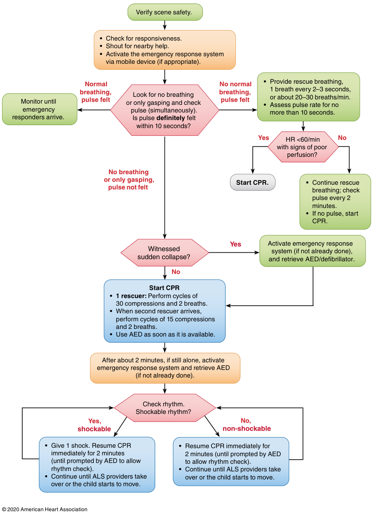

Verify scene safety. • Check for responsiveness. • Shout for nearby help. • Activate the emergency response system via mobile device (if appropriate). Normal  No normal  • Provide rescue breathing, 1 breath every 2–3 seconds, breathing,  breathing, Look for no breathing   or about 20–30 breaths/min. Monitor until   pulse felt or only gasping and check  pulse felt • Assess pulse rate for no emergency   pulse (simultaneously).  more than 10 seconds. responders arrive. Is pulse  definitely  felt within 10 seconds? Yes HR &lt;60/min No with signs of poor perfusion? No breathing or only gasping,  Start CPR. • Continue rescue pulse not felt breathing; check pulse every 2 minutes. • If no pulse, start CPR. Yes Activate emergency response Witnessed  system (if not already done), sudden collapse? and retrieve AED/defibrillator. No Start CPR • 1 rescuer:  Perform cycles of 30 compressions and 2 breaths. • When second rescuer arrives, perform cycles of 15 compressions and 2 breaths. • Use AED as soon as it is available. After about 2 minutes, if still alone, activate emergency response system and retrieve AED (if not already done). Check rhythm. Shockable rhythm? Yes, No, shockable non-shockable • Give 1 shock. Resume CPR  • Resume CPR immediately for immediately for 2 minutes 2 minutes (until prompted by AED (until prompted by AED to allow  to allow rhythm check). rhythm check). • Continue until ALS providers take • Continue until ALS providers take  over or the child starts to move. over or the child starts to move. © 2020 American Heart Association 

**Fig. 82.9 2020 American Heart Association Pediatric Cardiac Arrest Algorithm for Single Rescuer.** _AED_ , automated external defibrillator; _ALF_ , Advanced Life Support; _CPR_ , cardiopulmonary resuscitation; _HR_ , heart rate. (From Atkins DL, Berger S, Duff JP, et al. Part 11: Pediatric Basic Life Support and Cardiopulmonary Resuscitation Quality: 2020 American Heart Association Guidelines Update for Cardiopulmonary Resuscitation and Emergency Cardiovascular Care. _Circulation_ . 2020;132[18 suppl 2]:S519–525. https://cpr.heart.org/en/resuscitation- science/cpr- and- ecc- guidelines.)

<!-- PDF page 27 -->

### Pediatric Basic Life Support Algorithm for Healthcare Providers – 2 or More Rescuers

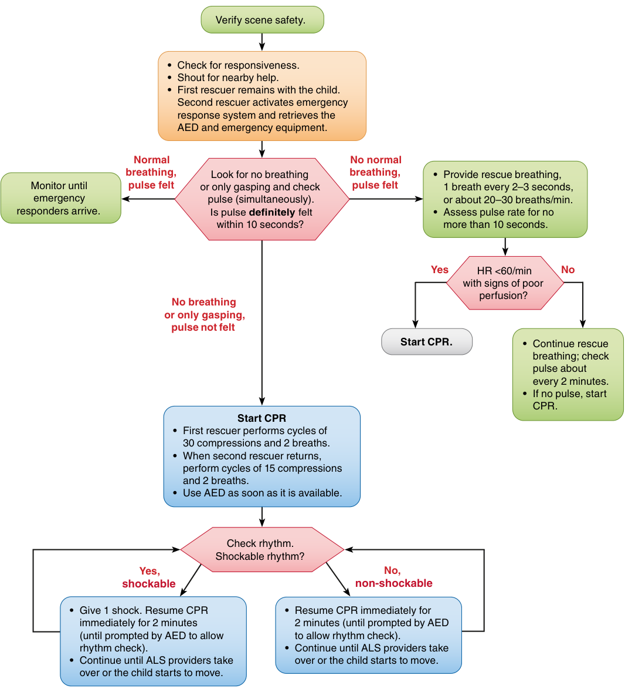

Verify scene safety. • Check for responsiveness. • Shout for nearby help. • First rescuer remains with the child. Second rescuer activates emergency response system and retrieves the AED and emergency equipment. Normal  No normal breathing,  Look for no breathing   breathing,   • Provide rescue breathing, Monitor until   pulse felt or only gasping and check  pulse felt 1 breath every 2–3 seconds, emergency   pulse (simultaneously).  or about 20–30 breaths/min. responders arrive. Is pulse  definitely  felt  • Assess pulse rate for no within 10 seconds? more than 10 seconds. Yes HR &lt;60/min   No with signs of poor perfusion? No breathing or only gasping, pulse not felt Start CPR. • Continue rescue breathing; check pulse about every 2 minutes. • If no pulse, start CPR. Start CPR • First rescuer performs cycles of 30 compressions and 2 breaths. • When second rescuer returns, perform cycles of 15 compressions and 2 breaths. • Use AED as soon as it is available. Check rhythm. Shockable rhythm? Yes, No, shockable non-shockable • Give 1 shock. Resume CPR  • Resume CPR immediately for immediately for 2 minutes 2 minutes (until prompted by AED (until prompted by AED to allow  to allow rhythm check). rhythm check). • Continue until ALS providers take • Continue until ALS providers take  over or the child starts to move. over or the child starts to move. 

© 2020 American Heart Association

**Fig. 82.10 2020 American Heart Association Pediatric Cardiac Arrest Algorithm for Two or More Rescuers.** _AED_ , automated external defibrillator; _ALF_ , Advanced Life Support; _CPR_ , cardiopulmonary resuscitation; _HR_ , heart rate. (From Atkins DL, Berger S, Duff JP, et al. Part 11: Pediatric Basic Life Support and Cardiopulmonary Resuscitation Quality: 2020 American Heart Association Guidelines Update for Cardiopulmonary Resuscitation and Emergency Cardiovascular Care. _Circulation_ . 2020;132[18 suppl 2]:S519–S525. https://cpr.heart.org/en/resuscitation- science/cpr- and- ecc- guidelines.)

<!-- PDF page 28 -->

patients, management of different life- threatening arrhythmias, PEA arrest/asystole, or VF/VT arrest is similar to adults except the dosage (defibrillation/medication) for children is weight- based. Actual body weight is recommended to calculate initial resuscitation drug doses. The 2020 AHA Guidelines for CPR and ECC on pediatric ACLS for bradycardia, tachycardia, and pulseless arrest are illustrated in Figs. 82.11–82.13.104

For bradycardia, continue to support airway, ventilation, oxygenation, and chest compressions. Emergency TCP may be life- saving if the bradycardia is due to complete heart block or sinus node dysfunction unresponsive to the aforementioned medications, especially if it is associated with congenital or acquired heart disease. For SVT, attempt vagal stimulation first, unless the patient is hemodynamically unstable, or the procedure will delay chemical or electric cardioversion. An IV/IO dose of adenosine 0.1 mg/ kg rapid bolus is used first; if it fails, then a second dose of 0.2 mg/kg rapid bolus is given – the maximum second dose is 12 mg. Verapamil, 0.1 to 0.3 mg/kg, is also effective in terminating SVT in older children, but it should not be used in infants without expert consultation because it may cause potential myocardial depression, hypotension, and cardiac arrest. When cardioversion is indicated in unstable SVT, start with a dose of 0.5 to 1 J/kg. If unsuccessful, increase the dose to 2 J/kg. For a patient with SVT unresponsive to vagal maneuvers and adenosine and/or electric cardioversion, consider amiodarone 5 mg/kg IO/IV or procainamide 15 mg/kg IO/IV; for hemodynamically stable patients, expert consultation is strongly recommended prior to administration. For wide- complex (>0.09 second) tachycardia, consider electric cardioversion after sedation using a starting energy dose of 0.5 to 1 J/kg. If that fails, increase the dose to 2 J/kg.

Regarding resuscitation medication, it is reasonable to administer epinephrine in pediatric cardiac arrest. For shock- refractory VF or persistent VT, either amiodarone or lidocaine may be used. Calcium administration is not recommended for pediatric cardiopulmonary arrest in the absence of documented hypocalcemia, calcium channel blocker overdose, hypermagnesemia, or hyperkalemia. Routine administration of sodium bicarbonate is not recommended in cardiac arrest. A dose of 0.02 mg/ kg of atropine may be considered before emergency intubation.

Observational data from a registry of pediatric IHCA showed improved survival to hospital discharge with the use of ECMO cardiopulmonary resuscitation (ECPR) in patients with surgical cardiac diagnoses.105 For children with underlying cardiac disease, when ECPR is initiated in a critical care setting, long- term survival has been reported even after more than 50 minutes of conventional CPR.105,106 When ECPR is used during cardiac arrest, the outcome for children with underlying cardiac disease is better than for those with noncardiac disease. Therefore, ECPR may be considered for pediatric patients with cardiac diagnoses who have IHCA in settings with existing extracorporeal membrane oxygenation (ECMO) protocols, expertise, and equipment.

For infants and children remaining comatose after OHCA, it is reasonable either to maintain 5 days of continuous normothermia (36°C–37.5°C) or to maintain 2 days of

initial continuous hypothermia (32°C–34°C), followed by 3 days of continuous normothermia. Fever (temperature 38°C or higher) should be aggressively treated with antipyretics and cooling devices after ROSC.107

Myocardial dysfunction and vascular instability are common after resuscitation from cardiac arrest.108 After ROSC, IV fluids and/or inotropes or vasoactive drugs are recommended to maintain a systolic blood pressure greater than fifth percentile for age. When appropriate resources are available, continuous arterial pressure monitoring is recommended to identify and treat hypotension.

### HIGHLIGHTING THE SIMILARITIES OR DIFFERENCES VERSUS ADULT RESUSCITATION

The similarities and differences of pediatric and adult BLS are listed in Table 82.1 and discussed in the Basic Life Support section. The asphyxial nature of most pediatric cardiac arrests necessitates effective ventilation as part of the CPR. Conventional CPR (rescue breathing and chest compressions) should be provided for pediatric cardiac arrests. For infants, a manual defibrillator is preferred when a shockable rhythm is identified by a trained health care provider. An AED with a pediatric attenuator is also preferred for children less than 8 years of age. If neither is available, an AED without a dose attenuator may be used. As previously described, the defibrillation energy dose and resuscitation medication doses are all weight based.

### FOREIGN BODY AIRWAY OBSTRUCTION

Although recognition and management has improved, foreign body aspiration (FBA) remains common in children. FBA can occur in children of all ages, although most occur in children younger than 4 years of age, with a peak incidence between the first and second years of age.109 Liquids are the most common source for infant choking while small objects (e.g., balloons, food) are responsible for most childhood choking.110 Clinical symptoms and signs vary based on the location of the foreign body and the degree of obstruction. The clinical presentation may also change over time as a result of movement of the foreign body within the respiratory tract.

If a child is making sounds or coughing, the adult should carefully monitor but not intervene. If the child is choking, abdominal thrusts (the Heimlich maneuver) or back blows should be performed until the obstruction is relieved. In either circumstance, if the choking infant or child becomes unresponsive, CPR should be started with 30 chest compressions, followed by an airway examination to identify the presence of the foreign body. Two rescue breaths should be attempted. If the airway obstruction is not relieved, then CPR should be restarted and continued until the airway obstruction is relieved. If a foreign body is visible above the vocal cords during laryngoscopy, an attempt should be made to extract it with Magill forceps. If the foreign body is below the vocal cords, it is reasonable to attempt to push the foreign body more distally to reestablish a patent airway. This may allow for rescue oxygenation and ventilation while preparing for more definitive management.

<!-- PDF page 29 -->

### Pediatric Bradycardia with a Pulse Algorithm

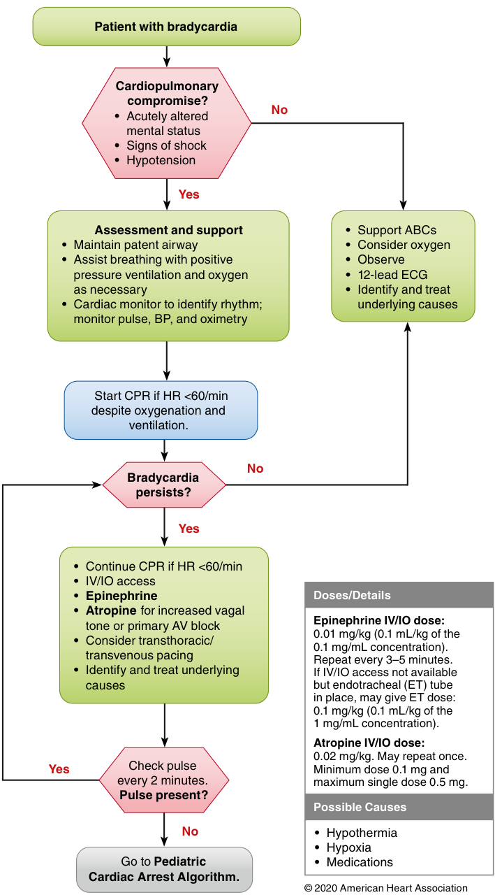

Patient with bradycardia Cardiopulmonary compromise? No • Acutely altered mental status • Signs of shock • Hypotension Yes Assessment and support • Support ABCs • Maintain patent airway • Consider oxygen • Assist breathing with positive   • Observe pressure ventilation and oxygen   • 12-lead ECG as necessary • Identify and treat • Cardiac monitor to identify rhythm;  underlying causes monitor pulse, BP, and oximetry Start CPR if HR &lt;60/min despite oxygenation and ventilation. No Bradycardia persists? Yes • Continue CPR if HR &lt;60/min • IV/IO access • Epinephrine Doses/Details • Atropine  for increased vagal Epinephrine IV/IO dose: tone or primary AV block • Consider transthoracic/  0.01 mg/kg (0.1 mL/kg of the 0.1 mg/mL concentration). transvenous pacing Repeat every 3–5 minutes. • Identify and treat underlying  If IV/IO access not available causes but endotracheal (ET) tube in place, may give ET dose: 0.1 mg/kg (0.1 mL/kg of the 1 mg/mL concentration). Atropine IV/IO dose: 0.02 mg/kg. May repeat once. Yes Check pulse  Minimum dose 0.1 mg and every  2 minutes.   maximum single dose 0.5 mg. Pulse present? Possible Causes No • Hypothermia • Hypoxia Go to  Pediatric  • Medications Cardiac Arrest Algorithm. © 2020 American Heart Association 

**Fig. 82.11 2020 American Heart Association Pediatric Bradycardia with a Pulse and Poor Perfusion Algorithm.** _ABC_ , airway, breathing, circulation; _AV_ , atrioventricular; _BP_ , blood pressure; _CPR_ , cardiopulmonary resuscitation; _ECG_ , electrocardiogram; _HR_ , heart rate; _IO_ , intraosseous; _IV_ , intravenous. (From de Caen AR, Berg MD, Chameides L, et al. Part 12: Pediatric Advanced Life Support: 2020 American Heart Association Guidelines Update for Cardiopulmonary Resuscitation and Emergency Cardiovascular Care. _Circulation_ . 2020;132[18 suppl 2]:S526–S542. https://cpr.heart.org/en/resuscitation- science/cpr- and- ecc- guidelines.)

<!-- PDF page 30 -->

### Pediatric Tachycardia with a Pulse Algorithm

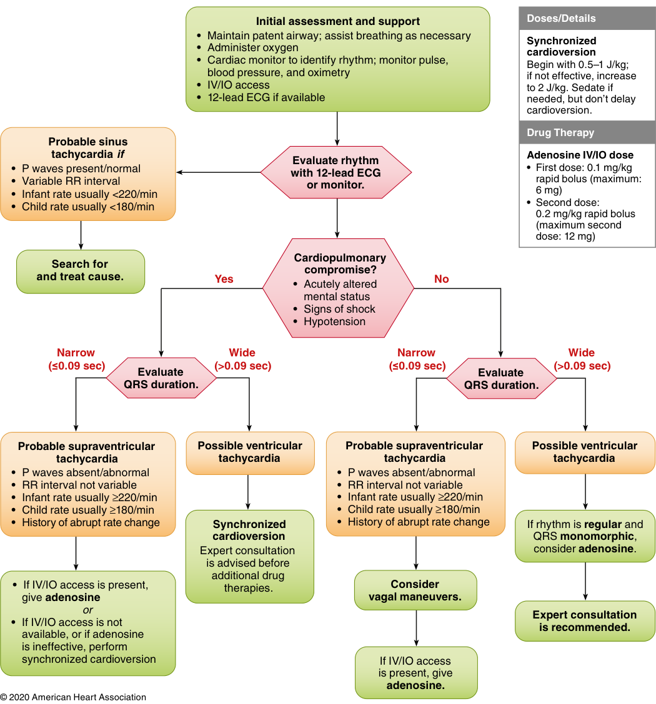

Initial assessment and support Doses/Details • Maintain patent airway; assist breathing as necessary Synchronized • Administer oxygen cardioversion • Cardiac monitor to identify rhythm; monitor pulse, Begin with 0.5–1 J/kg; blood pressure, and oximetry if not effective, increase • IV/IO access to 2 J/kg. Sedate if • 12-lead ECG if available needed, but don’t delay cardioversion. Drug Therapy Probable sinus tachycardia  if Adenosine IV/IO dose Evaluate rhythm • P waves present/normal with 12-le ad ECG  • First dose: 0.1 mg/kg • Variable RR interval or monitor. rapid bolus (maximum: 6 mg) • Infant rate usually &lt;220/min • Second dose: • Child rate usually &lt;180/min 0.2 mg/kg rapid bolus (maximum second dose: 12 mg) Cardiopulmonary Search for compromise? and treat cause. Yes No • Acutely altered mental status • Signs of shock • Hypotension Narrow Wide Narrow Wide ( ≤ 0.09 sec) (>0.09 sec) ( ≤ 0.09 sec) (>0.09 sec) Evaluate  Evaluate QRS duration. QRS duration. Probable supraventricular  Possible ventricular  Probable supraventricular  Possible ventricular tachycardia tachycardia tachycardia tachycardia • P waves absent/abnormal • P waves absent/abnormal • RR interval not variable • RR interval not variable • Infant rate usually ≥220/min • Infant rate usually ≥220/min • Child rate usually ≥180/min • Child rate usually ≥180/min • History of abrupt rate change Synchronized  • History of abrupt rate change If rhythm is  regular  and cardioversion QRS  monomorphic , Expert consultation  consider  adenosine . is advised before additional drug • If IV/IO access is present,  therapies. Consider give  adenosine vagal maneuvers. or Expert consultation • If IV/IO access is not is recommended. available, or if adenosine is ineffective, perform synchronized cardioversion If IV/IO access is present, give adenosine. © 2020 American Heart Association 

**Fig. 82.12 2020 American Heart Association Pediatric Tachycardia with a Pulse and Poor Perfusion Algorithm.** _ECG_ , electrocardiogram; _IO_ , intraosseous; _IV_ , intravenous. (From de Caen AR, Berg MD, Chameides L, et al. Part 12: Pediatric Advanced Life Support: 2020 American Heart Association Guidelines Update for Cardiopulmonary Resuscitation and Emergency Cardiovascular Care. _Circulation_ . 2020;132[18 suppl 2]:S526–542. https://cpr.heart.org/ en/resuscitation- science/cpr- and- ecc- guidelines.)

### DROWNING

Drowning is an important cause of OHCA in children and results in approximately 1100 pediatric deaths in the United States annually.111 More children aged 1 to 4 years die from drowning than from any other cause, except birth

defects. It remains one of the leading causes of death in chil-

dren and adolescents worldwide. The most important positive prognostic indicators include shorter submersion time, salt versus freshwater submersion, and time from rescue to receiving CPR.112,113 Thus prehospital care is paramount to improve patient outcome.

<!-- PDF page 31 -->

### Pediatric Cardiac Arrest Algorithm

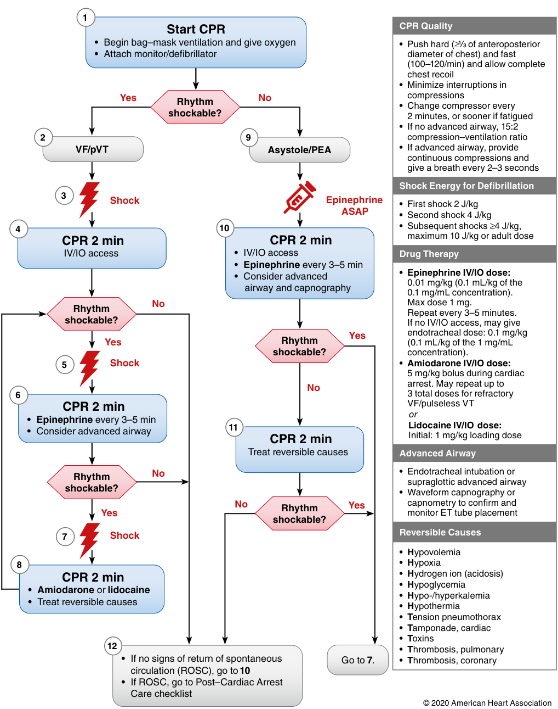

1 Start CPR CPR Quality • Begin bag–mask ventilation and give oxygen • Push hard (≥½ of anteroposterior • Attach monitor/defibrillator diameter of chest) and fast (100–120/min) and allow complete chest recoil • Minimize interruptions in Yes No compressions Rhythm • Change compressor every shockable? 2 minutes, or sooner if fatigued • If no advanced airway, 15:2 2 9 compression–ventilation ratio VF/pVT Asystole/PEA • If advanced airway, provide continuous compressions and give a breath every 2–3 seconds Shock Energy for Defibrillation 3 Shock Epinephrine • First shock 2 J/kg ASAP • Second shock 4 J/kg 4 10 • Subsequent shocks ≥4 J/kg, CPR 2 min CPR 2 min maximum 10 J/kg or adult dose IV/IO access • IV/IO access Drug Therapy • Epinephrine  every 3–5 min • Consider advanced  • Epinephrine IV/IO dose: 0.01 mg/kg (0.1 mL/kg of the airway and capnography 0.1 mg/mL concentration). No Max dose 1 mg. Rhythm Repeat every 3–5 minutes. shockable? If no IV/IO access, may give Yes endotracheal dose: 0.1 mg/kg Yes Rhythm  (0.1 mL/kg of the 1 mg/mL shockable? concentration). 5 Shock • Amiodarone IV/IO dose: 5 mg/kg bolus during cardiac No arrest. May repeat up to 6 3 total doses for refractory CPR 2 min VF/pulseless VT •• Consider advanced airway Epinephrine  every 3–5 min 11  or Lidocaine IV/IO dose: CPR 2 min Initial: 1 mg/kg loading dose Treat reversible causes Advanced Airway Rhythm  No • Endotracheal intubation or supraglottic advanced airway shockable? • Waveform capnography or Yes No Rhythm  Yes capnometry to confirm and monitor ET tube placement shockable? 7 Shock Reversible Causes • H ypovolemia 8 • H ypoxia CPR 2 min • H ydrogen ion (acidosis) • H ypoglycemia • A miodarone  or  lidocaine • H ypo-/hyperkalemia • Treat reversible causes • H ypothermia • T ension pneumothorax • T amponade, cardiac • T oxins 12 • T hrombosis, pulmonary • If no signs of return of spontaneous  Go to  7 . • T hrombosis, coronary circulation (ROSC), go to  10 • If ROSC, go to Post–Cardiac Arrest Care checklist © 2020 American Heart Association 

**Fig. 82.13 2020 American Heart Association Pediatric Cardiac Arrest Algorithm.** _CPR_ , cardiopulmonary resuscitation; _ET_ , endotracheal; _IO_ , intraosseous; _IV_ , intravenous; _PEA_ , pulseless electric activity; _pVT_ , pulseless ventricular tachycardia; _VF_ , ventricular fibrillation; _VT_ , ventricular tachycardia. (From de Caen AR, Berg MD, Chameides L, et al. Part 12: Pediatric Advanced Life Support: 2020 American Heart Association Guidelines Update for Cardiopulmonary Resuscitation and Emergency Cardiovascular Care. _Circulation_ . 2020;132[18 suppl 2]:S526–S542. https://cpr.heart.org/en/resuscitation- science/cpr- and- ecc- guidelines.)

<!-- PDF page 32 -->

When a drowning infant or child is encountered by a single rescuer, a CPR pattern of 2 minutes of 30:2 compressionto- ventilation should be provided before summoning help. If two or more rescuers are available, then help should be immediately summoned. Oxygen and ventilation should be provided at the earliest opportunity because respiratory arrest is usually the primary etiology. Heimlich maneuver is not beneficial in the case of drowned patients because it potentially increases time to intubation and the possibility of gastric aspiration.114 Cuffed ETTs are preferred due to decreased lung compliance secondary to submersioninduced lung injury. The outcomes of survivors of cardiac arrest secondary to drowning are usually better compared with other respiratory etiologies.115 However, it is very difficult to predict prognosis from initial presentation, with many of the most unexpected physiologic recoveries occurring in the young; therefore, aggressive resuscitation of a patient following submersion should always be undertaken until either ROSC or arrival at the emergency department, at which point further efforts such as ECMO may be considered.

### SUDDEN UNEXPLAINED DEATHS

Unexpected and unexplained deaths in infants and children can result from cardiac and noncardiac etiology. Cardiac etiology is often attributed to cardiac arrhythmia caused by cardiac ion- channel dysfunction secondary to genetic variations or mutations, which may be undetectable in a conventional autopsy. In 2% to 10% of infants or children and 14% to 20% of young adults who experience sudden cardiac death, channelopathies are found on autopsy.116,117 First- and second- degree relatives of young children who unexpectedly die should undergo a genetic analysis to detect undiagnosed channelopathies. Noncardiac etiologies of sudden unexplained deaths include epilepsy, upper airway obstruction from infectious/noninfectious reasons resulting in respiratory arrest, febrile seizures, infection, metabolic disorders, and hippocampal pathology.118

### TERMINATION OF PEDIATRIC RESUSCITATION ATTEMPTS

Accurate and reliable prognostication during pediatric cardiac arrest would allow termination of CPR when it is futile, while encouraging continued CPR in patients with a potential for good recovery. Several post- ROSC factors have been studied as possible predictors of survival and neurologic outcome after pediatric cardiac arrest. These include the presence of hypotension, serum neurologic biomarkers, and serum lactate. Although these factors are associated with better or worse outcomes, no single factor predicts outcome with sufficient accuracy to recommend termination or continuation of CPR. The AHA 2020 Guidelines for CPR and ECC on pediatric ACLS recommend that multiple variables are used when attempting to prognosticate outcomes during cardiac arrest.

Observational data from two small pediatric studies showed that a continuous and reactive tracing on an EEG performed in the first 7 days after cardiac arrest is associated with a significantly higher likelihood of good neurologic outcome at hospital discharge. In contrast, an EEG

demonstrating a discontinuous or isoelectric tracing is associated with a poor neurologic outcome at hospital discharge.119,120

Thus, EEG within the first 7 days after pediatric cardiac arrest may be considered in prognosticating neurologic outcome at the time of hospital discharge, although it should obviously never be used as the sole criterion.

Prolonged resuscitations might be considered for infants and children with recurring or refractory VF or VT, particularly if cardiopulmonary support with ECMO is available and the source for the cardiac arrest is believed reversible.121

## Future of Resuscitation Science and Care

### INDIVIDUALIZED CARDIOPULMONARY RESUSCITATION

As described earlier in this chapter, survival, and neurologic outcome in victims of cardiac arrest are critically dependent on the duration of the “no- flow” arrest (circulatory arrest with no chest compressions), as well as the quality of chest compressions during the “low- flow” phase of CPR. Therefore, it is important to provide early and highquality chest compressions and to use every measure to facilitate early ROSC, irrespective of the cause of the arrest. Recent data have, nevertheless, shown that in addition to this general approach, interventions aimed at specific conditions or physiologic parameters can also affect the chance of ROSC and survival. This individualized approach to CPR has become increasingly important given the persistent poor outcome after cardiac arrest despite efforts to improve implementation of current guidelines, AED accessibility, and provider training.

The use of ECG filtering techniques and fibrillation analysis algorithms has been investigated to identify the optimal time for successful defibrillation from VF. A problem inherent to this technique has been the need to stop chest compressions for rhythm analysis, which is proven to adversely affect the effectiveness of the subsequent chest compressions. The recent development of the “See- Through” technology to extract CPR artifacts from the ECG is promising, as it allows continued chest compressions during ECG analysis but has been criticized for a relatively low specificity that prohibits its incorporation into the AED diagnostic algorithm.122 Amplitude spectral area (AMSA) is an index for analyzing ventricular fibrillation waveforms to predict ROSC after defibrillation. Nakagawa and associates showed that change in AMSA (ΔAMSA) before the electric shock reliably predicted ROSC in 285 VF patients.123 Segal and associates report a moderate positive correlation between ETCO2 and AMSA during CPR in pigs.124

As was described in the 2020 AHA Guidelines for CPR and ECC ACLS update, provider performance feedback during CPR can also help optimize CPR quality. Despite the absence of convincing evidence, it is reasonable to use quantitative waveform capnography, arterial pressure monitoring, and central venous oxygen saturation when feasible to monitor and optimize CPR quality and guide vasopressor therapy. Gonzalez- Otero and associates recently reported that an accelerometer- based real- time feedback system to

<!-- PDF page 33 -->

guide rescuers during CPR can improve adherence to published resuscitation guidelines. Spectral analysis of chest acceleration was used to compute the depth and rate of chest compressions.125 The use of a novel CPR card feedback device was also shown to improve the quality of chest compressions.126

In addition to interventions aimed at improving the quality of chest compressions, recent data suggest that optimization of oxygen delivery to the ischemic tissue can also be complemented by enhanced ventilation strategies. Chest compression synchronized ventilation (CCSV) is designed to detect starting chest compression efforts and to initiate an instant inspiratory pressure through reprogramming of the pressure support ventilation mode. It comprises an inverse trigger, cycling mechanisms, and higher inspiratory pressure levels up to 60 mbar. Kill and colleagues showed that when compared with intermittent positive pressure ventilation (IPPV), CCSV results in a higher PaO2 without an arterial blood pressure drop during resuscitation in pigs.114 The same group of investigators reported that CCSV is associated with better delivery of the respiratory parameters and minimizes excessive inspiratory pressures that can potentially lead to pulmonary injury during simulated CPR.127

### Extracorporeal Membrane Oxygenation

ECMO with CPR (ECPR) continues to evolve as a therapeutic option for refractory cardiac arrest.116 Its use has significantly increased over the last few years, and new techniques are being developed to enhance its feasibility and access.128 In a meta- analysis of 10 recent publications, Kim and associates reported a trend toward improved shortterm (3–6 months) survival and neurologic outcome with ECPR as compared with conventional CPR.129 Debaty and associates reported that shorter low- flow duration, shockable cardiac rhythm, higher arterial pH value, and lower serum lactate concentration on hospital admission are associated with better outcomes for ECPR recipients after OHCA.130 Dennis and associates confirmed that in selected patients with refractory cardiac arrest, ECPR may provide temporary support as a bridge to intervention or recovery. Favorable survival and neurologic outcomes were reported in one- third of patients with pre- ECMO lactate levels predictive of mortality.131

Controlled Automated Reperfusion of the whoLe body (CARL) is a new type of extracorporeal circulation device that provides continuous adjustments of reperfusion conditions with the recirculating blood according to the individual readings of each patient. It combines measures to control arterial blood pressure and blood flow with TTM, as well as control of the acid–base status, oxygen content, osmolarity, and electrolytes to minimize the ischemia– reperfusion injuries. Based on data from experimental studies, recently Trummer and associates successfully employed CARL after 120 minutes of normothermic CPR in a patient. Except for a spinal cord injury resulting in lower extremity weakness, the patient was reported to have survived without any neurologic deficits.132

_Emergency preservation for delayed resuscitation_ (EPR) or suspended animation is another promising approach to enable intact survival in patients who are expected to fail conventional resuscitation techniques. It was developed by the Safar team at the University of Pittsburgh to apply

profound hypothermia to preserve the organism and avoid irreversible organ damage and buy enough time to obtain surgical hemostasis in victims of exsanguination cardiac arrest. This concept has been tested successfully in multiple large animal studies, confirming that full recovery is possible for up to 2 hours of no- flow cardiac arrest when profound hypothermia to 10°C is induced within minutes, and is then followed by delayed resuscitation using cardiopulmonary bypass or extracorporeal circulation. Tisherman _et al._ and associates recently reported the development of the first multicenter clinical trial of EPR in victims of traumatic cardiac arrest.133 If successful, EPR can also be employed as an alternative resuscitation approach in patients with refractory intraoperative exsanguination cardiac arrest.

### COORDINATED POSTRESUSCITATION CARE

Postresuscitation syndrome is a complex pathophysiologic condition first described by Negovski _et al._ in the 1970s, and can significantly affect the outcome after cardiac arrest.134 It is characterized by myocardial dysfunction, neurologic injury, and systemic perturbations associated with the reperfusion of the ischemic tissue. Post–cardiac arrest care must therefore incorporate measures to minimize the systemic ischemic–reperfusion response, improve myocardial function, and prevent postresuscitation brain injury and other systemic complications. It is recommended that survivors of cardiac arrest are admitted to specialized centers for early goal- directed therapy, including optimization of the hemodynamics and respiratory parameters, urgent coronary angiography, and TTM. It is important to note that TTM is considered in all comatose survivors of cardiac arrest, whose temperature should be monitored closely (goal between 32°C and 36°C) for at least 24 hours. It is also recommended to continue monitoring the temperature and maintain normothermia (treat fever) beyond this window.

Prognostication should not occur until 72 hours after ROSC or, if TTM is provided, 72 hours after completion of TTM. A useful tool to predict outcome after cardiac arrest is the GO- FAR or the Good Outcome Following Attempted Resuscitation score, which was derived from the Get With the Guidelines- Resuscitation registry and identifies a large proportion of patients (28.3%) who have a low or very low likelihood (&lt;2%) of achieving good outcome.135 Seizure control is also important, but neuroprotective agents such as thiopental, magnesium, and calcium channel inhibitors are not routinely administered and have not been shown to improve outcomes. With the evolution of ECPR, nevertheless, there has been a resurgence of studies aimed at identifying effective neuroprotective agents. Examples include adenosine 2A receptor (A2AR) agonists, which have been suggested to attenuate the ischemia–reperfusion injury during ECPR.136 A2AR activation can reduce proinflammatory mediators, endothelial adhesion molecule expression, and transmigration of circulating inflammatory cells into tissue through inhibition of lymphocytes, macrophages, monocytes, platelets, and neutrophils. Inhaled nitric oxide (iNO) is also an emerging approach to the treatment of the post–cardiac arrest syndrome and to reducing the ischemia–reperfusion injury. In a pig model of cardiac arrest precipitated

<!-- PDF page 34 -->

by lipopolysaccharide- induced hypotension, Morgan and associates showed that pulmonary vasodilation with iNO improved short- term survival and intra- arrest hemodynamics.137 Human studies are forthcoming, but there are currently insufficient data to recommend routine use of any of these novel therapies.

53.  Centers for Disease Control and Prevention. _State Unintentional Drug Overdose Reporting System (SUDORS)_ . Atlanta, GA: US Department of Health and Human Services, CDC; 2022. https://www.cdc.gov/dr ugoverdose/fatal/dashboard.

54. _WISQARS™ – Web- Based Injury Statistics Query and Reporting System: Fatal Injury and Violence Data_ . 2021. https://www.cdc.gov/inju ry/wisqars/fatal/index.html.

55.  Feigin VL, et al. _Neuroepidemiology_ . 2015;45(3):161.

56.  Townsend N, et al. _Eur Heart J_ . 2016;37(42):3232.

### Acknowledgment

The editors and publisher would like to thank Drs. Brian P. McGlinch and Roger D. White for contributing a chapter on this topic in an earlier edition of this work. It has served as the foundation for the current chapter.

57.  GBD 2019 Stroke Collaborators. _Lancet Neurol_ . 2021;20(10):795.

58.  Hacke W, et al. _Lancet_ . 2004;363(9411):768.

59.  National Institute of Neurological Disorders and Stroke rt- PA Stroke Study Group. _N Engl J Med_ . 1995;333(24):1581.

60.  Girotra S, et al. _Heart_ . 2015;101:1943.

61.  Callaway CW, et al. _Circulation_ . 2015;132(18 suppl 2):S465.

62.  Garcia S, et al. _J Am Heart Assoc_ . 2016;5:e002670.

63.  Bernard SA, et al. _N Engl J Med_ . 2002;346(8):557.

### Complete references available online at expertconsult.com.

### References

1. _Cardiac Arrest Registry to Enhance Survival (CARES) National Summary Report_ . 2022. CARES 2022 Annual Report. https://mycares. net/sitepages/uploads/2023/2022_flipbook/index.html?page=6.

2.  Tsao CW, et al. _Circulation_ . 2022;145(8):e153.

3.  Daya MR, et al. _Resuscitation_ . 2015;91:108.

4.  Wnent J, et al. _Scand J Trauma Resusc Emerg Med_ . 2015;23:7.

5.  Stromsoe A, et al. _Eur Heart J_ . 2015;36(14):863.

6.  Ristagno G, et al. _Crit Care Clin_ . 2009;25(1):133.

7.  Criley JM, et al. _Circulation_ . 1986;74(6 Pt 2):IV42.

8.  Kuhn C, et al. _Resuscitation_ . 1991;22(3):275.

9.  Deshmukh HG, et al. _Chest_ . 1989;95(5):1092.

10.  Redberg RF, et al. _Circulation_ . 1993;88(2):534.

11.  Higano ST, et al. _Mayo Clin Proc_ . 1990;65(11):1432.

12.  Merchant RM, et al. _Circulation_ . 2020;142(16 suppl 2):S337. 13.  Bahr J, et al. _Resuscitation_ . 1997;35(1):23. 14.  Stiell IG, et al. _Circulation_ . 2014;130(22):1962.

15.  Idris AH, et al. _Crit Care Med_ . 2015;43(4):840.

16.  Christenson J, et al. _Circulation_ . 2009;120(13):1241.

17.  Vaillancourt C, et al. _Resuscitation_ . 2011;82(12):1501.

18.  Svensson L, et al. _N Engl J Med_ . 2010;363(5):434.

19.  Rea TD, et al. _N Engl J Med_ . 2010;363(5):423.

20.  Baker PW, et al. _Resuscitation_ . 2008;79(3):424.

21.  Jacobs IG, et al. _Emerg Med Australas_ . 2005;17(1):39.

22.  Deakin CD. _Curr Opin Crit Care_ . 2011;17(3):231.

23.  Diack AW, et al. _Med Instrum_ . 1979;13(2):78.

24.  Schneider T, et al. _Circulation_ . 2000;102(15):1780.

25.  Jost D, et al. _Circulation_ . 2010;121(14):1614.

26.  Berdowski J, et al. _Circulation_ . 2010;122(11):1101. 27.  Davis D, et al. _J Hosp Med_ . 2016;11(4):264.

28.  Gudipati CV, et al. _Circulation_ . 1988;77(1):234.

29.  Sanders AB, et al. _JAMA_ . 1989;262(10):1347.

30.  Callaham M, Barton C. _Crit Care Med_ . 1990;18(4):358.

31.  Meaney PA, et al. _Circulation_ . 2013;128(4):417. 32.  Rivers EP, et al. _Ann Emerg Med_ . 1992;21(9):1094. 33.  Sanders AB, et al. _Am J Emerg Med_ . 1985;3(1):11. 34.  Kern KB. _Crit Care Med_ . 2000;28(suppl 11):N186. 35.  Hasegawa K, et al. _JAMA_ . 2013;309(3):257.

36.  Shin SD, et al. _Resuscitation_ . 2012;83(3):313.

37.  Tanabe S, et al. _J Emerg Med_ . 2013;44(2):389.

38.  Grmec S. _Intensive Care Med_ . 2002;28(6):701.

39.  Donnino MW, et al. _BMJ_ . 2014;348:3028.

40.  Goto Y, et al. _Crit Care_ . 2013;17(5):R188.

41.  Gueugniaud PY, et al. _N Engl J Med_ . 1998;339(22):1595.

42.  Mentzelopoulos SD, et al. _JAMA_ . 2013;310(3):270.

43.  Peberdy MA, et al. _Circulation_ . 2017;135(24):e1115.

44.  Wik L, et al. _JAMA_ . 2005;293(3):299.

45.  Olasveengen TM, et al. _Resuscitation_ . 2008;76(2):185.

46.  Rubertsson S, et al. _Crit Care Med_ . 1995;23(12):1984.

47.  Rubertsson S, Karlsten R. _Resuscitation_ . 2005;65(3):357.

48.  Axelsson C, et al. _Resuscitation_ . 2009;80(10):1099.

49.  Rubertsson S, et al. _JAMA_ . 2014;311(1):53.

50.  Varriale P, Maldonado JM. _Crit Care Med_ . 1997;25(10):1717.

51.  Memtsoudis SG, et al. _Anesth Analg_ . 2006;102(6):1653.

52.  Tsou PY, et al. _Resuscitation_ . 2017;114:92.

64.  Hypothermia after Cardiac Arrest Study Group. _N Engl J Med_ . 2002;346(8):549.

65.  Nolan JP, et al. _Circulation_ . 2003;108(1):118.

66.  Steen PA, et al. _Anesthesiology_ . 1983;58(6):527.

67.  Yenari MA, Han HS. _Nat Rev Neurosci_ . 2012;13(4):267.

68.  Nielsen N, et al. _N Engl J Med_ . 2013;369(23):2197.

69.  Cariou A, et al. _Ann Intensive Care_ . 2017;7(1):70.

70.  Madden LK, et al. _Neurocrit Care_ . 2017;27:468.

71.  Donnino MW, et al. _Circulation_ . 2015;132:2448.

72.  Geocadin RG, et al. _Neurology_ . 2017;88:2141.

73.  Bernard SA, et al. _Circulation_ . 2016;134:797.

74.  Vaity C, et al. _Crit Care_ . 2015;19(1):103.

75.  Choi HA, et al. _Nat Rev Neurol_ . 2012;8:214.

76.  Holzer M. _N Engl J Med_ . 2010;363:1256.

77.  Gebhardt K, et al. _Resuscitation_ . 2013;84:1062.

78.  Nolan JP, et al. _Resuscitation_ . 2008;79(3):350.

79.  Johnson NJ, et al. _Chest_ . 2018;153(6):1466.

80.  Pitcher JH, et al. _Neurocrit Care_ . 2018;29(1):69.

81.  Kilgannon JH, et al. _JAMA_ . 2010;303(21):2165.

82.  McKenzie N, et al. _Resuscitation_ . 2017;111:116.

83.  Behr ER, et al. _Eur Heart J_ . 2008;29:1670.

84.  Abdelghani SA, et al. _Ochsner J_ . 2016;16:280.

85.  Sosland RP, Gupta K. _Circulation_ . 2008;118:e517.

86.  Zafiropoulos A, et al. _Echo Res Pr_ . 2014;1:D15.

87.  Cronberg T. _Lancet Neurol_ . 2018;17:291.

88.  Dragancea I, et al. _Resuscitation_ . 2015;93:164.

89.  Bisschops LL, et al. _Resuscitation_ . 2011;82:696.

90.  Wijdicks EF, et al. _Neurology_ . 2006;67:203.

91.  Sandroni C, et al. _Resuscitation_ . 2013;84:1310.

92.  Nolan JP, et al. _Resuscitation_ . 2015;95:202.

93.  Diffusion weighted imaging. https://radiopaedia.org/articles/diffus ion- weighted- imaging- 1.

94.  Hirsch KG, et al. _J Neuroimaging_ . 2015;25:430.

95.  Velly L, et al. _Lancet Neurol_ . 2018;17:317.

96.  Atkins DL, et al. _Circulation_ . 2009;119(11):1484.

97.  Sutton RM, et al. _Resuscitation_ . 2015;93:150.

98.  Girotra S, et al. _Circ Cardiovasc Qual Outcomes_ . 2013;6(1):42.

99.  Matos RI, et al. _Circulation_ . 2013;127(4):442.

100.  Berg RA, et al. _Crit Care Med_ . 1999;27(9):1893.

101.  Yannopoulos D, et al. _Crit Care Med_ . 2010;38(1):254.

102.  Kitamura T, et al. _Lancet_ . 2010;375(9723):1347.

103.  Naim MY, et al. _JAMA Pediatr_ . 2017;171(2):133.

104.  Topjian AA, et al. _Circulation_ . 2020;142(16 suppl 2):S469. 105.  Duff JP, et al. _Circulation_ . 2019;140(24):e904.

106.  Morris MC, et al. _Pediatr Crit Care Med_ . 2004;5(5):440. 107.  Benedetti GM, Silverstein FS. _Pediatr Neurol_ . 2018;88:12. 108.  Laurent I, et al. _J Am Coll Cardiol_ . 2002;40(12):2110. 109.  Reilly JS, et al. _Pediatr Clin North Am_ . 1996;43(6):1403. 110.  Tan HK, et al. _Int J Pediatr Otorhinolaryngol_ . 2000;56(2):91. 111.  Moreland B, et al. _J Safety Res_ . 2022;82:463. 112.  Eich C, et al. _Resuscitation_ . 2007;75(1):42.

113.  Quan L, et al. _Resuscitation_ . 2016;104:63.

114.  Rosen P, et al. _J Emerg Med_ . 1995;13(3):397.

115.  Slomine BS, et al. _Resuscitation_ . 2017;115:178.

116.  Chugh SS, et al. _J Am Coll Cardiol_ . 2004;43(9):1625. 117.  Bagnall RD, et al. _N Engl J Med_ . 2016;374(25):2441. 118.  Hefti MM, et al. _Forensic Sci Med Pathol_ . 2016;12(1):4. 119.  Kessler SK, et al. _Neurocrit Care_ . 2011;14(1):37.

<!-- PDF page 35 -->

120.  Nishisaki A, et al. _Pediatr Crit Care Med_ . 2007;8(1):10. 121.  Kelly RB, et al. _ASAIO J_ . 2005;51(5):665.

122.  Affatato R, et al. _Curr Opin Crit Care_ . 2016;22(3):199.

123.  Nakagawa Y, et al. _Resuscitation_ . 2017;113:8.

124.  Segal N, et al. _Physiol Rep_ . 2017;5(17):e13401.

125.  Gonzalez- Otero DM, et al. _PLoS One_ . 2018;13(2):e0192810. 126.  White AE, et al. _Singap Med J_ . 2017;58(7):438.

127.  Speer T, et al. _Adv Ther_ . 2017;34(10):2333. 128.  Richardson AS, et al. _Resuscitation_ . 2017;112:34.

129.  Kim SJ, et al. _Resuscitation_ . 2016;103:106.

130.  Debaty G, et al. _Resuscitation_ . 2017;112:1.

131.  Dennis M, et al. _Int J Cardiol_ . 2017;231:131.

132.  Trummer G, et al. _Scand J Trauma Resusc Emerg Med_ . 2017;25(1):66.

133.  Tisherman SA, et al. _J Trauma Acute Care Surg_ . 2017;83(5):803.

134.  Negovsky VA. _Resuscitation_ . 1972;1(1):1.

135.  Ebell MH, et al. _JAMA Intern Med_ . 2013;173(20):1872.

136.  Mehaffey JH, et al. _Ann Surg_ . 2019;269(6):1176.

137.  Morgan RW, et al. _Am J Respir Crit Care Med_ . 2018;197(7):905.

<!-- PDF page 36 -->

### References

1. _Cardiac Arrest Registry to Enhance Survival (CARES) National Summary Report_ ; 2022. CARES 2022 Annual Report. https://mycares. net/sitepages/uploads/2023/2022_flipbook/index.html?page=6.

2.  Tsao CW, Aday AW, Almarzooq ZI, et al. Heart disease and stroke statistics – 2022 update: a report from the American Heart Association. _Circulation_ . 2022;145(8):e153–e639.

3.  Daya MR, Schmicker RH, Zive DM, et al. Out- of- hospital cardiac arrest survival improving over time: results from the Resuscitation Outcomes Consortium (ROC). _Resuscitation_ . 2015;91:108–115.

4.  Wnent J, Masterson S, Gräsner JT, et al. EuReCa ONE – 27 Nations, ONE Europe, ONE Registry: a prospective observational analysis over one month in 27 resuscitation registries in Europe – the EuReCa ONE study protocol. _Scand J Trauma Resusc Emerg Med_ . 2015;23:7.

5.  Stromsoe A, Svensson L, Axelsson ÅB, et al. Improved outcome in Sweden after out- of- hospital cardiac arrest and possible association with improvements in every link in the chain of survival. _Eur Heart J_ . 2015;36(14):863–871.

6.  Ristagno G, Tang W, Weil MH. Cardiopulmonary resuscitation: from the beginning to the present day. _Crit Care Clin_ . 2009;25(1):133– 151.

7.  Criley JM, Niemann JT, Rosborough JP, Hausknecht M. Modifications of cardiopulmonary resuscitation based on the cough. _Circulation_ . 1986;74(6 Pt 2):IV42–50.

8.  Kuhn C, Juchems R, Frese W. Evidence for the ‘cardiac pump theory’ in cardiopulmonary resuscitation in man by transesophageal echocardiography. _Resuscitation_ . 1991;22(3):275–282.

9.  Deshmukh HG, Weil MH, Gudipati CV, et al. Mechanism of blood flow generated by precordial compression during CPR. Studies on closed chest precordial compression. _Chest_ . 1989;95(5):1092–1099.

10.  Redberg RF, Tucker KJ, Cohen TJ, et al. Physiology of blood flow during cardiopulmonary resuscitation. A transesophageal echocardiographic study. _Circulation_ . 1993;88(2):534–542.

11.  Higano ST, Oh JK, Ewy GA, Seward JB. The mechanism of blood flow during closed chest cardiac massage in humans: transesophageal echocardiographic observations. _Mayo Clin Proc_ . 1990;65(11):1432–1440.

12.  Merchant RM, Topjian AA, Panchal AR, et al. Part 1: executive summary: 2020 American Heart Association guidelines for cardiopulmonary resuscitation and emergency cardiovascular care. _Circulation_ . 2020;142(16_suppl_2):S337–S357.

13.  Bahr J, Klingler H, Panzer W, et al. Skills of lay people in checking the carotid pulse. _Resuscitation_ . 1997;35(1):23–26.

14.  Stiell IG, Brown SP, Nichol G, et al. What is the optimal chest compression depth during out- of- hospital cardiac arrest resuscitation of adult patients? _Circulation_ . 2014;130(22):1962–1970.

15.  Idris AH, Guffey D, Pepe PE, et al. Chest compression rates and survival following out- of- hospital cardiac arrest. _Crit Care Med_ . 2015;43(4):840–848.

16.  Christenson J, Andrusiek D, Everson- Stewart S, et al. Chest compression fraction determines survival in patients with out- of- hospital ventricular fibrillation. _Circulation_ . 2009;120(13):1241–1247.

17.  Vaillancourt C, Everson- Stewart S, Christenson J, et al. The impact of increased chest compression fraction on return of spontaneous circulation for out- of- hospital cardiac arrest patients not in ventricular fibrillation. _Resuscitation_ . 2011;82(12):1501–1507.

18.  Svensson L, Bohm K, Castrèn M, et al. Compression- only CPR or standard CPR in out- of- hospital cardiac arrest. _N Engl J Med_ . 2010;363(5):434–442.

19.  Rea TD, Fahrenbruch C, Culley L, et al. CPR with chest compression alone or with rescue breathing. _N Engl J Med_ . 2010;363(5):423–433.

20.  Baker PW, Conway J, Cotton C, et al. Defibrillation or cardiopulmonary resuscitation first for patients with out- of- hospital cardiac arrests found by paramedics to be in ventricular fibrillation? A randomised control trial. _Resuscitation_ . 2008;79(3):424–431.

21.  Jacobs IG, Finn JC, Oxer HF, Jelinek GA. CPR before defibrillation in out- of- hospital cardiac arrest: a randomized trial. _Emerg Med Australas_ . 2005;17(1):39–45.

22.  Deakin CD. Advances in defibrillation. _Curr Opin Crit Care_ . 2011;17(3):231–235.

23.  Diack AW, Welborn WS, Rullman RG, et al. An automatic cardiac resuscitator for emergency treatment of cardiac arrest. _Med Instrum_ . 1979;13(2):78–83.

24.  Schneider T, Martens PR, Paschen H, et al. Multicenter, randomized, controlled trial of 150- J biphasic shocks compared with 200to 360- J monophasic shocks in the resuscitation of out- of- hospital cardiac arrest victims. Optimized Response to Cardiac Arrest (ORCA) Investigators. _Circulation_ . 2000;102(15):1780–1787.

25.  Jost D, Degrange H, Verret C, et al. DEFI 2005: a randomized controlled trial of the effect of automated external defibrillator cardiopulmonary resuscitation protocol on outcome from out- of- hospital cardiac arrest. _Circulation_ . 2010;121(14):1614–1622.

26.  Berdowski J, Haaf M, Tijssen JG, et al. Time in recurrent ventricular fibrillation and survival after out- of- hospital cardiac arrest. _Circulation_ . 2010;122(11):1101–1108.

27.  Davis D, Aguilar SA, Sell R, et al. A focused investigation of expedited, stack of three shocks versus chest compressions first followed by single shocks for monitored ventricular fibrillation/ventricular tachycardia cardiopulmonary arrest in an in- hospital setting. _J Hosp Med_ . 2016;11(4):264–268.

28.  Gudipati CV, Weil MH, Bisera J, et al. Expired carbon dioxide: a noninvasive monitor of cardiopulmonary resuscitation. _Circulation_ . 1988;77(1):234–239.

29.  Sanders AB, Kern KB, Otto CW, et al. End- tidal carbon dioxide monitoring during cardiopulmonary resuscitation. A prognostic indicator for survival. _JAMA_ . 1989;262(10):1347–1351.

30.  Callaham M, Barton C. Prediction of outcome of cardiopulmonary resuscitation from end- tidal carbon dioxide concentration. _Crit Care Med_ . 1990;18(4):358–362.

31.  Meaney PA, Bobrow BJ, Mancini ME, et al. Cardiopulmonary resuscitation quality: [corrected] improving cardiac resuscitation outcomes both inside and outside the hospital: a consensus statement from the American Heart Association. _Circulation_ . 2013;128(4):417–435.

32.  Rivers EP, Martin GB, Smithline H, et al. The clinical implications of continuous central venous oxygen saturation during human CPR. _Ann Emerg Med_ . 1992;21(9):1094–1101.

33.  Sanders AB, Ogle M, Ewy GA. Coronary perfusion pressure during cardiopulmonary resuscitation. _Am J Emerg Med_ . 1985;3(1):11–14.

34.  Kern KB. Cardiopulmonary resuscitation without ventilation. _Crit Care Med_ . 2000;28(suppl 11):N186–189.

35.  Hasegawa K, Hiraide A, Chang Y, Brown DF. Association of prehospital advanced airway management with neurologic outcome and survival in patients with out- of- hospital cardiac arrest. _JAMA_ . 2013;309(3):257–266.

36.  Shin SD, Ahn KO, Song KJ, et al. Out- of- hospital airway management and cardiac arrest outcomes: a propensity score matched analysis. _Resuscitation_ . 2012;83(3):313–319.

37.  Tanabe S, Ogawa T, Akahane M, et al. Comparison of neurological outcome between tracheal intubation and supraglottic airway device insertion of out- of- hospital cardiac arrest patients: a nationwide, population- based, observational study. _J Emerg Med_ . 2013;44(2):389–397.

38.  Grmec S. Comparison of three different methods to confirm tracheal tube placement in emergency intubation. _Intensive Care Med_ . 2002;28(6):701–704.

39.  Donnino MW, Salciccioli JD, Howell MD, et al. Time to administration of epinephrine and outcome after in- hospital cardiac arrest with non- shockable rhythms: retrospective analysis of large in- hospital data registry. _BMJ_ . 2014;348:3028.

40.  Goto Y, Maeda T, Goto Y. Effects of prehospital epinephrine during out- of- hospital cardiac arrest with initial non- shockable rhythm: an observational cohort study. _Crit Care_ . 2013;17(5):R188.

41.  Gueugniaud PY, Mols P, Goldstein P, et al. A comparison of repeated high doses and repeated standard doses of epinephrine for cardiac arrest outside the hospital. European Epinephrine Study Group. _N Engl J Med_ . 1998;339(22):1595–1601.

42.  Mentzelopoulos SD, Malachias S, Chamos C, et al. Vasopressin, steroids, and epinephrine and neurologically favorable survival after in- hospital cardiac arrest: a randomized clinical trial. _JAMA_ . 2013;310(3):270–279.

43.  Peberdy MA, Gluck JA, Ornato JP, et al. Cardiopulmonary resuscitation in adults and children with mechanical circulatory support: a scientific statement from the American Heart Association. _Circulation_ . 2017;135(24):e1115–e1134.

44.  Wik L, Kramer- Johansen J, Myklebust H, et al. Quality of cardiopulmonary resuscitation during out- of- hospital cardiac arrest. _JAMA_ . 2005;293(3):299–304.

<!-- PDF page 37 -->

45.  Olasveengen TM, Wik L, Steen PA. Quality of cardiopulmonary resuscitation before and during transport in out- of- hospital cardiac arrest. _Resuscitation_ . 2008;76(2):185–190.

46.  Rubertsson S, Grenvik A, Zemgulis V, Wiklund L. Systemic perfusion pressure and blood flow before and after administration of epinephrine during experimental cardiopulmonary resuscitation. _Crit Care Med_ . 1995;23(12):1984–1996.

47.  Rubertsson S, Karlsten R. Increased cortical cerebral blood flow with LUCAS; a new device for mechanical chest compressions compared to standard external compressions during experimental cardiopulmonary resuscitation. _Resuscitation_ . 2005;65(3):357–363.

48.  Axelsson C, Karlsson T, Axelsson AB, Herlitz J. Mechanical active compression- decompression cardiopulmonary resuscitation (ACDCPR) versus manual CPR according to pressure of end tidal carbon dioxide (P(ET)CO2) during CPR in out- of- hospital cardiac arrest (OHCA). _Resuscitation_ . 2009;80(10):1099–1103.

49.  Rubertsson S, Lindgren E, Smekal D, et al. Mechanical chest compressions and simultaneous defibrillation vs conventional cardiopulmonary resuscitation in out- of- hospital cardiac arrest: the LINC randomized trial. _JAMA_ . 2014;311(1):53–61.

50.  Varriale P, Maldonado JM. Echocardiographic observations during in hospital cardiopulmonary resuscitation. _Crit Care Med_ . 1997;25(10):1717–1720.

51.  Memtsoudis SG, Rosenberger P, Loffler M, et al. The usefulness of transesophageal echocardiography during intraoperative cardiac arrest in noncardiac surgery. _Anesth Analg_ . 2006;102(6):1653– 1657.

52.  Tsou PY, Kurbedin J, Chen YS, et al. Accuracy of point- of- care focused echocardiography in predicting outcome of resuscitation in cardiac arrest patients: a systematic review and meta- analysis. _Resuscitation_ . 2017;114:92–99.

53.  Centers for Disease Control and Prevention. _State Unintentional Drug Overdose Reporting System (SUDORS)_ . Atlanta, GA: US Department of Health and Human Services, CDC; 2022. https://www.cdc.gov/dr ugoverdose/fatal/dashboard.

54. _WISQARS™ – Web- Based Injury Statistics Query and Reporting System: Fatal Injury and Violence Data_ ; 2021. https://www.cdc.gov/inju ry/wisqars/fatal/index.html.

55.  Feigin VL, Krishnamurthi RV, Parmar P, et al. Update on the global burden of ischemic and hemorrhagic stroke in 1990- 2013: the GBD 2013 study. _Neuroepidemiology_ . 2015;45(3):161–176.

56.  Townsend N, Wilson L, Bhatnagar P, et al. Cardiovascular disease in Europe: epidemiological update 2016. _Eur Heart J_ . 2016;37(42):3232–3245.

57.  GBD 2019 Stroke Collaborators. Global, regional, and national burden of stroke and its risk factors, 1990- 2019: a systematic analysis for the Global Burden of Disease Study 2019. _Lancet Neurol_ . 2021;20(10):795–820.

58.  Hacke W, Donnan G, Fieschi C, et al. Association of outcome with early stroke treatment: pooled analysis of ATLANTIS, ECASS, and NINDS Rt- PA stroke trials. _Lancet_ . 2004;363(9411):768–774.

59.  National Institute of Neurological Disorders and Stroke rt- PA Stroke Study Group. Tissue plasminogen activator for acute ischemic stroke. _N Engl J Med_ . 1995;333(24):1581–1587.

60.  Girotra S, Chan PS, Bradley SM. Post- resuscitation care following out- of- hospital and in- hospital cardiac arrest. _Heart_ . 2015;101:1943–1949.

61.  Callaway CW, Donnino MW, Fink EL, et al. Part 8: post- cardiac arrest care: 2015 American Heart Association guidelines update for cardiopulmonary resuscitation and emergency cardiovascular care. _Circulation_ . 2015;132(18 suppl 2):S465–S482.

62.  Garcia S, Drexel T, Bekwelem W. Early access to the cardiac catheterization laboratory for patients resuscitated from cardiac arrest due to a shockable rhythm: the Minnesota Resuscitation Consortium Twin Cities Unified Protocol. _J Am Heart Assoc_ . 2016;5:e002670.

63.  Bernard SA, Gray TW, Buist MD, et al. Treatment of comatose survivors of out- of- hospital cardiac arrest with induced hypothermia. _N Engl J Med_ . 2002;346(8):557–563.

64.  Hypothermia after Cardiac Arrest Study Group. Mild therapeutic hypothermia to improve the neurologic outcome after cardiac arrest. _N Engl J Med_ . 2002;346(8):549–556.

65.  Nolan JP, Morley PT, Vanden Hoek TL, et al. Therapeutic hypothermia after cardiac arrest: an advisory statement by the advanced life support task force of the International Liaison Committee on Resuscitation. _Circulation_ . 2003;108(1):118–121.

66.  Steen PA, Newberg L, Milde JH, Michenfelder JD. Hypothermia and barbiturates: individual and combined effects on canine cerebral oxygen consumption. _Anesthesiology_ . 1983;58(6):527–532.

67.  Yenari MA, Han HS. Neuroprotective mechanisms of hypothermia in brain ischaemia. _Nat Rev Neurosci_ . 2012;13(4):267–278.

68.  Nielsen N, Wetterslev J, Cronberg T, et al. Targeted temperature management at 33 degrees C versus 36 degrees C after cardiac arrest. _N Engl J Med_ . 2013;369(23):2197–2206.

69.  Cariou A, Payen JF, Asehnoune K. Targeted temperature management in the ICU: guidelines from a French expert panel. _Ann Intensive Care_ . 2017;7(1):70.

70.  Madden LK, Hill M, May TL. The implementation of targeted temperature management: an evidence- based guideline from the Neurocritical Care Society. _Neurocrit Care_ . 2017;27:468–487.

71.  Donnino MW, Andersen LW, Berg KM. Temperature management after cardiac arrest: an advisory statement by the Advanced Life Support Task Force of the International Liaison Committee on Resuscitation and the American Heart Association Emergency Cardiovascular Care Committee and the Council on Cardiopulmonary, Critical Care, Perioperative and Resuscitation. _Circulation_ . 2015;132:2448–2456.

72.  Geocadin RG, Wijdicks E, Armstrong MJ. Practice guideline summary: reducing brain injury following cardiopulmonary resuscitation: report of the guideline development, dissemination, and implementation subcommittee of the American Academy of Neurology. _Neurology_ . 2017;88:2141–2149.

73.  Bernard SA, Smith K, Finn J. Induction of therapeutic hypothermia during out- of- hospital cardiac arrest using a rapid infusion of cold saline: the RINSE Trial (Rapid Infusion of Cold Normal Saline). _Circulation_ . 2016;134:797–805.

74.  Vaity C, Al- Subaie N, Cecconi M. Cooling techniques for targeted temperature management post- cardiac arrest. _Crit Care_ . 2015;19(1):103.

75.  Choi HA, Badjatia N, Mayer SA. Hypothermia for acute brain injury – mechanisms and practical aspects. _Nat Rev Neurol_ . 2012;8:214–222.

76.  Holzer M. Targeted temperature management for comatose survivors of cardiac arrest. _N Engl J Med_ . 2010;363:1256–1264.

77.  Gebhardt K, Guyette FX, Doshi AA, et al., Post Cardiac Arrest Service. Prevalence and effect of fever on outcome following resuscitation from cardiac arrest. _Resuscitation_ . 2013;84:1062–1067.

78.  Nolan JP, Neumar RW, Adrie C. Post- cardiac arrest syndrome: epidemiology, pathophysiology, treatment, and prognostication: a scientific statement from the International Liaison Committee on Resuscitation; the American Heart Association Emergency Cardiovascular Care Committee; the Council on Cardiovascular Surgery and Anesthesia; the Council on Cardiopulmonary, Perioperative, and Critical Care; the Council on Clinical Cardiology; the Council on Stroke. _Resuscitation_ . 2008;79(3):350–379.

79.  Johnson NJ, Carlbom DJ, Gaieski DF. Ventilator management and respiratory care after cardiac arrest: oxygenation, ventilation, infection, and injury. _Chest_ . 2018;153(6):1466–1477.

80.  Pitcher JH, Dziodzio J, Keller J, et al. Biochemical, and ventilatory parameters are independently associated with outcome after cardiac arrest. _Neurocrit Care_ . 2018;29(1):69–76.

81.  Kilgannon JH, Jones AE, Shapiro NI, et al. Association between arterial hyperoxia following resuscitation from cardiac arrest and inhospital mortality. _JAMA_ . 2010;303(21):2165–2171.

82.  McKenzie N, Williams TA, Tohira H, et al. A systematic review and meta- analysis of the association between arterial carbon dioxide tension and outcomes after cardiac arrest. _Resuscitation_ . 2017;111:116–126.

83.  Behr ER, Dalageorgou C, Christiansen M. Sudden arrhythmic death syndrome: familial evaluation identifies inheritable heart disease in the majority of families. _Eur Heart J_ . 2008;29:1670–1680.

84.  Abdelghani SA, Rosenthal TM, Morin DP. Surface electrocardiogram predictors of sudden cardiac arrest. _Ochsner J_ . 2016;16:280–289.

85.  Sosland RP, Gupta K. Images in cardiovascular medicine: McConnell’s Sign. _Circulation_ . 2008;118:e517–518.

86.  Zafiropoulos A, Asrress K, Redwood S, et al. Critical care echo rounds: echo in cardiac arrest. _Echo Res Pr_ . 2014;1:D15–21.

87.  Cronberg T. White matter is what matters after cardiac arrest. _Lancet Neurol_ . 2018;17:291–292.

88.  Dragancea I, Horn J, Kuiper M. Neurological prognostication after cardiac arrest and targeted temperature management 33 degrees C versus 36 degrees C: results from a randomised controlled clinical trial. _Resuscitation_ . 2015;93:164–170.

<!-- PDF page 38 -->

89.  Bisschops LL, Alfen N, Bons S, et al. Predictors of poor neurologic outcome in patients after cardiac arrest treated with hypothermia: a retrospective study. _Resuscitation_ . 2011;82:696–701.

90.  Wijdicks EF, Hijdra A, Young GB, et al.; Quality Standards Subcommittee of the American Academy of Neurology. Practice parameter: prediction of outcome in comatose survivors after cardiopulmonary resuscitation (an evidence- based review): report of the Quality Standards Subcommittee of the American Academy of Neurology. _Neurology_ . 2006;67:203–210.

91.  Sandroni C, Cavallaro F, Callaway CW. Predictors of poor neurological outcome in adult comatose survivors of cardiac arrest: a systematic review and meta- analysis. Part 1: patients not treated with therapeutic hypothermia. _Resuscitation_ . 2013;84:1310–1323.

92.  Nolan JP, Soar J, Cariou A, et al. European Resuscitation Council and European Society of Intensive Care Medicine Guidelines for Post- Resuscitation Care 2015: Section 5 of the European Resuscitation Council Guidelines for Resuscitation 2015. _Resuscitation_ . 2015;95:202–222.

93.  Diffusion weighted imaging. https://radiopaedia.org/articles/diffus ion- weighted- imaging- 1.

94.  Hirsch KG, Mlynash M, Jansen S. Prognostic value of a qualitative brain MRI scoring system after cardiac arrest. _J Neuroimaging_ . 2015;25:430–437.

95.  Velly L, Perlbarg V, Boulier T. Use of brain diffusion tensor imaging for the prediction of long- term neurological outcomes in patients after cardiac arrest: a multicentre, international, prospective, observational, cohort study. _Lancet Neurol_ . 2018;17:317–326.

96.  Atkins DL, Everson- Stewart S, Sears GK, et al. Epidemiology and outcomes from out- of- hospital cardiac arrest in children: the Resuscitation Outcomes Consortium Epistry- Cardiac Arrest. _Circulation_ . 2009;119(11):1484–1491.

97.  Sutton RM, Case E, Brown SP, et al. A quantitative analysis of out- ofhospital pediatric and adolescent resuscitation quality – a report from the ROC Epistry- Cardiac Arrest. _Resuscitation_ . 2015;93:150–157.

98.  Girotra S, Spertus JA, Li Y, et al. Survival trends in pediatric inhospital cardiac arrests: an analysis from Get with the GuidelinesResuscitation. _Circ Cardiovasc Qual Outcomes_ . 2013;6(1):42–49.

99.  Matos RI, Watson RS, Nadkarni VM, et al. Duration of cardiopulmonary resuscitation and illness category impact survival and neurologic outcomes for in- hospital pediatric cardiac arrests. _Circulation_ . 2013;127(4):442–451.

100.  Berg RA, Hilwig RW, Kern KB, et al. Simulated mouth- to- mouth ventilation and chest compressions (bystander cardiopulmonary resuscitation) improves outcome in a swine model of prehospital pediatric asphyxial cardiac arrest. _Crit Care Med_ . 1999;27(9):1893– 1899.

101.  Yannopoulos D, Matsuura T, McKnite S, et al. No assisted ventilation cardiopulmonary resuscitation and 24- hour neurological outcomes in a porcine model of cardiac arrest. _Crit Care Med_ . 2010;38(1):254– 260.

102.  Kitamura T, Iwami T, Kawamura T, et al. Conventional and chestcompression- only cardiopulmonary resuscitation by bystanders for children who have out- of- hospital cardiac arrests: a prospective, nationwide, population- based cohort study. _Lancet_ . 2010;375(9723):1347–1354.

103.  Naim MY, Burke RV, McNally BF, et al. Association of bystander cardiopulmonary resuscitation with overall and neurologically favorable survival after pediatric out- of- hospital cardiac arrest in the United States: a report from the Cardiac Arrest Registry to Enhance Survival Surveillance Registry. _JAMA Pediatr_ . 2017;171(2):133– 141.

104.  Topjian AA, Raymond TT, Atkins D, et al. Part 4: pediatric basic and advanced life support: 2020 American Heart Association guidelines for cardiopulmonary resuscitation and emergency cardiovascular care. _Circulation_ . 2020;142(16 suppl 2):S469–S523.

105.  Duff JP, Topjian AA, Berg MD, et al. 2019 American Heart Association focused update on pediatric advanced life support: an update to the American Heart Association guidelines for cardiopulmonary resuscitation and emergency cardiovascular care. _Circulation_ . 2019;140(24):e904–e914.

106.  Morris MC, Wernovsky G, Nadkarni VM. Survival outcomes after extracorporeal cardiopulmonary resuscitation instituted during active chest compressions following refractory in- hospital pediatric cardiac arrest. _Pediatr Crit Care Med_ . 2004;5(5):440–446.

107.  Benedetti GM, Silverstein FS. Targeted temperature management in pediatric neurocritical care. _Pediatr Neurol_ . 2018;88:12–24.

108.  Laurent I, Monchi M, Chiche JD, et al. Reversible myocardial dysfunction in survivors of out- of- hospital cardiac arrest. _J Am Coll Cardiol_ . 2002;40(12):2110–2116.

109.  Reilly JS, Cook SP, Stool D, Rider G. Prevention and management of aerodigestive foreign body injuries in childhood. _Pediatr Clin North Am_ . 1996;43(6):1403–1411.

110.  Tan HK, Brown K, McGill T, et al. Airway foreign bodies (FB): a 10year review. _Int J Pediatr Otorhinolaryngol_ . 2000;56(2):91–99.

111.  Moreland B, Ortmann N, Clemens T. Increased unintentional drowning deaths in 2020 by age, race/ethnicity, sex, and location, United States. _J Safety Res_ . 2022;82:463–468.

112.  Eich C, Brauer A, Timmermann A, et al. Outcome of 12 drowned children with attempted resuscitation on cardiopulmonary bypass: an analysis of variables based on the Utstein Style for Drowning. _Resuscitation_ . 2007;75(1):42–52.

113.  Quan L, Bierens JJ, Lis R, et al. Predicting outcome of drowning at the scene: a systematic review and meta- analyses. _Resuscitation_ . 2016;104:63–75.

114.  Rosen P, Stoto M, Harley J. The use of the Heimlich maneuver in near drowning: Institute of Medicine report. _J Emerg Med_ . 1995;13(3):397–405.

115.  Slomine BS, Nadkarni VM, Christensen JR, et al. Pediatric cardiac arrest due to drowning and other respiratory etiologies: neurobehavioral outcomes in initially comatose children. _Resuscitation_ . 2017;115:178–184.

116.  Chugh SS, Senashova O, Watts A, et al. Postmortem molecular screening in unexplained sudden death. _J Am Coll Cardiol_ . 2004;43(9):1625–1629.

117.  Bagnall RD, Weintraub RG, Ingles J, et al. A prospective study of sudden cardiac death among children and young adults. _N Engl J Med_ . 2016;374(25):2441–2452.

118.  Hefti MM, Kinney HC, Cryan JB, et al. Sudden unexpected death in early childhood: general observations in a series of 151 cases: part 1 of the investigations of the San Diego SUDC Research Project. _Forensic Sci Med Pathol_ . 2016;12(1):4–13.

119.  Kessler SK, Topjian AA, Gutierrez- Colina AM, et al. Short- term outcome prediction by electroencephalographic features in children treated with therapeutic hypothermia after cardiac arrest. _Neurocrit Care_ . 2011;14(1):37–43.

120.  Nishisaki A, Sullivan J, Steger B, et al. Retrospective analysis of the prognostic value of electroencephalography patterns obtained in pediatric in- hospital cardiac arrest survivors during three years. _Pediatr Crit Care Med_ . 2007;8(1):10–17.

121.  Kelly RB, Porter PA, Meier AH, et al. Duration of cardiopulmonary resuscitation before extracorporeal rescue: how long is not long enough? _ASAIO J_ . 2005;51(5):665–667.

122.  Affatato R, Li Y, Ristagno G. See through ECG technology during cardiopulmonary resuscitation to analyze rhythm and predict defibrillation outcome. _Curr Opin Crit Care_ . 2016;22(3):199–205.

123.  Nakagawa Y, Amino M, Inokuchi S, et al. Novel CPR system that predicts return of spontaneous circulation from amplitude spectral area before electric shock in ventricular fibrillation. _Resuscitation_ . 2017;113:8–12.

124.  Segal N, Metzger AK, Moore JC, et al. Correlation of end tidal carbon dioxide, amplitude spectrum area, and coronary perfusion pressure in a porcine model of cardiac arrest. _Physiol Rep_ . 2017;5(17):e13401.

125.  Gonzalez- Otero DM, Ruiz JM, Gauna S. Monitoring chest compression quality during cardiopulmonary resuscitation: proof- of- concept of a single accelerometer- based feedback algorithm. _PLoS One_ . 2018;13(2):e0192810.

126.  White AE, Ng HX, Ng WY, et al. Measuring the effectiveness of a novel CPRcard feedback device during simulated chest compressions by non- healthcare workers. _Singap Med J_ . 2017;58(7):438–445.

127.  Speer T, Dersch W, Kleine B, et al. Mechanical ventilation during resuscitation: how manual chest compressions affect a ventilator’s function. _Adv Ther_ . 2017;34(10):2333–2344.

128.  Richardson AS, Schmidt M, Bailey M, et al. ECMO Cardio- Pulmonary Resuscitation (ECPR), trends in survival from an international multicentre cohort study over 12- years. _Resuscitation_ . 2017;112:34–40.

129.  Kim SJ, Kim HJ, Lee HY, et al. Comparing extracorporeal cardiopulmonary resuscitation with conventional cardiopulmonary resuscitation: a meta- analysis. _Resuscitation_ . 2016;103:106–116.

<!-- PDF page 39 -->

130.  Debaty G, Babaz V, Durand M, et al. Prognostic factors for extracorporeal cardiopulmonary resuscitation recipients following out- of- hospital refractory cardiac arrest. A systematic review and meta- analysis. _Resuscitation_ . 2017;112:1–10.

131.  Dennis M, McCanny P, D’Souza M, et al. Extracorporeal cardiopulmonary resuscitation for refractory cardiac arrest: a multicentre experience. _Int J Cardiol_ . 2017;231:131–136.

132.  Trummer G, Supady A, Beyersdorf F, et al. Controlled automated reperfusion of the whole body after 120 minutes of cardiopulmonary resuscitation: first clinical report. _Scand J Trauma Resusc Emerg Med_ . 2017;25(1):66.

133.  Tisherman SA, Alam HB, Rhee PM, et al. Development of the emergency preservation and resuscitation for cardiac arrest from trauma clinical trial. _J Trauma Acute Care Surg_ . 2017;83(5):803–809.

134.  Negovsky VA. The second step in resuscitation – the treatment of the ‘post- resuscitation disease’. _Resuscitation_ . 1972;1(1):1–7.

135.  Ebell MH, Jang W, Shen Y, Geocadin RG. Development and validation of the Good Outcome Following Attempted Resuscitation (GO- FAR) score to predict neurologically intact survival after in- hospital cardiopulmonary resuscitation. _JAMA Intern Med_ . 2013;173(20):1872–1878.

136.  Mehaffey JH, Money D, Charles EJ, et al. Adenosine 2A receptor activation attenuates ischemia reperfusion injury during extracorporeal cardiopulmonary resuscitation. _Ann Surg_ . 2019;269(6):1176– 1183.

137.  Morgan RW, Sutton RM, Karlsson M, et al. Pulmonary vasodilator therapy in shock- associated cardiac arrest. _Am J Respir Crit Care Med_ . 2018;197(7):905–912.
