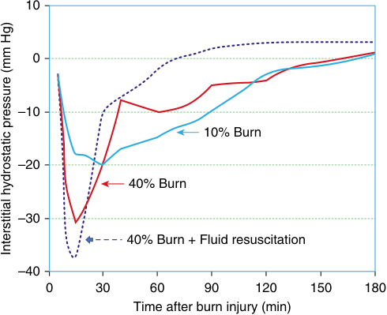
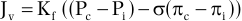
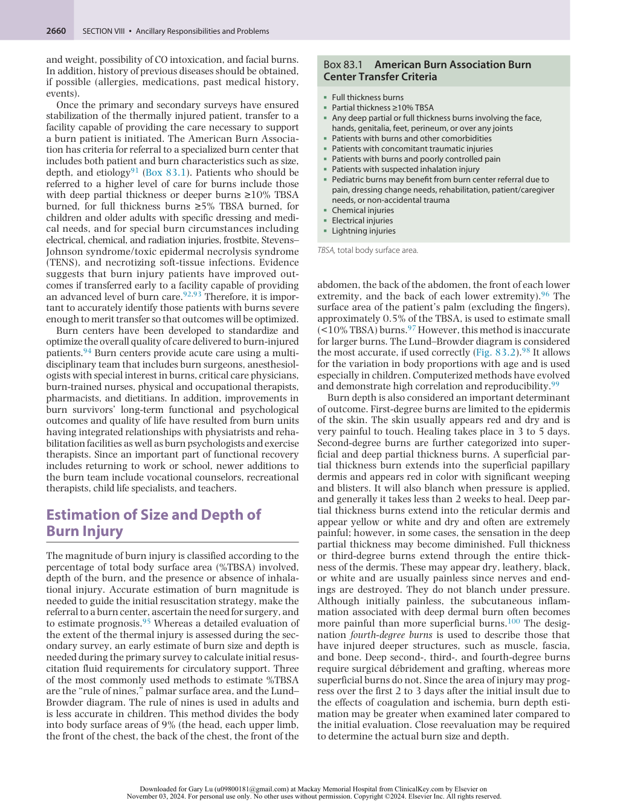
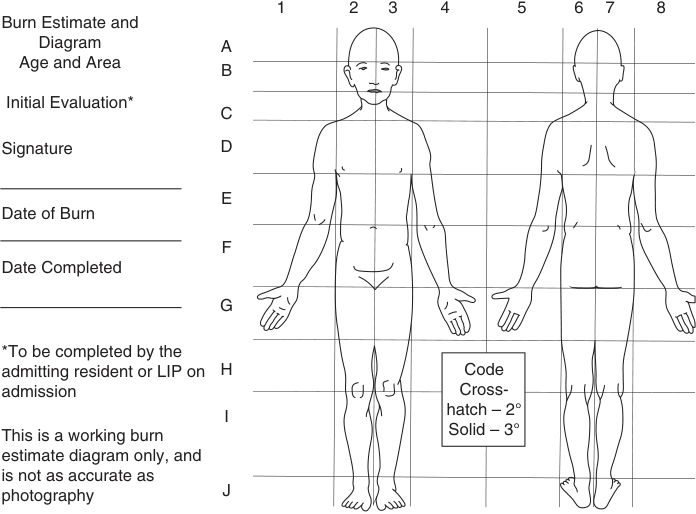
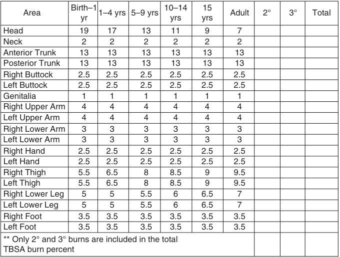
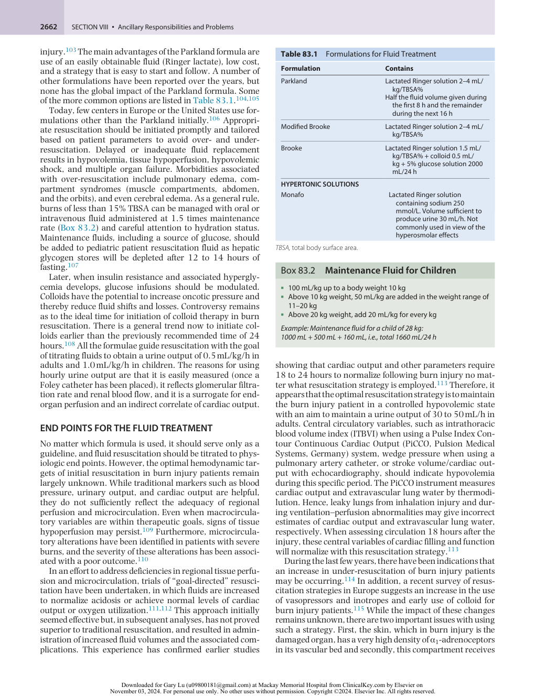
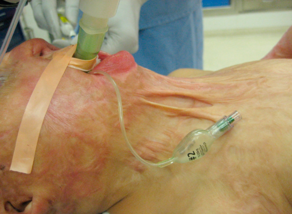
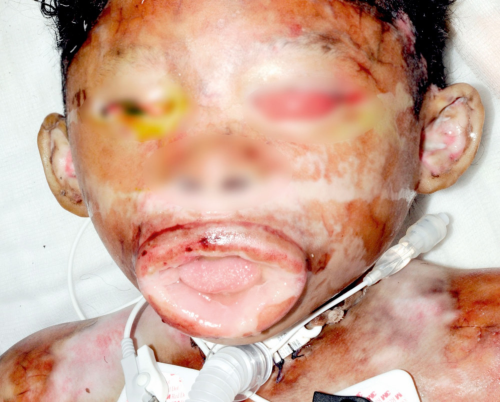
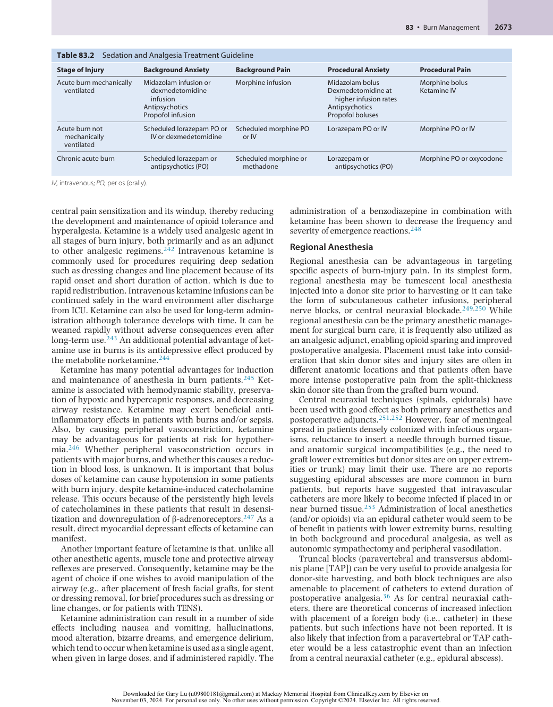
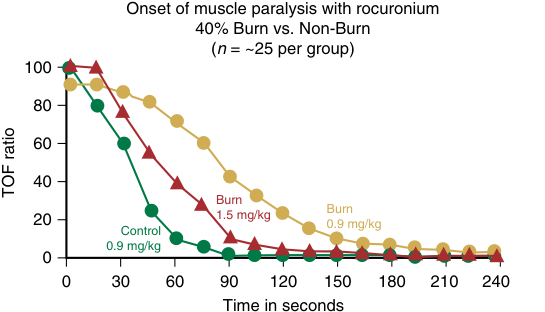

# Burn Management

<!-- PDF page 1 -->

EDWARD A. BITTNER, J.A. JEEVENDRA MARTYN, and FOLKE SJÖBERG

### KEY POINTS

- Major burn injury results in pathophysiologic changes affecting virtually all organs from the onset of injury until wounds are healed. Anesthesiologists are often called on to care for burn injury patients throughout their hospitalization including acute airway management, resuscitation, intraoperative anesthetic care, intensive care, and management of postoperative pain.

- Burn shock is a paradigm of ischemia/reperfusion injury. The initial ischemic (ebb) phase of burn shock is a hypodynamic, hypovolemic state, with rapid loss of fluid from the intravascular space and decreased cardiac output, which typically lasts for the first 24 to 48 hours following injury. Approximately 48 hours after successful resuscitation, a hyperdynamic, hypermetabolic (flow) phase ensues consisting of tachycardia, increased cardiac output, hyperthermia, hyperglycemia, and increased protein catabolism.

- The goal of fluid resuscitation is to maintain organ perfusion by replenishing the massive loss of fluid from intravascular to extravascular compartments. Multiple fluid resuscitation formulae exist for estimating fluid needs and differ somewhat in their recommendations for the amount of crystalloid and colloid replacement. No matter which formula is used, it should serve only as a guideline, and fluid resuscitation should be titrated to physiologic end points.

- Inhalation injury is a major prognostic factor for morbidity and mortality after burn injury. Management of inhalation includes observation and monitoring. Endotracheal intubation or tracheostomy is indicated if airway patency is threatened.

- Patients with severe burn injury often suffer from nonthermal traumatic injuries. Failure to diagnose these associated injuries during initial evaluation can lead to serious morbidity and mortality. All burn patients should be approached initially as multiple- trauma patients.

- The magnitude of burns is classified according to percentage of total body surface area (TBSA) involved, depth of the burn, and the presence or absence of inhalational injury. Accurate estimation of burn magnitude is needed to guide the initial resuscitation strategy, make the referral to a burn center, ascertain the need for surgery, and estimate prognosis. Three of the most commonly used methods to estimate %TBSA are the “rule of nines,” palmar surface area, and the Lund–Browder diagram.

- “Fluid creep” refers to the trend of over- resuscitation in burn injury patients. Overly aggressive fluid administration may result in pulmonary edema, compartment syndromes, multiorgan failure, nosocomial infection, and increased mortality as well as the extension of the burn injury because of excessive local edema. Factors that contribute to “fluid creep” include overestimation of the burn size, use of supra- physiologic hemodynamic targets, increased opioid utilization, and failure to reduce the rate of fluid administration in patients with evidence of adequate tissue perfusion.

- Electrical burns can have acute and chronic effects not occurring with other types of burn injury, and with morbidity far higher than expected based on burn size estimation alone. High- voltage injuries are typically associated with loss of consciousness, arrhythmias, myoglobinuria, and extensive deep tissue damage that can result in compartment syndromes. Patients suffering from electrical injury should be evaluated for associated traumatic injury, rhabdomyolysis, and compartment syndromes. For treatment of these complications, patients may come to the operating room within 24 hours of injury.

- Airway management in the burn injury patient may be challenging and warrants particular consideration. Key features of airway assessment include preexisting airway abnormality, current airway injury (i.e., inhalation injury), and signs of glottic obstruction. The type of airway abnormalities may vary depending on the stage of the injury. In the acute burn setting, mandibular mobility and mouth opening may be limited because of edema or, in later care, may have significant scarring and contractures in the face, mouth, nares, neck, and chest which can make airway management difficult.

- Burn- injured patients develop tolerance to most narcotics and sedatives, thereby requiring substantially higher doses than patients without thermal injury. Sedatives and narcotics should be titrated to effect while the patient is carefully monitored. Adverse effects of opioids, such as respiratory depression, acute opioid tolerance, and hyperalgesia, particularly with the need for rapidly escalating doses, have generated increasing attention to multimodal strategies.

<!-- PDF page 2 -->

- Muscle relaxant pharmacology is significantly and consistently altered after burn injury. Exposure to succinylcholine can result in an exaggerated hyperkalemic response, which can induce cardiac arrest. The current recommendation is to avoid succinylcholine administration in patients beginning 48 to 72 hours after burn injury. The duration of this dangerous response to succinylcholine after burn injury is unknown. Conversely, resistance develops to nondepolarizing muscle relaxants, requiring larger doses to achieve similar clinical end points in patients with burn injury.

- Surgical excision of burn wounds is often associated with substantial bleeding. It is not uncommon for the surgical team to remove eschar so rapidly that the patient becomes hypovolemic and hypotensive. Clinical judgment remains a vital component for intraoperative resuscitation, using markers of tissue and organ perfusion, erythrocyte mass, coagulation, pulse, and arterial waveform as key assessment tools. Good communication between the surgical and anesthesia teams as well as limiting the operative duration and extent of excision are also essential.

- Patients with major burn injury have an impaired ability for thermoregulation and therefore require close monitoring of body temperature. Multiple strategies are used to maintain body temperature in the operating room, including raised operating room temperature (80–100°F), use of forced- air warming blankets, thermal water mattresses, blood/fluid warmers, minimizing skin surface exposure, and wrapping the head and extremities with plastic or thermal insulation.

- Postoperatively, burn- injured patients are likely to be less stable physiologically compared with the preoperative period. Continued bleeding may be concealed by dressings, the patient may be more prone to hypothermia, emergence may be associated with delirium, and analgesic requirements will be greater. During this period of exaggerated physiologic fragility, it is important to be especially vigilant during transfer of the monitors, respiratory, and hemodynamic support equipment from the operating room to the intensive care unit.

- Burn injury leads to increased susceptibility to infection due to decreased immunity through multiple mechanisms including loss of the physical barrier of intact skin, damage to the epithelium of the respiratory tract from inhalation injury, and altered gut permeability and function. Preventive measures against infection are critical for the burn injury patient and include early excision of burn eschar to improve local perfusion and prevent microbial colonization, prudent use of invasive devices, application of antimicrobial burn dressings, and diligent compliance with aseptic techniques.

- Nearly all aspects of burn care (e.g., dressing changes, excision and grafting procedures, physical therapy, and line insertion) are associated with pain. There can be ongoing background pain, periodic breakthrough pain, procedure- related intraoperative and postprocedural pain, and eventually, chronic pain can develop. Standardized pain and anxiety guidelines are used to provide appropriate, consistent patient comfort.

## Introduction

Burn injuries are among the leading causes of injury and death worldwide, with about 11 million seeking medical care and over 180,000 deaths annually.1 Over 95% of these occur in low- and middle- income countries. Approximately 486,000 burn injuries are treated at US medical facilities each year, of which 40,000 require hospital admission with approximately 3275 deaths.2

Major burn injury produces pathophysiologic changes that affect virtually all organs from the very onset of injury until after the wounds heal. Pathophysiologic effects may persist for years, especially in patients with major injuries, and include insulin resistance, neuromuscular dysfunction, contracture- related functional abnormalities, pruritus, pain, posttraumatic stress disorder (PTSD) and more frequent hospital admissions related to infections and cardiomyopathies.3,4 Severe burn injury patients are different from other intensive care patients as they pose challenges regarding fluid resuscitation, metabolic stress,

perioperative demands, and other specific burn injury– related complications. Most burn injury patients present to emergency rooms in community hospitals, which do not have a designated burn center. After initial acute care, these patients are usually transferred to tertiary care facilities with a specialized burn center. As a result, anesthesiologists staffing these peripheral hospitals with emergency rooms must be familiar with the pathophysiology of acute burn injury and resuscitation. In addition, treatment of a burn injury patient requires multiple operations, frequent dressing changes, and prolonged hospital stays with extensive rehabilitation needs. In burn care facilities, anesthesiologists need to have expertise in the specific management of the pathophysiologic changes affecting these victims and particularly the unique features of perioperative management of this patient population. Therefore, there is a continuous need for specific teaching, training, and maintenance of specialized skills in this field.5

Although morbidity from burn- related injuries remains high, advanced methods of resuscitation, early excision

<!-- PDF page 3 -->

and grafting of burn wounds, better methods of wound coverage, improved anesthesia and intensive care techniques, early diagnosis and aggressive treatment of infections, as well as enhanced nutritional support and mental health–care methods have led to significant decreases in burn injury–related morbidity and mortality. Other factors, including immediate prehospital care, early emergency treatment with advanced life support capability, and secondary transfer to a specialized burn unit, have also contributed to improved survival.6 Despite significant advances in therapeutic strategies, care of the burn injury patient continues to pose multiple challenges for clinicians.

## Pathophysiology

### BURN SHOCK

Burn injury can cause massive tissue destruction and result in activation of an inflammatory response that leads to profound pathophysiologic effects at sites both local and distant from the injury. Understanding the pathophysiologic alterations and their time course is essential for providing appropriate resuscitation and perioperative care.

Burn shock is a paradigm of ischemia/reperfusion injury.7 The initial ischemic (ebb) phase of burn shock is a hypodynamic, hypovolemic state, with rapid loss of fluid from the intravascular space and decreased cardiac output, which typically lasts for the first 24 to 48 hours following injury. A large-volume fluid resuscitation is required to maintain intravascular volume for organ reperfusion, acutely diluting plasma proteins. Approximately 48 hours after successful resuscitation, a hyperdynamic, hypermetabolic (flow) phase ensues due to the systemic inflammatory responses from the trauma- induced release of damage- associated molecular patterns (DAMPs), even in the absence of overt infection.8 This is characterized by increased cardiac output, oxygen consumption, muscle protein catabolism, and body temperature, lasting for many months to years after healing of the burn wounds. When burn shock is left untreated, physiologic exhaustion ensues and is fatal.

The goal of fluid resuscitation is to maintain organ perfusion by replenishing the massive loss of fluid from intravascular to extravascular compartments. There are two main reasons for this loss, both of which have been extensively investigated and have clear temporal patterns. First, there is the negative imbibition pressure in tissues injured by a burn9,10 and, second, there is an increase in vascular permeability with loss of fluid from the vasculature as well as from the injured areas.11 In the injured areas, there is protein loss from the vasculature in addition to crystalloid loss. At the uninjured distant sites, there is capillary sieving of protein with loss of crystalloid only.12

### NEGATIVE IMBIBITION PRESSURE

When fluid losses were investigated in experimental models they could not be explained completely by an increase of permeability, and it was then postulated that there must be another mechanism that would explain these losses. In 1960, Gösta Arturson suggested that the loss from the blood could be explained by a reduction in the interstitial

tissue pressure.13 Subsequently, Lund _et al._ using _in vitro_ models showed that there is a build- up of strong negative interstitial pressure within injured tissue causing a negative interstitial pressure in the range of −25 to −50 mm Hg (Fig. 83.1).14 This negative gradient, called negative imbibition pressure, explains most of the early total fluid loss. Imbibition pressure is a negative pressure where water or crystalloid is absorbed, causing large increases in volume, and is different from hydrostatic and osmotic pressure. More recent _in vivo_ studies by Kinsky and associates have confirmed the previous _in vitro_ findings on imbibition pressure.15 This negative imbibition pressure is most pronounced immediately after the burn and remains for several hours. Intriguingly, the fluids provided during resuscitation seem to have an adverse effect on the negative imbibition pressure (see Fig. 83.1). Administering a greater amount of fluid results in larger negative tissue imbibition pressure, and correspondingly larger fluid leak and overall demand for fluids. The mechanism underlying the development of negative tissue pressure is not well understood, but probably results from the effect of thermal energy on the tissue integrins (components important for the regulation of hydrostatic pressure in the interstitium), which lose the ability to maintain their beneficial effect on imbibition pressure. The magnitude of the burn seems to affect this defect; the larger the burn injury, the more pronounced is the negative pressure in the tissue.10 This is the reason for early hypovolemia despite fluid treatment therapy. Importantly, most of the intravascular fluid loss disappears within 24 to 48 hours.12 The resorption of the extravascular edema fluid, however, takes much longer as detailed in the Fluid Resuscitation section, below.

### PERMEABILITY EFFECTS OF THE BURN

The loss of fluid from the intravascular space is also due to the increase in vascular permeability. This effect is obvious even in a small 5% total body surface area (TBSA) burn and occurs soon after the injury, explaining the blister formation even with small burn injury. Detailed mechanisms as

10 0 –10 10% Burn –20 40% Burn –30 40% Burn + Fluid resuscitation –40 0 30 60 90 120 150 180 Time after burn injury (min) Interstitial hydrostatic pressure (mm Hg) 

**Fig. 83.1 Negative imbibition pressure.** Graph showing how negative interstitial fluid pressure changes over time and varies based on the size of the burn injury and the administration of fluid.

<!-- PDF page 4 -->

to how even a small burn causes leakage of fluid are unclear, but there seem to be a number of putative mediators (see also section on Mediators Important in Fluid Loss). Another important aspect of vascular permeability is the onset of vasodilatation in most vascular beds as a result of the continued liberation of proinflammatory cytokines into the injured tissues. This vasodilatation increases the hydrostatic pressure in the microcirculation, which leads to further loss of fluid into the interstitial compartment. The Starling equation given here further describes the different factors that play a role in fluid filtration12 :

Jv  Kf ((Pc  P )i  ( c i )) 

where _J_ v is the net fluid movement between compartments, Kf the filtration coefficient, _P_ c the capillary hydrostatic pressure, _P_ i the interstitial hydrostatic pressure, _σ_ the reflection coefficient, πc is the capillary osmotic pressure, and πi the interstitial osmotic pressure. In particular, the coefficient of filtration increases dramatically, often to a range 20fold greater; for the latter parts of the formula, there is an increase in hydrostatic pressure in the capillaries due to vasodilatation, decrease in interstitial pressure (the negative imbibition pressure) together with a decrease in colloid osmotic pressure within the capillaries as the result of a capillary leak, onto which also the increased osmotic effect of proteins lost into the interstitium is added.

Although these changes affect most vascular compartments, the effect at the venular end seems more important from a quantitative perspective. Most of the proteins lost across the vascular wall are smaller molecules; a few larger proteins are also lost. This large protein loss is important to note, as it underlies the arguments in favor of so- called “colloid rescue” fluid resuscitation in larger burns, which reduces the total colloid loss (and corresponding total fluid loss) with decreased risk of compartment syndromes.16 It is important to stress that the loss of fluid from the intravascular space is due to alterations in all the factors previously described, which are important for the transport of fluid across the capillary and venular walls, and therefore contribute to the large fluid volume loss after burn injury.

In clinical practice, the increase in permeability, dilution effects of the resuscitation, and loss of protein manifest as a decrease in the concentration of serum albumin. The intravascular colloid osmotic pressure during the acute phase of burn injury is dependent not only on albumin but also on the newly synthesized acute phase proteins. Uncertainties in the temporal pattern of the vascular leak of protein locally means that the optimal timing of colloid administration is unclear. Thus, the intense debate as to when colloids can safely be started during fluid resuscitation continues. Today most burn clinicians would agree that it is appropriate to start colloids 8 to 12 hours postburn to reduce the total fluid volume (see section on Fluid Creep/Resuscitation Failure). It is important to understand, however, that early colloid administration may lead to its extravasation into the extravascular space with a concomitant increase in tissue edema. It must also be noted that even in the absence of burn injury only 20% of the administered crystalloid fluid volume stays within the vasculature, and that large volumes of crystalloid alone will decrease intravascular colloid osmotic pressure and cause a further loss of fluid from this compartment.17 These interrelated effects must be appreciated when fluid

resuscitation for a burn injury patient is initiated. However, the previous dictum that the first 24 hours after burn should consist of only crystalloids does not hold anymore.

### FLUID LOSS IN BURNS: THE TEMPORAL ASPECT

When caring for burn injury patients, it is important to discuss the temporal aspects of fluid loss, and the recommended fluid management. This is particularly important, as recent investigations have shown that in present guidelines there is a clear temporal mismatch between fluid loss and fluid volume protocols. Most of the fluid that is lost from negative imbibition pressure is lost within the first 3 to 4 hours after the burn. The picture is somewhat different for the fluid that is lost from the increase in permeability. The most reliable data in humans have suggested that this fluid is lost at the time of the injury, and up to 8 to 10 hours later.18,19 The permeability effects continue even after 48 hours due to the continuous systemic inflammatory response that is ongoing after the burn, although its magnitude is significantly less, unless complicated by sepsis.

More important is that the present guidelines for fluid resuscitation, particularly if they are based purely on crystalloids, do not fully account for this early loss of fluid. The patient may therefore be claimed to be in a controlled hypovolemic state during the first 12 to 16 hours after the burn injury. The tissue edema reaches its maximum between the first 24 to 48 hours after the injury, and thereafter the added fluid volume is slowly returned to the circulation and excreted as urine, often until 7 to 14 days after the burn depending on the magnitude of the injury.20 This is also the time when lung dysfunction can occur because of both hypervolemia from the reabsorbed fluid and the vasoactive substance- related hyperemia (see below).

### Mediators Important in Fluid Loss

Many mediators have been thought to be important in the underlying mechanisms of fluid loss in burns, and there are probably several that contribute in different ways. The most important are serotonin, nitric oxide, thromboxanes, prostaglandins, and several others including reactive oxygen species and proinflammatory cytokines.21 But molecular mediators are not the only substances implicated in the permeability effects; white blood cell–related effects have also been suggested.22,23 Coagulation and the complement cascade are thought to be activated early, and also play an important part.24 Interest in the mediators and their possible role in the generation of fluid losses is driven by the hope of finding a treatment that can stop or reduce the process. Some attempts have been made, and the most successful has been the use of high- dose vitamin C (as a scavenger of oxygen radicals), which, in randomized trials in both animals and humans, showed a reduction in fluid loss in the treatment arm.25,26 In addition, direct effects were seen on the negative imbibition pressure with vitamin C administration.27

## Hemodynamic Alterations

Burn shock can result in profound hemodynamic alterations associated with organ dysfunction. Severe burn shock is both distributive and hypovolemic in nature. The

<!-- PDF page 5 -->

increased systemic vascular resistance (SVR) (due to release of catecholamines, antidiuretic hormone, and hemoconcentration) compounds the shock phase adverse effects. A reduction in cardiac output also often occurs with major thermal injury even before any detectable reduction in plasma volume and may continue even when hypovolemia is alleviated.28 The cardiac dysfunction is characterized by slowed isovolemic relaxation, impaired contractility, and decreased left ventricular diastolic compliance and often continues for 24 to 36 hours.29,30 Burn- related left ventricular contraction and relaxation defects increase with burn size, achieving a nadir with 40% TBSA burns.31 This cardiac dysfunction has been identified as a major cause of multiple organ dysfunction syndrome (MODS) and mortality.

A hyperkinetic and hypermetabolic state develops 48 to 72 hours after burn injury, and is characterized by a decrease in vascular permeability, increased heart rate, and decreased SVR, resulting in an increase in cardiac output. Cardiac output is often increased to more than 1.5 times that of a non- burned, healthy patient 3 to 4 days following the injury. The metabolic rate is increased, approximately 1.5 times that of normal basal rate.32 This increase in cardiac output is associated with increased liver and kidney blood flow, which has implications for elimination of blood flow–dependent drugs including some antibiotics and anesthetic drugs. The onset of sepsis may further increase cardiac output and decrease SVR.

## Inhalation Injury

### PATHOPHYSIOLOGY

In addition to age and the extent of burns, inhalation injury is a major prognostic factor for morbidity and mortality after burn injury. Inhalation injury can be classified under three subcategories: direct thermal injury to the upper airway; chemical irritation to the lower (subglottic) airway and even lung alveoli; and systemic chemical or metabolic injury caused by specific noxious chemical combustion, or a combination of these factors.33 Direct heat and steam injury to the upper airway can lead to marked swelling of the face, tongue, epiglottis, and the glottic opening resulting in an upper airway obstruction. Because airway swelling may not occur immediately but may develop over a period of hours (especially with, and complicated by, concurrent fluid resuscitation), a high index of suspicion and frequent reevaluation of the respiratory status are essential. A scald injury of the epiglottis may mimic symptoms of epiglottitis.34

Thermal injury to the lower airway is uncommon due to a highly efficient heat exchange system in the oropharynx and nasopharynx and the low specific heat of steam in conjunction with the laryngeal closure reflex due to the irritation. Damage to the lower airways and lung parenchyma following smoke inhalation tends to be chemical rather than thermal. Toxic substances in smoke damage the epithelium and capillary endothelial cells of the airway resulting in the release of inflammatory mediators, increased vascular permeability, and edema of distal bronchi and alveoli. Many of the previously listed mediators are relevant

here as well. Damaged mucosal cells produce exudates rich in protein and necrotic debris. Chemicals in smoke promote the formation of neutrophil- generated oxygen radicals leading to inflammation. Destruction and damage to the airway’s ciliary transport function leads to the accumulation of casts, airway plugging, and impaired clearance of bacteria and debris.35 Alveolar collapse and atelectasis can occur because of loss of surfactant production or from plugging of small airways by mucosal debris. Over time, these changes can result in bronchospasm, airway obstruction, atelectasis, and pneumonia, which cause ventilation–perfusion mismatch, impaired gas exchange, and decreased pulmonary compliance. The severity of inhalation injury may not be directly proportional to the degree of exposure to smoke alone. Rather, the severity of injury is probably due to the composition of the inhaled material and combustion substances together with differences in the individual host response as well as added effects from the cutaneous burn.

Injury to the airways and lung can also occur with severe cutaneous burns in the absence of inhalational injury. Mechanisms include the effects of inflammatory mediators from the burn- injured area, and the effects of fluid resuscitation and infection. For example, acute lung injury can occur in patients with scald injury without smoke exposure where bronchoscopic features can mimic smoke- induced airway injury.36,37

While the gas- phase components of smoke do not produce direct injury to the respiratory tract, they can produce systemic effects. Among the most toxic gas- phase components are carbon monoxide (CO) and cyanide, which can lead to major morbidity and mortality following inhalation injury. CO is an odorless, colorless gas that has a 200- fold higher affinity than oxygen to the same binding sites on hemoglobin.38 CO shifts the oxyhemoglobin dissociation curve to the left and alters its shape. In addition, CO binds to cytochrome oxidase, impairing mitochondrial function and reducing adenosine triphosphate (ATP) production. CO thus reduces both the oxygen- carrying capacity of blood and oxygen dissociation at a tissue level, as well as disrupting oxidative cellular respiration. The clinical manifestations with patient symptoms of CO poisoning appear when carboxyhemoglobin (HbCO) levels are more than 15%.39 The symptoms are typical of tissue hypoxia, most notably neurologic impairment and myocardial dysfunction (the organ systems most vulnerable to hypoxia). There is no set combination of symptoms that confirms or rules out the diagnosis of CO poisoning. The intensity of clinical manifestations varies and does not correlate closely with HbCO levels. Early signs tend to be neurologic. Central nervous system (CNS) injury can lead to progressive and permanent damage. Severe myocardial dysfunction may occur, especially in patients with preexisting coronary disease. The clinical diagnosis of HbCO poisoning should be confirmed by demonstrating its elevated levels. Elevated HbCO levels indicate significant exposure to smoke, which points to the likelihood of chemical airway injury. Low HbCO levels do not always mean minimal exposure, as oxygen therapy in the early stages can reduce levels during transport to the emergency department. Hypoxemia caused by CO poisoning is not detected by pulse oximetry or by arterial partial pressure of oxygen (PaO2) measurements, and patients

<!-- PDF page 6 -->

may appear “cherry pink” rather than cyanotic. CO oximetry is required to make the diagnosis. The binding of CO to hemoglobin is stable, with a half- life of 4 hours for a person breathing air.40 Increasing the PaO2 accelerates the CO displacement from the hemoglobin molecule; administration of 100% oxygen at atmospheric pressure shortens the half- life to just over an hour.41 Hyperbaric oxygen therapy has been suggested as a therapy to reduce the neurologic sequelae from CO toxicity. Hyperbaric oxygen therapy achieves faster CO displacement and may be more useful in cases of prolonged exposure, when it also may be assumed that it is harder to displace the toxin bound to the cytochrome system (i.e., mitochondria). The drawback of hyperbaric oxygen therapy is the need to transfer the burn injury patient to a treatment facility equipped with a hyperbaric chamber during the critical period of hemodynamic and pulmonary instability. For these reasons, it may be considered in patients with severe neurologic involvement and levels of HbCO greater than 50%, without extensive burns or severe lung damage, and whose symptoms fail to improve despite delivery of 100% normobaric oxygen. The lack of availability of hyperbaric oxygen poses a barrier to its use in many tertiary care centers.

Cyanide (CN) is released by the combustion of nitrogencontaining compounds, which are present in plastics, fabrics, and paper. CN acts by binding to cytochrome oxidase, thereby inhibiting the mitochondrial respiratory chain, cell metabolism, and tissue ATP production, resulting in cytotoxic hypoxia and metabolic acidosis. CN toxicity may have a synergistic effect with CO in producing tissue hypoxia. Concentrations of CN greater than 20 ppm are considered dangerous and concentrations of 100 ppm can lead to seizures, coma, respiratory failure, and death.42 A rapid diagnostic test for CN poisoning is not widely available; as a result, the treatment of CN poisoning is generally based on clinical suspicion. CN poisoning should be suspected in any patient with a history of smoke inhalation injury with an anion gap metabolic acidosis in the presence of apparently adequate oxygen delivery. Lactic acidosis with a high anion gap can indicate CN poisoning, as can an arteriovenous oxygen saturation difference of less than 10 mm Hg because of the inability of the mitochondria to use tissue oxygen.43 Lactic acidosis in burn victims may, however, be due to several causes and is not specific for cyanide toxicity. CN’s short blood half- life (∼1 hour) makes accurate determination of CN poisoning difficult and is hampered by delayed blood sampling.44 Blood CO concentration is highly correlated with CN levels and, as such, may be considered as an indicator of CN poisoning. Empiric treatment involves administration of high- flow oxygen. Specific antidotes are advocated, especially hydroxocobalamin, which binds to CN and is relatively nontoxic; but administration must be immediate for any effect to be useful.45 The deleterious effects of CN can also be neutralized by the administration of thiosulfate converting CN to thiocyanate, which is excreted in the urine. Exogenous thiosulfate has a slower onset than hydroxocobalamin.46 The treatment of CN toxicity by administration of nitrites (e.g., amyl nitrite) has generated controversy as this treatment itself can be hazardous.47 Nitrites induce methemoglobinemia, which, together with HbCO, may interfere with oxygen transport, thus contributing to hypoxia.

### DIAGNOSIS OF INHALATION INJURY

The diagnosis of inhalation injury is based on a combination of clinical findings including patient history, physical examination, and HbCO levels.48 Patient history should include the duration of exposure, and whether the patient was found in an enclosed space, was unconscious at the scene, or has extensive cutaneous burns. Physical findings include facial burns, singed nasal hair, signs of upper airway injury (hoarseness, stridor, carbonaceous sputum, erythema, and swelling of the oropharynx), and signs of lower airway involvement (dyspnea, tachypnea, wheezing, decreased O2 saturations). Stridor, dyspnea, increased respiratory effort, and cyanosis appear only once critical narrowing of the airway occurs.

Chest radiographs lack the necessary sensitivity to detect lung damage due to inhalation injury in the early stages, but their use is helpful as a baseline for determining future changes.49 Fiberoptic bronchoscopy (FOB) offers a potential means by which to evaluate severity of inhalation injury, although it may underestimate the presence of parenchymal disease and controversy exists over whether or not the visualized severity of the mucosal injury predicts alveolar changes and clinically meaningful outcomes.50 FOB is unnecessary if subglottic pathology is unlikely. In patients with clinical signs suggestive of thermal airway injury, a normal endoscopic appearance is reassuring although alveolar damage would not be revealed. FOB can be repeated at intervals or if there is clinical deterioration. The presence of soot, mucosal edema, mucosal hyperemia, and pooling of secretions indicates inhalation injury, and suggests the need for close observation with repeated assessment; more ominous signs include narrowing of the laryngeal inlet, mucosal erosion, ulceration, and exudation.51 Virtual bronchoscopy is an alternative diagnostic modality to identify inhalation injury; however this is not widely practiced.52 Other diagnostic methods include xenon scanning, pulmonary function testing, and computed tomography (CT).53,54 The most reliable indicator of the impact of inhalation injury is the arterial partial pressure of oxygen to inspired oxygen fraction (PaO2/FiO2) ratio after the resuscitation has started.55

Laryngeal injuries are common in burn injury patients and can be associated with long- term morbidity.56,57 Early recognition of laryngeal injury and consultation with a laryngologist can influence treatment choices (e.g., tracheostomy) and limit morbidity. Because anesthesiologists are most likely to view the larynx of patients with acute burns, it is important to make laryngeal examination part of the initial intubation whether during resuscitation or induction of general anesthesia. Any pathologic laryngoscopic findings should be documented.

### TREATMENT

Treatment of upper airway burns secondary to smoke inhalation includes observation and monitoring.

Endotracheal intubation or tracheostomy is indicated if airway patency is threatened. Thermal injury to the oral cavity and supraglottic structures can cause edema; with severe injury, airway obstruction may result as a consequence of edema of the supraglottic airway. Clinically

<!-- PDF page 7 -->

significant obstruction can also occur following fluid resuscitation, with maximal edema typically presenting hours after the initial insult and lasting for several days. There can be no substitute for patience and repeated airway assessment by an experienced anesthesiologist while minimizing edema formation by upright positioning and the avoidance of excessive fluid therapy. In the presence of circumferential burns of the chest and abdomen, the lack of escharotomies may aggravate the onset of respiratory failure. As a general rule, when indicated, it is safer to intubate the patient early than risk a difficult intubation after airway swelling has occurred. Although preemptive intubation of patients with inhalation injury can be lifesaving, it should be performed for clear indications. Reasons for intubation include protection against anticipated airway swelling, treatment of impaired oxygenation and/or ventilation due to lung injury, and to ensure airway protection and optimal oxygenation in cases of hypoxia or CO poisoning with neurologic impairment. The treatment of pulmonary parenchymal injury is inherently more complex than treatment for cutaneous burns. Necrotic skin can be excised, and healing can be observed directly. In contrast, injured lung involves measures to prevent further injury to allow host mechanisms to repair injured tissues. Healing of pulmonary injury is followed indirectly by observations of blood gas analysis and radiographs/CT scans. Adequate oxygenation must be maintained and bronchial hygiene facilitated. Some patients may benefit from noninvasive ventilation in the absence of usual contraindications.58 Endotracheal intubation may be necessary if the patient has increased work of breathing or if gas exchange is compromised.

Patients with both cutaneous burns and inhalation injury may require larger fluid volumes for resuscitation than those without inhalation injury.59 Additional fluid resuscitation measures beyond titrating fluid input to maintain adequate urine output (generally considered 0.5– 1 mL/kg/h) are not necessary and there are at least theoretical concerns that the lung should be maintained “dry” to optimize gas exchange.60

Moderate elevation of the head of the bed allows gravity to help reduce airway edema by facilitating venous and lymphatic drainage, and is therefore a sensible, critical standard practice. The patient should be given oxygen by mask to maintain adequate arterial oxygen saturation. Suction should be used to keep the airway clear of debris and secretions. Children are at greater risk of obstruction because of their smaller airways, as are patients whose burns include circumferential burns to the neck. Other early signs and symptoms of respiratory dysfunction may be suggestive of a more severe inhalation injury.

Respiratory failure is a consequence of inhalation injury; however, the severely burn- injured patient often has multiple mechanisms contributing to lung injury, systemic inflammation in response to burn injury, pulmonary edema from fluid resuscitation, and sepsis. Thus, the extent to which inhalation injury impacts burn patient outcome is difficult to separate from the contributions of other injury drivers which affect the lungs. Management of respiratory failure commonly consists of mechanical ventilation together with effective and repetitive pulmonary toilet. A myriad of ventilation strategies exist, and consensus regarding the most appropriate way to ventilate patients with inhalation injury

has not been reached.61 In all cases, the goal of mechanical ventilation should be to optimize oxygenation and ventilation while minimizing potential ventilator- induced lung injury. The traditional mechanisms of ventilator- induced lung injury include high airway pressures causing barotrauma, overdistention of alveoli leading to volutrauma, repetitive opening and closing of alveoli causing atelectrauma, and lung inflammation caused by the release of proinflammatory cytokines that produce biotrauma.62

More recently, additional mechanisms of injury have been implicated including high mechanical power (ergotrauma), stress frequency, respiratory muscle over/underuse (myo trauma) and pulmonary capillary stress failure.63 Mechanical ventilation _per se_ can induce inflammatory responses due to the cytokines produced by the alveolar macrophages and pulmonary capillary endothelial cells containing piezo mechanoreceptors detecting cyclic ventilation.64 The use of lung- protective ventilation strategies (i.e., tidal volume of 5–8 mL/kg predicted body weight, limitation of plateau pressure to less than 30 cm H2O, and application of sufficient positive end- expiratory pressure to maintain alveolar patency and adequate oxygenation) is recommended as the initial approach if invasive ventilation is required. Studies have shown that lung-protective ventilation with low tidal volumes are associated with lower mortality in patients with acute respiratory distress syndrome (ARDS) and are therefore also recommended in burn injury patients.65,66 As in other critically ill patients, prone positioning has been shown to improve oxygenation in burn injury patients with severe ARDS.66 Permissive hypercapnia, where arterial carbon dioxide partial pressure (PaCO2) is allowed to rise (&lt;60 mm Hg) should be considered to limit plateau pressures unless there is a concomitant neurologic injury with suspected intracranial hypertension.67 These lung- protective ventilation strategies are generally considered to also apply to pediatric patients, although some evidence exists to challenge this presumption.68,69 Other strategies used by some burn centers for management of inhalation injury include highfrequency percussive ventilation or high- frequency oscillation ventilation, either of which may facilitate the clearance of airway debris and secretions.70,71 High- frequency percussive ventilation and high- frequency oscillation ventilation may be considered as “rescue modes” in very severe lung disease, though a benefit on outcome remains unproven.

Extracorporeal membrane oxygenation (ECMO) is increasingly used as a rescue treatment for patients with refractory hypoxemia due to inhalation injury or burnrelated ARDS.72,73 Considerations for ECMO use in the burn- injured patient include the ability to receive anticoagulation, need for further operative care, as well as goals and futility of care.73 Patients most likely to benefit from ECMO are those with severe ARDS within the first week of mechanical ventilation and without multiple organ failure.74

The consensus recommendations for mechanical ventilation also apply in this context, as do strategies for the prevention of ventilator- associated pneumonia.75 Bronchodilators may be administered to help optimize ventilation in the event of bronchospasm. Bronchoscopy may improve pulmonary hygiene and patient prognosis by clearing secretions and sloughed epithelial cells. Although not yet in routine clinical use, there are several promising experimental pharmaceutical adjuncts that address physiologic changes

<!-- PDF page 8 -->

associated with inhalation injury. Aerosolized racemic epinephrine serves as a bronchodilator, vasoconstrictor, and mucolytic agent to alleviate wheezing and bronchospasm caused by the chemical tracheobronchitis.76,77 An aerosolized _N_ - acetylcysteine/heparin combination therapy, which acts as both an oxygen free- radical scavenger and a mucolytic agent, has also been successfully used in children and adults with inhalation injury.78,79 Inhaled nitric oxide causes selective vasodilation in ventilated lung segments, and may improve oxygenation and pulmonary hemodynamics.80,81

Noninvasive positive pressure ventilation (NIV) has been successfully used to avoid endotracheal intubation in select patients with mild inhalation injury with little evidence of edema, or as respiratory support strategy following extubation.82,83 The potential benefits of NIV are numerous, including allowing the patient to communicate freely, requiring less sedation, cough and expectorate secretions, and avoiding other potential complications of intubation such as oropharyngeal trauma, mucosal ulceration, and ventilator- associated pneumonia. However, very strict case selection is essential. NIV requires compliant patients who can cough and protect their own airway and it must not be used where there is a risk of airway obstruction, or in patients with facial burns because of the tight mask required. In addition, there are legitimate concerns that NIV may conceal signs of progressive airway obstruction in the setting of an inhalation injury. The use of opioid and sedative drugs, often needed in burn injury patients, may complicate the use of NIV as a consequence of their respiratory depressant effects.

High- flow nasal cannula is a mode of respiratory support increasingly used in the management of acute respiratory failure. This mode delivers humidified gas via a nasal cannula at flow rates exceeding minute ventilation. The benefits include the reduced work of breathing and improved gas exchange by nasopharyngeal dead- space washout; decreasing the energy required to humidify and heat respiratory gases; and providing a degree of positive distending pressure. There are limited reports of its use in patients with inhalation injury.84

## Acute Management

### PATIENT EVALUATION

Optimal management of burn injury patients begins at the scene of injury and continues in the emergency department and with transfer to a specialized burn unit. The primary survey should be performed using a systematic approach that first seeks to identify the greatest threats to life as provided in the Advanced Trauma Life Support (ATLS) and Advanced Burn Life Support (ABLS) guidelines.85,86 This approach requires a combined strategy of airway assessment and protection, initiation of resuscitation, and evaluation for coexisting injuries. Protecting the airway of a thermally injured patient is of the utmost priority. Early intubation is indicated in patients with symptomatic inhalation injury, or any thermal injury to the face, mouth, or oropharynx that threatens airway patency (stridor, swelling on laryngoscopy, upper airway trauma, altered

mentation, and respiratory distress).87 The current criteria for prehospital intubation have been questioned because of the high incidence of over- intubation and early extubation post hospital admission.88 Despite this concern, it seems safer to intubate and modify therapy once in hospital rather than be afflicted by airway distress during prolonged transport. Oropharyngeal burns can rapidly cause obstruction; other causes of critical respiratory failure, such as coma, require immediate diagnosis and treatment. Once the airway is secure, breathing assessment follows. Auscultation of breath sounds and determination of respiratory rate and depth are essential for assessing the status of the lungs, chest wall, and diaphragm, and to evaluate the patient’s ability to adequately ventilate and oxygenate. Circumferential burns of the trunk or neck may impair respiration and require bedside escharotomy. Continuous monitoring of heart rate, blood pressure pulse oximetry, and clinical assessment of unburned skin color should be used as parameters to assess circulatory status. An elevated heart rate (100–120 beats/ min) is considered within normal limits for adults with burn injury; a higher heart rate should raise suspicion for hypovolemia, other trauma, and inadequate pain management. Circulatory assessment requires evaluation of perfusion of all extremities, paying particular attention to any circumferentially burned extremities. If perfusion is compromised, escharotomy is indicated. Intravenous access should be obtained via peripheral, central, and/or intraosseous routes and may safely be placed through burned tissue if necessary. Adjuncts such as ultrasound may be helpful in placing peripheral intravenous catheters. Large- bore peripheral access is preferred because smaller catheters hinder the rate of fluid administration.

Fluid management based on weight and burn size should be addressed once total assessment of the injury has been established. Patients who have sustained a thermal injury often present with altered mental status and the possibility of associated injury, substance use, hypoxia, inhalation injury, or a preexisting condition that should always be addressed. As with trauma patients, the Glasgow Coma Scale, which utilizes verbal, motor, and eye measurements, can be used to establish a baseline mental status. Providing adequate environmental temperature control is essential for burn injury patients as they lose their ability to thermoregulate. The patient must be completely exposed to assess injury and to remove any contaminants that might prolong contact with chemicals or heat sources. A warmed environment and immediate coverage with clean blankets can limit hypothermia during the examination. More than 5% of patients admitted to burn centers have also sustained nonthermal traumatic injuries.89 Therefore, all burned patients should be approached initially as multiple trauma patients. Whole- body CT imaging and focused assessment with sonography in trauma (FAST) exam should be performed when associated injuries are suspected.90

Indicated imaging, laboratory analyses, and adjunctive measures such as urethral catheters and nasogastric tubes should be completed at this time. It is mandatory to perform a rapid primary evaluation and immediately correct any problems found. Once these steps are completed, a more thorough assessment of thermal injury may ensue. The patient’s full history should be taken, including detection of the mechanism of injury, consideration of abuse, height

<!-- PDF page 9 -->

and weight, possibility of CO intoxication, and facial burns. In addition, history of previous diseases should be obtained, if possible (allergies, medications, past medical history, events).

Once the primary and secondary surveys have ensured stabilization of the thermally injured patient, transfer to a facility capable of providing the care necessary to support a burn patient is initiated. The American Burn Association has criteria for referral to a specialized burn center that includes both patient and burn characteristics such as size, depth, and etiology91 (Box 83.1). Patients who should be referred to a higher level of care for burns include those with deep partial thickness or deeper burns ≥10% TBSA burned, for full thickness burns ≥5% TBSA burned, for children and older adults with specific dressing and medical needs, and for special burn circumstances including electrical, chemical, and radiation injuries, frostbite, Stevens– Johnson syndrome/toxic epidermal necrolysis syndrome (TENS), and necrotizing soft- tissue infections. Evidence suggests that burn injury patients have improved outcomes if transferred early to a facility capable of providing an advanced level of burn care.92,93 Therefore, it is important to accurately identify those patients with burns severe enough to merit transfer so that outcomes will be optimized.

Burn centers have been developed to standardize and optimize the overall quality of care delivered to burn- injured patients.94 Burn centers provide acute care using a multidisciplinary team that includes burn surgeons, anesthesiologists with special interest in burns, critical care physicians, burn- trained nurses, physical and occupational therapists, pharmacists, and dietitians. In addition, improvements in burn survivors’ long- term functional and psychological outcomes and quality of life have resulted from burn units having integrated relationships with physiatrists and rehabilitation facilities as well as burn psychologists and exercise therapists. Since an important part of functional recovery includes returning to work or school, newer additions to the burn team include vocational counselors, recreational therapists, child life specialists, and teachers.

## Estimation of Size and Depth of Burn Injury

The magnitude of burn injury is classified according to the percentage of total body surface area (%TBSA) involved, depth of the burn, and the presence or absence of inhalational injury. Accurate estimation of burn magnitude is needed to guide the initial resuscitation strategy, make the referral to a burn center, ascertain the need for surgery, and to estimate prognosis.95 Whereas a detailed evaluation of the extent of the thermal injury is assessed during the secondary survey, an early estimate of burn size and depth is needed during the primary survey to calculate initial resuscitation fluid requirements for circulatory support. Three of the most commonly used methods to estimate %TBSA are the “rule of nines,” palmar surface area, and the Lund– Browder diagram. The rule of nines is used in adults and is less accurate in children. This method divides the body into body surface areas of 9% (the head, each upper limb, the front of the chest, the back of the chest, the front of the

### Box 83.1 American Burn Association Burn Center Transfer Criteria

|ᑏFull thickness burns|
|---|
|ᑏPartial thickness≥10% TBSA|
|ᑏAny deep partial or full thickness burns involving the face,|
|hands, genitalia, feet, perineum, or over any joints|
|ᑏPatients with burns and other comorbidities|
|ᑏPatients with concomitant traumatic injuries|
|ᑏPatients with burns and poorly controlled pain|
|ᑏPatients with suspected inhalation injury|
|ᑏPediatric burns may benefit from burn center referral due to pain, dressing change needs, rehabilitation, patient/caregiver needs, or non- accidental trauma|
|ᑏChemical injuries|
|ᑏElectrical injuries|
|ᑏLightning injuries|

_TBSA,_ total body surface area.

abdomen, the back of the abdomen, the front of each lower extremity, and the back of each lower extremity).96 The surface area of the patient’s palm (excluding the fingers), approximately 0.5% of the TBSA, is used to estimate small (&lt;10% TBSA) burns.97 However, this method is inaccurate for larger burns. The Lund–Browder diagram is considered the most accurate, if used correctly (Fig. 83.2).98 It allows for the variation in body proportions with age and is used especially in children. Computerized methods have evolved and demonstrate high correlation and reproducibility.99

Burn depth is also considered an important determinant of outcome. First- degree burns are limited to the epidermis of the skin. The skin usually appears red and dry and is very painful to touch. Healing takes place in 3 to 5 days. Second- degree burns are further categorized into superficial and deep partial thickness burns. A superficial partial thickness burn extends into the superficial papillary dermis and appears red in color with significant weeping and blisters. It will also blanch when pressure is applied, and generally it takes less than 2 weeks to heal. Deep partial thickness burns extend into the reticular dermis and appear yellow or white and dry and often are extremely painful; however, in some cases, the sensation in the deep partial thickness may become diminished. Full thickness or third- degree burns extend through the entire thickness of the dermis. These may appear dry, leathery, black, or white and are usually painless since nerves and endings are destroyed. They do not blanch under pressure. Although initially painless, the subcutaneous inflammation associated with deep dermal burn often becomes more painful than more superficial burns.100 The designation _fourth- degree burns_ is used to describe those that have injured deeper structures, such as muscle, fascia, and bone. Deep second- , third- , and fourth- degree burns require surgical débridement and grafting, whereas more superficial burns do not. Since the area of injury may progress over the first 2 to 3 days after the initial insult due to the effects of coagulation and ischemia, burn depth estimation may be greater when examined later compared to the initial evaluation. Close reevaluation may be required to determine the actual burn size and depth.

::: details 原始表格與符號（PDF 第 9 頁）

:::

<!-- PDF page 10 -->

1 2 3 4 5 6 7 8 Burn Estimate and Diagram A Age and Area B Initial Evaluation* C Signature D E Date of Burn F Date Completed G *To be completed by the admitting resident or LIP on H Code admission Cross- hatch – 2° I Solid – 3° This is a working burn estimate diagram only, and is not as accurate as photography J 

Birth–1 15 Area 1–4 yrs 5–9 yrs 10–14 Adult 2° 3° Total yr yrs yrs Head 19 17 13 11 9 7 Neck 2 2 2 2 2 2 Anterior Trunk 13 13 13 13 13 13 Posterior Trunk 13 13 13 13 13 13 Right Buttock 2.5 2.5 2.5 2.5 2.5 2.5 Left Buttock 2.5 2.5 2.5 2.5 2.5 2.5 Genitalia 1 1 1 1 1 1 Right Upper Arm 4 4 4 4 4 4 Left Upper Arm 4 4 4 4 4 4 Right Lower Arm 3 3 3 3 3 3 Left Lower Arm 3 3 3 3 3 3 Right Hand 2.5 2.5 2.5 2.5 2.5 2.5 Left Hand 2.5 2.5 2.5 2.5 2.5 2.5 Right Thigh 5.5 6.5 8 8.5 9 9.5 Left Thigh 5.5 6.5 8 8.5 9 9.5 Right Lower Leg 5 5 5.5 6 6.5 7 Left Lower Leg 5 5 5.5 6 6.5 7 Right Foot 3.5 3.5 3.5 3.5 3.5 3.5 Left Foot 3.5 3.5 3.5 3.5 3.5 3.5 ** Only 2° and 3° burns are included in the total TBSA burn percent 

**Fig. 83.2 Lund–Browder burn diagram and table.** The Lund–Browder burn diagram and table indicate the varying proportions in surface area in persons with different ages. A careful burn diagram should be completed at the time of initial evaluation, including wound size, location, and estimated burn depth. The Lund–Browder chart should be used in pediatric patients because the body surface area relationships vary with age. _TBSA_ , total body surface area.

## Fluid Resuscitation

Current fluid therapy is based on knowledge gained over the last century. Major breakthroughs in fluid management were made by Underhill, who described the pathophysiology of burn injury in detail in the 1920s.101 In 1942, after the Coconut Grove night club disaster in Boston, Massachusetts, the first attempts were made to use intravenous fluids to treat a large group of burn injury patients, and the

result was that the mortality was significantly lower than expected. In 1953, the first fluid formula based on the size of the burn and the patient’s weight was introduced by Evans.102 The formula most widely used today is the one that was published in 1974 by Charles Baxter, who was then working at the Parkland Memorial Hospital in Dallas, Texas. The Parkland formula calls for 4 mL/kg/%TBSA of lactated Ringer solution given over the first 24 hours, half of which is given within the first 8 hours from the time of

<!-- PDF page 11 -->

injury.103 The main advantages of the Parkland formula are use of an easily obtainable fluid (Ringer lactate), low cost, and a strategy that is easy to start and follow. A number of other formulations have been reported over the years, but none has the global impact of the Parkland formula. Some of the more common options are listed in Table 83.1.104,105

Today, few centers in Europe or the United States use formulations other than the Parkland initially.106 Appropriate resuscitation should be initiated promptly and tailored based on patient parameters to avoid over- and underresuscitation. Delayed or inadequate fluid replacement results in hypovolemia, tissue hypoperfusion, hypovolemic shock, and multiple organ failure. Morbidities associated with over- resuscitation include pulmonary edema, compartment syndromes (muscle compartments, abdomen, and the orbits), and even cerebral edema. As a general rule, burns of less than 15% TBSA can be managed with oral or intravenous fluid administered at 1.5 times maintenance rate (Box 83.2) and careful attention to hydration status. Maintenance fluids, including a source of glucose, should be added to pediatric patient resuscitation fluid as hepatic glycogen stores will be depleted after 12 to 14 hours of fasting.107

Later, when insulin resistance and associated hyperglycemia develops, glucose infusions should be modulated. Colloids have the potential to increase oncotic pressure and thereby reduce fluid shifts and losses. Controversy remains as to the ideal time for initiation of colloid therapy in burn resuscitation. There is a general trend now to initiate colloids earlier than the previously recommended time of 24 hours.108 All the formulae guide resuscitation with the goal of titrating fluids to obtain a urine output of 0.5 mL/kg/h in adults and 1.0 mL/kg/h in children. The reasons for using hourly urine output are that it is easily measured (once a Foley catheter has been placed), it reflects glomerular filtration rate and renal blood flow, and it is a surrogate for endorgan perfusion and an indirect correlate of cardiac output.

### END POINTS FOR THE FLUID TREATMENT

No matter which formula is used, it should serve only as a guideline, and fluid resuscitation should be titrated to physiologic end points. However, the optimal hemodynamic targets of initial resuscitation in burn injury patients remain largely unknown. While traditional markers such as blood pressure, urinary output, and cardiac output are helpful, they do not sufficiently reflect the adequacy of regional perfusion and microcirculation. Even when macrocirculatory variables are within therapeutic goals, signs of tissue hypoperfusion may persist.109 Furthermore, microcirculatory alterations have been identified in patients with severe burns, and the severity of these alterations has been associated with a poor outcome.110

In an effort to address deficiencies in regional tissue perfusion and microcirculation, trials of “goal- directed” resuscitation have been undertaken, in which fluids are increased to normalize acidosis or achieve normal levels of cardiac output or oxygen utilization.111,112 This approach initially seemed effective but, in subsequent analyses, has not proved superior to traditional resuscitation, and resulted in administration of increased fluid volumes and the associated complications. This experience has confirmed earlier studies

**Table 83.1** Formulations for Fluid Treatment

|**Formulation**|**Contains**|
|---|---|
|Parkland|Lactated Ringer solution 2–4 mL/ kg/TBSA% Half the fluid volume given during the first 8 h and the remainder during the next 16 h|
|Modified Brooke|Lactated Ringer solution 2–4 mL/ kg/TBSA%|
|Brooke|Lactated Ringer solution 1.5 mL/ kg/TBSA% + colloid 0.5 mL/ kg + 5% glucose solution 2000 mL/24 h|
|**HYPERTONIC SOLUTIONS**||
|Monafo|Lactated Ringer solution containing sodium 250 mmol/L. Volume sufficient to produce urine 30 mL/h. Not commonly used in view of the hyperosmolar effects|

_TBSA,_ total body surface area.

### Box 83.2 Maintenance Fluid for Children

- 100 mL/kg up to a body weight 10 kg

- Above 10 kg weight, 50 mL/kg are added in the weight range of 11–20 kg

- Above 20 kg weight, add 20 mL/kg for every kg

_Example: Maintenance fluid for a child of 28 kg:_

_1000 mL + 500 mL + 160 mL, i.e., total 1660 mL/24 h_

showing that cardiac output and other parameters require 18 to 24 hours to normalize following burn injury no matter what resuscitation strategy is employed.113 Therefore, it appears that the optimal resuscitation strategy is to maintain the burn injury patient in a controlled hypovolemic state with an aim to maintain a urine output of 30 to 50 mL/h in adults. Central circulatory variables, such as intrathoracic blood volume index (ITBVI) when using a Pulse Index Contour Continuous Cardiac Output (PiCCO, Pulsion Medical Systems, Germany) system, wedge pressure when using a pulmonary artery catheter, or stroke volume/cardiac output with echocardiography, should indicate hypovolemia during this specific period. The PiCCO instrument measures cardiac output and extravascular lung water by thermodilution. Hence, leaky lungs from inhalation injury and during ventilation–perfusion abnormalities may give incorrect estimates of cardiac output and extravascular lung water, respectively. When assessing circulation 18 hours after the injury, these central variables of cardiac filling and function will normalize with this resuscitation strategy.113

During the last few years, there have been indications that an increase in under- resuscitation of burn injury patients may be occurring.114 In addition, a recent survey of resuscitation strategies in Europe suggests an increase in the use of vasopressors and inotropes and early use of colloid for burn injury patients.115 While the impact of these changes remains unknown, there are two important issues with using such a strategy. First, the skin, which in burn injury is the damaged organ, has a very high density of α1-adrenoceptors in its vascular bed and secondly, this compartment receives

::: details 原始表格與符號（PDF 第 11 頁）

:::

<!-- PDF page 12 -->

a significant portion of the fluid volume provided by resuscitation, thereby significantly increasing the risk of progression of the burn wound from second- to third- degree injury. There is scientific evidence in humans that supports skin ischemia in edematous tissue after fluid resuscitation and this may be assumed to be a significant risk for deepening of the burn wound.116

### FLUID CREEP/RESUSCITATION FAILURE

A small percentage of patients fail to respond to conventional fluid resuscitation. Signs of resuscitation failure include low urine output, repeated episodes of hypotension or need for vasopressors, worsening of base deficit, or fluid infusion in excess of predicted resuscitation needs in the first 24 hours.117 When the fluid requirements exceed that calculated by the Parkland formula, administering either albumin or plasma (colloid rescue treatment) instead of or in conjunction with the crystalloid is often recommended to reduce the risk of compartment syndrome.118 The risk of abdominal compartment syndrome (ACS) increases appreciably when fluid volumes greater than 250 mL/kg/24 h (or 6–8 mL/kg/% burn) are exceeded.119,120 If the total fluid requirement exceeds 6 mL/kg/%TBSA per 24 hours, it is advisable to obtain more information regarding intravascular volume and cardiac function. This usually occurs with very deep burn injury beyond the dermis. Hemodynamic monitoring modalities to obtain this information on cardiac function include transthoracic and/or transesophageal echocardiography, measures of cardiac preload or fluid responsiveness (e.g., stroke volume variation, ITBVI or pulmonary arterial wedge pressure, cardiac index), measures of oxygen delivery and/or consumption (e.g., central venous oxygen saturation [ScvO2]), serum markers (e.g., base deficit, lactate), and measures of cellular metabolism (e.g., gastric tonometry). The major limitation of routinely using these measures for all resuscitations is that they have not been validated as resuscitative end points in the burn injury population; targeting multiple end points may result in excess fluid administration.

With large-volume resuscitation, monitoring of abdominal, ocular, and extremity–fascial compartments for hypertension should regularly be performed. The most commonly used method to monitor intra- abdominal pressure is measurement of intravesical pressure through a catheter inserted in the urinary bladder. The normal range of intra- abdominal pressure is less than 5 to 12 mm Hg. Values above 25 mm Hg generally necessitate intervention (abdominal compartment syndrome), whereas values between 12 and 25 mm Hg (intra- abdominal hypertension) indicate the need for close observation for evaluation.121,122 ACS is defined as sustained intra- abdominal pressure exceeding 25 mm Hg with new- onset organ failure, such as oliguria or decreased lung compliance. It should also be suspected not only in patients with major burns but particularly in those who have received an amount of fluid resuscitation well beyond that predicted based on weight and burn size. In cases of symptomatic intra- abdominal hypertension or ACS, decompression is necessitated via paracentesis, laparoscopy, or laparotomy.

“Fluid creep” refers to the trend of over- resuscitation in burn injury patients.123 Overly aggressive fluid

administration may result in pulmonary edema, compartment syndromes, multiorgan failure, nosocomial infection, and increased mortality as well as the extension of the burn injury because of excessive local edema.124 Factors that contribute to “fluid creep” include overestimation of the burn size, emphasis on achieving supra- physiologic hemodynamic targets (e.g., base deficit, lactate, cardiac index and/or output, and surrogate markers, such as stroke volume variation), and increased opioid utilization (opioid creep).125,126 A hesitancy for reducing the rate of fluid administration in patients with evidence of adequate tissue perfusion such as a urine output greater than 0.5 mL/h in adults or greater than 1.0 mL/kg in children also appears to play a role in fluid creep.127 Computerized decisionsupport tools may be beneficial to decrease the volume of crystalloid infused and, consequently, the incidence of fluid creep and its complications.128 Such systems reduce overresuscitation by rapid downward titration of fluid volumes when urine output is adequate.

Strategies to limit fluid creep may include albumin administration during early resuscitation and, more commonly, initiation of “colloid rescue” early (12–24 hours) after the burn injury when capillary integrity is thought to be restored.129,130 Hypertonic saline may also be beneficial in limiting fluid volumes, but careful monitoring is needed, as hypernatremia is associated with the development of acute renal failure.131,132 High- dose ascorbic acid (vitamin C) may have efficacy in reducing resuscitation volumes _and the time to complete resuscitation_ in severe burns.133,134 Its use has not gained traction because of concern for osmotic diuresis and renal failure as well as an association with pseudohyperglycemia.135 Exchange transfusion (plasmapheresis) has been attempted but is not currently used.136

## Electrical Injury

Electrical burns account for up to 4% of admissions to burn centers.1 The severity of injury after an electrical burn depends on voltage (V), current, type of current (alternating or direct current), path of current, duration of contact, resistance of involved tissues, and individual susceptibility.137 Low- voltage electrical injury is classified as less than 1000 V and can damage tissue at the contact site. Highvoltage injury is characterized as more than 1000 V and leads to damage that extends into the surrounding tissues, particularly to muscle around long bones. Exposure to current generated may also cause cutaneous injury by transformation of electrical energy to thermal energy. Injuries can range from local erythema to full thickness burns. Burns due to lightning are common but typically quite superficial because of the short duration of contact between the energy source and the victim.138

Electrical injury should be managed as a multisystem injury. Evaluation for associated traumatic injury, particularly to the spinal cord, should take place, including assessment for event- associated blunt thoracic or abdominal trauma.139,140 Patients with high- voltage injuries should also be evaluated for rhabdomyolysis. Bone has the highest resistance to flow of current producing the most heat during flow of current (Ohm’s law). Thus, the deep muscle surrounding the bone gets damaged more than the superficial

<!-- PDF page 13 -->

muscles. Limbs should be assessed for compartment syndromes that may require fasciotomy. For treatment of these complications, patients may come to the operating room within 24 hours of injury. In high- voltage electrical injuries, urgent surgery may be lifesaving and is necessary to allow the highest chance for limb salvage. After initial burn wound excision, further débridement may be indicated to ensure adequacy of excision of necrotic tissue before reconstruction. Wound management of high- voltage injuries often requires staged débridement because the extent of myonecrosis is often difficult to initially ascertain and myonecrosis can extend over time. Wound closure often requires use of grafts and local or distant flaps. High- voltage electrical injuries can be severe, resulting in the need for amputations. The tetanic contraction of muscle caused by continued electrical stimulation may cause bone damage including vertebral fractures.

Electrical injury affects the cardiovascular system by directly causing necrosis of the cardiac muscle and by inciting dysrhythmias.141 The most frequently encountered rhythm disturbance is sinus tachycardia, often accompanied by nonspecific ST- and T- wave changes. Conduction defects such as heart blocks are also common. Cardiac standstill and ventricular fibrillation are the most serious cardiac complications of electrical injury. Patients without electrocardiographic changes on presentation are unlikely to experience life- threatening arrhythmias.142 The myocardial injury after electric shock behaves more like a cardiac contusion than a myocardial infarction generally with minimal hemodynamic consequences. Enzyme markers of cardiac injury may be misleading, as normal enzyme concentrations in the circulating blood do not exclude the possibly of a conduction system injury with consequent rhythm disturbances.141

Patients with major electrical burns should have an individualized fluid resuscitation. Deep tissue injury, including visceral injury with extravasation into extravascular compartments, makes formula- based resuscitation generally inadequate since the surface burn is only a portion of the injury.143 In addition, the current- induced injury to muscle can lead to rhabdomyolysis and myoglobin release, which can precipitate in the renal tubules causing acute kidney injury. Thus if myoglobinuria is present, urine output should be maintained at 1 to 2 mL/kg/h until the urine is no longer pigmented, at which time urine output can be titrated to 1 mL/kg/h.143 Additional treatment with sodium bicarbonate to alkalinize urine together with mannitol and furosemide to facilitate myoglobin excretion will protect against renal tubular injury. It is not uncommon for patients with major electrical burns to suffer long- term neuropsychological sequelae such as chronic pain and therapy- resistant psychological symptoms that need to be addressed in an extended rehabilitation process.144

## Chemical Burns

Chemical burns represent only about 3% of burn center admissions, but they are an important source of morbidity.145 Most chemical burns in middle- or high- income countries occur in the workplace, but some are secondary to assault, typically to the face. Chemical injuries have some

important biochemical differences when compared to thermal burns. In thermal injuries, there is a rapid coagulation of tissue protein due to irreversible cross- linking reactions, whereas in chemical burns the protein destruction continues longer due to hydrolysis mechanisms.145 These mechanisms may extend as long as traces of the offending agent are present especially in deeper skin layers. In addition, some chemical agents can produce a systemic toxicity. The duration of the chemical’s contact with skin is the major determinant of injury severity. The severity of a chemical burn injury is also determined by the concentration of the agent, its tissue penetration, and mechanism of action.145

The initial management of any chemical exposure is to eliminate the toxic chemical quickly without contaminating care providers. Elimination of the toxic chemical involves removal of clothing and a thorough irrigation with water.146 In most instances, efforts to neutralize chemicals are contraindicated due to the additional generation of heat, which would further contribute to tissue damage.145 Dilution, not neutralization, is the key to therapy. There are two notable exceptions: hydrofluoric acid (sub- eschar injection of 10% calcium gluconate) and white phosphorus (lavage with 1% or 2% copper sulfate immersed in water).147 Diphoterine is a new chelating agent that has shown initial promise for treatment of chemical burns.148 The insidious nature of some chemical injuries allows them to progress for prolonged periods so that an initially superficial- appearing wound ultimately requires surgery. A special concern in larger settings of chemical accidents are precautions not to contaminate the emergency department by the chemical in question. Initial cleansing of the chemical is performed outside the hospital doors and such procedures should have an action plan in the hospital disaster management protocols.149

General support and care involves fluid resuscitation as with a burn injury using urine output monitoring to assess adequacy of end-organ perfusion. Disturbances of pH can occur with systemic toxicity.145 Blood gas and electrolyte analysis should be performed until metabolic disorder has been treated and controlled. After lavage and débridement, chemical burns can be treated with topical antimicrobial agents and dressings. Inhalation injury may also occur and be present if chemicals are aerosolized and such injuries are managed like smoke inhalation injuries.

## Cold Injury

Cold injury or frostbite occurs when tissues are exposed to temperatures below their freezing point (typically −0.55°C) for a sustained period of time.150 Severity of injury depends on a number of factors including the absolute temperature, duration of exposure, wet or dry cold, immersion, and patient comorbidities such as peripheral vascular disease, neuropathies, smoking, mental health issues, and substance abuse.151

Cold injury most commonly occurs in the distal extremities or exposed areas of the face. It can result in a wide spectrum of injuries, ranging from minor injury with complete resolution to the need for major limb amputation. The progression of cold injury evolves over time. The wounds may initially present with blisters that do not appear to be deep.

<!-- PDF page 14 -->

Over days to weeks, because of injury to the microvasculature, they can progress to full thickness loss; toes and fingers may mummify over prolonged periods.

On arrival to the hospital setting, underlying unstable comorbidities, trauma, or hypothermia must be assessed and managed before frostbitten extremities are treated. Moderate or severe hypothermia should be corrected to bring core temperature above 35°C before initiating frostbite warming. Rewarming the extremities can become extremely painful, so analgesics should be administered.152 Rewarming is ideally accomplished using a whirlpool bath set at a temperature range of 37°C to 39°C, which decreases the pain experienced by the patient while only slightly slowing rewarming time. Rewarming should continue until a red/purple color appears and the extremity tissue becomes pliable. Loss of sensation after a long period of normothermia is a poor prognostic indicator.152

If ischemic frozen extremities do not re- perfuse after rewarming, early angiography, thrombolysis, and anticoagulation may be warranted.153,154 Intravenous vasodilators (nitroglycerin or papaverine) may be useful in conjunction with thrombolysis to address the vasospasm that often accompanies a frostbite injury. Magnetic resonance angiography may be beneficial for prognostication as it allows direct visualization of occluded vessels and surrounding tissue and may show a clearer demarcation of ischemic tissues.154 Wound management is generally conservative, allowing ischemic tissues to demarcate before excision. Wound closure often requires skin grafts and local or distant flaps. Prophylactic antibiotics are not indicated since frostbite injuries are not inherently tetanus- prone wounds.

## Stevens–Johnson Syndrome/ Toxic Epidermal Necrolysis

Toxic epidermal necrolysis syndrome (TENS) and Stevens– Johnson syndrome (SJS) are severe exfoliative diseases of the skin and underlying structures caused by immunologic reactions, usually triggered by a medication or a viral syndrome.155 Common triggers for SJS and TENS are drug exposure with anticonvulsants, antibiotics, and allopurinol.156 The two syndromes are distinguished from each other by disease severity, which is characterized by the extent of epidermal detachment and erosions of mucous membranes. The TBSA involved in SJS is less than 10%, 10% to 30% in SJS–TENS overlap, and more than 30% in TENS. Outcomes vary according to the TBSA affected and age. Mortality with TENS is approximately 15%, whereas that of SJS is less than 5%.157 Age, as in thermal burns, is also a major factor affecting outcome in these patients.158 The primary cause of death is infection and multiorgan failure. Because a burn center has personnel with expertise in the management of patients with skin loss from thermal injury, it often provides care for patients with SJS and TENS. Initial treatment begins with withdrawal of any offending drug and includes airway protection if needed, fluid resuscitation, nutritional support, close monitoring for septic complications, and eye care.159 Wound desiccation and superinfection are prevented with topical antimicrobial agents, and selective use of wound membranes can

also be considered. Numerous other adjuvant therapies have been tried in TENS management including corticosteroids, cyclosporine, cyclophosphamide, plasmapheresis, pentoxifylline, _N_ - acetylcysteine, ulinastatin, infliximab, etanercept, and granulocyte colony- stimulating factors (if TENS- associated leukopenia exists); however, their effectiveness is uncertain.160

## Special Considerations

### PEDIATRICS

The treatment of children with burn injury differs from burn care in adults in several areas, including airway management, fluid resuscitation, and pharmacologic therapies.161 Children have a greater body surface area to mass ratio than adults, resulting in increased fluid resuscitation requirements (based on body weight), greater evaporative water loss, and increased vulnerability to hypothermia. In addition, children have disproportionately thinner skin, which may lead to the risk of deeper burns at lesser temperature. Thinner skin also makes initial burn depth assessment difficult because a burn may initially appear to be of partial thickness but may be a full thickness injury or may develop into a full thickness injury.

The circulatory system in infants and children also differs from that of adults. Infants have limited cardiac contractility and are dependent on their heart rate to increase cardiac output. In addition, there is a greater susceptibility to fluid overload, especially in younger children, particularly if all the administered fluids (flush solutions, medications, carrier fluids) are not considered. During surgical procedures, it is important to account for the volume of fluid administered subcutaneously for tumescence of donor sites and burn sites. The kidneys of young infants have less concentrating ability. The short length of pediatric intravenous catheters and patient activity can lead to extravasation as the patient develops edema after burn injury. Central lines in children can compromise circulation to extremities and require extra monitoring. Intraosseous lines can result in limb loss due to compartment syndrome from either a misplaced or dislodged catheter, or leakage of infused fluids around the needle insertion site.

The child’s body temperature should be closely monitored and ambient temperature increased in the examination room to prevent hypothermia. Warm intravenous fluids and warm blankets are useful adjuncts in this setting. Fluid- based convection heat mattresses can be particularly effective and useful in this scenario. Wet cold dressings and cold intravenous solutions should be avoided to decrease loss of body heat.

Airway and pulmonary considerations in children include their smaller airway, which can rapidly be compromised with airway edema causing resistance to airflow. Infants and small children also lack the pulmonary reserve present in older children and adults. In children with scald injury, respiratory failure can occur during and after fluid resuscitation, even in the absence of inhalation injury.162 Stridor and retractions should be taken as signs of airway compromise and a need for intubation. Asthma is prevalent in children and may be exacerbated by smoke inhalation.

<!-- PDF page 15 -->

Bronchospasm, common in children suffering inhalation injury, should be treated early and aggressively. Children are susceptible to resuscitation- related cerebral edema, which can result in seizures or brain herniation.163 There is laboratory evidence that the blood–brain barrier may be more easily disrupted in children after major burn injury and could thus lead to a larger risk for neurologic dysfunction. Burn injury induces microglia activation with cytokine release and neuroinflammation.163,164 The role of microglia activation in the development of cerebral edema is unclear.

Assessing pain and anxiety is challenging in children because many are unable to verbalize their complaints. Compared to adults, opioid tolerance seems to develop faster in young children.165 Age- specific pain and anxiety scales exist and should guide care. In general, a child should be upset and crying after burn injury. A moribund or minimally responsive child is likely to be in shock and requires immediate attention. Children are often combative during wound care and dressing changes. During these times, appropriate doses of anxiolytics and analgesics, including ketamine and benzodiazepines, should be administered. However, once the stimulus stops, special attention is needed as children can be oversedated because the half- life of the drug is longer than the duration of painful dressing changes.

Up to 20% of pediatric burn injuries are a result of abuse or neglect. Abuse should always be considered in a child with burn injury, particularly when the injury pattern does not match the history given, in the presence of multiple injuries of different durations, or in cases when there is evidence of delay in seeking treatment. Physical examination indications such as uniform burn depth with sharp borders; symmetrical isolated lower limb and buttock injury; skinfold sparing; absence of splash marks; associated unrelated injuries; and a passive, introverted, fearful child should also raise suspicion and trigger screening by dedicated child abuse teams.

### ELDERLY

Older individuals are more vulnerable to burn injury and are less able to compensate from the injury when it occurs.166,167 Age is the most important outcome factor besides TBSA. Concurrently, mortality rate, as well as severity of complications, is more pronounced in this group of patients. The propensity of geriatric patients to burn injury is likely the result of impaired dexterity and mobility, impaired vision, and decreased coordination, which also impair their ability to react rapidly and reach safety when faced with danger.

Older adults often have more comorbid medical conditions and therefore take multiple medications that may blunt their response to the physiologic stress of burn injury and increase their risk for complications. Coexisting cardiac and pulmonary disease can result in complications related to fluid resuscitation including pulmonary edema, congestive heart failure, and pneumonia. Close monitoring of respiratory and cardiovascular parameters in older adults is mandatory during fluid resuscitation. The decision to resuscitate should be carefully weighed in older patients with large cutaneous burn injuries, especially in

the presence of inhalation injury, because mortality rates can exceed 90%.168 Advanced directives, health care proxies, and families should be consulted as early as possible. Older burn injury patients have a lower threshold for ventilator support during treatment because of the decrease in lung reserve. Preexisting renal disease can result in greater sensitivity to nephrotoxic drugs. Older patients also have an altered and impaired immune response and thereby an increased susceptibility to infection.169

The skin of older patients is thinner and more susceptible to deeper burn injury. In addition, there is impaired capacity for dermal and epidermal regeneration, so harvesting and especially repeated harvesting of donor skin may not be possible because of poor wound healing. Under normal circumstances, older patients have a reduced resting metabolic rate and may be unable to generate the required increase in metabolic response following a burn injury. For even a minor burn injury, they may benefit from nutritional support and may gain benefit from nutritional rehabilitation prior to surgical treatment.170 Care should be taken with enteral feeding as it poses a risk of aspiration, particularly in delirious older burn victims. Pain control in the older patient is often inadequate following burn injury, and the premise that there is less pain with increasing age is without foundation.171 Finally, older patients may live alone or have a spouse who is unable to provide the care needed after discharge, including wound care, transportation, and support.

### OBESE PATIENTS

Management of the morbidly obese patient poses many clinical challenges including accurate measurement of burn size, resuscitation requirements, mechanical ventilation settings, drug dosing, mobilization, and effective nutritional goals. During resuscitation, obese burn injury patients take a longer time to reach end points of resuscitation and normalize their metabolic derangements.172 This finding is consistent with findings in the trauma literature in the obese population.173 This group can have persistent metabolic acidosis during the resuscitation phase and are at greater risk of developing more severe multiple organ failure.172 These factors may contribute to higher mortality risk in the morbidly obese burn patient.172–174 It remains unclear as to whether actual or ideal body weight is appropriate for estimating fluid requirements accurately. The use of actual body weight to drive resuscitation volumes may result in over- resuscitation of these patients, depending on the resuscitation formula.175 However, actual body weight and TBSA provide a reasonable starting point, after which fluid rates should be reduced hourly to meet individual needs while preventing burn shock or other complications. In contrast to morbid obesity, mild obesity, for reasons unclear, seems to have a better survival.176

## Infection Control

Infection is a leading cause of morbidity and mortality in burn injury patients because of their increased susceptibility to infection through multiple mechanisms, including altered immunity, loss of the physical barrier of intact skin,

<!-- PDF page 16 -->

damage to the lining of the respiratory tract from inhalation injury, altered gut permeability, and invasive devices. These devices include endotracheal tubes (ETTs), intravascular catheters, and urinary catheters, which bypass the body’s normal defense mechanisms. Sources of organisms that can cause hospital- acquired (nosocomial) infection include the patient’s endogenous flora, exogenous environmental sources, and transmission by health care personnel. Pneumonia, central venous lines, and burn wounds are the most common sources of bloodstream infections, which typically occur within a week of injury.

Preventive measures against infection are critical for the burn injury patient and include early excision of burn eschar to improve local perfusion and prevent microbial colonization, prudent use of invasive devices, application of antimicrobial burn dressings, and diligent compliance with infection control practices. To avoid selection of resistant pathogens, prophylactic systemic antibiotics should not be administered.177 For patients with documented infection, antibiotics should be culture- directed. Knowing incidence and sensitivities to unit specific pathogens will allow more accurate targeting of empirically prescribed antimicrobials. Dosing should be adjusted to account for the altered organ function. Regular monitoring of antibiotic levels is important as evidence suggests that many patients never achieve the recommended therapeutic antibiotic concentrations.

Topical antimicrobials consist of a wide range of agents targeted at reducing the incidence of wound infection by controlling microbial contamination at the wound surface. An advantage of local antimicrobial therapy is the ability to get high concentrations of the active agent at the site. Systemic agents are less successful in treating local infections because they most often do not reach the burn wounds in large concentrations because of the microthrombosis of vessels and wound edema. Eschar penetration, safety profile, desired spectrum of activity, patient tolerance, and projected length of therapy must be balanced.178 Silver nitrate, silver sulfadiazine, and silver- based dressings are the most commonly used topical agents. Silver works quickly and may have one of the broadest spectra of activity that includes gram- positive, gram- negative, and fungal organisms. Mafenide is an alternative topical agent that offers the added benefit of eschar penetration for deep burns. Although rare, adverse reactions from mafenide can occur in sulfa- allergic patients and metabolic acidosis from carbonic anhydrase inhibition has been reported.179

Early recognition and treatment of sepsis may reduce the incidence of complications and improve survival. Identifying sepsis can be challenging in light of the hyperdynamic, hypermetabolic, and proinflammatory response to burn injury. Systemic inflammatory response syndrome criteria have poor correlation with infection in burn injury patients, with more than 90% of patients fulfilling criteria regardless of clinical stability or infection status.180,181 Standardized criteria for diagnosis of sepsis and infection- related diagnoses were developed more than a decade ago for burn injury patients.182 These burn- specific criteria for sepsis include (three of the following with documented infection): temperature over 39°C or under 36.5°C, tachycardia greater than 110 beats/min or more than 2 standard deviations from value for age, progressive tachypnea (spontaneous ventilation: respiratory rate >25 or as necessary for mechanical

ventilation), hyperglycemia (plasma glucose ≥230 mg/mL) in the absence of diabetes mellitus, thrombocytopenia (will not apply until 3 days after initial resuscitation; platelet count ≤100,000/mcL), and the inability to continue enteral feeding for more than 24 hours. Other clinical indicators of sepsis may include increased fluid requirements, hypotension, altered mental status, and worsening renal status. It is likely that use of multiple indicators of sepsis will improve the sensitivity and specificity of early sepsis diagnosis in this clinically more difficult setting.183

Burn wounds are particularly known to be tetanus prone. Patients who are current with vaccination status require no further treatment while those with unknown or inadequate vaccination status should receive tetanus toxoid in addition to tetanus immune globulin.184,185

## Metabolic Considerations

The hypermetabolic response after burn injury is more severe and sustained than any other form of trauma. Burn injury patients have increased resting energy expenditures, increased myocardial oxygen consumption, marked tachycardia, increased body temperature, glycolysis, proteolysis, lipolysis, and futile substrate cycling.186 Marked and sustained increases in catecholamine, glucocorticoid, glucagon, and dopamine secretions are thought to initiate the cascade of events leading to the acute hypermetabolic response with its ensuing catabolic state. The role of DAMPs in this hypercatabolic state has not been elucidated but they are most likely a causative factor to the persistent inflammatory state.187 The metabolic rate of patients with greater than 40% TBSA burn can exceed 180% of non- burned levels during admission and 150% at the time of complete wound healing.188 Furthermore, the hypermetabolic response to burn injury persists well beyond wound closure, with metabolic and inflammatory changes that can occur up to 3 years after the injury, especially in children with very large burns.189 This high metabolic demand and energy expenditure results in the catabolism of lean muscle mass, which may have important detrimental effects for the complete recovery processes.186

The relevance of the postburn hypermetabolic and inflammatory effects includes prolonged insulin resistance, increased fracture risk, increased liver size due to steatosis, growth impairment, increased cardiac work and dysfunction, protein catabolic state, impaired muscle strength, hormonal abnormalities, and increased risk for infection. Consequently, severe burn injury is not an acute illness but rather a chronic health problem. Numerous strategies have been employed to modify this catastrophic response including early excision and grafting, thermoregulation, and early aggressive enteral feeding. There are several proven pharmacologic approaches to attenuate the hypermetabolic flow phase of a burn. Adrenoceptor blockade (most commonly with the nonselective beta blocker, propranolol) has favorable effects on heart rate, resting energy expenditure, oxygen consumption, and net muscle protein balance.190 Insulin therapy promotes maintenance of muscle mass and improved donor site healing, without increasing hepatic triglyceride synthesis. It also attenuates the inflammatory response.191,192 Oxandrolone, a synthetic androgen, has

<!-- PDF page 17 -->

been shown to increase both muscle protein synthesis and muscle strength as well as improve bone mineral content, and is today recommended in burn care guidelines.193 Despite these pharmacologic therapies, muscle wasting of burn injury persists for several years. More research is needed to better manage these functional deficits.

## Nutrition

Nutrition is of critical importance for the burn injury patient. It has been estimated that the resting metabolic rates in burn patients increase in relation to burn size, ranging from near normal for burns less than 10% TBSA to twice that of normal in burns more than 40% TBSA.194 Nutritional support not only partially abates the hypermetabolic response and attenuates muscle protein loss but also modulates stress hormone levels, improves gut mucosal integrity, improves wound healing, and decreases the risk of stress ulcer formation. Growing evidence suggests that early nutrition is safe, efficacious, and leads to better outcomes.195 In addition, evidence suggests that delay in enteral nutrition leads to a higher incidence of gut mucosal atrophy, microbial translocation, which can lead to sepsis, and multiorgan failure. The potential disadvantage of early feeding is a higher risk of complications when the patient is being resuscitated from burn shock. Gastric ileus is not uncommon in the early phase, and feeding could lead to a higher risk of aspiration. In addition, there is a concern that burn injury patients who are still in shock may be at risk of intestinal necrosis if fed.

Enteral nutritional support should be used in preference to parenteral nutritional support. Parenteral nutrition should be reserved for those with prolonged ileus and/ or enteral feeding intolerance. Oral feeding is preferred to enteral feeding (liquid formulae given through nasoenteric tubes) because of the reduction in both cost and complications. The gut microbiome, which can influence systemic responses, can be altered by dietary changes and ICU medications (e.g., antibiotics and opioids). Although there are strong associations in restoring eubiosis with enteral feeding and improvement in clinical outcomes, proving causality remains challenging.196 However, the severely injured are unable to eat enough to satisfy the hypermetabolic response. While underfeeding can result in complications, it is important to recognize that overzealous nutritional support offers little additional benefit and may be harmful. Overfeeding can result in fluid and electrolyte imbalances, hyperglycemia, and hepatic steatosis. Although formulae exist to predict total caloric requirements, these often lead to underfeeding during periods of highest energy utilization and to overfeeding late in the treatment course. As there is also a large interindividual variability, actual caloric requirements should be determined by measuring resting energy expenditure with indirect calorimetry.197

Patients who suffer from extensive burn injury will often undergo multiple operative procedures, often under general anesthesia. Historically, the use of general anesthesia requires patients to be _nil per os_ (nothing by mouth, NPO) at midnight of the intended procedure day. This practice can lead to a major void in a burn patient’s caloric support. The feasibility and safety of continuing enteral

feeding throughout operative procedures has been studied.198 Enteral feeding using post- pyloric tubes has been successful, provided the airway was secured via a cuffed ETT or tracheostomy (to prevent aspiration of gastric contents).199,200 Nevertheless, it is prudent to hold enteral feedings when there is potential for increasing abdominal pressure (e.g., prone position or surgery on the abdomen) or when an airway procedure such as tracheostomy is to be performed.

## Anesthetic Management

### PREOPERATIVE EVALUATION

Patients are often brought to the operating room in the early phase of burn injury, when they are undergoing significant fluid shifts with corresponding cardiovascular instability and/or respiratory insufficiency. Early excision of dead/necrotic tissue with temporary or permanent coverage of the open areas is important for decreasing the burden of wound colonization and systemic sepsis. In addition to standard preoperative evaluation, there are specific features of the history and physical examinations, that deserve additional focus in the burn injury patient. These include the time and extent of burn injury, airway evaluation, presence of inhalation injury, quantity of fluid received, current resuscitation regimen and the patient’s response, vascular access/sites, and tolerance of enteral feeding and NPO status (Box 83.3). Communication with the surgeons and the critical care team is crucial to manage perioperative care in a manner that is compatible with treatment goals of the intensive care unit (ICU). Details of the surgical plan, including the extent and anticipated duration of the procedure, are also essential to estimate blood loss and to plan appropriate vascular access, invasive monitors, arrange thermoregulation, and to order appropriate blood products. Conferring with the nurse taking care of the patient will provide valuable information about the current status of the patient.

### INTRAOPERATIVE MANAGEMENT

### Airway Management

Airway management in the burn injury patient may be challenging and warrants particular consideration (see Fig. 83.3). Key features of airway assessment include preexisting airway abnormality, current airway injury (i.e., inhalation injury), and signs of glottic obstruction. The type of airway abnormalities may vary depending on the stage of the injury. In the acute burn setting, mandibular mobility and mouth opening may be limited because of edema or, in later care, the developing contractures. Preanesthetic assessment of the patency and soft- tissue compliance of the airway are essential. Palpation of the neck and submandibular space may reveal tightness that will limit displacement of the tongue and soft tissues into the submandibular area, making laryngoscopy challenging. Dressings and nasogastric tubes may make face mask seal difficult. Facial wounds may be painful, and exudate and topical antibiotics may result in a slippery skin surface and difficulty holding the mask. Burn victims who are beyond the acute

<!-- PDF page 18 -->

### Box 83.3 Major Perioperative Concerns for the Burn Patient

- Age of patient

- Extent of burn injury (total body surface area, depth, and location)

- Mechanism of injury

- Elapsed time from injury

- Associated injuries

- Inhalational injury and/or lung dysfunction

- Adequacy of resuscitation

- Coexisting diseases

- Airway patency

- Difficult vascular access

- Gastric stasis

- Altered drug responses

- Altered mental states

- Pain/anxiety

- Presence of organ dysfunction

- Presence of infection

- Susceptibility to infection

- Hematologic issues (anemia, coagulopathy)

- Magnitude of surgical procedure

**Fig. 83.3** Burn- injured patient with a severe neck contracture undergoing general anesthesia with a laryngeal mask airway.

phase of injury may have significant scarring and contractures in the face, mouth, nares, neck, and chest, which can make airway management very difficult.201,202 The airway sequelae of burn and inhalation injury or tracheostomy can also include subglottic stenosis, tracheomalacia, granuloma formation, obstruction of the nares, and fixation of the neck in a flexed position. If a patient is suspected to be difficult to mask ventilate, it is wise to either confirm the ability to mask ventilate prior to giving drugs that promote apnea or maintain spontaneous ventilation throughout the induction and intubation. The utility of traditional adjuncts used to facilitate mask ventilation, such as an oral airway, nasal airway, jaw thrust, chin lift, and two- hand mask ventilation, may be limited in the burn injury patient. An oral airway may be difficult to insert in patients with microstomia, as would a nasal airway in patients with scarring of the nares. The scarred nares may make inhalation induction impossible, particularly when there is microstomia and

inability to insert an oral airway. Chin lift and jaw thrust may also be difficult or impossible because of scarring and contractures, which can limit neck extension and anterior displacement of the mandible.

The laryngeal mask airway (LMA), a supraglottic airway device, has been successfully used as both an alternative to tracheal intubation and a rescue airway device for burn injury patients (Fig. 83.3).203 Use of the LMA for airway management may help avoid further laryngeal injury associated with tracheal intubation. It can also serve as an aid to fiberoptic intubation. However, microstomia and fixed neck flexion from contractures can limit its use. Microstomia can impair the ability to insert the LMA into the oropharynx. Fixed neck flexion makes insertion difficult because the distal end of the LMA abuts the chest wall. Surgical release of neck contractures under local anesthesia prior to intubation may be required in severe cases.

If the preoperative examination reveals concern for upper airway patency, mobility, or mask ventilation, fiberoptic intubation while maintaining spontaneous ventilation should be considered. If the patient is uncooperative, inhalational induction or the use of ketamine preserving spontaneous ventilation may permit the advancement of the fiberoptic scope. It is important to avoid gag and laryngospasm during the fiberoptic intubation. Traditional methods to topicalize the airway to prevent gag include using preinduction nebulized lidocaine or lidocaine gargle and postinduction lidocaine sprayed directly on the vocal cords via the fiberscope. Video laryngoscopy is an alternative intubating tool that also permits assessment of hypopharyngeal and glottic anatomy. In children, awake intubation is not a viable option. Ketamine- induced sedation/anesthesia maintains the pharyngeal muscle tone and can be used for fiberoptic intubation in children. Tracheostomy completely done under local anesthesia is also at times a viable option (Fig. 83.4). A surgeon capable of performing a potentially difficult tracheostomy should be readily available when there is any question of inability to manage a patient with an anticipated difficult airway. The distorted anatomy can make a surgical tracheostomy difficult in both elective and urgent situations.

Gastric emptying may or may not be delayed in burn injury patients.204 Sepsis, intestinal edema, and opioids may slow gastric emptying, with increased risk of aspiration. If there is concern for ileus, rapid-sequence induction is generally required. The use of the LMA in the presence of decreased chest or abdominal compliance can result in redirection of ventilated volume from the lungs to the stomach. Regurgitation of gastric contents can occur in these instances, significantly complicating the procedure.

It is essential to secure the ETT to avoid unintentional extubation. Traditional securing methods using adhesive tapes or ties are unsuitable in patients with facial burns since tape or ties crossing burned areas can irritate the wound or cause injury to grafts. Placement of a circumferential tie around the patient’s head, using wire to secure the tube to a tooth, or use of arch bars can provide safe fixation.205,206

The use of cuffed ETTs in the pediatric burn population, both in the operating room and in the ICU, is safe and recommended regardless of the child’s age.207 Considerable fluctuation in airway diameter can occur throughout the patient’s acute hospital course because of laryngeal,

<!-- PDF page 19 -->

**Fig. 83.4 Pediatric patient with burns of the face and neck.** The patient underwent early tracheostomy due to profound swelling of the airway present.

tracheal, and bronchial edema. With fluctuations in airway diameter, the ETT cuff may need to be readjusted to facilitate mechanical ventilation without a leak or prevent overpressure in the cuff, which can cause tracheomalacia.

Severely burn- injured patients may require tracheostomies because of potential complications from long- term translaryngeal intubation for mechanical ventilation. The optimal timing and indications for tracheostomy remain unresolved.208 In general, early tracheostomy should be considered if prolonged mechanical ventilation is anticipated (inhalation injury, advanced age, chronic pulmonary disease, other significant systemic comorbidities, and large burn size). Complications can occur, particularly when tracheostomies are performed under nonelective conditions, through burned tissue or in the presence of edema. Tracheostomy- related dysphagia, dysphonia, and other laryngeal pathologies have been described in burn injury patients.209

### Vascular Access

Vascular access in burn injury patients can be challenging. The anatomy of typical vascular access sites can be distorted by the burn injury and in the setting of acute injury, patients can be hypovolemic, making venous access technically difficult to obtain. In addition, resuscitation can result in edema. In pediatric patients, the task can be even more difficult. It may be necessary to place vascular catheters through burn- injured tissue or wounds. On occasion, it may be necessary to have the surgeons débride the insertion site just before placement of the vascular catheter. If no intravenous access is available, temporary intraosseous cannulation may safely be placed in patients of any age. This technique obviates the need for venous cutdowns and can be useful in emergency situations. A multiport central venous catheter is usually necessary in patients with large burn injuries because of incompatibility of resuscitation fluids with drugs, blood, and the need for hyperalimentation. Localization of vessels using ultrasonographic guidance can be useful in placing peripheral and central catheters in patients when access is difficult.210

Because burn injury patients undergo multiple surgical procedures during their hospitalization, access is required multiple times. Central venous catheters can be kept in place without changing them for more than 7 to 14 days, provided extreme aseptic techniques are practiced during their insertion and use. When a new catheter is needed, the insertion can be rotated and include the jugular, subclavian, and femoral veins. For excision and grafting procedures, securing adequate vascular access before the surgical procedure begins is necessary as blood loss can be rapid and substantial.

### Ventilator Management

Respiratory failure is common after serious burns caused by inhalation injury, due to inflammatory mediators from the burn, effects of fluid resuscitation, and infection. In providing intraoperative mechanical ventilation, the same considerations used in the ICU must be followed to avoid barotrauma. Although the concept has not been tested in this population, growing evidence supports the importance of maintaining lung-protective ventilation even in the operating room.211 During the hypermetabolic state (beginning ∼48–72 hours after burn injury), oxygen consumption and carbon dioxide production can be significantly increased. Consequently, minute ventilation can exceed 20 L/min in an adult patient with a large burn. The increased oxygen consumption after burn injury will result in faster oxygenation desaturation during periods of hypopnea or apnea (e.g., during intubation) especially if there is existing lung pathology.

Extensive excision and grafting procedures may result in such a physiologic disturbance that postoperative mechanical ventilation is needed. The reabsorption of tumescent fluid used during surgery and the surgeryinduced bacterial and cytokine release can aggravate the lung dysfunction. The decision to wean from mechanical ventilation and extubate after surgery is based on the same considerations as in the non- burn patient. Extubation should not be performed in the presence of hemodynamic instability, significant metabolic derangement, hypothermia, sepsis, or worsening pulmonary function. Assessment of extubation readiness should include assessment for edema in the upper airway and glottis. The presence of a good air leak after deflation of the endotracheal cuff is an indirect estimate of an adequate glottic opening. Direct visualization using direct laryngoscopy or with flexible FOB is often performed in the operating room prior to planned weaning and extubation.

### Monitoring

As with any patient suffering from multiorgan dysfunction, intraoperative monitoring of the burn injury patient depends on the patient’s physiologic status and extent of planned surgery. The injury _per se_ can make placement of these monitors challenging when standard sites are burned or are within the surgical field. Difficulty may be encountered in adherence of standard electrocardiogram (ECG) electrodes as a result of exudation of fluid from the injured sites or the presence of topical antibiotic ointment. Use of needle electrodes or surgical staples to fix the electrodes can be effective. Alternatively, placing the electrodes on the back or dependent sites may hold them in place. Application of

<!-- PDF page 20 -->

pulse oximetry probes can also be difficult and may require alternative sites, such as the ear, nose, or tongue in such circumstances. In an extensively burned patient, a blood pressure cuff may have to be placed directly over injured or recently grafted tissue. In this circumstance, great care should be taken to protect the underlying area and a sterile cuff should be used. If rapid or extensive bleeding is expected, an arterial line should be considered for continuous measurement of blood pressure and blood sampling. In addition, the arterial pressure waveform and its alterations in relation to respiration provide continuous hemodynamic information about fluid responsiveness and cardiac output and can be used to guide volume and vasoactive therapy.212 Temperature monitoring is imperative as patients are susceptible to and intolerant of hypothermia. Monitoring of body temperature is also useful for detection of blood transfusion reactions intraoperatively (>2°C rise in temperature). Neuromuscular function monitoring in patients receiving neuromuscular blocking drugs is required as dose requirements can be significantly altered. However, continuous use of muscle relaxants during burn surgery is seldom needed. Multiport central venous catheters are useful for simultaneous monitoring of central pressures and administering of drugs and fluids. Meticulous care to prevent contamination from exogenous sources of all existing or planned catheters and tubes should always be observed.

### Pharmacologic Considerations

Burn injury causes pathophysiologic changes in the cardiovascular, pulmonary, renal, and hepatic systems, as well as in concentrations of circulating plasma proteins as a result of the release of endogenous mediators, and hormones together with exogenous ligands that affect receptor plasticity. These changes result in altered pharmacokinetic and pharmacodynamic responses to many drugs, and these responses may vary depending on the burn severity and the time elapsed after the injury.213,214

The two distinct phases of cardiovascular and metabolic responses to burn injury can affect pharmacokinetics in different ways. During the acute injury phase (0–48 hours), there is rapid loss of fluid from the intravascular space, resulting in decreased cardiac output and blood flow to organs and tissues. Despite adequate resuscitation, patients may continue to have decreased cardiac output and decreased renal and hepatic blood flow. During this phase, there will be decreased elimination of some drugs by the kidney and liver. Because of decreased intestinal blood flow, absorption of oral drugs will also be delayed. Following the resuscitation phase, the hyperdynamic phase begins, which is characterized by increased cardiac output and increased blood flow to the kidneys and liver. Drugs dependent on organ blood flow will have increased clearances; drug doses may have to be adjusted upward accordingly.

The two major drug- binding proteins, albumin and α1acid glycoprotein (AAG), are altered in opposite ways after burn injury.214 The concentration of albumin, which binds to mostly acidic and neutral drugs, is decreased in burn injury patients while AAG, which binds cationic drugs, is an acute- phase reactant and its concentration increases twofold or greater in these patients.215 Cationic drugs (lidocaine, propranolol, muscle relaxants, and some opioids) bind to AAG, resulting in decreases in free fraction. Most

likely related to the decreased albumin levels and continued fluid leak through burn wounds and/or resuscitation fluids, there is an increase in volume of distribution of almost every drug studied (propofol, fentanyl, muscle relaxants). In addition, pharmacodynamic changes at target organs alter drug–receptor interactions causing variable and at times unpredictable changes in responses to drugs. Consequently, changes in the usual dosages of drugs or complete exclusion of other drugs (e.g., succinylcholine) may be necessary to ensure efficacy, maintain patient safety, or avoid toxicity.

Clearance of drugs highly extracted by the liver depends primarily on hepatic blood flow and is relatively insensitive to alterations in protein binding. Thus, clearance of highly extracted drugs (e.g., propofol, fentanyl) may decrease during the early postburn phase as a result of hypoperfusion from hypovolemia and hypotension, and subsequently increase during the hyperdynamic phase when hepatic blood flow increases.216,217 During the hypermetabolic phase, renal blood flow and glomerular filtration rate increase. Therefore, renal clearance of some drugs (antibiotics [gentamicin, cephalosporins] and H2- receptor antagonists [ranitidine]) will have enhanced elimination.218,219 In contrast, clearance of drugs that have a low hepatic extraction coefficient is unaffected by changes in hepatic blood flow but is sensitive to alterations in plasma protein levels as it is the unbound fraction of drug that is metabolized. Hepatic enzyme activity also appears to be altered in patients with burns.213 Phase I reactions, which include oxidation, reduction, hydroxylation, and demethylation, are impaired after burn injury (e.g., diazepam). Phase II reactions involving conjugation, glucuronidation, and sulfation seem to be relatively unaffected (e.g., lorazepam).220 Additionally, systemically administered drugs may leak out through the burn wound, and blood loss during surgery can potentially exaggerate the elimination of drugs.

### ANESTHETIC DRUGS

Many inhalation and intravenous drugs have been used successfully for the induction and maintenance of anesthesia in burn injury patients.36 Choice of drug should be based on the patient’s hemodynamic and pulmonary status and the potential difficulty in securing the patient’s airway. Because of its rapid onset and lack of pungency, sevoflurane offers advantages for smooth inhalation induction in children or adults with abnormal airways or those without intravenous lines. The choice of volatile aesthetic does not appear to influence outcome in these patients. Long- term sequelae of repetitive anesthetics in pediatric patients are unknown.

Propofol clearance and volume of distribution are increased in patients with major burns during the hyperdynamic phase of injury.216 Therefore, in comparison with non- burned patients, those with major burn injury may require larger bolus doses and/or increased infusion rates of propofol to attain or maintain therapeutic plasma drug concentrations. Attention to the hemodynamic consequences of administering larger doses of propofol is warranted.

### Opioids

Opioids are the mainstay of analgesia in this population of patients because (1) they are potent, (2) the benefits and

<!-- PDF page 21 -->

risks of their use are familiar to the majority of care providers, and (3) they provide a dose- dependent sedation and analgesia that is beneficial during painful and anxietyprovoking wound- care procedures.221 The wide spectrum of opioids available for clinical use provides dosing flexibility (i.e., variable routes of administration, time until effect, and duration of analgesia), which can target different pain qualities and contexts. For example, oral opioids with delayed systemic uptake (e.g., sustained- release morphine, fentanyl patch) or prolonged terminal half- life (e.g., methadone) are effective in treating background pain. In contrast, shortacting agents with rapid onset (e.g., intravenous fentanyl, alfentanil) are better suited for short- term procedural pain alleviation. During the acute phase of injury, potent opioids such as morphine sulfate, hydromorphone, and fentanyl should be given intravenously and titrated based on patient response. It is not clear that the use of any one opioid offers fewer side effects than another.

Many patients are receiving continuous infusions of opiates and sedatives before surgery. These infusions have been maintained to reach a steady state of effect and should not be stopped intraoperatively. Intraoperative analgesia can be achieved by increasing these infusions or turning to other drugs. Because of the superimposed procedure- related pain, additional analgesics (opioids and/or nonopioids) are needed to alleviate the intra- and postoperative pain. Fentanyl is commonly used as an analgesic in the operating room as well as for sedation in burn care units. The volume of distribution and clearance of fentanyl are increased following burn injury, partly explaining the increased dose requirement of this drug.222 A decreased volume of distribution and clearance of morphine has been reported in burn patients, with an expected increase in elimination half- life.223 However, other literature has suggested no significant difference in morphine pharmacokinetics between adults with and without burn injury.224

Patient- controlled analgesia (PCA) with intravenous opioids has been shown to be a safe and effective method of opioid delivery for acute or procedure- related pain in both children and adults with burn injury.225,226 PCA also provides benefit by allowing the patient to retain some degree of control over his/her medical care (i.e., control coping).

The analgesic efficacy of opioids decreases with time, resulting in the need for increasing dosage requirements to achieve an equivalent effect. Opioid tolerance, a diminished opioid anti- nociceptive effect following repeated exposure to opioid, may be apparent as early as after one week of uninterrupted opioid use.227 It is not uncommon for these patients to manifest opioid tolerance requiring dosage amounts that far exceed standard textbook recommendations.36,227 Studies with burned animals have suggested intrinsic pharmacodynamic opioid receptor alterations. These include desensitization and downregulation in μ- opioid receptors, and upregulation of protein kinase C- γ and _N_ - methyl- d- aspartate (NMDA) receptors.228 In view of the NMDA upregulation following burns, it is not surprising that ketamine requirements to anesthetize patients also are increased following burn injury.229 Adverse effects of opioids, such as respiratory depression, acute opioid tolerance, and hyperalgesia, particularly with the need for rapidly escalating doses, have generated increasing attention to multimodal strategies. Clonidine, dexmedetomidine,

ketamine, and methadone have been found to be effective in the treatment of pain in patients with extreme tolerance to morphine.230,231

A variety of nonopioid analgesics are useful for treating burn pain since their benefit and side- effect profiles differ from opioid analgesics (Table 83.2).

### NSAIDs

Acetaminophen and nonsteroidal anti- inflammatory drugs (NSAIDs) are useful first- line analgesics for minor burns.232 However, NSAIDs and acetaminophen exhibit a ceiling effect in their dose–response relationship, rendering them inadequate as a single agent for the treatment of severe burn pain. NSAIDs can also have deleterious effects including bleeding risk, gastrointestinal, cardiovascular, and renal complications. As a consequence, NSAIDs are generally avoided in patients with major burns.

### α 2- Agonists

Clonidine or dexmedetomidine (α2- adrenoceptor agonists) can be useful analgesic adjuncts without causing respiratory depression.233 However, the α2- adrenoceptor agonists can cause hypotension in higher doses and in the presence of hypovolemia; therefore, these should not be given to hemodynamically unstable patients. Dexmedetomidine has been used to provide sedation–analgesia for burned patients and to decrease opioid requirements.234 However, α2- agonists have also been reported to increase excitability of heatsensitive cutaneous nociceptors but the clinical relevance of this finding in burn patients remains unclear.235 The use of dexmedetomidine has recently been reported to reduce the risk of developing delirium when used for ICU sedation, especially in comparison to benzodiazepines.236,237

### Anxiolytics

The recognition that anxiety can exacerbate acute pain has led to increased use of anxiolytic drugs in combination with opioid analgesics. The combination of benzodiazepines and opioids is particularly useful in premedicating patients for wound care to help reduce the anticipatory anxiety related to such procedures. Patients most likely to benefit from this combined treatment are those with either high anxiety at the time of the procedure or high baseline pain scores.238 The tolerance to opiates seems to be exaggerated by longterm administration of the benzodiazepine midazolam.239

### Gabapentin

Gabapentin is an anticonvulsant that has increasingly been used for chronic and neuropathic pain, and as an adjunct pain medication that may play a role in modulating central sensitization and hyperalgesia. Several studies have shown gabapentin and pregabalin to be beneficial additions to an opioid analgesic regimen in this population.240,241

### Ketamine

Ketamine is a dissociative anesthetic that induces rapid and profound sedation, analgesia, and amnesia. It causes functional dissociation between the limbic and the cortical systems, producing a trance- like cataleptic state that impairs sensory recognition of painful stimuli and memory. In addition, by acting as a noncompetitive NMDA receptor antagonist, it is thought to both prevent the induction of

<!-- PDF page 22 -->

**Table 83.2** Sedation and Analgesia Treatment Guideline

|**Stage of Injury**|**Background Anxiety**|**Background Pain**|**Procedural Anxiety**|**Procedural Pain**|
|---|---|---|---|---|
|Acute burn mechanically ventilated|Midazolam infusion or dexmedetomidine infusion Antipsychotics Propofol infusion|Morphine infusion|Midazolam bolus Dexmedetomidine at higher infusion rates Antipsychotics Propofol boluses|Morphine bolus Ketamine IV|
|Acute burn not mechanically ventilated|Scheduled lorazepam PO or IV or dexmedetomidine|Scheduled morphine PO or IV|Lorazepam PO or IV|Morphine PO or IV|
|Chronic acute burn|Scheduled lorazepam or antipsychotics (PO)|Scheduled morphine or methadone|Lorazepam or antipsychotics (PO)|Morphine PO or oxycodone|

_IV,_ intravenous; _PO,_ per os (orally).

central pain sensitization and its windup, thereby reducing the development and maintenance of opioid tolerance and hyperalgesia. Ketamine is a widely used analgesic agent in all stages of burn injury, both primarily and as an adjunct to other analgesic regimens.242 Intravenous ketamine is commonly used for procedures requiring deep sedation such as dressing changes and line placement because of its rapid onset and short duration of action, which is due to rapid redistribution. Intravenous ketamine infusions can be continued safely in the ward environment after discharge from ICU. Ketamine can also be used for long- term administration although tolerance develops with time. It can be weaned rapidly without adverse consequences even after long- term use.243 An additional potential advantage of ketamine use in burns is its antidepressive effect produced by the metabolite norketamine.244

Ketamine has many potential advantages for induction and maintenance of anesthesia in burn patients.245 Ketamine is associated with hemodynamic stability, preservation of hypoxic and hypercapnic responses, and decreasing airway resistance. Ketamine may exert beneficial antiinflammatory effects in patients with burns and/or sepsis. Also, by causing peripheral vasoconstriction, ketamine may be advantageous for patients at risk for hypothermia.246 Whether peripheral vasoconstriction occurs in patients with major burns, and whether this causes a reduction in blood loss, is unknown. It is important that bolus doses of ketamine can cause hypotension in some patients with burn injury, despite ketamine- induced catecholamine release. This occurs because of the persistently high levels of catecholamines in these patients that result in desensitization and downregulation of β- adrenoreceptors.247 As a result, direct myocardial depressant effects of ketamine can manifest.

Another important feature of ketamine is that, unlike all other anesthetic agents, muscle tone and protective airway reflexes are preserved. Consequently, ketamine may be the agent of choice if one wishes to avoid manipulation of the airway (e.g., after placement of fresh facial grafts, for stent or dressing removal, for brief procedures such as dressing or line changes, or for patients with TENS).

Ketamine administration can result in a number of side effects including nausea and vomiting, hallucinations, mood alteration, bizarre dreams, and emergence delirium, which tend to occur when ketamine is used as a single agent, when given in large doses, and if administered rapidly. The

administration of a benzodiazepine in combination with ketamine has been shown to decrease the frequency and severity of emergence reactions.248

### Regional Anesthesia

Regional anesthesia can be advantageous in targeting specific aspects of burn- injury pain. In its simplest form, regional anesthesia may be tumescent local anesthesia injected into a donor site prior to harvesting or it can take the form of subcutaneous catheter infusions, peripheral nerve blocks, or central neuraxial blockade.249,250 While regional anesthesia can be the primary anesthetic management for surgical burn care, it is frequently also utilized as an analgesic adjunct, enabling opioid sparing and improved postoperative analgesia. Placement must take into consideration that skin donor sites and injury sites are often in different anatomic locations and that patients often have more intense postoperative pain from the split- thickness skin donor site than from the grafted burn wound.

Central neuraxial techniques (spinals, epidurals) have been used with good effect as both primary anesthetics and postoperative adjuncts.251,252 However, fear of meningeal spread in patients densely colonized with infectious organisms, reluctance to insert a needle through burned tissue, and anatomic surgical incompatibilities (e.g., the need to graft lower extremities but donor sites are on upper extremities or trunk) may limit their use. There are no reports suggesting epidural abscesses are more common in burn patients, but reports have suggested that intravascular catheters are more likely to become infected if placed in or near burned tissue.253 Administration of local anesthetics (and/or opioids) via an epidural catheter would seem to be of benefit in patients with lower extremity burns, resulting in both background and procedural analgesia, as well as autonomic sympathectomy and peripheral vasodilation.

Truncal blocks (paravertebral and transversus abdominis plane [TAP]) can be very useful to provide analgesia for donor- site harvesting, and both block techniques are also amenable to placement of catheters to extend duration of postoperative analgesia.36 As for central neuraxial catheters, there are theoretical concerns of increased infection with placement of a foreign body (i.e., catheter) in these patients, but such infections have not been reported. It is also likely that infection from a paravertebral or TAP catheter would be a less catastrophic event than an infection from a central neuraxial catheter (e.g., epidural abscess).

::: details 原始表格與符號（PDF 第 22 頁）

:::

<!-- PDF page 23 -->

The lateral femoral cutaneous nerve is particularly well suited to block because it is exclusively a sensory nerve and innervates an area (the lateral thigh) that is frequently chosen for split- thickness skin grafts.254 Sometimes there is a need to cover the anterior and medial thigh due to the extent of skin harvest, and therefore a fascia iliaca block can also be performed.

The pharmacology of local anesthetics in burn injury patients may be altered by changes in hepatic function, protein binding, and volumes of distribution.255 The incidence of adverse effects of local anesthetics or tolerance does not appear altered in the burn patient, _per se_ , but caution is advised in the use of these potentially neuro/cardiotoxic agents in critically ill burn patients. Recent advances in local anesthetics, such as liposomally enclosed bupivacaine, have the potential to offer longer duration of action with greater safety (i.e., local anesthetics stay _locally_ ), in burn patients.256,257

### Muscle Relaxants

Muscle relaxant pharmacology is significantly and consistently altered after burn injury.258 Exposure to succinylcholine can result in an exaggerated hyperkalemic response, which can induce cardiac arrest. The current recommendation is to avoid succinylcholine administration in patients 48 to 72 hours after burn injury.36,259 An increase in the number of extrajunctional acetylcholine receptors that release potassium during depolarization with succinylcholine is the cause for increased hyperkalemia. The duration of the hyperkalemic response most likely varies with the severity of the injury and accompanying critical illness, and the extent of muscle recovery. The presence of aggravating factors such as disuse (contractures), immobilization due to long- term bed rest, inadequate nourishment, and possibly ICU myopathy may also contribute to these changes and would likely make the potential of hyperkalemia more likely.257 Almost paralleling the hyperkalemia to succinylcholine, there is concomitantly a decreased sensitivity to the neuromuscular effects of nondepolarizing muscle relaxants (NDMRs). Resistance to NDMRs has been reported in pediatric patients 463 days after burn injury, suggesting that the hyperkalemic response to succinylcholine could also persist for more than a year.260 Although a hyperkalemic response to succinylcholine may be seen, whether lethal levels would be reached is unknown after such a long period. Whether small doses (0.1 mg/kg) of succinylcholine, as might be used for treatment of laryngospasm, would result in less hyperkalemia has been inadequately studied.261

NDMRs are the relaxants of choice in burn patients. However, the dose and duration of onset required to achieve effective paralysis can be substantially increased while the duration of paralysis is reduced. The etiology of the altered response to NDMRs is multifactorial: (1) upregulation of acetylcholine receptors, including upregulation of fetal and α7 (neuronal type) acetylcholine receptors at the muscle membrane; and (2) increased binding to AAG and enhanced adrenal and hepatic elimination of the NDMRs.262 Resistance to the effects of NDMR is highly correlated with the magnitude of the burn and time after burn.263

Rocuronium is the drug of choice in burn patients when rapid onset of paralysis is necessary and succinylcholine is contraindicated. An increased rocuronium dose of 1.2 to

1.5 mg/kg for rapid-sequence induction has been recommended in patients with major burn injury.264,265 It must be noted, however, that even with a dose of 1.5 mg/kg of rocuronium, the onset time to effective paralysis approximates 90 seconds in burned patients compared with less than 60 seconds in non- burned patients with a dose of 0.9 mg/kg (Fig. 87.5). Even at the higher doses, the duration of action of rocuronium can be quite variable; therefore, monitoring of neuromuscular function is essential to specifically determine the dose requirement and the adequacy of reversal in patients with major burns. Preliminary evidence suggests that sugammadex, a modified cyclodextrin used for reversal of rocuronium- and vecuroniuminduced nondepolarizing muscle block, can be used in burn patients, with recovery times for muscle activity similar to that in other types of patients.266

Atracurium, broken down by organ- independent pathways (e.g., Hofmann elimination), also exhibits reduced neuromuscular effect following burns.267 This suggests that the major component to resistance to NDMRs is pharmacodynamic in nature. No research study has specifically addressed the effect of cisatracurium following burn injury. However, it can be inferred that cisatracurium may, too, have an altered pharmacodynamic profile, and dosing should be adjusted accordingly. Pharmacologic reversal of neuromuscular blockade with acetylcholine esterase inhibitors (e.g., neostigmine) poses no special problems in patients with burn injury.36 Recovery of neuromuscular blockade has been observed at serum concentrations that would cause 100% twitch depression in non- burned patients.

### FLUID MANAGEMENT AND BLOOD LOSS DURING EXCISION

Intraoperative fluid administration must be carefully optimized so as not to under- resuscitate or over- resuscitate, both of which may lead to further complications in the

Onset of muscle paralysis with rocuronium 40% Burn vs. Non-Burn ( n = ~25 per group) 100 80 60 40 Burn 20 Control 1.5 mg/kg Burn0.9 mg/kg 0.9 mg/kg 0 0 30 60 90 120 150 180 210 240 Time in seconds TOF ratio 

**Fig. 83.5 Dose–response curves and time to maximal effect of rocuronium in adult burned and non- burned patients.** Dose versus time to percent twitch suppression for rocuronium in control subjects and burned subjects of mean 40% total body surface area (TBSA) burn and studied at least 1 week after burn. In unburned patients, the rocuronium dose of 0.9 mg/kg caused 95% twitch suppression in ≤60 seconds. The same dose has an onset of >120 seconds following major burn. Increasing doses of rocuronium shifted dose–response curves to the left. However, even with 1.5 mg/kg dose, the onset was still >90 seconds. _TOF ratio_ refers to train- of- four ratio recorded in muscle during 2 Hz nerve stimulation.

<!-- PDF page 24 -->

postoperative period. Considerations for intraoperative fluid management include the magnitude of burn excision (large excisions incur more blood loss), the depth of burn (partial thickness burn excisions involve more blood loss than full thickness burn excisions or fascial excision), the specific hemostatic techniques used (e.g., topical or subcutaneous epinephrine), and the volume of tumescent fluid administered. Injection of tumescent fluid into the burn or donor site should be minimized in the very young as gradual absorption of the tumescent fluid several hours later can lead to pulmonary edema.268

Correction of intravascular volume before induction of anesthesia is essential. Good communication between the surgical and anesthesia teams and limiting the operative duration and extent of excision can prevent such problems. Blood should be readily available before extensive burn excision is initiated.

Surgical excision of burn wounds is often associated with substantial bleeding. The hyperdynamic circulation and the inflammation- induced hyperemia exaggerate the blood loss. Published estimates of the amount of blood loss during burn excision operations are in the range of 3.5% to 5% of the blood volume for every 1% TBSA excised.269 It is not uncommon for the surgical team to remove eschar so rapidly that the patient becomes hypovolemic and hypotensive. Increased blood loss also occurs because diffuse bleeding is used as an end point for excision, informing the surgeon that the tissue is viable. It is difficult to estimate blood loss during burn excision because shed blood cannot be efficiently collected in a suction canister, sponges may be presoaked with hemostatic agents, and substantial bleeding can continue unobserved beneath bulky dressings. As with the initial resuscitation, there is no single physiologic end point to rely on for titrating fluid replacement. Clinical judgment remains a vital component, using markers of hypoxemia, perfusion (base deficit, serum lactate), erythrocyte mass, coagulation, and pulse or arterial waveform as key assessment tools. In clinical practice, serial hemoglobin measurement in euvolemic patients is commonly used to determine the need for intraoperative transfusion. Rather than focusing on a single transfusion trigger, blood component therapy should be reserved for patients with a demonstrated physiologic need. Anticipation of continued blood loss may indicate transfusion to prevent significant anemia rather than waiting to treat it when it occurs.

Recent experience with civilian and military trauma with massive bleeding has demonstrated that mortality is decreased with an earlier and more balanced administration of fresh frozen plasma relative to packed red blood cells.270 Criteria for massive bleeding include loss of total blood volume in 24 hours, 4 units of packed erythrocytes transfused in an hour, or ongoing loss of more than 150 mL of blood per minute, and are not unusual for patients with large burns during burn wound excision. Although clinical experience with burn patients undergoing fluid resuscitation is not exactly equivalent to hemorrhagic shock of non- burned trauma patients, it is logical to assume that more aggressive use of fresh frozen plasma to prevent development of coagulopathy may also benefit the burn injury population who also experience massive hemorrhage. The use of platelet transfusion may also be indicated in situations with larger losses, but end points for such transfusions

remain unclear. Targeted correction of coagulopathy using thromboelastometry may reduce transfusion requirements during surgical burn wound excision as it may indicate which blood product is needed.271 Some recent evidence suggests that restrictive transfusion practice during burn excision and grafting is well tolerated and may be effective in reducing the number of transfusions without increasing complications.272,273

Surgical hemostasis should be maintained during the burn wound excision in order to limit complications, sustain hemodynamic stability, and limit the number of blood transfusions necessary. Increased transfusion requirement is associated with poorer outcomes. Several methods have been used to maintain hemostasis, including topical application or subcutaneous infiltration of the burn wound and donor sites with diluted epinephrine solutions, limb elevation and use of tourniquets for extremity surgery, use of compression dressings, and topically applied thrombin and fibrinogen. In addition, a brisk operative pace is beneficial.

### TEMPERATURE MANAGEMENT

Patients with major burn injury have an impaired ability for thermoregulation and therefore require close monitoring of body temperature. The anesthetic- induced vasodilatation and surgical preparation with alcohol may aggravate the heat loss. The inflammatory response to large burns causes an increase in the hypothalamic core temperature set point and the metabolic rate is increased to maintain this increased temperature. Hypothermia is therefore poorly tolerated as it causes an exaggerated increase in oxygen consumption and exacerbates the catabolic response to the injuries. Consequences of hypothermia during burn excisions also include decreased cardiac output, arrhythmias, abolition of hypoxic pulmonary vasoconstriction, left shift of the hemoglobin dissociation curve, interference with the normal blood coagulation mechanisms, and reduction of hepatic and renal function, as well as the reduced effect of inotropes. Intraoperative hypothermia (&lt;36.0°C) has been associated with significantly increased blood loss, wound infection, and acute lung injury during burn surgery.274,275 Postoperative consequences of hypothermia include shivering, impairment of drug clearance, and masking of hypovolemia. Furthermore, shivering can dislodge grafts and increase oxygen consumption by up to 500%, resulting in increased demand on the cardiopulmonary system as well as altering nutritional needs.276

Maintaining body temperature in these patients is challenging. Multiple strategies are used to maintain body temperature in the operating room, including use of forced- air warming blankets, thermal water mattresses, blood/fluid warmers, minimizing skin surface exposure, and wrapping the head and extremities with plastic or thermal insulation.277 From an efficacy perspective, water- based mattresses, which provide convection heating, have a significant advantage.278 Temperature in the operating room is commonly maintained at 80°F to 100°F (27°C–38°C), depending on the age and severity of the burn. Although a hot operating room can be uncomfortable for the operating room staff, it is often essential for maintaining the patient’s temperature. The ambient temperature of the preinduction area should also be maintained at above- normal levels

<!-- PDF page 25 -->

and patients should be covered with warm blankets during transport. Children have greater surface- area- to- bodyweight ratios, resulting in more rapid heat loss.

### SURGICAL CONSIDERATIONS

A general understanding of surgical management is very important for planning and perioperative management of the patient with burn injury. An appropriate surgical plan considers the extent, site, and depth of the burn injury; the general physical state of the patient; and the resources of the team treating the patient.279 Typically, the first excision will be undertaken within the first 72 hours after injury (early excision). Early removal of necrotic tissue in patients with major burn injury has been associated with reduced complications including decreased infection rates, improved cardiac function, decreased overall blood transfusions, reduced hypermetabolic response, and decreased overall mortality.280,281 However, in some cases it may be delayed until later in order to improve patient stability and/ or determine how much of the burn will heal by secondary intention without need for surgery. The first excision is aimed at excision and coverage of a large portion of deep burn, and the largest areas that can be safely excised are chosen. Typically, these would be the front or back of the trunk, or large areas on the limbs. For some patients, up to 50% TBSA can be safely excised in one operation, with significantly less blood loss and hypothermia. However, for patients with comorbidities or systemic instability, the safest course is often to carry out repeated, more modest excisions spaced a few days apart until all of the full thickness burn is excised (staged excision). The extent of excision should be planned to allow the greatest advantage of available autograft or allograft skin, so that the wound may be closed immediately after burn excision. Adequate wound closure also promotes optimal hemostasis after excision. The surgeon must continually monitor the procedure in case the patient becomes unstable and a need to abort surgery becomes evident, which requires close communication with the anesthesiologists.

The most important concept with excision of burn eschar is that débridement should be carried down to a level where only viable tissue remains. Burn wound excision can be performed as either tangential or fascial excision.278 Tangential excision removes the burn eschar in a serial fashion to a depth of viable tissue capable of accepting a skin graft, which allows for preservation of as much viable tissue as possible and usually provides a better cosmetic outcome than fascial excision. Fascial excision involves a full thickness excision of skin and subcutaneous tissue down to the level of muscle fascia. Fascial excision is usually reserved for large, lifethreatening burns where there is a need for rapid excision and is not uncommon in the older population. Advantages of fascial compared with tangential excision include its ease of dissection, less blood loss, and a well- vascularized fascial layer for skin graft placement. Disadvantages include contour deformities, permanent loss of all cutaneous sensation, and removal of lymphatics leading to lymphedema distal to the excision.

After excision or débridement of the burn wound, it is essential that the wound bed be covered since it creates a potential open portal for invasive infection. In addition,

massive fluid, electrolyte, and protein loss may occur from the débrided burn wounds. Autografting is the optimal coverage; however, in massive burns either allograft or skin substitutes may be used to temporize the wound bed until autograft donor sites become available. Temporary skin substitutes provide transient physiologic wound closure giving protection from mechanical trauma, minimizing evaporative water and heat losses, and acting as a physical barrier to bacteria. These skin substitutes can also be used as a dressing on donor sites to decrease pain, enhance epithelialization, and provide temporary closure while awaiting the healing of underlying, and at times, larger injuries of widely meshed autografts. No ideal permanent skin substitute exists at present, although a number of techniques are in use, including cultured epithelial cells and dermal analogues.282,283

## Postoperative Care

Important postoperative considerations for burn injury patients include whether to extubate in the operating room, safe transport to the ICU, transfer of care to the ICU staff, and control of postoperative pain. A phone call to the burn unit should be made in advance before completion of the surgical procedure in the operating room to allow the care team adequate time to warm the room and to obtain necessary supplies and equipment (e.g., infusions, ventilator) that will be needed on the patient’s arrival to the burn unit. Transport of the patient to and from the operating room requires a systematic approach to optimize the patient’s physiologic status safely. Monitors appropriate to the patient’s physiologic status, transport oxygen with appropriate respiratory support, a plan to keep the patient warm, adequate transport staff, resuscitation drugs, and an easily available intravenous drug administration site are all necessary for safe transport. Patients requiring mechanical ventilation during transport need at least two anesthesia personnel or an anesthesia provider and another clinician to manage ventilation, observe the monitors, and administer medications during transport. Because patient agitation and extubation during transfer can be disastrous, providing adequate sedation and analgesia are essential during intrahospital transport and moving patients to or from the bed to the stretcher or to the operating table. Hypothermia during transport should be minimized.

Postoperatively, burn injury patients are likely to be less stable physiologically compared with the preoperative period. Continued bleeding may be concealed by dressings, the patient may be more prone to hypothermia, emergence may be associated with delirium, and analgesic requirements will be greater. Postoperative tachycardia and hypertension may be seen if tumescent fluid containing epinephrine or other adrenoceptor agonists was administered in large quantities during the surgery. During this period of exaggerated physiologic fragility, it is important to be especially vigilant during transfer of the monitors and respiratory and hemodynamic support equipment to the ICU staff. Patients should recover in a prewarmed room as considerable heat loss can develop during transport. Radiant heaters, fluid warmers, and warming blankets are useful in maintaining normothermia.

<!-- PDF page 26 -->

The decision to extubate in the operating room depends on standard criteria with concerns specific to burn patients, including an assessment of airway patency, metabolic status, intraoperative fluid volumes, potential for ongoing bleeding, and when the patient will return for further surgery. Postoperative mechanical ventilation is generally indicated in patients with preoperative mechanical ventilation, as well as those undergoing delicate sheet grafting to the face/neck, in an effort to minimize motion and graft disruption in the initial postoperative days.

Inadequate control of pain and anxiety can adversely affect postoperative care, increasing hemodynamic instability, causing asynchrony with mechanical ventilation, impairing wound healing, and negatively impacting psychological well- being. The presence of newly excised tissue and harvested donor sites are very painful. Burn- injured patients become quite tolerant of sedatives and analgesics over time, and thus doses substantially larger than normal doses may be required, especially in the postoperative period.284 Administering intravenous bolus doses of ketamine (approximately 0.25 mg/kg) may at times work well to break through persistent pain postoperatively that seems unresponsive to opioids.285 The subcutaneously administered fluid and vasopressors are slowly absorbed in the postoperative period and hypertension and pulmonary edema have been noted.

## Pain Management

Management of burn- related pain is extremely challenging and may change in intensity and quality over time through the multiple stages of healing.230 Background pain is most often less of a challenge compared to mobilization pain. All aspects of burn care (e.g., dressing changes, excision and grafting procedures, physical therapy, and line insertion) are associated with pain. There can be ongoing background pain, periodic breakthrough pain, procedure- related pain, and eventually, chronic pain can develop.286 Furthermore, burn- related pain is frequently undertreated in both adults and children, especially with dressing changes and wound care.287 Not uncommonly, pain may occur in combination with pruritus.288

The painful and distressing trauma of burn injury often causes fear and anxiety in patients, which can complicate their acute care and rehabilitation, and potentially contribute to increased morbidity, mortality, and length of stay. Inadequate treatment of anxiety and pain that lead to posttraumatic stress disorder has been reported to occur in up to 45% of patients with severe burn injury.289 Undertreated pain may also contribute to the development of chronic pain.

The mechanism of pain in burn injury patients is multifactorial and involves the inflammatory cascades and pathways that form part of the pathophysiologic process following tissue damage and nerve injuries.290 Excess production of mediators, including calcitonin gene- related peptide and substance P, and activation of NMDA receptors can cause sensitization of A- delta and C sensory nerve fibers.291 As a result of these processes, patients may develop primary and secondary hyperalgesia, causing an altered or increased sensitivity to painful stimuli.292 Even normal skin can

develop abnormal sensitivity. Repeated tissue trauma and painful stimuli, such as during excision and grafting procedures and during frequent dressing changes, in conjunction with inflammatory processes and infection, can result in neuroplastic adaptations within the CNS, particularly leading to hyperexcitability of the dorsal horn of the spinal cord. Rodent studies indicate that the hyperexcitability is related to microglial activation in the dorsal horn induced by both injury and opioids. Mitigation of the microglia activation attenuated or reversed the exaggerated pain.293,294 Clinical studies are warranted to validate this in humans. Pain afferent sensory impulses undergo facilitation and amplification to a given stimulus, contributing to the generation and maintenance of chronic or persistent pain. Furthermore, these patients often show an altered pharmacodynamic and pharmacokinetic drug response, requiring a highly individualized pain management plan, and effective management often requires multiple treatment modalities.

To provide appropriate, consistent patient comfort, standardized pain and anxiety guidelines are used in many burn centers.295,296 The effectiveness of the guideline- based approach to pain and anxiety is well established. These guidelines often call for a multimodal approach including the use of opioid and nonopioid analgesics, individual titration, explicit recommendations for drug selection, dosing, and increases in dosing, use of consistent, accurate, ageappropriate pain assessment tools, a limited formulary to promote staff familiarity with drugs used, and continuous reassessment of the guideline itself. Nonpharmacologic techniques may be helpful as analgesic adjuncts in reducing pain and anxiety throughout the acute and rehabilitation stages of healing. Such methods include cognitive behavioral therapy, distraction, relaxation techniques, virtual reality, and hypnosis.297,298 The use of multimodal analgesia has been shown to reduce cumulative opioid equivalent dose without compromising pain control in burn injury patients.299,300

Anesthesia providers assume an essential role in developing and refining analgesic guidelines, coordinating the multidisciplinary pain management team, and aiding in the education of burn unit staff and patients. Education on pain assessment, pain control, medications, and adverse effects may take the form of consultant- led pain rounds, teaching sessions, and/or rolling training programs, which have been shown to be effective in improving pain assessment and provision of analgesia.232

As burn wounds are closed, the painful stimuli decrease and the need for analgesics is gradually reduced. When a patient is being weaned, opioids and other sedative doses should be gradually decreased to prevent withdrawal symptoms and still provide adequate analgesia and anxiolysis.301 Patients may be safely extubated while still receiving opioid infusions. Pruritus is a common and often distressing problem for these patients during the healing process.302 It can be debilitating and interfere with sleep, activities of daily living, and may cause additional tissue damage from the scratching of healing or thin epithelium and newly grafted skin, leading to increased pain.288 The causes of pruritus are multifactorial, often being triggered or worsened by opioids, heat, physical activity, and stress. Pruritus usually diminishes gradually with time but sometimes persists even after complete wound healing. A variety of approaches can

<!-- PDF page 27 -->

control itching including systemic antihistamines, moisturizing lotions, and wearing loose- fitting clothing. Centrally acting drugs such as gabapentin and pregabalin may also be beneficial in ameliorating pruritic symptoms.303

33.  Foncerrada G, et al. _Ann Plast Surg_ . 2018;80(3 suppl 2):S98.

34.  Kudchadkar SR, et al. _J Emerg Med_ . 2014;46(2):e43.

35.  Enkhbaatar P, et al. _Lancet_ . 2016;388(10052):1437.

36.  Bittner EA, et al. _Anesthesiology_ . 2015;122(2):448.

37.  Zak AL, et al. _J Burn Care Rehabil_ . 1999;20:391.

38.  Rodkey FL, et al. _Clin Chem_ . 1974;20:83.

39.  Winter PM, et al. _JAMA_ . 1976;236:1502.

## Conclusion

Burn injury patients pose a myriad of challenges to acute and perioperative care. Despite significant advances in therapeutic strategies, such as improving resuscitation, enhancing wound coverage, appropriately controlling infection, and improving treatment of inhalation injury, severe burns remain a devastating injury affecting nearly every organ system and leading to significant morbidity and mortality. The decreasing incidence of burns in developed countries reduces exposure to burn- injured patients and underlines the need to ensure adequate training in burn care by acute and perioperative providers. Anesthesiologists are often called on to care for burn injury patients through their hospitalization including acute airway management and resuscitation, intraoperative anesthetic care, intensive care, and management of postoperative pain. To optimally care for this challenging patient population requires understanding, appreciating, and anticipating the unique preoperative, intraoperative, and postoperative issues and problems of the burn injury patient that predispose them to increased morbidity and mortality.

40.  Ernst A, et al. _N Engl J Med_ . 1998;339(22):1603.

41.  Weaver LK, et al. _Chest_ . 2000;117(3):801.

42.  Weiss SM, et al. _Clin Chest Med_ . 1994;15(1):103.

43.  Hsiao PJ, et al. _Intern Med_ . 2015;54:1901.

44.  Baud FJ, et al. _N Engl J Med_ . 1991;325:1761.

45.  MacLennan L, et al. _Burns_ . 2015;41:18.

46.  Hall AH, et al. _Ann Emerg Med_ . 2007;49(6):806.

47.  Petrikovics I, et al. _World J Methodol_ . 2015;5(2):88.

48.  Deutsch CJ, et al. _Burns_ . 2018;44(5):1040.

49.  Putman CE, et al. _Am J Roentgenol_ . 1977;129(5):865.

50.  Spano S, et al. _J Burn Care Res_ . 2016;37(1):1.

51.  Ikonomidis C, et al. _Burns_ . 2012;38:513.

52.  Kwon HP, et al. _Burns_ . 2014;40(7):1308.

53.  Yamamura H, et al. _Crit Care_ . 2013;17(3):R95.

54.  Walker PF, et al. _Crit Care_ . 2015;19:351.

55.  Ryan CM, et al. _Crit Care Med_ . 2012;40:1345.

56.  Fang- Gang N, et al. _Burns_ . 2015;41(6):1340.

57.  Casper JK, et al. _J Burn Care Rehabil_ . 2002;23:235.

58.  Endorf FW, et al. _J Burn Care Res_ . 2010;31:217.

59.  Dai NT, et al. _Burns_ . 1998;24(7):671.

60.  Saffle JI. _J Burn Care Res_ . 2007;28(3):382.

61.  Chung KK, et al. _J Burn Care Res_ . 2016;37(2):e131.

62.  Slutsky AS. _N Engl J Med_ . 2013;369(22):2126.

63.  Marini JJ. _Crit Care_ . 2019;23:114.

64.  Friedrich EE. _Proc Natl Acad Sci U S A_ . 2019;116(26):12980.

65.  ISBI Practice Guidelines Committee, et al. _Burns_ . 2016;42(5):953.

66.  Bittner E, et al. _Surg Clin North Am_ . 2023;103(3):439.

67.  Sheridan RL, et al. _J Trauma_ . 1995;39(5):854.

68.  Erickson S, et al. _Pediatr Crit Care Med_ . 2007;8:317.

### Complete references available online at expertconsult.com.

69.  Khemani RG, et al. _Intensive Care Med_ . 2009;35:1428.

70.  Chung KK, et al. _Crit Care Med_ . 2010;38(10):1970.

71.  Greathouse ST. _J Burn Care Res_ . 2012;33(3):425.

### References

1.  World Health Organization. Burns. https://www.who.int/newsroom/fact- sheets/detail/burns.

2.  American Burn Association. Burn Incidence Fact Sheet. https://ame riburn.org/who- we- are/media/burn- incidence- fact- sheet/.

3.  Hundeshagen G, et al. _Lancet Child Adolesc Health_ . 2017;1(4):293.

4.  Browne AL, et al. _Clin J Pain_ . 2011;27(2):136.

5.  Tevlin R, et al. _Burns_ . 2017;43(6):1141.

6.  Jeschke MG, et al. _Crit Care Med_ . 2015;43(4):808.

7.  Cuthbertson DP. _Lancet_ . 1942;239:433.

8.  Rani M, et al. _Burns_ . 2017;43(2):297.

9.  Lund T, et al. _Am J Physiol_ . 1989;256(4 Pt 2):H940.

10.  Soussi S, et al. _Anesthesiology_ . 2018;129(3):583.

11.  Nielson CB, et al. _J Burn Care Res_ . 2017;38(1):e469.

12.  Demling RH. _J Burn Care Rehabil_ . 2005;26(3):207.

13.  Arturson G. _Acta Chir Scand Suppl_ . 1961;(suppl 274):1.

14.  Lund T, et al. _Am J Physiol_ . 1988;255(5 Pt 2):H1069.

15.  Kinsky MP, et al. _J Burn Care Rehabil_ . 1998;19(1 Pt 1):1.

16.  Atiyeh BS, et al. _Ann Burns Fire Disasters_ . 2012;25(2):59.

17.  Hahn RG. _Anesthesiology_ . 2010;113(2):470.

18.  Sjoberg F. _Acta Anaesthesiol Scand_ . 2008;52(6):725.

19.  Bak Z, et al. _J Trauma_ . 2009;66(2):329.

20.  Zdolsek HJ, et al. _Intensive Care Med_ . 2001;27(5):844.

21.  Evers LH, et al. _Exp Dermatol_ . 2010;19(9):777.

22.  Johansson J, et al. _Burns_ . 2009;35(8):1185.

23.  Johansson J, et al. _J Burn Care Res_ . 2015;36(4):484.

24.  Ball RL, et al. _Shock_ . 2020;54(2):154.

25.  Tanaka H, et al. _Burns_ . 1999;25(7):569.

26.  Tanaka H, et al. _Arch Surg_ . 2000;135:326.

27.  Matsuda T, et al. _J Burn Care Rehabil_ . 1992;13(5):560.

28.  Bak Z, et al. _Burns_ . 2008;34(5):603.

29.  Adams HR, et al. _Am Heart J_ . 1984;108(6):1477e87.

30.  Abu- Sittah GS, et al. _Ann Burns Fire Disasters_ . 2012;25(1):26e37.

31.  Barber RC, et al. _Shock_ . 2008;30(4):388.

32.  Nielson CB, et al. _J Burn Care Res_ . 2017;38(1):e469.

72.  Nosanov LB. _J Burn Care Res_ . 2017;39:10.

73.  Kennedy JD. _Burns Trauma_ . 2017;5:20.

74.  Combes A. _Intensive Care Med_ . 2020;46:2048.

75.  Deutsch CJ. _Burns_ . 2018;44(5):1040.

76.  Lopez E, et al. _Crit Care Med_ . 2016;44(2):e89.

77.  Lange M, et al. _Crit Care Med_ . 2011;39:718.

78.  Desai MH, et al. _J Burn Care Rehabil_ . 1998;19:210.

79.  Elsharnouby NM, et al. _J Crit Care_ . 2014;29:182, e181.

80.  Musgrave MA, et al. _J Burn Care Rehabil_ . 2000;21:551.

81.  Sheridan RL, et al. _J Trauma_ . 1997;42:629.

82.  Endorf FW, et al. _J Burn Care Res_ . 2010;31:217.

83.  Warner P. _J Burn Care Res_ . 2009;30:198.

84.  Byerly FL, et al. _Burns_ . 2006;32(1):121.

85.  Galvagno Jr SM, et al. _Anesthesiol Clin_ . 2019;37(1):13.

86.  Advanced Burn Life Support Course. https://ameriburn.org/educati on/advanced- burn- life- support- abls/.

87.  Badulak JH, et al. _Burns_ . 2018;44(3):531.

88.  Cai AR, et al. _J Burn Care Res_ . 2017;38(1):e23.

89.  Rosenkranz KM, et al. _Burns_ . 2002;28(7):665.

90.  Thiessen MEW, et al. _Clin Chest Med_ . 2022;43(3):385.

91.  Bettencourt AP, et al. _J Burn Care Res_ . 2020;41(5):1052.

92.  Sheridan R, et al. _J Burn Care Rehabil_ . 1999;20:347.

93.  Palmieri TL, et al. _Pediatr Crit Care Med_ . 2015;16(4):319.

94.  Dimick AR, et al. _J Burn Care Rehabil_ . 1993;14:284.

95.  Jeschke MG, et al. _Crit Care Med_ . 2015;43(4):808.

96.  Knaysi GA, et al. _Plast Recon Surg_ . 1968;41:560.

97.  Sheridan RL, et al. _J Burn Care Rehabil_ . 1995;16:605.

98.  Lund C. _Surg Gynecol Obstet_ . 1944;79:352.

99.  Benjamin NC, et al. _J Burn Care Res_ . 2017;38(1):e254e260.

100.  Atchison NE, et al. _Pain_ . 1991;47(1):41.

101.  Underhill FP. _JAMA_ . 1930;95:852.

102.  Evans EI, et al. _Ann Surg_ . 1952;135:804.

103.  Baxter CR, et al. _Ann N Y Acad Sci_ . 1968;150:874.

104.  Herndon D. _Total Burn Care_ . 5th ed. Elsevier; 2018.

105.  Jeschke MG, et al. _Handbook of Burns_ . vol 1, 2nd ed. Vienna: Springer; 2018.

<!-- PDF page 28 -->

106.  Greenhalgh DG. _Burns_ . 2010;36(2):176.

107.  Romanowski KS, et al. _Burns Trauma_ . 2017;5:26.

108.  Greenhalagh DG. _Burns_ . 2010;36:176.

109.  Soussi S, et al. _Best Pract Res Clin Anaesthesiol_ . 2016;30(4):437.

110.  Lorente JA, et al. _Crit Care Med_ . 2000;28(6):1728e35.

111.  Barton RG, et al. _J Burn Care Rehabil_ . 1997;18(1 Pt 1):1.

112.  Holm C, et al. _Burns_ . 2004;30(8):798.

113.  Bak Z, et al. _J Trauma_ . 2009;66(2):329.

114.  Soussi S, et al. _Ann Intensive Care_ . 2016;6(1):87.

115.  Soussi S, et al. _Crit Care_ . 2018;22(1):194.

116.  Samuelsson A, et al. _Crit Care_ . 2006;10(6):R172.

117.  Brownson EG, et al. _Crit Care Clin_ . 2016;32(4):567.

118.  Saffle JR. _Crit Care Clin_ . 2016;32(4):587.

119.  Oda J, et al. _Burns_ . 2006;32(2):151.

120.  Zuo KJ, et al. _Plast Reconstr Surg_ . 2017;139(1):120e.

121.  Kirkpatrick AW, et al. _World J Surg_ . 2009;33(6):1142.

122.  Malbrain ML, et al. _Best Pract Res Clin Anaesthesiol_ . 2013;27(2):249. 123.  Pruitt Jr BA. _J Trauma_ . 2000;49(3):567.

124.  Klein MB, et al. _Ann Surg_ . 2007;245(4):622.

125.  Saffle JR. _Crit Care Clin_ . 2016;32(4):587.

126.  Sullivan SR, et al. _Burns_ . 2004;30(6):583.

127.  Cancio LC, et al. _J Trauma_ . 2004;56(2):404.

128.  Salinas J, et al. _Crit Care Med_ . 2011;39(9):2031.

129.  Müller Dittrich MH, et al. _Pediatr Crit Care Med_ . 2016;17(6):e280. 130.  Dittrich MHM, et al. _Burns_ . 2020;46(5):1036.

131.  Belba MK, et al. _Am J Emerg Med_ . 2009;27(9):1091.

132.  Huang PP, et al. _Ann Surg_ . 1995;221(5):543.

133.  Tanaka H, et al. _Arch Surg_ . 2000;135:326.

134.  Lentz CW, et al. _J Burn Care Res_ . 2014;46:S107.

135.  Sartor Z, et al. _J Burn Care Res_ . 2015;36(1):50.

136.  Klein MB, et al. _J Burn Care Res_ . 2009;30(2):243.

137.  Sheridan RL, et al. _Surg Clin North Am_ . 2014;94(4):781.

138.  Arnoldo BD, et al. _J Burn Care Rehabil_ . 2004;25:479.

139.  Arévalo JM, et al. _Burns_ . 1999;25(5):449.

140.  Foris LA, et al. _Electrical Injuries_ . StatPearls Publishing; 2018.

141.  Fineschi V, et al. _Int J Cardiol_ . 2006;111(1):6.

142.  Waldmann V, et al. _BMJ_ . 2017;357:j1418.

143.  Culnan DM, et al. _Ann Plast Surg_ . 2018;80(3 suppl 2):S113.

144.  Andrews CJ, et al. _Neural Regen Res_ . 2017;12(5):677.

145.  Palao R, et al. _Burns_ . 2010;36(3):295.

146.  Tan T, et al. _Burns_ . 2015;41(4):761.

147.  Cartotto RC, et al. _Can J Surg_ . 1996;39(3):205.

148.  Lewis CJ, et al. _J Plast Reconstr Aesthet Surg_ . 2017;70(5):563.

149.  Clarke SF, et al. _Prehosp Disaster Med_ . 2008;23(2):175.

150.  Handford C, et al. _Extrem Physiol Med_ . 2014;3:7.

151.  Handford C, et al. Frostbite. _Emerg Med Clin North Am._ 2017;35(2):281.

152.  Cheung SS. _Temperature (Austin)_ . 2015;2(1):105.

153.  Sheridan RL, et al. _N Engl J Med_ . 2022;386(23):2213.

154.  Heil K, et al. _Br Med Bull_ . 2016;117(1):79.

155.  Cartotto R. _Clin Plast Surg_ . 2017;44(3):583.

156.  Mockenhaupt M, et al. _J Invest Dermatol_ . 2008;128:35.

157.  Hsu DY, et al. _J Invest Dermatol_ . 2016;136(7):1387.

158.  Finkelstein Y, et al. _Pediatrics_ . 2011;128(4):723.

159.  Dodiuk- Gad RP, et al. _Am J Clin Dermatol_ . 2015;16(Issue 6):475.

160.  Jacobsen A, et al. _Cochrane Database Syst Rev_ . 2022;3(3):CD013130.

161.  Palmieri TL. _Crit Care Clin_ . 2016;32(4):547.

162.  Rocourt DV, et al. _J Pediatr Surg_ . 2011;46(9):1753.

163.  Flierl MA, et al. _Crit Care_ . 2009;13(3):215.

164.  Ren Y, et al. _Br J Anaesth_ . 2022;129(6):959.

165.  Anand KJ, et al. _Pediatrics_ . 2010;125(5):e1208.

166.  Jeschke MG, et al. _EBioMedicine_ . 2015;2(10):1536.

167.  Abu- Sittah GS, et al. _Ann Burns Fire Disasters_ . 2016;29(4):249.

168.  Ryan CM, et al. _N Engl J Med_ . 1998;338(6):362.

169.  Agarwal S, et al. _Ann Allergy Asthma Immunol_ . 2010;104(3):183.

170.  Prelack K, et al. _Burns_ . 2007;33(1):14.

171.  Sigakis MJ, et al. _Crit Care Med_ . 2015;43(11):2468.

172.  Rae L, et al. _J Burn Care Res_ . 2013;34(5):507.

173.  Winfield RD, et al. _Crit Care Med_ . 2010;38(1):51.

174.  Sayampanathan AA. _Burns_ . 2016;42(8):1634.

175.  Rosenthal J, et al. _Burns_ . 2018;44(8):1947.

176.  Jeschke MG, et al. _Ann Surg_ . 2013;258(6):1119.

177.  Ramos G, et al. _J Hosp Infect_ . 2017;97(2):105.

178.  Hill DM, et al. _Clin Plast Surg_ . 2017;44(3):521.

179.  Lee JJ, et al. _J Burn Care Rehabil_ . 1988;9(6):602.

180.  Lavrentieva A, et al. _Burns_ . 2007;33(2):189.

181.  Hogan BK, et al. _J Burn Care Res_ . 2012;33(3):371.

182.  Greenhalgh DG, et al. _J Burn Care Res_ . 2007;28:776.

183.  Zhang P, et al. _Burns Trauma_ . 2021;9:tkaa047.

184.  Karyoute SM, et al. _Burns Incl Therm Inj_ . 1988;14(3):241.

185.  Rhee P, et al. _J Trauma_ . 2005;58(5):1082.

186.  Porter C, et al. _Lancet_ . 2016;388(10052):1417.

187.  Mira JC, et al. _Crit Care Med_ . 2017;45(2):253.

188.  Hart DW, et al. _Surgery_ . 2000;128:312.

189.  Jeschke MG, et al. _PLoS One_ . 2011;6(7):e21245.

190.  Flores O, et al. _J Trauma Acute Care Surg_ . 2016;80(1):146.

191.  Jeschke MG, et al. _Am J Respir Crit Care Med_ . 2010;182:351.

192.  Gore DC, et al. _JPEN J Parenter Enteral Nutr_ . 2002;26:271.

193.  Rousseau AF, et al. _Clin Nutr_ . 2013;32(4):497.

194.  Pereira CT, et al. _J Burn Care Rehabil_ . 2005;26:194.

195.  Pu H, et al. _Crit Care Med_ . 2018;46(12):2036.

196.  Fan L, et al. _Transl Pediatr_ . 2021;10(10):2778.

197.  Núñez- Villaveirán T, et al. _Nutr Hosp_ . 2014;29(6):1262.

198.  Jenkins ME, et al. _J Burn Care Rehabil_ . 1994;15(2):199.

199.  Imeokparia F, et al. _Burns_ . 2018;44(2):344.

200.  Varon DE, et al. _J Burn Care Res_ . 2017;38(5):299.

201.  Prakash S, et al. _Burns_ . 2015;41(8):1627.

202.  Han TH, et al. _Int J Burns Trauma_ . 2012;2(2):80.

203.  McCall JE, et al. _Paediatr Anaesth_ . 1999;9(6):515.

204.  Hu OY, et al. _Crit Care Med_ . 1993;21:527.

205.  Gray RM, et al. _Burns_ . 2010;36(4):572.

206.  Fleissig Y, et al. _Int J Oral Maxillofac Surg_ . 2014;43:1257.

207.  Dorsey DP, et al. _Burns_ . 2010;36(6):856.

208.  Aggarwal S, et al. _Burns_ . 2009;35(7):962.

209.  Clayton N, et al. _Burns_ . 2010;36(6):850.

210.  Sheridan RL, et al. _J Burn Care Rehabil_ . 1997;18:156.

211.  Yang D, et al. _Ann Surg_ . 2016;263(5):881.

212.  Lavrentieva A, et al. _Burns_ . 2011;37:196.

213.  Jaehde U, et al. _Clin Pharmacokinet_ . 1995;29(1):15. 214.  Blanchet B, et al. _Clin Pharmacokinet_ . 2008;47(10):635. 215.  Martyn JA, et al. _Clin Pharmacol Ther_ . 1984;35(4):535. 216.  Han TH, et al. _J Clin Pharmacol_ . 2009;49(7):768.

217.  Han T, et al. _J Clin Pharmacol_ . 2007;47(6):674.

218.  Martyn JA, et al. _Clin Pharmacol Ther_ . 1992;51(4):408.

219.  Udy AA, et al. _Adv Drug Deliv Rev_ . 2018;123:65.

220.  Martyn J, et al. _Clin Pharmacol Ther_ . 1988;43:250.

221.  Wiechman Askay S, et al. _Int Rev Psychiatry_ . 2009;21(6):522. 222.  Kaneda K, et al. _Burns_ . 2009;35(6):790.

223.  Furman WR, et al. _J Burn Care Rehabil_ . 1990;11:391. 224.  Perreault S, et al. _Ann Pharmacother_ . 2001;35(12):1588.

225.  Choiniere M, et al. _Anaesthesia_ . 1992;47(6):467.

226.  McDonald J, et al. _Burns_ . 1991;17(5):396.

227.  Martyn JAJ, et al. _N Engl J Med_ . 2019;380(4):365.

228.  Wang S, et al. _Pain Med_ . 2011;12:87.

229.  Cancio LC, et al. _Int J Burns Trauma_ . 2013;3(2):108.

230.  Griggs C, et al. _Clin Plast Surg_ . 2017;44(3):535.

231.  Holtman JR Jr, et al. _J Burn Care Res_ . 2012;33(6):692.

232.  Richardson P, et al. _Burns_ . 2009;35:921.

233.  Scibelli G, et al. _Transl Med UniSa_ . 2017;16:1.

234.  Asmussen S, et al. _Burns_ . 2013;39(4):625.

235.  Drummond PD. _Eur J Pain_ . 2009;13(3):273.

236.  Pereira JV, et al. _Eur J Anaesthesiol_ . 2020;37(2):121.

237.  Keating GM. _Drugs_ . 2015;75(10):1119.

238.  Patterson DR, et al. _Pain_ . 1997;72:367.

239.  Song L, et al. _Brain Res_ . 2014;1564:52.

240.  Rimaz S, et al. _Arch Trauma Res_ . 2012;1(1):38.

241.  Gray P, et al. _Pain_ . 2011;152(6):1279.

242.  McGuinness SK, et al. _Pain Med_ . 2011;12(10):1551. 243.  White MC, et al. _Paediatr Anaesth_ . 2007;17(11):1102.

244.  Pham TH, et al. _Pharmacol Ther_ . 2019;199:58. 245.  Ceber M, et al. _J Burn Care Res_ . 2006;27(5):760.

246.  Ikeda T, et al. _Anesth Analg_ . 2001;93:934.

247.  Wang C, et al. _Crit Care Med_ . 1996;24(1):118.

248.  Sener S, et al. _Ann Emerg Med_ . 2011;57(2):109.

249.  Gupta A, et al. _Burns_ . 2007;33(1):87.

250.  Shank ES, et al. _J Burn Care Res_ . 2016;37(3):e213.

251.  Sen IM, et al. _Arch Trauma Res_ . 2012;1(3):135.

252.  Arqués Teixidor P, et al. _Rev Esp Anestesiol Reanim_ . 1989;36:288.

253.  Tao L, et al. _Burns_ . 2015;41(8):1831.

254.  Shteynberg A, et al. _Burns_ . 2013;39(1):146.

<!-- PDF page 29 -->

255.  Fruncillo RJ, et al. _J Pharm Sci_ . 1984;73(8):1117. 256.  Boyd AN, et al. _Burns_ . 2020;46(2):370.

257.  Sadeq F, et al. _Burns_ . 2022;48(5):1166.

258.  Martyn JAJ, et al. _Int Anesth Clin_ . 2006;44:123. 259.  Martyn J. _Anesthesiology._ 1999;91:321.

260.  Martyn JA, et al. _Anesth Analg_ . 1982;61:614.

261.  Martyn J, et al. _Anesthesiology_ . 2006;104:158.

262.  Lee S, et al. _Anesthesiology_ . 2014;120:76.

263.  Marathe PH, et al. _Anesthesiology_ . 1989;70:752.

264.  Han T, et al. _Anesth Analg_ . 2004;99(2):386.

265.  Han TH, et al. _Br J Anaesth_ . 2009;102(1):55.

266.  Rodríguez Sánchez ME, et al. _Braz J Anesthesiol_ . 2015;65(4):240. 267.  Dwersteg JF, et al. _Anesthesiology_ . 1986;65(5):517.

268.  Fuzaylov G, et al. _Paediatr Anaesth_ . 2009;19(3):202.

269.  Housinger TA, et al. _J Trauma_ . 1993;34:262.

270.  Abuzeid AM, et al. _Curr Opin Crit Care_ . 2019;25(6):661.

271.  Marsden NJ, et al. _Scars Burn Heal_ . 2017;3:2059513117728201. 272.  Salehi SH, et al. _Burns_ . 2021;47(5):1038.

273.  Palmieri TL, et al. _Mil Med_ . 2019 Mar 1;184(suppl 1):11.

274.  Rizzo JA, et al. _J Burn Care Res_ . 2017;38(1):e277.

275.  Oda J, et al. _J Trauma_ . 2009;66(6):1525.

276.  Alfonsi P. _Minerva Anestesiol_ . 2003;69(5):438.

277.  Kinter K, et al. _Am Surg_ . 2021;87(12):1859. 278.  Kjellman BM, et al. _Ann Surg Innov Res_ . 2011;5(1):4. 279.  Daugherty THF, et al. _Clin Plast Surg_ . 2017;44(3):619.

280.  Desai MH, et al. _Ann Surg_ . 1990;211(6):753.

281.  Ong YS, et al. _Burns_ . 2006;32(2):145.

282.  Rowan MP, et al. _Crit Care_ . 2015;19:243.

283.  Nyame TT, et al. _Surg Clin North Am_ . 2014;94(4):839.

284.  Summer GJ, et al. _J Pain_ . 2007;8(7):533.

285.  Weinbroum AA. _Anesth Analg_ . 2003;96(3):789.

286.  Wiechman Askay S, et al. _Int Rev Psychiatry_ . 2009;21(6):522.

287.  McGarry S, et al. _Burns_ . 2014;40:606.

288.  Bell L, et al. _J Burn Care Rehabil_ . 1988;9:305.

289.  Yu BH, et al. _J Burn Care Rehabil_ . 1999;20(5):426.

290.  Herndon DN, et al. _Pain Med_ . 2018;19(4):641.

291.  Laycock H, et al. _Eur J Pharmacol_ . 2013;716(1–3):169.

292.  Holtman JR Jr, et al. _J Burn Care Res_ . 2012;33(6):692. 293.  Ren Y, et al. _Br J Anaesth_ . 2022;129(6):959.

294.  Zhou Y, et al. _Anesth Analg_ . 2021;132(1):240.

295.  Romanowski KS, et al. _J Burn Care Res_ . 2020;41(6):1129.

296.  Gamst- Jensen H, et al. _Burns_ . 2014;40(8):1463.

297.  de Jong AE, et al. _Burns_ . 2007;33(7):811.

298.  Morris LD, et al. _Clin J Pain_ . 2009;25(9):815. 299.  Young SR, et al. _J Burn Care Res_ . 2021;42(5):986.

300.  Wright M, et al. _J Burn Care Res_ . 2020;41(5):963.

301.  Brown C, et al. _Am Surg_ . 2000;66(4):367. 302.  Bell PL, et al. _J Burn Care Res_ . 2009;30(1):55. 303.  Kaul I, et al. _Burns_ . 2018;44(2):414.

<!-- PDF page 30 -->

### References

1.  World Health Organization. Burns. https://www.who.int/newsroom/fact- sheets/detail/burns.

2.  American Burn Association. Burn Incidence Fact Sheet. https://ame riburn.org/who- we- are/media/burn- incidence- fact- sheet.

3.  Hundeshagen G, Herndon DN, Clayton RP, et al. Long- term effect of critical illness after severe paediatric burn injury on cardiac function in adolescent survivors: an observational study. _Lancet Child Adolesc Health_ . 2017;1(4):293–301.

4.  Browne AL, Andrews R, Schug SA, Wood F. Persistent pain outcomes and patient satisfaction with pain management after burn injury. _Clin J Pain_ . 2011;27(2):136–145.

5.  Tevlin R, Dillon L, Clover AJP. Education in burns: lessons from the past and objectives for the future. _Burns_ . 2017;43(6):1141–1148.

6.  Jeschke MG, Pinto R, Kraft R, et al. Inflammation and the host response to injury collaborative research program. Morbidity and survival probability in burn patients in modern burn care. _Crit Care Med_ . 2015;43(4):808–815.

7.  Cuthbertson DP. Postshock metabolic response. _Lancet_ . 1942;239:433–437.

8.  Rani M, Nicholson SE, Zhang Q, Schwacha MG. Damage- Associated Molecular Patterns (DAMPs) released after burn are associated with inflammation and monocyte activation. _Burns_ . 2017;43(2):297– 303.

9.  Lund T, Onarheim H, Wiig H, Reed RK. Mechanisms behind increased dermal imbibition pressure in acute burn edema. _Am J Physiol_ . 1989;256(4 Pt 2):H940–H948.

10.  Soussi S, Dépret F, Benyamina M, Legrand M. Early hemodynamic management of critically ill burn patients. _Anesthesiology_ . 2018;129(3):583–589.

11.  Nielson CB, Duethman NC, Howard JM, et al. Burns: pathophysiology of systemic complications and current management. _J Burn Care Res_ . 2017;38(1):e469–e481.

12.  Demling RH. The burn edema process: current concepts. _J Burn Care Rehabil_ . 2005;26(3):207–227.

13.  Arturson G. Pathophysiological aspects of the burn syndrome with special reference to liver injury and alterations of capillary permeability. _Acta Chir Scand Suppl_ . 1961;(suppl 274):1–135.

14.  Lund T, Wiig H, Reed RK. Acute postburn edema: role of strongly negative interstitial fluid pressure. _Am J Physiol_ . 1988;255(5 Pt 2):H1069–H1074.

15.  Kinsky MP, Guha SC, Button BM, Kramer GC. The role of interstitial Starling forces in the pathogenesis of burn edema. _J Burn Care Rehabil_ . 1998;19(1 Pt 1):1–9.

16.  Atiyeh BS, Dibo SA, Ibrahim AE, Zgheib ER. Acute burn resuscitation and fluid creep: it is time for colloid rehabilitation. _Ann Burns Fire Disasters_ . 2012;25(2):59–65.

17.  Hahn RG. Volume kinetics for infusion fluids. _Anesthesiology_ . 2010;113(2):470–481.

18.  Sjoberg F. The ‘Parkland protocol’ for early fluid resuscitation of burns: too little, too much, or... even... too late. _Acta Anaesthesiol Scand_ . 2008;52(6):725–726.

19.  Bak Z, Sjöberg F, Eriksson O, et al. Hemodynamic changes during resuscitation after burns using the Parkland formula. _J Trauma_ . 2009;66(2):329–336.

20.  Zdolsek HJ, Lisander B, Jones AW, Sjöberg F. Albumin supplementation during the first week after a burn does not mobilise tissue oedema in humans. _Intensive Care Med_ . 2001;27(5):844–852.

21.  Evers LH, Bhavsar D, Mailänder P. The biology of burn injury. _Exp Dermatol_ . 2010;19(9):777–783.

22.  Johansson J, Lindbom L, Herwald H, Sjöberg F. Neutrophil- derived heparin binding protein – a mediator of increased vascular permeability after burns? _Burns_ . 2009;35(8):1185–1187.

23.  Johansson J, Steinvall I, Herwald H, et al. Alteration of leukocyte count correlates with increased pulmonary vascular permeability and decreased PaO2:FiO2 ratio early after major burns. _J Burn Care Res_ . 2015;36(4):484–492.

24.  Ball RL, Keyloun JW, Brummel- Ziedins K, et al. Burn- induced coagulopathies: a comprehensive review. _Shock_ . 2020;54(2):154–167.

25.  Tanaka H, et al. High dose vitamin C counteracts the negative interstitial fluid hydrostatic pressure and early edema generation in thermally injured rats. _Burns_ . 1999;25(7):569–574.

26.  Tanaka H, Matsuda T, Miyagantani Y, et al. Reduction of resuscitation fluid volumes in severely burned patients using ascorbic

acid administration: a randomized prospective study. _Arch Surg_ . 2000;135:326–331.

27.  Matsuda T, et al. Effects of high- dose vitamin C administration on postburn microvascular fluid and protein flux. _J Burn Care Rehabil_ . 1992;13(5):560–566.

28.  Bak Z, Sjöberg F, Eriksson O, et al. Cardiac dysfunction after burns. _Burns_ . 2008;34(5):603–609.

29.  Adams HR, Baxter CR, Izenberg SD. Decreased contractility and compliance of the left ventricle as complications of thermal trauma. _Am Heart J_ . 1984;108(6):1477e87.

30.  Abu- Sittah GS, Sarhane KA, Dibo SA, et al. Cardiovascular dysfunction in burns review of the literature. _Ann Burns Fire Disasters_ . 2012;25(1):26e37.

31.  Barber RC, Maass DL, White DJ, Horton JW. Increasing percent burn is correlated with increasing inflammation in an adult rodent model. _Shock_ . 2008;30(4):388–393.

32.  Nielson CB, Duethman NC, Howard JM, et al. Burns: pathophysiology of systemic complications and current management. _J Burn Care Res_ . 2017;38(1):e469–e481.

33.  Foncerrada G, Culnan DM, Capek KD, et al. Inhalation injury in the burned patient. _Ann Plast Surg_ . 2018;80(3 suppl 2):S98–S105.

34.  Kudchadkar SR, Hamrick JT, Mai CL, et al. The heat is on...thermal epiglottitis as a late presentation of airway steam injury. _J Emerg Med_ . 2014;46(2):e43–e46.

35.  Enkhbaatar P, Pruitt Jr BA, Suman O, et al. Pathophysiology, research challenges, and clinical management of smoke inhalation injury. _Lancet_ . 2016;388(10052):1437–1446.

36.  Bittner EA, Shank E, Woodson L, Martyn JA. Acute and perioperative care of the burn- injured patient. _Anesthesiology_ . 2015;122(2):448–464.

37.  Zak AL, Harrington DT, Barillo DJ, et al. Acute respiratory failure that complicated the resuscitation of pediatric patients with scald injuries. _J Burn Care Rehabil_ . 1999;20:391–399.

38.  Rodkey FL, O’Neal JD, Collison HA, Uddin DE. Relative affinity of hemoglobin S and hemoglobin A for carbon monoxide and oxygen. _Clin Chem_ . 1974;20:83–84.

39.  Winter PM, Miller JN. Carbon monoxide poisoning. _JAMA_ . 1976;236:1502.

40.  Ernst A, Zibrak JD. Carbon monoxide poisoning. _N Engl J Med_ . 1998;339(22):1603–1608.

41.  Weaver LK, Howe S, Hopkins R, Chan KJ. Carboxyhemoglobin halflife in carbon monoxide- poisoned patients treated with 100% oxygen at atmospheric pressure. _Chest_ . 2000;117(3):801–808.

42.  Weiss SM, Lakshminarayan S. Acute inhalation injury. _Clin Chest Med_ . 1994;15(1):103–116.

43.  Hsiao PJ, Chang CJ, Chiu CC. High anion gap metabolic acidosis after a suicide attempt with cyanide: the rebirth of cyanide poisoning. _Intern Med_ . 2015;54:1901–1904.

44.  Baud FJ, Barriot P, Toffis V. Elevated blood cyanide concentrations in victims of smoke inhalation. _N Engl J Med_ . 1991;325:1761–1766.

45.  MacLennan L, Moiemen N. Management of cyanide toxicity in patients with burns. _Burns_ . 2015;41:18–24.

46.  Hall AH, Dart R, Bogdan G. Sodium thiosulfate or hydroxocobalamin for the empiric treatment of cyanide poisoning? _Ann Emerg Med_ . 2007;49(6):806–813.

47.  Petrikovics I, Budai M, Kovacs K, Thompson DE. Past, present and future of cyanide antagonism research: from the early remedies to the current therapies. _World J Methodol_ . 2015;5(2):88–100.

48.  Deutsch CJ, Tan A, Smailes S, Dziewulski P. The diagnosis and management of inhalation injury: an evidence based approach. _Burns_ . 2018;44(5):1040–1051.

49.  Putman CE, Loke J, Matthay RA, Ravin CE. Radiographic manifestations of acute smoke inhalation. _Am J Roentgenol_ . 1977;129(5):865– 870.

50.  Spano S, Hanna S, Li Z, et al. Does bronchoscopic evaluation of inhalation injury severity predict outcome? _J Burn Care Res_ . 2016;37(1):1–11.

51.  Ikonomidis C, Lang F, Radu A, Berger MM. Standardizing the diagnosis of inhalation injury using a descriptive score based on mucosal injury criteria. _Burns_ . 2012;38:513–519.

52.  Kwon HP, Zanders TB, Regn DD, et al. Comparison of virtual bronchoscopy to fiber- optic bronchoscopy for assessment of inhalation injury severity. _Burns_ . 2014;40(7):1308–1315.

53.  Yamamura H, Kaga S, Kaneda K, Mizobata Y. Chest computed tomography performed on admission helps predict the severity of smoke- inhalation injury. _Crit Care_ . 2013;17(3):R95.

<!-- PDF page 31 -->

54.  Walker PF, Buehner MF, Wood LA, et al. Diagnosis and management of inhalation injury: an updated review. _Crit Care_ . 2015;19:351.

55.  Ryan CM, Fagan SP, Goverman J, Sheridan RL. Grading inhalation injury by admission bronchoscopy. _Crit Care Med_ . 2012;40:1345– 1346.

56.  Fang- Gang N, Yang C, Yu- Xuan Q. Laryngeal morphologic changes and epidemiology in patients with inhalation injury: a retrospective study. _Burns_ . 2015;41(6):1340–1346.

57.  Casper JK, Clark WR, Kelley RT, Colton RH. Laryngeal and phonatory status after burn/inhalation injury: a long term follow- up study. _J Burn Care Rehabil_ . 2002;23:235–243.

58.  Endorf FW, Dries DJ. Noninvasive ventilation in the burned patient. _J Burn Care Res_ . 2010;31:217–228.

59.  Dai NT, Chen TM, Cheng TY, et al. The comparison of early fluid therapy in extensive flame burns between inhalation and noninhalation injuries. _Burns_ . 1998;24(7):671–675.

60.  Saffle JI. The phenomenon of “fluid creep” in acute burn resuscitation. _J Burn Care Res_ . 2007;28(3):382–395.

61.  Chung KK, Rhie RY, Lundy JB, et al. A survey of mechanical ventilator practices across burn centers in North America. _J Burn Care Res_ . 2016;37(2):e131–e139.

62.  Slutsky AS, Ranieri VM. Ventilator- induced lung injury. _N Engl J Med_ . 2013;369(22):2126–2136.

63.  Marini JJ. Evolving concepts for safer ventilation. _Crit Care_ . 2019;23:114.

64.  Friedrich EE, Hong Z, Xiong S, et al. Endothelial cell Piezo1 mediates pressure- induced lung vascular hyperpermeability via disruption of adherens junctions. _Proc Natl Acad Sci U S A_ . 2019;116(26):12980– 12985.

65.  ISBI Practice Guidelines Committee; Steering Subcommittee; Advi sory Subcommittee. ISBI practice guidelines for burn care. _Burns_ . 2016;42(5):953–1021.

66.  Bittner E, Sheridan R. Acute respiratory distress syndrome, mechanical ventilation, and inhalation injury in burn patients. _Surg Clin North Am_ . 2023;103(3):439–451.

67.  Sheridan RL, Kacmarek RM, McEttrick MM, et al. Permissive hypercapnia as a ventilatory strategy in burned children: effect on barotrauma, pneumonia, and mortality. _J Trauma_ . 1995;39(5):854–859.

68.  Erickson S, Schibler A, Numa A, et al. Acute lung injury in pediatric intensive care in Australia and New Zealand – A prospective, multicenter, observational study. _Pediatr Crit Care Med_ . 2007;8:317–323.

69.  Khemani RG, Conti D, Alonzo TA, et al. Effect of tidal volume in children with acute hypoxemic respiratory failure. _Intensive Care Med_ . 2009;35:1428–1437.

70.  Chung KK, Wolf SE, Renz EM, et al. High- frequency percussive ventilation and low tidal volume ventilation in burns: a randomized controlled trial. _Crit Care Med_ . 2010;38(10):1970–1977.

71.  Greathouse ST, Hadad I, Zieger M, et al. High- frequency oscillatory ventilators in burn patients: experience of Riley Hospital for Children. _J Burn Care Res_ . 2012;33(3):425–435.

72.  Nosanov LB, McLawhorn MM, Vigiola Cruz M, et al. A national perspective on ECMO utilization in patients with burn injury. _J Burn Care Res_ . 2017;39:10–14.

73.  Kennedy JD, Thayer W, Beuno R, et al. ECMO in major burn patients: feasibility and considerations when multiple modes of mechanical ventilation fail. _Burns Trauma_ . 2017;5:20.

74.  Combes A, Peek GJ, Hajage D, et al. ECMO for severe ARDS: systematic review and individual patient data meta- analysis. _Intensive Care Med_ . 2020;46:2048–2057.

75.  Deutsch CJ, Tan A, Smailes S, Dziewulski P. The diagnosis and management of inhalation injury: an evidence based approach. _Burns_ . 2018;44(5):1040–1051.

76.  Lopez E, Fujiwara O, Lima- Lopez F, et al. Nebulized epinephrine limits pulmonary vascular hyperpermeability to water and protein in ovine with burn and smoke inhalation injury. _Crit Care Med_ . 2016;44(2):e89–e96.

77.  Lange M, Hamahata A, Traber DL, et al. Preclinical evaluation of epinephrine nebulization to reduce airway hyperemia and improve oxygenation after smoke inhalation injury. _Crit Care Med_ . 2011;39:718–724.

78.  Desai MH, Mlcak R, Richardson J, et al. Reduction in mortality in pediatric patients with inhalation injury with aerosolized heparin/ _N_ - acetylcystine therapy. _J Burn Care Rehabil_ . 1998;19:210–212.

79.  Elsharnouby NM, Eid HE, Abou Elezz NF, et al. Heparin/ _N_ - acetylcysteine: an adjuvant in the management of burn inhalation

injury: a study of different doses. _J Crit Care_ . 2014;29(182):e181– 184.

80.  Musgrave MA, Fingland R, Gomez M, et al. The use of inhaled nitric oxide as adjuvant therapy in patients with burn injuries and respiratory failure. _J Burn Care Rehabil_ . 2000;21:551–557.

81.  Sheridan RL, Hurford WE, Kacmarek RM, et al. Inhaled nitric oxide in burn patients with respiratory failure. _J Trauma_ . 1997;42:629– 634.

82.  Endorf FW, Dries DJ. Noninvasive ventilation in the burned patient. _J Burn Care Res_ . 2010;31:217–228.

83.  Warner P. Noninvasive positive pressure ventilation as an adjunct to extubation in the burn patient. _J Burn Care Res_ . 2009;30:198–199.

84.  Byerly FL, Haithcock JA, Buchanan IB, et al. Use of high flow nasal cannula on a pediatric burn patient with inhalation injury and postextubation stridor. _Burns_ . 2006;32(1):121–125.

85.  Galvagno Jr SM, Nahmias JT, Young DA. Advanced Trauma Life Support® update 2019: management and applications for adults and special populations. _Anesthesiol Clin_ . 2019;37(1):13–32.

86.  Advanced Burn Life Support Course. https://ameriburn.org/educat ion/advanced- burn- life- support- abls/.https://evidencebasedpractic e.osumc.edu/Documents/Guidelines/ABLSProviderManual_20101 018.pdf.

87.  Badulak JH, Schurr M, Sauaia A, et al. Defining the criteria for intubation of the patient with thermal burns. _Burns_ . 2018;44(3):531– 538.

88.  Cai AR, Hodgman EI, Kumar PB, et al. Evaluating pre burn center intubation practices: an update. _J Burn Care Res_ . 2017;38(1):e23– e29.

89.  Rosenkranz KM, Sheridan R. Management of the burned trauma patient: balancing conflicting priorities. _Burns_ . 2002;28(7):665– 669.

90.  Thiessen MEW, Riscinti M. Application of focused assessment with sonography for trauma in the intensive care unit. _Clin Chest Med_ . 2022;43(3):385–392.

91.  Bettencourt AP, Romanowski KS, Joe V, et al. Updating the burn center referral criteria: results from the 2018 eDelphi consensus study. _J Burn Care Res_ . 2020;41(5):1052–1062.

92.  Sheridan R, Weber J, Prelack K, et al. Early burn center transfer shortens length of hospitalization and reduces complications in children with serious burn injuries. _J Burn Care Rehabil_ . 1999;20:347– 350.

93.  Palmieri TL, Taylor S, Lawless M, et al. Burn center volume makes a difference for burned children. _Pediatr Crit Care Med_ . 2015;16(4):319–324.

94.  Dimick AR, Brigham PA, Sheehy EM. The development of burn centers in North America. _J Burn Care Rehabil_ . 1993;14:284–299.

95.  Jeschke MG, Pinto R, Kraft R, et al. Inflammation and the Host Response to Injury Collaborative Research Program. Morbidity and survival probability in burn patients in modern burn care. _Crit Care Med_ . 2015;43(4):808–815.

96.  Knaysi GA, Crikelari GF, Cosman B. The rule of nines: its history and accuracy. _Plast Recon Surg_ . 1968;41:560–563.

97.  Sheridan RL, Petras L, Basha G, et al. Planimetry study of the percent body surface represented by the hand and palm: sizing irregular burns is more accurately done with the palm. _J Burn Care Rehabil_ . 1995;16:605–606.

98.  Lund C, Browder N. The estimation of area burns. _Surg Gynecol Obstet_ . 1944;79:352–359.

99.  Benjamin NC, Lee JO, Norbury WB, et al. Accuracy of currently used paper burn diagram vs a three- dimensional computerized model. _J Burn Care Res_ . 2017;38(1):e254–e260.

100.  Atchison NE, Osgood PF, Carr DB, Szyfelbein SK. Pain during burn dressing change in children: relationship to burn area, depth and analgesic regimens. _Pain_ . 1991;47(1):41–45.

101.  Underhill FP. The significance of anhydremia in extensive superficial burns. _JAMA_ . 1930;95:852–857.

102.  Evans EI, Purnell OJ, Robinett PW, et al. Fluid and electrolyte requirements in severe burns. _Ann Surg_ . 1952;135:804.

103.  Baxter CR, Shires T. Physiological response to crystalloid resuscitation of severe burns. _Ann N Y Acad Sci_ . 1968;150:874–894.

104.  Herndon D. _Total Burn Care_ . 5th ed. Edinburgh: Elsevier; 2018.

105.  Jeschke MG, Kamholz LP, Sjöberg F, Wolf SE. _Handbook of Burns_ . vol 1, 2nd ed. Vienna: Springer; 2018.

106.  Greenhalgh DG. Burn resuscitation: the results of the ISBI/ABA survey. _Burns_ . 2010;36(2):176–182.

<!-- PDF page 32 -->

107.  Romanowski KS, Palmieri TL. Pediatric burn resuscitation: past, present, and future. _Burns Trauma_ . 2017;5:26.

108.  Greenhalagh DG. Burn resuscitation: the results of the ISBI/ABA survey. _Burns_ . 2010;36:176–182.

109.  Soussi S, Legrand M. Hemodynamic coherence in patients with burns. _Best Pract Res Clin Anaesthesiol_ . 2016;30(4):437–443.

110.  Lorente JA, Ezpeleta A, Esteban A, et al. Systemic hemodynamics, gastric intramucosal PCO2 changes, and outcome in critically ill burn patients. _Crit Care Med_ . 2000;28(6):1728e35.

111.  Barton RG, Saffle JR, Morris SE, et al. Resuscitation of thermally injured patients with oxygen transport criteria as goals of therapy. _J Burn Care Rehabil_ . 1997;18(1 Pt 1):1–9.

112.  Holm C, Mayr M, Tegeler J, et al. A clinical randomized study on the effects of invasive monitoring on burn shock resuscitation. _Burns_ . 2004;30(8):798–807.

113.  Bak Z, Sjöberg F, Eriksson O, et al. Hemodynamic changes during resuscitation after burns using the Parkland formula. _J Trauma_ . 2009;66(2):329–336.

114.  Soussi S, Deniau B, Ferry A, et al. Low cardiac index and stroke volume on admission are associated with poor outcome in critically ill burn patients: a retrospective cohort study. _Ann Intensive Care_ . 2016;6(1):87.

115.  Soussi S, Berger MM, Colpaert K, et al. Hemodynamic management of critically ill burn patients: an international survey. _Crit Care_ . 2018;22(1):194.

116.  Samuelsson A, Steinvall I, Sjoberg F. Microdialysis shows metabolic effects in skin during fluid resuscitation in burn- injured patients. _Crit Care_ . 2006;10(6):R172.

117.  Brownson EG, Pham TN, Chung KK. How to recognize a failed burn resuscitation. _Crit Care Clin_ . 2016;32(4):567–575.

118.  Saffle JR. Fluid creep and over- resuscitation. _Crit Care Clin_ . 2016;32(4):587–598.

119.  Oda J, et al. Resuscitation fluid volume and abdominal compartment syndrome in patients with major burns. _Burns_ . 2006;32(2):151– 154.

120.  Zuo KJ, Medina A, Tredget EE. Important developments in burn care. _Plast Reconstr Surg_ . 2017;139(1):120e–138e.

121.  Kirkpatrick AW, Ball CG, Nickerson D, D’Amours SK. Intraabdominal hypertension and the abdominal compartment syndrome in burn patients. _World J Surg_ . 2009;33(6):1142–1149.

122.  Malbrain ML, De Laet IE, De Waele JJ, Kirkpatrick AW. Intraabdominal hypertension: definitions, monitoring, interpretation and management. _Best Pract Res Clin Anaesthesiol_ . 2013;27(2):249– 270.

123.  Pruitt Jr BA. Protection from excessive resuscitation: pushing the pendulum back. _J Trauma_ . 2000;49(3):567–568.

124.  Klein MB, Hayden D, Elson C, et al. The association between fluid administration and outcome following major burn: a multicenter study. _Ann Surg_ . 2007;245(4):622–628.

125.  Saffle JR. Fluid creep and over- resuscitation. _Crit Care Clin_ . 2016;32(4):587–598.

126.  Sullivan SR, Friedrich JB, Engrav LH, et al. Opioid creep is real and may be the cause of fluid creep. _Burns_ . 2004;30(6):583–590.

127.  Cancio LC, Chávez S, Alvarado- Ortega M, et al. Predicting increased fluid requirements during the resuscitation of thermally injured patients. _J Trauma_ . 2004;56(2):404–413.

128.  Salinas J, Chung KK, Mann EA, et al. Computerized decision support system improves fluid resuscitation following severe burns: an original study. _Crit Care Med_ . 2011;39(9):2031–2038.

129.  Müller Dittrich MH, Brunow de Carvalho W, Lopes Lavado E. Evaluation of the “early” use of albumin in children with extensive burns: a randomized controlled trial. _Pediatr Crit Care Med_ . 2016;17(6):e280–286.

130.  Dittrich MHM, Hosni ND, de Carvalho WB. Association between fluid creep and infection in burned children: a cohort study. _Burns_ . 2020;46(5):1036–1042.

131.  Belba MK, Petrela EY, Belba GP. Comparison of hypertonic vs isotonic fluids during resuscitation of severely burned patients. _Am J Emerg Med_ . 2009;27(9):1091–1096.

132.  Huang PP, Stucky FS, Dimick AR, et al. Hypertonic sodium resuscitation is associated with renal failure and death. _Ann Surg_ . 1995;221(5):543–554.

133.  Tanaka H, Matsuda T, Miyagantani Y, et al. Reduction of resuscitation fluid volumes in severely burned patients using ascorbic acid administration: a randomized prospective study. _Arch Surg_ . 2000;135:326–331.

134.  Lentz CW, Huelskamp S, Reid D. Adjuvant high dose ascorbic acid reduces both the volume of burn resuscitation fluids and the time to complete resuscitation in burn shock. _J Burn Care Res_ . 2014;46:S107.

135.  Sartor Z, Kesey J, Dissanaike S. The effects of intravenous vitamin C on point- of- care glucose monitoring. _J Burn Care Res_ . 2015;36(1):50– 56.

136.  Klein MB, Edwards JA, Kramer CB, et al. The beneficial effects of plasma exchange after severe burn injury. _J Burn Care Res_ . 2009;30(2):243–248.

137.  Sheridan RL, Greenhalgh D. Special problems in burns. _Surg Clin North Am_ . 2014;94(4):781–791.

138.  Arnoldo BD, Purdue GF, Kowalske K, et al. Electrical injuries: a 20year review. _J Burn Care Rehabil_ . 2004;25:479–484.

139.  Arévalo JM, Lorente JA, Balseiro- Gómez J. Spinal cord injury after electrical trauma treated in a burn unit. _Burns_ . 1999;25(5):449– 452.

140.  Foris LA, Huecker MR. _Electrical Injuries_ . Treasure Island, FL: StatPearls Publishing; 2018.

141.  Fineschi V, Di Donato S, Mondillo S, Turillazzi E. Electric shock: cardiac effects relative to non fatal injuries and post- mortem findings in fatal cases. _Int J Cardiol_ . 2006;111(1):6–11.

142.  Waldmann V, Narayanan K, Combes N, Marijon E. Electrical injury. _BMJ_ . 2017;357:j1418.

143.  Culnan DM, Farner K, Bitz GH, et al. Volume resuscitation in patients with high- voltage electrical injuries. _Ann Plast Surg_ . 2018;80(3 suppl 2):S113–S118.

144.  Andrews CJ, Reisner AD. Neurological and neuropsychological consequences of electrical and lightning shock: review and theories of causation. _Neural Regen Res_ . 2017;12(5):677–686.

145.  Palao R, Monge I, Ruiz M, Barret JP. Chemical burns: pathophysiology and treatment. _Burns_ . 2010;36(3):295–304.

146.  Tan T, Wong DS. Chemical burns revisited: what is the most appropriate method of decontamination? _Burns_ . 2015;41(4):761–763.

147.  Cartotto RC, Peters WJ, Neligan PC, et al. Chemical burns. _Can J Surg_ . 1996;39(3):205–211.

148.  Lewis CJ, Al- Mousawi A, Jha A, Allison KP. Is it time for a change in the approach to chemical burns? The role of Diphoterine in the management of cutaneous and ocular chemical injuries. _J Plast Reconstr Aesthet Surg_ . 2017;70(5):563–567.

149.  Clarke SF, Chilcott RP, Wilson JC, et al. Decontamination of multiple casualties who are chemically contaminated: a challenge for acute hospitals. _Prehosp Disaster Med_ . 2008;23(2):175–181.

150.  Handford C, Buxton P, Russell K, et al. Frostbite: a practical approach to hospital management. _Extrem Physiol Med_ . 2014;3:7.

151.  Handford C, Thomas O, Imray CHE. Frostbite. _Emerg Med Clin North Am._ 2017;35(2):281–299.

152.  Cheung SS. Responses of the hands and feet to cold exposure. _Temperature (Austin)_ . 2015;2(1):105–120.

153.  Sheridan RL, Goverman JM, Walker TG. Diagnosis and treatment of frostbite. _N Engl J Med_ . 2022;386(23):2213–2220.

154.  Heil K, Thomas R, Robertson G, et al. Freezing and non- freezing cold weather injuries: a systematic review. _Br Med Bull_ . 2016;117(1):79– 93.

155.  Cartotto R. Burn center care of patients with Stevens- Johnson syndrome and toxic epidermal necrolysis. _Clin Plast Surg_ . 2017;44(3):583–595.

156.  Mockenhaupt M, Viboud C, Dunant A, et al. Stevens Johnson syndrome and toxic epidermal necrolysis: assessment of medication risks with emphasis on recently marketed drugs. The Euro- SCARstudy. _J Invest Dermatol_ . 2008;128:35–44.

157.  Hsu DY, Brieva J, Silverberg NB, Silverberg JI. Morbidity and mortality of Stevens- Johnson syndrome and toxic epidermal necrolysis in United States adults. _J Invest Dermatol_ . 2016;136(7):1387–1397.

158.  Finkelstein Y, Soon GS, Acuna P, et al. Recurrence and outcomes of Stevens- Johnson syndrome and toxic epidermal necrolysis in children. _Pediatrics_ . 2011;128(4):723–728.

159.  Dodiuk- Gad RP, Chung WH, Valeyrie- Allanore L, Shear NH. Stevens–Johnson syndrome and toxic epidermal necrolysis: an update. _Am J Clin Dermatol_ . 2015;16(Issue 6):475–493.

160.  Jacobsen A, Olabi B, Langley A, et al. Systemic interventions for treatment of Stevens- Johnson Syndrome (SJS), Toxic Epidermal Necrolysis (TEN), and SJS/TEN overlap syndrome. _Cochrane Database Syst Rev_ . 2022;3(3):CD013130.

161.  Palmieri TL. Pediatric burn resuscitation. _Crit Care Clin_ . 2016;32(4):547–559.

<!-- PDF page 33 -->

162.  Rocourt DV, Hall M, Kenney BD, et al. Respiratory failure after pediatric scald injury. _J Pediatr Surg_ . 2011;46(9):1753–1758.

163.  Flierl MA, Stahel PF, Touban BM, et al. Bench- to- bedside review: burn- induced cerebral inflammation – a neglected entity? _Crit Care_ . 2009;13(3):215.

164.  Ren Y, Zhou Y, You Z, et al. The nonopioid cholinergic agonist GTS21 mitigates morphine- induced aggravation of burn injury pain together with inhibition of spinal microglia activation in young rats. _Br J Anaesth_ . 2022;129(6):959–969.

165.  Anand KJ, Willson DF, Berger J, et al.; Eunice Kennedy Shriver National Institute of Child Health and Human Development Collaborative Pediatric Critical Care Research Network. Tolerance and withdrawal from prolonged opioid use in critically ill children. _Pediatrics_ . 2010;125(5):e1208–e1225.

166.  Jeschke MG, Patsouris D, Stanojcic M, et al. Pathophysiologic response to burns in the elderly. _EBioMedicine_ . 2015;2(10):1536– 1548.

167.  Abu- Sittah GS, Chahine FM, Janom H. Management of burns in the elderly. _Ann Burns Fire Disasters_ . 2016;29(4):249–245.

168.  Ryan CM, Schoenfeld DA, Thorpe WP, et al. Objective estimates of the probability of death from burn injuries. _N Engl J Med_ . 1998;338(6):362–366.

169.  Agarwal S, Busse PJ. Innate and adaptive immunosenescence. _Ann Allergy Asthma Immunol_ . 2010;104(3):183–190.

170.  Prelack K, Dylewski M, Sheridan RL. Practical guidelines for nutritional management of burn injury and recovery. _Burns_ . 2007;33(1):14–24.

171.  Sigakis MJ, Bittner EA. Ten myths and misconceptions regarding pain management in the ICU. _Crit Care Med_ . 2015;43(11):2468– 2478.

172.  Rae L, Pham TN, Carrougher G, et al. Differences in resuscitation in morbidly obese burn patients may contribute to high mortality. _J Burn Care Res_ . 2013;34(5):507–514.

173.  Winfield RD, Delano MJ, Dixon DJ, et al. Differences in outcome between obese and nonobese patients following severe blunt trauma are not consistent with an early inflammatory genomic response. _Crit Care Med_ . 2010;38(1):51–58.

174.  Sayampanathan AA. Systematic review and meta- analysis of complications and outcomes of obese patients with burns. _Burns_ . 2016;42(8):1634–1643.

175.  Rosenthal J, Clark A, Campbell S, et al. Effects of obesity on burn resuscitation. _Burns_ . 2018;44(8):1947–1953.

176.  Jeschke MG, Finnerty CC, Emdad F, et al. Mild obesity is protective after severe burn injury. _Ann Surg_ . 2013;258(6):1119–1129.

177.  Ramos G, Cornistein W, Cerino GT, Nacif G. Systemic antimicrobial prophylaxis in burn patients: systematic review. _J Hosp Infect_ . 2017;97(2):105–114.

178.  Hill DM, Sinclair SE, Hickerson WL. Rational selection and use of antimicrobials in patients with burn injuries. _Clin Plast Surg_ . 2017;44(3):521–534.

179.  Lee JJ, Marvin JA, Heimbach DM, Grube BJ. Use of 5% sulfamylon (mafenide) solution after excision and grafting of burns. _J Burn Care Rehabil_ . 1988;9(6):602–605.

180.  Lavrentieva A, Kontakiotis T, Lazaridis L, et al. Inflammatory markers in patients with severe burn injury. What is the best indicator of sepsis? _Burns_ . 2007;33(2):189–194.

181.  Hogan BK, Wolf SE, Hospenthal DR, et al. Correlation of American Burn Association sepsis criteria with the presence of bacteremia in burned patients admitted to the intensive care unit. _J Burn Care Res_ . 2012;33(3):371–378.

182.  Greenhalgh DG, Saffle JR, Holmes 4th JH, et al.; American Burn Association Consensus Conference on Burn Sepsis and Infection Group. American Burn Association consensus conference to define sepsis and infection in burns. _J Burn Care and Research_ . 2007;28:776–790.

183.  Zhang P, Zou B, Liou YC, Huang C. The pathogenesis and diagnosis of sepsis post burn injury. _Burns Trauma_ . 2021;9:tkaa047.

184.  Karyoute SM, Badran IZ. Tetanus following a burn injury. _Burns Incl Therm Inj_ . 1988;14(3):241–243.

185.  Rhee P, Nunley MK, Demetriades D, et al. Tetanus and trauma: a review and recommendations. _J Trauma_ . 2005;58(5):1082–1088.

186.  Porter C, Tompkins RG, Finnerty CC, et al. The metabolic stress response to burn trauma: current understanding and therapies. _Lancet_ . 2016;388(10052):1417–1426.

187.  Mira JC, Gentile LF, Mathias BJ, et al. Sepsis pathophysiology, chronic critical illness, and persistent inflammation- immunosuppression and catabolism syndrome. _Crit Care Med_ . 2017;45(2):253–262.

188.  Hart DW, Wolf SE, Mlcak R, et al. Persistence of muscle catabolism after severe burn. _Surgery_ . 2000;128:312–319.

189.  Jeschke MG, Gauglitz GG, Kulp GA, et al. Long- term persistence of the pathophysiologic response to severe burn injury. _PLoS One_ . 2011;6(7):e21245.

190.  Flores O, Stockton K, Roberts JA, et al. The efficacy and safety of adrenergic blockade after burn injury: a systematic review and meta- analysis. _J Trauma Acute Care Surg_ . 2016;80(1):146–155.

191.  Jeschke MG, Kulp GA, Kraft R, et al. Intensive insulin therapy in severely burned pediatric patients. _Am J Respir Crit Care Med_ . 2010;182:351–359.

192.  Gore DC, Wolf SE, Herndon DN, Wolfe RR. Relative influence of glucose and insulin on peripheral amino acid metabolism in severely burned patients. _JPEN J Parenter Enteral Nutr_ . 2002;26:271–277.

193.  Rousseau AF, Losser MR, Ichai C, Berger MM. ESPEN endorsed recommendations: nutritional therapy in major burns. _Clin Nutr_ . 2013;32(4):497–502.

194.  Pereira CT, Murphy KD, Herndon DN. Altering metabolism. _J Burn Care Rehabil_ . 2005;26:194–199.

195.  Pu H, Doig GS, Heighes PT, Allingstrup MJ. Early enteral nutrition reduces mortality and improves other key outcomes in patients with major burn injury: a meta- analysis of randomized controlled trials. _Crit Care Med_ . 2018;46(12):2036–2042.

196.  Fan L, Lee JH. Enteral feeding and the microbiome in critically ill children: a narrative review. _Transl Pediatr_ . 2021;10(10):2778–2791.

197.  Núñez- Villaveirán T, Sánchez M, Millán P, et al. Estimación del gasto energético en el paciente quemado mediante la utilización de ecuaciones predictivas: revisión bibliográfica. _Nutr Hosp_ . 2014;29(6):1262–1270.

198.  Jenkins ME, Gottschlisch MM, Warden GD. Enteral feeding during operative procedures in thermal injuries. _J Burn Care Rehabil_ . 1994;15(2):199–205.

199.  Imeokparia F, Johnson M, Thakkar RK, et al. Safety and efficacy of uninterrupted perioperative enteral feeding in pediatric burn patients. _Burns_ . 2018;44(2):344–349.

200.  Varon DE, Freitas G, Goel N, et al. Intraoperative feeding improves calorie and protein delivery in acute burn patients. _J Burn Care Res_ . 2017;38(5):299–303.

201.  Prakash S, Mullick P. Airway management in patients with burn contractures of the neck. _Burns_ . 2015;41(8):1627–1635.

202.  Han TH, Teissler H, Han RJ, et al. Managing difficult airway in patients with post- burn mentosternal and circumoral scar contractures. _Int J Burns Trauma_ . 2012;2(2):80–85.

203.  McCall JE, Fischer CG, Schomaker E, Young JM. Laryngeal mask airway use in children with acute burns: intraoperative airway management. _Paediatr Anaesth_ . 1999;9(6):515–520.

204.  Hu OY, Ho ST, Wang JJ, et al. Evaluation of gastric emptying in severe, burn- injured patients. _Crit Care Med_ . 1993;21:527–531.

205.  Gray RM, Rode H. Intra- operative endotracheal tube stabilisation for facial burns. _Burns_ . 2010;36(4):572–575.

206.  Fleissig Y, Rushinek H, Regev E. Intermaxillary fixation screw for endotracheal tube fixation in the edentulous patient with facial burns. _Int J Oral Maxillofac Surg_ . 2014;43:1257–1258.

207.  Dorsey DP, Bowman SM, Klein MB, et al. Perioperative use of cuffed endotracheal tubes is advantageous in young pediatric burn patients. _Burns_ . 2010;36(6):856–860.

208.  Aggarwal S, Smailes S, Dziewulski P. Tracheostomy in burns patients revisited. _Burns_ . 2009;35(7):962–966.

209.  Clayton N, Kennedy P, Maitz P. The severe burns patient with tracheostomy: implications for management of dysphagia, dysphonia and laryngotracheal pathology. _Burns_ . 2010;36(6):850–855.

210.  Sheridan RL, Petras L, Lydon M. Ultrasonic imaging as an adjunct to femoral vein catheterization in children. _J Burn Care Rehabil_ . 1997;18:156–158.

211.  Yang D, Grant MC, Stone A, et al. A meta- analysis of intraoperative ventilation strategies to prevent pulmonary complications: is low tidal volume alone sufficient to protect healthy lungs? _Ann Surg_ . 2016;263(5):881–887.

212.  Lavrentieva A, Palmieri T. Determination of cardiovascular parameters in burn patients using arterial waveform analysis: a review. _Burns_ . 2011;37:196–202.

213.  Jaehde U, Sörgel F. Clinical pharmacokinetics in patients with burns. _Clin Pharmacokinet_ . 1995;29(1):15–28.

214.  Blanchet B, Jullien V, Vinsonneau C, Tod M. Influence of burns on pharmacokinetics and pharmacodynamics of drugs used in the care of burn patients. _Clin Pharmacokinet_ . 2008;47(10):635–654.

<!-- PDF page 34 -->

215.  Martyn JA, Abernethy DR, Greenblatt DJ. Plasma protein binding of drugs after severe burn injury. _Clin Pharmacol Ther_ . 1984;35(4):535– 539.

216.  Han TH, Greenblatt DJ, Martyn JA. Propofol clearance and volume of distribution are increased in patients with major burns. _J Clin Pharmacol_ . 2009;49(7):768–772.

217.  Han T, Harmatz JS, Greenblatt DJ, Martyn JA. Fentanyl clearance and volume of distribution are increased in patients with major burns. _J Clin Pharmacol_ . 2007;47(6):674–680.

218.  Martyn JA, Bishop AL, Oliveri MF. Pharmacokinetics and pharmacodynamics of ranitidine after burn injury. _Clin Pharmacol Ther_ . 1992;51(4):408–414.

219.  Udy AA, Roberts JA, Lipman J, Blot S. The effects of major burn related pathophysiological changes on the pharmacokinetics and pharmacodynamics of drug use: an appraisal utilizing antibiotics. _Adv Drug Deliv Rev_ . 2018;123:65–74.

220.  Martyn J, Greenblatt DJ. Lorazepam conjugation is unimpaired in burn trauma. _Clin Pharmacol Ther_ . 1988;43:250–255.

221.  Wiechman Askay S, Patterson DR, Sharar SR, et al. Pain management in patients with burn injuries. _Int Rev Psychiatry_ . 2009;21(6):522–530.

222.  Kaneda K, Han TH. Comparative population pharmacokinetics of fentanyl using non- linear mixed effect modeling: burns vs. nonburns. _Burns_ . 2009;35(6):790–797.

223.  Furman WR, Munster AM, Cone EJ. Morphine pharmacokinetics during anesthesia and surgery in patients with burns. _J Burn Care Rehabil_ . 1990;11:391–394.

224.  Perreault S, Choinière M, du Souich PB, et al. Pharmacokinetics of morphine and its glucuronidated metabolites in burn injuries. _Ann Pharmacother_ . 2001;35(12):1588–1592.

225.  Choiniere M, Grenier R, Paquette C. Patient- controlled analgesia: a double- blind study in burn patients. _Anaesthesia_ . 1992;47(6):467– 472.

226.  McDonald J, Cooper MG. Patient- controlled analgesia: an appropriate method of pain control in children. _Burns_ . 1991;17(5):396–399.

227.  Martyn JAJ, Mao J, Bittner EA. Opioid tolerance in critical illness. _N Engl J Med_ . 2019;380(4):365–378.

228.  Wang S, Zhang L, Ma Y. Nociceptive behavior following hindpaw burn injury in young rats: response to systemic morphine. _Pain Med_ . 2011;12:87–98.

229.  Cancio LC, Cuenca PB, Walker SC, Shepherd JM. Total intravenous anesthesia for major burn surgery. _Int J Burns Trauma_ . 2013;3(2):108–114.

230.  Griggs C, Goverman J, Bittner EA, Levi B. Sedation and pain management in burn patients. _Clin Plast Surg_ . 2017;44(3):535–540.

231.  Holtman Jr JR, Jellish WS. Opioid- induced hyperalgesia and burn pain. _J Burn Care Res_ . 2012;33(6):692–701.

232.  Richardson P, Mustard L. The management of pain in the burns unit. _Burns_ . 2009;35:921–926.

233.  Scibelli G, Maio L, Sasso M, et al. Dexmedetomidine: current role in burn ICU. _Transl Med UniSa_ . 2017;16:1–10.

234.  Asmussen S, Maybauer DM, Fraser JF, et al. A meta- analysis of analgesic and sedative effects of dexmedetomidine in burn patients. _Burns_ . 2013;39(4):625–631.

235.  Drummond PD. Alpha(1)- adrenoceptors augment thermal hyperalgesia in mildly burnt skin. _Eur J Pain_ . 2009;13(3):273–279.

236.  Pereira JV, Sanjanwala RM, Mohammed MK, et al. Dexmedetomidine versus propofol sedation in reducing delirium among older adults in the ICU: a systematic review and meta- analysis. _Eur J Anaesthesiol_ . 2020;37(2):121–131.

237.  Keating GM. Dexmedetomidine: a review of its use for sedation in the intensive care setting. _Drugs_ . 2015;75(10):1119–1130.

238.  Patterson DR, Ptacek JT, Carrougher GJ, Sharar S. Lorazepam as an adjunct to opioid analgesics in the treatment of burn pain. _Pain_ . 1997;72:367–374.

239.  Song L, Wang S, Zuo Y, et al. Midazolam exacerbates morphine tolerance and morphine- induced hyperactive behaviors in young rats with burn injury. _Brain Res_ . 2014;1564:52–61.

240.  Rimaz S, Alavi CE, Sedighinejad A, et al. Effect of gabapentin on morphine consumption and pain after surgical debridement of burn wounds: a double- blind randomized clinical trial study. _Arch Trauma Res_ . 2012;1(1):38–43.

241.  Gray P, Kirby J, Smith MT, et al. Pregabalin in severe burn injury pain: a double- blind, randomised placebo- controlled trial. _Pain_ . 2011;152(6):1279–1288.

242.  McGuinness SK, Wasiak J, Cleland H, et al. A systematic review of ketamine as an analgesic agent in adult burn injuries. _Pain Med_ . 2011;12(10):1551–1558.

243.  White MC, Karsli C. Long- term use of an intravenous ketamine infusion in a child with significant burns. _Paediatr Anaesth_ . 2007;17(11):1102–1104.

244.  Pham TH, Gardier AM. Fast- acting antidepressant activity of ketamine: highlights on brain serotonin, glutamate, and GABA neurotransmission in preclinical studies. _Pharmacol Ther_ . 2019;199:58–90.

245.  Ceber M, Salihoglu T. Ketamine may be the first choice for anesthesia in burn patients. _J Burn Care Res_ . 2006;27(5):760–762.

246.  Ikeda T, Kazama T, Sessler DI, et al. Induction of anesthesia with ketamine reduces the magnitude of redistribution hypothermia. _Anesth Analg_ . 2001;93:934–938.

247.  Wang C, Martyn JA. Burn injury alters beta- adrenergic receptor and second messenger function in rat ventricular muscle. _Crit Care Med_ . 1996;24(1):118–124.

248.  Sener S, Eken C, Schultz CH, et al. Ketamine with and without midazolam for emergency department sedation in adults: a randomized controlled trial. _Ann Emerg Med_ . 2011;57(2):109–114.e2.

249.  Gupta A, Bhandari PS, Shrivastava P. A study of regional nerve blocks and local anesthetic creams (Prilox) for donor sites in burn patients. _Burns_ . 2007;33(1):87–91.

250.  Shank ES, Martyn JA, Donelan M, et al. Ultrasound-guided regional anesthesia for pediatric burn reconstructive surgery; a prospective study. _J Burn Care Res_ . 2016;37(3):e213–e217.

251.  Sen IM, Sen RK. Regional anesthesia for lower limb burn wound debridements. _Arch Trauma Res_ . 2012;1(3):135–136.

252.  Arqués Teixidor P, Maged Mabrok M, Marco Valls J, Moral García V. Anesthesia and lumbar epidural anesthesia in an infant with thirddegree burns. _Rev Esp Anestesiol Reanim_ . 1989;36:288–290.

253.  Tao L, Zhou J, Gong Y, et al. Risk factors for central line- associated bloodstream infection in patients with major burns and the efficacy of the topical application of mupirocin at the central venous catheter exit site. _Burns_ . 2015;41(8):1831–1838.

254.  Shteynberg A, Riina LH, Glickman LT, et al. Ultrasound guided lateral femoral cutaneous nerve (LFCN) block: safe and simple anesthesia for harvesting skin grafts. _Burns_ . 2013;39(1):146–149.

255.  Fruncillo RJ, DiGregorio GJ. Pharmacokinetics of pentobarbital, quinidine, lidocaine, and theophylline in the thermally injured rat. _J Pharm Sci_ . 1984;73(8):1117–1121.

256.  Boyd AN, Blair ME, Degenkolb KE, et al. A prospective analysis describing the innovative use of liposomal bupivacaine in burn patients. _Burns_ . 2020;46(2):370–376.

257.  Sadeq F, DePamphilis MA, Dabek RJ, et al. Evaluation of liposomal bupivacaine infiltration at reconstructive skin graft donor sites in adolescent and young adult burn patients: a retrospective analysis. _Burns_ . 2022;48(5):1166–1171.

258.  Martyn JAJ, Fukushima Y, Chou J, Yang HS. Muscle relaxants in burns, trauma and critical illness. _Int Anesth Clin_ . 2006;44:123–143.

259.  Martyn J. Succinylcholine hyperkalemia after burns. _Anesthesiology_ . 1999;91:321–322.

260.  Martyn JA, Matteo RS, Szyfelbein SK, Kaplan RF. Unprecedented resistance to neuromuscular blocking effects of metocurine with persistence after complete recovery in a burned patient. _Anesth Analg_ . 1982;61:614–617.

261.  Martyn J, Ritchfeld M. Succinylcholine- induced hyperkalemia in acquired pathologic states. _Anesthesiology_ . 2006;104:158–169.

262.  Lee S, Yang HS, Sasakawa T, et al. Immobilization with atrophy induces de novo expression of neuronal nicotinic α7 acetylcholine receptors in muscle contributing to neurotransmission. _Anesthesiology_ . 2014;120:76–85.

263.  Marathe PH, Dwersteg JF, Pavlin EG, et al. Effect of thermal injury on the pharmacokinetics and pharmacodynamics of atracurium in humans. _Anesthesiology_ . 1989;70:752.

264.  Han T, Kim H, Bae J, et al. Neuromuscular pharmacodynamics of rocuronium in patients with major burns. _Anesth Analg_ . 2004;99(2):386–392.

265.  Han TH, Martyn JA. Onset and effectiveness of rocuronium for rapid onset of paralysis in patients with major burns: priming or large bolus. _Br J Anaesth_ . 2009;102(1):55–60.

266.  Rodríguez Sánchez ME, Martínez Torres C, Herrera Calo P, Jiménez I. Use of sugammadex on burn patients: descriptive study. _Braz J Anesthesiol_ . 2015;65(4):240–243.

<!-- PDF page 35 -->

267.  Dwersteg JF, Pavlin EG, Heimbach DM. Patients with burns are resistant to atracurium. _Anesthesiology_ . 1986;65(5):517–520.

268.  Fuzaylov G, Fidkowski CW. Anesthetic considerations for major burn injury in pediatric patients. _Paediatr Anaesth_ . 2009;19(3):202– 211.

269.  Housinger TA, Lang D, Warden GD. A prospective study of blood loss with excisional therapy in pediatric burn patients. _J Trauma_ . 1993;34:262–263.

270.  Abuzeid AM, O’Keeffe T. Review of massive transfusion protocols in the injured, bleeding patient. _Curr Opin Crit Care_ . 2019;25(6):661– 667.

271.  Marsden NJ, Van M, Dean S, et al. Measuring coagulation in burns: an evidence- based systematic review. _Scars Burn Heal_ . 2017;3:2059513117728201.

272.  Salehi SH, Daniali M, Motaghi P, Momeni M. The best strategy for red blood cell transfusion in severe burn patients, restrictive or liberal: a randomized controlled trial. _Burns_ . 2021;47(5):1038–1044.

273.  Palmieri TL, Holmes JH, Arnoldo B, et al. Restrictive transfusion strategy is more effective in massive burns: results of the TRIBE multicenter prospective randomized trial. _Mil Med_ . 2019;184(suppl 1):11–15.

274.  Rizzo JA, Rowan MP, Driscoll IR, et al. Perioperative temperature management during burn care. _J Burn Care Res_ . 2017;38(1):e277– e283.

275.  Oda J, Kasai K, Noborio M, et al. Hypothermia during burn surgery and postoperative acute lung injury in extensively burned patients. _J Trauma_ . 2009;66(6):1525–1529.

276.  Alfonsi P. Postanaesthetic shivering. Epidemiology, pathophysiology and approaches to prevention and management. _Minerva Anestesiol_ . 2003;69(5):438–442.

277.  Kinter K, Alfaro R, Sutherland M, et al. The impact of ambient temperature control across various care settings on outcomes in burn patients: a review article. _Am Surg_ . 2021;87(12):1859–1866.

278.  Kjellman BM, Fredrikson M, Glad- Mattsson G, et al. Comparing ambient, air- convection, and fluid- convection heating techniques in treating hypothermic burn patients, a clinical RCT. _Ann Surg Innov Res_ . 2011;5(1):4.

279.  Daugherty THF, Ross A, Neumeister MW. Surgical excision of burn wounds: best practices using evidence- based medicine. _Clin Plast Surg_ . 2017;44(3):619–625.

280.  Desai MH, Herndon DN, Broemeling L, et al. Early burn wound excision significantly reduces blood loss. _Ann Surg_ . 1990;211(6):753– 759.

281.  Ong YS, Samuel M, Song C. Meta- analysis of early excision of burns. _Burns_ . 2006;32(2):145–150.

282.  Rowan MP, Cancio LC, Elster EA, et al. Burn wound healing and treatment: review and advancements. _Crit Care_ . 2015;19:243.

283.  Nyame TT, Chiang HA, Orgill DP. Clinical applications of skin substitutes. _Surg Clin North Am_ . 2014;94(4):839–850.

284.  Summer GJ, Puntillo KA, Miaskowski C, et al. Burn injury pain: the continuing challenge. _J Pain_ . 2007;8(7):533–548.

285.  Weinbroum AA. A single small dose of postoperative ketamine provides rapid and sustained improvement in morphine analgesia in the

   - presence of morphine- resistant pain. _Anesth Analg_ . 2003;96(3):789– 795.

286.  Wiechman Askay S, Patterson DR, Sharar SR, et al. Pain management in patients with burn injuries. _Int Rev Psychiatry_ . 2009;21(6):522–530.

287.  McGarry S, Elliott C, McDonald A, et al. Paediatric burns: from the voice of the child. _Burns_ . 2014;40:606–615.

288.  Bell L, McAdams T, Morgan R, et al. Pruritus in burns: a descriptive study. _J Burn Care Rehabil_ . 1988;9:305–308.

289.  Yu BH, Dimsdale JE. Posttraumatic stress disorder in patients with burn injuries. _J Burn Care Rehabil_ . 1999;20(5):426–433.

290.  Herndon DN, Ross E, Blears EE. Challenges and opportunities in contemporary burn pain management. _Pain Med_ . 2018;19(4):641.

291.  Laycock H, Valente J, Bantel C, Nagy I. Peripheral mechanisms of burn injury- associated pain. _Eur J Pharmacol_ . 2013;716(1–3):169– 178.

292.  Holtman Jr JR, Jellish WS. Opioid- induced hyperalgesia and burn pain. _J Burn Care Res_ . 2012;33(6):692–701.

293.  Ren Y, Zhou Y, You Z, et al. The nonopioid cholinergic agonist GTS21 mitigates morphine- induced aggravation of burn injury pain together with inhibition of spinal microglia activation in young rats. _Br J Anaesth_ . 2022;129(6):959–969.

294.  Zhou Y, Leung- Pitt Y, Deng H, et al. Nonopioid GTS- 21 mitigates burn injury pain in rats by decreasing spinal cord inflammatory responses. _Anesth Analg_ . 2021;132(1):240–252.

295.  Romanowski KS, Carson J, Pape K, et al. American Burn Association guidelines on the management of acute pain in the adult burn patient: a review of the literature, a compilation of expert opinion, and next steps. _J Burn Care Res_ . 2020;41(6):1129–1151.

296.  Gamst- Jensen H, Vedel PN, Lindberg- Larsen VO, Egerod I. Acute pain management in burn patients: appraisal and thematic analysis of four clinical guidelines. _Burns_ . 2014;40(8):1463–1469.

297.  de Jong AE, Middelkoop E, Faber AW, Van Loey NE. Nonpharmacological nursing interventions for procedural pain relief in adults with burns: a systematic literature review. _Burns_ . 2007;33(7):811–827.

298.  Morris LD, Louw QA, Grimmer- Somers K. The effectiveness of virtual reality on reducing pain and anxiety in burn injury patients: a systematic review. _Clin J Pain_ . 2009;25(9):815–826.

299.  Young SR, Duby JJ, Louie EL, Palmieri TL. Impact of multimodal analgesia in critically ill burn patients. _J Burn Care Res_ . 2021;42(5):986– 990.

300.  Wright M, Lee JA. Multimodal analgesia and discharge opioid requirements in burn patients. _J Burn Care Res_ . 2020;41(5):963– 966.

301.  Brown C, Albrecht R, Pettit H, et al. Opioid and benzodiazepine withdrawal syndrome in adult burn patients. _Am Surg_ . 2000;66(4):367– 370.

302.  Bell PL, Gabriel V. Evidence based review for the treatment of postburn pruritus. _J Burn Care Res_ . 2009;30(1):55–61.

303.  Kaul I, Amin A, Rosenberg M, et al. Use of gabapentin and pregabalin for pruritus and neuropathic pain associated with major burn injury: a retrospective chart review. _Burns_ . 2018;44(2):414–422.
