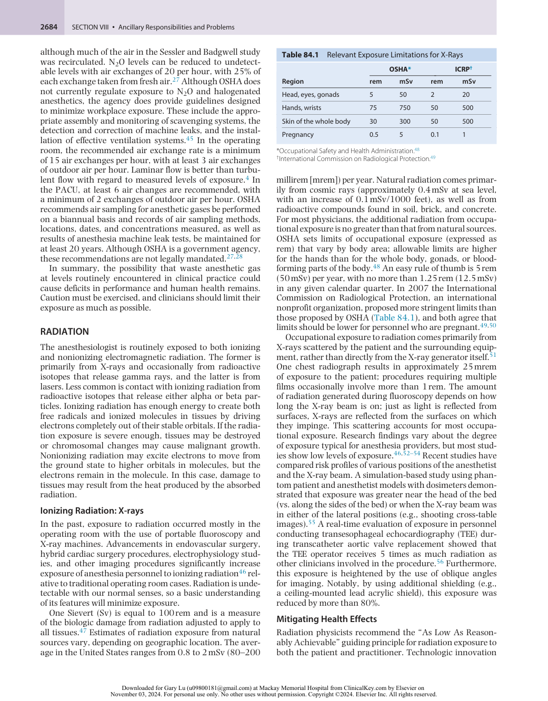
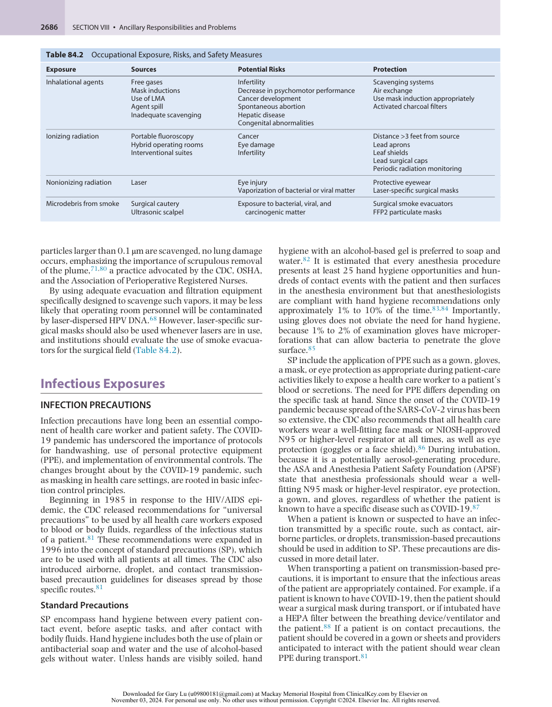
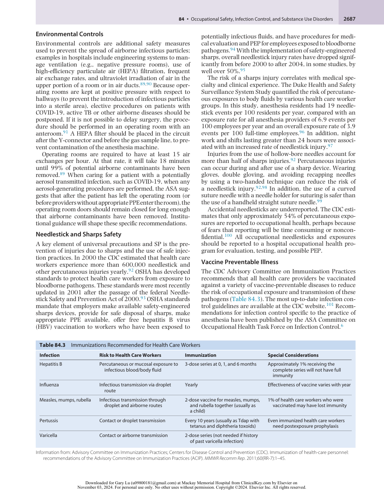
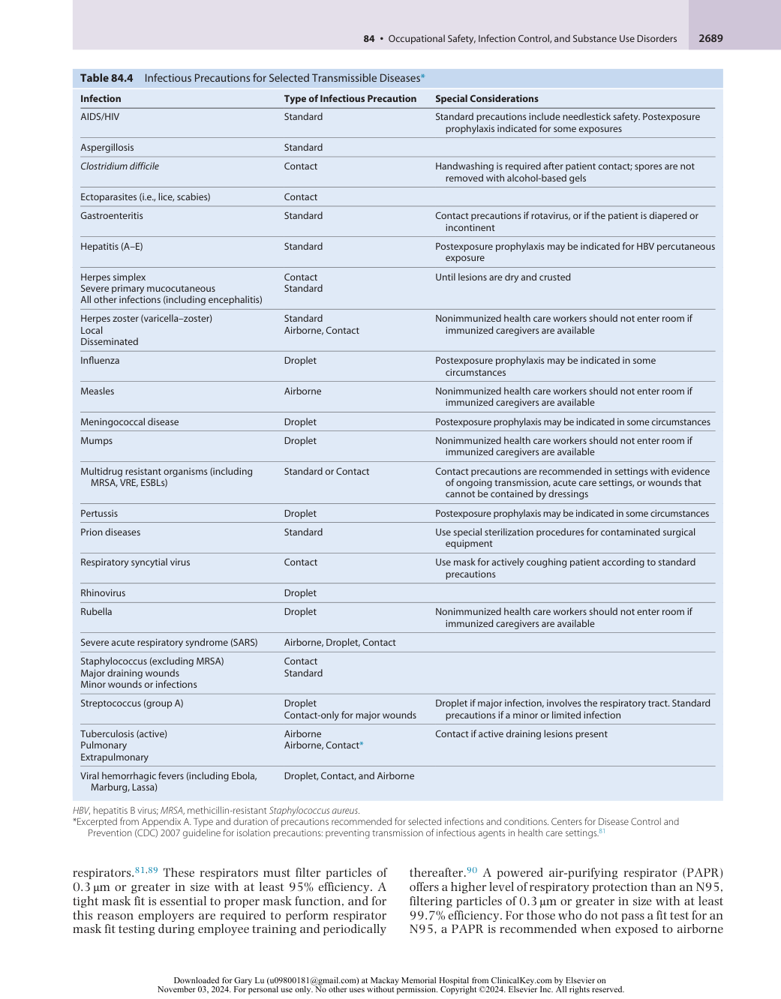
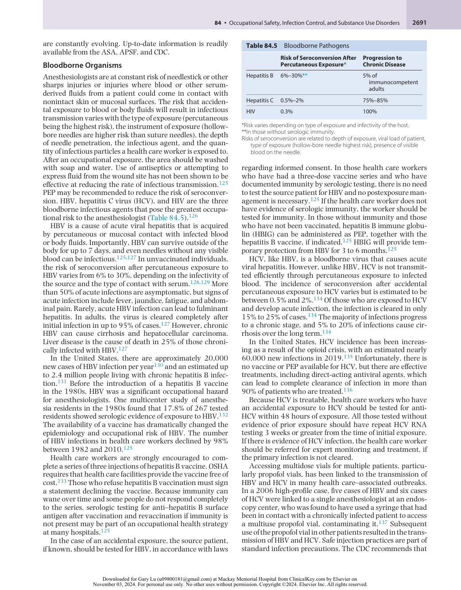
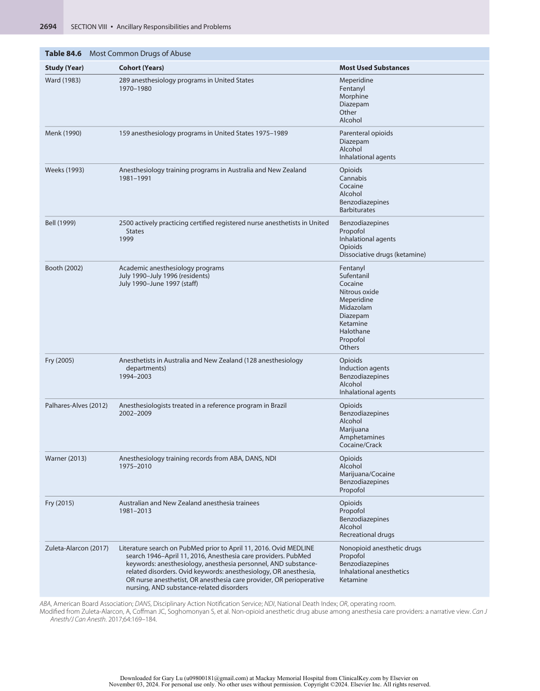
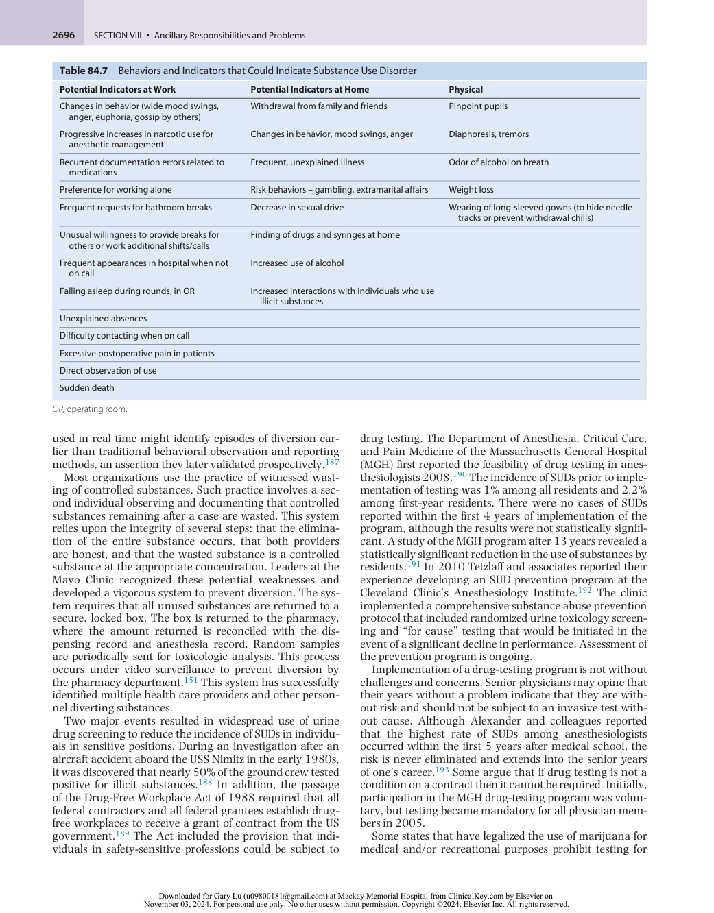
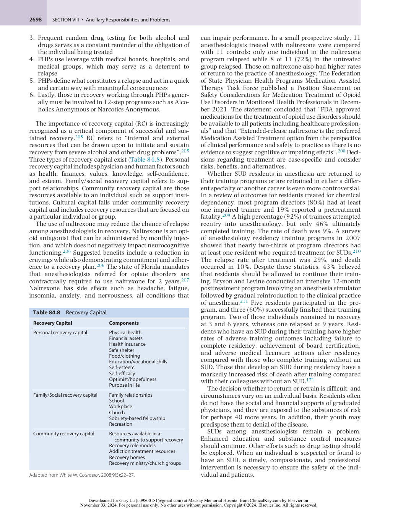
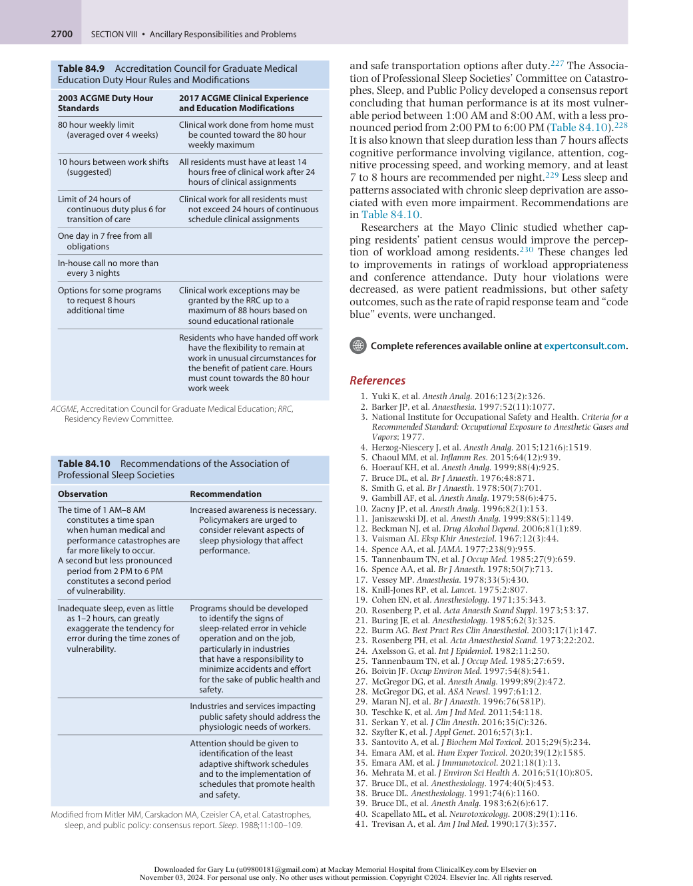

# Occupational Safety, Infection Control, and Substance Use Disorders

<!-- PDF page 1 -->

CHRISTOPHER CHOUKALAS, MARILYN MICHELOW, and MICHAEL FITZSIMONS

### KEY POINTS

- The operating environment is a complex one that has potential health risks to those working there. Exposure to risks, including waste anesthetic gas, in clinical practice is unavoidable. In the United States, the limits of exposure to waste gases are set by the National Institute for Occupational Safety and Health (NIOSH), which recommends a time- weighted average of 25 ppm for nitrous oxide and a ceiling of 2 ppm for volatile anesthetics.

- Although researchers disagree whether exposure to anesthetic gases at concentrations less than NIOSH limits affects health or performance, these limits are often exceeded. If it can be smelled, the exposure is many times greater than the safe limit.

- Occupational exposure to radiation comes primarily from X- rays scattered by the patient and surrounding equipment. A distance of 3 feet from the patient is recommended to minimize physiologic damage from occupational exposure, and a distance of 6 feet from the patient provides the same protection as 2.5 mm of lead.

- Surgical smoke is increasingly recognized as a source of potentially infectious and carcinogenic material; evacuation devices should be used where the smoke plume is created.

- Diseases can be transmitted via direct contact, droplets, or airborne particles. Some diseases are infectious only if there is direct exposure to blood or body fluid from the host. Appropriate personal protective equipment based on the suspected type of infection should always be used to prevent occupational disease transmission.

- To attenuate occupational exposure to pathogens, standard precautions at a minimum should be used at all times. The appropriate barrier precautions for intubation include eye protection, a surgical mask, and gloves.

- To prevent exposure to bloodborne pathogens, sharps safety, including the use of safety retractable needles and needleless systems, should be used.

- Occupational exposure to human immunodeficiency virus (HIV) and hepatitis B and C viruses (HBV and HCV) is most often the result of a percutaneous injury. The risk of disease transmission is generally very low but is greatest from hollow- bore needles, needles contaminated with visible blood, and exposure to a source patient with high viral titer.

- Postexposure prophylaxis (PEP) is recommended after occupational exposure to HIV or HBV. The recommended guidelines for PEP are available on the Centers for Disease Control and Prevention website. The Clinical Consultation Center PEPline service is a free expert resource for guidance on PEP (1- 888- 448- 4911).

- The preference for and access to potent opioids contribute to the prevalence of substance use disorder among anesthesiologists. The rate of drug- related deaths is more than twice as high in anesthesiologists as internists.

- Although many recovered anesthesiologists return to the practice of anesthesia, there is a significant relapse rate. The chance of relapse is highest in physicians who become addicted to potent narcotics early in their career. Successful recovery requires a lifelong commitment to treatment. In some cases, a change in specialty is the only solution.

- Sleep deprivation has an adverse effect on physician mood, cognitive function, reaction time, and vigilance. Although sleep deprivation and fatigue adversely affect clinical performance, the full impact on patient outcome has been difficult to determine.

The practice of anesthesiology exposes its practitioners to a variety of risks unique among medical specialties. Some of these risks are tangible or physical, such as waste anesthetic gases and communicable disease, whereas others are more insidious, such as stress, fatigue, and the risks of

substance abuse disorder. Each of these risks can be mitigated but probably not eliminated.

In the case of physical exposures such as waste anesthetic gases, radiation, and bloodborne pathogens, efficient gas scavenger systems, the use of protective lead,

<!-- PDF page 2 -->

needle- shielded intravenous (IV) lines, standard precautions (SP), and postexposure prophylaxis (PEP) protocols are currently commonplace in contemporary anesthesia practice. The less tangible risks are harder to reduce. Work hour restrictions may limit fatigue among trainees. However, doing so may not improve patient outcomes, particularly when such controls do not apply to practicing physicians. Substance abuse disorders remain a problem with a multifactorial etiology and few clear solutions. This chapter examines the risks associated with each of these environmental and situational hazards and reviews the measures one can take to avoid them.

## Physical Exposures

### INHALATIONAL ANESTHETICS

Volatile inhaled anesthetics are an indispensable part of anesthesia practice; however, these agents also have the potential to cause harm to patients and the physicians caring for them. Given what is suspected about their impact on patient health, _vis- à- vis_ neurodevelopment of the very young, the spectrum of postoperative cognitive disorders in adults, and immunosuppressant effects on patients of all ages,1 it is natural to wonder whether these compounds are harmful to health care workers exposed to them on a daily basis. Definitive answers remain elusive as it is difficult to randomize exposure. Previous work suggesting a link between exposure to waste anesthetic gas and infertility and other health effects suffered serious methodologic flaws.

Waste nitrous oxide (N2O) and halogenated anesthetics in the absence of scavenging may approach concentrations as high as 3000 and 50 ppm, respectively.2 This is relative to guidelines for safe practice, which historically have proposed limits of exposure well below (e.g., 25 ppm N2O and 2 ppm of any halogenated agent).3 Although the concentration of waste gases can be well controlled with proper scavenging, in practice the levels recommended by the National Institute for Occupational Safety and Health (NIOSH) are often exceeded during the routine delivery of anesthesia.4,5 One study of inhaled induction of anesthesia and maintenance with sevoflurane and N2O in adults resulted in violations of NIOSH standards 50% of the time.6

### Provider Health Effects

One of the first examinations of the impact of exposure to subanesthetic concentrations of inhalational anesthetics on cognitive performance was conducted by Bruce and Bach in the 1970s. They noted that healthy volunteers in the laboratory suffered a decrease in psychomotor performance when exposed to concentrations of N2O as low as 50 ppm, alone or in combination with 1 ppm of halothane. The same study showed that 25 ppm of N2O combined with 0.5 ppm of halothane had no effect.3,7 Subsequently, three other groups of researchers studying volunteers in laboratories have been unable to confirm the earlier findings. The lack of agreement between investigators has led some to conclude “that there is no convincing evidence that anesthetics in concentrations equal to those found in unscavenged operating theatres have any effect on the psychomotor performance of healthy subjects in the laboratory.”8 A study

conducted on volunteers in an operating room during normal clinical activities in which trace concentrations of N2O and halothane ranged from 0 to 2300 and 0 to 37 ppm, respectively, also failed to detect impairment in psychomotor performance.9 In contrast, a series of studies in healthy volunteers showed that subanesthetic concentrations of N2O, isoflurane, and sevoflurane were associated with reductions in psychomotor performance, with some studies suggesting a dose- dependent effect for N2O dose as low as 10% and a sevoflurane dose as low as 0.4%.10–12 By way of comparison, 10% N2O is equivalent to 100,000 ppm, significantly higher than the recommended safe level of exposure and the level of exposure in the Bruce and Bach studies. Whether the methods in these studies closely mimic patterns of occupational exposure in clinical practice is debatable, but it must be acknowledged, as discussed later, that occupational exposure may greatly exceed accepted safe levels.

### Fetal Health Effects

Anesthetics have been implicated in the development of cancer, spontaneous abortions, and genetic and developmental anomalies. The possibility that chronic exposure to anesthetic waste gases could result in adverse health effects was first appreciated in the late 1960s, when a report of potential harm appeared in the Russian literature; Vaisman reported an increased incidence of abortions (18 spontaneous abortions in 31 pregnancies) among female anesthetists.13 After this initial report, a multitude of retrospective studies followed. Of these, three large studies conducted during the 1970s and 1980s in the United States and the United Kingdom all concluded that the prevalence of spontaneous abortion was substantially higher in female anesthesiologists than in female physicians working outside the operating room.14–17 Studies in this era also concluded that the incidence of congenital anomalies in children of male and female anesthesiologists was higher than in the control groups of physicians.18–20 In addition to these reproductive effects, meta- analysis of six of these early studies linked the exposure to anesthetic gases to hepatic disease in male anesthesia personnel21 and cervical cancer, liver disease, and kidney disease in female anesthesia personnel.22 A number of studies with similar methodologies failed to detect a relationship between exposure and health.23–25 Although many of these older studies suffered from significant methodologic limitations,14,15,21 a 1997 metaanalysis of more than 19 studies completed between 1984 and 1992 reported the relative risk of abortion in females exposed to anesthetic gases to be 1.48 (confidence interval [CI] 95%, 1.4–1.58).26

The Task Force on Trace Anesthetic Gases was convened by the American Society of Anesthesiologists (ASA) Committee on Occupational Health of Operating Room Personnel to analyze data from all available epidemiologic studies. The methodologic flaws in the studies impaired the task force’s ability to draw conclusions about an association between occupational exposure to waste anesthetic gases and adverse health effects. Their report, published in 2002,27,28 cited data from a prospective survey29 of 11,500 UK female physicians documenting occupation, work practices, lifestyle, and medical and obstetric history, as well as hours of exposure and the use of scavenging equipment.

<!-- PDF page 3 -->

2683 

This report showed the incidence of infertility, spontaneous abortion, and children with congenital abnormalities in female anesthesiologists to be the same as that in other physicians.29 The position of the ASA is that “There is no evidence that trace concentrations of waste anesthetic gases cause adverse health effects to personnel working in locations where scavenging of waste anesthetic gases is carried out” and “the general conclusion… is that currently used anesthetics… have no mutagenic potential.”27,28 This reassurance may be of little comfort in light of evidence and clinical experience that show levels of exposure in clinical practice routinely exceed those considered safe by health and regulatory agencies.4,5 The task force document also summarized contemporaneous recommendations from the Occupational Safety and Health Administration (OSHA) recommending that from the employee’s “Right to Know,” there are “potential adverse effects of exposure to waste anesthetic gases such as spontaneous abortions, and congenital abnormalities in children.”27,28

Subsequently, there have been several more studies that support the possibility of health effects. An analysis of Canadian nurses identified significant odds of congenital anomalies in the offspring of nurses working in settings with exposure to waste anesthetic gases compared with those working in settings where the likelihood of exposure was lower.30 Subsequent research using chromosomal and molecular DNA analysis identified correlations between exposure and genotoxic effects (e.g., sister chromatid exchanges, breaks in DNA, and chromosomal abnormalities)31–33 but did not examine clinical outcomes in offspring. However, these more recent epidemiologic and genetic studies did not quantify exposure, but rather assumed exposure by selecting health care workers from settings where exposure was assumed to have taken place. Although this limits the interpretability of the relationship between anesthetic gas and harm, an alternate view is that the operating room environment, in general, is a source of occupational harm, be it from waste anesthesia gas, other noxious fumes, radiation, stress, noise, surgical smoke, or other exposures inherent to this environment.

More recently, case–control studies showing higher levels of sevoflurane metabolites among anesthesia providers, as a proxy for degree of exposure, have been conducted.34,35 These studies have shown elevated inflammatory markers, lower hemoglobin and platelet counts, and higher white blood cell counts among all operating room personnel, not just anesthesia providers and not just among the subgroups with higher levels of sevoflurane metabolites. This, as with prior work, reinforces the notion that the operating room, perhaps independent of waste anesthesia gas, is an environment associated with a number of potential toxicants and stressors (e.g., noise pollution, stress, night- time work, a range of other physical exposures such as surgical smoke [addressed below], fumes from methylmethacrylate, or ionizing radiation [also addressed below]). More research is urgently needed to identify and mitigate the causes of these associated negative health outcomes.

### Mitigating Health Effects

The potential health effects of occupational exposure to anesthetic gas can be mitigated through waste anesthesia gas scavenging systems, establishing levels of safe

exposure, auditing exposure levels, and enforcing recommended frequencies of air exchanges in locations where anesthesia gas may be found (e.g., operating rooms, procedural suites, and recovery areas). Diligent maintenance and a thorough understanding of anesthesia scavenging systems are essential to comply with NIOSH standards and to minimize operating room exposure. Emerging evidence exists for the role of various activated charcoal compounds to absorb molecules of anesthetic vapor,36 but these have been trialed only in experimental settings and are not yet available commercially.

Regulations and recommendations regarding workplace safety are established by several governmental agencies. The OSHA is the national agency within the US Department of Labor that sets and enforces standards to ensure “safe and healthful working conditions.” The Centers for Disease Control and Prevention (CDC) and NIOSH are both federal agencies conducting research and making recommendations regarding health and workplace safety. Unlike OSHA, neither the CDC nor NIOSH are regulatory agencies. State and local health departments, as well as hospital infection control departments, are also tasked with enacting and enforcing health care workplace safety standards. The NIOSH sets recommended exposure limits for the operating room setting, stating “no worker should be exposed [to] concentrations greater than 2 ppm of any halogenated anesthetic or 25 ppm of N2O” in the 1970s.3 These exposure limits have not been updated nor do they include newer volatile anesthetic drugs, and no limits to other operating room exposures (e.g., noise or other fumes) have been set. These exposure levels were selected based on the lowest level known at the time to cause side effects (50 ppm N2O or 1 ppm of halothane caused cognitive impairment in dental students)37 and the level that could be easily and practically achieved.38 Subsequently, it was realized that the data used to set the standards might not be generalizable because the subjects were Mormon, a subgroup likely more sensitive to depressant drugs39 ; a more recent study with a small sample size showed cognitive impairment at 50 ppm of N2O,40 levels that are routinely found in studies4,5,41,42 and are well above the NIOSH levels. The threshold of perception of halothane ranges from less than 3 to more than 100 ppm.2 If the anesthetic can be smelled, its concentration is likely to be many times greater than the maximum recommended level.

Occupational exposure is not limited to operating room staff, because patients continue to exhale trace amounts of N2O for 5 to 8 hours postoperatively.43 Sessler and Badgwell used lapel dosimeters to measure the concentrations of volatile anesthetics of recovery room nurses during the first hour of postanesthesia care unit (PACU) care in patients who had received inhaled anesthetics. In this study, breathing zone anesthetic concentrations were in excess of NIOSH recommendations in 37% of patients who received isoflurane, 87% of patients who received desflurane, and 53% of patients who received N2O.44 A more recent but similar study reported a much lower average concentration (3.1 ppm) of N2O in the breathing zone of recovering patients in a Canadian PACU,43 also above the recommended safe levels of exposure. These studies demonstrate the importance of proper ventilation in PACUs. Both groups reported PACU room air exchanges of 8 volumes per hour,

<!-- PDF page 4 -->

although much of the air in the Sessler and Badgwell study was recirculated. N2O levels can be reduced to undetectable levels with air exchanges of 20 per hour, with 25% of each exchange taken from fresh air.27 Although OSHA does not currently regulate exposure to N2O and halogenated anesthetics, the agency does provide guidelines designed to minimize workplace exposure. These include the appropriate assembly and monitoring of scavenging systems, the detection and correction of machine leaks, and the installation of effective ventilation systems.45 In the operating room, the recommended air exchange rate is a minimum of 15 air exchanges per hour, with at least 3 air exchanges of outdoor air per hour. Laminar flow is better than turbulent flow with regard to measured levels of exposure.4 In the PACU, at least 6 air changes are recommended, with a minimum of 2 exchanges of outdoor air per hour. OSHA recommends air sampling for anesthetic gases be performed on a biannual basis and records of air sampling methods, locations, dates, and concentrations measured, as well as results of anesthesia machine leak tests, be maintained for at least 20 years. Although OSHA is a government agency, these recommendations are not legally mandated.27,28

In summary, the possibility that waste anesthetic gas at levels routinely encountered in clinical practice could cause deficits in performance and human health remains. Caution must be exercised, and clinicians should limit their exposure as much as possible.

### RADIATION

The anesthesiologist is routinely exposed to both ionizing and nonionizing electromagnetic radiation. The former is primarily from X- rays and occasionally from radioactive isotopes that release gamma rays, and the latter is from lasers. Less common is contact with ionizing radiation from radioactive isotopes that release either alpha or beta particles. Ionizing radiation has enough energy to create both free radicals and ionized molecules in tissues by driving electrons completely out of their stable orbitals. If the radiation exposure is severe enough, tissues may be destroyed or chromosomal changes may cause malignant growth. Nonionizing radiation may excite electrons to move from the ground state to higher orbitals in molecules, but the electrons remain in the molecule. In this case, damage to tissues may result from the heat produced by the absorbed radiation.

### Ionizing Radiation: X- rays

In the past, exposure to radiation occurred mostly in the operating room with the use of portable fluoroscopy and X- ray machines. Advancements in endovascular surgery, hybrid cardiac surgery procedures, electrophysiology studies, and other imaging procedures significantly increase exposure of anesthesia personnel to ionizing radiation46 relative to traditional operating room cases. Radiation is undetectable with our normal senses, so a basic understanding of its features will minimize exposure.

One Sievert (Sv) is equal to 100 rem and is a measure of the biologic damage from radiation adjusted to apply to all tissues.47 Estimates of radiation exposure from natural sources vary, depending on geographic location. The average in the United States ranges from 0.8 to 2 mSv (80–200

**Table 84.1** Relevant Exposure Limitations for X- Rays

|||**OSHA***||**ICRP**†|
|---|---|---|---|---|
|**Region**|**rem**|**mSv**|**rem**|**mSv**|
|Head, eyes, gonads|5|50|2|20|
|Hands, wrists|75|750|50|500|
|Skin of the whole body|30|300|50|500|
|Pregnancy|0.5|5|0.1|1|

*Occupational Safety and Health Administration.48

†International Commission on Radiological Protection.49

millirem [mrem]) per year. Natural radiation comes primarily from cosmic rays (approximately 0.4 mSv at sea level, with an increase of 0.1 mSv/1000 feet), as well as from radioactive compounds found in soil, brick, and concrete. For most physicians, the additional radiation from occupational exposure is no greater than that from natural sources. OSHA sets limits of occupational exposure (expressed as rem) that vary by body area; allowable limits are higher for the hands than for the whole body, gonads, or bloodforming parts of the body.48 An easy rule of thumb is 5 rem (50 mSv) per year, with no more than 1.25 rem (12.5 mSv) in any given calendar quarter. In 2007 the International Commission on Radiological Protection, an international nonprofit organization, proposed more stringent limits than those proposed by OSHA (Table 84.1), and both agree that limits should be lower for personnel who are pregnant.49,50

Occupational exposure to radiation comes primarily from X- rays scattered by the patient and the surrounding equipment, rather than directly from the X- ray generator itself.51 One chest radiograph results in approximately 25 mrem of exposure to the patient; procedures requiring multiple films occasionally involve more than 1 rem. The amount of radiation generated during fluoroscopy depends on how long the X- ray beam is on; just as light is reflected from surfaces, X- rays are reflected from the surfaces on which they impinge. This scattering accounts for most occupational exposure. Research findings vary about the degree of exposure typical for anesthesia providers, but most studies show low levels of exposure.46,52–54 Recent studies have compared risk profiles of various positions of the anesthetist and the X- ray beam. A simulation- based study using phantom patient and anesthetist models with dosimeters demonstrated that exposure was greater near the head of the bed (vs. along the sides of the bed) or when the X- ray beam was in either of the lateral positions (e.g., shooting cross- table images).55 A real- time evaluation of exposure in personnel conducting transesophageal echocardiography (TEE) during transcatheter aortic valve replacement showed that the TEE operator receives 5 times as much radiation as other clinicians involved in the procedure.56 Furthermore, this exposure is heightened by the use of oblique angles for imaging. Notably, by using additional shielding (e.g., a ceiling- mounted lead acrylic shield), this exposure was reduced by more than 80%.

### Mitigating Health Effects

Radiation physicists recommend the “As Low As Reasonably Achievable” guiding principle for radiation exposure to both the patient and practitioner. Technologic innovation

::: details 原始表格與符號（PDF 第 4 頁）

:::

<!-- PDF page 5 -->

leading to advances in imaging technology and industrial design may further limit exposure.57,58

Because the intensity of scattered radiation is inversely proportional to the square of the distance from the source, the best protection is physical separation. A distance of at least 3 feet from the patient is recommended. Six feet of air provides protection the equivalent of 9 inches of concrete or 2.5 mm of lead.59 Using studies of real- time dosimeters and simulation studies using phantom patients, a recent systematic review found that at a 4.9- foot (1.5 m) distance from the X- ray source, exposure was no greater than that due to background radiation.52 This finding has been replicated in a handful of studies of clinical exposures.46,53 The authors go so far as to question the need for anesthesia personnel to wear lead aprons, which conflicts with OSHA recommendations.60 Although they may be uncomfortable, aprons containing the equivalent of 0.25 to 0.5 mm of lead sheet are effective in blocking most scattered radiation and such devices are recommended to be worn whenever there is an exposure risk.61 Uncovered areas, such as the lens of the eye, still bear the risk of injury,51 and radiation dose to the eyes varies with the type of surgery and the position of the anesthesiologist relative to the patient and X- ray field.55,62 OSHA recommends opaque goggles for health care workers in the “direct X- ray field.”60

### Nonionizing Radiation: Lasers

Laser is an acronym for light amplification by stimulated emission of radiation. Lasers produce infrared, visible, or ultraviolet light. A surgical laser produces intense, focused electromagnetic radiation to cut or destroy tissues. Although the radiation from lasers is nonionizing, it is potentially unsafe both because of its intensity and because of the matter released from tissues during treatment.

Of those in common clinical use, carbon dioxide and neodymium:yttrium- aluminum- garnet (Nd:YAG) lasers emit light in the far- infrared and near- infrared wavelengths, respectively; argon and tunable dye lasers produce visible light.63

Eye injuries are the greatest risk to personnel working near lasers. Strict standards for protection have been developed based on current understanding but are subject to periodic revision. Either direct exposure or reflected radiation may cause eye damage. Injuries include corneal and retinal burns, destruction of the macula or optic nerve, and cataract formation. Protective eyewear is designed to filter out the radiation produced by a specific type of laser while still permitting vision. For example, clear plastic lenses block the far- infrared (10,600 nm) radiation from carbon dioxide lasers but provide no protection against the near- infrared (1064 nm) radiation emitted by Nd:YAG lasers. The type of protection provided by a given filter is marked on the frame of the goggles and should be checked before use. Filters that are scratched should not be used. Because certain filters block portions of the visible spectrum, it is prudent to confirm preoperatively that patient monitors can be seen and interpreted correctly with goggles in place. Protective eyewear is recommended for all exposed personnel because reflected radiation can be as hazardous as direct radiation and, unlike X- ray radiation, the intensity is not diminished significantly by the distance traveled in the average operating room.63

In addition to direct injury from laser light, clinicians should avoid the smoke plume created by lasers.64–66 Under experimental conditions, viable bacteria have been recovered from the plume emanating from laser irradiation,67 as have compounds known to be carcinogens and environmental toxins.64 Intact DNA from human papillomavirus (HPV) has been detected in the vapor from both laser- treated plantar warts and genital condylomata68,69 and on the gloves of treating physicians.70 Human immunodeficiency virus (HIV) proviral DNA has been found in laser smoke produced by vaporizing cultures of HIV- positive cells.71 Although these experiments, which used tissue cultures, do not replicate routine clinical circumstances, they stress the importance of strict attention to smoke removal. Simulation studies confirm that concentrations of lasergenerated particulate matter are higher near the operating field than elsewhere in the room, sometimes by a factor of four, regardless of the degree of room ventilation.65

As an extreme example, a case report documented the appearance of laryngeal papillomas in a surgeon who had previously treated several patients infected with anal condylomata without the benefit of a laser smoke evacuator.72 Tissue from the surgeon’s laryngeal tumors contained HPV DNA types 6 and 11, the same viral types that are commonly harbored by anogenital condylomata. Hence it is prudent to scavenge all vaporized debris and wear masks designed to filter such particles.

### SURGICAL SMOKE

Increasing attention is focused on the health effects of exposure to surgical smoke created by electrocautery and ultrasonic scalpels.73 Data suggest that smoke from electrocautery contains infectious and malignant cells, albeit in small quantities, as well as carcinogenic compounds.74 Ultrasonic scalpels can produce viable cells in the smoke plume, as demonstrated in a study that showed that the malignant cells grew cancer when subsequently injected into mice.75

Data from a NIOSH survey of health care workers shows that the majority of operating room personnel believe local exhaust ventilation devices (e.g., smoke evacuators on the surgical field) are not routinely in use.76 Respondents reported that a lack of institutional protocols and a belief that exposure was minimal or not concerning were responsible for the lack of such protective strategies. Anesthesia personnel are intimately familiar with the various odors common in our practice; the smell of flesh burned with electrocautery should be a signal to those in the operating room that they are being exposed to potentially harmful material.

Mitigating the effects of exposure to surgical smoke is a critical endeavor. Most standard surgical masks trap only the largest of the smoke particles,77 and standard surgical masks are demonstrably ineffective at filtering particles generated by laser.78,79 Even laser- specific masks were manyfold less effective at particle removal than the comparator, a protection class FFP level 2 dust and fine particle mask.78 The median size of particles in plume samples obtained intraoperatively is 0.31 μm in diameter (range, 0.1–0.8 μm). Even after filtration of particles greater than 0.5 μm in diameter, exhaust smoke from tissues treated with a carbon dioxide laser causes pulmonary lesions in laboratory animals. If all

<!-- PDF page 6 -->

**Table 84.2** Occupational Exposure, Risks, and Safety Measures

|**Exposure**|**Sources**|**Potential Risks**|**Protection**|
|---|---|---|---|
|Inhalational agents|Free gases Mask inductions Use of LMA Agent spill Inadequate scavenging|Infertility Decrease in psychomotor performance Cancer development Spontaneous abortion Hepatic disease Congenital abnormalities|Scavenging systems Air exchange Use mask induction appropriately Activated charcoal filters|
|Ionizing radiation|Portable fluoroscopy Hybrid operating rooms Interventional suites|Cancer Eye damage Infertility|Distance >3 feet from source Lead aprons Leaf shields Lead surgical caps Periodic radiation monitoring|
|Nonionizing radiation|Laser|Eye injury Vaporization of bacterial or viral matter|Protective eyewear Laser- specific surgical masks|
|Microdebris from smoke|Surgical cautery Ultrasonic scalpel|Exposure to bacterial, viral, and carcinogenic matter|Surgical smoke evacuators FFP2 particulate masks|

particles larger than 0.1 μm are scavenged, no lung damage occurs, emphasizing the importance of scrupulous removal of the plume,71,80 a practice advocated by the CDC, OSHA, and the Association of Perioperative Registered Nurses.

By using adequate evacuation and filtration equipment specifically designed to scavenge such vapors, it may be less likely that operating room personnel will be contaminated by laser- dispersed HPV DNA.68 However, laser- specific surgical masks should also be used whenever lasers are in use, and institutions should evaluate the use of smoke evacuators for the surgical field (Table 84.2).

## Infectious Exposures

### INFECTION PRECAUTIONS

Infection precautions have long been an essential component of health care worker and patient safety. The COVID19 pandemic has underscored the importance of protocols for handwashing, use of personal protective equipment (PPE), and implementation of environmental controls. The changes brought about by the COVID- 19 pandemic, such as masking in health care settings, are rooted in basic infection control principles.

Beginning in 1985 in response to the HIV/AIDS epidemic, the CDC released recommendations for “universal precautions” to be used by all health care workers exposed to blood or body fluids, regardless of the infectious status of a patient.81 These recommendations were expanded in 1996 into the concept of standard precautions (SP), which are to be used with all patients at all times. The CDC also introduced airborne, droplet, and contact transmissionbased precaution guidelines for diseases spread by those specific routes.81

### Standard Precautions

SP encompass hand hygiene between every patient contact event, before aseptic tasks, and after contact with bodily fluids. Hand hygiene includes both the use of plain or antibacterial soap and water and the use of alcohol- based gels without water. Unless hands are visibly soiled, hand

hygiene with an alcohol- based gel is preferred to soap and water.82 It is estimated that every anesthesia procedure presents at least 25 hand hygiene opportunities and hundreds of contact events with the patient and then surfaces in the anesthesia environment but that anesthesiologists are compliant with hand hygiene recommendations only approximately 1% to 10% of the time.83,84 Importantly, using gloves does not obviate the need for hand hygiene, because 1% to 2% of examination gloves have microperforations that can allow bacteria to penetrate the glove surface.85

SP include the application of PPE such as a gown, gloves, a mask, or eye protection as appropriate during patient- care activities likely to expose a health care worker to a patient’s blood or secretions. The need for PPE differs depending on the specific task at hand. Since the onset of the COVID- 19 pandemic because spread of the SARS- CoV- 2 virus has been so extensive, the CDC also recommends that all health care workers wear a well- fitting face mask or NIOSH- approved N95 or higher- level respirator at all times, as well as eye protection (goggles or a face shield).86 During intubation, because it is a potentially aerosol- generating procedure, the ASA and Anesthesia Patient Safety Foundation (APSF) state that anesthesia professionals should wear a wellfitting N95 mask or higher- level respirator, eye protection, a gown, and gloves, regardless of whether the patient is known to have a specific disease such as COVID- 19.87

When a patient is known or suspected to have an infection transmitted by a specific route, such as contact, airborne particles, or droplets, transmission- based precautions should be used in addition to SP. These precautions are discussed in more detail later.

When transporting a patient on transmission- based precautions, it is important to ensure that the infectious areas of the patient are appropriately contained. For example, if a patient is known to have COVID- 19, then the patient should wear a surgical mask during transport, or if intubated have a HEPA filter between the breathing device/ventilator and the patient.88 If a patient is on contact precautions, the patient should be covered in a gown or sheets and providers anticipated to interact with the patient should wear clean PPE during transport.81

::: details 原始表格與符號（PDF 第 6 頁）

:::

<!-- PDF page 7 -->

### Environmental Controls

Environmental controls are additional safety measures used to prevent the spread of airborne infectious particles; examples in hospitals include engineering systems to manage ventilation (e.g., negative pressure rooms), use of high- efficiency particulate air (HEPA) filtration, frequent air exchange rates, and ultraviolet irradiation of air in the upper portion of a room or in air ducts.89,90 Because operating rooms are kept at positive pressure with respect to hallways (to prevent the introduction of infectious particles into a sterile area), elective procedures on patients with COVID- 19, active TB or other airborne diseases should be postponed. If it is not possible to delay surgery, the procedure should be performed in an operating room with an anteroom.91 A HEPA filter should be placed in the circuit after the Y- connector and before the gas sample line, to prevent contamination of the anesthesia machine.

Operating rooms are required to have at least 15 air exchanges per hour. At that rate, it will take 18 minutes until 99% of potential airborne contaminants have been removed.89 When caring for a patient with a potentially aerosol transmitted infection, such as COVID- 19, when any aerosol-generating procedures are performed, the ASA suggests that after the patient has left the operating room (or before providers without appropriate PPE enter the room), the operating room doors should remain closed for long enough that airborne contaminants have been removed. Institutional guidance will shape these specific recommendations.

### Needlestick and Sharps Safety

A key element of universal precautions and SP is the prevention of injuries due to sharps and the use of safe injection practices. In 2000 the CDC estimated that health care workers experience more than 600,000 needlestick and other percutaneous injuries yearly.92 OSHA has developed standards to protect health care workers from exposure to bloodborne pathogens. These standards were most recently updated in 2001 after the passage of the federal Needlestick Safety and Prevention Act of 2000.93 OSHA standards mandate that employers make available safety- engineered sharps devices, provide for safe disposal of sharps, make appropriate PPE available, offer free hepatitis B virus (HBV) vaccination to workers who have been exposed to

potentially infectious fluids, and have procedures for medical evaluation and PEP for employees exposed to bloodborne pathogens.94 With the implementation of safety- engineered sharps, overall needlestick injury rates have dropped significantly from before 2000 to after 2004, in some studies, by well over 50%.95

The risk of a sharps injury correlates with medical specialty and clinical experience. The Duke Health and Safety Surveillance System Study quantified the risk of percutaneous exposures to body fluids by various health care worker groups. In this study, anesthesia residents had 19 needlestick events per 100 residents per year, compared with an exposure rate for all anesthesia providers of 6.9 events per 100 employees per year and an overall exposure rate of 3.9 events per 100 full- time employees.96 In addition, night work and shifts lasting greater than 24 hours were associated with an increased rate of needlestick injury.97

Injuries from the use of hollow- bore needles account for more than half of sharps injuries.92 Percutaneous injuries can occur during and after use of a sharp device. Wearing gloves, double gloving, and avoiding recapping needles by using a two- handed technique can reduce the risk of a needlestick injury.92,98 In addition, the use of a curved suture needle with a needle holder for suturing is safer than the use of a handheld straight suture needle.99

Accidental needlesticks are underreported. The CDC estimates that only approximately 54% of percutaneous exposures are reported to occupational health, perhaps because of fears that reporting will be time consuming or nonconfidential.100 All occupational needlesticks and exposures should be reported to a hospital occupational health program for evaluation, testing, and possible PEP.

### Vaccine Preventable Illness

The CDC Advisory Committee on Immunization Practices recommends that all health care providers be vaccinated against a variety of vaccine- preventable diseases to reduce the risk of occupational exposure and transmission of these pathogens (Table 84.3). The most up- to- date infection control guidelines are available at the CDC website.101 Recommendations for infection control specific to the practice of anesthesia have been published by the ASA Committee on Occupational Health Task Force on Infection Control.6

**Table 84.3** Immunizations Recommended for Health Care Workers

|**Infection**|**Risk to Health Care Workers**|**Immunization**|**Special Considerations**|
|---|---|---|---|
|Hepatitis B|Percutaneous or mucosal exposure to infectious blood/body fluid|3- dose series at 0, 1, and 6 months|Approximately 1% receiving the complete series will not have full immunity|
|Influenza|Infectious transmission via droplet route|Yearly|Effectiveness of vaccine varies with year|
|Measles, mumps, rubella|Infectious transmission through droplet and airborne routes|2- dose vaccine for measles, mumps, and rubella together (usually as a child)|1% of health care workers who were vaccinated may have lost immunity|
|Pertussis|Contact or droplet transmission|Every 10 years (usually as Tdap with tetanus and diphtheria toxoids)|Even immunized health care workers need postexposure prophylaxis|
|Varicella|Contact or airborne transmission|2- dose series (not needed if history of past varicella infection)||

Information from: Advisory Committee on Immunization Practices; Centers for Disease Control and Prevention (CDC). Immunization of health- care personnel: recommendations of the Advisory Committee on Immunization Practices (ACIP). _MMWR Recomm Rep_ . 2011;60(RR- 7):1–45.

::: details 原始表格與符號（PDF 第 7 頁）

:::

<!-- PDF page 8 -->

### TRANSMISSION OF INFECTIOUS AGENTS

Anesthesia providers are exposed to a wide range of infectious pathogens, including bacteria, viruses, fungi, parasites, and prions. The three principal routes of pathogen transmission are via contact, droplet, and airborne spread. Bloodborne infectious agents, such as HIV and HBV, are transmitted to the health care worker via percutaneous injuries or direct contact of nonintact skin or mucous membranes with infected blood or other serum- derived body fluids (Table 84.4).102,103

### Contact Transmission

Contact transmission, the most common type of infectious transmission,81 can either be direct, from an infected person to another person, or indirect, with a contaminated intermediate such as a laryngoscope handle in an operating room.104 When a patient has a contact- transmitted infection, contact precautions should be used at all times. These include keeping patients separated at least 3 feet from neighbors and wearing a gown and gloves for all patientcare interactions. Examples of microorganisms commonly transmitted via contact include respiratory syncytial virus, herpes simplex virus, _Staphylococcus aureus_ (including methicillin- resistant _S. aureus_ ), and scabies.81 While SARSCoV- 2 may be transmitted via direct contact, fomite transmission of the virus is felt to be low compared with droplet or airborne transmission.105

_Clostridium difficile_ is an epidemiologically important contact- transmitted organism in health care facilities. _C. difficile_ is a Gram- positive spore- forming anaerobe that causes diarrhea and pseudomembranous colitis. The use of broadspectrum antibiotics such as cephalosporins, clindamycin, and vancomycin are associated with _C. difficile_ infection. Notably, _C. difficile_ spores are not removed by the use of alcohol- based hand disinfectants. Health care workers who are in contact with patients suspected of having _C. difficile_ infection should use contact precautions at all times and wash hands with soap and water after patient contact.81

Norovirus, a single- stranded RNA virus, is an important contact- transmitted organism and the most common cause of acute gastroenteritis in health care settings.106 Health care workers should use standard and contact precautions any time a patient presents with diarrheal symptoms. Health care workers who contract norovirus should check with their institutional policy, which may require that the worker be excluded from work for at least 24 hours after symptoms have resolved.106

Parasitic skin diseases caused by lice and scabies are also spread via contact transmission. Anesthesiologists should be aware of the highly contagious nature of these conditions and use a gown and gloves for all interactions with patients who have an undiagnosed rash or are suspected of carrying ectoparasites. PEP is not routinely recommended.107

### Droplet Transmission

Droplet transmission occurs when an infectious agent travels a short distance directly from the respiratory tract of an infected source to a susceptible mucosal surface in a recipient.81 Droplet transmission can occur during intubation, airway suctioning, or if the patient coughs or sneezes.108 The risk of droplet transmission is believed to be greatest at

a distance of less than 3 feet from an infected person. For this reason, appropriate PPE precautions for patients with droplet- transmitted infections include keeping patients separated at least 3 feet from neighbors and wearing a mask for all patient contact.

Microorganisms commonly transmitted via droplets include SARS- CoV- 2, influenza and other respiratory viruses, group A streptococcus, and _Neisseria meningitidis._81

Influenza virus types A and B cause respiratory illness in humans, ranging from mild to severe disease (influenza A infection generally causes more severe disease). Subtypes of influenza A virus are named for the surface antigens they display: H (hemagglutinin) and N (neuraminidase). Because these surface antigens change over time (termed antigenic drift), protective immunity from prior exposure to the influenza virus is partially lost. More infrequently, the surface antigens can change significantly (antigenic shift) and cause pandemic disease because the population has no immunity against the new virus strain. A pandemic H1N1 influenza A strain in 2009 caused illness in an estimated 60 million Americans.109

Because influenza virus subtypes change yearly, the CDC recommends that all persons older than 6 months be vaccinated yearly.110 The influenza vaccine cannot cause influenza infection.110 Anesthesiologists are at particular risk for exposure to influenza because of close contact with nasopharyngeal secretions. Increasingly, health care organizations are making yearly flu vaccination a mandatory condition of medical credentialing.111

Pertussis, a respiratory illness caused by _Bordetella pertussis_ , and invasive meningococcal infections caused by _N. meningitidis_ are two droplet- transmitted infections for which PEP is recommended for exposed health care workers.81,108 Because intubation and suctioning are considered high- risk exposures to these infections, even vaccinated anesthesiologists should be aware of the need for chemoprophylaxis if they are involved in the care of infected patients.24 The CDC recommends 5 to 7 days of macrolide therapy for pertussis exposure and single- dose oral ciprofloxacin or intramuscular ceftriaxone for exposure to invasive meningococcal disease.112,113

Droplet transmission of oral flora from health care workers to patients during lumbar puncture where the provider was not wearing a face mask has been implicated as a cause of bacterial meningitis.81,114–116 Anesthesia providers should wear face masks when placing invasive catheters or needles, including into the spinal, epidural, or central venous spaces to reduce the risk of droplet transmission of infectious agents.

### Airborne Transmission

Airborne transmission occurs when infectious particles are carried in the air and remain infectious over time and distance, such as when infected droplets dry into much smaller particles called droplet nuclei or when small infectious particles (i.e., spores) are created. These small (&lt;5 μm particles) are more likely to travel into the lower respiratory tract and cause severe infection. Patients with suspected airborne infections should be placed in negative pressure rooms with specific air filtration requirements. All health care workers taking care of patients on airborne precautions should wear N95 or higher- level

<!-- PDF page 9 -->

### Table 84.4 Infectious Precautions for Selected Transmissible Diseases

|**Infection**|**Type of Infectious Precaution**|**Special Considerations**|
|---|---|---|
|AIDS/HIV|Standard|Standard precautions include needlestick safety. Postexposure prophylaxis indicated for some exposures|
|Aspergillosis|Standard||
|_Clostridium difficile_|Contact|Handwashing is required after patient contact; spores are not removed with alcohol- based gels|
|Ectoparasites (i.e., lice, scabies)|Contact||
|Gastroenteritis|Standard|Contact precautions if rotavirus, or if the patient is diapered or incontinent|
|Hepatitis (A–E)|Standard|Postexposure prophylaxis may be indicated for HBV percutaneous exposure|
|Herpes simplex Severe primary mucocutaneous All other infections (including encephalitis)|Contact Standard|Until lesions are dry and crusted|
|Herpes zoster (varicella–zoster) Local Disseminated|Standard Airborne, Contact|Nonimmunized health care workers should not enter room if immunized caregivers are available|
|Influenza|Droplet|Postexposure prophylaxis may be indicated in some circumstances|
|Measles|Airborne|Nonimmunized health care workers should not enter room if immunized caregivers are available|
|Meningococcal disease|Droplet|Postexposure prophylaxis may be indicated in some circumstances|
|Mumps|Droplet|Nonimmunized health care workers should not enter room if immunized caregivers are available|
|Multidrug resistant organisms (including MRSA, VRE, ESBLs)|Standard or Contact|Contact precautions are recommended in settings with evidence of ongoing transmission, acute care settings, or wounds that cannot be contained by dressings|
|Pertussis|Droplet|Postexposure prophylaxis may be indicated in some circumstances|
|Prion diseases|Standard|Use special sterilization procedures for contaminated surgical equipment|
|Respiratory syncytial virus|Contact|Use mask for actively coughing patient according to standard precautions|
|Rhinovirus|Droplet||
|Rubella|Droplet|Nonimmunized health care workers should not enter room if immunized caregivers are available|
|Severe acute respiratory syndrome (SARS)|Airborne, Droplet, Contact||
|Staphylococcus (excluding MRSA) Major draining wounds Minor wounds or infections|Contact Standard||
|Streptococcus (group A)|Droplet Contact- only for major wounds|Droplet if major infection, involves the respiratory tract. Standard precautions if a minor or limited infection|
|Tuberculosis (active) Pulmonary Extrapulmonary|Airborne Airborne, Contact*|Contact if active draining lesions present|
|Viral hemorrhagic fevers (including Ebola, Marburg, Lassa)|Droplet, Contact, and Airborne||

_HBV_ , hepatitis B virus; _MRSA_ , methicillin- resistant _Staphylococcus aureus_ .

*Excerpted from Appendix A. Type and duration of precautions recommended for selected infections and conditions. Centers for Disease Control and Prevention (CDC) 2007 guideline for isolation precautions: preventing transmission of infectious agents in health care settings.81

respirators.81,89 These respirators must filter particles of 0.3 μm or greater in size with at least 95% efficiency. A tight mask fit is essential to proper mask function, and for this reason employers are required to perform respirator mask fit testing during employee training and periodically

thereafter.90 A powered air- purifying respirator (PAPR) offers a higher level of respiratory protection than an N95, filtering particles of 0.3 μm or greater in size with at least 99.7% efficiency. For those who do not pass a fit test for an N95, a PAPR is recommended when exposed to airborne

::: details 原始表格與符號（PDF 第 9 頁）

:::

<!-- PDF page 10 -->

organisms such as SARS- CoV- 2. PAPRs should be used with caution in the operating room because the exhaled air from a PAPR is not filtered, leading to concerns about contamination of the surgical field. Recent recommendations from the NIOSH and ASA suggest that it is acceptable to wear a PAPR in the operating room, but effort should be made either to wear a surgical mask underneath the respirator, or to vent the respirator under a contact isolation or surgical gown, directed away from the operating field.117,118 Microorganisms transmitted via the airborne route include _Mycobacterium tuberculosis_ (TB), SARSCoV- 2, rubeola virus (causing measles), and varicella–zoster virus (causing chickenpox).81

TB is the result of infection with _M. tuberculosis_ , an acidfast bacillus that has caused disease in humans for more than 4000 years. Infection with _M. tuberculosis_ occurs when a person inhales small infected airborne particles containing the bacterium. These particles, called droplet nuclei, are 1 to 5 μm in size and can remain airborne for prolonged periods, spreading throughout a room or building.90 The risk of infection with _M. tuberculosis_ varies with proximity to a source and duration of exposure. Anesthesiologists are at particularly high risk for TB exposure because bronchoscopy and endotracheal intubation have been reported as the two highest- risk procedures leading to skin test conversion in health sector workers.91,119

In otherwise healthy individuals who have been infected with _M. tuberculosis_ , the disease is usually contained by the immune system in 2 to 12 weeks, when immunologic tests for TB will become positive,90 although the bacteria can remain in the body for years, a condition referred to as latent TB. Latent TB is asymptomatic and is not infectious. Five to ten percent of people who are infected with _M. tuberculosis_ go on to develop active TB over the course of their lifetime.120 The risk of developing active TB after infection with _M. tuberculosis_ is much higher in those with a compromised immune system, such as persons with HIV or diabetes or undergoing immunosuppressive therapy.90 Although most TB is curable if properly treated, untreated TB can lead to death in more than 50% of cases within 5 years.36 Currently, the World Health Organization estimates that about 2 billion people, approximately one- fourth of the world’s population, are infected with _M. tuberculosis._120 Ninetyfive percent of TB cases and deaths occur in developing countries.

In the United States, the number of reported TB cases has decreased significantly with the onset of the COVID19 pandemic, likely both due to underreporting and a true decrease in TB transmission.121 Overall TB transmission in the US has been falling steadily since the 1990s. A total of 7860 new cases of TB were reported in 2020, with an incidence of 2.4 cases per 100,000 persons.121 All health care settings must have a TB infection- control program to identify and treat persons with TB, educate and screen health care workers at risk for contracting TB, develop environmental controls such as isolation rooms and negative pressure ventilation systems, and implement respiratory protection programs to reduce health care worker exposure risk.90

The commonly used tuberculin skin test (purified protein derivative) provides a qualitative measure of TB exposure. A newer quantitative test for TB is available that can test

for atypical organisms but requires a blood sample.90 All health care workers at high risk for exposure to TB should be skin tested at the time of employment and retested annually for a new exposure. A two- step test is recommended for anyone who tests negative more than 1 year after a prior test or TB exposure because latent TB infections can result in initial false- negative results from waning of the delayedtype hypersensitivity response. The first test will “boost” the response, leading to a positive result with the second test in those with a true exposure.90

Health care workers who have a newly positive tuberculin skin test need to be screened for active TB with a clinical evaluation and a chest radiograph. If active TB is diagnosed, treatment according to recommended guidelines should begin immediately. Disease-reporting laws generally require notification of local or state health departments within 24 hours of an active TB diagnosis. If active disease is excluded, drug therapy for latent TB infection is recommended for health care workers, in consultation with occupational health and infectious disease physicians. Standard drug regimens for treatment of latent TB are 6 to 9 months of isoniazid or 4 months of rifampin.90 Those with a previous history of liver injury may not be good candidates for treatment of latent TB infection. Latent TB is not infectious, even if untreated, and should not preclude the anesthesiologist from engaging in patient care.

### Complex Transmission

Microorganisms are commonly transmitted by more than just one route. For example, respiratory syncytial virus is most commonly transmitted via contact but can also be transmitted via droplets,81,122 necessitating health care workers to use PPE to guard against both forms of transmission. SARS- CoV- 2 is another microorganism with a complex transmission pattern.

After originating in Wuhan, China in late 2019, SARSCoV- 2 has evolved into a global pandemic with multiple waves of infection as new variants emerge. In the United States alone, an estimated greater than 89 million people have developed COVID- 19, and there have been over 1 million deaths attributed to the disease from 2019 to 2022.123 SARS- CoV- 2 is a coronavirus, a positive stranded RNA virus related to the SARS virus that caused an outbreak of respiratory disease in 2003–2004. COVID19 disease can affect nearly every organ system and disease manifestations are protean, though the hallmarks of severe disease have been respiratory failure, cardiovascular involvement, and inflammatory and thromboembolic complications.

Transmission of SARS- CoV- 2 is not yet fully understood but contact, droplet, and aerosol transmission are all felt to play a role in viral spread. Droplet transmission is likely the primary route of infection, but coughing, sneezing, or shouting, in addition to many medical interventions such as sputum induction, bronchoscopy, cardiopulmonary resuscitation, noninvasive positive pressure ventilation and intubation, could lead to aerosol dispersion of infectious particles.124 Recommendations regarding infectious precautions when treating COVID- 19 patients, preoperative COVID- 19 testing policies, durations of quarantine for staff, best practices regarding care of critically ill COVID19 patients, and many other details of COVID- 19 care

<!-- PDF page 11 -->

are constantly evolving. Up-to-date information is readily available from the ASA, APSF, and CDC.

### Bloodborne Organisms

Anesthesiologists are at constant risk of needlestick or other sharps injuries or injuries where blood or other serumderived fluids from a patient could come in contact with nonintact skin or mucosal surfaces. The risk that accidental exposure to blood or body fluids will result in infectious transmission varies with the type of exposure (percutaneous being the highest risk), the instrument of exposure (hollowbore needles are higher risk than suture needles), the depth of needle penetration, the infectious agent, and the quantity of infectious particles a health care worker is exposed to. After an occupational exposure, the area should be washed with soap and water. Use of antiseptics or attempting to express fluid from the wound site has not been shown to be effective at reducing the rate of infectious transmission.125 PEP may be recommended to reduce the risk of seroconversion. HBV, hepatitis C virus (HCV), and HIV are the three bloodborne infectious agents that pose the greatest occupational risk to the anesthesiologist (Table 84.5).126

HBV is a cause of acute viral hepatitis that is acquired by percutaneous or mucosal contact with infected blood or body fluids. Importantly, HBV can survive outside of the body for up to 7 days, and even needles without any visible blood can be infectious.125,127 In unvaccinated individuals, the risk of seroconversion after percutaneous exposure to HBV varies from 6% to 30%, depending on the infectivity of the source and the type of contact with serum.128,129 More than 50% of acute infections are asymptomatic, but signs of acute infection include fever, jaundice, fatigue, and abdominal pain. Rarely, acute HBV infection can lead to fulminant hepatitis. In adults, the virus is cleared completely after initial infection in up to 95% of cases.127 However, chronic HBV can cause cirrhosis and hepatocellular carcinoma. Liver disease is the cause of death in 25% of those chronically infected with HBV.127

In the United States, there are approximately 20,000 new cases of HBV infection per year130 and an estimated up to 2.4 million people living with chronic hepatitis B infection.131 Before the introduction of a hepatitis B vaccine in the 1980s, HBV was a significant occupational hazard for anesthesiologists. One multicenter study of anesthesia residents in the 1980s found that 17.8% of 267 tested residents showed serologic evidence of exposure to HBV.132 The availability of a vaccine has dramatically changed the epidemiology and occupational risk of HBV. The number of HBV infections in health care workers declined by 98% between 1982 and 2010.125

Health care workers are strongly encouraged to complete a series of three injections of hepatitis B vaccine. OSHA requires that health care facilities provide the vaccine free of cost.133 Those who refuse hepatitis B vaccination must sign a statement declining the vaccine. Because immunity can wane over time and some people do not respond completely to the series, serologic testing for anti–hepatitis B surface antigen after vaccination and revaccination if immunity is not present may be part of an occupational health strategy at many hospitals.125

In the case of an accidental exposure, the source patient, if known, should be tested for HBV, in accordance with laws

**Table 84.5** Bloodborne Pathogens

||**Risk of Seroconversion After** **Percutaneous Exposure***|**Progression to** **Chronic Disease**|
|---|---|---|
|Hepatitis B|6%–30%**|5% of|
|||immunocompetent|
|||adults|
|Hepatitis C|0.5%–2%|75%–85%|
|HIV|0.3%|100%|

*Risk varies depending on type of exposure and infectivity of the host.

**In those without serologic immunity. Risks of seroconversion are related to depth of exposure, viral load of patient, type of exposure (hollow- bore needle highest risk), presence of visible blood on the needle.

regarding informed consent. In those health care workers who have had a three- dose vaccine series and who have documented immunity by serologic testing, there is no need to test the source patient for HBV and no postexposure management is necessary.125 If the health care worker does not have evidence of serologic immunity, the worker should be tested for immunity. In those without immunity and those who have not been vaccinated, hepatitis B immune globulin (HBIG) can be administered as PEP, together with the hepatitis B vaccine, if indicated.125 HBIG will provide temporary protection from HBV for 3 to 6 months.125

HCV, like HBV, is a bloodborne virus that causes acute viral hepatitis. However, unlike HBV, HCV is not transmitted efficiently through percutaneous exposure to infected blood. The incidence of seroconversion after accidental percutaneous exposure to HCV varies but is estimated to be between 0.5% and 2%.134 Of those who are exposed to HCV and develop acute infection, the infection is cleared in only 15% to 25% of cases.134 The majority of infections progress to a chronic stage, and 5% to 20% of infections cause cirrhosis over the long term.134

In the United States, HCV incidence has been increasing as a result of the opioid crisis, with an estimated nearly 60,000 new infections in 2019.135 Unfortunately, there is no vaccine or PEP available for HCV, but there are effective treatments, including direct- acting antiviral agents, which can lead to complete clearance of infection in more than 90% of patients who are treated.136

Because HCV is treatable, health care workers who have an accidental exposure to HCV should be tested for antiHCV within 48 hours of exposure. All those tested without evidence of prior exposure should have repeat HCV RNA testing 3 weeks or greater from the time of initial exposure. If there is evidence of HCV infection, the health care worker should be referred for expert monitoring and treatment, if the primary infection is not cleared.

Accessing multidose vials for multiple patients, particularly propofol vials, has been linked to the transmission of HBV and HCV in many health care–associated outbreaks. In a 2006 high- profile case, five cases of HBV and six cases of HCV were linked to a single anesthesiologist at an endoscopy center, who was found to have used a syringe that had been in contact with a chronically infected patient to access a multiuse propofol vial, contaminating it.137 Subsequent use of the propofol vial in other patients resulted in the transmission of HBV and HCV. Safe injection practices are part of standard infection precautions. The CDC recommends that

::: details 原始表格與符號（PDF 第 11 頁）

:::

<!-- PDF page 12 -->

vials should never be entered with a used syringe, even with a new needle or cannula. Medication vials in the immediate patient treatment area should always be single use.81,126

HIV is an RNA retrovirus that is spread through blood or serum- derived fluid. Once introduced into a host, HIV binds to cells with a CD4+ surface antigen (such as helper T lymphocytes) and replicates by integrating its viral DNA into the host cell DNA to establish a persistent infection.138 According to statistics from the Joint United Nations Program on HIV/AIDS, in 2016 there were approximately 37.7 million people with HIV, with the most affected region being sub- Saharan Africa. HIV is mostly transmitted from person to person through unprotected anal or vaginal intercourse. HIV can also be transmitted from mother to child or through sharing or accidental exposure to an HIV contaminated needle.

If a health care worker has a percutaneous exposure to HIV, the risk of infectious transmission is low, approximately 0.3%. The risk of transmission after mucous membrane exposure (such as being splashed in the eyes or mouth with infected blood) is even lower (approximately 0.09%).139 Injuries from patients with higher viral loads, use of hollow- bore needles, and deeper injuries are more likely to lead to HIV transmission.

The acute phase of HIV infection follows 3 to 6 weeks after exposure, with a nonspecific, febrile viral syndrome similar to influenza infection or mononucleosis that lasts 2 to 6 weeks.138 The infection then enters an asymptomatic phase that can last for many years before the appearance of signs of immunodeficiency. Antibody screening tests for HIV will be positive in most patients by 8 weeks after the initial infection.138

After a high- risk exposure to an HIV- infected patient, health care workers should immediately contact their onsite occupational health department for postexposure management. The Clinician Consultation Center PEPline service offers free clinician advice on the risk of disease transmission and initiation of PEP.139 Following an accidental occupational exposure, the source patient should be tested for HIV status with a rapid HIV test, observing local regulations regarding consent for HIV testing. Rapid HIV tests are considered sensitive and specific enough by the CDC to determine the need for PEP without additional testing.140

PEP with antiretroviral drugs is available and is most effective when given as soon as possible after the exposure, usually within 72 hours.51 The decision to use PEP is nuanced and is based on the likelihood of exposure (i.e., if the source is known to have HIV, PEP is more strongly recommended versus if the source has an unknown status or the exposure was from an unknown source such as a sharps box). PEP can always be started and then discontinued after more information is obtained or expert consultation is available. A full course of PEP most commonly consists of a 28- day, three- drug antiretroviral regimen of tenofovir, emtricitabine, and raltegravir or dolutegravir. The most common side effect of PEP is gastrointestinal upset, with fatigue, headache, and insomnia also contributing to poor PEP adherence. Tenofovir can cause renal toxicity and is relatively contraindicated in those with impaired renal function.

Regardless of whether PEP is initiated, the CDC recommends reevaluating exposed health care workers within

72 hours and, at a minimum, follow- up HIV testing of the exposed health care worker at 6 weeks, 12 weeks, and 6 months after exposure.140 A systematic review of PEP found that the risk of HIV infection was 89% lower among animals receiving PEP after an exposure to HIV than those who did not receive PEP.141 One small retrospective study of the use of zidovudine alone for PEP in health care workers exposed to HIV showed that the use of PEP resulted in a risk reduction of 81% for HIV seroconversion.142

### Emerging Diseases

As demonstrated most recently by the emergence of SARSCoV- 2, novel or previously nonvirulent infectious agents can shift or become more pathogenic, creating anxiety and uncertainty among the public and the health care sector. In the presence of such outbreaks, medical centers must have plans and procedures in place to contain infectious agents, educate workers, and protect them from infection.

Ebola is one of a group of viruses, including Marburg, Lassa, dengue, and yellow fever, that causes viral hemorrhagic fever syndromes.81 Between 2014 and 2016, and from 2018 on, in West Africa there were outbreaks of Ebola virus disease (EVD), with an average case fatality rate of 50%.143 EVD is transmitted readily to health care workers and is acquired through direct contact (through broken skin or mucus membranes such as the eyes, nose, or mouth) with blood or body fluids from an infected person but not via aerosol droplets.81 The CDC recommends that all health care workers caring for patients with EVD use an N95 mask or higher respirator in addition to full contact and droplet precautions, to prevent accidental exposure of a mucous membrane to contaminated body fluid. Health care workers caring for patients with viral hemorrhagic fevers should go through special training on donning and doffing PPE, supervised by a trained observer to ensure that equipment is safely removed without contaminating the surrounding area. As of 2020, there are Food and Drug Administration (FDA)- approved vaccines and treatments available for EVD.

## Substance Use Disorders

Medical personnel treat patients suffering from substance use disorders (SUDs) every day. The psychiatric and social impacts are evident. Associated medical conditions such as HCV, HIV, bacteremia, and endocarditis require the highest level of care. Health care workers are not spared from this family of diseases. The Accreditation Council for Graduate Medical Education (ACGME) Common Program Requirements state that residents in anesthesiology understand their role in the recognition of impairment144 ; however, recent work by Warner and associates has demonstrated that the problem may in fact be increasing and that the lives of promising young physicians are lost every year due to the use of drugs.145,146 Some of the factors thought to lead to SUDs in health care personnel include access to potent substances, exposure to a high stress environment, long hours, variable shifts, and a culture of self- medication. Detection of SUDs is difficult because work may be the last area to suffer. Self- policing has been the main mode of detection, but organizations are currently incorporating more objective measures such as surveillance of medical records and drug

<!-- PDF page 13 -->

testing.147 Timely and compassionate intervention is critical when an individual is suspected of performing under conditions of impairment, especially with SUDs, which threatens the safety of the resident, as well as that of the patient. Comprehensive treatment is critical for those diagnosed with an SUD.

### EPIDEMIOLOGY

The incidence of SUDs including alcohol abuse among anesthesia personnel is the same as that in the general population, 10% to 20%. The incidence of misuse, abuse, or dependence on drugs other than alcohol among anesthesiologists has remained consistent over the years, at 1% to 2%.148–151 A survey of Canadian residency program directors revealed a similar rate among residents, at 1.6%.152 Bell and associates surveyed 2500 practicing nurse anesthetists and reported an incidence of 9.8%.153 A lower rate was reported for fellows (0.4%). The problem of SUDs among anesthesia personnel is not limited to the United States, because studies in Australia, New Zealand, and Brazil154 document similar results.155–157

The COVID- 19 pandemic has had significant impact on the physician and mental well- being of health care providers. A large review and meta- analysis of the providers working with patients during major viral outbreaks including COVID- 19 concluded that those individuals had higher levels of acute or posttraumatic stress and psychological stress.158 Risk factors for psychological stress include younger age, junior level providers, being a parent of a dependent child, or having an affected family member as well as longer periods of quarantine, lack of practical support, and stigma.158 A substantial increase in mental health and substance use visits during the pandemic has been demonstrated.159 The increase was significantly more among physicians that did not have a prior history of mental or substance use issues.159 The death of Lorna Breen MD highlighted the fact that many physicians fear stigma associated with speaking out about work- related stress and that a culture of silence has developed around physician mental health.160 The impact of the COVID- 19 pandemic on the use of substances by anesthesiologists is unclear. Many anesthesiologists moved immediately from the operating rooms to the frontline of care during the early days of the pandemic, providing critical care. Long hours, anxiety, loneliness, sleep disturbance, shortages of personal protective equipment, and the fear of the disease itself led to high rates of burnout and depression.161

The most common substance misused by anesthesia personnel has traditionally been opioids, as indicated in multiple studies (Table 84.6).146–150,155–157 Over the past several years there has been an increase in the abuse of other drugs, including propofol, ketamine, and remifentanil, as well as volatile anesthetics.162

Since its introduction in 1986, the incidence of propofol abuse appears to be increasing. In a 2007 survey of 126 academic anesthesiology training programs, Wischmeyer and associates163 reviewed 25 cases of propofol abuse and determined an incidence of 0.1% per decade, a fivefold increase from a previous study by Booth _et al_ .150 The incidence of death was 28%. Health care providers that abuse propofol tend to be female, have training as an anesthesiologist

or nurse anesthetist, and work in the operating room theater.164 Propofol abuse tends to present early in dramatic fashion such as a motor vehicle accident or other physical injury in the setting of acute intoxication.

Ketamine may make up approximately 2% to 4% of abused substances.146,149 Ketamine causes hallucinations as well as calming effects.162,165 The risk of death associated with ketamine may be less than opioids among impaired providers, but the acute impact of delusions, delirium, and confusion have the potential to result in injury. Long- term effects include memory impairment, attention dysfunction, tolerance, and flashbacks.

Inhalational anesthetic drug abuse comprises approximately 2% to 5% of misused substances among anesthesia providers.146,149,156,162 A 2008 survey demonstrated that 22% of anesthesia training programs had at least one provider who had been impaired by inhalational anesthetics and that 26% of those died.166 N2O was the most commonly abused drug, followed by volatile anesthetics. Only 22% of those individuals who abused such anesthetics were ultimately able to return to work. The report noted that only 7% of the anesthesia departments had any pharmacy accounting for inhalational anesthetics.

Anesthesia providers may misuse benzodiazepines to relieve stress and to treat insomnia.162 Benzodiazepines are the drug of choice for 5% to 15% of anesthesiologists impaired by SUD and are the drug of choice of impaired Student Registered Nurse Anesthetists (SRNAs).146,149,153,155,156 Remifentanil was introduced in 1997 as an opioid with a rapid onset and rapid rate of degradation. Remifentanil does have typical opiate- like effects, but when compared with fentanyl, its significantly shorter duration of activity makes it less likely to be abused than fentanyl. Baylon _et al_ . noted that remifentanil is unlikely to be used “on the street,” but if access to the medication and infusion pumps increases and addicts recognize minimal observable effects, abuse of the medication may increase.167 Remifentanil abuse has been reportedly used by a resident as a foray into opioid abuse.168

Over the past several decades, most states have modified their laws regarding the medical and recreational use of marijuana. The incidence of marijuana use by physicians and anesthesiologists is unclear as studies often utilize different measures of frequency. A recent systematic review of 38 studies of marijuana use by medical students demonstrated a lifetime use of 31.4% and use in the past month by 8.8%.169 The highest use was reported among medical students in the United States at 48.05%. Fewer studies evaluate the use of marijuana by practicing physicians. A study performed by Cottler _et al._ evaluated the incidence of marijuana use among physicians referred to a Physician’s Health Program.170 Lifetime use was reported by 29.1% while nearly 20% of those disclosed abuse or dependence. The use of marijuana among anesthesiologists is unclear. The review by Warner _et al._ of residents reported to the American Board of Anesthesiology (ABA) for SUD noted that the initial substance of abuse was determined in 242 individuals and, of those, marijuana was the first illicit agent in 14%.171 Although marijuana is increasingly legal, the impact on performance among physicians is difficult to determine. The Federation of State Medical Boards introduced a resolution in 2016 regarding use by physicians.

<!-- PDF page 14 -->

### Table 84.6 Most Common Drugs of Abuse

|**Study (Year)**|**Cohort (Years)**|**Most Used Substances**|
|---|---|---|
|Ward (1983)|289 anesthesiology programs in United States 1970–1980|Meperidine Fentanyl Morphine Diazepam Other Alcohol|
|Menk (1990)|159 anesthesiology programs in United States 1975–1989|Parenteral opioids Diazepam Alcohol Inhalational agents|
|Weeks (1993)|Anesthesiology training programs in Australia and New Zealand 1981–1991|Opioids Cannabis Cocaine Alcohol Benzodiazepines Barbiturates|
|Bell (1999)|2500 actively practicing certified registered nurse anesthetists in United States 1999|Benzodiazepines Propofol Inhalational agents Opioids Dissociative drugs (ketamine)|
|Booth (2002)|Academic anesthesiology programs July 1990–July 1996 (residents) July 1990–June 1997 (staff)|Fentanyl Sufentanil Cocaine Nitrous oxide Meperidine Midazolam Diazepam Ketamine Halothane Propofol Others|
|Fry (2005)|Anesthetists in Australia and New Zealand (128 anesthesiology departments) 1994–2003|Opioids Induction agents Benzodiazepines Alcohol Inhalational agents|
|Palhares- Alves (2012)|Anesthesiologists treated in a reference program in Brazil 2002–2009|Opioids Benzodiazepines Alcohol Marijuana Amphetamines Cocaine/Crack|
|Warner (2013)|Anesthesiology training records from ABA, DANS, NDI 1975–2010|Opioids Alcohol Marijuana/Cocaine Benzodiazepines Propofol|
|Fry (2015)|Australian and New Zealand anesthesia trainees 1981–2013|Opioids Propofol Benzodiazepines Alcohol Recreational drugs|
|Zuleta- Alarcon (2017)|Literature search on PubMed prior to April 11, 2016. Ovid MEDLINE search 1946–April 11, 2016, Anesthesia care providers. PubMed keywords: anesthesiology, anesthesia personnel, AND substance- related disorders. Ovid keywords: anesthesiology, OR anesthesia, OR nurse anesthetist, OR anesthesia care provider, OR perioperative nursing, AND substance- related disorders|Nonopioid anesthetic drugs Propofol Benzodiazepines Inhalational anesthetics Ketamine|

_ABA_ , American Board Association; _DANS_ , Disciplinary Action Notification Service; _NDI_ , National Death Index; _OR_ , operating room. Modified from Zuleta- Alarcon, A, Coffman JC, Soghomonyan S, et al. Non- opioid anesthetic drug abuse among anesthesia care providers: a narrative view. _Can J Anesth/J Can Anesth_ . 2017;64:169–184.

::: details 原始表格與符號（PDF 第 14 頁）

:::

<!-- PDF page 15 -->

The final recommendation was that state medical and osteopathic boards recommend that physicians avoid the use of marijuana while actively engaged in the practice of medicine.172

### ETIOLOGY

The underlying etiology of SUDs among anesthesia providers, who are presumably more intimately aware of the risks, remains undetermined. No study has clearly identified individual factors, and those often cited are not specific to the practice of anesthesiology. Risk factors for SUDs may be biologic, psychological, or occupational.173

Hiroi and Agatsuma surmise that certain individuals are more likely to transition from substance use to dependence if they are genetically susceptible based upon animal studies.174 A family history of SUDs has also been identified as a risk for relapse among addicted individuals.175 Individuals receiving medical education within the United States had higher rates than those from other countries.171 Personality may play a role in the likelihood of developing SUD. Trinkoff and Storr studied the incidence of SUD among nurses and noted that those in emergency medicine and critical care had higher rates than other nursing specialties.176 These areas of practice are like those in which anesthesiologists work.

Anesthesiologists directly obtain and administer medications to patients. A review of anesthesiologists treated for SUDs by the Medical Association of Georgia Impaired Physician Program concluded that 85% of residents in the program selected anesthesiology because of access to medications and drugs.177 Emergency and critical care nurses,176 and pharmacists also have access to medications and have high rates of SUDs.178

Anesthesiologists, like other physicians, often selfmedicate rather than seeking appropriate medical care from their physician. Christie and colleagues reported in 1998 that more than 50% of prescription medications used by trainees were self- prescribed.179 Unpredictable schedules, ease of access to medications, and knowledge of medical conditions were cited as potential causes of this behavior,179 as may the lack of access to health care providers.179,180 Fortunately, a study showed that the incidence of self- medication may be decreasing.181

### IMPACT

Health care providers who suffer from SUDs generally divert their drugs from the health care facility at which they work. The National Association of Drug Diversion Investigators defines drug diversion as “any criminal act or deviation that removes a prescription drug from its intended path from the manufacturer to the patient. This can include the outright theft of the drugs, or it can take the form of a variety of deceptions such as doctor shopping, forged prescriptions, counterfeit drugs, and internal smuggling.”182

SUDs in health care providers affect their well- being, their career, and their family. Individuals with SUDs have high rates of divorce and marital discord. The cost of rehabilitation and follow- up care is significant. Problems with medical licensing are common. In addition, the individual with an SUD in a sensitive position may carry the stigmata

of impairment. The death rate for anesthesiologists with SUDs is 9% to 15%.148,149,171

It is generally believed that the impact of SUD is largely limited to the individual with the disease, but an increasing number of reports of injury to patients is being published. Schaefer and Perz reported on public outbreaks of communicable diseases such as HCV, HBV, and other organisms in hospital settings where health care providers abusing drugs placed patients at risk.183 These situations arose because of providers diverting drugs from the work environment for their own use.

### PREVENTION AND DETECTION

Prevention of SUDs among health care providers has been largely limited to education on the impact of drug use. These efforts may include presentation of videos demonstrating the death of a promising young resident physician and the impact on his family. Individuals with a history of SUDs are often invited to share their stories of drug use, detection, and recovery. Members of the state Physician Health Services are often invited to present resources to support physicians. Lutsky _et al._ reported that in 1993, only 15% of anesthesiologists could report receiving any education on impairment during their residency.184 Booth and colleagues reported that, despite enhanced education over the course of their study, the incidence of SUDs had not decreased.150

Detection of SUDs has traditionally relied upon colleagues observing and reporting performance characteristics that could indicate SUDs (Table 84.7). However, many health care professionals will not report or even seek assistance for colleagues who may be impaired. In an investigation of reporting behaviors, only 64% of physicians agreed with the statement, “Physicians should report all instances of significantly impaired or incompetent colleagues to their professional society, hospital, clinic and/or relevant authority.”185 Multiple reasons for not being willing to report were cited, including the perception that it is not one’s responsibility to report and a fear of retribution for reporting. Because reliance on observation by colleagues and reporting has proven unreliable and death is too often the initial presenting factor for SUD, institutions are starting to use new measures, including anesthesia record surveillance, vigorous control and testing of returned substances, and drug testing of providers.

Medical record surveillance is the practice of comparing the anesthetic record to the medications that have been dispensed for patient use. Pharmacists or other health care personnel manually review the record and compare documentation with the amount of medication returned. Inconsistencies may indicate medication diversion from the patient. Discrepancies in practice patterns may also be detected by record surveillance. Epstein and colleagues retrospectively reviewed medical records through a commercial drug- dispensing system to evaluate discrepancies that could indicate diversion.186 Factors such as high use of opiates, excessive medication wastage, and late transactions on canceled cases were not indicative of diversion, whereas transactions late in the day after completion of cases and transactions that occurred at locations different from where the procedure occurred were associated with episodes of diversion. These authors posited that a surveillance scheme

<!-- PDF page 16 -->

**Table 84.7** Behaviors and Indicators that Could Indicate Substance Use Disorder

|**Potential Indicators at Work**|**Potential Indicators at Home**|**Physical**|
|---|---|---|
|Changes in behavior (wide mood swings, anger, euphoria, gossip by others)|Withdrawal from family and friends|Pinpoint pupils|
|Progressive increases in narcotic use for anesthetic management|Changes in behavior, mood swings, anger|Diaphoresis, tremors|
|Recurrent documentation errors related to medications|Frequent, unexplained illness|Odor of alcohol on breath|
|Preference for working alone|Risk behaviors – gambling, extramarital affairs|Weight loss|
|Frequent requests for bathroom breaks|Decrease in sexual drive|Wearing of long- sleeved gowns (to hide needle tracks or prevent withdrawal chills)|
|Unusual willingness to provide breaks for others or work additional shifts/calls|Finding of drugs and syringes at home||
|Frequent appearances in hospital when not on call|Increased use of alcohol||
|Falling asleep during rounds, in OR|Increased interactions with individuals who use illicit substances||
|Unexplained absences|||
|Difficulty contacting when on call|||
|Excessive postoperative pain in patients|||
|Direct observation of use|||
|Sudden death|||

_OR,_ operating room.

used in real time might identify episodes of diversion earlier than traditional behavioral observation and reporting methods, an assertion they later validated prospectively.187

Most organizations use the practice of witnessed wasting of controlled substances. Such practice involves a second individual observing and documenting that controlled substances remaining after a case are wasted. This system relies upon the integrity of several steps: that the elimination of the entire substance occurs, that both providers are honest, and that the wasted substance is a controlled substance at the appropriate concentration. Leaders at the Mayo Clinic recognized these potential weaknesses and developed a vigorous system to prevent diversion. The system requires that all unused substances are returned to a secure, locked box. The box is returned to the pharmacy, where the amount returned is reconciled with the dispensing record and anesthesia record. Random samples are periodically sent for toxicologic analysis. This process occurs under video surveillance to prevent diversion by the pharmacy department.151 This system has successfully identified multiple health care providers and other personnel diverting substances.

Two major events resulted in widespread use of urine drug screening to reduce the incidence of SUDs in individuals in sensitive positions. During an investigation after an aircraft accident aboard the USS Nimitz in the early 1980s, it was discovered that nearly 50% of the ground crew tested positive for illicit substances.188 In addition, the passage of the Drug- Free Workplace Act of 1988 required that all federal contractors and all federal grantees establish drugfree workplaces to receive a grant of contract from the US government.189 The Act included the provision that individuals in safety- sensitive professions could be subject to

drug testing. The Department of Anesthesia, Critical Care, and Pain Medicine of the Massachusetts General Hospital (MGH) first reported the feasibility of drug testing in anesthesiologists 2008.190 The incidence of SUDs prior to implementation of testing was 1% among all residents and 2.2% among first- year residents. There were no cases of SUDs reported within the first 4 years of implementation of the program, although the results were not statistically significant. A study of the MGH program after 13 years revealed a statistically significant reduction in the use of substances by residents.191 In 2010 Tetzlaff and associates reported their experience developing an SUD prevention program at the Cleveland Clinic’s Anesthesiology Institute.192 The clinic implemented a comprehensive substance abuse prevention protocol that included randomized urine toxicology screening and “for cause” testing that would be initiated in the event of a significant decline in performance. Assessment of the prevention program is ongoing.

Implementation of a drug- testing program is not without challenges and concerns. Senior physicians may opine that their years without a problem indicate that they are without risk and should not be subject to an invasive test without cause. Although Alexander and colleagues reported that the highest rate of SUDs among anesthesiologists occurred within the first 5 years after medical school, the risk is never eliminated and extends into the senior years of one’s career.193 Some argue that if drug testing is not a condition on a contract then it cannot be required. Initially, participation in the MGH drug- testing program was voluntary, but testing became mandatory for all physician members in 2005.

Some states that have legalized the use of marijuana for medical and/or recreational purposes prohibit testing for

::: details 原始表格與符號（PDF 第 16 頁）

:::

<!-- PDF page 17 -->

the substance. Other states have created “safety- sensitive carve- outs” which allow for testing among individuals whose position involves the health, well- being, or safety of another person.194

False- positive results are a legitimate concern for those tested, as well as for those administering the program. For example, one of two false- positive tests at MGH was likely due to the consumption of the poppy seeds in a bagel eaten the morning of testing. It was found that the testing threshold for morphine (300 ng/dL) was set far lower than the federal level of 2000 ng/dL.195 In the second event, the initial enzyme- linked immunosorbent assay reported the presence of ketamine, whereas confirmatory gas chromatography/ mass spectroscopy reported a result that was indeterminant. Policy dictates that a second sample is collected at the original test. This second sample was sent to another certified laboratory where a “negative” result was found.195 Some test results may be positive due to legitimate medication use for which an individual has a valid prescription. A certified, unbiased Medical Review Officer trained to the standards of the Department of Health and Human Services Substance Abuse and Mental Health Services Administration Center for Substance Abuse Prevention should review all results.196

### INTERVENTION, TREATMENT, PROGNOSIS, AND REENTRY

SUDs curtail promising careers and claim the lives of anesthesiologists every year.193 Studies have shown that death is the initial presentation in 9% to 16% of cases.148,149,197

When a SUD is identified or suspected, it is critical that concerned and compassionate colleagues intervene to prevent injury or harm to patients and to help the impaired individual. An organized, structured, and supportive plan to present the concerns to the impaired individual is critical. Such an “intervention” is more likely to maintain the confidence of the individual than a “confrontation” where the individual feels that guilt is presumed.198 A suggested approach used at MGH is that a consistent team including the director of the SUD prevention program, another department leader, and a designated psychiatrist or psychologist familiar with SUDs and the department’s policy should be involved in all interventions. Other individuals such as a mentor or certified registered nurse anesthetist (CRNA) leader may be included when appropriate. The intervention team discusses each case before meeting with the individual. The individual is removed from clinical duty in a confidential manner. The issues of concern are presented in a supportive and nonconfrontational manner. If additional drug testing is indicated, the individual is escorted for testing. In the case of admitted or demonstrated SUD, treatment is required. Should an individual refuse to seek care, an immediate report to the Board of Registration in Medicine is made. When it is uncertain whether an SUD is the cause of impaired performance, a medical leave of absence is granted pending completion of evaluation and testing. In either circumstance, access to controlled substances and the operating room is restricted, pending the outcome of an investigation. The individual should be offered support and a colleague should be designated who checks their wellbeing during the period of absence.

It is critical that factors other than SUDs be considered, because the “impaired” anesthesiologist is not necessarily an “addicted” anesthesiologist.199 Other issues that may lead to inadequate or unsafe performance may be depression, anxiety, financial difficulties, and family struggles, and other medical illnesses may manifest in similar ways to SUDs. Treatment and recovery after a diagnosis of an SUD is complicated for professionals whose livelihood involves daily exposure to the substances which they misuse. In a report by the California Physicians Diversion Program,200 anesthesiologists made up 5% of the physicians in California yet 17.4% of those in the program. The recovery rate was 69%, with the majority reentering anesthesiology (96%). The relapse rate among those using opioids was 16%. Paris and Canavan studied anesthesiologists compared with physicians from other specialties.201 The relapse rate was high (40.6%) but like other specialties, relapse was less likely when the individual entered another specialty. In a 5- year longitudinal study of physicians enrolled in physician health programs (PHPs) between 1995 and 2001, a subset of 102 anesthesiologists of the 904 physicians was independently analyzed.202 Anesthesiologists primarily enrolled in the recovery programs due to opioid abuse, whereas alcohol was the most common drug of abuse for other physicians. Compared with other physicians, anesthesiologists had no higher rate of mortality, relapse, or disciplinary action during the period of recovery. The study’s conclusions are limited because only 16 of the 48 PHPs elected to participate because of lack of resources or regulatory impediments to participation. Factors associated with increased risk of relapse specifically among physicians have not been studied well. Domino and colleagues reviewed risk factors for physicians in the Washington Physicians Health Program in 2005.175 Among a cohort of 292 health professionals enrolled in the program, 74 had at least one relapse (25%). Those with a family history of SUD, as well as individuals whose drug of misuse was a major opioid and who had a coexisting psychiatric disorder, had higher risks of relapse. Individuals with all three risk factors – family history, a coexisting psychiatric illness, and abuse of a major opioid – had the highest relapse risk.

States, hospitals, and departments often rely on the help of PHPs to guide the recovery of physicians impaired by any condition, particularly SUDs. PHPs are not addiction programs, but they do provide active case management and guidance through the diagnosis, treatment, recovery, and reentry process. Individuals with SUDs are required to sign contracts with a PHP and agree to treatment (usually inpatient), follow- up, monitoring, and other stipulations during recovery. PHPs offer a temporary safe haven during the initial phases of management. PHPs work closely with state medical boards to ensure that a physician is compliant with requirements of a comprehensive recovery process.203

Specialists in the treatment of physicians with SUDs have identified six lessons that appear to promote long- term recovery through PHPs204 :

1.  Successful programs promote a zero- tolerance policy for any use of alcohol or other nonmedical drugs

2.  Evaluation of individuals should be complete, comprehensive, and patient- focused rather than merely repeating the same practices for every single patient

<!-- PDF page 18 -->

3.  Frequent random drug testing for both alcohol and drugs serves as a constant reminder of the obligation of the individual being treated

4.  PHPs use leverage with medical boards, hospitals, and medical groups, which may serve as a deterrent to relapse

5.  PHPs define what constitutes a relapse and act in a quick and certain way with meaningful consequences

6.  Lastly, those in recovery working through PHPs generally must be involved in 12- step programs such as Alcoholics Anonymous or Narcotics Anonymous.

The importance of recovery capital (RC) is increasingly recognized as a critical component of successful and sustained recovery.205 RC refers to “internal and external resources that can be drawn upon to initiate and sustain recovery from severe alcohol and other drug problems”.205 Three types of recovery capital exist (Table 84.8). Personal recovery capital includes physician and human factors such as health, finances, values, knowledge, self- confidence, and esteem. Family/social recovery capital refers to support relationships. Community recovery capital are those resources available to an individual such as support institutions. Cultural capital falls under community recovery capital and includes recovery resources that are focused on a particular individual or group.

The use of naltrexone may reduce the chance of relapse among anesthesiologists in recovery. Naltrexone is an opioid antagonist that can be administered by monthly injection, and which does not negatively impact neurocognitive functioning.206 Suggested benefits include a reduction in cravings while also demonstrating commitment and adherence to a recovery plan.206 The state of Florida mandates that anesthesiologists referred for opiate disorders are contractually required to use naltrexone for 2 years.207 Naltrexone has side effects such as headache, fatigue, insomnia, anxiety, and nervousness, all conditions that

**Table 84.8** Recovery Capital

|**Recovery Capital**|**Components**|
|---|---|
|Personal recovery capital|Physical health Financial assets Health insurance Safe shelter Food/clothing Education/vocational shills Self- esteem Self- efficacy Optimist/hopefulness Purpose in life|
|Family/Social recovery capital|Family relationships School Workplace Church Sobriety- based fellowship Recreation|
|Community recovery capital|Resources available in a community to support recovery Recovery role models Addiction treatment resources Recovery homes Recovery ministry/church groups|

Adapted from White W. _Counselor_ . 2008;9(5);22–27.

can impair performance. In a small prospective study, 11 anesthesiologists treated with naltrexone were compared with 11 controls: only one individual in the naltrexone program relapsed while 8 of 11 (72%) in the untreated group relapsed. Those on naltrexone also had higher rates of return to the practice of anesthesiology. The Federation of State Physician Health Programs Medication Assisted Therapy Task Force published a Position Statement on Safety Considerations for Medication Treatment of Opioid Use Disorders in Monitored Health Professionals in December 2021. The statement concluded that “FDA approved medications for the treatment of opioid use disorders should be available to all patients including healthcare professionals” and that “Extended- release naltrexone is the preferred Medication Assisted Treatment option from the perspective of clinical performance and safety to practice as there is no evidence to suggest cognitive or impairing effects”.208 Decisions regarding treatment are case- specific and consider risks, benefits, and alternatives.

Whether SUD residents in anesthesia are returned to their training programs or are retrained in either a different specialty or another career is even more controversial. In a review of outcomes for residents treated for chemical dependency, most program directors (80%) had at least one impaired trainee and 19% reported a pretreatment fatality.209 A high percentage (92%) of trainees attempted reentry into anesthesiology, but only 46% ultimately completed training. The rate of death was 9%. A survey of anesthesiology residency training programs in 2007 showed that nearly two-thirds of program directors had at least one resident who required treatment for SUDs.210 The relapse rate after treatment was 29%, and death occurred in 10%. Despite these statistics, 43% believed that residents should be allowed to continue their training. Bryson and Levine conducted an intensive 12- month posttreatment program involving an anesthesia simulator followed by gradual reintroduction to the clinical practice of anesthesia.211 Five residents participated in the program, and three (60%) successfully finished their training program. Two of those individuals remained in recovery at 3 and 6 years, whereas one relapsed at 9 years. Residents who have an SUD during their training have higher rates of adverse training outcomes including failure to complete residency, achievement of board certification, and adverse medical licensure actions after residency compared with those who complete training without an SUD. Those that develop an SUD during residency have a markedly increased risk of death after training compared with their colleagues without an SUD.171

The decision whether to return or retrain is difficult, and circumstances vary on an individual basis. Residents often do not have the social and financial supports of graduated physicians, and they are exposed to the substances of risk for perhaps 40 more years. In addition, their youth may predispose them to denial of the disease.

SUDs among anesthesiologists remain a problem. Enhanced education and substance control measures should continue. Other efforts such as drug testing should be explored. When an individual is suspected or found to have an SUD, a timely, compassionate, and professional intervention is necessary to ensure the safety of the individual and patients.

::: details 原始表格與符號（PDF 第 18 頁）

:::

<!-- PDF page 19 -->

## Fatigue

Excessive tiredness due to inadequate sleep, physical illness, or other causes can result in fatigue. Physicians are subject to many factors which impact normal sleep patterns including variable work shifts, long work hours, and intermittent complete sleep deprivation due to call.212 Approximately one- third of physicians screen for sleep disorders such as insomnia, obstructive sleep apnea, or shift work sleep disorder.213 In general, physicians are not able to compensate for loss of sleep or to recover from illnesses because of the requirements of their work environment to patient care issues or work structures. Fatigue may place patients at risk of injury, as well as impact the health and safety of anesthesiologists. Fatigue in trainees became a public concern with a case involving Libby Zion, a young woman whose unfortunate death was determined in court to be related to 36- hour duty periods worked by the physicians providing her care. The American Academy of Sleep Medicine recently released a position statement on the impact of sleep, fatigue, and burnout among physicians.213 The statement highlighted that “physician burnout is a significantly underappreciated public safety issue, and sleep loss is often overlooked as a contributing factor.” The statement called for enhanced study into the impact of sleep disturbance and the impact of potential countermeasures. Physicians should understand the causes of fatigue, the impact on patients and themselves, and the means to manage the challenges ever present in a difficult and unpredictable work environment.

### INCIDENCE AND IMPACT

Few studies of the impact of fatigue have been performed in the population of providers involved in anesthesia care. Gravenstein and colleagues conducted a survey of anesthesiologists, residents, and CRNAs wherein residents and CRNAs noted that they occasionally worked beyond what they would consider their limitations and that they had made errors associated with fatigue.214 Ten years later, Cao and colleagues evaluated the differences in performance during day and night shifts among residents. Residents had a more negative mood at night, although workload ratings and alarm response times were no different between the two shifts.215 More recently, Husby and colleagues studied the impact of short- and intermediate- duration hospital calls on anesthesiologists.216 Reaction times were significantly worse after 18- hour shifts, but not after shorter shifts. The incidence of adverse events has been found to be higher later in the day; the lowest rate of adverse events was found at 9:00 AM, whereas the highest rate was at 4:00 PM.217

The impact of fatigue on the safety of the physicians themselves may be significant. Extended work duration of interns is associated with increases in percutaneous injuries.218 A lapse in concentration and fatigue were the most commonly cited contributing factors. Injury was more common during the night shift than during the day. Depression, fatigue, and sleepiness were associated with a higher likelihood of a motor vehicle incident in resident physicians.219 The personal lives and well- being of trainees may also be impacted by sleep loss and fatigue. A study of 149 residentphysicians at five academic medical centers revealed that

many residents perceived that sleep loss and fatigue had a major impact on their personal lives such that personal and social activities were deferred or postponed.220 A large systematic review of 47 studies considered the impact of fatigue and insufficient sleep on physician and patient outcomes. Twenty- eight studies did show an association between fatigue or insufficient sleep and physician health and well- being outcomes such as burn- out, stress, mental health, and life and job satisfaction. Studies were less clear on the association between surgical performance, work performance, and medical errors.221

Attempts to restrict duty hours have been implemented by the ACGME. The benefit of limitation of duty hours is unclear, and negative consequences on patient care and education may result. Early studies of the impact of duty hour restrictions demonstrated that when efforts were made to reduce sleep deprivation, medical errors were lower, as were patient hospital length of stay and laboratory tests ordered,222 but this has not been a consistent finding, and the relationship between duty hour restrictions and quality of care remains controversial.223

### GUIDELINES

Training for resident physicians requires a balance between the safety of both patients and residents, as well as assurance that optimal educational outcomes are achieved. The ACGME implemented duty hour restrictions for trainees in 2003 and updated these restrictions in 2011. At their core, the restrictions included an 80- hour weekly duty limit, 10 hours of rest between shifts, and no more than 24 hours of continuous duty with a limit of 6 hours for transition of care and education.224 Many potential benefits were anticipated including improvements in patient care, improved resident quality of life and health, and decreased risk of personal harm due to fatigue.225 At the time of implementation of duty hour restrictions, many physicians anticipated several unintended consequences, including discontinuity of care, an increased work burden on attending physicians, negative impact on professionalism and the perceptions of the profession, poor preparation for the realities of independent practice, a reduction in educational opportunities, and a major economic impact (Table 84.9).

Multiple studies have been performed on the impact of these changes. Ahmed and associates performed a systematic review of the effects of duty hour restrictions in surgery.226 There was no significant improvement in patient safety. Their review found that wellness improved, and fatigue and burnout declined after implementation of the 2003 guidelines, but further improvements were not seen after the 2011 modifications. The effects on education and training were either a worsening or no change. Written examination scores were unchanged, but passage of oral examinations decreased in surgery.

### REQUIREMENTS AND RECOMMENDATIONS

The ACGME Program Requirements for Graduate Medical Education in Anesthesiology require inclusion of formal efforts to educate faculty and residents in the recognition of fatigue, alertness management, and fatigue mitigation. Programs are also required to ensure adequate sleep facilities

<!-- PDF page 20 -->

**Table 84.9** Accreditation Council for Graduate Medical Education Duty Hour Rules and Modifications

|**2003 ACGME Duty Hour** **Standards**|**2017 ACGME Clinical Experience** **and Education Modifications**|
|---|---|
|80 hour weekly limit (averaged over 4 weeks)|Clinical work done from home must be counted toward the 80 hour weekly maximum|
|10 hours between work shifts (suggested)|All residents must have at least 14 hours free of clinical work after 24 hours of clinical assignments|
|Limit of 24 hours of continuous duty plus 6 for transition of care|Clinical work for all residents must not exceed 24 hours of continuous schedule clinical assignments|
|One day in 7 free from all obligations||
|In- house call no more than every 3 nights||
|Options for some programs to request 8 hours additional time|Clinical work exceptions may be granted by the RRC up to a maximum of 88 hours based on sound educational rationale|
||Residents who have handed off work have the flexibility to remain at work in unusual circumstances for the benefit of patient care. Hours must count towards the 80 hour work week|

and safe transportation options after duty.227 The Association of Professional Sleep Societies’ Committee on Catastrophes, Sleep, and Public Policy developed a consensus report concluding that human performance is at its most vulnerable period between 1:00 AM and 8:00 AM, with a less pronounced period from 2:00 PM to 6:00 PM (Table 84.10).228 It is also known that sleep duration less than 7 hours affects cognitive performance involving vigilance, attention, cognitive processing speed, and working memory, and at least 7 to 8 hours are recommended per night.229 Less sleep and patterns associated with chronic sleep deprivation are associated with even more impairment. Recommendations are in Table 84.10.

Researchers at the Mayo Clinic studied whether capping residents’ patient census would improve the perception of workload among residents.230 These changes led to improvements in ratings of workload appropriateness and conference attendance. Duty hour violations were decreased, as were patient readmissions, but other safety outcomes, such as the rate of rapid response team and “code blue” events, were unchanged.

### Complete references available online at expertconsult.com.

### References

1.  Yuki K, et al. _Anesth Analg_ . 2016;123(2):326.

_ACGME_ , Accreditation Council for Graduate Medical Education; _RRC_ , Residency Review Committee.

2.  Barker JP, et al. _Anaesthesia_ . 1997;52(11):1077.

3.  National Institute for Occupational Safety and Health. _Criteria for a Recommended Standard: Occupational Exposure to Anesthetic Gases and Vapors_ ; 1977.

4.  Herzog- Niescery J, et al. _Anesth Analg_ . 2015;121(6):1519.

**Table 84.10** Recommendations of the Association of Professional Sleep Societies

|**Observation**|**Recommendation**|
|---|---|
|The time of 1AM–8AM constitutes a time span when human medical and performance catastrophes are far more likely to occur. A second but less pronounced period from 2PMto 6PM constitutes a second period of vulnerability.|Increased awareness is necessary. Policymakers are urged to consider relevant aspects of sleep physiology that affect performance.|
|Inadequate sleep, even as little as 1–2 hours, can greatly exaggerate the tendency for error during the time zones of vulnerability.|Programs should be developed to identify the signs of sleep- related error in vehicle operation and on the job, particularly in industries that have a responsibility to minimize accidents and effort for the sake of public health and safety.|
||Industries and services impacting public safety should address the physiologic needs of workers.|
||Attention should be given to identification of the least adaptive shiftwork schedules and to the implementation of schedules that promote health and safety.|

5.  Chaoul MM, et al. _Inflamm Res_ . 2015;64(12):939.

6.  Hoerauf KH, et al. _Anesth Analg_ . 1999;88(4):925.

7.  Bruce DL, et al. _Br J Anaesth_ . 1976;48:871.

8.  Smith G, et al. _Br J Anaesth_ . 1978;50(7):701.

9.  Gambill AF, et al. _Anesth Analg_ . 1979;58(6):475.

10.  Zacny JP, et al. _Anesth Analg_ . 1996;82(1):153.

11.  Janiszewski DJ, et al. _Anesth Analg_ . 1999;88(5):1149.

12.  Beckman NJ, et al. _Drug Alcohol Depend_ . 2006;81(1):89.

13.  Vaisman AI. _Eksp Khir Anesteziol_ . 1967;12(3):44.

14.  Spence AA, et al. _JAMA_ . 1977;238(9):955.

15.  Tannenbaum TN, et al. _J Occup Med_ . 1985;27(9):659. 16.  Spence AA, et al. _Br J Anaesth_ . 1978;50(7):713.

17.  Vessey MP. _Anaesthesia_ . 1978;33(5):430.

18.  Knill- Jones RP, et al. _Lancet_ . 1975;2:807.

19.  Cohen EN, et al. _Anesthesiology_ . 1971;35:343.

20.  Rosenberg P, et al. _Acta Anaesth Scand Suppl_ . 1973;53:37.

21.  Buring JE, et al. _Anesthesiology_ . 1985;62(3):325.

22.  Burm AG. _Best Pract Res Clin Anaesthesiol_ . 2003;17(1):147.

23.  Rosenberg PH, et al. _Acta Anaesthesiol Scand_ . 1973;22:202.

24.  Axelsson G, et al. _Int J Epidemiol_ . 1982;11:250.

25.  Tannenbaum TN, et al. _J Occup Med_ . 1985;27:659.

26.  Boivin JF. _Occup Environ Med_ . 1997;54(8):541.

27.  McGregor DG, et al. _Anesth Analg_ . 1999;89(2):472.

28.  McGregor DG, et al. _ASA Newsl_ . 1997;61:12.

29.  Maran NJ, et al. _Br J Anaesth_ . 1996;76(581P).

30.  Teschke K, et al. _Am J Ind Med_ . 2011;54:118.

31.  Serkan Y, et al. _J Clin Anesth_ . 2016;35(C):326.

32.  Szyfter K, et al. _J Appl Genet_ . 2016;57(3):1.

33.  Santovito A, et al. _J Biochem Mol Toxicol_ . 2015;29(5):234.

34.  Emara AM, et al. _Hum Exper Toxicol_ . 2020;39(12):1585.

35.  Emara AM, et al. _J Immunotoxicol_ . 2021;18(1):13.

36.  Mehrata M, et al. _J Environ Sci Health A_ . 2016;51(10):805.

37.  Bruce DL, et al. _Anesthesiology_ . 1974;40(5):453.

38.  Bruce DL. _Anesthesiology_ . 1991;74(6):1160.

39.  Bruce DL, et al. _Anesth Analg_ . 1983;62(6):617.

Modified from Mitler MM, Carskadon MA, Czeisler CA, et al. Catastrophes, sleep, and public policy: consensus report. _Sleep_ . 1988;11:100–109.

40.  Scapellato ML, et al. _Neurotoxicology_ . 2008;29(1):116.

41.  Trevisan A, et al. _Am J Ind Med_ . 1990;17(3):357.

::: details 原始表格與符號（PDF 第 20 頁）

:::

<!-- PDF page 21 -->

42.  Wiesner G, et al. _Int Arch Occup Environ Health_ . 2001;74(1):16.

43.  Nayebzadeh A. _Ind Health_ . 2006;45:334.

44.  Sessler DI, et al. _Anesth Analg_ . 1998;87(5):1083.

45.  Occupational Safety and Health Administration Directorate of Technical Support and Emergency Management. _Anesthetic Gases: Guidelines for Workplace Exposures_ . OSHA; 2000.

46.  Maghshoudi B, Mortazavi SM, Khademi S, Vatankhah P. _J Biomed Phys Eng_ . 2017;7(3):1.

47.  Voelz GL. _Occup Health Saf_ . 1982;51(7):34.

48.  Occupational Safety and Health Administration. Occupational Safety and Health Standards: Toxic and Hazardous Substances, Ionizing Radiation.

49.  Wrixon AD. _J Radiol Prot_ . 2008;28.

50.  Bushong SC. _Radiologic Science for the Technologist: Physics, Biology, and Protection_ . 4th ed. Mosby; 1988.

51.  Dagal A. _Curr Opin Anaesthesiol_ . 2011;24(4):445.

52.  Rhea EB, et al. _Anaesthesia_ . 2016;71(4):455.

53.  Arii T, et al. _Anaesthesia_ . 2014;70(1):47.

54.  Kiviniitty K, et al. _Health Phys_ . 1980;38(3):419.

55.  Kong Y, et al. _Radiat Protect Dosim_ . 2015;163(2):181.

56.  Crowhurst JA, et al. _JAC_ . 2018;71(11):1246.

57.  Athwal GS, et al. _J Hand Surg_ . 2005;30(6):1310.

58.  Norbash A, et al. _J Neurointerv Surg_ . 2011;3(3):266.

59.  Barker D. _Radiography_ . 1978;44(518):45.

60.  Occupational Safety and Health Administration Technical Manual. OHSA.

61.  Mohr H. _Med Biol Eng_ . 1973;11(4):396.

62.  Vaes B, et al. _J Clin Monit Comput_ . 2017;31(2):303.

63.  Holmes JA. In: Apfelberg DB, ed. _Evaluation and Installation of Laser Systems_ . Springer- Verlag; 1987:69.

64.  Chuang GS, et al. _JAMA Dermatol_ . 2016;152(12):1320.

65.  Lopez R, et al. _J Occup Environ Hyg_ . 2015;12(5):309.

66.  Lippert1 JF, et al. _J Occup Environ Hyg_ . 2013;11(6):D69.

67.  Byrne PO, et al. _J Hosp Infect_ . 1987;9(3):265.

68.  Ferenczy A, et al. _Obstet Gynecol_ . 1990;75(1):114.

69.  Garden JM, et al. _JAMA_ . 1988;259(8):1199.

70.  Ilmarinen T, et al. _Eur Arch Oto- Rhino- Laryngol_ . 2012;269(11):2367.

71.  Baggish MS, et al. _Lasers Surg Med_ . 1991;11(3):197.

72.  Hallmo P, et al. _Eur Arch Oto- Rhino- Laryngol_ . 1991;248(7):425.

73.  Okoshi K, et al. _Surg Today_ . 2014;45(8):957.

74.  Mowbray N, et al. _Surg Endosc_ . 2013;27(9):3100.

75.  In SM, et al. _Br J Surg_ . 2015;102(12):1581.

76.  Steege AL, et al. _Am J Ind Med_ . 2016;59(11):1020.

77.  Nezhat C, et al. _Lasers Surg Med_ . 1987;7(4):376.

78.  Derrick JL, et al. _J Hosp Infect_ . 2006;64(3):278.

79.  Kunachak S, et al. _J Med Assoc Thai_ . 1998;81(4):278.

80.  Baggish MS, et al. _Lasers Surg Med_ . 1988;8(3):248.

81.  Siegel JD, et al. AJIC _Am J Infect Control_ . 2007;35(10):S164.

82.  Boyce JM, et al. _MMWR Recomm Rep_ . 2002;51(RR- 16):1.

83.  Scheithauer S, et al. _Am J Infect Control_ . 2013;41(11):1001.

84.  Munoz- Price LS, et al. _Infect Control Hosp Epidemiol_ . 2014;35(8):1056. 85.  World Health Organization. _WHO Guidelines on Hand Hygiene in Health Care_ ; 2009.

86.  Centers For Disease Control and Prevention. Interim Infection Prevention and Control Recommendations for Healthcare Personnel During the Coronavirus Disease 2019 (COVID- 19) Pandemic.

87.  American Society of Anesthesiologists. _REVISED: The Use of Personal Protective Equipment by Anesthesia Professionals during the COVID- 19 Pandemic Joint Position Statement_ ; 2020.

88.  American Society of Anesthesiologists. COVID- 19 Information for Health Care Professionals.

89.  Sehulster L, Chinn RYW. _MMWR Recomm Rep (Morb Mortal Wkly Rep)_ . 2003;52(RR- 10):1.

90.  Jensen PA, et al. _MMWR Recomm Rep_ . 2005;54(RR- 17):1.

91.  Tait AR. _Anesth Analg_ . 1997;85(2):444.

92.  NIOSH alert. _Conn Nurs News_ . 2000;73(1):8.

93.  U.S. Department of Labor. Occupational Safety and Health Administra tion. _Occupational Exposure to Bloodborne Pathogens; Needlestick and Other Sharps Injuries_ ; 2001. Final Rule: (29 CFR, Part 1910).

94.  American College of Physicians. _OSHA Bloodborne Pathogens Requirement_ ; 2014.

95.  Jagger J, et al. _J Infect Public Health_ . 2008;1(2):62.

96.  Dement JM, et al. _Am J Ind Med_ . 2004;46(6):637.

97.  Ayas NT, et al. _JAMA_ . 2006;296(9):1055.

98.  Tanner J, et al. _Cochrane Database Syst Rev_ . 2006;3:CD003087. 99.  Centers for Disease Control and Prevention. _MMWR Morb Mortal Wkly Rep_ . 1997;46(2):25.

100.  Jensen PA, et al. _MMWR Recomm Rep_ . 2013;62(RR- 10):1.

101.  Centers for Disease Control & Prevention. Guidelines & Guidance Library. https://www.cdc.gov/infectioncontrol/guidelines/index.html.

102.  Shefer A, et al. _MMWR Recomm Rep_ . 2011;60(7):1.

103.  Bolyard EA, et al. _Infect Control Hosp Epidemiol_ . 1998;19(6):407.

104.  Williams D, et al. _J Hosp Infect_ . 2010;74(2):123.

105.  Science Brief: SARS- CoV- 2 and Surface (Fomite) Transmission for Indoor Community Environments. Centers for Disease Control and Prevention.

106.  MacCannell T, et al. _Infect Control Hosp Epidemiol_ . 2011;32(10):939. 107.  Weber DJ. _Crit Care Med_ . 2010;38(suppl 1):S314. 108.  Fowler RA, et al. _Am J Respir Crit Care Med_ . 2004;169(11):1198. 109.  Grohskopf L, et al. In: Hamborsky J, et al., ed. _Epidemiology and Prevention of Vaccine- Preventable Diseases_ . 13th ed. Washington DC: Centers for Disease Control and Prevention; 2015:187.

110.  Grohskopf LA, et al. _MMWR Recomm Rep_ . 2017;66(2):1.

111.  Talbot TR, et al. _Infect Control Hosp Epidemiol_ . 2010;31(10):987.

112.  Tiwari T, et al. _MMWR Recomm Rep_ . 2005;54(RR- 14):1.

113.  Cohn AC, et al. _MMWR Recomm Rep (Morb Mortal Wkly Rep)_ . 2013;62(RR- 2):1.

114.  Trautmann M, et al. _Eur J Clin Microbiol Infect Dis_ . 2002;21(1):43.

115.  Couzigou C, et al. _J Hosp Infect_ . 2003;53(4):313.

116.  Baer ET. _Clin Infect Dis_ . 2000;31(2):519.

117.  American Society of Anesthesiologists. _REVISED: The Use of Personal Protective Equipment by Anesthesia Professionals during the COVID- 19 Pandemic (June 3, 2020) Joint Position Statement_ .

118.  The National Personal Protective Technology Laboratory. Healthcare setting specific FAQs: https://www.cdc.gov/niosh/npptl/topics /respirators/disp_part/respsource3healthcare.html.

119.  Catanzaro A. _Am Rev Respir Dis_ . 1982;125(5):559.

120. _Global Tuberculosis Report 2021_ . Geneva: World Health Organization; 2021.

121.  Filardo TD, et al. _MMWR Morb Mortal Wkly Rep_ . 2022;71:441. 122.  Leclair JM, et al. _N Engl J Med_ . 1987;317(6):329. 123.  Centers for Disease Control and Prevention. Covid Data Tracker. https://covid.cdc.gov/covid- data- tracker/#cases- deaths- testingtrends.

124.  Klompas M, et al. _JAMA Surg_ . 2021;156(2):113.

125.  Schillie S, et al. _MMWR Recomm Rep_ . 2013;62(10):1.

126.  ASA Committee on Occupational Health Task Force on Infection Control: Recommendations for Infection Control for the Practice of Anesthesiology (3rd ed.).

127.  Centers for Disease Control and Prevention. In: Hamborsky J, et al., ed. _Epidemiology and Prevention of Vaccine- Preventable Diseases_ . Public Health Foundation; 2015:149.

128.  Gerberding JL. _N Engl J Med_ . 1995;332(7):444.

129.  Díaz JC, et al. _Am J Infect Control_ . 2016;44(12):1738.

130.  Centers for Disease Control and Prevention. _2019 Viral Hepatitis Surveillance Report_ ; 2021.

131.  Wong RJ, et al. _Hepatology_ . 2021;74(2):607.

132.  Berry AJ, et al. _Anaesth Analg_ . 1985;64(7):672.

133. _Fed Regist_ . 2001;66(12):5318.

134.  U.S. Public Health Service. _MMWR Recomm Rep_ . 2001;50(RR- 11):1. 135.  Centers for Disease Control and Prevention. _2019 Viral Hepatitis Surveillance Report_ ; 2021.

136.  Chung RT, et al. _Hepatology_ . 2015;62(3):932.

137.  Gutelius B, et al. _Gastroenterology_ . 2010;139(1):163.

138.  German Advisory Committee on Blood. _Transfus Med Hemother_ . 2016;43(3):203.

139.  National Clinician Consultation Center. _PEP Quick Guide for Occupational Exposures_ ; 2018.

140.  Kuhar DT, et al. _Infect Control Hosp Epidemiol_ . 2013;34(9):875.

141.  Irvine C, et al. _Clin Infect Dis_ . 2015;60(suppl 3):165.

142.  Cardo DM, et al. _N Engl J Med_ . 1997;337(21):1485.

143.  Centers for Disease Control and Prevention. _2014–2016 Ebola Outbreak in West Africa_ ; 2016.

144.  Accreditation Council for Graduate Medical Education. _Anesthesiology_ . Chicago: ACGME; 2020.

145.  Accreditation Council for Graduate Medical Education. www.acgme.org.

<!-- PDF page 22 -->

146.  Warner DO, et al. _JAMA_ . 2013;310:2289. 147.  Fan M, et al. _J Hospital Med_ . 2019;14(7):419. 148.  Ward CF, et al. _JAMA_ . 1983;250:922.

149.  Menk EJ, et al. _JAMA_ . 1990;263:3060.

150.  Booth JV, et al. _Anesth Analg_ . 2002;95:1024.

151.  Berge KH, et al. _Mayo Clin Proceed_ . 2012;87:674.

152.  Boulis S, et al. _Can J Anesth_ . 2015;62:964.

153.  Bell DM, et al. _AANA J (Am Assoc Nurse Anesth)_ . 1999;67:133. 154.  Palhares- Alves HN, et al. _Rev Bras Anestesiol_ . 2012;62:356. 155.  Weeks AM, et al. _Anaesth Intensive Care Med_ . 1993;21:151.

156.  Fry RA. _Anaesth Intensive Care_ . 2005;43:111. 157.  Fry RA, et al. _Anaesth Intensive Care_ . 2015;43:530.

158.  Kisely S, et al. _BMJ_ . 2020;369:m1642.

159.  Myran DT, et al. _JAMA Netw Open_ . 2022;5(1):e2143160. 160.  Feist JB, et al. _AM Perspect_ . 2020;2020. https://doi.org/10.31478/ 202008b.

161.  Almeida M. _J Clin Anesth_ . 2021;68:110084. 162.  Zuleta- Alarcon A, et al. _Can J Anaesth_ . 2017;64:169.

163.  Wischmeyer PE, et al. _Anesth Analg_ . 2007;105:1066.

164.  Earley PH, et al. _J Addict Med_ . 2013;7:169.

165.  Moore NN, et al. _Psychosomatics_ . 1999;40:356.

166.  Wilson JE, et al. _Anaesthesia_ . 2008;63:616.

167.  Baylon GJ, et al. _J Clin Pharm_ . 2000;20:597.

168.  Levine AI, et al. _Anesth Analg_ . 2010;110:52405.

169.  Papazisis G, et al. _Subst Abuse_ . 2018;12:1178221818805977.

170.  Cottler LB, et al. _J Addict Med_ . 2013;7:108.

171.  Warner DO, et al. _Anesthesiology_ . 2015;123:929.

172. _Physicians Use of Marijuana. Vol. 30. Federation of State Medical Boards House of Delegates Meeting April; 2016._

173.  Wright EL, et al. _AANA J (Am Assoc Nurse Anesth)_ . 2012;80:120. 174.  Hiroi N, et al. _Mol Psychiatry_ . 2005;10:336.

175.  Domino KB, et al. _JAMA_ . 2005;293:1453.

176.  Trinkoff AM, et al. _Am J Public Health_ . 1998;88:581. 177.  Gallegos KV, et al. _Qual Rev Bull_ . 1988;14:116.

178.  Kenna GA, et al. _Am J Health Syst Pharm_ . 2004;61:921. 179.  Christie JD, et al. _JAMA_ . 1998;280:1253.

180.  Gross CP, et al. _Arch Intern Med_ . 2000;160:3209.

181.  Guille C, et al. _Arch Intern Med_ . 2012;172:371. 182.  National Association of Drug Diversion Investigators. http://www.n addi.org.

183.  Schaefer MK, et al. _Mayo Clin Proceed_ . 2014;89:878. 184.  Lutsky I, et al. _Can J Anaesth_ . 1993;40:915.

185.  DesRoches CM, et al. _JAMA_ . 2010;304:187.

186.  Epstein RH, et al. _Anesth Analg_ . 2007;105:1053.

187.  Epstein RH, et al. _Anesth Analg_ . 2011;113(1):160.

188.  Reinhold R. _Congressman Says Most Killed in Nimitz Crash Showed Traces of Drugs_ . New York Times; 1981.

189.  Drug-Free Workplace Act of 1988 (41 U.S.C 81).

190.  Fitzsimons MG, et al. _Anesth Analg_ . 2008;107:630.

191.  Fitzsimons MG, et al. _Anesthesiology_ . 2018;129:821.

192.  Tetzlaff J, et al. _J Clin Anesth_ . 2010;22:143.

193.  Alexander BH, et al. _Anesthesiology_ . 2000;93:922.

194.  DISA. Safety- sensitive carve- outs by state https://disa.com/blog/ safety- sensitive- carve- outs- by- state; 2019.

195.  Fitzsimons MG, et al. _J Clin Anesth_ . 2013;25:669.

196.  Department of Health and Human Services Substance Abuse and Mental Health Services Administration Center for Substance Abuse Prevention Division of Workplace Programs. Medical Review Officer Guidance Manual for Federal Workplace Drug Testing Programs. www.samhsa.gov.

197.  Gravenstein JS, et al. _Anesth Analg_ . 1983;62:467.

198.  Skipper GE. _Mayo Clin Proc_ . 2009;84:1040.

199.  Rose GL, et al. _J Clin Anesth_ . 2010;22:379.

200.  Pelton C, et al. _J Psychoactiv Drugs_ . 1991;23:427.

201.  Paris RT, et al. _J Addict Disease_ . 1999;18:1.

202.  Skipper GE, et al. _Anesth Analg_ . 2009;109:891.

203.  DuPont RL, et al. _J Subst Abuse Treat_ . 2009;36:159.

204.  DuPont RL, et al. _J Psychoactive Drugs_ . 2012;44:72.

205.  White W, et al. _Counselor_ . 2008;9:22.

206.  Polles AG, et al. _J Neurological Sci_ . 2020;411:116714.

207.  Merlo LJ, et al. _J Addict Med_ . 2011;5:279.

208.  FSPHP Safety Considerations for Medication Treatment for Monitored Health Professionals.

209.  Collins GB, et al. _Anesth Analg_ . 2005;101:1457.

210.  Bryson EO. _J Clin Anesth_ . 2009;21:508.

211.  Bryson EO, et al. _J Clin Anesth_ . 2008;20:397.

212.  Rancherla BS, et al. _J Clin Sleep Med_ . 2020;16(5):803.

213.  Quan SF, et al. _Sleep_ . 2019;42(suppl_1):A401.

214.  Gravenstein JS. _Anesthesiology_ . 1990;72:737.

215.  Cao CG, et al. _Hum Factors_ . 2008;50:276.

216.  Husby T, et al. _Acta Anaesthesiol Scand_ . 2014;58:177.

217.  Wright MC, et al. _Qual Saf Health Care_ . 2006;15:258.

218.  Ayas NT, et al. _JAMA_ . 2006;296:1055.

219.  West CP. _Mayo Clin Proc_ . 2012;87:1138.

220.  Papp KK, et al. _Acad Med_ . 2004;79:394.

221.  Gates M, et al. _BMJ Open_ . 2018;8:e02196.

222.  Gottlieb DJ, et al. _Arch Intern Med_ . 1991;151:2065.

223.  Bolster L, et al. _J Grad Med Educ_ . 2015;7(3):349.

224.  ACGME. The ACGME’s Approach to Limit Resident Duty Hours 12 Months after Implementation: A Summary of Achievements.

225.  Peets A, et al. _Crit Care Med_ . 2012;40:960.

226.  Ahmed N, et al. _Ann Surg_ . 2014;259:1041.

227.  American Society of Anesthesiologists. www.asahq.org.

228.  Milter MM, et al. _Sleep_ . 1988;11:100.

229.  Watson NF, et al. _Sleep_ . 2015;38:1161.

230.  Thanarajasingam U, et al. _Mayo Clin Proc_ . 2012;87:320.

<!-- PDF page 23 -->

### References

1.  Yuki K, Eckenhoff RG. Mechanisms of the immunological effects of volatile anesthetics. _Anesth Analg_ . 2016;123(2):326–335.

2.  Barker JP, Abdelatti MO. Anaesthetic pollution. Potential sources, their identification and control. _Anaesthesia_ . 1997;52(11):1077–1083.

3.  National Institute for Occupational Safety and Health. _Criteria for a Recommended Standard: Occupational Exposure to Anesthetic Gases and Vapors_ ; 1977.

4.  Herzog- Niescery J, Botteck NM, Vogelsang H, et al. Occupational chronic sevoflurane exposure in the everyday reality of the anesthesia workplace. _Anesth Analg_ . 2015;121(6):1519–1528.

5.  Chaoul MM, Braz JRC, Lucio LMC, et al. Does occupational exposure to anesthetic gases lead to increase of pro- inflammatory cytokines? _Inflamm Res_ . 2015;64(12):939–942.

6.  Hoerauf KH, Wallner T, Akca O, et al. Exposure to sevoflurane and nitrous oxide during four different methods of anesthetic induction. _Anesth Analg_ . 1999;88(4):925–929.

7.  Bruce DL, Bach MJ. Effects of trace anaesthetic gases on behavioral performance of volunteers. _Br J Anaesth_ . 1976;48:871.

8.  Smith G, Shirley AW. A review of the effects of trace concentrations of anaesthetics of performance. _Br J Anaesth_ . 1978;50(7):701–712.

9.  Gambill AF, McCallum RN, Henrichs TF. Psychomotor performance following exposure to trace concentrations of inhalation anesthetics. _Anesth Analg_ . 1979;58(6):475–482.

10.  Zacny JP, Yajnik S, Lichtor JL, et al. The acute and residual effects of subanesthetic concentrations of isoflurane/nitrous oxide combinations on cognitive and psychomotor performance in healthy volunteers. _Anesth Analg_ . 1996;82(1):153–157.

11.  Janiszewski DJ, Galinkin JL, Klock PA, et al. The effects of subanesthetic concentrations of sevoflurane and nitrous oxide, alone and in combination, on analgesia, mood, and psychomotor performance in healthy volunteers. _Anesth Analg_ . 1999;88(5):1149–1154.

12.  Beckman NJ, Zacny JP, Walker DJ. Within- subject comparison of the subjective and psychomotor effects of a gaseous anesthetic and two volatile anesthetics in healthy volunteers. _Drug Alcohol Depend_ . 2006;81(1):89–95.

13.  Vaisman AI. [Working conditions in the operating room and their effect on the health of anesthetists]. _Eksp Khir Anesteziol_ . 1967;12(3):44–49.

14.  Spence AA, Cohen EN, Brown BW, et al. Occupational hazards for operating room- based physicians. Analysis of data from the United States and the United Kingdom. _JAMA_ . 1977;238(9):955–959.

15.  Tannenbaum TN, Goldberg RJ. Exposure to anesthetic gases and reproductive outcome. A review of the epidemiologic literature. _J Occup Med_ . 1985;27(9):659–668.

16.  Spence AA, Knill- Jones RP. Is there a health hazard in anaesthetic practice? _Br J Anaesth_ . 1978;50(7):713–719.

17.  Vessey MP. Epidemiological studies of the occupational hazards of anaesthesia – a review. _Anaesthesia_ . 1978;33(5):430–438.

18.  Knill- Jones RP, Newman BJ, Spence AA. Anaesthetic practice and pregnancy: controlled survey of male anaesthetists in the United Kingdom. _Lancet_ . 1975;2:807–809.

19.  Cohen EN, Belville JW, Brown BW. Anesthesia, pregnancy, and miscarriage. a study of operating room nurses and anesthetists. _Anesthesiology_ . 1971;35:343–347.

20.  Rosenberg P, Kirves A. Miscarriages among operating theatre staff. _Acta Anaesth Scand Suppl_ . 1973;53:37–42.

21.  Buring JE, Hennekens CH, Mayrent SL, et al. Health experiences of operating room personnel. _Anesthesiology_ . 1985;62(3):325–330.

22.  Burm AG. Occupational hazards of inhalational anaesthetics. _Best Pract Res Clin Anaesthesiol_ . 2003;17(1):147–161.

23.  Rosenberg PH, Vanttinnen H. Occupational hazards to reproductive health in anaesthetists and paediatricians. _Acta Anaesthesiol Scand_ . 1973;22:202–207.

24.  Axelsson G, Rylander R. Exposure to anaesthetic gases and spontaneous abortion: response bias in a postal questionnaire study. _Int J Epidemiol_ . 1982;11:250–256.

25.  Tannenbaum TN, Goldberg RJ. Exposure to anesthetic gases and reproductive outcome. _J Occup Med_ . 1985;27:659–668.

26.  Boivin JF. Risk of spontaneous abortion in women occupationally exposed to anaesthetic gases: a meta- analysis. _Occup Environ Med_ . 1997;54(8):541–548.

27.  McGregor DG, Senjem DH, Mazze RI. Trace nitrous oxide levels in the postanesthesia care unit. _Anesth Analg_ . 1999;89(2):472–475.

28.  McGregor DG; Task Force on Trace Anesthetic Gases; Committee on Occupational Health of Operating Room Personnel. Trace anesthetic gases in the operating room. _ASA Newsl_ . 1997;61:12–13.

29.  Maran NJ, Knill Jones RP, Spence AA. Infertility among female hospital doctors in the UK. _Br J Anaesth_ . 1996;76(581P).

30.  Teschke K, Abanto Z, Arbour L, et al. Exposure to anesthetic gases and congenital anomalies in offspring of female registered nurses. _Am J Ind Med_ . 2011;54:118–127.

31.  Yilmaz S, Çalbayram NÇ. Exposure to anesthetic gases among operating room personnel and risk of genotoxicity: a systematic review of the human biomonitoring studies. _J Clin Anesth_ . 2016;35(C):326– 331.

32.  Szyfter K, Stachecki I, Kostrzewska- Poczekaj M, et al. Exposure to volatile anaesthetics is not followed by a massive induction of singlestrand DNA breaks in operation theatre personnel. _J Appl Genet_ . 2016;57(3):1–6.

33.  Santovito A, Cervella P, Delpero M. Evaluation of genomic damage in peripheral lymphocytes from occupationally exposed anesthetists: assessment of the effects of age, sex, and GSTT1gene polymorphism. _J Biochem Mol Toxicol_ . 2015;29(5):234–239.

34.  Emara AM, Alrasheedi KA, Aldubayan MA, et al. Effect of inhaled waste anaesthetic gas on blood and liver parameters among hospital staff. _Hum Exper Toxicol_ . 2020;39(12):1585–1595.

35.  Emara AM, Alrasheedi KA, Alrashidi SD, Elgharabawy RM. Effect of inhaled anesthetic gases on immune status alterations in health care workers. _J Immunotoxicol_ . 2021;18(1):13–22.

36.  Mehrata M, Moralejo C, Anderson WA. Adsorbent comparisons for anesthetic gas capture in hospital air emissions. _J Environ Sci Health A_ . 2016;51(10):805–809.

37.  Bruce DL, Bach MJ, Arbit J. Trace anesthetic effects on perceptual, cognitive, and motor skills. _Anesthesiology_ . 1974;40(5):453–458.

38.  Bruce DL. Recantation revisited. _Anesthesiology_ . 1991;74(6):1160– 1161.

39.  Bruce DL, Stanley TH. Research replication may be subject specific. _Anesth Analg_ . 1983;62(6):617.

40.  Scapellato ML, Mastrangelo G, Fedeli U, et al. A longitudinal study for investigating the exposure level of anesthetics that impairs neurobehavioral performance. _Neurotoxicol_ . 2008;29(1):116–123.

41.  Trevisan A, Gori GP. Biological monitoring of nitrous oxide exposure in surgical areas. _Am J Ind Med_ . 1990;17(3):357–362.

42.  Wiesner G, Harth M, Szulc R, et al. A follow- up study on occupational exposure to inhaled anaesthetics in Eastern European surgeons and circulating nurses. _Int Arch Occup Environ Health_ . 2001;74(1):16– 20.

43.  Nayebzadeh A. Exposure to exhaled nitrous oxide in hospitals postanesthesia care units. _Ind Health_ . 2006;45:334–337.

44.  Sessler DI, Badgwell JM. Exposure of postoperative nurses to exhaled anesthetic gases. _Anesth Analg_ . 1998;87(5):1083–1088.

45.  Occupational Safety and Health Administration Directorate of Technical Support and Emergency Management. _Anesthetic Gases: Guidelines for Workplace Exposures_ . Washington, DC: OSHA; 2000.

46.  Maghshoudi B, Mortazavi SM, Khademi S, Vatankhah P. Evaluation of radiation exposure pattern and radiation absorbed dose resulting from occupational exposure of anesthesiologists to ionizing radiation. _J Biomed Phys Eng_ . 2017;7(3):1–8.

47.  Voelz GL. Ionizing radiation. _Occup Health Saf_ . 1982;51(7):34–37.

48.  Occupational Safety and Health Administration. Occupational Safety and Health Standards: Toxic and Hazardous Substances, Ionizing Radiation. https://www.osha.gov/pls/oshaweb/owadisp.show _document?p_table=STANDARDS&p_id=10098.

49.  Wrixon AD. New ICRP recommendations. _J Radiol Prot_ . 2008;28.

50.  Bushong SC. _Radiologic Science for the Technologist: Physics, Biology, and Protection_ . 4th ed. St. Louis: Mosby; 1988.

51.  Dagal A. Radiation safety for anesthesiologists. _Curr Opin Anaesthesiol_ . 2011;24(4):445–450.

52.  Rhea EB, Rogers TH, Riehl JT. Radiation safety for anaesthesia providers in the orthopaedic operating room. _Anaesthesia_ . 2016;71(4):455–461.

53.  Arii T, Uchino S, Kubo Y, et al. Radiation exposure to anaesthetists during endovascular procedures. _Anaesthesia_ . 2014;70(1):47–50.

54.  Kiviniitty K, Lahti R, Lahde S, Torniainen P. Radiation doses from x- ray units used outside radiology departments. _Health Phys_ . 1980;38(3):419–421.

55.  Kong Y, Struelens L, Vanhavere F, et al. Influence of standing positions and beam projections on effective dose and eye lens dose of

<!-- PDF page 24 -->

anaesthetists in interventional procedures. _Radiat Protect Dosim_ . 2015;163(2):181–187.

56.  Crowhurst JA, Scalia GM, Whitby M, et al. Radiation exposure of operators performing transesophageal echocardiography during percutaneous structural cardiac interventions. _JAC (J Antimicrob Chemother)_ . 2018;71(11):1246–1254.

57.  Athwal GS, Bueno RAJ, Wolfe SW. Radiation exposure in hand surgery: mini versus standard C- arm. _J Hand Surg_ . 2005;30(6):1310– 1316.

58.  Norbash A, Klein LW, Goldstein J, et al. The neurointerventional procedure room of the future: predicting likely innovations in design and function. _J Neurointerv Surg_ . 2011;3(3):266–271.

59.  Barker D. Protection and safety in the X- ray department. _Radiography_ . 1978;44(518):45–49.

60.  Occupational Safety and Health Administration Technical Manual. Washington DC. https://www.osha.gov/dts/osta/otm/otm_vi/otm_ vi_1.html.

61.  Mohr H. The design of x ray equipment for use in operating rooms. _Med Biol Eng_ . 1973;11(4):396–403.

62.  Vaes B, Van Keer K, Struelens L, et al. Eye lens dosimetry in anesthesiology: a prospective study. _J Clin Monit Comput_ . 2017;31(2):303– 308.

63.  Holmes JA. A summary of safety considerations for the medical and surgical practitioner. In: Apfelberg DB, ed. _Evaluation and Installation of Laser Systems_ . New York: Springer- Verlag; 1987:69.

64.  Chuang GS, Farinelli W, Christiani DC, et al. Gaseous and particulate content of laser hair removal plume. _JAMA Dermatol_ . 2016;152(12):1320–1327.

65.  Lopez R, Lacey SE, Jones RM. Application of a two- zone model to estimate medical laser- generated particulate matter exposures. _J Occup Environ Hyg_ . 2015;12(5):309–313.

66.  Lippert1 JF, Lacey SE, Lopez R, et al. A pilot study to determine medical laser generated air contaminant emission rates for a simulated surgical procedure. _J Occup Environ Hyg_ . 2013;11(6):D69–D76.

67.  Byrne PO, Sisson PR, Oliver PD, Ingham HR. Carbon dioxide laser irradiation of bacterial targets in vitro. _J Hosp Infect_ . 1987;9(3):265– 273.

68.  Ferenczy A, Bergeron C, Richart RM. Human papillomavirus DNA in CO2 laser- generated plume of smoke and its consequences to the surgeon. _Obstet Gynecol_ . 1990;75(1):114–118.

69.  Garden JM, O’Banion MK, Shelnitz LS, et al. Papillomavirus in the vapor of carbon dioxide laser- treated verrucae. _JAMA_ . 1988;259(8):1199–1202.

70.  Ilmarinen T, Auvinen E, Hiltunen- Back E, et al. Transmission of human papillomavirus DNA from patient to surgical masks, gloves and oral mucosa of medical personnel during treatment of laryngeal papillomas and genital warts. _Eur Arch Oto- Rhino- Laryngol_ . 2012;269(11):2367–2371.

71.  Baggish MS, Poiesz BJ, Joret D, et al. Presence of human immunodeficiency virus DNA in laser smoke. _Lasers Surg Med_ . 1991;11(3):197– 203.

72.  Hallmo P, Naess O. Laryngeal papillomatosis with human papillo-

   - mavirus DNA contracted by a laser surgeon. _Eur Arch Oto- RhinoLaryngol_ . 1991;248(7):425–427.

73.  Okoshi K, Kobayashi K, Kinoshita K, et al. Health risks associated with exposure to surgical smoke for surgeons and operation room personnel. _Surg Today_ . 2014;45(8):957–965.

74.  Mowbray N, Ansell J, Warren N, et al. Is surgical smoke harmful to theater staff? A systematic review. _Surg Endosc_ . 2013;27(9):3100– 3107.

75.  In SM, Park DY, Sohn IK, et al. Experimental study of the potential hazards of surgical smoke from powered instruments. _Br J Surg_ . 2015;102(12):1581–1586.

76.  Steege AL, Boiano JM, Sweeney MH. Secondhand smoke in the operating room? Precautionary practices lacking for surgical smoke. _Am J Ind Med_ . 2016;59(11):1020–1031.

77.  Nezhat C, Winer WK, Nezhat F, et al. Smoke from laser surgery: is there a health hazard? _Lasers Surg Med_ . 1987;7(4):376–382.

78.  Derrick JL, Li PTY, Tang SPY, Gomersall CD. Protecting staff against airborne viral particles: in vivo efficiency of laser masks. _J Hosp Infect_ . 2006;64(3):278–281.

79.  Kunachak S, Sobhon P. The potential alveolar hazard of carbon dioxide laser- induced smoke. _J Med Assoc Thai_ . 1998;81(4):278–282.

80.  Baggish MS, Baltoyannis P, Sze E. Protection of the rat lung from the harmful effects of laser smoke. _Lasers Surg Med_ . 1988;8(3):248–253.

81.  Siegel JD, Rhinehart E, Jackson M, Chiarello L. 2007 Guideline for isolation precautions: preventing transmission of infectious agents in health care settings. _Am J Infect Control_ . 2007;35(10):S164.

82.  Boyce JM, Pittet D. Guideline for Hand Hygiene in Health- Care Settings: Recommendations of the Healthcare Infection Control Practices Advisory Committee and the HICPAC/SHEA/APIC/IDSA Hand Hygiene Task Force. _MMWR Recomm Rep (Morb Mortal Wkly Rep)_ . 2002;51(RR- 16):1–45.

83.  Scheithauer S, Rosarius A, Rex S, et al. Improving hand hygiene compliance in the anesthesia working room work area: more than just more hand rubs. _Am J Infect Control_ . 2013;41(11):1001.

84.  Munoz- Price LS, Riley B, Banks S, et al. Frequency of interactions and hand disinfections among anesthesiologists while providing anesthesia care in the operating room: induction versus maintenance. _Infect Control Hosp Epidemiol_ . 2014;35(8):1056–1059.

85.  World Health Organization. _WHO Guidelines on Hand Hygiene in Health Care_ ; 2009. http://www.who.int/iris/handle/10665/44102.

86.  Centers For Disease Control and Prevention. Interim Infection Prevention and Control Recommendations for Healthcare Personnel During the Coronavirus Disease 2019 (COVID- 19) Pandemic. https://www.cdc.gov/coronavirus/2019- ncov/hcp/infectioncontrol- recommendations.html.

87.  American Society of Anesthesiologists. _REVISED: The Use of Personal Protective Equipment by Anesthesia Professionals during the COVID- 19 Pandemic Joint Position Statement_ ; 2020. https://www.asahq.org/ about- asa/newsroom/news- releases/2020/06/revised- the- use- ofpersonal- protective- equipment- by- anesthesia- professionals- duringthe- covid- 19- pandemic;.

88.  American Society of Anesthesiologists. COVID- 19 Information for Health Care Professionals. https://www.asahq.org/aboutasa/governance- and- committees/asa- committees/committee- onoccupational- health/coronavirus.

89.  Sehulster L, Chinn RYW. Guidelines for environmental infection control in health- care facilities: recommendations of CDC and the Healthcare Infection Control Practices Advisory Committee (HICPAC). _MMWR Recomm Rep (Morb Mortal Wkly Rep)_ . 2003;52(RR- 10):1–43.

90.  Jensen PA, Lambert LA, Iademarco MF, Ridzon R. Guidelines for preventing the transmission of _Mycobacterium_ tuberculosis in healthcare settings, 2005. _MMWR Recomm Rep (Morb Mortal Wkly Rep)_ . 2005;54(RR- 17):1–140.

91.  Tait AR. Occupational transmission of tuberculosis: implications for anesthesiologists. _Anesth Analg_ . 1997;85(2):444–451.

92.  NIOSH Alert. Preventing needlestick injuries in health care settings. _Conn Nurs News_ . 2000;73(1):8.

93.  U.S. Department of Labor. Occupational Safety and Health Administration. _Occupational Exposure to Bloodborne Pathogens; Needlestick and Other Sharps Injuries_ ; 2001. Final Rule: (29 CFR, Part 1910).

94.  American College of Physicians. _OSHA Bloodborne Pathogens Requirement_ ; 2014. www.acponline.org/running_practice.

95.  Jagger J, Perry J, Gomaa A, Phillips EK. The impact of U.S. policies to protect healthcare workers from bloodborne pathogens: the critical role of safety- engineered devices. _J Infect Public Health_ . 2008;1(2):62–71.

96.  Dement JM, Epling C, Østbye T, et al. Blood and body fluid exposure risks among health care workers: results from the duke health and safety surveillance system. _Am J Ind Med_ . 2004;46(6):637–648.

97.  Ayas NT, Barger LK, Cade BE, et al. Extended work duration and the risk of self- reported percutaneous injuries in interns. _JAMA_ . 2006;296(9):1055–1062.

98.  Tanner J, Parkinson H. Double gloving to reduce surgical crossinfection. _Cochrane Database Syst Rev_ . 2006;3:CD003087.

99.  Centers for Disease Control and Prevention. Evaluation of blunt suture needles in preventing percutaneous injuries among healthcare workers during gynecologic surgical procedures – New York City, March 1993- June 1994. _MMWR Morb Mortal Wkly Rep_ . 1997;46(2):25–29.

100.  Schillie S, Murphy TV, Sawyer M, et al. CDC guidance for evaluating health- care personnel for hepatitis B virus protection and for administering postexposure management. _MMWR Recomm Rep (Morb Mortal Wkly Rep)_ . 2013;62(RR- 10):1–19.

101.  Centers for Disease Control and Prevention. Guidelines & Guidance Library. https://www.cdc.gov/infectioncontrol/guidelines/index.html.

102.  Shefer A, Atkinson W, Friedman C, et al. Immunization of healthcare personnel. _MMWR Recomm Rep (Morb Mortal Wkly Rep)_ . 2011;60(7):1–45.

<!-- PDF page 25 -->

103.  Bolyard EA, Tablan OC, Williams WW, et al. Guideline for infection control in healthcare personnel, 1998. _Infect Control Hosp Epidemiol_ . 1998;19(6):407–463.

104.  Williams D, Dingley J, Jones C, Berry N. Contamination of laryngoscope handles. _J Hosp Infect_ . 2010;74(2):123–128.

105.  Centers for Disease Control and Prevention. Science Brief: SARS- CoV- 2 and Surface (Fomite) Transmission for Indoor Community Environments. https://www.cdc.gov/coronavirus/2019- ncov/more/scienceand- research/surface- transmission.html.

106.  MacCannell T, Umscheid CA, Agarwal RK, et al. Guideline for the prevention and control of norovirus gastroenteritis outbreaks in healthcare settings. _Infect Control Hosp Epidemiol_ . 2011;32(10):939–969.

107.  Weber DJ. Lessons learned: protection of healthcare workers from infectious disease risks. _Crit Care Med_ . 2010;38(suppl 1):S314.

108.  Fowler RA, Guest CB, Lapinsky SE, et al. Transmission of severe acute respiratory syndrome during intubation and mechanical ventilation. _Am J Respir Crit Care Med_ . 2004;169(11):1198–1202.

109.  Grohskopf L, Tokars J, Shimabukuro T, Epperson S. Influenza. In: Hamborsky J, Kroger A, Wolfe S, eds. _Epidemiology and Prevention of Vaccine- Preventable Diseases_ . 13th ed. Washington DC: Centers for Disease Control and Prevention; 2015:187–208.

110.  Grohskopf LA, Sokolow LZ, Broder KR, et al. Prevention and control of seasonal influenza with vaccines: recommendations of the advisory committee on immunization practices – United States, 201718 influenza season. _MMWR Recomm Rep (Morb Mortal Wkly Rep)_ . 2017;66(2):1–20.

111.  Talbot TR, Babcock H, Caplan AL, et al. Revised SHEA position paper: influenza vaccination of healthcare personnel. _Infect Control Hosp Epidemiol_ . 2010;31(10):987–995.

112.  Tiwari T, Murphy TV, Moran J, et al. CDC National Immunization Program. Recommended antimicrobial agents for the treatment and postexposure prophylaxis of pertussis: 2005 CDC guidelines. _MMWR Recomm Rep (Morb Mortal Wkly Rep)_ . 2005;54(RR- 14):1–16.

113.  Cohn AC, MacNeil JR, Clark TA, et al. Prevention and control of meningococcal disease: recommendations of the Advisory Committee on Immunization Practices (ACIP). _MMWR Recomm Rep (Morb Mortal Wkly Rep)_ . 2013;62(RR- 2):1–28.

114.  Trautmann M, Lepper PM, Schmitz FJ. Three cases of bacterial meningitis after spinal and epidural anesthesia. _Eur J Clin Microbiol Infect Dis_ . 2002;21(1):43–45.

115.  Couzigou C, Vuong TK, Botherel AH, et al. Iatrogenic _Streptococcus salivarius_ meningitis after spinal anaesthesia: need for strict application of standard precautions. _J Hosp Infect_ . 2003;53(4):313–314.

116.  Baer ET. Iatrogenic meningitis: the case for face masks. _Clin Infect Dis_ . 2000;31(2):519–521.

117.  American Society of Anesthesiologists. _REVISED: The Use of Personal Protective Equipment by Anesthesia Professionals during the COVID- 19 Pandemic (June 3, 2020) Joint Position Statement_ ; 2020. https://www.asahq.org/about- asa/newsroom/newsreleases/2020/06/revised- the- use- of- personal- protective- equipmen t- by- anesthesia- professionals- during- the- covid- 19- pandemic?&ct= add38f28e1da1f16f308e2330d8048a3d38d23a9ca166887519bba97bf6c84543982e51a8bd19e6ce;.

118.  The National Personal Protective Technology Laboratory. Healthcare setting specific FAQs: https://www.cdc.gov/niosh/npptl/topics /respirators/disp_part/respsource3healthcare.html.

119.  Catanzaro A. Nosocomial tuberculosis. _Am Rev Respir Dis_ . 1982;125(5):559–562.

120.  World Health Organization. _Global Tuberculosis Report 2021_ . Geneva: World Health Organization; 2021.

121.  Filardo TD, Feng P, Pratt RH, et al. Tuberculosis – United States, 2021. _MMWR Morb Mortal Wkly Rep_ . 2022;71:441–446.

122.  Leclair JM, Freeman J, Sullivan BF, et al. Prevention of nosocomial respiratory syncytial virus infections through compliance with glove and gown isolation precautions. _N Engl J Med_ . 1987;317(6):329– 334.

123.  Centers for Disease Control and Prevention. Covid data tracker. https://covid.cdc.gov/covid-data-tracker/#cases-deaths-testingtrends.

124.  Klompas M, Baker M, Rhee C. What is an aerosol- generating procedure? _JAMA Surg_ . 2021;156(2):113–114.

125.  Schillie S, Murphy TV, Sawyer M, et al. CDC guidance for evaluating health- care personnel for hepatitis B virus protection and for administering postexposure management. _MMWR Recomm Rep (Morb Mortal Wkly Rep)_ . 2013;62(10):1–19.

126.  ASA Committee on Occupational Health Task Force on Infection Control. Recommendations for infection control for the practice of anesthesiology (3rd ed.). https://www.asahq.org/∼/media/sites/asa hq/files/public/resources/asa%20committees/recommendations%2 0for%20infection%20control%20for%20the%20practice%20of%2 0anesthesiology.pdf?la=en.

127.  Centers for Disease Control and Prevention. Hepatitis B. In: Hamborsky J, Kroger A, Wolfe S, eds. _Epidemiology and Prevention of VaccinePreventable Diseases_ . Washington DC: Public Health Foundation; 2015:149–174.

128.  Gerberding JL. Management of occupational exposures to bloodborne viruses. _N Engl J Med_ . 1995;332(7):444–451.

129.  Díaz JC, Johnson LA. Health care worker follow- up compliance after occupational bloodborne pathogens exposure: a brief report. _Am J Infect Control_ . 2016;44(12):1738–1740.

130.  Centers for Disease Control and Prevention. _2019 Viral Hepatitis Surveillance Report_ ; 2021. https://www.cdc.gov/hepatitis/statistics/Sur veillanceRpts.htm.

131.  Wong RJ, Brosgart CL, Welch S, et al. An updated assessment of chronic hepatitis B prevalence among foreign- born persons living in the United States. _Hepatology_ . 2021;74(2):607–626.

132.  Berry AJ, Isaacson IJ, Kane MA, et al. A multicenter study of the epidemiology of hepatitis B in anesthesia residents. _Anaesth Analg_ . 1985;64(7):672–676.

133.  Occupational exposure to bloodborne pathogens; needlestick and other sharps injuries; final rule. Occupational Safety and Health Administration (OSHA), Department of Labor. Final rule. _Fed Regist_ . 2001;66(12):5318–5325.

134.  U.S. Public Health Service. Updated U.S. Public Health Service guidelines for the management of occupational exposures to HBV, HCV, and HIV and recommendations for postexposure prophylaxis. _MMWR Recomm Rep (Morb Mortal Wkly Rep)_ . 2001;50(RR- 11):1– 52.

135.  Centers for Disease Control and Prevention. _2019 Viral Hepatitis Surveillance Report_ ; 2021. https://www.cdc.gov/hepatitis/statistics/Sur veillanceRpts.htm.

136.  Chung RT, Davis GL, Jensen DM, et al. Hepatitis C guidance: AASLD‐ IDSA recommendations for testing, managing, and treating adults infected with hepatitis C virus. _Hepatology_ . 2015;62(3):932–954.

137.  Gutelius B, Perz JF, Parker MM, et al. Multiple clusters of hepatitis virus infections associated with anesthesia for outpatient endoscopy procedures. _Gastroenterology_ . 2010;139(1):163–170.

138.  German Advisory Committee on Blood. Subgroup ‘assessment of pathogens transmissible by blood’. Human immunodeficiency virus (HIV). _Transfus Med Hemother_ . 2016;43(3):203–222.

139.  National Clinician Consultation Center. _PEP Quick Guide for Occupational Exposures_ ; 2018. http://nccc.ucsf.edu/clinical- resources/pepresources/pep- quick- guide/.

140.  Kuhar DT, Henderson DK, Struble KA, et al. Updated US Public Health Service guidelines for the management of occupational exposures to human immunodeficiency virus and recommendations for postexposure prophylaxis. _Infect Control Hosp Epidemiol_ . 2013;34(9):875–892.

141.  Irvine C, Egan KJ, Shubber Z, et al. Efficacy of HIV postexposure prophylaxis: systematic review and meta- analysis of nonhuman primate studies. _Clin Infect Dis_ . 2015;60(suppl 3):165.

142.  Cardo DM, Culver DH, Ciesielski CA, et al. A case- control study of HIV seroconversion in health care workers after percutaneous exposure. Centers for Disease Control and Prevention Needlestick Surveillance Group. _N Engl J Med_ . 1997;337(21):1485–1490.

143.  Centers for Disease Control and Prevention. _2014- 2016 Ebola Outbreak in West Africa_ ; 2016. https://www.cdc.gov/vhf/ebola/outbre aks/2014- west- africa/index.html.

144.  Accreditation Council for Graduate Medical Education. _Anesthesiology_ . Chicago: ACGME; 2020.

145.  Accreditation Council for Graduate Medical Education. www.acgme.org.

146.  Warner DO, Berge K, Sun H, et al. Substance use disorder among anesthesiology residents, 1975- 2009. _JAMA_ . 2013;310:2289– 2296.

147.  Fan M, Tscheng D, Hamilton M, et al. Diversion of controlled drugs in hospitals: a scoping review of contributors and safeguards. _J Hospital Med_ . 2019;14(7):419–428.

148.  Ward CF, Ward GC, Saidman LJ. Drug abuse in anesthesia training programs. A survey: 1970- 1980. _JAMA_ . 1983;250:922–925.

<!-- PDF page 26 -->

149.  Menk EJ, Baumgarten RK, Kingsley CP. Success of reentry into anesthesiology training programs by residents with a history of substance abuse. _JAMA_ . 1990;263:3060–3062.

150.  Booth JV, Grossman D, Moore J, et al. Substance abuse among physicians: a survey of academic anesthesiology programs. _Anesth Analg_ . 2002;95:1024–1030.

151.  Berge KH, Dillon KR, Sikkink KM, et al. Diversion of drugs within health care facilities, a multiple- victim crime: patterns of diversion, scope, consequences, detection, and prevention. _Mayo Clin Proceed_ . 2012;87:674–682.

152.  Boulis S, Khanduja K, Downey K, Friedman Z. Substance abuse: a national survey of Canadian residency program directors and site chiefs at university- affiliated anesthesia departments. _Can J Anesth_ . 2015;62:964–971.

153.  Bell DM, McDonough JP, Ellison JS, Fitzhugh EC. Controlled drug misuse by certified nurse anesthetists. _AANA J (Am Assoc Nurse Anesth)_ . 1999;67:133–140.

154.  Palhares- Alves HN, Vieira DL, Laranjeira RR, et al. Clinical and demographic profile of anesthesiologists using alcohol and other drugs under treatment in a pioneering program in Brazil. _Rev Bras Anestesiol_ . 2012;62:356–364.

155.  Weeks AM, Buckland MR, Morgan EB, Myles PS. Chemical dependence in anaesthetic registrars in Australia and New Zealand. _Anaesth Intensive Care Med_ . 1993;21:151–155.

156.  Fry RA. Substance abuse by anaesthetists in Australia and New Zealand. _Anaesth Intensive Care_ . 2005;43:111–117.

157.  Fry RA, Fry LE, Weeks A. Substance use disorder amongst Australian and New Zealand anaesthetic trainees: an analysis of 30 years of data. _Anaesth Intensive Care_ . 2015;43:530.

158.  Kisely S, Warren N, McMahon L, et al. Occurrence, prevention, and management of the psychological effects of emerging virus outbreaks on healthcare workers: rapid review and meta- analysis. _BMJ_ . 2020;369:m1642.

159.  Myran DT, Cantor N, Rhodes E, et al. Physician health care visits for mental health and substance use during the COVID- 19 pandemic in Ontario, Canada. _JAMA Netw Open_ . 2022;5(1):e2143160.

160.  Feist JB, Feist JC, Cipriano P. Stigma compounds the consequences of clinician burnout during COVID- 19: a call to action to break the culture of silence. _NAM Perspect_ . 2020;2020. https://doi.org/ 10.31478/202008b.

161.  Almeida M. Burnout and the mental health impact of COVID- 19 in anesthesiologists: a call to action. _J Clin Anesth_ . 2021;68:110084.

162.  Zuleta- Alarcon A, Coffman JC, Soghomonyan S, et al. Non- opioid anesthetic drug abuse among anesthesia care providers: a narrative view. _Can J Anaesth_ . 2017;64:169–184.

163.  Wischmeyer PE, Johnson BR, Wilson JE, et al. A survey of propofol abuse in academic anesthesiology programs. _Anesth Analg_ . 2007;105:1066–1071.

164.  Earley PH, Finver T. Addiction to propofol: a study of 22 treatment cases. _J Addict Med_ . 2013;7:169–176.

165.  Moore NN, Bostwick JM. Ketamine dependence in anesthesia providers. _Psychosomatics_ . 1999;40:356–359.

166.  Wilson JE, Kiselanova N, Stevens Q, et al. A survey of anaesthetic abuse in anaesthesia training programmes. _Anaesthesia_ . 2008;63:616–620.

167.  Baylon GJ, Kaplan HL, Somer G, et al. Comparative abuse liability of intravenously administered remifentanil and fentanyl. _J Clin Pharm_ . 2000;20:597–606.

168.  Levine AI, Bryson AO. Intranasal self- administration of remifentanil as the foray into opioid abuse by an anesthesia resident. _Anesth Analg_ . 2010;110:52405.

169.  Papazisis G, Siafis S, Tsakiridis I, et al. Prevalence of cannabis use among medical students: a systematic review and meta- analysis. _Subst Abuse_ . 2018;12:1178221818805977.

170.  Cottler LB, Ajinkya S, Merlo LJ, et al. Lifetime psychiatric use disorders among impaired physicians in a physicians health program: comparison to a general treatment population. _J Addict Med_ . 2013;7:108–112.

171.  Warner DO, Berge K, Sun H, et al. Risk and outcomes of substance use disorder among anesthesiology residents: a matched cohort analysis. _Anesthesiology_ . 2015;123:929–936.

172. _Physicians Use of Marijuana. Federation of State Medical Boards House of Delegates Meeting April 30_ ; 2016.

173.  Wright EL, McGuinness T, Moneyham LD, et al. Opioid abuse among nurse anesthetists and anesthesiologists. _AANA J (Am Assoc Nurse Anesth)_ . 2012;80:120–128.

174.  Hiroi N, Agatsuma S. Genetic susceptibility to substance dependence. _Mol Psychiatry_ . 2005;10:336–344.

175.  Domino KB, Hornbein TF, Polissar NL, et al. Risk factors for relapse in health care professionals with substance use disorders. _JAMA_ . 2005;293:1453–1460.

176.  Trinkoff AM, Storr CL. Substance use among nurses: differences between specialties. _Am J Public Health_ . 1998;88:581–585.

177.  Gallegos KV, Browne CH, Veit FW, Talbott GD. Addiction in anesthesiologists: drug access and patterns of substance abuse. _Qual Rev Bull_ . 1988;14:116–122.

178.  Kenna GA, Wood MD. Substance use by pharmacy and nursing practitioners in a northeastern state. _Am J Health Syst Pharm_ . 2004;61:921–930.

179.  Christie JD, Rosen IM, Belini LM, et al. Prescription drug use and selfprescription among resident physicians. _JAMA_ . 1998;280:1253– 1255.

180.  Gross CP, Mead LA, Ford DE, Klag MJ. Physician, heal thyself? Regular source of care and use of preventative health services among physicians. _Arch Intern Med_ . 2000;160:3209–3214.

181.  Guille C, Sen S. Prescription drug use and self- prescription among training physicians. _Arch Intern Med_ . 2012;172:371–372.

182.  National Association of Drug Diversion Investigators. http://www.n addi.org.

183.  Schaefer MK, Perz JF. Outbreaks of infections associated with drug diversion by US Health Care Personnel. _Mayo Clin Proceed_ . 2014;89:878–887.

184.  Lutsky I, Hopwood M, Abram SE, et al. Psychoactive substance use among American anesthesiologists: a 30- year retrospective study. _Can J Anaesth_ . 1993;40:915–921.

185.  DesRoches CM, Rao SR, Fromson JA, et al. Physicians’ perceptions, preparedness, for reporting, and experiences related to impaired and incompetent colleagues. _JAMA_ . 2010;304:187–193.

186.  Epstein RH, Gratch DM, Grunwald Z. Development of a scheduled drug diversion surveillance system based on an analysis of atypical drug transactions. _Anesth Analg_ . 2007;105:1053–1060.

187.  Epstein RH, Gratch DM, McNulty S, Grunwald Z. Validation of a system to detect scheduled drug diversion by anesthesia care providers. _Anesth Analg_ . 2011;113(1):160–164.

188.  Reinhold R. _Congressman Says Most Killed in Nimitz Crash Showed Traces of Drugs_ . New York Times; 1981.

189.  Drug-Free Workplace Act of 1988 (41 U.S.C 81).

190.  Fitzsimons MG, Baker KH, Lowenstein E, Zapol WM. Random drug testing to reduce the incidence of addiction in anesthesia residents: preliminary results from one program. _Anesth Analg_ . 2008;107:630– 635.

191.  Fitzsimons MG, Baker K, Malhotra R, et al. Reducing the incidence of substance use disorders in anesthesiology residents: 13 years of comprehensive urine drug screening. _Anesthesiology_ . 2018;129:821– 828.

192.  Tetzlaff J, Collins GB, Brown DL, et al. A strategy to prevent substance abuse in an academic anesthesiology department. _J Clin Anesth_ . 2010;22:143–150.

193.  Alexander BH, Checkoway H, Nagahama SI, Domino KB. Causespecific mortality risks of anesthesiologists. _Anesthesiology_ . 2000;93:922–930.

194.  DISA. Safety- sensitive carve- outs by state https://disa.com/blog/safety- sensitive- carve- outs- by- state; 2019.

195.  Fitzsimons MG, Ishizawa Y, Baker KH. Drug testing physicians for substances of abuse: case report of a false- positive result. _J Clin Anesth_ . 2013;25:669–671.

196.  Department of Health and Human Services Substance Abuse and Mental Health Services Administration Center for Substance Abuse Prevention Division of Workplace Programs. Medical Review Officer Guidance Manual for Federal Workplace Drug Testing Programs. www.Samhsa.gov.

197.  Gravenstein JS, Kory WP, Marks RG. Drug abuse by anesthesia personnel. _Anesth Analg_ . 1983;62:467–472.

198.  Skipper GE. Confrontational approach has no role in addressing physician addiction. _Mayo Clin Proc_ . 2009;84:1040–1043.

199.  Rose GL, Brown RE. The impaired anesthesiologist: not just about drugs and alcohol anymore. _J Clin Anesth_ . 2010;22:379–384.

200.  Pelton C, Ikeda RM. The California physicians diversion program’s experience with recovering anesthesiologists. _J Psychoactiv Drugs_ . 1991;23:427–431.

201.  Paris RT, Canavan DI. Physician substance abuse impairment: anesthesiologists vs. other specialties. _J Addict Disease_ . 1999;18:1–7.

<!-- PDF page 27 -->

202.  Skipper GE, Campbell MD, DuPont RT. Anesthesiologists with substance use disorders: a 5- year outcome study from 16 state physician health programs. _Anesth Analg_ . 2009;109:891–896.

203.  DuPont RL, McLellan T, White WL, et al. Setting the standard for recovery: physicians’ health programs. _J Subst Abuse Treat_ . 2009;36:159–171.

204.  DuPont RL, Skipper GE. Six lessons from state physicians health programs to promote long- term recovery. _J Psychoactive Drugs_ . 2012;44:72–78.

205.  White W, Cloud W. Recovery capital: a primer for addictions professionals. _Counselor_ . 2008;9:22–27.

206.  Polles AG, Williams MK, Phalin BR, Teitelbaum S. Neuropsychological impairment associated with substance use by physicians. _J Neurological Sci_ . 2020;411:116714.

207.  Merlo LJ, Greene WM, Pomm R. Mandatory naltrexone treatment prevents relapse among opiate- dependent anesthesiologists returning to practice. _J Addict Med_ . 2011;5:279–283.

208.  FSPHP Safety Considerations for Medication Treatment for Monitored Health Professionals. https://www.fsphp.org/fsphp- guidelines- policies- - position- statements.

209.  Collins GB, McAllister MS, Jenson M, Gooden TA. Chemical dependency treatment outcomes of residents in anesthesiology: results of a survey. _Anesth Analg_ . 2005;101:1457–1462.

210.  Bryson EO. Should anesthesia residents with a history of substance abuse be allowed to continue training in clinical anesthesia? The results of a survey of anesthesia program directors. _J Clin Anesth_ . 2009;21:508–513.

211.  Bryson EO, Levine A. One approach to the return to residency for anesthesia residents recovering from opioid addiction. _J Clin Anesth_ . 2008;20:397–400.

212.  Rancherla BS, Upender R, Collen JF, et al. Sleep, fatigue and burnout among physicians: an American Academy of Sleep medicine position statement. _J Clin Sleep Med_ . 2020;16(5):803–805.

213.  Quan SF, Weaver MD, Barger LK. Intermin findings from a sleep health and wellness program to reduce occupational burnout. _Sleep_ . 2019;42(suppl_1):A401.

214.  Gravenstein JS, Cooper JB, Orkin FK. Work and rest cycles in anesthesia practice. _Anesthesiology_ . 1990;72:737–742.

215.  Cao CG, Weinger MB, Slagle J, et al. Differences in day and night shift clinical performance in anesthesiology. _Hum Factors_ . 2008;50:276– 290.

216.  Husby T, Torgersen J, Flaatten H. Cognitive effects of hospital calls in anaesthesiologists. _Acta Anaesthesiol Scand_ . 2014;58:177–184.

217.  Wright MC, Phillips- Bute B, Mark JB, et al. Time of day effects on the incidence of anesthetic adverse events. _Qual Saf Health Care_ . 2006;15:258–263.

218.  Ayas NT, Barger LK, Cade BE, et al. Extended work duration and the risk of self- reported percutaneous injuries in interns. _JAMA_ . 2006;296:1055–1062.

219.  West CP, Tan AD, Shanafelt TD. Association of resident fatigue and distress with occupational blood and body fluid exposures and motor vehicle accidents. _Mayo Clin Proc_ . 2012;87:1138–1144.

220.  Papp KK, Stoller EP, Sage P, et al. The effects of sleep loss and fatigue on resident- physicians: a multi- institutional mixed- method study. _Acad Med_ . 2004;79:394–406.

221.  Gates M, Wingert A, Featherstone R, et al. Impact of fatigue and insufficient sleep on physician and patient outcomes: a systematic review. _BMJ Open_ . 2018;8:e02196.

222.  Gottlieb DJ, Parenti CM, Peterson CA, Lofgren RP. Effect of a change in house staff work schedule on resource utilization and patient care. _Arch Intern Med_ . 1991;151:2065–2070.

223.  Bolster L, Rourke L. The effect of restricting residents’ duty hours on patient safety, resident well- being, and resident education: an updated systematic review. _J Grad Med Educ_ . 2015;7(3):349–363.

224.  ACGME. The ACGME’s Approach to Limit Resident Duty Hours 12 Months After Implementation: A Summary of Achievements. http s://www.acgme.org/globalassets/pfassets/publicationspapers/dh_d utyhoursummary2003- 04.pdf.

225.  Peets A, Ayas N. Restricting resident work hours: the good, the bad, and the ugly. _Crit Care Med_ . 2012;40:960–966.

226.  Ahmed N, Devitt K, Keshet I, et al. A systematic review of the effects of resident duty hour restrictions in surgery: impact on resident wellness, training, and patient outcomes. _Ann Surg_ . 2014;259:1041– 1053.

227.  American Society of Anesthesiologists. www.asahq.org.

228.  Milter MM, Carskadon MA, Czeisler CA, et al. Catastrophes, sleep, and public policy: consensus report. _Sleep_ . 1988;11:100–109.

229.  Watson NF, Badr MS, Belenky G, et al. Joint consensus statement of the American Academy of Sleep Medicine and Sleep Research Society on the recommendation of sleep for a healthy adult: methodology and discussion. _Sleep_ . 2015;38:1161–1183.

230.  Thanarajasingam U, McDonald FS, Halvorsen AJ, et al. Service census caps and unit- based admissions. Resident workload, conference attendance, duty hour compliance, and patient safety. _Mayo Clin Proc_ . 2012;87:320–327.
