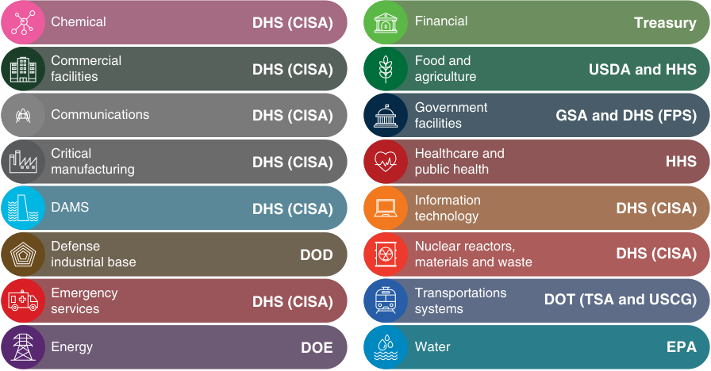
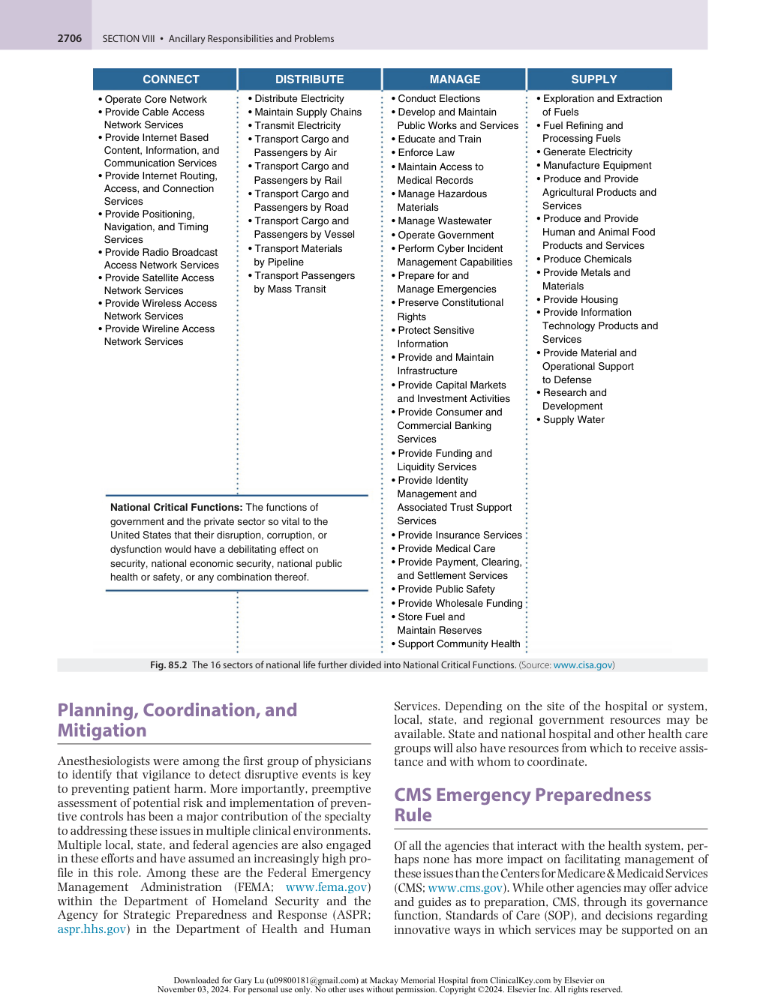
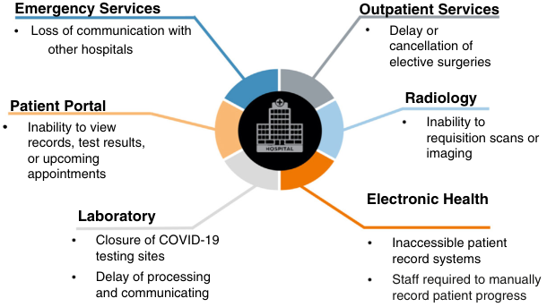
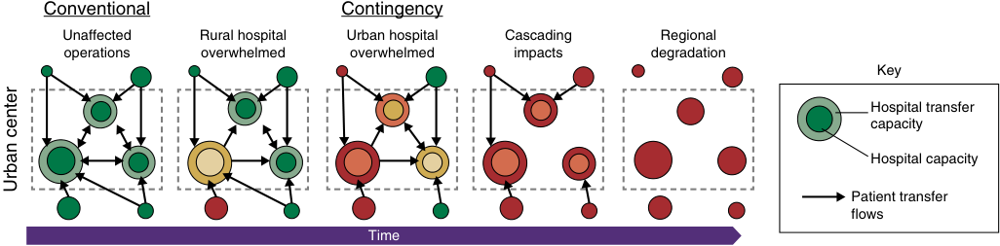
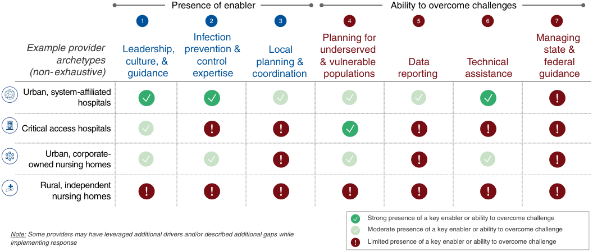

# Emergency Preparedness in Health Care

<!-- PDF page 1 -->

L. REUVEN PASTERNAK and LEE A. FLEISHER

### KEY POINTS

- Anesthesiologists have a history of leadership for emergency preparedness.

- The frequency and impact of emergency events are rapidly expanding.

- This expansion includes cybersecurity events and the action of targeting by malevolent forces. ᑏ Emphasis must move from emergency response to preventive practice, as was done in quality improvement.

- Formal training and support should be made available for anesthesia teams to support these moves.

## Introduction

The anesthesia team has a proud tradition of serving in a critical role for emergency preparedness and response in hospitals and other clinical settings. The clinical skill set, collaboration with a broad range of clinical teams, and location in so many areas of the hospital give the team insight into the clinical and organizational issues associated with maintaining operations in challenging circumstances. This is especially the case in areas such as operating rooms, intensive care units, and other locations where disruption of services can have major consequence for patients and staff. In addition to the hospital setting, the role of anesthesia team members in clinics and other system settings gives that team a perspective beyond the traditional hospital setting. The frequent engagement of anesthesia staff in management operations and committees also provides a unique and highly valued talent.

The threat environment (often referred to in risk literature as “attack surface”) in health care is rapidly changing. The COVID- 19 pandemic demonstrated the importance of the anesthesia team in emergency preparedness.1 In response to COVID- 19, anesthesia departments set up intubation teams and strategies to increase critical care capacity both from a physical space perspective and personnel who can provide critical care and ventilatory capacity. Anesthesiologists are experts in intubation, patient safety, simulation, and critical care and therefore have important roles in almost any emergency.

The goal of this chapter is to provide an understanding of the nature of emergency preparedness both from the facility perspective and as part of the response to emergencies. It also provides some insights into the responsibilities of health care facilities with respect to the United States regulatory process. It does not deal with the clinical management of specific conditions. That is reserved for other areas of this textbook. The intent here is to provide the anesthesiologist

with an understanding of the larger environment in which the team works to better understand how future efforts may be directed to prevent as well as manage emergencies.

## Background

Health care has a special challenge in preparing for and addressing emergencies. Ours is an activity that must function without interruption and whose disruption carries with it the potential for patient morbidity and mortality as well as threats to the welfare of staff providing that care. It also requires a high level of nonstop technical and administrative support to maintain its operational integrity. When threats arise, a response must be immediate to maintain the integrity of operations. This has been and remains a core function of clinical and administrative health care leaders, staff, community support groups, regulators, and federal and state agencies.

To date, there has been a tradition of hospital preparedness for emergencies that has served as an example to others for how to manage disruptive events. These include management of trauma, mass casualty,2 discrete weather events such as storms,3 and compromise of distinct portions of the infrastructure.4 These circumstances have usually been confined to a local geographic area and occurred during a time when facilities, staff, and supplies were maintained to provide a buffer against moderate surges. The events were usually short in duration, occurred as a single disruptive action, and allowed for a reasonably rapid return to normal operations. The common element in successful management has been well- coordinated and rehearsed emergency response protocols that included hospital, system, and associated community personnel.

However, during the past decade, health care has had to deal with an increasing number of disruptive events that have significantly compromised the ability to provide

<!-- PDF page 2 -->

patient care. We have not been alone in facing these challenges. Virtually all aspects of our lives have been affected by an array of challenges ranging from the COVID- 19 pandemic to cyber threats, supply chain disruption, and major weather and environmental events in both frequency and intensity. These disruptions have often been sudden, prolonged, and wide in scope, leading to extended periods of compromised activity. Health care is especially sensitive to these disruptions as, unlike many other services and activities, health care settings, especially those providing acute and continuing care services, do not have the luxury of suspending operations to allow for a process of analysis, planning, and mitigation. Our response must be immediate, comprehensive, and able to endure throughout these events and their aftermath. Obviously, the best path lies in prevention, risk mitigation, relentless vigilance, and the proactive preparation and practice of a comprehensive response. Essentially, the same role that anesthesiologists take every day as part of our clinical duties in the operating room and intensive care unit come into focus in this increasingly demanding domain.

## The Scope of the Challenge to Society

The challenge of emergency preparedness has become far more difficult as the resiliency of health care and our overall economy are now relentlessly challenged. Among the critical factors have been:

- _Environment:_ the surge in number and intensity of events such as hurricanes, fires, floods, and drought in some areas even as water levels rise in others has destroyed property in large swaths of communities and has challenged the ability of our infrastructure to sustain such services as energy and water.

- _Disease:_ the COVID- 19 pandemic has reminded us that we are still vulnerable to the emergence of new or variants of known diseases that can rapidly spread and affect substantial portions of our populations, adding strain to health care while also depriving the workplace and homes of people.5 In addition to stressing hospital resources with higher acuity patients, those with other needs and chronic conditions find care access compromised. Finally, as was seen during the COVID- 19 pandemic, our health care workforce can be directly compromised by the disease, with worker quarantines and even deaths within the workforce.

- _Civil unrest:_ whether an isolated incident or prolonged confrontation, health systems are very much on the front line of civil disorder. For the foreseeable future, prudent planning includes recognizing the possibility of this phenomenon and its potential for violence.

- _Cybersecurity:_ as the digital platform has become the foundation of much of our activity, it has also become a target of sophisticated attacks by individuals, organized criminal groups, and even nation states to exact ransom in increasing amounts. In the first 9 months of 2023 there were 85 million patient record breaches versus 38 million in the same period in 2022. Each breach brings with it the potential for further patient compromise as

personal/financial data are available for sale.6 More important, a compromise of the digital platform places nearly all clinical and operational activities at risk as a safety threat to patients, staff, and the community.

In the United States, the requirements for hospitals and other health care facilities to have an emergency preparedness plan has always been included in the Conditions of Participation (COP) for receiving Medicare and Medicaid funds from the Centers for Medicare & Medicaid Services (CMS).7

The urgency of addressing these and other concerns resulted in the establishment of the Cybersecurity and Infrastructure Security Agency (CISA) (www.cisa.gov) within the Department of Homeland Security (DHS) in 2018 to assess and mitigate risk. One of its first actions was to recognize the interdependence of all aspects of national life in sixteen sectors, of which Healthcare and Public Health (HPH) is the largest (Fig. 85.1). These sectors are further divided into National Critical Functions (Fig. 85.2), of which three are within HPH. As is obvious by the listing, health care is dependent on many of these for its basic function and their disruption carries profound consequences for us. It is of course natural that a disruption in health care affects all sectors and functions. Most important is the recognition that emergencies in health care have consequences that extend well beyond our parochial area of work. The National Risk Management Center (NRMC) (www.cisa.gov/nrmc) within CISA is tasked with the oversight of developing and coordinating these risk assessments across sectors.

## The Special Challenge to Health Care

During the past decade, health care in the United States and elsewhere has seen a remarkable transformation in its services, structures, and operations. These changes are:

- _Fragmentation:_ while the traditional hospital is still a critical part of our health care system, there has been a proliferation of additional and alternative locations where care is provided, creating a highly fragmented structure within and between health care systems. As a result, the coordination that could previously all be done within the confines of a single organizational and physical structure now has the compound challenge of interdependent entities, each with its own programs and functions. These different parts often have separate service structures, management, and information systems, making coordination even more difficult.

- _Space:_ the move to make health care more efficient resulted in pressure to reduce the number of unoccupied beds and the length of stay of patients. Both goals were achieved, with the United States having one of the lowest ratios of beds to population, rate of admission, and length of stay of industrialized nations. However, this has been at the cost of losing much of our capacity to be able to absorb larger numbers of patients, especially those with higher acuity medical needs. This challenge has become more chronic, especially during episodes of seasonal diseases such as influenza. During the pandemic, multiple studies noted the challenges associated

<!-- PDF page 3 -->

Chemical DHS (CISA) Financial Treasury Commercial Food and facilities DHS (CISA) agriculture USDA and HHS Government Communications DHS (CISA) facilities GSA and DHS (FPS) Critical Healthcare and DHS (CISA) HHS manufacturing public health Information DAMS DHS (CISA) DHS (CISA) technology Defense Nuclear reactors, DOD DHS (CISA) industrial base materials and waste Emergency Transportations services DHS (CISA) systems DOT (TSA and USCG) Energy DOE Water EPA 

**Fig. 85.1** The 16 sectors of national life, as recognized by the Cybersecurity and Infrastructure Security Agency (CISA) within the Department of Homeland Security (DHS). (Source: www.cisa.gov)

with caring for COVID patients and the increased mortality and morbidity associated both with the extent of the disease and the surges of patients that overwhelmed facilities.5

- _Supplies:_ the availability of supplies in adequate amount to meet a sustained need had been done with a local storage infrastructure in which these could be stored and withdrawn from as need fluctuated. Just In Time (JIT) supply systems were then adopted to eliminate the need for supporting local storage infrastructure on the assumption that a steady stream of material could be maintained and delivered as needed. This assumption has been increasingly difficult to maintain as supply chains have extended beyond our shores and production sites have become consolidated with the result that a single event can result in a major disruption of supplies such as pharmaceuticals, protective equipment and other disposables, and other critical supplies.

- _Staff:_ perhaps the most challenging of these issues has been the decreased staff to provide the direct care and technical and administrative support. Having already been reduced by design, the staffing gap was further aggravated by the increasing difficulty of recruiting and retaining even that level of staffing. The aging of the nurse force and support staff is leaving vacant positions to fill at an increasing rate as younger entrants into the workforce seek occupations with more predictable hours, lifestyle, benefits, and better pay.

- _Finance:_ while there is certainly opportunity for enhanced efficiency in health care, the combined strains of the above items has resulted in a stress for hospitals and systems.8 The availability of capital to address many of the above issues is becoming depleted, especially in those entities treating the most vulnerable populations with the greatest ongoing need.

- _Cybersecurity:_ though listed last, cybersecurity is the most rapidly evolving and expanding threat to health care. Cyberattacks represent premeditated attempts

to disrupt clinical operations for the sake of achieving financial gain. The sophistication of this activity has grown to involve major organized criminal groups and foreign governments or their proxies. The disruption caused by cyberattacks can be sudden, pervasive, and can compromise virtually all clinical and administrative operations. Attacks on health systems have caused major hospitals to have to divert patients with urgent and emergency issues, placing burdens on other systems and causing regional stress on health care. For this reason, cyberattacks are now regarded as crimes against people rather than property because of the enhanced opportunity for immediate morbidity and mortality in patients and stress on staff. Attacks may also be on components of systems, such as imaging equipment, medical records, or clinical programs, especially those that are dependent on internet connectivity (Fig. 85.3).

## The Cascade Effect

The impact of disruptive events within and outside health care can have an impact well beyond its initial borders. When a hospital is forced to curtail operations, patient demand for services remains unchanged and may have even increased. The result is that other facilities not directly attacked feel the impact of increased demand for everything from ambulance and emergency diversions to less acute but important services such as dialysis, chemotherapy, and an increasing array of ambulatory lifesustaining treatments.

This cascade effect (Fig. 85.4) can have impact across an entire region, as demonstrated in such events as hurricanes Katrina (2005) and Sandy (2012). The interdependence of health care services with other potential compromises in areas such as transportation and supply chain increase the vulnerability of the system as well.

<!-- PDF page 4 -->

|**CONNECT** • Operate Core Network • Provide Cable Access Network Services • Provide Internet Based Content, Information, and Communication Services • Provide Internet Routing, Access, and Connection Services • Provide Positioning, Navigation, and Timing Services • Provide Radio Broadcast Access Network Services • Provide Satellite Access Network Services • Provide Wireless Access Network Services • Provide Wireline Access Network Services|**DISTRIBUTE** • Distribute Electricity • Maintain Supply Chains • Transmit Electricity • Transport Cargo and Passengers by Air • Transport Cargo and Passengers by Rail • Transport Cargo and Passengers by Road • Transport Cargo and Passengers by Vessel • Transport Materials by Pipeline • Transport Passengers by Mass Transit|**MANAGE** • Conduct Elections • Develop and Maintain Public Works and Services • Educate and Train • Enforce Law • Maintain Access to Medical Records • Manage Hazardous Materials • Manage Wastewater • Operate Government • Perform Cyber Incident Management Capabilities • Prepare for and Manage Emergencies • Preserve Constitutional Rights • Protect Sensitive Information • Provide and Maintain Infrastructure • Provide Capital Markets and Investment Activities • Provide Consumer and Commercial Banking Services • Provide Funding and Liquidity Services • Provide Identity|**SUPPLY** • Exploration and Extraction of Fuels • Fuel Refining and Processing Fuels • Generate Electricity • Manufacture Equipment • Produce and Provide Agricultural Products and Services • Produce and Provide Human and Animal Food Products and Services • Produce Chemicals • Provide Metals and Materials • Provide Housing • Provide Information Technology Products and Services • Provide Material and Operational Support to Defense • Research and Development • Supply Water|
|---|---|---|---|
|||Management and||
|**National Critical Function** government and the privat United States that their dis dysfunction would have a d security, national economic health or safety, or any co|**s:**The functions of e sector so vital to the ruption, corruption, or ebilitating effect on security, national public mbination thereof.| Associated Trust Support Services • Provide Insurance Services • Provide Medical Care • Provide Payment, Clearing, and Settlement Services • Provide Public Safety • Provide Wholesale Funding • Store Fuel and Maintain Reserves • Support Community Health||

**<mark>Fig. 85.2</mark>** <mark>The 16 sectors of national life further divided into National Critical Functions. (Source: www.cisa.gov)</mark>

## Planning, Coordination, and Mitigation

Anesthesiologists were among the first group of physicians to identify that vigilance to detect disruptive events is key to preventing patient harm. More importantly, preemptive assessment of potential risk and implementation of preventive controls has been a major contribution of the specialty to addressing these issues in multiple clinical environments. Multiple local, state, and federal agencies are also engaged in these efforts and have assumed an increasingly high profile in this role. Among these are the Federal Emergency Management Administration (FEMA; www.fema.gov) within the Department of Homeland Security and the Agency for Strategic Preparedness and Response (ASPR; aspr.hhs.gov) in the Department of Health and Human

Services. Depending on the site of the hospital or system, local, state, and regional government resources may be available. State and national hospital and other health care groups will also have resources from which to receive assistance and with whom to coordinate.

## CMS Emergency Preparedness Rule

Of all the agencies that interact with the health system, perhaps none has more impact on facilitating management of these issues than the Centers for Medicare & Medicaid Services (CMS; www.cms.gov). While other agencies may offer advice and guides as to preparation, CMS, through its governance function, Standards of Care (SOP), and decisions regarding innovative ways in which services may be supported on an

::: details 原始表格與符號（PDF 第 4 頁）

:::

<!-- PDF page 5 -->

Emergency Services Outpatient Services Loss of communication with Delay or other hospitals cancellation of elective surgeries Patient Portal Radiology Inability to view Inability to records, test results, requisition scans or or upcoming imaging appointments Electronic Health Laboratory Closure of COVID-19 Inaccessible patient testing sites record systems Delay of processing Staff required to manually and communicating record patient progress 

**<mark>Fig. 85.3 Effects of cyberattacks on health care systems.</mark>**

Conventional Contingency Unaffected Rural hospital Urban hospital Cascading Regional operations overwhelmed overwhelmed impacts degradation Key Hospital transfer capacity Hospital capacity Patient transfer flows Time Urban center 

**<mark>Fig. 85.4 The cascade effect in health care.</mark>**

acute and long- term basis, has a direct connection with virtually all acute care and most chronic care systems.

An example of this reach is CMS’s Final Emergency Preparedness Rule. This rule was published on September 16, 2016 and participating Medicare and Medicaid providers and suppliers had until November 15, 2017 to ensure that their plans were compliant with the new regulations. There are four core elements of emergency preparedness:

- Risk Assessment and Emergency Planning (including but not limited to):

- Hazards likely in geographic area

- Care- related emergencies

- Equipment and power failures

- Interruption in communications, including cyberattacks

- Loss of all/portion of facility

- Loss of all/portion of supplies

- Plan is to be reviewed and updated at least annually.

- Communication Plan

- Complies with federal and state laws

- System to contact staff, including patients’ physicians, other necessary persons

- Well coordinated within the facility, across health care providers, and with state and local public health departments and emergency management agencies.

- Policies and Procedures

- Complies with federal and state laws

- Training and Testing

- Complies with federal and state laws

- Maintain and at a minimum update annually

Such plans are reviewed every 3 years as part of the Accreditation cycle in the United States. During the COVID- 19 pandemic, it became clear that many of the hospital and nursing home plans were either insufficiently prepared to address the unique stressors on the system or the emergency plans could not/were not implemented well during the emergency. From May to September 2021, the CMS conducted a mixed- methods study to learn about hospital, critical access hospital, and nursing home experiences in responding to the COVID- 19 pandemic.9 Through conversations with 30 providers, CMS identified seven key enablers and challenges to consider in preparing for future responses: (1) leadership, culture, and governance; (2) communications systems; (3) data reporting; (4) training and testing; (5) staff resilience; (6) infection prevention and control expertise; and (7) local planning and coordination. The enablers for implementation were leadership, culture, and governance; infection prevention and control expertise; and local planning and coordination. The four key challenges were planning for underserved and vulnerable populations; data reporting; technical assistance; and managing federal, state, tribal, local, and territorial guidance (Fig. 85.5). As hospitals and ambulatory surgery centers (ASCs) plan for the future, it will be important for them to consider the issues above.

In summary, the acute experience of emergency preparedness in health care during the COVID- 19 public health emergency (PHE) highlights the multifaceted challenges and evolving threats faced by health care facilities. The critical role of anesthesiologists in the team in such

<!-- PDF page 6 -->

Presence of enabler Ability to overcome challenges 1 2 3 4 5 6 7 Infection  Planning for Managing Example provider Leadership,  prevention &  Local  underserved  state & archetypes culture, &  control  planning &  & vulnerable  Data  Technical  federal (non-exhaustive) guidance expertise coordination  populations reporting assistance guidance Urban, system-affiliated hospitals Critical access hospitals Urban, corporate- owned nursing homes Rural, independent nursing homes Strong presence of a key enabler or ability to overcome challenge Moderate presence of a key enabler or ability to overcome challenge Note: Some providers may have leveraged additional drivers and/or described additional gaps while implementing response Limited presence of a key enabler or ability to overcome challenge 

**Fig. 85.5 Key enablers and challenges hospitals and nursing homes encountered during the COVID- 19 public health emergency (PHE).** These factors should be considered in any future emergency preparedness plan. (From Blackstock SC, Moody- Williams JD, Fleisher LA. Learnings regarding emergency preparedness during the public health emergency: a mixed- methods study of hospitals and long- term care facilities. _NEJM Catalyst_ . 2022;3(4). Figure 3.)

scenarios is underscored by the roles we have played and will continue to play. We continue to need an immediate, comprehensive, and enduring response to emergencies, with an emphasis on prevention, risk mitigation, and proactive preparation. This should be accomplished within the regulatory framework and it is critical that anesthesiologists be involved.

### Complete references available online at expertconsult.com.

3.  Moss R, Gaarder C. _Br J Anaesth_ . 2022;128(2):e67.

4.  Murakawa M. _Anesthesiol Clin_ . 2013;31(1):117.

5.  French G, et al. _MMWR Morb Mortal Wkly Rep_ . 2021;70(46):1613.

6.  Perna G. _Modern Healthcare_ . https://www.modernhealthcare.com/ digital- health/healthcare- cybersecurity- incidents- 2023- ncc- group;

   2023.

7.  Centers for Medicare & Medicaid Services (CMS). Conditions for Coverage (CfCs) & Conditions of Participation (CoPs).

8.  Kaufman Hall. The Current State of Hospital Finances: Fall 2022 Update.

9.  Blackstock SC, et al. _NEJM Catalyst_ . 2022;3(4).

### References

1.  Safavi KC, et al. _Disaster Med Public Health Prep_ . 2022;16(5):2182.

2.  Lam CM, Murray MJ. _Curr Anesthesiol Rep_ . 2020;10(3):308.

<!-- PDF page 7 -->

### References

1.  Safavi KC, Prestipino AL, Zenteno Langle AC, et al. The power of modeling in emergency preparedness for COVID- 19: a moonshot moment for hospitals. _Disaster Med Public Health Prep_ . 2022;16(5):2182–2184.

2.  Lam CM, Murray MJ. The multiple casualty scenario: role of the anesthesiologist. _Curr Anesthesiol Rep_ . 2020;10(3):308–316.

3.  Moss R, Gaarder C. Exercising for mass casualty preparedness. _Br J Anaesth_ . 2022;128(2):e67–e70.

4.  Murakawa M. Anesthesia department preparedness for a multiplecasualty incident: lessons learned from the Fukushima earthquake and the Japanese nuclear power disaster. _Anesthesiol Clin_ . 2013;31(1):117– 125.

5.  French G, Hulse M, Nguyen D, et al. Impact of hospital strain on excess deaths during the COVID- 19 pandemic – United States, July 2020- July 2021. _MMWR Morb Mortal Wkly Rep_ . 2021;70(46):1613–1616.

6.  Perna G. Healthcare ransomware attacks spiked 86% in September: report. _Mod Healthc_ . https://www.modernhealthcare.com/digitalhealth/healthcare- cybersecurity- incidents- 2023- ncc- group; 2023.

7.  Centers for Medicare & Medicaid Services (CMS). Conditions for Coverage (CfCs) & Conditions of Participation (CoPs). https://www.cms.gov/ medicare/health- safety- standards/conditions- coverage- participation.

8.  Kaufman Hall. The Current State of Hospital Finances: Fall 2022 Update. https://www.aha.org/guidesreports/2022- 09- 15- currentstate- hospital- finances- fall- 2022- update; 2022.

9.  Blackstock SC, Moody- Williams JD, Fleisher LA. Learnings regarding emergency preparedness during the public health emergency: a mixedmethods study of hospitals and long- term care facilities. _NEJM Catalyst_ . 2022;3(4).
