# Clinical Research

<!-- PDF page 1 -->

KATE LESLIE, DUMINDA N. WIJEYSUNDERA, and TOM E.F. ABBOTT

|**KEY POINTS**|ᑏClinical research describes the characteristics and mechanisms of disease and injury in humans and investigates drugs, devices, diagnostic products, and bundles of care with the aim of providing high- quality evidence to guide clinical practice that improves patients’ lives. ᑏInvestigators are constrained by the need to draw conclusions based on a sample of patients, providers, or systems rather than the whole of the population of interest, and this introduces random, systematic, and design error that threatens internal and external validity. ᑏObservational (or nonexperimental) studies involve allowing nature or clinical care to take its course, without any major modification due to study- related procedures. However, nonexperimental designs are prone to systematic error, such as selection and information bias. ᑏIn experimental studies the investigators do not let nature (or clinical care) take its course, but actively intervene to test a new intervention. Randomization and blinding reduce the risk of random and systematic errors in experimental studies, but generalizability can be limited. ᑏSystematic reviews synthesize the medical literature using a transparent search strategy that every reader can replicate and update, and accompanying meta- analyses produce aggregate estimates of treatment effects.|
|---|---|
||ᑏA carefully designed protocol is the foundation of all clinical research, facilitating the review, conduct, and eventual publication of the project. Prior planning of sample size and statistical analyses is essential. i|
||ᑏAppropriate ethics, registration, and regulatory approvals; financial, data, and human resource management; plans for monitoring patient safety and data integrity; and plans for publishing the results and sharing the data are vital to the proper conduct of clinical research. ᑏA quality improvement cycle of reflection, feedback, and forward planning is beneficial. Giving consumers an opportunity to participate in research governance gives researchers fresh insight and opens new avenues of research.|

_“The measure of greatness in a scientific idea is the extent to which it stimulates thought and opens up new lines of research.”_

― **PAUL A.M. DIRAC**

## Introduction

Research is systematic investigation for the creation of generalizable knowledge. Clinical research describes the characteristics and mechanisms of disease and injury in humans, and investigates drugs, devices, diagnostic products, and bundles of care for human use. Clinical research also includes investigating the interactions of health professionals, students, and other stakeholders with the health care and health education systems. Most studies address an aspect of quality of care or education such as safety, effectiveness, patient- centeredness, timeliness, efficiency, and equity.1

_Miller’s Anesthesia_ includes references to tens of thousands of clinical research studies. The main purpose of this chapter is to describe how these studies were designed and conducted. The chapter connects directly with Chapter 87 (Interpreting the Medical Literature) _,_ which elaborates

on how to interpret and use evidence for clinical decisionmaking. Other related chapters include Chapter 1 (The Scope of Modern Anesthetic Practice), Chapter 2 (Anesthesia and Global Health Equity), Chapter 4 (Informatics in Perioperative Medicine), Chapter 5 (Quality Improvement and Patient Safety), Chapter 7 (Ethical Aspects of Anesthesia Care), and Chapter 27 (Risk of Anesthesia). Our goal is to describe how clinical research originates and to inspire our readers to create and support the use of high- quality evidence that is essential in guiding clinical practice that focuses on improving patients’ lives.

## Key Principles

Researchers want to produce results that will be useful to clinicians in improving patients’ lives. However, they are constrained by the need to draw conclusions based on a sample of patients rather than the population of interest. The random, systematic, and design errors introduced by studying a sample affect the confidence with which the association found in the study can be claimed to truly represent the causal effects of the exposure on the outcome (“internal validity”) and impair the generalizability of the results to the source population for the sample and the population

::: details 原始表格與符號（PDF 第 1 頁）

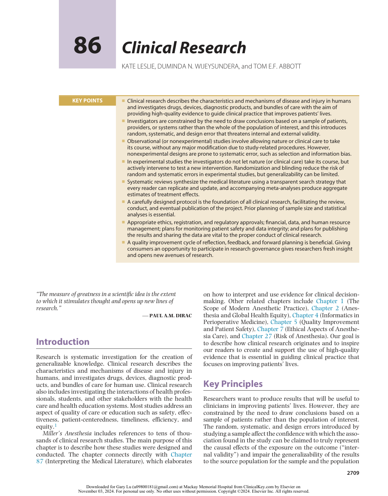

:::

<!-- PDF page 2 -->

of interest as a whole (“external validity”).2,3 These errors are discussed briefly here and are highlighted in subsequent sections of this chapter.

### RANDOM ERROR

Random error (or chance) in the association between an exposure and an outcome is introduced by variation between the individuals in the study and within individuals over time, and variation between and within measurements made during the study.4 Random error is equally likely to cause false acceptance and false rejection of the null hypothesis (i.e., the hypothesis that there is no effect). The risk of drawing false conclusions increases with decreasing sample size and more statistical testing.

### SYSTEMATIC ERROR

Systematic errors (or biases) also threaten identification of the true causal effect that the exposure had on the outcome in the sample. They can arise from nature (confounding), selection features of the study (selection bias), or measurement features of the study (information bias). In contrast to random error, which distorts the results of a study in both directions, systematic error distorts only in one direction (i.e., toward acceptance or rejection of hypotheses).

### Confounding

Confounding is a bias that arises when an association between an exposure and an outcome fails to take account of a third factor (a confounder) that is associated with both the exposure and the outcome.5 Confounders can be risk factors, preventive factors, or surrogate markers for another cause of the outcome, but they cannot be intermediary steps in the causal pathway between an exposure and an outcome. They may be known and measured (known knowns), known and unmeasured (known unknowns), and unknown and unmeasured (unknown unknowns).6 In observational studies, design (e.g. sampling restriction, matching) and analysis (e.g., statistical adjustment) options only address the distribution of measured confounders. Randomization distributes measured and unmeasured confounders evenly between groups (with increasing reliability in larger studies).7 Concealment of allocation prevents selective recruitment, and blinding prevents confounding that results when knowledge of group allocation changes processes of care or behavior.8

The importance of confounding varies with the type of study. In studies focusing on causality (e.g., whether smoking causes lung cancer), investigators attempt to collect and manage all possible confounders, yet they must always take residual confounding into account or use randomization and blinding to ensure that known and unknown confounders are balanced between the groups. In studies focusing on prognosis (e.g., studies predicting the likelihood that a patient will survive the proposed surgical procedure) any variable that contributes to improved prediction should be used in the prediction model.9

### Selection Bias

Bias can be introduced by the methods used to select a population of interest, to identify and sample a source of such

patients, to recruit and retain the patients, and to disseminate the results.3 Observational studies are prone to bias with respect to selection of sources of exposed and unexposed patients, or cases and controls. Patients and their treating team can introduce bias by participating or not participating based on the exposures and outcomes under study. Prospective cohort studies and randomized trials are prone to bias with respect to differential loss to follow- up. Studies without pre- planned and publicized protocols and statistical analysis plans are prone to bias with respect to selection of outcomes to report (favoring outcomes with statistically significant differences between groups), and studies that fail to find a difference between groups with respect to the primary outcome (“negative” studies) may result in publication bias, that is, they are either never submitted or not selected for publication by journal editors.10

### Information Bias

This type of bias can be introduced by inaccurate measurement or classification of exposures, outcomes, and other measured variables. This error arises when survey instruments and diagnostic tests are invalid or unreliable and may be differential (affecting groups differently) or nondifferential (affecting groups similarly). Recall bias arises when recollection of past exposures is affected by whether the patient experienced the outcome or not. Socially desirable response bias arises when participants give answers based on their assumptions about the investigators and society. Patients who are not assessed for the primary outcome (i.e., whose information is missing) can cause random or systematic error, and this should be assessed with sensitivity analyses.11

### DESIGN ERROR

Design errors limit the usefulness of research to clinicians, even if the research is free of random and systematic errors, by affecting its generalizability.2 Examples of such design errors include studying exposures that are expensive or difficult to implement; comparing new treatments with placebos or weak treatments rather than the best available option; assessing outcomes that are not relevant to patients and the community; and seeking to prove that a new treatment is superior to an old treatment, when proving that it is equivalent or noninferior would be more useful.2

### STATISTICAL INFERENCE

In the “frequentist” statistical framework, a _P_ - value is the “probability under a specified statistical model that a statistical summary of the data (e.g., the sample mean difference between two compared groups) would be equal to or more extreme than its observed value.”12 For example, _P_ = .05 means that under the null hypothesis, there was a 5% chance of observing results at least as extreme as those seen in the study.13 _P_ - values can indicate how incompatible the data are with a specified statistical model, but do not measure the probability that the studied hypothesis is true nor that the data were produced by random error alone.12 Confidence intervals can better reflect the size and precision of the treatment effect than _P_ - values, but also have an awkward technical definition. A 95% confidence interval

<!-- PDF page 3 -->

does not mean that there is a 95% probability that the true treatment effect lies within this same interval.14 Instead, it means that if the same study were repeated many times with confidence intervals similarly calculated for each case, 95% of such intervals would include the true treatment effect.13 Despite these limitations, confidence intervals help better relate the observed treatment effect to the minimal clinically important difference. If the lower limit of the confidence interval excludes the minimal clinically important difference, then the treatment effect is likely to be important.13 Bayesian inference overcomes some of the limitations of _P_ - values and confidence intervals.15 Instead of interpreting the frequency of a phenomenon, Bayesian interference incorporates prior evidence, biological plausibility, and preexisting beliefs into the calculation of the probability of a

treatment effect.13 Bayesian inference requires specialized statistical expertise and can attract controversy from consideration of preexisting evidence and beliefs. Nonetheless, Bayesian methods are increasingly used by researchers in perioperative and critical care medicine,16 with the potential for providing new insights into data previously analyzed using frequentist methods.17

## Study Design

The study designs used in clinical research are outlined in Fig. 86.1 and Box 86.1. In this chapter, we use the terms “retrospective” and “prospective” to describe when the exposure and outcome are measured relative to the start of

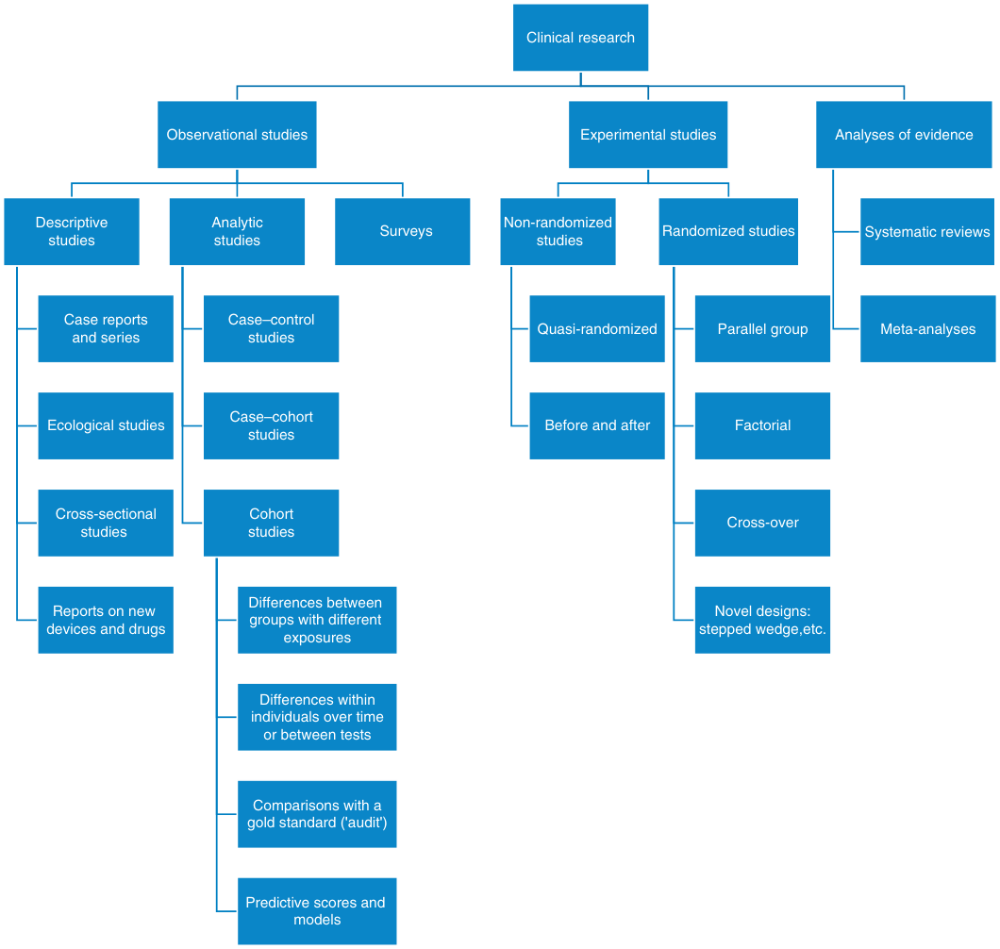

Clinical research Observational studies Experimental studies Analyses of evidence Descriptivestudies Analyticstudies Surveys Non-randomized studies Randomized studies Systematic reviews Case reports Case–control and series studies Quasi-randomized Parallel group Meta-analyses Case–cohort Ecological studies studies Before and after Factorial Cross-sectional Cohort Cross-over studies  studies Differences between Reports on new  Novel designs: groups with different devices and drugs stepped wedge,etc. exposures Differences within individuals over time or between tests Comparisons with a gold standard ('audit') Predictive scores and models 

**<mark>Fig. 86.1 Study designs in clinical research.</mark>**

<!-- PDF page 4 -->

### Box 86.1 Study Design in Clinical Research: Depth of Anesthesia and Awareness

|A**_case study_**reported on a patient who received light anesthesia and was aware.|
|---|
|An**_ecological study_**reported on the incidence of awareness in hospitals with low or high per- patient volatile anesthetic use.|
|A**_survey_**asked anesthesiologists about their routine use of light or deep anesthesia and the incidence of awareness in their practice.|
|A**_case–control_**study found patients with awareness, matched them with patients without awareness, and then determined if they had received light or deep anesthesia.|
|A**_case–cohort_**study found patients who had light anesthesia, matched them with patients who had deep anesthesia, then determined if they had been aware.|
|A**_retrospective cohort_**study examined existing records to determine the incidence of awareness in patients who had received light or deep anesthesia.|
|A**_prospective cohort_**study enrolled patients having general anesthesia and followed them to determine the incidence of awareness in patients receiving light and deep anesthesia.|
|A**_within- patient comparison_**of two processed EEG monitors determined each monitor’s ability to predict awareness.|
|An**_audit_**compared current practice with a national evidence- based guideline on prevention of awareness during general anesthesia.|
|A**_prediction study_**reported on the development of a risk score for awareness based on a large cohort of patients having light and deep anesthesia.|
|A**_before- and- after_**study enrolled a cohort of patients having anesthesia without EEG monitoring and then a cohort having anesthesia with EEG monitoring and compared the incidences of awareness.|
|A**_randomized controlled trial_**randomized patients to light anesthesia or deep anesthesia and compared the incidence of awareness in each group.|
|A**_systematic review_**searched for clinical trials examining the relationship between light and deep anesthesia and awareness and conducted**_meta- analysis_**to determine the pooled risk of awareness in patients receiving light or deep anesthesia.|

_EEG_ , electroencephalographic.

the study, rather than to describe the direction of enquiry (i.e., outcome → exposure or exposure → outcome). We use the US National Institutes of Health definition of a clinical trial: “research study in which one or more human subjects are prospectively assigned to one or more interventions (which may include placebo or other control) to evaluate the effects of those interventions on health- related biomedical or behavioral outcomes.”18

### OBSERVATIONAL STUDIES

Observational (or nonexperimental) studies involve allowing nature or clinical care to take its course, with assignment to the intervention based on usual practice, and without any major modification in clinical care due to study- related procedures.19 An observational study is not a clinical trial, therefore, the contradictory term “observational trial” should be avoided. Ethical and pragmatic considerations often mean that an observational design is the only approach to answer a research question. For example, most research evaluating the impact of cigarette smoking

on lung cancer relies on nonexperimental methods,20 since assigning smoking as an intervention is unethical. In general, observational studies can demonstrate associations between exposures and outcomes, but do not necessarily prove a causal relationship. Several factors must be considered, including the consistency of findings across multiple high- quality studies, biological plausibility, and whether clear dose–response and temporal relationships exist between exposures and outcomes.21 This is the case for cigarette smoking: the weight of observational research eventually established cigarette smoking as a cause of lung cancer.20

Several initiatives have sought to improve the conduct and reporting of observational studies. For example, the Strengthening the Reporting of Observational Studies in Epidemiology (STROBE) statement makes recommendations for the reporting of cross- sectional, case–control, and cohort studies.22 The Standards for Reporting Diagnostic Accuracy (STARD) statement makes recommendations for observational studies that assess diagnostic accuracy,23 while the Transparent Reporting of a multivariable prediction model for Individual Prognosis or Diagnosis (TRIPOD) statement makes recommendations for reporting of multivariable statistical models in observational studies that assess diagnostic or prognostic accuracy.24 Strong evidence that these tools result in improved design and reporting of published observational studies is lacking.25,26

### Descriptive Studies

Descriptive studies characterize patients in a sample with respect to baseline features (e.g., age, sex, comorbid disease), processes of care (e.g., anesthesia type), and outcomes (e.g., mortality, stroke). Unlike analytic studies, they do not seek to define associations between these characteristics (e.g., association between baseline features and outcomes).

**Case Reports and Series.** Case reports describe exposures and outcomes in individual patients, while case series provide the same information for groups of patients. Case reports and series are suited to describing newly recognized uncommon exposures and outcomes, such as drug- related adverse effects.27 As these studies focus on individuals with a specific exposure or outcome, no direct comparisons are possible with unexposed individuals or those without the outcome. Despite these limitations, case reports and series have made important contributions to medicine. For example, a case report first identified lipid emulsion as a successful treatment for local anesthetic cardiotoxicity28 and a case series of anesthetic- related deaths in a family first identified the pharmacogenetic disorder malignant hyperthermia.29

**Descriptions of New Interventions.** These studies are a subtype of case reports and series that describe new interventions (e.g., drugs, devices, diagnostic products, monitors, bundles of care, survey instruments, guidelines), but without any comparison against a control group that did not receive the intervention. Such studies have helped to advance medicine, with examples such as the first use of the nondepolarizing muscle relaxant curare30 and the initial clinical experience with the laryngeal mask airway.31 With respect to diagnostic tests, “test research” determines the properties of the test itself. These properties include

::: details 原始表格與符號（PDF 第 4 頁）

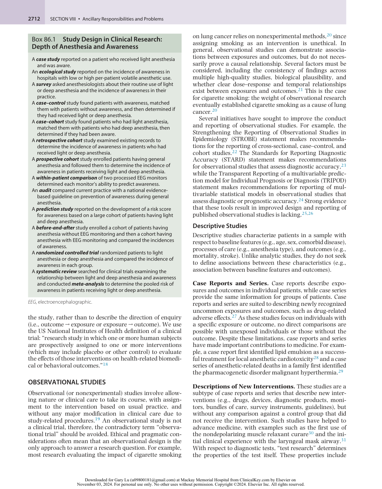

:::

<!-- PDF page 5 -->

sensitivity, specificity, (positive and negative) likelihood ratios, and (positive and negative) predictive values. Predictive values are especially influenced by the prevalence of the disease state in the population. When assessing whether a new diagnostic test (e.g., biomarker) represents an important improvement compared to an existing tool, several statistical approaches should be applied in tandem to determine whether the addition of the new test leads to meaningful improvement in the likelihood of arriving at the correct diagnosis.32,33

### Analytic Studies

Analytic studies measure associations between exposures and outcomes. Thus, patients with and without the exposure of interest (e.g., early childhood exposure to anesthesia) and outcome of interest (e.g., poor educational performance) are required to assess for associations beyond those expected by chance alone.34

**Ecological Studies.** Ecological studies or “aggregate risk studies” measure exposure status and outcome status as average values across groups of individuals. For example, they might evaluate the association between prescription opioid rates and opioid overdose rates within the same geographic region.35 These types of studies are particularly suited to exposures and outcomes that are routinely measured in populations. A major limitation of this approach is that exposure status and outcome status may not be linked at the individual level, leading to the “ecological fallacy,” where individuals within the group- level unit with the outcome of interest may not have been the individuals with the exposure of interest. This issue was highlighted in a study of hospital- level use of neuraxial anesthesia for hip fracture surgery.36 Hospitals with higher rates of neuraxial anesthesia use reported lower overall mortality risks after hip fracture surgery, yet this association was not at the individual level. In fact, at hospitals with higher rates of neuraxial anesthesia use, all patients had better outcomes after hip fracture surgery, regardless of the type of anesthesia they received, suggesting that the causal mechanisms for hospital- level effects were factors other than neuraxial anesthesia use.

**Cross- Sectional Studies.** Cross- sectional studies assess the exposure status and outcome status of individuals at the same time (or within a short and stable interval). They are suited to exposures that do not change over time, such as genetically determined characteristics or chronic stable health conditions. Cross- sectional methods have been used to determine whether ultrasound measurement of the quadriceps and rectus femoris muscles can help identify surgical patients with frailty,37 and whether a preoperative screening questionnaire detects obstructive sleep apnea.38 Most surveys (see below) are cross- sectional studies since respondents typically complete the survey at a single timepoint. Cross- sectional studies are ill- suited to establishing causal relationships because of the “causality dilemma” (i.e., they do not permit clear delineation of the temporal link between putative exposures and outcomes). For example, if a cross- sectional study finds that older adults with depression are more likely to report chronic pain than those without depression, the cross- sectional design precludes

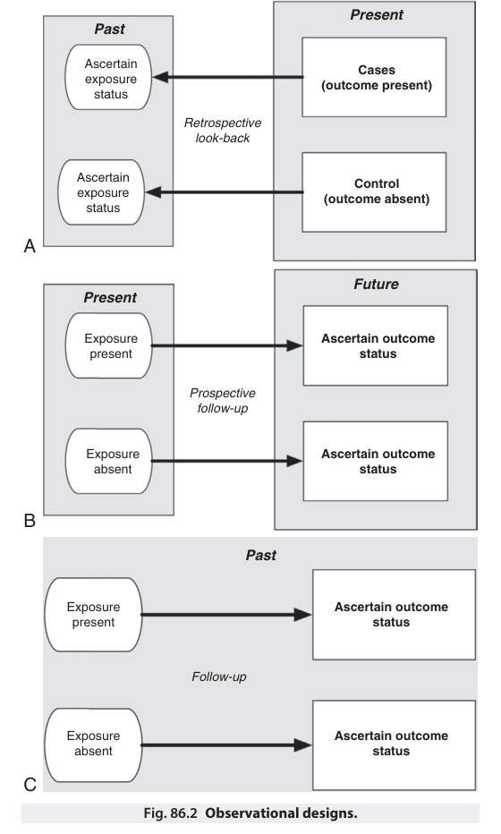

Present Past Ascertain Cases exposure (outcome present) status Retrospective look-back Ascertain Control exposure (outcome absent) status A Future Present Exposure Ascertain outcome present status Prospective follow-up Exposure Ascertain outcome absent status B Past Exposure Ascertain outcome present status Follow-up Exposure Ascertain outcome absent status C Fig. 86.2 Observational designs. 

determining the temporal relationship between depression and chronic pain (i.e., depression preceding pain versus pain preceding depression).39

**Case–Control Studies.** Case–control studies assemble participants based on their outcome status; that is, patients who experienced the outcome (cases) and patients who did not (controls). Once the sample is assembled, exposure status is ascertained by looking back in time (Fig. 86.2A). Case–control studies are inexpensive, amenable to quick completion, and suited to the study of rare outcomes, such as postoperative corneal injury40 and postpartum maternal sepsis.41 However, they are susceptible to selection bias, which occurs when cases and controls are selected in a manner that distorts the true relationship between the exposure and outcome in the underlying population.42 For example, in a hypothetical study of epidural hematoma following neuraxial anesthesia, it would not be appropriate to select cases predominantly from patients who had major lower joint replacement surgery while selecting controls

<!-- PDF page 6 -->

predominantly from patients who had cesarean sections. Investigators can further avoid selection bias by matching cases with up to five controls based on prognostically important characteristics (e.g., age, sex), using more than one control group, and measuring exposure status with equal rigor across cases and controls (avoiding information bias).

**Cohort Studies.** Cohort studies assemble participants based on their exposure status and follow them forward in time to ascertain the presence of outcomes. Both the exposure and outcome need to be relatively common to limit the size of the cohort required. Cohort studies can be conducted prospectively and retrospectively. In a prospective study, the cohort is assembled in the present and followed into the future (Fig. 86.2B). This allows investigators to carefully measure exposure status (without recall bias based on knowing the outcome), delineate temporal relationships between exposures and outcomes, and implement standardized follow- up. Standardized follow- up is particularly important when the outcomes might be missed or when baseline characteristics might influence surveillance for the outcomes. For example, standardized troponin estimation is required to detect myocardial infarction and injury, because these outcomes may be silent and some patients are less likely to be tested than others (i.e., females, low- risk surgery patients).43 Prospective cohort studies are more expensive and take longer to complete than case–control studies and retrospective cohort studies.

In retrospective cohort studies, cohort assembly and follow- up occur entirely in the past (Fig. 86.2C). Very large databases make addressing uncommon exposures and outcomes feasible using this design. The data needed for the research (i.e., patient characteristics, processes of care, and outcomes) can be captured from one or more preexisting sources, including paper and electronic medical records, administrative and legal databases, government and clinical registries, and databases assembled for research purposes. In anesthesiology, increasing access to these sources has facilitated growth in such research.44 Retrospective cohort studies are quicker and less expensive to conduct than prospective cohort studies. However, they are limited by the available data sources, which may vary in completeness and accuracy and be influenced by the intensity of follow- up protocols. For example, when compared to a prospective clinical registry, diagnostic codes in health administrative databases miss up 60% of postoperative infectious complications.45

**Case–Cohort Studies.** Case–cohort studies are a subtype of cohort studies where exposed patients are matched to unexposed patients, then followed forward in time to measure outcomes. They can be conducted either prospectively or retrospectively and are suited to the study of rare exposures. Matching reduces the influence of differences in prognostically important characteristics (e.g., age, comorbid status) between exposed and unexposed individuals. For example, in a retrospective cohort study evaluating the incremental impact of recent surgery on the likelihood of opioid discontinuation, chronic opioid users who had undergone recent surgery were matched to similar chronic opioid users who had not undergone recent surgery based

on age, sex, comorbidity burden, and prior daily opioid dose.46 Matching on large numbers of baseline characteristics generally is not feasible because of the difficulties in identifying suitable individuals. In these cases, matching on a propensity score is an alternative that can help assemble a matched cohort with very similar baseline characteristics for both exposed and unexposed individuals.47 Importantly, matching does not remove bias related to imbalances in unmeasured confounders between the groups.

### Studies Assessing Changes or Differences in Individu-

**als.** Some studies make serial measurements in individuals to assess changes over time. Examples include studies that characterize the pharmacokinetics and dynamics of anesthetic drugs48,49 or postoperative disability trajectories.50 These studies are a subtype of cohort study that incorporate longitudinal repeated measurement of an outcome measure. Statistical analyses of these data must account for correlated measurements in individuals over time.51 Other studies make parallel measurements in individuals to assess differences between these measurements. Examples include comparing coagulation testing methodologies during surgery52 or disability scoring instruments after surgery.53 Bland–Altman analyses, which test investigator- defined limits of agreement, are an appropriate analysis technique when comparing tests,54 while scales are often compared using correlation on measures such as validity, reliability, and responsiveness.55 Some of these studies could equally be described as “experimental” (see below) because the investigators control the intervention.

### Studies Assessing Practice Against a Gold Standard

**(“Audit”).** Audits are variants of cohort studies that involve assembling a cohort of patients and determining whether practice complies with an external standard. The term “audit” is sometimes used inaccurately to describe studies that determine the standard that clinical practice achieves (i.e., evaluation) or compare practice with an investigatorderived standard (i.e., research). The extent of compliance with the standard can be compared based on different exposures. Examples of audits include the compliance of venous thromboembolism56 and surgical site infection57 prophylaxis with national guidelines. An important issue for such studies is ensuring that the external standard is reasonably valid and accepted within the wider community.

### Studies Developing and Validating Prediction Tools.

The goal of these studies is to develop tools (e.g., scores, prediction models, risk calculators) that accurately predict outcomes in individual patients. A good prediction tool should be simple to use, exhibit good discrimination (i.e., extent to which the tool correctly assigns higher predicted risk estimates to individuals who experience the outcome), and demonstrate acceptable calibration (i.e., extent to which the observed outcome event rates agree with event rates predicted by the tool).58 These studies first use statistical methods to evaluate associations between exposures (e.g., baseline characteristics, processes of care) and outcomes in one cohort of patients; use the results to develop scoring systems or prediction models, and then validate them in another cohort of patients. Different statistical methods can be employed to develop these scores and models, including

<!-- PDF page 7 -->

logistic regression modeling for categorical outcomes,59 Cox proportional hazards modeling for time to event outcomes,60 recursive partitioning (i.e., decision tree analysis),61 and machine learning techniques (e.g., artificial neural networks).58 Several statistical techniques should be applied in tandem to evaluate the predictive performance of these tools in initial development and subsequent validation.62 Examples from the perioperative setting include the Assess Respiratory Risk in Surgical Patients in Catalonia (ARISCAT) score for predicting postoperative pulmonary complications,63 and the American College of Surgeons National Surgical Quality Improvement Program (NSQUIP) calculator for predicting surgical risk.64

### Surveys

Surveys collect information from individuals (patients, families, staff, students) or organizations (hospitals, universities, employers) about facts and attitudes. Most are cross- sectional studies simultaneously assessing exposures and outcomes. Factual surveys ask for information or test knowledge. Attitudinal surveys ask about attitudes, beliefs, and intentions. Surveys can be descriptive or analytic. They must be carefully planned and executed to protect participants, encourage good response rates among potential participants, measure results with acceptable precision, and generate reliable conclusions.65 Response bias (nonresponse, incorrect response, or untruthful response) is a particular issue with survey research and must be explicitly considered in survey design and reporting. A systematic review of 240 surveys published in six anesthesiology journals revealed that reporting was inconsistent, particularly with respect to articulating a hypothesis, describing the design, calculating sample size, providing confidence intervals, and accounting for non- responders.66

### EXPERIMENTAL STUDIES

In experimental studies, the investigators do not let nature (or clinical care) take its course, but actively intervene to test a new intervention. Traditionally, experimental studies use a parallel group design, where patients are allocated to either an intervention or control group (i.e., placebo, usual care, or current best practice) and then observed for outcomes. However, alternative trial designs, including cluster, factorial, stepped- wedge, adaptive, and platform trials have become increasingly common.

### Non- Randomized Studies

Patients are allocated to the intervention or control groups in a non- random manner. This can introduce selection bias and potential imbalance between the groups at baseline in terms of risk for the primary outcome. Overestimation or underestimation of the true treatment effect may occur.

**Quasi- Randomized Studies.** Patients are allocated to intervention or control groups using a standardized but non- random procedure, for example, by day of the week or date of birth. Quasi- randomized designs are seldom considered acceptable in contemporary clinical research because it is very hard to conceal the allocation sequence, prevent selection bias, and ensure blinding. Some quasi- randomized designs may allow limited inference about causality (e.g.,

those that include a pre- test in the intervention and control groups to establish comparability). Sometimes randomization is not possible and quasi- randomized designs may be the only way to address the research question.67 The Risk Of Bias In Non- randomized Studies of Interventions (ROBINS- I) tool helps readers to assess the quality of studies that evaluate interventions without random allocation.68

**Before- and- After Studies.** The before- and- after study has been used for centuries to compare patient status before and after an intervention. For example, John Snow compared the incidence of cholera in an area of London before and after removing the local water pump handle.69 In modern research, these studies can be conducted entirely prospectively, partly prospectively (the “after” group) and partly retrospectively (the “before” group), or wholly retrospectively.70 The “before” intervention is often current usual care and the “after” intervention is often a new treatment. For example, an enhanced recovery pathway for colectomy patients was associated with decreased opioid administration, earlier return of bowel function, and reduced length of hospital stay than the previous approach.71 However, the methodological challenge here is the influence of time: improvements could have resulted from the new pathway, but also from unmeasured parallel improvements in care. If these unmeasured effects are large enough, they may even obscure a negative effect of the new pathway (i.e., that it is actually worse). Before- and- after studies are particularly vulnerable to the Hawthorne effect (i.e., the observation that people perform better when they know that they are being observed).

**Cross- Over Studies.** The cross- over study is a more robust form of the before- and- after design. Here each patient receives all the interventions and control treatments, separated by wash- out periods to eliminate carry- over effects from the previous treatment.72 Cross- over studies are well suited to patients taking chronic medications (e.g., analgesia for chronic pain73 ). A major benefit of the cross- over design is that patients are their own controls, which eliminates potential confounding seen in parallel group designs. The order in which patients receive the intervention and control treatments can be random or non- random (the former will eliminate time effects).

### Randomized Studies

Large, randomized trials are considered the most robust form of primary research in anesthesia, intensive care, and pain medicine, and have their roots in the evidence- based medicine movement.74 The central tenet of a randomized trial is random allocation of the intervention, which minimizes selection bias and, with a sufficiently large sample, ensures balance of other characteristics between groups, which minimizes confounding.

**Randomization.** In a randomized parallel- group trial, each participant has an equal chance of receiving the intervention or the control treatment.75 Random allocation removes selection bias associated with treatment group allocation, which could influence the reported outcome. Selection bias distorts the estimate of the effect of an intervention on an outcome, resulting from the method of patient selection or

<!-- PDF page 8 -->

allocation. Random allocation also ensures that all confounders (known and unknown) are evenly distributed between the intervention and control groups at baseline. Therefore the only differences between the groups should be whether or not the patient received the intervention, which allows inference about the effect of the intervention on the outcome. The success of randomization in evenly distributing these characteristics is critically dependent on the sample size of the study. This is the primary reason that large randomized trials are considered the gold standard for experimental studies in medicine.74 Randomization sequences can be generated using simple, block, stratified or covariate adjusted techniques.76 Concealment of the allocation sequence (allocation concealment) prevents investigators from knowing the order of treatment group allocation and is an essential step in minimizing selection bias (i.e., including patients based on knowledge of the treatment to which the next patient will be allocated).77 In practice, the majority of contemporary randomized clinical trials use web or telephone- based randomization systems, which, by design, also conceal the allocation sequence.

**Blinding.** Where allocation concealment hides the treatment group allocation of the next person to be included in the trial, blinding hides the treatment group allocation of participants already included in the trial.78 This is important because simply knowing about the treatment allocation can influence the behavior of the investigators, clinical management by the treating team, and assessment of the outcomes. Blinding observers, patients, and treating team members in phase III and IV drug trials (Box 86.2) is straightforward because matched blinded experimental and control drugs are easy to produce.79 Nonpharmacological interventions are harder to blind and some cannot be blinded at all (e.g. postoperative continuous positive airway pressure).80 In such cases, it is important to conceal allocation for as long as possible to prevent this knowledge from influencing processes of care. Every effort should be made to blind outcome assessors in clinical trials.

**Superiority, Equivalence, and Non- Inferiority.** Randomized trials are usually designed to demonstrate that the intervention results in better outcomes than the control (“superiority”).81 However, a randomized trial can be designed to demonstrate that the two treatments produce the same results (“equivalent”)82 or that the one produces results at least as good as the other (“noninferiority”).83 Equivalence and noninferiority designs are useful if the new intervention might be simpler, safer, and/or cheaper than the current treatment, such that demonstrating superiority would not be necessary to change practice.

**Factorial Designs.** Factorial designs allow testing of more than one intervention in a single clinical trial.75 Rather than performing a separate randomized trial for each intervention and each combination, patients in factorial trials are allocated to two or more different interventions (that is, they receive none, some, or all of the experimental interventions) within the same trial. This design is efficient and allows testing of interactions between the interventions. For example, in a factorial trial of six interventions for the prevention of postoperative nausea and vomiting, 4000

### Box 86.2 Phases of Clinical Trials

|**Phase I**|
|---|
|Phase I trials test a new intervention for the first time in a small group of participants to evaluate safety.|
|**Phase II**|
|Phase II trials study a new intervention in a larger group of participants to determine efficacy and further evaluate safety. **Phase III**|
|Phase III trials study the efficacy of a new intervention in a large group of people by comparing it to other interventions or routine care and monitor adverse effects. **Phase IV**|
|Phase IV trials study an intervention after it has been marketed, monitor its effectiveness in the general population, collect information about adverse effects, and investigate its use in a different condition or in combination with other therapies.|

patients were randomized to one of 64 possible combinations of six antiemetics.84 This design allowed the investigators to conclude that these antiemetics were similarly effective and acted independently. In another example, 10,010 patients were randomized to receive aspirin or placebo and clonidine or placebo in a two- by- two factorial design.85,86 This allowed the investigators to determine that there was no benefit of the administration of perioperative aspirin or low- dose clonidine on the rate of postoperative death or nonfatal myocardial infarction among patients undergoing non- cardiac surgery.

**Cluster Randomized Designs.** In most clinical trials, individual patients are randomly allocated to a treatment group. However, when randomization at the patient level is not possible or is methodologically unsound, participants can be allocated to a treatment group in a cluster, for example by hospital or geographical area. This is useful for complex interventions or process of care interventions because the fidelity of the intervention is dependent on the execution by the treating team and blinding is often not possible87 , for example, with respect to the introduction of medical emergency teams to treat deteriorating hospital patients.88

**Stepped- Wedge Designs.** Cluster randomization means that some hospitals or clinical areas implement the new intervention, and some must remain with the existing model of care. Before- and- after studies are contaminated by the effects of time and cross- over cluster randomized trials have the disadvantage that clusters that were first randomized to the new intervention must revert to the existing model of care. A stepped- wedge design circumvents some of these methodological issues by ensuring that each cluster first provides data for the control condition and then crosses over to the new intervention (Fig. 86.3).89,90 The duration of the time periods differ for every cluster and the point of switching over to the new intervention can be randomly allocated. This eliminates – to a large extent – the variable effect of time. Stepped- wedge designs were originally used in vaccination studies, exploiting the natural limitation that vaccination programs can never be rolled out over an

::: details 原始表格與符號（PDF 第 8 頁）

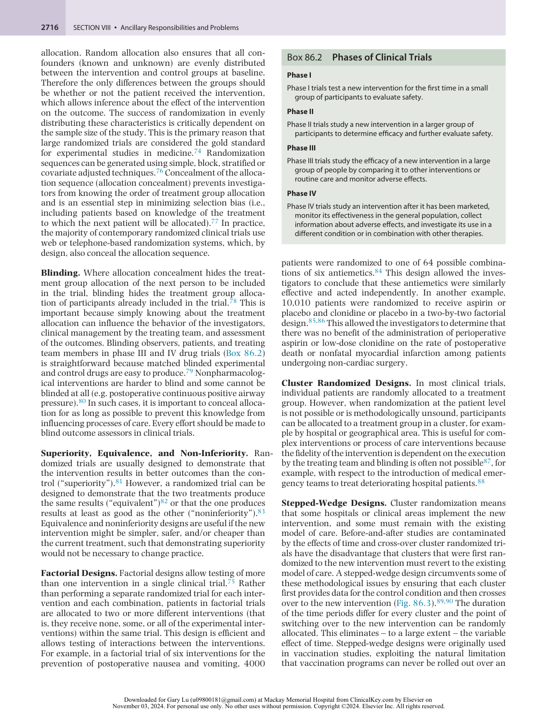

:::

<!-- PDF page 9 -->

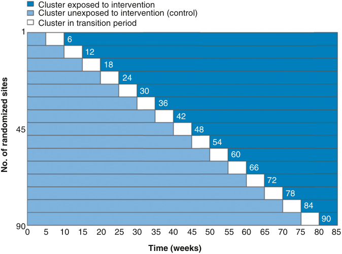

Cluster exposed to intervention Cluster unexposed to intervention (control) Cluster in transition period 1 6 12 18 24 30 36 42 45 48 54 60 66 72 78 84 90 90 0 5 10 15 20 25 30 35 40 45 50 55 60 65 70 75 80 85 Time (weeks) No. of randomized sites 

**Fig. 86.3 Stepped- wedge design.**

entire region in a very short time frame.91 They are considered alternatives for randomized trials of complex interventions, provided that there is a high likelihood of a positive effect of the intervention and a very low risk of harm.89

**Platform Trials.** A limitation of the contemporary “gold standard” parallel group randomized trial is the lead time for testing efficacy and effectiveness of a single intervention. Even factorial or traditional multi- arm trials take several years to identify a new treatment, particularly when repeated clinical trials are needed to refine and perfect an intervention. An important emerging clinical trial design that may address some of these limitations is the platform trial, which allows simultaneous comparison of multiple interventions among a single patient population providing a common control group.92 The RECOVERY trial used the platform design to rapidly investigate the efficacy of dexamethasone,93 tocilizumab,94 hydroxychloroquine,95 and convalescent plasma96 (among others) as treatments for SARS- CoV- 2 infection during the height of the coronavirus disease 2019 (COVID- 19) pandemic. New treatments can be added during the trial and interventions that are unlikely to show benefit can be removed, which makes the platform design very efficient.97

### ANALYSES OF PUBLISHED RESEARCH

### Systematic Reviews

The explosion in published medical knowledge and the requirement for quick answers to urgent clinical questions means that reliable synthesis of the medical literature is invaluable. Traditional narrative reviews are prone to selection bias because authors could “cherry pick” the literature for evidence supporting their own opinions. Systematic reviews pose an explicit research question and publish a transparent search strategy that every reader can replicate and update.98 The Preferred Reporting Items for Systematic Reviews and Meta- Analyses (PRISMA) statement

is available to guide authors of systematic reviews.99 However, the quality of reporting and methodological quality of reviews remains inconsistent.100

### Meta- Analyses

When multiple randomized trials have addressed similar research questions, with similar interventions and outcomes, the results can be mathematically combined in a meta- analysis,98 which estimates the aggregated effect of the intervention. A high- quality meta- analysis of large, well- conducted randomized trials is considered the highest level of evidence to guide practice, although results of metaanalyses do not always agree with subsequent very large trials.101 The Cochrane Collaboration is dedicated to performing systematic reviews and meta- analyses that inform clinical practice. The Collaboration’s software tools (“RevMan” and “Covidence”) generate analyses and graphs, and metrics about the quality of included studies.102,103 Funnel plots of treatment effect against study precision are used to detect publication bias towards studies with large treatment effects (typical of small trials) (Fig. 86.4).

**Individual Patient Meta- Analysis.** Traditional metaanalyses combine aggregate data from multiple clinical trials. A more powerful method combines the results using individual patient data.104,105 The benefits of this approach are better characterization of outcomes and the opportunity to perform new subgroup analyses or adjust for confounding. However, obtaining and reliably merging raw data from multiple clinical trials is challenging. An aggregated data meta- analysis will usually illuminate whether an individual patient data meta- analysis will yield sufficient new information to justify the additional time and effort.

### Translational Research

Translational research describes the process of turning a scientific discovery (most often a laboratory finding) into

<!-- PDF page 10 -->

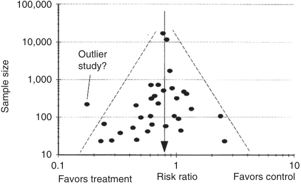

100,000 10,000 Outlier study? 1,000 100 10 0.1 1 10 Favors treatment Risk ratio Favors control Sample size 

**Fig. 86.4 Funnel plot showing publication bias: overrepresentation of studies with small sample sizes showing larger treatment effects.**

a useable clinical product or treatment. The reported cost to the pharmaceutical industry of developing a new drug in a laboratory and subsequently bringing this to market as a medication to treat patients is approximately $5 billion. Translational research uses all of methodologies previously described, but with a particular focus on three broad types of clinical trial (phase I–III). In phase I trials, a drug or intervention is tested in humans for the first time to confirm safety (i.e., is the drug safe?). This is most often in healthy volunteers, where side effects and complications can be easily assessed without the interaction of coexisting disease. In phase II trials, a drug or intervention is tested in a small group of patients with a particular disease, to determine whether the intervention has the intended treatment effect and the magnitude of this effect (i.e., efficacy: does the drug work as intended?). In phase III trials, a drug or intervention is tested in large groups of patients, to determine if it can work in clinical practice (i.e., effectiveness: does the drug work in the real world?).106

### Implementation Science and Knowledge Translation

Implementation science studies health care delivery with a particular focus on how interventions with evidence of efficacy are implemented into routine clinical care. This discipline addresses the tension between clinical evidence (i.e., what is known) and clinical practice (i.e., what is done). This type of research employs surveys, observational designs, and experimental designs. In addition, qualitative research methods are employed, such as thematic analyses of individual interviews and focus groups. Implementation of an efficacious intervention can have a substantial impact on clinical effectiveness. For example, several small clinical trials suggested that the routine use of postoperative continuous positive airway pressure prevented postoperative pulmonary complications after major abdominal surgery. However, a much larger multicenter clinical effectiveness trial found no benefit of this intervention.107 A contemporaneous process evaluation demonstrated that continuous positive airway pressure was difficult to use immediately after surgery and that patients did not like it, which negatively impacted intervention compliance.80 Process evaluations embedded within randomized clinical effectiveness trials are becoming increasingly common, to

help understand delivery of the intervention in the clinical environment.

## Study Protocol

A carefully designed protocol is the foundation of all clinical research, facilitating the review, conduct, and eventual publication of the study (Fig. 86.5).108 However, protocols are often incomplete and inconsistent with their corresponding published reports.109,110 In response, templates have been developed, including by the World Health Organization,111 the International Council for Harmonisation,112 national research funding agencies,113 and the Equator Network (the Standard Protocol Items: Recommendations for Interventional Trials [SPIRIT] statement114,115 ). The effectiveness of these templates in improving the quality of protocols is yet to be determined. Amendments to clinical research protocols must be approved by the coordinating institutional review board (human research ethics committee) and must be reflected in the trial’s registration. The International Committee of Medical Journal Editors recommends that investigators make their protocols publicly available before any results are published, for example, by posting them on institutional websites or publishing them in peer- reviewed journals.116

### HYPOTHESES

All clinical research – from a case report through qualitative and observational projects to a multicenter clinical trial – begins with a research question. These questions arise from a myriad of sources: the existing literature, the previous work of the investigators, interactions with colleagues, observations during clinical work, and discussions with patients and their families. A well- formulated research question guides the literature review (which establishes the need for the study), informs the study design, methods, and sample size, and limits the potential for error and bias. The Population- Intervention- Comparator- OutcomeTimeframe- Setting (PICOTS) format is a popular framework among clinical researchers and improves the quality of research questions.117 In an observational study, the “intervention” and “comparator” can be patient- based (e.g., with or without intraoperative hypotension) or carebased (e.g., treated in a metropolitan or rural hospital). In a clinical trial, the intervention and comparator are randomized. During protocol development, research questions are transformed into formal hypotheses. The structure of the hypothesis depends on whether the investigators predict that one group will have superior, equivalent, or noninferior outcomes to the others. Regardless of this prediction, two- sided hypothesis testing is preferable: that is, entertaining the possibility that standard treatment is better or that the treatments are not equivalent.118

### POPULATION

Selection of participants depends on the purpose and context of the study and is a key differentiator between explanatory and pragmatic studies.119,120 Explanatory (efficacy) studies, such as observational studies of new drugs and

<!-- PDF page 11 -->

### Study aims, questions, and/or hypotheses

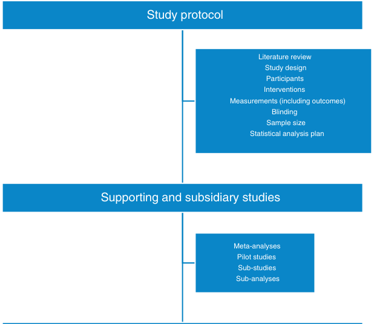

Study protocol Literature review Study design Participants Interventions Measurements (including outcomes) Blinding Sample size Statistical analysis plan Supporting and subsidiary studies Meta-analyses Pilot studies Sub-studies Sub-analyses 

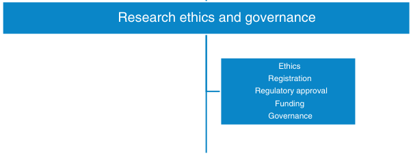

Research ethics and governance Ethics Registration Regulatory approval Funding Governance 

Study processes 

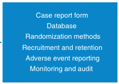

Case report form Database Randomization methods Recruitment and retention Adverse event reporting Monitoring and audit 

### Analysis and publication

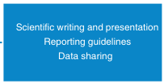

Scientific writing and presentation Reporting guidelines Data sharing 

Reflection, feedback, and forward planning 

**Fig. 86.5 Life cycle of a clinical research project.**

<!-- PDF page 12 -->

devices or phase I–III clinical trials, include highly selected patients in highly controlled settings, to reduce variability between patients and maximize treatment effects. The generalizability of explanatory studies therefore is limited. Pragmatic (effectiveness) studies, such as phase IV clinical trials, include typical patients receiving real- world care.121 Random sampling is approximated by approaching all patients who have indications for the treatment and who present themselves for care. In practice, however, only a subset of patients is approached. Further non- random selection occurs when patients decline to participate or fail to complete data collection.120 Although national funders promote diversity among participants,122 children, elderly people, pregnant and lactating women (indeed, women in general), transgender and nonbinary people, culturally and linguistically diverse people, and people with disabilities are still underrepresented in clinical research.123–126 An additional factor is failure to identify underrepresented people among recruited participants. Ideally, studies should be powered to allow analysis of major subgroup effects.123,125

### INTERVENTIONS AND COMPARATORS

Nearly all clinical research involves an intervention (e.g., a drug, device, procedure, diagnostic test, bundle of care, etc.). In observational studies, the intervention is administered as part of usual care, whereas in experimental studies the intervention is administered by or on behalf of the investigators. Many studies involving an intervention also involve a comparator (e.g., placebo, usual care, or current best practice).127 The comparator should be the best proven intervention, except when no such intervention exists.108 In this case, a placebo may be appropriate. Usual care needs to be defined at the outset and monitored for change over time. Current best practice needs to be supported by guidelines and ensured during the study.127 For a study to be ethical, there must be uncertainty in the expert community about the relative merits of the intervention(s) and comparator(s), and the study must be designed to resolve it (clinical equipoise).128 Complex perioperative interventions and comparators may not be fully or properly implemented in pragmatic studies, and this variation may be non- random. For this reason, patients are usually analyzed in the groups to which they are assigned (intention- to- treat analysis).

### OUTCOMES

Outcomes are events that may result from or be associated with an action taken during a study. Ideally, outcomes in clinical research influence the way clinicians practice and the choices that patients make.129 Although patientreported outcomes are subjective, they can greatly enhance the impact of the study if properly developed and implemented.130,131 Binary outcomes that can be expressed as probabilities are easier to interpret than continuous outcomes, which can be converted to binary outcomes by defining an appropriately validated cutoff value.129 Composite outcomes can be a useful means of assessing the impact of an event or intervention but can be misleading if the components are dissimilar in frequency, magnitude, direction of effect, or importance.132 Surrogate outcomes

occur between the event or intervention and the true outcome, and are used to draw conclusions about the true outcome. To be valid, the relationship between the surrogate and true outcome must be precisely defined.133 The primary outcome is the focus of the study and will be the basis of the sample size calculation. Secondary and safety outcomes should reflect the important beneficial and adverse effects of the event or intervention. Careful definition of outcomes and the timing of their measurement are fundamental to protocol development. Consensus among experts should enhance interpretation and research translation and facilitate pooled analyses and replication of trial results.134

### SAMPLE SIZE

A study needs enough participants to provide reliable conclusions about the specified outcomes and treatment effects. If the number of study participants is too low, the investigators could incorrectly conclude that there is no treatment effect. If the number of study participants is too large, it may delay the availability of information that is vital to patient care. In both cases resources will be wasted and participants will be exposed to unnecessary risk. A sample size calculation therefore should be conducted in the design phase of all studies. In qualitative and observational research, investigators should justify the reasons for their sampling frame (the population from which the sample is drawn).22 This should be based on the availability of interviewees or relevant data in an appropriate format, or the investigators’ expectations about the numbers of eligible participants and/or their estimates of acceptable 95% confidence intervals around the incidence of the primary outcome.135 In comparative studies, sample size calculations are based on the expected difference in the primary outcome between the groups (effect size), the variance in the effect size (for continuous variables), and the risk that the investigators are willing to accept of false-positive (α; type 1 error) and falsenegative (β; type 2 error) findings.136,137 Effect sizes and variances can be estimated from the literature, pilot studies, statistical methods, or opinions about minimal clinically important differences.138 The planned sample size will also depend on the number of groups, number of anticipated dropouts, and statistical analyses planned. The protocol should provide sufficient information to allow replication of quantitative sample size calculations.135,137 In the anesthesia literature this is frequently not the case.139 _Post hoc_ calculation of statistical power using the results of a trial is inappropriate: the width of the confidence intervals around the primary outcome is a better indicator of the reliability of the result.137

### DATA ANALYSIS PLAN

The details of data analysis are outside the scope of this chapter, and increasingly outside the scope of clinician researchers and reviewers.140 Statistics training or collaboration with biostatisticians or experts in qualitative data analysis is commonly required to reach the level of statistical excellence required by regulators, funders, and journals. Statistical input is vital during the planning of clinical research, particularly in relation to the sample size calculation. The protocol should also include a plan for description

<!-- PDF page 13 -->

of the data and analyses of the primary and secondary outcomes, subgroup and adjusted analyses, sensitivity analyses, interim analyses and stopping rules, and protocol adherence, as applicable.114,115,141,142 The detailed statistical analysis plan for large observational studies and clinical trials is often published before the unblinded data are available, and at least should be predefined.143 Peer- reviewed journals may require submission of the statistical analysis plan with the manuscript, require statistical checklists, and employ statistical editorial teams to assist with the evaluation of manuscripts.140

### SUPPORTING STUDIES

### Feasibility and Pilot Studies

Increasingly, preliminary work is specifically undertaken to demonstrate the viability of a future large observational or experimental study.144,145 A feasibility study tests whether a future study can be done, examining the knowledge and interest of practitioners, availability of eligible patients, their willingness to participate, ease of applying the intervention and collecting data, qualities of the primary outcome, and resource requirements of the study. A pilot study is a type of feasibility study that tests the proposed hypotheses of a future study, without being scaled to test the effectiveness of interventions nor the strength of associations. Pilot studies are frequently used to inform sample size calculations for the future studies, although this process may be flawed.146 The rationale for the sample size of the feasibility study itself should be congruent with the feasibility objectives but need not involve a formal sample size calculation.147 Pilot studies are subject to the same ethical and regulatory requirements as definitive studies.

### Sub- Studies

Sub- studies are an efficient means of investigating additional research questions using additional data collected in subsets of participants in large clinical trials. They are subject to the same ethical and regulatory requirements as the main study, and ideally are planned simultaneously. Sub- studies can investigate additional outcomes related to the randomized intervention, in which case they can be considered nested randomized trials.148,149 They can investigate the associations of additional non-randomized exposures (e.g., biomarkers) with the same outcomes, in which case they can be considered nested cohort studies.146,150 Finally, they can investigate the associations of additional non- randomized exposures with additional outcomes: these are also nested cohort studies and are an efficient use of a unique cohort.146,151 The effect of additional randomized exposures is more properly evaluated using a factorial study design. Principal design considerations for sub- studies include adequate sample size and limiting the burden on investigators and patients.

### Sub- Analyses

Sub- analyses are an efficient means of investigating additional research questions using data collected for another primary research purpose. Some sub- analyses are planned before the main study begins (e.g., population subgroup analyses). Others are planned after the data have been collected or the main results have been published and may

address unanticipated events or discoveries. In any case the statistical analysis plan should be finalized before the analyses begin.143 Sub- analyses can investigate the associations of non-randomized exposures (e.g., baseline characteristics, processes of care, measured variables) with the primary and secondary outcomes,86,152 or the detailed effects of the randomized intervention on secondary outcomes.85,153 Propensity scoring methods are increasingly used to determine the probability of a participant receiving a nonrandomized treatment given a particular set of baseline characteristics, and to compensate for this by stratifying, matching, weighting, or adjusting on the basis of the propensity score.43,154,155 However, these methods are heavily reliant on the collection of appropriate and complete baseline data, and do not reduce confounding by unmeasured or unknown factors (e.g., the reasons the anesthesiologist chose a particular technique or defended a particular blood pressure).154,155

## Ethical and Regulatory Considerations

### ETHICS APPROVAL

All research on humans must be conducted within a system that ensures the safety and privacy of the participants.108,112,156–159 This system can be local, national, or multinational. The degree of scrutiny is based on the potential for risk, discomfort, inconvenience, burden, and threats to privacy. Depending upon the jurisdiction, lowrisk research (e.g., audits and surveys) may be conducted without review under policies that promote ethical conduct, or under expedited review processes.158,160 Research that is not low risk is considered by an institutional review board. The board approves the processes for obtaining consent or may waive or qualify consent if the risk to participants is low. Deferred consent is also possible in urgent care research in some jurisdictions.160 Approaching patients for the first time about a study on the day of surgery is acceptable to patients,161,162 but participation rates are lower than before the day of surgery.163

### REGISTRATION

Clinical trial registration was introduced in response to concerns about publication bias and selective reporting.164 Additional aims of registration include reducing waste from unnecessary duplication of studies and improving access to clinical trial participation and results for patients.165 Initial efforts involved mandating registration of a minimum data set of protocol information before the enrollment of the first patient.116,166 Subsequently, efforts were expanded to mandating public disclosure of aggregated trial results, including those that were negative or inconclusive.108,167–169 These efforts have not been completely successful.165 For example, in a report about anesthesiology registration, although rates of registration had improved since 2007, 62% of clinical trials published in six specialty journals in 2015 were still inadequately registered.170 Further culture change among funders, institutional review boards, investigators, and publishers will be required.165,171 Registration

<!-- PDF page 14 -->

of observational research is encouraged,172 but is currently voluntary, partly because of concerns that registration may stifle exploratory analyses.173

### REGULATORY APPROVAL

Federal, national, and state government agencies regulate the manufacture, import/export, supply, marketing, and surveillance of drugs and medical devices, with the aim of optimizing access to safe and effective therapeutic goods. There is some harmonization between jurisdictions.174,175 Regulatory authorization is required for clinical trials of therapeutic goods that are not yet approved (phase I–III trials) or are being tested for an indication outside the current approval (phase IV trials). The sponsor, institutional review board, and regulator collaborate in protecting patients who are exposed to unapproved therapeutic goods during clinical trials. This collaboration can be especially complex for international investigatorinitiated clinical trials and must be carefully considered in the planning phase.

### DATA SHARING

Sharing of individual patient data from clinical trials is in the public interest, on scientific, economic, and ethical grounds.176 Third parties may wish to verify trial results, correct errors, explore new hypotheses, or use the data in individual patient data meta- analyses. Funding agencies, publishers, investigators, and the pharmaceutical industry have issued position statements about data sharing.176–179 The International Committee of Medical Journal Editors currently requires investigators to include a data- sharing plan in the trial’s registration and a datasharing statement in the primary manuscript.180 These statements and plans must disclose whether, what, with whom, and how data will be shared. This position recognizes the current lack of policies, resources, and culture that will protect the interests of patients and investigators.180 In order to be effective and responsible, data sharing must be planned from the outset of a clinical trial, as it involves clarifying the need for patient consent, constructing appropriate data management systems, and securing adequate funding.179,181

## Study Management

### FINANCIAL MANAGEMENT

Good clinical practice requires investigators and sponsors to document and agree on the financial aspects of a study.112 Budgets and contracts are approved as part of the research governance process. All clinical research has a cost: even a case report requires retrieval of medical records, preparation of illustrations, and investment of investigator time. The cost of research is increasing in line with the increased size and complexity of clinical research. At the same time, the ability or inclination of health services to absorb costs that are not directly related to patient care is decreasing. Investigators therefore must obtain funding from other sources, including government agencies, commercial enterprises,

and philanthropic organizations. This process can be timeconsuming and stressful.182 One study estimated that 34 working days of the principal writer’s time was spent preparing each new proposal for a national funding round.183 Only 20% of these proposals were funded. Streamlined and flexible application processes, and rules regarding resubmission of unsuccessful proposals, may reduce workload and increase success.182,183

### DATA MANAGEMENT

The protocol should list each item of data to be collected, its source, and the timing of measurement.114 The ethics review process addresses whether the proposed data collection meets privacy and data security requirements.112 In explanatory studies, such as phase I–III clinical trials, the volume of data collected can be large, whereas in pragmatic studies data collection should be limited to vital measurements only.184 Three main options are available for data collection: (1) a bespoke case report form; (2) data extraction from existing sources (such as medical records, registries and administrative databases); and (3) a hybrid approach.184 Case report forms can be printed or electronic, with electronic forms offering mechanisms to ensure complete and accurate data entry.185 Data will then be transferred to a database that is usually established specifically for the study. Increasingly, anesthesia research protocols require linkage of records of individual patients or groups across unrelated databases, requiring the input of health informaticians and raising issues of privacy and data security.186

### HUMAN RESOURCE MANAGEMENT

The human resources associated with clinical research include the investigators, trial coordinators, treating clinicians, and patients. Ethics and governance processes address whether the legitimate interests and rights of these parties are protected during the study.112 Investigators and trial coordinators should be suitably qualified, experienced, and competent for the research they propose to undertake, and ideally should have International Council for Harmonisation E6 Good Clinical Practice certification.112 Clinical trial networks can play a big role in nurturing careers and fostering collaboration. Treating clinicians need to be advised about their role in implementing the protocol and be engaged in ensuring the success of the study. This is especially important in protocols that require the continuous attention of the treating clinician during an anesthetic187 or critical care unit stay.188 Recruiting patients to anesthesia and critical care studies can be difficult, because of time constraints and multiple competing priorities. A systematic review of recruitment strategies identified that open rather than blinded treatment allocation, and phone follow- up to written invitations to participate, significantly improved recruitment.189 Loss to follow- up is very low in anesthesia and critical care studies, because time frames for data collection are often short and patients are in the operating room or hospital for most or all of the study. A systematic review of retention strategies in ambulatory settings reported that only monetary incentives improved retention.190

<!-- PDF page 15 -->

### Box 86.3 Definitions of Adverse Events in Clinical Research

- **_Adverse event_** : Any untoward medical occurrence associated with the use of a drug in humans, whether or not considered drug related.

- **_Suspected adverse reaction_** : Any adverse event for which there is a reasonable possibility that the drug caused the adverse event.

- **_Unexpected:_** Any adverse event or suspected adverse reaction that is not listed in the investigator brochure (or general investigational plan) or is not listed at the specificity or severity that has been observed.

- **_Serious adverse event or suspected adverse reaction:_** Any adverse event or suspected adverse reaction that results in any of the following outcomes: death, a life- threatening adverse event, inpatient hospitalization or prolongation of existing hospitalization, a persistent or significant incapacity or substantial disruption of the ability to conduct normal life functions, or a congenital anomaly/birth defect.

- **_Life- threatening:_** An adverse event or suspected adverse reaction that places the patient or subject at immediate risk of death. It does not include an adverse event or suspected adverse reaction that, had it occurred in a more severe form, might have caused death.

### ADVERSE EVENT REPORTING

Adverse event reporting is a crucial step in ensuring the safety of participants in all clinical research (Box 86.3).191 An adverse event is any unfavorable and unintended occurrence associated with the use of a medicinal product, whether or not it is related to that product. Adverse events can be categorized by severity (intensity), seriousness (effect on patient outcome), expectedness (observed before), and causality (attributability to the medicinal product).191 Expedited reporting of adverse events to regulators and institutional review boards is an essential part of phase I–III trials.166,175 For phase IV trials, universal safety end points and unexpected adverse events are reported periodically by the trial’s data and safety monitoring board. Only serious unexpected events that would be reported as part of routine clinical care are reported immediately to regulators and institutional review boards. The primary report of a clinical trial should include a table of adverse events by system and/ or severity.175,191 Adverse event reporting is burdensome and costly, and therefore should be aligned with the risk to patient safety of the medicinal product.192–194

### MONITORING AND AUDIT

Monitoring is “the act of overseeing the progress of a clinical trial.”112 All clinical studies require some monitoring, to ensure that participants are protected, the study is being conducted in accordance with its approvals, and the data are complete, accurate, and verifiable. Monitoring may range from simple checks by the investigators through to on- site monitoring by the sponsor or a contract research organization. Increasingly, centralized monitoring is being used to look for data trends and integrity issues.195 Audit is “a systematic and independent examination of trial related activities and documents.”112 Audits are conducted by institutional review boards, regulators, and funders, sometimes after a concern is raised about a study. In clinical trials,

quality management is the responsibility of the data and safety monitoring board. The board can review unblinded data and adverse event reports and make assessments about the evolving balance between efficacy and risk in the study. Boards and board members need to be independent, and increasingly need to be trained for the heavy academic, legal, and ethical responsibilities involved.196

## Study Reporting

### MANUSCRIPT

Accurate, complete, and timely reporting of results supports research integrity and usefulness. Reporting guidelines are available for a wide range of study designs and populations, and compliance with these guidelines and completion of checklists and flow diagrams is mandated by some journals.116,197 For example, the Strengthening the Reporting of Observational Studies in Epidemiology (STROBE) and Consolidated Standards Of Reporting Trials (CONSORT) statements aim to improve the quality of reporting of observational studies and randomized trials, respectively.22,135–137 The quality of reporting of randomized controlled trials has improved over time, but it is unclear if this is due to the CONSORT statement.198 A systematic review about the effect of journal endorsement of the statement on quality of reporting identified a significant improvement in reporting for only 5 of the 27 items,199 highlighting the need for research into adherence to guidelines.200 Research is only useful if the investigators communicate effectively with their intended audience. As well as reporting guidelines197 and instructions from journal editors,116 researchers are advised to consult resources about writing clear and graceful prose.

### AUTHORSHIP

Investigators can be involved in the concept, design, funding, governance, management, data collection, analysis, and/or reporting of clinical research. The International Committee of Medical Journal Editors recommends that authorship be based on substantial contributions to the research, approval of the submitted manuscripts, and agreement to be accountable for all aspects of the work.116 Honorary authorship to recognize contributions that do not meet the recommendations (such as leading the department in which the work was done or technical editing of the manuscript) is thereby prohibited. Criteria for authorship and for acknowledging non- author contributions should be established before the research commences and reviewed at manuscript submission.116,201 With increases in numbers of authors, multi- investigator groups, and data sharing, solutions to acknowledging contributions to research are rapidly evolving.201–203

### PUBLISHING

Researchers need to choose their target journal with care, taking into consideration the subject and potential impact of their research, the requirements of funders for open access publication, and the bona fides of the target journal. Legitimate publishers conform to recognized standards of

<!-- PDF page 16 -->

publication ethics.116,204 Open access options are available for a fee in traditional subscription journals and legitimate open access journals. So- called “predatory” open access journals aggressively seek submissions through “spam” email, do not conform to ethical standards, and may charge high fees without delivering on open access or indeed publishing at all.205,206 Various resources are available to help authors identify predatory journals, although these are imperfect due to increasing numbers of both legitimate and predatory journals. Increasingly, authors and journals are using social media platforms to disseminate results and generate discussion.207

Preprint servers offer authors the opportunity to make their work freely available before peer review.208 This type of communication was widely used during the COVID- 19 pandemic to rapidly inform fellow investigators, clinicians, and the wider community about eagerly awaited breakthroughs. The need to wait for peer review and academic discourse before applying results in practice was highlighted by flawed preprint manuscripts that were subsequently withdrawn.209 A review of preprint servers also uncovered deficiencies in publications ethics and research integrity.210

researcher has unique aptitudes and works in a unique context. We recommend that researchers keep a journal about each research project, reflect on their experience when the project is completed, and share strategies for success with their peers and junior colleagues. Finally, as well as giving patients an opportunity to contribute to study design, giving patients an opportunity to comment on the results of studies in which they participated might give researchers fresh insights and open new avenues of research.

### Acknowledgment

The authors acknowledge the contribution of Dr. Cor Kalkman to the previous version of this chapter.

**Complete references available online at expertconsult.com.**

### References

1.  Institute of Medicine. _Crossing the Quality Chasm: A New Health System for the 21st Century_ . National Academy Press; 2001.

2.  Keus F. _BMC Med Res Methodol_ . 2010;10:90.

3.  Schwartz S. _Epidemiology_ . 2015;26:216.

4.  Sessler DI, Imrey PB. _Anesth Analg_ . 2015;121:1034.

5.  Vetter TR, Mascha EJ. _Anesth Analg_ . 2017;125.

### RESEARCH INTEGRITY

6.  Short T, Leslie K. _Br J Anaesth_ . 2014;113:897.

7.  Chu R, et al. _PLoS One_ . 2012;7:e36677.

Research integrity is “active adherence to the ethical principles and professional standards essential for the responsible practice of research.”156 Research misconduct includes fabrication, falsification, plagiarism, misleading reporting, redundant publication, abuse of authorship, conflict of interest infringements, funding infringements, fraud in the peer-review process, and unethical research (in particular, in relation to patient consent and protection).156,211,212 Research misconduct damages the reputation of science and scientists, and is a threat to patient safety. A systematic review on interventions to improve research integrity concluded that the evidence for effectiveness was sparse, of low quality, and concentrated on short- term outcomes.213 Plagiarism, which ranges from intellectual theft through careless practice to self- plagiarism (not, strictly speaking, plagiarism but possibly duplicate publication),214 is the most common form of research misconduct.215 Practical training may reduce plagiarism213 and routine screening using text- matching software may reduce plagiarism in submitted papers.

## Reflection, Feedback, and Forward Planning

Continuous quality improvement is now mainstream in clinical practice and medical education.216 Practitioners and students are encouraged to reflect on their experiences, note what they did well and where they could do better, discuss these reflections with their supervisors or teachers, and give their colleagues or teachers feedback about the quality of the workplace or learning environment. At the end of this cycle plans are made for the future. Researchers could benefit from a similar cycle of reflection, feedback, and forward planning. While a lot of helpful information and training about designing and conducting clinical research is available, including in _Miller’s Anesthesia_ , each

8.  Zhao W. _Contemp Clin Trials_ . 2013;36:263.

9.  Moons KG, et al. _BMJ_ . 2009;338:b606.

10.  Song F, et al. _Health Technol Assess_ . 2010;14:1.

11.  Akl EA, et al. _BMJ Open_ . 2015;5:e008431.

12.  Wasserstein R, Lazar N. _Am Stat_ . 2016;70:129.

13.  Wijeysundera DN. _J Clin Epidemiol_ . 2009;62:13. e15.

14.  Schober P, et al. _Anesth Analg_ . 2018;126:1068.

15.  Ioannidis JPA. _JAMA_ . 2018;319(14):1429.

16.  Yarnell CJ, et al. _Lancet Respir Med_ . 2021;9:207.

17.  Granholm A, et al. _Intensive Care Med_ . 2022;48:45.

18.  Department of Health and Human Services. _NIH’s Definition of a Clinical Trial_ ; 2017.

19.  Sessler DI, Imrey PB. _Anesth Analg_ . 2015;121:1043.

20.  Doll R, Hill AB. _BMJ_ . 1950;2:739.

21.  Hill AB. _Proc R Soc Med_ . 1965;58:295.

22.  von Elm E, et al. _PLoS Med_ . 2007;4:e296.

23.  Bossuyt PM, et al. _BMJ_ . 2015;351:h5527.

24.  Collins GS, et al. _BMJ_ . 2015;350:g7594.

25.  Rao A, et al. _PLoS One_ . 2016;11:e0155078.

26.  Zamanipoor Najafabadi AH, et al. _BMJ Open_ . 2020;10:e041537.

27.  Kruger BD. _Anesth Analg_ . 2017;125:1898.

28.  Rosenblatt MA. _Anesthesiology_ . 2006;105:217.

29.  Denborough MA. _Br J Anaesth_ . 1962;34:395.

30.  Griffith H, Johnson E. _Anesthesiology_ . 1942;3:418.

31.  Brain AI. _Br J Anaesth_ . 1983;55:801.

32.  Cook NR. _Diagn Progn Res_ . 2018;2:14.

33.  Soussi S, et al. _Anesthesiology_ . 2021;134:15–25.

34.  O’Leary JD, et al. _Anesthesiology_ . 2016;125:272.

35.  Ladha KS, et al. _Drug Alcohol Depend_ . 2021;227:108989.

36.  McIsaac DI, et al. _Anesthesiology_ . 2018;128:480.

37.  Canales C, et al. _Anesthesiology_ . 2022;136:268.

38.  Chung F, et al. _Anesthesiology_ . 2008;108:812.

39.  Onder G, et al. _J Clin Psychiatry_ . 2005;66:982.

40.  Deljou A, et al. _Anesth Analg_ . 2019;129:737.

41.  Bauer ME, et al. _Anesth Analg_ . 2019;129:1613.

42.  Wacholder S. _Am J Epidemiol_ . 1992;135:1019.

43.  Devereaux PJ, et al. _JAMA_ . 2017;317:1642.

44.  Colquhoun DA, et al. _Anesth Analg_ . 2020;130:1133.

45.  McIsaac DI, et al. _BMJ Qual Saf_ . 2020;29:209.

46.  Jivraj NK, et al. _Br J Anaesth_ . 2020;124:281.

47.  Rubin DB. _Stat Med_ . 2007;26:20.

48.  Minto C, et al. _Anesthesiology_ . 1997;86:10.

49.  Schnider T, et al. _Anesthesiology_ . 1999;90:1502.

50.  McIsaac DI, et al. _Br J Anaesth_ . 2020;125:704.

51.  Ma Y. _Reg Anesth Pain Med_ . 2012;37:99.

<!-- PDF page 17 -->

52.  Reynolds PS. _Anesth Analg_ . 2016;123:1400.

53.  Shulman M. _Anesthesiology_ . 2015;122:524.

54.  Abu- Arafeh A. _Br J Anaesth_ . 2016;117:569.

55.  Fitzpatrick R. _Health Technol Assess_ . 1998;2(i–iv):1.

56.  Hunt TD, et al. _BMJ Open_ . 2012;2:e000665.

57.  Hooper TD, et al. _Anaesth Intensive Care_ . 2015;43:461.

58.  Wijeysundera DN. _Can J Anaesth_ . 2016;63:148.

59.  Kalkman CJ. _Pain_ . 2003;105:415.

60.  Sheth T, et al. _BMJ_ . 2015;350:h1907.

61.  Goldman L, et al. _N Engl J Med_ . 1982;307:588.

62.  Staffa SJ, Zurakowski D. _Anesthesiology_ . 2021;135:396.

63.  Canet J, et al. _Anesthesiology_ . 2010;113:1338.

64.  Bilimoria KY, et al. _J Am Coll Surg_ . 2013;217:833.

65.  Story DA, Tait AR. _Anesthesiology_ . 2019;130:192.

66.  Story DA. _Anesth Analg_ . 2011;113:591.

67.  Harris AD. _Clin Infect Dis_ . 2004;38:1586.

68.  Sterne JA, et al. _BMJ_ . 2016;355:i4919.

69.  Paneth N, Fine P. _Lancet_ . 2013;381:1267.

70.  Ho AMH, et al. _Anesth Analg_ . 2018;126(5):1755.

71.  Alvarez MP. _Surg Endosc_ . 2015;29:2506.

72.  Wellek S, Blettner M. _Dtsch Arztebl Int_ . 2012;109:276.

73.  Niesters M. _Br J Anaesth_ . 2013;110:1010.

74.  Sackett DL, et al. _BMJ_ . 1996;312:71.

75.  Sessler DI, Imrey PB. _Anesth Analg_ . 2015;121:1052.

76.  Suresh K. _J Hum Reprod Sci_ . 2011;4:8.

77.  Torgerson DJ, Roberts C. _BMJ_ . 1999;319:375.

78.  Wartolowska K. _F1000Res_ . 2017;6:1663.

79.  Candiotti KA. _Anesth Analg_ . 2008;107:445.

80.  PRISM Trial Group. _Lancet Respir Med_ . 2021;9:1221.

81.  Mascha EJ. _Anesthesiology._ 2010;113:779.

82.  Davidson AJ, et al. _Lancet_ . 2016;387:239.

83.  Corcoran TB, et al. _N Engl J Med_ . 2021;384:1731.

84.  Apfel C, et al. _N Engl J Med_ . 2004;350:2441.

85.  Devereaux PJ, et al. _N Engl J Med_ . 2014;370:1494.

86.  Devereaux PJ, et al. _N Engl J Med_ . 2014;370:1504.

87.  Brown C, Lilford R. _BMJ_ . 2008;337:a2764.

88.  Hillman K, et al. _Lancet_ . 2005;365:2091.

89.  Hemming K. _BMJ_ . 2015;350:h391.

90.  Ellenberg SS. _JAMA_ . 2018;319:607.

91.  The Gambia Hepatitis Study Group. _Cancer Res_ . 1987;47:5782.

92.  Myles PS. _Anesth Analg_ . 2022;134:668.

93.  Horby P, et al. _N Engl J Med_ . 2021;384:693.

94.  RECOVERY Collaborative Group. _Lancet_ . 2021;397:1637.

95.  Horby P, et al. _N Engl J Med_ . 2020;383:2030.

96.  RECOVERY Collaborative Group. _Lancet_ . 2021;397:2049.

97.  Park JJH, et al. _J Clin Epidemiol_ . 2020;125:1.

98.  Moller AM, Myles PS. _Br J Anaesth_ . 2016;117:428.

99.  Page MJ, et al. _BMJ_ . 2021;372:n71.

100.  Pussegoda K, et al. _Syst Rev_ . 2017;6:131.

101.  Sivakumar H, Peyton PJ. _Br J Anaesth_ . 2016;117:431.

102.  The Cochrane Collaboration. _RevMan5_ . http://www.cochrane.org.

103.  The Cochrane Collaboration. _Covidence_ . http://community.cochrane .org/tools/review- production- tools/covidence.

104.  Debray TP, et al. _Res Synth Methods_ . 2015;6:293.

105.  Thomas D. _BMC Med Res Methodol_ . 2014;14:79.

106.  US Department of Health. _What Are the Different Types of Medical Research? U.S_ . FDA; 2022.

107.  Ireland CJ, et al. _Cochrane Database Syst Rev_ . 2014;2014:Cd008930.

108.  World Medical Association. _WMA Declaration of Helsinki - Ethical Principles for Medical Research Involving Human Subjects_ . WMA; 2008.

109.  Pildal J. _BMJ_ . 2005;330:1049.

110.  Hrobjartsson A. _J Clin Epidemiol_ . 2009;62:967.

111.  World Health Organization. _Recommended Format for a Research Protocol_ . WHO; 2022.

112.  ICH Expert Working Group. _International Conference on Harmonisation of Technical Requirements for Registration of Pharmaceuticals for Human Use. ICH Harmonised Tripartite Guideline: Integrated Addendum to ICH E6(R1): Guideline for Good Clinical Practice E6(R2) Step 2 Dated 11 June 2015_ ; 2022.

113.  National Institutes of Health and Food and Drug Agency. _NIH and FDA Release Protocol Template for Phase 2 and 3 IND/IDE Clinical Trials_ ; 2017.

114.  Chan AW, et al. _Ann Intern Med_ . 2013;158:200.

115.  Chan AW, et al. _BMJ_ . 2013;346:e7586.

116.  International Committee of Medical Journal. In: _Recommendations for the Conduct, Reporting, Editing, and Publication of Scholarly Work in Medical Journals_ . 2022.

117.  Rios LP. _BMC Med Res Methodol_ . 2010;10:11.

118.  Nizamuddin SL. _J Cardiothorac Vasc Anesth_ . 2017;31:1878.

119.  Loudon K. _BMJ_ . 2015;350:h2147.

120.  Oude Rengerink K, et al. _J Clin Epidemiol_ . 2017;89:173.

121.  Sackett DL. _Pol Arch Med Wewn_ . 2011;121:259.

122.  National Institutes of Health. _NIH Policy and Guidelines on the Inclusion of Women and Minorities as Subjects in Clinical Research_ ; 2020. https://grants.nih.gov/grants/guide/notice- files/NOT- OD- 18014.html.

123.  Geller SE. _J Womens Health (Larchmt)._ 2011;20:315.

124.  Spong CY, Bianchi DW. _JAMA_ . 2018;319:337.

125.  Hughson JA, et al. _Trials_ . 2016;17:263.

126.  Cortina CS. _JAMA Oncol_ . 2022;8:1097.

127.  Zuidgeest MGP, et al. _J Clin Epidemiol_ . 2017;90:92.

128.  Freedman B. _N Engl J Med_ . 1987;317:141.

129.  Welsing PM, et al. _J Clin Epidemiol_ . 2017;90:99.

130.  Kyte D, et al. _PLoS One_ . 2014;9:e110229.

131.  Calvert M, et al. _JAMA_ . 2018;319:483.

132.  Myles PS, Devereaux PJ. _Anesthesiology_ . 2010;113:776.

133.  Baker SG. _Stat Med_ . 2018;37:507.

134.  Myles PS, et al. _Br J Anaesth_ . 2016;116:586.

135.  Vandenbroucke JP, et al. _PLoS Med_ . 2007;4:e297.

136.  Schulz KF. _Trials_ . 2010;11:32.

137.  Moher D, et al. _J Clin Epidemiol_ . 2010;63:e1.

138.  Cook JA, et al. _Health Technol Assess_ . 2014;18:1.

139.  Abdulatif M. _Br J Anaesth_ . 2015;115:699.

140.  Mascha EJ, Vetter TR. _Anesth Analg_ . 2017;124:719.

141.  ICH Expert Working Group. _International Conference on Harmonisation of Technical Requirements for Registration of Pharmaceuticals for Human Use. ICH Harmonised Tripartite Guideline: Statistical Principles for Clinical Trials (E9) Current Step 4 Version Dated 5 February 1998_ ; 1998.

142.  Thomas L, Peterson ED. _JAMA_ . 2012;308:773.

143.  Eisenach JC. _Anesthesiology_ . 2016;124:998.

144.  Story DA, et al. _Anaesth Intensive Care_ . 2018;46:11.

145.  Thabane L, et al. _Trials_ . 2011;12:48.

146.  Kraemer HC. _Arch Gen Psychiatr_ . 2006;63:484.

147.  Eldridge SM, et al. _BMJ_ . 2016;355:i5239.

148.  Kirkegaard H, et al. _JAMA_ . 2017;318:341.

149.  Bro- Jeppesen J, et al. _Circ Cardiovasc Interv_ . 2014;7:663.

150.  Frydland M, et al. _Am J Cardiol_ . 2016;118:998.

151.  Gilje P, et al. _Resuscitation_ . 2016;107:156.

152.  Sessler DI, et al. _Anesthesiology_ . 2018;128:317.

153.  Eikelboom JW, et al. _Anesthesiology_ . 2016;125:1121.

154.  Elze MC, et al. _J Am Coll Cardiol_ . 2017;69:345.

155.  Leslie K, et al. _Br J Anaesth_ . 2013;111:382.

156.  Department of Health and Human Services: Office for Human Research Protections. _Code of Federal Regulations Title 45; Public Welfare, Department of Heath and Human Services Part 46: Protection of Human Subjects (2018)_ ; 2018.

157.  Canadian Institutes of Health Research; Natural Sciences and Engineering Research Council of Canada; Social Sciences and Humanities Research Council of Canada. _Tri- Council Policy Statement: Ethical Conduct for Research Involving Humans_ ; 2018.

158.  Health Research Authority. _UK Policy Framework for Health and Social Care Research_ ; 2020.

159.  Australian Government. National Health and Medical Research Council; Australian Research Council. _National Statement on Ethical Conduct in Human Research 2007 (Updated 2018)_ ; 2018.

160.  European Commission. _Proposal for a Regulation of the European Parliament and of the Council on Clinical Trials on Medicinal Products for Human Use, and Repealing Directive 2001/20/EC_ ; 2015.

161.  Australian Government: National Health and Medical Research Council. _Ethical Considerations in Quality Assurance and Evaluation Activities_ ; 2014.

162.  Murphy GS, et al. _Anesthesiology_ . 2016;124:1246.

163.  Chludzinski A. _Mayo Clin Proc_ . 2013;88:446.

164.  Simes RJ. _J Clin Oncol_ . 1986;4:1529.

165.  Zarin DA. _N Engl J Med_ . 2017;376:383.

166.  US Department of Health and Human Services, Food and Drug Administration, Center for Drug Evaluations and Research, Center for Biologics Evaluation and Research. _Guidance for Industry and Investigators: Safety Reporting Requirements for INDs and BA/BE Studies_ ; 2012.

<!-- PDF page 18 -->

167.  World Health Organization. _International Clinical Trials Registry Platform_ . International _Standards for Clinical Trial Registries_ ; 2012.

168.  European Federation of Pharmaceutical Industries and Associations (EFPIA), the International Federation of Pharmaceutical Manufacturers and Associations (IFPMA), the Japanese Pharmaceutical Manufacturers Association (JPMA) and the Pharmaceutical Research and Manufacturers of America (PhRMA). _Joint Position on the Disclosure of Clinical Trial Information via Clinical Trial Registries and Databases_ ; 2009. Updated November 10, 2009 (with minor revisions as of January 15, 2018).

169.  European Commission. _Commission Guideline — Guidance on Posting and Publication of Result- Related Information on Clinical Trials in Relation to the Implementation of Article 57(2) of Regulation (EC) No 726/2004 and Article 41(2) of Regulation (EC) No 1901/2006_ ; 2012.

170.  Jones PM, et al. _Anesth Analg_ . 2017;125:1292.

171.  Nizamuddin J. _Anesth Analg_ . 2017;125:1098.

172.  Loder E. _BMJ_ . 2010;340:c950.

173.  Sorensen HT, Rothman KJ. _BMJ_ . 2010;340:c703.

174.  European Medicines Agency. _Clinical Trials in Human Medicines_ ; 2022.

175.  ICH Expert Working Group. _International Conference on Harmonisation of Technical Requirements for Registration of Pharmaceuticals for Human Use. ICH Harmonised Tripartite Guideline: Development Safety Update Report E2F. Step 4 Version Dated 17 August 2010_ ; 2010.

176.  Institute of Medicine (IOM). _Sharing Clinical Trial Data: Maximizing Benefits, Minimizing Risk_ ; 2015.

177.  Pharmaceutical Research and Manufacturers of America, European Federation of Pharmaceutical Industries and Assocations. _Principles for Responsible Clinical Trial Data Sharing_ ; 2014.

178.  Taichman DB, et al. _BMJ_ . 2017;357:j2372.

179.  Ohmann C, et al. _BMJ Open_ . 2017;7:e018647.

180.  Taichman DB, et al. _N Engl J Med_ . 2016;374:384.

181.  Tudur Smith C, et al. _Trials_ . 2017;18:319.

182.  Herbert DL. _BMJ Open_ . 2014;4:e004462.

183.  Herbert DL. _BMJ Open_ . 2013;3.

184.  Meinecke AK, et al. Series: pragmatic trials and real world evidence: paper 8. Data collection and management. _J Clin Epidemiol_ . 2017;91:13.

185.  Bellary S. _Perspect Clin Res_ . 2014;5:159.

186.  Morgan DJ, Ho KM. _Anaesth Intensive Care_ . 2016;44:237. 187.  Short TG, et al. _Lancet_ . 2019;394:1907.

188.  Finfer S, et al. _N Engl J Med_ . 2004;350:2247.

189.  Treweek S, et al. _Cochrane Database Syst Rev_ . 2018;2:MR000013.

190.  Brueton VC, et al. _Cochrane Database Syst Rev_ . 2013:MR000032.

191.  ICH Expert Working Group. _International Conference on Harmonisation of Technical Requirements for Registration of Pharmaceuticals for Human Use. ICH Harmonised Tripartite Guideline: Clinical Safety Data Management: Definitions and Standards for Expedited Reporting E2A. Step 4 Version Dated 27 October 1994_ ; 1994.

192.  Reith C, et al. _N Engl J Med_ . 2013;369:1061.

193.  Wallace S. _Med J Aust_ . 2016;204:231.

194.  European Medicines Agency, Heads of Medicines Agencies. _Guideline on Good Pharmacovigilance Practices (GVP). Module VI Collection, Management and Submission of Reports of Suspected Adverse Reactions to Medicinal Products (Rev 2)_ ; 2017.

195.  Pogue JM. _Clin Trials_ . 2013;10:225.

196.  Fleming TR, et al. _Clin Trials_ . 2017;14:115.

197.  EQUATOR Network. Enhancing the quality and transparency of health research. http://www.equator- network.org/.

198.  Dechartres A, et al. _BMJ_ . 2017;357:j2490.

199.  Turner L, et al. _Cochrane Database Syst Rev_ . 2012;11:MR000030.

200.  Blanco D. _BMJ Open_ . 2017;7:e017551.

201.  Fontanarosa P. _JAMA_ . 2017;318:2433.

202.  Bierer BE. _N Engl J Med_ . 2017;377:402.

203.  US National Library of Medicine. _Number of Authors Per MEDLINE/ PubMed Citation_ ; 2017. Available from http://www.nlm.nih.gov/bs d/authors1.html.

204.  Committee on Publication Ethics (COPE). _Core Practices_ . COPE; 2017.

205.  Shen C, Bjork BC. _BMC Med_ . 2015;13:230.

206.  Moher D, et al. _Nature_ . 2017;549:23.

207.  Charlesworth M, Selak T. _Anaesthesia_ . 2022;77:1051.

208.  Committee on Publication Ethics. _Discussion Document on Pre- prints_ . COPE; 2018.

209.  Reardon S. _Nature_ . 2021;596:173.

210.  Hamade L, et al. _J Clin Epidemiol_ . 2022;146:47.

211.  No Authors Listed. _BMJ_ . 2012;344:e1111.

212.  Haug CJ. _N Engl J Med_ . 2015;373:2393.

213.  Marusic A. _Cochrane Database Syst Rev_ . 2016;4:MR000038.

214.  Shafer SL. _Anesth Analg_ . 2016;122:1776.

215.  Moylan EC. _BMJ Open_ . 2016;6:e012047.

216.  Horsley T. _BMJ Open_ . 2016;6:e010368.

<!-- PDF page 19 -->

### References

1.  Institute of Medicine (IOM). _Crossing the Quality Chasm: A New Health System for the 21st Century_ . Washington: National Academy Press; 2001.

2.  Keus F, Wetterslev J, Gluud C, van Laarhoven CJ. Evidence at a glance: error matrix approach for overviewing available evidence. _BMC Med Res Methodol_ . 2010;10:90.

3.  Schwartz S, Campbell UB, Gatto NM, Gordon K. Toward a clarification of the taxonomy of “bias” in epidemiology textbooks. _Epidemiology_ . 2015;26:216–222.

4.  Sessler DI, Imrey PB. Clinical research methodology 1: study designs and methodologic sources of error. _Anesth Analg_ . 2015;121:1034– 1042.

5.  Vetter TR, Mascha EJ. Bias, confounding, and interaction: lions and tigers, and bears, oh my. _Anesth Analg_ . 2017;125:1042–1048.

6.  Short TG, Leslie K. Known unknowns and unknown unknowns’: electroencephalographic burst suppression and mortality. _Br J Anaesth_ . 2014;113:897–899.

7.  Chu R, Walter SD, Guyatt G, et al. Assessment and implication of prognostic imbalance in randomized controlled trials with a binary outcome – a simulation study. _PLoS One_ . 2012;7:e36677.

8.  Zhao W. Selection bias, allocation concealment and randomization design in clinical trials. _Contemp Clin Trials_ . 2013;36:263–265.

9.  Moons KG, Altman DG, Vergouwe Y, Royston P. Prognosis and prognostic research: application and impact of prognostic models in clinical practice. _BMJ_ . 2009;338:b606.

10.  Song F, Parekh S, Hooper L, et al. Dissemination and publication of research findings: an updated review of related biases. _Health Technol Assess_ . 2010;14:1–193.

11.  Akl EA, Shawwa K, Kahale LA, et al. Reporting missing participant data in randomised trials: systematic survey of the methodological literature and a proposed guide. _BMJ Open_ . 2015;5:e008431.

12.  Wasserstein R, Lazar N. The ASA’s statement on p- values: context, process, and purpose. _Am Stat_ . 2016;70:129–133.

13.  Wijeysundera DN, Austin PC, Hux JE, et al. Bayesian statistical inference enhances the interpretation of contemporary randomized controlled trials. _J Clin Epidemiol_ . 2009;62:13–21.e5.

14.  Schober P, Bossers SM, Schwarte LA. Statistical significance versus clinical importance of observed effect sizes: what do P values and confidence intervals really represent? _Anesth Analg_ . 2018;126:1068– 1072.

15.  Ioannidis JPA. The proposal to lower P value thresholds to .005. _JAMA_ . 2018;319(14):1429–1430.

16.  Yarnell CJ, Abrams D, Baldwin MR, et al. Clinical trials in critical care: can a Bayesian approach enhance clinical and scientific decision making? _Lancet Respir Med_ . 2021;9:207–216.

17.  Granholm A, Munch MW, Myatra SN, et al. Dexamethasone 12 mg versus 6 mg for patients with COVID- 19 and severe hypoxaemia: a pre- planned, secondary Bayesian analysis of the COVID STEROID 2 trial. _Intensive Care Med_ . 2022;48:45–55.

18.  Department of Health and Human Services. _NIH’s Definition of a Clinical Trial._ https://grants.nih.gov/policy/clinical- trials/definition .htm.

19.  Sessler DI, Imrey PB. Clinical research methodology 2: observational clinical research. _Anesth Analg_ . 2015;121:1043–1051.

20.  Doll R, Hill AB. Smoking and carcinoma of the lung; preliminary report. _BMJ_ . 1950;2:739–748.

21.  Hill AB. The environment and disease: association or causation? _Proc Roy Soc Med_ . 1965;58:295–300.

22.  von Elm E, Altman DG, Egger M, et al. The Strengthening the Reporting of Observational Studies in Epidemiology (STROBE) statement: guidelines for reporting observational studies. _PLoS Med_ . 2007;4:e296.

23.  Bossuyt PM, Reitsma JB, Bruns DE, et al. STARD 2015: an updated list of essential items for reporting diagnostic accuracy studies. _BMJ_ . 2015;351:h5527.

24.  Collins GS, Reitsma JB, Altman DG, Moons KG. Transparent reporting of a multivariable prediction model for individual prognosis or diagnosis (TRIPOD): the TRIPOD statement. _BMJ_ . 2015;350:g7594.

25.  Rao A, Bruck K, Methven S, et al. Quality of reporting and study design of CKD cohort studies assessing mortality in the elderly before and after STROBE: a systematic review. _PLoS One_ . 2016;11:e0155078.

26.  Zamanipoor Najafabadi AH, Ramspek CL, Dekker FW, et al. TRIPOD statement: a preliminary pre- post analysis of reporting and methods of prediction models. _BMJ Open_ . 2020;10:e041537.

27.  Kruger BD, Kurmann J, Corti N, et al. Dexmedetomidine- associated hyperthermia: a series of 9 cases and a review of the literature. _Anesth Analg_ . 2017;125:1898–1906.

28.  Rosenblatt MA, Abel M, Fischer GW, et al. Successful use of a 20% lipid emulsion to resuscitate a patient after a presumed bupivacainerelated cardiac arrest. _Anesthesiology_ . 2006;105:217–218.

29.  Denborough MA, Forster JF, Lovell RR, et al. Anaesthetic deaths in a family. _Br J Anaesth_ . 1962;34:395–396.

30.  Griffith H, Johnson E. The use of curare in general anesthesia. _Anesthesiology_ . 1942;3:418–420.

31.  Brain AI. The laryngeal mask – a new concept in airway management. _Br J Anaesth_ . 1983;55:801–805.

32.  Cook NR. Quantifying the added value of new biomarkers: how and how not. _Diagn Progn Res_ . 2018;2:14.

33.  Soussi S, Collins GS, Jüni P, et al. Evaluation of biomarkers in critical care and perioperative medicine: a clinician’s overview of traditional statistical methods and machine learning algorithms. _Anesthesiology_ . 2021;134:15–25.

34.  O’Leary JD, Janus M, Duku E, et al. A population- based study evaluating the association between surgery in early life and child development at primary school entry. _Anesthesiology_ . 2016;125:272–279.

35.  Ladha KS, Wijeysundera DN, Wunsch H, et al. The association between prescription opioid dispensing and opioid- related morbidity and mortality in Ontario, Canada: an ecological study of public health units. _Drug Alcohol Depend_ . 2021;227:108989.

36.  McIsaac DI, Wijeysundera DN, Huang A, et al. Association of hospital- level neuraxial anesthesia use for hip fracture surgery with outcomes: a population- based cohort study. _Anesthesiology_ . 2018;128:480–491.

37.  Canales C, Mazor E, Coy H, et al. Preoperative point- of- care ultrasound to identify frailty and predict postoperative outcomes: a diagnostic accuracy study. _Anesthesiology_ . 2022;136:268–278.

38.  Chung F, Yegneswaran B, Liao P, et al. STOP questionnaire: a tool to screen patients for obstructive sleep apnea. _Anesthesiology_ . 2008;108:812–821.

39.  Onder G, Landi F, Gambassi G, et al. Association between pain and depression among older adults in Europe: results from the Aged in Home Care (AdHOC) project: a cross- sectional study. _J Clin Psychiatry_ . 2005;66:982–988.

40.  Deljou A, Weingarten TN, Mahr MA, et al. Postoperative corneal injuries: incidence and risk factors. _Anesth Analg_ . 2019;129:737– 742.

41.  Bauer ME, Housey M, Bauer ST, et al. Risk factors, etiologies, and screening tools for sepsis in pregnant women: a multicenter casecontrol study. _Anesth Analg_ . 2019;129:1613–1620.

42.  Wacholder S, McLaughlin JK, Silverman DT, Mandel JS. Selection of controls in case- control studies. I. Principles. _Am J Epidemiol_ . 1992;135:1019–1028.

43.  Devereaux PJ, Biccard BM, Sigamani A, et al. Association of postoperative high- sensitivity troponin levels with myocardial injury and 30- day mortality among patients undergoing noncardiac surgery. _JAMA_ . 2017;317:1642–1651.

44.  Colquhoun DA, Shanks AM, Kapeles SR, et al. Considerations for integration of perioperative electronic health records across institutions for research and quality improvement: the approach taken by the multicenter perioperative outcomes group. _Anesth Analg_ . 2020;130:1133–1146.

45.  McIsaac DI, Hamilton GM, Abdulla K, et al. Validation of new ICD10- based patient safety indicators for identification of in- hospital complications in surgical patients: a study of diagnostic accuracy. _BMJ Qual Saf_ . 2020;29:209–216.

46.  Jivraj NK, Scales DC, Gomes T, et al. Evaluation of opioid discontinuation after non- orthopaedic surgery among chronic opioid users: a population- based cohort study. _Br J Anaesth_ . 2020;124:281–291.

47.  Rubin DB. The design versus the analysis of observational studies for causal effects: parallels with the design of randomized trials. _Stat Med_ . 2007;26:20–36.

48.  Minto C, Schnider T, Egan T, et al. Influence of age and gender on the pharmacokinetics and pharmacodynamics of remifentanil. I. Model development. _Anesthesiology_ . 1997;86:10–23.

49.  Schnider T, Minto C, Shafer S, et al. The influence of age on propofol pharmacodynamics. _Anesthesiology_ . 1999;90:1502–1516.

<!-- PDF page 20 -->

50.  McIsaac DI, Taljaard M, Bryson GL, et al. Frailty and long- term postoperative disability trajectories: a prospective multicentre cohort study. _Br J Anaesth_ . 2020;125:704–711.

51.  Ma Y, Mazumdar M, Memtsoudis SG. Beyond repeated- measures analysis of variance: advanced statistical methods for the analysis of longitudinal data in anesthesia research. _Reg Anesth Pain Med_ . 2012;37:99–105.

52.  Reynolds PS, Middleton P, McCarthy H, Spiess BD. A comparison of a new ultrasound- based whole blood viscoelastic test (SEER sonorheometry) versus thromboelastography in cardiac surgery. _Anesth Analg_ . 2016;123:1400–1407.

53.  Shulman M, Myles P, Chan M, et al. Measurement of disability- free survival after surgery. _Anesthesiology_ . 2015;122:524–536.

54.  Abu- Arafeh A, Jordan H, Drummond G. Reporting of method comparison studies: a review of advice, an assessment of current practice, and specific suggestions for future reports. _Br J Anaesth_ . 2016;117:569–575.

55.  Fitzpatrick R, Davey C, Buxton MJ, Jones DR. Evaluating patientbased outcome measures for use in clinical trials. _Health Technol Assess_ . 1998;2(i–iv):1–74.

56.  Hunt TD, Ramanathan SA, Hannaford NA, et al. CareTrack Australia: assessing the appropriateness of adult healthcare: protocol for a retrospective medical record review. _BMJ Open_ . 2012;2:e000665.

57.  Hooper TD, Hibbert PD, Hannaford NA, et al. Surgical site infection –  a population- based study in Australian adults measuring the compliance with and correct timing of appropriate antibiotic prophylaxis. _Anaesth Intensive Care_ . 2015;43:461–467.

58.  Wijeysundera DN. Predicting outcomes: is there utility in risk scores? _Can J Anaesth_ . 2016;63:148–158.

59.  Kalkman CJ, Visser K, Moen J, et al. Preoperative prediction of severe postoperative pain. _Pain_ . 2003;105:415–423.

60.  Sheth T, Chan M, Butler C, et al. Prognostic capabilities of coronary computed tomographic angiography before non- cardiac surgery: prospective cohort study. _BMJ_ . 2015;350:h1907.

61.  Goldman L, Weinberg M, Weisberg M, et al. A computer- derived protocol to aid in the diagnosis of emergency room patients with acute chest pain. _N Engl J Med_ . 1982;307:588–596.

62.  Staffa SJ, Zurakowski D. Statistical development and validation of clinical prediction models. _Anesthesiology_ . 2021;135:396–405.

63.  Canet J, Gallart L, Gomar C, et al. Prediction of postoperative pulmonary complications in a population- based surgical cohort. _Anesthesiology_ . 2010;113:1338–1350.

64.  Bilimoria KY, Liu Y, Paruch JL, et al. Development and evaluation of the universal ACS NSQIP surgical risk calculator: a decision aid and informed consent tool for patients and surgeons. _J Am Coll Surg_ . 2013;217:833–842.e1- 3.

65.  Story DA, Tait AR. Survey research. _Anesthesiology_ . 2019;130:192– 202.

66.  Story DA, Gin V, na Ranong V, Poustie S, Jones D. Inconsistent survey reporting in anesthesia journals. _Anesth Analg_ . 2011;113:591– 595.

67.  Harris AD, Bradham DD, Baumgarten M, et al. The use and interpretation of quasi- experimental studies in infectious diseases. _Clin Infect Dis_ . 2004;38:1586–1591.

68.  Sterne JA, Hernan MA, Reeves BC, et al. ROBINS- I: a tool for assessing risk of bias in non- randomised studies of interventions. _BMJ_ . 2016;355:i4919.

69.  Paneth N, Fine P. The singular science of John Snow. _Lancet_ . 2013;381:1267–1268.

70.  Ho AMH, Phelan R, Mizubuti GB, et al. Bias in before- after studies: narrative overview for anesthesiologists. _Anesth Analg_ . 2018;126(5):1755–1762.

71.  Alvarez MP, Foley KE, Zebley DM, Fassler SA. Comprehensive enhanced recovery pathway significantly reduces postoperative length of stay and opioid usage in elective laparoscopic colectomy. _Surg Endosc_ . 2015;29:2506–2511.

72.  Wellek S, Blettner M. On the proper use of the crossover design in clinical trials: part 18 of a series on evaluation of scientific publications. _Deutsches Arzteblatt Int_ . 2012;109:276–281.

73.  Niesters M, Aarts L, Sarton E, Dahan A. Influence of ketamine and morphine on descending pain modulation in chronic pain patients: a randomized placebo- controlled cross- over proof- of- concept study. _Br J Anaesth_ . 2013;110:1010–1016.

74.  Sackett DL, Rosenberg WM, Gray JA, et al. Evidence based medicine: what it is and what it isn’t. _BMJ_ . 1996;312:71–72.

75.  Sessler DI, Imrey PB. Clinical research methodology 3: randomized controlled trials. _Anesth Analg_ . 2015;121:1052–1064.

76.  Suresh K. An overview of randomization techniques: an unbiased assessment of outcome in clinical research. _J Hum Reprod Sci_ . 2011;4:8–11.

77.  Torgerson DJ, Roberts C. Understanding controlled trials. Randomisation methods: concealment. _BMJ_ . 1999;319:375–376.

78.  Wartolowska K, Beard D, Carr A. Blinding in trials of interventional procedures is possible and worthwhile. _F1000 Res._ 2017;6:1663.

79.  Candiotti KA, Kovac AL, Melson TI, et al. A randomized, doubleblind study to evaluate the efficacy and safety of three different doses of palonosetron versus placebo for preventing postoperative nausea and vomiting. _Anesth Analg_ . 2008;107:445–451.

80.  PRISM Trial Group. Postoperative continuous positive airway pressure to prevent pneumonia, re- intubation, and death after major abdominal surgery (PRISM): a multicentre, open- label, randomised, phase 3 trial. _Lancet Respir Med_ . 2021;9:1221–1230.

81.  Mascha EJ. Equivalence and noninferiority testing in anesthesiology research. _Anesthesiology_ . 2010;113:779–781.

82.  Davidson AJ, Disma N, de Graaff JC, et al. (Leslie K listed in appendix). Neurodevelopmental outcome at 2 years of age after general anaesthesia and awake- regional anaesthesia in infancy (GAS): an international multicentre, randomised controlled trial. _Lancet_ . 2016;387:239–250.

83.  Corcoran TB, Myles PS, Forbes AB, et al. Dexamethasone and surgical- site infection. _N Engl J Med_ . 2021;384:1731–1741.

84.  Apfel C, Korttila K, Abdalla M, et al. A factorial trial of six interventions for the prevention of postoperative nausea and vomiting. _N Engl J Med_ . 2004;350:2441–2451.

85.  Devereaux PJ, Mrkobrada M, Sessler DI, et al. Aspirin in patients undergoing noncardiac surgery. _N Engl J Med_ . 2014;370:1494– 1503.

86.  Devereaux PJ, Sessler DI, Leslie K, et al. Clonidine in patients undergoing noncardiac surgery. _N Engl J Med_ . 2014;370:1504–1513.

87.  Brown C, Lilford R. Evaluating service delivery interventions to enhance patient safety. _BMJ_ . 2008;337:a2764.

88.  Hillman K, Chen J, Cretikos M, et al. Introduction of the medical emergency team (MET) system: a cluster- randomised controlled trial. _Lancet_ . 2005;365:2091–2097.

89.  Hemming K, Haines TP, Chilton PJ, et al. The stepped wedge cluster randomised trial: rationale, design, analysis, and reporting. _BMJ_ . 2015;350:h391.

90.  Ellenberg SS. The stepped- wedge clinical trial: evaluation by rolling deployment. _JAMA_ . 2018;319:607–608.

91.  The Gambia Hepatitis Study Group. The Gambia hepatitis intervention study. _Cancer Res_ . 1987;47:5782–5787.

92.  Myles PS. Future of clinical trial methodology. _Anesth Analg_ . 2022;134:668–673.

93.  Horby P, Lim WS, Emberson JR, et al. Dexamethasone in hospitalized patients with Covid- 19. _N Engl J Med_ . 2021;384:693–704.

94.  RECOVERY Collaborative Group. Tocilizumab in patients admitted to hospital with COVID- 19 (RECOVERY): a randomised, controlled, open- label, platform trial. _Lancet_ . 2021;397:1637–1645.

95.  Horby P, Mafham M, Linsell L, et al. Effect of hydroxychloroquine in hospitalized patients with covid- 19. _N Engl J Med_ . 2020;383:2030– 2040.

96.  RECOVERY Collaborative Group. Convalescent plasma in patients admitted to hospital with COVID- 19 (RECOVERY): a randomised controlled, open- label, platform trial. _Lancet_ . 2021;397:2049–2059.

97.  Park JJH, Harari O, Dron L, et al. An overview of platform trials with a checklist for clinical readers. _J Clin Epidemiol_ . 2020;125:1–8.

98.  Moller AM, Myles PS. What makes a good systematic review and meta- analysis? _Br J Anaesth_ . 2016;117:428–430.

99.  Page MJ, McKenzie JE, Bossuyt PM, et al. The PRISMA 2020 statement: an updated guideline for reporting systematic reviews. _BMJ_ . 2021;372:n71.

100.  Pussegoda K, Turner L, Garritty C, et al. Systematic review adherence to methodological or reporting quality. _Syst Rev_ . 2017;6:131.

101.  Sivakumar H, Peyton PJ. Poor agreement in significant findings between meta- analyses and subsequent large randomized trials in perioperative medicine. _Br J Anaesth_ . 2016;117:431–441.

102.  The Cochrane Collaboration. _RevMan5_ ; 2022.

103.  The Cochrane Collaboration. _Covidence_ ; 2022. http://community.co chrane.org/tools/review- production- tools/covidence.

<!-- PDF page 21 -->

104.  Debray TP, Moons KG, van Valkenhoef G, et al. Get real in individual participant data (IPD) meta- analysis: a review of the methodology. _Res Synth Methods_ . 2015;6:293–309.

105.  Thomas D, Radji S, Benedetti A. Systematic review of methods for individual patient data meta-analysis with binary outcomes. _BMC Med Res Methodol_ . 2014;14:79.

106.  US Department of Health. _What Are the Different Types of Medical Research?_ ; 2022.

107.  Ireland CJ, Chapman TM, Mathew SF, et al. Continuous positive airway pressure (CPAP) during the postoperative period for prevention of postoperative morbidity and mortality following major abdominal surgery. _Cochrane Database Syst Rev_ . 2014;2014:Cd008930.

108.  World Medical Association. _WMA Declaration of Helsinki – Ethical Principles for Medical Research Involving Human Subjects_ ; 2008.

109.  Pildal J, Chan AW, Hrobjartsson A, et al. Comparison of descriptions of allocation concealment in trial protocols and the published reports: cohort study. _BMJ_ . 2005;330:1049.

110.  Hrobjartsson A, Pildal J, Chan AW, et al. Reporting on blinding in trial protocols and corresponding publications was often inadequate but rarely contradictory. _J Clin Epidemiol_ . 2009;62:967–973.

111.  World Health Organization. _Recommended Format for a Research Protocol_ ; 2022.

112.  ICH Expert Working Group. _International Conference on Harmonisation of Technical Requirements for Registration of Pharmaceuticals for Human Use. ICH Harmonised Tripartite Guideline: Integrated Addendum to ICH E6(R1): Guideline for Good Clinical Practice E6(R2) Step 2 Dated 11 June 2015_ ; 2022.

113.  National Institutes of Health and Food and Drug Agency. _NIH and FDA Release Protocol Template for Phase 2 and 3 IND/IDE Clinical Trials_ ; 2017. https://grants.nih.gov/grants/guide/notice- files/NOTOD- 17- 064.html.

114.  Chan AW, Tetzlaff JM, Altman DG, et al. SPIRIT 2013 statement: defining standard protocol items for clinical trials. _Ann Intern Med_ . 2013;158:200–207.

115.  Chan AW, Tetzlaff JM, Gotzsche PC, et al. SPIRIT 2013 explanation and elaboration: guidance for protocols of clinical trials. _BMJ_ . 2013;346:e7586.

116.  International Committee of Medical Journal. In: _Recommendations for the Conduct, Reporting, Editing, and Publication of Scholarly Work in Medical Journals_ . 2022.

117.  Rios LP, Ye C, Thabane L. Association between framing of the research question using the PICOT format and reporting quality of randomized controlled trials. _BMC Med Res Methodol_ . 2010;10:11.

118.  Nizamuddin SL, Nizamuddin J, Mueller A, et al. Developing a hypothesis and statistical planning. _J Cardiothorac Vasc Anesth_ . 2017;31:1878–1882.

119.  Loudon K, Treweek S, Sullivan F, et al. The PRECIS- 2 tool: designing trials that are fit for purpose. _BMJ_ . 2015;350:h2147.

120.  Oude Rengerink K, Kalkman S, Collier S, et al. Series: pragmatic trials and real world evidence: paper 3. Patient selection challenges and consequences. _J Clin Epidemiol_ . 2017;89:173–180.

121.  Sackett DL. Explanatory and pragmatic clinical trials: a primer and application to a recent asthma trial. _Pol Arch Med Wewn_ . 2011;121:259–263.

122.  National Institutes of Health. _NIH Policy and Guidelines on the Inclusion of Women and Minorities as Subjects in Clinical Research – Amended 1 August 2020_ ; 2020. https://grants.nih.gov/grants/guide/noticefiles/NOT- OD- 18- 014.html.

123.  Geller SE, Koch AR, Roesch P, et al. The more things change, the more they stay the same: a study to evaluate compliance with inclusion and assessment of women and minorities in randomized controlled trials. _Acad Med_ . 2018;93:630–635.

124.  Spong CY, Bianchi DW. Improving public health requires inclusion of underrepresented populations in research. _JAMA_ . 2018;319:337– 338.

125.  Hughson JA, Woodward- Kron R, Parker A, et al. A review of approaches to improve participation of culturally and linguistically diverse populations in clinical trials. _Trials_ . 2016;17:263.

126.  Cortina CS. Inclusion and reporting of transgender and nonbinary persons in clinical trials and tumor registries- the time is now. _JAMA Oncol_ . 2022;8:1097–1098.

127.  Zuidgeest MGP, Welsing PMJ, van Thiel G, et al. Series: pragmatic trials and real world evidence: paper 5. Usual care and real life comparators. _J Clin Epidemiol_ . 2017;90:92–98.

128.  Freedman B. Equipoise and the ethics of clinical research. _N Engl J Med_ . 1987;317:141–145.

129.  Welsing PM, Oude Rengerink K, Collier S, et al. Series: pragmatic trials and real world evidence: paper 6. Outcome measures in the real world. _J Clin Epidemiol_ . 2017;90:99–107.

130.  Kyte D, Duffy H, Fletcher B, et al. Systematic evaluation of the patient- reported outcome (PRO) content of clinical trial protocols. _PLoS One_ . 2014;9:e110229.

131.  Calvert M, Kyte D, Mercieca- Bebber R, et al. Guidelines for inclusion of patient- reported outcomes in clinical trial protocols: the SPIRITPRO Extension. _JAMA_ . 2018;319:483–494.

132.  Myles PS, Devereaux PJ. Pros and cons of composite endpoints in anesthesia trials. _Anesthesiology_ . 2010;113:776–778.

133.  Baker SG. Five criteria for using a surrogate endpoint to predict treatment effect based on data from multiple previous trials. _Stat Med_ . 2018;37:507–518.

134.  Myles PS, Grocott MP, Boney O, Moonesinghe SR. Standardizing end points in perioperative trials: towards a core and extended outcome set. _Br J Anaesth_ . 2016;116:586–589.

135.  Vandenbroucke JP, von Elm E, Altman DG, et al. Strengthening the reporting of observational studies in epidemiology (STROBE): explanation and elaboration. _PLoS Med_ . 2007;4:e297.

136.  Schulz KF, Altman DG, Moher D. CONSORT 2010 statement: updated guidelines for reporting parallel group randomised trials. _Trials_ . 2010;11:32.

137.  Moher D, Hopewell S, Schulz KF, et al. CONSORT 2010 explanation and elaboration: updated guidelines for reporting parallel group randomised trials. _J Clin Epidemiol_ . 2010;63:e1–37.

138.  Cook JA, Hislop J, Adewuyi TE, et al. Assessing methods to specify the target difference for a randomised controlled trial: DELTA (Difference ELicitation in TriAls) review. _Health Technol Assess_ . 2014;18(v– vi):1–175.

139.  Abdulatif M, Mukhtar A, Obayah G. Pitfalls in reporting sample size calculation in randomized controlled trials published in leading anaesthesia journals: a systematic review. _Br J Anaesth_ . 2015;115:699–707.

140.  Mascha EJ, Vetter TR. The statistical checklist and statistical review: two essential yet challenging deliverables. _Anesth Analg_ . 2017;124:719–721.

141.  ICH Expert Working Group. _International Conference on Harmonisation of Technical Requirements for Registration of Pharmaceuticals for Human Use. ICH Harmonised Tripartite Guideline: Statistical Principles for Clinical Trials (E9) Current Step 4 Version Dated 5 February 1998_ ; 1998.

142.  Thomas L, Peterson ED. The value of statistical analysis plans in observational research: defining high- quality research from the start. _JAMA_ . 2012;308:773–774.

143.  Eisenach JC, Kheterpal S, Houle TT. Reporting of observational research in anesthesiology: the importance of the analysis plan. _Anesthesiology_ . 2016;124:998–1000.

144.  Story DA, Leslie K, French C. Feasibility and pilot studies: small steps before giant leaps. _Anaesth Intensive Care_ . 2018;46:11–12.

145.  Thabane L, Wells G, Cook R, et al. Canadian- led capacity- building in biostatistics and methodology in cardiovascular and diabetes trials: the CANNeCTIN Biostatistics and Methodological Innovation Working Group. _Trials_ . 2011;12:48.

146.  Kraemer HC, Mintz J, Noda A, et al. Caution regarding the use of pilot studies to guide power calculations for study proposals. _Arch Gen Psychiatr_ . 2006;63:484–489.

147.  Eldridge SM, Chan CL, Campbell MJ, et al. CONSORT 2010 statement: extension to randomised pilot and feasibility trials. _BMJ_ . 2016;355:i5239.

148.  Kirkegaard H, Soreide E, de Haas I, et al. Targeted temperature management for 48 vs 24 hours and neurologic outcome after out- of- hospital cardiac arrest: a randomized clinical trial. _JAMA_ . 2017;318:341–350.

149.  Bro- Jeppesen J, Hassager C, Wanscher M, et al. Targeted temperature management at 33 degrees C versus 36 degrees C and impact on systemic vascular resistance and myocardial function after outof- hospital cardiac arrest: a sub- study of the Target Temperature Management Trial. _Circ Cardiovasc Interv_ . 2014;7:663–672.

150.  Frydland M, Kjaergaard J, Erlinge D, et al. Usefulness of serum b- type natriuretic peptide levels in comatose patients resuscitated from out- of- hospital cardiac arrest to predict outcome. _Am J Cardiol_ . 2016;118:998–1005.

<!-- PDF page 22 -->

151.  Gilje P, Koul S, Thomsen JH, et al. High- sensitivity troponin- T as a prognostic marker after out- of- hospital cardiac arrest - a targeted temperature management (TTM) trial substudy. _Resuscitation_ . 2016;107:156–161.

152.  Sessler DI, Meyhoff CS, Zimmerman NM, et al. Period- dependent associations between hypotension during and for four days after noncardiac surgery and a composite of myocardial infarction and death: a substudy of the POISE- 2 trial. _Anesthesiology_ . 2018;128:317–327.

153.  Eikelboom JW, Kearon C, Guyatt G, et al. Perioperative aspirin for prevention of venous thromboembolism: the perioperative ischemia evaluation- 2 trial and a pooled analysis of the randomized trials. _Anesthesiology_ . 2016;125:1121–1129.

154.  Elze MC, Gregson J, Baber U, et al. Comparison of propensity score methods and covariate adjustment: evaluation in 4 cardiovascular studies. _J Am Coll Cardiol_ . 2017;69:345–357.

155.  Leslie K, Myles P, Devereaux P, et al. Neuraxial block, death and serious cardiovascular morbidity in the POISE trial. _Br J Anaesth_ . 2013;111:382–390.

156.  Department of Health and Human Services. _Office for Human Research Protections. Code of Federal Regulations Title 45; Public Welfare, Department of Heath and Human Services Part 46: Protection of Human Subjects (2018)_ ; 2018.

157.  Canadian Institutes of Health Research. _Natural Sciences and Engineering Research Council of Canada; Social Sciences and Humanities Research Council of Canada. Tri- Council Policy Statement: Ethical Conduct for Research Involving Humans. 2018_ ; 2018.

158.  Health Research Authority. _UK Policy Framework for Health and Social Care Research (Updated 3 October 2020)_ ; 2020.

159.  Australian Government: National Health and Medical Research Council; Australian Research Council. _National Statement on Ethical Conduct in Human Research 2007 (Updated 2018)_ ; 2018.

160.  European Commission. _Proposal for a Regulation of the European Parliament and of the Council on Clinical Trials on Medicinal Products for Human Use, and Repealing Directive 2001/20/EC_ ; 2015.

161.  Australian Government: National Health and Medical Research Council. _Ethical Considerations in Quality Assurance and Evaluation Activities_ ; 2014.

162.  Murphy GS, Szokol JW, Avram MJ, et al. Consent for anesthesia clinical trials on the day of surgery: patient attitudes and perceptions. _Anesthesiology_ . 2016;124:1246–1255.

163.  Chludzinski A, Irani C, Mascha EJ, et al. Protocol understanding and anxiety in perioperative clinical trial patients approached for consent on the day of surgery. _Mayo Clin Proc_ . 2013;88:446–454.

164.  Simes RJ. Publication bias: the case for an international registry of clinical trials. _J Clin Oncol_ . 1986;4:1529–1541.

165.  Zarin DA, Tse T, Williams RJ, Rajakannan T. Update on trial registration 11 years after the icmje policy was established. _N Engl J Med_ . 2017;376:383–391.

166.  US Department of Health and Human Services. _Food and Drug Administration, Center for Drug Evaluations and Research, Center for Biologics Evaluation and Research. Guidance for Industry and Investigators: Safety Reporting Requirements for INDs and BA/BE Studies_ ; 2012.

167.  World Health Organization. _International Clinical Trials Registry Platform. International Standards for Clinical Trial Registries_ ; 2012. http:// apps.who.int/iris/bitstream/10665/76705/1/9789241504294_e ng.pdf?ua=1&ua=1.

168.  European Federation of Pharmaceutical Industries and Associations (EFPIA), the International Federation of Pharmaceutical Manufacturers and Associations (IFPMA), the Japanese Pharmaceutical Manufacturers Association (JPMA) and the Pharmaceutical Research and Manufacturers of America (PhRMA). _Joint Position on the Disclosure of Clinical Trial Information via Clinical Trial Registries and Databases. Updated November 10, 2009 (With Minor Revisions as of January 15, 2018)_ ; 2009.

169.  European Commission. _Commission Guideline — Guidance on Posting and Publication of Result- Related Information on Clinical Trials in Relation to the Implementation of Article 57(2) of Regulation (EC) No 726/2004 and Article 41(2) of Regulation (EC) No 1901/2006_ ; 2012. https://eur- lex.europa.eu/legal- content/EN/TXT/PDF/?uri= CELEX:52012XC1006(01)&from=EN.

170.  Jones PM, Chow JTY, Arango MF, et al. Comparison of registered and reported outcomes in randomized clinical trials published in anesthesiology journals. _Anesth Analg_ . 2017;125:1292–1300.

171.  Nizamuddin J, Nizamuddin SL, Shahul S. Trial registration and outcome reporting: a bait and switch? _Anesth Analg_ . 2017;125:1098– 1099.

172.  Loder E, Groves T, Macauley D. Registration of observational studies. _BMJ_ . 2010;340:c950.

173.  Sorensen HT, Rothman KJ. The prognosis for research. _BMJ_ . 2010;340:c703.

174.  European Medicines Agency. _Clinical Trials in Human Medicines_ ; 2022.

175.  ICH Expert Working Group. _International Conference on Harmonisation of Technical Requirements for Registration of Pharmaceuticals for Human Use. ICH Harmonised Tripartite Guideline: Development Safety Update Report E2F. Step 4 Version Dated 17 August 2010_ ; 2010.

176.  Institute of Medicine (IOM). _Sharing Clinical Trial Data: Maximizing Benefits, Minimizing Risk_ ; 2015.

177.  Pharmaceutical Research and Manufacturers of America, European Federation of Pharmaceutical Industries and Associations. _Principles for Responsible Clinical Trial Data Sharing_ ; 2014.

178.  Taichman DB, Sahni P, Pinborg A, et al. Data sharing statements for clinical trials. _BMJ_ . 2017;357:j2372.

179.  Ohmann C, Banzi R, Canham S, et al. Sharing and reuse of individual participant data from clinical trials: principles and recommendations. _BMJ Open_ . 2017;7:e018647.

180.  Taichman DB, Backus J, Baethge C, et al. Sharing clinical trial data: a proposal from the international committee of medical journal editors. _N Engl J Med_ . 2016;374:384–386.

181.  Tudur Smith C, Nevitt S, Appelbe D, et al. Resource implications of preparing individual participant data from a clinical trial to share with external researchers. _Trials_ . 2017;18:319.

182.  Herbert DL, Coveney J, Clarke P, Graves N, Barnett AG. The impact of funding deadlines on personal workloads, stress and family relationships: a qualitative study of Australian researchers. _BMJ Open_ . 2014;4:e004462.

183.  Herbert DL, Barnett AG, Clarke P, Graves N. On the time spent preparing grant proposals: an observational study of Australian researchers. _BMJ Open_ . 2013;3.

184.  Meinecke AK, Welsing P, Kafatos G, et al. Series: pragmatic trials and real world evidence: paper 8. Data collection and management. _J Clin Epidemiol_ . 2017;91:13–22.

185.  Bellary S, Krishnankutty B, Latha MS. Basics of case report form designing in clinical research. _Perspect Clin Res_ . 2014;5:159–166.

186.  Morgan DJ, Ho KM. The anaesthetic assessment, management and risk factors of bariatric surgical patients requiring postoperative intensive care support: a state- wide, five- year cohort study. _Anaesth Intensive Care_ . 2016;44:237–244.

187.  Short TG, Campbell D, Frampton C, et al. Anaesthetic depth and complications after major surgery: an international, randomised controlled trial. _Lancet_ . 2019;394:1907–1914.

188.  Finfer S, Bellomo R, Boyce N, et al. A comparison of albumin and saline for fluid resuscitation in the intensive care unit. _N Engl J Med_ . 2004;350:2247–2256.

189.  Treweek S, Pitkethly M, Cook J, et al. Strategies to improve recruitment to randomised trials. _Cochrane Database Syst Rev_ . 2018;2: Mr000013.

190.  Brueton VC, Tierney J, Stenning S, et al. Strategies to improve retention in randomised trials. _Cochrane Database Syst Rev_ . 2013: Mr000032.

191.  ICH Expert Working Group. _International Conference on Harmonisation of Technical Requirements for Registration of Pharmaceuticals for Human Use. ICH Harmonised Tripartite Guideline: Clinical Safety Data Management: Definitions and Standards for Expedited Reporting E2A. Step 4 Version Dated 27 October 1994_ ; 1994.

192.  Reith C, Landray M, Devereaux PJ, et al. Randomized clinical trials- removing unnecessary obstacles. _N Engl J Med_ . 2013;369:1061– 1065.

193.  Wallace S, Myles PS, Zeps N, Zalcberg JR. Serious adverse event reporting in investigator- initiated clinical trials. _Med J Aust_ . 2016;204:231–233.

194.  European Medicines Agency, Heads of Medicines Agencies. _Guideline on Good Pharmacovigilance Practices (GVP). Module VI Collection, Management and Submission of Reports of Suspected Adverse Reactions to Medicinal Products (Rev 2)_ ; 2017.

195.  Pogue JM, Devereaux PJ, Thorlund K, Yusuf S. Central statistical monitoring: detecting fraud in clinical trials. _Clin Trials_ . 2013;10:225–235.

<!-- PDF page 23 -->

196.  Fleming TR, DeMets DL, Roe MT, et al. Data monitoring committees: promoting best practices to address emerging challenges. _Clin Trials_ . 2017;14:115–123.

197.  EQUATOR Network. Enhancing the quality and transparency of health research. http://www.equator- network.org/.

198.  Dechartres A, Trinquart L, Atal I, et al. Evolution of poor reporting and inadequate methods over time in 20 920 randomised controlled trials included in Cochrane reviews: research on research study. _BMJ_ . 2017;357:j2490.

199.  Turner L, Shamseer L, Altman DG, et al. Consolidated standards of reporting trials (CONSORT) and the completeness of reporting of randomised controlled trials (RCTs) published in medical journals. _Cochrane Database Syst Rev_ . 2012;11:Mr000030.

200.  Blanco D, Kirkham JJ, Altman DG, et al. Interventions to improve adherence to reporting guidelines in health research: a scoping review protocol. _BMJ Open_ . 2017;7:e017551.

201.  Fontanarosa P, Bauchner H, Flanagin A. Authorship and team science. _JAMA_ . 2017;318:2433–2437.

202.  Bierer BE, Crosas M, Pierce HH. Data authorship as an incentive to data sharing. _N Engl J Med_ . 2017;377:402.

203.  US National Library of Medicine. _Number of Authors Per MEDLINE/ PubMed Citation_ ; 2017.

204.  Committee on Publication Ethics (COPE). _Core Practices. 2017_ ; 2018.

205.  Shen C, Bjork BC. Predatory’ open access: a longitudinal study of article volumes and market characteristics. _BMC Med_ . 2015;13:230.

206.  Moher D, Shamseer L, Cobey KD, et al. Stop this waste of people, animals and money. _Nature_ . 2017;549:23–25.

207.  Charlesworth M, Selak T. How to disseminate clinical research. _Anaesthesia_ . 2022;77:1051–1054.

208.  Committee on Publication Ethics. _Discussion Document on Pre- prints_ ; 2018.

209.  Reardon S. Flawed ivermectin preprint highlights challenges of COVID drug studies. _Nature_ . 2021;596:173–174.

210.  Hamade L, Ali A, Hijazi ARA, et al. Policies of biomedical preprint servers on conflicts of interest, authorship, and research integrity lacked important details. _J Clin Epidemiol_ . 2022;146:47–59.

211.  No Authors Listed. A consensus statement on research misconduct in the UK. _BMJ_ . 2012;344:e1111.

212.  Haug CJ. Peer- review fraud – hacking the scientific publication process. _N Engl J Med_ . 2015;373:2393–2395.

213.  Marusic A, Wager E, Utrobicic A, et al. Interventions to prevent misconduct and promote integrity in research and publication. _Cochrane Database Syst Rev_ . 2016;4:Mr000038.

214.  Shafer SL. Plagiarism is ubiquitous. _Anesth Analg_ . 2016;122:1776– 1780.

215.  Moylan EC, Kowalczuk MK. Why articles are retracted: a retrospective cross- sectional study of retraction notices at BioMed Central. _BMJ Open_ . 2016;6:e012047.

216.  Horsley T, Lockyer J, Cogo E, et al. National programmes for validating physician competence and fitness for practice: a scoping review. _BMJ Open_ . 2016;6:e010368.
