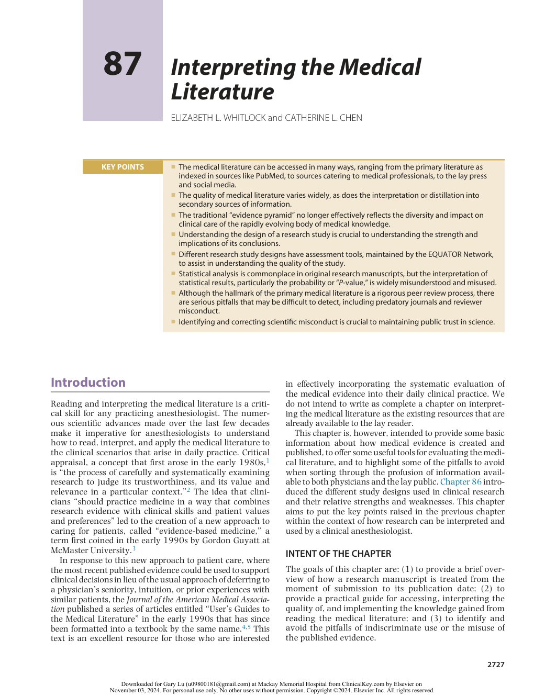
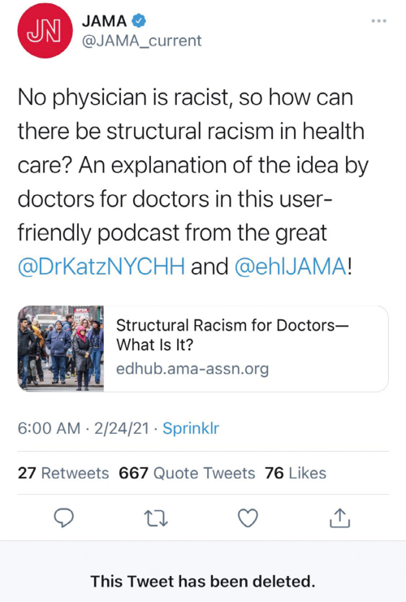
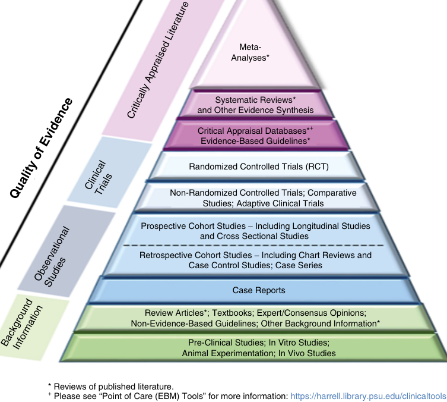
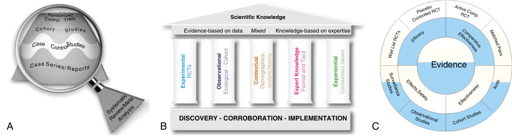
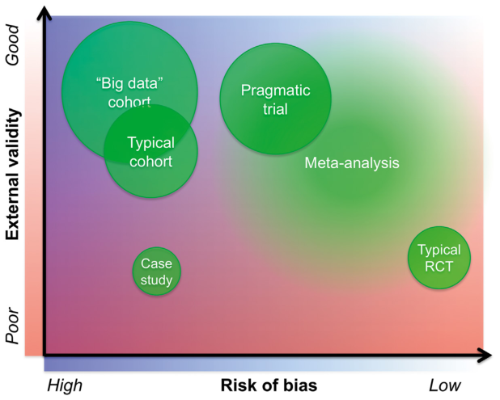
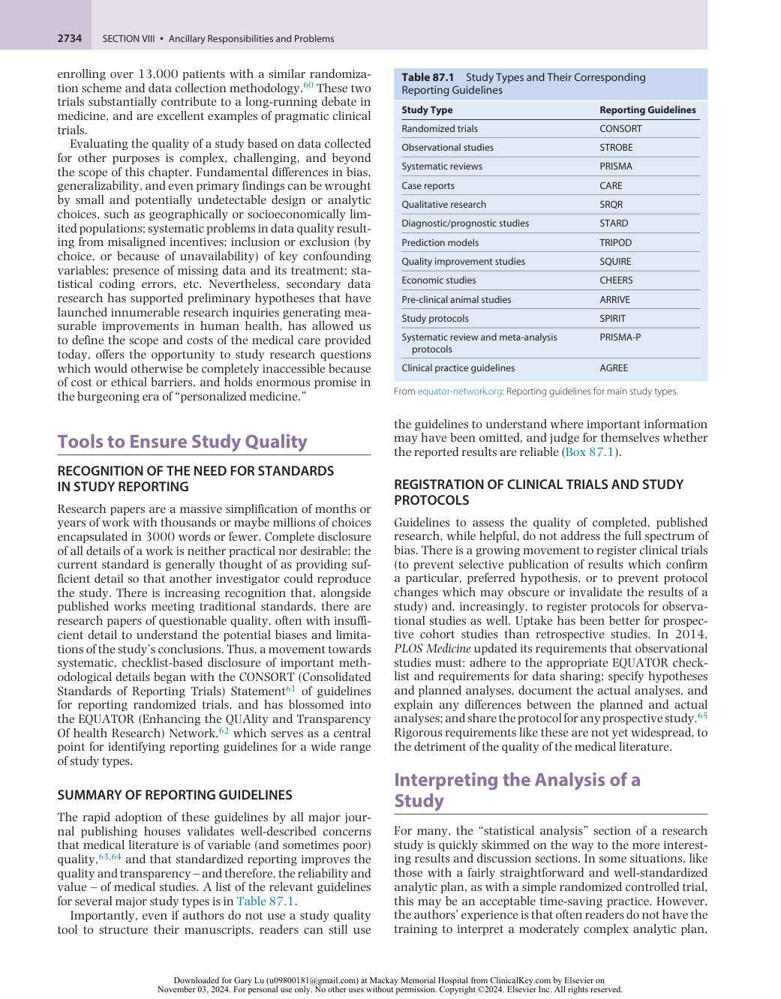
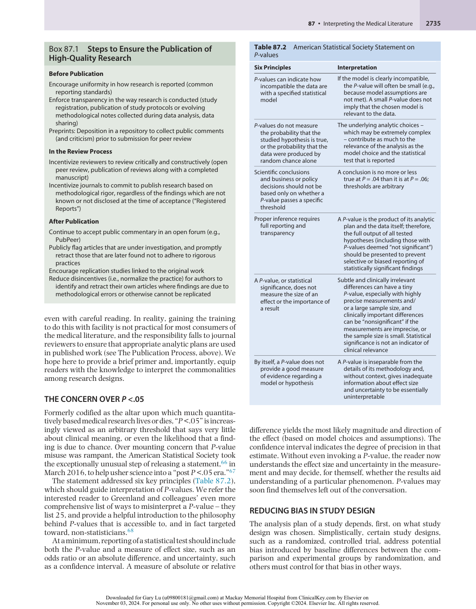
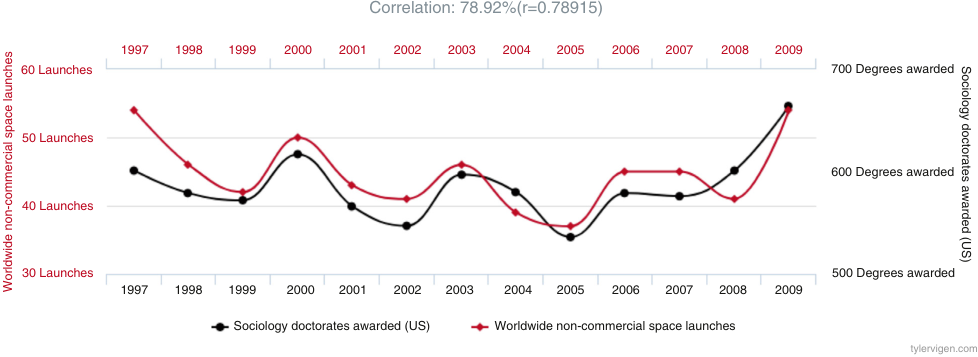

# Interpreting the Medical Literature

<!-- PDF page 1 -->

ELIZABETH L. WHITLOCK and CATHERINE L. CHEN

|**KEY POINTS**|ᑏThe medical literature can be accessed in many ways, ranging from the primary literature as indexed in sources like PubMed, to sources catering to medical professionals, to the lay press and social media.|
|---|---|
||ᑏThe quality of medical literature varies widely, as does the interpretation or distillation into secondary sources of information.|
||ᑏThe traditional “evidence pyramid” no longer effectively reflects the diversity and impact on clinical care of the rapidly evolving body of medical knowledge. ᑏUnderstanding the design of a research study is crucial to understanding the strength and implications of its conclusions. ᑏDifferent research study designs have assessment tools, maintained by the EQUATOR Network, to assist in understanding the quality of the study. ᑏStatistical analysis is commonplace in original research manuscripts, but the interpretation of statistical results, particularly the probability or “_P_- value,” is widely misunderstood and misused. ᑏAlthough the hallmark of the primary medical literature is a rigorous peer review process, there are serious pitfalls that may be difficult to detect, including predatory journals and reviewer misconduct. ᑏIdentifying and correcting scientific misconduct is crucial to maintaining public trust in science.|

## Introduction

Reading and interpreting the medical literature is a critical skill for any practicing anesthesiologist. The numerous scientific advances made over the last few decades make it imperative for anesthesiologists to understand how to read, interpret, and apply the medical literature to the clinical scenarios that arise in daily practice. Critical appraisal, a concept that first arose in the early 1980s,1 is “the process of carefully and systematically examining research to judge its trustworthiness, and its value and relevance in a particular context.”2 The idea that clinicians “should practice medicine in a way that combines research evidence with clinical skills and patient values and preferences” led to the creation of a new approach to caring for patients, called “evidence- based medicine,” a term first coined in the early 1990s by Gordon Guyatt at McMaster University.3

In response to this new approach to patient care, where the most recent published evidence could be used to support clinical decisions in lieu of the usual approach of deferring to a physician’s seniority, intuition, or prior experiences with similar patients, the _Journal of the American Medical Association_ published a series of articles entitled “User’s Guides to the Medical Literature” in the early 1990s that has since been formatted into a textbook by the same name.4,5 This text is an excellent resource for those who are interested

in effectively incorporating the systematic evaluation of the medical evidence into their daily clinical practice. We do not intend to write as complete a chapter on interpreting the medical literature as the existing resources that are already available to the lay reader.

This chapter is, however, intended to provide some basic information about how medical evidence is created and published, to offer some useful tools for evaluating the medical literature, and to highlight some of the pitfalls to avoid when sorting through the profusion of information available to both physicians and the lay public. Chapter 86 introduced the different study designs used in clinical research and their relative strengths and weaknesses. This chapter aims to put the key points raised in the previous chapter within the context of how research can be interpreted and used by a clinical anesthesiologist.

### INTENT OF THE CHAPTER

The goals of this chapter are: (1) to provide a brief overview of how a research manuscript is treated from the moment of submission to its publication date; (2) to provide a practical guide for accessing, interpreting the quality of, and implementing the knowledge gained from reading the medical literature; and (3) to identify and avoid the pitfalls of indiscriminate use or the misuse of the published evidence.

::: details 原始表格與符號（PDF 第 1 頁）

:::

<!-- PDF page 2 -->

## The Publication Process

### TYPES OF JOURNALS

With the advent of the Internet researchers and consumers of research have an overwhelming array of journals to consider for submitting and reading original work. A journal’s focus and target audience can vary. Some journals are known as general medical journals because they include work from many different fields within medicine. Examples include _The New England Journal of Medicine,_6 _Journal of the American Medical Association (JAMA),_7 _The BMJ (formerly known as the British Medical Journal),_8 and _Lancet_ .9 Most medical journals, however, focus on a particular medical specialty, or they may highlight specific topics such as research methods or health policy.

Journals can be accessed as printed and bound periodicals requiring an active print subscription, through a designated website offering a selection of free articles or articles requiring payment to view, or often by using a combination of the two delivery methods. The quality and reputation of journals can vary greatly: some require little to no peer review and an upfront payment in exchange for quick online publication of a manuscript of questionable quality (Misconduct in the Publication Process, below). Others maintain extremely high standards for manuscript acceptance and editorial review. Publication in a medical journal with an established history as a traditional print journal, even while it maintains a distinct web presence, is usually an indicator that a published manuscript has been subjected to peer review and represents a worthwhile contribution to the medical literature.

A number of professional societies in anesthesiology publish journals of peer- reviewed literature relevant to the field and include some of the most reputable journals within the field, such as the American Society of Anesthesiologists ( _Anesthesiology_ ),10 The Royal College of Anaesthetists/The College of Anaesthetists of Ireland/The Hong Kong College of Anaesthesiologists ( _British Journal of Anaesthesia),_11 the Canadian Anesthesiologists’ Society ( _Canadian Journal of Anaesthesia/ Journal Canadien d’Anesthésie_ )12 and the International Anesthesia Research Society ( _Anesthesia & Analgesia_ ).13

### TYPES OF JOURNAL ARTICLES

Although a journal’s priorities for content may vary, for the most part, journals publish similar types of articles. These article types can be grouped into the following broad categories: original research, review articles, brief reports or letters, case studies, and editorials.

**Original research** is the most familiar and most common type of article that gets published. Original research usually consists of a scientific manuscript that reports the full results from a research study and can represent any of the study designs that were described in Chapter 86.

**Review articles** summarize the existing scientific research on a given topic and are a good way for readers to quickly familiarize themselves with the current evidence within an area of research. Review articles are comprehensive, typically written by experts in the field, and are often solicited by the editors of a journal. The authors will usually

frame published research within the context of other contemporaneous works and the current and future directions of the research topic being reviewed.

**Brief reports and letters** provide concise research reports that address a timely issue or spur further research if published before a full original research manuscript has been submitted. Letters are also an opportunity for readers to submit arguments extending or rebutting articles that were previously published in that journal.

**Case studies** allow researchers or clinicians to share specific examples of unusual or unexpected clinical findings in a single patient that may be instructive to a broader readership. A case series is similar to a case study but describes similar clinical phenomena across multiple patients.

**Editorials** are essays that encompass the opinion of the author about a subject, usually of topical relevance, or highlight the important scientific contributions of an original research article that was published in the same journal issue. Like review articles, editorials are usually solicited by the journal editor, written by experts in the field, and provide important context with which to frame the original research article.

### THE PEER REVIEW PROCESS

The peer review process is an important component of publishing original research. Most respected journals, whether web- based or traditional print journals, will have a robust peer review process in place. Once an original research manuscript has been submitted by the authors, the journal editors will usually make a quick decision about whether the study topic is appropriate for their readership. Authors will either receive notification that their submission was rejected without review, or that the manuscript has been sent out for review to at least two other experts in the field. Reviewers are asked to rate various aspects of the manuscript, including its readability, novelty, methods, validity of results, and potential impact on the field. They will often provide constructive feedback to the authors on ways the study can be substantially improved. Reviewers will then make a recommendation to the journal editors whether the study should be accepted, revised and resubmitted, or rejected. The editors will consider the reviewers’ comments in making the final decision about the manuscript’s disposition.

Although different journals may have different terminology for these final decisions, in general, they fall into the following categories: accept as written, conditional acceptance (i.e., accept with minor revisions or accept with major revisions), revise and resubmit, or reject. Acceptance of a manuscript without any changes is extremely rare. Conditional acceptance, though frequently considered to be a positive outcome, is not a guarantee of acceptance. The editors still retain the right to reject the manuscript unless the manuscript’s authors have satisfactorily addressed any concerns that are deemed important enough to be raised in the outcome letter. More common is a decision to revise and resubmit. The editor may require substantial changes to the original manuscript and usually requests a new manuscript submission that clearly highlights within the text what changes have been made in response to the outcome letter.

<!-- PDF page 3 -->

Most of the time, the authors are also required to submit an accompanying document that responds to each of the points that may have been raised by the editor and reviewers during the peer review process. Finally, the editors can still decide to reject a manuscript after sending it out for review.

Once a manuscript has been through the peer review process and deemed acceptable for publication, the journal will then format the entire manuscript to fit the journal’s style. This usually includes recreating or reformatting the tables and figures that were submitted with the manuscript, as well as detailed copyediting for grammar, punctuation, and clarity. Proofs of the formatted article, which show how the article will appear when it is finally printed, are sent to the author for final approval. Simultaneously, the journal will select the print issue that will feature the accepted article and decide whether the manuscript would benefit from an accompanying editorial. Although print journals usually require a lead time of several months after an original article has been accepted before it is published, a journal will often set an earlier date for online publication, typically referred to as “e- pub ahead of print.” Expediting the dissemination of original research by publishing the work electronically on a journal’s website allows readers to obtain the earliest access to interesting and timely research.

Although reputable journals and authors depend on the integrity of the peer review process, the preceding paragraphs also highlight the significant latitude enjoyed by journal editors to determine which submissions will be sent out for peer review, and consequently, which manuscripts will ultimately be published.14 Editors of medical journals, including in the field of anesthesiology, have historically been predominantly white, male, and from high-income countries.15–19 In recent years, major journals have begun to recognize the impact of unconscious bias on peer review when editorial boards lack diverse representation among its members.20–23 The importance of editorial board composition came into sharp relief in the Spring of 2021 when _JAMA_ promoted a 16- minute podcast featuring two white male physicians – one a deputy editor at _JAMA_ and neither of whom were experts in structural racism – questioning whether structural racism could even exist in medicine (Fig. 87.1), thus confirming the tacit understanding that, up until that point, research on the impact of structural racism on health outcomes had been viewed unfavorably at _JAMA_ .24–26 This high- profile example demonstrates the scholarly gatekeeping that can occur when diverse voices are not represented on editorial boards.25 It also highlights the importance of acknowledging that aversive racism is prevalent even at the highest levels of academic medicine, including among journal editors and editorial board members.26 Encouragingly, many journals have taken important steps to diversify their editorial board rosters and revise publication guidelines to formally combat structural racism within medical publishing.22,23,27–29 Despite these efforts, we must recognize that bias can manifest at all stages of the peer review process, thereby presenting an ongoing challenge for journal editorial boards to maintain both impartiality and scientific rigor when manuscripts are evaluated for publication.30

**Fig. 87.1 Deleted tweet from @JAMA_current.** Lack of diverse representation on journal editorial boards is another manifestation of structural racism in medicine, highlighted by this deleted tweet promoting the now infamous podcast that questioned whether structural racism exists in health care. Since this incident, many journals have taken steps to diversify their editorial boards and acknowledge the need to combat structural racism in medical publishing.

## Accessing the Medical Literature

### PRIMARY LITERATURE

In the past, physicians needed to have a journal subscription or access to a medical library to read published articles. In the academic setting, it was very common for attending physicians to photocopy important articles and distribute them to their trainees. As in so many other arenas, access to research articles has been transformed with the arrival of the Internet, and most articles are now easily accessible online, either directly through the journal’s website, or through indexed search engines. Primary literature refers to these original research articles that are authored by the researchers who performed the study and published in peerreviewed journals.31

Most readers are probably familiar with PubMed,32 a free resource maintained by the National Center for Biotechnology Information33 at the US National Library of Medicine,34 which is located at the National Institutes of Health.35 PubMed provides access to MEDLINE,36 an online database that catalogues more than 29 million references to biomedical journal

<!-- PDF page 4 -->

articles. The database includes medical literature published from 1966 to the present day, with citations from more than 5200 journals in approximately 40 languages worldwide, with new articles added daily. Search results include a list of article citations with links to the electronic full- text article if available. Although PubMed is most frequently used to access the primary literature, this resource is useful for accessing the secondary literature as well, which is described in the following section. Searching PubMed is free of charge, and many articles are available for viewing without a subscription or an academic institutional affiliation, including through the archival of full- text articles in PubMed Central. PubMed provides various mechanisms to access articles that are not freely available on the Internet, although fees may apply.

### SECONDARY LITERATURE

In addition to primary sources, physicians may rely on other resources to remain informed about recent advances in their field. The term **secondary literature** is used to refer to written summaries of the primary literature that help synthesize or evaluate primary sources for the purpose of dissemination and incorporation of evidence- based medicine into practice.31 These articles will summarize the primary literature to varying degrees and with variable quality depending on their purpose. Systematic reviews and meta- analyses are, in and of themselves, valued as high- quality research and important contributions to the medical literature. For example, the _Cochrane Database of Systematic Reviews_37 is a well- known and highly regarded resource for systematic reviews in health care. Readers should be aware, however, that narrative reviews differ from systematic reviews in that they are not obliged to provide unbiased information reflecting the totality of available knowledge. Narrative reviews can be useful and an efficient source of information–particularly when written by authors who might be expected to have an expert command of the available literature–but fundamentally differ from systematic reviews because they are not as rigorous or comprehensive in their approach to manuscript selection, which must be considered in their interpretation. Types of reviews and meta- analysis are further discussed in Chapter 86.

**Clinical practice guidelines** fall into the category of secondary literature as well. These are typically written by professional groups or government agencies to help guide clinician decision- making and will often indicate the level of evidence supporting the practice recommendations that are being made. Other more filtered – yet still evidence- based – distillations of the existing research exist to facilitate clinical decision- making by practicing clinicians at the bedside. Examples of the latter include websites like UptoDate38 and WebMD.39

### TRADITIONAL AND SOCIAL MEDIA

Finally, the medical literature can be indirectly accessed via both traditional and social media. Traditional media may include press releases issued by the author’s institution or coordinated by the print journal to maximize the impact and newsworthiness of an important scientific advance. These press releases can often lead to articles in leading newspapers or newsmagazines that refer to the original article if they are considered of interest to the general public. However, traditional media can also inadvertently or

deliberately present an inaccurate or sensationalized version of the article’s conclusions, potentially not tempered by the study’s limitations. Media reports of peer- reviewed articles are not necessarily written in collaboration with the authors of the article, and even though quotations may be excerpted from press releases and other sources, conclusions can be misrepresented. If a layperson’s interpretation of a scientific finding is to be used for clinical practice, the validity of the conclusions presented must be verified against the original article itself.

Many scientists and physicians are now keeping current with the latest evidence via social media sites such as X (formerly known as Twitter)40 and Facebook41 or individual blogs, where leading scientists, researchers, and clinicians can link to original articles and provide their own spin or commentary on the relative merits or shortcomings of the most recently published research. Other less reliable, but easily accessible, resources include crowd- sourced websites such as Wikipedia.42 However, the quality of the information presented on individual blogs or crowd- sourced sites depends significantly on the credentials of the individuals contributing to the website. Although the democratization of the medical literature has accelerated the dissemination of new research to both scientific audiences and to the public, it is still important for individual clinicians to understand how to approach the literature independently to separate the propaganda surrounding the latest research from the actual strengths and weaknesses of the study itself.

### PREPRINTS

The coronavirus disease 2019 (COVID- 19) pandemic has highlighted a newer and rapidly evolving alternative pathway for dissemination of research results without peer review: preprints.43,44 Originally promoted as a method to obtain public pre- publication feedback on a research project, preprint servers such as arXiv (est. August 1991) and medRxiv (est. June 2019) existed long before the pandemic began.45–47 However, the extreme public interest in rapid dissemination of discoveries about how best to prevent and treat disease caused by the novel severe acute respiratory syndrome coronavirus 2 (SARS- CoV- 2) also positioned preprints as a strategy to circumvent the temporal delays imposed by a rigorous peer review process. Though medRxiv has a banner on its home page that preprints “should not be relied on to guide clinical practice or health- related behavior and should not be reported in news media as established information,” predictably, findings described in preprints rapidly moved from the scientific literature into the public sphere, often without appropriate caveats.46,48,49 In an article published on February 19, 2020 – less than 2 months after the initial report of SARS- CoV- 2- associated illnesses in China – Reuters documented that 153 studies of COVID- 19 had been published, of which 92 were preprints which had not undergone peer review. One paper, which claimed to identify “uncanny similarity” between SARS- CoV- 2 and the human immunodeficiency virus, had been shared over 16,000 times on X and covered by 25 news outlets after being posted on bioRxiv on January 31, 2020; it was swiftly retracted on February 2, 2020 for, in the words of one scientist, “contributing to the conspiracy theories and fear surrounding this outbreak.”50 One might argue that, in this case, the pre- publication feedback was helpful to the authors, who withdrew the work “to

<!-- PDF page 5 -->

revise it in response to comments received from the research community,” but the adverse impact of rapid publication, rapid publicization, and subsequent withdrawal of scientifically unsound manuscripts on public trust in science is difficult to characterize.51 While the promise of preprint publication for scientific feedback is actively evolving, these early COVID- 19 vignettes vividly demonstrate the importance of quality control imposed by vigorous peer review.52

## Assessing the Methodology of a Study

Understanding how and why a study was done is essential to understanding how its findings fit in with the progress of medical science. The quality of clinical research is highly dependent on many design choices which occurred long before recruitment of the first patient, or collection of the first data record, and a familiarity with clinical research methodology will help all medical professionals critically evaluate the applicability of published findings to their own practice decisions.

As a first pass, it is easiest to separate research designs into two bins: observational and interventional. Within those designations are subcategories and variants with important implications for study quality. Furthermore, some studies such as

meta- analyses incorporate aspects of both. Contrary to older notions of research interpretation, a randomized trial does not always produce better evidence than an observational (cohort) study, and a meta- analysis – far from being the “pinnacle” – is only as good as the evidence on which it rests.

### THE “EVIDENCE PYRAMID” AND ITS EVOLUTION

Historically, those interested in evaluating study quality have been referred to an “evidence pyramid,” where each step up the pyramid represents a step closer to truth (or quality, or best evidence) (Fig. 87.2).53

This pyramid produces a striking visual representation emphasizing the weaknesses – and relative abundance – of expert opinion and observational case studies, the importance of randomized controlled experimental trials, and the primacy of more recently developed summative methods, including systematic reviews and meta- analyses, which comprise the apex of evidentiary quality. But this is overly simplistic in today’s world of complex patients with multiple intersecting conditions: the pyramid, with its unlabeled y- axis which may be thought of as “risk of bias” or “internal validity,” rather than a progress toward “truth,” is due for modification.54

Two attempts to refine this pyramid are shown in Fig. 87.3A,B. Fig. 87.3A highlights the variability in quality

### Hierarchy of Clinical Evidence

Meta- Analyses* Systematic Reviews* and Other Evidence Synthesis Critical Appraisal Databases* + Evidence-Based Guidelines* Randomized Controlled Trials (RCT) Non-Randomized Controlled Trials; Comparative Studies; Adaptive Clinical Trials Prospective Cohort Studies − Including Longitudinal Studies and Cross Sectional Studies Retrospective Cohort Studies − Including Chart Reviews and Case Control Studies; Case Series Case Reports Review Articles*; Textbooks; Expert/Consensus Opinions; Non-Evidence-Based Guidelines; Other Background Information* Pre-Clinical Studies; In Vitro Studies; Animal Experimentation; In Vivo Studies * Reviews of published literature. + Please see “Point of Care (EBM) Tools” for more information: https://harrell.library.psu.edu/clinicaltools Clinical Trials Observational Studies BackgroundInformation Quality of Evidence Critically Appraised Literature 

**Fig. 87.2 The Evidence Pyramid.** _EBM_ , evidence- based medicine. (Adapted from Long BA: Hierarchy of Clinical Evidence Pyramid. 3rd ed. Hershey, PA: Pennsylvania State University College of Medicine, 2022.)

<!-- PDF page 6 -->

Scientific Knowledge Evidence-based on data Mixed Knowledge-based on expertise Evidence DISCOVERY - CORROBORATION - IMPLEMENTATION A B C Control Trails ObservationalStudies Cohort Studies Effects,Safety SystematicReview/MetaAnalysis Effectiveness StudiesSurveillance RCTs Experimental Observational Ecological - Cohort Contextual Demographics, system,history Expert Knowledge Formal and Tacit Experiential Consumers,carers 

**Fig. 87.3** Proposed refinements of the “Evidence Pyramid,” reflecting the lack of consensus in the scientific community about how to visually encapsulate the relationships among methods of generating evidence. (A) A refinement proposed by Murad and colleagues. (B) The Greek Temple model. (C) Circle of Methods.56 (A, Redrawn from Murad MH, Asi N, Alsawas M, Alahdab F. New evidence pyramid. _Evid Based Med_ . 2016;21(4):125–127. B, Redrawn from SalvadorCarulla L, Lukersmith S, Sullivan W. From the EBM pyramid to the Greek temple: a new conceptual approach to guidelines as implementation tools in mental health. _Epidemiol Psychiatr Sci_ . 2017;26(2):105–114. C, Redrawn from Tugwell P, Knottnerus JA. Is the evidence pyramid now dead? _J Clin Epidemiol_ . 2015;68(11):1247–1250.)

within a single type of study design, and the dependence of summative methods like systematic reviews upon the quality of existing evidence,54 whereas Fig. 87.3B avoids the appearance of a hierarchy altogether, emphasizing that data derived from different methods is necessary to provide a strong foundation for scientific knowledge.55 Another graphical reconceptualization of the way scientific evidence is generated was proposed by Walach and colleagues in 2006 (Fig. 87.3C), and recently updated toward a “matrix” concept: their “Circle of Methods” provides a more granular categorization that differentiates between efficacy and effectiveness, a crucial concept in the evolution of medical knowledge toward changing care for broad populations of patients.56

Perhaps the issue is that no single graphic can capture the unique strengths and limitations of the common experimental designs upon which the advancement of medical science relies. The perfect study would have no bias and a high level of external validity, reflecting some scientific truth that is universally applicable. This is probably impossible to do. Instead, when choosing among different clinical research designs, researchers are faced with many trade- offs between internal and external validity, feasibility (including costs), and risk of bias (Fig. 87.4).

### BASIC RESEARCH DESIGNS

Trade- offs between observational and interventional designs are discussed more fully in Chapter 86. Briefly, traditional observational studies include cohort studies, case–control studies, and cross- sectional studies, which are unified by their noninterventional nature. This results in risk of bias, which can be mitigated (but not eliminated) by sensible experimental design and analytic choices. Interventional trials are the most used method of generating data to demonstrate causal relationships. While observational studies are subject to confounding by observed or unobserved variables, trials take variable advantage of features meant to minimize bias: use of controls, randomization, and blinding. Understanding the implications of experimental design choices in these three areas, which are discussed in Chapter 86, underpins the assessment of trial quality.

As mentioned earlier in this chapter, summative studies like systematic reviews and meta- analyses offer another method of objectively summarizing available evidence and are discussed further in Chapter 86. Just like a summary of

medical evidence presented on a layperson’s news website must be approached with caution, a summary of evidence via meta- analysis or systematic review nonetheless glosses over what may be important differences in the quality and methodology of the underlying studies, and is highly reliant on the skill and thoroughness of its authors.57 Far from being an easy way to understand “scientific truth” in the literature, summative methods of generating evidence hold as many pitfalls as their underlying trials. However, in skilled hands and with the right underlying materials, systematic reviews and meta- analyses can provide important evidence which could not feasibly be generated any other way.

### BIG DATA AND PRAGMATIC CLINICAL TRIALS

“Big data” studies have a unique and evolving place in the continuum of evidence. With the advent and widespread adoption of electronic medical records, enormous quantities of data are recorded every day during the routine provision of clinical care. This has led to two major evolutions in clinical research: the large secondary data cohort study and its interventional correlate, the pragmatic clinical trial.

Traditionally, data collection decisions for prospective cohort studies were based on the research query itself: for example, a study of lung function over time would obtain annual formal pulmonary function tests. All of the anticipated necessary variables would be collected: height, weight, pulmonary function test results, chest X- rays, medication lists, exercise habits, dust mite exposure, and a detailed tobacco use history. From those variables, a (potentially extensive) list of confounding variables would be selected and, in mathematical modeling, accounted for, thus producing an estimate of the “independent effect” of the primary predictor, for example, air pollution exposure on the outcome of lung function.

Collecting extensive data is expensive, though, and requires time and resources. What if dust mite exposure and exercise habits aren’t hypothesized to be particularly important – could those be eliminated? What if, for no cost and only the time of an analyst to extract the data from an electronic medical record, we could use current tobacco use as a surrogate for a thorough tobacco use history, instead of hiring a clinical research nurse to collect the information? And if we felt that the height, weight, pulmonary function tests, and smoking history collected in the course of normal clinical care would

<!-- PDF page 7 -->

**Fig. 87.4** The relationships between sample size (often implying higher costs), external validity, and risk of bias produces trade- offs in study design. Here, bubble size is proportional to the typical number of participants in a particular type of study (larger bubble indicates more participants).

be of sufficient quality, perhaps we could estimate air pollution exposure levels based on proximity to major roads – and, by eliminating the need to directly collect any specific data on our population, expand our population target to all those with valid values of these variables in our electronic medical records system? Thus, the “big data” study is born.

A more generic term for “big data” is “secondary data”: data collected for purposes other than the study of a researcher’s intended question. There are important fundamental differences between a traditional cohort study and the approach described here. Inherent in the compromise is a move from detailed and specific characterization of each participant to a more diffused idea of individual participant characteristics, and a move from a small (and likely specific) population, compromising external validity, to large and generalizable. Some phenomena simply cannot be studied any other way because they involve a subtle effect or rare outcome requiring large populations to show an association that exceeds our currently acceptable margins of uncertainty in strength – hence the term “big data.” Some phenomena are particularly suited to study using this approach, because (acceptably) high- fidelity data are collected in the course of routine clinical care. One such example might be studies of association between postoperative respiratory adverse events and intraoperative mechanical ventilation parameters. Studies on the epidemiology of medical care, or its financial costs, are highly dependent on the availability and quality of secondary data.

The data collection infrastructure that supports the provision of daily medical care can also be used to support largescale pragmatic clinical trials. Although the philosophy of a pragmatic trial was described before the widespread implementation of electronic medical records,58 they have been greatly facilitated by the increase in availability of secondary data. In contrast to the typical randomized controlled trial, a pragmatic trial seeks to avoid restrictive inclusion criteria and highly protocolized care, more closely recapitulating

the way medical care is provided to individual patients. They are typically categorized as effectiveness, rather than efficacy, trials. This means that findings may have excellent external validity (applicability to a broad population of patients and settings). But since the lack of protocolization may introduce random or non-random variability in care, these trials are typically very large: thousands or tens of thousands of participants. Pragmatic trials may also be more vulnerable to risk of bias than traditional randomized trials, since it may not be practical or possible to blind clinicians and/or participants, in addition to challenges introduced by using secondary data (described earlier).

One recent pragmatic trial example relevant to anesthesiology is the SMART trial, published in the _New England Journal of Medicine_ ( _NEJM_ ), which randomized 15,802 critically ill patients to receive normal saline (0.9% sodium chloride) or a balanced salt solution.59 The pragmatic innovations in this trial included: a cluster- randomized design, where the intensive care unit (ICU) in which care was provided determined which solution the patient received (instead of individual randomization, which introduces additional protocol adherence challenges); using the electronic medical record to prompt ordering providers to consider relative contraindications and, if none were present, follow the protocol (rather than having study interventions delivered only by study personnel); and outcome and adjustment variable collection by the electronic medical record (i.e., use of secondary data). Importantly, both interventions (the use of saline versus a balanced solution when intravenous crystalloid solution is required) are standard of care; therefore, the requirement for informed participant consent was waived. The target sample size was achieved in fewer than 2 years of enrollment, with less than 1 year between completion of enrollment and publication. Concurrently, a second complementary trial – of saline versus balanced crystalloid in noncritically ill adults receiving intravenous fluids in the emergency department (SALT- ED trial) – was also run,

<!-- PDF page 8 -->

enrolling over 13,000 patients with a similar randomization scheme and data collection methodology.60 These two trials substantially contribute to a long- running debate in medicine, and are excellent examples of pragmatic clinical trials. Evaluating the quality of a study based on data collected for other purposes is complex, challenging, and beyond the scope of this chapter. Fundamental differences in bias, generalizability, and even primary findings can be wrought by small and potentially undetectable design or analytic choices, such as geographically or socioeconomically limited populations; systematic problems in data quality resulting from misaligned incentives; inclusion or exclusion (by choice, or because of unavailability) of key confounding variables; presence of missing data and its treatment; statistical coding errors, etc. Nevertheless, secondary data research has supported preliminary hypotheses that have launched innumerable research inquiries generating measurable improvements in human health, has allowed us to define the scope and costs of the medical care provided today, offers the opportunity to study research questions which would otherwise be completely inaccessible because of cost or ethical barriers, and holds enormous promise in the burgeoning era of “personalized medicine.”

## Tools to Ensure Study Quality

### RECOGNITION OF THE NEED FOR STANDARDS IN STUDY REPORTING

Research papers are a massive simplification of months or years of work with thousands or maybe millions of choices encapsulated in 3000 words or fewer. Complete disclosure of all details of a work is neither practical nor desirable; the current standard is generally thought of as providing sufficient detail so that another investigator could reproduce the study. There is increasing recognition that, alongside published works meeting traditional standards, there are research papers of questionable quality, often with insufficient detail to understand the potential biases and limitations of the study’s conclusions. Thus, a movement towards systematic, checklist- based disclosure of important methodological details began with the CONSORT (Consolidated Standards of Reporting Trials) Statement61 of guidelines for reporting randomized trials, and has blossomed into the EQUATOR (Enhancing the QUAlity and Transparency Of health Research) Network,62 which serves as a central point for identifying reporting guidelines for a wide range of study types.

### SUMMARY OF REPORTING GUIDELINES

The rapid adoption of these guidelines by all major journal publishing houses validates well- described concerns that medical literature is of variable (and sometimes poor) quality,63,64 and that standardized reporting improves the quality and transparency – and therefore, the reliability and value – of medical studies. A list of the relevant guidelines for several major study types is in Table 87.1.

Importantly, even if authors do not use a study quality tool to structure their manuscripts, readers can still use

**Table 87.1** Study Types and Their Corresponding Reporting Guidelines

|**Study Type**|**Reporting Guidelines**|
|---|---|
|Randomized trials|CONSORT|
|Observational studies|STROBE|
|Systematic reviews|PRISMA|
|Case reports|CARE|
|Qualitative research|SRQR|
|Diagnostic/prognostic studies|STARD|
|Prediction models|TRIPOD|
|Quality improvement studies|SQUIRE|
|Economic studies|CHEERS|
|Pre- clinical animal studies|ARRIVE|
|Study protocols|SPIRIT|
|Systematic review and meta- analysis protocols|PRISMA- P|
|Clinical practice guidelines|AGREE|

From equator- network.org: Reporting guidelines for main study types.

the guidelines to understand where important information may have been omitted, and judge for themselves whether the reported results are reliable (Box 87.1).

### REGISTRATION OF CLINICAL TRIALS AND STUDY PROTOCOLS

Guidelines to assess the quality of completed, published research, while helpful, do not address the full spectrum of bias. There is a growing movement to register clinical trials (to prevent selective publication of results which confirm a particular, preferred hypothesis, or to prevent protocol changes which may obscure or invalidate the results of a study) and, increasingly, to register protocols for observational studies as well. Uptake has been better for prospective cohort studies than retrospective studies. In 2014, _PLOS Medicine_ updated its requirements that observational studies must: adhere to the appropriate EQUATOR checklist and requirements for data sharing; specify hypotheses and planned analyses, document the actual analyses, and explain any differences between the planned and actual analyses; and share the protocol for any prospective study.65 Rigorous requirements like these are not yet widespread, to the detriment of the quality of the medical literature.

## Interpreting the Analysis of a Study

For many, the “statistical analysis” section of a research study is quickly skimmed on the way to the more interesting results and discussion sections. In some situations, like those with a fairly straightforward and well- standardized analytic plan, as with a simple randomized controlled trial, this may be an acceptable time- saving practice. However, the authors’ experience is that often readers do not have the training to interpret a moderately complex analytic plan,

::: details 原始表格與符號（PDF 第 8 頁）

:::

<!-- PDF page 9 -->

### Box 87.1 Steps to Ensure the Publication of High- Quality Research

### Before Publication

|Encourage uniformity in how research is reported (common reporting standards)|
|---|
|Enforce transparency in the way research is conducted (study registration, publication of study protocols or evolving methodological notes collected during data analysis, data sharing)|
|Preprints: Deposition in a repository to collect public comments (and criticism) prior to submission for peer review|

### In the Review Process

|Incentivize reviewers to review critically and constructively (open peer review, publication of reviews along with a completed manuscript)|
|---|
|Incentivize journals to commit to publish research based on methodological rigor, regardless of the findings which are not known or not disclosed at the time of acceptance (“Registered Reports”)|
|**After Publication** Continue to accept public commentary in an open forum (e.g., PubPeer)|
|Publicly flag articles that are under investigation, and promptly retract those that are later found not to adhere to rigorous practices|
|Encourage replication studies linked to the original work|
|Reduce disincentives (i.e., normalize the practice) for authors to identify and retract their own articles where findings are due to methodological errors or otherwise cannot be replicated|

even with careful reading. In reality, gaining the training to do this with facility is not practical for most consumers of the medical literature, and the responsibility falls to journal reviewers to ensure that appropriate analytic plans are used in published work (see The Publication Process, above). We hope here to provide a brief primer and, importantly, equip readers with the knowledge to interpret the commonalities among research designs.

### THE CONCERN OVER P &lt;.05

Formerly codified as the altar upon which much quantitatively based medical research lives or dies, “ _P_ &lt;.05” is increasingly viewed as an arbitrary threshold that says very little about clinical meaning, or even the likelihood that a finding is due to chance. Over mounting concern that _P_ - value misuse was rampant, the American Statistical Society took the exceptionally unusual step of releasing a statement,66 in March 2016, to help usher science into a “post _P_ &lt;.05 era.”67

The statement addressed six key principles (Table 87.2), which should guide interpretation of _P_ - values. We refer the interested reader to Greenland and colleagues’ even more comprehensive list of ways to misinterpret a _P_ - value – they list 25, and provide a helpful introduction to the philosophy behind _P_ - values that is accessible to, and in fact targeted toward, non- statisticians.68

At a minimum, reporting of a statistical test should include both the _P_ - value and a measure of effect size, such as an odds ratio or an absolute difference, and uncertainty, such as a confidence interval. A measure of absolute or relative

### Table 87.2 American Statistical Society Statement on P - values

|**Six Principles**|**Interpretation**|
|---|---|
|_P_- values can indicate how incompatible the data are with a specified statistical model|If the model is clearly incompatible, the_P_- value will often be small (e.g., because model assumptions are not met). A small_P_- value does not imply that the chosen model is relevant to the data.|
|_P_- values do not measure the probability that the studied hypothesis is true, or the probability that the data were produced by random chance alone|The underlying analytic choices – which may be extremely complex – contribute as much to the relevance of the analysis as the model choice and the statistical test that is reported|
|Scientific conclusions and business or policy decisions should not be based only on whether a _P_- value passes a specific threshold|A conclusion is no more or less true at_P_= .04 than it is at_P_= .06; thresholds are arbitrary|
|Proper inference requires full reporting and transparency|A_P_- value is the product of its analytic plan and the data itself; therefore, the full output of all tested hypotheses (including those with _P_- values deemed “not significant”) should be presented to prevent selective or biased reporting of statistically significant findings|
|A_P_- value, or statistical significance, does not measure the size of an effect or the importance of a result|Subtle and clinically irrelevant differences can have a tiny _P_- value, especially with highly precise measurements and/ or a large sample size, and clinically important differences can be “nonsignificant” if the measurements are imprecise, or the sample size is small. Statistical significance is not an indicator of clinical relevance|
|By itself, a_P_- value does not provide a good measure of evidence regarding a model or hypothesis|A_P_- value is inseparable from the details of its methodology and, without context, gives inadequate information about effect size and uncertainty to be essentially uninterpretable|

difference yields the most likely magnitude and direction of the effect (based on model choices and assumptions). The confidence interval indicates the degree of precision in that estimate. Without even invoking a _P_ - value, the reader now understands the effect size and uncertainty in the measurement and may decide, for themself, whether the results aid understanding of a particular phenomenon. _P_ - values may soon find themselves left out of the conversation.

### REDUCING BIAS IN STUDY DESIGN

The analysis plan of a study depends, first, on what study design was chosen. Simplistically, certain study designs, such as a randomized, controlled trial, address potential bias introduced by baseline differences between the comparison and experimental groups by randomization, and others must control for that bias in other ways.

::: details 原始表格與符號（PDF 第 9 頁）

:::

<!-- PDF page 10 -->

Discussed more thoroughly elsewhere in this book (see Chapter 86), randomization is a process used by prospective trials to attempt to control for bias between two or more comparison groups. In its ideal application, it results in balance between measured and unmeasured factors between the groups, such that the only difference is the receipt, or nonreceipt, of the treatment of interest. Randomization is the only design that is capable of definitively addressing unmeasured confounders, explaining why randomized controls are regarded as a high standard of evidence.

Randomization is not perfect, though. By its very nature, it is possible that certain covariates will (randomly) not be well balanced between the groups. Imbalance in measured covariates can also imply unmeasurable imbalance in those covariates which are unknown. This tends to be a bigger problem in small trials, where a small sample size is left unable to compensate for random variation. One potential option is to perform stratified randomization _,_ where trial participants are first stratified by an important clinical predictor (e.g., smoking status), and then randomized to ensure that the groups are balanced on smoking status. If a “treatment” or characteristic cannot be randomly assigned (for example, childhood socioeconomic status) a researcher could design a matched study, where each participant is matched to another who differs on receipt or nonreceipt of the treatment but is otherwise similar, such as close in age, same gender, similar medical comorbidities. This method of balancing two groups is used in matched cohort studies and in propensity matching (whereby a probability of receiving a certain treatment is calculated, and participants with similar probability of treatment are matched according to whether they were or were not treated). The drawback is that even perfect balance of measured confounders does not ensure perfect balance of unmeasured confounders, which can be a serious source of bias.

A growing roster of increasingly complex statistical methods can be used to adjust for the individual influence

of measured confounders mathematically, ultimately producing an estimate of an effect size adjusted for those measured confounders. Like any other statistical method, there are a litany of assumptions – some obvious, and some subtle – which must be satisfied for a model to produce accurate results. Like matching, however, adjustment cannot address unmeasured confounders, and there is an additional layer of complexity in that the modeling choices made by the researchers (e.g., which variables to include, and the strategy of building a model), which are rarely discussed in a manuscript, can have profound impact on the effect size estimate, the presence of “statistical significance,” and even the direction of the purported effect.

The fundamental difference between randomization and other ways of avoiding bias is the theoretical possibility to adjust for unmeasured confounders. For this reason, observational studies, which are typically limited to matching or mathematical adjustment, rarely produce strong evidence of causation. Rather, they can demonstrate an association, or a correlation (i.e., that an outcome is more frequent after a certain treatment) but cannot prove that the outcome is caused by that treatment. This has a major impact on the language which can (or should) be used to describe the findings, and unfortunately, studies demonstrating correlation often find that the “translation” by popular media conflates correlation and causation.

### CORRELATION VERSUS CAUSATION

More humorously, an entire website dedicated to the notion that correlation does not imply causation has identified mathematically implausible links between, for example, the number of non- commercial space launches and sociology doctorates awarded in the United States (Fig. 87.5).69 The absurdness of this website serves to emphasize the importance of understanding when causal language is appropriate, and when relationships are only observed as

### Worldwide non-commercial space launches

correlates with Sociology doctorates awarded (US)

Correlation: 78.92%(r=0.78915) 1997 1998 1999 2000 2001 2002 2003 2004 2005 2006 2007 2008 2009 60 Launches 700 Degrees awarded 50 Launches 600 Degrees awarded 40 Launches 30 Launches 500 Degrees awarded 1997 1998 1999 2000 2001 2002 2003 2004 2005 2006 2007 2008 2009 Sociology doctorates awarded (US) Worldwide non-commercial space launches tylervigen.com Sociology doctorates awarded (US) Worldwide non-commercial space launches 

Data sources: Federal Aviation Administration and National Science Foundation

**<mark>Fig. 87.5 A strong, but spurious, correlation.</mark>**69 <mark>(From Vigen T.</mark> _<mark>Spurious Correlations</mark>_ <mark>. New York: Hachette Books; 2015.)</mark>

<!-- PDF page 11 -->

associations. Furthermore, the underlying mechanism generating these correlations is that of multiple comparisons: the author uses publicly available data sources, along with a computer- based data mining algorithm, to test millions of correlations and identify the ones that are “statistically significant.” The parallels between his methodology and that of unscrupulous, _P_ - value- focused researchers are, unfortunately, clear.

### DATA- DRIVEN ANALYTIC METHODS

The backbone of medical research is the hypothesisdriven study of medical outcomes. Understanding medical research methods and the underlying hypothesis allows us to determine which published work is hypothesisdriven, and which is not (often disparagingly referred to as “data dredging”). However, an emerging discipline of data- driven analytics, rooted in computer science rather than traditional epidemiology or medicine, is increasingly showing promise as a way to manage and glean insights from the enormous volumes of data that are collected through clinical work. Many of the analytic approaches look for patterns in data, without regard to known clinical hypotheses or physiologically probable correlations. Traditional statistical concerns, like power, adjustment for multiple comparisons, non-random missing or erroneous data, and selective pursuit of “statistically promising” correlations, are difficult to frame in the context of this emerging methodology.

Artificial intelligence (AI), machine learning, and deep learning all refer to methods of data- driven analysis incorporating a learning algorithm: computer algorithms that change based on the data they receive.70 The inherent complexity of these methods, and the “learning” – by which an algorithm changes over time from how it was initially programmed to an evolution based on received data – makes it extremely difficult to critically evaluate the quality of research that uses these analytic techniques. Usual parameters, such as _P_ - values, confidence intervals, and point estimates may no longer apply. Metrics for understanding traditional “research quality” fail, but as these techniques increasingly gain acceptance, anesthesiology must continue to evolve its understanding of what data- driven methods may offer.

## The Dark Side of the Medical Literature

In 2005, John Ioannidis published a seminal paper succinctly and provocatively titled, “Why Most Published Research Findings Are False,”71 which helped spur the explosion of initiatives to improve the quality of research publications detailed above (see Tools to Ensure Study Quality). Two decades later, how have we done? A study attempting to replicate 100 high- profile research papers published in 2008 from three psychology journals depressingly concluded that only 39% could be replicated.72 There is no reason to suspect disciplines other than psychology are not equally affected. Dr. Ioannidis’s thesis holds: most published research findings are, apparently, false.71

### INCENTIVES TO PUBLISH POOR- QUALITY RESEARCH

### For Researchers

The incentives for researchers seem obvious. High academic productivity (i.e., publication) is explicitly or implicitly expected as a condition for ongoing funding, promotion, tenure, and compensation. Assuming that poor- quality research is not recognized as poor (for reasons of deliberate or unconscious exclusion of results that do not fit a hypothesis, undisclosed or unrecognized bias, successfully disguised research fraud, and so on), the number of publications, and the quality of the journals in which they are published, provide a quick way to decide whether a researcher is an expert or a dilettante.

But beyond academic prestige, some countries explicitly award cash bonuses for high- profile publications in journals such as _Science_73 and _Nature_ .74 Availability of a government- initiated cash reward for successful publication is associated with a 46% increase in submissions to _Science_ , although the authors of the study infer that, because of lower acceptance rates, cash incentives also encourage the submission of lower- quality research.75 A recent survey of the monetary reward system in China revealed the magnitude of these potential rewards: cash incentives for publication in the most prestigious journals can be up to 20 times the annual salary of a university professor.76

Another incentive has to do with the conclusions of the research itself, and the likelihood of publication. Strong and surprising associations tend to be easier to publish in top journals, while subtle, or unsurprising, or complex/interdependent findings are more likely to be relegated to a small journal, resulting in less reward for the investigator. A “surprising” association implies that the pre- test probability (the likelihood of finding that association, given what we knew before the study) was low. But, as Ioannidis shows, that “surprising” association only increases the post- test probability of an improbable association slightly, because of the high likelihood that the newly demonstrated association is due to chance and/or bias.71 It remains probable that the finding is wrong, particularly if flexible data analysis methods have been used and the authors have, intentionally or not, engaged in selective reporting. Nonetheless, a novel, statistically significant effect is likely to find a home in a journal, and mathematical modeling studies have shown how spurious findings can become “canonized” into facts using plausible values for publication probabilities that depend upon whether the finding is positive or negative, with bias against publication of negative findings.77

Furthermore, conducting adequately powered experiments with low risk of bias requires effort. Lower effort, as in small trials, with high risk of bias, is paradoxically more likely to generate novel positive results, and novel positive results are more likely to result in the reward of publication. Even without conscious bias, a low- effort approach can generate the trappings of academic success while adding little to reproducible, meaningful medical research.

### For Medical Journals

In 1980, a 101- word letter to the editor, titled “Addiction Rare in Patients Treated with Narcotics,” was published in the high- impact _NEJM_ . It disclosed no methodological

<!-- PDF page 12 -->

details, provided no information about the included patients, and used the (non- )standard of “reasonably well documented addiction,” which was reported in 4 of roughly 12,000 patients receiving a narcotic prescription. The letter went on to be cited more than 600 times, and may have provided foundational support to a narrative promoted by opioid manufacturers that was used to mislead prescribers, users, and regulators of opioid medications.78 The original letter is now modified by an Editor’s Note on the _NEJM_ website, that “For reasons of public health, readers should be aware that this letter has been ‘heavily and uncritically cited’ as evidence that addiction is rare with opioid therapy.”79 Bad science, particularly when it finds itself supporting a position which brings frequent references from follow- on work, can nonetheless reward its publishing journal with an improvement in _impact factor (IF)_ , a heavily criticized but still universal method of ranking the “best” journals. The IF is the average number of citations per paper over a 2- year interval, and thus, frequently cited papers repay a journal with an increase in IF. Conversely, replication studies are rarely cited, and thus journals are not incentivized to publish them. Since it is an average, a journal’s IF clearly does not directly reflect the quality of an individual paper, nor can it be used to distinguish high- quality research from highly sensational work in an explosive field, or citations resulting from well- founded post- publication criticism from the research community (as in the case of the _NEJM_ letter, above, which we have deliberately avoided citing in this chapter). Due to the incredible surge in publications from the COVID- 19 pandemic, journal IFs have also experienced substantial disruption. From 2019 to 2020, over 80% of journals experienced an increase in impact factor, compared to a historical average of 55%. _Lancet_ , the journal with the highest 2021 IF, saw its IF jump from 79 in 2020 to over 200 in 2021.80 Of the 6 most highly cited articles contributing to _Lancet’s_ IF, all of which accrued over 1000 citations, 5 were about COVID- 19. The authors note that, as of June 30, 2022, there are 272,275 PubMed- indexed publications using the term “COVID- 19,” or an average of nearly 10,000 publications per month since the discovery of SARS- CoV- 2. The explosive nature of COVID- 19 research has afforded other opportunities for misaligned incentives and scientific misconduct (see below).

### MISCONDUCT IN THE PUBLICATION PROCESS

The availability of the Internet for the communication of research findings has revolutionized the academic publishing business. However, the fundamental components of rigorous peer review, editorial decisions, and publishing services remain largely unchanged. It is entirely possible, and perhaps desirable, to publish well- conducted research in an online- only format, after proper peer review, and it is also completely appropriate for open access publications to charge fees that support the costs of the review and publication process and the journal’s overhead (in the absence of subscription fees). However, there has been exploitation of the open- access movement: predatory journals, often styled as “open- access,” take advantage of the publication fees required by legitimate open- access journals, sometimes on the order of several thousand dollars, to “publish” an

article without appropriate peer review or editorial oversight. Journals may promise an exceptionally rapid peer review process (easily accomplished when no peer review takes place), offer low barriers to publication such as partial publication cost waivers, mention publication costs late in the review process after the manuscript has been accepted, or invite editorials or review articles with no specified topic.

However, it is very difficult to distinguish a journal’s quality based on those characteristics alone, as legitimate journals conduct rapid peer review (with reviewers motivated to act with a short turn- around time), offer publication cost waivers for specified situations, and invite articles on a wide variety of topics. An attempt has been made to generate and maintain a list of predatory journals and criteria to identify them.81 Unfortunately, the distinction is not black and white. The list of criteria may be helpful, as may a website (www.thinkchecksubmit.org82 ), founded by a coalition of scholarly organizations (including _BioMed Central_83 and the _Committee on Publication Ethics_84 ), which provides authors with a checklist to help identify trustworthy journals. Fundamentally, consumers of the medical literature must be aware that a published article no longer implies any degree of peer review in many of these predatory journals.

There are also potential sources for misconduct in the review process, such that the Committee on Publication Ethics maintains detailed flow sheets to assist journal editors in addressing allegations of misconduct, such as plagiarism, duplicate publication, data fabrication, “ghost” or “gift”- authorship, and reviewer appropriation of an author’s ideas.85 These have been well described, are clearly unethical, and continue to evolve: a newer source of misconduct is the spoofing of reviewers, where an author recommends reviewers either under names of real scientists or pseudonyms, but lists spurious email addresses which go to colleagues or to the author him- /herself. The author then completes the “peer review,” recommending minimal or no changes. This type of fraud can be extremely difficult to detect, as can other ways of “gaming the system,” which have no doubt evolved even further since _Nature_ published an initial exposé in 2014.86

In 2017, a _Discover Magazine_ blog called Neuroskeptic published a post about a _Star Wars_ - themed spoof manuscript’s success in the dark world of predatory journals.87 The nonsensical paper referred to by its author as “an absurd mess of factual errors, plagiarism and movie quotes,” about midi- chlorians (a fictional intracellular entity closely linked to the transmission of Jedi powers) was accepted by the _American Journal of Medical and Biological Research_ (although a fee was subsequently requested prior to publication, which the blogger did not pay) and was published by the _International Journal of Molecular Biology: Open Access_ , _Austin Journal of Pharmacology and Therapeutics_ , and the _American Research Journal of Biosciences_ . The publications were withdrawn after the spoof was revealed.

Even a cursory reading of the paper would have been sufficient for someone unfamiliar with _Star Wars_ to identify the paper as unfocused and unclear, with bizarre colloquialisms; of course, it is also written about a fictional organelle, which should have been immediately recognized by any reviewer with appropriate experience in cell biology. Nonetheless, beyond the manuscript’s successful

<!-- PDF page 13 -->

publication in three journals, the fictional first author of the “manuscript,” Dr. Lucas McGeorge, was shortly thereafter offered an unsolicited invitation to join the editorial board of another research journal.87 This anecdote proves, to a distressing degree, the existence of these unscrupulous journals, and how distortion of the medical literature could easily occur.

### EVOLVING MECHANISMS TO DETECT RESEARCH MISCONDUCT

How might we align incentives in the manuscript preparation, review, and post- publication process to achieve checks on the amount of low- quality research that is published?88 Currently, the supposedly “self- correcting” nature of the medical literature is in question.89 Addressing this may require fundamental changes to the way the medical community views research – its generation and its consumption – but refusal to change will undermine public trust in a massive, productive, and necessary enterprise.

One highly public example is that of Yoshitaka Fujii, an anesthesiologist whose near- entire body of work, comprising 172 papers, was retracted after an investigation by his home institution uncovered widespread data fabrication, and ultimately concluded that “it is as if someone sat at a desk and wrote a novel about a research idea.”90 The fraud was discovered after 168 randomized trials performed by Fujii and colleagues were statistically compared against similar trials from other authors. Although the underlying statistical analysis may not have been optimal, Fujii’s reported distributions of participant characteristics were extremely unlikely to be observed in nature – values were too reliably close to population means, failing to display expected variability.91 The stunning scope of the fraud is eclipsed by the even more stunning duration of his misconduct: at least ten years of fabrication followed by another decade of public speculation without actionable results. High- profile misconduct cases like this have prompted calls for widespread adoption of automated methods to identify suspicious work both pre- and post- publication.92 However, those calls have been met with an equally loud resistance, on statistical and ethical grounds. The criticisms focus on the method’s inadequate consideration of expected interdependence among study participant baseline variables among other methodological problems, and highlight the potential stigmatization of honest researchers that could stem from an inadequately nuanced approach to questions about academic integrity.93,94 Ultimately, as in the case of plagiarism- checking software (in widespread use in medical publishing), careful and dispassionate human interpretation will prove necessary as these techniques are refined and gain greater acceptance.

### MISCONDUCT AS A SOURCE OF PUBLIC MISTRUST IN SCIENCE

It is clear that public trust in medical science has both steadily declined during the COVID- 19 pandemic and yet is crucial to a healthy future.95 In addition to fabrication and fraud, blatant violations of medical research ethics have occurred, such as the Tuskegee study of Black men with untreated syphilis, and continue to occur.96 Consider

a study published in 2014 in which nearly 700,000 people on the social media platform Facebook had their viewable content manipulated to study whether their emotions could be directly changed by the emotional contents of their “news feed,” without seeking participant consent.97 Other detractors from public trust include the challenges of communicating scientific nuance and uncertainty, particularly through the “filtering” process from primary literature to mainstream and social media outlets, and the rewards for sensationalistic conclusions that drive online engagement. While it is important for journalists to distill research findings into its basic elements for a lay audience, failure to package the latest scientific conclusions together with the known limitations of the study leads to a simplified binary (yes/no). Subsequently, if future science refines or refutes that binary, it is both publicly obvious and, for some members of the lay public, viewed as a failure of scientific expertise rather than as evidence that the scientific enterprise has been successful.98

How might we improve public trust, and thus make accessible to all people the tremendous advances to human health that accrue from scientific progress? Many sources point to building relationships with the public and working to improve how we transform the medical literature into content interpretable by non- scientists. Anesthesiologists have a direct role in this: as patient- facing medical care providers, we bridge the scientific literature and the lay perspective in our daily clinical work. The rapid evolution of our practice proves we are adept at identifying and incorporating evidence- based strategies to provide optimal patient care. By clearly explaining how we will leverage our clinical expertise to achieve the best possible outcome for the patient in front of us, every practicing anesthesiologist can help to bolster trust in science on a daily basis.

## Conclusions

Medical knowledge is evolving at a more rapid pace than ever before. Understanding how to approach a published study, from its design to the quality of its conclusions, should be a core competency of all practicing anesthesiologists. The COVID- 19 pandemic demonstrated in real time the need for accurate and timely publication, interpretation, and adoption of high- quality research. Just like the vigilance we display when caring for patients in the operating room, vigilance is also needed to avoid perpetuating incomplete or inaccurate scientific information among our patients and colleagues. Equipping ourselves with the tools necessary to understand and interpret the medical literature will help facilitate the provision of outstanding, evidence- based anesthesia care.

### Complete references available online at expertconsult.com.

### References

1.  Sackett DL. _Can Med Assoc J_ . 1982;126(12):1373.

2.  Burls A. _What Is Critical Appraisal?_ 2nd ed. Hayward Medical Communications; 2009.

3.  Smith R, et al. _JAMA_ . 2014;311(4):365.

4.  Oxman AD, et al. _JAMA_ . 1993;270(17):2093.

<!-- PDF page 14 -->

5.  Guyatt G, et al. _Users’ Guides to the Medical Literature: A Manual for Evidence- Based Clinical Practice_ . 3rd ed. McGraw- Hill Education; 2015.

6. _The New England Journal of Medicine_ . https://www.nejm.org/.

7. _Journal of the American Medical Association_ . https://jamanetwork. com/.

8. _The BMJ_ . https://www.bmj.com/.

9. _Lancet_ . https://www.thelancet.com/.

10. _Anesthesiology_ . http://anesthesiology.pubs.asahq.org/journal.aspx.

11. _British Journal of Anaesthesia_ . https://bjanaesthesia.org/.

12. _Canadian Journal of Anaesthesia/Journal Canadien d’Anesthesie_ . https://w ww.springer.com/journal/12630.

13. _Anesthesia & Analgesia_ . https://journals.lww.com/anesthesiaanalgesia/pages/default.aspx.

14.  Elsevier. Editorial Boards. https://www.elsevier.com/editors/editor ial- boards.

15.  Lorello GR, et al. _Can J Anaesth_ . 2019;66(8):989.

16.  Pinho- Gomes A- C, et al. _JAMA Netw Open_ . 2021;4(9):e2123026.

17.  Jacobs EA, et al. _JAMA Netw Open_ . 2021;4(9):e2123364.

18.  Anaesthesia Journal Editorial Board Diversity and Representation Study Group. _Anaesthesia_ . 2022;77(9):981.

19.  McMullen K, et al. _Anesth Analg_ . 2022;134(5):956.

20.  Boyd RWL, et al. _Health Affairs Blog_ ; 2020.

21.  Elsevier. Unconscious bias. https://www.elsevier.com/openscience/science- and- society/unconscious- bias.

22.  Fontanarosa PB, et al. _JAMA_ . 2021;326(7):618.

23.  Else H, Perkel JM. _Nature_ . 2022(602):566.

24.  Bauchner H. _JAMA Clin Rev_ . 2021. https://jamanetwork.com/journa ls/jama/pages/audio- 18587774.

25.  McFarling UL. _STAT_ ; 2021. https://www.statnews.com/2021/04/06 /podcast- puts- jama- under- fire- for- mishandling- of- race/.

26.  Chen CL, et al. _N Engl J Med_ . 2021;385(27):2499.

27.  Galley HF, et al. _Br J Anaesth_ . 2013;111(2):139.

28.  McFarling UL. _STAT_ ; 2021. https://www.statnews.com/2022/04/ 11/after- accusations- of- structural- racism- at- jama- a- black- healthequity- advocate- is- named- the- journals- editor/.

29.  Morton B, et al. _Anaesthesia_ . 2021;77(3):264.

30.  Haffar S, et al. _Mayo Clin Proc_ . 2019;94(4):670.

31.  University of Illinois at Chicago Library of the Health Sciences. _Evidence Based Medicine: Levels of Evidence_ . University of Illinois; 2022.

32.  PubMed. https://www.ncbi.nlm.nih.gov/pubmed/. 33.  National Center for Biotechnology Information. https://www.ncbi.nlm.nih.gov/.

34.  U.S. National Library of Medicine. https://www.nlm.nih.gov/.

35.  National Institutes of Health. https://www.nih.gov/.

36.  MEDLINE. https://www.nlm.nih.gov/bsd/medline.html.

37.  Cochrane Database of Systematic Reviews. http://www.cochranelibr ary.com/cochrane- database- of- systematic- reviews/index.html.

38.  UptoDate. https://www.uptodate.com/home.

39.  WebMD. https://www.webmd.com/.

40.  X (formerly known as Twitter). https://www.twitter.com.

41.  Facebook. https://www.facebook.com/.

42.  Wikipedia. https://www.wikipedia.org/.

43.  Krumholz HM, et al. _JAMA_ . 2020;324(18):1903.

44.  Holmes EC, et al. _Cell_ . 2021;184(19):4848.

45.  arXiv. https://arxiv.org/.

46.  medRxiv. https://www.medrxiv.org/.

47.  Kirkham JJ, et al. _BMJ Open_ . 2020;10(12):e041849.

48.  Else H. _Nature_ . 2020;588(7839):553.

49.  Watson C. _Nat Med_ . 2022;28(1):2.

50.  Oransky IM, et al. _STAT_ ; 2020. https://www.statnews.com/2020/02

   51.  Pradhan P, et al. _bioRxiv_ . 2020. 2020.2001.2030.927871.

   52.  Flanagin A, et al. _JAMA_ . 2020;324(18):1840.

   53.  Evidence- Based Medicine: Resources by Levels of Evidence.

   54.  Murad MH, et al. _Evid Based Med_ . 2016;21(4):125.

   55.  Salvador- Carulla L, et al. _Epidemiol Psychiatr Sci_ . 2017;26(2):105.

   56.  Walach H, et al. _BMC Med Res Methodol_ . 2006;6:29.

   57.  Berlin JA, et al. _JAMA_ . 2014;312(6):603.

   58.  Roland M, et al. _BMJ (Clinical Res Ed)._ 1998;316(7127):285.

   59.  Semler MW, et al. _N Engl J Med_ . 2018;378(9):829.

   60.  Self WH, et al. _N Engl J Med_ . 2018;378(9):819.

   61.  Consort Statement. http://www.consort- statement.org/.

   62.  Enhancing the QUAlity and Transparency Of health Research. http://www.equator- network.org/.

   63.  Thakur A, et al. _J Pediatr Surg_ . 2001;36(8):1160.

   64.  Chan AW, et al. _Lancet_ . 2005;365(9465):1159.

   65.  PLOS Medicine Editors. _PLoS Med_ . 2014;11(8):e1001711.

   66.  Wasserstein RL, et al. _Am Statistician_ . 2016;70(2):129.

   67.  American Statistical Association. 2016.

   68.  Greenland S, et al. _Eur J Epidemiol_ . 2016;31(4):337.

   69.  Vigen T. http://www.tylervigen.com/spurious- correlations.

   70.  LeCun Y, et al. _Nature_ . 2015;521(7553):436.

   71.  Ioannidis JP. _PLoS Med_ . 2005;2(8):e124.

   72.  Open Science Collaboration. _Science (New York, NY)_ . 2015;349(6251):aac4716.

   73. _Science_ . http://www.sciencemag.org/.

   74. _Nature._ https://www.nature.com/nature/.

   75.  Franzoni C, et al. _Science (New York, NY)_ . 2011;333(6043):702.

   76.  Quan W, et al. _Aslib J Info Management_ . 2017;69(5):486.

   77.  Nissen SB, et al. _Elife_ . 2016;5. 10.7554/eLife.21451.

   78.  Leung PTM, et al. _N Engl J Med_ . 2017;376(22):2194.

   79.  Porter J, Jick H. _N Engl J Med_ . 1980;302(2):123.

   80.  Mcveigh M. https://clarivate.com/blog/journal- citation- reports2022- a- preview/.

   81.  Beall J. Criteria for Determining Predatory Open- Access Publishers. https://scholarlyoa.files.wordpress.com/2012/11/criteria- 20122.pdf.

   82.  Think, Check, Submit. www.thinkchecksubmit.org.

   83.  BioMed Central. https://www.biomedcentral.com/.

   84.  Committee on Publication Ethics (COPE). https://publicationethics.org/.

   85.  https://publicationethics.org/resources/flowcharts.

   86.  Ferguson C, et al. _Nature_ . 2014;515(7528):480.

   87. _Predatory Journals Hit by ‘Star Wars’ Sting. Neuroskeptic_ . 2017. http:/ /blogs.discovermagazine.com/neuroskeptic/2017/07/22/predatoryjournals- star- wars- sting/#.WvH_VdPwaAY.

   88.  Gorman DM, et al. _Sci Eng Ethics_ . 2019;25(1):211.

   89.  Allison DB, et al. _Nature_ . 2016;530(7588):27.

   90. _Anesthesiologist Fabricates 172 Papers_ . 2012. https://www.the- scienti st.com/?articles.view/articleNo/32312/title/Anesthesiologist- Fabricates172- Papers/.

   91.  Carlisle JB, et al. _Anaesthesia_ . 2015;70(7):848.

   92.  Loadsman JA, et al. _Anaesthesia_ . 2017;72(8):931.

   93.  Kharasch ED, et al. _Anesthesiology_ . 2017;127(5):733.

   94.  Mascha EJ, et al. _Anesth Analg_ . 2017;125(4):1381.

   95.  Kennedy BT, et al. https://www.pewresearch.org/science/2022/02/ 15/americans- trust- in- scientists- other- groups- declines/; 2022.

   96. _The U.S. Public Health Service Syphilis Study at Tuskegee_ . 2021. https:// www.cdc.gov/tuskegee/index.html.

   97.  Kramer AD, et al. _Proc Natl Acad Sci U S A_ . 2014;111(24):8788.

   98.  Warren WS. _Sci Adv_ . 2022;8(10):eabo6347.

- /03/retraction- faulty- coronavirus- paper- good- moment- for- science/.

<!-- PDF page 15 -->

### References

1.  Sackett DL. How to read clinical journals. _Can Med Assoc J_ . 1982;126(12):1373.

2.  Burls A. _What Is Critical Appraisal?_ 2nd ed. Hayward Medical Communications; 2009.

3.  Smith R, Rennie D. Evidence- based medicine- - an oral history. _JAMA_ . 2014;311(4):365–367.

4.  Oxman AD, Sackett DL, Guyatt GH. Users’ guides to the medical literature. I. How to get started. The Evidence- Based Medicine Working Group. _JAMA_ . 1993;270(17):2093–2095.

5.  Guyatt G, Rennie D, Meade MO, Cook DJ. _Users’ Guides to the Medical Literature: A Manual for Evidence- Based Clinical Practice_ . 3rd ed. ed. McGraw- Hill Education; 2015.

6. _The New England Journal of Medicine_ . https://www.nejm.org/.

7. _Journal of the American Medical Association_ . https://jamanetwork. com/.

8. _The BMJ_ . https://www.bmj.com/.

9. _Lance_ t _._ https://www.thelancet.com/.

10. _Anesthesiology_ . http://anesthesiology.pubs.asahq.org/journal.aspx.

11. _British Journal of Anaesthesia_ . https://bjanaesthesia.org/.

12. _Canadian Journal of Anaesthesia/Journal Canadien d’Anesthesie_ . https://w ww.springer.com/journal/12630.

13. _Anesthesia & Analgesia_ . https://journals.lww.com/anesthesiaanalgesia/pages/default.aspx.

14.  Elsevier. Editorial Boards. https://www.elsevier.com/editors/editor ial- boards.

15.  Lorello GR, Parmar A, Flexman AM. Representation of women on the editorial board of the _Canadian Journal of Anaesthesia_ : a retrospective analysis from 1954 to 2018. _Can J Anaesth_ . 2019;66(8):989–990.

16.  Pinho- Gomes A- C, Vassallo A, Thompson K, et al. Representation of women among editors in chief of leading medical journals. _JAMA Netw Open_ . 2021;4(9). e2123026- e2123026.

17.  Jacobs EA, Ganguli I, Inouye SK. Increasing representation of women as editors in medical journals. _JAMA Netw Open_ . 2021;4(9). e2123364- e2123364.

18.  Anaesthesia Journal Editorial Board Diversity and Representation Study Group. Trends in country and gender representation on editorial boards in anaesthesia journals: a pooled cross- sectional analysis. _Anaesthesia_ . 2022;77(9):981–990.

19.  McMullen K, Kraus MB, Kosiorek H, Harbell MW. Representation of women as editors in anesthesiology journals. _Anesth Analg_ . 2022;134(5):956–963.

20.  Boyd RW, Lindo EG, Weeks LD, McLemore MR. On racism: a new standard for publishing on racial health inequities. _Health Affairs Blog_ . 2020.

21.  Elsevier. Unconscious bias. https://www.elsevier.com/openscience/science- and- society/unconscious- bias.

22.  Fontanarosa PB, Flanagin A, Ayanian JZ, et al. Equity and the JAMA network. _JAMA_ . 2021;326(7):618–620.

23.  Else H, Perkel JM. The giant plan to track diversity in research journals. _Nature_ . 2022:566–570 (602).

24.  Bauchner H. Structural racism for doctors – what is it? Response from Howard Bauchner, MD. _JAMA Clin Rev_ . 2021. https://jamanetwork.c om/journals/jama/pages/audio- 18587774.

25.  McFarling UL. _Troubling Podcast Puts JAMA, the ‘Voice of Medicine,’ under Fire for its Mishandling of Race_ . STAT; 2021. https://www.statnews. com/2021/04/06/podcast- puts- jama- under- fire- for- mishandling- ofrace/.

26.  Chen CL, Gold GJ, Cannesson M, Lucero JM. Calling out aversive racism in academic medicine. _N Engl J Med_ . 2021;385(27):2499–2501.

27.  Galley HF, Colvin III LA. Next on the agenda: gender. _Br J Anaesth_ . 2013;111(2):139–142.

28.  McFarling UL. _After Accusations of Structural Racism at JAMA, a Black Health- Equity Advocate Is Named the Journal’s Editor_ . STAT; 2021. https ://www.statnews.com/2022/04/11/after- accusations- of- structuralracism- at- jama- a- black- health- equity- advocate- is- named- thejournals- editor/.

29.  Morton B, Vercueil A, Masekela R, et al. Consensus statement on measures to promote equitable authorship in the publication of research from international partnerships. _Anaesthesia_ . 2021;77(3):264–276.

30.  Haffar S, Bazerbachi F, Murad MH. Peer review bias: a critical review. _Mayo Clin Proc_ . 2019;94(4):670–676.

31.  University of Illinois at Chicago Library of the Health Sciences. _Evidence Based Medicine: Levels of Evidence_ . University of Illinois; 2022.

32.  PubMed. https://www.ncbi.nlm.nih.gov/pubmed/. 33.  National Center for Biotechnology Information. https://www.ncbi.nlm.nih.gov/.

34.  U.S. National Library of Medicine. https://www.nlm.nih.gov/.

35.  National Institutes of Health. https://www.nih.gov/.

36.  MEDLINE. https://www.nlm.nih.gov/bsd/medline.html.

37.  Cochrane Database of Systematic Reviews. http://www.cochranelibr ary.com/cochrane- database- of- systematic- reviews/index.html.

38.  UptoDate. https://www.uptodate.com/home.

39.  WebMD. https://www.webmd.com/.

40.  X (formerly known as Twitter). https://www.twitter.com.

41.  Facebook. https://www.facebook.com/.

42.  Wikipedia. https://www.wikipedia.org/.

43.  Krumholz HM, Bloom T, Sever R, et al. Submissions and downloads of preprints in the first year of medRxiv. _JAMA_ . 2020;324(18):1903–1905.

44.  Holmes EC, Goldstein SA, Rasmussen AL, et al. The origins of SARSCoV- 2: a critical review. _Cell_ . 2021;184(19):4848–4856.

45.  arXiv. https://arxiv.org/.

46.  medRxiv. https://www.medrxiv.org/.

47.  Kirkham JJ, Penfold NC, Murphy F, et al. Systematic examination of preprint platforms for use in the medical and biomedical sciences setting. _BMJ Open_ . 2020;10(12):e041849.

48.  Else H. How a torrent of COVID science changed research publishing – in seven charts. _Nature_ . 2020;588(7839):553.

49.  Watson C. Rise of the preprint: how rapid data sharing during COVID19 has changed science forever. _Nat Med_ . 2022;28(1):2–5.

50.  Oransky IM, Adam. _Quick Retraction of a Faulty Coronavirus Paper Was a Good Moment for Science_ . STAT; 2020. https://www.statnews.com/ 2020/02/03/retraction- faulty- coronavirus- paper- good- moment- forscience/.

51.  Pradhan P, Pandey AK, Mishra A, et al. Uncanny similarity of unique inserts in the 2019- nCoV spike protein to HIV- 1 gp120 and Gag. _bioRxiv_ . 2020:2020. 2001.2030.927871.

52.  Flanagin A, Fontanarosa PB, Bauchner H. Preprints involving medical research – do the benefits outweigh the challenges? _JAMA_ . 2020;324(18):1840–1843.

53.  Evidence- Based Medicine: Resources by Levels of Evidence. https:// scholarsphere.psu.edu/resources/ce903fea-5251-4288-b5720f4e2547b63d.

54.  Murad MH, Asi N, Alsawas M, Alahdab F. New evidence pyramid. _Evid Based Med_ . 2016;21(4):125–127.

55.  Salvador- Carulla L, Lukersmith S, Sullivan W. From the EBM pyramid to the Greek temple: a new conceptual approach to Guidelines as implementation tools in mental health. _Epidemiol Psychiatr Sci_ . 2017;26(2):105–114.

56.  Walach H, Falkenberg T, Fonnebo V, et al. Circular instead of hierarchical: methodological principles for the evaluation of complex interventions. _BMC Med Res Methodol_ . 2006;6:29.

57.  Berlin JA, Golub RM. Meta- analysis as evidence: building a better pyramid. _JAMA_ . 2014;312(6):603–605.

58.  Roland M, Torgerson DJ. What are pragmatic trials? _BMJ (Clin Res Ed)._ 1998;316(7127):285.

59.  Semler MW, Self WH, Wanderer JP, et al. Balanced crystalloids versus saline in critically ill adults. _N Engl J Med_ . 2018;378(9):829–839.

60.  Self WH, Semler MW, Wanderer JP, et al. Balanced crystalloids versus saline in noncritically ill adults. _N Engl J Med_ . 2018;378(9):819–828.

61.  Consort Statement. http://www.consort- statement.org/.

62.  Enhancing the QUAlity and Transparency Of health Research. http://www.equator- network.org/.

63.  Thakur A, Wang EC, Chiu TT, et al. Methodology standards associated with quality reporting in clinical studies in pediatric surgery journals. _J Pediatr Surg_ . 2001;36(8):1160–1164.

64.  Chan AW, Altman DG. Epidemiology and reporting of randomised trials published in PubMed journals. _Lancet_ . 2005;365(9465):1159–1162.

65.  PLOS Medicine Editors. Observational studies: getting clear about transparency. _PLoS Med_ . 2014;11(8):e1001711.

66.  Wasserstein RL, Lazar NA. The ASA’s statement on p- values: context, process, and purpose. _Am Statistician_ . 2016;70(2):129–133.

67.  American Statistical Association. _American Statistical Association Releases Statement on Statistical Significance and P- Values_ ; 2016.

68.  Greenland S, Senn SJ, Rothman KJ, et al. Statistical tests, P values, confidence intervals, and power: a guide to misinterpretations. _Eur J Epidemiol_ . 2016;31(4):337–350.

69.  Vigen T. _Spurious Correlations_ . http://www.tylervigen.com/spuriouscorrelations.

<!-- PDF page 16 -->

70.  LeCun Y, Bengio Y, Hinton G. Deep learning. _Nature_ . 2015;521(7553):436–444.

71.  Ioannidis JP. Why most published research findings are false. _PLoS Med_ . 2005;2(8):e124.

72.  Open Science Collaboration. Psychology. Estimating the reproducibility of psychological science. _Sci (New York, NY)_ . 2015;349(6251):aac4716.

73. _Science_ . http://www.sciencemag.org/.

74. _Nature._ https://www.nature.com/nature/.

75.  Franzoni C, Scellato G, Stephan P. Science policy. Changing incentives to publish. _Sci (New York, NY)_ . 2011;333(6043):702–703.

76.  Quan W, Chen B, Shu F. Publish or impoverish: an investigation of the monetary reward system of science in China (1999- 2016). _Aslib J Info Manag_ . 2017;69(5):486–502.

77.  Nissen SB, Magidson T, Gross K, Bergstrom CT. Publication bias and the canonization of false facts. _Elife_ . 2016;5. https://doi.org/10.7554/ eLife.21451.

78.  Leung PTM, Macdonald EM, Stanbrook MB, et al. 1980 letter on the risk of opioid addiction. _N Engl J Med_ . 2017;376(22):2194–2195.

79.  Porter J, Jick H. Addiction rare in patients treated with narcotics. _N Engl J Med_ . 1980;302(2):123.

80.  Mcveigh M. Journal Citation Reports 2022: A preview. https://clariva te.com/blog/journal- citation- reports- 2022- a- preview/.

81.  Beall J. _Criteria for Determining Predatory Open- Access Publishers_ ; 2012. https://scholarlyoa.files.wordpress.com/2012/11/criteria- 20122.pdf.

82.  Think, Check, Submit. www.thinkchecksubmit.org.

83.  BioMed Central. https://www.biomedcentral.com/.

(COPE).

84.  Committee on Publication Ethics https://publicationethics.org/.

85.  Committee on Publication Ethics Flowcharts. https://publicationethic s.org/resources/flowcharts.

86.  Ferguson C, Marcus A, Oransky I. Publishing: the peer- review scam. _Nature_ . 2014;515(7528):480–482.

87. _Predatory Journals Hit by ‘Star Wars’ Sting. Neuroskeptic_ . 2017. http:/ /blogs.discovermagazine.com/neuroskeptic/2017/07/22/predatoryjournals- star- wars- sting/#.WvH_VdPwaAY.

88.  Gorman DM, Elkins AD, Lawley M. A systems approach to understanding and improving research integrity. _Sci Eng Ethics_ . 2019;25(1):211– 229.

89.  Allison DB, Brown AW, George BJ, Kaiser KA. Reproducibility: a tragedy of errors. _Nature_ . 2016;530(7588):27–29.

90. _Anesthesiologist Fabricates 172 Papers_ . https://www.the- scientist.com/ ?articles.view/articleNo/32312/title/Anesthesiologist- Fabricates172- Papers/.

91.  Carlisle JB, Dexter F, Pandit JJ, et al. Calculating the probability of random sampling for continuous variables in submitted or published randomised controlled trials. _Anaesthesia_ . 2015;70(7):848–858.

92.  Loadsman JA, McCulloch TJ. Widening the search for suspect data – is the flood of retractions about to become a tsunami? _Anaesthesia_ . 2017;72(8):931–935.

93.  Kharasch ED, Houle TT. Errors and integrity in seeking and reporting apparent research misconduct. _Anesthesiology_ . 2017;127(5):733– 737.

94.  Mascha EJ, Vetter TR, Pittet JF. An appraisal of the Carlisle- StoufferFisher method for assessing study data integrity and fraud. _Anesth Analg_ . 2017;125(4):1381–1385.

95.  Kennedy B, Tyson A, Funk C. _Americans’ Trust in Scientists, Other Groups Declines_ ; 2022. https://www.pewresearch.org/science/2022 /02/15/americans- trust- in- scientists- other- groups- declines/.

96. _The U.S. Public Health Service Syphilis Study at Tuskegee._ Centers for Disease Control and Prevention. 2021. https://www.cdc.gov/tuskegee/ index.html.

97.  Kramer AD, Guillory JE, Hancock JT. Experimental evidence of massive- scale emotional contagion through social networks. _Proc Natl Acad Sci U S A_ . 2014;111(24):8788–8790.

98.  Warren WS. Earning the public’s trust. _Sci Adv_ . 2022;8(10):eabo6347.
